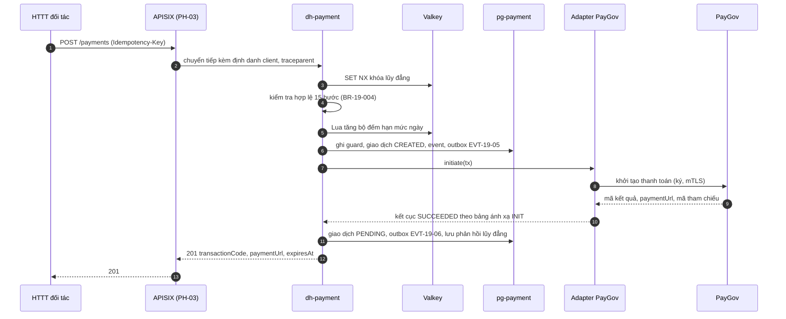
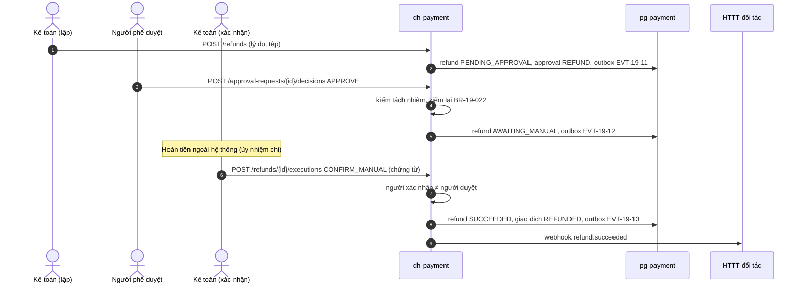
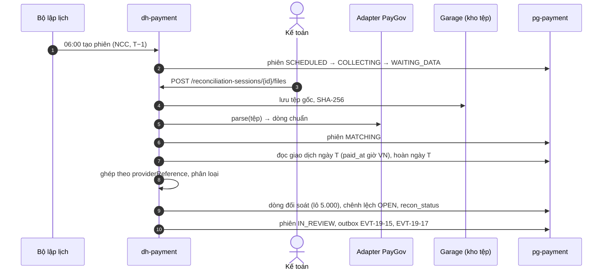
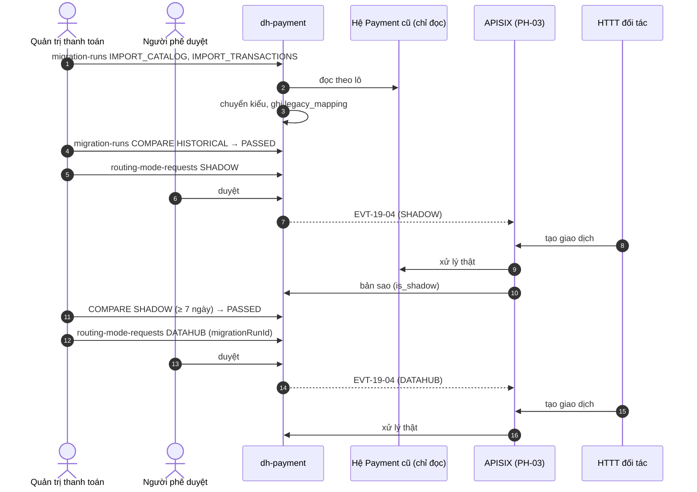

# D02-04-PH19 · Đặc tả use case phân hệ PH-19 Thanh toán điện tử

## Tóm tắt cho hội đồng thẩm định

Tài liệu đặc tả 29 use case UC-19-01…29 của phân hệ Thanh toán điện tử, phủ toàn bộ 69 yêu cầu chức năng của [FRS D02-03-PH19](../frs/D02-03-PH19-frs-thanh-toan.md): khai báo và kích hoạt nhà cung cấp (PayGov), quản lý dịch vụ, đối tác, tạo giao dịch, nhận kết quả, hủy và hết hạn, truy vấn, hoàn tiền, đối soát hằng ngày, xử lý chênh lệch, tra cứu, nhật ký, dashboard, báo cáo, thông báo cho HTTT đối tác, cấu hình theo tenant, di trú từ hệ Payment cũ. Mỗi use case ghi rõ ai làm, hệ thống phản hồi thế nào ở từng bước, những gì hệ thống luôn bảo đảm kể cả khi lỗi, và mã lỗi trả về. Sáu use case có dòng tiền hoặc trao đổi với nhà cung cấp (UC-19-11, 13, 18, 19, 20, 29) có sơ đồ tuần tự.

Căn cứ pháp lý và chuẩn kỹ thuật dùng chung như FRS §1.6: Luật Giao dịch điện tử 2023, NĐ 278/2025 về kết nối chia sẻ dữ liệu, NĐ 331/2026 và TCVN 14423:2026 về bảo đảm an toàn hệ thống thông tin theo cấp độ (Datahub cấp độ 3), Luật Bảo vệ dữ liệu cá nhân 91/2025 và NĐ 356/2025; các văn bản riêng của thanh toán theo D02-01-PH19 §2.1. Các chi tiết kỹ thuật của PayGov là giả định, cần đối chiếu tài liệu kết nối do Văn phòng Chính phủ cấp (OQ-19-01…08).

## 1. Mục đích và phạm vi

### 1.1. Mục đích

Tài liệu nối FRS (hệ thống phải làm gì) với [D03-06-PH19 Màn hình](../../03-thiet-ke/uiux/D03-06-PH19-man-hinh-thanh-toan.md), [D03-02-PH19 SDD](../../03-thiet-ke/sdd/D03-02-PH19-sdd-thanh-toan.md) và [D03-04-PH19 API](../../03-thiet-ke/api/D03-04-PH19-api-thanh-toan.md) (hệ thống làm thế nào). Đội phát triển dùng luồng chính, luồng ngoại lệ để biết thứ tự gọi màn, gọi API và mã lỗi phải trả; đội kiểm thử dùng từng luồng làm khung kịch bản TS-19-nn ở [D05-02-PH19](../../05-kiem-thu/test-case/D05-02-PH19-test-case.md).

### 1.2. Phạm vi

Toàn bộ FR-19-001…069. Chức năng dùng chung FR-00 (đăng nhập, phân quyền, kiểm toán chung, thông báo, hộp "Việc của tôi") không đặc tả lại. Hành vi của PH-03 (APISIX), PH-07 (danh mục), PH-09 (che dữ liệu), PH-12 (Keycloak), PH-13 (giám sát, kiểm toán), PH-20 (quản trị tenant) chỉ mô tả ở mức tương tác.

### 1.3. Tài liệu liên quan

| Tài liệu | Lý do tham chiếu |
|---|---|
| [D00-01 Thuật ngữ và quy ước](../../00-chung/D00-01-thuat-ngu-quy-uoc.md) | Hệ mã truy vết, kiểu T-* |
| [D02-01-PH19 BRD](../brd/D02-01-PH19-brd-thanh-toan.md) | Quy trình TO-BE BP-91…96, REQ-91…99 |
| [D02-03-PH19-00 Khung truy vết](../frs/D02-03-PH19-00-khung-truy-vet.md) | Cấp mã UC, US, máy trạng thái, vai trò, quyền |
| [D02-03-PH19 FRS](../frs/D02-03-PH19-frs-thanh-toan.md) | FR-19, BR-19, NFR-19, tham số `19.*`, ánh xạ GĐ-03 |
| [D02-08 Ma trận phân quyền](../D02-08-ma-tran-phan-quyen.md) | Vai trò, `PERM-19-*` |
| [D03-10 Thiết kế đa tenant](../../03-thiet-ke/D03-10-thiet-ke-da-tenant.md) | RLS, xác định tenant |
| ADR-040…049 | Quyết định kiến trúc PH-19 |

## 2. Quy ước đọc đặc tả

### 2.1. Mẫu đặc tả một use case

| Mục | Ý nghĩa |
|---|---|
| Mã, tên | `UC-19-nn`, tên bắt đầu bằng động từ |
| Mục tiêu | Kết quả nghiệp vụ tác nhân chính muốn đạt |
| Tác nhân chính, phụ | Người hoặc hệ thống khởi xướng; người hoặc hệ thống tham gia, nhận kết quả |
| Mức ưu tiên, phát hành | Mức cao nhất của các FR hiện thực; MVP, Đ2b hoặc Sau theo FRS §9.3 |
| FR hiện thực | FR mà use case hiện thực |
| Tiền điều kiện, điều kiện kích hoạt | Điều phải đúng trước khi bắt đầu; sự kiện làm use case bắt đầu |
| Đảm bảo tối thiểu | Điều hệ thống luôn giữ kể cả khi thất bại giữa chừng |
| Đảm bảo thành công | Trạng thái hệ thống sau khi kết thúc thành công |
| Luồng chính | Kịch bản thành công điển hình, đánh số bước, ghi màn `UI-19-nn` và API `API-19-nnn` |
| Luồng thay thế | Nhánh hợp lệ khác, đánh số theo bước rẽ (`3a`) |
| Luồng ngoại lệ | `E1`, `E2`…, mã lỗi `ERR-19-nnn` |
| Quy tắc, tần suất | `BR-19-nnn`, `NFR-19-nnn`; ước lượng khối lượng theo giả định GĐ-06 (tỉnh thí điểm quy mô vừa) |

### 2.2. Quy ước trong luồng

"Hệ thống" là dịch vụ `dh-payment` cùng giao diện `dh-console`. API quản trị có tiền tố `/api/payment/v1`, API đối tác `/api/payment-partner/v1`, API callback `/api/payment-callback/v1`. API tạo mới nhận `Idempotency-Key` (bắt buộc với API đối tác); API sửa, chuyển trạng thái cần `If-Match`; lỗi theo RFC 9457 với `code` là `ERR-19-nnn`. Mọi thao tác ghi sinh kiểm toán theo FR-19-053; mọi truy vấn chạy dưới RLS theo tenant. Các luồng không nhắc lại hai điều này ở từng bước.

Dữ liệu ví dụ là giả lập (không có dữ liệu thật, theo chỉ đạo ngày 25/11/2026): tenant `T68`; NCC `PAYGOV-T68` "Nền tảng thanh toán Cổng DVCQG"; đối tác `MCDT-T68` "Hệ thống thông tin giải quyết thủ tục hành chính tỉnh"; dịch vụ `LP-LLTP` "Lệ phí cấp Phiếu lý lịch tư pháp" 200.000 đ; mã giao dịch `T68261126K7M2Q9XW4P`; mã hồ sơ của đối tác `000.00.12.H68-261126-0042`. Người dùng giả lập:

| Ký hiệu | Vai trò | Người giả lập |
|---|---|---|
| ADM | Quản trị thanh toán (`ROLE-PAYMENT_ADMIN`) | Nguyễn Văn An |
| APR | Người phê duyệt (`ROLE-PAYMENT_APPROVER`) | Trần Thị Bình; Ngô Thị Lan (cấp 2) |
| ACC | Kế toán (`ROLE-PAYMENT_ACCOUNTANT`) | Lê Văn Cường; Bùi Văn Minh |
| OPR | Cán bộ tra cứu, vận hành (`ROLE-PAYMENT_OPERATOR`) | Phạm Thu Dung |
| AUD | Kiểm toán viên (`ROLE-PAYMENT_AUDITOR`) | Vũ Thị Hà |
| SEC | Cán bộ ATTT | Hoàng Minh Đức |
| TEN | Quản trị tenant | Đỗ Quang Khải |
| PTN | HTTT đối tác (client máy-máy) | `mcdt-t68-prod` |

## 3. Tác nhân

| Tác nhân | Loại | Tham gia use case |
|---|---|---|
| Quản trị thanh toán | Người | UC-19-01…10, 28, 29 |
| Người phê duyệt | Người | UC-19-03, 04, 09, 18, 20, 21, 29 (quyết định đề nghị, không tự lập) |
| Kế toán | Người | UC-19-17…22, 26, 29 |
| Cán bộ tra cứu | Người | UC-19-14, 16, 22…25, 27 |
| Kiểm toán viên | Người | UC-19-22, 24, 26 (chỉ đọc) |
| Cán bộ ATTT | Người | UC-19-01, 06, 10 (giám sát bí mật, khóa) |
| Người nộp tiền | Người (công dân, doanh nghiệp) | UC-19-12 |
| HTTT đối tác | Hệ thống | UC-19-11, 14, 15, 17, 21, 27 |
| PayGov (nhà cung cấp) | Hệ thống | UC-19-02, 11…14, 16, 18, 19 |
| Hệ Payment cũ | Hệ thống | UC-19-29 |
| PH-03, PH-07, PH-12, PH-13, PH-20 | Hệ thống nội bộ | Tương tác theo FRS §10.1 |
| Bộ lập lịch của `dh-payment` | Hệ thống | UC-19-06, 14, 16, 19, 27 |

## 4. Sơ đồ use case tổng

```mermaid
flowchart LR
  ADM([Quản trị thanh toán])
  APR([Người phê duyệt])
  ACC([Kế toán])
  OPR([Cán bộ tra cứu])
  AUD([Kiểm toán viên])
  PAY([Người nộp tiền])
  PTN[[HTTT đối tác]]
  PG[[PayGov]]
  OLD[[Hệ Payment cũ]]
  subgraph NCC["Nhà cung cấp, dịch vụ, đối tác"]
    U01(UC-19-01 Khai báo NCC)
    U02(UC-19-02 Kiểm tra, giao dịch thử)
    U03(UC-19-03 Kích hoạt NCC)
    U04(UC-19-04 Tạm dừng, ngừng NCC)
    U05(UC-19-05 Tra cứu, cập nhật NCC)
    U06(UC-19-06 Sức khỏe, xoay khóa)
    U07(UC-19-07 Nhóm dịch vụ)
    U08(UC-19-08 Dịch vụ)
    U09(UC-19-09 Đối tác)
    U10(UC-19-10 Client, hạn mức, webhook)
  end
  subgraph GD["Giao dịch"]
    U11(UC-19-11 Tạo giao dịch)
    U12(UC-19-12 Thanh toán, quay về)
    U13(UC-19-13 Nhận IPN)
    U14(UC-19-14 Hủy, hết hạn)
    U15(UC-19-15 Truy vấn trạng thái)
    U16(UC-19-16 Đồng bộ, xử lý lại IPN)
    U27(UC-19-27 Thông báo đối tác)
  end
  subgraph TC["Hoàn tiền, đối soát"]
    U17(UC-19-17 Lập yêu cầu hoàn)
    U18(UC-19-18 Duyệt, thực thi hoàn)
    U19(UC-19-19 Đối soát ngày)
    U20(UC-19-20 Xử lý chênh lệch)
    U21(UC-19-21 Chốt phiên, biên bản)
  end
  subgraph QL["Tra cứu, giám sát, quản trị"]
    U22(UC-19-22 Tra cứu, xuất)
    U23(UC-19-23 Chi tiết giao dịch)
    U24(UC-19-24 Nhật ký)
    U25(UC-19-25 Dashboard)
    U26(UC-19-26 Báo cáo)
    U28(UC-19-28 Cấu hình tenant)
    U29(UC-19-29 Di trú, chạy song song)
  end
  ADM --- U01 & U02 & U03 & U04 & U05 & U07 & U08 & U09 & U10 & U28 & U29
  APR --- U03 & U04 & U09 & U18 & U20 & U21 & U29
  ACC --- U17 & U19 & U20 & U21 & U22 & U26
  OPR --- U14 & U16 & U22 & U23 & U24 & U25 & U27
  AUD --- U22 & U24 & U26
  PAY --- U12
  PTN --- U11 & U14 & U15 & U17 & U27
  PG --- U02 & U11 & U13 & U16 & U18 & U19
  OLD --- U29
```



## 5. Bảng tổng hợp use case và truy vết

Hai bảng dưới sinh bằng `frs/ph19/tools/gen_frs_tables.py uc` từ khung truy vết §8.1, §10, §11, §14 nên luôn khớp mã với FRS và kiểm thử.

### 5.1. Use case và yêu cầu chức năng

| UC | Tên | Tác nhân chính | FR | BP |
|---|---|---|---|---|
| UC-19-01 | Khai báo nhà cung cấp và thông tin xác thực | Quản trị thanh toán | FR-19-001, 002 | BP-91 |
| UC-19-02 | Kiểm tra kết nối và giao dịch thử với nhà cung cấp | Quản trị thanh toán | FR-19-003, 004 | BP-91 |
| UC-19-03 | Kích hoạt nhà cung cấp có phê duyệt | Quản trị thanh toán | FR-19-005 | BP-91 |
| UC-19-04 | Tạm dừng, mở lại, ngừng hẳn nhà cung cấp | Quản trị thanh toán | FR-19-006, 010 | BP-91 |
| UC-19-05 | Tra cứu và cập nhật nhà cung cấp | Quản trị thanh toán | FR-19-007, 008, 009, 069 | — |
| UC-19-06 | Giám sát sức khỏe và xoay khóa nhà cung cấp | Hệ thống | FR-19-011, 012 | — |
| UC-19-07 | Quản lý nhóm dịch vụ | Quản trị thanh toán | FR-19-013, 016 | — |
| UC-19-08 | Quản lý dịch vụ thanh toán | Quản trị thanh toán | FR-19-014, 015, 016 | — |
| UC-19-09 | Đăng ký và phê duyệt đối tác | Quản trị thanh toán | FR-19-017, 018 | BP-92 |
| UC-19-10 | Cấp client, gán dịch vụ, cấu hình webhook cho đối tác | Quản trị thanh toán | FR-19-019, 020, 021 | BP-92 |
| UC-19-11 | Tạo giao dịch thanh toán | HTTT đối tác | FR-19-022, 023, 024, 028, 033, 034 | BP-93 |
| UC-19-12 | Người nộp thanh toán và quay về | Người nộp tiền | FR-19-025 | BP-93 |
| UC-19-13 | Nhận và xử lý kết quả thanh toán (IPN) | PayGov | FR-19-028, 029, 030, 031 | BP-93 |
| UC-19-14 | Hủy và hết hạn giao dịch | HTTT đối tác | FR-19-026, 027 | BP-93 |
| UC-19-15 | Đối tác truy vấn trạng thái giao dịch | HTTT đối tác | FR-19-035 | BP-93 |
| UC-19-16 | Đồng bộ trạng thái và xử lý lại IPN | Cán bộ tra cứu | FR-19-032, 036, 037 | BP-93 |
| UC-19-17 | Lập yêu cầu hoàn tiền | Kế toán | FR-19-038 | BP-94 |
| UC-19-18 | Phê duyệt và thực thi hoàn tiền | Người phê duyệt | FR-19-039, 040, 041 | BP-94 |
| UC-19-19 | Đối soát ngày với nhà cung cấp | Hệ thống | FR-19-042, 043, 044 | BP-95 |
| UC-19-20 | Xử lý chênh lệch đối soát | Kế toán | FR-19-045, 046 | BP-95 |
| UC-19-21 | Chốt, mở lại phiên đối soát và xuất biên bản | Kế toán | FR-19-047, 048 | BP-95 |
| UC-19-22 | Tra cứu và xuất danh sách giao dịch | Cán bộ tra cứu | FR-19-049, 050, 052 | — |
| UC-19-23 | Xem chi tiết giao dịch | Cán bộ tra cứu | FR-19-051, 055 | — |
| UC-19-24 | Xem nhật ký kiểm toán và nhật ký tích hợp | Kiểm toán viên | FR-19-053, 054, 055 | — |
| UC-19-25 | Giám sát qua dashboard và cảnh báo | Cán bộ tra cứu | FR-19-056, 057, 059 | — |
| UC-19-26 | Lập và xuất báo cáo định kỳ | Kế toán | FR-19-058 | — |
| UC-19-27 | Thông báo kết quả cho đối tác | Hệ thống | FR-19-060, 061, 062 | BP-93 |
| UC-19-28 | Cấu hình và khởi tạo phân hệ theo tenant | Quản trị thanh toán | FR-19-063, 064 | — |
| UC-19-29 | Di trú từ hệ cũ và chạy song song | Quản trị thanh toán | FR-19-065, 066, 067, 068 | BP-96 |

### 5.2. Use case, màn hình, API và kiểm thử

| UC | Màn hình | API | Kịch bản kiểm thử |
|---|---|---|---|
| UC-19-01 | UI-19-04, 05 | API-19-002, 006, 007 | TS-19-01 |
| UC-19-02 | UI-19-02, 06 | API-19-009…011 | TS-19-02 |
| UC-19-03 | UI-19-06, 13 | API-19-011, 012, 048 | TS-19-03 |
| UC-19-04 | UI-19-03, 04, 13 | API-19-005, 012…014, 048 | TS-19-04 |
| UC-19-05 | UI-19-03…05 | API-19-001, 003, 004, 091, 092 | TS-19-05 |
| UC-19-06 | UI-19-01, 04 | API-19-003, 008 | TS-19-06 |
| UC-19-07 | UI-19-07…10 | API-19-015…019, 021, 023, 028 | TS-19-07 |
| UC-19-08 | UI-19-08…10 | API-19-016, 018, 020…028 | TS-19-08 |
| UC-19-09 | UI-19-11…13 | API-19-029…035, 048 | TS-19-09 |
| UC-19-10 | UI-19-12 | API-19-036…046, 108 | TS-19-10 |
| UC-19-11 | UI-19-15 | API-19-054, 101, 108 | TS-19-11 |
| UC-19-12 | UI-19-28 | API-19-202 | TS-19-12 |
| UC-19-13 | UI-19-15, 16 | API-19-054, 201 | TS-19-13 |
| UC-19-14 | UI-19-15 | API-19-055, 104 | TS-19-14 |
| UC-19-15 | — | API-19-102, 103 | TS-19-15 |
| UC-19-16 | UI-19-15, 16 | API-19-053, 056…058 | TS-19-16 |
| UC-19-17 | UI-19-18 | API-19-059, 087, 105 | TS-19-17 |
| UC-19-18 | UI-19-13, 17, 18 | API-19-048, 060…062, 087, 088, 106, 203 | TS-19-18 |
| UC-19-19 | UI-19-19, 20 | API-19-063…067, 070, 204 | TS-19-19 |
| UC-19-20 | UI-19-13, 21, 22 | API-19-048, 071…074, 087, 088 | TS-19-20 |
| UC-19-21 | UI-19-13, 20 | API-19-048, 064, 067…069, 083, 084, 088, 107 | TS-19-21 |
| UC-19-22 | UI-19-14 | API-19-051, 083, 084 | TS-19-22 |
| UC-19-23 | UI-19-15, 23 | API-19-052, 054, 076 | TS-19-23 |
| UC-19-24 | UI-19-15, 23 | API-19-052, 075, 076 | TS-19-24 |
| UC-19-25 | UI-19-01, 02 | API-19-080, 081 | TS-19-25 |
| UC-19-26 | UI-19-25 | API-19-082…084 | TS-19-26 |
| UC-19-27 | UI-19-24 | API-19-077…079, 109 | TS-19-27 |
| UC-19-28 | UI-19-26 | API-19-085, 086 | TS-19-28 |
| UC-19-29 | UI-19-12, 13, 27 | API-19-047, 048, 088…090, 110 | TS-19-29 |

## 6. Đặc tả chi tiết use case

### 6.1. UC-19-01 · Khai báo nhà cung cấp và thông tin xác thực

Hệ cũ cho khai báo NCC kèm "liên kết API" ngay trên một biểu mẫu và lưu thông tin xác thực cùng bảng (LGC-PAY-001, 004). Use case tách hai việc: khai báo hồ sơ kết nối, và gắn **tham chiếu** tới bí mật đã nằm trong OpenBao; giá trị bí mật không bao giờ đi qua PH-19.

| Mục | Nội dung |
|---|---|
| Mã | UC-19-01 |
| Mục tiêu | ADM có một bản ghi NCC `DRAFT` đầy đủ thông tin kết nối và tham chiếu bí mật cho môi trường thử và chính thức |
| Tác nhân chính | ADM (`PERM-19-provider-write`, `PERM-19-credential-manage`) |
| Tác nhân phụ | SEC (nạp bí mật vào OpenBao theo quy trình D03-07); OpenBao |
| Mức ưu tiên, phát hành | M · MVP |
| FR hiện thực | FR-19-001, 002 |
| Tiền điều kiện | Tenant bật PH-19; tỉnh đã có thỏa thuận kết nối PayGov và bộ thông tin xác thực (A-19-05) |
| Điều kiện kích hoạt | ADM mở UI-19-03, chọn "Thêm nhà cung cấp" |
| Đảm bảo tối thiểu | Không giá trị bí mật nào được ghi vào CSDL, nhật ký hay phản hồi API; mã NCC đã lưu là bất biến |
| Đảm bảo thành công | NCC `DRAFT` có `connectionKey` riêng, tham chiếu bí mật môi trường thử và chính thức ở trạng thái `ACTIVE`, sẵn sàng kiểm tra kết nối |

**Luồng chính**

1. ADM (Nguyễn Văn An) mở UI-19-05 từ UI-19-03, chọn loại adapter `PAYGOV`, nhập mã `PAYGOV-T68`, tên, đơn vị cung cấp, đầu mối, ngày hiệu lực hợp đồng, địa chỉ API môi trường thử và chính thức, mã đơn vị kết nối do PayGov cấp.
2. Hệ thống kiểm tra định dạng, mã duy nhất trong tenant, địa chỉ là `https` và không trỏ dải nội bộ; ghi NCC `DRAFT` (API-19-002), sinh `connectionKey` 32 ký tự Base32 Crockford, hiển thị địa chỉ callback đầy đủ để tỉnh đăng ký với PayGov.
3. ADM mở tab "Thông tin xác thực" ở UI-19-04; SEC (Hoàng Minh Đức) đã nạp khóa ký, chứng thư mTLS của tỉnh và khóa công khai PayGov vào `kv/dh/T68/payment/providers/PAYGOV-T68/test/...`.
4. ADM chọn môi trường `TEST`, nhập đường dẫn tham chiếu cho từng mục đích (`SIGNING_KEY`, `MTLS_CERT`, `PROVIDER_PUBLIC_KEY`, `API_CREDENTIAL`) (API-19-007).
5. Hệ thống đọc siêu dữ liệu tại OpenBao bằng tài khoản dịch vụ của `dh-payment` (không đọc giá trị ra giao diện), kiểm tra tồn tại, thuật toán, hạn chứng thư ≥ 30 ngày; lưu tham chiếu `ACTIVE` kèm vân tay và ngày hết hạn.
6. ADM lặp bước 4–5 cho môi trường `PRODUCTION`.

**Luồng thay thế**

- **1a. Khai báo NCC thứ hai cùng PayGov.** Tỉnh có hai mã đơn vị kết nối (ví dụ khối Sở và khối huyện); ADM tạo `PAYGOV-T68-HUYEN` với `adapter_type = PAYGOV`; mỗi bản ghi có `connectionKey` riêng (A-19-05).
- **5a. Chứng thư sắp hết hạn (< 30 ngày).** Hệ thống lưu nhưng gắn cảnh báo vàng; checklist kích hoạt sẽ không đạt (BR-19-010).

**Luồng ngoại lệ**

- **E1. Mã trùng (bước 2).** ERR-19-038 "Mã nhà cung cấp đã tồn tại trong tenant."
- **E2. Địa chỉ không hợp lệ (bước 2).** ERR-19-001 với `errors[].field = productionBaseUrl`.
- **E3. Bí mật không tồn tại hoặc hết hạn (bước 5).** ERR-19-022; ADM liên hệ SEC nạp lại.
- **E4. Gắn tham chiếu khi NCC `PENDING_ACTIVATION`.** ERR-19-021.

**Quy tắc:** BR-19-026, BR-19-032; NFR-19-021. **Tần suất:** 1–3 NCC mỗi tenant, sửa vài lần mỗi năm.

### 6.2. UC-19-02 · Kiểm tra kết nối và giao dịch thử với nhà cung cấp

| Mục | Nội dung |
|---|---|
| Mã | UC-19-02 |
| Mục tiêu | ADM có bằng chứng NCC kết nối được và chạy trọn vòng thanh toán thử, làm đầu vào checklist kích hoạt |
| Tác nhân chính | ADM (`PERM-19-provider-test`) |
| Tác nhân phụ | PayGov môi trường thử |
| Mức ưu tiên, phát hành | M · MVP |
| FR hiện thực | FR-19-003, 004 |
| Tiền điều kiện | NCC không ở `RETIRED`; có tham chiếu bí mật `ACTIVE` của môi trường cần kiểm tra |
| Điều kiện kích hoạt | ADM mở bước 1 của UI-19-06 |
| Đảm bảo tối thiểu | Giao dịch thử luôn mang `is_test = true` và nằm dưới đối tác ẩn `__TEST__`; không tính vào dashboard, hạn mức, đối soát chính thức (BR-19-033) |
| Đảm bảo thành công | `provider_check_run` loại `CONNECTION` và `TEST_TRANSACTION` ở `PASSED`, có nhật ký từng bước |

**Luồng chính**

1. ADM chọn môi trường `PRODUCTION`, bấm "Kiểm tra kết nối" (API-19-009).
2. Hệ thống chạy tuần tự: phân giải DNS, bắt tay TLS (kiểm tra chuỗi chứng thư, phiên bản ≥ 1.2), mTLS nếu có, gọi `PING` hoặc thao tác truy vấn với mã giả của adapter, xác minh chữ ký phản hồi; ghi kết quả từng bước, độ trễ.
3. UI-19-06 hiển thị bốn bước xanh; ADM sang bước 2 "Giao dịch thử", chọn môi trường `TEST`, số tiền 10.000 đ (API-19-010).
4. Hệ thống tạo giao dịch thử dưới đối tác `__TEST__`, gọi PayGov khởi tạo, trả `paymentUrl`.
5. ADM mở `paymentUrl` trong cửa sổ mới, thanh toán bằng tài khoản thử của PayGov.
6. PayGov gửi IPN tới `/api/payment-callback/v1/paygov/{connectionKey}/ipn`; hệ thống xác minh và áp kết quả như UC-19-13.
7. UI-19-06 tự làm mới (API-19-011), thấy giao dịch thử `SUCCEEDED`, IPN "hợp lệ", `check_run` `PASSED`.

**Luồng thay thế**

- **6a. IPN không tới trong 10 phút.** Hệ thống truy vấn PayGov theo lịch BR-19-016; nếu truy vấn báo thành công, giao dịch thử `SUCCEEDED` nhưng `check_run` ghi `PASSED_WITHOUT_IPN` và checklist mục IPN chưa đạt; ADM kiểm tra lại địa chỉ callback đã đăng ký với PayGov.

**Luồng ngoại lệ**

- **E1. Thiếu, hết hạn thông tin xác thực (bước 1).** ERR-19-022.
- **E2. Kết nối thất bại (bước 2).** `check_run` `FAILED` với bước lỗi đầu tiên (ví dụ "TLS: chứng thư máy chủ không tin cậy"); không có mã lỗi HTTP vì thao tác chạy nền, kết quả xem ở API-19-011.
- **E3. Chạy giao dịch thử khi kết nối chưa đạt trong 24 giờ (bước 3).** ERR-19-035.
- **E4. Số tiền ngoài 1.000…100.000 đ.** ERR-19-010.

**Quy tắc:** BR-19-010, BR-19-033. **Tần suất:** vài lần khi kích hoạt hoặc sau sự cố.

### 6.3. UC-19-03 · Kích hoạt nhà cung cấp có phê duyệt

| Mục | Nội dung |
|---|---|
| Mã | UC-19-03 |
| Mục tiêu | NCC được đưa vào phục vụ chính thức sau khi người thứ hai kiểm tra bằng chứng |
| Tác nhân chính | ADM (`PERM-19-provider-write`, lập); APR (`PERM-19-provider-activate`, quyết định) |
| Mức ưu tiên, phát hành | M · MVP |
| FR hiện thực | FR-19-005 |
| Tiền điều kiện | NCC `DRAFT`; checklist BR-19-010 đạt |
| Điều kiện kích hoạt | ADM bấm "Gửi duyệt" ở bước 4 của UI-19-06 |
| Đảm bảo tối thiểu | NCC chỉ `ACTIVE` khi có quyết định của người khác người lập; đề nghị hết hạn sau 7 ngày thì NCC về `DRAFT` |
| Đảm bảo thành công | NCC `ACTIVE`, EVT-19-01 phát; dịch vụ gắn NCC này kích hoạt được |

**Luồng chính**

1. UI-19-06 bước 3 hiển thị checklist bốn mục đều đạt kèm liên kết bằng chứng (API-19-011).
2. ADM nhập ghi chú, bấm "Gửi duyệt" (API-19-012, `action = ACTIVATE`).
3. Hệ thống kiểm tra lại checklist, chuyển NCC `PENDING_ACTIVATION`, tạo `approval_request` loại `PROVIDER_ACTIVATE` kèm ảnh chụp checklist, thông báo nhóm APR.
4. APR (Trần Thị Bình) mở UI-19-13 (API-19-048), xem bằng chứng trong ngăn kéo (API-19-049).
5. APR chọn "Duyệt" (API-19-050).
6. Hệ thống kiểm tra người duyệt ≠ người lập, kiểm tra lại checklist tại thời điểm duyệt, chuyển NCC `ACTIVE`, ghi `activated_at`, phát EVT-19-01, bắt đầu giám sát sức khỏe (UC-19-06).

**Luồng thay thế**

- **5a. Từ chối.** APR nhập lý do; NCC về `DRAFT`, ADM nhận thông báo.
- **5b. Người lập rút.** ADM chọn "Rút" trên đề nghị của mình; NCC về `DRAFT`.

**Luồng ngoại lệ**

- **E1. Checklist không đạt khi lập hoặc khi duyệt.** ERR-19-035 kèm danh sách mục chưa đạt trong `detail`.
- **E2. Người duyệt trùng người lập.** ERR-19-033; nút "Duyệt" ẩn với người lập nhưng API vẫn kiểm tra.
- **E3. Đề nghị đã được người khác quyết định.** ERR-19-034.

**Quy tắc:** BR-19-010, BR-19-011. **Tần suất:** vài lần mỗi năm.

### 6.4. UC-19-04 · Tạm dừng, mở lại, ngừng hẳn nhà cung cấp

| Mục | Nội dung |
|---|---|
| Mã | UC-19-04 |
| Mục tiêu | ADM ngừng nhận giao dịch mới qua một NCC khi có sự cố hoặc kết thúc hợp đồng mà không làm mất giao dịch dở |
| Tác nhân chính | ADM (`PERM-19-provider-suspend`, `PERM-19-provider-delete`) |
| Tác nhân phụ | APR (`PERM-19-provider-activate`, duyệt ngừng hẳn) |
| Mức ưu tiên, phát hành | M · MVP |
| FR hiện thực | FR-19-006, 010 |
| Tiền điều kiện | NCC `ACTIVE` (tạm dừng), `SUSPENDED` (mở lại, ngừng hẳn), `DRAFT` (xóa) |
| Điều kiện kích hoạt | ADM chọn thao tác ở UI-19-03 hoặc UI-19-04 |
| Đảm bảo tối thiểu | Khi `SUSPENDED`, IPN, truy vấn, đối soát, hoàn tiền của giao dịch đã có vẫn chạy |
| Đảm bảo thành công | Trạng thái mới có hiệu lực ở lượt tạo giao dịch kế tiếp; EVT-19-01 phát |

**Luồng chính (tạm dừng rồi mở lại)**

1. PayGov thông báo bảo trì 2 giờ; ADM mở UI-19-04, chọn "Tạm dừng", nhập lý do (API-19-013, `If-Match`).
2. Hệ thống chuyển NCC `SUSPENDED`, phát EVT-19-01; yêu cầu tạo giao dịch mới cho dịch vụ của NCC trả ERR-19-008 kèm thông điệp "Kênh thanh toán tạm ngừng".
3. Hết bảo trì, ADM chạy "Kiểm tra kết nối" (UC-19-02 bước 1–2) rồi chọn "Mở lại" (API-19-014).
4. Hệ thống kiểm tra có `check_run` kết nối `PASSED` trong 1 giờ, chuyển `ACTIVE`, phát EVT-19-01.

**Luồng thay thế**

- **1a. Ngừng hẳn.** ADM chọn "Ngừng hẳn" (API-19-012, `action = RETIRE`); hệ thống kiểm tra BR-19-027 (không còn giao dịch `CREATED`/`PENDING`, yêu cầu hoàn dở, phiên đối soát chưa chốt), tạo đề nghị `PROVIDER_RETIRE`; APR duyệt ở UI-19-13; NCC `RETIRED`, dữ liệu giữ nguyên.
- **1b. Xóa NCC `DRAFT` chưa từng có giao dịch.** API-19-005; bản ghi bị xóa cứng cùng tham chiếu bí mật (bí mật trong OpenBao do SEC thu hồi).

**Luồng ngoại lệ**

- **E1. Mở lại khi chưa kiểm tra kết nối trong 1 giờ.** ERR-19-035.
- **E2. Ngừng hẳn khi còn việc dở.** ERR-19-036 kèm số lượng từng loại việc dở.
- **E3. Xóa NCC đã có giao dịch (kể cả thử).** ERR-19-037.
- **E4. Bản ghi đã bị người khác sửa.** ERR-19-045.

**Quy tắc:** BR-19-011, BR-19-027. **Tần suất:** tạm dừng vài lần mỗi quý; ngừng hẳn hiếm.

### 6.5. UC-19-05 · Tra cứu và cập nhật nhà cung cấp

| Mục | Nội dung |
|---|---|
| Mã | UC-19-05 |
| Mục tiêu | Người dùng tìm và xem NCC; ADM sửa thông tin và quản lý bảng ánh xạ mã kết quả |
| Tác nhân chính | ADM (`PERM-19-provider-write`); mọi vai trò có `PERM-19-provider-read` (xem) |
| Tác nhân phụ | APR (`PERM-19-provider-activate`, duyệt đổi bảng ánh xạ) |
| Mức ưu tiên, phát hành | M · MVP |
| FR hiện thực | FR-19-007, 008, 009, 069 |
| Tiền điều kiện | Có ít nhất một NCC |
| Điều kiện kích hoạt | Người dùng mở UI-19-03 |
| Đảm bảo tối thiểu | Đổi địa chỉ kết nối của NCC `ACTIVE` chỉ có hiệu lực sau kiểm tra kết nối thành công với giá trị mới (BR-19-026); mã kết quả chưa ánh xạ không bao giờ được hiểu là thành công |
| Đảm bảo thành công | Thông tin mới được lưu với phiên bản mới; bảng ánh xạ mới có hiệu lực ngay sau duyệt |

**Luồng chính**

1. OPR (Phạm Thu Dung) mở UI-19-03, lọc trạng thái `ACTIVE`, sức khỏe `DEGRADED` (API-19-001); mở chi tiết `PAYGOV-T68` (API-19-003) xem sức khỏe, số dịch vụ, hạn chứng thư.
2. ADM mở UI-19-05 ở chế độ sửa, đổi đầu mối kỹ thuật và địa chỉ API chính thức mới do PayGov thông báo (API-19-004, `If-Match`).
3. Hệ thống lưu đầu mối ngay; với địa chỉ mới, lưu ở `pending_changes`, tiếp tục dùng địa chỉ cũ, yêu cầu kiểm tra kết nối với giá trị mới.
4. ADM chạy kiểm tra kết nối; khi `PASSED`, hệ thống áp địa chỉ mới, ghi kiểm toán.

**Luồng thay thế: đổi bảng ánh xạ mã kết quả (FR-19-069)**

- **2a.** PayGov bổ sung mã `24` "Giao dịch bị ngân hàng từ chối do vượt hạn mức". Màn UI-19-04 tab "Ánh xạ mã" hiển thị mã `24` trong danh sách "Mã đã gặp nhưng chưa ánh xạ" kèm số IPN đang cách ly (API-19-091).
- **2b.** ADM thêm dòng (`IPN`, `24`, `FAILED`, cuối, `BANK_LIMIT_EXCEEDED`, "Ngân hàng từ chối do vượt hạn mức"), lập đề nghị (API-19-092); hệ thống tạo `approval_request` loại `RESULT_MAPPING_CHANGE` kèm bảng so sánh trước – sau.
- **2c.** APR duyệt ở UI-19-13; hệ thống tạo phiên bản ánh xạ mới; IPN đang cách ly vì mã `24` được đánh dấu có thể xử lý lại (UC-19-16 luồng 1b).

**Luồng ngoại lệ**

- **E1. Sửa trường bất biến (mã, loại adapter).** ERR-19-001.
- **E2. Sửa NCC `PENDING_ACTIVATION`, `RETIRED`.** ERR-19-021.
- **E3. Dòng ánh xạ `SUCCEEDED` không phải kết quả cuối, hoặc dòng trùng.** ERR-19-001.
- **E4. Đã có đề nghị đổi ánh xạ đang chờ.** ERR-19-021.

**Quy tắc:** BR-19-026, GĐ-03. **Tần suất:** xem hằng ngày; sửa vài lần mỗi quý.

### 6.6. UC-19-06 · Giám sát sức khỏe và xoay khóa nhà cung cấp

| Mục | Nội dung |
|---|---|
| Mã | UC-19-06 |
| Mục tiêu | Phát hiện sớm NCC suy giảm để ngắt mạch, cảnh báo; thay khóa, chứng thư trước khi hết hạn mà không gián đoạn thu |
| Tác nhân chính | Bộ lập lịch (giám sát); ADM với SEC (xoay khóa, `PERM-19-credential-manage`) |
| Tác nhân phụ | OPR (nhận cảnh báo); PH-13 |
| Mức ưu tiên, phát hành | M · MVP (giám sát); S · Đ2b (xoay khóa có chuyển tiếp) |
| FR hiện thực | FR-19-011, 012 |
| Tiền điều kiện | NCC `ACTIVE` hoặc `SUSPENDED` |
| Điều kiện kích hoạt | Chu kỳ `19.provider.health-interval-seconds`; chứng thư còn ≤ 30 ngày |
| Đảm bảo tối thiểu | Trạng thái sức khỏe không đổi vòng đời NCC; trong thời gian chuyển tiếp xoay khóa, IPN ký bằng khóa cũ hoặc mới đều được chấp nhận |
| Đảm bảo thành công | `health_status` và `circuit_state` phản ánh tình trạng thật; khóa mới `ACTIVE`, khóa cũ `RETIRED` sau chuyển tiếp |

**Luồng chính (giám sát)**

1. Pod giữ khóa lãnh đạo `{tenant}:payment:health-leader` gọi `PING` mỗi 60 giây cho mỗi NCC.
2. Hệ thống gộp kết quả thăm dò với số liệu lời gọi thật trong cửa sổ trượt 5 phút: tỷ lệ lỗi 55%, p95 6,2 giây → `DEGRADED`; tỷ lệ lỗi vượt `19.provider.circuit-error-rate` → mạch `OPEN`.
3. Hệ thống phát EVT-19-02, chỉ số `payment_provider_circuit_state`; PH-13 gửi cảnh báo khẩn cho OPR.
4. Trong khi mạch mở, yêu cầu tạo giao dịch nhận ERR-19-017 kèm `Retry-After` trước khi ghi CSDL (BR-19-013); IPN, truy vấn, đối soát vẫn chạy.
5. Sau 30 giây, mạch nửa mở cho 5 lời gọi thử; đều thành công → `CLOSED`, sức khỏe về `HEALTHY`, phát EVT-19-02.

**Luồng thay thế (xoay khóa, Đ2b)**

- **1a.** Chỉ số `payment_credential_expiry_days` = 28 → cảnh báo SEC. SEC nạp khóa mới vào OpenBao; ADM gọi API-19-008 tạo bản `NEXT`.
- **1b.** Hệ thống kiểm tra kết nối với bản `NEXT`; đạt thì bắt đầu chuyển tiếp 7 ngày (`19.provider.credential-transition-days`): ký yêu cầu đi bằng khóa mới, xác minh IPN bằng cả hai khóa công khai.
- **1c.** Hết chuyển tiếp, bản cũ `RETIRED`, bản `NEXT` → `ACTIVE`.
- **1d (MVP).** Khi chưa có FR-19-012, ADM thay tham chiếu trực tiếp bằng API-19-007 rồi chạy kiểm tra kết nối; IPN ký bằng khóa cũ trong khoảng chuyển đổi có thể bị từ chối và được PayGov gửi lại (A-19-02).

**Luồng ngoại lệ**

- **E1. Đã có bản `NEXT` đang chuyển tiếp.** ERR-19-021.
- **E2. Bí mật mới không hợp lệ.** ERR-19-022.

**Quy tắc:** BR-19-013, BR-19-026; NFR-19-017. **Tần suất:** giám sát liên tục; xoay khóa 1–2 lần mỗi năm.

### 6.7. UC-19-07 · Quản lý nhóm dịch vụ

| Mục | Nội dung |
|---|---|
| Mã | UC-19-07 |
| Mục tiêu | ADM tổ chức dịch vụ thu theo nhóm (lĩnh vực) như hệ cũ để lọc và báo cáo |
| Tác nhân chính | ADM (`PERM-19-service-write`) |
| Tác nhân phụ | PH-07 (danh mục lĩnh vực `DM_LINH_VUC_TTHC`) |
| Mức ưu tiên, phát hành | M · MVP |
| FR hiện thực | FR-19-013, 016 |
| Tiền điều kiện | PH-07 có danh mục lĩnh vực của tenant |
| Điều kiện kích hoạt | ADM mở UI-19-07 |
| Đảm bảo tối thiểu | Không xóa được nhóm còn dịch vụ; mã lĩnh vực luôn hợp lệ tại thời điểm ghi |
| Đảm bảo thành công | Nhóm có mã, tên, lĩnh vực, thứ tự hiển thị |

**Luồng chính**

1. ADM mở UI-19-07 (API-19-015), chọn "Thêm nhóm"; UI-19-08 mở ngăn kéo.
2. ADM nhập mã `TU-PHAP`, tên "Lĩnh vực tư pháp", chọn lĩnh vực từ ô tra danh mục (API-19-028).
3. Hệ thống kiểm tra mã duy nhất, mã lĩnh vực còn hiệu lực ở PH-07, ghi nhóm (API-19-016).

**Luồng thay thế**

- **3a. Sửa nhóm** (API-19-018, `If-Match`); **xóa mềm nhóm** không còn dịch vụ (API-19-019).
- **3b. PH-07 báo mã lĩnh vực hết hiệu lực** (sự kiện danh mục): hệ thống bật cờ `catalog_invalid` trên nhóm và dịch vụ liên quan, hiển thị cảnh báo; ADM sửa ở lần cập nhật kế tiếp (FR-19-016).

**Luồng ngoại lệ**

- **E1. Mã trùng.** ERR-19-038. **E2. Mã lĩnh vực không hợp lệ.** ERR-19-039. **E3. Xóa nhóm còn dịch vụ.** ERR-19-037. **E4. Xung đột phiên bản.** ERR-19-045.

**Tần suất:** 10–30 nhóm mỗi tenant; sửa hiếm.

### 6.8. UC-19-08 · Quản lý dịch vụ thanh toán

| Mục | Nội dung |
|---|---|
| Mã | UC-19-08 |
| Mục tiêu | ADM khai báo khoản thu (phí, lệ phí) cùng NCC thu, khoảng số tiền, tài khoản thụ hưởng, và điều khiển vòng đời |
| Tác nhân chính | ADM (`PERM-19-service-write`, `PERM-19-service-activate`) |
| Tác nhân phụ | PH-07 (lĩnh vực, loại phí, cơ quan thu) |
| Mức ưu tiên, phát hành | M · MVP |
| FR hiện thực | FR-19-014, 015, 016 |
| Tiền điều kiện | Có nhóm dịch vụ; NCC `ACTIVE` để kích hoạt dịch vụ |
| Điều kiện kích hoạt | ADM mở UI-19-09 |
| Đảm bảo tối thiểu | Dịch vụ chỉ `ACTIVE` khi NCC `ACTIVE` và mã danh mục hợp lệ (BR-19-009); ngừng hẳn không làm mất giao dịch dở |
| Đảm bảo thành công | Dịch vụ `ACTIVE` gán được cho đối tác; EVT-19-03 phát |

**Luồng chính**

1. ADM mở UI-19-09 (API-19-020), chọn "Thêm dịch vụ"; UI-19-10 mở biểu mẫu.
2. ADM nhập mã `LP-LLTP`, tên, nhóm `TU-PHAP`, loại phí `LE_PHI`, cơ quan thu, NCC `PAYGOV-T68`, mã tham chiếu tài khoản thụ hưởng đã đăng ký với PayGov (OQ-19-11), khoảng số tiền 200.000…200.000 đ, thời hạn giao dịch 30 phút.
3. Hệ thống kiểm tra mã duy nhất, khoảng số tiền, mã danh mục (API-19-028), ghi dịch vụ `DRAFT` (API-19-021).
4. ADM bấm "Kích hoạt" (API-19-025); hệ thống kiểm tra NCC `ACTIVE`, mã danh mục còn hiệu lực, có tham chiếu tài khoản thụ hưởng; chuyển `ACTIVE`, phát EVT-19-03.

**Luồng thay thế**

- **4a. Tạm dừng** (API-19-026): đối tác tạo giao dịch nhận ERR-19-008; **mở lại** (API-19-025).
- **4b. Ngừng hẳn** (API-19-027): chỉ khi không còn việc dở (BR-19-027).
- **4c. Xóa dịch vụ `DRAFT` chưa có giao dịch** (API-19-024).

**Luồng ngoại lệ**

- **E1. Khoảng số tiền sai (`min > max`, ≤ 0).** ERR-19-001. **E2. Mã trùng.** ERR-19-038. **E3. Mã danh mục không hợp lệ.** ERR-19-039.
- **E4. Kích hoạt khi NCC không `ACTIVE` hoặc thiếu tài khoản thụ hưởng.** ERR-19-035.
- **E5. Ngừng hẳn khi còn việc dở.** ERR-19-036. **E6. Xóa dịch vụ đã có giao dịch.** ERR-19-037.

**Quy tắc:** BR-19-009, BR-19-027. **Tần suất:** 100–300 dịch vụ mỗi tenant; thêm, sửa hằng tuần trong giai đoạn đưa vào dùng.

### 6.9. UC-19-09 · Đăng ký và phê duyệt đối tác

| Mục | Nội dung |
|---|---|
| Mã | UC-19-09 |
| Mục tiêu | Một HTTT của tỉnh được phép thu tiền qua Datahub sau khi hồ sơ được người thứ hai duyệt |
| Tác nhân chính | ADM (`PERM-19-partner-write`) |
| Tác nhân phụ | APR (`PERM-19-partner-approve`); PH-01 (danh mục HTTT, cơ quan) |
| Mức ưu tiên, phát hành | M · MVP |
| FR hiện thực | FR-19-017, 018 |
| Tiền điều kiện | HTTT đối tác đã có trong danh mục HTTT của tỉnh |
| Điều kiện kích hoạt | ADM mở UI-19-11, chọn "Đăng ký đối tác" |
| Đảm bảo tối thiểu | Đối tác chỉ gọi được API thanh toán khi `ACTIVE` và chế độ định tuyến `SHADOW` hoặc `DATAHUB` |
| Đảm bảo thành công | Đối tác `ACTIVE`, `routing_mode = LEGACY` mặc định; EVT-19-04 phát |

**Luồng chính**

1. ADM nhập mã `MCDT-T68`, tên, cơ quan chủ quản (mã PH-07), đầu mối nghiệp vụ, kỹ thuật, danh sách tên miền quay về được phép (`https://dichvucong.t68.gov.vn`), mã ứng dụng ở hệ cũ `legacyAppCode` (API-19-030).
2. Hệ thống kiểm tra, ghi đối tác `DRAFT`.
3. ADM cấp client, gán dịch vụ, cấu hình webhook (UC-19-10), rồi bấm "Gửi duyệt" (API-19-033, `action = ONBOARD`).
4. Hệ thống kiểm tra điều kiện gửi duyệt (có ít nhất một client, một dịch vụ được gán, một đầu nhận webhook đã gửi thử thành công), chuyển `PENDING_APPROVAL`, tạo đề nghị `PARTNER_ONBOARD`.
5. APR duyệt ở UI-19-13; hệ thống chuyển đối tác `ACTIVE`, phát EVT-19-04.

**Luồng thay thế**

- **5a. Từ chối hoặc rút.** Đối tác về `DRAFT`.
- **5b. Tạm dừng, mở lại** (API-19-034, 035) không cần duyệt; **chấm dứt** (`action = TERMINATE`) cần duyệt, hệ thống thu hồi mọi client tại PH-12, webhook giao dịch dở tiếp tục 30 ngày.

**Luồng ngoại lệ**

- **E1. Thiếu điều kiện gửi duyệt.** ERR-19-035 kèm mục còn thiếu.
- **E2. Mã hoặc `legacyAppCode` trùng.** ERR-19-038. **E3. Địa chỉ quay về sai.** ERR-19-001.
- **E4. Người duyệt trùng người lập.** ERR-19-033.
- **E5. PH-12 không thu hồi được client khi chấm dứt.** ERR-19-099; thao tác không áp dụng, đối tác giữ trạng thái cũ.

**Quy tắc:** BR-19-011. **Tần suất:** 10–40 đối tác mỗi tenant.

### 6.10. UC-19-10 · Cấp client, gán dịch vụ, cấu hình webhook cho đối tác

| Mục | Nội dung |
|---|---|
| Mã | UC-19-10 |
| Mục tiêu | Đối tác có định danh máy-máy, quyền thu các dịch vụ cụ thể trong hạn mức, và địa chỉ nhận kết quả có ký |
| Tác nhân chính | ADM (`PERM-19-partner-client-manage`, `PERM-19-partner-write`, `PERM-19-partner-webhook-manage`) |
| Tác nhân phụ | SEC; PH-12 (Keycloak) |
| Mức ưu tiên, phát hành | M · MVP |
| FR hiện thực | FR-19-019, 020, 021 |
| Tiền điều kiện | Đối tác không `TERMINATED` |
| Điều kiện kích hoạt | ADM mở các tab của UI-19-12 |
| Đảm bảo tối thiểu | Bí mật client, bí mật ký webhook chỉ hiển thị một lần; địa chỉ webhook không trỏ dải nội bộ (chống SSRF) |
| Đảm bảo thành công | Client `ACTIVE` ở PH-12 với quyền `PERM-19-partner-pay-*`; dịch vụ được gán kèm hạn mức; đầu nhận webhook đã gửi thử thành công |

**Luồng chính**

1. ADM mở tab "Client", chọn "Cấp client", chọn phương thức xác thực `private_key_jwt` và dán khóa công khai do đối tác cung cấp (API-19-037).
2. Hệ thống gọi PH-12 tạo client `mcdt-t68-prod` trong realm của tenant, gán vai trò `ROLE-PAYMENT_PARTNER`, lưu `client_id`.
3. ADM mở tab "Dịch vụ và hạn mức", gán `LP-LLTP` với hạn mức 2.000 giao dịch/ngày, 500.000.000 đ/ngày, tối đa 5.000.000 đ/giao dịch (API-19-040).
4. ADM mở tab "Webhook", thêm đầu nhận `https://dichvucong.t68.gov.vn/payment/webhook`, chọn loại sự kiện `transaction.*`, `refund.*` (API-19-043).
5. Hệ thống kiểm tra địa chỉ (HTTPS, phân giải DNS không ra dải riêng, loopback), sinh bí mật ký `whsec_…`, lưu vào OpenBao, hiển thị một lần.
6. ADM bấm "Gửi thử" (API-19-045); hệ thống gửi sự kiện `ping` có ký; đối tác trả 200; đầu nhận ghi `last_test_ok_at`.

**Luồng thay thế**

- **1a. Xác thực bằng `client_secret`.** PH-12 sinh bí mật, hệ thống hiển thị một lần, không lưu.
- **1b. Thu hồi client** (API-19-038): PH-12 vô hiệu ngay; token đang dùng hết hiệu lực trong ≤ 5 phút.
- **5a. Xoay bí mật ký webhook** (API-19-046): bí mật mới hiển thị một lần; trong 7 ngày webhook mang hai chữ ký `v1`.

**Luồng ngoại lệ**

- **E1. Khóa, chứng thư không hợp lệ.** ERR-19-001. **E2. Đối tác `TERMINATED`.** ERR-19-021.
- **E3. Địa chỉ webhook không hợp lệ hoặc nội bộ.** ERR-19-044. **E4. Đã có xoay bí mật đang chuyển tiếp.** ERR-19-021.
- **E5. PH-12 không phản hồi.** ERR-19-099; không tạo bản ghi client cục bộ.

**Quy tắc:** BR-19-005; NFR-19-022. **Tần suất:** khi đưa đối tác vào dùng; xoay bí mật hằng năm.

### 6.11. UC-19-11 · Tạo giao dịch thanh toán

Use case trung tâm của PH-19, thay "nhận yêu cầu thanh toán, gửi yêu cầu thanh toán" của hệ cũ (LGC-PAY-024) vốn không chống trùng và không phân biệt lỗi khởi tạo với lỗi không xác định.

| Mục | Nội dung |
|---|---|
| Mã | UC-19-11 |
| Mục tiêu | HTTT đối tác nhận được địa chỉ thanh toán cho đúng một khoản thu của một hồ sơ, không trùng, không mất |
| Tác nhân chính | HTTT đối tác (`PERM-19-partner-pay-create`) |
| Tác nhân phụ | PayGov; PH-03 (APISIX) |
| Mức ưu tiên, phát hành | M · MVP |
| FR hiện thực | FR-19-022, 023, 024, 028, 033, 034 |
| Tiền điều kiện | Đối tác `ACTIVE`, chế độ `DATAHUB`; dịch vụ `ACTIVE` đã gán cho đối tác; NCC `ACTIVE`, mạch không mở |
| Điều kiện kích hoạt | Công dân chọn "Thanh toán trực tuyến" trên Cổng dịch vụ công của tỉnh cho hồ sơ `000.00.12.H68-261126-0042` |
| Đảm bảo tối thiểu | Cùng `Idempotency-Key` không bao giờ sinh hai giao dịch; mỗi mã hồ sơ có tối đa một giao dịch đang mở hoặc đã thành công; lỗi không xác định không bao giờ được báo là thất bại |
| Đảm bảo thành công | Giao dịch `PENDING` có `paymentUrl`, `expiresAt`; EVT-19-05, 06 phát; hạn mức ngày đã trừ |

**Luồng chính**

1. HTTT đối tác lấy token `client_credentials` (`private_key_jwt`) tại PH-12, gọi API-19-101 qua `apisix-ext` với `Idempotency-Key: 4f0c…`, thân: `serviceCode = LP-LLTP`, `partnerOrderId = 000.00.12.H68-261126-0042`, `amount = 200000`, `currency = VND`, thông tin người nộp, `returnUrl`.
2. PH-03 xác thực token, áp giới hạn tốc độ, chuyển yêu cầu tới `dh-payment` theo chế độ định tuyến của đối tác.
3. Hệ thống đặt khóa lũy đẳng `SET NX` trên Valkey; kiểm tra hợp lệ 15 bước theo thứ tự cố định của BR-19-004 (FR-19-023), dừng ở lỗi đầu tiên.
4. Hệ thống tăng bộ đếm hạn mức ngày bằng Lua nguyên tử; trong một giao dịch CSDL: ghi `transaction_order_guard` (chống trùng mã hồ sơ), `payment_transaction` `CREATED` với mã `T68261126K7M2Q9XW4P`, `transaction_event`, `idempotency_record`, outbox EVT-19-05; mã hóa dữ liệu người nộp mức trường.
5. Hệ thống gọi `PaymentProviderPort.initiate()` qua adapter PayGov trong bulkhead của NCC, timeout 10 giây.
6. PayGov trả mã kết quả thành công kèm `paymentUrl`, mã tham chiếu; adapter ánh xạ qua bảng `provider_result_mapping` (thao tác `INIT`) ra kết cục `SUCCEEDED`.
7. Hệ thống chuyển giao dịch `PENDING`, lưu `provider_reference`, outbox EVT-19-06, lưu phản hồi vào `idempotency_record`.
8. Hệ thống trả 201 với `transactionCode`, `status = PENDING`, `paymentUrl`, `expiresAt`; đối tác chuyển hướng công dân tới `paymentUrl` (UC-19-12).

**Luồng thay thế**

- **1a. Đối tác gửi lại cùng `Idempotency-Key`, cùng nội dung** (mất phản hồi do mạng). Hệ thống trả nguyên phản hồi đã lưu, tiêu đề `Idempotent-Replayed: true`; không gọi PayGov lần hai.
- **1b. Đối tác tạo lại cho cùng mã hồ sơ sau khi giao dịch trước `FAILED`/`EXPIRED`/`CANCELLED`.** Hệ thống cho phép (BR-19-007), giao dịch mới có mã mới; API-19-103 trả cả hai lượt.
- **2a. Đối tác ở chế độ `SHADOW`.** Hệ thống ghi giao dịch `is_shadow = true`, không gọi PayGov, không phát sự kiện ra ngoài, trả 202 chỉ để so sánh; yêu cầu thật vẫn do hệ cũ xử lý (UC-19-29).
- **6a. PayGov từ chối rõ ràng** (ví dụ dịch vụ chưa đăng ký). Giao dịch `FAILED` với mã lý do; đối tác nhận ERR-19-018 (502); hạn mức được hoàn lại.
- **6b. Không xác định** (timeout, 5xx, mất kết nối, hoặc mã kết quả ánh xạ ra `UNKNOWN`). Giao dịch giữ `CREATED`, `init_uncertain = true`; đối tác nhận ERR-19-019 (504) kèm `transactionCode`; hệ thống truy vấn bù theo BR-19-016 (UC-19-16). Đối tác không được tạo giao dịch mới cho mã hồ sơ này trong khi giao dịch còn mở.

**Luồng ngoại lệ**

- **E1. Thiếu, sai `Idempotency-Key`.** ERR-19-002. **E2. Khóa đã dùng cho nội dung khác.** ERR-19-003. **E3. Yêu cầu cùng khóa đang xử lý.** ERR-19-004 (409, `Retry-After: 1`).
- **E4. Đối tác không `ACTIVE`.** ERR-19-005. **E5. Đối tác còn ở `LEGACY`.** ERR-19-006.
- **E6. Dịch vụ không tồn tại, không hoạt động, chưa gán.** ERR-19-007, 008, 009.
- **E7. Số tiền sai, ngoài khoảng, vượt hạn mức giao dịch, vượt hạn mức ngày, sai loại tiền.** ERR-19-010…014.
- **E8. Mã hồ sơ đã có giao dịch mở hoặc thành công.** ERR-19-015 kèm `transactionCode` hiện có.
- **E9. `returnUrl` không thuộc tên miền được phép.** ERR-19-016.
- **E10. Mạch ngắt mở hoặc NCC tạm dừng.** ERR-19-017 (503, `Retry-After`), không ghi CSDL.
- **E11. Phân hệ chưa bật cho tenant.** ERR-19-049.

**Quy tắc:** BR-19-001…007, 012, 013; NFR-19-001, 002, 012, 024. **Tần suất:** khoảng 20.000 giao dịch mỗi ngày ở tỉnh thí điểm, đỉnh 50/giây (A-19-19); thiết kế cho 200/giây mỗi tenant.



### 6.12. UC-19-12 · Người nộp thanh toán và quay về

| Mục | Nội dung |
|---|---|
| Mã | UC-19-12 |
| Mục tiêu | Người nộp thanh toán trên trang PayGov và quay về trang của đối tác với thông tin trạng thái đáng tin |
| Tác nhân chính | Người nộp tiền |
| Tác nhân phụ | PayGov; HTTT đối tác |
| Mức ưu tiên, phát hành | M · MVP |
| FR hiện thực | FR-19-025 |
| Tiền điều kiện | Giao dịch `PENDING` có `paymentUrl` |
| Điều kiện kích hoạt | Người nộp được chuyển hướng tới `paymentUrl` |
| Đảm bảo tối thiểu | Lượt quay về không bao giờ đổi trạng thái giao dịch (BR-19-014); tham số quay về bị sửa không làm lộ dữ liệu |
| Đảm bảo thành công | Người nộp thấy trang kết quả UI-19-28 rồi được chuyển về `returnUrl` của đối tác kèm tham số có ký |

**Luồng chính**

1. Người nộp thanh toán trên trang PayGov bằng tài khoản ngân hàng.
2. PayGov chuyển trình duyệt về `/api/payment-callback/v1/paygov/{connectionKey}/return?...` (API-19-202).
3. Hệ thống xác minh tham số theo đặc tả adapter (chữ ký nếu PayGov có), đọc trạng thái **hiện tại trong CSDL** của giao dịch, không dùng trạng thái trong tham số.
4. Hệ thống hiển thị UI-19-28: "Đang xác nhận kết quả" nếu giao dịch còn `PENDING` (tự làm mới 5 giây một lần tối đa 60 giây), hoặc kết quả cuối; có mã giao dịch, số tiền, dịch vụ, không có dữ liệu cá nhân.
5. Sau tối đa 10 giây (hoặc khi người nộp bấm "Về trang dịch vụ công"), hệ thống chuyển về `returnUrl` kèm `transactionCode`, `status`, `ts`, `sig` (HMAC trên `{transactionCode}.{status}.{ts}` bằng bí mật của đối tác).

**Luồng thay thế**

- **4a. IPN đã tới trước lượt quay về.** Trang hiển thị ngay "Thanh toán thành công".
- **4b. Người nộp hủy trên trang PayGov.** Trang hiển thị "Bạn đã hủy thanh toán"; giao dịch vẫn `PENDING` tới khi IPN hoặc truy vấn xác nhận (BR-19-014).

**Luồng ngoại lệ**

- **E1. Tham số sai chữ ký, không tìm thấy giao dịch.** Trang lỗi chung "Không xác định được giao dịch", không tiết lộ chi tiết; ghi nhật ký tích hợp mức cảnh báo.

**Quy tắc:** BR-19-014. **Tần suất:** bằng số giao dịch.

### 6.13. UC-19-13 · Nhận và xử lý kết quả thanh toán (IPN)

| Mục | Nội dung |
|---|---|
| Mã | UC-19-13 |
| Mục tiêu | Kết quả thanh toán từ PayGov được xác minh và áp đúng một lần vào giao dịch, nhanh, không bị giả mạo |
| Tác nhân chính | PayGov |
| Tác nhân phụ | Hệ thống (bộ xử lý inbox); HTTT đối tác (nhận webhook) |
| Mức ưu tiên, phát hành | M · MVP |
| FR hiện thực | FR-19-028, 029, 030, 031 |
| Tiền điều kiện | NCC không `RETIRED`; `connectionKey` hợp lệ |
| Điều kiện kích hoạt | PayGov gửi IPN tới API-19-201 |
| Đảm bảo tối thiểu | Mọi IPN đến đều được lưu nguyên văn (kể cả bị từ chối, phần nội dung đã che); IPN lặp không gây chuyển trạng thái lần hai; mã kết quả lạ không bao giờ thành công |
| Đảm bảo thành công | Giao dịch `SUCCEEDED` hoặc `FAILED`, EVT-19-07 hoặc 08 phát, webhook tới đối tác (UC-19-27) |

**Luồng chính**

1. PayGov gửi IPN tới `apisix-ext`; PH-03 kiểm tra IP nguồn thuộc danh sách cho phép, định tuyến theo mã giao dịch tới Datahub hoặc hệ cũ (A-19-07).
2. Hệ thống tra `connectionKey` → NCC, đặt ngữ cảnh tenant `T68` trước khi mở giao dịch CSDL (ADR-045).
3. Hệ thống xác minh theo FR-19-029: cú pháp, chữ ký với khóa công khai `ACTIVE` hoặc `NEXT`, dấu thời gian ±5 phút, nonce chưa gặp, mã đơn vị kết nối khớp.
4. Hệ thống ghi `callback_inbox` `RECEIVED` (nguyên văn, mã băm) và trả PayGov mã xác nhận theo đặc tả adapter trong ≤ 200 ms (NFR-19-003).
5. Bộ xử lý inbox nhận bản ghi, khóa hàng giao dịch, ánh xạ mã kết quả qua bảng (thao tác `IPN`) ra `SUCCEEDED`.
6. Hệ thống kiểm tra số tiền bằng đúng 200.000 đ, mã tham chiếu khớp; chuyển `PENDING` → `SUCCEEDED`, ghi `paid_at`, `channel_code`, `bank_code`, `transaction_event` nguồn `IPN`, outbox EVT-19-07; inbox `PROCESSED`.
7. Bộ gửi webhook gửi `transaction.succeeded` tới đối tác (UC-19-27).

**Luồng thay thế**

- **4a. IPN lặp đúng nội dung** (nonce đã gặp, mã băm bằng nhau). Trả xác nhận thành công, không xử lý lại.
- **5a. Kết cục `FAILED`.** Giao dịch → `FAILED` với mã lý do; EVT-19-08.
- **5b. Kết cục `PENDING`.** Giữ nguyên trạng thái, ghi sự kiện "NCC báo đang xử lý".
- **5c. Kết cục `UNKNOWN` (mã chưa ánh xạ).** Giữ trạng thái, `needs_reconciliation = true`, inbox `QUARANTINED` (ERR-19-028), cảnh báo `payment_callback_quarantined_total`; hệ thống tiếp tục truy vấn bù; ADM bổ sung ánh xạ (UC-19-05 luồng 2a).
- **6a. Giao dịch `CANCELLED`/`EXPIRED` nhận IPN thành công.** Thanh toán muộn: → `SUCCEEDED`, `late_paid = true`, sinh chênh lệch `LATE_PAYMENT`, webhook mang `latePaid = true` (BR-19-018).
- **6b. Giao dịch đã `SUCCEEDED` nhận IPN thất bại.** Không đổi; sinh chênh lệch `STATUS_MISMATCH` (BR-19-015).

**Luồng ngoại lệ**

- **E1. Chữ ký sai.** ERR-19-024 (401); inbox `REJECTED`, chỉ số `payment_callback_rejected_total{reason=BAD_SIGNATURE}`.
- **E2. Quá hạn.** ERR-19-025. **E3. Nonce gặp lại, nội dung khác.** ERR-19-026. **E4. Nguồn không được phép.** ERR-19-027.
- **E5. Sai số tiền, sai tham chiếu, không tìm thấy giao dịch.** Trả 200 cho PayGov (không để PayGov gửi lại vô ích), inbox `QUARANTINED` với ERR-19-028, sinh chênh lệch `AMOUNT_MISMATCH` hoặc `ORPHAN_CALLBACK` (FR-19-031).

**Quy tắc:** BR-19-014, 015, 018; NFR-19-003, 020. **Tần suất:** bằng số giao dịch, cộng IPN lặp (giả định 10–20%).

```mermaid
sequenceDiagram
  autonumber
  participant X as PayGov
  participant G as APISIX (PH-03)
  participant C as dh-payment (callback)
  participant D as pg-payment
  participant W as Bộ xử lý inbox
  participant O as Bộ gửi webhook
  participant P as HTTT đối tác
  X->>G: POST /paygov/{connectionKey}/ipn
  G->>G: allowlist IP, định tuyến theo mã giao dịch
  G->>C: chuyển tiếp
  C->>C: tenant từ connectionKey; chữ ký, thời gian, nonce
  C->>D: ghi callback_inbox RECEIVED
  C-->>X: xác nhận (≤ 200 ms)
  W->>D: lấy inbox, khóa hàng giao dịch
  W->>W: ánh xạ mã IPN → SUCCEEDED; kiểm số tiền, tham chiếu
  W->>D: giao dịch SUCCEEDED, event, outbox EVT-19-07, inbox PROCESSED
  O->>D: đọc outbox
  O->>P: webhook transaction.succeeded (HMAC)
  P-->>O: 200
```

### 6.14. UC-19-14 · Hủy và hết hạn giao dịch

| Mục | Nội dung |
|---|---|
| Mã | UC-19-14 |
| Mục tiêu | Giao dịch không được thanh toán được đóng đúng lúc, và nếu tiền vẫn về sau thì không mất |
| Tác nhân chính | Bộ lập lịch (hết hạn); HTTT đối tác hoặc OPR (hủy, `PERM-19-partner-pay-create`, `PERM-19-transaction-cancel`) |
| Tác nhân phụ | PayGov |
| Mức ưu tiên, phát hành | M · MVP (hết hạn); S · Đ2b (hủy chủ động) |
| FR hiện thực | FR-19-026, 027 |
| Tiền điều kiện | Giao dịch `CREATED` hoặc `PENDING` |
| Điều kiện kích hoạt | Quá `expires_at` + 30 phút; hoặc đối tác, cán bộ yêu cầu hủy |
| Đảm bảo tối thiểu | Không giao dịch nào bị đóng `EXPIRED` khi NCC chưa trả lời chắc chắn trong 72 giờ đầu; kết quả muộn vẫn được ghi nhận (BR-19-018) |
| Đảm bảo thành công | Giao dịch `EXPIRED` hoặc `CANCELLED`, hạn mức ngày được hoàn, webhook tới đối tác |

**Luồng chính (hết hạn)**

1. Tác vụ quét mỗi phút tìm giao dịch `PENDING` có `expires_at + 19.txn.expiry-grace-minutes` < hiện tại.
2. Hệ thống truy vấn PayGov lần cuối (thao tác `QUERY`).
3. PayGov báo "chưa thanh toán"; hệ thống chuyển `EXPIRED`, ghi sự kiện, outbox EVT-19-10, hoàn bộ đếm hạn mức.

**Luồng thay thế**

- **3a. PayGov không trả lời.** Giữ `PENDING`, truy vấn theo BR-19-016; quá 72 giờ vẫn không xác định → `EXPIRED` với `needs_reconciliation = true`, đối soát xác nhận sau (BR-19-017).
- **3b. PayGov báo đã thanh toán.** Áp như IPN thành công (UC-19-13 bước 6).
- **1a. Đối tác hủy (Đ2b).** Đối tác gọi API-19-104 khi công dân rút hồ sơ; nếu PayGov có API hủy (OQ-19-10) thì gọi trước, xác nhận mới `CANCELLED`; nếu không có thì `CANCELLED` cục bộ; EVT-19-09.
- **1b. Cán bộ hủy (Đ2b).** OPR hủy ở UI-19-15 (API-19-055), nhập lý do.

**Luồng ngoại lệ**

- **E1. Hủy giao dịch không ở `CREATED`/`PENDING`.** ERR-19-021.
- **E2. Giao dịch không thuộc đối tác.** ERR-19-020.

**Quy tắc:** BR-19-016, 017, 018, 019. **Tần suất:** giả định 10–15% giao dịch hết hạn.

### 6.15. UC-19-15 · Đối tác truy vấn trạng thái giao dịch

| Mục | Nội dung |
|---|---|
| Mã | UC-19-15 |
| Mục tiêu | HTTT đối tác biết chắc trạng thái thanh toán của hồ sơ khi chưa nhận webhook |
| Tác nhân chính | HTTT đối tác (`PERM-19-partner-pay-read`) |
| Mức ưu tiên, phát hành | M · MVP |
| FR hiện thực | FR-19-035 |
| Tiền điều kiện | Đối tác có client hợp lệ (đối tác `SUSPENDED` vẫn truy vấn được) |
| Điều kiện kích hoạt | Cán bộ một cửa mở hồ sơ, hoặc tác vụ đối soát nội bộ của đối tác |
| Đảm bảo tối thiểu | Chỉ trả giao dịch của chính đối tác; không có dữ liệu cá nhân ngoài những gì đối tác đã gửi |
| Đảm bảo thành công | Đối tác nhận trạng thái hiện hành, `sequence` mới nhất |

**Luồng chính**

1. Đối tác gọi API-19-102 với `transactionCode` (hoặc API-19-103 với `partnerOrderId`).
2. Hệ thống đọc từ bản sao đọc, kiểm tra quyền sở hữu, trả trạng thái, số tiền, `paidAt`, `refundedAmount`, `latePaid`, `sequence`, `providerReference`, `expiresAt`.
3. Với API-19-103, hệ thống trả mọi lượt giao dịch của mã hồ sơ, sắp mới nhất trước.

**Luồng ngoại lệ**

- **E1. Không tìm thấy hoặc không thuộc đối tác.** ERR-19-020 (404). **E2. Vượt tần suất.** ERR-19-048 (429).

**Quy tắc:** BR-19-021; NFR-19-004. **Tần suất:** giả định 1–2 lần mỗi giao dịch; tải 300 yêu cầu/giây mỗi tenant.

### 6.16. UC-19-16 · Đồng bộ trạng thái và xử lý lại IPN

| Mục | Nội dung |
|---|---|
| Mã | UC-19-16 |
| Mục tiêu | Giao dịch treo được chốt kết quả từ nguồn có xác thực mà không cần chờ đối soát ngày hôm sau |
| Tác nhân chính | Bộ lập lịch (truy vấn tự động); OPR (`PERM-19-transaction-sync`, `PERM-19-callback-replay`) |
| Tác nhân phụ | PayGov |
| Mức ưu tiên, phát hành | M · MVP (truy vấn tự động, xem IPN); S · Đ2b (đồng bộ thủ công, xử lý lại IPN) |
| FR hiện thực | FR-19-032, 036, 037 |
| Tiền điều kiện | Giao dịch `PENDING` hoặc `CREATED` có `init_uncertain`; IPN ở `QUARANTINED` hoặc `FAILED` |
| Điều kiện kích hoạt | Lịch BR-19-016; OPR thao tác ở UI-19-15, UI-19-16 |
| Đảm bảo tối thiểu | Truy vấn tôn trọng giới hạn tần suất của PayGov; kết quả truy vấn áp như IPN, đúng một lần |
| Đảm bảo thành công | Giao dịch có kết quả cuối; IPN đã xử lý lại ở `PROCESSED` |

**Luồng chính (truy vấn tự động)**

1. Lúc 2, 5, 10, 15 phút, rồi 30 phút, 1, 2, 4 giờ, rồi mỗi 6 giờ tới 72 giờ sau khi tạo, bộ lập lịch chọn giao dịch chưa có kết quả.
2. Hệ thống gọi `PaymentProviderPort.query()`; ánh xạ kết quả (thao tác `QUERY`).
3. Kết cục `SUCCEEDED`: áp như IPN (nguồn `QUERY`), EVT-19-07, webhook.

**Luồng thay thế**

- **1a. Đồng bộ thủ công (Đ2b).** OPR mở UI-19-15, bấm "Đồng bộ với NCC" (API-19-053); hệ thống chạy bước 2–3 ngay.
- **1b. Xử lý lại IPN (Đ2b).** Sau khi ADM bổ sung ánh xạ mã `24` (UC-19-05), OPR mở UI-19-16 lọc `QUARANTINED`, chọn IPN, bấm "Xử lý lại" (API-19-058); hệ thống xử lý lại từ bản nguyên văn đã lưu với bảng ánh xạ hiện hành.
- **1c. MVP.** OPR xem danh sách, chi tiết IPN (API-19-056, 057) để điều tra; kết quả cuối đến từ truy vấn tự động hoặc đối soát.

**Luồng ngoại lệ**

- **E1. Đồng bộ quá 1 lần mỗi 60 giây hoặc 10 lần mỗi giờ.** ERR-19-023 (429).
- **E2. Xử lý lại IPN đã `PROCESSED` hoặc `REJECTED` vì chữ ký.** ERR-19-021 (IPN sai chữ ký không bao giờ được xử lý lại).

**Quy tắc:** BR-19-015, 016; NFR-19-012. **Tần suất:** truy vấn tự động khoảng 1,5 lần mỗi giao dịch không có IPN kịp thời.

### 6.17. UC-19-17 · Lập yêu cầu hoàn tiền

| Mục | Nội dung |
|---|---|
| Mã | UC-19-17 |
| Mục tiêu | Khoản thu sai hoặc thu trùng được đề nghị hoàn kèm lý do, chứng từ, không vượt số đã thu |
| Tác nhân chính | ACC (`PERM-19-refund-create`) |
| Tác nhân phụ | HTTT đối tác (`PERM-19-partner-refund-create`, qua API-19-105) |
| Mức ưu tiên, phát hành | M · MVP |
| FR hiện thực | FR-19-038 |
| Tiền điều kiện | Tenant bật hoàn tiền; giao dịch `SUCCEEDED`/`PARTIALLY_REFUNDED`, không thử, không bóng, trong hạn 180 ngày |
| Điều kiện kích hoạt | Hồ sơ bị từ chối giải quyết, hoặc chênh lệch `DUPLICATE` được xử lý bằng `CREATE_REFUND` |
| Đảm bảo tối thiểu | Tổng hoàn (đang xử lý + đã thành công) không vượt số tiền gốc; mỗi giao dịch có tối đa một yêu cầu hoàn chưa kết thúc |
| Đảm bảo thành công | Yêu cầu `PENDING_APPROVAL` với số cấp duyệt xác định; EVT-19-11 phát |

**Luồng chính**

1. ACC (Lê Văn Cường) mở UI-19-15 của giao dịch `T68261126K7M2Q9XW4P`, chọn "Lập yêu cầu hoàn"; UI-19-18 mở biểu mẫu.
2. ACC nhập số tiền 200.000 đ, lý do `HO_SO_BI_TU_CHOI`, đính kèm quyết định từ chối hồ sơ (API-19-087, mục đích `ATTACHMENT`).
3. ACC gửi (API-19-059); hệ thống kiểm tra theo FR-19-038, xác định 1 cấp duyệt (< 5.000.000 đ), chế độ dự kiến `MANUAL`.
4. Hệ thống ghi `refund_request` `PENDING_APPROVAL` mã `RK7M2Q9XW4P01AB`, `approval_request` loại `REFUND`, outbox EVT-19-11; thông báo nhóm APR.

**Luồng thay thế**

- **1a. Đối tác lập.** HTTT đối tác gọi API-19-105 với `transactionCode`, `partnerRefundId`, `Idempotency-Key`; hệ thống xử lý như bước 3–4, trả 201.
- **4a. Người lập rút** khi còn chờ duyệt (API-19-050 `WITHDRAW`): yêu cầu `CANCELLED`.

**Luồng ngoại lệ**

- **E1. Tenant tắt hoàn tiền.** ERR-19-032. **E2. Giao dịch không đủ điều kiện.** ERR-19-029.
- **E3. Vượt số còn được hoàn.** ERR-19-030. **E4. Quá hạn hoàn.** ERR-19-031.

**Quy tắc:** BR-19-022, 023, 033. **Tần suất:** giả định 0,2–0,5% số giao dịch.

### 6.18. UC-19-18 · Phê duyệt và thực thi hoàn tiền

| Mục | Nội dung |
|---|---|
| Mã | UC-19-18 |
| Mục tiêu | Yêu cầu hoàn được duyệt đúng thẩm quyền, tiền được hoàn và giao dịch gốc phản ánh đúng số đã hoàn |
| Tác nhân chính | APR (`PERM-19-refund-approve`) |
| Tác nhân phụ | ACC (`PERM-19-refund-execute`); PayGov (chế độ `API`, Đ2b); HTTT đối tác (webhook) |
| Mức ưu tiên, phát hành | M · MVP |
| FR hiện thực | FR-19-039, 040, 041 |
| Tiền điều kiện | Yêu cầu `PENDING_APPROVAL` |
| Điều kiện kích hoạt | APR mở đề nghị ở UI-19-13 |
| Đảm bảo tối thiểu | Người duyệt khác người lập, cấp 2 khác cấp 1, người xác nhận chứng từ khác mọi người duyệt; không gửi lệnh hoàn hai lần cho cùng một lần thực thi |
| Đảm bảo thành công | Yêu cầu `SUCCEEDED`; giao dịch gốc `REFUNDED` hoặc `PARTIALLY_REFUNDED`; EVT-19-13; webhook `refund.succeeded` |

**Luồng chính (chế độ `MANUAL`, MVP)**

1. APR (Trần Thị Bình) mở đề nghị ở UI-19-13, xem giao dịch gốc, tệp đính kèm, lịch sử hoàn; chọn "Duyệt" (API-19-050).
2. Hệ thống kiểm tra tách nhiệm, kiểm tra lại BR-19-022; chuyển `APPROVED` → `AWAITING_MANUAL`; EVT-19-12; nhắc ACC.
3. Kế toán đơn vị thu thực hiện hoàn ngoài hệ thống (ủy nhiệm chi trả về tài khoản người nộp).
4. ACC (Bùi Văn Minh) mở UI-19-18, chọn "Ghi nhận đã hoàn", nhập số chứng từ `UNC-2611-015`, ngày chứng từ, tải tệp chứng từ (API-19-087 mục đích `REFUND_VOUCHER`, rồi API-19-062 `CONFIRM_MANUAL`).
5. Hệ thống kiểm tra người xác nhận khác người duyệt; chuyển `SUCCEEDED`; trong một giao dịch CSDL cộng `refunded_amount`, chuyển giao dịch gốc `REFUNDED`, outbox EVT-19-13.
6. Đối tác nhận webhook `refund.succeeded`.

**Luồng thay thế**

- **1a. Hai cấp (≥ 5.000.000 đ).** Cấp 1 duyệt → `PENDING_SECOND_APPROVAL`; Ngô Thị Lan duyệt cấp 2 → `APPROVED`.
- **1b. Từ chối ở bất kỳ cấp.** `REJECTED`, EVT-19-12; đối tác nhận `refund.rejected`.
- **2a. Chế độ `API` (Đ2b).** Hệ thống gọi `PaymentProviderPort.refund()` với `refundCode` làm khóa lũy đẳng; `PROCESSING`; chờ IPN hoàn (API-19-203) hoặc truy vấn; thành công → bước 5.
- **2b. NCC báo lỗi hoàn.** `FAILED`, EVT-19-14; ACC chọn `RETRY` (≤ 3 lần) hoặc `SWITCH_TO_MANUAL`.

**Luồng ngoại lệ**

- **E1. Người duyệt trùng người lập, trùng cấp 1; người xác nhận trùng người duyệt.** ERR-19-033.
- **E2. Giao dịch gốc đã đổi (ví dụ bị đảo `FAILED` qua chênh lệch).** ERR-19-029 khi duyệt.
- **E3. Đề nghị đã có quyết định.** ERR-19-034. **E4. Thiếu chứng từ.** ERR-19-001. **E5. Hành động không hợp lệ.** ERR-19-021.

**Quy tắc:** BR-19-011, 022, 023, 024. **Tần suất:** như UC-19-17.



### 6.19. UC-19-19 · Đối soát ngày với nhà cung cấp

| Mục | Nội dung |
|---|---|
| Mã | UC-19-19 |
| Mục tiêu | Mỗi ngày giao dịch của mỗi NCC được so khớp hai phía và mọi dòng lệch trở thành việc có người phụ trách |
| Tác nhân chính | Bộ lập lịch |
| Tác nhân phụ | ACC (`PERM-19-recon-run`, `PERM-19-recon-upload`); PayGov |
| Mức ưu tiên, phát hành | M · MVP |
| FR hiện thực | FR-19-042, 043, 044 |
| Tiền điều kiện | NCC `ACTIVE` hoặc `SUSPENDED` trong ngày T |
| Điều kiện kích hoạt | 06:00 ngày T+1 (`19.recon.cutoff-time`) |
| Đảm bảo tối thiểu | Mỗi (NCC, ngày) có đúng một phiên; tệp gốc được lưu trước khi phân tích, kèm SHA-256; giao dịch thử, bóng không vào phiên |
| Đảm bảo thành công | Phiên `READY_TO_CLOSE` (không lệch) hoặc `IN_REVIEW` (có chênh lệch) trước 08:00 (NFR-19-008); EVT-19-15 phát |

**Luồng chính (MVP, tải tệp theo A-19-17)**

1. 06:00 ngày 27/11/2026, hệ thống tạo phiên (`PAYGOV-T68`, 26/11/2026) `SCHEDULED` → `COLLECTING`; adapter khai `reconSource = FILE_UPLOAD` nên phiên chuyển `WAITING_DATA`, nhắc ACC.
2. ACC tải tệp đối soát PayGov ngày 26/11 ở UI-19-20 (API-19-065).
3. Hệ thống lưu tệp gốc vào bucket `dh-t68-payment` (tên bucket viết thường mã tenant), tính SHA-256, adapter kiểm tra cấu trúc, mã đơn vị, ngày; chuẩn hóa 19.842 dòng.
4. Phiên `MATCHING`; hệ thống ghép theo `providerReference`, phân loại theo bảng FR-19-044: 19.839 `MATCHED`, 2 `MISSING_AT_DATAHUB`, 1 `AMOUNT_MISMATCH`.
5. Hệ thống ghi dòng đối soát theo lô 5.000, tính tổng hai phía, sinh 3 chênh lệch `OPEN` (EVT-19-17), cập nhật `recon_status` từng giao dịch; phiên `IN_REVIEW`; EVT-19-15.

**Luồng thay thế**

- **1a. Adapter `API` hoặc `FILE_FETCH`** (khi OQ-19-07 trả lời): hệ thống tự lấy dữ liệu; chưa có thì `WAITING_DATA`, thử lại mỗi 30 phút tới 12:00 rồi nhắc ACC.
- **1b. Thông báo dữ liệu sẵn sàng** (API-19-204): thu thập ngay.
- **4a. Không lệch.** Phiên `READY_TO_CLOSE`.
- **5a. Chạy lại** (API-19-066) sau khi IPN đến muộn: chênh lệch cũ đã khớp được đóng `AUTO_MATCHED`.
- **1c. Phiên thủ công** (API-19-063) cho ngày bị bỏ sót.

**Luồng ngoại lệ**

- **E1. Tệp sai định dạng, sai mã băm, sai NCC, sai ngày.** ERR-19-041; phiên về `WAITING_DATA` kèm lỗi dòng.
- **E2. Phiên đã tồn tại (thủ công).** ERR-19-040. **E3. Phiên đã chốt.** ERR-19-043.
- **E4. Lỗi kỹ thuật 3 lần.** Phiên `FAILED`, cảnh báo; ACC chạy lại.

**Quy tắc:** BR-19-025, 028; NFR-19-008; KPI-94. **Tần suất:** 1 phiên mỗi NCC mỗi ngày; 20.000–100.000 dòng.



### 6.20. UC-19-20 · Xử lý chênh lệch đối soát

| Mục | Nội dung |
|---|---|
| Mã | UC-19-20 |
| Mục tiêu | Mỗi chênh lệch được điều tra, xử lý bằng cách được phép và đã được người thứ hai duyệt, trong hạn |
| Tác nhân chính | ACC (`PERM-19-discrepancy-handle`) |
| Tác nhân phụ | APR (`PERM-19-discrepancy-approve`); PayGov (bộ phận hỗ trợ) |
| Mức ưu tiên, phát hành | M · MVP |
| FR hiện thực | FR-19-045, 046 |
| Tiền điều kiện | Chênh lệch `OPEN` |
| Điều kiện kích hoạt | Đối soát sinh chênh lệch; IPN bị cách ly |
| Đảm bảo tối thiểu | Không chênh lệch nào bị xóa; trạng thái giao dịch chỉ đảo qua quyết định đã duyệt; ghi chú chỉ thêm |
| Đảm bảo thành công | Chênh lệch `RESOLVED` với cách xử lý, người đề xuất, người duyệt, bằng chứng; phiên về `READY_TO_CLOSE` khi chênh lệch cuối đóng |

**Luồng chính (thiếu ở Datahub)**

1. ACC (Lê Văn Cường) mở UI-19-21 lọc `OPEN`, nhận chênh lệch `MISSING_AT_DATAHUB` của giao dịch `T68261126P3R8M2KD7Q` (API-19-072 `CLAIM`) → `INVESTIGATING`.
2. ACC mở UI-19-22 (API-19-074): phía PayGov thành công 200.000 đ lúc 23:58:41 ngày 26/11; phía Datahub giao dịch `EXPIRED` với `needs_reconciliation`; IPN liên quan: không có.
3. ACC chạy "Đồng bộ với NCC" (UC-19-16 luồng 1a) hoặc dùng kết quả truy vấn gần nhất làm bằng chứng; truy vấn xác nhận thành công.
4. ACC đề xuất `UPDATE_STATUS_FROM_PROVIDER`, `targetStatus = SUCCEEDED`, ghi chú, bằng chứng (API-19-073) → `PROPOSED`, đề nghị `DISCREPANCY_RESOLUTION`.
5. APR duyệt (API-19-050); hệ thống kiểm tra `version` giao dịch không đổi, chuyển giao dịch `SUCCEEDED` nguồn `DISCREPANCY_RESOLUTION`, `late_paid = true`, chênh lệch `RESOLVED`, EVT-19-18; webhook `transaction.succeeded` tới đối tác.

**Luồng thay thế**

- **1a. `AMOUNT_MISMATCH`.** ACC chuyển cấp tới PayGov (`ESCALATE`, mã yêu cầu hỗ trợ) → `ESCALATED`; PayGov phản hồi → `INVESTIGATING`; ACC đề xuất `ACCEPT_PROVIDER_FIGURE` (bản ghi bù) hoặc `CREATE_REFUND`.
- **1b. `DUPLICATE`.** Đề xuất `CREATE_REFUND`; khi duyệt, hệ thống tạo yêu cầu hoàn `PENDING_APPROVAL` đi tiếp UC-19-18 với người duyệt khác.
- **5a. Từ chối.** Chênh lệch về `INVESTIGATING`.
- **1c. Quá hạn 3 ngày làm việc.** Nhắc người phụ trách; quá 10 ngày làm việc thông báo nhóm APR.

**Luồng ngoại lệ**

- **E1. Cách xử lý không được phép với loại chênh lệch.** ERR-19-001. **E2. Người duyệt trùng người đề xuất.** ERR-19-033.
- **E3. Giao dịch đã đổi kể từ lúc đề xuất.** ERR-19-045; ACC đề xuất lại.
- **E4. Phiên đã chốt.** ERR-19-043.

**Quy tắc:** BR-19-011, 014, 015, 018, 028, 030; KPI-96. **Tần suất:** giả định ≤ 0,1% dòng đối soát.

```mermaid
sequenceDiagram
  autonumber
  actor ACC as Kế toán
  actor APR as Người phê duyệt
  participant H as dh-payment
  participant A as Adapter PayGov
  participant D as pg-payment
  ACC->>H: PATCH /discrepancies/{id} CLAIM
  ACC->>H: POST /transactions/{id}/status-syncs
  H->>A: query(tx)
  A-->>H: SUCCEEDED (bằng chứng)
  ACC->>H: POST /discrepancies/{id}/resolution-proposals
  H->>D: chênh lệch PROPOSED, approval DISCREPANCY_RESOLUTION
  APR->>H: POST /approval-requests/{id}/decisions APPROVE
  H->>D: so version; giao dịch SUCCEEDED; chênh lệch RESOLVED; outbox EVT-19-07, EVT-19-18
```

### 6.21. UC-19-21 · Chốt, mở lại phiên đối soát và xuất biên bản

| Mục | Nội dung |
|---|---|
| Mã | UC-19-21 |
| Mục tiêu | Kết quả đối soát một ngày được chốt bất biến, có biên bản để ký và lưu, và chỉ mở lại khi có lý do được duyệt |
| Tác nhân chính | ACC (`PERM-19-recon-close`, `PERM-19-report-export`) |
| Tác nhân phụ | APR (`PERM-19-recon-reopen-approve`); HTTT đối tác (`PERM-19-partner-recon-read`, Đ2b) |
| Mức ưu tiên, phát hành | M · MVP (chốt, mở lại, biên bản); Đ2b (đối tác tải kết quả) |
| FR hiện thực | FR-19-047, 048 |
| Tiền điều kiện | Phiên `READY_TO_CLOSE` |
| Điều kiện kích hoạt | Chênh lệch cuối cùng của phiên được `RESOLVED` |
| Đảm bảo tối thiểu | Phiên `CLOSED` và dữ liệu của nó không sửa được; biên bản lưu WORM với mã băm in trên biên bản; mở lại không xóa kết quả cũ |
| Đảm bảo thành công | Phiên `CLOSED`, biên bản PDF và XLSX có trong bucket `dh-t68-payment-worm`; EVT-19-16 phát |

**Luồng chính**

1. ACC mở UI-19-20 của phiên ngày 26/11, kiểm tra tổng hai phía và danh sách chênh lệch đã xử lý; bấm "Chốt phiên" (API-19-068, `If-Match`).
2. Hệ thống kiểm tra mọi chênh lệch `RESOLVED`; sinh biên bản PDF (thể thức NĐ 30/2020) và XLSX, tính SHA-256, lưu bucket WORM với `retention_until` 10 năm; phiên `CLOSED`, `closed_by`, `closed_at`; EVT-19-16.
3. ACC tải biên bản (API-19-088), in, trình ký theo quy trình của đơn vị (ký ngoài hệ thống, OQ-19-24).

**Luồng thay thế**

- **1a. Mở lại.** Một tuần sau PayGov gửi bản đính chính; ACC (Bùi Văn Minh) lập đề nghị mở lại với lý do (API-19-069) → `REOPEN_PENDING`; APR khác người lập và khác người đã chốt duyệt → `IN_REVIEW` với `run_no = 2`; biên bản cũ được đánh dấu `superseded_by` khi chốt lại.
- **3a. Đối tác tải kết quả (Đ2b).** HTTT đối tác gọi API-19-107 `?date=2026-11-26`; nhận phần giao dịch của mình.

**Luồng ngoại lệ**

- **E1. Còn chênh lệch chưa xử lý.** ERR-19-042. **E2. Ghi lên phiên đã chốt.** ERR-19-043.
- **E3. Người duyệt mở lại trùng người lập hoặc người chốt.** ERR-19-033.
- **E4. Đối tác tải kết quả của phiên chưa chốt.** ERR-19-020.

**Quy tắc:** BR-19-011, 028, 030; NFR-19-014, 016; KPI-95. **Tần suất:** 1 lần mỗi phiên; mở lại hiếm.

### 6.22. UC-19-22 · Tra cứu và xuất danh sách giao dịch

| Mục | Nội dung |
|---|---|
| Mã | UC-19-22 |
| Mục tiêu | Cán bộ tìm nhanh giao dịch theo mã hoặc theo bộ lọc như màn tra cứu của hệ cũ, và xuất kết quả khi cần |
| Tác nhân chính | OPR (`PERM-19-transaction-read`) |
| Tác nhân phụ | ACC, AUD (`PERM-19-transaction-export`) |
| Mức ưu tiên, phát hành | M · MVP (tra cứu); S · Đ2b (xuất danh sách) |
| FR hiện thực | FR-19-049, 050, 052 |
| Tiền điều kiện | Người dùng có vai trò thanh toán của tenant |
| Điều kiện kích hoạt | Công dân gọi tổng đài hỏi về khoản đã nộp |
| Đảm bảo tối thiểu | Dữ liệu người nộp che theo quyền; tìm theo người nộp chỉ khớp nguyên giá trị (băm), không liệt kê được |
| Đảm bảo thành công | Danh sách đúng bộ lọc, trang đầu ≤ 1,5 giây (NFR-19-007) |

**Luồng chính**

1. OPR mở UI-19-14, nhập mã hồ sơ `000.00.12.H68-261126-0042` vào ô tìm (API-19-051 `q=`).
2. Hệ thống khớp tuyệt đối với `partner_order_id`, trả hai lượt giao dịch (một `EXPIRED`, một `SUCCEEDED`).
3. OPR mở lượt `SUCCEEDED` (UC-19-23).

**Luồng thay thế**

- **1a. Tra cứu nâng cao.** OPR mở bộ lọc: lĩnh vực "Tư pháp", trạng thái `SUCCEEDED`, `REFUNDED`, mẫu "30 ngày", NCC `PAYGOV-T68`; hệ thống mã hóa bộ lọc vào URL để chia sẻ.
- **1b. Tìm theo số điện thoại người nộp.** Hệ thống tính băm HMAC của số đã chuẩn hóa, khớp `payer_search_hash`.
- **3a. Xuất (Đ2b).** ACC chọn "Xuất XLSX" (API-19-083); tác vụ nền; tải qua API-19-084 trong 24 giờ.

**Luồng ngoại lệ**

- **E1. Khoảng thời gian > 400 ngày, bộ lọc sai.** ERR-19-001. **E2. Kết quả xuất > 1.000.000 dòng.** ERR-19-047. **E3. Thiếu quyền xuất.** ERR-19-046.

**Quy tắc:** BR-19-031; NFR-19-007, 009. **Tần suất:** vài trăm lượt tra cứu mỗi ngày.

### 6.23. UC-19-23 · Xem chi tiết giao dịch

| Mục | Nội dung |
|---|---|
| Mã | UC-19-23 |
| Mục tiêu | Cán bộ thấy toàn bộ câu chuyện của một giao dịch để trả lời công dân hoặc điều tra sự cố |
| Tác nhân chính | OPR (`PERM-19-transaction-read`; `PERM-19-transaction-read-pii` để xem đầy đủ) |
| Tác nhân phụ | PH-09 (chính sách che), PH-13 (vết) |
| Mức ưu tiên, phát hành | M · MVP |
| FR hiện thực | FR-19-051, 055 |
| Tiền điều kiện | Giao dịch thuộc tenant |
| Điều kiện kích hoạt | OPR mở một dòng ở UI-19-14 |
| Đảm bảo tối thiểu | Mỗi lần hiện dữ liệu đầy đủ của người nộp đều có lý do và được kiểm toán |
| Đảm bảo thành công | UI-19-15 hiển thị đủ bảy tab |

**Luồng chính**

1. Hệ thống trả chi tiết (API-19-052) với dữ liệu người nộp đã che (`Nguyễn V*** A**`, `****5678`).
2. OPR xem tab "Dòng thời gian" (API-19-054): `CREATED` 09:12:03, `PENDING` 09:12:04, `SUCCEEDED` 09:15:47 nguồn `IPN`.
3. OPR xem tab IPN (một IPN hợp lệ), tab Webhook (một lượt `DELIVERED` lần thử 1), tab Hoàn tiền (trống).
4. OPR bấm "Mở vết" để xem vết OpenTelemetry ở PH-13 theo `trace_id`.

**Luồng thay thế**

- **1a. Hiện đầy đủ.** OPR có `transaction-read-pii` bấm "Hiện đầy đủ", nhập lý do "Xác minh theo yêu cầu công dân qua tổng đài"; hệ thống giải mã, ghi kiểm toán `PII_VIEW`.

**Luồng ngoại lệ**

- **E1. Giao dịch không thuộc tenant.** ERR-19-020 (404). **E2. Thiếu lý do khi hiện đầy đủ.** ERR-19-001.

**Quy tắc:** BR-19-031, 032; NFR-19-024, 026. **Tần suất:** vài trăm lượt mỗi ngày.

### 6.24. UC-19-24 · Xem nhật ký kiểm toán và nhật ký tích hợp

| Mục | Nội dung |
|---|---|
| Mã | UC-19-24 |
| Mục tiêu | Kiểm toán viên và cán bộ tra cứu chứng minh được ai đã làm gì, hệ thống đã trao đổi gì với PayGov và đối tác |
| Tác nhân chính | AUD (`PERM-19-log-read`; nhật ký kiểm toán xem ở PH-13) |
| Tác nhân phụ | OPR; PH-13 |
| Mức ưu tiên, phát hành | M · MVP |
| FR hiện thực | FR-19-053, 054, 055 |
| Tiền điều kiện | — |
| Điều kiện kích hoạt | Thanh tra, kiểm toán định kỳ; sự cố |
| Đảm bảo tối thiểu | Nhật ký không chứa bí mật, số thẻ, số tài khoản đầy đủ, OTP; nhật ký kiểm toán không sửa, không xóa được |
| Đảm bảo thành công | Kiểm toán viên lọc được theo thao tác, đối tượng, người dùng, thời gian và xuất bằng chứng |

**Luồng chính**

1. AUD mở UI-19-23, lọc `direction = OUT_PROVIDER`, `operation = REFUND`, tháng 11/2026 (API-19-075).
2. Hệ thống trả danh sách lượt trao đổi; AUD mở một lượt (API-19-076) xem yêu cầu, phản hồi đã che, độ trễ, `trace_id`.
3. AUD chuyển sang màn kiểm toán của PH-13, lọc `objectType = refund_request`, xem chuỗi `REFUND_CREATE` → `APPROVAL_DECISION` → `REFUND_CONFIRM_MANUAL` với người thực hiện khác nhau.

**Luồng ngoại lệ**

- **E1. Khoảng thời gian > 31 ngày.** ERR-19-001.

**Quy tắc:** BR-19-030, 032; NFR-19-014, 015, 016. **Tần suất:** hằng tháng; khi có sự cố.

### 6.25. UC-19-25 · Giám sát qua dashboard và cảnh báo

| Mục | Nội dung |
|---|---|
| Mã | UC-19-25 |
| Mục tiêu | Cán bộ và lãnh đạo nắm tình hình thu trong ngày, phát hiện kênh có vấn đề trước khi công dân phản ánh |
| Tác nhân chính | OPR (`PERM-19-dashboard-read`) |
| Tác nhân phụ | Lãnh đạo (xem); PH-13 (cảnh báo) |
| Mức ưu tiên, phát hành | M · MVP |
| FR hiện thực | FR-19-056, 057, 059 |
| Tiền điều kiện | — |
| Điều kiện kích hoạt | Đầu ca làm việc; nhận cảnh báo |
| Đảm bảo tối thiểu | Giao dịch thử, bóng không vào số liệu; số liệu trễ ≤ 60 giây (NFR-19-006) |
| Đảm bảo thành công | Hai dashboard hiển thị đủ khối của hệ cũ và khối mới |

**Luồng chính**

1. OPR mở UI-19-01 (API-19-080): 214 dịch vụ hoạt động, 27 hệ thống áp dụng, 18.904 giao dịch trong ngày, tổng thu 2.613.400.000 đ, tỷ lệ thành công 91,2%, 3 giao dịch treo, 3 chênh lệch mở.
2. OPR thấy biểu đồ theo dịch vụ giảm dần, bảng 20 giao dịch mới nhất; nhấp một dòng mở UI-19-15.
3. OPR mở UI-19-02 (API-19-081): thẻ `PAYGOV-T68` sức khỏe `HEALTHY`, p95 1,4 giây, chứng thư còn 212 ngày, biểu đồ 30 ngày.

**Luồng thay thế**

- **1a. Nhận cảnh báo** `payment_pending_age_seconds > 30 phút` từ PH-13; OPR mở UI-19-01, lọc giao dịch treo, chạy đồng bộ (UC-19-16).

**Quy tắc:** BR-19-033; NFR-19-006. **Tần suất:** liên tục trong giờ làm việc.

### 6.26. UC-19-26 · Lập và xuất báo cáo định kỳ

| Mục | Nội dung |
|---|---|
| Mã | UC-19-26 |
| Mục tiêu | Kế toán có báo cáo thu theo dịch vụ, đối tác, NCC, hoàn tiền, đối soát cho kỳ ngày, tháng, quý |
| Tác nhân chính | ACC (`PERM-19-report-read`, `PERM-19-report-export`) |
| Tác nhân phụ | AUD |
| Mức ưu tiên, phát hành | S · Đ2b |
| FR hiện thực | FR-19-058 |
| Tiền điều kiện | Có phiên đối soát đã chốt trong kỳ |
| Điều kiện kích hoạt | Cuối tháng, cuối quý |
| Đảm bảo tối thiểu | Số liệu kỳ có phiên chưa chốt được đánh dấu "tạm tính" |
| Đảm bảo thành công | Báo cáo XLSX, PDF theo thể thức hành chính |

**Luồng chính**

1. ACC mở UI-19-25, chọn `RPT-19-01`, kỳ `MONTH` `2026-11` (API-19-082).
2. Hệ thống tổng hợp từ `payment_stats_hourly` và phiên `CLOSED`; hiển thị bảng và biểu đồ.
3. ACC xuất PDF (API-19-083, 084).

**Luồng ngoại lệ**

- **E1. Kỳ sai định dạng.** ERR-19-001. **E2. Thiếu quyền xuất.** ERR-19-046.

**Tần suất:** vài lần mỗi tháng.

### 6.27. UC-19-27 · Thông báo kết quả cho đối tác

| Mục | Nội dung |
|---|---|
| Mã | UC-19-27 |
| Mục tiêu | HTTT đối tác biết kết quả thanh toán, hoàn tiền nhanh, đúng thứ tự, kiểm chứng được nguồn gửi |
| Tác nhân chính | Bộ gửi webhook |
| Tác nhân phụ | HTTT đối tác; OPR (`PERM-19-webhook-read`, `PERM-19-webhook-resend`); PH-10 (Kafka) |
| Mức ưu tiên, phát hành | M · MVP |
| FR hiện thực | FR-19-060, 061, 062 |
| Tiền điều kiện | Đối tác có đầu nhận webhook `ACTIVE` đăng ký loại sự kiện |
| Điều kiện kích hoạt | Giao dịch hoặc yêu cầu hoàn đạt trạng thái cuối (outbox) |
| Đảm bảo tối thiểu | Không mất thông báo: webhook lỡ vẫn kéo được qua API-19-109 trong 7 ngày; thông báo của một giao dịch đi theo `sequence` tăng dần |
| Đảm bảo thành công | Lượt gửi `DELIVERED` trong p95 ≤ 5 giây từ khi đạt trạng thái cuối (NFR-19-005) |

**Luồng chính**

1. Bộ gửi đọc `outbox_event` EVT-19-07, tạo `webhook_delivery` `PENDING` cho đầu nhận của `MCDT-T68`.
2. Bộ gửi chuyển `SENDING`, gửi CloudEvents JSON ký `X-Datahub-Signature: t=…,v1=…` qua cửa ra `apisix-int`.
3. Đối tác kiểm tra chữ ký, lệch thời gian ≤ 5 phút, `id` chưa xử lý, `sequence` lớn hơn bản đã xử lý; cập nhật hồ sơ "Đã nộp lệ phí"; trả 200.
4. Lượt gửi `DELIVERED`; mỗi lần thử ghi `integration_log`.

**Luồng thay thế**

- **3a. Đối tác trả 503.** `RETRY_SCHEDULED` theo lịch 10 giây, 30 giây, 1 phút… (BR-19-020).
- **3b. Hết lượt (khoảng 16 giờ).** `EXHAUSTED`, cảnh báo; OPR mở UI-19-24 xem các lần thử, sau khi đối tác khắc phục thì "Gửi lại" (API-19-078) → `PENDING`.
- **3c. Đối tác kéo bù** bằng API-19-109 `?after=<con trỏ>` sau sự cố của mình.
- **1a. Phát Kafka.** Bộ phát đẩy sự kiện lên `t68.payment.transaction.succeeded.v1` cho PH-16 và hệ khác tiêu thụ (khóa phân vùng `transactionId`).

**Luồng ngoại lệ**

- **E1. Đối tác trả 4xx khác 408, 425, 429.** `EXHAUSTED` ngay (lỗi phía đối tác, không thử lại vô ích).
- **E2. Gửi lại lượt không `EXHAUSTED`.** ERR-19-021.

**Quy tắc:** BR-19-020, 021; NFR-19-005, 013, 021. **Tần suất:** 1–2 lượt mỗi giao dịch.

### 6.28. UC-19-28 · Cấu hình và khởi tạo phân hệ theo tenant

| Mục | Nội dung |
|---|---|
| Mã | UC-19-28 |
| Mục tiêu | Một tỉnh bắt đầu dùng PH-19 với cấu hình mặc định an toàn và chỉnh được tham số theo quy định của tỉnh |
| Tác nhân chính | TEN qua PH-20 (bật, tắt); ADM (`PERM-19-config-write`) |
| Tác nhân phụ | PH-20, PH-13, OpenBao, Strimzi, Garage, Ceph RGW, APISIX |
| Mức ưu tiên, phát hành | M · MVP |
| FR hiện thực | FR-19-063, 064 |
| Tiền điều kiện | Tenant tồn tại ở PH-20 |
| Điều kiện kích hoạt | TEN bật mô-đun "Thanh toán" cho tenant |
| Đảm bảo tối thiểu | Khởi tạo lũy đẳng, chạy lại được từ bước dở; tắt không xóa dữ liệu và không chặn việc dở |
| Đảm bảo thành công | `tenant_payment_config` phiên bản 1, topic, bucket, đường bí mật, luật cảnh báo, tuyến APISIX, bảng ánh xạ PayGov mặc định đều sẵn sàng |

**Luồng chính**

1. TEN (Đỗ Quang Khải) bật mô-đun ở PH-20; PH-20 phát `tenant.module-enabled.v1`.
2. Hệ thống chạy các bước khởi tạo của FR-19-064, ghi `provisioning_state` từng bước; hoàn tất thì `module_enabled = true`.
3. ADM mở UI-19-26 (API-19-085), đổi `19.refund.two-level-threshold` từ 5.000.000 lên 10.000.000 đ theo văn bản của Sở Tài chính, hiệu lực từ 01/12/2026, nhập lý do (API-19-086).
4. Hệ thống kiểm tra miền, tạo phiên bản 2 hẹn giờ, thông báo nhóm APR; tới thời điểm hiệu lực, mọi pod nạp lại trong ≤ 60 giây.

**Luồng thay thế**

- **2a. Một bước lỗi** (ví dụ Strimzi chưa sẵn sàng): `provisioning_state` dừng ở bước đó, thử lại theo lịch giãn dần; PH-20 hiển thị "Đang khởi tạo".
- **1a. Tắt mô-đun.** API tạo mới trả ERR-19-049; việc dở tiếp tục (FR-19-064).

**Luồng ngoại lệ**

- **E1. Giá trị ngoài miền.** ERR-19-001 kèm khóa. **E2. Sửa phiên bản đã có hiệu lực.** ERR-19-021.

**Quy tắc:** BR-19-023; FRS §7.1. **Tần suất:** khởi tạo một lần; sửa cấu hình vài lần mỗi năm.

### 6.29. UC-19-29 · Di trú từ hệ cũ và chạy song song

| Mục | Nội dung |
|---|---|
| Mã | UC-19-29 |
| Mục tiêu | Chuyển từng đối tác từ hệ Payment cũ sang Datahub không mất dữ liệu lịch sử, có giai đoạn chạy bóng chứng minh kết quả khớp, và quay lui được |
| Tác nhân chính | ADM (`PERM-19-migration-run`, `PERM-19-migration-switch`) |
| Tác nhân phụ | APR (`PERM-19-migration-switch`, người khác người lập); ACC (đối chiếu); hệ Payment cũ; PH-03; PH-05 |
| Mức ưu tiên, phát hành | M · MVP (FR-19-065, 066, 068); C · Sau (FR-19-067) |
| FR hiện thực | FR-19-065, 066, 067, 068 |
| Tiền điều kiện | Có kết nối chỉ đọc tới CSDL hệ cũ khai báo ở PH-05 (A-19-12), hoặc tệp CSV theo mẫu D06-01 |
| Điều kiện kích hoạt | Kế hoạch chuyển đổi D06-01 tới mốc của đối tác |
| Đảm bảo tối thiểu | Nhập chạy lại không sinh trùng (`legacy_mapping`); giao dịch nhập không phát sự kiện, không gửi webhook; quay lui về `LEGACY` luôn được phép |
| Đảm bảo thành công | Đối tác ở `DATAHUB`; dữ liệu lịch sử tra cứu được ở Datahub; đối chiếu `PASSED` lưu làm bằng chứng |

**Luồng chính**

1. ADM chạy `IMPORT_CATALOG` với `dryRun = true` (API-19-089); xem báo cáo lỗi dòng (ví dụ 3 dịch vụ thiếu ánh xạ loại phí); sửa bảng ánh xạ; chạy thật.
2. ADM chạy `IMPORT_TRANSACTIONS` cho 2021–2026 theo lô 10.000; hệ thống chuyển kiểu số tiền, ngày, trạng thái theo khung §7.4, ghi `legacy_mapping`.
3. ACC chạy `COMPARE` `HISTORICAL` theo tháng (API-19-089): số lượng, tổng tiền, phân bố trạng thái khớp → `PASSED`.
4. ADM lập đề nghị chuyển `MCDT-T68` `LEGACY` → `SHADOW` (API-19-047); APR (người khác) duyệt; PH-03 bắt đầu nhân bản yêu cầu của đối tác sang Datahub.
5. Sau 7 ngày bóng, ACC chạy `COMPARE` `SHADOW`: 0 lệch số lượng, 0 đ lệch tổng tiền → `PASSED`.
6. ADM lập đề nghị `SHADOW` → `DATAHUB` kèm `migrationRunId` của lần đối chiếu; APR duyệt; EVT-19-04; PH-03 chuyển tuyến trong ≤ 60 giây; đối tác bắt đầu nhận kết quả từ Datahub.

**Luồng thay thế**

- **6a. Quay lui.** Sự cố sau chuyển đổi: ADM lập đề nghị `DATAHUB` → `LEGACY`, duyệt nhanh một cấp; giao dịch đang dở trên Datahub tiếp tục tới kết thúc.
- **4a. Lớp tương thích API hệ cũ (Sau).** Chỉ khi OQ-19-17 xác nhận có đối tác không sửa được mã: đối tác gọi API-19-110 theo hợp đồng cũ, nhận tiêu đề `Deprecation`, `Sunset`.

**Luồng ngoại lệ**

- **E1. Chuyển `SHADOW` → `DATAHUB` khi đối chiếu gần nhất không `PASSED` hoặc quá 7 ngày.** ERR-19-035.
- **E2. Chuyển chế độ không cho phép (ví dụ `LEGACY` → `DATAHUB` trực tiếp).** ERR-19-021.
- **E3. Người duyệt trùng người lập.** ERR-19-033.

**Quy tắc:** BR-19-011, 034; ADR-049. **Tần suất:** một lần cho mỗi đối tác; nhập lịch sử 1–3 lần (thử, thật, bù).



## 7. Luồng phụ dùng chung

### 7.1. Quyết định một đề nghị phê duyệt

Mọi loại đề nghị (`PROVIDER_ACTIVATE`, `PROVIDER_RETIRE`, `PARTNER_ONBOARD`, `PARTNER_TERMINATE`, `REFUND`, `DISCREPANCY_RESOLUTION`, `RECON_REOPEN`, `ROUTING_MODE_CHANGE`, `RESULT_MAPPING_CHANGE`) dùng một luồng:

1. Người duyệt mở UI-19-13 (API-19-048, mặc định lọc "Chờ tôi quyết định", không gồm đề nghị do chính mình lập).
2. Mở ngăn kéo bằng chứng (API-19-049): đối tượng, ảnh chụp dữ liệu lúc lập, bảng so sánh, tệp đính kèm, người lập, thời hạn.
3. Chọn "Duyệt" hoặc "Từ chối" (bắt buộc ghi chú khi từ chối) (API-19-050, `If-Match`).
4. Hệ thống kiểm tra quyền theo loại (API-19-050), tách nhiệm (khung §13.4), trạng thái `PENDING` (ERR-19-034), kiểm tra lại điều kiện nghiệp vụ tại thời điểm duyệt; áp quyết định trong một giao dịch CSDL; ghi kiểm toán `APPROVAL_DECISION`.

Đề nghị không được quyết định trong 7 ngày tự chuyển `EXPIRED`, đối tượng về trạng thái trước (BR-19-011).

### 7.2. Tải tệp đính kèm

Tệp chứng từ, bằng chứng được tải trước qua API-19-087 với `purpose` (`ATTACHMENT`, `REFUND_VOUCHER`, `RECON_SOURCE`, `EVIDENCE`), giới hạn 20 MB mỗi tệp (100 MB với `RECON_SOURCE`), kiểu cho phép PDF, PNG, JPEG, XLSX, CSV; hệ thống quét mã độc (ClamAV ở D03-07), tính SHA-256, trả `fileId`; tệp không được gắn vào đối tượng nào trong 24 giờ bị xóa.

## 8. Tổng hợp mã mới và đối chiếu

### 8.1. Ma trận use case và quy tắc nghiệp vụ

| BR | Use case |
|---|---|
| BR-19-001…007 | UC-19-11 |
| BR-19-008, 009 | UC-19-08 |
| BR-19-010 | UC-19-02, 03 |
| BR-19-011 | UC-19-03, 04, 09, 18, 20, 21, 29; §7.1 |
| BR-19-012, 013 | UC-19-06, 11 |
| BR-19-014 | UC-19-12, 13, 20 |
| BR-19-015…019 | UC-19-13, 14, 16 |
| BR-19-020, 021 | UC-19-27 |
| BR-19-022…024 | UC-19-17, 18 |
| BR-19-025, 028 | UC-19-19, 20, 21 |
| BR-19-026 | UC-19-01, 05, 06 |
| BR-19-027 | UC-19-04, 08 |
| BR-19-029 | UC-19-24 (mọi use case có thao tác ghi) |
| BR-19-030 | UC-19-20, 21, 24 |
| BR-19-031, 032 | UC-19-22, 23, 24 |
| BR-19-033 | UC-19-02, 17, 25 |
| BR-19-034 | UC-19-29 |

### 8.2. Mã mới đề xuất ngoài FRS

| Mã | Nội dung | Use case |
|---|---|---|
| `purpose = EVIDENCE` | Mục đích tệp bằng chứng xử lý chênh lệch | UC-19-20, §7.2 |
| `PASSED_WITHOUT_IPN` | Kết quả `check_run` khi giao dịch thử thành công qua truy vấn nhưng không nhận IPN | UC-19-02 |

## 9. Câu hỏi mở

| Mã | Câu hỏi | Use case | Phương án đang dùng |
|---|---|---|---|
| OQ-19-25 | Trang kết quả UI-19-28 có cần hiển thị biên lai điện tử (liên kết) không, hay chỉ trạng thái | UC-19-12 | Chỉ trạng thái; biên lai do đối tác phát hành (OQ-19-14) |
| OQ-19-26 | Trong chế độ `SHADOW`, PH-03 nhân bản cả IPN của PayGov sang Datahub hay chỉ yêu cầu tạo giao dịch | UC-19-29 | Chỉ yêu cầu tạo; kết quả bóng so với hệ cũ qua đối chiếu `SHADOW` |

## Lịch sử phiên bản

| Phiên bản | Ngày | Nội dung | Người thực hiện |
|---|---|---|---|
| 0.1 | 26/11/2026 | Bản đầu: 29 use case, sáu sơ đồ tuần tự, luồng phụ phê duyệt và tải tệp, ma trận BR | Nhóm phân hệ PH-19 |
