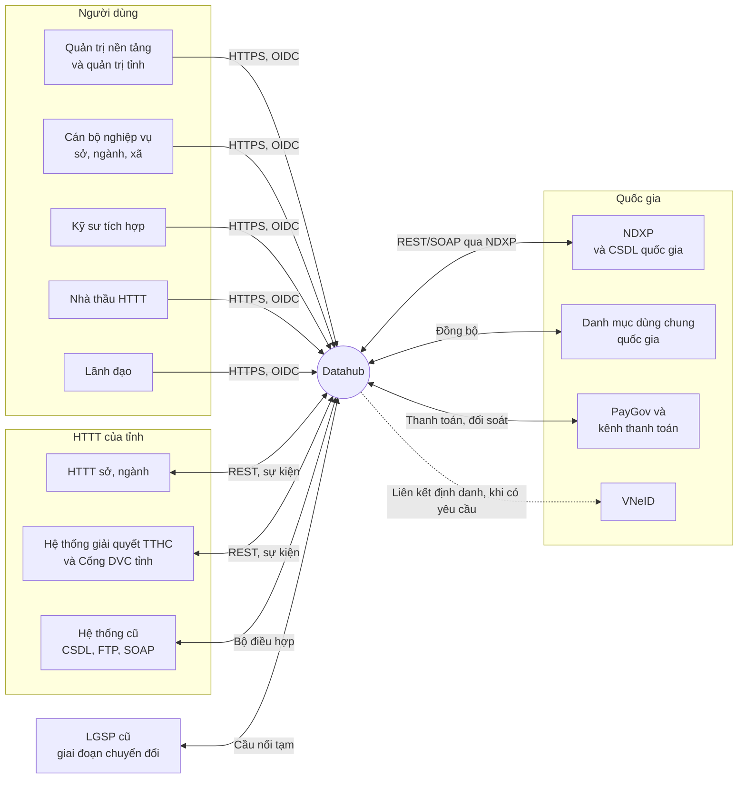
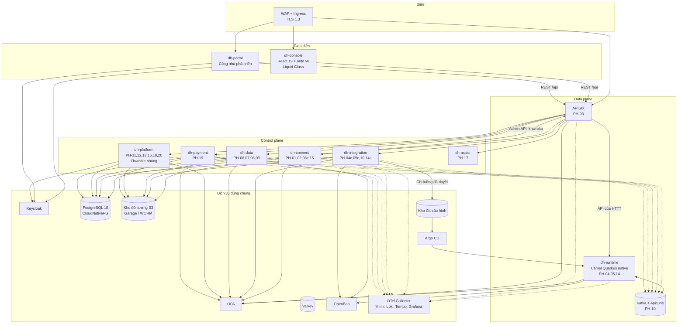

# D03-01 · Thiết kế kiến trúc tổng thể (SAD)

## 1. Mục đích và cách đọc

Tài liệu này mô tả kiến trúc tổng thể của Datahub ở mức đủ để: hội đồng thẩm định đánh giá tính hợp lý và tuân thủ của giải pháp; trưởng nhóm kỹ thuật biết mỗi phân hệ nằm ở đâu, giao tiếp với ai, dùng công nghệ gì; và đội vận hành hình dung được những gì sẽ chạy trên hạ tầng. Thiết kế chi tiết của từng phân hệ nằm trong SDD (D03-02), thiết kế đa tenant ở D03-10, an toàn thông tin ở D03-07, hạ tầng và DR ở D03-09.

Kiến trúc được trình bày theo mô hình C4: ngữ cảnh hệ thống (mục 3), container (mục 4 và 5), sau đó là các vấn đề xuyên suốt (mục 6 đến 11). Mọi lựa chọn công nghệ đều có ADR tương ứng tại D00-02; tài liệu này chỉ tóm lược lý do.

## 2. Nguyên tắc kiến trúc

Các nguyên tắc dưới đây là ràng buộc cho mọi thiết kế chi tiết. Khi một thiết kế phải vi phạm nguyên tắc, cần một ADR giải thích.

| Mã | Nguyên tắc | Giải thích và hệ quả |
|---|---|---|
| NT-01 | **Tách control plane và data plane** | Giao diện, CSDL quản trị và quy trình duyệt là control plane; gateway, runtime luồng và Kafka là data plane. Data plane tiếp tục phục vụ với cấu hình đã nạp khi control plane hỏng (ADR-013). |
| NT-02 | **Đa tenant từ gốc** | Mọi dữ liệu, sự kiện, tệp, nhật ký, chỉ số đều mang `tenant_id`. Cách ly được thực thi ở tầng hạ tầng (RLS, ACL, realm), không chỉ ở mã ứng dụng (ADR-003, D03-10). |
| NT-03 | **Từ chối mặc định (deny-by-default)** | Không có API, topic, luồng hay màn hình nào truy cập được nếu chưa có chính sách cho phép tường minh. |
| NT-04 | **Hợp đồng trước, mã sau** | API đặc tả bằng OpenAPI 3.1, sự kiện bằng AsyncAPI 3.0 và schema đăng ký ở Apicurio, trước khi viết mã. Thay đổi phá vỡ hợp đồng phải tăng phiên bản chính. |
| NT-05 | **Ranh giới module được kiểm tra tự động** | Mỗi phân hệ là một module Spring Modulith, sở hữu schema riêng, chỉ lộ `api` và `events` (ADR-001). |
| NT-06 | **Git là nguồn sự thật cho cấu hình chạy** | Triển khai ứng dụng và phát hành luồng tích hợp đều qua GitOps (ADR-009). Không thao tác tay trên PROD. |
| NT-07 | **Không bí mật ngoài kho bí mật** | CSDL chỉ lưu tham chiếu tới bí mật; khóa ký không rời kho (ADR-012). |
| NT-08 | **Quan sát được theo mặc định** | Mọi thành phần phát trace, metric, log có `trace_id` và `tenant_id` (ADR-011). |
| NT-09 | **Chuẩn mở, không khóa nhà cung cấp** | Chỉ dùng thành phần mã nguồn mở có giấy phép phù hợp hoặc giao thức chuẩn (S3, OIDC, OpenAPI), để chạy được cả on-prem lẫn cloud chính phủ (Q6). |
| NT-10 | **Dữ liệu cá nhân được bảo vệ ngay từ thiết kế** | Phân loại dữ liệu ở mức trường; che dữ liệu nhạy cảm trong log và giao diện; khai thác gắn với mục đích (PH-09). |

## 3. Ngữ cảnh hệ thống (C4 mức 1)

Sơ đồ dưới đây cho thấy Datahub và các tác nhân bên ngoài. Mỗi mũi tên là một loại tương tác; giao thức chi tiết ở mục 7.

Hệ cũ xuất hiện như một hệ thống bên ngoài trong giai đoạn chuyển đổi: Datahub đọc dữ liệu của nó để di trú và nối cầu tạm giữa Pulsar với Kafka, giữa gateway cũ với APISIX, theo D06-01.

## 4. Phân hệ và đơn vị triển khai

### 4.1. Danh sách phân hệ

Datahub có 20 phân hệ. Bảng dưới đây ghi nhiệm vụ, mặt (control hay data plane), đơn vị triển khai (DU) chứa phân hệ, và đợt phát hành. Đơn vị triển khai là một ảnh container có thể chứa nhiều phân hệ (ADR-001).

| PH | Tên | Nhiệm vụ chính | Mặt | DU | Đợt |
|---|---|---|---|---|---|
| PH-01 | Kết nạp HTTT | Hồ sơ HTTT thành viên, quy trình kết nạp, cấp định danh ứng dụng | Control | `dh-connect` | MVP |
| PH-02 | Danh mục dịch vụ | Đăng ký, công bố, vòng đời API; gói sử dụng; đăng ký sử dụng | Control | `dh-connect` | MVP |
| PH-03 | Cổng API | Thực thi xác thực, rate limit, quota, chặn đường dẫn, ghi nhật ký | Data (APISIX) + Control (đồng bộ cấu hình trong `dh-connect`) | `apisix`, `dh-connect` | MVP |
| PH-04 | Lõi tích hợp và trình thiết kế luồng | Thiết kế, chạy thử, duyệt, phát hành, giám sát luồng Camel | Control (`dh-integration`) + Data (`dh-runtime`) | `dh-integration`, `dh-runtime` | MVP |
| PH-05 | Bộ điều hợp | Danh mục Kamelet được duyệt, kết nối đăng ký sẵn tới nguồn | Control + Data | `dh-integration`, `dh-runtime` | MVP |
| PH-06 | Dữ liệu chủ | Công dân, tổ chức, địa chỉ: đối sánh, hợp nhất, bản ghi vàng | Control | `dh-data` | Đợt 3 |
| PH-07 | Danh mục dùng chung | Danh mục có thuộc tính động, phân cấp, phiên bản, nhập xuất, đồng bộ quốc gia | Control | `dh-data` | MVP |
| PH-08 | Chất lượng dữ liệu | Quy tắc, đo, báo cáo chất lượng | Control | `dh-data` | Đợt 3 |
| PH-09 | Quyền riêng tư | Phân loại dữ liệu, mục đích khai thác, che dữ liệu, sự đồng ý | Control | `dh-data` | Đợt 2 |
| PH-10 | Sự kiện | Dự án tích hợp, topic, schema, publisher, subscriber, sơ đồ kết nối | Control + Data (Kafka) | `dh-integration`, `kafka` | MVP |
| PH-11 | Quy trình liên thông | BPMN, việc chờ duyệt, hạn xử lý | Control | `dh-platform` | Đợt 2 |
| PH-12 | Định danh và phân quyền | Người dùng, vai trò, chính sách, MFA | Control | `keycloak`, `opa`, `dh-platform` | MVP |
| PH-13 | Giám sát và kiểm toán | Bảng điều khiển, cảnh báo, truy vết, nhật ký kiểm toán WORM | Control | `dh-platform`, bộ LGTM | MVP |
| PH-14 | Kết nối quốc gia | Adapter tới NDXP và các CSDL quốc gia, cung cấp lại cho tỉnh | Data + Control | `dh-runtime`, `dh-integration` | MVP |
| PH-15 | Cổng nhà phát triển | Tài liệu API, thử API, sandbox, tự lấy thông tin xác thực | Control | `dh-portal` (giao diện), `dh-connect` | Đợt 2 |
| PH-16 | Báo cáo chỉ tiêu | Tổng hợp KPI chuyển đổi số về chia sẻ dữ liệu | Control | `dh-platform` | Đợt 3 |
| PH-17 | Trợ lý AI | Tìm dịch vụ, gợi ý ánh xạ, giải thích sự cố | Control | `dh-assist` | Đợt 3 |
| PH-18 | Vận hành và xử lý lỗi | DLQ, xử lý lại, tham số, sao lưu, công cụ di trú | Control | `dh-platform` | MVP |
| PH-19 | Thanh toán | Nhà cung cấp, dịch vụ, giao dịch, đối soát, hoàn tiền | Control + Data | `dh-payment` | Đợt 2 |
| PH-20 | Quản trị tenant | Khởi tạo tỉnh, cấu hình, hạn mức, sáp nhập | Control | `dh-platform` | MVP |

### 4.2. Lý do gom phân hệ thành đơn vị triển khai

Việc gom phân hệ theo năm tiêu chí: cùng miền nghiệp vụ; cùng hồ sơ tải; cùng yêu cầu bảo mật; tần suất thay đổi tương đồng; và số đơn vị vận hành phải phù hợp với đội vận hành của TTDL tỉnh (thường 3–5 người). Kết quả là sáu DU Spring Boot, một DU Camel Quarkus và các thành phần bên thứ ba.

- `dh-payment` được tách riêng dù chỉ có một phân hệ, vì nó có yêu cầu bảo mật cao hơn (khóa ký callback, dữ liệu giao dịch tài chính), cao điểm tải khác (cuối tháng, đầu năm học) và cần mạng ra ngoài tới kênh thanh toán.
- `dh-assist` được tách vì dùng thư viện AI và có thể gọi mô hình ngôn ngữ bên ngoài; tách ra để dễ tắt hoàn toàn ở tỉnh không chấp nhận.
- `dh-runtime` (Camel Quarkus) là data plane, scale theo lưu lượng và độ trễ tiêu thụ Kafka, độc lập với control plane.

Điều kiện tách một phân hệ khỏi DU hiện tại: phân hệ cần scale khác biệt hơn 3 lần so với phần còn lại của DU trong ba tháng liên tiếp, hoặc có yêu cầu cách ly bảo mật mới. Việc tách không đổi hợp đồng API vì các phân hệ đã chỉ giao tiếp qua `api` và sự kiện.

## 5. Kiến trúc container (C4 mức 2)

Sơ đồ dưới đây cho thấy các container chính và luồng giao tiếp giữa chúng. Đường liền là đồng bộ, đường đứt là bất đồng bộ qua Kafka.

Một số điểm cần giải thích cho sơ đồ:

- **Mọi lượt gọi từ giao diện tới backend đều qua APISIX**, kể cả giao diện quản trị. Nhờ đó chính sách xác thực, rate limit và nhật ký áp dụng thống nhất. Giao diện chỉ gọi đường dẫn `/api/{nhóm}/v{n}/...` theo D00-01 §6.
- **Đường đi của một lượt gọi API giữa hai HTTT** là: HTTT gọi APISIX → APISIX xác thực, kiểm tra đăng ký, rate limit, hỏi OPA → chuyển tới backend của dịch vụ (hệ của sở khác, hoặc một luồng trong `dh-runtime` nếu cần chuyển đổi, hoặc adapter quốc gia ở PH-14). Control plane không nằm trên đường đi này.
- **Phát hành luồng** đi theo chiều: trình thiết kế (giao diện) → `dh-integration` lưu bản nháp và quy trình duyệt → khi duyệt xong ghi YAML vào kho Git cấu hình → Argo CD đồng bộ xuống `dh-runtime`. Không có kênh nào cho giao diện ra lệnh trực tiếp tới runtime.
- **Sự kiện nghiệp vụ** giữa các DU (ví dụ PH-07 phát hành danh mục mới, PH-19 có giao dịch thành công) đi qua Kafka theo mẫu outbox: ghi sự kiện vào bảng outbox trong cùng giao dịch CSDL, một tiến trình chuyển sang Kafka.

## 6. Ngăn xếp công nghệ

Bảng dưới đây chốt công nghệ theo tầng. Số phiên bản cụ thể được ghim trong D04-02 và rà soát theo chính sách vòng đời phiên bản; ở đây chỉ ghi dòng phiên bản chính.

| Tầng | Công nghệ | Dòng phiên bản | ADR |
|---|---|---|---|
| Giao diện | React, TypeScript, Ant Design, Vite, TanStack Query, React Router, XYFlow | React 19, antd 6, TS 5 | ADR-020 |
| Design system | `@datahub/ui`: token OKLCH, vật liệu Liquid Glass, Storybook | — | ADR-020, ADR-021 |
| Biên | Ingress NGINX hoặc Envoy Gateway, WAF ModSecurity/Coraza với bộ luật OWASP CRS | — | ADR-03x |
| Cổng API | Apache APISIX | 3.x | ADR-005 |
| Backend chung | Java, Spring Boot, Spring Modulith, Spring Security, Spring Data JPA, Liquibase | Java 21, Boot 4 | ADR-001 |
| Tích hợp | Apache Camel Quarkus (native), Camel YAML DSL, Kamelet, JQ | Camel 4 | ADR-002, ADR-010 |
| Quy trình | Flowable (nhúng) | 7.x | ADR-007 |
| Sự kiện | Apache Kafka (Strimzi, KRaft), Apicurio Registry, Debezium | Kafka 4 | ADR-004 |
| CSDL | PostgreSQL (CloudNativePG), pgvector cho PH-17 | 18 | ADR-003 |
| Kho đối tượng | Garage; SeaweedFS hoặc Ceph RGW cho WORM | — | ADR-008 |
| Bộ nhớ đệm | Valkey | 8 | — |
| Định danh, ủy quyền | Keycloak, OPA | Keycloak 26 | ADR-006 |
| Bí mật | OpenBao hoặc Vault, External Secrets Operator | — | ADR-012 |
| Mạng nội bộ | Cilium, Istio ambient mesh (mTLS) | — | ADR-013 |
| Triển khai | Kubernetes, Argo CD, Kustomize, Helm (chỉ cho thành phần bên thứ ba), Harbor | K8s ≥ 1.31 | ADR-009 |
| Quan sát | OpenTelemetry, Prometheus/Mimir, Loki, Tempo, Grafana | — | ADR-011 |
| Tìm kiếm (tùy chọn) | OpenSearch cho tìm kiếm toàn văn danh mục dịch vụ và văn bản | 2.x | Quyết định ở SDD PH-02 |

**Đề xuất công nghệ cho phân hệ đặc thù.** Chủ đầu tư cho phép đề xuất công nghệ khác cho phân hệ đặc thù. Bảng dưới đây nêu các trường hợp và phương án đề xuất; quyết định cuối cùng được ghi ADR khi viết SDD phân hệ.

| Phân hệ | Nhu cầu đặc thù | Đề xuất | Phương án thay thế |
|---|---|---|---|
| PH-04, 05, 14 | Runtime tích hợp nhẹ, scale nhanh | Camel Quarkus native (đã chốt, Q9) | — |
| PH-13 | Lưu và truy vấn khối lượng lớn sự kiện truy cập để báo cáo | ClickHouse cho bảng thống kê lưu lượng API | PostgreSQL + TimescaleDB nếu lưu lượng < 50 triệu lượt/tháng |
| PH-02, PH-15 | Tìm kiếm toàn văn tiếng Việt | OpenSearch với bộ phân tích tiếng Việt | PostgreSQL full-text + `unaccent` cho quy mô nhỏ |
| PH-06 | Đối sánh bản ghi (fuzzy matching) | Thư viện Splink hoặc Zingg chạy theo lô | Thuật toán so khớp trong PostgreSQL (`pg_trgm`) |
| PH-17 | Tìm kiếm ngữ nghĩa, mô hình ngôn ngữ | Spring AI + pgvector; mô hình triển khai nội bộ | Gọi mô hình bên ngoài nếu chính sách tỉnh cho phép |

## 7. Giao tiếp và tích hợp

### 7.1. Các kiểu giao tiếp

| Kiểu | Dùng khi | Chuẩn | Ví dụ |
|---|---|---|---|
| REST đồng bộ | Truy vấn, lệnh cần kết quả ngay | OpenAPI 3.1, JSON, lỗi theo RFC 9457 | Tra danh mục, tạo yêu cầu thanh toán |
| Sự kiện bất đồng bộ | Thông báo thay đổi, giảm phụ thuộc | Kafka, CloudEvents 1.0, AsyncAPI 3.0 | `t68.rdm.category.published.v1` |
| Webhook đẩy | HTTT nhận sự kiện không tự kéo được | HTTPS, chữ ký HMAC-SHA256 trong header, chống phát lại bằng dấu thời gian và mã sự kiện | Kết quả thanh toán, thay đổi danh mục |
| SOAP | Hệ cũ hoặc dịch vụ quốc gia chỉ hỗ trợ SOAP | WSDL qua bộ điều hợp PH-05/PH-14 | Một số dịch vụ NDXP |
| Tệp | Trao đổi lô lớn, đối soát | SFTP hoặc S3, có kiểm tra toàn vẹn | Tệp đối soát PayGov |

### 7.2. Quy ước chung cho API

Mọi API REST của Datahub tuân theo các quy ước sau. Đặc tả đầy đủ ở D03-04.

- Đường dẫn `/api/{nhóm}/v{n}/{tài-nguyên}`; phiên bản chính trong đường dẫn.
- Tenant xác định từ token, không truyền qua tham số. API quản trị nền tảng liên tenant nằm ở nhóm `/api/platform/` và yêu cầu vai trò riêng.
- Phân trang dạng con trỏ cho danh sách lớn, dạng trang cho màn quản trị; giới hạn tối đa 200 bản ghi mỗi trang.
- Lệnh thay đổi trạng thái dùng `POST /{tài-nguyên}/{id}:{hành-động}` (ví dụ `:publish`, `:suspend`) để tách khỏi cập nhật thuộc tính.
- Mọi lệnh tạo nhận header `Idempotency-Key`; lệnh sửa dùng `If-Match` với ETag từ cột `version` để chống ghi đè.
- Lỗi trả về theo RFC 9457 (`application/problem+json`) với mã lỗi `ERR-{PH}-{nnn}`.
- Header `traceparent` được truyền xuyên suốt.

### 7.3. Mẫu tích hợp quan trọng

**Outbox giao dịch.** Mỗi DU có bảng `outbox` trong schema của phân hệ. Ghi thay đổi nghiệp vụ và sự kiện trong cùng một giao dịch; Debezium đọc WAL của bảng outbox và phát lên Kafka. Cách này bảo đảm không mất sự kiện khi DU hỏng giữa chừng.

**Saga có bù trừ** cho nghiệp vụ trải qua nhiều phân hệ (ví dụ kết nạp HTTT tạo hồ sơ ở PH-01, client ở Keycloak qua PH-12, consumer ở APISIX qua PH-03). Mỗi bước có thao tác bù trừ; trạng thái saga lưu ở phân hệ khởi tạo hoặc ở Flowable nếu có bước người duyệt.

**Đọc qua API, không đọc chéo CSDL.** Phân hệ cần dữ liệu của phân hệ khác thì gọi `api` của module đó (trong cùng DU) hoặc REST (khác DU), hoặc giữ bản sao chỉ-đọc cập nhật qua sự kiện.

## 8. Kiến trúc dữ liệu

### 8.1. Sở hữu dữ liệu

Mỗi phân hệ sở hữu một schema PostgreSQL tên `ph{nn}_{tên}` (D00-01 §6). Bảng nghiệp vụ có các cột bắt buộc theo D00-01 §5.1 và chính sách RLS theo tenant. Thực thể dùng chung nhiều phân hệ (tenant, HTTT thành viên, người dùng, đơn vị hành chính, cơ quan) được định nghĩa một lần tại D02-07 và có một phân hệ chủ sở hữu duy nhất; phân hệ khác chỉ giữ khóa tham chiếu.

### 8.2. Phân loại dữ liệu

Mọi trường dữ liệu được gán một trong bốn mức phân loại. Mức phân loại quyết định cách lưu, cách ghi log và cách hiển thị. Chi tiết ở D02-06 và D03-07.

| Mức | Ví dụ | Lưu trữ | Log | Hiển thị |
|---|---|---|---|---|
| Công khai | Tên danh mục, mô tả API công khai | Thường | Đầy đủ | Đầy đủ |
| Nội bộ | Cấu hình luồng, số liệu lưu lượng | Thường | Đầy đủ | Theo quyền |
| Hạn chế | Thông tin đầu mối, dữ liệu giao dịch | Mã hóa ở tầng đĩa | Che một phần | Theo quyền, che một phần |
| Nhạy cảm | Số định danh cá nhân, dữ liệu sức khỏe, thông tin tài khoản | Mã hóa ở tầng ứng dụng (envelope encryption qua OpenBao transit) | Không ghi giá trị | Che mặc định, xem đầy đủ phải nêu lý do và ghi kiểm toán |

### 8.3. Dữ liệu đi qua và dữ liệu lưu lại

Datahub phân biệt rõ hai loại dữ liệu. **Dữ liệu đi qua** là nội dung bản tin giữa các HTTT; mặc định không lưu, chỉ lưu siêu dữ liệu (ai gọi, gọi gì, khi nào, kết quả, kích thước). Nội dung chỉ được lưu tạm trong hàng đợi lỗi để xử lý lại, có thời hạn tối đa 7 ngày và được mã hóa. **Dữ liệu lưu lại** là dữ liệu mà Datahub làm chủ: danh mục, dữ liệu chủ, giao dịch thanh toán, cấu hình. Cách phân biệt này giới hạn phạm vi trách nhiệm của Datahub với dữ liệu cá nhân.

## 9. An toàn thông tin (tóm lược)

Thiết kế an toàn thông tin đầy đủ nằm ở D03-07 và hồ sơ đề xuất cấp độ ở D03-08. Ở mức kiến trúc, các lớp bảo vệ như sau:

1. **Biên:** WAF với OWASP CRS, TLS 1.3, chống DDoS ở tầng hạ tầng, chỉ mở cổng 443.
2. **Định danh:** OIDC qua Keycloak, MFA bắt buộc cho vai trò quản trị, token ngắn hạn (5 phút cho máy, 15 phút cho người, có làm mới); mTLS cho HTTT kết nối dữ liệu nhạy cảm.
3. **Ủy quyền:** OPA tại gateway và tại từng DU, chính sách theo vai trò, tenant, phân loại dữ liệu và mục đích.
4. **Mạng nội bộ:** zero-trust với Istio ambient (mTLS giữa mọi dịch vụ) và network policy Cilium từ chối mặc định.
5. **Dữ liệu:** mã hóa khi lưu, mã hóa trường nhạy cảm, bí mật trong OpenBao.
6. **Chuỗi cung ứng:** ảnh container ký bằng cosign, SBOM, quét Trivy chặn lỗ hổng CRITICAL, chỉ dùng ảnh từ Harbor nội bộ.
7. **Kiểm toán:** nhật ký kiểm toán chỉ-thêm, có chuỗi băm liên kết, sao vào kho WORM; lưu tối thiểu theo yêu cầu cấp độ.

**Sẵn sàng nâng lên cấp độ 4.** Kiến trúc chừa sẵn các điểm nâng cấp: cách ly vật lý CSDL theo tenant (ADR-003, phương án D), HSM cho khóa ký thay cho engine transit phần mềm, hai trung tâm dữ liệu hoạt động song song, và tách mạng quản trị riêng. D03-07 nêu danh sách cụ thể.

## 10. Triển khai (tóm lược)

Datahub đóng gói thành bộ manifest Kustomize và chart Helm cho thành phần bên thứ ba, triển khai bằng Argo CD. Hai hồ sơ triển khai chính:

| Hồ sơ | Mô tả | Áp dụng |
|---|---|---|
| Tỉnh độc lập (on-prem) | Một cụm K8s tại TTDL tỉnh, một tenant hoặc vài tenant (sau sáp nhập) | Tỉnh tự vận hành |
| Nền tảng dùng chung (cloud chính phủ) | Một cụm lớn phục vụ nhiều tỉnh, tenant cách ly theo ADR-003 | Nhà cung cấp vận hành tập trung |

Quy mô tài nguyên tối thiểu, sơ đồ mạng, phương án DR (RPO ≤ 15 phút, RTO ≤ 1 giờ cho data plane) nằm ở D03-09.

## 11. Đáp ứng yêu cầu phi chức năng

Bảng dưới đây cho thấy kiến trúc đáp ứng các mục tiêu phi chức năng ở BRD bằng chiến thuật nào. Chỉ tiêu đo được ở D02-02.

| Mục tiêu | Chiến thuật kiến trúc |
|---|---|
| Sẵn sàng 99,9% data plane (KPI-03) | Tách control/data plane; APISIX và `dh-runtime` tối thiểu 3 bản sao trải nhiều nút; Kafka 3 broker, hệ số nhân bản 3; PostgreSQL một primary hai standby đồng bộ; cập nhật cuốn chiếu không gián đoạn |
| Độ trễ thêm ≤ 50 ms tại gateway (KPI-04) | APISIX cấu hình nạp sẵn trong bộ nhớ; quyết định OPA chạy cục bộ, có bộ đệm; không gọi control plane trên đường đi |
| Khởi tạo tenant ≤ 1 ngày (KPI-12) | PH-20 tự động hóa: tạo bản ghi tenant, realm Keycloak, tiền tố Kafka, bucket, cấu hình mặc định, danh mục nền |
| MTTD ≤ 5 phút (KPI-15) | Cảnh báo theo SLO trên Mimir; kiểm tra tổng hợp (synthetic probe) mỗi phút cho từng API quan trọng |
| Mở rộng theo tải | HPA theo CPU cho DU; KEDA theo độ trễ tiêu thụ Kafka cho `dh-runtime`; phân vùng topic theo tenant |
| Bảo trì, nâng cấp | Modulith kiểm tra ranh giới; hợp đồng có phiên bản; chính sách vòng đời phiên bản |
| Chạy on-prem và cloud | Chỉ dùng chuẩn mở (NT-09); không dùng dịch vụ đặc thù của một nhà cung cấp cloud |

## 12. Rủi ro kiến trúc

| Mã | Rủi ro | Ảnh hưởng | Biện pháp |
|---|---|---|---|
| RSK-A01 | Đội vận hành TTDL tỉnh chưa quen Kubernetes, Kafka | Sự cố kéo dài | Hồ sơ triển khai tối giản; tài liệu vận hành chi tiết (D06-03); đào tạo; phương án nền tảng dùng chung |
| RSK-A02 | Biên dịch native Camel Quarkus không hỗ trợ một số component cần cho hệ cũ | Không di trú được một số luồng | Nhóm `dh-runtime` chế độ JVM cho component không hỗ trợ native |
| RSK-A03 | RLS bị vô hiệu do cấu hình sai vai trò kết nối | Lộ dữ liệu chéo tỉnh | Kiểm thử rò rỉ chéo tenant bắt buộc trong CI; kiểm tra cấu hình vai trò tự động khi khởi động DU |
| RSK-A04 | Đặc tả NDXP, PayGov thay đổi | Phải sửa adapter | Cô lập trong adapter của PH-14 và PH-19; kiểm thử hợp đồng định kỳ với môi trường thử |
| RSK-A05 | Hiệu ứng Liquid Glass làm chậm giao diện trên máy cấu hình thấp | Trải nghiệm kém | Giới hạn số lớp `backdrop-filter`, tự chuyển nền đặc khi máy yếu (D03-05) |
