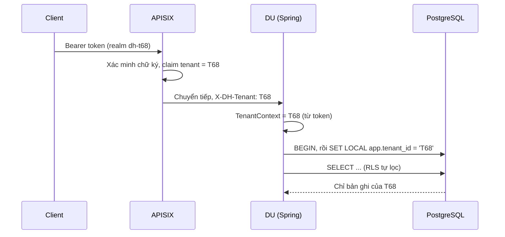
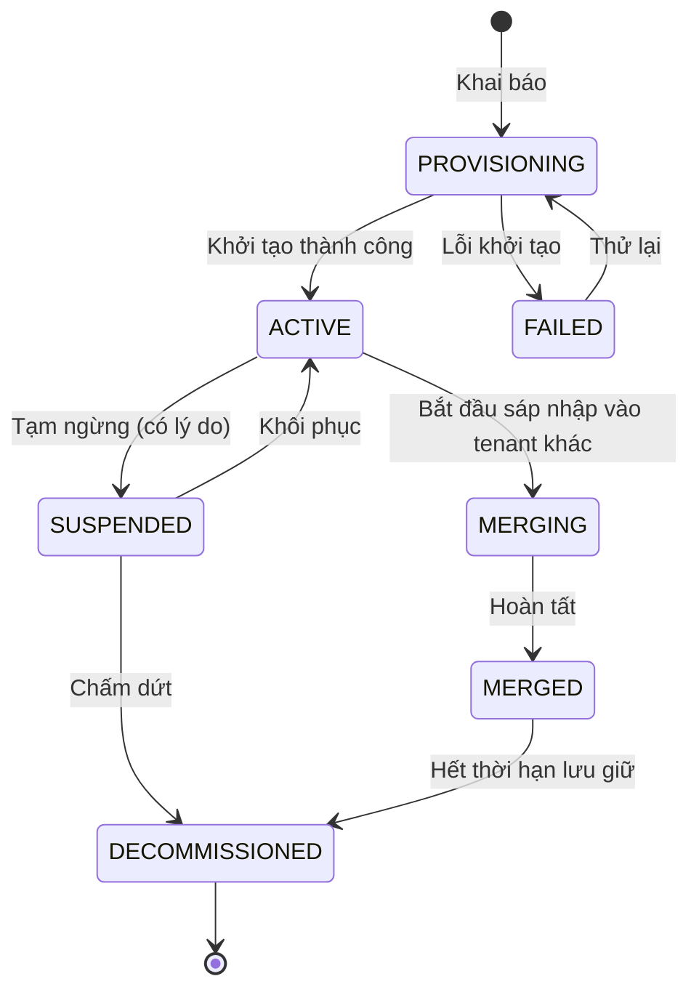

# D03-10 · Thiết kế đa tenant

## 1. Mục đích

Datahub là sản phẩm phục vụ nhiều tỉnh trên cùng một nền tảng (quyết định Q2). Tài liệu này đặc tả **tenant là gì, dữ liệu của mỗi tenant được cách ly ra sao ở từng tầng, tenant được khởi tạo, cấu hình, tạm ngừng, sáp nhập như thế nào**. Đây là ràng buộc chung cho mọi phân hệ; FRS và SDD từng phân hệ phải tuân thủ và không mô tả lại.

## 2. Khái niệm

**Tenant** là một đơn vị khách hàng độc lập về dữ liệu và quản trị, tương ứng với **một tỉnh hoặc thành phố trực thuộc trung ương**. Mã tenant theo kiểu T-TENANT (D00-01 §5), ví dụ `T68`. Mọi đơn vị bên trong tỉnh (sở, ngành, xã) là **tổ chức** trong tenant, không phải tenant riêng.

Ngoài các tenant tỉnh có một tenant đặc biệt **`PLATFORM`** dành cho quản trị nền tảng. Tenant này không chứa dữ liệu nghiệp vụ của tỉnh nào; người dùng của nó chỉ truy cập dữ liệu tỉnh qua cơ chế liên tenant có lý do và kiểm toán (FR-00-012).

Mỗi tenant có một **chế độ cách ly**:

| Chế độ | Mô tả | Khi dùng |
|---|---|---|
| `SHARED` (mặc định) | Dùng chung cụm CSDL, Kafka, kho đối tượng với tenant khác; cách ly logic bằng RLS, ACL, tiền tố | Đa số tỉnh trên nền tảng dùng chung |
| `DEDICATED_DB` | Cụm PostgreSQL riêng; các tầng khác dùng chung | Tỉnh có yêu cầu riêng về CSDL hoặc chuẩn bị lên cấp độ 4 |
| `DEDICATED_CLUSTER` | Một cụm Kubernetes riêng, toàn bộ thành phần riêng | Tỉnh tự vận hành on-prem; cấp độ 4 |

Ở chế độ `DEDICATED_CLUSTER`, phần mềm vẫn chạy ở chế độ đa tenant (thường chỉ có một hoặc vài tenant), nhờ đó chỉ có một bộ mã cho mọi hồ sơ triển khai (RB-07).

## 3. Xác định tenant trong mỗi yêu cầu

Nguồn sự thật duy nhất về tenant của một yêu cầu là **token đã xác thực**. Cụ thể:

1. Mỗi tenant có một realm Keycloak tên `dh-{mã tenant viết thường}` (ví dụ `dh-t68`). Token do realm phát hành mang claim `tenant` bằng mã tenant.
2. APISIX xác minh token bằng khóa công khai của realm tương ứng, đối chiếu claim `tenant` với realm phát hành, rồi chuyển tiếp header nội bộ `X-DH-Tenant` (header này bị xóa nếu client tự gửi).
3. Ở mỗi DU, bộ lọc Spring Security đọc tenant từ token (không tin header khi gọi từ ngoài mesh), đặt vào `TenantContext` và vào biến phiên PostgreSQL `app.tenant_id` ở đầu mỗi giao dịch.
4. Sự kiện Kafka mang tenant trong header CloudEvents `dhtenant` và trong tên topic; consumer kiểm tra hai giá trị khớp nhau, không khớp thì chuyển vào DLQ và cảnh báo an ninh.
5. Tác vụ nền (lịch, xử lý lô) chạy lặp theo từng tenant, đặt `TenantContext` tường minh; không có tác vụ nào chạy "không tenant" trừ tác vụ của tenant `PLATFORM`.



## 4. Cách ly theo từng tầng

Bảng dưới đây là phần cốt lõi của tài liệu: với mỗi tầng, cơ chế cách ly ở chế độ `SHARED` và cách kiểm chứng. Mọi cơ chế đều được thực thi ở tầng hạ tầng chứ không chỉ dựa vào mã ứng dụng.

| Tầng | Cơ chế cách ly | Kiểm chứng |
|---|---|---|
| CSDL PostgreSQL | Cột `tenant_id` trên mọi bảng nghiệp vụ; RLS bật và `FORCE ROW LEVEL SECURITY`; vai trò kết nối của ứng dụng không có `BYPASSRLS` và không là chủ sở hữu bảng | DU tự kiểm tra khi khởi động: từ chối chạy nếu vai trò có `BYPASSRLS` hoặc bảng nào thiếu chính sách. Kiểm thử rò rỉ chéo tenant |
| Bộ nhớ đệm Valkey | Khóa có tiền tố `{tenant}:`; ACL người dùng Valkey theo mẫu khóa với dữ liệu nhạy cảm | Kiểm thử đơn vị lớp bộ nhớ đệm |
| Kafka | Topic tiền tố mã tenant viết thường (`t68.`); ACL theo tiền tố cho principal của từng HTTT; quota sản xuất, tiêu thụ theo tenant | Kiểm thử ACL tự động khi khởi tạo tenant |
| Schema registry | Nhóm (group) Apicurio theo tenant cho schema riêng; schema dùng chung ở nhóm `common` chỉ-đọc | |
| Kho đối tượng | Bucket `dh-{tenant}-{mục đích}`; khóa truy cập theo tenant; mã hóa phía máy chủ | |
| Keycloak | Realm riêng mỗi tenant; quản trị tỉnh chỉ quản trị realm của mình | |
| OPA | Mọi chính sách có điều kiện `input.tenant == data.resource.tenant` | Kiểm thử chính sách Rego |
| APISIX | Route, consumer, plugin config gắn nhãn tenant; host hoặc tiền tố đường dẫn theo tenant cho API công bố | |
| Runtime luồng | Luồng thuộc một tenant; triển khai trong namespace `dh-rt-{tenant}` khi tenant có trên 50 luồng hoặc yêu cầu, còn lại dùng namespace chung với nhãn tenant | |
| Kho bí mật | Đường dẫn `kv/dh/{tenant}/...`; chính sách OpenBao theo tenant | |
| Quan sát | Nhãn `tenant` bắt buộc trên metric, log, trace; Grafana tách tổ chức (organization) theo tenant cho quản trị tỉnh | Quản trị tỉnh chỉ thấy dữ liệu tỉnh mình trên Grafana |
| Nhật ký kiểm toán | Cột `tenant_id`, RLS như CSDL; kho WORM tách tiền tố theo tenant | |

**Chính sách RLS mẫu.** Mọi bảng nghiệp vụ dùng cùng mẫu dưới đây. Migration Liquibase của mỗi phân hệ phải có changeset tạo chính sách ngay sau khi tạo bảng; công cụ lint migration chặn bảng không có chính sách.

```sql
ALTER TABLE ph07_rdm.category ENABLE ROW LEVEL SECURITY;
ALTER TABLE ph07_rdm.category FORCE ROW LEVEL SECURITY;

CREATE POLICY tenant_isolation ON ph07_rdm.category
  USING (tenant_id = current_setting('app.tenant_id', false))
  WITH CHECK (tenant_id = current_setting('app.tenant_id', false));
```

Tham số `false` ở `current_setting` làm truy vấn **lỗi** (thay vì trả rỗng) khi quên đặt biến phiên, giúp phát hiện sớm lỗi lập trình.

**Dữ liệu dùng chung giữa các tenant.** Một số dữ liệu là chung cho cả nước: danh mục quốc gia, danh mục đơn vị hành chính, định nghĩa Kamelet được duyệt. Dữ liệu này lưu với `tenant_id = 'COMMON'` và chính sách RLS cho phép đọc `tenant_id IN (current_setting('app.tenant_id'), 'COMMON')`; chỉ tenant `PLATFORM` được ghi.

## 5. Vòng đời tenant

### 5.1. Máy trạng thái



| Trạng thái | Ý nghĩa | Data plane | Giao diện |
|---|---|---|---|
| `PROVISIONING` | Đang khởi tạo tài nguyên | Không phục vụ | Chỉ quản trị nền tảng thấy |
| `ACTIVE` | Hoạt động | Phục vụ | Đầy đủ |
| `SUSPENDED` | Tạm ngừng do quyết định quản lý hoặc sự cố an ninh | Từ chối với `ERR-20-001`, trừ API được đánh dấu thiết yếu nếu quyết định tạm ngừng cho phép | Chỉ-đọc cho quản trị tỉnh |
| `MERGING` | Đang chuyển dữ liệu sang tenant đích | Phục vụ, có cầu nối chuyển tiếp | Cảnh báo trên thanh trên |
| `MERGED` | Đã sáp nhập; mọi yêu cầu được định tuyến sang tenant đích trong thời gian chuyển tiếp | Chuyển tiếp | Chỉ-đọc, phục vụ tra cứu lịch sử |
| `DECOMMISSIONED` | Đã chấm dứt; dữ liệu đã được xuất bàn giao và xóa theo chính sách | Không | Không |

### 5.2. Khởi tạo tenant

Khởi tạo tenant là một saga do PH-20 điều phối. Mỗi bước idempotent và có thao tác bù trừ; nếu một bước lỗi, saga dừng ở `FAILED` và cho phép thử lại từ bước lỗi.

| Bước | Hành động | Bù trừ |
|---|---|---|
| 1 | Ghi bản ghi tenant, cấu hình mặc định, hạn mức | Xóa bản ghi |
| 2 | Tạo realm Keycloak từ mẫu, client của `dh-console`, `dh-portal`, vai trò chuẩn (D02-08), tài khoản quản trị tỉnh đầu tiên với yêu cầu đổi mật khẩu và đăng ký MFA | Xóa realm |
| 3 | Tạo đường dẫn và chính sách trong OpenBao | Xóa |
| 4 | Tạo bucket kho đối tượng | Xóa bucket rỗng |
| 5 | Tạo ACL và quota Kafka theo tiền tố; nhóm Apicurio | Xóa |
| 6 | Với `DEDICATED_DB`: tạo cụm CloudNativePG từ mẫu, chạy migration; ghi chuỗi kết nối tham chiếu vào bảng định tuyến | Xóa cụm |
| 7 | Tạo tổ chức Grafana, nguồn dữ liệu lọc theo tenant | Xóa |
| 8 | Nạp dữ liệu nền: tổ chức cấp tỉnh, đơn vị hành chính thuộc tỉnh (từ danh mục `COMMON`), danh mục bắt buộc | Xóa |
| 9 | Chạy kiểm tra khói: đăng nhập tài khoản quản trị, gọi API mẫu, phát và nhận một sự kiện mẫu | — |
| 10 | Chuyển `ACTIVE`, gửi thông báo cho đầu mối | — |

Mục tiêu thời gian của saga ở chế độ `SHARED` là ≤ 1 giờ (NFR-00-057).

### 5.3. Hạn mức theo tenant

Hạn mức bảo vệ các tenant khỏi ảnh hưởng lẫn nhau trên nền tảng dùng chung (vấn đề "hàng xóm ồn ào"). Giá trị mặc định dưới đây được điều chỉnh theo hợp đồng của từng tỉnh.

| Hạn mức | Mặc định | Thực thi tại |
|---|---|---|
| Lượt gọi API tối đa mỗi giây cho toàn tenant | 500 | APISIX (`limit-count` theo nhãn tenant) |
| Số luồng đang hoạt động | 1.000 | PH-04 khi phát hành |
| Thông lượng Kafka sản xuất / tiêu thụ | 10 MB/s / 20 MB/s | Quota Kafka |
| Dung lượng kho đối tượng | 500 GB | Kiểm tra khi tải lên; cảnh báo ở 80% |
| Dung lượng CSDL | 200 GB | Giám sát, cảnh báo ở 80% |
| Số người dùng | 2.000 | PH-12 |

### 5.4. Sáp nhập tenant

Sáp nhập đáp ứng thực tế sắp xếp đơn vị hành chính cấp tỉnh. Khi tỉnh A và tỉnh B hợp thành tỉnh C (hoặc A sáp nhập vào B), quy trình như sau:

1. **Chuẩn bị.** Tạo tenant đích (hoặc dùng tenant hiện có). Lập bảng ánh xạ: tổ chức, HTTT thành viên, mã danh mục địa phương trùng nhau.
2. **Chuyển dữ liệu.** PH-18 chạy công cụ chuyển dữ liệu theo từng phân hệ: sao chép bản ghi sang tenant đích với `tenant_id` mới, giữ `id` gốc (UUID v7 không trùng), ghi trường `origin_tenant_id` để truy vết. Danh mục địa phương trùng mã được đánh dấu xung đột để cán bộ nghiệp vụ xử lý.
3. **Chuyển định danh.** Người dùng được tạo lại ở realm đích, giữ liên kết LDAP nếu có; thông tin xác thực ứng dụng của HTTT được cấp mới, cấp song song có thời hạn để HTTT chuyển dần.
4. **Chuyển tiếp.** Tenant nguồn sang `MERGED`; APISIX định tuyến lời gọi tới API của tenant nguồn sang API tương ứng của tenant đích trong thời gian chuyển tiếp (mặc định 6 tháng), kèm header cảnh báo `Deprecation`.
5. **Kết thúc.** Hết thời gian chuyển tiếp, tenant nguồn chuyển `DECOMMISSIONED`; dữ liệu và nhật ký kiểm toán của tenant nguồn được lưu trữ theo thời hạn quy định.

Danh mục đơn vị hành chính (`COMMON`) lưu lịch sử hiệu lực: mỗi đơn vị có khoảng thời gian hiệu lực và liên kết tới đơn vị kế thừa, nhờ đó dữ liệu cũ vẫn tra được theo tên đơn vị tại thời điểm phát sinh.

## 6. Quy tắc cho người phát triển

Các quy tắc sau được kiểm tra tự động trong CI hoặc bằng kiểm thử bắt buộc. Coding convention (D04-01) nhắc lại chúng.

1. Không đọc tenant từ tham số đường dẫn, query hay thân yêu cầu.
2. Không dùng `@Query` native vượt qua RLS; không tạo kết nối CSDL ngoài `DataSource` được quản lý.
3. Mọi bảng mới phải có `tenant_id NOT NULL` và chính sách RLS trong cùng changeset.
4. Mọi khóa bộ nhớ đệm, tên topic, khóa đối tượng phải dùng hàm tạo tên có tenant của thư viện dùng chung, không ghép chuỗi tay.
5. Mọi tác vụ nền phải được bọc trong `TenantContext.runAs(tenant, …)`.
6. Mỗi API mới phải có ít nhất một ca kiểm thử rò rỉ chéo tenant: tạo dữ liệu ở tenant A, truy cập bằng token tenant B, kỳ vọng `404` (không phải `403`, để không lộ sự tồn tại).

## 7. Truy vết

| Yêu cầu | Đáp ứng tại |
|---|---|
| REQ-20, BO-06, KPI-12 | Mục 5.2 |
| FR-00-010, FR-00-011, FR-00-012 | Mục 3, 4, 6 |
| NFR-00-057, NFR-00-060 | Mục 5.2, 5.3 |
| ADR-003 | Mục 2, 4 |
