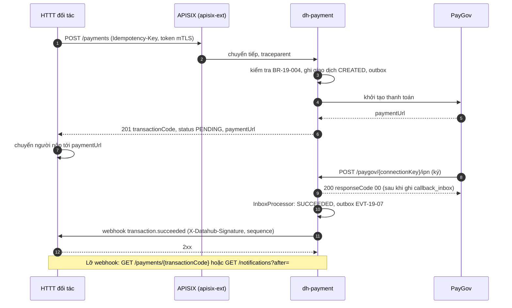

# D03-04-PH19 · Đặc tả API và sự kiện phân hệ PH-19 Thanh toán điện tử

## Tóm tắt cho hội đồng thẩm định

PH-19 có bốn loại giao diện lập trình, cho bốn đối tượng gọi khác nhau:

1. **API quản trị** `/api/payment/v1` (API-19-001…092): cán bộ quản trị, kế toán, người duyệt, kiểm toán dùng qua giao diện Datahub. Gồm nhà cung cấp (NCC), dịch vụ, đối tác, phê duyệt bốn mắt, giao dịch, thông báo kết quả (IPN), hoàn tiền, đối soát, chênh lệch, nhật ký, webhook, dashboard, báo cáo, cấu hình, di trú.
2. **API đối tác** `/api/payment-partner/v1` (API-19-101…110): HTTT dịch vụ công, một cửa, hộ tịch… gọi để thu phí, lệ phí và tra kết quả. Đây là hợp đồng mà các đơn vị phát triển HTTT của tỉnh cần đọc đầu tiên. Kết quả được đẩy về bằng **webhook** ký HMAC, dự phòng kéo bằng API-19-109.
3. **API callback** `/api/payment-callback/v1` (API-19-201…204): PayGov gọi về; thêm API-19-205 cho trang kết quả người nộp (UI-19-28) thăm dò trạng thái. Tên trường, thuật toán ký, mã phản hồi là **giả định** chờ Tài liệu kỹ thuật kết nối do VPCP cấp (OQ-19-01…07); phần phụ thuộc PayGov nằm gọn trong adapter (ADR-040).
4. **Sự kiện Kafka** EVT-19-01…18 cho PH-13, PH-16, PH-18 và lớp dữ liệu dùng chung.

So với Payment cũ, hợp đồng mới thêm những bảo đảm mà hệ cũ không có: chống trùng bắt buộc bằng `Idempotency-Key` và chống trùng mã hồ sơ; số tiền là số nguyên đồng (không còn `int(10)`); kết quả về đối tác có chữ ký, có số thứ tự, có gửi lại và có kéo dự phòng; hoàn tiền, xử lý chênh lệch đều qua phê duyệt bốn mắt; mọi lỗi có mã `ERR-19-nnn` và câu tiếng Việt.

Tài liệu này là văn xuôi giải thích các tệp hợp đồng. Khi văn xuôi và tệp hợp đồng khác nhau, **tệp hợp đồng là nguồn sự thật**:

| Tệp | Nội dung | Quy mô |
|---|---|---|
| [`ph19/openapi-payment-admin.yaml`](ph19/openapi-payment-admin.yaml) | API quản trị (OpenAPI 3.1) | 92 operation API-19-001…092 |
| [`ph19/openapi-payment-partner.yaml`](ph19/openapi-payment-partner.yaml) | API đối tác và 8 webhook (OpenAPI 3.1, mục `webhooks`) | 10 operation API-19-101…110 |
| [`ph19/openapi-payment-callback.yaml`](ph19/openapi-payment-callback.yaml) | API callback PayGov (OpenAPI 3.1, giả định) | 5 operation API-19-201…205 |
| [`ph19/asyncapi-payment.yaml`](ph19/asyncapi-payment.yaml) | Sự kiện Kafka (AsyncAPI 3.0) | 18 kênh EVT-19-01…18 |
| [`ph19/tools/`](ph19/tools/) | `schemas.py` (lược đồ chung), `gen_openapi.py`, `gen_asyncapi.py`, `gen_md.py` (bảng §3, §4, §6), `check_contracts.py` | — |

Danh sách endpoint, quyền, FR và bảng mã lỗi được **đọc từ khung truy vết** [D02-03-PH19-00](../../02-yeu-cau/frs/D02-03-PH19-00-khung-truy-vet.md) §10, §12 khi sinh, nên không thể lệch khung. Bốn tệp YAML do script sinh, không sửa tay. Mọi tên miền, máy chủ, dữ liệu là giả lập; tenant ví dụ `T68`, topic chữ thường `t68`.

Căn cứ: FRS [D02-03-PH19](../../02-yeu-cau/frs/D02-03-PH19-frs-thanh-toan.md) §5, §8; SDD [D03-02-PH19](../sdd/D03-02-PH19-sdd-thanh-toan.md) §4…§12; CSDL [D03-03-PH19](../csdl/D03-03-PH19-csdl-thanh-toan.md); màn hình [D03-06-PH19](../uiux/D03-06-PH19-man-hinh-thanh-toan.md).

## 1. Quy ước chung

| Chủ đề | Quy ước | Trong hợp đồng |
|---|---|---|
| Đường dẫn gốc | Ba nhóm `/api/payment/v1`, `/api/payment-partner/v1`, `/api/payment-callback/v1` (D00-01 §6), mỗi nhóm một tệp OpenAPI và một tuyến APISIX riêng (`apisix-int` cho quản trị; `apisix-ext` cho đối tác ngoài mạng nội bộ và callback) | `servers` |
| Phiên bản | Số chính trong đường dẫn; trong `v1` chỉ thêm trường tùy chọn và endpoint mới; thay đổi phá vỡ sang `v2`, chạy song song ≥ 6 tháng. Đối tác phải bỏ qua trường lạ (đọc khoan dung) | `info.version` |
| Tenant | Lấy từ token (quản trị, đối tác) hoặc từ `connectionKey` (callback); không bao giờ từ tham số. Đối tượng ngoài phạm vi trả ERR-19-020 như không tồn tại | Mô tả |
| Định danh | Quản trị dùng UUID v7 trong đường dẫn. Đối tác dùng mã nghiệp vụ `transactionCode`, `refundCode`, `partnerOrderId` để HTTT không phải lưu UUID của Datahub | `parameters` |
| Đặt tên | Danh từ số nhiều, chữ thường, gạch nối; thao tác đổi trạng thái là tài nguyên con số nhiều (`/suspensions`, `/lifecycle-requests`, `/decisions`) (khung §10.1) | `paths` |
| JSON | camelCase, ánh xạ 1–1 với cột snake_case của D03-03-PH19. Số tiền là số nguyên đồng (`Money`, 1…999.999.999.999), không có số thập phân, không có chuỗi | `Money` |
| Thời gian | ISO 8601 có múi giờ, máy chủ trả UTC (`Z`); ngày đối soát `date` theo giờ Việt Nam (BR-19-025) | `format: date-time` |
| Phân trang | Con trỏ mờ `cursor`, `limit` mặc định 20, tối đa 200; trả `page.next`, `page.hasMore`, `page.total` (chính xác tới 10.000) hoặc `page.totalApprox` | `CursorMeta` |
| Chống trùng | `Idempotency-Key` 16…64 ký tự `[A-Za-z0-9_-]`: **bắt buộc** cho mọi `POST` của API đối tác (BR-19-006), khuyến nghị cho lệnh tạo của giao diện. Lưu 24 giờ (Valkey + `idempotency_record`); cùng khóa khác nội dung ERR-19-003, đang xử lý ERR-19-004; trả lại thì có tiêu đề `Idempotent-Replayed: true` | `IdempotencyKey` |
| Khóa lạc quan | `ETag: W/"{version}"`; mọi `PATCH`, `PUT`, `DELETE` và thao tác đổi trạng thái của API quản trị bắt buộc `If-Match`, lệch trả ERR-19-045 (412) | `IfMatch`, `ETag` |
| Hành động được phép | Đối tượng có vòng đời trả `allowedActions`, `disabledReasons` để giao diện bật, tắt nút đúng trạng thái và quyền (D03-06-PH19 §2) | `AllowedActions` |
| Xử lý nền | Thao tác chưa xong ngay (kiểm tra kết nối, đối soát, chốt phiên, xuất, di trú, xử lý lại IPN, gửi lại webhook) trả `202` kèm `Location` | `202` |
| Lỗi | RFC 9457 `application/problem+json`: `type` = `/problems/ERR-19-nnn`, `title` cố định, `status`, `detail` tiếng Việt không chứa dữ liệu cá nhân hay bí mật, `code`, `traceId`, `errors[]` (ERR-19-001), `missing[]` (ERR-19-035), `existingTransactionCode` (ERR-19-015) | `ProblemDetails` |
| Truy vết | `traceparent` W3C xuyên suốt tới lời gọi PayGov, outbox, webhook (`traceparent` trong CloudEvent) | `Traceparent` |
| Dữ liệu cá nhân | Đối tác gửi thông tin người nộp ở `payer`; PH-19 mã hóa ngay khi nhận (ADR-048) và **không bao giờ** trả lại qua API đối tác, sự kiện hay webhook. API quản trị trả bản che, bản đầy đủ chỉ khi `reveal=true` + quyền `transaction-read-pii` + lý do | `Payer`, `PayerMasked` |

## 2. Xác thực và phân quyền

### 2.1. Ba cách xác thực

| Nhóm | Người gọi | Xác thực | Kiểm tra ở `dh-payment` |
|---|---|---|---|
| Quản trị | Cán bộ qua `dh-console` (BFF) | OIDC Authorization Code + PKCE, realm `dh-{tenant}` | Tenant của token; quyền `PERM-19-*` qua OPA (ADR-006); tách nhiệm §2.3 |
| Đối tác | HTTT đối tác (máy) | OAuth 2.0 client credentials; xác thực client bằng mTLS (RFC 8705) hoặc `private_key_jwt`; token ≤ 5 phút, ràng buộc chứng thư (NFR-19-019) | Client thuộc đối tác `ACTIVE`, chế độ `DATAHUB` hoặc `SHADOW` (ERR-19-005, 006); dữ liệu giới hạn trong đối tác của client |
| Callback | PayGov | Không token. APISIX: allowlist IP nguồn, mTLS nếu PayGov dùng. `dh-payment`: `connectionKey` → NCC → tenant (`callback_route`), chữ ký bằng chứng thư `ACTIVE` hoặc `NEXT`, dấu thời gian ±5 phút, nonce (NFR-19-020, ADR-045) | Mã đơn vị trong nội dung đã ký phải khớp NCC (`TENANT_MISMATCH`) |

APISIX kiểm chữ ký token, hạn và giới hạn tần suất (ERR-19-048) trước; `dh-payment` kiểm lại tenant và quyền, nên cấu hình biên sai cũng không mở được dữ liệu tỉnh khác.

### 2.2. Quyền

48 quyền `PERM-19-*` định nghĩa ở khung §13.2; cột "Quyền" của §3 ghi phần sau tiền tố. Bốn quyền dùng riêng cho client đối tác: `partner-pay-create`, `partner-pay-read`, `partner-refund-create`, `partner-recon-read`. API-19-050 (quyết định đề nghị) kiểm quyền theo `approvalType`:

| `approvalType` | Quyền quyết định |
|---|---|
| `PROVIDER_ACTIVATE`, `PROVIDER_RETIRE` | `provider-activate` |
| `PARTNER_ONBOARD`, `PARTNER_TERMINATE` | `partner-approve` |
| `REFUND` | `refund-approve` |
| `DISCREPANCY_RESOLUTION` | `discrepancy-approve` |
| `RECON_REOPEN` | `recon-reopen-approve` |
| `ROUTING_MODE_CHANGE` | `migration-switch` (người quyết định khác người lập) |
| `RESULT_MAPPING_CHANGE` (đề xuất) | `provider-activate` |

### 2.3. Tách nhiệm và kiểm tra đặc biệt

- **Bốn mắt** (khung §13.4 quy tắc 1–5): API-19-050 từ chối người lập; hoàn hai cấp cần ba người khác nhau; `RECORD_MANUAL` ở API-19-062 từ chối người đã duyệt; người chốt phiên không duyệt mở lại phiên đó. Vi phạm trả ERR-19-033 và ghi sự kiện an ninh. CSDL chặn lần nữa bằng `CHECK` (D03-03-PH19 §3.39).
- **Xem dữ liệu cá nhân** (quy tắc 6): API-19-052 với `reveal=true` cần `transaction-read-pii` và tiêu đề `X-Datahub-Reveal-Reason`; mỗi lần ghi kiểm toán.
- **Xác thực lại** khi quyết định đề nghị có giá trị tiền (`REFUND`, `DISCREPANCY_RESOLUTION`): token phải có `auth_time` trong 5 phút, nếu không trả 401 với `WWW-Authenticate: Bearer error="insufficient_user_authentication", max_age=300` (RFC 9470).
- **Phân hệ chưa bật**: mọi API của tenant chưa bật PH-19 (PH-20 đặt `module_enabled`) trả ERR-19-049.

## 3. Danh mục endpoint

Bảng sinh từ `ph19/tools/gen_openapi.py` bằng `gen_md.py`. Cột "FR" ghi số FR-19 bỏ tiền tố; "Khóa" ghi `If-Match`, `Idem` (khuyến nghị), `Idem bắt buộc`. Mọi operation quản trị, đối tác có thể trả 401 (PH-12, PH-03), ERR-19-046, 048, 049, 099; lệnh ghi có thể trả ERR-19-050. Các mã này có trong hợp đồng, không nhắc lại ở bảng.

<!-- gen:endpoints:start -->
#### API quản trị `/api/payment/v1`


**Nhà cung cấp**

| Mã | Phương thức, đường dẫn | Nội dung | FR | Quyền `PERM-19-` | Khóa | Thành công |
|---|---|---|---|---|---|---|
| API-19-001 | `GET /providers` | Danh sách NCC, lọc trạng thái, sức khỏe, từ khóa | 007 | provider-read |  | 200 |
| API-19-002 | `POST /providers` | Khai báo NCC (`DRAFT`) | 001 | provider-write | Idem | 201 |
| API-19-003 | `GET /providers/{providerId}` | Chi tiết NCC kèm sức khỏe, mạch ngắt, hạn chứng thư, số dịch vụ | 008, 011 | provider-read |  | 200 |
| API-19-004 | `PATCH /providers/{providerId}` | Sửa NCC (BR-19-026) | 009 | provider-write | If-Match | 200 |
| API-19-005 | `DELETE /providers/{providerId}` | Xóa cứng NCC `DRAFT` | 010 | provider-delete | If-Match | 204 |
| API-19-006 | `GET /providers/{providerId}/credentials` | Danh sách tham chiếu bí mật (chỉ siêu dữ liệu) | 002 | provider-read |  | 200 |
| API-19-007 | `PUT /providers/{providerId}/credentials/{environment}` | Gắn tham chiếu bí mật của một môi trường | 002 | credential-manage | If-Match | 200 |
| API-19-008 | `POST /providers/{providerId}/credentials/{environment}/rotations` | Xoay khóa, chứng thư (tạo bản `NEXT`, chuyển tiếp) | 012 | credential-manage | If-Match | 200 |
| API-19-009 | `POST /providers/{providerId}/connection-tests` | Chạy kiểm tra kết nối | 003 | provider-test | Idem | 202 |
| API-19-010 | `POST /providers/{providerId}/test-transactions` | Tạo giao dịch thử | 004 | provider-test | Idem | 202 |
| API-19-011 | `GET /providers/{providerId}/check-runs` | Kết quả kiểm tra, giao dịch thử, trạng thái checklist | 003, 004, 005 | provider-read |  | 200 |
| API-19-012 | `POST /providers/{providerId}/lifecycle-requests` | Đề nghị `ACTIVATE` hoặc `RETIRE` (tạo `approval_request`) | 005, 010 | provider-write (ACTIVATE); provider-delete (RETIRE) | If-Match | 201 |
| API-19-013 | `POST /providers/{providerId}/suspensions` | Tạm dừng NCC | 006 | provider-suspend | If-Match | 200 |
| API-19-014 | `POST /providers/{providerId}/resumptions` | Mở lại NCC | 006 | provider-suspend | If-Match | 200 |

**Nhóm dịch vụ**

| Mã | Phương thức, đường dẫn | Nội dung | FR | Quyền `PERM-19-` | Khóa | Thành công |
|---|---|---|---|---|---|---|
| API-19-015 | `GET /service-groups` | Danh sách nhóm dịch vụ | 013 | service-read |  | 200 |
| API-19-016 | `POST /service-groups` | Thêm nhóm dịch vụ | 013, 016 | service-write | Idem | 201 |
| API-19-017 | `GET /service-groups/{groupId}` | Chi tiết nhóm dịch vụ | 013 | service-read |  | 200 |
| API-19-018 | `PATCH /service-groups/{groupId}` | Sửa nhóm dịch vụ | 013, 016 | service-write | If-Match | 200 |
| API-19-019 | `DELETE /service-groups/{groupId}` | Xóa mềm nhóm (không còn dịch vụ) | 013 | service-write | If-Match | 204 |

**Dịch vụ**

| Mã | Phương thức, đường dẫn | Nội dung | FR | Quyền `PERM-19-` | Khóa | Thành công |
|---|---|---|---|---|---|---|
| API-19-020 | `GET /services` | Danh sách, tìm dịch vụ | 014 | service-read |  | 200 |
| API-19-021 | `POST /services` | Thêm dịch vụ | 014, 016 | service-write | Idem | 201 |
| API-19-022 | `GET /services/{serviceId}` | Chi tiết dịch vụ | 014 | service-read |  | 200 |
| API-19-023 | `PATCH /services/{serviceId}` | Sửa dịch vụ | 014, 016 | service-write | If-Match | 200 |
| API-19-024 | `DELETE /services/{serviceId}` | Xóa cứng dịch vụ `DRAFT` chưa có giao dịch | 015 | service-activate | If-Match | 204 |
| API-19-025 | `POST /services/{serviceId}/activations` | Kích hoạt hoặc mở lại dịch vụ | 015 | service-activate | If-Match | 200 |
| API-19-026 | `POST /services/{serviceId}/suspensions` | Tạm dừng dịch vụ | 015 | service-activate | If-Match | 200 |
| API-19-027 | `POST /services/{serviceId}/retirements` | Ngừng hẳn dịch vụ | 015 | service-activate | If-Match | 200 |
| API-19-028 | `GET /catalog-lookups/{catalogCode}/items` | Tra mục danh mục PH-07 cho biểu mẫu (có đệm, chỉ các danh mục ở mục 1.5) | 016 | service-read |  | 200 |

**Đối tác**

| Mã | Phương thức, đường dẫn | Nội dung | FR | Quyền `PERM-19-` | Khóa | Thành công |
|---|---|---|---|---|---|---|
| API-19-029 | `GET /partners` | Danh sách, tìm đối tác | 017 | partner-read |  | 200 |
| API-19-030 | `POST /partners` | Đăng ký đối tác (`DRAFT`) | 017 | partner-write | Idem | 201 |
| API-19-031 | `GET /partners/{partnerId}` | Chi tiết đối tác | 017 | partner-read |  | 200 |
| API-19-032 | `PATCH /partners/{partnerId}` | Sửa hồ sơ đối tác | 017 | partner-write | If-Match | 200 |
| API-19-033 | `POST /partners/{partnerId}/lifecycle-requests` | Đề nghị `ONBOARD` hoặc `TERMINATE` | 018 | partner-write | If-Match | 201 |
| API-19-034 | `POST /partners/{partnerId}/suspensions` | Tạm dừng đối tác | 018 | partner-suspend | If-Match | 200 |
| API-19-035 | `POST /partners/{partnerId}/resumptions` | Mở lại đối tác | 018 | partner-suspend | If-Match | 200 |
| API-19-036 | `GET /partners/{partnerId}/clients` | Danh sách client của đối tác | 019 | partner-read |  | 200 |
| API-19-037 | `POST /partners/{partnerId}/clients` | Cấp client tại PH-12 | 019 | partner-client-manage | Idem | 201 |
| API-19-038 | `DELETE /partners/{partnerId}/clients/{clientId}` | Thu hồi client | 019 | partner-client-manage |  | 204 |
| API-19-039 | `GET /partners/{partnerId}/service-grants` | Dịch vụ được gán và hạn mức | 020 | partner-read |  | 200 |
| API-19-040 | `PUT /partners/{partnerId}/service-grants/{serviceId}` | Gán dịch vụ, đặt hạn mức | 020 | partner-write |  | 200 |
| API-19-041 | `DELETE /partners/{partnerId}/service-grants/{serviceId}` | Bỏ gán dịch vụ | 020 | partner-write | If-Match | 204 |
| API-19-042 | `GET /partners/{partnerId}/webhook-endpoints` | Danh sách đầu nhận webhook | 021 | partner-read |  | 200 |
| API-19-043 | `POST /partners/{partnerId}/webhook-endpoints` | Thêm đầu nhận | 021 | partner-webhook-manage | Idem | 201 |
| API-19-044 | `PATCH /partners/{partnerId}/webhook-endpoints/{endpointId}` | Sửa, vô hiệu đầu nhận | 021 | partner-webhook-manage | If-Match | 200 |
| API-19-045 | `POST /partners/{partnerId}/webhook-endpoints/{endpointId}/test-deliveries` | Gửi thử webhook | 021 | partner-webhook-manage |  | 200 |
| API-19-046 | `POST /partners/{partnerId}/webhook-endpoints/{endpointId}/secret-rotations` | Xoay bí mật ký | 021 | partner-webhook-manage | If-Match | 200 |
| API-19-047 | `POST /partners/{partnerId}/routing-mode-requests` | Đề nghị đổi chế độ định tuyến | 066 | migration-switch | If-Match | 201 |

**Phê duyệt**

| Mã | Phương thức, đường dẫn | Nội dung | FR | Quyền `PERM-19-` | Khóa | Thành công |
|---|---|---|---|---|---|---|
| API-19-048 | `GET /approval-requests` | Hộp phê duyệt: đề nghị người dùng lập hoặc có quyền quyết định | 005, 010, 018, 039, 046, 047, 066 | (theo loại đề nghị) |  | 200 |
| API-19-049 | `GET /approval-requests/{approvalId}` | Chi tiết đề nghị kèm bằng chứng |  | (theo loại đề nghị) |  | 200 |
| API-19-050 | `POST /approval-requests/{approvalId}/decisions` | Duyệt, từ chối, hoặc người lập rút đề nghị |  | provider-activate; partner-approve; refund-approve; discrepancy-approve; recon-reopen-approve; migration-switch (theo loại) | If-Match | 200 |

**Giao dịch**

| Mã | Phương thức, đường dẫn | Nội dung | FR | Quyền `PERM-19-` | Khóa | Thành công |
|---|---|---|---|---|---|---|
| API-19-051 | `GET /transactions` | Danh sách, tìm từ khóa, tra cứu nâng cao | 049, 050 | transaction-read |  | 200 |
| API-19-052 | `GET /transactions/{transactionId}` | Chi tiết giao dịch (PII che theo quyền) | 051, 055 | transaction-read; transaction-read-pii |  | 200 |
| API-19-053 | `POST /transactions/{transactionId}/status-syncs` | Đồng bộ trạng thái thủ công | 037 | transaction-sync |  | 200 |
| API-19-054 | `GET /transactions/{transactionId}/events` | Dòng thời gian trạng thái | 028, 051 | transaction-read |  | 200 |
| API-19-055 | `POST /transactions/{transactionId}/cancellations` | Cán bộ hủy giao dịch | 026 | transaction-cancel | If-Match | 200 |

**Thông báo IPN**

| Mã | Phương thức, đường dẫn | Nội dung | FR | Quyền `PERM-19-` | Khóa | Thành công |
|---|---|---|---|---|---|---|
| API-19-056 | `GET /callbacks` | Danh sách IPN theo trạng thái xử lý, kết quả xác minh | 032 | callback-read |  | 200 |
| API-19-057 | `GET /callbacks/{callbackId}` | Chi tiết IPN (nguyên văn đã che) | 032 | callback-read |  | 200 |
| API-19-058 | `POST /callbacks/{callbackId}/replays` | Xử lý lại IPN | 032 | callback-replay |  | 202 |

**Hoàn tiền**

| Mã | Phương thức, đường dẫn | Nội dung | FR | Quyền `PERM-19-` | Khóa | Thành công |
|---|---|---|---|---|---|---|
| API-19-059 | `POST /refunds` | Kế toán lập yêu cầu hoàn | 038 | refund-create | Idem | 201 |
| API-19-060 | `GET /refunds` | Danh sách yêu cầu hoàn | 041 | refund-read |  | 200 |
| API-19-061 | `GET /refunds/{refundId}` | Chi tiết, lịch sử yêu cầu hoàn | 041 | refund-read |  | 200 |
| API-19-062 | `POST /refunds/{refundId}/executions` | Thực thi lại, chuyển thủ công, hoặc ghi nhận chứng từ hoàn thủ công | 040 | refund-execute | If-Match | 200 |

**Đối soát**

| Mã | Phương thức, đường dẫn | Nội dung | FR | Quyền `PERM-19-` | Khóa | Thành công |
|---|---|---|---|---|---|---|
| API-19-063 | `POST /reconciliation-sessions` | Tạo phiên thủ công cho một ngày | 042 | recon-run | Idem | 201 |
| API-19-064 | `GET /reconciliation-sessions` | Danh sách phiên | 042, 047 | discrepancy-read |  | 200 |
| API-19-065 | `POST /reconciliation-sessions/{sessionId}/files` | Tải file đối soát lên | 043 | recon-upload | If-Match | 202 |
| API-19-066 | `POST /reconciliation-sessions/{sessionId}/runs` | Thu thập lại, chạy lại so khớp | 043, 044 | recon-run | If-Match | 202 |
| API-19-067 | `GET /reconciliation-sessions/{sessionId}` | Chi tiết phiên, tổng hợp hai phía | 044, 047 | discrepancy-read |  | 200 |
| API-19-068 | `POST /reconciliation-sessions/{sessionId}/closures` | Chốt phiên | 047, 048 | recon-close | If-Match | 202 |
| API-19-069 | `POST /reconciliation-sessions/{sessionId}/reopen-requests` | Đề nghị mở lại phiên | 047 | recon-close | If-Match | 201 |
| API-19-070 | `GET /reconciliation-sessions/{sessionId}/items` | Dòng đối soát của lần chạy | 044 | discrepancy-read |  | 200 |

**Chênh lệch**

| Mã | Phương thức, đường dẫn | Nội dung | FR | Quyền `PERM-19-` | Khóa | Thành công |
|---|---|---|---|---|---|---|
| API-19-071 | `GET /discrepancies` | Danh sách chênh lệch, lọc loại, tuổi, người phụ trách | 045 | discrepancy-read |  | 200 |
| API-19-072 | `PATCH /discrepancies/{discrepancyId}` | Giao việc, nhận việc, chuyển cấp NCC, ghi chú | 045 | discrepancy-handle | If-Match | 200 |
| API-19-073 | `POST /discrepancies/{discrepancyId}/resolution-proposals` | Đề xuất cách xử lý (tạo đề nghị phê duyệt) | 046 | discrepancy-handle | If-Match | 201 |
| API-19-074 | `GET /discrepancies/{discrepancyId}` | Chi tiết chênh lệch | 045 | discrepancy-read |  | 200 |

**Nhật ký và webhook**

| Mã | Phương thức, đường dẫn | Nội dung | FR | Quyền `PERM-19-` | Khóa | Thành công |
|---|---|---|---|---|---|---|
| API-19-075 | `GET /integration-logs` | Danh sách nhật ký tích hợp | 054 | log-read |  | 200 |
| API-19-076 | `GET /integration-logs/{logId}` | Chi tiết một lượt trao đổi, liên kết vết PH-13 | 054, 055 | log-read |  | 200 |
| API-19-077 | `GET /webhook-deliveries` | Danh sách lượt gửi webhook | 062 | webhook-read |  | 200 |
| API-19-078 | `POST /webhook-deliveries/{deliveryId}/resends` | Gửi lại thủ công | 062 | webhook-resend | If-Match | 202 |
| API-19-079 | `GET /webhook-deliveries/{deliveryId}` | Chi tiết lượt gửi và các lần thử | 062 | webhook-read |  | 200 |

**Dashboard và báo cáo**

| Mã | Phương thức, đường dẫn | Nội dung | FR | Quyền `PERM-19-` | Khóa | Thành công |
|---|---|---|---|---|---|---|
| API-19-080 | `GET /dashboards/overview` | Số liệu dashboard tổng quan | 056 | dashboard-read |  | 200 |
| API-19-081 | `GET /dashboards/channels` | Số liệu dashboard kênh thanh toán 30 ngày | 057 | dashboard-read |  | 200 |
| API-19-082 | `GET /reports/{reportCode}` | Dữ liệu một báo cáo định kỳ theo kỳ | 058 | report-read |  | 200 |
| API-19-083 | `POST /export-jobs` | Tạo tác vụ xuất: danh sách giao dịch, báo cáo, biên bản đối soát | 048, 052, 058 | transaction-export; report-export (theo loại) | Idem | 202 |
| API-19-084 | `GET /export-jobs/{jobId}` | Tiến độ và đường tải kết quả (chỉ người tạo) | 048, 052, 058 | transaction-export; report-export |  | 200 |

**Cấu hình, tệp, di trú**

| Mã | Phương thức, đường dẫn | Nội dung | FR | Quyền `PERM-19-` | Khóa | Thành công |
|---|---|---|---|---|---|---|
| API-19-085 | `GET /config` | Cấu hình hiện hành và lịch sử phiên bản | 063 | config-read |  | 200 |
| API-19-086 | `POST /config/versions` | Tạo phiên bản cấu hình mới có ngày hiệu lực | 063 | config-write | If-Match | 201 |
| API-19-087 | `POST /files` | Tải lên tệp đính kèm (chứng từ, tài liệu hoàn tiền, chênh lệch) | 038, 040, 045 | refund-create; refund-execute; discrepancy-handle (theo mục đích) | Idem | 201 |
| API-19-088 | `GET /files/{fileId}` | Siêu dữ liệu và đường tải có hạn của tệp | 040, 045, 048, 065 | theo đối tượng sở hữu |  | 200 |
| API-19-089 | `POST /migration-runs` | Chạy lô nhập dữ liệu hệ cũ hoặc đối chiếu sau di trú | 065, 068 | migration-run | Idem | 202 |
| API-19-090 | `GET /migration-runs` | Danh sách lần chạy di trú, kết quả đối chiếu, đường tải báo cáo lỗi | 065, 068 | migration-run |  | 200 |

**Nhà cung cấp**

| Mã | Phương thức, đường dẫn | Nội dung | FR | Quyền `PERM-19-` | Khóa | Thành công |
|---|---|---|---|---|---|---|
| API-19-091 | `GET /providers/{providerId}/result-mappings` | Xem bảng ánh xạ mã kết quả hiện hành, lịch sử, mã chưa ánh xạ (đề xuất) | 069 | provider-read |  | 200 |
| API-19-092 | `POST /providers/{providerId}/result-mapping-changes` | Lập đề nghị đổi bảng ánh xạ mã kết quả (đề xuất) | 069 | provider-write | If-Match | 201 |

#### API đối tác `/api/payment-partner/v1`


**Thanh toán**

| Mã | Phương thức, đường dẫn | Nội dung | FR | Quyền `PERM-19-` | Khóa | Thành công |
|---|---|---|---|---|---|---|
| API-19-101 | `POST /payments` | Tạo giao dịch, trả `transactionCode`, `paymentUrl`, `expiresAt` | 022, 023, 024, 033, 034 | partner-pay-create | Idem bắt buộc | 201 |
| API-19-102 | `GET /payments/{transactionCode}` | Truy vấn trạng thái theo mã giao dịch | 035 | partner-pay-read |  | 200 |
| API-19-103 | `GET /payments?partnerOrderId=` | Truy vấn theo mã đơn hàng (mọi lượt giao dịch của mã đó) | 035 | partner-pay-read |  | 200 |
| API-19-104 | `POST /payments/{transactionCode}/cancellations` | Đối tác hủy giao dịch chưa thanh toán | 026 | partner-pay-create | Idem bắt buộc | 200 |

**Hoàn tiền đối tác**

| Mã | Phương thức, đường dẫn | Nội dung | FR | Quyền `PERM-19-` | Khóa | Thành công |
|---|---|---|---|---|---|---|
| API-19-105 | `POST /refunds` | Đối tác lập yêu cầu hoàn | 038 | partner-refund-create | Idem bắt buộc | 201 |
| API-19-106 | `GET /refunds/{refundCode}` | Truy vấn yêu cầu hoàn | 041 | partner-pay-read |  | 200 |

**Đối soát đối tác**

| Mã | Phương thức, đường dẫn | Nội dung | FR | Quyền `PERM-19-` | Khóa | Thành công |
|---|---|---|---|---|---|---|
| API-19-107 | `GET /reconciliation-reports?date=` | Tải kết quả đối soát phần của đối tác cho phiên đã chốt | 048 | partner-recon-read |  | 200 |
| API-19-108 | `GET /services` | Danh sách dịch vụ được gán và hạn mức còn lại trong ngày | 020, 022 | partner-pay-read |  | 200 |
| API-19-109 | `GET /notifications?after=` | Kéo các thông báo đã phát (dự phòng khi webhook lỡ), theo con trỏ | 060, 062 | partner-pay-read |  | 200 |

**Tương thích hệ cũ**

| Mã | Phương thức, đường dẫn | Nội dung | FR | Quyền `PERM-19-` | Khóa | Thành công |
|---|---|---|---|---|---|---|
| API-19-110 | `POST /legacy-compat/{operation}` | Mặt nạ tương thích hợp đồng API hệ cũ, ánh xạ sang API-19-101…103 (đường dẫn thật theo hợp đồng cũ, OQ-19-17) | 067 | partner-pay-create | Idem | 200 |

#### API callback `/api/payment-callback/v1`


**Callback PayGov**

| Mã | Phương thức, đường dẫn | Nội dung | FR | Quyền `PERM-19-` | Khóa | Thành công |
|---|---|---|---|---|---|---|
| API-19-201 | `POST /paygov/{connectionKey}/ipn` | Nhận IPN kết quả thanh toán | 029, 030, 031 | — |  | 200 |
| API-19-202 | `GET /paygov/{connectionKey}/return` | Người nộp quay về: xác minh tham số, hiển thị UI-19-28, chuyển về đối tác | 025 | — |  | 200 |
| API-19-203 | `POST /paygov/{connectionKey}/refund-ipn` | Nhận kết quả hoàn tiền (nếu PayGov hỗ trợ, OQ-19-06) | 041 | — |  | 200 |
| API-19-204 | `POST /paygov/{connectionKey}/reconciliation-notices` | Nhận thông báo dữ liệu đối soát sẵn sàng (nếu PayGov hỗ trợ, OQ-19-07) | 043 | — |  | 200 |
| API-19-205 | `GET /result-status` | Trạng thái rút gọn cho trang UI-19-28 thăm dò (bổ sung 0.2) | 025 | — |  | 200 |
<!-- gen:endpoints:end -->

### 3.1. Luồng đối tác thu tiền



Hướng dẫn cho đơn vị phát triển HTTT:

1. Sinh `Idempotency-Key` mới cho mỗi **ý định** thu tiền và giữ lại; gửi lại đúng khóa khi gặp timeout, ERR-19-004, ERR-19-019 hoặc lỗi mạng. Không sinh khóa mới khi thử lại.
2. Không coi người nộp quay về `returnUrl` là đã thanh toán. Kết quả cuối là webhook `transaction.succeeded` hoặc truy vấn API-19-102 có `status = SUCCEEDED`.
3. Webhook có thể đến trùng hoặc lệch thứ tự: bỏ trùng theo `Webhook-Id`, bỏ qua sự kiện có `sequence` nhỏ hơn hoặc bằng số đã xử lý cho cùng `transactionCode`.
4. Kiểm chữ ký trước khi đọc thân: `HMAC_SHA256(secret, Webhook-Id + "." + t + "." + thân_nguyên_văn)` so với mọi giá trị `v1` trong `X-Datahub-Signature`; từ chối khi `|now − t| > 300` giây.
5. Một `partnerOrderId` chỉ có một giao dịch đang hiệu lực (ERR-19-015 kèm `existingTransactionCode`); muốn thu lại sau khi giao dịch `FAILED`, `EXPIRED`, `CANCELLED` thì gọi API-19-101 với khóa mới.

### 3.2. Phản hồi callback

PH-19 trả lời PayGov **sau khi** đã ghi nguyên văn vào `callback_inbox`, trước khi xử lý nghiệp vụ (ADR-042). Ánh xạ mã HTTP dưới đây áp dụng khi đặc tả PayGov không quy định khác (giả định, OQ-19-03):

| Tình huống | HTTP | Thân | Mã nội bộ |
|---|---|---|---|
| Hợp lệ, đã tiếp nhận (kể cả trùng nguyên văn, kể cả bị cách ly) | 200 | `{"responseCode": "00"}` | — hoặc ERR-19-028 |
| Chữ ký sai | 401 | `{"responseCode": "97"}` | ERR-19-024 |
| Dấu thời gian lệch quá ±5 phút | 401 | `{"responseCode": "97"}` | ERR-19-025 |
| Nonce đã gặp, nội dung khác | 409 | `{"responseCode": "02"}` | ERR-19-026 |
| `connectionKey` không tồn tại, IP hoặc chứng thư không được phép | 403 | không thân | ERR-19-027 |

API-19-202 (người nộp quay về) không bao giờ đổi trạng thái giao dịch thành công chỉ dựa trên tham số trình duyệt; nếu chữ ký hợp lệ và kết quả là thành công, PH-19 chỉ lên lịch truy vấn bù ngay (FR-19-025).

## 4. Danh mục sự kiện

Sự kiện ghi vào `outbox_event` cùng giao dịch CSDL với thay đổi trạng thái, phát lên Kafka bằng Debezium hoặc `OutboxRelay` (OQ-19-29). CloudEvents 1.0 chế độ nhị phân: tiêu đề `ce_id`, `ce_type` (`vn.datahub.payment.{thực-thể}.{sự-kiện}.v1`), `ce_source` (`/t68/payment`), `ce_subject` (mã nghiệp vụ), `ce_time`, `ce_tenantid`, `ce_sequence`, `dhtenant`, `traceparent`; thân là `data`. Mỗi payload có `eventId`, `occurredAt`, `tenantId`, `traceId`, `sequence` (BR-19-021), không có dữ liệu cá nhân người nộp.

<!-- gen:events:start -->
| Mã | Topic | Thân | Giữ, phân vùng | Webhook |
|---|---|---|---|---|
| EVT-19-01 | `{tenant}.payment.provider.status-changed.v1` | `ProviderStatusChanged` | 7 ngày, 3 |  |
| EVT-19-02 | `{tenant}.payment.provider.health-changed.v1` | `ProviderHealthChanged` | 7 ngày, 3 |  |
| EVT-19-03 | `{tenant}.payment.service.status-changed.v1` | `ServiceStatusChanged` | 7 ngày, 3 |  |
| EVT-19-04 | `{tenant}.payment.partner.status-changed.v1` | `PartnerStatusChanged` | 7 ngày, 3 |  |
| EVT-19-05 | `{tenant}.payment.transaction.created.v1` | `TransactionCreated` | 30 ngày, 12 |  |
| EVT-19-06 | `{tenant}.payment.transaction.pending.v1` | `TransactionPending` | 30 ngày, 12 |  |
| EVT-19-07 | `{tenant}.payment.transaction.succeeded.v1` | `TransactionSucceeded` | 30 ngày, 12 | có |
| EVT-19-08 | `{tenant}.payment.transaction.failed.v1` | `TransactionFailed` | 30 ngày, 12 | có |
| EVT-19-09 | `{tenant}.payment.transaction.cancelled.v1` | `TransactionCancelled` | 30 ngày, 12 | có |
| EVT-19-10 | `{tenant}.payment.transaction.expired.v1` | `TransactionExpired` | 30 ngày, 12 | có |
| EVT-19-11 | `{tenant}.payment.refund.requested.v1` | `RefundRequested` | 30 ngày, 6 |  |
| EVT-19-12 | `{tenant}.payment.refund.decided.v1` | `RefundDecided` | 30 ngày, 6 | có |
| EVT-19-13 | `{tenant}.payment.refund.succeeded.v1` | `RefundSucceeded` | 30 ngày, 6 | có |
| EVT-19-14 | `{tenant}.payment.refund.failed.v1` | `RefundFailed` | 30 ngày, 6 | có |
| EVT-19-15 | `{tenant}.payment.reconciliation.matched.v1` | `ReconciliationMatched` | 30 ngày, 3 |  |
| EVT-19-16 | `{tenant}.payment.reconciliation.closed.v1` | `ReconciliationClosed` | 30 ngày, 3 | có |
| EVT-19-17 | `{tenant}.payment.discrepancy.detected.v1` | `DiscrepancyDetected` | 30 ngày, 3 |  |
| EVT-19-18 | `{tenant}.payment.discrepancy.resolved.v1` | `DiscrepancyResolved` | 30 ngày, 3 |  |
<!-- gen:events:end -->

Tám sự kiện cột "Webhook" cũng được gửi tới đầu nhận của đối tác sở hữu giao dịch ở dạng CloudEvent cấu trúc (`application/cloudevents+json`), cùng `id` và `data` với sự kiện Kafka; định nghĩa ở mục `webhooks` của `openapi-payment-partner.yaml`. Việc HTTT đối tác đọc trực tiếp topic Kafka (qua ACL tiền tố của PH-10) hay chỉ nhận webhook chờ OQ-19-15; thiết kế hiện tại chỉ cam kết webhook.

Ví dụ webhook `transaction.succeeded` (giả lập):

```json
{
  "specversion": "1.0",
  "id": "019379a2-7c41-7d3e-9a52-6f1c0b8e2d44",
  "type": "vn.datahub.payment.transaction.succeeded.v1",
  "source": "/t68/payment",
  "subject": "T68261126K7M2Q9XW4P",
  "time": "2026-11-26T03:07:12Z",
  "datacontenttype": "application/json",
  "tenantid": "T68",
  "sequence": 3,
  "traceparent": "00-4bf92f3577b34da6a3ce929d0e0e4736-00f067aa0ba902b7-01",
  "data": {
    "eventId": "019379a2-7c41-7d3e-9a52-6f1c0b8e2d44",
    "occurredAt": "2026-11-26T03:07:12Z",
    "tenantId": "T68",
    "traceId": "4bf92f3577b34da6a3ce929d0e0e4736",
    "sequence": 3,
    "transactionId": "019379a0-11b2-7c55-8f0e-2a9b7c6d5e41",
    "transactionCode": "T68261126K7M2Q9XW4P",
    "partnerCode": "MCDT-T68",
    "partnerOrderId": "H68.12-261121-0042",
    "serviceCode": "LPTB-OTO",
    "amount": 2350000000,
    "paidAt": "2026-11-26T03:07:05Z",
    "providerReference": "PG-7781234",
    "channelCode": "ATM",
    "bankCode": "VCB",
    "latePaid": false,
    "metadata": {"hoSoId": "42"}
  }
}
```

Tiêu đề đi kèm: `Webhook-Id: 019379a2-7c41-7d3e-9a52-6f1c0b8e2d44`, `Webhook-Timestamp: 1795662432`, `X-Datahub-Signature: t=1795662432,v1=5d1f…` (64 ký tự hex).

## 5. Hợp đồng với phân hệ khác và bên ngoài

| Bên | Hướng | Giao diện | Ghi chú |
|---|---|---|---|
| PayGov (VPCP) | Ra | Adapter `adapter.paygov` qua `apisix-int` cửa ra: khởi tạo, truy vấn, hủy, hoàn, lấy dữ liệu đối soát | Giả định chờ OQ-19-01…08; timeout khởi tạo 10 giây, mạch ngắt (SDD §4.4) |
| PayGov | Vào | API-19-201…204 | §3.2 |
| HTTT đối tác | Vào, ra | API-19-101…110; webhook | §3.1 |
| PH-03 (APISIX) | — | Tuyến `/api/payment-partner/v1` định tuyến strangler theo `routingMode` của đối tác (EVT-19-04): `LEGACY` sang hệ cũ, `SHADOW` sang hệ cũ và bản sao tới PH-19, `DATAHUB` sang PH-19 (ADR-049) | `legacyAppCode` ánh xạ ứng dụng cũ |
| PH-07 | Ra | Tra mã `DM_LOAI_PHI`, `DM_CO_QUAN_THU`, `DM_LINH_VUC_TTHC`, `DM_THU_TUC_HANH_CHINH`, `DM_NGAN_HANG`, `DM_LY_DO_HOAN_TIEN` (API-19-028 là mặt tiền cho giao diện) | Đệm 10 phút; PH-07 không phản hồi thì tạo mới bị chặn ERR-19-039 |
| PH-12 | Ra | Cấp, thu hồi client đối tác (API-19-037, 038); vai trò, quyền | Realm `dh-{tenant}` |
| PH-13 | Ra | Kiểm toán `t68.audit.recorded.v1` qua outbox; vết OTLP | Ghi kiểm toán lỗi thì thao tác hủy (ERR-19-050) |
| PH-16, lớp dữ liệu dùng chung | Ra | EVT-19-05, 07, 13, 15, 16 | Không có dữ liệu cá nhân |
| PH-18 | Ra | Cảnh báo từ EVT-19-02, 17 và metric | Kênh thông báo do PH-18 quản |
| PH-20 | Vào | Sự kiện vòng đời tenant: khởi tạo cấu hình, bật, tắt phân hệ (FR-19-064) | Không có API REST |

## 6. Bảng mã lỗi ERR-19

Bảng chính thức, sinh từ khung §12. Câu hiển thị cho người dùng nằm ở D03-06-PH19; `detail` của máy chủ có thể cụ thể hơn `title` nhưng không chứa dữ liệu cá nhân, bí mật hay thông tin nội bộ. Thứ tự kiểm tra khi nhiều lỗi cùng xảy ra theo BR-19-004. Với lỗi "Có" thể thử lại, phản hồi có `Retry-After` khi máy chủ biết thời điểm phù hợp.

<!-- gen:errors:start -->
| Mã | HTTP | Tiêu đề | Khi nào | Thử lại |
|---|---|---|---|---|
| ERR-19-001 | 400 | Yêu cầu không hợp lệ | Thiếu trường bắt buộc, sai kiểu, sai định dạng, vượt độ dài | Sau khi sửa |
| ERR-19-002 | 400 | Thiếu Idempotency-Key | API ghi của đối tác không có header hoặc header sai định dạng (BR-19-006) | Sau khi sửa |
| ERR-19-003 | 422 | Idempotency-Key đã dùng cho nội dung khác | Cùng khóa nhưng băm nội dung khác bản ghi cũ | Không |
| ERR-19-004 | 409 | Yêu cầu cùng Idempotency-Key đang được xử lý | Yêu cầu trước với cùng khóa chưa xong | Có |
| ERR-19-005 | 403 | Đối tác không ở trạng thái hoạt động | Đối tác `DRAFT`, `PENDING_APPROVAL`, `SUSPENDED` hoặc `TERMINATED` gọi API tạo giao dịch, hoàn tiền | Không |
| ERR-19-006 | 409 | Đối tác chưa chuyển sang Datahub | Đối tác ở chế độ `LEGACY` gọi trực tiếp API của PH-19 (BR-19-034) | Không |
| ERR-19-007 | 404 | Dịch vụ không tồn tại | Mã dịch vụ không có trong tenant | Sau khi sửa |
| ERR-19-008 | 422 | Dịch vụ không hoạt động | Dịch vụ không `ACTIVE` | Không |
| ERR-19-009 | 403 | Dịch vụ chưa được gán cho đối tác | Không có `partner_service_grant` còn hiệu lực | Sau khi sửa |
| ERR-19-010 | 422 | Số tiền không hợp lệ | Số tiền ≤ 0, không nguyên, vượt trần BR-19-001 | Sau khi sửa |
| ERR-19-011 | 422 | Số tiền ngoài khoảng cho phép của dịch vụ | Ngoài `[min_amount, max_amount]` | Sau khi sửa |
| ERR-19-012 | 422 | Vượt hạn mức mỗi giao dịch | Lớn hơn `max_amount_per_txn` của đối tác | Sau khi sửa |
| ERR-19-013 | 422 | Vượt hạn mức trong ngày | Vượt số giao dịch hoặc tổng tiền trong ngày (BR-19-005) | Có (ngày hôm sau) |
| ERR-19-014 | 422 | Loại tiền không được hỗ trợ | `currency` khác `VND` | Sau khi sửa |
| ERR-19-015 | 409 | Mã đơn hàng đã có giao dịch | Trùng `partner_order_id` theo BR-19-007; `detail` kèm mã giao dịch hiện có | Không |
| ERR-19-016 | 422 | Địa chỉ quay về không được phép | `return_url` không thuộc danh sách đăng ký của đối tác | Sau khi sửa |
| ERR-19-017 | 503 | Kênh thanh toán tạm thời không khả dụng | NCC `SUSPENDED` hoặc mạch ngắt đang mở (BR-19-009, 013); không ghi giao dịch | Có |
| ERR-19-018 | 502 | Nhà cung cấp từ chối khởi tạo thanh toán | NCC trả lỗi xác định; giao dịch `FAILED`; `detail` kèm mã kết quả đã ánh xạ | Không |
| ERR-19-019 | 504 | Chưa xác định được kết quả khởi tạo | Timeout hoặc lỗi không xác định khi gọi NCC; giao dịch giữ `CREATED` (BR-19-012) | Có (cùng khóa; hoặc truy vấn API-19-102) |
| ERR-19-020 | 404 | Không tìm thấy tài nguyên | Tài nguyên không tồn tại hoặc nằm ngoài phạm vi truy cập của bên gọi (khác tenant, khác đối tác); không phân biệt hai trường hợp để không lộ thông tin | Không |
| ERR-19-021 | 409 | Chuyển trạng thái không hợp lệ | Thao tác không được máy trạng thái (mục 7) cho phép ở trạng thái hiện tại | Không |
| ERR-19-022 | 422 | Thông tin xác thực NCC thiếu hoặc hết hạn | Kiểm tra kết nối, giao dịch thử hoặc kích hoạt khi chưa gắn đủ tham chiếu bí mật hoặc đã hết hạn | Sau khi sửa |
| ERR-19-023 | 429 | Vượt tần suất đồng bộ thủ công | Đồng bộ một giao dịch quá 1 lần mỗi 60 giây hoặc 10 lần mỗi ngày | Có |
| ERR-19-024 | 401 | Chữ ký callback không hợp lệ | Chữ ký IPN không xác minh được bằng chứng thư `ACTIVE` hoặc `NEXT` | Không |
| ERR-19-025 | 401 | Callback quá hạn | Dấu thời gian lệch quá ±5 phút (NFR-19-020) | Không |
| ERR-19-026 | 409 | Callback bị phát lại | Nonce đã gặp nhưng nội dung khác (IPN lặp đúng nội dung được trả thành công, không dùng mã này) | Không |
| ERR-19-027 | 403 | Nguồn callback không được phép | IP nguồn hoặc chứng thư mTLS không thuộc danh sách cho phép; `connectionKey` không tồn tại | Không |
| ERR-19-028 | 200 | Callback bị cách ly | IPN hợp lệ nhưng sai số tiền, sai tham chiếu, không tìm thấy giao dịch hoặc trái trạng thái (BR-19-015); NCC nhận phản hồi đã tiếp nhận, mã này chỉ ghi nội bộ | Không |
| ERR-19-029 | 409 | Giao dịch không đủ điều kiện hoàn tiền | Trạng thái không phải `SUCCEEDED`/`PARTIALLY_REFUNDED`, là giao dịch thử, hoặc đang có yêu cầu hoàn chưa kết thúc | Không |
| ERR-19-030 | 422 | Số tiền hoàn vượt số còn được hoàn | Tổng hoàn vượt số tiền gốc (BR-19-022) | Sau khi sửa |
| ERR-19-031 | 422 | Quá hạn hoàn tiền | Quá số ngày cho phép kể từ `paid_at` | Không |
| ERR-19-032 | 422 | Hoàn tiền chưa được bật | Tenant tắt hoàn tiền, hoặc chế độ thực thi không phù hợp thao tác | Không |
| ERR-19-033 | 403 | Vi phạm nguyên tắc tách nhiệm | Người duyệt trùng người lập, trùng người duyệt cấp trước, hoặc người xác nhận hoàn thủ công trùng người duyệt (mục 13.4) | Không |
| ERR-19-034 | 409 | Đề nghị phê duyệt không còn chờ quyết định | Đề nghị đã được duyệt, từ chối, rút hoặc hết hạn | Không |
| ERR-19-035 | 422 | Checklist kích hoạt chưa đạt | Gửi đề nghị kích hoạt hoặc duyệt khi BR-19-010 không đạt; `detail` liệt kê mục thiếu | Sau khi sửa |
| ERR-19-036 | 409 | Còn giao dịch hoặc phiên đối soát dở | Ngừng hẳn NCC, dịch vụ khi vi phạm BR-19-027 | Có (khi hết việc dở) |
| ERR-19-037 | 409 | Còn dữ liệu phụ thuộc | Xóa NCC, dịch vụ đã có giao dịch; xóa nhóm còn dịch vụ | Không |
| ERR-19-038 | 409 | Mã đã tồn tại | Trùng mã NCC, nhóm, dịch vụ, đối tác trong tenant | Sau khi sửa |
| ERR-19-039 | 422 | Mã danh mục không hợp lệ | Mã PH-07 không tồn tại hoặc hết hiệu lực; hoặc PH-07 không kiểm tra được khi tạo mới (mục 1.5) | Sau khi sửa |
| ERR-19-040 | 409 | Phiên đối soát đã tồn tại | Tạo phiên cho (NCC, ngày) đã có phiên | Không |
| ERR-19-041 | 422 | File đối soát không hợp lệ | Sai định dạng, sai mã băm, sai NCC hoặc sai ngày | Sau khi sửa |
| ERR-19-042 | 409 | Còn chênh lệch chưa xử lý | Chốt phiên khi còn chênh lệch chưa `RESOLVED` | Sau khi sửa |
| ERR-19-043 | 409 | Phiên đối soát đã chốt | Thay đổi dữ liệu của phiên `CLOSED` | Không |
| ERR-19-044 | 422 | Địa chỉ webhook không hợp lệ | Không dùng `https`, trỏ tới địa chỉ nội bộ, riêng hoặc loopback | Sau khi sửa |
| ERR-19-045 | 412 | Dữ liệu đã bị thay đổi | `If-Match` không khớp `version` hiện tại | Sau khi tải lại |
| ERR-19-046 | 403 | Không có quyền thực hiện | OPA từ chối: thiếu `PERM-19-*` cần thiết | Không |
| ERR-19-047 | 422 | Kết quả xuất vượt giới hạn | Kết quả lọc vượt 1.000.000 dòng (NFR-19-009) | Sau khi sửa |
| ERR-19-048 | 429 | Vượt giới hạn tốc độ | Vượt hạn mức gọi API của client hoặc tenant | Có |
| ERR-19-049 | 503 | Phân hệ thanh toán chưa bật cho tenant | PH-20 chưa bật hoặc đã tạm ngừng PH-19 cho tenant (FR-19-064) | Không |
| ERR-19-050 | 503 | Không ghi được nhật ký kiểm toán | Không ghi được bản ghi kiểm toán vào outbox; thao tác bị hủy (BR-19-029) | Có |
| ERR-19-099 | 500 | Lỗi hệ thống | Lỗi không lường trước; `detail` không chứa thông tin nội bộ, chỉ có `traceId` | Có |
<!-- gen:errors:end -->

## 7. Kiểm tra hợp đồng trong CI

Bốn tệp hợp đồng được kiểm ở cổng CI-5 của D04-02:

- `ph19/tools/check_contracts.py`: hợp lệ OpenAPI 3.1 (`openapi-spec-validator`); mọi ví dụ (thân yêu cầu, lỗi, lược đồ) khớp lược đồ bằng JSON Schema 2020-12; mỗi operation có `x-datahub-id`, `x-datahub-fr`, `x-datahub-permission` (trừ callback); lệnh `PATCH`, `PUT`, `DELETE` có `If-Match`; mọi `POST` đối tác có `Idempotency-Key`.
- `@asyncapi/parser` 3 cho `asyncapi-payment.yaml`.
- Spectral với bộ luật dự án khi bộ luật được đưa vào repo; `oasdiff` so với `main`, chặn thay đổi phá vỡ trong `v1`.
- Sinh lại bằng `gen_openapi.py`, `gen_asyncapi.py`, `gen_md.py` rồi `git diff --exit-code`: phát hiện YAML bị sửa tay hoặc khung đổi mà chưa sinh lại.
- Lược đồ sự kiện kiểm tương thích ngược ở Apicurio.

Kiểm thử hợp đồng phía máy chủ (sinh từ OpenAPI) chạy ở CI-3 trên `dh-payment` với Testcontainers; client TypeScript của console sinh bằng `openapi-typescript` ở CI-6. Bộ kiểm thử mẫu cho đối tác (Postman/Bruno) và bộ giả lập PayGov (adapter `MOCK`, sinh IPN ký thật) sinh từ cùng hợp đồng, phát hành cùng sandbox cho đơn vị phát triển HTTT.

Tại thời điểm viết (26/11/2026), ba tệp OpenAPI qua `openapi-spec-validator` và `check_contracts.py` (107 ví dụ khớp lược đồ), `asyncapi-payment.yaml` qua `@asyncapi/parser` 3 không lỗi, không cảnh báo.

## 8. Ánh xạ từ hệ cũ

Hợp đồng API của Payment cũ chưa có trong bộ tài liệu được cung cấp; bảng dưới dựa trên tên trường hệ cũ ở D00-03 §4.6 và BRD D02-01-PH19 §3 (giả định, OQ-19-32). Mặt nạ tương thích API-19-110 (đợt Sau, FR-19-067) dùng đúng bảng này.

| Hệ cũ | API mới | Ghi chú |
|---|---|---|
| Nhận yêu cầu thanh toán (`order_id`, `amount`, `order_info`, `return_url`, `ip_address`, `app_code`) | API-19-101: `partnerOrderId`, `amount`, `description`, `returnUrl`, `clientIp`; đối tác lấy từ token | `app_code` thành `legacyAppCode` của đối tác; bắt buộc thêm `Idempotency-Key`, `serviceCode` |
| Tra cứu giao dịch theo mã | API-19-102, 103 | Thêm tra theo `partnerOrderId` (mọi lượt) |
| Nhận kết quả từ PayGov | API-19-201 | Ghi nguyên văn trước, xác minh, xử lý bất đồng bộ |
| Trả kết quả cho ứng dụng (gọi lại không ký) | Webhook ký HMAC + API-19-109 | Có số thứ tự, gửi lại, kéo dự phòng |
| Hoàn tiền (trạng thái `REFUND_*`) | API-19-105, 106 (đối tác); API-19-059…062 (cán bộ) | Có phê duyệt bốn mắt |
| Màn tra cứu giao dịch, dashboard | API-19-051, 052, 080, 081 | Thêm lọc nâng cao, xuất 1 triệu dòng |
| Quản lý provider, service group, service, partner | API-19-001…047 | Thêm vòng đời, checklist kích hoạt, gán dịch vụ và hạn mức |

## 9. Câu hỏi mở

| Mã | Câu hỏi | Đề xuất tạm |
|---|---|---|
| OQ-19-34 | `PUT /partners/{partnerId}/service-grants/{serviceId}` vừa tạo vừa thay: có tách `POST` tạo để `If-Match` luôn bắt buộc không | Giữ `PUT` như khung; bắt buộc `If-Match` khi đã có gán, ghi trong mô tả |
| OQ-19-35 | Có cần cho đối tác đăng ký đầu nhận webhook qua API đối tác (tự phục vụ) không | Không ở MVP; cán bộ ADM đăng ký qua API-19-043 sau khi đối tác gửi văn bản |
| OQ-19-36 | Có công bố hợp đồng API đối tác lên PH-02 (cổng API) như các API dùng chung khác không | Có, khi PH-02 sẵn sàng; tới lúc đó phát hành tệp OpenAPI kèm sandbox |

## Lịch sử phiên bản

| Phiên bản | Ngày | Nội dung | Người thực hiện |
|---|---|---|---|
| 0.1 | 26/11/2026 | Bản đầu: 107 operation (gồm API-19-205 bổ sung khi thiết kế UI-19-28; API-19-202 trả trang HTML thay cho chuyển hướng 302; khối `badges` của API-19-080) ở ba tệp OpenAPI, 8 webhook, 18 kênh AsyncAPI, bảng ERR-19 chính thức; đã qua kiểm tra hợp đồng | Nhóm phân hệ PH-19 |
