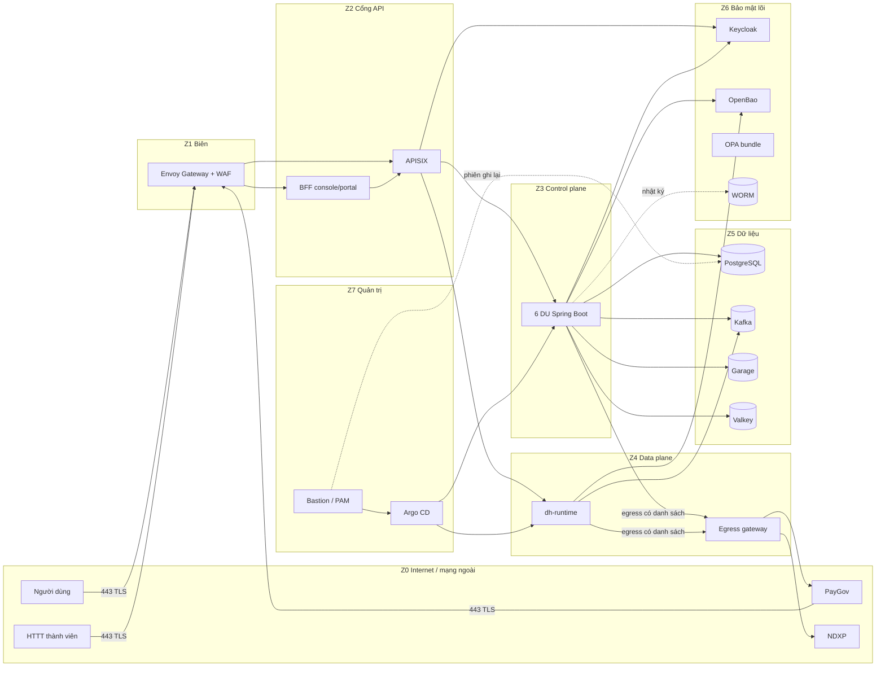
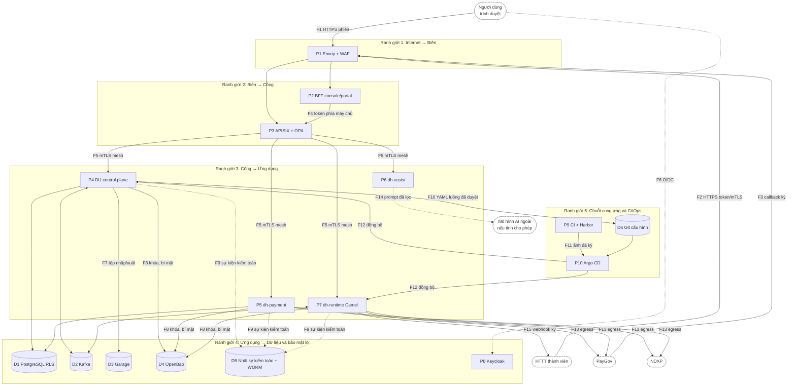

# D03-07 · Thiết kế an toàn thông tin

## 1. Mục đích, phạm vi và người đọc

### 1.1. Mục đích

Tài liệu này là thiết kế an toàn thông tin (ATTT) đầy đủ của Datahub. Nó trả lời bốn câu hỏi theo thứ tự: Datahub phải bảo vệ cái gì (tài sản, dữ liệu, ranh giới tin cậy); ai có thể tấn công và tấn công bằng cách nào (mô hình mối đe dọa STRIDE); Datahub dùng biện pháp gì để chống lại (danh mục biện pháp `SEC-nn` hiện thực cụ thể trên ngăn xếp công nghệ đã chốt); và làm sao chứng minh các biện pháp đó đáp ứng yêu cầu cấp độ 3 theo khung pháp lý hiện hành, đồng thời không phải làm lại khi nâng lên cấp độ 4.

Danh mục `SEC-nn` được định nghĩa duy nhất tại đây (D00-01 §3.1). Hồ sơ đề xuất cấp độ (D03-08), thiết kế hạ tầng và DR (D03-09), quy chuẩn lập trình (D04-01, D04-02) và kế hoạch kiểm thử tổng thể (D05-01) chỉ tham chiếu mã, không định nghĩa lại. Khi một tài liệu khác cần một biện pháp chưa có, người viết đề xuất bổ sung vào tài liệu này trong dải số tương ứng.

### 1.2. Phạm vi

Phạm vi bao gồm toàn bộ thành phần mô tả ở SAD (D03-01) mục 4 và 5: hai ứng dụng giao diện (`dh-console`, `dh-portal`), sáu DU Spring Boot (`dh-connect`, `dh-integration`, `dh-data`, `dh-platform`, `dh-payment`, `dh-assist`), DU Camel Quarkus `dh-runtime`, APISIX, Kafka và Apicurio, PostgreSQL trên CloudNativePG, Garage, Valkey, Keycloak, OPA, OpenBao, Argo CD và kho Git cấu hình, bộ quan sát OpenTelemetry/Mimir/Loki/Tempo/Grafana, Harbor và đường ống CI/CD. Phạm vi áp dụng cho cả hai hồ sơ triển khai: **tỉnh độc lập** (cụm Kubernetes tại TTDL tỉnh) và **nền tảng dùng chung** (cụm trên cloud Chính phủ phục vụ nhiều tỉnh).

Ngoài phạm vi là an toàn của bản thân các HTTT thành viên, NDXP, PayGov và các CSDL quốc gia; tài liệu chỉ xử lý ranh giới giữa Datahub và các hệ đó (giả định chúng có thể bị xâm phạm). An toàn vật lý của TTDL được nêu ở mức yêu cầu đối với bên cung cấp hạ tầng (mục 12) và chi tiết ở D03-09.

### 1.3. Người đọc và cách đọc

Hội đồng thẩm định và bộ phận chuyên trách an ninh mạng của chủ quản đọc mục 2 (căn cứ), 3 (đối tượng bảo vệ), 11 (ma trận tuân thủ) và 12 (trách nhiệm). Kiến trúc sư và trưởng nhóm kỹ thuật đọc mục 4 (mô hình mối đe dọa) và 5 (biện pháp). Đội phát triển đọc mục 5.5 (ứng dụng và API), 6 (dữ liệu cá nhân) và 9 (đa tenant). Đội vận hành đọc mục 5.2, 5.6, 7 và 8.

### 1.4. Quan hệ với các tài liệu khác

Bảng dưới đây cho biết tài liệu này nhận đầu vào từ đâu và cung cấp gì cho tài liệu nào, để người đọc biết chỗ nào là nguồn sự thật cho từng nội dung.

| Tài liệu | Quan hệ |
|---|---|
| D03-01 SAD §8.2, §9 | SAD tóm lược bảy lớp bảo vệ và bốn mức phân loại dữ liệu; tài liệu này chi tiết hóa và có quyền điều chỉnh tham số (ví dụ thời hạn token) — điều chỉnh được ghi ở mục 14 để luồng lõi cập nhật SAD. |
| D02-02 SRS §6.3 | NFR-00-020 … 029 là yêu cầu tối thiểu; tài liệu này hiện thực và, ở một số điểm, đề xuất siết chặt hơn (mật khẩu, thời hạn lưu nhật ký). |
| D03-10 Thiết kế đa tenant | Nguồn sự thật về cơ chế cách ly theo tầng; mục 9 ở đây chỉ bổ sung góc nhìn an ninh và các biện pháp `SEC-80…89`. |
| D03-08 Hồ sơ đề xuất cấp độ | Dùng danh mục `SEC-nn` và ma trận mục 11 làm "phương án bảo vệ" trong hồ sơ trình phê duyệt. |
| D03-09 Hạ tầng, triển khai, DR | Hiện thực các biện pháp hạ tầng (`SEC-10…19`, `SEC-50…59`, `SEC-70…79`) ở mức sơ đồ mạng, cấu hình cụm, sao lưu. |
| D04-01, D04-02 | Biến `SEC-40…49` thành quy tắc lập trình và cổng CI. |
| D05-01 | Mỗi `SEC-nn` có cách kiểm chứng; D05-01 lập ca kiểm thử bảo mật, kiểm thử rò rỉ chéo tenant, kiểm thử xâm nhập. |
| ADR-030, ADR-031, ADR-032 | Ba quyết định kiến trúc ATTT do tài liệu này đề xuất. |

## 2. Căn cứ pháp lý và tiêu chuẩn

### 2.1. Bối cảnh thay đổi khung pháp lý

Khung pháp lý về an toàn hệ thống thông tin thay đổi lớn trong giai đoạn 2025–2026. Luật An ninh mạng số 116/2025/QH15 (hiệu lực 01/7/2026) hợp nhất Luật An ninh mạng 2018 và Luật An toàn thông tin mạng 2015, giao Bộ Công an làm đầu mối. Nghị định 331/2026/NĐ-CP về bảo vệ an ninh mạng đối với hệ thống thông tin kế nhiệm Nghị định 85/2016/NĐ-CP và giữ khung phân loại năm cấp độ. TCVN 14423:2026 "An ninh mạng – Hệ thống thông tin – Yêu cầu cơ bản" thay thế cả TCVN 14423:2025 và TCVN 11930:2017. Trong lĩnh vực dữ liệu cá nhân, Luật Bảo vệ dữ liệu cá nhân số 91/2025/QH15 và Nghị định 356/2025/NĐ-CP (cùng hiệu lực 01/01/2026) thay thế Nghị định 13/2023/NĐ-CP.

Chủ đầu tư yêu cầu các biện pháp kiểm soát "theo Thông tư 12/2022/TT-BTTTT và TCVN 11930:2017". Hai văn bản này thuộc khung cũ của Nghị định 85/2016. Datahub sẽ vận hành sau 01/7/2026, nên căn cứ chính phải là văn bản hiện hành; tuy nhiên tài liệu vẫn giữ ánh xạ đối chiếu với hai văn bản cũ vì ba lý do: hội đồng thẩm định và đội ngũ của tỉnh còn quen cấu trúc yêu cầu của TCVN 11930; Nghị định 331/2026 có điều khoản chuyển tiếp (Điều 39) cho hệ đang đầu tư trước 01/7/2026, trong đó việc thẩm định có thể vẫn theo khung cũ trong 6 tháng; và chưa thấy văn bản hướng dẫn của Bộ Công an thay thế toàn bộ Thông tư 12/2022. Nhờ vậy, dù hồ sơ được thẩm định theo khung nào, phương án bảo vệ vẫn đối chiếu được.

> **Câu hỏi mở Q300:** Datahub được xác định là "hệ thống đang đầu tư trước 01/7/2026" (áp dụng chuyển tiếp Điều 39 NĐ 331/2026) hay hệ thống mới? Câu trả lời quyết định hồ sơ D03-08 lập theo khung nào; thiết kế này đáp ứng cả hai.

### 2.2. Văn bản pháp lý

Bảng dưới đây phân văn bản thành hai nhóm: văn bản hiện hành dùng làm căn cứ chính, và văn bản kế thừa dùng để đối chiếu. Cột "Chi phối thiết kế" cho biết văn bản đó ảnh hưởng tới mục nào. Các số điều chỉ được nêu khi đã tra; điểm chưa đối chiếu toàn văn được ghi rõ. Mã `CMP-LAW-nn` mới đề xuất được liệt kê ở mục 14 để luồng lõi bổ sung D00-01 §7.

| Mã đề xuất | Văn bản | Trạng thái dùng | Chi phối thiết kế | Ghi chú kiểm tra |
|---|---|---|---|---|
| CMP-LAW-16 (cập nhật) | Luật An ninh mạng số 116/2025/QH15, hiệu lực 01/7/2026 | Căn cứ chính | Toàn bộ; nghĩa vụ chủ quản, ứng phó sự cố, lưu trữ dữ liệu trong nước | Đã tra nguồn Bộ Công an; chưa đối chiếu Công báo |
| CMP-LAW-17 (mới) | Nghị định 331/2026/NĐ-CP về bảo vệ an ninh mạng đối với HTTT | Căn cứ chính | Cấp độ (mục 3), hồ sơ (D03-08), dùng chung hạ tầng cloud cho cấp 3–4 (Điều 30, mục 12), bộ phận chuyên trách (Điều 31, mục 12) | Điều 8, 25, 30, 31, 39 đã tra; thành phần hồ sơ chi tiết và tiêu chí cấp 4 chưa xác minh |
| STD-06 (mới) | TCVN 14423:2026 An ninh mạng – HTTT – Yêu cầu cơ bản | Căn cứ chính | Ngưỡng tham số (mục 5), ma trận (mục 11a); chương 5 cho cấp độ 3, chương 6 cho cấp độ 4 | Tên chính xác từng nhóm 5.1–5.18 cần đối chiếu |
| CMP-LAW-05 (cập nhật) | Luật Bảo vệ dữ liệu cá nhân số 91/2025/QH15, hiệu lực 01/01/2026 | Căn cứ chính | Mục 6 | Số hiệu đã tra |
| CMP-LAW-18 (mới) | Nghị định 356/2025/NĐ-CP quy định chi tiết Luật BVDLCN, hiệu lực 01/01/2026 | Căn cứ chính | Mục 6; thay NĐ 13/2023 | Điều khoản cụ thể về mẫu hồ sơ chưa đối chiếu |
| CMP-LAW-19 (mới) | Nghị định 278/2025/NĐ-CP về kết nối, chia sẻ dữ liệu bắt buộc, thay NĐ 47/2020 | Căn cứ chính | Kết nối NDXP (PH-14), THR-30…32 | — |
| CMP-LAW-01 | Luật Dữ liệu số 60/2024/QH15 | Căn cứ chính | Phân loại dữ liệu (mục 3.3) | — |
| CMP-LAW-20 (mới) | Quyết định 8297/QĐ-BCA-A05 (2025) Bộ tiêu chí an ninh mạng cho nền tảng điện toán đám mây phục vụ CPĐT | Căn cứ cho hồ sơ nền tảng dùng chung | Mục 12 | Chưa xác minh nội dung chi tiết |
| CMP-LAW-06 | Nghị định 85/2016/NĐ-CP | Kế thừa, chỉ khi áp dụng chuyển tiếp | Đối chiếu | Đã được NĐ 331/2026 kế nhiệm |
| CMP-LAW-07 | Thông tư 12/2022/TT-BTTTT | Kế thừa, đối chiếu | Ma trận mục 11b | Chưa thấy văn bản thay thế (Q301) |
| CMP-LAW-08 | TCVN 11930:2017 | Kế thừa, đối chiếu | Ma trận mục 11b | Đã bị TCVN 14423:2026 thay thế |
| CMP-LAW-04 | Nghị định 13/2023/NĐ-CP | Hết hiệu lực từ 01/01/2026 | Chỉ để giải thích ánh xạ | Thay bởi Luật 91/2025 và NĐ 356/2025 |

> **Câu hỏi mở Q301:** Bộ Công an đã ban hành (hoặc dự kiến ban hành) thông tư hướng dẫn NĐ 331/2026 thay Thông tư 12/2022/TT-BTTTT chưa? Nếu có, ma trận 11b phải chuyển sang văn bản mới.

Lý do căn cứ chính là bộ ba Luật 116/2025, NĐ 331/2026 và TCVN 14423:2026 rất đơn giản: đây là các văn bản có hiệu lực tại thời điểm Datahub được thẩm định và vận hành; TCVN 11930:2017 đã bị thay thế theo lời nói đầu của TCVN 14423:2026; còn Thông tư 12/2022 hướng dẫn một nghị định đã được kế nhiệm. Việc tiếp tục dùng văn bản cũ làm căn cứ chính sẽ khiến hồ sơ bị trả lại khi thẩm định theo khung mới.

Tiêu chí liên quan tới dữ liệu cá nhân trong NĐ 331/2026 (từ 100.000 chủ thể dữ liệu cá nhân cơ bản hoặc từ 10.000 chủ thể dữ liệu nhạy cảm trở lên thì tối thiểu cấp độ 3) gần như chắc chắn áp dụng cho Datahub, vì PH-06 (dữ liệu chủ công dân), PH-19 (giao dịch thanh toán) và PH-14 (khai thác CSDL quốc gia về dân cư) đều xử lý dữ liệu của số lượng lớn công dân. Điều 8 yêu cầu lấy cấp cao nhất khi đáp ứng nhiều tiêu chí và cấm chia nhỏ hệ thống để hạ cấp; vì vậy Datahub được xác định cấp độ cho **toàn bộ nền tảng**, không tách PH-19 hay PH-17 thành hệ cấp thấp hơn. Lập luận đầy đủ thuộc D03-08.

### 2.3. Tiêu chuẩn kỹ thuật

Các tiêu chuẩn kỹ thuật dưới đây không có tính bắt buộc pháp lý nhưng được dùng làm thước đo cụ thể cho biện pháp, vì TCVN 14423:2026 nêu yêu cầu ở mức "phải có" mà không chỉ định cách làm.

| Mã | Tiêu chuẩn | Dùng cho |
|---|---|---|
| STD-03 (cập nhật) | OWASP ASVS 5.0, mức 2 (thay ASVS 4.x ở D00-01) | Ứng dụng web và API (NFR-00-024), mục 5.5, ma trận 11c |
| STD-07 (mới) | OWASP API Security Top 10 2023; OWASP Top 10 2021 | Mô hình mối đe dọa API, kiểm thử |
| STD-08 (mới) | CIS Kubernetes Benchmark; NSA/CISA Kubernetes Hardening Guidance | `SEC-50…59` |
| STD-09 (mới) | SLSA (Supply-chain Levels for Software Artifacts), mục tiêu mức 3 cho ảnh do Datahub xây | `SEC-55…57` |
| STD-10 (mới) | RFC 9700 (OAuth 2.0 Security Best Current Practice), RFC 8705 (OAuth mTLS), RFC 7523 (JWT client authentication), RFC 9449 (DPoP, tham khảo), RFC 7636 (PKCE) | `SEC-20…29` |
| STD-11 (mới) | ISO/IEC 27001:2022 và 27002:2022 (tham khảo cấu trúc kiểm soát) | Tổ chức kiểm soát `SEC-01…09` |
| STD-12 (mới) | NIST SP 800-63B (định danh số, xác thực) – tham khảo cho chính sách mật khẩu | `SEC-22` |

## 3. Đối tượng bảo vệ

### 3.1. Kiểm kê tài sản

Không thể bảo vệ cái chưa biết là mình có. Bảng dưới đây kiểm kê tài sản thông tin của Datahub theo nhóm, kèm mức phân loại cao nhất của dữ liệu mà tài sản chứa, chủ sở hữu kỹ thuật và mức quan trọng đối với tính sẵn sàng. Kiểm kê này là đầu vào cho mô hình mối đe dọa (mục 4) và được tự động hóa: danh sách workload, ảnh container và phiên bản được sinh từ kho Git cấu hình và từ Harbor (SBOM) mỗi ngày, nên tần suất kiểm kê thực tế là liên tục, chặt hơn yêu cầu tối thiểu 1 lần/năm của TCVN 14423:2026 (`SEC-04`).

| Mã tài sản | Tài sản | Ví dụ cụ thể | Mức dữ liệu cao nhất | Chủ sở hữu kỹ thuật | Quan trọng với sẵn sàng |
|---|---|---|---|---|---|
| AS-01 | DU control plane | `dh-connect`, `dh-integration`, `dh-data`, `dh-platform` | Nhạy cảm (`dh-data`) | Trưởng nhóm phát triển | Trung bình (99,5%) |
| AS-02 | DU thanh toán | `dh-payment` | Nhạy cảm (thông tin tài khoản, giao dịch) | Nhóm PH-19 | Cao |
| AS-03 | DU AI | `dh-assist` | Hạn chế (tối đa; không được nhận dữ liệu Nhạy cảm) | Nhóm PH-17 | Thấp |
| AS-04 | Data plane | APISIX, `dh-runtime`, Kafka | Nhạy cảm (dữ liệu đi qua) | Nhóm nền tảng | Rất cao (99,9%) |
| AS-05 | Giao diện | `dh-console`, `dh-portal` (tệp tĩnh và BFF) | Hạn chế | Nhóm giao diện | Trung bình |
| AS-06 | CSDL nghiệp vụ | Cụm CloudNativePG, schema `ph{nn}_*` | Nhạy cảm | Nhóm nền tảng | Cao |
| AS-07 | Kho đối tượng | Bucket `dh-{tenant}-*` trên Garage | Nhạy cảm (tệp nhập, tệp đối soát) | Nhóm nền tảng | Trung bình |
| AS-08 | Kho WORM | Bucket nhật ký kiểm toán khóa đối tượng (Object Lock) | Hạn chế (đã che) | Vận hành ATTT | Thấp (ghi bất đồng bộ) |
| AS-09 | Bộ nhớ đệm | Valkey | Hạn chế (phiên BFF, kết quả tra cứu) | Nhóm nền tảng | Trung bình |
| AS-10 | Định danh | Keycloak (realm theo tenant, CSDL của Keycloak) | Hạn chế (băm mật khẩu, bí mật TOTP) | Vận hành ATTT | Rất cao |
| AS-11 | Kho bí mật và khóa | OpenBao (KV, transit, PKI), khóa mở niêm phong | Tối mật kỹ thuật | Vận hành ATTT | Rất cao |
| AS-12 | Chính sách | Gói chính sách OPA (Rego) trong Git, bundle server | Nội bộ | Kiến trúc sư ATTT | Cao |
| AS-13 | Cấu hình triển khai | Kho Git cấu hình, Argo CD | Nội bộ (không chứa bí mật) | Nhóm nền tảng | Cao |
| AS-14 | Chuỗi cung ứng | Kho mã nguồn, runner CI, Harbor, khóa ký cosign | Nội bộ; khóa ký là tối mật kỹ thuật | Nhóm DevSecOps | Trung bình |
| AS-15 | Quan sát | Mimir, Loki, Tempo, Grafana | Hạn chế (log đã che) | Vận hành | Trung bình |
| AS-16 | Nhật ký kiểm toán | Bảng `ph13_audit.audit_event`, neo băm | Hạn chế | Vận hành ATTT | Trung bình |
| AS-17 | Sao lưu | Bản sao CNPG (Barman), Velero, bản sao WORM ngoài site | Nhạy cảm | Vận hành | Cao (khi DR) |
| AS-18 | Hạ tầng cụm | Nút K8s, etcd, control plane K8s, Cilium, Istio | Tối mật kỹ thuật (etcd chứa Secret) | Bên cung cấp hạ tầng | Rất cao |
| AS-19 | Thông tin xác thực ra ngoài | Client NDXP, khóa ký PayGov, tài khoản CSDL nguồn | Tối mật kỹ thuật | Chủ quản từng kết nối | Cao |

"Tối mật kỹ thuật" ở đây không phải mức phân loại dữ liệu nghiệp vụ mà là nhãn cho vật liệu khóa và bí mật mà nếu lộ sẽ làm vô hiệu hóa mọi biện pháp khác; chúng được xử lý theo `SEC-33…36` và không bao giờ xuất hiện ngoài OpenBao hoặc bộ nhớ tiến trình.

### 3.2. Phân loại dữ liệu và cách xử lý theo mức

SAD §8.2 định nghĩa bốn mức phân loại. Phần dưới đây chi tiết hóa mỗi mức thành quy tắc thực thi được ở từng điểm xử lý. Mức phân loại được gắn ở **mức trường** trong đặc tả dữ liệu (D02-06/D02-07) bằng thuộc tính `x-dh-classification` trong OpenAPI/JSON Schema và bằng chú thích `@Classified(level=…)` trên thực thể Java; PH-09 là nơi quản lý danh mục phân loại và mục đích khai thác. Một bản ghi có trường ở nhiều mức thì được xử lý theo mức cao nhất ở những khâu không tách được trường (ví dụ sao lưu, bản tin trong DLQ).

Bảng sau là quy tắc chuẩn; mọi ngoại lệ phải ghi trong SDD phân hệ và được kiến trúc sư ATTT duyệt.

| Khâu xử lý | Công khai | Nội bộ | Hạn chế | Nhạy cảm |
|---|---|---|---|---|
| Lưu trữ | Mã hóa volume (mặc định toàn hệ) | Như Công khai | Mã hóa volume; bảng có RLS | Mã hóa trường ở tầng ứng dụng bằng envelope encryption qua OpenBao transit (ADR-032); thêm cột băm có khóa (HMAC) nếu cần tìm kiếm chính xác |
| Truyền | TLS | TLS, mTLS nội bộ | TLS 1.3/mTLS; HTTT bên ngoài khuyến nghị mTLS | Bắt buộc mTLS hoặc private_key_jwt cho HTTT khai thác (`SEC-24`) |
| Log vận hành | Đầy đủ | Đầy đủ | Che một phần (ví dụ `0912***678`, `ng***@example.gov.vn`) | Không ghi giá trị; chỉ ghi tên trường và dấu `[REDACTED]` |
| Nhật ký kiểm toán | Đầy đủ | Đầy đủ | Che một phần trong giá trị trước/sau | Không ghi giá trị; ghi băm có khóa để tra "ai đã truy cập đối tượng X" |
| Trace | Thuộc tính span không chứa thân bản tin ở mọi mức | ← | ← | ← |
| Hiển thị giao diện | Đầy đủ | Theo quyền | Theo quyền, che một phần | Che mặc định; nút "Xem đầy đủ" yêu cầu `PERM-09-reveal`, lý do, sinh bản ghi kiểm toán, hiển thị tối đa 60 giây |
| Xuất tệp | Đầy đủ | Theo quyền | Theo quyền | Che, trừ khi có quyền và nêu lý do (FR-00-034); tệp xuất có thủy vân tên người xuất và mã truy vết |
| Bộ nhớ đệm | Được | Được | Được, TTL ≤ 15 phút, khóa có tiền tố tenant | Không lưu giá trị rõ trong Valkey |
| Môi trường DEV/TEST | Được dùng dữ liệu thật | Được | Chỉ dữ liệu giả hoặc giả danh hóa | Cấm dữ liệu thật; chỉ dữ liệu sinh |
| Gửi cho PH-17 (AI) | Được | Được | Chỉ khi tenant bật và mô hình chạy nội bộ | Cấm |
| Thư điện tử, SMS | Được | Liên kết | Chỉ liên kết (FR-00-062) | Chỉ liên kết |
| Sao lưu | Mã hóa bản sao lưu (mặc định toàn hệ) | ← | ← | ← và trường vẫn ở dạng mã hóa trong bản sao lưu |
| Thời hạn lưu | Theo nghiệp vụ | Theo nghiệp vụ | Theo nghiệp vụ, có lịch xóa | Có thời hạn tường minh trong sổ xử lý PH-09; xóa hoặc giả danh hóa khi hết hạn |

Dữ liệu **đi qua** (nội dung bản tin giữa HTTT) không được Datahub phân loại theo trường vì Datahub không hiểu hết nghiệp vụ của mọi bản tin; thay vào đó, mỗi API và mỗi topic được gán **mức phân loại của hợp đồng** bằng mức cao nhất của các trường trong schema đã đăng ký. Mức này quyết định yêu cầu xác thực bên khai thác (`SEC-24`), việc có ghi thân bản tin vào DLQ hay không (DLQ của hợp đồng mức Nhạy cảm được mã hóa bằng khóa riêng theo tenant và tự xóa sau tối đa 7 ngày, theo SAD §8.3), và việc có cần chấp thuận của chủ quản dữ liệu qua PH-09 khi đăng ký sử dụng hay không.

### 3.3. Ranh giới tin cậy và vùng mạng

Ranh giới tin cậy (trust boundary) là nơi dữ liệu đi từ vùng có mức tin cậy này sang vùng có mức tin cậy khác; mọi ranh giới phải có kiểm soát xác thực, ủy quyền và kiểm tra đầu vào. Datahub có tám vùng, đánh mã `Z0`…`Z7`. Vùng được hiện thực bằng tổ hợp: phân đoạn mạng vật lý hoặc VLAN ở tầng hạ tầng (D03-09), namespace Kubernetes, network policy Cilium từ chối mặc định và chính sách ủy quyền Istio.

| Vùng | Tên | Thành phần | Mức tin cậy | Kiểm soát vào |
|---|---|---|---|---|
| Z0 | Internet và mạng của bên ngoài | Người dùng, HTTT thành viên, nhà phát triển, PayGov, NDXP | Không tin | Chống DDoS, WAF, TLS |
| Z1 | Biên (DMZ) | Envoy Gateway + WAF Coraza (ADR-033), bộ cân bằng tải | Thấp | Chỉ 443/TCP vào; chỉ chuyển tới Z2 |
| Z2 | Cổng API | APISIX, BFF của `dh-console`/`dh-portal` | Trung bình | Xác thực token/mTLS, OPA, rate limit |
| Z3 | Ứng dụng control plane | 6 DU Spring Boot | Trung bình–cao | mTLS mesh, chính sách ủy quyền Istio theo service account |
| Z4 | Data plane runtime | `dh-runtime`, namespace `dh-rt-*` | Trung bình | mTLS; ra ngoài chỉ qua egress gateway với danh sách đích |
| Z5 | Dữ liệu | PostgreSQL, Kafka, Garage, Valkey | Cao | Chỉ nhận từ service account được liệt kê; TLS; RLS/ACL |
| Z6 | Bảo mật lõi | Keycloak (phần quản trị), OpenBao, OPA bundle server, kho WORM | Rất cao | Chỉ từ các service account liệt kê; truy cập người qua Z7 |
| Z7 | Quản trị | Bastion/PAM, Argo CD, Grafana quản trị, API server K8s | Rất cao | VPN quản trị + MFA + thiết bị được cấp phép; ở cấp độ 4 tách mạng out-of-band (`SEC-93`) |

Vùng Z6 tách khỏi Z5 dù cùng là "dịch vụ dùng chung" vì sự cố ở Z6 (lộ khóa gốc OpenBao, chiếm quyền quản trị Keycloak) làm sụp toàn bộ mô hình tin cậy, trong khi sự cố ở Z5 giới hạn trong dữ liệu. Giao diện quản trị của Keycloak (`/admin`) không được công bố qua Z1; người dùng cuối chỉ thấy đường dẫn đăng nhập của realm.



Sơ đồ cho thấy không có đường nào từ Z0 đi thẳng vào Z3 trở xuống mà không qua Z1 và Z2; không có đường ra Internet nào ngoài egress gateway; và truy cập của con người vào hạ tầng chỉ đi qua Z7. Mũi tên từ PAM tới CSDL là nét đứt vì đó là ngoại lệ break-glass có ghi phiên (`SEC-28`), không phải đường vận hành thường xuyên. Ở hồ sơ nền tảng dùng chung, Z1 và Z7 thường do bên cung cấp cloud vận hành một phần; trách nhiệm được phân ở mục 12.

## 4. Mô hình mối đe dọa

### 4.1. Phương pháp

Mô hình mối đe dọa dùng phương pháp STRIDE trên sơ đồ luồng dữ liệu (DFD) mức 1. STRIDE phân loại mối đe dọa thành sáu nhóm, mỗi nhóm vi phạm một thuộc tính an toàn: **S**poofing – giả mạo (vi phạm tính xác thực), **T**ampering – sửa đổi trái phép (toàn vẹn), **R**epudiation – chối bỏ (không chối bỏ được), **I**nformation disclosure – lộ lọt thông tin (bí mật), **D**enial of service – từ chối dịch vụ (sẵn sàng), **E**levation of privilege – leo thang đặc quyền (ủy quyền). Mỗi phần tử của DFD (tác nhân ngoài, tiến trình, kho dữ liệu, luồng dữ liệu) và đặc biệt mỗi điểm cắt ranh giới tin cậy được duyệt qua cả sáu nhóm.

Mỗi mối đe dọa được đánh mã `THR-nn` (loại mã mới, đề xuất bổ sung D00-01, xem mục 14) và được đánh giá bằng ma trận 5×5. **Khả năng** (K) xảy ra cho điểm 1 (hiếm: cần năng lực cấp quốc gia và nhiều điều kiện) đến 5 (gần như chắc chắn: công cụ tự động trên Internet đang khai thác). **Tác động** (T) cho điểm 1 (không đáng kể) đến 5 (nghiêm trọng: lộ dữ liệu cá nhân hàng loạt, gián đoạn dịch vụ công toàn tỉnh trên 4 giờ, thiệt hại tài chính, rò rỉ chéo tenant). **Mức rủi ro** R = K × T được xếp loại như bảng sau.

| Điểm R | Mức | Yêu cầu xử lý |
|---|---|---|
| 1–4 | Thấp (TH) | Chấp nhận, theo dõi trong đánh giá rủi ro hằng năm |
| 5–9 | Trung bình (TB) | Có biện pháp trước khi vận hành chính thức |
| 10–16 | Cao (C) | Có biện pháp trước MVP; rủi ro tồn dư phải ≤ TB |
| 20–25 | Nghiêm trọng (NT) | Chặn phát hành cho tới khi rủi ro tồn dư ≤ TB; chủ quản ký chấp nhận nếu không đạt |

Bảng ma trận dưới đây cho thấy mức của từng ô (hàng là khả năng, cột là tác động), để người đọc tra nhanh.

| K \ T | 1 | 2 | 3 | 4 | 5 |
|---|---|---|---|---|---|
| **5** | TB 5 | C 10 | C 15 | NT 20 | NT 25 |
| **4** | TH 4 | TB 8 | C 12 | C 16 | NT 20 |
| **3** | TH 3 | TB 6 | TB 9 | C 12 | C 15 |
| **2** | TH 2 | TH 4 | TB 6 | TB 8 | C 10 |
| **1** | TH 1 | TH 2 | TH 3 | TH 4 | TB 5 |

Cột "Mức" trong bảng mối đe dọa là **rủi ro gốc** (trước biện pháp); cột "Tồn dư" là rủi ro sau khi áp dụng các biện pháp `SEC-nn` được liệt kê, ước lượng bằng cách giảm khả năng (biện pháp phòng ngừa) hoặc tác động (biện pháp hạn chế, phát hiện, phục hồi). Mô hình được rà soát lại khi thêm phân hệ, thêm loại kết nối ngoài, hoặc tối thiểu mỗi 6 tháng (`SEC-06`).

### 4.2. Sơ đồ luồng dữ liệu mức 1



DFD mức 1 gồm 10 tiến trình (P1–P10), 6 kho dữ liệu (D1–D6), 5 tác nhân ngoài và 15 luồng (F1–F15) cắt qua 5 ranh giới tin cậy. Các luồng cắt ranh giới quan trọng nhất là F2 (HTTT vào cổng, nơi xác thực máy–máy), F3 (callback thanh toán, nơi có động cơ tài chính), F7 (tệp do người dùng tải lên, nơi phân tích cú pháp dữ liệu không tin cậy), F10–F12 (đường mã và cấu hình đi vào môi trường chạy, nơi một lần xâm phạm ảnh hưởng mọi tenant), F13 (ra ngoài, nơi SSRF và rò rỉ dữ liệu có thể xảy ra) và F14 (ra mô hình AI). Mỗi mối đe dọa ở mục 4.4 ghi phần tử DFD bị nhắm tới.

### 4.3. Tác nhân đe dọa

Bảng dưới đây mô tả các tác nhân đe dọa được xét, động cơ và năng lực giả định. Năng lực giả định là cơ sở chọn mức khả năng ở mục 4.4; thiết kế cấp độ 3 phải chống được tác nhân có năng lực đến mức "cao" ở bảng này, còn tác nhân cấp quốc gia (APT) được xử lý bằng phát hiện và ứng phó nhiều hơn là ngăn chặn tuyệt đối, và được tăng cường khi lên cấp độ 4.

| Mã | Tác nhân | Động cơ | Năng lực | Điểm vào điển hình |
|---|---|---|---|---|
| TA-01 | Kẻ tấn công từ Internet (tội phạm mạng, hacktivist) | Tống tiền (ransomware), bán dữ liệu cá nhân, phá hoại hình ảnh | Trung bình–cao; dùng công cụ quét tự động, khai thác lỗ hổng đã công bố, nhồi thông tin xác thực | F1, F2, F3; thư điện tử lừa đảo cán bộ |
| TA-02 | HTTT thành viên bị chiếm quyền | Kẻ tấn công dùng định danh hợp lệ của HTTT để khai thác dữ liệu vượt phạm vi | Cao trong phạm vi quyền của HTTT đó; có token, có thể có khóa client | F2, F15 |
| TA-03 | Quản trị tỉnh độc hại hoặc bị lừa | Lấy dữ liệu tỉnh khác, che giấu sai phạm, bán dữ liệu | Có quyền quản trị realm và cấu hình tenant | F1, giao diện quản trị |
| TA-04 | Nhà thầu HTTT, kỹ sư tích hợp bên ngoài | Lấy dữ liệu, cài cửa hậu trong luồng tích hợp | Có quyền thiết kế luồng, có thể có quyền chạy thử | Trình thiết kế luồng, F7 |
| TA-05 | Nội gián nền tảng (nhân sự vận hành, phát triển của nhà cung cấp) | Tài chính, bị ép buộc, bất mãn | Rất cao: truy cập hạ tầng, CI, kho Git | Z7, F10–F12, CSDL |
| TA-06 | Tenant khác trên nền tảng dùng chung | Tò mò hoặc cố ý đọc dữ liệu tỉnh khác; gây quá tải | Người dùng hợp lệ của tenant khác | API, Kafka, tài nguyên chung |
| TA-07 | Kẻ tấn công chuỗi cung ứng | Cài mã độc vào thư viện, ảnh nền, công cụ CI | Cao; có thể ở cấp quốc gia | Phụ thuộc Maven/npm, ảnh gốc, plugin CI |
| TA-08 | Kẻ gian lận thanh toán | Ghi nhận giao dịch "đã thanh toán" mà không trả tiền, hoàn tiền trái phép | Trung bình; có thể có người trong cuộc | F3, PH-19 giao diện đối soát |
| TA-09 | Tác nhân cấp quốc gia (APT) | Gián điệp, thu thập dữ liệu dân cư | Rất cao, kiên nhẫn | Mọi điểm, đặc biệt chuỗi cung ứng và quản trị |

### 4.4. Danh mục mối đe dọa

Danh mục được trình bày theo thành phần. Mỗi bảng có câu dẫn nêu đặc thù của thành phần. Các biện pháp `SEC-nn` được định nghĩa ở mục 5; mục tiêu ở đây là cho thấy mỗi biện pháp tồn tại vì chống lại mối đe dọa nào.

#### 4.4.1. Biên và cổng API (P1, P3, F1, F2)

Biên là nơi Datahub tiếp xúc với Internet, nên khả năng bị tấn công luôn cao; các mối đe dọa tập trung vào giả mạo client, vượt qua kiểm soát truy cập ở tầng API (lớp lỗi phổ biến nhất theo OWASP API Top 10) và làm cạn tài nguyên.

| Mã | STRIDE | Kịch bản | Phần tử | K | T | Mức | Biện pháp | Tồn dư |
|---|---|---|---|---|---|---|---|---|
| THR-01 | D | Tấn công DDoS thể tích hoặc tầng 7 (HTTP flood) làm cổng không phục vụ được, gián đoạn dịch vụ công | P1, P3 | 4 | 4 | C 16 | SEC-10, SEC-11, SEC-86, SEC-71 | TB 8 |
| THR-02 | S | Kẻ tấn công dùng `client_secret` bị lộ (từ mã nguồn của nhà thầu, tệp cấu hình) để gọi API như HTTT hợp lệ | F2 | 4 | 4 | C 16 | SEC-24 (mTLS/private_key_jwt bắt buộc cho hợp đồng Hạn chế trở lên), SEC-25, SEC-64 | TB 6 |
| THR-03 | E | Lỗi ủy quyền mức đối tượng (BOLA): HTTT A đổi mã đối tượng trên đường dẫn để đọc bản ghi của HTTT B cùng tenant | P3, P4 | 4 | 4 | C 16 | SEC-26 (OPA kiểm tra chủ sở hữu đối tượng), SEC-43, SEC-42 | TB 6 |
| THR-04 | E | Gọi đường dẫn quản trị hoặc phương thức HTTP không được công bố (lỗi ủy quyền mức chức năng) qua APISIX | P3 | 3 | 4 | C 12 | SEC-26, SEC-43 (chỉ route khai báo trong OpenAPI được đồng bộ), SEC-11 | TH 4 |
| THR-05 | I | Lộ thông tin qua thông báo lỗi chi tiết, header phiên bản, endpoint `/actuator`, Admin API APISIX bị công bố ra ngoài | P3 | 4 | 3 | C 12 | SEC-43 (RFC 9457 không stack trace), SEC-14 (Admin API chỉ trong Z3), SEC-11 | TH 3 |
| THR-06 | T | Tiêm header nội bộ `X-DH-Tenant`, `X-Forwarded-For` giả để đổi tenant hoặc vượt `ip-restriction` | P3 | 3 | 5 | C 15 | SEC-80 (xóa header client gửi, tenant chỉ từ token), SEC-15 | TH 3 |
| THR-07 | D | Một HTTT hoặc một tenant gửi lưu lượng lớn hợp lệ làm chậm tenant khác (hàng xóm ồn ào) | P3, P7 | 4 | 3 | C 12 | SEC-86, SEC-10 | TH 4 |
| THR-08 | T | Hạ cấp TLS hoặc dùng bộ mã yếu với HTTT cũ để nghe lén/sửa nội dung | F2 | 2 | 4 | TB 8 | SEC-12 | TH 2 |

#### 4.4.2. Giao diện và BFF (P2, F1, F6)

Giao diện quản trị là đường vào của những người có quyền cao nhất, nên chiếm phiên của một quản trị viên tương đương chiếm cả tenant.

| Mã | STRIDE | Kịch bản | Phần tử | K | T | Mức | Biện pháp | Tồn dư |
|---|---|---|---|---|---|---|---|---|
| THR-09 | S | Lừa đảo (phishing) lấy mật khẩu quản trị tỉnh, đăng nhập từ nơi khác | F6 | 4 | 5 | NT 20 | SEC-23 (WebAuthn cho quản trị), SEC-22, SEC-64, SEC-03 | TB 5 |
| THR-10 | I | XSS (kể cả qua tên danh mục, mô tả API do người dùng nhập) đánh cắp token trong trình duyệt | P2 | 3 | 5 | C 15 | SEC-21 (BFF, token không ở trình duyệt), SEC-44 (CSP nghiêm ngặt), SEC-41 | TH 3 |
| THR-11 | T | CSRF ép người dùng đã đăng nhập thực hiện thao tác (duyệt, phát hành) | P2 | 3 | 4 | C 12 | SEC-44 (cookie `SameSite=Strict`, token CSRF, kiểm tra `Origin`) | TH 2 |
| THR-12 | S | Nhồi thông tin xác thực (credential stuffing) và dò mật khẩu vào realm | F6 | 5 | 3 | C 15 | SEC-22 (khóa tạm, danh sách mật khẩu lộ), SEC-23, SEC-10 | TH 3 |
| THR-13 | E | Phiên bị bỏ quên trên máy dùng chung tại xã; người khác tiếp tục thao tác | P2 | 3 | 4 | C 12 | SEC-29 (tự khóa 15 phút), SEC-23 (bước xác thực lại cho thao tác nhạy cảm) | TH 3 |

#### 4.4.3. Control plane, quy trình duyệt và trình thiết kế luồng (P4, P7)

Trình thiết kế luồng cho phép người dùng mô tả logic chạy trên data plane; nếu không kiểm soát, đây là một cách "thực thi mã từ xa có giấy phép". Camel hỗ trợ nhiều ngôn ngữ biểu thức (Simple, Groovy, JavaScript, OGNL, MVEL, JQ, XPath) và nhiều component có thể đọc tệp, chạy lệnh, mở kết nối tùy ý.

| Mã | STRIDE | Kịch bản | Phần tử | K | T | Mức | Biện pháp | Tồn dư |
|---|---|---|---|---|---|---|---|---|
| THR-14 | E | Kỹ sư tích hợp viết biểu thức Groovy/JavaScript/OGNL hoặc dùng component `exec`, `file`, `bean`, `class` để chạy lệnh trên pod runtime | P7 | 3 | 5 | C 15 | SEC-46 (danh sách trắng component và ngôn ngữ, kiểm tra tĩnh YAML), SEC-52, SEC-83 | TH 3 |
| THR-15 | I | SSRF: luồng gọi URL do người dùng cấu hình tới dịch vụ nội bộ (API server K8s, OpenBao, siêu dữ liệu cloud `169.254.169.254`) | P7, F13 | 4 | 5 | NT 20 | SEC-46 (đích HTTP phải là kết nối đã đăng ký), SEC-16 (egress danh sách), SEC-14 | TB 5 |
| THR-16 | E | Tự phát hành luồng mà không qua duyệt, hoặc người tạo tự duyệt | P4, F10 | 3 | 4 | C 12 | SEC-07 (bốn mắt FR-00-071), SEC-59 (chỉ `dh-integration` ghi Git, nhánh được bảo vệ) | TH 3 |
| THR-17 | T | Biểu thức JQ/JSONata gây vòng lặp vô hạn hoặc tiêu tốn bộ nhớ, làm sập runtime dùng chung | P7 | 3 | 3 | TB 9 | SEC-46 (giới hạn thời gian, kích thước), SEC-83 (giới hạn tài nguyên theo namespace) | TH 3 |
| THR-18 | I | Luồng ghi thân bản tin chứa dữ liệu Nhạy cảm vào log bằng bước `log` | P7 | 4 | 4 | C 16 | SEC-32 (bộ che ở OTel Collector và Logback), SEC-46 (lint cấm `log` thân bản tin hợp đồng Nhạy cảm) | TB 6 |
| THR-19 | R | Người dùng phủ nhận đã duyệt, sửa cấu hình, xem dữ liệu Nhạy cảm | P4 | 3 | 3 | TB 9 | SEC-60, SEC-62 | TH 2 |

#### 4.4.4. Nhập tệp Excel/CSV và xử lý tài liệu (F7)

Nhập tệp là nơi phân tích cú pháp dữ liệu không tin cậy với thư viện phức tạp (Apache POI, bộ phân tích XML), và tệp xuất lại được mở trong Excel của cán bộ.

| Mã | STRIDE | Kịch bản | Phần tử | K | T | Mức | Biện pháp | Tồn dư |
|---|---|---|---|---|---|---|---|---|
| THR-20 | T | Tiêm công thức CSV/Excel (`=HYPERLINK`, `=cmd|…`, `+`, `-`, `@`) vào danh mục; khi cán bộ khác xuất và mở tệp, công thức chạy | F7 | 4 | 3 | C 12 | SEC-45 (thoát ký tự đầu ô khi xuất, kiểm tra khi nhập) | TH 3 |
| THR-21 | I | XXE trong .xlsx (là gói XML) hoặc XML/SOAP đầu vào: đọc tệp hệ thống, SSRF | F7, P7 | 3 | 4 | C 12 | SEC-45, SEC-43 (bộ phân tích XML tắt DTD và thực thể ngoài) | TH 2 |
| THR-22 | D | Bom nén (zip bomb) .xlsx, tệp rất nhiều dòng hoặc ô làm cạn bộ nhớ DU | F7 | 4 | 3 | C 12 | SEC-45 (giới hạn tỉ lệ nén, kích thước giải nén, số dòng; xử lý dạng luồng), SEC-83 | TH 3 |
| THR-23 | T | Tải lên tệp chứa mã độc, được lưu ở Garage và phát tán tới người tải về | F7 | 3 | 3 | TB 9 | SEC-45 (quét ClamAV, kiểm tra kiểu theo nội dung), SEC-54 | TH 3 |

#### 4.4.5. Sự kiện Kafka và webhook (D2, F15)

| Mã | STRIDE | Kịch bản | Phần tử | K | T | Mức | Biện pháp | Tồn dư |
|---|---|---|---|---|---|---|---|---|
| THR-24 | S | HTTT phát sự kiện giả vào topic của HTTT khác (giả mạo bên phát) | D2 | 3 | 4 | C 12 | SEC-82 (ACL theo principal và tiền tố), SEC-15, SEC-18 | TH 3 |
| THR-25 | I | Consumer của tenant B đọc topic tenant A do ACL tiền tố sai | D2 | 2 | 5 | C 10 | SEC-82, SEC-87 (kiểm thử ACL tự động khi khởi tạo tenant) | TH 4 |
| THR-26 | S | Kẻ tấn công giả mạo webhook của Datahub gửi tới HTTT, hoặc phát lại webhook cũ | F15 | 3 | 4 | C 12 | SEC-47 (HMAC-SHA256, dấu thời gian ±5 phút, `webhook-id` duy nhất) | TH 3 |
| THR-27 | I | URL webhook do HTTT khai báo trỏ vào địa chỉ nội bộ (SSRF qua webhook) | F15 | 3 | 4 | C 12 | SEC-47 (kiểm tra đích, chặn dải nội bộ, chỉ HTTPS), SEC-16 | TH 3 |
| THR-28 | T | Đầu độc schema: đăng ký schema mới làm hỏng consumer hoặc lách kiểm tra | D2 | 2 | 3 | TB 6 | SEC-82 (nhóm Apicurio theo tenant, quy tắc tương thích), SEC-07 | TH 2 |

#### 4.4.6. Dữ liệu, CSDL và đa tenant (D1, D3)

Rò rỉ chéo tenant là mối đe dọa có tác động lớn nhất với sản phẩm đa tỉnh, vì một sự cố làm mất niềm tin của mọi tỉnh cùng lúc và là vi phạm DLCN ở quy mô lớn.

| Mã | STRIDE | Kịch bản | Phần tử | K | T | Mức | Biện pháp | Tồn dư |
|---|---|---|---|---|---|---|---|---|
| THR-29 | I | Lỗi lập trình (truy vấn native, kết nối ngoài `DataSource`, tác vụ nền quên `TenantContext`) làm đọc dữ liệu tenant khác | D1 | 3 | 5 | C 15 | SEC-81 (RLS `FORCE`, vai trò không `BYPASSRLS`, `current_setting(...,false)`), SEC-87, SEC-41 | TH 4 |
| THR-30 | I | Biến phiên `app.tenant_id` còn sót trên kết nối trả về pool, giao dịch sau dùng nhầm tenant | D1 | 3 | 5 | C 15 | SEC-81 (`SET LOCAL` trong giao dịch, kiểm tra khi lấy kết nối), SEC-87 | TH 3 |
| THR-31 | I | Bộ nhớ đệm Valkey dùng khóa thiếu tiền tố tenant trả kết quả của tenant khác | AS-09 | 3 | 4 | C 12 | SEC-82 (hàm tạo khóa bắt buộc), SEC-87 | TH 3 |
| THR-32 | I | Kẻ tấn công lấy được bản sao lưu hoặc ổ đĩa (ví dụ khi thay thiết bị tại TTDL) | AS-17 | 2 | 5 | C 10 | SEC-30, SEC-31, SEC-39 (xóa an toàn thiết bị) | TH 2 |
| THR-33 | I | Quản trị CSDL đọc trực tiếp bảng chứa số định danh, dữ liệu sức khỏe | D1 | 3 | 5 | C 15 | SEC-31 (mã hóa trường, khóa ở OpenBao), SEC-28, SEC-61 (pgaudit) | TB 5 |
| THR-34 | T | Sửa trực tiếp hoặc xóa bản ghi nhật ký kiểm toán để che dấu vết | D5 | 3 | 4 | C 12 | SEC-62 (chuỗi băm, neo, WORM Object Lock chế độ tuân thủ) | TH 2 |
| THR-35 | I | Tenant khác suy ra sự tồn tại của dữ liệu qua mã lỗi `403` thay vì `404`, qua thời gian phản hồi hay qua bộ đếm | P4 | 3 | 2 | TB 6 | SEC-85, SEC-87 (kỳ vọng `404`) | TH 2 |

#### 4.4.7. Bảo mật lõi: OpenBao, Keycloak, OPA (D4, P8)

| Mã | STRIDE | Kịch bản | Phần tử | K | T | Mức | Biện pháp | Tồn dư |
|---|---|---|---|---|---|---|---|---|
| THR-36 | I | Lộ token gốc (root token) hoặc khóa mở niêm phong OpenBao; kẻ tấn công đọc mọi bí mật | D4 | 2 | 5 | C 10 | SEC-33 (thu hồi root token sau khởi tạo, Shamir 3/5 hoặc auto-unseal), SEC-34, SEC-28, SEC-90 (cấp độ 4) | TB 5 |
| THR-37 | E | Service account của một DU bị chiếm được dùng để đọc bí mật của DU/tenant khác trong OpenBao | D4 | 3 | 4 | C 12 | SEC-33 (chính sách theo service account và đường dẫn tenant), SEC-53 | TH 3 |
| THR-38 | E | Quản trị tỉnh tự cấp vai trò nền tảng, sửa cấu hình realm (tắt MFA), tạo client có scope rộng | P8 | 3 | 5 | C 15 | SEC-20 (quản trị tỉnh không có `manage-realm` đầy đủ; cấu hình bảo mật realm do GitOps quản), SEC-65, SEC-60 | TB 5 |
| THR-39 | T | Sửa gói chính sách OPA để cho phép truy cập trái phép | AS-12 | 2 | 5 | C 10 | SEC-26 (bundle ký, xác minh chữ ký), SEC-07, SEC-58 | TH 3 |
| THR-40 | D | Keycloak hoặc OPA không sẵn sàng làm toàn bộ API từ chối | P8 | 3 | 4 | C 12 | SEC-25 (xác minh JWT cục bộ bằng JWKS bộ đệm), SEC-26 (OPA chạy cạnh, bundle nạp sẵn), SEC-71 | TH 4 |

#### 4.4.8. Chuỗi cung ứng, CI/CD và GitOps (P9, P10, D6)

Một lần xâm phạm ở chuỗi cung ứng tác động tới mọi tenant và mọi tỉnh tự vận hành dùng cùng bản phát hành, nên tác động luôn được chấm 5.

| Mã | STRIDE | Kịch bản | Phần tử | K | T | Mức | Biện pháp | Tồn dư |
|---|---|---|---|---|---|---|---|---|
| THR-41 | T | Thư viện Maven/npm bị cài mã độc hoặc nhầm tên (typosquatting) đi vào bản dựng | P9 | 3 | 5 | C 15 | SEC-41 (SCA, khóa phiên bản, kho trung gian), SEC-55 (SBOM), SEC-57 | TB 5 |
| THR-42 | T | Ảnh container không qua CI (đẩy tay, ảnh từ Docker Hub) chạy trong cụm | P10 | 3 | 5 | C 15 | SEC-56 (Kyverno chỉ cho ảnh ký từ Harbor), SEC-52 | TH 3 |
| THR-43 | E | Runner CI bị chiếm, lấy khóa ký hoặc thông tin đẩy ảnh | P9 | 2 | 5 | C 10 | SEC-58 (runner tạm thời, OIDC không bí mật dài hạn), SEC-56 (cosign khóa trong OpenBao/keyless nội bộ) | TB 5 |
| THR-44 | T | Commit trực tiếp vào kho Git cấu hình PROD, Argo CD đồng bộ thay đổi độc hại | D6, P10 | 2 | 5 | C 10 | SEC-58 (bảo vệ nhánh, ký commit, review bắt buộc), SEC-59 (dự án Argo CD giới hạn nguồn và đích), SEC-07 | TH 4 |
| THR-45 | E | Lỗ hổng 0-day trong thư viện phổ biến (lớp sự cố như Log4Shell) bị khai thác hàng loạt | P4, P7 | 3 | 5 | C 15 | SEC-09 (SLA vá), SEC-11 (luật ảo hóa vá tại WAF), SEC-16 (chặn egress làm vô hiệu nhiều chuỗi khai thác), SEC-54, SEC-73 | TB 6 |

#### 4.4.9. Thanh toán PH-19 (P5, F3)

PH-19 có động cơ tài chính trực tiếp: kẻ gian chỉ cần làm Datahub ghi nhận "đã thanh toán" để hồ sơ thủ tục được xử lý mà không nộp tiền, hoặc tạo lệnh hoàn tiền trái phép.

| Mã | STRIDE | Kịch bản | Phần tử | K | T | Mức | Biện pháp | Tồn dư |
|---|---|---|---|---|---|---|---|---|
| THR-46 | S | Giả mạo callback PayGov báo giao dịch thành công | F3 | 4 | 5 | NT 20 | SEC-48 (xác minh chữ ký theo đặc tả PayGov, mTLS/danh sách nguồn nếu PayGov hỗ trợ, truy vấn ngược trạng thái trước khi ghi nhận), SEC-67 | TB 5 |
| THR-47 | T | Phát lại callback hợp lệ cũ cho giao dịch khác hoặc nhiều lần | F3 | 4 | 4 | C 16 | SEC-48 (idempotency theo mã giao dịch nhà cung cấp, kiểm tra dấu thời gian, trạng thái máy hữu hạn) | TH 4 |
| THR-48 | T | Sai lệch số tiền: callback báo thành công với số tiền khác số tiền yêu cầu (sửa tham số chuyển hướng trình duyệt) | F3 | 3 | 5 | C 15 | SEC-48 (so khớp số tiền, đơn vị tiền, mã dịch vụ với bản ghi gốc; không tin tham số trên URL quay về) | TH 3 |
| THR-49 | E | Cán bộ đối soát tạo và tự duyệt lệnh hoàn tiền trái phép | P5 | 2 | 5 | C 10 | SEC-07 (bốn mắt), SEC-28, SEC-60, SEC-67 (cảnh báo hoàn tiền bất thường) | TH 4 |
| THR-50 | I | Lộ khóa ký/khóa bí mật với kênh thanh toán | AS-19 | 2 | 5 | C 10 | SEC-36 (khóa ký trong transit, không xuất), SEC-33 | TH 4 |

#### 4.4.10. Kết nối quốc gia PH-14 (F13)

| Mã | STRIDE | Kịch bản | Phần tử | K | T | Mức | Biện pháp | Tồn dư |
|---|---|---|---|---|---|---|---|---|
| THR-51 | E | HTTT tỉnh khai thác CSDL quốc gia vượt mục đích đã đăng ký (tra cứu hàng loạt dân cư) qua thông tin xác thực NDXP dùng chung của tỉnh | F13 | 3 | 5 | C 15 | SEC-26 (OPA theo mục đích), SEC-37 (PH-09 mục đích, chấp thuận), SEC-86 (hạn ngạch theo HTTT), SEC-64 (cảnh báo tra cứu hàng loạt) | TB 6 |
| THR-52 | I | Lộ thông tin xác thực NDXP của tỉnh, bị dùng ngoài Datahub | AS-19 | 2 | 5 | C 10 | SEC-33, SEC-24 (mTLS với NDXP nếu được hỗ trợ), SEC-16 | TB 5 |
| THR-53 | S | Giả mạo NDXP (DNS hoặc trung gian) trả dữ liệu sai | F13 | 2 | 4 | TB 8 | SEC-12 (xác minh chứng thư, ghim CA), SEC-17 | TH 2 |
| THR-54 | R | Không chứng minh được HTTT nào đã tra cứu dữ liệu quốc gia khi có khiếu nại | F13 | 3 | 4 | C 12 | SEC-60 (ghi HTTT gốc, mục đích, băm khóa tra cứu), SEC-62 | TH 2 |

#### 4.4.11. Trợ lý AI PH-17 (P6, F14)

| Mã | STRIDE | Kịch bản | Phần tử | K | T | Mức | Biện pháp | Tồn dư |
|---|---|---|---|---|---|---|---|---|
| THR-55 | E | Tiêm lệnh gián tiếp (indirect prompt injection) qua mô tả API, tên danh mục, nội dung log được đưa vào ngữ cảnh, khiến trợ lý gọi công cụ ngoài ý người dùng | P6 | 4 | 3 | C 12 | SEC-49 (công cụ chỉ đọc, thực thi với quyền của người dùng hiện tại, xác nhận người dùng cho mọi hành động ghi) | TH 4 |
| THR-56 | I | Rò rỉ dữ liệu: trợ lý trả lời bằng dữ liệu của tenant khác hoặc dữ liệu Nhạy cảm trong chỉ mục pgvector | P6 | 3 | 5 | C 15 | SEC-49 (chỉ mục theo tenant có RLS, không lập chỉ mục dữ liệu Hạn chế/Nhạy cảm), SEC-81 | TH 4 |
| THR-57 | I | Gửi dữ liệu ra mô hình bên ngoài nằm ngoài lãnh thổ hoặc nhà cung cấp lưu lại để huấn luyện | F14 | 3 | 4 | C 12 | SEC-49 (mặc định mô hình nội bộ; mô hình ngoài cần tenant bật và cam kết hợp đồng), SEC-16, SEC-32 | TH 3 |

#### 4.4.12. Hạ tầng và vận hành (AS-18, Z7)

| Mã | STRIDE | Kịch bản | Phần tử | K | T | Mức | Biện pháp | Tồn dư |
|---|---|---|---|---|---|---|---|---|
| THR-58 | E | Thoát khỏi container (container escape) qua pod đặc quyền hoặc lỗ hổng kernel, chiếm nút | AS-18 | 2 | 5 | C 10 | SEC-52 (restricted, không privileged, seccomp), SEC-50, SEC-54 | TH 4 |
| THR-59 | D/T | Ransomware mã hóa volume, xóa bản sao lưu trực tuyến | AS-06, AS-17 | 3 | 5 | C 15 | SEC-70 (sao lưu bất biến ngoài site, tài khoản tách biệt), SEC-71, SEC-28 | TB 5 |
| THR-60 | E | Chiếm tài khoản quản trị cụm (kubeconfig lộ) | Z7 | 2 | 5 | C 10 | SEC-19 (OIDC cho API server, không kubeconfig tĩnh), SEC-28, SEC-53 | TB 5 |
| THR-61 | R | Nội gián nền tảng thao tác trên PROD rồi xóa dấu vết | Z7 | 2 | 4 | TB 8 | SEC-61 (audit log K8s ra WORM), SEC-28 (ghi phiên), SEC-62 | TH 2 |
| THR-62 | I | Đọc Secret Kubernetes trong etcd hoặc bản sao lưu etcd | AS-18 | 2 | 5 | C 10 | SEC-51 (mã hóa etcd bằng KMS provider), SEC-33 (bí mật quan trọng không đặt tĩnh trong Secret) | TH 4 |

Tổng cộng có 62 mối đe dọa; trước biện pháp có 3 mối đe dọa mức Nghiêm trọng (THR-09, THR-15, THR-46), 51 mức Cao và 8 mức Trung bình. Sau biện pháp không còn mối đe dọa ở mức Cao trở lên; 17 mối đe dọa còn ở mức Trung bình và được theo dõi trong sổ rủi ro (D01-02). Rủi ro tồn dư Trung bình chủ yếu thuộc ba loại: tấn công do con người (lừa đảo, nội gián) mà biện pháp kỹ thuật chỉ giảm chứ không loại trừ; phụ thuộc vào năng lực của bên ngoài (đặc tả bảo mật của PayGov, NDXP); và tác nhân cấp quốc gia. Nhóm thứ ba là lý do chính để giữ lộ trình cấp độ 4 (mục 10).

> **Câu hỏi mở Q302:** Đặc tả kỹ thuật hiện hành của PayGov quy định cơ chế bảo vệ callback cụ thể nào (thuật toán chữ ký, chứng thư, danh sách IP nguồn, API truy vấn trạng thái)? THR-46 giả định có API truy vấn ngược; nếu không có, tồn dư tăng lên Cao và cần biện pháp bù (đối soát tệp trong ngày trước khi xác nhận hồ sơ).

## 5. Danh mục biện pháp an toàn thông tin

### 5.1. Cách đọc danh mục

Mỗi biện pháp có mã `SEC-nn`, tên, mô tả cách hiện thực trong ngăn xếp Datahub, tham số đo được, thành phần chịu trách nhiệm và cách kiểm chứng. Cột "Kiểm chứng" ghi loại hoạt động mà D05-01 phải lập ca kiểm thử: **CI** (kiểm tra tự động trong đường ống, chặn merge hoặc phát hành), **KT** (kiểm thử chức năng/bảo mật tự động ở môi trường thử), **PT** (kiểm thử xâm nhập), **RS** (rà soát cấu hình hoặc tài liệu bởi người), **DT** (diễn tập). Mỗi nhóm có một bảng tóm tắt và phần văn xuôi giải thích những biện pháp cần lập luận. Ngưỡng tham số được chọn **bằng hoặc chặt hơn** ngưỡng đã đọc được ở TCVN 14423:2026; nơi nào chặt hơn SRS thì được ghi ở mục 14 để sửa SRS.

Bảng ngưỡng tham số chính dưới đây gom các con số mà đội vận hành và hội đồng hay hỏi nhất về một chỗ, kèm so sánh với tham chiếu.

| Tham số | Giá trị thiết kế Datahub | Tham chiếu | Biện pháp |
|---|---|---|---|
| Tự khóa phiên giao diện khi không thao tác | 15 phút (cấu hình theo tenant trong khoảng 5–15 phút); cảnh báo trước 2 phút | TCVN 14423:2026 ≤ 15 phút (ngưỡng cấp 1 đã đọc); FR-00-003 hiện ghi 30 phút, 5–120 phút → **phải sửa** | SEC-29 |
| Thời gian sống tối đa của phiên đăng nhập | 10 giờ (một ca làm việc), sau đó đăng nhập lại | — | SEC-29 |
| Vô hiệu hóa tài khoản không hoạt động | 45 ngày cho người dùng; 30 ngày cho tài khoản quản trị; client máy không gọi trong 90 ngày bị tạm ngừng và thông báo đầu mối | TCVN 14423:2026: 45 ngày | SEC-27 |
| Độ dài mật khẩu | ≥ 14 ký tự cho mọi tài khoản cục bộ (kể cả khi có MFA); tối đa ≥ 64 ký tự; cho phép mọi ký tự Unicode | TCVN 14423:2026 ≥ 14 nếu không MFA; NFR-00-026 hiện ghi 12 → **đề xuất sửa thành 14** | SEC-22 |
| Khóa tài khoản do đăng nhập sai | Khóa tạm 15 phút sau 5 lần sai liên tiếp; khóa vĩnh viễn (cần quản trị mở) sau 3 lần khóa tạm trong 24 giờ | NFR-00-025 | SEC-22 |
| MFA | Bắt buộc với mọi vai trò `_ADMIN`, vai trò duyệt, cán bộ đối soát PH-19, mọi truy cập Z7; quản trị nền tảng và quản trị tỉnh bắt buộc WebAuthn (khóa phần cứng hoặc passkey) | FR-00-002 | SEC-23 |
| Thời hạn access token | Máy: 5 phút; người dùng (giữ ở BFF): 5 phút; refresh token người dùng: hết hạn khi phiên nhàn rỗi 15 phút, xoay vòng mỗi lần dùng | SAD §9 ghi 15 phút cho người → điều chỉnh xuống 5 phút vì BFF làm mới trong suốt | SEC-25 |
| Phiên bản TLS ở biên | TLS 1.3; TLS 1.2 chỉ với bộ mã ECDHE + AEAD cho HTTT cũ có đăng ký ngoại lệ | NFR-00-020 | SEC-12 |
| Hạn chứng thư | Chứng thư biên ≤ 90 ngày, gia hạn khi còn 30 ngày; chứng thư mesh 24 giờ; chứng thư client HTTT ≤ 1 năm | — | SEC-35 |
| Vá lỗ hổng | CRITICAL: ≤ 72 giờ (≤ 24 giờ nếu đang bị khai thác hoặc có trong danh sách KEV); HIGH: ≤ 7 ngày; MEDIUM: ≤ 30 ngày; vá định kỳ hệ điều hành nút ≥ 1 lần/tháng | TCVN 14423:2026: vá ≥ 1 lần/tháng | SEC-09 |
| Kiểm kê tài sản | Tự động hằng ngày; rà soát có ký xác nhận mỗi quý | TCVN 14423:2026: ≥ 1 lần/năm | SEC-04 |
| Rà soát quyền | Mỗi quý cho vai trò quản trị; mỗi 6 tháng cho vai trò khác | — | SEC-27 |
| Lưu nhật ký kiểm toán | Trực tuyến 12 tháng; lưu trữ WORM 5 năm (không dưới 3 năm khi tỉnh cấu hình) | Chốt Q08 của SRS, mục 7.3 | SEC-62 |
| Lưu log vận hành | Trực tuyến 90 ngày; log an ninh (xác thực, WAF, K8s audit) 12 tháng | NFR-00-028 | SEC-61 |
| Kiểm thử xâm nhập | Trước vận hành chính thức, trước mỗi phát hành lớn, và tối thiểu 1 lần/năm | — | SEC-08 |
| Diễn tập ứng phó sự cố | 2 lần/năm (một lần kỹ thuật, một lần trên bàn) | — | SEC-73 |
| Diễn tập khôi phục sao lưu | Mỗi quý | NFR-00-014 | SEC-70 |

### 5.2. Nhóm SEC-01…09: Quản trị, chính sách, tổ chức, nhân sự, nhà cung cấp

Các biện pháp quản lý thường bị coi nhẹ trong thiết kế kỹ thuật, nhưng TCVN 14423:2026 và TCVN 11930:2017 đều đặt chúng ngang hàng với biện pháp kỹ thuật, và phần lớn sự cố nghiêm trọng bắt đầu từ lỗ hổng quy trình. Datahub hiện thực chúng bằng tài liệu chính sách kèm công cụ tự động để chính sách không chỉ nằm trên giấy.

| Mã | Tên | Hiện thực trong Datahub | Tham số đo được | Chịu trách nhiệm | Kiểm chứng |
|---|---|---|---|---|---|
| SEC-01 | Chính sách và quy chế an ninh mạng | Bộ chính sách gồm: chính sách ATTT chung, quy chế quản lý tài khoản, quy chế sử dụng dữ liệu, quy chế ứng phó sự cố, quy chế làm việc với nhà cung cấp. Mẫu do nhà cung cấp sản phẩm soạn (D06-xx), chủ quản từng tỉnh ban hành | Ban hành trước vận hành chính thức; rà soát ≥ 1 lần/năm hoặc khi có thay đổi lớn | Chủ quản HTTT (ban hành), nhà cung cấp (soạn mẫu) | RS |
| SEC-02 | Tổ chức và bộ phận chuyên trách | Chủ quản chỉ định bộ phận/nhân sự chuyên trách an ninh mạng (NĐ 331/2026 Điều 31); có đầu mối ATTT ở đơn vị vận hành và ở nhà cung cấp; RACI tại mục 12 | Có quyết định phân công; đầu mối liên lạc 24/7 cho sự cố | Chủ quản | RS |
| SEC-03 | An ninh nhân sự và đào tạo | Kiểm tra lý lịch nhân sự có quyền Z7; cam kết bảo mật; đào tạo nhận thức ATTT khi nhận việc và hằng năm; diễn tập lừa đảo cho cán bộ quản trị; thu hồi mọi quyền trong ngày nghỉ việc (đồng bộ từ LDAP/AD tắt tài khoản) | 100% nhân sự Z7 có cam kết; ≥ 1 buổi đào tạo/năm; thu hồi quyền ≤ 24 giờ | Chủ quản, đơn vị vận hành, nhà cung cấp | RS |
| SEC-04 | Quản lý tài sản | Kiểm kê tự động: workload và ảnh từ Argo CD, SBOM từ Harbor, nút từ K8s API, chứng thư từ cert-manager, bí mật (siêu dữ liệu) từ OpenBao; xuất báo cáo kiểm kê hằng ngày vào PH-13; tài sản ở mục 3.1 có chủ sở hữu | Cập nhật hằng ngày; rà soát ký xác nhận mỗi quý | Đơn vị vận hành | CI, RS |
| SEC-05 | Quản lý nhà cung cấp, nhà thầu | Hợp đồng có điều khoản ATTT và DLCN (bên xử lý dữ liệu, thông báo sự cố ≤ 24 giờ cho chủ quản, quyền kiểm tra); nhà thầu HTTT chỉ có vai trò trong tenant với thời hạn; tài khoản nhà thầu hết hạn tự khóa; đánh giá nhà cung cấp cloud theo QĐ 8297/QĐ-BCA-A05 | 100% tài khoản nhà thầu có ngày hết hạn ≤ 12 tháng | Chủ quản | RS |
| SEC-06 | Quản lý rủi ro | Đánh giá rủi ro theo mục 4 khi khởi tạo, mỗi 6 tháng và khi thay đổi kiến trúc; sổ rủi ro D01-02; rủi ro tồn dư Trung bình được chủ quản chấp thuận | Rà soát ≥ 2 lần/năm | Kiến trúc sư ATTT | RS |
| SEC-07 | Quản lý thay đổi và cấu hình | Mọi thay đổi PROD qua Git (NT-06) có review của người thứ hai; luồng tích hợp và chính sách qua quy trình duyệt bốn mắt (FR-00-071); thay đổi khẩn có quy trình riêng nhưng vẫn ghi Git và review sau ≤ 2 ngày làm việc; cấu hình chuẩn (baseline) cho mọi thành phần lưu trong Git | 0 thay đổi PROD ngoài Git (đo bằng phát hiện lệch, SEC-65) | Nhóm nền tảng | CI, RS |
| SEC-08 | Kiểm tra, đánh giá an ninh mạng | Kiểm thử xâm nhập độc lập; đánh giá cấu hình theo CIS hằng quý bằng kube-bench; tự đánh giá theo ma trận mục 11 hằng năm; kiểm tra của cơ quan có thẩm quyền theo NĐ 331/2026 | Pentest ≥ 1 lần/năm và trước phát hành lớn; 0 phát hiện Cao chưa xử lý quá 30 ngày | Chủ quản, nhà cung cấp | PT, RS |
| SEC-09 | Quản lý lỗ hổng và vá | Trivy Operator quét liên tục ảnh đang chạy; Renovate mở PR cập nhật phụ thuộc; theo dõi cảnh báo từ cơ quan chuyên trách và CVE; SLA vá theo bảng 5.1; ngoại lệ có thời hạn ≤ 30 ngày được kiến trúc sư ATTT duyệt | Đạt SLA ≥ 95%; báo cáo hằng tháng | Nhóm DevSecOps, đơn vị vận hành | CI, RS |

Biện pháp SEC-09 được thiết kế với hai luồng vá khác nhau. Ảnh do Datahub xây được vá bằng phát hành mới qua CI (SEC-55…57), triển khai cuốn chiếu nên không gián đoạn data plane (NFR-00-013). Hệ điều hành nút được vá bằng thay nút (node rotation): nút mới từ ảnh hệ điều hành đã vá được thêm vào, nút cũ được rút tải (drain) và loại bỏ, nhờ đó mỗi tháng toàn bộ nút được thay mới thay vì vá tại chỗ. Ở hồ sơ tỉnh độc lập có máy chủ vật lý cố định, việc vá tại chỗ theo lịch tháng và khởi động lại từng nút một. Với lỗ hổng 0-day chưa có bản vá, quy trình khẩn ở playbook PB-07 (mục 8.5) áp dụng biện pháp giảm thiểu tạm thời: luật ảo hóa vá tại WAF, tắt tính năng, chặn egress.

### 5.3. Nhóm SEC-10…19: Biên và mạng

Mục tiêu của nhóm này là bảo đảm mỗi luồng mạng phải được cho phép tường minh (NT-03) và mọi luồng đều được mã hóa và xác thực hai đầu.

| Mã | Tên | Hiện thực trong Datahub | Tham số đo được | Chịu trách nhiệm | Kiểm chứng |
|---|---|---|---|---|---|
| SEC-10 | Chống DDoS và giới hạn lưu lượng nhiều tầng | Tầng 3/4: dịch vụ chống DDoS của TTDL/cloud và giới hạn kết nối tại bộ cân bằng tải. Tầng 7: Envoy Gateway `BackendTrafficPolicy` giới hạn theo IP nguồn (mặc định 50 yêu cầu/giây/IP cho đường dẫn giao diện), APISIX `limit-req` theo consumer, `limit-count` theo gói và theo tenant (D03-10 §5.3). Đường dẫn đăng nhập Keycloak giới hạn 10 yêu cầu/phút/IP | Chịu được tải gấp 3 lần cao điểm (900 lượt/giây) không suy giảm data plane; nguồn tấn công bị chặn ≤ 60 giây | Bên cung cấp hạ tầng, nhóm nền tảng | KT (kiểm thử tải), DT |
| SEC-11 | Tường lửa ứng dụng web (WAF) | Coraza tích hợp Envoy Gateway (ADR-033) với OWASP CRS 4.x mức độ hoang tưởng (paranoia level) 2 cho giao diện, mức 1 cho API máy–máy (đã có kiểm tra lược đồ ở APISIX); chế độ chặn trên PROD sau 2 tuần chạy phát hiện ở môi trường thử; luật ảo hóa vá (virtual patch) bổ sung khi có lỗ hổng 0-day; log WAF đẩy về SIEM | Tỉ lệ chặn nhầm < 0,1% lượt hợp lệ; luật vá ảo triển khai ≤ 4 giờ từ khi có thông tin lỗ hổng | Nhóm nền tảng | KT, PT |
| SEC-12 | Cấu hình TLS | Biên: TLS 1.3 với `TLS_AES_256_GCM_SHA384`, `TLS_AES_128_GCM_SHA256`, `TLS_CHACHA20_POLY1305_SHA256`; TLS 1.2 chỉ khi HTTT có ngoại lệ, giới hạn `ECDHE-ECDSA/RSA-AES128/256-GCM-SHA256/384` và `ECDHE-*-CHACHA20-POLY1305`; nhóm khóa X25519, secp256r1; HSTS `max-age=31536000; includeSubDomains`; OCSP stapling; không nén TLS, không renegotiation. Chứng thư biên RSA 3072 hoặc ECDSA P-256. Ra ngoài (NDXP, PayGov): xác minh đầy đủ chứng thư, ghim CA gốc trong truststore riêng của adapter | Điểm A+ trên công cụ kiểm tra TLS nội bộ (testssl.sh): 0 giao thức/bộ mã yếu | Nhóm nền tảng | CI (testssl.sh trong kiểm thử khói), RS |
| SEC-13 | Phân vùng mạng | Tám vùng Z0–Z7 (mục 3.3); tầng hạ tầng tách VLAN/subnet cho biên, nút worker, nút dữ liệu, mạng quản trị và mạng lưu trữ; namespace K8s theo vùng (`dh-edge`, `dh-gw`, `dh-app`, `dh-rt-*`, `dh-data`, `dh-sec`, `dh-ops`) | 100% namespace có nhãn vùng; sơ đồ mạng D03-09 khớp cấu hình | Bên cung cấp hạ tầng, nhóm nền tảng | RS |
| SEC-14 | Network policy từ chối mặc định | Mỗi namespace có `CiliumNetworkPolicy` từ chối mọi ingress/egress, sau đó mở theo cặp nhãn `app.kubernetes.io/name`; DNS chỉ tới CoreDNS; Admin API APISIX, `/actuator`, cổng quản trị Kafka/PG chỉ nhận từ namespace được liệt kê; Hubble ghi luồng bị chặn | 100% namespace có chính sách mặc định từ chối (Kyverno kiểm tra); 0 luồng bất ngờ trong báo cáo Hubble tuần | Nhóm nền tảng | CI (kiểm thử kết nối âm tính), KT |
| SEC-15 | mTLS trong cụm và ủy quyền dịch vụ | Istio ambient: `PeerAuthentication` mặc định `STRICT` toàn mesh; `AuthorizationPolicy` mặc định từ chối, cho phép theo SPIFFE ID của service account (ví dụ chỉ `dh-connect` được gọi Admin API APISIX); waypoint proxy cho dịch vụ cần chính sách tầng 7. Chứng thư workload do istiod cấp, sống 24 giờ, CA trung gian của mesh được ký từ PKI OpenBao (SEC-35) | 0 kết nối văn bản thô giữa pod (đo bằng chỉ số Istio `connection_security_policy`) | Nhóm nền tảng | KT |
| SEC-16 | Kiểm soát lưu lượng ra (egress) | Mọi lưu lượng ra Internet qua egress gateway Istio có `ServiceEntry` liệt kê FQDN đích (NDXP, PayGov, kho cập nhật đã duyệt); `CiliumNetworkPolicy` với `toFQDNs` cho pod cần ra ngoài; chặn dải siêu dữ liệu cloud `169.254.169.254/32`, dải nội bộ cụm, dải quản trị đối với egress từ `dh-runtime`; đích mới cho kết nối của luồng được tạo qua quy trình duyệt PH-05 | 0 kết nối ra đích ngoài danh sách; cảnh báo ≤ 5 phút khi bị chặn | Nhóm nền tảng | KT, PT |
| SEC-17 | DNS và thời gian | CoreDNS nội bộ, chuyển tiếp ra DNS của TTDL có DNSSEC xác minh nếu hạ tầng hỗ trợ; đồng bộ NTP tất cả nút với nguồn thời gian chuẩn quốc gia/TTDL qua chrony, độ lệch cảnh báo > 1 giây | Độ lệch đồng hồ ≤ 1 giây (cần cho nhật ký, TOTP, chống phát lại) | Bên cung cấp hạ tầng | KT |
| SEC-18 | Bảo vệ điểm cuối dịch vụ dữ liệu | PostgreSQL: TLS bắt buộc (`hostssl` với `scram-sha-256`), người dùng ứng dụng theo DU; Kafka: listener nội bộ mTLS, xác thực principal theo chứng thư, `allow.everyone.if.no.acl.found=false`; Valkey: TLS và ACL người dùng; Garage: khóa truy cập theo DU và tenant, chỉ HTTPS | 0 listener văn bản thô | Nhóm nền tảng | CI (kiểm tra cấu hình), KT |
| SEC-19 | Truy cập quản trị từ xa | Truy cập Z7 chỉ qua VPN quản trị (WireGuard/IPsec) có MFA, rồi qua bastion; API server K8s xác thực OIDC với Keycloak realm `dh-ops` (nhóm → ClusterRole), không phát hành kubeconfig tĩnh; Argo CD, Grafana quản trị, OpenBao UI chỉ trong Z7 | 0 kubeconfig dài hạn (rà soát); 100% phiên Z7 có MFA | Đơn vị vận hành | RS, PT |

Lựa chọn Istio ambient thay cho sidecar truyền thống được giữ theo ADR-013 và SAD §6: chế độ ambient đặt mTLS ở tầng ztunnel trên mỗi nút, không cần sửa pod, nên mọi workload kể cả thành phần bên thứ ba đều được bảo vệ ngay khi vào namespace có nhãn `istio.io/dataplane-mode=ambient`. Cilium và Istio bổ trợ nhau: Cilium thực thi tầng 3/4 theo danh tính nhãn (khó vượt kể cả khi một pod bị chiếm), Istio thực thi danh tính mật mã (SPIFFE) và tầng 7. Thành phần dữ liệu có giao thức riêng (PostgreSQL, Kafka) vẫn bật TLS ở tầng ứng dụng (SEC-18) vì một số thao tác vận hành (sao chép CNPG giữa site, MirrorMaker 2) đi ngoài mesh.

Đoạn cấu hình mẫu dưới đây minh họa chính sách mặc định của một namespace ứng dụng; tệp đầy đủ nằm trong kho cấu hình nền tảng.

```yaml
apiVersion: security.istio.io/v1
kind: PeerAuthentication
metadata: { name: default, namespace: istio-system }
spec: { mtls: { mode: STRICT } }
---
apiVersion: security.istio.io/v1
kind: AuthorizationPolicy
metadata: { name: allow-connect-to-apisix-admin, namespace: dh-gw }
spec:
  selector: { matchLabels: { app.kubernetes.io/name: apisix } }
  action: ALLOW
  rules:
    - from: [{ source: { principals: ["cluster.local/ns/dh-app/sa/dh-connect"] } }]
      to:   [{ operation: { ports: ["9180"] } }]
---
apiVersion: cilium.io/v2
kind: CiliumNetworkPolicy
metadata: { name: default-deny, namespace: dh-app }
spec:
  endpointSelector: {}
  ingress: [{}]   # chỉ để kích hoạt chế độ từ chối; các chính sách cho phép bổ sung riêng
  egress:
    - toEndpoints: [{ matchLabels: { k8s:io.kubernetes.pod.namespace: kube-system, k8s-app: kube-dns } }]
      toPorts: [{ ports: [{ port: "53", protocol: UDP }] }]
```
