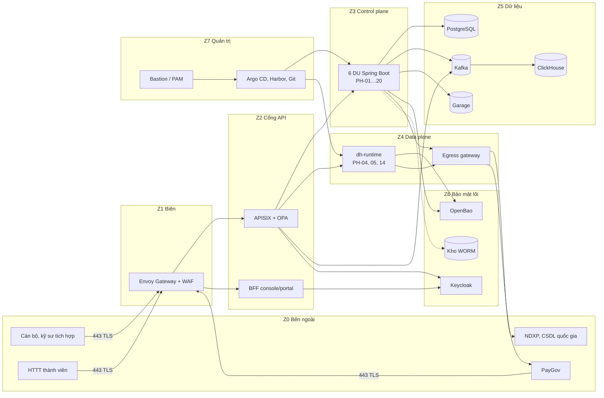
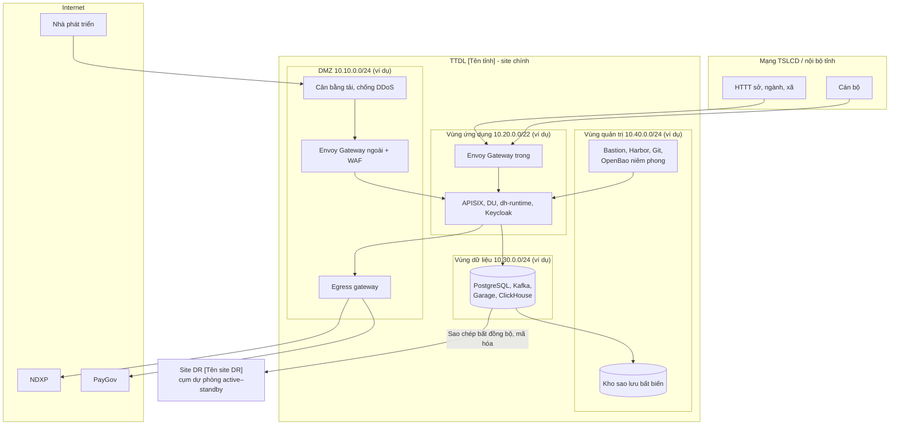
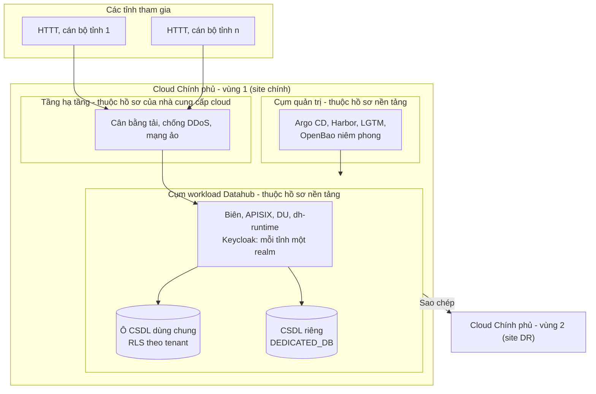

# D03-08 · Hồ sơ đề xuất cấp độ và phương án bảo vệ (bản mẫu)

## 1. Mục đích và cách dùng bản mẫu

### 1.1. Mục đích

Tài liệu này là **bản mẫu** của hồ sơ đề xuất cấp độ an ninh mạng cho hệ thống thông tin Datahub (nền tảng tích hợp, chia sẻ dữ liệu cấp tỉnh, thế hệ kế tiếp của LGSP). Mỗi lần triển khai — cho một tỉnh tự vận hành tại Trung tâm dữ liệu (TTDL) tỉnh, hoặc cho nền tảng dùng chung trên cloud Chính phủ — đơn vị lập hồ sơ sao bản mẫu, điền các chỗ trống trong ngoặc vuông, bỏ những đoạn không áp dụng cho hồ sơ triển khai của mình, rồi trình thẩm định theo Nghị định 331/2026/NĐ-CP về bảo vệ an ninh mạng đối với hệ thống thông tin.

Hồ sơ trả lời ba câu hỏi mà đơn vị thẩm định cần: hệ thống là gì, xử lý dữ liệu gì và ở quy mô nào (mục 3, 4); vì sao hệ thống thuộc cấp độ được đề xuất và không thuộc cấp độ khác (mục 5); và chủ quản bảo vệ hệ thống bằng cách nào, kiểm chứng ra sao trước khi đưa vào vận hành (mục 6, 7, 8). Phần thiết kế kỹ thuật chi tiết không chép lại ở đây mà dẫn chiếu tới thiết kế an toàn thông tin D03-07 (danh mục biện pháp `SEC-nn` và ma trận tuân thủ mục 11), thiết kế hạ tầng D03-09 và kế hoạch kiểm thử D05-01, D05-04. Các tài liệu đó được nộp kèm như thành phần của hồ sơ.

### 1.2. Thành phần hồ sơ

Thành phần chính xác của "Hồ sơ đề xuất cấp độ và phương án bảo vệ" theo Điều 25 Nghị định 331/2026 và các mẫu biểu kèm theo **chưa được đối chiếu toàn văn**. Bản mẫu này dựng theo cấu trúc thông lệ của hồ sơ cấp độ trong khung cũ (Nghị định 85/2016 và Thông tư 12/2022/TT-BTTTT), gồm ba khối: văn bản đề nghị thẩm định; thuyết minh đề xuất cấp độ; phương án bảo vệ. Khi có mẫu biểu chính thức, đơn vị lập hồ sơ chuyển nội dung tương ứng sang mẫu, giữ nguyên lập luận. Bảng dưới đây liệt kê các thành phần dự kiến, mục tương ứng trong bản mẫu và tài liệu nộp kèm.

| STT | Thành phần dự kiến | Nội dung | Vị trí trong bản mẫu | Tài liệu nộp kèm |
|---|---|---|---|---|
| 1 | Văn bản (tờ trình) đề nghị thẩm định cấp độ | Đề nghị của đơn vị vận hành hoặc chủ quản gửi đơn vị thẩm định | Mục 2 | — |
| 2 | Thuyết minh đề xuất cấp độ | Thông tin chung, mô tả hệ thống, quy mô dữ liệu, lập luận theo tiêu chí | Mục 3, 4, 5 | D03-01 SAD |
| 3 | Phương án bảo vệ | Biện pháp quản lý và kỹ thuật theo nhóm yêu cầu TCVN 14423:2026 cấp độ 3 | Mục 6 | D03-07 (mục 5, 11, 12), D03-09 |
| 4 | Lộ trình đáp ứng cấp độ cao hơn | Điểm chờ và điều kiện nâng cấp | Mục 7 | D03-07 mục 10 |
| 5 | Kế hoạch kiểm tra, đánh giá trước vận hành | Phạm vi, phương pháp, bằng chứng | Mục 8 | D05-01, D05-04 |
| 6 | Thuyết minh chuyển tiếp | Quan hệ với hồ sơ cấp độ của LGSP cũ | Mục 9 | — |
| 7 | Phụ lục | Danh mục tài sản, văn bản viện dẫn, bảng điền thông tin | Phụ lục A, B, C | — |

> **Câu hỏi mở Q320:** Điều 25 Nghị định 331/2026/NĐ-CP và mẫu biểu kèm theo (hoặc thông tư hướng dẫn của Bộ Công an, nếu có) quy định chính xác thành phần "Hồ sơ đề xuất cấp độ và phương án bảo vệ" gồm những tài liệu nào, theo mẫu nào, nộp bản giấy hay điện tử, số bộ? Bản mẫu này phải được chuyển sang mẫu chính thức khi có câu trả lời; cấu trúc ba khối ở bảng trên là giả định theo thông lệ khung cũ.

### 1.3. Hai hồ sơ triển khai, hai loại hồ sơ cấp độ

Datahub có một bộ mã nhưng hai cách đặt lên hạ tầng (D03-09 mục 3, ADR-036), và mỗi cách dẫn tới một loại hồ sơ cấp độ khác nhau về chủ thể và phạm vi. Bảng dưới đây giúp đơn vị lập hồ sơ chọn đúng nhánh trước khi điền.

| Khía cạnh | Hồ sơ `HT-A`: tỉnh độc lập on-prem | Hồ sơ `HT-B`: nền tảng dùng chung trên cloud Chính phủ |
|---|---|---|
| Hệ thống được xác định cấp độ | "Nền tảng tích hợp, chia sẻ dữ liệu tỉnh [Tên tỉnh]" — toàn bộ cụm Datahub tại TTDL tỉnh và site DR | (1) "Nền tảng Datahub dùng chung" — toàn bộ nền tảng phục vụ mọi tỉnh; (2) phần sử dụng của từng tỉnh, xem mục 5.6 |
| Chủ quản | [Cơ quan chủ quản] của tỉnh (UBND tỉnh hoặc cơ quan được giao) | Nền tảng: [Chủ quản nền tảng] (chưa xác định, Q323); phần của tỉnh: [Cơ quan chủ quản] của tỉnh |
| Số bộ hồ sơ | Một bộ cho mỗi tỉnh | Một bộ cho nền tảng, cộng một hồ sơ rút gọn cho mỗi tỉnh tham gia |
| Hồ sơ quy mô dùng để ước tính (D03-09 §2.2) | `QM-NHO`, `QM-VUA` hoặc `QM-LON` | `QM-CHUNG` |
| Ai lập | Đơn vị vận hành của tỉnh, nhà cung cấp hỗ trợ | Đơn vị vận hành nền tảng; tỉnh lập phần của mình |

Trong toàn bản mẫu, đoạn chỉ áp dụng cho một hồ sơ được mở đầu bằng nhãn **[HT-A]** hoặc **[HT-B]**; đoạn không có nhãn áp dụng cho cả hai.

### 1.4. Quy ước chỗ điền

Chỗ điền được viết trong ngoặc vuông, ví dụ `[Tên tỉnh]`, `[Cơ quan chủ quản]`, `[Số dân]`. Mỗi chỗ điền có một mã `TT-nn` (trường thông tin) tổng hợp ở Phụ lục C, kèm nguồn số liệu và người chịu trách nhiệm cung cấp. Số liệu ước tính trong bản mẫu (lấy từ hồ sơ quy mô D03-09) được đánh dấu "ước tính" và **phải được thay bằng số liệu khảo sát của tỉnh** trước khi trình; đơn vị thẩm định có quyền yêu cầu giải trình phương pháp tính. Bản mẫu không chứa địa chỉ IP, tên máy chủ hay bí mật thật; dải địa chỉ trong sơ đồ là ví dụ giả lập.

## 2. Văn bản đề nghị thẩm định (mẫu)

Văn bản đề nghị là thành phần đầu tiên của hồ sơ. Nội dung dưới đây là khung để đơn vị lập hồ sơ chuyển sang thể thức văn bản hành chính của cơ quan; thể thức, số hiệu và người ký theo quy định về công tác văn thư.

> **[Tên cơ quan đề nghị]** — Số: [Số văn bản] — [Địa danh], ngày [ngày] tháng [tháng] năm [năm]
>
> **V/v đề nghị thẩm định hồ sơ đề xuất cấp độ hệ thống thông tin "[Tên hệ thống]"**
>
> Kính gửi: [Đơn vị thẩm định].
>
> Căn cứ Luật An ninh mạng số 116/2025/QH15; Nghị định số 331/2026/NĐ-CP về bảo vệ an ninh mạng đối với hệ thống thông tin; TCVN 14423:2026 An ninh mạng – Hệ thống thông tin – Yêu cầu cơ bản; [Quyết định phê duyệt dự án/nhiệm vụ đầu tư số …];
>
> [Tên cơ quan đề nghị] đã xây dựng hồ sơ đề xuất cấp độ cho hệ thống thông tin "[Tên hệ thống]", do [Cơ quan chủ quản] là chủ quản, [Đơn vị vận hành] là đơn vị vận hành. Hệ thống là nền tảng tích hợp, chia sẻ dữ liệu của [Tên tỉnh / các tỉnh sử dụng nền tảng], kết nối [số HTTT] hệ thống thông tin của các sở, ngành, địa phương với nhau và với Nền tảng chia sẻ, điều phối dữ liệu quốc gia (NDXP), Nền tảng thanh toán trực tuyến (PayGov).
>
> Căn cứ tiêu chí tại Nghị định 331/2026/NĐ-CP, [Tên cơ quan đề nghị] đề xuất hệ thống ở **cấp độ 3**, với lý do chính là hệ thống xử lý dữ liệu cá nhân của [số ước tính] chủ thể dữ liệu cá nhân cơ bản và [số ước tính] chủ thể dữ liệu cá nhân nhạy cảm, vượt ngưỡng 100.000 và 10.000 chủ thể. Phương án bảo vệ được xây dựng theo yêu cầu cấp độ 3 của TCVN 14423:2026 và đã chừa sẵn điểm nâng lên cấp độ 4.
>
> Hồ sơ gửi kèm gồm: thuyết minh đề xuất cấp độ và phương án bảo vệ; thiết kế kiến trúc tổng thể; thiết kế an toàn thông tin; thiết kế hạ tầng, triển khai và khôi phục thảm họa; kế hoạch kiểm tra, đánh giá trước khi đưa vào vận hành; [ý kiến của bộ phận chuyên trách an ninh mạng, nếu mẫu yêu cầu].
>
> Đầu mối liên hệ: [Họ tên, chức vụ, điện thoại công vụ, thư điện tử công vụ].
>
> Đề nghị [Đơn vị thẩm định] xem xét, thẩm định./.

Đơn vị thẩm định và người phê duyệt phụ thuộc cấp độ. Theo kết quả tra cứu ban đầu, với cấp độ 3 thì chủ quản phê duyệt sau khi đơn vị chuyên trách về an ninh mạng thẩm định; với cấp độ 4 thì Bộ Công an chủ trì thẩm định. Phân công này chưa được đối chiếu toàn văn Nghị định 331/2026, nên đơn vị lập hồ sơ phải xác nhận trước khi gửi (Q321). Với hồ sơ `HT-B`, nếu nền tảng được xác định cấp độ 4 (mục 5.5) thì văn bản gửi Bộ Công an.

> **Câu hỏi mở Q321:** Theo Nghị định 331/2026, ở cấp độ 3 ai thẩm định (bộ phận chuyên trách an ninh mạng của chủ quản, Công an tỉnh, hay đơn vị chuyên trách của Bộ Công an) và ai phê duyệt (người đứng đầu cơ quan chủ quản hay UBND tỉnh)? Thời hạn thẩm định là bao lâu? Câu trả lời quyết định ô "Kính gửi" và luồng trình ký.

## 3. Thông tin chung về hệ thống

### 3.1. Thông tin định danh

Bảng dưới đây là thông tin định danh hệ thống và các bên liên quan. Cột "Ví dụ/gợi ý" giúp người điền hiểu loại thông tin cần ghi; cột cuối cho biết khác biệt giữa hai hồ sơ.

| Mã | Trường | Ví dụ/gợi ý | Khác biệt `HT-A` / `HT-B` |
|---|---|---|---|
| TT-01 | Tên hệ thống | "Nền tảng tích hợp, chia sẻ dữ liệu tỉnh [Tên tỉnh] (Datahub)" | `HT-B`: "Nền tảng Datahub dùng chung" |
| TT-02 | Tên viết tắt, mã hệ thống | `DATAHUB-[MÃ TỈNH]` | `HT-B`: `DATAHUB-CHUNG` |
| TT-03 | Cơ quan chủ quản | [Cơ quan chủ quản], người đứng đầu là chủ quản theo Điều 31 Nghị định 331/2026 | `HT-B`: [Chủ quản nền tảng] |
| TT-04 | Đơn vị vận hành | [Đơn vị vận hành], thường là Trung tâm Chuyển đổi số / TTDL tỉnh | `HT-B`: [Đơn vị vận hành nền tảng] |
| TT-05 | Bộ phận chuyên trách an ninh mạng | [Bộ phận chuyên trách ANM] được chủ quản giao bằng quyết định | Cả hai; `HT-B` có thêm bộ phận chuyên trách của nền tảng |
| TT-06 | Nhà cung cấp nền tảng phần mềm | [Nhà cung cấp] | — |
| TT-07 | Bên cung cấp hạ tầng | `HT-A`: TTDL tỉnh [Tên TTDL]; site DR [Tên site DR] | `HT-B`: [Nhà cung cấp cloud Chính phủ], vùng chính và vùng DR |
| TT-08 | Đầu mối an ninh mạng 24/7 | [Họ tên, điện thoại công vụ, thư điện tử công vụ] | Cả hai |
| TT-09 | Văn bản phê duyệt đầu tư | [Số, ngày quyết định phê duyệt dự án hoặc thuê dịch vụ] | — |
| TT-10 | Thời điểm dự kiến vận hành chính thức | [T0 + n tháng], sau cổng `RG-4` của D05-01 | — |
| TT-11 | Hệ thống thay thế | LGSP hiện hành của [Tên tỉnh], số quyết định phê duyệt cấp độ (nếu có) [Số QĐ] | Xem mục 9 |

### 3.2. Vai trò các bên

Bốn bên chịu trách nhiệm an ninh mạng cho Datahub, theo mô hình trách nhiệm chia sẻ ở D03-07 mục 12. **Chủ quản** chịu trách nhiệm cuối cùng: phê duyệt cấp độ, ban hành quy chế, bố trí bộ phận chuyên trách, chấp nhận rủi ro tồn dư và thực hiện nghĩa vụ thông báo. **Đơn vị vận hành** vận hành hằng ngày, giám sát và xử lý sự cố mức đầu. **Nhà cung cấp nền tảng** chịu trách nhiệm an toàn của phần mềm (vòng đời phát triển an toàn, bản vá, chuỗi cung ứng), và ở hồ sơ `HT-B` chịu thêm trách nhiệm vận hành an toàn toàn bộ phần nền tảng. **Bên cung cấp hạ tầng** chịu trách nhiệm an toàn vật lý, mạng nền, ảo hóa. Ranh giới giữa các bên được ghi trong hợp đồng, vì Điều 30 Nghị định 331/2026 cho phép hệ cấp độ 3–4 dùng chung hạ tầng cloud hoặc TTDL đạt yêu cầu và trách nhiệm phải phân định được khi kiểm tra.

**[HT-A]** Chủ quản và đơn vị vận hành thuộc cùng một tỉnh; nhà cung cấp hỗ trợ theo hợp đồng bảo trì; TTDL tỉnh là bên cung cấp hạ tầng. Bộ phận chuyên trách an ninh mạng của chủ quản thẩm định hồ sơ (nếu Q321 xác nhận) và kiểm tra định kỳ.

**[HT-B]** Có hai tầng chủ quản. Chủ quản nền tảng chịu trách nhiệm về toàn bộ nền tảng và hồ sơ cấp độ của nền tảng; chủ quản của mỗi tỉnh chịu trách nhiệm về phần cấu hình, người dùng, HTTT kết nối và dữ liệu trong tenant của tỉnh mình, và là bên kiểm soát dữ liệu cá nhân của tỉnh (D03-07 §6.2). Mục 5.6 trình bày cách hai tầng hồ sơ quan hệ với nhau.

## 4. Mô tả hệ thống

### 4.1. Mục tiêu

Datahub là điểm trung chuyển có kiểm soát cho mọi trao đổi dữ liệu giữa các hệ thống thông tin (HTTT) của [Tên tỉnh] với nhau và với các nền tảng quốc gia. Hệ thống phục vụ bốn mục tiêu nghiệp vụ được chủ đầu tư phê duyệt ở BRD (D02-01): mọi trao đổi dữ liệu đi qua một điểm có kiểm soát và có nhật ký (BO-01); dịch vụ công trực tuyến không gián đoạn vì nền tảng tích hợp, với độ sẵn sàng data plane ≥ 99,9% mỗi tháng (BO-02, NFR-00-010); tuân thủ pháp luật về dữ liệu và an ninh mạng, trong đó hồ sơ cấp độ được phê duyệt trước khi vận hành chính thức là chỉ tiêu KPI-08 (BO-04); và một nền tảng dùng chung được cho nhiều tỉnh để giảm chi phí triển khai lặp (BO-06). Hệ thống thay thế LGSP hiện hành theo cách thay dần (strangler), mỗi khối của hệ cũ được cắt chuyển khi khối thay thế đạt cổng `RG-5` (D05-01 §6.2).

### 4.2. Phạm vi và ranh giới hệ thống

Ranh giới hệ thống quyết định cái gì được xác định cấp độ cùng nhau và cái gì là hệ thống bên ngoài có hồ sơ riêng. Ranh giới được vạch theo nguyên tắc: mọi thành phần do chủ quản Datahub vận hành và cùng phục vụ chức năng tích hợp, chia sẻ dữ liệu đều nằm trong một HTTT duy nhất, kể cả các thành phần hỗ trợ (giám sát, sao lưu, chuỗi cung ứng). Nguyên tắc này đáp ứng yêu cầu cấm chia nhỏ hình thức để hạ cấp độ tại Điều 8 Nghị định 331/2026 (mục 5.2).

**Trong phạm vi** gồm 20 phân hệ PH-01…PH-20 đóng gói thành hai ứng dụng giao diện (`dh-console`, `dh-portal`), sáu đơn vị triển khai (DU) Spring Boot (`dh-connect`, `dh-integration`, `dh-data`, `dh-platform`, `dh-payment`, `dh-assist`), DU Camel Quarkus `dh-runtime`; các thành phần bên thứ ba chạy trên cùng cụm (Envoy Gateway và WAF Coraza, APISIX, Kafka và Apicurio, PostgreSQL trên CloudNativePG, ClickHouse cho siêu dữ liệu lượt gọi, Garage, Valkey, Keycloak, OPA, OpenBao, bộ quan sát OpenTelemetry/Mimir/Loki/Tempo/Grafana); công cụ triển khai và chuỗi cung ứng (kho Git cấu hình, Argo CD, Harbor, đường ống CI/CD); hạ tầng cụm Kubernetes tại site chính và site DR; kho sao lưu và kho WORM; các cầu nối tạm với LGSP cũ trong giai đoạn chuyển đổi.

**Ngoài phạm vi** là các HTTT thành viên của sở, ngành, xã; NDXP và các CSDL quốc gia; PayGov và kênh thanh toán; VNeID; hệ thống giám sát an ninh mạng (SIEM/SOC) của tỉnh; bản thân LGSP cũ. Các hệ này có chủ quản và hồ sơ cấp độ riêng. Datahub xử lý ranh giới với chúng theo giả định chúng có thể bị xâm phạm (D03-07 §1.2): xác thực máy–máy, kiểm tra đầu vào, giới hạn đích ra ngoài. **[HT-B]** Hạ tầng cloud (phòng máy, mạng ảo, ảo hóa, lưu trữ khối) thuộc hồ sơ cấp độ của nhà cung cấp cloud; nền tảng Datahub kế thừa biện pháp của tầng này theo Điều 30 (Q329).

### 4.3. Người dùng

Người dùng của Datahub gồm người và hệ thống. Bảng dưới đây nêu nhóm người dùng, cách truy cập và số lượng ước tính theo hồ sơ quy mô của D03-09 §2.2; tỉnh thay bằng số liệu thực ở `TT-20`.

| Nhóm | Mô tả | Truy cập | `QM-NHO` | `QM-VUA` | `QM-LON` | `QM-CHUNG` |
|---|---|---|---|---|---|---|
| Quản trị nền tảng và quản trị tỉnh | Cấu hình tenant, người dùng, chính sách | `dh-console` qua mạng nội bộ/TSLCD, bắt buộc MFA (SEC-23) | ~10 | ~20 | ~40 | ~700 (34 tỉnh) + ~20 nền tảng |
| Cán bộ nghiệp vụ, người duyệt | Duyệt kết nạp, duyệt luồng, đối soát thanh toán, quản lý danh mục | `dh-console` | ~490 | ~1.980 | ~5.960 | ~69.000 |
| Kỹ sư tích hợp, nhà thầu HTTT | Đăng ký API, thử nghiệm, lấy thông tin xác thực | `dh-portal` (cổng nhà phát triển) | trong tổng trên | trong tổng trên | trong tổng trên | trong tổng trên |
| HTTT thành viên | Gọi API, nhận sự kiện, webhook | OAuth 2.1 `client_credentials` + mTLS hoặc `private_key_jwt` (SEC-24) | 50 | 200 | 500 | ~6.000 |
| Công dân (gián tiếp) | Trình duyệt chuyển hướng qua PayGov khi thanh toán | Không có tài khoản Datahub | — | — | — | — |
| Người dùng đồng thời trên giao diện | Cao điểm | — | 50 | 200 | 500 | 3.000 |

Công dân không đăng nhập Datahub; dữ liệu của họ chỉ đi qua hoặc được lưu do HTTT khác gửi tới. Đây là điểm khác biệt quan trọng khi tính số chủ thể dữ liệu cá nhân ở mục 4.9: số tài khoản người dùng nhỏ, nhưng số chủ thể có dữ liệu được xử lý lớn hơn nhiều bậc.

### 4.4. Kiến trúc logic

Sơ đồ dưới đây là kiến trúc logic của Datahub, thể hiện các vùng tin cậy `Z0`…`Z7` (D03-07 §3.3) và các thành phần chính trong từng vùng. Mũi tên là chiều khởi tạo kết nối được phép.

Sơ đồ cho thấy ba tính chất mà phương án bảo vệ dựa vào. Thứ nhất, không có đường nào từ bên ngoài vào thẳng vùng ứng dụng hay vùng dữ liệu mà không qua biên (WAF, TLS) và cổng API (xác thực, ủy quyền OPA, giới hạn tốc độ). Thứ hai, mọi kết nối ra ngoài, kể cả tới NDXP và PayGov, chỉ đi qua egress gateway có danh sách đích khai báo (SEC-16), nên một thành phần bị chiếm quyền không thể tùy ý gửi dữ liệu ra ngoài. Thứ ba, con người chỉ truy cập hạ tầng qua vùng quản trị Z7 có VPN, MFA và ghi phiên (SEC-19, SEC-28); không có thao tác tay trên môi trường vận hành ngoài quy trình GitOps (SEC-07, SEC-59).

### 4.5. Sơ đồ vật lý và phân vùng mạng

Sơ đồ vật lý chi tiết, dải địa chỉ và quy tắc tường lửa nằm ở D03-09 §3.1 (`HT-A`) và §3.2 (`HT-B`), nộp kèm hồ sơ. Vùng tin cậy logic của D03-07 và vùng mạng hạ tầng của D03-09 được hiện thực chồng lên nhau: vùng mạng hạ tầng là lớp tường lửa của TTDL hoặc nhóm bảo mật của cloud, vùng logic là namespace Kubernetes với network policy từ chối mặc định (SEC-13, SEC-14). Bảng dưới đây ánh xạ hai cách chia để đơn vị thẩm định đối chiếu hai tài liệu.

| Vùng mạng hạ tầng (D03-09) | Vùng logic (D03-07) | Thành phần chính |
|---|---|---|
| Internet, mạng TSLCD/nội bộ tỉnh | Z0 | Người dùng, HTTT, NDXP, PayGov |
| DMZ | Z1 và phần ra của Z4 | Cân bằng tải, chống DDoS, Envoy Gateway ngoài, egress gateway |
| Vùng ứng dụng (node pool không trạng thái) | Z2, Z3, Z4, phần Keycloak của Z6 | Envoy Gateway trong, APISIX, BFF, DU, `dh-runtime`, Keycloak |
| Vùng dữ liệu (node pool có trạng thái) | Z5 | PostgreSQL, Kafka, Garage, ClickHouse |
| Vùng quản trị | Z7 và phần OpenBao niêm phong, kho sao lưu của Z6 | Bastion, Harbor, Git, OpenBao niêm phong, kho sao lưu S3 bất biến, NTP, DNS |
| Liên site | — | Sao chép CSDL, Kafka MirrorMaker 2, Garage, Harbor, Git |

**[HT-A]** Sơ đồ dưới đây là bản rút gọn của D03-09 §3.1 cho hồ sơ tỉnh độc lập, đủ để đơn vị thẩm định thấy vị trí hệ thống trong TTDL tỉnh.

Hồ sơ tỉnh độc lập có hai cửa vào tách biệt: cửa ngoài trong DMZ chỉ phục vụ cổng nhà phát triển và callback PayGov, cửa trong phục vụ HTTT và cán bộ trên mạng TSLCD, nhờ đó giao diện quản trị không bao giờ lộ ra Internet. Vùng ứng dụng và vùng dữ liệu là hai dải nút khác nhau, nên tường lửa của TTDL chặn được luồng ở tầng nút độc lập với network policy trong cụm — hai lớp phòng thủ không phụ thuộc nhau. Site DR nhận dữ liệu sao chép liên tục và chạy ở quy mô tối thiểu (ADR-034); mục tiêu RPO ≤ 15 phút, RTO ≤ 1 giờ cho data plane và ≤ 4 giờ cho control plane (NFR-00-014).

**[HT-B]** Nền tảng dùng chung có cấu trúc tương tự nhưng hiện thực bằng mạng ảo và nhóm bảo mật của cloud, mỗi vùng cloud có một cụm workload và một cụm quản trị, tenant ở chế độ `SHARED` được xếp vào các ô CSDL (mỗi ô khoảng 8–10 tenant) và tenant có yêu cầu cao hơn dùng `DEDICATED_DB` (D03-09 §3.2, D03-10). Sơ đồ dưới đây chỉ thể hiện các điểm khác `HT-A` có ý nghĩa với hồ sơ cấp độ.

Sơ đồ phân ba lớp trách nhiệm tương ứng ba hồ sơ: tầng hạ tầng cloud có hồ sơ của nhà cung cấp cloud; cụm workload và cụm quản trị thuộc hồ sơ nền tảng; còn phần cấu hình, người dùng và dữ liệu của mỗi tỉnh nằm trong tenant và thuộc hồ sơ rút gọn của tỉnh đó (mục 5.6). Cách ly giữa các tỉnh được thực thi ở tầng hạ tầng (RLS, ACL Kafka, realm Keycloak, khóa mã hóa riêng theo tenant), không chỉ ở mã ứng dụng (SEC-80…88).

### 4.6. Danh mục thành phần và tài sản

Danh mục tài sản đầy đủ có mã `AS-nn` ở D03-07 §3.1 và được kiểm kê tự động hằng ngày từ kho Git cấu hình và Harbor (SEC-04). Bảng dưới đây gom tài sản theo nhóm để đơn vị thẩm định nắm quy mô; Phụ lục A là bảng chi tiết để tỉnh điền số lượng thực tế.

| Nhóm | Tài sản (mã D03-07) | Mức dữ liệu cao nhất | Mức quan trọng với sẵn sàng |
|---|---|---|---|
| Ứng dụng control plane | AS-01, AS-02 (`dh-payment`), AS-03 (`dh-assist`), AS-05 (giao diện) | Nhạy cảm | Trung bình–cao |
| Data plane | AS-04 (APISIX, `dh-runtime`, Kafka) | Nhạy cảm (dữ liệu đi qua) | Rất cao |
| Kho dữ liệu | AS-06 (PostgreSQL), AS-07 (Garage), AS-09 (Valkey), ClickHouse (chưa có mã, xem mục 11) | Nhạy cảm | Cao |
| Bảo mật lõi | AS-10 (Keycloak), AS-11 (OpenBao), AS-12 (chính sách OPA) | Bí mật kỹ thuật | Rất cao |
| Nhật ký và giám sát | AS-08 (kho WORM), AS-15 (quan sát), AS-16 (nhật ký kiểm toán) | Hạn chế (đã che) | Trung bình |
| Triển khai, chuỗi cung ứng | AS-13 (cấu hình, Argo CD), AS-14 (kho mã, CI, Harbor, khóa ký) | Nội bộ; khóa ký là bí mật kỹ thuật | Cao |
| Sao lưu | AS-17 | Nhạy cảm (trường vẫn mã hóa) | Cao khi DR |
| Hạ tầng | AS-18 (nút, etcd, Cilium, Istio) | Bí mật kỹ thuật | Rất cao |
| Thông tin xác thực ra ngoài | AS-19 (client NDXP, khóa PayGov) | Bí mật kỹ thuật | Cao |

Quy mô phần cứng phụ thuộc hồ sơ quy mô: theo D03-09 §5.5, `HT-A` tối thiểu ba máy chủ vật lý là ba vùng lỗi độc lập (bốn máy với `QM-VUA` trở lên) ở mỗi site; `HT-B` dùng tài nguyên cloud trên tối thiểu ba vùng sẵn sàng mỗi vùng cloud (D03-09 §5.6). Số lượng chính xác điền ở `TT-30`.

### 4.7. Kết nối với hệ thống bên ngoài

Bảng dưới đây liệt kê các kết nối ra ngoài ranh giới hệ thống, chiều khởi tạo và biện pháp bảo vệ. Đây là các điểm đơn vị thẩm định thường kiểm tra kỹ nhất vì là nơi dữ liệu rời khỏi phạm vi kiểm soát của chủ quản.

| Kết nối | Chiều | Dữ liệu trao đổi | Bảo vệ | Biện pháp |
|---|---|---|---|---|
| HTTT thành viên gọi API | Vào | Dữ liệu nghiệp vụ, có thể chứa DLCN cơ bản và nhạy cảm | TLS 1.3 (1.2 với bộ mã an toàn cho hệ cũ); OAuth 2.1 client_credentials; mTLS hoặc private_key_jwt bắt buộc với hợp đồng mức Nhạy cảm; OPA theo mục đích | SEC-11, 12, 24, 26, 43 |
| Webhook tới HTTT | Ra | Sự kiện nghiệp vụ | HTTPS, chữ ký HMAC-SHA256, chống phát lại; đích khai báo trước | SEC-16, 47 |
| NDXP và CSDL quốc gia (PH-14) | Ra | Tra cứu dân cư, đất đai, doanh nghiệp… cho TTHC | Token do NDXP cấp, TLS, địa chỉ ra cố định; bắt buộc mã mục đích và chấp thuận; nhật ký có băm khóa tra cứu | SEC-16, 37, 60; NĐ 278/2025 |
| PayGov (PH-19) | Vào và ra | Yêu cầu thanh toán, kết quả, tệp đối soát | Callback có chữ ký, khóa ký trong OpenBao transit; không tin kết quả từ trình duyệt | SEC-36, 48, 67 |
| Danh mục dùng chung quốc gia | Ra | Danh mục (không chứa DLCN) | TLS, egress có danh sách | SEC-16 |
| SIEM/SOC của tỉnh hoặc cơ quan chuyên trách | Ra | Log an ninh đã lọc DLCN | Syslog TLS hoặc OTLP qua mTLS | SEC-63, 66 |
| LGSP cũ (giai đoạn chuyển đổi) | Hai chiều | Bản tin qua cầu nối Pulsar–Kafka, gateway cũ – APISIX; dữ liệu di trú | Kết nối trong mạng nội bộ, tài khoản riêng có thời hạn, tháo bỏ khi cắt chuyển khối | Mục 9 |

> **Câu hỏi mở Q322:** NDXP và PayGov có yêu cầu riêng về cấp độ an ninh mạng tối thiểu của LGSP cấp tỉnh kết nối vào (ví dụ bắt buộc cấp độ 3 đã phê duyệt mới cấp thông tin xác thực) không? Với `HT-B`, một nền tảng gọi thay nhiều tỉnh thì đăng ký kết nối theo nền tảng hay theo từng tỉnh (liên quan Q334 của D03-09)?

### 4.8. Loại và khối lượng dữ liệu xử lý

Datahub xử lý hai loại dữ liệu khác nhau về bản chất (SAD §8.3). **Dữ liệu đi qua** là nội dung bản tin giữa các HTTT: mặc định không lưu, chỉ lưu siêu dữ liệu (ai gọi, gọi gì, khi nào, kết quả); nội dung chỉ lưu tạm trong hàng đợi lỗi tối đa 7 ngày, được mã hóa. **Dữ liệu lưu lại** là dữ liệu Datahub làm chủ: danh mục dùng chung, dữ liệu chủ công dân và tổ chức (PH-06), giao dịch thanh toán (PH-19), cấu hình, tài khoản người dùng, nhật ký kiểm toán. Mỗi trường dữ liệu được gán một trong bốn mức phân loại nội bộ (Công khai, Nội bộ, Hạn chế, Nhạy cảm), quyết định cách lưu, ghi log và hiển thị (D03-07 §3.2).

Bảng dưới đây tóm tắt khối lượng dữ liệu theo hồ sơ quy mô, lấy từ D03-09 §2.2–2.4; tỉnh điền số liệu khảo sát ở `TT-21`…`TT-23`.

| Chỉ số | `QM-NHO` | `QM-VUA` | `QM-LON` | `QM-CHUNG` |
|---|---|---|---|---|
| Lượt gọi API/ngày | 1 triệu | 5 triệu | 15 triệu | 170 triệu |
| Trong đó tới NDXP qua PH-14 (10%) | 0,1 triệu | 0,5 triệu | 1,5 triệu | 17 triệu |
| Sự kiện Kafka nghiệp vụ/ngày | 0,3 triệu | 2 triệu | 6 triệu | 70 triệu |
| Giao dịch thanh toán/ngày (ước tính) | ~10.000 | ~50.000 | ~150.000 | ~1,7 triệu |
| CSDL nghiệp vụ sau 12 tháng | 60 GB | 250 GB | 700 GB | 6,5 TB |
| Kho tệp nghiệp vụ sau 12 tháng | 50 GB | 200 GB | 600 GB | 6 TB |
| Kho WORM kiểm toán | 20 GB/năm | 60 GB/năm | 180 GB/năm | 2 TB/năm |

Toàn bộ dữ liệu, kể cả bản sao lưu, nhật ký và site DR, được lưu trong lãnh thổ Việt Nam (ràng buộc ở BRD và D03-09 §3.2).

### 4.9. Ước tính số chủ thể dữ liệu cá nhân

Số chủ thể dữ liệu cá nhân (DLCN) là tiêu chí quyết định cấp độ của Datahub (mục 5.3), nên phương pháp ước tính được trình bày tường minh để đơn vị thẩm định kiểm tra lại. Ba quy ước được áp dụng. Một, "xử lý" được hiểu theo Luật Bảo vệ dữ liệu cá nhân số 91/2025/QH15, bao gồm cả thu thập, truyền đưa và lưu trữ, nên dữ liệu đi qua cũng được tính dù Datahub không lưu nội dung; nếu đơn vị thẩm định chỉ tính dữ liệu lưu lại, bảng vẫn cho kết luận như nhau vì riêng PH-19 và PH-06 đã vượt ngưỡng. Hai, số chủ thể là số người khác nhau trong 12 tháng, không phải số lượt. Ba, "DLCN nhạy cảm" ở đây là khái niệm pháp lý theo Luật 91/2025 và Nghị định 356/2025, **khác** với mức phân loại nội bộ "Nhạy cảm" của Datahub: ví dụ số định danh cá nhân được Datahub xếp mức Nhạy cảm để mã hóa trường, nhưng về pháp lý có thể là DLCN cơ bản; ngược lại dữ liệu sức khỏe, tài chính đi qua từ HTTT ngành là DLCN nhạy cảm dù Datahub không lưu.

| Nguồn | Loại DLCN | Cơ sở ước tính | `QM-NHO` (~[1] triệu dân) | `QM-VUA` (~[2,5] triệu dân) | `QM-LON` (~[5] triệu dân) | `QM-CHUNG` |
|---|---|---|---|---|---|---|
| PH-14 tra cứu CSDL quốc gia về dân cư (đi qua) | Cơ bản | Lượt tra cứu/ngày × 365, giả định mỗi người được tra trung bình 1–3 lần/năm | ≥ 300.000 | ≥ 1 triệu | ≥ 2 triệu | ≥ 30 triệu |
| Bản tin giữa HTTT ngành (đi qua): y tế, bảo hiểm, tư pháp, lao động | Cơ bản và nhạy cảm | Tỷ lệ dân có giao dịch TTHC liên thông trong năm | ≥ 100.000 nhạy cảm | ≥ 250.000 nhạy cảm | ≥ 500.000 nhạy cảm | ≥ 10 triệu nhạy cảm |
| PH-19 giao dịch thanh toán (lưu lại) | Cơ bản; thông tin tài khoản có thể là nhạy cảm | Giao dịch/năm chia số giao dịch trung bình mỗi người | ≥ 200.000 | ≥ 500.000 | ≥ 1 triệu | ≥ 15 triệu |
| PH-06 dữ liệu chủ công dân (lưu lại, đợt 3) | Cơ bản | Tỷ lệ dân có bản ghi vàng sau 12 tháng bật phân hệ | 50–100% dân số | 50–100% dân số | 50–100% dân số | 50–100% dân số các tỉnh dùng PH-06 |
| Tài khoản người dùng, nhật ký kiểm toán (lưu lại) | Cơ bản (cán bộ) | Số tài khoản | ~500 | ~2.000 | ~6.000 | ~70.000 |
| **Tổng hợp (lấy giá trị lớn nhất, không cộng trùng)** | Cơ bản | | **≥ 300.000** | **≥ 1 triệu** | **≥ 2 triệu** | **≥ 30 triệu** |
| | Nhạy cảm | | **≥ 100.000** | **≥ 250.000** | **≥ 500.000** | **≥ 10 triệu** |

Các con số là cận dưới thận trọng; tỉnh điền dân số thực ở `TT-24` và số liệu lưu lượng của LGSP cũ ở `TT-25` để tính lại theo cùng phương pháp. Kết luận quan trọng là **ngay ở hồ sơ quy mô nhỏ nhất, số chủ thể vượt ngưỡng 100.000 (cơ bản) ít nhất ba lần và ngưỡng 10.000 (nhạy cảm) ít nhất mười lần**, nên sai số của phương pháp ước tính không làm thay đổi kết luận cấp độ 3. Điều cần chú ý ngược lại là chiều cao: nếu Nghị định 331/2026 có ngưỡng DLCN cho cấp độ 4, các con số ở cột `QM-LON` và `QM-CHUNG`, và cả PH-06 ở mọi cột khi được bật, phải được so với ngưỡng đó (mục 5.5).

> **Câu hỏi mở Q325:** Cách đếm chủ thể DLCN để áp tiêu chí cấp độ có tính dữ liệu chỉ truyền đưa qua (không lưu) không, và đếm theo năm, theo thời điểm hay lũy kế? Danh mục DLCN nhạy cảm theo Luật 91/2025 và Nghị định 356/2025 có bao gồm thông tin tài khoản thanh toán và dữ liệu tiền án, tiền sự đi qua Datahub không? Cần pháp chế của chủ quản xác nhận để bảng 4.9 dùng đúng định nghĩa.

