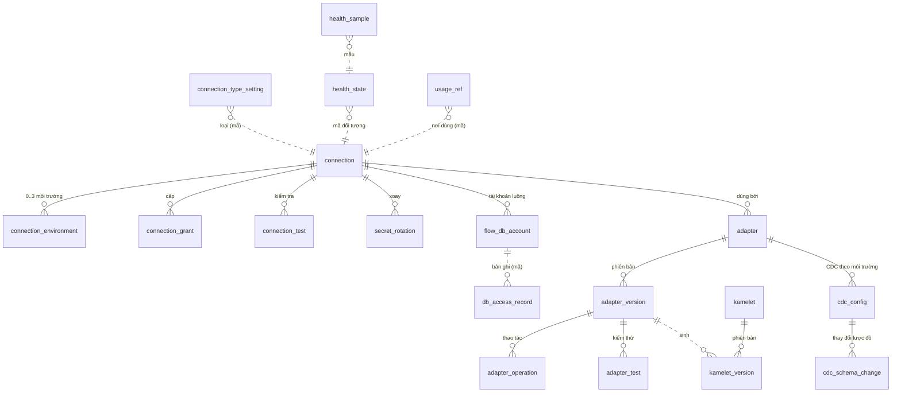

# D03-03-PH05 · Thiết kế CSDL Bộ điều hợp và kết nối

## Tóm tắt cho hội đồng thẩm định

Schema `ph05_adapter` trên cụm `pg-core` có 23 bảng cho 18 thực thể của [D02-03-PH05](../../02-yeu-cau/frs/D02-03-PH05-frs-bo-dieu-hop.md) §4.2. Ba điểm chính:

1. **Không có giá trị bí mật trong CSDL.** Bảng chỉ lưu số phiên bản bí mật ở OpenBao; ràng buộc `CHECK` chặn khóa có tên bí mật trong tham số và trong outbox như lớp phòng thủ thứ hai (BR-05-001).
2. **Quy tắc bốn mắt và vòng đời được khóa ở CSDL**, không chỉ ở dịch vụ: người ghi bí mật không duyệt được môi trường PROD, người gửi không duyệt được phiên bản của mình, tài khoản ghi CSDL phải có SO đồng ý và hạn ≤ 90 ngày, phiên bản bộ điều hợp đã duyệt là bất biến.
3. **Cô lập tenant bằng `FORCE ROW LEVEL SECURITY`** trên mọi bảng nghiệp vụ; Kamelet nền và dùng chung nằm ở tenant `COMMON`, tỉnh đọc được nhưng không ghi được.

DDL [`ph05/ddl/ph05_adapter.sql`](ph05/ddl/ph05_adapter.sql) đã chạy thử trên PostgreSQL 16 sạch; bài kiểm [`ph05/test/ph05_isolation_test.sql`](ph05/test/ph05_isolation_test.sql) đạt 23/23 khối (§4.2).

## 1. Chiến lược lưu trữ

### 1.1. Schema, vai trò và kết nối

Schema `ph05_adapter` (quy ước `ph{nn}_{miền}`) do `ph05_owner` (NOLOGIN) sở hữu. `dh-integration` kết nối bằng `dh_integration_app`, thành viên `ph05_app` (chỉ DML, không `BYPASSRLS`); Liquibase chạy bằng `dh_integration_migrator` (thành viên `ph05_owner`); báo cáo, kiểm toán đọc bằng `ph05_readonly`, không đọc được bản tin mẫu của thao tác và thân YAML Kamelet (quyền theo cột). Module `adapter` và module `flow` (PH-04) cùng DU nhưng mỗi module chỉ đọc ghi schema của mình; PH-05 lấy thông tin luồng qua `FlowQueryApi`, không truy vấn `ph04`.

`dh-runtime` **không** kết nối `ph05_adapter`. Runtime nhận tệp kê khai kết nối qua API-05-032 và sự kiện, đọc bí mật trực tiếp ở OpenBao, gửi bản ghi truy cập CSDL qua Kafka (EVT-05-14). Kafka Connect không kết nối schema này.

Schema cũ `ph05` (bảng `ph05.adapter` của `apps/adapter-mgr`, W1) được di trú bằng changeset `ph05-9000` rồi đổi tên thành `adapter_legacy_w1` (§8.2).

### 1.2. Cách ly tenant

Mọi bảng nghiệp vụ có `tenant_id varchar(16)` và bật `FORCE ROW LEVEL SECURITY` qua `ph05_adapter.p_enable_rls(bảng, mẫu)`, cùng hai mẫu với PH-04:

| Mẫu | Đọc | Ghi | Bảng |
|---|---|---|---|
| P (riêng) | Dòng của tenant phiên | Dòng của tenant phiên (tỉnh) | 20 bảng tác nghiệp |
| S (dùng chung) | Dòng của tenant phiên và `COMMON` | Dòng tỉnh khi phiên là tỉnh; dòng `COMMON` khi phiên là `PLATFORM` | `kamelet`, `kamelet_version` |

Kamelet `BASE` (đóng cùng ảnh runtime) và `COMMON` (dùng chung, PA duyệt) lưu với `tenant_id = 'COMMON'`; ràng buộc `ck_kamelet_scope_tenant` bảo đảm phạm vi khớp tenant. Biến phiên `app.tenant_id` đặt đầu mỗi giao dịch bằng `TenantAwareTransactionManager`; tác vụ nền liên tenant (đánh giá sức khỏe, hết hạn tài khoản) lặp từng tenant. `shedlock` là bảng kỹ thuật không có `tenant_id`.

### 1.3. Quy ước bảng

Theo D00-01 §5.1: `id uuid` (UUID v7 sinh ở ứng dụng), `created_*`, `updated_*`, `version` (trigger `tg_touch`). Ngoại lệ có chủ đích:

| Bảng | Ngoại lệ | Lý do |
|---|---|---|
| `health_sample`, `health_state`, `health_baseline`, `usage_ref` | Khóa tự nhiên, không có `id`, không có cột sửa | Dữ liệu đo hoặc chỉ mục tính lại được |
| `connection_test`, `adapter_test`, `legacy_import_job` | Không có `version`, `updated_*` | Chỉ máy chủ đổi trạng thái `RUNNING` → kết quả |
| `db_access_record` | Khóa `(event_id, occurred_at)`, chỉ thêm (trigger `tg_append_only`) | Nhật ký kiểm toán, phân vùng tháng |
| `cdc_schema_change` | Không có `version`; chỉ cột xử lý được cập nhật (quyền theo cột) | Bản ghi giữ vĩnh viễn |
| `outbox` | Khóa `event_id` | DD-11 |

Trạng thái dùng `varchar` + `CHECK` liệt kê đúng FRS §4.3–4.7; thêm giá trị là một changeset mới.

### 1.4. Quy tắc nghiệp vụ chốt ở CSDL

| Ràng buộc | Quy tắc | BR, FR |
|---|---|---|
| `ck_connection_environment_no_secret_in_params`, `ck_outbox_no_secret` | Không khóa `password`, `secret`, `clientSecret`, `apiKey`, `token`, `privateKey`, `passphrase` trong JSON | BR-05-001 |
| `ck_connection_environment_enabled` | `ENABLED` phải có lần kiểm tra đạt và bí mật đã khai | BR-05-006 |
| `ck_connection_environment_prod_approval`, `ck_connection_environment_four_eyes` | PROD bật phải có người duyệt khác người yêu cầu và người ghi bí mật | BR-05-009 |
| `uq_secret_rotation_open` | Một lần xoay mở mỗi (kết nối, môi trường) | FR-05-012, ERR-05-036 |
| `uq_adapter_version_one_draft`, `uq_adapter_version_one_approved`, `tg_adapter_version_frozen` | Một bản nháp, một bản hiệu lực; bản duyệt bất biến (chỉ được chuyển `SUPERSEDED`) | BR-05-016 |
| `ck_adapter_version_four_eyes`, `ck_kamelet_version_four_eyes` | Người gửi không tự duyệt | BR-05-017, BR-05-027 |
| `ck_flow_db_account_read_ops`, `_write_tables`, `_write_until`, `_write_consent`, `_four_eyes` | Tài khoản đọc chỉ `SELECT`; ghi phải nêu bảng, ≤ 90 ngày, có SO đồng ý, IA khác người yêu cầu và SO | BR-05-020, ADR-067 |
| `ck_adapter_cdc_group` | CDC chỉ cho HTTT nhóm 3, 4 | FR-05-048 |
| `ck_cdc_config_topic_tenant`, `ck_outbox_topic_tenant` | Topic mang đúng mã tenant | D03-10 |
| `ck_kamelet_base_prefix`, `ck_kamelet_reserved_prefix` | Tiền tố `dh-` dành riêng cho Kamelet nền | FR-05-055 |
| `ck_kamelet_version_submit` | Chỉ gửi duyệt khi kiểm tra tĩnh đạt | FR-05-056 |

## 2. Sơ đồ thực thể – quan hệ

Đường liền là khóa ngoại thật, đều kèm `tenant_id` (`FOREIGN KEY (x_id, tenant_id)`) nên không thể trỏ chéo tenant. Đường chấm là liên kết theo mã không có khóa ngoại: `health_*`, `usage_ref`, `db_access_record` gắn theo `object_code`, `connection_code`, `flow_code` vì dữ liệu đến từ runtime hoặc là chỉ mục tính lại, và vì phân vùng tháng không nhận khóa ngoại vào. Ba vòng đời tách biệt: kết nối (cấu hình, bí mật), bộ điều hợp (nội dung, phiên bản, CDC), Kamelet (danh mục).

## 3. Đặc tả bảng

Phần dưới sinh bằng [`ph05/tools/gen_tables_md.py`](ph05/tools/gen_tables_md.py) từ DDL (`COMMENT ON`); sửa ở DDL rồi sinh lại, không sửa tay.

<!-- gen:tables:start -->
### 3.1. `connection_type_setting`

EN-05-01 phần tenant: bật, tắt loại kết nối và trần tham số (FR-05-061). Danh mục loại đóng gói trong dh-integration (classpath conntypes/*.json), không lưu ở CSDL.

| Cột | Kiểu | Bắt buộc | Mặc định | Ghi chú |
|---|---|---|---|---|
| `id` | `uuid` | x |  | Khóa chính, UUID v7 sinh ở ứng dụng (D00-01 §5). |
| `tenant_id` | `varchar(16)` | x |  | Mã tenant `T{nn}` (hoặc `COMMON` ở bảng dùng chung); khóa RLS. |
| `type_code` | `varchar(32)` | x |  |  |
| `enabled` | `boolean` | x | `true` |  |
| `block_new` | `boolean` | x | `false` | true: loại vẫn chạy cho kết nối đang có nhưng chặn tạo mới (tắt mềm). |
| `ceilings` | `jsonb` | x | `'{}'` | Trần tham số theo tenant, ví dụ {"timeoutMs":60000,"maxConcurrency":20}; chỉ thu hẹp trần nền tảng. |
| `created_at` | `timestamptz` | x | `now()` | Thời điểm tạo. |
| `created_by` | `varchar(64)` | x |  | Người tạo (mã người dùng hoặc `system:*`). |
| `updated_at` | `timestamptz` | x | `now()` | Thời điểm sửa cuối (trigger `tg_touch`). |
| `updated_by` | `varchar(64)` | x |  | Người sửa cuối. |
| `version` | `integer` | x | `0` | Khóa lạc quan; thành phần của ETag (`If-Match`). |

### 3.2. `connection`

EN-05-02 Kết nối nguồn (FR-05-004). Mã bất biến, không dùng lại kể cả khi RETIRED (BR-05-004). Bí mật ở OpenBao kv/dh/{tenant}/conn/{code}/{env}.

| Cột | Kiểu | Bắt buộc | Mặc định | Ghi chú |
|---|---|---|---|---|
| `id` | `uuid` | x |  | Khóa chính, UUID v7 sinh ở ứng dụng (D00-01 §5). |
| `tenant_id` | `varchar(16)` | x |  | Mã tenant `T{nn}` (hoặc `COMMON` ở bảng dùng chung); khóa RLS. |
| `code` | `varchar(63)` | x |  |  |
| `name` | `varchar(255)` | x |  |  |
| `type_code` | `varchar(32)` | x |  |  |
| `system_code` | `varchar(64)` | x |  | Mã HTTT ở PH-01 (bản sao system_replica); không khóa ngoại vì khác schema, kiểm ở dịch vụ. |
| `purpose` | `varchar(10)` | x |  |  |
| `description` | `varchar(2000)` |  |  |  |
| `owner` | `varchar(64)` | x |  |  |
| `labels` | `varchar(32)[]` | x | `'{}'` |  |
| `status` | `varchar(10)` | x | `'DRAFT'` |  |
| `status_reason` | `varchar(1000)` |  |  |  |
| `suspended_by_role` | `varchar(4)` |  |  | SO khi SO tạm ngừng: chỉ SO được tiếp tục (FR-05-008). |
| `config_version` | `integer` | x | `1` | Tăng mỗi lần đổi tham số hoặc bí mật ở bất kỳ môi trường; runtime bỏ qua sự kiện cũ hơn (lũy đẳng). |
| `legacy_ref` | `varchar(255)` |  |  | Vị trí trong hệ cũ (tệp Context XML, tên bean) khi tạo từ nhập hệ cũ (FR-05-016). |
| `retired_at` | `timestamptz` |  |  |  |
| `secret_destroy_at` | `timestamptz` |  |  | Hạn hủy bí mật = retired_at + 30 ngày (BR-05-012); SecretDestroyJob xử lý. |
| `created_at` | `timestamptz` | x | `now()` | Thời điểm tạo. |
| `created_by` | `varchar(64)` | x |  | Người tạo (mã người dùng hoặc `system:*`). |
| `updated_at` | `timestamptz` | x | `now()` | Thời điểm sửa cuối (trigger `tg_touch`). |
| `updated_by` | `varchar(64)` | x |  | Người sửa cuối. |
| `version` | `integer` | x | `0` | Khóa lạc quan; thành phần của ETag (`If-Match`). |

### 3.3. `connection_environment`

EN-05-03 Giá trị môi trường (FR-05-005, 006, 007). Tối đa ba dòng mỗi kết nối. Giá trị PROD đang ENABLED khi sửa giữ bản chờ ở pending_* (BR-05-010).

| Cột | Kiểu | Bắt buộc | Mặc định | Ghi chú |
|---|---|---|---|---|
| `id` | `uuid` | x |  | Khóa chính, UUID v7 sinh ở ứng dụng (D00-01 §5). |
| `tenant_id` | `varchar(16)` | x |  | Mã tenant `T{nn}` (hoặc `COMMON` ở bảng dùng chung); khóa RLS. |
| `connection_id` | `uuid` | x |  |  |
| `env` | `varchar(8)` | x |  |  |
| `params` | `jsonb` | x |  | Tham số không bí mật, kiểm theo JSON Schema của loại kết nối. CHECK chặn khóa có tên bí mật phổ biến (lớp phụ, lớp chính ở dịch vụ). |
| `params_hash` | `char(64)` | x |  | SHA-256 của params đã chuẩn hóa; lần kiểm tra lưu cùng giá trị để so khớp khi bật (BR-05-006). |
| `pending_params` | `jsonb` |  |  |  |
| `pending_params_hash` | `char(64)` |  |  |  |
| `secret_version` | `integer` | x | `0` | Phiên bản KV v2 ở OpenBao đang hiệu lực; 0 khi chưa khai báo bí mật. |
| `pending_secret_version` | `integer` |  |  |  |
| `fallback_secret_version` | `integer` |  |  | Phiên bản cũ còn dùng được trong thời gian chuyển tiếp xoay (BR-05-007). |
| `secret_written_by` | `varchar(64)` |  |  | Người ghi bí mật gần nhất; người duyệt PROD phải khác (BR-05-009). |
| `secret_written_at` | `timestamptz` |  |  |  |
| `status` | `varchar(16)` | x | `'CONFIGURED'` |  |
| `status_before_suspend` | `varchar(16)` |  |  |  |
| `last_passed_test_id` | `uuid` |  |  |  |
| `last_passed_at` | `timestamptz` |  |  |  |
| `requested_by` | `varchar(64)` |  |  |  |
| `requested_at` | `timestamptz` |  |  |  |
| `approved_by` | `varchar(64)` |  |  |  |
| `approved_at` | `timestamptz` |  |  |  |
| `created_at` | `timestamptz` | x | `now()` | Thời điểm tạo. |
| `created_by` | `varchar(64)` | x |  | Người tạo (mã người dùng hoặc `system:*`). |
| `updated_at` | `timestamptz` | x | `now()` | Thời điểm sửa cuối (trigger `tg_touch`). |
| `updated_by` | `varchar(64)` | x |  | Người sửa cuối. |
| `version` | `integer` | x | `0` | Khóa lạc quan; thành phần của ETag (`If-Match`). |

### 3.4. `connection_grant`

EN-05-04 Cấp kết nối cho không gian làm việc hoặc luồng PH-04 (FR-05-009). Thu hồi giữ dòng (revoked_at) để kiểm toán.

| Cột | Kiểu | Bắt buộc | Mặc định | Ghi chú |
|---|---|---|---|---|
| `id` | `uuid` | x |  | Khóa chính, UUID v7 sinh ở ứng dụng (D00-01 §5). |
| `tenant_id` | `varchar(16)` | x |  | Mã tenant `T{nn}` (hoặc `COMMON` ở bảng dùng chung); khóa RLS. |
| `connection_id` | `uuid` | x |  |  |
| `scope` | `varchar(10)` | x |  |  |
| `target_code` | `varchar(63)` | x |  | Mã không gian (scope WORKSPACE) hoặc mã luồng (scope FLOW) ở schema ph04; kiểm qua FlowQueryApi. |
| `environments` | `varchar(8)[]` | x |  |  |
| `valid_until` | `date` |  |  |  |
| `reason` | `varchar(1000)` |  |  |  |
| `revoked_at` | `timestamptz` |  |  |  |
| `revoked_by` | `varchar(64)` |  |  |  |
| `created_at` | `timestamptz` | x | `now()` | Thời điểm tạo. |
| `created_by` | `varchar(64)` | x |  | Người tạo (mã người dùng hoặc `system:*`). |
| `updated_at` | `timestamptz` | x | `now()` | Thời điểm sửa cuối (trigger `tg_touch`). |
| `updated_by` | `varchar(64)` | x |  | Người sửa cuối. |
| `version` | `integer` | x | `0` | Khóa lạc quan; thành phần của ETag (`If-Match`). |

### 3.5. `connection_test`

EN-05-05 Lần kiểm tra kết nối (FR-05-010, 025, 049). Giữ 1 năm (NFR-05-015), ConnectionTestRetentionJob dọn. Không có version: chỉ ProbeResultConsumer đổi trạng thái RUNNING → kết quả.

| Cột | Kiểu | Bắt buộc | Mặc định | Ghi chú |
|---|---|---|---|---|
| `id` | `uuid` | x |  | Khóa chính, UUID v7 sinh ở ứng dụng (D00-01 §5). |
| `tenant_id` | `varchar(16)` | x |  | Mã tenant `T{nn}` (hoặc `COMMON` ở bảng dùng chung); khóa RLS. |
| `connection_id` | `uuid` | x |  |  |
| `env` | `varchar(8)` | x |  |  |
| `kind` | `varchar(8)` | x | `'MANUAL'` | MANUAL kiểm tra thường; ROTATION kiểm tra phiên bản mới khi xoay; PRIVILEGE kiểm quyền db-flow (FR-05-025); CDC_PREREQ điều kiện CDC (FR-05-049). |
| `status` | `varchar(8)` | x | `'RUNNING'` |  |
| `params_hash` | `char(64)` | x |  |  |
| `secret_version` | `integer` | x |  |  |
| `steps` | `jsonb` | x | `'[]'` | Mảng {name, status, durationMs, causeCode, hint}; hint là câu đã điền giá trị không bí mật. |
| `cause_code` | `varchar(32)` |  |  |  |
| `latency_ms` | `integer` |  |  |  |
| `started_at` | `timestamptz` | x | `now()` |  |
| `finished_at` | `timestamptz` |  |  |  |
| `expires_at` | `timestamptz` |  |  |  |
| `run_by` | `varchar(64)` | x |  |  |

### 3.6. `secret_rotation`

EN-05-07 Lần xoay bí mật (FR-05-012). Chỉ một lần mở mỗi (kết nối, môi trường): uq_secret_rotation_open hiện thực ERR-05-036.

| Cột | Kiểu | Bắt buộc | Mặc định | Ghi chú |
|---|---|---|---|---|
| `id` | `uuid` | x |  | Khóa chính, UUID v7 sinh ở ứng dụng (D00-01 §5). |
| `tenant_id` | `varchar(16)` | x |  | Mã tenant `T{nn}` (hoặc `COMMON` ở bảng dùng chung); khóa RLS. |
| `connection_id` | `uuid` | x |  |  |
| `env` | `varchar(8)` | x |  |  |
| `old_version` | `integer` | x |  |  |
| `new_version` | `integer` | x |  |  |
| `status` | `varchar(12)` | x | `'TESTING'` |  |
| `test_id` | `uuid` |  |  |  |
| `transition_until` | `timestamptz` |  |  |  |
| `completed_at` | `timestamptz` |  |  |  |
| `reason` | `varchar(1000)` |  |  |  |
| `created_at` | `timestamptz` | x | `now()` | Thời điểm tạo. |
| `created_by` | `varchar(64)` | x |  | Người tạo (mã người dùng hoặc `system:*`). |
| `updated_at` | `timestamptz` | x | `now()` | Thời điểm sửa cuối (trigger `tg_touch`). |
| `updated_by` | `varchar(64)` | x |  | Người sửa cuối. |
| `version` | `integer` | x | `0` | Khóa lạc quan; thành phần của ETag (`If-Match`). |

### 3.7. `health_sample`

EN-05-06 Mẫu sức khỏe mỗi phút (FR-05-019, 020). Sau 7 ngày gộp thành granularity HOUR; giữ 90 ngày (NFR-05-015), dọn bằng DETACH phân vùng tháng.

| Cột | Kiểu | Bắt buộc | Mặc định | Ghi chú |
|---|---|---|---|---|
| `tenant_id` | `varchar(16)` | x |  | Mã tenant `T{nn}` (hoặc `COMMON` ở bảng dùng chung); khóa RLS. |
| `object_kind` | `varchar(10)` | x |  |  |
| `object_code` | `varchar(63)` | x |  |  |
| `env` | `varchar(8)` | x |  |  |
| `sampled_at` | `timestamptz` | x |  |  |
| `granularity` | `varchar(4)` | x | `'MIN'` |  |
| `probe_ok` | `boolean` |  |  |  |
| `calls` | `integer` | x | `0` |  |
| `transient_errors` | `integer` | x | `0` |  |
| `p95_ms` | `integer` |  |  |  |
| `pool_wait_p95_ms` | `integer` |  |  |  |
| `level` | `varchar(10)` | x |  |  |

### 3.8. `health_state`

EN-05-06 Mức sức khỏe hiện tại (FR-05-021); candidate_* hiện thực chống dao động 2 chu kỳ (3 về HEALTHY). Lịch sử mức là sự kiện EVT-05-06.

| Cột | Kiểu | Bắt buộc | Mặc định | Ghi chú |
|---|---|---|---|---|
| `tenant_id` | `varchar(16)` | x |  | Mã tenant `T{nn}` (hoặc `COMMON` ở bảng dùng chung); khóa RLS. |
| `object_kind` | `varchar(10)` | x |  |  |
| `object_code` | `varchar(63)` | x |  |  |
| `env` | `varchar(8)` | x |  |  |
| `level` | `varchar(10)` | x | `'UNKNOWN'` |  |
| `reason_code` | `varchar(32)` |  |  |  |
| `reason_detail` | `varchar(1000)` |  |  |  |
| `candidate_level` | `varchar(10)` |  |  |  |
| `candidate_count` | `smallint` | x | `0` |  |
| `since` | `timestamptz` | x | `now()` |  |
| `evaluated_at` | `timestamptz` | x | `now()` |  |
| `consecutive_probe_failures` | `smallint` | x | `0` |  |

### 3.9. `health_baseline`

Đường nền p95 7 ngày, tính lại 01:00 hằng đêm từ health_sample (FR-05-020: DEGRADED khi p95 > 2 lần đường nền).

| Cột | Kiểu | Bắt buộc | Mặc định | Ghi chú |
|---|---|---|---|---|
| `tenant_id` | `varchar(16)` | x |  | Mã tenant `T{nn}` (hoặc `COMMON` ở bảng dùng chung); khóa RLS. |
| `object_kind` | `varchar(10)` | x |  |  |
| `object_code` | `varchar(63)` | x |  |  |
| `env` | `varchar(8)` | x |  |  |
| `p95_ms_7d` | `integer` | x |  |  |
| `computed_at` | `timestamptz` | x |  |  |

### 3.10. `flow_db_account`

EN-05-08 Tài khoản CSDL cho luồng (FR-05-023…028, ADR-067, Q359). Ghi cần SO đồng ý rồi IA duyệt, tối đa 90 ngày (BR-05-020).

| Cột | Kiểu | Bắt buộc | Mặc định | Ghi chú |
|---|---|---|---|---|
| `id` | `uuid` | x |  | Khóa chính, UUID v7 sinh ở ứng dụng (D00-01 §5). |
| `tenant_id` | `varchar(16)` | x |  | Mã tenant `T{nn}` (hoặc `COMMON` ở bảng dùng chung); khóa RLS. |
| `connection_id` | `uuid` | x |  |  |
| `flow_code` | `varchar(63)` | x |  |  |
| `env` | `varchar(8)` | x |  |  |
| `access_mode` | `varchar(6)` | x |  |  |
| `provisioning` | `varchar(8)` | x | `'DYNAMIC'` |  |
| `schemas` | `varchar(63)[]` | x |  |  |
| `tables` | `varchar(127)[]` | x | `'{}'` |  |
| `operations` | `varchar(8)[]` | x | `'{SELECT}'` |  |
| `justification` | `varchar(2000)` | x |  |  |
| `owner_consent_ref` | `varchar(255)` |  |  |  |
| `status` | `varchar(10)` | x | `'REQUESTED'` |  |
| `openbao_role` | `varchar(63)` |  |  | Tên role database engine dh-{tenant}-{flow}-{env} (cắt + băm 6 ký tự nếu > 63). NULL khi STATIC. |
| `valid_until` | `date` |  |  |  |
| `requested_by` | `varchar(64)` | x |  |  |
| `consented_by` | `varchar(64)` |  |  |  |
| `consented_at` | `timestamptz` |  |  |  |
| `approved_by` | `varchar(64)` |  |  |  |
| `approved_at` | `timestamptz` |  |  |  |
| `revoked_by` | `varchar(64)` |  |  |  |
| `revoked_at` | `timestamptz` |  |  |  |
| `revoke_reason` | `varchar(1000)` |  |  |  |
| `last_privilege_test_id` | `uuid` |  |  |  |
| `created_at` | `timestamptz` | x | `now()` | Thời điểm tạo. |
| `created_by` | `varchar(64)` | x |  | Người tạo (mã người dùng hoặc `system:*`). |
| `updated_at` | `timestamptz` | x | `now()` | Thời điểm sửa cuối (trigger `tg_touch`). |
| `updated_by` | `varchar(64)` | x |  | Người sửa cuối. |
| `version` | `integer` | x | `0` | Khóa lạc quan; thành phần của ETag (`If-Match`). |

### 3.11. `db_access_record`

EN-05-09 Bản ghi truy cập CSDL từ runtime qua EVT-05-14 (FR-05-027). Chỉ thêm; 12 tháng trực tuyến, bản WORM 5 năm ở PH-13. Không có câu lệnh đầy đủ, chỉ băm.

| Cột | Kiểu | Bắt buộc | Mặc định | Ghi chú |
|---|---|---|---|---|
| `event_id` | `uuid` | x |  |  |
| `tenant_id` | `varchar(16)` | x |  | Mã tenant `T{nn}` (hoặc `COMMON` ở bảng dùng chung); khóa RLS. |
| `connection_code` | `varchar(63)` | x |  |  |
| `flow_code` | `varchar(63)` | x |  |  |
| `flow_version` | `integer` | x |  |  |
| `env` | `varchar(8)` | x |  |  |
| `db_username` | `varchar(128)` | x |  |  |
| `statement_hash` | `char(64)` | x |  |  |
| `statement_kind` | `varchar(8)` | x |  |  |
| `row_count` | `integer` | x |  |  |
| `duration_ms` | `integer` | x |  |  |
| `outcome` | `varchar(8)` | x |  |  |
| `trace_id` | `char(32)` | x |  |  |
| `occurred_at` | `timestamptz` | x |  |  |
| `received_at` | `timestamptz` | x | `now()` |  |

### 3.12. `adapter`

EN-05-10 Bộ điều hợp (FR-05-029…035). Kết nối phải cùng system_code (BR-05-015, kiểm ở dịch vụ).

| Cột | Kiểu | Bắt buộc | Mặc định | Ghi chú |
|---|---|---|---|---|
| `id` | `uuid` | x |  | Khóa chính, UUID v7 sinh ở ứng dụng (D00-01 §5). |
| `tenant_id` | `varchar(16)` | x |  | Mã tenant `T{nn}` (hoặc `COMMON` ở bảng dùng chung); khóa RLS. |
| `code` | `varchar(40)` | x |  |  |
| `name` | `varchar(255)` | x |  |  |
| `system_code` | `varchar(64)` | x |  |  |
| `system_group` | `smallint` | x |  | Nhóm HTTT 1–4 theo FRS §2 (1 có API chuẩn … 4 chỉ có CSDL hoặc tệp). |
| `protocol` | `varchar(10)` | x |  |  |
| `connection_id` | `uuid` | x |  |  |
| `description` | `varchar(2000)` |  |  |  |
| `owner` | `varchar(64)` | x |  |  |
| `status` | `varchar(10)` | x | `'DRAFT'` |  |
| `status_reason` | `varchar(1000)` |  |  |  |
| `effective_version_id` | `uuid` |  |  |  |
| `legacy_ref` | `varchar(255)` |  |  |  |
| `created_at` | `timestamptz` | x | `now()` | Thời điểm tạo. |
| `created_by` | `varchar(64)` | x |  | Người tạo (mã người dùng hoặc `system:*`). |
| `updated_at` | `timestamptz` | x | `now()` | Thời điểm sửa cuối (trigger `tg_touch`). |
| `updated_by` | `varchar(64)` | x |  | Người sửa cuối. |
| `version` | `integer` | x | `0` | Khóa lạc quan; thành phần của ETag (`If-Match`). |

### 3.13. `adapter_version`

EN-05-11 Phiên bản bộ điều hợp (FR-05-043, 044). Một bản nháp (DRAFT hoặc SUBMITTED) và một bản APPROVED mỗi bộ điều hợp (BR-05-016). Bất biến sau duyệt: trigger tg_adapter_version_frozen.

| Cột | Kiểu | Bắt buộc | Mặc định | Ghi chú |
|---|---|---|---|---|
| `id` | `uuid` | x |  | Khóa chính, UUID v7 sinh ở ứng dụng (D00-01 §5). |
| `tenant_id` | `varchar(16)` | x |  | Mã tenant `T{nn}` (hoặc `COMMON` ở bảng dùng chung); khóa RLS. |
| `adapter_id` | `uuid` | x |  |  |
| `major` | `integer` | x |  |  |
| `minor` | `integer` | x | `0` |  |
| `status` | `varchar(12)` | x | `'DRAFT'` |  |
| `max_concurrency` | `integer` | x | `20` |  |
| `pool_min_idle` | `integer` | x | `1` |  |
| `acquire_timeout_ms` | `integer` | x | `3000` |  |
| `idle_timeout_seconds` | `integer` | x | `300` |  |
| `rate_limit` | `jsonb` |  |  |  |
| `spec_kind` | `varchar(8)` |  |  |  |
| `spec_object_key` | `varchar(512)` |  |  | Khóa tệp đặc tả đệm ở bucket dh-adapter-spec (Ceph RGW): {tenant}/{adapter}/{major}.{minor}/{hash}. |
| `spec_hash` | `char(64)` |  |  |  |
| `spec_fetched_at` | `timestamptz` |  |  |  |
| `content_hash` | `char(64)` |  |  | SHA-256 của phiên bản và mọi thao tác đã chuẩn hóa; Kamelet sinh dẫn tới giá trị này. |
| `change_note` | `varchar(2000)` |  |  |  |
| `last_test_id` | `uuid` |  |  |  |
| `submitted_by` | `varchar(64)` |  |  |  |
| `submitted_at` | `timestamptz` |  |  |  |
| `approved_by` | `varchar(64)` |  |  |  |
| `approved_at` | `timestamptz` |  |  |  |
| `reject_reason` | `varchar(2000)` |  |  |  |
| `superseded_at` | `timestamptz` |  |  |  |
| `created_at` | `timestamptz` | x | `now()` | Thời điểm tạo. |
| `created_by` | `varchar(64)` | x |  | Người tạo (mã người dùng hoặc `system:*`). |
| `updated_at` | `timestamptz` | x | `now()` | Thời điểm sửa cuối (trigger `tg_touch`). |
| `updated_by` | `varchar(64)` | x |  | Người sửa cuối. |
| `version` | `integer` | x | `0` | Khóa lạc quan; thành phần của ETag (`If-Match`). |

### 3.14. `adapter_operation`

EN-05-12 Thao tác của phiên bản bộ điều hợp (FR-05-032…041). Bất biến theo phiên bản cha: dịch vụ từ chối sửa khi phiên bản không ở DRAFT (ERR-05-008).

| Cột | Kiểu | Bắt buộc | Mặc định | Ghi chú |
|---|---|---|---|---|
| `id` | `uuid` | x |  | Khóa chính, UUID v7 sinh ở ứng dụng (D00-01 §5). |
| `tenant_id` | `varchar(16)` | x |  | Mã tenant `T{nn}` (hoặc `COMMON` ở bảng dùng chung); khóa RLS. |
| `adapter_version_id` | `uuid` | x |  |  |
| `code` | `varchar(41)` | x |  |  |
| `title` | `varchar(255)` | x |  |  |
| `direction` | `varchar(8)` | x |  |  |
| `protocol_spec` | `jsonb` | x |  | Tham số theo giao thức: REST {method, pathTemplate, query, headers, bodyTemplate, rateLimit, successStatuses}; SOAP {wsdlOperation, soapAction}; SQL {statement, maxRows}; FILE {directory, includePattern, readyStrategy, recordMode}… |
| `request_format` | `varchar(12)` | x |  |  |
| `response_format` | `varchar(12)` | x |  |  |
| `request_schema_ref` | `varchar(255)` |  |  |  |
| `response_schema_ref` | `varchar(255)` |  |  |  |
| `normalization` | `jsonb` | x | `'{}'` |  |
| `pagination` | `jsonb` |  |  |  |
| `timeout_ms` | `integer` | x | `10000` |  |
| `idempotent` | `boolean` | x | `false` |  |
| `side_effect` | `varchar(8)` | x |  |  |
| `sample_request` | `text` |  |  |  |
| `sample_response` | `text` |  |  | Bản tin mẫu đã che dữ liệu cá nhân (DH-MASK) trước khi lưu; dùng cho trình cấu hình và kiểm thử. |
| `kamelet_name` | `varchar(100)` |  |  | Tên Kamelet sinh {adapter}-{operation}-v{major}-{sink\|source\|action}, điền khi phiên bản được duyệt (FR-05-047). |
| `sort_order` | `smallint` | x | `0` |  |
| `created_at` | `timestamptz` | x | `now()` | Thời điểm tạo. |
| `created_by` | `varchar(64)` | x |  | Người tạo (mã người dùng hoặc `system:*`). |
| `updated_at` | `timestamptz` | x | `now()` | Thời điểm sửa cuối (trigger `tg_touch`). |
| `updated_by` | `varchar(64)` | x |  | Người sửa cuối. |
| `version` | `integer` | x | `0` | Khóa lạc quan; thành phần của ETag (`If-Match`). |
| `AND` | `response_format IN ('JSON', 'XML', 'SOAP', 'CSV', 'FIXED_WIDTH', 'TEXT', 'BINARY'))` |  |  |  |

### 3.15. `adapter_test`

EN-05-13 Kiểm thử bộ điều hợp và so sánh hai phiên bản (FR-05-043, 045). Không chạy ở PROD. results: mỗi thao tác {operation, status, latencyMs, outputPreview đã che, errors[]}. Giữ 90 ngày.

| Cột | Kiểu | Bắt buộc | Mặc định | Ghi chú |
|---|---|---|---|---|
| `id` | `uuid` | x |  | Khóa chính, UUID v7 sinh ở ứng dụng (D00-01 §5). |
| `tenant_id` | `varchar(16)` | x |  | Mã tenant `T{nn}` (hoặc `COMMON` ở bảng dùng chung); khóa RLS. |
| `adapter_version_id` | `uuid` | x |  |  |
| `env` | `varchar(8)` | x |  |  |
| `mode` | `varchar(8)` | x | `'SINGLE'` |  |
| `compare_with_version_id` | `uuid` |  |  |  |
| `status` | `varchar(8)` | x | `'RUNNING'` |  |
| `results` | `jsonb` | x | `'[]'` |  |
| `diff_summary` | `jsonb` |  |  |  |
| `started_at` | `timestamptz` | x | `now()` |  |
| `finished_at` | `timestamptz` |  |  |  |
| `run_by` | `varchar(64)` | x |  |  |

### 3.16. `cdc_config`

EN-05-14 Cấu hình CDC (FR-05-048…053, ADR-059). Trần số bảng theo 05.cdc.max-tables kiểm ở dịch vụ; CHECK 500 là trần cứng.

| Cột | Kiểu | Bắt buộc | Mặc định | Ghi chú |
|---|---|---|---|---|
| `id` | `uuid` | x |  | Khóa chính, UUID v7 sinh ở ứng dụng (D00-01 §5). |
| `tenant_id` | `varchar(16)` | x |  | Mã tenant `T{nn}` (hoặc `COMMON` ở bảng dùng chung); khóa RLS. |
| `adapter_id` | `uuid` | x |  |  |
| `env` | `varchar(8)` | x |  |  |
| `engine` | `varchar(10)` | x |  |  |
| `tables` | `varchar(127)[]` | x |  |  |
| `column_excludes` | `varchar(255)[]` | x | `'{}'` |  |
| `column_hashes` | `varchar(255)[]` | x | `'{}'` | Cột băm SHA-256 có muối theo tenant (muối ở OpenBao), ví dụ QLDD.CHU_SU_DUNG.DIEN_THOAI. |
| `snapshot_mode` | `varchar(16)` | x | `'INITIAL'` |  |
| `topic_prefix` | `varchar(200)` | x |  |  |
| `connector_name` | `varchar(200)` | x |  |  |
| `state` | `varchar(14)` | x | `'STOPPED'` |  |
| `state_reason` | `varchar(1000)` |  |  |  |
| `last_position` | `varchar(255)` |  |  | LSN (PostgreSQL), GTID (MySQL), SCN (Oracle), LSN (SQL Server) gần nhất KafkaConnectClient đọc được; offset thật ở topic nội bộ Kafka Connect. |
| `position_at` | `timestamptz` |  |  |  |
| `lag_seconds` | `integer` |  |  |  |
| `snapshot_progress` | `numeric(5,2)` |  |  |  |
| `prereq_test_id` | `uuid` |  |  |  |
| `gitops_commit` | `char(40)` |  |  |  |
| `created_at` | `timestamptz` | x | `now()` | Thời điểm tạo. |
| `created_by` | `varchar(64)` | x |  | Người tạo (mã người dùng hoặc `system:*`). |
| `updated_at` | `timestamptz` | x | `now()` | Thời điểm sửa cuối (trigger `tg_touch`). |
| `updated_by` | `varchar(64)` | x |  | Người sửa cuối. |
| `version` | `integer` | x | `0` | Khóa lạc quan; thành phần của ETag (`If-Match`). |

### 3.17. `cdc_schema_change`

EN-05-15 Thay đổi lược đồ CDC (FR-05-051). Giữ vĩnh viễn; chỉ cột status, resolution*, resolved_* được cập nhật (quyền cột ở tệp 05-0900-grants). COMPATIBLE ghi status AUTO.

| Cột | Kiểu | Bắt buộc | Mặc định | Ghi chú |
|---|---|---|---|---|
| `id` | `uuid` | x |  | Khóa chính, UUID v7 sinh ở ứng dụng (D00-01 §5). |
| `tenant_id` | `varchar(16)` | x |  | Mã tenant `T{nn}` (hoặc `COMMON` ở bảng dùng chung); khóa RLS. |
| `cdc_config_id` | `uuid` | x |  |  |
| `table_name` | `varchar(127)` | x |  |  |
| `change_kind` | `varchar(16)` | x |  |  |
| `severity` | `varchar(10)` | x |  |  |
| `ddl_text` | `text` | x |  | Câu DDL từ topic _schema-history của Debezium; không chứa dữ liệu nghiệp vụ. |
| `before_schema_id` | `bigint` |  |  |  |
| `after_schema_id` | `bigint` |  |  |  |
| `source_position` | `varchar(255)` | x |  |  |
| `detected_at` | `timestamptz` | x | `now()` |  |
| `status` | `varchar(10)` | x | `'PENDING'` |  |
| `resolution` | `varchar(16)` |  |  |  |
| `resolution_detail` | `jsonb` |  |  |  |
| `resolved_by` | `varchar(64)` |  |  |  |
| `resolved_at` | `timestamptz` |  |  |  |

### 3.18. `kamelet`

EN-05-16 Kamelet (FR-05-054…060). BASE và COMMON nằm ở tenant COMMON, đọc được từ mọi tỉnh (RLS mẫu S); tỉnh chỉ ghi TENANT. Tên duy nhất trên BASE ∪ COMMON ∪ TENANT kiểm ở dịch vụ (KR-02) vì khác tenant_id.

| Cột | Kiểu | Bắt buộc | Mặc định | Ghi chú |
|---|---|---|---|---|
| `id` | `uuid` | x |  | Khóa chính, UUID v7 sinh ở ứng dụng (D00-01 §5). |
| `tenant_id` | `varchar(16)` | x |  | Mã tenant `T{nn}` (hoặc `COMMON` ở bảng dùng chung); khóa RLS. |
| `name` | `varchar(100)` | x |  |  |
| `scope` | `varchar(8)` | x |  |  |
| `type` | `varchar(8)` | x |  |  |
| `group_code` | `varchar(32)` | x |  |  |
| `title` | `varchar(255)` | x |  |  |
| `owner` | `varchar(64)` | x |  |  |
| `generated` | `boolean` | x | `false` | true: sinh từ phiên bản bộ điều hợp đã duyệt, không qua bước duyệt riêng (BR-05-027). |
| `source_adapter_id` | `uuid` |  |  |  |
| `created_at` | `timestamptz` | x | `now()` | Thời điểm tạo. |
| `created_by` | `varchar(64)` | x |  | Người tạo (mã người dùng hoặc `system:*`). |
| `updated_at` | `timestamptz` | x | `now()` | Thời điểm sửa cuối (trigger `tg_touch`). |
| `updated_by` | `varchar(64)` | x |  | Người sửa cuối. |
| `version` | `integer` | x | `0` | Khóa lạc quan; thành phần của ETag (`If-Match`). |

### 3.19. `kamelet_version`

EN-05-17 Phiên bản Kamelet (FR-05-055…058). YAML bất biến sau SUBMITTED (dịch vụ), băm duy nhất theo tenant để runtime tải theo băm (§5.5 SDD).

| Cột | Kiểu | Bắt buộc | Mặc định | Ghi chú |
|---|---|---|---|---|
| `id` | `uuid` | x |  | Khóa chính, UUID v7 sinh ở ứng dụng (D00-01 §5). |
| `tenant_id` | `varchar(16)` | x |  | Mã tenant `T{nn}` (hoặc `COMMON` ở bảng dùng chung); khóa RLS. |
| `kamelet_id` | `uuid` | x |  |  |
| `semver` | `varchar(20)` | x |  |  |
| `status` | `varchar(10)` | x | `'DRAFT'` |  |
| `yaml` | `text` | x |  |  |
| `yaml_hash` | `char(64)` | x |  |  |
| `parameters` | `jsonb` | x | `'[]'` |  |
| `runtime_profiles` | `varchar(16)[]` | x |  |  |
| `static_check` | `jsonb` |  |  | Kết quả KR-01…14 (SDD §4.9): [{rule, level, message, line}]. |
| `static_check_passed` | `boolean` | x | `false` |  |
| `source_adapter_version_id` | `uuid` |  |  |  |
| `origin` | `varchar(10)` | x | `'EDITOR'` | EDITOR soạn ở UI-05-16; DESIGNER phát hành từ trình thiết kế PH-04 đã được IA duyệt (không duyệt lại, BR-05-027); GENERATED sinh từ bộ điều hợp; PLATFORM Kamelet nền đóng cùng ảnh runtime. |
| `submitted_by` | `varchar(64)` |  |  |  |
| `submitted_at` | `timestamptz` |  |  |  |
| `approved_by` | `varchar(64)` |  |  |  |
| `approved_at` | `timestamptz` |  |  |  |
| `so_opinion_by` | `varchar(64)` |  |  |  |
| `so_opinion` | `varchar(2000)` |  |  |  |
| `reject_reason` | `varchar(2000)` |  |  |  |
| `status_reason` | `varchar(1000)` |  |  |  |
| `created_at` | `timestamptz` | x | `now()` | Thời điểm tạo. |
| `created_by` | `varchar(64)` | x |  | Người tạo (mã người dùng hoặc `system:*`). |
| `updated_at` | `timestamptz` | x | `now()` | Thời điểm sửa cuối (trigger `tg_touch`). |
| `updated_by` | `varchar(64)` | x |  | Người sửa cuối. |
| `version` | `integer` | x | `0` | Khóa lạc quan; thành phần của ETag (`If-Match`). |
| `AND` | `runtime_profiles <@ ARRAY['core-native', 'files-native', 'soap-jvm', 'legacy-jvm', 'probe-jvm']::varchar(16)[])` |  |  |  |

### 3.20. `usage_ref`

Chỉ mục nơi dùng (FR-05-013): dựng từ API-05-031 (xác minh của PH-04) và sự kiện triển khai, phục vụ chặn ngừng dùng (ERR-05-010) và UI "Nơi dùng". Tính lại được hoàn toàn.

| Cột | Kiểu | Bắt buộc | Mặc định | Ghi chú |
|---|---|---|---|---|
| `tenant_id` | `varchar(16)` | x |  | Mã tenant `T{nn}` (hoặc `COMMON` ở bảng dùng chung); khóa RLS. |
| `object_kind` | `varchar(10)` | x |  |  |
| `object_code` | `varchar(100)` | x |  |  |
| `flow_code` | `varchar(63)` | x |  |  |
| `flow_version` | `integer` | x |  |  |
| `env` | `varchar(8)` |  |  |  |
| `keys_used` | `varchar(64)[]` | x | `'{}'` |  |
| `deployed` | `boolean` | x | `false` |  |
| `refreshed_at` | `timestamptz` | x | `now()` |  |

### 3.21. `legacy_import_job`

EN-05-18 Nhập kết nối hệ cũ (FR-05-018). Tệp gốc không lưu; findings giữ vị trí {file, line, column, key} thay cho giá trị bí mật (BR-05-025). Giữ 1 năm.

| Cột | Kiểu | Bắt buộc | Mặc định | Ghi chú |
|---|---|---|---|---|
| `id` | `uuid` | x |  | Khóa chính, UUID v7 sinh ở ứng dụng (D00-01 §5). |
| `tenant_id` | `varchar(16)` | x |  | Mã tenant `T{nn}` (hoặc `COMMON` ở bảng dùng chung); khóa RLS. |
| `file_name` | `varchar(255)` | x |  |  |
| `file_hash` | `char(64)` | x |  |  |
| `status` | `varchar(10)` | x | `'SCANNING'` |  |
| `findings` | `jsonb` | x | `'[]'` |  |
| `proposals` | `jsonb` | x | `'[]'` |  |
| `created_connections` | `varchar(63)[]` | x | `'{}'` |  |
| `error_message` | `varchar(2000)` |  |  |  |
| `started_at` | `timestamptz` | x | `now()` |  |
| `finished_at` | `timestamptz` |  |  |  |
| `run_by` | `varchar(64)` | x |  |  |

### 3.22. `outbox`

Outbox (DD-11) cho EVT-05-01…12, 15 và kiểm toán gửi PH-13. Dòng tenant COMMON (phiên PLATFORM) cho EVT-05-09 của Kamelet dùng chung, topic `common.adapter.kamelet.published.v1`. Dọn sau 3 ngày. EVT-05-13 do Kafka Connect, EVT-05-14 do runtime phát trực tiếp.

| Cột | Kiểu | Bắt buộc | Mặc định | Ghi chú |
|---|---|---|---|---|
| `event_id` | `uuid` | x |  |  |
| `tenant_id` | `varchar(16)` | x |  | Mã tenant `T{nn}` (hoặc `COMMON` ở bảng dùng chung); khóa RLS. |
| `event_type` | `varchar(128)` | x |  |  |
| `topic` | `varchar(249)` | x |  |  |
| `aggregate_type` | `varchar(64)` | x |  |  |
| `aggregate_id` | `text` | x |  |  |
| `payload` | `jsonb` | x |  |  |
| `trace_id` | `char(32)` | x |  |  |
| `occurred_at` | `timestamptz` | x | `now()` |  |

### 3.23. `shedlock`

Khóa tác vụ nền (HealthEvaluator, RotationFinisher, SecretDestroyJob, FlowAccountExpiryJob, PartitionMaintenanceJob); bảng kỹ thuật không có tenant_id.

| Cột | Kiểu | Bắt buộc | Mặc định | Ghi chú |
|---|---|---|---|---|
| `name` | `varchar(64)` | x |  |  |
| `lock_until` | `timestamptz` | x |  |  |
| `locked_at` | `timestamptz` | x |  |  |
| `locked_by` | `varchar(255)` | x |  |  |
<!-- gen:tables:end -->

### 3.24. Truy vấn chính và chỉ mục phục vụ

| Truy vấn | API, tác vụ | Chỉ mục |
|---|---|---|
| Danh sách kết nối lọc HTTT, loại, trạng thái, tìm tên | API-05-003 | `ix_connection_system`, `ix_connection_type_status`, `ix_connection_name_trgm` (pg_trgm) |
| Kết nối cấp cho không gian hoặc luồng | API-05-031, FR-05-009 | `ix_connection_grant_target` |
| Lần kiểm tra đạt gần nhất của môi trường | Bật môi trường | `ix_connection_test_conn` |
| Kiểm tra treo quá hạn | `ProbeResultConsumer` quét 30 giây | `ix_connection_test_running` (một phần) |
| Lần xoay hết chuyển tiếp | `RotationFinisher` mỗi phút | `ix_secret_rotation_due` |
| Đối tượng không khỏe | UI-05-07, sắp xếp BR-05-014 | `ix_health_state_level` (một phần) |
| Bản ghi truy cập CSDL theo luồng, kết nối | UI-05-05, API-05-041 | `ix_db_access_record_flow`, `ix_db_access_record_conn` theo phân vùng |
| Tài khoản ghi hết hạn | `FlowAccountExpiryJob` 00:15 | `ix_flow_db_account_expiry` |
| Thay đổi lược đồ chờ | UI-05-13 | `ix_cdc_schema_change_pending` |
| Bí mật đến hạn hủy | `SecretDestroyJob` 03:00 | `ix_connection_secret_destroy` |

## 4. DDL và changelog Liquibase

### 4.1. Tệp

[`ph05/ddl/ph05_adapter.sql`](ph05/ddl/ph05_adapter.sql) là nguồn duy nhất, chia changeset bằng `-- @file`, `-- @changeset`, `-- @rollback` như PH-04, PH-07; changelog Liquibase sinh bằng `../ph07/tools/gen_liquibase.py` sau khi tham số hóa tên phân hệ.

| Tệp | Nội dung |
|---|---|
| `05-0000-bootstrap.sql` | Vai trò, `pg_trgm`, schema, biến phiên |
| `05-0001-functions.sql` | `tg_touch`, `p_enable_rls`, `p_ensure_month_partitions`, `tg_append_only` |
| `05-0010-connection.sql` | `connection_type_setting`, `connection`, `connection_environment`, `connection_grant`, `connection_test`, `secret_rotation` |
| `05-0020-health.sql` | `health_sample` (phân vùng tháng), `health_state`, `health_baseline` |
| `05-0030-dbaccess.sql` | `flow_db_account`, `db_access_record` (phân vùng tháng, chỉ thêm) |
| `05-0040-adapter.sql` | `adapter`, `adapter_version` + trigger bất biến, `adapter_operation`, `adapter_test` |
| `05-0050-cdc.sql` | `cdc_config`, `cdc_schema_change` |
| `05-0060-kamelet.sql` | `kamelet`, `kamelet_version` |
| `05-0070-misc.sql` | `usage_ref`, `legacy_import_job`, `outbox`, `shedlock` |
| `05-0800-seed.sql` | 23 Kamelet nền (§5) |
| `05-0900-grants.sql` | Quyền, chạy lại mỗi lần |
| `05-9000-migrate-w1.sql` | Di trú `ph05.adapter` (context `migrate-w1`) |

### 4.2. Kết quả chạy thử

Chạy ngày 26/11/2026 trên PostgreSQL 16 cài sạch, dữ liệu giả:

- DDL chạy không lỗi trên CSDL trống; chạy lại các changeset `runAlways` không lỗi.
- Có bảng W1 `ph05.adapter` với dòng `http-mock-tra-cuu`: sinh một kết nối `DRAFT` ở `T01` (`legacy_ref = w1:ph05.adapter/http-mock-tra-cuu`), một giá trị môi trường `TEST` với `baseUrl`, bảng cũ đổi tên `adapter_legacy_w1`.
- [`ph05_isolation_test.sql`](ph05/test/ph05_isolation_test.sql) dưới tài khoản `dh_integration_app` đạt 23 khối: T01 không đọc, không chèn, không sửa được dòng T68; tham số chứa `password` bị chặn; người ghi bí mật không tự duyệt PROD; PROD bật thiếu người duyệt bị chặn; lần xoay thứ hai bị chặn; người gửi không tự duyệt phiên bản; phiên bản đã duyệt không sửa được; phiên bản `APPROVED` thứ hai bị chặn; tài khoản ghi thiếu đồng ý, quá 90 ngày, tài khoản đọc có `DELETE` đều bị chặn; xóa `db_access_record` bị chặn; tỉnh đọc 23 Kamelet nền, không ghi được Kamelet `COMMON`, không dùng tiền tố `dh-`; gửi Kamelet chưa kiểm tra tĩnh bị chặn; outbox sai tenant hoặc chứa `secret` bị chặn; CDC cho HTTT nhóm 1 bị chặn.

Bài kiểm thử `TenantIsolationIT` (D03-02-PH05 §12) tự động hóa các ca này trong CI bằng Testcontainers.

## 5. Dữ liệu khởi tạo

| Dữ liệu | Tenant | Nội dung | Nguồn |
|---|---|---|---|
| Kamelet nền | `COMMON` | 23 dòng `scope = BASE` (`dh-http-sink` … `dh-ldap-action`), id tất định theo tên; phiên bản Kamelet nền nạp khi khởi động `dh-integration` từ `runtime-manifest.json` của bản phát hành (`origin = PLATFORM`, `APPROVED`) | SDD §4.7 |
| Loại kết nối | Không lưu | Đóng trong `classpath:conntypes/*.json`; tenant chỉ có `connection_type_setting` khi đổi mặc định | SDD §4.2 |
| Tham số `05.*` | PH-18 | Mặc định ở FRS §7.2 | FR-05-061 |

Seed chạy dưới `app.tenant_id = 'PLATFORM'`, lũy đẳng (`ON CONFLICT DO UPDATE`).

## 6. Kho lưu trữ ngoài PostgreSQL

### 6.1. OpenBao

| Đường dẫn | Nội dung | Ai ghi, ai đọc |
|---|---|---|
| `kv/dh/{tenant}/conn/{code}/{env}` (KV v2, giữ 5 phiên bản) | Khóa bí mật theo `secretKeys` của loại | `dh-integration` ghi; runtime, `probe-jvm` của tenant đọc |
| `database/config/dh-{tenant}-{code}-{env}` | Cấu hình kết nối quản trị cho database engine | `dh-integration` ghi khi bật `db-flow` |
| `database/roles/dh-{tenant}-{flow}-{env}` | Câu lệnh tạo, thu hồi tài khoản, TTL 1 giờ (`05.dbflow.ttl-seconds`) | `dh-integration` ghi; runtime đọc `database/creds/…` |
| `pki-tenant-{tenant}/issue/conn-*` | Chứng thư mTLS máy khách | Runtime cấp |
| `kv/dh/{tenant}/cdc/{adapter}` | Thông tin đăng nhập CDC, muối băm cột | `dh-integration` ghi; External Secrets cấp cho Kafka Connect |

### 6.2. Kafka

| Topic | Chủ | Phân vùng, giữ | Khóa | Nội dung |
|---|---|---|---|---|
| `{tenant}.adapter.*.v1` (EVT-05-01…12, 15); `common.adapter.kamelet.published.v1` cho Kamelet dùng chung | `dh-integration` qua outbox | 3, giữ 7 ngày (EVT-05-11 giữ 30 ngày) | `connectionCode`, `adapterCode` | Sự kiện miền, không bí mật |
| `{tenant}.adapter.db.access-recorded.v1` (EVT-05-14) | `dh-runtime` | 6, giữ 3 ngày | `flowCode` | Bản ghi truy cập CSDL |
| `{tenant}.adapter.probe.command.v1`, `….probe.result.v1` | `dh-integration`, `probe-jvm` | 3, giữ 1 ngày | `connectionCode` | Lệnh, kết quả kiểm tra; không bí mật |
| `{tenant}.adapter.cdc.gate.v1` (nội bộ, ngoài hợp đồng AsyncAPI) | `SchemaWatcher` | 1, nén (`compact`) | `tableName` | Danh sách bảng bị chặn cho `DhSchemaGate` |
| `{tenant}.cdc.{adapter}.{schema}.{table}.v1` (EVT-05-13) | PH-10 đăng ký, Kafka Connect ghi | Theo PH-10 (mặc định 7 ngày) | Khóa chính | Bản ghi thay đổi Avro |
| `{tenant}.cdc.{adapter}._schema-history` (nội bộ Debezium, ngoài hợp đồng AsyncAPI) | Debezium | 1, giữ vĩnh viễn | — | Lịch sử DDL nguồn |

### 6.3. Kho đối tượng

Bucket `dh-adapter-spec` trên Ceph RGW (không WORM): tệp OpenAPI, WSDL, XSD đệm theo phiên bản bộ điều hợp, khóa `{tenant}/{adapter}/{major}.{minor}/{sha256}`, giữ suốt vòng đời phiên bản. Tệp hệ cũ tải lên để nhập kết nối không lưu (xử lý trong bộ nhớ, BR-05-025).

## 7. Sao lưu, khôi phục, mã hóa và lưu giữ

| Đối tượng | Lưu giữ | Cơ chế dọn |
|---|---|---|
| Schema `ph05_adapter` | Sao lưu theo `pg-core`: WAL liên tục + base backup hằng ngày lên Ceph RGW, RPO 5 phút (D03-09) | |
| `connection_test` | 1 năm (NFR-05-015) | `ConnectionTestRetentionJob` 02:40 |
| `adapter_test` | 90 ngày | Cùng tác vụ |
| `health_sample` | 90 ngày; gộp `HOUR` sau 7 ngày | `HealthRollupJob` 01:30; `DETACH` phân vùng tháng quá hạn |
| `db_access_record` | 12 tháng trực tuyến; WORM 5 năm ở PH-13 (bản sự kiện) | `DETACH`, `DROP` phân vùng dưới `ph05_owner` |
| `cdc_schema_change`, `adapter_version`, `kamelet_version`, `secret_rotation` | Vĩnh viễn | |
| `outbox` | 3 ngày | Sau khi Debezium đã gửi |
| OpenBao | Snapshot Raft hằng giờ, mã hóa, sang site DR (D03-09) | Bí mật của kết nối `RETIRED` hủy sau 30 ngày |

Khôi phục `ph05_adapter` về thời điểm cũ hơn OpenBao: `secret_version` có thể thấp hơn phiên bản thật; tác vụ đối soát 5 phút (SDD §4.3) đọc metadata OpenBao và sửa. Khôi phục OpenBao về thời điểm cũ hơn CSDL: phiên bản ở CSDL không tồn tại, kiểm tra kết nối báo `SECRET_VERSION_MISSING`, người dùng khai lại; sổ tay DR ghi rõ khôi phục OpenBao trước, CSDL sau.

## 8. Ánh xạ dữ liệu hệ cũ sang thiết kế mới

### 8.1. Bus và Productivity Tooling

Lược đồ chi tiết của Bus cũ chưa có trong tài liệu được cung cấp (giả định GĐ, Q05-50). Kết nối trong hệ cũ nằm trong XML Camel (`Context_file`) và tệp `.properties`, không có bảng riêng; do đó di trú là trích xuất có duyệt (FR-05-016), không phải chép bảng.

| Nguồn hệ cũ | Đích | Cách chuyển |
|---|---|---|
| `<bean class="…DataSource">` trong XML context | `connection` loại `jdbc-*` + `connection_environment` | `CamelXmlScanner` gom theo `(scheme, host, port, database, username)`; mật khẩu thay bằng dấu vị trí; người dùng khai lại bí mật |
| URI `http:`, `https:`, `cxf:`, `ftp:`, `sftp:`, `jms:` trong route | `connection` loại tương ứng; với URI có tham số `password=` thì ghi cảnh báo vào `legacy_import_job.findings` | Một đề xuất cho mỗi đích khác nhau |
| Tệp `.properties` | Tham số môi trường không bí mật | Khóa khớp mẫu bí mật bỏ qua |
| `Endpoint` của Bus (danh sách điểm cuối JMX) | `usage_ref` tạm cho báo cáo đối soát | Không chuyển thành kết nối nếu không có trong XML |
| Thư viện thành phần (`Dependency`) | `kamelet` loại `TENANT` (đề xuất) | Thành phần tự viết không có tương ứng thành đề xuất Kamelet để IE soạn lại |

### 8.2. Bảng của mã hiện tại (`apps/adapter-mgr`, W1)

| Cột hiện tại | Đích | Ghi chú |
|---|---|---|
| `ph05.adapter.id` | `connection.code` (chuẩn hóa chữ thường, ký tự lạ thành `-`), `id = md5('w1:' || id)` | Tất định, chạy lại không nhân đôi |
| `name` | `connection.name` | |
| `type` (`HTTP_MOCK`) | `connection.type_code = 'http-none'`, ghi `type` cũ vào `description` | `HTTP_MOCK` không là loại kết nối thật |
| `endpoint_url` | `connection_environment.params.baseUrl` ở `TEST` | Không tạo PROD |
| `vault_path` | Không chuyển | Đường dẫn mới suy từ mã; bí mật cũ ở `secret/data/lgsp/…` phải khai lại |
| `created_at` | Không chuyển | Dòng mới mang thời điểm di trú |

Changeset đặt `system_code = 'CHUA-GAN'` và `status = 'DRAFT'`; IE gán HTTT thật và kiểm tra trước khi bật.

### 8.3. Đối soát sau di trú

`LegacyReconcileReport` của PH-05 liệt kê: số kết nối phát hiện từ hệ cũ, đã tạo, đã bật; kết nối còn `CHUA-GAN`; luồng di trú của PH-04 có tham chiếu `{{conn:…}}` tới kết nối chưa bật. Đây là đầu vào nghiệm thu bước 1 của SDD §13.1.

## 9. Câu hỏi mở

| Mã | Câu hỏi | Đề xuất tạm |
|---|---|---|
| Q05-50 | Lược đồ CSDL Bus cũ có bảng lưu kết nối riêng ngoài XML không | Giả định không; đối chiếu khi có bản xuất của tỉnh |
| Q05-51 | `db_access_record` 12 tháng ở `pg-core` có quá tải với luồng đọc tần suất cao (mỗi giây) | Ước 2,6 triệu dòng mỗi luồng mỗi tháng; nếu vượt 50 triệu dòng mỗi tháng thì chuyển sang ClickHouse của PH-13, giữ ở `pg-core` 30 ngày |
| Q05-52 | Có cần lưu lịch sử mức sức khỏe dạng bảng (ngoài sự kiện) cho báo cáo FR-05-062 | Không; báo cáo đọc `health_sample` gộp giờ |

## Lịch sử phiên bản

| Phiên bản | Ngày | Nội dung | Người thực hiện |
|---|---|---|---|
| 0.1 | 26/11/2026 | Bản đầu theo khuôn K-CSDL; DDL chạy thử, kiểm cô lập 23/23 | Nhóm viết tài liệu (Claude) |
