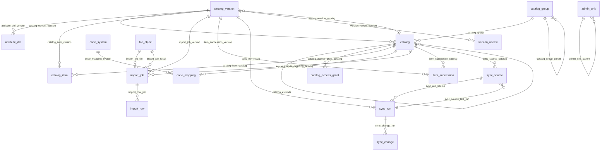

# D03-03-PH07 · Thiết kế cơ sở dữ liệu phân hệ PH-07 Danh mục dùng chung

## Tóm tắt cho hội đồng thẩm định

Dữ liệu của PH-07 nằm trong một schema PostgreSQL riêng `ph07_rdm` gồm 20 bảng. Dữ liệu của các tỉnh dùng chung một cơ sở dữ liệu nhưng được cách ly bằng cơ chế bảo mật mức dòng (Row Level Security) của PostgreSQL: mỗi câu lệnh chỉ thấy dữ liệu của tỉnh đang làm việc và của danh mục dùng chung toàn quốc, kể cả khi mã ứng dụng có lỗi. Danh mục toàn quốc (ĐVHC, dân tộc…) được quản lý một lần ở tenant `COMMON` và chỉ quản trị nền tảng được ghi.

So với hệ cũ Aita (bốn bảng EAV, mọi giá trị là chuỗi, không mã, không phiên bản), thiết kế mới lưu bản ghi có mã nghiệp vụ duy nhất, thuộc tính có kiểu và kiểm tra bằng JSON Schema, phiên bản bất biến có ngày hiệu lực, lịch sử sắp xếp ĐVHC và bảng ánh xạ mã. Mục 8 trình bày cách chuyển dữ liệu Aita sang thiết kế mới, là đầu vào của kế hoạch di trú D06-01.

Hợp đồng máy đọc được của tài liệu này:

| Tệp | Nội dung |
|---|---|
| [`ph07/ddl/ph07_rdm.sql`](ph07/ddl/ph07_rdm.sql) | DDL đầy đủ, nguồn duy nhất; chạy được bằng psql trên CSDL trống |
| [`ph07/liquibase/db.changelog-ph07.yaml`](ph07/liquibase/db.changelog-ph07.yaml) và `ph07/liquibase/changes/` | Changelog Liquibase sinh tự động từ DDL và dữ liệu nền |
| [`ph07/seed/`](ph07/seed/) | Dữ liệu nền S01 (nhóm danh mục), S02 (giới tính), S03 (khung ĐVHC) |
| [`ph07/tools/gen_liquibase.py`](ph07/tools/gen_liquibase.py) | Công cụ sinh changelog |

Ngày 25/11/2026, DDL, changelog sinh ra và dữ liệu nền đã được chạy thử thành công trên PostgreSQL 16 (CSDL trống, `ON_ERROR_STOP`); đích chính thức là PostgreSQL 18 qua CloudNativePG (ADR-006).

## 1. Chiến lược lưu trữ

### 1.1. Schema, vai trò và kết nối

Schema `ph07_rdm` do vai trò `ph07_owner` (NOLOGIN) sở hữu. Ứng dụng `dh-data` kết nối bằng tài khoản `dh_data_app`, thành viên vai trò `ph07_app` chỉ có quyền DML trên từng bảng (không DDL, không `BYPASSRLS`); Liquibase chạy bằng `dh_data_migrator`, thành viên `ph07_owner`; báo cáo và kiểm toán đọc bằng `ph07_readonly`. Vai trò thứ tư `ph07_worker` không có quyền đọc dữ liệu nghiệp vụ; ứng dụng chỉ chuyển sang vai trò này bằng `SET LOCAL ROLE` trong giao dịch ngắn nhận tác vụ nền liên tenant, và vai trò chỉ thấy các cột hàng đợi của `import_job` (D03-02-PH07 §4.7.3). Mật khẩu tài khoản đăng nhập do CloudNativePG quản lý qua OpenBao, không nằm trong DDL. Module khác của `dh-data` không đọc trực tiếp bảng của `ph07_rdm`; chúng gọi API công bố `RdmApi`, `RdmLookupApi` (D03-02-PH07 §3.3), trừ bảng chiếu `admin_unit` (DD-07) được cấp quyền đọc cho các schema khác.

### 1.2. Cách ly tenant

Mọi bảng nghiệp vụ có cột `tenant_id` (`T{nn}`, `COMMON`; `PLATFORM` chỉ xuất hiện ở bảng kỹ thuật) và bật `FORCE ROW LEVEL SECURITY`, nên kể cả chủ bảng cũng chịu chính sách. Ứng dụng đặt biến phiên `app.tenant_id` ở đầu mỗi giao dịch (D03-10); quên đặt thì câu lệnh lỗi ngay do `current_setting('app.tenant_id', false)`. Có hai mẫu chính sách:

| Mẫu | Đọc | Ghi | Dùng cho |
|---|---|---|---|
| S (dùng chung) | Tenant phiên hoặc `COMMON` | Tenant phiên là tỉnh và dòng của chính tỉnh đó; hoặc dòng `COMMON` khi tenant phiên là `PLATFORM` | Nhóm, danh mục, phiên bản, thuộc tính, bản ghi, sự kiện sắp xếp, hệ thống mã, ánh xạ |
| P (riêng) | Như ghi | Như mẫu S | Dữ liệu tác nghiệp: tác vụ nhập, dòng tạm, đồng bộ, cấp quyền khai thác, outbox, nhật ký duyệt |

Khóa ngoại giữa các bảng mẫu S mang cả `tenant_id` (ví dụ `(catalog_id, tenant_id)`), nên một dòng của tỉnh không thể trỏ sang danh mục của tỉnh khác. Danh mục của tỉnh được phép trỏ tới danh mục `COMMON` ở đúng hai chỗ có chủ đích: `extends_catalog_id` của danh mục HYBRID và `ref_catalog_code` của thuộc tính `CATALOG_REF`; hai chỗ này kiểm tra bằng trigger chứ không bằng khóa ngoại hai cột.

Tuỳ chọn tách cơ sở dữ liệu riêng cho tỉnh lớn (D03-10) không đổi thiết kế bảng: CSDL riêng vẫn có schema `ph07_rdm` giống hệt, chứa dữ liệu của một tỉnh và bản sao danh mục `COMMON` được đồng bộ từ cụm trung tâm qua sự kiện EVT-07-05.

### 1.3. Quy ước bảng

Mọi bảng nghiệp vụ theo D00-01 §5.1: khóa chính `id uuid` (UUID v7 sinh ở ứng dụng; chỉ thao tác sao chép hàng loạt dùng `f_uuid_v7()` trong CSDL), các cột `created_at`, `created_by`, `updated_at`, `updated_by`, `version` (khóa lạc quan, trigger `tg_touch` tăng khi ứng dụng quên). Ngoại lệ có chủ đích: `outbox` (chỉ thêm, khóa là `event_id`), `import_row` (dòng tạm, phân vùng theo ngày), `idempotency_key` (khóa tự nhiên bốn cột), `shedlock` (bảng kỹ thuật của thư viện). Chuỗi lưu dạng Unicode NFC; cột `name_search` sinh từ `f_search_norm(name)` (NFC, bỏ dấu, chữ thường) phục vụ tìm không dấu bằng chỉ mục trigram.

## 2. Sơ đồ thực thể – quan hệ

Sơ đồ dưới đây chỉ thể hiện khóa ngoại thật trong DDL (sinh từ catalog của PostgreSQL). Bảng `outbox`, `idempotency_key`, `shedlock` không có khóa ngoại nên không xuất hiện.

Sơ đồ có ba cụm. Cụm lõi (`catalog_group`, `catalog`, `catalog_version`, `attribute_def`, `catalog_item`, `item_succession`, `version_review`) hiện thực mô hình copy-on-write: mỗi phiên bản sở hữu bản sao đầy đủ thuộc tính và bản ghi của nó (ADR-051), nên tra theo thời điểm chỉ cần chọn đúng phiên bản. Cụm tác nghiệp (`file_object`, `import_job`, `import_row`, `sync_source`, `sync_run`, `sync_change`) giữ trạng thái của tác vụ nền. Cụm khai thác (`code_system`, `code_mapping`, `catalog_access_grant`, `admin_unit`) phục vụ chuyển mã, phân quyền khai thác và bảng chiếu ĐVHC dùng chung cho phân hệ khác.

## 3. Đặc tả bảng

Bảng dưới đây liệt kê các bảng, mã thực thể, mẫu RLS và mô tả. Mục 3.x sau đó đặc tả từng bảng: cột, ràng buộc, chỉ mục, chính sách RLS. Toàn bộ mục 3 được sinh từ catalog của PostgreSQL sau khi chạy DDL, nên luôn khớp tệp `ph07_rdm.sql`; chú thích cột lấy từ `COMMENT ON` trong DDL.

| Mã | Bảng | Mô tả |
|---|---|---|
| EN-07-01 | `catalog_group` | Nhóm danh mục: cây phân loại danh mục (FR-07-010). Mẫu RLS S: nhóm COMMON dùng chung, tenant thêm nhóm riêng. |
| EN-07-02 | `catalog` | Danh mục: định nghĩa một danh mục (FR-07-001…009, 048). Mẫu RLS S. |
| EN-07-03 | `catalog_version` | Phiên bản danh mục: ảnh chụp đầy đủ, bất biến khi PUBLISHED (ADR-051). Mẫu RLS S. |
| EN-07-04 | `attribute_def` | Định nghĩa thuộc tính động theo phiên bản (ADR-050). Giá trị lưu ở catalog_item.attrs. Mẫu RLS S. |
| EN-07-05 | `catalog_item` | Bản ghi danh mục trong một phiên bản (ảnh chụp copy-on-write). Mẫu RLS S. |
| EN-07-06 | `item_succession` | Sự kiện kế thừa bản ghi (sắp xếp ĐVHC): nhiều-nhiều, có căn cứ pháp lý và ngày hiệu lực (FR-07-045, ADR-055). Mẫu RLS S. |
| EN-07-07 | `version_review` | Nhật ký duyệt phiên bản (chỉ-thêm). Mẫu RLS P: lời phê duyệt COMMON chỉ PLATFORM thấy. |
| EN-07-08 | `import_job` | Tác vụ nhập/xuất tệp (ADR-056). Mẫu RLS P; tác vụ trên danh mục COMMON mang tenant_id COMMON do PLATFORM thực hiện. |
| EN-07-09 | `import_row` | Dòng tạm của tác vụ nhập (xem trước, lỗi theo dòng). Phân vùng RANGE theo ngày; giữ 7 ngày. Mẫu RLS P. Phân vùng con không cấp quyền cho ph07_app nên không truy cập trực tiếp được (RLS chỉ áp qua bảng cha). |
| EN-07-10 | `sync_source` | Nguồn đồng bộ danh mục quốc gia qua PH-14 (ADR-057). Mẫu RLS P. |
| EN-07-11 | `sync_run` | Một lần chạy đồng bộ quốc gia. Mẫu RLS P. |
| EN-07-12 | `sync_change` | Chi tiết khác biệt của một lần đồng bộ. Mẫu RLS P. Giữ 3 năm. |
| EN-07-13 | `code_system` | Hệ thống mã ngoài (bộ mã riêng của một HTTT hoặc cơ quan). Mẫu RLS S: hệ thống mã toàn quốc lưu COMMON. |
| EN-07-14 | `code_mapping` | Ánh xạ mã danh mục ↔ mã ngoài, có khoảng hiệu lực (FR-07-041…043). Mẫu RLS S. |
| EN-07-15 | `catalog_access_grant` | Cấp quyền khai thác danh mục RESTRICTED cho HTTT (FR-07-052, BR-07-019). Mẫu RLS P. |
| EN-07-16 | `idempotency_key` | Khóa Idempotency-Key của lệnh tạo (16…128 ký tự, giữ 24 giờ); cùng khóa khác request_hash trả ERR-07-022. Dọn theo expires_at mỗi giờ. RLS theo đúng tenant phiên (kể cả PLATFORM). |
| EN-07-17 | `outbox` | Outbox giao dịch (DD-11, SAD §7.3); Debezium EventRouter phát lên Kafka. Mẫu RLS P. Dọn dòng quá 3 ngày. |
| EN-07-18 | `admin_unit` | Đơn vị hành chính: bảng chiếu định danh ổn định từ danh mục DVHC, làm mới trong giao dịch phát hành (f_refresh_admin_unit). Chỉ COMMON; chỉ PLATFORM ghi. |
| EN-07-19 | `file_object` | Tệp (theo DD-12): siêu dữ liệu tệp nhập, tệp xuất, báo cáo lỗi, ảnh chụp; nội dung ở Garage. Mẫu RLS P. |
| — | `shedlock` | Khóa ShedLock cho tác vụ định kỳ của PH-07 (quét lịch đồng bộ, dọn bảng tạm, hết hạn tác vụ, tự chuyển hiệu lực). Không chứa dữ liệu nghiệp vụ. |

### 3.1. `catalog_group` (EN-07-01)

EN-07-01 Nhóm danh mục: cây phân loại danh mục (FR-07-010). Mẫu RLS S: nhóm COMMON dùng chung, tenant thêm nhóm riêng.

| Cột | Kiểu | Bắt buộc | Mặc định | Ghi chú |
|---|---|---|---|---|
| `id` | `uuid` | Có |  |  |
| `tenant_id` | `character varying(16)` | Có |  |  |
| `code` | `character varying(64)` | Có |  | Mã nhóm (T-CODE, chữ hoa), duy nhất trong tenant. |
| `name` | `character varying(255)` | Có |  |  |
| `parent_id` | `uuid` |  |  | Nhóm cha cùng tenant; rỗng là nhóm gốc. Ứng dụng kiểm tra không tạo vòng. |
| `sort_order` | `integer` | Có | `0` |  |
| `description` | `text` |  |  |  |
| `created_at` | `timestamp with time zone` | Có | `now()` |  |
| `created_by` | `uuid` | Có |  |  |
| `updated_at` | `timestamp with time zone` | Có | `now()` |  |
| `updated_by` | `uuid` | Có |  |  |
| `version` | `integer` | Có | `0` |  |

Ràng buộc:

| Tên | Loại | Định nghĩa |
|---|---|---|
| `ck_catalog_group_code` | Kiểm tra | `CHECK (((code)::text ~ '^[A-Z0-9][A-Z0-9_.-]{0,63}$'::text))` |
| `ck_catalog_group_name_nfc` | Kiểm tra | `CHECK ((name IS NFC NORMALIZED))` |
| `ck_catalog_group_not_self` | Kiểm tra | `CHECK (((parent_id IS NULL) OR (parent_id <> id)))` |
| `ck_catalog_group_tenant` | Kiểm tra | `CHECK (((tenant_id)::text ~ '^(T[0-9]{2}\|COMMON)$'::text))` |
| `fk_catalog_group_parent` | Khóa ngoại | `FOREIGN KEY (parent_id, tenant_id) REFERENCES ph07_rdm.catalog_group(id, tenant_id)` |
| `pk_catalog_group` | Khóa chính | `PRIMARY KEY (id)` |
| `uq_catalog_group_code` | Duy nhất | `UNIQUE (tenant_id, code)` |
| `uq_catalog_group_id_tenant` | Duy nhất | `UNIQUE (id, tenant_id)` |

Chỉ mục:

| Tên | Định nghĩa |
|---|---|
| `ix_catalog_group_parent` | `CREATE INDEX ix_catalog_group_parent ON ph07_rdm.catalog_group USING btree (tenant_id, parent_id, sort_order)` |

Chính sách RLS: `rls_catalog_group_delete` (DELETE), `rls_catalog_group_insert` (INSERT), `rls_catalog_group_select` (SELECT), `rls_catalog_group_update` (UPDATE).

### 3.2. `catalog` (EN-07-02)

EN-07-02 Danh mục: định nghĩa một danh mục (FR-07-001…009, 048). Mẫu RLS S.

| Cột | Kiểu | Bắt buộc | Mặc định | Ghi chú |
|---|---|---|---|---|
| `id` | `uuid` | Có |  |  |
| `tenant_id` | `character varying(16)` | Có |  |  |
| `code` | `character varying(64)` | Có |  | Mã danh mục T-CODE chữ hoa; duy nhất trong tenant khi chưa xóa mềm (BR-07-001; phần "không trùng COMMON" kiểm tra ở ứng dụng). |
| `name` | `character varying(255)` | Có |  |  |
| `description` | `text` |  |  |  |
| `group_id` | `uuid` |  |  |  |
| `owner_org_id` | `uuid` |  |  | Cơ quan chủ quản, FK logic DD-02 ph20_tenant.organization (không FK vật lý chéo schema). |
| `source_type` | `character varying(32)` | Có | `'LOCAL'::character varying` | LOCAL tỉnh tự quản; NATIONAL đồng bộ NDXP (chỉ đọc với người dùng); HYBRID mở rộng danh mục COMMON. |
| `classification` | `character varying(32)` | Có | `'PUBLIC'::character varying` |  |
| `status` | `character varying(32)` | Có | `'DRAFT'::character varying` |  |
| `is_hierarchical` | `boolean` | Có | `false` |  |
| `max_depth` | `smallint` | Có | `1` |  |
| `level_names` | `jsonb` |  |  | Mảng tên cấp theo độ sâu, ví dụ ["Tỉnh","Xã"]. |
| `local_code_pattern` | `character varying(255)` |  |  | Biểu thức chính quy dải mã địa phương (HYBRID), BR-07-010. |
| `extends_catalog_id` | `uuid` |  |  | Danh mục COMMON được mở rộng (chỉ HYBRID). |
| `require_approval` | `boolean` | Có | `true` |  |
| `current_version_id` | `uuid` |  |  | Phiên bản đã phát hành mới nhất (có thể sắp hiệu lực). Tra theo thời điểm dùng khoảng hiệu lực, không dùng cột này. |
| `legacy_ref` | `character varying(64)` |  |  | Khóa hệ cũ (Aita category.id) phục vụ di trú, đối chiếu. |
| `created_at` | `timestamp with time zone` | Có | `now()` |  |
| `created_by` | `uuid` | Có |  |  |
| `updated_at` | `timestamp with time zone` | Có | `now()` |  |
| `updated_by` | `uuid` | Có |  |  |
| `version` | `integer` | Có | `0` |  |
| `deleted_at` | `timestamp with time zone` |  |  |  |

Ràng buộc:

| Tên | Loại | Định nghĩa |
|---|---|---|
| `ck_catalog_classification` | Kiểm tra | `CHECK (((classification)::text = ANY ((ARRAY['PUBLIC'::character varying, 'INTERNAL'::character varying, 'RESTRICTED'::character varying])::text[])))` |
| `ck_catalog_code` | Kiểm tra | `CHECK (((code)::text ~ '^[A-Z0-9][A-Z0-9_.-]{0,63}$'::text))` |
| `ck_catalog_hybrid` | Kiểm tra | `CHECK (((((source_type)::text = 'HYBRID'::text) = (extends_catalog_id IS NOT NULL)) AND (((source_type)::text <> 'HYBRID'::text) OR ((local_code_pattern IS NOT NULL) AND ((tenant_id)::text <> 'COMMON'::text)))))` |
| `ck_catalog_level_names` | Kiểm tra | `CHECK (((level_names IS NULL) OR ((jsonb_typeof(level_names) = 'array'::text) AND (jsonb_array_length(level_names) <= max_depth))))` |
| `ck_catalog_max_depth` | Kiểm tra | `CHECK ((((max_depth >= 1) AND (max_depth <= 10)) AND (is_hierarchical OR (max_depth = 1))))` |
| `ck_catalog_name_nfc` | Kiểm tra | `CHECK ((name IS NFC NORMALIZED))` |
| `ck_catalog_soft_delete` | Kiểm tra | `CHECK (((deleted_at IS NULL) OR ((status)::text = 'DRAFT'::text)))` |
| `ck_catalog_source_type` | Kiểm tra | `CHECK (((source_type)::text = ANY ((ARRAY['LOCAL'::character varying, 'NATIONAL'::character varying, 'HYBRID'::character varying])::text[])))` |
| `ck_catalog_status` | Kiểm tra | `CHECK (((status)::text = ANY ((ARRAY['DRAFT'::character varying, 'ACTIVE'::character varying, 'RETIRED'::character varying])::text[])))` |
| `ck_catalog_tenant` | Kiểm tra | `CHECK (((tenant_id)::text ~ '^(T[0-9]{2}\|COMMON)$'::text))` |
| `fk_catalog_current_version` | Khóa ngoại | `FOREIGN KEY (current_version_id, tenant_id) REFERENCES ph07_rdm.catalog_version(id, tenant_id)` |
| `fk_catalog_extends` | Khóa ngoại | `FOREIGN KEY (extends_catalog_id) REFERENCES ph07_rdm.catalog(id)` |
| `fk_catalog_group` | Khóa ngoại | `FOREIGN KEY (group_id) REFERENCES ph07_rdm.catalog_group(id)` |
| `pk_catalog` | Khóa chính | `PRIMARY KEY (id)` |
| `uq_catalog_id_tenant` | Duy nhất | `UNIQUE (id, tenant_id)` |

Chỉ mục:

| Tên | Định nghĩa |
|---|---|
| `ix_catalog_extends` | `CREATE INDEX ix_catalog_extends ON ph07_rdm.catalog USING btree (extends_catalog_id) WHERE (extends_catalog_id IS NOT NULL)` |
| `ix_catalog_group` | `CREATE INDEX ix_catalog_group ON ph07_rdm.catalog USING btree (tenant_id, group_id) WHERE (deleted_at IS NULL)` |
| `ix_catalog_name_trgm` | `CREATE INDEX ix_catalog_name_trgm ON ph07_rdm.catalog USING gin (ph07_rdm.f_search_norm((name)::text) gin_trgm_ops)` |
| `ix_catalog_status` | `CREATE INDEX ix_catalog_status ON ph07_rdm.catalog USING btree (tenant_id, status, source_type) WHERE (deleted_at IS NULL)` |
| `uq_catalog_tenant_code` | `CREATE UNIQUE INDEX uq_catalog_tenant_code ON ph07_rdm.catalog USING btree (tenant_id, code) WHERE (deleted_at IS NULL)` |

Chính sách RLS: `rls_catalog_delete` (DELETE), `rls_catalog_insert` (INSERT), `rls_catalog_select` (SELECT), `rls_catalog_update` (UPDATE).

### 3.3. `catalog_version` (EN-07-03)

EN-07-03 Phiên bản danh mục: ảnh chụp đầy đủ, bất biến khi PUBLISHED (ADR-051). Mẫu RLS S.

| Cột | Kiểu | Bắt buộc | Mặc định | Ghi chú |
|---|---|---|---|---|
| `id` | `uuid` | Có |  |  |
| `tenant_id` | `character varying(16)` | Có |  |  |
| `catalog_id` | `uuid` | Có |  |  |
| `version_no` | `integer` | Có |  |  |
| `status` | `character varying(32)` | Có | `'DRAFT'::character varying` | DRAFT, IN_REVIEW, APPROVED, PUBLISHED, DISCARDED. Nhãn Đang/Sắp/Hết hiệu lực tính từ khoảng ngày, không lưu. |
| `effective_from` | `date` |  |  | Ngày bắt đầu hiệu lực (bao gồm). Bắt buộc khi PUBLISHED. |
| `effective_to` | `date` |  |  | Ngày hết hiệu lực (không bao gồm); rỗng là vô hạn. Được đặt bằng effective_from của phiên bản kế tiếp khi phát hành. |
| `legal_basis` | `text` |  |  |  |
| `change_note` | `text` |  |  |  |
| `origin` | `character varying(32)` | Có | `'MANUAL'::character varying` |  |
| `item_count` | `integer` | Có | `0` |  |
| `stats` | `jsonb` | Có | `'{}'::jsonb` | Thống kê khác biệt so với phiên bản trước: {"added":n,"changed":n,"deprecated":n,"removed":n,"breaking":bool}. |
| `submitted_by` | `uuid` |  |  |  |
| `submitted_at` | `timestamp with time zone` |  |  |  |
| `approved_by` | `uuid` |  |  |  |
| `approved_at` | `timestamp with time zone` |  |  |  |
| `published_by` | `uuid` |  |  |  |
| `published_at` | `timestamp with time zone` |  |  |  |
| `snapshot_uri` | `character varying(2048)` |  |  |  |
| `schema_hash` | `character(64)` |  |  | SHA-256 hex của JSON Schema sinh từ attribute_def; dùng làm ETag lược đồ. |
| `last_edited_by` | `uuid` |  |  | Người sửa nội dung bản nháp lần cuối (bản ghi, thuộc tính); phục vụ kiểm tra bốn mắt (D02-08). Cột bổ sung ngoài khung. |
| `last_edited_at` | `timestamp with time zone` |  |  |  |
| `created_at` | `timestamp with time zone` | Có | `now()` |  |
| `created_by` | `uuid` | Có |  |  |
| `updated_at` | `timestamp with time zone` | Có | `now()` |  |
| `updated_by` | `uuid` | Có |  |  |
| `version` | `integer` | Có | `0` | Khóa lạc quan của cả bản nháp: ứng dụng tăng mỗi khi nội dung bản nháp đổi; tác vụ nhập so sánh khi commit (BR-07-016). |

Ràng buộc:

| Tên | Loại | Định nghĩa |
|---|---|---|
| `ck_catalog_version_item_count` | Kiểm tra | `CHECK ((item_count >= 0))` |
| `ck_catalog_version_no` | Kiểm tra | `CHECK ((version_no >= 1))` |
| `ck_catalog_version_origin` | Kiểm tra | `CHECK (((origin)::text = ANY ((ARRAY['MANUAL'::character varying, 'IMPORT'::character varying, 'API'::character varying, 'SYNC'::character varying, 'MIGRATION'::character varying])::text[])))` |
| `ck_catalog_version_published` | Kiểm tra | `CHECK ((((status)::text <> 'PUBLISHED'::text) OR ((effective_from IS NOT NULL) AND (published_at IS NOT NULL) AND (published_by IS NOT NULL))))` |
| `ck_catalog_version_range` | Kiểm tra | `CHECK (((effective_to IS NULL) OR ((effective_from IS NOT NULL) AND (effective_to > effective_from))))` |
| `ck_catalog_version_stats` | Kiểm tra | `CHECK ((jsonb_typeof(stats) = 'object'::text))` |
| `ck_catalog_version_status` | Kiểm tra | `CHECK (((status)::text = ANY ((ARRAY['DRAFT'::character varying, 'IN_REVIEW'::character varying, 'APPROVED'::character varying, 'PUBLISHED'::character varying, 'DISCARDED'::character varying])::text[])))` |
| `ck_catalog_version_tenant` | Kiểm tra | `CHECK (((tenant_id)::text ~ '^(T[0-9]{2}\|COMMON)$'::text))` |
| `fk_catalog_version_catalog` | Khóa ngoại | `FOREIGN KEY (catalog_id, tenant_id) REFERENCES ph07_rdm.catalog(id, tenant_id)` |
| `pk_catalog_version` | Khóa chính | `PRIMARY KEY (id)` |
| `uq_catalog_version_id_tenant` | Duy nhất | `UNIQUE (id, tenant_id)` |
| `uq_catalog_version_no` | Duy nhất | `UNIQUE (catalog_id, version_no)` |
| `ex_catalog_version_no_overlap` | Loại trừ | `EXCLUDE USING gist (catalog_id WITH =, daterange(effective_from, effective_to, '[)'::text) WITH &&) WHERE (((status)::text = 'PUBLISHED'::text))` |

Chỉ mục:

| Tên | Định nghĩa |
|---|---|
| `ix_catalog_version_catalog` | `CREATE INDEX ix_catalog_version_catalog ON ph07_rdm.catalog_version USING btree (catalog_id, version_no DESC)` |
| `ix_catalog_version_review` | `CREATE INDEX ix_catalog_version_review ON ph07_rdm.catalog_version USING btree (tenant_id, submitted_at) WHERE ((status)::text = 'IN_REVIEW'::text)` |
| `uq_catalog_version_open` | `CREATE UNIQUE INDEX uq_catalog_version_open ON ph07_rdm.catalog_version USING btree (catalog_id) WHERE ((status)::text = ANY ((ARRAY['DRAFT'::character varying, 'IN_REVIEW'::character varying, 'APPROVED'::character varying])::text[]))` |

Chính sách RLS: `rls_catalog_version_delete` (DELETE), `rls_catalog_version_insert` (INSERT), `rls_catalog_version_select` (SELECT), `rls_catalog_version_update` (UPDATE).

### 3.4. `attribute_def` (EN-07-04)

EN-07-04 Định nghĩa thuộc tính động theo phiên bản (ADR-050). Giá trị lưu ở catalog_item.attrs. Mẫu RLS S.

| Cột | Kiểu | Bắt buộc | Mặc định | Ghi chú |
|---|---|---|---|---|
| `id` | `uuid` | Có |  |  |
| `tenant_id` | `character varying(16)` | Có |  |  |
| `version_id` | `uuid` | Có |  |  |
| `code` | `character varying(64)` | Có |  | Mã thuộc tính: snake_case thường hoặc T-CODE; là khóa trong attrs. Không trùng tên trường hệ thống. |
| `label` | `character varying(255)` | Có |  |  |
| `data_type` | `character varying(32)` | Có |  |  |
| `required` | `boolean` | Có | `false` |  |
| `unique_in_version` | `boolean` | Có | `false` |  |
| `max_length` | `integer` |  |  |  |
| `pattern` | `character varying(500)` |  |  |  |
| `min_value` | `numeric` |  |  |  |
| `max_value` | `numeric` |  |  |  |
| `enum_values` | `jsonb` |  |  |  |
| `ref_catalog_code` | `character varying(64)` |  |  |  |
| `default_value` | `jsonb` |  |  | Giá trị mặc định dạng JSON đúng kiểu data_type. |
| `sort_order` | `integer` | Có | `0` |  |
| `status` | `character varying(32)` | Có | `'ACTIVE'::character varying` |  |
| `queryable` | `boolean` | Có | `false` | Cho phép dùng trong DSL truy vấn (BR-07-018). |
| `searchable` | `boolean` | Có | `false` | Đưa vào tìm kiếm không dấu bên cạnh tên (FR-07-030). |
| `classification` | `character varying(32)` | Có | `'PUBLIC'::character varying` | Mức phân loại của thuộc tính; CHECK cấm SENSITIVE (BR-07-025, ERR-07-036). Cột bổ sung ngoài khung. |
| `description` | `text` |  |  |  |
| `legacy_field_id` | `character varying(64)` |  |  | Khóa hệ cũ (Aita category_fields.id). |
| `created_at` | `timestamp with time zone` | Có | `now()` |  |
| `created_by` | `uuid` | Có |  |  |
| `updated_at` | `timestamp with time zone` | Có | `now()` |  |
| `updated_by` | `uuid` | Có |  |  |
| `version` | `integer` | Có | `0` |  |

Ràng buộc:

| Tên | Loại | Định nghĩa |
|---|---|---|
| `ck_attribute_def_classification` | Kiểm tra | `CHECK (((classification)::text = ANY ((ARRAY['PUBLIC'::character varying, 'INTERNAL'::character varying, 'RESTRICTED'::character varying])::text[])))` |
| `ck_attribute_def_code` | Kiểm tra | `CHECK (((code)::text ~ '^([a-z][a-z0-9_]{0,63}\|[A-Z0-9][A-Z0-9_.-]{0,63})$'::text))` |
| `ck_attribute_def_enum` | Kiểm tra | `CHECK (((((data_type)::text = 'ENUM'::text) = (enum_values IS NOT NULL)) AND ((enum_values IS NULL) OR ((jsonb_typeof(enum_values) = 'array'::text) AND ((jsonb_array_length(enum_values) >= 1) AND (jsonb_array_length(enum_values) <= 500))))))` |
| `ck_attribute_def_label_nfc` | Kiểm tra | `CHECK ((label IS NFC NORMALIZED))` |
| `ck_attribute_def_length` | Kiểm tra | `CHECK (((max_length IS NULL) OR (((data_type)::text = ANY ((ARRAY['STRING'::character varying, 'TEXT'::character varying, 'URI'::character varying, 'EMAIL'::character varying])::text[])) AND ((max_length >= 1) AND (max_length <= 4000)))))` |
| `ck_attribute_def_minmax` | Kiểm tra | `CHECK ((((min_value IS NULL) AND (max_value IS NULL)) OR (((data_type)::text = ANY ((ARRAY['INTEGER'::character varying, 'DECIMAL'::character varying])::text[])) AND ((min_value IS NULL) OR (max_value IS NULL) OR (min_value <= max_value)))))` |
| `ck_attribute_def_query` | Kiểm tra | `CHECK (((NOT queryable) OR ((data_type)::text <> 'TEXT'::text)))` |
| `ck_attribute_def_ref` | Kiểm tra | `CHECK ((((data_type)::text = 'CATALOG_REF'::text) = (ref_catalog_code IS NOT NULL)))` |
| `ck_attribute_def_reserved` | Kiểm tra | `CHECK ((lower((code)::text) <> ALL (ARRAY['code'::text, 'name'::text, 'parent_code'::text, 'status'::text, 'sort_order'::text, 'valid_from'::text, 'valid_to'::text, 'depth'::text, 'path'::text])))` |
| `ck_attribute_def_status` | Kiểm tra | `CHECK (((status)::text = ANY ((ARRAY['ACTIVE'::character varying, 'HIDDEN'::character varying])::text[])))` |
| `ck_attribute_def_tenant` | Kiểm tra | `CHECK (((tenant_id)::text ~ '^(T[0-9]{2}\|COMMON)$'::text))` |
| `ck_attribute_def_type` | Kiểm tra | `CHECK (((data_type)::text = ANY ((ARRAY['STRING'::character varying, 'TEXT'::character varying, 'INTEGER'::character varying, 'DECIMAL'::character varying, 'BOOLEAN'::character varying, 'DATE'::character varying, 'DATETIME'::character varying, 'ENUM'::character varying, 'CATALOG_REF'::character varying, 'URI'::character varying, 'EMAIL'::character varying])::text[])))` |
| `fk_attribute_def_version` | Khóa ngoại | `FOREIGN KEY (version_id, tenant_id) REFERENCES ph07_rdm.catalog_version(id, tenant_id) ON DELETE CASCADE` |
| `pk_attribute_def` | Khóa chính | `PRIMARY KEY (id)` |

Chỉ mục:

| Tên | Định nghĩa |
|---|---|
| `ix_attribute_def_order` | `CREATE INDEX ix_attribute_def_order ON ph07_rdm.attribute_def USING btree (version_id, sort_order)` |
| `uq_attribute_def_code` | `CREATE UNIQUE INDEX uq_attribute_def_code ON ph07_rdm.attribute_def USING btree (version_id, lower((code)::text))` |

Chính sách RLS: `rls_attribute_def_delete` (DELETE), `rls_attribute_def_insert` (INSERT), `rls_attribute_def_select` (SELECT), `rls_attribute_def_update` (UPDATE).

### 3.5. `catalog_item` (EN-07-05)

EN-07-05 Bản ghi danh mục trong một phiên bản (ảnh chụp copy-on-write). Mẫu RLS S.

| Cột | Kiểu | Bắt buộc | Mặc định | Ghi chú |
|---|---|---|---|---|
| `id` | `uuid` | Có |  |  |
| `tenant_id` | `character varying(16)` | Có |  |  |
| `catalog_id` | `uuid` | Có |  | Phi chuẩn hóa từ catalog_version để lọc theo danh mục (HYBRID, ánh xạ) không cần nối. |
| `version_id` | `uuid` | Có |  |  |
| `code` | `character varying(64)` | Có |  | Mã bản ghi T-CODE, lưu chữ hoa (BR-07-002). |
| `name` | `character varying(255)` | Có |  |  |
| `name_search` | `text` |  | `sinh: ph07_rdm.f_search_norm((name)::text)` | Cột sinh: f_search_norm(name) = chữ thường, bỏ dấu, gộp khoảng trắng; dùng cho tìm không dấu. |
| `parent_code` | `character varying(64)` |  |  | Mã cha trong cùng phiên bản (hoặc trong phiên bản gốc với bản ghi HYBRID). |
| `depth` | `smallint` | Có | `1` | Độ sâu, gốc = 1. Tính bằng ph07_rdm.f_recompute_hierarchy sau mỗi lô ghi. |
| `path` | `text[]` | Có | `'{}'::text[]` | Mảng mã tổ tiên từ gốc tới cha (không gồm chính nó). |
| `level_name` | `character varying(64)` |  |  |  |
| `sort_order` | `integer` | Có | `0` |  |
| `status` | `character varying(32)` | Có | `'ACTIVE'::character varying` |  |
| `replaced_by` | `text[]` |  |  | Mảng mã thay thế khi DEPRECATED (BR-07-003, BR-07-004). |
| `valid_from` | `date` |  |  | Ngày bản ghi bắt đầu hiệu lực bên trong phiên bản (rỗng = theo phiên bản). Dùng cho ĐVHC lịch sử. |
| `valid_to` | `date` |  |  |  |
| `attrs` | `jsonb` | Có | `'{}'::jsonb` | Giá trị thuộc tính động {mã thuộc tính: giá trị}, kiểm tra bằng JSON Schema sinh từ attribute_def. |
| `is_local_extension` | `boolean` | Có | `false` | Bản ghi bổ sung địa phương của danh mục HYBRID. |
| `legacy_ref` | `character varying(64)` |  |  |  |
| `created_at` | `timestamp with time zone` | Có | `now()` |  |
| `created_by` | `uuid` | Có |  |  |
| `updated_at` | `timestamp with time zone` | Có | `now()` |  |
| `updated_by` | `uuid` | Có |  |  |
| `version` | `integer` | Có | `0` |  |

Ràng buộc:

| Tên | Loại | Định nghĩa |
|---|---|---|
| `ck_catalog_item_attrs` | Kiểm tra | `CHECK ((jsonb_typeof(attrs) = 'object'::text))` |
| `ck_catalog_item_code` | Kiểm tra | `CHECK (((code)::text ~ '^[A-Z0-9][A-Z0-9_.-]{0,63}$'::text))` |
| `ck_catalog_item_code_upper` | Kiểm tra | `CHECK (((code)::text = upper((code)::text)))` |
| `ck_catalog_item_depth` | Kiểm tra | `CHECK ((((depth >= 1) AND (depth <= 10)) AND (cardinality(path) = (depth - 1))))` |
| `ck_catalog_item_name_nfc` | Kiểm tra | `CHECK ((name IS NFC NORMALIZED))` |
| `ck_catalog_item_parent` | Kiểm tra | `CHECK (((parent_code IS NULL) OR (((parent_code)::text <> (code)::text) AND ((parent_code)::text = upper((parent_code)::text)))))` |
| `ck_catalog_item_replaced` | Kiểm tra | `CHECK (((replaced_by IS NULL) OR (((status)::text = 'DEPRECATED'::text) AND ((cardinality(replaced_by) >= 1) AND (cardinality(replaced_by) <= 100)))))` |
| `ck_catalog_item_status` | Kiểm tra | `CHECK (((status)::text = ANY ((ARRAY['ACTIVE'::character varying, 'DEPRECATED'::character varying])::text[])))` |
| `ck_catalog_item_tenant` | Kiểm tra | `CHECK (((tenant_id)::text ~ '^(T[0-9]{2}\|COMMON)$'::text))` |
| `ck_catalog_item_valid` | Kiểm tra | `CHECK (((valid_to IS NULL) OR (valid_from IS NULL) OR (valid_to > valid_from)))` |
| `fk_catalog_item_catalog` | Khóa ngoại | `FOREIGN KEY (catalog_id, tenant_id) REFERENCES ph07_rdm.catalog(id, tenant_id)` |
| `fk_catalog_item_version` | Khóa ngoại | `FOREIGN KEY (version_id, tenant_id) REFERENCES ph07_rdm.catalog_version(id, tenant_id) ON DELETE CASCADE` |
| `pk_catalog_item` | Khóa chính | `PRIMARY KEY (id)` |
| `uq_catalog_item_code` | Duy nhất | `UNIQUE (version_id, code)` |

Chỉ mục:

| Tên | Định nghĩa |
|---|---|
| `ix_catalog_item_attrs` | `CREATE INDEX ix_catalog_item_attrs ON ph07_rdm.catalog_item USING gin (attrs jsonb_path_ops)` |
| `ix_catalog_item_catalog` | `CREATE INDEX ix_catalog_item_catalog ON ph07_rdm.catalog_item USING btree (catalog_id)` |
| `ix_catalog_item_name_trgm` | `CREATE INDEX ix_catalog_item_name_trgm ON ph07_rdm.catalog_item USING gin (name_search gin_trgm_ops)` |
| `ix_catalog_item_order` | `CREATE INDEX ix_catalog_item_order ON ph07_rdm.catalog_item USING btree (version_id, sort_order, code)` |
| `ix_catalog_item_parent` | `CREATE INDEX ix_catalog_item_parent ON ph07_rdm.catalog_item USING btree (version_id, parent_code, sort_order, code)` |
| `ix_catalog_item_path` | `CREATE INDEX ix_catalog_item_path ON ph07_rdm.catalog_item USING gin (path)` |

Chính sách RLS: `rls_catalog_item_delete` (DELETE), `rls_catalog_item_insert` (INSERT), `rls_catalog_item_select` (SELECT), `rls_catalog_item_update` (UPDATE).

### 3.6. `item_succession` (EN-07-06)

EN-07-06 Sự kiện kế thừa bản ghi (sắp xếp ĐVHC): nhiều-nhiều, có căn cứ pháp lý và ngày hiệu lực (FR-07-045, ADR-055). Mẫu RLS S.

| Cột | Kiểu | Bắt buộc | Mặc định | Ghi chú |
|---|---|---|---|---|
| `id` | `uuid` | Có |  |  |
| `tenant_id` | `character varying(16)` | Có |  |  |
| `catalog_id` | `uuid` | Có |  |  |
| `version_id` | `uuid` | Có |  | Phiên bản ghi nhận sự kiện; bất biến cùng phiên bản khi phát hành. |
| `event_type` | `character varying(32)` | Có |  |  |
| `from_codes` | `text[]` | Có | `'{}'::text[]` | Mã đơn vị trước sự kiện. |
| `to_codes` | `text[]` | Có | `'{}'::text[]` | Mã đơn vị sau sự kiện. |
| `effective_date` | `date` | Có |  |  |
| `legal_basis` | `text` | Có |  |  |
| `note` | `text` |  |  |  |
| `created_at` | `timestamp with time zone` | Có | `now()` |  |
| `created_by` | `uuid` | Có |  |  |
| `updated_at` | `timestamp with time zone` | Có | `now()` |  |
| `updated_by` | `uuid` | Có |  |  |
| `version` | `integer` | Có | `0` |  |

Ràng buộc:

| Tên | Loại | Định nghĩa |
|---|---|---|
| `ck_item_succession_cardinality` | Kiểm tra | `CHECK (((((event_type)::text = 'MERGE'::text) AND (cardinality(from_codes) >= 2) AND (cardinality(to_codes) = 1)) OR (((event_type)::text = 'SPLIT'::text) AND (cardinality(from_codes) >= 1) AND (cardinality(to_codes) >= 2)) OR (((event_type)::text = 'RENAME'::text) AND (cardinality(from_codes) = 1) AND (to_codes = from_codes)) OR (((event_type)::text = 'RECODE'::text) AND (cardinality(from_codes) ` |
| `ck_item_succession_legal` | Kiểm tra | `CHECK ((length(btrim(legal_basis)) > 0))` |
| `ck_item_succession_tenant` | Kiểm tra | `CHECK (((tenant_id)::text ~ '^(T[0-9]{2}\|COMMON)$'::text))` |
| `ck_item_succession_type` | Kiểm tra | `CHECK (((event_type)::text = ANY ((ARRAY['MERGE'::character varying, 'SPLIT'::character varying, 'RENAME'::character varying, 'ABOLISH'::character varying, 'ESTABLISH'::character varying, 'RECODE'::character varying])::text[])))` |
| `fk_item_succession_catalog` | Khóa ngoại | `FOREIGN KEY (catalog_id, tenant_id) REFERENCES ph07_rdm.catalog(id, tenant_id)` |
| `fk_item_succession_version` | Khóa ngoại | `FOREIGN KEY (version_id, tenant_id) REFERENCES ph07_rdm.catalog_version(id, tenant_id) ON DELETE CASCADE` |
| `pk_item_succession` | Khóa chính | `PRIMARY KEY (id)` |

Chỉ mục:

| Tên | Định nghĩa |
|---|---|
| `ix_item_succession_catalog` | `CREATE INDEX ix_item_succession_catalog ON ph07_rdm.item_succession USING btree (catalog_id, effective_date)` |
| `ix_item_succession_from` | `CREATE INDEX ix_item_succession_from ON ph07_rdm.item_succession USING gin (from_codes)` |
| `ix_item_succession_to` | `CREATE INDEX ix_item_succession_to ON ph07_rdm.item_succession USING gin (to_codes)` |
| `ix_item_succession_version` | `CREATE INDEX ix_item_succession_version ON ph07_rdm.item_succession USING btree (version_id, effective_date)` |

Chính sách RLS: `rls_item_succession_delete` (DELETE), `rls_item_succession_insert` (INSERT), `rls_item_succession_select` (SELECT), `rls_item_succession_update` (UPDATE).

### 3.7. `version_review` (EN-07-07)

EN-07-07 Nhật ký duyệt phiên bản (chỉ-thêm). Mẫu RLS P: lời phê duyệt COMMON chỉ PLATFORM thấy.

| Cột | Kiểu | Bắt buộc | Mặc định | Ghi chú |
|---|---|---|---|---|
| `id` | `uuid` | Có |  |  |
| `tenant_id` | `character varying(16)` | Có |  |  |
| `version_id` | `uuid` | Có |  |  |
| `action` | `character varying(32)` | Có |  |  |
| `actor` | `uuid` | Có |  |  |
| `comment` | `text` |  |  | Ý kiến; bắt buộc khi REJECT. |
| `diff_stats` | `jsonb` |  |  |  |
| `at` | `timestamp with time zone` | Có | `now()` |  |

Ràng buộc:

| Tên | Loại | Định nghĩa |
|---|---|---|
| `ck_version_review_action` | Kiểm tra | `CHECK (((action)::text = ANY ((ARRAY['SUBMIT'::character varying, 'WITHDRAW'::character varying, 'APPROVE'::character varying, 'UNAPPROVE'::character varying, 'REJECT'::character varying, 'PUBLISH'::character varying, 'DISCARD'::character varying])::text[])))` |
| `ck_version_review_reject_reason` | Kiểm tra | `CHECK ((((action)::text <> 'REJECT'::text) OR (length(btrim(COALESCE(comment, ''::text))) > 0)))` |
| `ck_version_review_tenant` | Kiểm tra | `CHECK (((tenant_id)::text ~ '^(T[0-9]{2}\|COMMON)$'::text))` |
| `fk_version_review_version` | Khóa ngoại | `FOREIGN KEY (version_id, tenant_id) REFERENCES ph07_rdm.catalog_version(id, tenant_id) ON DELETE CASCADE` |
| `pk_version_review` | Khóa chính | `PRIMARY KEY (id)` |

Chỉ mục:

| Tên | Định nghĩa |
|---|---|
| `ix_version_review_version` | `CREATE INDEX ix_version_review_version ON ph07_rdm.version_review USING btree (version_id, at)` |

Chính sách RLS: `rls_version_review_insert` (INSERT), `rls_version_review_select` (SELECT).

### 3.8. `import_job` (EN-07-08)

EN-07-08 Tác vụ nhập/xuất tệp (ADR-056). Mẫu RLS P; tác vụ trên danh mục COMMON mang tenant_id COMMON do PLATFORM thực hiện.

| Cột | Kiểu | Bắt buộc | Mặc định | Ghi chú |
|---|---|---|---|---|
| `id` | `uuid` | Có |  |  |
| `tenant_id` | `character varying(16)` | Có |  |  |
| `job_type` | `character varying(32)` | Có |  | IMPORT, EXPORT; MIGRATION là chạy thử/chạy thật di trú Aita (FR-07-051); PROPOSAL là đề xuất bổ sung lên NDXP (FR-07-039, Q07-07). |
| `catalog_id` | `uuid` |  |  |  |
| `version_id` | `uuid` |  |  |  |
| `mode` | `character varying(32)` |  |  |  |
| `format` | `character varying(32)` | Có |  |  |
| `template` | `character varying(32)` | Có | `'STANDARD'::character varying` |  |
| `status` | `character varying(32)` | Có |  | IMPORT, MIGRATION: UPLOADED→SCANNING→PARSING→VALIDATING→VALIDATED→COMMITTING→COMMITTED (hoặc FAILED/CANCELLED/EXPIRED), theo FRS §4.14. EXPORT: QUEUED→RUNNING→COMPLETED (hoặc FAILED/EXPIRED). PROPOSAL: SUBMITTED/ACCEPTED/REJECTED/UNKNOWN. |
| `file_id` | `uuid` |  |  |  |
| `file_name` | `character varying(255)` |  |  |  |
| `file_sha256` | `character(64)` |  |  |  |
| `encoding` | `character varying(32)` |  |  |  |
| `total_rows` | `integer` | Có | `0` |  |
| `valid_rows` | `integer` | Có | `0` |  |
| `error_rows` | `integer` | Có | `0` |  |
| `column_mapping` | `jsonb` |  |  |  |
| `options` | `jsonb` | Có | `'{}'::jsonb` |  |
| `result_file_id` | `uuid` |  |  |  |
| `draft_lock_version` | `integer` |  |  | Giá trị catalog_version.version lúc phân tích; commit chỉ khi còn bằng (BR-07-016). Cột bổ sung ngoài khung. |
| `expires_at` | `timestamp with time zone` |  |  | Hạn xem trước (24 giờ, BR-07-016) hoặc hạn tải tệp xuất. |
| `idempotency_key` | `character varying(128)` |  |  |  |
| `lease_owner` | `character varying(128)` |  |  | Pod đang xử lý tác vụ (hàng đợi trong CSDL, D03-02-PH07 §4.7.3). |
| `lease_until` | `timestamp with time zone` |  |  | Hạn thuê; quá hạn thì pod khác nhận lại tác vụ. Gia hạn mỗi 30 giây. |
| `error_message` | `text` |  |  |  |
| `started_at` | `timestamp with time zone` |  |  |  |
| `finished_at` | `timestamp with time zone` |  |  |  |
| `created_at` | `timestamp with time zone` | Có | `now()` |  |
| `created_by` | `uuid` | Có |  |  |
| `updated_at` | `timestamp with time zone` | Có | `now()` |  |
| `updated_by` | `uuid` | Có |  |  |
| `version` | `integer` | Có | `0` |  |

Ràng buộc:

| Tên | Loại | Định nghĩa |
|---|---|---|
| `ck_import_job_catalog` | Kiểm tra | `CHECK (((catalog_id IS NOT NULL) OR ((mode)::text = 'CREATE_CATALOG'::text) OR ((job_type)::text = 'MIGRATION'::text)))` |
| `ck_import_job_encoding` | Kiểm tra | `CHECK (((encoding IS NULL) OR ((encoding)::text = ANY ((ARRAY['UTF-8'::character varying, 'UTF-8-BOM'::character varying, 'UTF-16LE'::character varying, 'UTF-16BE'::character varying])::text[]))))` |
| `ck_import_job_file` | Kiểm tra | `CHECK ((((job_type)::text <> 'IMPORT'::text) OR (file_id IS NOT NULL)))` |
| `ck_import_job_format` | Kiểm tra | `CHECK (((format)::text = ANY ((ARRAY['XLSX'::character varying, 'CSV'::character varying, 'JSON'::character varying])::text[])))` |
| `ck_import_job_lease` | Kiểm tra | `CHECK (((lease_owner IS NULL) = (lease_until IS NULL)))` |
| `ck_import_job_mode` | Kiểm tra | `CHECK (((((job_type)::text = 'IMPORT'::text) AND ((mode)::text = ANY ((ARRAY['UPSERT'::character varying, 'REPLACE'::character varying, 'APPEND'::character varying, 'CREATE_CATALOG'::character varying, 'MAPPING'::character varying])::text[]))) OR (((job_type)::text <> 'IMPORT'::text) AND (mode IS NULL))))` |
| `ck_import_job_rows` | Kiểm tra | `CHECK (((total_rows >= 0) AND (valid_rows >= 0) AND (error_rows >= 0) AND ((valid_rows + error_rows) <= total_rows)))` |
| `ck_import_job_status` | Kiểm tra | `CHECK (((((job_type)::text = ANY ((ARRAY['IMPORT'::character varying, 'MIGRATION'::character varying])::text[])) AND ((status)::text = ANY ((ARRAY['UPLOADED'::character varying, 'SCANNING'::character varying, 'PARSING'::character varying, 'VALIDATING'::character varying, 'VALIDATED'::character varying, 'COMMITTING'::character varying, 'COMMITTED'::character varying, 'FAILED'::character varying, 'C` |
| `ck_import_job_template` | Kiểm tra | `CHECK (((template)::text = ANY ((ARRAY['STANDARD'::character varying, 'LEGACY_AITA'::character varying])::text[])))` |
| `ck_import_job_tenant` | Kiểm tra | `CHECK (((tenant_id)::text ~ '^(T[0-9]{2}\|COMMON)$'::text))` |
| `ck_import_job_type` | Kiểm tra | `CHECK (((job_type)::text = ANY ((ARRAY['IMPORT'::character varying, 'EXPORT'::character varying, 'MIGRATION'::character varying, 'PROPOSAL'::character varying])::text[])))` |
| `fk_import_job_catalog` | Khóa ngoại | `FOREIGN KEY (catalog_id, tenant_id) REFERENCES ph07_rdm.catalog(id, tenant_id)` |
| `fk_import_job_file` | Khóa ngoại | `FOREIGN KEY (file_id, tenant_id) REFERENCES ph07_rdm.file_object(id, tenant_id)` |
| `fk_import_job_result` | Khóa ngoại | `FOREIGN KEY (result_file_id, tenant_id) REFERENCES ph07_rdm.file_object(id, tenant_id)` |
| `fk_import_job_version` | Khóa ngoại | `FOREIGN KEY (version_id, tenant_id) REFERENCES ph07_rdm.catalog_version(id, tenant_id) ON DELETE SET NULL (version_id)` |
| `pk_import_job` | Khóa chính | `PRIMARY KEY (id)` |
| `uq_import_job_id_tenant` | Duy nhất | `UNIQUE (id, tenant_id)` |

Chỉ mục:

| Tên | Định nghĩa |
|---|---|
| `ix_import_job_catalog` | `CREATE INDEX ix_import_job_catalog ON ph07_rdm.import_job USING btree (catalog_id, created_at DESC)` |
| `ix_import_job_expires` | `CREATE INDEX ix_import_job_expires ON ph07_rdm.import_job USING btree (expires_at) WHERE ((status)::text = ANY ((ARRAY['VALIDATED'::character varying, 'COMPLETED'::character varying])::text[]))` |
| `ix_import_job_history` | `CREATE INDEX ix_import_job_history ON ph07_rdm.import_job USING btree (tenant_id, created_at DESC)` |
| `ix_import_job_queue` | `CREATE INDEX ix_import_job_queue ON ph07_rdm.import_job USING btree (created_at) WHERE ((status)::text = ANY ((ARRAY['UPLOADED'::character varying, 'SCANNING'::character varying, 'PARSING'::character varying, 'VALIDATING'::character varying, 'COMMITTING'::character varying, 'QUEUED'::character varying, 'RUNNING'::character varying])::text[]))` |
| `uq_import_job_idem` | `CREATE UNIQUE INDEX uq_import_job_idem ON ph07_rdm.import_job USING btree (tenant_id, idempotency_key) WHERE (idempotency_key IS NOT NULL)` |

Chính sách RLS: `rls_import_job_delete` (DELETE), `rls_import_job_insert` (INSERT), `rls_import_job_select` (SELECT), `rls_import_job_update` (UPDATE), `rls_import_job_worker_select` (SELECT), `rls_import_job_worker_update` (UPDATE).

### 3.9. `import_row` (EN-07-09)

EN-07-09 Dòng tạm của tác vụ nhập (xem trước, lỗi theo dòng). Phân vùng RANGE theo ngày; giữ 7 ngày. Mẫu RLS P. Phân vùng con không cấp quyền cho ph07_app nên không truy cập trực tiếp được (RLS chỉ áp qua bảng cha). Bảng phân vùng.

| Cột | Kiểu | Bắt buộc | Mặc định | Ghi chú |
|---|---|---|---|---|
| `id` | `uuid` | Có |  |  |
| `tenant_id` | `character varying(16)` | Có |  |  |
| `job_id` | `uuid` | Có |  |  |
| `row_no` | `integer` | Có |  |  |
| `item_code` | `character varying(64)` |  |  |  |
| `payload` | `jsonb` | Có |  | Giá trị đã chuẩn hóa của dòng theo mã cột {"MA":…,"TEN":…,"attrs":{…}}. |
| `action` | `character varying(32)` |  |  |  |
| `valid` | `boolean` | Có |  |  |
| `errors` | `jsonb` |  |  | Mảng lỗi [{"column":"…","code":"ERR-07-009","message":"…"}]. |
| `created_at` | `timestamp with time zone` | Có |  | Bằng import_job.created_at; là khóa phân vùng. |

Ràng buộc:

| Tên | Loại | Định nghĩa |
|---|---|---|
| `ck_import_row_action` | Kiểm tra | `CHECK (((action IS NULL) OR ((action)::text = ANY ((ARRAY['INSERT'::character varying, 'UPDATE'::character varying, 'DEPRECATE'::character varying, 'UNCHANGED'::character varying, 'DELETE_DRAFT'::character varying])::text[]))))` |
| `ck_import_row_errors` | Kiểm tra | `CHECK (((errors IS NULL) OR (jsonb_typeof(errors) = 'array'::text)))` |
| `ck_import_row_tenant` | Kiểm tra | `CHECK (((tenant_id)::text ~ '^(T[0-9]{2}\|COMMON)$'::text))` |
| `ck_import_row_valid` | Kiểm tra | `CHECK ((valid OR (errors IS NOT NULL)))` |
| `fk_import_row_job` | Khóa ngoại | `FOREIGN KEY (job_id, tenant_id) REFERENCES ph07_rdm.import_job(id, tenant_id) ON DELETE CASCADE` |
| `pk_import_row` | Khóa chính | `PRIMARY KEY (id, created_at)` |
| `uq_import_row_no` | Duy nhất | `UNIQUE (job_id, row_no, created_at)` |

Chỉ mục:

| Tên | Định nghĩa |
|---|---|
| `ix_import_row_invalid` | `CREATE INDEX ix_import_row_invalid ON ONLY ph07_rdm.import_row USING btree (job_id, row_no) WHERE (NOT valid)` |

Chính sách RLS: `rls_import_row_delete` (DELETE), `rls_import_row_insert` (INSERT), `rls_import_row_select` (SELECT), `rls_import_row_update` (UPDATE).

### 3.10. `sync_source` (EN-07-10)

EN-07-10 Nguồn đồng bộ danh mục quốc gia qua PH-14 (ADR-057). Mẫu RLS P.

| Cột | Kiểu | Bắt buộc | Mặc định | Ghi chú |
|---|---|---|---|---|
| `id` | `uuid` | Có |  |  |
| `tenant_id` | `character varying(16)` | Có |  |  |
| `catalog_id` | `uuid` | Có |  |  |
| `provider` | `character varying(32)` | Có | `'NDXP_DMDC'::character varying` |  |
| `remote_code` | `character varying(128)` | Có |  |  |
| `remote_name` | `character varying(255)` |  |  |  |
| `schedule_cron` | `character varying(64)` | Có | `'0 0 1 * * *'::character varying` | Biểu thức cron Spring 6 trường; mặc định 01:00 hằng ngày (giờ Việt Nam). |
| `auto_apply` | `boolean` | Có | `true` |  |
| `enabled` | `boolean` | Có | `true` |  |
| `last_run_id` | `uuid` |  |  |  |
| `last_success_at` | `timestamp with time zone` |  |  |  |
| `remote_version` | `character varying(128)` |  |  |  |
| `field_mapping` | `jsonb` | Có | `'{}'::jsonb` | Ánh xạ trường nguồn sang thuộc tính: {"remoteField":"attrCode"}. |
| `created_at` | `timestamp with time zone` | Có | `now()` |  |
| `created_by` | `uuid` | Có |  |  |
| `updated_at` | `timestamp with time zone` | Có | `now()` |  |
| `updated_by` | `uuid` | Có |  |  |
| `version` | `integer` | Có | `0` |  |

Ràng buộc:

| Tên | Loại | Định nghĩa |
|---|---|---|
| `ck_sync_source_mapping` | Kiểm tra | `CHECK ((jsonb_typeof(field_mapping) = 'object'::text))` |
| `ck_sync_source_provider` | Kiểm tra | `CHECK (((provider)::text = 'NDXP_DMDC'::text))` |
| `ck_sync_source_tenant` | Kiểm tra | `CHECK (((tenant_id)::text ~ '^(T[0-9]{2}\|COMMON)$'::text))` |
| `fk_sync_source_catalog` | Khóa ngoại | `FOREIGN KEY (catalog_id, tenant_id) REFERENCES ph07_rdm.catalog(id, tenant_id)` |
| `fk_sync_source_last_run` | Khóa ngoại | `FOREIGN KEY (last_run_id, tenant_id) REFERENCES ph07_rdm.sync_run(id, tenant_id) ON DELETE SET NULL (last_run_id)` |
| `pk_sync_source` | Khóa chính | `PRIMARY KEY (id)` |
| `uq_sync_source_catalog` | Duy nhất | `UNIQUE (catalog_id, provider)` |
| `uq_sync_source_id_tenant` | Duy nhất | `UNIQUE (id, tenant_id)` |

Chỉ mục:

| Tên | Định nghĩa |
|---|---|
| `ix_sync_source_enabled` | `CREATE INDEX ix_sync_source_enabled ON ph07_rdm.sync_source USING btree (tenant_id) WHERE enabled` |

Chính sách RLS: `rls_sync_source_delete` (DELETE), `rls_sync_source_insert` (INSERT), `rls_sync_source_select` (SELECT), `rls_sync_source_update` (UPDATE).

### 3.11. `sync_run` (EN-07-11)

EN-07-11 Một lần chạy đồng bộ quốc gia. Mẫu RLS P.

| Cột | Kiểu | Bắt buộc | Mặc định | Ghi chú |
|---|---|---|---|---|
| `id` | `uuid` | Có |  |  |
| `tenant_id` | `character varying(16)` | Có |  |  |
| `source_id` | `uuid` | Có |  |  |
| `trigger` | `character varying(32)` | Có |  |  |
| `status` | `character varying(32)` | Có | `'RUNNING'::character varying` |  |
| `remote_version` | `character varying(128)` |  |  |  |
| `diff_stats` | `jsonb` |  |  |  |
| `has_breaking` | `boolean` | Có | `false` |  |
| `result_version_id` | `uuid` |  |  |  |
| `confirmed_by` | `uuid` |  |  |  |
| `confirmed_at` | `timestamp with time zone` |  |  |  |
| `error_message` | `text` |  |  |  |
| `started_at` | `timestamp with time zone` | Có | `now()` |  |
| `finished_at` | `timestamp with time zone` |  |  |  |
| `created_at` | `timestamp with time zone` | Có | `now()` |  |
| `created_by` | `uuid` | Có |  |  |
| `updated_at` | `timestamp with time zone` | Có | `now()` |  |
| `updated_by` | `uuid` | Có |  |  |
| `version` | `integer` | Có | `0` |  |

Ràng buộc:

| Tên | Loại | Định nghĩa |
|---|---|---|
| `ck_sync_run_failed` | Kiểm tra | `CHECK ((((status)::text <> 'FAILED'::text) OR (error_message IS NOT NULL)))` |
| `ck_sync_run_finished` | Kiểm tra | `CHECK ((((status)::text = 'RUNNING'::text) = (finished_at IS NULL)))` |
| `ck_sync_run_status` | Kiểm tra | `CHECK (((status)::text = ANY ((ARRAY['RUNNING'::character varying, 'NO_CHANGE'::character varying, 'APPLIED'::character varying, 'PENDING_CONFIRMATION'::character varying, 'REJECTED'::character varying, 'FAILED'::character varying])::text[])))` |
| `ck_sync_run_tenant` | Kiểm tra | `CHECK (((tenant_id)::text ~ '^(T[0-9]{2}\|COMMON)$'::text))` |
| `ck_sync_run_trigger` | Kiểm tra | `CHECK (((trigger)::text = ANY ((ARRAY['SCHEDULE'::character varying, 'MANUAL'::character varying])::text[])))` |
| `fk_sync_run_result` | Khóa ngoại | `FOREIGN KEY (result_version_id, tenant_id) REFERENCES ph07_rdm.catalog_version(id, tenant_id)` |
| `fk_sync_run_source` | Khóa ngoại | `FOREIGN KEY (source_id, tenant_id) REFERENCES ph07_rdm.sync_source(id, tenant_id) ON DELETE CASCADE` |
| `pk_sync_run` | Khóa chính | `PRIMARY KEY (id)` |
| `uq_sync_run_id_tenant` | Duy nhất | `UNIQUE (id, tenant_id)` |

Chỉ mục:

| Tên | Định nghĩa |
|---|---|
| `ix_sync_run_pending` | `CREATE INDEX ix_sync_run_pending ON ph07_rdm.sync_run USING btree (tenant_id) WHERE ((status)::text = 'PENDING_CONFIRMATION'::text)` |
| `ix_sync_run_source` | `CREATE INDEX ix_sync_run_source ON ph07_rdm.sync_run USING btree (source_id, started_at DESC)` |
| `uq_sync_run_running` | `CREATE UNIQUE INDEX uq_sync_run_running ON ph07_rdm.sync_run USING btree (source_id) WHERE ((status)::text = 'RUNNING'::text)` |

Chính sách RLS: `rls_sync_run_delete` (DELETE), `rls_sync_run_insert` (INSERT), `rls_sync_run_select` (SELECT), `rls_sync_run_update` (UPDATE).

### 3.12. `sync_change` (EN-07-12)

EN-07-12 Chi tiết khác biệt của một lần đồng bộ. Mẫu RLS P. Giữ 3 năm.

| Cột | Kiểu | Bắt buộc | Mặc định | Ghi chú |
|---|---|---|---|---|
| `id` | `uuid` | Có |  |  |
| `tenant_id` | `character varying(16)` | Có |  |  |
| `run_id` | `uuid` | Có |  |  |
| `item_code` | `character varying(64)` |  |  |  |
| `change_type` | `character varying(32)` | Có |  |  |
| `breaking` | `boolean` | Có | `false` |  |
| `before` | `jsonb` |  |  |  |
| `after` | `jsonb` |  |  |  |
| `created_at` | `timestamp with time zone` | Có | `now()` |  |

Ràng buộc:

| Tên | Loại | Định nghĩa |
|---|---|---|
| `ck_sync_change_item` | Kiểm tra | `CHECK ((((change_type)::text ~~ 'ATTRIBUTE_%'::text) OR (item_code IS NOT NULL)))` |
| `ck_sync_change_tenant` | Kiểm tra | `CHECK (((tenant_id)::text ~ '^(T[0-9]{2}\|COMMON)$'::text))` |
| `ck_sync_change_type` | Kiểm tra | `CHECK (((change_type)::text = ANY ((ARRAY['ADDED'::character varying, 'CHANGED'::character varying, 'REMOVED'::character varying, 'ATTRIBUTE_ADDED'::character varying, 'ATTRIBUTE_REMOVED'::character varying, 'ATTRIBUTE_TYPE_CHANGED'::character varying])::text[])))` |
| `fk_sync_change_run` | Khóa ngoại | `FOREIGN KEY (run_id, tenant_id) REFERENCES ph07_rdm.sync_run(id, tenant_id) ON DELETE CASCADE` |
| `pk_sync_change` | Khóa chính | `PRIMARY KEY (id)` |

Chỉ mục:

| Tên | Định nghĩa |
|---|---|
| `ix_sync_change_run` | `CREATE INDEX ix_sync_change_run ON ph07_rdm.sync_change USING btree (run_id, breaking DESC, item_code)` |

Chính sách RLS: `rls_sync_change_delete` (DELETE), `rls_sync_change_insert` (INSERT), `rls_sync_change_select` (SELECT).

### 3.13. `code_system` (EN-07-13)

EN-07-13 Hệ thống mã ngoài (bộ mã riêng của một HTTT hoặc cơ quan). Mẫu RLS S: hệ thống mã toàn quốc lưu COMMON.

| Cột | Kiểu | Bắt buộc | Mặc định | Ghi chú |
|---|---|---|---|---|
| `id` | `uuid` | Có |  |  |
| `tenant_id` | `character varying(16)` | Có |  |  |
| `code` | `character varying(64)` | Có |  |  |
| `name` | `character varying(255)` | Có |  |  |
| `owner` | `character varying(255)` |  |  |  |
| `member_system_id` | `uuid` |  |  | FK logic DD-03 ph01_onboarding.member_system. |
| `description` | `text` |  |  |  |
| `status` | `character varying(32)` | Có | `'ACTIVE'::character varying` |  |
| `created_at` | `timestamp with time zone` | Có | `now()` |  |
| `created_by` | `uuid` | Có |  |  |
| `updated_at` | `timestamp with time zone` | Có | `now()` |  |
| `updated_by` | `uuid` | Có |  |  |
| `version` | `integer` | Có | `0` |  |

Ràng buộc:

| Tên | Loại | Định nghĩa |
|---|---|---|
| `ck_code_system_code` | Kiểm tra | `CHECK (((code)::text ~ '^[A-Z0-9][A-Z0-9_.-]{0,63}$'::text))` |
| `ck_code_system_name_nfc` | Kiểm tra | `CHECK ((name IS NFC NORMALIZED))` |
| `ck_code_system_status` | Kiểm tra | `CHECK (((status)::text = ANY ((ARRAY['ACTIVE'::character varying, 'RETIRED'::character varying])::text[])))` |
| `ck_code_system_tenant` | Kiểm tra | `CHECK (((tenant_id)::text ~ '^(T[0-9]{2}\|COMMON)$'::text))` |
| `pk_code_system` | Khóa chính | `PRIMARY KEY (id)` |
| `uq_code_system_code` | Duy nhất | `UNIQUE (tenant_id, code)` |

Chính sách RLS: `rls_code_system_delete` (DELETE), `rls_code_system_insert` (INSERT), `rls_code_system_select` (SELECT), `rls_code_system_update` (UPDATE).

### 3.14. `code_mapping` (EN-07-14)

EN-07-14 Ánh xạ mã danh mục ↔ mã ngoài, có khoảng hiệu lực (FR-07-041…043). Mẫu RLS S.

| Cột | Kiểu | Bắt buộc | Mặc định | Ghi chú |
|---|---|---|---|---|
| `id` | `uuid` | Có |  |  |
| `tenant_id` | `character varying(16)` | Có |  |  |
| `catalog_id` | `uuid` | Có |  |  |
| `code_system_id` | `uuid` | Có |  |  |
| `item_code` | `character varying(64)` | Có |  |  |
| `external_code` | `character varying(128)` | Có |  |  |
| `external_label` | `character varying(255)` |  |  |  |
| `relation` | `character varying(32)` | Có | `'EQUAL'::character varying` |  |
| `provisional` | `boolean` | Có | `false` | Ánh xạ tạm thời; bắt buộc có reason (BR-07-024). |
| `reason` | `text` |  |  |  |
| `valid_from` | `date` |  |  |  |
| `valid_to` | `date` |  |  |  |
| `created_at` | `timestamp with time zone` | Có | `now()` |  |
| `created_by` | `uuid` | Có |  |  |
| `updated_at` | `timestamp with time zone` | Có | `now()` |  |
| `updated_by` | `uuid` | Có |  |  |
| `version` | `integer` | Có | `0` |  |

Ràng buộc:

| Tên | Loại | Định nghĩa |
|---|---|---|
| `ck_code_mapping_item` | Kiểm tra | `CHECK (((item_code)::text = upper((item_code)::text)))` |
| `ck_code_mapping_reason` | Kiểm tra | `CHECK (((NOT provisional) OR (length(btrim(COALESCE(reason, ''::text))) > 0)))` |
| `ck_code_mapping_relation` | Kiểm tra | `CHECK (((relation)::text = ANY ((ARRAY['EQUAL'::character varying, 'BROADER'::character varying, 'NARROWER'::character varying, 'RELATED'::character varying])::text[])))` |
| `ck_code_mapping_tenant` | Kiểm tra | `CHECK (((tenant_id)::text ~ '^(T[0-9]{2}\|COMMON)$'::text))` |
| `ck_code_mapping_valid` | Kiểm tra | `CHECK (((valid_to IS NULL) OR (valid_from IS NULL) OR (valid_to > valid_from)))` |
| `fk_code_mapping_catalog` | Khóa ngoại | `FOREIGN KEY (catalog_id) REFERENCES ph07_rdm.catalog(id)` |
| `fk_code_mapping_system` | Khóa ngoại | `FOREIGN KEY (code_system_id) REFERENCES ph07_rdm.code_system(id)` |
| `pk_code_mapping` | Khóa chính | `PRIMARY KEY (id)` |
| `ex_code_mapping_external` | Loại trừ | `EXCLUDE USING gist (tenant_id WITH =, catalog_id WITH =, code_system_id WITH =, external_code WITH =, daterange(valid_from, valid_to, '[)'::text) WITH &&)` |

Chỉ mục:

| Tên | Định nghĩa |
|---|---|
| `ix_code_mapping_item` | `CREATE INDEX ix_code_mapping_item ON ph07_rdm.code_mapping USING btree (catalog_id, code_system_id, item_code)` |
| `ix_code_mapping_system` | `CREATE INDEX ix_code_mapping_system ON ph07_rdm.code_mapping USING btree (code_system_id)` |

Chính sách RLS: `rls_code_mapping_delete` (DELETE), `rls_code_mapping_insert` (INSERT), `rls_code_mapping_select` (SELECT), `rls_code_mapping_update` (UPDATE).

### 3.15. `catalog_access_grant` (EN-07-15)

EN-07-15 Cấp quyền khai thác danh mục RESTRICTED cho HTTT (FR-07-052, BR-07-019). Mẫu RLS P.

| Cột | Kiểu | Bắt buộc | Mặc định | Ghi chú |
|---|---|---|---|---|
| `id` | `uuid` | Có |  |  |
| `tenant_id` | `character varying(16)` | Có |  |  |
| `catalog_id` | `uuid` | Có |  |  |
| `member_system_id` | `uuid` | Có |  | FK logic DD-03. |
| `scopes` | `text[]` | Có | `ARRAY['rdm.read'::text]` |  |
| `granted_by` | `uuid` | Có |  |  |
| `expires_at` | `timestamp with time zone` |  |  |  |
| `created_at` | `timestamp with time zone` | Có | `now()` |  |
| `created_by` | `uuid` | Có |  |  |
| `updated_at` | `timestamp with time zone` | Có | `now()` |  |
| `updated_by` | `uuid` | Có |  |  |
| `version` | `integer` | Có | `0` |  |

Ràng buộc:

| Tên | Loại | Định nghĩa |
|---|---|---|
| `ck_catalog_access_grant_scopes` | Kiểm tra | `CHECK (((cardinality(scopes) >= 1) AND (scopes <@ ARRAY['rdm.read'::text, 'rdm.query'::text])))` |
| `ck_catalog_access_grant_tenant` | Kiểm tra | `CHECK (((tenant_id)::text ~ '^(T[0-9]{2}\|COMMON)$'::text))` |
| `fk_catalog_access_grant_catalog` | Khóa ngoại | `FOREIGN KEY (catalog_id, tenant_id) REFERENCES ph07_rdm.catalog(id, tenant_id)` |
| `pk_catalog_access_grant` | Khóa chính | `PRIMARY KEY (id)` |
| `uq_catalog_access_grant` | Duy nhất | `UNIQUE (catalog_id, member_system_id)` |

Chỉ mục:

| Tên | Định nghĩa |
|---|---|
| `ix_catalog_access_grant_member` | `CREATE INDEX ix_catalog_access_grant_member ON ph07_rdm.catalog_access_grant USING btree (member_system_id)` |

Chính sách RLS: `rls_catalog_access_grant_delete` (DELETE), `rls_catalog_access_grant_insert` (INSERT), `rls_catalog_access_grant_select` (SELECT), `rls_catalog_access_grant_update` (UPDATE).

### 3.16. `idempotency_key` (EN-07-16)

EN-07-16 Khóa Idempotency-Key của lệnh tạo (16…128 ký tự, giữ 24 giờ); cùng khóa khác request_hash trả ERR-07-022. Dọn theo expires_at mỗi giờ. RLS theo đúng tenant phiên (kể cả PLATFORM).

| Cột | Kiểu | Bắt buộc | Mặc định | Ghi chú |
|---|---|---|---|---|
| `tenant_id` | `character varying(16)` | Có |  |  |
| `principal` | `character varying(128)` | Có |  |  |
| `operation` | `character varying(16)` | Có |  |  |
| `key` | `character varying(128)` | Có |  |  |
| `request_hash` | `character(64)` | Có |  |  |
| `status` | `character varying(16)` | Có | `'IN_PROGRESS'::character varying` |  |
| `response_status` | `smallint` |  |  |  |
| `response_body` | `jsonb` |  |  |  |
| `resource_ref` | `text` |  |  |  |
| `created_at` | `timestamp with time zone` | Có | `now()` |  |
| `expires_at` | `timestamp with time zone` | Có | `(now() + '24:00:00'::interval)` |  |

Ràng buộc:

| Tên | Loại | Định nghĩa |
|---|---|---|
| `ck_idempotency_key_body` | Kiểm tra | `CHECK (((response_body IS NULL) OR (pg_column_size(response_body) <= 65536)))` |
| `ck_idempotency_key_hash` | Kiểm tra | `CHECK ((request_hash ~ '^[0-9a-f]{64}$'::text))` |
| `ck_idempotency_key_len` | Kiểm tra | `CHECK (((char_length((key)::text) >= 16) AND (char_length((key)::text) <= 128)))` |
| `ck_idempotency_key_op` | Kiểm tra | `CHECK (((operation)::text ~ '^API-07-[0-9]{3}$'::text))` |
| `ck_idempotency_key_status` | Kiểm tra | `CHECK (((status)::text = ANY ((ARRAY['IN_PROGRESS'::character varying, 'COMPLETED'::character varying])::text[])))` |
| `ck_idempotency_key_tenant` | Kiểm tra | `CHECK (((tenant_id)::text ~ '^(T[0-9]{2}\|COMMON\|PLATFORM)$'::text))` |
| `pk_idempotency_key` | Khóa chính | `PRIMARY KEY (tenant_id, principal, operation, key)` |

Chỉ mục:

| Tên | Định nghĩa |
|---|---|
| `ix_idempotency_key_expires` | `CREATE INDEX ix_idempotency_key_expires ON ph07_rdm.idempotency_key USING btree (expires_at)` |

Chính sách RLS: `rls_idempotency_key_all` (ALL).

### 3.17. `outbox` (EN-07-17)

EN-07-17 Outbox giao dịch (DD-11, SAD §7.3); Debezium EventRouter phát lên Kafka. Mẫu RLS P. Dọn dòng quá 3 ngày.

| Cột | Kiểu | Bắt buộc | Mặc định | Ghi chú |
|---|---|---|---|---|
| `event_id` | `uuid` | Có |  |  |
| `tenant_id` | `character varying(16)` | Có |  |  |
| `event_type` | `character varying(128)` | Có |  | Dạng vn.datahub.rdm.{thực-thể}.{sự-kiện}.v{n}, ví dụ vn.datahub.rdm.catalog.published.v1. |
| `topic` | `character varying(249)` | Có |  | Dạng {tenant viết thường}.rdm.{thực-thể}.{sự-kiện}.v{n}; COMMON dùng tiền tố common. |
| `aggregate_type` | `character varying(64)` | Có |  |  |
| `aggregate_id` | `text` | Có |  |  |
| `payload` | `jsonb` | Có |  |  |
| `trace_id` | `character(32)` | Có |  |  |
| `occurred_at` | `timestamp with time zone` | Có | `now()` |  |

Ràng buộc:

| Tên | Loại | Định nghĩa |
|---|---|---|
| `ck_outbox_tenant` | Kiểm tra | `CHECK (((tenant_id)::text ~ '^(T[0-9]{2}\|COMMON)$'::text))` |
| `ck_outbox_topic` | Kiểm tra | `CHECK (((topic)::text ~ '^(t[0-9]{2}\|common)\.rdm\.[a-z]+\.[a-z]+\.v[0-9]+$'::text))` |
| `ck_outbox_topic_tenant` | Kiểm tra | `CHECK ((split_part((topic)::text, '.'::text, 1) = lower((tenant_id)::text)))` |
| `ck_outbox_trace` | Kiểm tra | `CHECK ((trace_id ~ '^[0-9a-f]{32}$'::text))` |
| `ck_outbox_type` | Kiểm tra | `CHECK (((event_type)::text ~ '^vn\.datahub\.rdm\.[a-z]+\.[a-z]+\.v[0-9]+$'::text))` |
| `pk_outbox` | Khóa chính | `PRIMARY KEY (event_id)` |

Chỉ mục:

| Tên | Định nghĩa |
|---|---|
| `ix_outbox_occurred` | `CREATE INDEX ix_outbox_occurred ON ph07_rdm.outbox USING btree (occurred_at)` |

Chính sách RLS: `rls_outbox_delete` (DELETE), `rls_outbox_insert` (INSERT), `rls_outbox_select` (SELECT).

### 3.18. `admin_unit` (EN-07-18)

EN-07-18 = DD-07 Đơn vị hành chính: bảng chiếu định danh ổn định từ danh mục DVHC, làm mới trong giao dịch phát hành (f_refresh_admin_unit). Chỉ COMMON; chỉ PLATFORM ghi.

| Cột | Kiểu | Bắt buộc | Mặc định | Ghi chú |
|---|---|---|---|---|
| `id` | `uuid` | Có |  |  |
| `tenant_id` | `character varying(16)` | Có | `'COMMON'::character varying` |  |
| `code` | `character varying(64)` | Có |  |  |
| `name` | `character varying(255)` | Có |  |  |
| `level` | `character varying(32)` | Có |  | PROVINCE, COMMUNE (hiện hành); DISTRICT chỉ trong dữ liệu lịch sử trước 01/7/2025. |
| `unit_type` | `character varying(32)` | Có |  | TINH, THANH_PHO (cấp tỉnh hoặc huyện), QUAN, HUYEN, THI_XA, XA, PHUONG, DAC_KHU, THI_TRAN (lịch sử). Giá trị lịch sử là đề xuất bổ sung D02-07. |
| `parent_id` | `uuid` |  |  |  |
| `effective_from` | `date` | Có |  |  |
| `effective_to` | `date` |  |  |  |
| `successor_ids` | `jsonb` |  |  | Mảng id đơn vị kế thừa khi sáp nhập, chia tách, đổi mã. |
| `source_version` | `text` | Có |  | Phiên bản danh mục nguồn, dạng "DVHC:{version_no}". |
| `created_at` | `timestamp with time zone` | Có | `now()` |  |
| `created_by` | `uuid` | Có |  |  |
| `updated_at` | `timestamp with time zone` | Có | `now()` |  |
| `updated_by` | `uuid` | Có |  |  |
| `version` | `integer` | Có | `0` |  |
| `deleted_at` | `timestamp with time zone` |  |  |  |

Ràng buộc:

| Tên | Loại | Định nghĩa |
|---|---|---|
| `ck_admin_unit_code` | Kiểm tra | `CHECK (((code)::text ~ '^[0-9]{2}([0-9]{1}\|[0-9]{3})?$'::text))` |
| `ck_admin_unit_level` | Kiểm tra | `CHECK (((level)::text = ANY ((ARRAY['PROVINCE'::character varying, 'DISTRICT'::character varying, 'COMMUNE'::character varying])::text[])))` |
| `ck_admin_unit_name_nfc` | Kiểm tra | `CHECK ((name IS NFC NORMALIZED))` |
| `ck_admin_unit_range` | Kiểm tra | `CHECK (((effective_to IS NULL) OR (effective_to > effective_from)))` |
| `ck_admin_unit_successors` | Kiểm tra | `CHECK (((successor_ids IS NULL) OR (jsonb_typeof(successor_ids) = 'array'::text)))` |
| `ck_admin_unit_tenant` | Kiểm tra | `CHECK (((tenant_id)::text = 'COMMON'::text))` |
| `ck_admin_unit_type` | Kiểm tra | `CHECK (((((level)::text = 'PROVINCE'::text) AND ((unit_type)::text = ANY ((ARRAY['TINH'::character varying, 'THANH_PHO'::character varying])::text[]))) OR (((level)::text = 'DISTRICT'::text) AND ((unit_type)::text = ANY ((ARRAY['QUAN'::character varying, 'HUYEN'::character varying, 'THI_XA'::character varying, 'THANH_PHO'::character varying])::text[]))) OR (((level)::text = 'COMMUNE'::text) AND ((` |
| `fk_admin_unit_parent` | Khóa ngoại | `FOREIGN KEY (parent_id) REFERENCES ph07_rdm.admin_unit(id)` |
| `pk_admin_unit` | Khóa chính | `PRIMARY KEY (id)` |
| `ex_admin_unit_code` | Loại trừ | `EXCLUDE USING gist (code WITH =, daterange(effective_from, effective_to, '[)'::text) WITH &&) WHERE ((deleted_at IS NULL))` |

Chỉ mục:

| Tên | Định nghĩa |
|---|---|
| `ix_admin_unit_current` | `CREATE INDEX ix_admin_unit_current ON ph07_rdm.admin_unit USING btree (level, code) WHERE ((effective_to IS NULL) AND (deleted_at IS NULL))` |
| `ix_admin_unit_parent` | `CREATE INDEX ix_admin_unit_parent ON ph07_rdm.admin_unit USING btree (parent_id)` |

Chính sách RLS: `rls_admin_unit_delete` (DELETE), `rls_admin_unit_insert` (INSERT), `rls_admin_unit_select` (SELECT), `rls_admin_unit_update` (UPDATE).

### 3.19. `file_object` (EN-07-19)

EN-07-19 Tệp (theo DD-12): siêu dữ liệu tệp nhập, tệp xuất, báo cáo lỗi, ảnh chụp; nội dung ở Garage. Mẫu RLS P.

| Cột | Kiểu | Bắt buộc | Mặc định | Ghi chú |
|---|---|---|---|---|
| `id` | `uuid` | Có |  |  |
| `tenant_id` | `character varying(16)` | Có |  |  |
| `bucket` | `character varying(64)` | Có |  |  |
| `object_key` | `text` | Có |  |  |
| `file_name` | `character varying(255)` | Có |  |  |
| `content_type` | `character varying(255)` | Có |  | Kiểu MIME xác định theo nội dung (không tin phần mở rộng). varchar(255) thay T-CODE vì MIME xlsx dài 65 ký tự. |
| `size_bytes` | `bigint` | Có |  |  |
| `sha256` | `character(64)` | Có |  |  |
| `scan_status` | `character varying(32)` | Có | `'PENDING'::character varying` | PENDING, CLEAN, INFECTED; chỉ CLEAN mới được phân tích. |
| `data_class_id` | `uuid` | Có |  | FK logic DD-08 ph09_privacy.data_class. |
| `purpose` | `character varying(32)` | Có |  | Mục đích tệp; cột bổ sung ngoài DD-12 phục vụ chính sách dọn dẹp. |
| `expires_at` | `timestamp with time zone` |  |  |  |
| `created_at` | `timestamp with time zone` | Có | `now()` |  |
| `created_by` | `uuid` | Có |  |  |
| `updated_at` | `timestamp with time zone` | Có | `now()` |  |
| `updated_by` | `uuid` | Có |  |  |
| `version` | `integer` | Có | `0` |  |
| `deleted_at` | `timestamp with time zone` |  |  |  |

Ràng buộc:

| Tên | Loại | Định nghĩa |
|---|---|---|
| `ck_file_object_purpose` | Kiểm tra | `CHECK (((purpose)::text = ANY ((ARRAY['IMPORT_SOURCE'::character varying, 'EXPORT_RESULT'::character varying, 'ERROR_REPORT'::character varying, 'SNAPSHOT'::character varying, 'IMPORT_TEMPLATE'::character varying])::text[])))` |
| `ck_file_object_scan` | Kiểm tra | `CHECK (((scan_status)::text = ANY ((ARRAY['PENDING'::character varying, 'CLEAN'::character varying, 'INFECTED'::character varying])::text[])))` |
| `ck_file_object_sha` | Kiểm tra | `CHECK ((sha256 ~ '^[0-9a-f]{64}$'::text))` |
| `ck_file_object_size` | Kiểm tra | `CHECK ((size_bytes >= 0))` |
| `ck_file_object_tenant` | Kiểm tra | `CHECK (((tenant_id)::text ~ '^(T[0-9]{2}\|COMMON)$'::text))` |
| `pk_file_object` | Khóa chính | `PRIMARY KEY (id)` |
| `uq_file_object_id_tenant` | Duy nhất | `UNIQUE (id, tenant_id)` |
| `uq_file_object_key` | Duy nhất | `UNIQUE (bucket, object_key)` |

Chỉ mục:

| Tên | Định nghĩa |
|---|---|
| `ix_file_object_expires` | `CREATE INDEX ix_file_object_expires ON ph07_rdm.file_object USING btree (expires_at) WHERE ((expires_at IS NOT NULL) AND (deleted_at IS NULL))` |

Chính sách RLS: `rls_file_object_delete` (DELETE), `rls_file_object_insert` (INSERT), `rls_file_object_select` (SELECT), `rls_file_object_update` (UPDATE).

### 3.20. `shedlock` (—)

Khóa ShedLock cho tác vụ định kỳ của PH-07 (quét lịch đồng bộ, dọn bảng tạm, hết hạn tác vụ, tự chuyển hiệu lực). Không chứa dữ liệu nghiệp vụ.

| Cột | Kiểu | Bắt buộc | Mặc định | Ghi chú |
|---|---|---|---|---|
| `name` | `character varying(64)` | Có |  |  |
| `lock_until` | `timestamp with time zone` | Có |  |  |
| `locked_at` | `timestamp with time zone` | Có |  |  |
| `locked_by` | `character varying(255)` | Có |  |  |

Ràng buộc:

| Tên | Loại | Định nghĩa |
|---|---|---|
| `pk_shedlock` | Khóa chính | `PRIMARY KEY (name)` |

## 4. DDL và changelog Liquibase

Tệp `ph07/ddl/ph07_rdm.sql` là nguồn duy nhất. Tệp được chia thành các đoạn bằng dấu `-- @file`, `-- @changeset`, `-- @rollback`; công cụ `ph07/tools/gen_liquibase.py` đọc các dấu đó và sinh tệp formatted SQL vào `ph07/liquibase/changes/` cùng changelog gốc `db.changelog-ph07.yaml`. Không ai sửa tay tệp sinh ra; CI chạy lại công cụ và báo lỗi nếu tệp trong repo khác kết quả sinh (bước kiểm tra hợp đồng trong đường ống CI của D04-02). Changelog của PH-07 được `include` vào changelog chung của `dh-data`.

| Context | Changeset | Khi nào chạy |
|---|---|---|
| `bootstrap` | Vai trò nhóm, extension `unaccent`, `pg_trgm`, `btree_gist`, schema | Lần đầu trên mỗi CSDL, bởi chủ CSDL |
| (không context) | Hàm, bảng, chỉ mục, RLS, trigger bảo vệ, quyền | Mọi lần triển khai |
| `seed-common` | Dữ liệu nền S01…S03 của tenant `COMMON` | Chỉ cụm có tenant `PLATFORM` (cụm trung tâm); idempotent, chạy lại khi tệp đổi |

Quy tắc thay đổi lược đồ theo D04-01: changeset đã phát hành không được sửa; thay đổi mới là changeset mới; thay đổi phải tương thích ngược ít nhất một phiên bản ứng dụng (thêm cột cho phép rỗng hoặc có mặc định, không đổi tên cột trực tiếp mà qua ba bước thêm, chép, bỏ). Mỗi changeset có `--rollback`; các changeset không thể hoàn tác an toàn (vai trò, extension) ghi rõ `--rollback empty` kèm lý do trong DDL.

## 5. Dữ liệu khởi tạo

Dữ liệu nền gồm hai lớp. Lớp `COMMON` nằm trong `ph07/seed/` và chạy một lần ở cụm trung tâm: S01 nhóm danh mục mặc định, S02 danh mục giới tính (ví dụ đầy đủ một danh mục phẳng có phiên bản đã phát hành), S03 khung ĐVHC (tỉnh, một số đơn vị mẫu, sự kiện sắp xếp mẫu để kiểm thử). Bảng mã ĐVHC đầy đủ 34 tỉnh và 3.321 đơn vị cấp xã được nạp qua đồng bộ quốc gia hoặc nhập tệp khi có nguồn máy đọc chính thức (Q07-01, Q07-25), không đưa vào seed để tránh sai lệch với văn bản. Lớp tenant là gói danh mục nền nạp khi khởi tạo tỉnh mới (FR-07-049) với `manifest.json` có băm SHA-256; nội dung gói thuộc kho cấu hình của PH-20, không thuộc Liquibase.

## 6. Kho lưu trữ ngoài PostgreSQL

### 6.1. Kafka

Topic do PH-10 tạo bằng Strimzi `KafkaTopic` theo khai báo trong `asyncapi-rdm.yaml`; PH-07 chỉ ghi outbox. Bảng dưới đây liệt kê topic.

| Topic | Sự kiện | Phân vùng, bản sao | Giữ |
|---|---|---|---|
| `{tenant}.rdm.catalog.created.v1` | EVT-07-01 | 6, 3 | 7 ngày |
| `{tenant}.rdm.catalog.updated.v1` | EVT-07-02 | 6, 3 | 7 ngày |
| `{tenant}.rdm.catalog.retired.v1` | EVT-07-03 | 6, 3 | 7 ngày |
| `{tenant}.rdm.catalog.submitted.v1` | EVT-07-04 | 6, 3 | 7 ngày |
| `{tenant}.rdm.catalog.published.v1` | EVT-07-05 | 6, 3 | 7 ngày |
| `{tenant}.rdm.catalog.rejected.v1` | EVT-07-06 | 6, 3 | 7 ngày |
| `{tenant}.rdm.import.completed.v1` | EVT-07-07 | 6, 3 | 7 ngày |
| `{tenant}.rdm.export.completed.v1` | EVT-07-08 | 6, 3 | 7 ngày |
| `{tenant}.rdm.sync.completed.v1` | EVT-07-09 | 6, 3 | 7 ngày |
| `common.rdm.adminunit.reorganized.v1` | EVT-07-10 | 6, 3 | 7 ngày |

Khóa bản tin là `{tenant}:{catalogCode}`. Debezium đọc bảng `ph07_rdm.outbox` bằng slot logic riêng của `dh-data`, dùng Outbox Event Router với `route.by.field = topic`; dòng outbox được dọn sau 3 ngày bởi tác vụ định kỳ (Debezium đã đọc từ WAL, không cần giữ lâu).

### 6.2. Valkey

Valkey là bộ đệm tầng 2 (ADR-053, D03-02-PH07 §4.9). Mọi khóa có tiền tố hash tag tenant để các khóa của một tenant nằm cùng slot.

| Khóa | Giá trị | Thời gian sống |
|---|---|---|
| `{t68}:rdm:ptr:{catalogCode}:{yyyyMMdd}` | Phiên bản hiệu lực tại ngày | 300 giây |
| `{t68}:rdm:ver:{versionId}` | Toàn bộ phiên bản nén (danh mục ≤ 20.000 bản ghi) | 7 ngày |
| `{t68}:rdm:item:{versionId}:{code}` | Một bản ghi (danh mục lớn) | 24 giờ |
| `{t68}:rdm:neg:{versionId}:{code}` | Dấu "không có mã" | 1 giờ |
| `{t68}:rdm:cat:{catalogCode}` | Tóm tắt và lược đồ danh mục | 300 giây |
| `{t68}:rdm:lock:ver:{versionId}` | Khóa chống dồn tải khi nạp bộ đệm | 10 giây |
| Kênh pub/sub `rdm:invalidate` | Thông báo vô hiệu bộ đệm L1 giữa các pod | — |

Valkey không phải nơi lưu bền: mất toàn bộ Valkey chỉ làm tăng tải đọc PostgreSQL và ảnh chụp, không mất dữ liệu.

### 6.3. Kho đối tượng (Garage, giao diện S3)

Mỗi tenant có một bucket `dh-{tenant}-rdm` (COMMON là `dh-common-rdm`) với ba tiền tố.

| Tiền tố | Nội dung | Giữ |
|---|---|---|
| `snapshots/{catalogCode}/{versionNo}.json.gz`, `.csv.gz` | Ảnh chụp bất biến của phiên bản đã phát hành (ADR-051, ADR-053) | Như phiên bản (vĩnh viễn) |
| `imports/{jobId}/{sha256}.{ext}` | Tệp người dùng tải lên, chỉ phân tích khi quét sạch (BR-07-041) | 7 ngày |
| `exports/{jobId}/…` | Tệp xuất, báo cáo lỗi, kết quả chuyển mã | 24 giờ |

Vòng đời được đặt bằng lifecycle rule của bucket và đồng thời bằng cột `file_object.expires_at` (tác vụ dọn dẹp xóa cả đối tượng và dòng). Bucket ảnh chụp bật khóa đối tượng (object lock) chế độ governance để chống ghi đè.

## 7. Sao lưu, khôi phục, mã hóa và lưu giữ

Sao lưu PostgreSQL theo D03-09: CloudNativePG sao lưu cơ sở hằng ngày và lưu WAL liên tục lên kho đối tượng của site dự phòng, đạt RPO ≤ 5 phút, RTO ≤ 1 giờ cho `dh-data`. Ảnh chụp phiên bản trên Garage được nhân bản sang site dự phòng; khi khôi phục PostgreSQL về một thời điểm, ảnh chụp mới hơn thời điểm đó không gây sai vì khóa đối tượng gắn với `versionId` đã có trong CSDL. Khôi phục theo một tenant (không khôi phục cả cụm) dùng xuất logic có lọc `tenant_id` từ bản khôi phục tạm sang cụm đang chạy, theo kịch bản khôi phục trong D03-09.

Mã hóa: dữ liệu danh mục không chứa dữ liệu cá nhân (BR-07-025) và có mức phân loại tối đa `RESTRICTED`, nên không mã hóa cột; mã hóa ở tầng lưu trữ (ổ đĩa của node, bucket Garage) và mã hóa đường truyền (TLS tới PostgreSQL, mTLS trong mesh) theo D03-07. Cột `response_body` của `idempotency_key` có thể chứa thông điệp lỗi nhưng không chứa bí mật.

Lưu giữ: phiên bản đã phát hành và bản ghi của nó giữ trực tuyến tối thiểu `07.rdm.version-online-retention-years` năm (mặc định 5) sau khi hết hiệu lực, sau đó chỉ còn ảnh chụp trên kho đối tượng (Q07-10 của FRS); `import_row` 7 ngày (xóa theo phân vùng); `sync_change` 3 năm; `outbox` 3 ngày; `idempotency_key` 24 giờ; nhật ký duyệt `version_review` vĩnh viễn cùng phiên bản.

## 8. Ánh xạ CSDL hệ cũ Aita sang thiết kế mới

Mục này là đầu vào của D06-01 (kế hoạch di trú). Công cụ di trú hiện thực theo FR-07-051; ở đây nêu ánh xạ dữ liệu ở mức bảng và cột, cùng các quy tắc làm sạch. Cấu trúc Aita lấy theo cột thực tế trong câu lệnh SQL của tài liệu thiết kế chi tiết hệ cũ (FRS §2.2), không theo tài liệu CSDL hệ cũ vì hai tài liệu không khớp.

### 8.1. Ánh xạ bảng

| Bảng Aita | Bảng Datahub | Cách chuyển |
|---|---|---|
| `category` | `catalog` (một dòng) + `catalog_version` (phiên bản 1, `origin = MIGRATION`) | Một danh mục Aita thành một danh mục `LOCAL` của tenant tỉnh, hoặc thành ánh xạ tới danh mục `COMMON` khi đối chiếu trùng (FR-07-051 bước 7) |
| `category_fields` | `attribute_def` của phiên bản 1 | Một trường thành một thuộc tính; hai trường được nhận là cột mã và cột tên không thành thuộc tính mà thành `code`, `name` |
| `category_details` | `catalog_item` của phiên bản 1 | Một dòng chi tiết thành một bản ghi |
| `category_details_value` | `catalog_item.code`, `name`, `parent_code`, `attrs` | Xoay dọc thành ngang: mỗi giá trị vào đúng cột hoặc khóa `attrs` theo trường |
| (không có) | `code_mapping` với hệ thống mã `AITA_{tenant}` | Chỉ khi danh mục Aita được gộp vào danh mục `COMMON` mà mã khác nhau |
| (không có) | `sync_source` | Chỉ khi `category.is_update = 1`: đề xuất đăng ký đồng bộ quốc gia |

### 8.2. Ánh xạ cột

| Cột Aita | Cột Datahub | Quy tắc |
|---|---|---|
| `category.id` | `catalog.legacy_ref` | Lưu dạng chuỗi `aita:category:{id}` để đối soát và chạy lại không trùng |
| `category.category_code` | `catalog.code` | Chuẩn hóa thành T-CODE (bỏ dấu, chữ hoa, khoảng trắng thành `_`, ≤ 64 ký tự); không hợp lệ thì sinh từ `name`; trùng thì thêm hậu tố số |
| `category.name` (varchar 500) | `catalog.name` (≤ 255) | NFC, cắt khoảng trắng; dài hơn 255 ký tự thì cắt và chép bản đầy đủ vào `description`, ghi vấn đề vào báo cáo |
| `category.is_update` | `catalog.source_type` | `1` thì đề xuất `NATIONAL` kèm đăng ký đồng bộ; khác thì `LOCAL` |
| `category_fields.id` | `attribute_def.legacy_field_id` | Giữ để đối soát |
| `category_fields.name` (varchar 1000) | `attribute_def.label`; `attribute_def.code` sinh từ nhãn (snake_case không dấu) | Nhãn dài hơn 255 ký tự thì cắt và chép vào `description` |
| `category_fields.jhi_order` | `attribute_def.sort_order` | Thứ tự theo `jhi_order` rồi `id` |
| `category_fields.status` | `attribute_def.status` | Hoạt động thì `ACTIVE`, khác thì `HIDDEN` |
| `category_fields.data` | — | Không rõ ý nghĩa ở hệ cũ; chép nguyên văn vào `attribute_def.description` với tiền tố "Dữ liệu hệ cũ:" để cán bộ rà soát (Q07-103) |
| `category_details.id` | `catalog_item.legacy_ref` | `aita:detail:{id}` |
| `category_details_value.value` của cột mã | `catalog_item.code` | Cắt khoảng trắng, chữ hoa; rỗng hoặc trùng thì dòng lỗi; không có cột mã thì sinh `{MÃ_DANH_MỤC}_{details.id}` và gắn cảnh báo |
| `category_details_value.value` của cột tên | `catalog_item.name` | NFC, cắt khoảng trắng; rỗng thì dòng lỗi |
| `category_details_value.value` của cột cha | `catalog_item.parent_code` | Chỉ khi đề xuất phân cấp được chấp nhận; mã cha không tồn tại thì dòng lỗi |
| `category_details_value.value` của cột khác | `catalog_item.attrs.{code}` | Chuyển theo kiểu suy ra ở FR-07-051 bước 6; giá trị không chuyển được thì giữ nguyên chuỗi và đổi kiểu thuộc tính về `STRING`, hoặc dòng lỗi nếu cán bộ đã chốt kiểu |
| (không có) | `catalog_item.status` | `ACTIVE` cho mọi bản ghi; hệ cũ không có trạng thái ngừng dùng |
| (không có) | `catalog_version.effective_from` | Ngày ban hành danh mục do cán bộ cung cấp, hoặc ngày chuyển đổi |

### 8.3. Lỗi thiết kế hệ cũ được sửa khi chuyển

| Lỗi ở Aita | Hệ quả | Cách sửa khi chuyển |
|---|---|---|
| Bản ghi không có mã nghiệp vụ; mã chỉ là một giá trị quy ước | Mã trùng, mã rỗng | Bắt buộc `code` duy nhất (BR-07-002); dòng trùng hoặc rỗng phải sửa trước khi chạy thật |
| Mọi giá trị là chuỗi ≤ 2.000 ký tự | Số, ngày, cờ lưu lẫn định dạng | Suy kiểu và chuẩn hóa: ngày `dd/MM/yyyy` thành `yyyy-MM-dd`, số dùng dấu chấm thập phân, cờ thành boolean |
| Không phân biệt trường bắt buộc, duy nhất | Dữ liệu thiếu | Cán bộ chốt `required`, `uniqueInVersion` trong báo cáo chạy thử; vi phạm thành dòng lỗi |
| Không có phiên bản, ngày hiệu lực | Không tra được quá khứ | Phiên bản 1 hiệu lực từ ngày ban hành; lịch sử trước di trú không khôi phục được (ghi rõ trong biên bản) |
| Danh mục quốc gia bị sao chép tay vào từng tỉnh | Lệch chuẩn quốc gia | Gộp vào `COMMON` hoặc HYBRID kèm ánh xạ |
| Có thể chứa dữ liệu cá nhân trong danh mục | Vi phạm BR-07-025 | Thuộc tính gợi ý dữ liệu cá nhân bị đánh dấu và đề xuất loại bỏ |

### 8.4. Đối soát sau di trú

Biên bản đối soát so sánh theo từng danh mục: số danh mục theo quyết định (tạo mới, gộp `COMMON`, HYBRID, bỏ), số thuộc tính, số bản ghi, số ô có giá trị, và băm SHA-256 của từng ô sau chuẩn hóa NFC và cắt khoảng trắng giữa Aita và Datahub. Danh mục lệch không được ký cho tới khi giải trình hoặc chạy lại (FR-07-051 bước 12; tiêu chí AC-07-06 của FRS).

## 9. Câu hỏi mở

| Mã | Câu hỏi | Đề xuất tạm |
|---|---|---|
| Q07-103 | Ý nghĩa cột `category_fields.data` của Aita | Chép vào mô tả thuộc tính để cán bộ rà soát; hỏi nhà thầu cũ nếu còn liên hệ |
| Q07-104 | Có cần CSDL riêng cho tỉnh lớn ngay ở MVP | Không; dùng chung cụm với RLS, tách khi một tỉnh vượt 20% tải |
| Q07-105 | Thời gian giữ trực tuyến bản ghi của phiên bản đã hết hiệu lực | 5 năm như Q07-10 của FRS |

