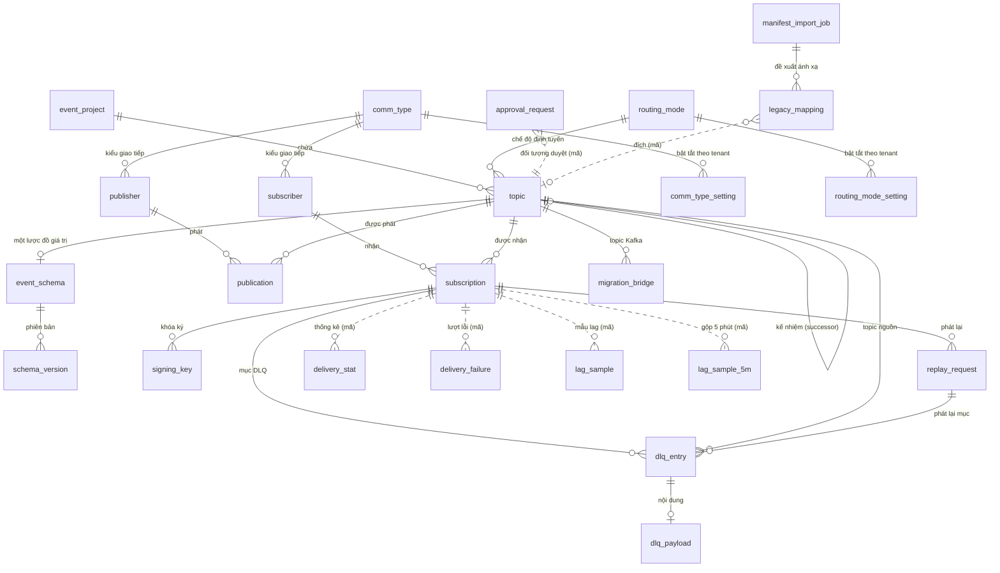

# D03-03-PH10 · Thiết kế CSDL Sự kiện

## Tóm tắt cho hội đồng thẩm định

Schema `ph10_event` trên cụm `pg-core` có 28 bảng cho 20 thực thể của [D02-03-PH10](../../02-yeu-cau/frs/D02-03-PH10-frs-su-kien.md) §4.2, phục vụ phần điều khiển (control plane) của trục sự kiện trong `dh-integration`. Sự kiện nghiệp vụ không nằm trong PostgreSQL: chúng ở Kafka (Strimzi, KRaft), lược đồ ở Apicurio Registry 3, cấu hình cụm ở kho Git `dh-config-{tenant}`. Bốn điểm chính:

1. **Enum và tên cột lấy đúng phụ lục A của FRS.** Mọi trạng thái, loại, chế độ là `varchar` có `CHECK` liệt kê đúng giá trị A.2; cột là `snake_case` của trường A.3. Công cụ [`ph10/tools/check_frs.py`](ph10/tools/check_frs.py) đối chiếu tự động 44 cột enum, 5 enum trong JSON và toàn bộ trường A.3: kết quả sạch (§4.3). Bốn ngoại lệ có lý do ghi ở §1.3, chín điểm FRS còn thiếu ghi ở §9.2.
2. **Không có bí mật trong CSDL.** Khóa ký HMAC `whsec_` chỉ ở OpenBao; bảng `signing_key` lưu `secret_ref` bị `CHECK` buộc đúng mẫu đường dẫn A.8 nên không chứa được giá trị khóa. Cấu hình đẩy và outbox bị chặn khóa `secret`, `signingSecret`, chuỗi `whsec_`. Nội dung mục DLQ của topic `RESTRICTED`, `SENSITIVE` là bản mã OpenBao transit.
3. **Quy tắc nghiệp vụ khóa ở CSDL**, không chỉ ở dịch vụ: tiền tố topic trùng tenant, tên topic ghép đúng miền, thực thể, sự kiện, phiên bản (BR-10-002); hệ số nhân bản cố định 3 (BR-10-004); tổ hợp `partyType`, `commType`, `deliveryMode` (BR-10-017); bốn mắt (BR-10-010); phiên bản lược đồ đã bật bất biến (BR-10-013); một cầu nối còn hiệu lực mỗi cặp topic (BR-10-033); DLQ ghi lặp không nhân đôi (BR-10-024).
4. **Cô lập tenant bằng `FORCE ROW LEVEL SECURITY`** trên 27 bảng; danh mục kiểu giao tiếp và chế độ định tuyến là dữ liệu dùng chung tenant `COMMON`, tỉnh đọc được nhưng không ghi được; topic nền tảng `dh.*` thuộc `COMMON`, chỉ phiên `PLATFORM` thấy.

DDL [`ph10/ddl/ph10_event.sql`](ph10/ddl/ph10_event.sql) đã chạy thử trên PostgreSQL 16.15 sạch; changelog Liquibase sinh từ DDL chạy được theo thứ tự; bài kiểm [`ph10/test/ph10_isolation_test.sql`](ph10/test/ph10_isolation_test.sql) đạt 47/47 khối (§4.2). Bảng ánh xạ CSDL Hub Pulsar cũ sang bảng mới ở §8 là đầu vào cho kế hoạch chuyển đổi D06-01.

## 1. Chiến lược lưu trữ

### 1.1. Schema, vai trò và kết nối

Schema `ph10_event` (quy ước `ph{nn}_{miền}`) do `ph10_owner` (NOLOGIN) sở hữu. Module `event` của `dh-integration` (package `vn.datahub.integration.event`) kết nối bằng `dh_integration_app`, thành viên `ph10_app`: chỉ DML, không `BYPASSRLS`, không `DELETE` trên bảng khai báo (BR-10-003 không xóa cứng), không `UPDATE` trên bảng chỉ thêm. Liquibase chạy bằng `dh_integration_migrator` (thành viên `ph10_owner`); báo cáo, kiểm toán đọc bằng `ph10_readonly`, không đọc `dlq_payload` (nội dung sự kiện) và cột `response_snippet` của `delivery_failure` (quyền theo cột).

Ba module `flow` (PH-04), `adapter` (PH-05), `event` (PH-10) cùng DU nhưng mỗi module chỉ đọc ghi schema của mình. PH-10 lấy thông tin luồng qua `FlowQueryApi`, HTTT qua bản sao `system_replica` của PH-01; không có khóa ngoại sang schema khác. Cột `system_code`, `flow_code`, `owner_org_code` vì vậy kiểm ở dịch vụ.

`dh-runtime` (cổng sự kiện, bộ giao nhận webhook, cầu nối, bộ giám sát tuân thủ) **không** kết nối `ph10_event`. Runtime nhận cấu hình subscription qua API với scope `event:runtime-config` và đệm cục bộ để chạy tiếp khi control plane ngừng (ADR-071), đọc khóa ký thẳng từ OpenBao, báo thống kê và lượt lỗi qua chỉ số, ghi lỗi cuối cùng lên topic `{topicName}.dlq`. Bộ ghi DLQ (`DlqWriter`) của `dh-integration` biến bản tin DLQ thành dòng `dlq_entry`.

### 1.2. Cách ly tenant

Mọi bảng nghiệp vụ có `tenant_id varchar(16)` và bật `FORCE ROW LEVEL SECURITY` qua `ph10_event.p_enable_rls(bảng, mẫu)`, cùng hai mẫu với PH-04, PH-05:

| Mẫu | Đọc | Ghi | Bảng |
|---|---|---|---|
| P (riêng) | Dòng của tenant phiên; dòng `COMMON` chỉ khi phiên là `PLATFORM` | Như đọc | 25 bảng tác nghiệp |
| S (dùng chung) | Dòng của tenant phiên và `COMMON` | Dòng `COMMON` chỉ khi phiên `PLATFORM` | `comm_type`, `routing_mode` |

Biến phiên `app.tenant_id` đặt đầu mỗi giao dịch bằng `TenantAwareTransactionManager` từ ngữ cảnh xác thực (BR-10-001), không từ tham số do bên gọi gửi. Tác vụ nền liên tenant (thu lag, hết hạn duyệt, dọn DLQ) lặp từng tenant. `shedlock` là bảng kỹ thuật duy nhất không có `tenant_id`.

Ngoài RLS, bốn lớp chặn chéo tenant khác có ở CSDL: (a) `CHECK` tiền tố `split_part(topic_name, '.', 1) = f_topic_prefix(tenant_id)` trên `topic`, `outbox_event`, `inbox_event`; (b) khóa ngoại luôn kèm `tenant_id` (`FOREIGN KEY (tenant_id, topic_name)`), không trỏ chéo được; (c) tên nhóm tiêu thụ chứa mã tenant (`ck_subscription_group_name`); (d) `apicurio_group_id` bằng tiền tố tenant (`ck_event_schema_artifact`). Topic nền tảng `dh.*` (FR-10-067) có `tenant_id = 'COMMON'`, tiền tố `dh`.

### 1.3. Quy ước bảng và ngoại lệ

Theo D00-01 §5.1 và FRS A.1: `id uuid` (UUIDv7 sinh ở ứng dụng), `tenant_id`, `created_at`, `created_by`, `updated_at`, `updated_by`, `version` (trigger `tg_touch`, khóa lạc quan, ETag). Mã nghiệp vụ T-CODE `varchar(63)` có `CHECK ^[a-z][a-z0-9-]{2,62}$`; mã sinh tự động `pub-`, `apr-`, `rpl-`, `imp-`, `brg-` có `CHECK` ULID chữ thường (A.1 mục 4). Cột bất biến (mã, tên topic, khóa tham chiếu, phạm vi phát lại) được trigger `tg_immutable` chặn sửa.

Bảng khai báo tham chiếu nhau bằng mã nghiệp vụ (`topic_name`, `publisher_code`, `subscription_code`) qua khóa ngoại tổng hợp `(tenant_id, mã)` thay vì `*_id`, để tên cột đúng tên trường A.3 và vì mã bất biến (BR-10-003).

| Bảng, cột | Ngoại lệ | Lý do |
|---|---|---|
| `delivery_stat`, `lag_sample`, `lag_sample_5m` | Khóa tự nhiên, không `id`, không cột sửa | Dữ liệu đo, phân vùng theo thời gian, ghi upsert |
| `delivery_failure`, `dlq_payload`, `inbox_event`, `outbox_event` | Không `version`, `updated_*` | Chỉ thêm, xóa khi dọn |
| `delivery_failure.record_offset` | Trường API `offset` | `OFFSET` là từ khóa dành riêng của SQL |
| `dlq_entry.id`, `legacy_mapping.id` | Là `dlqEntryId`, `mappingId` của A.3 | A.1 mục 4: hai mã này là UUIDv7 |
| `subscriber.is_flow` | Không lưu | A.3: suy ra từ `party_type = 'FLOW'`, chỉ ở API |

Trạng thái dùng `varchar` + `CHECK`; thêm giá trị là một changeset mới, sau khi FRS phụ lục A được sửa trước.

### 1.4. Quy tắc nghiệp vụ chốt ở CSDL

| Ràng buộc | Quy tắc | BR, FR |
|---|---|---|
| `ck_topic_prefix`, `ck_topic_name_business`, `ck_topic_name_machine`, `ck_topic_name_dlq` | Tiền tố tenant; BUSINESS ghép đúng `{tenant}.{domain}.{entity}.{eventName}.v{majorVersion}`; CDC, SYSTEM 2…4 đoạn giữa; `.dlq` chỉ cho topic DLQ | BR-10-001, 002, 023 |
| `ck_topic_reserved_domain` | Miền `event`, `cdc`, `audit`, `obs`, `integration`, `adapter`, `rdm`, `connect`, `payment`, `platform` không cho BUSINESS | BR-10-030 |
| `ck_topic_replication` | `replication_factor = 3`, `min_insync_replicas = 2` | BR-10-004 |
| `ck_topic_ordering`, `ck_topic_key_field`, `ck_topic_compact_key` | Topic cần thứ tự dùng `KEY_HASH` hoặc `SINGLE_PARTITION`; `KEY_HASH` phải có `partition_key_field`; nén cần khóa | BR-10-006 |
| `tg_event_schema_none` | `NONE` chỉ khi topic chưa từng `ACTIVE` (ERR-10-019) | BR-10-012 |
| `tg_schema_version_frozen`, `uq_schema_version_one_open` | Nội dung bất biến từ `ENABLED`; một bản nháp hoặc chờ duyệt mỗi topic | BR-10-013, FR-10-019 |
| `ck_publisher_combo`, `ck_subscriber_combo`, `tg_subscription_combo` | Tổ hợp A.2.8; `deliveryMode` khớp `commType` của bên nhận; `LEGACY_BRIDGE` chỉ phát | BR-10-017 |
| `ck_publication_four_eyes`, `ck_subscription_four_eyes`, `ck_approval_request_four_eyes` | Người tạo, người gửi không tự duyệt | BR-10-010 |
| `ck_approval_request_auto` | Tự duyệt chỉ ghi `decided_by = 'system:auto'` | BR-10-031 |
| `ck_publication_scope` | Scope chỉ khi `ACTIVE`, đúng `topic:{topicName}:publish` | BR-10-020 |
| `tg_subscription_combo` (phần 2, 3, 4) | Topic `RESTRICTED`, `SENSITIVE` cần `legal_basis`; `workerCount` ≤ số phân vùng; topic `DEPRECATED`, `RETIRED` không nhận subscription mới | BR-10-019, 025, 016 |
| `ck_subscription_push` | Endpoint chỉ `https://`, không thông tin đăng nhập trong URL; miền giá trị A.5; không khóa bí mật | BR-10-026, 027 |
| `ck_signing_key_secret_ref`, `uq_signing_key_active`, `uq_signing_key_previous` | Chỉ đường dẫn OpenBao; một khóa `ACTIVE`, tối đa một `PREVIOUS` | BR-10-027, FR-10-042 |
| `uq_dlq_entry_source` | Một mục mỗi (subscription, topic, phân vùng, offset): `DlqWriter` chạy lại không nhân đôi | BR-10-024 |
| `ck_dlq_entry_resolved` | Loại bỏ phải có người và lý do | FR-10-050 |
| `ck_replay_request_range`, `uq_replay_request_running`, `ck_replay_request_reason` | Phạm vi khớp chế độ; một lượt chạy mỗi subscription; lý do bắt buộc | BR-10-028, FR-10-051 |
| `uq_migration_bridge_pair`, `ck_migration_bridge_expiry` | Không hai cầu nối còn hiệu lực trên cùng cặp, kể cả ngược chiều; có hạn dùng | BR-10-033, ERR-10-042 |
| `ck_outbox_event_topic`, `ck_outbox_event_type`, `ck_outbox_event_no_secret` | Chỉ 15 topic EVT-10 của A.7 và kiểm toán; `ce_type` khớp topic; không bí mật | A.7, BR-10-027, FR-10-065 |
| Quyền `REVOKE DELETE` | Khai báo không xóa cứng; chỉ đổi trạng thái | BR-10-003 |

Quy tắc cần trạng thái cụm hoặc hệ khác (số phân vùng chỉ tăng, hạn mức tenant, HTTT là thành viên PH-01, cấp độ ATTT) kiểm ở dịch vụ, ghi ở D03-02-PH10.

### 1.5. Ước lượng khối lượng (giả định)

Giả định theo GĐ-01…07 (tỉnh T01 quy mô vừa, 200 HTTT): 300 topic, 450 publication, 600 subscription (400 đẩy, 120 kéo, 80 nội bộ), trung bình 6 phân vùng, 2 triệu sự kiện mỗi ngày, tỷ lệ vào DLQ 0,05%.

| Bảng | Dòng ước tính | Dung lượng (gồm chỉ mục) | Cơ sở |
|---|---|---|---|
| Khai báo (`topic` … `approval_request`) | dưới 20 nghìn | dưới 50 MB | Tăng chậm, giữ vĩnh viễn |
| `lag_sample` | khoảng 10 triệu mỗi ngày, giữ 2 ngày | khoảng 2,5 GB | 600 × 6 phân vùng × 2.880 mẫu (chu kỳ 30 giây) |
| `lag_sample_5m` | khoảng 15 triệu (90 ngày) | khoảng 1,5 GB | 600 × 288 × 90 |
| `delivery_stat` | khoảng 15 triệu (90 ngày) | khoảng 2 GB | 520 subscription đẩy, kéo; 30% số phút có lưu lượng |
| `delivery_failure` | khoảng 1 triệu (30 ngày) | khoảng 0,5 GB | Gồm cả lượt thử lại tạm thời |
| `dlq_entry`, `dlq_payload` | khoảng 1 nghìn mục mỗi ngày | dưới 5 GB | Nội dung trung bình 4 KiB; giữ 30 ngày sau xử lý |

`lag_sample` là bảng lớn nhất và là câu hỏi mở Q10-51.

## 2. Sơ đồ thực thể – quan hệ

Đường liền là khóa ngoại thật, đều kèm `tenant_id` (trừ `comm_type`, `routing_mode` là danh mục `COMMON`, khóa ngoại theo mã duy nhất toàn cục). Đường chấm là liên kết theo mã không có khóa ngoại: bảng đo `delivery_*`, `lag_*` phân vùng theo thời gian nên không nhận khóa ngoại vào, ghi theo lô và dọn độc lập; `approval_request` trỏ tới năm loại đối tượng qua cặp `(target_type, target_code)`; `legacy_mapping` trỏ tới đối tượng đích theo loại. Hai bảng kỹ thuật `outbox_event`, `inbox_event` và `shedlock`, `tenant_event_quota` đứng riêng, không vẽ.

Bốn vòng đời tách biệt: khai báo (dự án, topic, lược đồ; vĩnh viễn, xóa mềm), quan hệ (bên tham gia, publication, subscription, khóa ký, duyệt), vận hành (DLQ, phát lại, lag, thống kê; có hạn giữ), di trú (tác vụ nhập, ánh xạ, cầu nối; 5 năm).

## 3. Đặc tả bảng

Phần dưới sinh bằng [`ph10/tools/gen_tables_md.py`](ph10/tools/gen_tables_md.py) từ DDL (`CREATE TABLE`, `COMMENT ON`, `CHECK … IN`); sửa ở DDL rồi chạy `python3 tools/gen_tables_md.py --write`, không sửa tay. Bảy cột ngữ cảnh chuẩn gộp một dòng cuối mỗi bảng. Tên ràng buộc đầy đủ xem trong DDL.

<!-- gen:tables:start -->
### 3.1. `comm_type`

EN-10-15 Kiểu giao tiếp (FR-10-060, LGC-HUB-014 type_of_comm). Danh mục nền tảng (tenant COMMON), seed 8 mã phụ lục A.2.8; tenant bật tắt ở comm_type_setting.

| Cột | Kiểu | Ghi chú |
|---|---|---|
| `comm_type_code` | `varchar(32)` | Giá trị: `HTTP_PUBLISH`, `KAFKA_NATIVE`, `INTERNAL_KAFKA`, `OUTBOX_CDC`, `DB_CDC`, `WEBHOOK_PUSH`, `HTTP_PULL`, `PULSAR_BRIDGE`. |
| `direction` | `varchar(16)` | Giá trị: `PUBLISH`, `SUBSCRIBE`, `BOTH`. |
| `allowed_party_types` | `varchar(32)[]` | partyType hợp lệ (A.2.8). PULSAR_BRIDGE: LEGACY_BRIDGE khi phát, INTERNAL_SERVICE khi nhận (cầu nối ngược). |
| `delivery_mode` | `varchar(16), NULL` | deliveryMode tương ứng khi chiều nhận; NULL với mã chỉ phát. Giá trị: `PUSH`, `PULL_API`, `PULL_KAFKA`, `INTERNAL`. |
| `legacy_code` | `varchar(64), NULL` | Mã type_of_comm của Hub cũ (giả định, Q10-01); dùng khi nhập PULSAR_HUB (FR-10-072). |

Cột khác: `name` (varchar(255)); `enabled` (boolean, mặc định true), cột ngữ cảnh chuẩn (§1.3).

### 3.2. `comm_type_setting`

Phần tenant của EN-10-15: TA bật, tắt kiểu giao tiếp (FR-10-060). Không có dòng nghĩa là theo comm_type.enabled. Tắt không ảnh hưởng bên đang dùng, chỉ chặn tạo mới.

Cột khác: `comm_type_code` (varchar(32)); `enabled` (boolean), cột ngữ cảnh chuẩn (§1.3).

### 3.3. `routing_mode`

EN-10-16 Chế độ định tuyến (FR-10-061, LGC-HUB-014 routing_mode). Danh mục nền tảng, seed 3 mã phụ lục A.2.9.

| Cột | Kiểu | Ghi chú |
|---|---|---|
| `routing_mode_code` | `varchar(32)` | Giá trị: `KEY_HASH`, `ROUND_ROBIN`, `SINGLE_PARTITION`. |
| `ordering` | `varchar(255)` | Mô tả bảo đảm thứ tự (A.2.9: trong cùng khóa, không, toàn topic). Văn bản, FRS chưa đặt enum (đề nghị bổ sung §9.2). |
| `legacy_code` | `varchar(64), NULL` | Chế độ Pulsar tương ứng: CustomPartition, RoundRobinPartition, SinglePartition. |

Cột khác: `name` (varchar(255)); `enabled` (boolean, mặc định true), cột ngữ cảnh chuẩn (§1.3).

### 3.4. `routing_mode_setting`

Phần tenant của EN-10-16 (FR-10-061). KEY_HASH không tắt được vì topic orderingRequired cần nó (BR-10-006).

Cột khác: `routing_mode_code` (varchar(32)); `enabled` (boolean), cột ngữ cảnh chuẩn (§1.3).

### 3.5. `tenant_event_quota`

EN-10-17 Hạn mức tenant (FR-10-062). PA đặt trần (miền A.5 10.quota.*), tạo khi khởi tạo tenant (FR-10-064). Mức dùng tính từ topic, subscription; phân bổ theo principal ghi ở publication, subscription (quota_bytes_per_second).

| Cột | Kiểu | Ghi chú |
|---|---|---|
| `ceiling_set_by` | `varchar(64)` | PA đặt trần gần nhất (không phải TA). |

Cột khác: `max_projects` (integer, mặc định 200); `max_topics` (integer, mặc định 500); `max_partitions_total` (integer, mặc định 3000); `produce_bytes_per_second` (bigint, mặc định 10485760); `consume_bytes_per_second` (bigint, mặc định 20971520); `max_retention_hours` (integer, mặc định 720); `max_subscriptions` (integer, mặc định 2000); `max_push_workers_total` (integer, mặc định 400); `max_projects` (BETWEEN 1 AND 5000 AND max_topics BETWEEN 1 AND 10000, NULL), cột ngữ cảnh chuẩn (§1.3).

### 3.6. `event_project`

EN-10-01 Dự án tích hợp (FR-10-001…006, LGC-HUB-008). Mã bất biến, không dùng lại kể cả khi ARCHIVED (BR-10-003): không xóa cứng. Dự án hệ thống cdc-{adapterCode} tự tạo khi PH-05 đăng ký topic CDC (FR-10-066).

| Cột | Kiểu | Ghi chú |
|---|---|---|
| `project_code` | `varchar(63)` | T-CODE; không trùng từ dành riêng của route /tich-hop/du-an (A.6). |
| `owner_org_code` | `varchar(63)` | Mã cơ quan chủ quản (PH-12, PH-20); không khóa ngoại vì khác schema. |
| `status` | `varchar(16), mặc định 'ACTIVE'` | Giá trị: `ACTIVE`, `ARCHIVED`. |

Cột khác: `name` (varchar(255)); `description` (varchar(2000), NULL); `owner_user` (varchar(63)); `labels` (varchar(63)[], mặc định '{}'); `archived_at` (timestamptz, NULL); `archive_reason` (varchar(2000), NULL), cột ngữ cảnh chuẩn (§1.3). 3 chỉ mục phụ (§3.29, ddl).

### 3.7. `topic`

EN-10-02 Topic (FR-10-007…016, LGC-HUB-009). Tên bất biến, không dùng lại (BR-10-003); không xóa dòng, chỉ RETIRED. Topic DLQ {topicName}.dlq (topic_kind DLQ) tạo cùng topic gốc (BR-10-023). Topic nền tảng dh.* thuộc tenant COMMON (FR-10-067). Cấu hình cụm sinh vào dh-config-{tenant}/kafka/topics/{topicName}.yaml (ADR-072).

| Cột | Kiểu | Ghi chú |
|---|---|---|
| `topic_name` | `varchar(204)` | BR-10-002: ≤ 200 ký tự; topic DLQ thêm .dlq (≤ 204). Tiền tố tenant chữ thường hoặc dh. |
| `project_code` | `varchar(63), NULL` | Bắt buộc với BUSINESS, CDC; NULL được với SYSTEM (theo DU) và DLQ (theo topic gốc). |
| `topic_kind` | `varchar(16)` | Giá trị: `BUSINESS`, `CDC`, `SYSTEM`, `DLQ`. |
| `partitions` | `integer` | Chỉ tăng (BR-10-005, kiểm ở dịch vụ); trần 10.topic.max-partitions của tenant. |
| `retention_hours` | `integer` | Mặc định 10.topic.default-retention-hours; trần tenant_event_quota.max_retention_hours (kiểm ở dịch vụ). |
| `cleanup_policy` | `varchar(16), mặc định 'DELETE'` | Giá trị: `DELETE`, `COMPACT`, `COMPACT_DELETE`. |
| `routing_mode` | `varchar(32)` | Giá trị: `KEY_HASH`, `ROUND_ROBIN`, `SINGLE_PARTITION`. |
| `data_class` | `varchar(16)` | Giá trị: `PUBLIC`, `INTERNAL`, `RESTRICTED`, `SENSITIVE`. |
| `status` | `varchar(20), mặc định 'DRAFT'` | Giá trị: `DRAFT`, `PENDING_APPROVAL`, `PROVISIONING`, `FAILED`, `ACTIVE`, `DEPRECATED`, `RETIRED`. |
| `provisioning_commit` | `varchar(64), NULL` | SHA commit kho dh-config-{tenant} chứa KafkaTopic (ADR-072). |
| `owner_service_code` | `varchar(32), NULL` | DU chủ (A.2.12) của topic CDC (dh-cdc), SYSTEM. Mã DU theo A.2.12. |
| `source_ref` | `jsonb, NULL` | Nguồn đăng ký máy, ví dụ {"adapterCode":"dkkd-db","schema":"public","table":"doanh-nghiep"} của PH-05, hoặc {"legacyTopic":"persistent://..."} khi di trú. |

Cột khác: `domain` (varchar(63)); `entity` (varchar(63)); `event_name` (varchar(63)); `major_version` (integer); `description` (varchar(2000), NULL); `replication_factor` (smallint, mặc định 3); `min_insync_replicas` (smallint, mặc định 2); `max_message_bytes` (integer, mặc định 1048576); `partition_key_field` (varchar(255), NULL); `ordering_required` (boolean, mặc định false); `predecessor_topic` (varchar(204), NULL); `successor_topic` (varchar(204), NULL); `sunset_at` (timestamptz, NULL); `provisioning_error` (varchar(2000), NULL); `activated_at` (timestamptz, NULL); `retired_at` (timestamptz, NULL), cột ngữ cảnh chuẩn (§1.3). 7 chỉ mục phụ (§3.29, ddl).

### 3.8. `event_schema`

EN-10-03 Lược đồ giá trị, đúng một cho mỗi topic (BR-10-011, FR-10-017…023). Bản sao siêu dữ liệu của artifact Apicurio (ADR-070); Apicurio là nơi serde đọc, bảng này là nơi duyệt và truy vết.

| Cột | Kiểu | Ghi chú |
|---|---|---|
| `schema_format` | `varchar(16)` | Giá trị: `AVRO`, `JSON_SCHEMA`. |
| `compatibility` | `varchar(24), mặc định 'BACKWARD'` | Ánh xạ thẳng quy tắc COMPATIBILITY của Apicurio. NONE chỉ khi topic chưa từng ACTIVE (BR-10-012, trigger tg_event_schema_none). Giá trị: `BACKWARD`, `BACKWARD_TRANSITIVE`, `FORWARD`, `FORWARD_TRANSITIVE`, `FULL`, `FULL_TRANSITIVE`, `NONE`. |

Cột khác: `topic_name` (varchar(204)); `apicurio_group_id` (varchar(16)); `apicurio_artifact_id` (varchar(204)); `latest_version_no` (integer, mặc định 0), cột ngữ cảnh chuẩn (§1.3).

### 3.9. `schema_version`

EN-10-04 Phiên bản lược đồ (FR-10-018…022). Một bản nháp hoặc chờ duyệt mỗi topic; nội dung bất biến từ ENABLED (BR-10-013, trigger tg_schema_version_frozen); chỉ chuyển ENABLED, DEPRECATED, DISABLED. Giữ vĩnh viễn.

| Cột | Kiểu | Ghi chú |
|---|---|---|
| `content` | `text` | Văn bản lược đồ Avro (.avsc) hoặc JSON Schema; ≤ 256 KiB (giả định, Q10-53). |
| `content_hash` | `char(64)` | SHA-256 hex của nội dung chuẩn hóa; chống gửi trùng. |
| `status` | `varchar(20), mặc định 'DRAFT'` | Giá trị: `DRAFT`, `PENDING_APPROVAL`, `REJECTED`, `ENABLED`, `DEPRECATED`, `DISABLED`. |
| `apicurio_global_id` | `bigint, NULL` | globalId Apicurio; serde ghi vào tiền tố bản tin, bộ giám sát tuân thủ đối chiếu (ERR-10-119). |
| `pii_findings` | `jsonb, mặc định '[]'` | Mảng {field, reason, severity}; severity theo A.2.4 (INFO, WARNING, BLOCKING). |

Cột khác: `topic_name` (varchar(204)); `version_no` (integer); `apicurio_content_id` (bigint, NULL); `compatibility_report` (jsonb, NULL); `change_note` (varchar(2000), NULL); `checked_at` (timestamptz, NULL); `enabled_at` (timestamptz, NULL), cột ngữ cảnh chuẩn (§1.3). 3 chỉ mục phụ (§3.29, ddl).

### 3.10. `publisher`

EN-10-05 Bên phát (FR-10-024, 026, 028, 029, LGC-HUB-010). SYSTEM phải là HTTT thành viên PH-01 (kiểm ở dịch vụ qua bản sao system_replica của PH-01). LEGACY_BRIDGE do cầu nối di trú tạo (FR-10-073).

| Cột | Kiểu | Ghi chú |
|---|---|---|
| `party_type` | `varchar(20)` | Giá trị: `SYSTEM`, `FLOW`, `INTERNAL_SERVICE`, `LEGACY_BRIDGE`. |
| `service_code` | `varchar(32), NULL` | Mã DU theo A.2.12. |
| `reference_key` | `varchar(255), NULL` | Khóa tham chiếu kế thừa hệ cũ; dùng ghép ánh xạ khi nhập PULSAR_HUB (FR-10-072). |
| `client_id` | `varchar(255), NULL` | Client Keycloak của HTTT (claim azp) cho principal User:{clientId}. |
| `kafka_principal` | `varchar(255), NULL` | Principal Kafka theo A.8; sinh KafkaUser dh-config-{tenant}/kafka/users/{principal}.yaml. |
| `status` | `varchar(16), mặc định 'ACTIVE'` | Giá trị: `ACTIVE`, `SUSPENDED`, `RETIRED`. |
| `suspend_source` | `varchar(20), NULL` | Giá trị: `MANUAL`, `SECURITY`, `PH01`, `CIRCUIT_BREAKER`. |
| `last_active_at` | `timestamptz, NULL` | Lần phát gần nhất, cập nhật theo lô từ chỉ số (không mỗi bản tin). |

Cột khác: `publisher_code` (varchar(63)); `name` (varchar(255)); `description` (varchar(2000), NULL); `system_code` (varchar(63), NULL); `flow_code` (varchar(63), NULL); `comm_type` (varchar(32)); `suspend_reason` (varchar(1000), NULL), cột ngữ cảnh chuẩn (§1.3). 5 chỉ mục phụ (§3.29, ddl).

### 3.11. `subscriber`

EN-10-06 Bên nhận (FR-10-025…029, LGC-HUB-011). Cờ "là luồng" của hệ cũ thành party_type = FLOW; isFlow chỉ suy ra ở API, không lưu.

| Cột | Kiểu | Ghi chú |
|---|---|---|
| `party_type` | `varchar(20)` | Giá trị: `SYSTEM`, `FLOW`, `INTERNAL_SERVICE`. |
| `flow_code` | `varchar(63), NULL` | Mã luồng PH-04 khi FLOW; không khóa ngoại sang ph04 (khác module), kiểm qua FlowQueryApi. |
| `service_code` | `varchar(32), NULL` | Mã DU theo A.2.12. |
| `status` | `varchar(16), mặc định 'ACTIVE'` | Giá trị: `ACTIVE`, `SUSPENDED`, `RETIRED`. |
| `suspend_source` | `varchar(20), NULL` | Giá trị: `MANUAL`, `SECURITY`, `PH01`, `CIRCUIT_BREAKER`. |

Cột khác: `subscriber_code` (varchar(63)); `name` (varchar(255)); `description` (varchar(2000), NULL); `system_code` (varchar(63), NULL); `comm_type` (varchar(32)); `reference_key` (varchar(255), NULL); `client_id` (varchar(255), NULL); `kafka_principal` (varchar(255), NULL); `suspend_reason` (varchar(1000), NULL); `last_active_at` (timestamptz, NULL), cột ngữ cảnh chuẩn (§1.3). 5 chỉ mục phụ (§3.29, ddl).

### 3.12. `publication`

EN-10-07 Publication (FR-10-030…032, LGC-HUB-012). Duy nhất theo cặp bên phát, topic khi còn hiệu lực; dòng REJECTED, REVOKED giữ lại để truy vết. Duyệt qua approval_request PUBLICATION; tự duyệt ghi approved_by = system:auto (BR-10-031).

| Cột | Kiểu | Ghi chú |
|---|---|---|
| `quota_bytes_per_second` | `bigint, NULL` | Phần hạn mức sản xuất phân bổ cho principal (FR-10-062), tối thiểu 256 KiB/s; tổng không vượt trần tenant (BR-10-029, kiểm ở dịch vụ). |
| `status` | `varchar(20), mặc định 'PENDING_APPROVAL'` | Giá trị: `PENDING_APPROVAL`, `REJECTED`, `ACTIVE`, `SUSPENDED`, `REVOKED`. |
| `granted_scope` | `varchar(255), NULL` | Scope OAuth cấp cho HTTT (SYSTEM); NULL với FLOW, INTERNAL_SERVICE vì đi listener internal (BR-10-018). |
| `acl_ref` | `varchar(512), NULL` | Đường dẫn tài nguyên KafkaUser trong dh-config-{tenant} chứa ACL WRITE literal trên topic. |
| `suspend_source` | `varchar(20), NULL` | Giá trị: `MANUAL`, `SECURITY`, `PH01`, `CIRCUIT_BREAKER`. |

Cột khác: `publication_code` (varchar(63)); `publisher_code` (varchar(63)); `topic_name` (varchar(204)); `purpose` (varchar(2000)); `expected_rate_per_minute` (integer, NULL); `approved_by` (varchar(64), NULL); `approved_at` (timestamptz, NULL); `revoked_at` (timestamptz, NULL), cột ngữ cảnh chuẩn (§1.3). 3 chỉ mục phụ (§3.29, ddl).

### 3.13. `subscription`

EN-10-08 Subscription (FR-10-035…048, LGC-HUB-013). Duy nhất theo cặp bên nhận, topic khi còn hiệu lực. deliveryMode khớp commType của bên nhận (BR-10-017, trigger tg_subscription_combo). Nhóm tiêu thụ theo A.8, bất biến.

| Cột | Kiểu | Ghi chú |
|---|---|---|
| `delivery_mode` | `varchar(16)` | Giá trị: `PUSH`, `PULL_API`, `PULL_KAFKA`, `INTERNAL`. |
| `legal_basis` | `varchar(2000), NULL` | Căn cứ pháp lý, bắt buộc với topic RESTRICTED, SENSITIVE (BR-10-019, trigger tg_subscription_combo). |
| `start_position` | `varchar(16), mặc định 'LATEST'` | Giá trị: `LATEST`, `EARLIEST`, `TIMESTAMP`. |
| `status` | `varchar(20), mặc định 'PENDING_APPROVAL'` | Giá trị: `PENDING_APPROVAL`, `REJECTED`, `PROVISIONING`, `FAILED`, `ACTIVE`, `PAUSED`, `SUSPENDED`, `REVOKED`. |
| `suspend_source` | `varchar(20), NULL` | Giá trị: `MANUAL`, `SECURITY`, `PH01`, `CIRCUIT_BREAKER`. |
| `alert_state` | `varchar(16), mặc định 'OK'` | Trạng thái lag gần nhất do bộ thu lag cập nhật (FR-10-054, 055); đổi trạng thái phát EVT-10-10. Giá trị: `OK`, `WARNING`, `CRITICAL`, `STALLED`. |
| `push` | `jsonb, NULL` | JSON A.3: endpointUrl (HTTPS), workerCount (≤ số phân vùng, BR-10-025), maxRetries, retryBackoff{initialMs,multiplier,maxMs}, timeoutMs, failurePolicy, payloadFormat, endpointVerifiedAt, verificationWaiverUntil, endpointVerification{result}. Không chứa bí mật. |
| `pull` | `jsonb, NULL` | JSON A.3: maxBatch (≤ 10.pull.max-batch), leaseSeconds. |

Cột khác: `subscription_code` (varchar(63)); `subscriber_code` (varchar(63)); `topic_name` (varchar(204)); `purpose` (varchar(2000)); `consumer_group` (varchar(255)); `start_at` (timestamptz, NULL); `suspend_reason` (varchar(1000), NULL); `lag_warn_seconds` (integer, mặc định 300); `lag_critical_seconds` (integer, mặc định 1800); `approved_by` (varchar(64), NULL); `approved_at` (timestamptz, NULL); `quota_bytes_per_second` (bigint, NULL), cột ngữ cảnh chuẩn (§1.3). 5 chỉ mục phụ (§3.29, ddl).

### 3.14. `signing_key`

EN-10-09 Khóa ký webhook (FR-10-042, ADR-044, ADR-071). Một ACTIVE và tối đa một PREVIOUS mỗi subscription (xoay khóa có chồng lấn 10.push.key-rotation-overlap-days). Giá trị whsec_ chỉ ở OpenBao KV v2; phiên bản KV ứng với key_id.

| Cột | Kiểu | Ghi chú |
|---|---|---|
| `key_id` | `varchar(64)` | Mã khóa gửi ở tiêu đề X-Datahub-Key-Id; không phải bí mật, không được bắt đầu bằng whsec. |
| `secret_ref` | `varchar(255)` | Đường dẫn OpenBao kv/dh/{tenant}/event/subscriptions/{subscriptionCode}/signing (A.8); CHECK buộc đúng mẫu nên không chứa được giá trị khóa. |
| `status` | `varchar(16), mặc định 'ACTIVE'` | Giá trị: `ACTIVE`, `PREVIOUS`, `REVOKED`. |
| `previous_until` | `timestamptz, NULL` | Hết chồng lấn: sau thời điểm này bộ giao nhận chỉ ký bằng khóa ACTIVE; SigningKeyRotationJob chuyển REVOKED. |

Cột khác: `subscription_code` (varchar(63)); `activated_at` (timestamptz); `revoked_at` (timestamptz, NULL), cột ngữ cảnh chuẩn (§1.3). 4 chỉ mục phụ (§3.29, ddl).

### 3.15. `approval_request`

EN-10-10 Yêu cầu duyệt chung 9 requestType (A.2.10), đổ vào Việc của tôi (UI-10-13, FR-00-070). Một yêu cầu PENDING mỗi đối tượng và loại. PENDING quá 10.approval.expire-days chuyển EXPIRED (ApprovalExpiryJob). Giữ vĩnh viễn.

| Cột | Kiểu | Ghi chú |
|---|---|---|
| `request_type` | `varchar(20)` | Giá trị: `TOPIC_CREATE`, `TOPIC_CHANGE`, `TOPIC_RETIRE`, `SCHEMA_VERSION`, `PUBLICATION`, `SUBSCRIPTION`, `REPLAY`, `BRIDGE`, `CUTOVER`. |
| `target_type` | `varchar(20)` | Giá trị: `TOPIC`, `SCHEMA_VERSION`, `PUBLICATION`, `SUBSCRIPTION`, `REPLAY`, `BRIDGE`, `MAPPING`. |
| `target_code` | `varchar(255)` | topicName, publicationCode, subscriptionCode, replayCode, bridgeCode, mappingId; SCHEMA_VERSION dạng {topicName}@{versionNo}. |
| `checks` | `jsonb, mặc định '[]'` | Kết quả kiểm tra tự động khi gửi duyệt (tương thích, PII, hạn mức, cấp độ ATTT). |
| `status` | `varchar(16), mặc định 'PENDING'` | Giá trị: `PENDING`, `APPROVED`, `REJECTED`, `WITHDRAWN`, `EXPIRED`. |

Cột khác: `request_code` (varchar(63)); `payload_diff` (jsonb, mặc định '{}'); `requested_by` (varchar(64)); `requested_at` (timestamptz, mặc định now()); `decided_by` (varchar(64), NULL); `decided_at` (timestamptz, NULL); `decision_comment` (varchar(2000), NULL); `auto_approved` (boolean, mặc định false), cột ngữ cảnh chuẩn (§1.3). 4 chỉ mục phụ (§3.29, ddl).

### 3.16. `delivery_stat`

EN-10-11 Thống kê giao nhận theo subscription, cửa sổ 1 phút (FR-10-056). Bộ giao nhận và cổng kéo gửi chỉ số; DeliveryStatConsumer ghi upsert. Khóa tự nhiên, không id (§1.3). Giữ 90 ngày, phân vùng tháng.

Cột khác: `tenant_id` (varchar(16)); `subscription_code` (varchar(63)); `window_start` (timestamptz); `success_count` (integer, mặc định 0); `transient_error_count` (integer, mặc định 0); `retry_count` (integer, mặc định 0); `dead_letter_count` (integer, mặc định 0); `latency_p50_ms` (integer, NULL); `latency_p95_ms` (integer, NULL), phân vùng `RANGE (window_start)`.

### 3.17. `delivery_failure`

EN-10-11 Lượt giao lỗi (FR-10-056, tab Lỗi gần đây UI-10-12). Chỉ thêm; giữ 30 ngày (DETACH phân vùng tháng quá hạn, tối đa 2 tháng trực tuyến).

| Cột | Kiểu | Ghi chú |
|---|---|---|
| `record_offset` | `bigint` | Trường API offset; đổi tên vì OFFSET là từ khóa dành riêng của SQL (§1.3). |
| `failure_class` | `varchar(16)` | Giá trị: `TRANSIENT`, `PERMANENT`, `DESERIALIZATION`, `SECURITY`. |
| `response_snippet` | `varchar(1024), NULL` | ≤ 1 KiB đầu thân phản hồi của bên nhận, đã che theo mẫu bí mật; không chứa nội dung sự kiện. |

Cột khác: `id` (uuid); `tenant_id` (varchar(16)); `subscription_code` (varchar(63)); `occurred_at` (timestamptz); `partition` (integer); `event_id` (varchar(255), NULL); `http_status` (smallint, NULL); `error_code` (varchar(16)); `attempt` (integer), phân vùng `RANGE (occurred_at)`. 2 chỉ mục phụ (§3.29, ddl).

### 3.18. `replay_request`

EN-10-13 Lượt phát lại (FR-10-051…053). Phạm vi bất biến sau khi tạo; một lượt APPROVED hoặc RUNNING mỗi subscription. Lý do bắt buộc (BR-10-028). Nhóm tiêu thụ dh-replay-{tenant}-{replayCode}. Giữ 3 năm (nhật ký phát lại).

| Cột | Kiểu | Ghi chú |
|---|---|---|
| `replay_mode` | `varchar(20)` | Giá trị: `REDELIVER_RANGE`, `RESET_OFFSET`, `DLQ_ENTRIES`. |
| `range_type` | `varchar(16)` | Giá trị: `OFFSET`, `TIME`, `ENTRIES`. |
| `partitions` | `jsonb, NULL` | Mảng {partition, fromOffset, toOffset} khi rangeType = OFFSET. |
| `previous_offsets` | `jsonb, NULL` | Offset đã commit của nhóm trước khi RESET_OFFSET, để quay lại (FR-10-053). |
| `status` | `varchar(20), mặc định 'PENDING_APPROVAL'` | Giá trị: `PENDING_APPROVAL`, `REJECTED`, `APPROVED`, `RUNNING`, `COMPLETED`, `FAILED`, `CANCELLED`. |

Cột khác: `replay_code` (varchar(63)); `subscription_code` (varchar(63)); `from_time` (timestamptz, NULL); `to_time` (timestamptz, NULL); `dlq_entry_ids` (uuid[], NULL); `target_endpoint_url` (varchar(2048), NULL); `rate_per_second` (integer, mặc định 2000); `estimated_records` (bigint, NULL); `delivered_records` (bigint, mặc định 0); `failed_records` (bigint, mặc định 0); `reason` (varchar(2000)); `started_at` (timestamptz, NULL); `finished_at` (timestamptz, NULL), cột ngữ cảnh chuẩn (§1.3). 3 chỉ mục phụ (§3.29, ddl).

### 3.19. `dlq_entry`

EN-10-12 Mục DLQ, nguồn sự thật của DLQ tầng sự kiện (FR-10-049, 050; BR-10-024; ADR-071). DlqWriter tiêu thụ {topicName}.dlq, upsert theo (subscription, topic, partition, offset) nên chạy lại không nhân đôi. id chính là dlqEntryId (UUIDv7). NEW giữ vô thời hạn; siêu dữ liệu giữ 1 năm sau khi xử lý.

| Cột | Kiểu | Ghi chú |
|---|---|---|
| `subscription_code` | `varchar(63), NULL` | NULL chỉ với origin BRIDGE (lỗi chuyển bản tin của cầu nối, ERR-10-118); đề nghị FRS bổ sung bridgeCode (§9.2). |
| `origin` | `varchar(20)` | Giá trị: `PUSH`, `PULL_NACK`, `EXTERNAL_REPORT`, `REPLAY`, `BRIDGE`. |
| `status` | `varchar(20), mặc định 'NEW'` | Giá trị: `NEW`, `REPLAY_PENDING`, `REPLAYED`, `DISCARDED`, `PURGED`. |
| `payload_ref` | `varchar(255), NULL` | pg:dlq_payload/{dlqEntryId}; NULL sau khi dọn nội dung (PURGED). |

Cột khác: `source_topic` (varchar(204)); `source_partition` (integer, NULL); `source_offset` (bigint, NULL); `event_id` (varchar(255), NULL); `event_type` (varchar(255), NULL); `event_subject` (varchar(255), NULL); `error_code` (varchar(16)); `error_detail` (varchar(2000), NULL); `attempts` (integer, mặc định 1); `first_failed_at` (timestamptz); `last_failed_at` (timestamptz); `resolved_by` (varchar(64), NULL); `resolved_at` (timestamptz, NULL); `resolve_reason` (varchar(2000), NULL); `replay_code` (varchar(63), NULL); `payload_purged_at` (timestamptz, NULL), cột ngữ cảnh chuẩn (§1.3). 9 chỉ mục phụ (§3.29, ddl).

### 3.20. `dlq_payload`

Nội dung bản tin gốc của mục DLQ (FR-10-049 bước 2), tách khỏi dlq_entry để quyền đọc riêng (ph10_readonly không đọc) và dọn riêng (DlqPayloadPurgeJob xóa dòng sau 10.dlq.payload-retention-days-after-resolve). Không có cột sửa: chỉ thêm, xóa.

| Cột | Kiểu | Ghi chú |
|---|---|---|
| `headers` | `jsonb, mặc định '{}'` | Tiêu đề Kafka (ce_*, dh_dlq_*) dạng chuỗi; không giữ tiêu đề Authorization. |
| `value` | `bytea` | Giá trị nhị phân nguyên vẹn; với topic RESTRICTED, SENSITIVE là bản mã OpenBao transit/dh-{tenant}-event-dlq (vault:v{n}:..., tăng khoảng 4/3 do base64). |
| `transit_key_version` | `integer, NULL` | Phiên bản khóa transit đã mã hóa; NULL khi topic PUBLIC, INTERNAL (chỉ mã hóa mức đĩa của pg-core). |

Cột khác: `dlq_entry_id` (uuid); `tenant_id` (varchar(16)); `record_key` (bytea, NULL); `size_bytes` (integer); `content_hash` (char(64)); `created_at` (timestamptz, mặc định now()).

### 3.21. `lag_sample`

EN-10-14 Mẫu lag thô theo phân vùng, chu kỳ 10.lag.collect-interval-seconds (FR-10-054). Giữ 48 giờ: phân vùng ngày, DROP phân vùng cũ hơn 2 ngày. Khóa tự nhiên (§1.3).

Cột khác: `tenant_id` (varchar(16)); `subscription_code` (varchar(63)); `consumer_group` (varchar(255)); `sampled_at` (timestamptz); `partition` (integer); `lag_records` (bigint); `lag_seconds` (integer); `committed_offset` (bigint, NULL); `end_offset` (bigint), phân vùng `RANGE (sampled_at)`. 1 chỉ mục phụ (§3.29, ddl).

### 3.22. `lag_sample_5m`

Gộp 5 phút của lag_sample theo subscription (giá trị lớn nhất qua các phân vùng và trong cửa sổ), cho biểu đồ xu hướng UI-10-17. Giữ 90 ngày. Bảng kỹ thuật FRS chưa đặt tên (đề nghị bổ sung §9.2).

| Cột | Kiểu | Ghi chú |
|---|---|---|
| `alert_state` | `varchar(16)` | Giá trị: `OK`, `WARNING`, `CRITICAL`, `STALLED`. |

Cột khác: `tenant_id` (varchar(16)); `subscription_code` (varchar(63)); `window_start` (timestamptz); `lag_records` (bigint); `lag_seconds` (integer), phân vùng `RANGE (window_start)`.

### 3.23. `manifest_import_job`

EN-10-20 Tác vụ nhập khai báo (FR-10-071) và nhập kiểm kê Hub Pulsar (FR-10-072). Tệp ở Ceph RGW bucket dh-event-import, không lưu thân tệp trong CSDL. Giữ 5 năm với PULSAR_HUB (hồ sơ chuyển đổi), 1 năm với EVENT_MANIFEST.

| Cột | Kiểu | Ghi chú |
|---|---|---|
| `source_kind` | `varchar(20)` | Giá trị: `EVENT_MANIFEST`, `PULSAR_HUB`. |
| `status` | `varchar(16), mặc định 'VALIDATING'` | Giá trị: `VALIDATING`, `PREVIEW`, `APPLYING`, `APPLIED`, `FAILED`, `CANCELLED`. |
| `preview` | `jsonb, mặc định '[]'` | Mảng dòng xem trước {objectType, code, changeKind, diff}; changeKind theo A.2.13. |

Cột khác: `job_code` (varchar(63)); `file_ref` (varchar(512)); `validation_errors` (jsonb, mặc định '[]'); `applied_at` (timestamptz, NULL), cột ngữ cảnh chuẩn (§1.3). 1 chỉ mục phụ (§3.29, ddl).

### 3.24. `legacy_mapping`

EN-10-18 Ánh xạ di trú Hub Pulsar (FR-10-072, 075, 076; ADR-073). Một dòng mỗi đối tượng cũ; nhập lại cập nhật dòng (job_code trỏ lần nhập gần nhất), không tạo trùng. id chính là mappingId. Giữ 5 năm.

| Cột | Kiểu | Ghi chú |
|---|---|---|
| `legacy_type` | `varchar(16)` | Giá trị: `PROJECT`, `TOPIC`, `PUBLISHER`, `SUBSCRIBER`, `PUBLICATION`, `SUBSCRIPTION`. |
| `legacy_id` | `varchar(512)` | Khóa chính bảng cũ (project.id, publisher.id…) hoặc tên đầy đủ persistent://{tenant}/{namespace}/{topic} với TOPIC. |
| `target_type` | `varchar(20), NULL` | Loại đối tượng đích; FRS chưa đặt enum (đề nghị bổ sung §9.2). Tạm ghi cùng giá trị legacy_type, không CHECK. |
| `confidence` | `varchar(8)` | Giá trị: `HIGH`, `MEDIUM`, `LOW`. |
| `status` | `varchar(16), mặc định 'PROPOSED'` | Giá trị: `PROPOSED`, `PLANNED`, `BRIDGING`, `CUT_OVER`, `ROLLED_BACK`, `CLOSED`, `SKIPPED`. |

Cột khác: `job_code` (varchar(63)); `legacy_name` (varchar(512), NULL); `target_code` (varchar(204), NULL); `issues` (jsonb, mặc định '[]'); `cut_over_at` (timestamptz, NULL); `rollback_until` (timestamptz, NULL), cột ngữ cảnh chuẩn (§1.3). 4 chỉ mục phụ (§3.29, ddl).

### 3.25. `migration_bridge`

EN-10-19 Cầu nối di trú Pulsar, Kafka (FR-10-073, 074; ADR-073). Tạm thời, hạn ≤ 10.migration.bridge-max-days (trần 365 ngày ở CSDL). Tiến độ (last_pulsar_message_id, bridged_count, lag_seconds) do dh-runtime báo, cập nhật theo lô 30 giây.

| Cột | Kiểu | Ghi chú |
|---|---|---|
| `direction` | `varchar(20)` | Giá trị: `PULSAR_TO_KAFKA`, `KAFKA_TO_PULSAR`. |
| `start_from` | `varchar(16), mặc định 'LATEST'` | Giá trị: `LATEST`, `EARLIEST`. |
| `status` | `varchar(20), mặc định 'PENDING_APPROVAL'` | Giá trị: `PENDING_APPROVAL`, `RUNNING`, `STOPPED`, `ERROR`, `EXPIRED`. |

Cột khác: `bridge_code` (varchar(63)); `pulsar_topic` (varchar(512)); `kafka_topic` (varchar(204)); `pulsar_subscription_name` (varchar(255), mặc định 'dh-bridge'); `expires_at` (timestamptz); `last_pulsar_message_id` (varchar(255), NULL); `bridged_count` (bigint, mặc định 0); `lag_seconds` (integer, NULL), cột ngữ cảnh chuẩn (§1.3). 2 chỉ mục phụ (§3.29, ddl).

### 3.26. `outbox_event`

Outbox (DD-11, SAD §7.3) cho EVT-10-01…15 và bản ghi kiểm toán gửi PH-13 ({tenant}.audit.recorded.v1). Ghi cùng giao dịch nghiệp vụ; Debezium Outbox Event Router (connector dh-integration-outbox) đọc WAL, định tuyến theo cột topic, khóa theo partition_key. Dọn sau 3 ngày.

| Cột | Kiểu | Ghi chú |
|---|---|---|
| `partition_key` | `varchar(255)` | Khóa Kafka: topicName, subscriptionCode, publicationCode, replayCode, bridgeCode tùy sự kiện (§6.2). |

Cột khác: `event_id` (uuid); `tenant_id` (varchar(16)); `event_type` (varchar(128)); `topic` (varchar(249)); `aggregate_type` (varchar(64)); `aggregate_id` (varchar(255)); `payload` (jsonb); `trace_id` (char(32)); `occurred_at` (timestamptz, mặc định now()), 1 chỉ mục phụ (§3.29, DDL).

### 3.27. `inbox_event`

Inbox chống xử lý trùng cho sự kiện PH-10 tiêu thụ (at-least-once): trạng thái HTTT PH-01, luồng PH-04 ngừng, CDC schema-changed PH-05 (FR-10-068), khởi tạo tenant PH-20. Ghi cùng giao dịch với tác dụng; khóa (consumer, event_id = ce id). Dọn sau 7 ngày. DlqWriter không dùng bảng này (lũy đẳng nhờ uq_dlq_entry_source).

| Cột | Kiểu | Ghi chú |
|---|---|---|
| `consumer` | `varchar(64)` | Tên bộ tiêu thụ, ví dụ SystemStateConsumer, CdcSchemaChangedConsumer, TenantProvisionedConsumer. |

Cột khác: `tenant_id` (varchar(16)); `event_id` (varchar(255)); `source_topic` (varchar(249)); `event_type` (varchar(255)); `received_at` (timestamptz, mặc định now()); `processed_at` (timestamptz, NULL); `outcome` (varchar(2000), NULL), 1 chỉ mục phụ (§3.29, DDL).

### 3.28. `shedlock`

Khóa tác vụ nền (LagCollector, ApprovalExpiryJob, ProvisioningTimeoutJob, SigningKeyRotationJob, DlqPayloadPurgeJob, TopicDeleteJob, BridgeExpiryJob, MigrationReconcileJob, PartitionMaintenanceJob); bảng kỹ thuật không có tenant_id.

Cột khác: `name` (varchar(64)); `lock_until` (timestamptz); `locked_at` (timestamptz); `locked_by` (varchar(255)).
<!-- gen:tables:end -->

### 3.29. Truy vấn chính và chỉ mục phục vụ

| Truy vấn | API, tác vụ | Chỉ mục |
|---|---|---|
| Danh sách dự án lọc trạng thái, nhãn, tìm tên | UI-10-02 | `ix_event_project_status`, `ix_event_project_labels` (GIN), `ix_event_project_name_trgm` |
| Danh sách topic theo dự án, loại, miền, tìm tên | UI-10-05, UI-10-03 | `ix_topic_project`, `ix_topic_kind_status`, `ix_topic_domain`, `ix_topic_name_trgm` |
| Topic cấp phát quá hạn | `ProvisioningTimeoutJob` mỗi phút, `10.provisioning.timeout-minutes` | `ix_topic_provisioning` (một phần) |
| Topic đến `sunsetAt`, đến hạn xóa khỏi cụm | `TopicSunsetJob`, `TopicDeleteJob` 02:00 | `ix_topic_sunset`, `ix_topic_retired` |
| Kiểm quyền phát, nhận cho PH-04 (VR-10) | FR-10-069, scope `event:permission-check` | `uq_publication_open`, `uq_subscription_open` (đệm Valkey 30 giây, §6.4) |
| Sơ đồ kết nối theo dự án | UI-10-14, FR-10-058 | `ix_topic_project` rồi `ix_publication_topic`, `ix_subscription_topic` |
| Đếm publisher, subscriber, project, topic | UI-10-01 (LGC-HUB-001…004) | Đếm theo `tenant_id` trên chỉ mục trạng thái; đệm Valkey 60 giây |
| Việc của tôi: yêu cầu chờ duyệt | UI-10-13 | `ix_approval_request_inbox` |
| Yêu cầu hết hạn | `ApprovalExpiryJob` 00:30 | `ix_approval_request_expire` (một phần) |
| Nhóm tiêu thụ cần thu lag | `LagCollector` mỗi 30 giây | `ix_subscription_lag_collect` (một phần, `INCLUDE`) |
| Subscription có cảnh báo lag | UI-10-17 | `ix_subscription_alert` (một phần) |
| Mục DLQ mới theo subscription, theo topic, mã lỗi, `eventId`, `ce_subject` | UI-10-15, API PH-18 (`event:dlq-read`) | `ix_dlq_entry_new`, `ix_dlq_entry_topic`, `ix_dlq_entry_error`, `ix_dlq_entry_event`, `ix_dlq_entry_subject` |
| Nội dung DLQ đến hạn dọn | `DlqPayloadPurgeJob` 03:00 | `ix_dlq_entry_purge_due` |
| Khóa ký hết chồng lấn, quá tuổi | `SigningKeyRotationJob` mỗi giờ | `ix_signing_key_previous_due`, `ix_signing_key_age` |
| Lỗi gần đây của subscription | UI-10-12 tab Lỗi | `ix_delivery_failure_sub` theo phân vùng |
| Cầu nối đến hạn | `BridgeExpiryJob` mỗi giờ | `ix_migration_bridge_expiry` |
| Ánh xạ hết cửa sổ quay lui | `MigrationCloseJob` 01:00 | `ix_legacy_mapping_rollback_due` |

### 3.30. Phân vùng và bảo trì

| Bảng | Khóa phân vùng | Đơn vị | Tạo trước | Dọn |
|---|---|---|---|---|
| `lag_sample` | `sampled_at` | Ngày | 3 ngày tới | `DROP` phân vùng cũ hơn 2 ngày (48 giờ) |
| `lag_sample_5m` | `window_start` | Tháng | 3 tháng tới | `DETACH`, `DROP` sau 90 ngày |
| `delivery_stat` | `window_start` | Tháng | 3 tháng tới | `DETACH`, `DROP` sau 90 ngày |
| `delivery_failure` | `occurred_at` | Tháng | 2 tháng tới | `DROP` khi cả tháng quá 30 ngày (tối đa 2 tháng trực tuyến) |

`PartitionMaintenanceJob` (khóa `shedlock`) gọi `p_ensure_partitions` lúc 00:05; DDL tạo sẵn phân vùng cho ngày triển khai. `dlq_entry` không phân vùng vì mục `NEW` giữ vô thời hạn và khối lượng nhỏ; khi vượt 5 triệu dòng mỗi tenant thì xét phân vùng theo `first_failed_at` (đi cùng Q10-54). `outbox_event` đặt `autovacuum_vacuum_scale_factor = 0.01` vì xóa liên tục.

## 4. DDL và changelog Liquibase

### 4.1. Tệp

[`ph10/ddl/ph10_event.sql`](ph10/ddl/ph10_event.sql) là nguồn duy nhất, chia changeset bằng `-- @file`, `-- @changeset`, `-- @rollback` như PH-04, PH-05, PH-07. Changelog [`ph10/liquibase/db.changelog-ph10.yaml`](ph10/liquibase/db.changelog-ph10.yaml) và 12 tệp `ph10/liquibase/changes/*.sql` (định dạng formatted SQL, tác giả `ph10`) sinh bằng [`ph10/tools/gen_liquibase.py`](ph10/tools/gen_liquibase.py) (chép từ PH-07, bỏ phần seed rời); không sửa tay. Liquibase chạy bằng `dh_integration_migrator`, `defaultSchemaName=ph10_event`, context `bootstrap` cho vai trò và schema.

| Tệp | Nội dung |
|---|---|
| `10-0000-bootstrap.sql` | Vai trò `ph10_owner`, `ph10_app`, `ph10_readonly`; `pg_trgm`; schema; biến phiên |
| `10-0001-functions.sql` | `tg_touch`, `tg_immutable`, `p_enable_rls`, `p_ensure_partitions`, `f_topic_prefix` |
| `10-0010-catalog.sql` | `comm_type`, `comm_type_setting`, `routing_mode`, `routing_mode_setting`, `tenant_event_quota` |
| `10-0020-topic.sql` | `event_project`, `topic`, `event_schema` + `tg_event_schema_none`, `schema_version` + `tg_schema_version_frozen` |
| `10-0030-party.sql` | `publisher`, `subscriber` |
| `10-0040-relation.sql` | `publication`, `subscription` + `tg_subscription_combo`, `signing_key`, `approval_request` |
| `10-0050-delivery.sql` | `delivery_stat`, `delivery_failure` (phân vùng tháng) |
| `10-0060-dlq.sql` | `replay_request`, `dlq_entry`, `dlq_payload`, `lag_sample` (phân vùng ngày), `lag_sample_5m` |
| `10-0070-migration.sql` | `manifest_import_job`, `legacy_mapping`, `migration_bridge` |
| `10-0080-messaging.sql` | `outbox_event`, `inbox_event`, `shedlock` |
| `10-0800-seed.sql` | 8 kiểu giao tiếp, 3 chế độ định tuyến (§5) |
| `10-0900-grants.sql` | Quyền, `runAlways` |

Không có changeset di trú dữ liệu: repo chưa có bảng PH-10 nào đang chạy (SRS repo `docs/07-srs/SRS-PH-10-event.md` chỉ có mô hình trên giấy), còn dữ liệu Hub cũ đi qua tác vụ nhập có duyệt FR-10-072, không chép bảng (BR-10-032, §8).

### 4.2. Kết quả chạy thử

Chạy ngày 26/11/2026 trên PostgreSQL 16.15 (Ubuntu 24.04) cài sạch, dữ liệu giả, tenant kiểm thử T90, T91:

- DDL chạy không lỗi trên CSDL trống với `ON_ERROR_STOP`: 28 bảng gốc, 13 phân vùng, 201 ràng buộc `CHECK` trên bảng gốc, 108 chính sách RLS (27 bảng × 4).
- Ghép 12 tệp changelog sinh ra rồi chạy bằng psql theo thứ tự trên CSDL trống khác: không lỗi, cùng 28 bảng. Chưa chạy bằng chính Liquibase CLI (không có trong máy); CI chạy `liquibase update` trên Testcontainers.
- [`ph10_isolation_test.sql`](ph10/test/ph10_isolation_test.sql) dưới `dh_integration_app` (khối 20 dưới vai trò báo cáo) đạt 47 khối, chia sáu nhóm: (1) cô lập: T91 không đọc, chèn, sửa, xóa được dòng T90 ở dự án, topic, subscription, DLQ, nội dung DLQ, khóa ký, mẫu lag, không tạo được topic tiền tố `t90`, không thấy topic `dh.*`, đọc được danh mục `COMMON` nhưng không ghi; (2) topic và lược đồ: miền dành riêng, tên ghép sai, thứ tự với `ROUND_ROBIN`, đổi hệ số nhân bản, đổi tên, hậu tố `.dlq`, `NONE` trên topic đã `ACTIVE`, sửa phiên bản đã bật, mức PII lạ, `groupId` sai tenant; (3) bên tham gia và quan hệ: tổ hợp `partyType`, `commType`, `deliveryMode` sai, tự duyệt, scope sai topic, nhóm tiêu thụ sai tenant, endpoint `http://`, `workerCount` vượt phân vùng, topic `SENSITIVE` thiếu căn cứ pháp lý, subscription trùng cặp; (4) bí mật: `secret_ref` mang giá trị `whsec_`, `signingSecret` trong cấu hình đẩy, `whsec_` trong outbox, khóa `ACTIVE` thứ hai; (5) duyệt, DLQ, phát lại: tự duyệt, `PENDING` trùng, tự duyệt không phải `system:auto`, cặp loại sai, ghi DLQ lặp chỉ tăng `attempts`, loại bỏ thiếu lý do, sửa nội dung DLQ, phạm vi phát lại sai, thiếu lý do; (6) khác: outbox sai tenant hoặc ngoài A.7, cầu nối ngược chiều cùng cặp hoặc quá 365 ngày, xóa topic, định tuyến phân vùng, vai trò báo cáo không đọc nội dung DLQ. Mọi trường hợp sai đều bị chặn đúng mã lỗi PostgreSQL mong đợi.

Bài kiểm `TenantIsolationIT` (D03-02-PH10) tự động hóa các khối này trong CI bằng Testcontainers PostgreSQL 16.

### 4.3. Đối chiếu với FRS phụ lục A

[`ph10/tools/check_frs.py`](ph10/tools/check_frs.py) đọc phụ lục A của FRS và DDL, kiểm: (1) 44 cặp (bảng, cột) enum có tập giá trị `CHECK` bằng đúng tập A.2; (2) 5 enum nằm trong JSON (`push.failurePolicy`, `push.payloadFormat`, `endpointVerification.result`, `piiFindings[].severity`, `changeKind`) có mặt trong DDL; (3) mọi trường A.3 (bỏ phần JSON lồng) có cột `snake_case` trong bảng gợi ý, trừ ngoại lệ §1.3; (4) không có giá trị `UPPER_SNAKE` nào trong `CHECK` mà phụ lục A không có. Kết quả lần chạy cuối: sạch. Đã thử gây lệch có chủ đích (thêm `ARCHIVED` vào `dlq_entry.status`, đổi tên `sunset_at`) và công cụ báo đúng hai lệch. Công cụ chạy trong CI cùng `kiem_tra_ma.py`.

## 5. Dữ liệu khởi tạo

| Dữ liệu | Tenant | Nội dung | Nguồn |
|---|---|---|---|
| Kiểu giao tiếp | `COMMON` | 8 dòng `comm_type` theo A.2.8, `id` tất định `md5('dh-comm-type:' \|\| mã)`, `legacy_code` giả định (Q10-01) | FR-10-060 |
| Chế độ định tuyến | `COMMON` | 3 dòng `routing_mode` theo A.2.9 kèm `legacy_code` Pulsar | FR-10-061 |
| Hạn mức tenant | Từng tỉnh | Một dòng `tenant_event_quota` mặc định A.5 khi PH-20 khởi tạo tenant (`TenantProvisionedConsumer`, qua `inbox_event`) | FR-10-062, 064 |
| Topic hệ thống của tenant | Từng tỉnh | 15 topic `{tenant}.event.*.v1` (EVT-10), kèm DLQ, lược đồ ở Apicurio, `topic_kind = SYSTEM`, `owner_service_code = dh-integration`, tự duyệt | FR-10-064, 067 |
| Tham số `10.*` | PH-18 | Không lưu ở `ph10_event`; mặc định A.5 ở kho tham số chung | FR-10-063 |

Seed chạy dưới `app.tenant_id = 'PLATFORM'`, lũy đẳng (`ON CONFLICT DO UPDATE`). Khai báo nền của tenant tạo bằng ứng dụng, không bằng changeset, vì cần đồng thời commit Git và Apicurio.

## 6. Kho lưu trữ ngoài PostgreSQL

### 6.1. OpenBao

| Đường dẫn | Nội dung | Ai ghi, ai đọc |
|---|---|---|
| `kv/dh/{tenant}/event/subscriptions/{subscriptionCode}/signing` (KV v2, giữ 3 phiên bản) | Khóa ký `whsec_` 256 bit; metadata phiên bản ứng với `signing_key.key_id` | `dh-integration` ghi (chính sách chỉ ghi, không đọc lại sau lần hiển thị), `dh-runtime-{tenant}` đọc |
| `transit/keys/dh-{tenant}-event-dlq` | Khóa mã hóa nội dung DLQ của topic `RESTRICTED`, `SENSITIVE`; xoay mỗi năm, giữ phiên bản cũ để giải mã | `dh-integration` mã hóa khi ghi `dlq_payload`, giải mã khi xem có quyền `PERM-10-operate` hoặc khi phát lại |
| `pki-tenant-{tenant}/issue/kafka-client` | Chứng thư mTLS cho principal HTTT dùng listener `external` mTLS | Cấp cho HTTT qua PH-01 |

Không có giá trị nào ở trên đi vào PostgreSQL, log, kiểm toán hay tệp xuất (BR-10-027). `signing_key.secret_ref` chỉ là đường dẫn, bị `CHECK` buộc bằng đúng chuỗi suy ra từ tenant và mã subscription.

### 6.2. Kafka

| Topic | Chủ | Phân vùng, giữ | Khóa | Nội dung |
|---|---|---|---|---|
| `{tenant}.{miền}.{thực-thể}.{sự-kiện}.v{n}` (BUSINESS) | Bên phát được duyệt | Theo `topic.partitions`, `retention_hours` (mặc định 6, 168 giờ) | `partition_key_field` khi `KEY_HASH` | Sự kiện nghiệp vụ CloudEvents, giá trị theo lược đồ Apicurio |
| `{tenant}.cdc.{adapterCode}.{schema}.{table}.v{n}` (CDC) | PH-05 đăng ký, Kafka Connect `dh-cdc-{tenant}` ghi | Theo PH-05 (mặc định 168 giờ) | Khóa chính | Bản ghi thay đổi Avro |
| `{topicName}.dlq` (DLQ, mỗi topic một) | Bộ giao nhận, cổng kéo ghi; `DlqWriter` đọc | Bằng số phân vùng topic gốc; `10.dlq.topic-retention-hours` (168) | Khóa gốc | Bản tin gốc nguyên vẹn kèm tiêu đề `dh_dlq_*` (A.8); kênh chuyển tiếp, nguồn sự thật là `dlq_entry` |
| `{tenant}.event.topic.activated.v1` … `{tenant}.event.migration.cut-over.v1` (EVT-10-01…15) | `dh-integration` qua `outbox_event` | 3, giữ 7 ngày; EVT-10-11, 14 giữ 30 ngày | `topicName` (01…05), `publicationCode` (06, 07), `subscriptionCode` (08…11, 13), `replayCode` (12), `topicName` (14), `bridgeCode` (15) | Sự kiện miền PH-10, không nội dung sự kiện nghiệp vụ, không bí mật |
| `{tenant}.audit.recorded.v1` | `dh-integration` qua `outbox_event` | Theo PH-13 | `traceId` | Bản ghi kiểm toán FR-10-065 |
| `dh.*` (topic nền tảng, tenant `COMMON`) | DU nền tảng | Theo khai báo FR-10-067 | Theo khai báo | Lệnh, sự kiện nội bộ nền tảng |

PH-10 tiêu thụ: `{tenant}.connect.system.state-changed.v1` của PH-01 (giả định Q10-17), `{tenant}.integration.flow.retired.v1` của PH-04, `{tenant}.adapter.cdc.schema-changed.v1` của PH-05 (EVT-05-11), sự kiện khởi tạo tenant của PH-20; mỗi sự kiện chống xử lý trùng qua `inbox_event`. Nhóm tiêu thụ theo A.8: subscription đẩy, kéo `dh-sub-{tenant}-{code}`, Kafka ngoài `dh-ext-…`, luồng `dh-flow-…`, DU `dh-svc-{service}-{tenant}`, giám sát tuân thủ `dh-compliance-{tenant}`, phát lại `dh-replay-{tenant}-{replayCode}`, cầu nối `dh-bridge-{tenant}-{bridgeCode}`.

Cấu hình cụm (KafkaTopic, KafkaUser với ACL và hạn mức) không lưu ở PostgreSQL mà sinh vào kho Git `dh-config-{tenant}` (`kafka/topics/{topicName}.yaml`, `kafka/users/{principal}.yaml`), Argo CD và Strimzi áp dụng (ADR-072). CSDL chỉ giữ `topic.provisioning_commit` và `publication.acl_ref` để đối chiếu lệch (BR-10-036).

### 6.3. Apicurio Registry 3

| Đối tượng | Quy ước | Ghi chú |
|---|---|---|
| Nhóm | `groupId = {tenant}` chữ thường (`t68`); topic nền tảng `groupId = dh` | Bằng `event_schema.apicurio_group_id` (CHECK) |
| Artifact | `artifactId = {topicName}`, loại `AVRO` hoặc `JSON` (ánh xạ `schemaFormat` `AVRO`, `JSON_SCHEMA`) | Một artifact giá trị mỗi topic (ADR-070); topic DLQ không có artifact riêng, dùng lược đồ của topic gốc |
| Quy tắc | `COMPATIBILITY` = `event_schema.compatibility`; `VALIDITY = FULL` | Đặt khi tạo artifact, đổi qua yêu cầu `TOPIC_CHANGE` |
| Phiên bản | `globalId`, `contentId` ghi về `schema_version.apicurio_global_id`, `apicurio_content_id` khi duyệt | Bật, ngừng khuyến nghị, vô hiệu theo `schema_version.status` (`ENABLED`, `DEPRECATED`, `DISABLED`) |
| Quyền | `dh-integration` ghi; serde của bên phát, bên nhận chỉ đọc nhóm của tenant (đường chỉ đọc qua APISIX lọc theo scope) | Bên phát không tự đăng ký lược đồ (BR-10-008) |

Apicurio là nơi serde đọc lược đồ; `schema_version` là nơi soạn, duyệt và truy vết. Lệch giữa hai nơi được `SchemaReconcileJob` (02:30) phát hiện theo `content_hash` và `apicurio_global_id`.

### 6.4. Valkey

| Khóa | Kiểu | TTL | Dùng cho |
|---|---|---|---|
| `dh:evt:lease:{tenant}:{subscriptionCode}` | String (mã lease, cursor ký) | `pull.leaseSeconds` (mặc định 60) | Một lease kéo mỗi subscription (FR-10-043); cổng kéo `dh-runtime` dùng, `SET NX PX` |
| `dh:evt:perm:{tenant}:{principal}:{topicName}:{publish\|subscribe}` | String (`1`, `0`) | 30 giây | Đệm kết quả kiểm quyền cho PH-04 (FR-10-069); xóa khi publication, subscription đổi trạng thái |
| `dh:evt:cb:{tenant}:{subscriptionCode}` | Hash (số giao, số lỗi theo phút) | `10.push.suspend-after-failures-minutes` + 5 phút | Ngắt mạch bộ giao nhận (`suspendSource = CIRCUIT_BREAKER`) |
| `dh:evt:compliance:{tenant}:{publicationCode}` | Sorted set theo thời gian | 15 phút | Đếm vi phạm tuân thủ để phát EVT-10-14 (FR-10-023) |
| `dh:evt:dash:{tenant}` | Hash | 60 giây | Đếm publisher, subscriber, project, topic (UI-10-01) |
| `dh:evt:graph:{tenant}:{projectCode}` | String (JSON nút, cạnh) | 60 giây | Sơ đồ kết nối UI-10-14, trần `10.graph.max-nodes` |
| `dh:evt:dns:{tenant}:{host}` | String (IP đã kiểm) | 60 giây | Kiểm lại IP endpoint trước mỗi lượt giao (BR-10-026) |
| `dh:int:idem:{tenant}:{flow}:{key}` | String | Theo PH-04 | Chống trùng ở cầu nối Pulsar (FR-10-073 bước 3), dùng bộ chống trùng của PH-04 |

Valkey mất dữ liệu không làm sai nghiệp vụ: lease hết hạn thì HTTT kéo lại từ offset đã commit (ít nhất một lần, BR-10-009); kiểm quyền rơi về CSDL; bộ đếm ngắt mạch, tuân thủ đếm lại từ đầu; đếm dashboard tính lại. Khóa theo tiền tố tenant, người dùng Valkey của `dh-runtime-{tenant}` chỉ có ACL trên mẫu `dh:evt:*:{tenant}:*` (D03-10).

### 6.5. Kho đối tượng

Bucket `dh-event-import` trên Ceph RGW (bật phiên bản, không WORM): tệp nhập khai báo và bản xuất Hub cũ (`{tenant}/import/{jobCode}/…`), báo cáo đối chiếu di trú theo giờ (`{tenant}/reconcile/{bridgeCode}/{yyyyMMddHH}.json`, FR-10-075), báo cáo tiến độ di trú xuất Excel. `manifest_import_job.file_ref` có `CHECK` tiền tố `s3://dh-event-import/{tenant}/`. Mã hóa phía máy chủ SSE-S3 của RGW; tệp `PULSAR_HUB` và báo cáo đối chiếu giữ 5 năm (hồ sơ chuyển đổi), tệp `EVENT_MANIFEST` 1 năm, bằng quy tắc vòng đời của bucket. Nội dung DLQ không ở kho đối tượng trong MVP (Q10-54).

## 7. Sao lưu, khôi phục, mã hóa và lưu giữ

| Đối tượng | Lưu giữ | Cơ chế dọn, sao lưu |
|---|---|---|
| Schema `ph10_event` | Theo `pg-core`: WAL liên tục và base backup hằng ngày lên Ceph RGW, RPO 5 phút (D03-09) | |
| Khai báo: `event_project`, `topic`, `event_schema`, `schema_version`, `publisher`, `subscriber`, `publication`, `subscription`, `signing_key`, `approval_request` | Vĩnh viễn, xóa mềm | Không `DELETE` (quyền) |
| `replay_request` | 3 năm (nhật ký phát lại) | `ReplayRetentionJob` 02:50 |
| `dlq_entry` | `NEW`, `REPLAY_PENDING`: vô thời hạn; đã xử lý: siêu dữ liệu 1 năm | `DlqRetentionJob` 03:10 |
| `dlq_payload` | 30 ngày sau xử lý (`10.dlq.payload-retention-days-after-resolve`) | `DlqPayloadPurgeJob` 03:00 xóa dòng, đặt `dlq_entry.status = PURGED` |
| `lag_sample`, `lag_sample_5m` | 48 giờ; 90 ngày | Phân vùng (§3.30) |
| `delivery_stat`, `delivery_failure` | 90 ngày; 30 ngày | Phân vùng |
| `manifest_import_job`, `legacy_mapping` | 5 năm (`PULSAR_HUB`), 1 năm (`EVENT_MANIFEST`) | `MigrationRetentionJob` |
| `migration_bridge` | 5 năm | Cùng tác vụ |
| `outbox_event`, `inbox_event` | 3 ngày; 7 ngày | `OutboxCleanupJob`, `InboxCleanupJob` mỗi giờ |
| Kafka | Bản sao 3, `min.insync.replicas` 2; MirrorMaker 2 qua listener `replication` sang site DR (D03-09) | Theo lưu giữ topic |
| Apicurio | Kho SQL của Apicurio sao lưu cùng chu kỳ `pg-core` (giả định: CSDL riêng trên cùng cụm, D03-09) | Phiên bản lược đồ vĩnh viễn |
| OpenBao | Snapshot Raft hằng giờ, mã hóa, sang site DR | Khóa ký `REVOKED` xóa phiên bản KV sau 30 ngày |
| Kho Git `dh-config-{tenant}` | Sao lưu kho Git cấu hình (D03-09) | Vĩnh viễn |

**Mã hóa.** Kết nối `pg-core` bắt buộc TLS; dữ liệu tĩnh mã hóa mức đĩa của cụm (D03-07). Lớp thứ hai cho dữ liệu nhạy: `dlq_payload.value` của topic `RESTRICTED`, `SENSITIVE` mã hóa ở ứng dụng bằng OpenBao transit `dh-{tenant}-event-dlq` (khóa theo tenant, `transit_key_version` ghi phiên bản), nên bản sao lưu CSDL rời khỏi cụm vẫn không đọc được nội dung. Bí mật HMAC không bao giờ ở CSDL (§6.1).

**Thứ tự khôi phục.** Khôi phục OpenBao trước, `pg-core` sau. Hai tình huống lệch: (a) CSDL mới hơn OpenBao: `signing_key` có `key_id` mà KV chưa có phiên bản, bộ giao nhận báo ERR-10-117, `SigningKeyReconcileJob` đánh dấu và TA xoay khóa mới; (b) CSDL cũ hơn Kafka: mục DLQ ghi sau thời điểm sao lưu bị mất ở bảng nhưng còn trên topic `.dlq` (giữ 7 ngày), sổ tay DR đặt lại nhóm tiêu thụ của `DlqWriter` về thời điểm sao lưu để dựng lại (lũy đẳng nhờ `uq_dlq_entry_source`); trạng thái topic `PROVISIONING` được đối chiếu lại với kho Git và cụm (BR-10-036). Khôi phục Apicurio cũ hơn `schema_version` được `SchemaReconcileJob` báo, đăng ký lại theo `content`.

## 8. Ánh xạ CSDL hệ cũ sang thiết kế mới

### 8.1. CSDL cấu hình Hub Pulsar (Viettel 2021)

Lược đồ chi tiết của CSDL Hub chưa có bản xuất (Q10-50). Tên bảng theo kiểm kê `LGC-HUB-008…014` và tiền điều kiện FR-10-072; tên cột dưới đây là **giả định** suy từ chức năng hệ cũ (tên, mô tả, phân vùng, cấu trúc, chế độ định tuyến; kiểu giao tiếp, khóa tham chiếu; URI nhận, số worker, số lần thử, thời điểm bắt đầu). Di trú không chép bảng: tệp xuất được nạp vào `manifest_import_job` (`sourceKind = PULSAR_HUB`), sinh `legacy_mapping` để người dùng sửa, rồi tạo đối tượng đích ở trạng thái đầu và đi qua duyệt (BR-10-032).

| Bảng, cột cũ (giả định) | Đích | Chuyển đổi |
|---|---|---|
| `project.id` | `legacy_mapping.legacy_id` (`legacy_type = PROJECT`) | Giữ nguyên dạng chuỗi |
| `project.name` | `event_project.name`; `project_code` = tên chuẩn hóa không dấu, chữ thường, ký tự lạ thành `-`, cắt 63 | Trùng mã hoặc trùng từ dành riêng (`moi`, `nhap`…) thì thêm hậu tố `-2`, ghi `issues` |
| `project.description` | `event_project.description` | Cắt 2.000 ký tự |
| `project` (chủ quản) | `owner_org_code`, `owner_user` | Không có ở hệ cũ: lấy `defaultOwnerOrg` của tác vụ nhập, TA sửa ở xem trước |
| `topic.id`, tên Pulsar `persistent://{tenant}/{namespace}/{topic}` | `legacy_mapping.legacy_id` (`TOPIC`); `topic.source_ref.legacyTopic` | Giữ tên đầy đủ để cầu nối dùng |
| `topic.name` | `topic.topic_name` = `{tenant}.{miền}.{thực-thể}.{sự-kiện}.v1`, `domain` từ namespace, `entity`, `event_name` từ tên | Đề xuất, `confidence` theo mức khớp mẫu; người dùng sửa |
| `topic.description` | `topic.description` | |
| `topic.partitions` (số phân vùng) | `topic.partitions` = max(số cũ, 3), ≤ trần tenant | Topic không phân vùng của Pulsar thành 3 |
| `topic.structure` (cấu trúc dữ liệu) | `schema_version` nháp `JSON_SCHEMA` suy từ mẫu bản tin; không có mẫu thì không tạo, `issues` ghi "bắt buộc bổ sung lược đồ" | Không có lược đồ thì topic không lên `ACTIVE` (BR-10-011) |
| `topic.routing_mode_id` | `topic.routing_mode` qua `routing_mode.legacy_code`: `CustomPartition` thành `KEY_HASH`, `RoundRobinPartition` thành `ROUND_ROBIN`, `SinglePartition` thành `SINGLE_PARTITION` | `KEY_HASH` cần `partition_key_field`: thiếu thì `issues` |
| Lưu giữ Pulsar (namespace policy) | `topic.retention_hours` = min(giờ cũ, `max_retention_hours`), mặc định 168 | Cấu hình lưu giữ là nâng cấp LGC-HUB-009 |
| `topic.project_id` | `topic.project_code` | Theo ánh xạ dự án |
| `publisher.id` | `legacy_mapping` (`PUBLISHER`) | |
| `publisher.name` | `publisher.name`; `publisher_code` chuẩn hóa | |
| `publisher.type_of_comm_id` | `publisher.comm_type` qua `comm_type.legacy_code` (`REST` thành `HTTP_PUBLISH`, `PULSAR_CLIENT` thành `KAFKA_NATIVE`, `ROUTE` thành `INTERNAL_KAFKA`) | Giá trị cũ giả định (Q10-01) |
| `publisher.reference_key` (khóa tham chiếu) | `publisher.reference_key`; dùng để gắn `system_code` HTTT ở PH-01 | Không khớp HTTT nào thì `confidence = LOW`, `issues` "HTTT không tìm thấy" (LGC-HUB-010: bên phát phải là HTTT thành viên) |
| `subscriber.id`, `name`, `type_of_comm_id`, `reference_key` | `subscriber.*` như bên phát; `comm_type` `HTTP_PUSH` thành `WEBHOOK_PUSH` | |
| `subscriber.is_flow` (cờ là luồng) | `subscriber.party_type = FLOW`, `flow_code` theo bảng ánh xạ luồng PH-04 đã di trú | Nghĩa cờ còn mở (Q10-02) |
| `publication.publisher_id`, `topic_id` | `publication.publisher_code`, `topic_name`; `publication_code` sinh `pub-{ULID}`; `status = PENDING_APPROVAL` | `purpose` = "Di trú từ Hub" |
| `subscription.subscriber_id`, `topic_id` | `subscription.subscriber_code`, `topic_name`; `subscription_code` từ tên bên nhận và topic | |
| `subscription.uri` (URI nhận) | `subscription.push.endpointUrl`, `delivery_mode = PUSH` | URI không HTTPS thì `issues`, không tạo được (BR-10-026) |
| `subscription.worker_count` | `push.workerCount` = min(cũ, số phân vùng, `10.push.max-workers`) | Theo loại subscription Pulsar ở A.2.14 |
| `subscription.retry_count` | `push.maxRetries` = min(cũ, `10.push.max-retries-ceiling`) | |
| `subscription.start_time` | `start_position = TIMESTAMP`, `start_at`; rỗng thì `LATEST` | Không di trú backlog (Q10-03) |
| Loại subscription Pulsar (`Exclusive`, `Failover`, `Shared`, `Key_Shared`) | `workerCount`, `push.failurePolicy` theo A.2.14 | `Shared` thành `DEAD_LETTER` |
| `type_of_comm.id`, `name` | Không tạo dòng mới; so với `comm_type.legacy_code` | Mã cũ không khớp thì `issues` ở mọi bên dùng nó |
| `routing_mode.id`, `name` | So với `routing_mode.legacy_code` | |
| Thông tin xác thực (token Pulsar, mật khẩu) | Không chuyển | BR-10-034: cấp lại client, khóa ký mới |

### 8.2. Đối tượng vận hành của Pulsar

| Đối tượng Pulsar | Đích | Ghi chú |
|---|---|---|
| Backlog, cursor của subscription cũ | Không chuyển | Cầu nối bắt đầu `LATEST` (Q10-03); subscription mới đặt `start_position` |
| Topic không có bản tin trong 90 ngày (`pulsar-admin topics stats`) | `legacy_mapping.status = SKIPPED` đề xuất | FR-10-072 bước 3 |
| `messageId` khi cầu nối chuyển | `migration_bridge.last_pulsar_message_id`; `id` CloudEvents chuẩn hóa từ `messageId` | FR-10-073 |
| Biểu đồ CPU, Memory (LGC-HUB-005, 006) | Không thuộc CSDL PH-10 | Chỉ số cụm Kafka ở PH-13 |

### 8.3. Mô hình SRS của repo (`docs/07-srs/SRS-PH-10-event.md` §4)

Repo chưa có bảng PH-10 đang chạy; mô hình EN-10-01…05 của SRS repo ánh xạ như sau để giữ truy vết:

| Thực thể, trường SRS repo | Đích | Ghi chú |
|---|---|---|
| `CHU_DE.ten_chu_de`, `so_phan_vung`, `he_so_nhan_ban`, `min_isr` | `topic.topic_name`, `partitions`, `replication_factor`, `min_insync_replicas` | Hệ số cố định 3, 2 |
| `CHU_DE.nhom_chu_de` (`EVENT`, `CDC`, `MASTER`, `AUDIT`, `DLQ`, `CONTROL`) | `topic.topic_kind` (`BUSINESS`, `CDC`, `SYSTEM`, `SYSTEM`, `DLQ`, `SYSTEM`) | Phân loại mới theo A.2.3 |
| `CHU_DE.thoi_han_giu_ms` | `topic.retention_hours` | Đổi đơn vị; `-1` (vô thời hạn) không còn: DLQ bền ở `dlq_entry` |
| `CHU_DE.bieu_thuc_khoa_phan_vung`, `yeu_cau_thu_tu` | `partition_key_field`, `ordering_required` | |
| `LUOC_DO`, `PHIEN_BAN_LUOC_DO` | `event_schema`, `schema_version` | `PROTOBUF` không hỗ trợ ở MVP (A.2.4) |
| `NHOM_TIEU_THU.ten_nhom`, `vi_tri_bat_dau` | `subscription.consumer_group`, `start_position` | Tên nhóm theo A.8 |
| `DO_TRE_TIEU_THU` | `lag_sample` | |
| `THAO_TAC_PHAT_LAI.che_do` (`RESET_OFFSET`, `NEW_GROUP`, `COPY_TOPIC`) | `replay_request.replay_mode` (`RESET_OFFSET`, `REDELIVER_RANGE`, không có) | `COPY_TOPIC` bỏ |

### 8.4. Truy vết chức năng hệ cũ sang bảng

| Mã hệ cũ | Bảng chính | FR |
|---|---|---|
| LGC-HUB-001…004 | `publisher`, `subscriber`, `event_project`, `topic` (đếm, đệm Valkey) | FR-10-057 |
| LGC-HUB-005, 006 | Không (PH-13) | |
| LGC-HUB-007 | `publication`, `subscription`, `lag_sample_5m`, `subscription.alert_state` | FR-10-054, 058 |
| LGC-HUB-008 | `event_project` | FR-10-001…006 |
| LGC-HUB-009 | `topic`, `event_schema`, `schema_version` | FR-10-007…022 |
| LGC-HUB-010, 011 | `publisher`, `subscriber` | FR-10-024…029 |
| LGC-HUB-012 | `publication` | FR-10-030…032 |
| LGC-HUB-013 | `subscription`, `signing_key`, `delivery_stat`, `delivery_failure`, `dlq_entry` | FR-10-035…049 |
| LGC-HUB-014 | `comm_type`, `comm_type_setting`, `routing_mode`, `routing_mode_setting` | FR-10-060, 061 |
| LGC-TOOL-010 | `topic` (topic dùng chung với PH-04, PH-05), `subscription` `INTERNAL` | FR-10-066, 067, 069 |
| LGC-BUS-039 | `topic` `SYSTEM` của DU | FR-10-067 |
| Di trú (REQ-22) | `manifest_import_job`, `legacy_mapping`, `migration_bridge` | FR-10-072…076 |

Đối soát sau di trú: báo cáo FR-10-076 đếm `legacy_mapping` theo `legacy_type` và `status`, so với số dòng của từng bảng trong tệp xuất (FR-00-092); đây là đầu vào nghiệm thu trong D06-01.

## 9. Câu hỏi mở và đề nghị bổ sung cho FRS

### 9.1. Câu hỏi mở

| Mã | Câu hỏi | Đề xuất tạm |
|---|---|---|
| Q10-50 | Lược đồ thật của CSDL cấu hình Hub cũ (tên bảng, cột, kiểu, có bảng cấu trúc topic riêng không) | Dùng tên cột giả định ở §8.1; mẫu tệp nhập (FR-00-033) cho phép ánh xạ cột khi có bản xuất thật |
| Q10-51 | `lag_sample` theo phân vùng mỗi 30 giây khoảng 10 triệu dòng mỗi ngày ở quy mô GĐ: giữ ở `pg-core` hay chỉ dùng Prometheus của PH-13 | Ghi đủ trong MVP (48 giờ, phân vùng ngày); nếu tải ghi vượt 500 dòng mỗi giây thì chỉ ghi phân vùng có `lag_records > 0` hoặc đổi trạng thái |
| Q10-52 | Tên bảng nguồn CDC có dấu gạch dưới, trong khi BR-10-002 chỉ cho `[a-z0-9-]` | PH-05 đổi `_` thành `-` khi sinh `topicPrefix`, tên gốc giữ ở `topic.source_ref`; cần PH-05 xác nhận |
| Q10-53 | Trần kích thước một phiên bản lược đồ | 256 KiB (`ck_schema_version_size`), đủ cho bảng CDC 500 cột; hội đồng xác nhận |
| Q10-54 | Nội dung DLQ ở `pg-core` có phù hợp khi một subscription lỗi kéo dài (trần 100.000 mục × 1 MiB) | MVP giữ ở `dlq_payload`; khi tổng nội dung một tenant vượt 50 GB thì chuyển phần lớn sang Ceph RGW, `payload_ref` đổi tiền tố `s3://`; cần ADR nếu chọn |

### 9.2. Đề nghị bổ sung cho FRS

Các điểm dưới đây CSDL đã xử lý tạm và ghi rõ; FRS phụ lục A cần sửa để các tập sau thống nhất. Không tập nào được tự đặt giá trị khác.

| Số | Nội dung | CSDL đang làm |
|---|---|---|
| 1 | A.1: trường `offset` (DeliveryFailure) trùng từ khóa SQL | Cột `record_offset`, API giữ `offset` |
| 2 | A.3 chưa có bảng gộp lag 5 phút (EN-10-14 "gộp 5 phút giữ 90 ngày") | Bảng kỹ thuật `lag_sample_5m` |
| 3 | A.3 chỉ ghi `outbox_event`; chưa có bảng inbox chống trùng cho sự kiện PH-10 tiêu thụ | Bảng kỹ thuật `inbox_event` |
| 4 | `RoutingMode.ordering` chưa có enum (A.2.9 chỉ có nhãn) | Lưu văn bản nhãn, không `CHECK` |
| 5 | `LegacyMapping.targetType` chưa có enum | Không `CHECK`, tạm ghi cùng giá trị `legacyType` |
| 6 | `DlqEntry` với `origin = BRIDGE` không có `subscriptionCode`; thiếu trường `bridgeCode` | `subscription_code` cho NULL khi `BRIDGE`, khóa duy nhất theo `eventId` |
| 7 | EN-10-09 ghi `expiresAt` cho `SigningKey`, A.3 ghi `previousUntil`, `revokedAt` | Theo A.3 |
| 8 | BR-10-002 giới hạn 200 ký tự nhưng topic DLQ thêm `.dlq`; BR-10-011 "mọi topic có lược đồ" chưa loại trừ topic DLQ | `topic_name varchar(204)`; topic DLQ không có `event_schema` |
| 9 | `Topic.projectCode` với `SYSTEM`, `DLQ`; `MigrationBridge.startFrom` (`LATEST`, `EARLIEST` từ FR-10-073) chưa có ở A.2.14; A.8 chưa có tên nhóm tiêu thụ riêng cho `DlqWriter` và bộ tiêu thụ inbox | `project_code` cho NULL với `SYSTEM`, `DLQ`; `CHECK start_from IN ('LATEST', 'EARLIEST')`; dùng nhóm DU `dh-svc-dh-integration-{tenant}` |

## Lịch sử phiên bản

| Phiên bản | Ngày | Nội dung | Người thực hiện |
|---|---|---|---|
| 0.1 | 26/11/2026 | Bản đầu theo khuôn K-CSDL; 28 bảng; DDL và changelog chạy thử trên PostgreSQL 16.15, kiểm cô lập 47/47; đối chiếu phụ lục A sạch | Nhóm viết tài liệu (Claude) |
