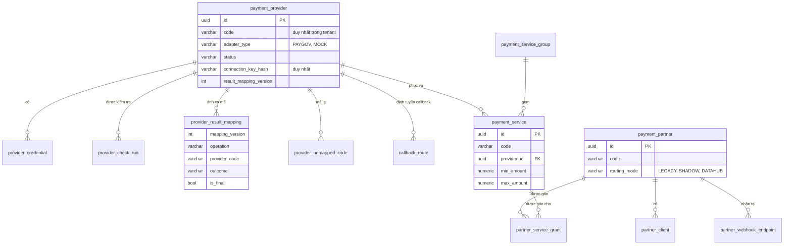
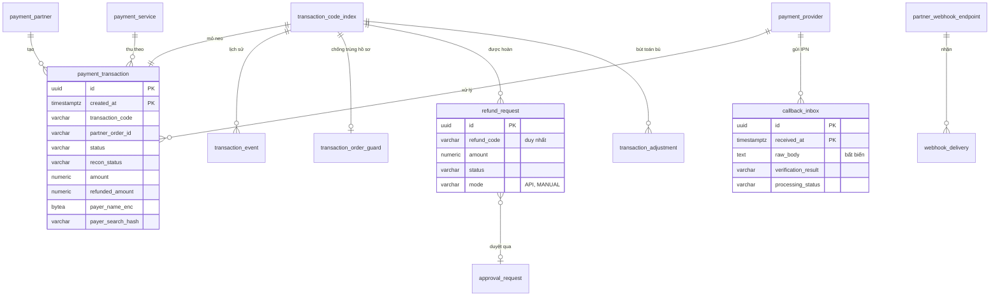
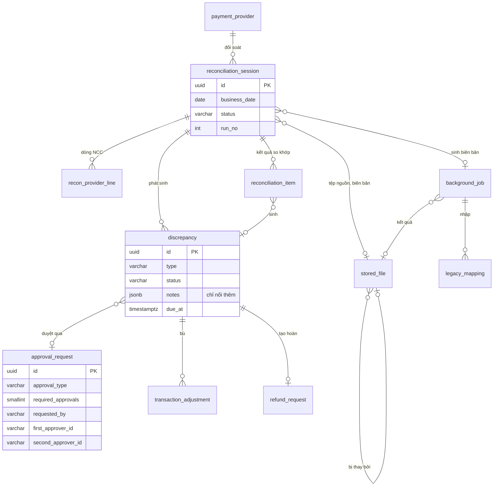

# D03-03-PH19 · Thiết kế cơ sở dữ liệu phân hệ PH-19 Thanh toán điện tử

## Tóm tắt cho hội đồng thẩm định

PH-19 lưu toàn bộ dữ liệu của đường thu tiền: nhà cung cấp (NCC) và tham chiếu thông tin xác thực, dịch vụ, đối tác, giao dịch và lịch sử trạng thái, thông báo kết quả (IPN) nguyên văn, hoàn tiền, đối soát, chênh lệch, phê duyệt bốn mắt, webhook tới đối tác, cấu hình theo tỉnh và ánh xạ khóa hệ cũ. Dữ liệu nằm trong schema `ph19_payment` trên cụm **`pg-payment` tách riêng** (Q340, tầng TPH-0), không dùng chung cụm với phân hệ khác.

Bốn điểm thiết kế chính:

1. **Tiền không sai vì CSDL tự chặn.** Số tiền là `numeric(19,0)` đồng (không dùng số thực, không dùng `int(10)` như hệ cũ); số tiền đã hoàn không vượt số tiền gốc, trạng thái `REFUNDED` khớp số đã hoàn, giao dịch thành công phải có thời điểm trả tiền, đều là ràng buộc `CHECK`. Một mã hồ sơ chỉ có một giao dịch đang hiệu lực (BR-19-007) và một giao dịch chỉ có một yêu cầu hoàn đang mở (BR-19-022), là khóa duy nhất (§3.39).
2. **Bằng chứng không sửa được.** Lịch sử trạng thái, nhật ký tích hợp, dòng đối soát, bản ghi bù, cấu hình, mã giao dịch là bảng chỉ-ghi-thêm có trigger chặn `UPDATE`, `DELETE` và quyền bị thu hồi ở vai trò ứng dụng; phần nguyên văn của IPN và ghi chú chênh lệch cũng bất biến. Biên bản đối soát nằm ở bucket WORM (Ceph RGW Object Lock) ≥ 10 năm.
3. **Cách ly tỉnh bằng CSDL.** 36 bảng có `tenant_id` và `FORCE ROW LEVEL SECURITY`; mọi khóa ngoại mang kèm `tenant_id`; bảng duy nhất không có RLS là bảng định tuyến callback `callback_route`, chỉ chứa băm. Đã chạy thử ngày 26/11/2026 trên PostgreSQL 16.15: 25 ca kiểm thử của [`ph19/test/ph19_isolation_test.sql`](ph19/test/ph19_isolation_test.sql) đều đạt, gồm đọc chéo, ghi chéo, khóa ngoại chéo tỉnh, tách nhiệm người lập, người duyệt (§4).
4. **Chịu được 10 triệu giao dịch.** Bốn bảng lớn phân vùng theo tháng (ADR-047); mã giao dịch duy nhất toàn cục nhờ bảng mỏ neo không phân vùng `transaction_code_index`; dữ liệu cá nhân người nộp được mã hóa từng giao dịch và tìm bằng băm HMAC (ADR-048).

Nguồn duy nhất của DDL là [`ph19/ddl/ph19_payment.sql`](ph19/ddl/ph19_payment.sql). Bảng cột ở §3 sinh từ DDL bằng [`ph19/tools/gen_tables_md.py`](ph19/tools/gen_tables_md.py). Mã thực thể EN-19-01…25 theo khung truy vết (D02-03-PH19-00 §9.3); bảng kỹ thuật thêm ở bản này được đánh dấu "đề xuất" trong §1.4.

## 1. Chiến lược lưu trữ

### 1.1. Cụm, schema, vai trò và kết nối

| Thành phần | Giá trị | Căn cứ |
|---|---|---|
| Cụm | `pg-payment`, CloudNativePG, PostgreSQL 18, 3 nút (1 primary, 2 standby, đồng bộ tối thiểu 1), dịch vụ đọc `pg-payment-ro` | Q340, D03-09, NFR-19-011 |
| Schema | `ph19_payment`, chủ `ph19_owner` (NOLOGIN, NOBYPASSRLS) | Quy ước `ph{nn}_{miền}` (D03-03-PH07) |
| Ứng dụng | `dh_payment_app`, thành viên `ph19_app`: chỉ DML theo quyền §1.5, không DDL, không `BYPASSRLS`; ba vai trò Spring `api`, `callback`, `worker` dùng chung tài khoản, khác pool | SDD §3 |
| Migration | `dh_payment_migrator`, thành viên `ph19_owner`, chỉ chạy trong Job Liquibase | §5 |
| Bảo trì | `dh_payment_maint`, thành viên `ph19_owner`, chỉ dùng cho `PartitionMaintenanceJob` (tạo, tách phân vùng) | §7 |
| Đọc báo cáo, kiểm toán | `ph19_readonly`: đọc mọi bảng trừ `provider_credential`, `idempotency_record`, `shedlock`, `callback_route`; cột mã hóa đọc được nhưng không giải mã được (không có quyền OpenBao transit) | D03-07 SEC-30…39 |

Không phân hệ nào khác kết nối `pg-payment`. PH-13, PH-16 nhận dữ liệu qua sự kiện Kafka (outbox), lớp dữ liệu dùng chung nhận qua sự kiện EVT-19-05, 07, 13 (khung §10.4). Truy vấn SQL trực tiếp có kiểm soát theo Q359 chỉ áp cho nguồn dữ liệu của tỉnh khai báo ở PH-05, không áp cho `pg-payment`.

### 1.2. Cách ly tenant

Mọi bảng nghiệp vụ có `tenant_id varchar(16)` mang mã `T{nn}` (D00-01 `T-TENANT`; `CHECK` mẫu `^T[0-9]{2}$` ở bảng gốc `payment_provider`) và bật `FORCE ROW LEVEL SECURITY` qua `ph19_payment.p_enable_rls(bảng)` với một chính sách `FOR ALL` mẫu P (D03-10): đọc và ghi khi `tenant_id = current_setting('app.tenant_id', false)`. PH-19 **không có dữ liệu dùng chung** (`COMMON`); bảng ánh xạ mã PayGov mặc định được nạp vào từng tenant bằng hàm `seed_paygov_mapping` (§6).

Biến `app.tenant_id` đặt bằng `SET LOCAL` ở đầu mỗi giao dịch CSDL bởi `TenantSession` (SDD §3.6). Phiên mới chưa đặt thì câu lệnh lỗi; kết nối của pool đã từng đặt thì biến về rỗng sau giao dịch và chính sách trả 0 dòng, không bao giờ lộ dữ liệu (ca 5 của §4). Đầu nhận IPN xác định tenant từ `connectionKey` trên đường dẫn (ADR-045). Vì `FORCE ROW LEVEL SECURITY` áp cả cho chủ bảng, hàm `SECURITY DEFINER` không vượt được RLS; thiết kế dùng bảng riêng `callback_route` (`sha256(connectionKey)` → `tenant_id`, `provider_id`) **không bật RLS**, chỉ chứa băm và mã, là truy vấn duy nhất chạy trước khi biết tenant. Khóa ngoại kép của bảng này bảo đảm một dòng định tuyến không trỏ được NCC của tenant khác (ca 15b). Khi xoay `connectionKey`, khóa cũ giữ `valid_until` = lúc xoay + 7 ngày (SDD §6.2).

Riêng `shedlock` không có `tenant_id`: tên khóa chứa mã tenant (`recon-session:T68`).

### 1.3. Quy ước bảng

Theo D00-01 §5.1: khóa chính `id uuid` (UUID v7 sinh ở ứng dụng), `created_at`, `created_by`, `updated_at`, `updated_by`, `version` (khóa lạc quan, thành phần của ETag, trigger `tg_touch` tăng khi ứng dụng không tăng). Số tiền `numeric(19,0)` đơn vị đồng, tối đa 999.999.999.999 (T-MONEY, FR-00-091). Thời điểm `timestamptz` (UTC); ngày giao dịch đối soát `date` theo giờ Việt Nam (BR-19-025). Mã vết `trace_id char(32)` (W3C trace-id).

| Bảng | Ngoại lệ | Lý do |
|---|---|---|
| `payment_transaction`, `transaction_event`, `callback_inbox`, `integration_log` | Khóa chính (`id`, cột phân vùng) | PostgreSQL yêu cầu khóa chính chứa khóa phân vùng; tính duy nhất của `id` bảo đảm bởi UUID v7 và bảng mỏ neo |
| `transaction_event`, `integration_log`, `reconciliation_item`, `transaction_adjustment`, `provider_check_run`, `transaction_code_index`, `tenant_payment_config`, `provider_result_mapping` | Không có `updated_*`, `version` | Chỉ-ghi-thêm |
| `partner_quota_usage`, `payment_stats_hourly`, `stats_cursor`, `legacy_mapping`, `transaction_order_guard`, `provider_unmapped_code`, `callback_nonce`, `callback_route`, `idempotency_record` | Khóa tự nhiên, không có `id` | Bảng đếm, chỉ mục hoặc khóa chống trùng |
| `approval_request`, `refund_request`, `discrepancy`, `reconciliation_session` | Không có `created_by`/`updated_by` riêng | Người lập là `requested_by`; người đổi trạng thái ghi ở `transaction_event`, `approval_request` và kiểm toán PH-13 |

Giá trị `CHECK` của trạng thái, loại, nguồn chuyển trạng thái đúng như khung §7 và §9.3; thêm giá trị là một changeset mới.

### 1.4. Danh mục bảng

| Mã | Bảng | Loại | Phân vùng | FR chính |
|---|---|---|---|---|
| EN-19-01 | `payment_provider` | Danh mục có vòng đời | — | FR-19-001…011 |
| EN-19-02 | `provider_credential` | Cấu hình | — | FR-19-002, 012 |
| EN-19-03 | `provider_check_run` | Chỉ-ghi-thêm (cập nhật kết quả khi chạy xong) | — | FR-19-003, 004, 005 |
| EN-19-04 | `payment_service_group` | Danh mục | — | FR-19-013 |
| EN-19-05 | `payment_service` | Danh mục có vòng đời | — | FR-19-014…016 |
| EN-19-06 | `payment_partner` | Danh mục có vòng đời | — | FR-19-017, 018, 066 |
| EN-19-07 | `partner_client` | Cấu hình | — | FR-19-019 |
| EN-19-08 | `partner_service_grant` | Cấu hình | — | FR-19-020 |
| EN-19-09 | `partner_webhook_endpoint` | Cấu hình | — | FR-19-021 |
| EN-19-10 | `payment_transaction` | Giao dịch | Tháng, `created_at` | FR-19-022…037 |
| EN-19-11 | `transaction_event` | Chỉ-ghi-thêm | Tháng, `occurred_at` | FR-19-028 |
| EN-19-12 | `idempotency_record` | Tạm thời 24 giờ | — | FR-19-033 |
| EN-19-13 | `callback_inbox` | Chỉ-ghi-thêm (phần nguyên văn) | Tháng, `received_at` | FR-19-029…032 |
| EN-19-14 | `integration_log` | Chỉ-ghi-thêm | Tháng, `occurred_at` | FR-19-054, 055, 060 |
| EN-19-15 | `refund_request` | Giao dịch | — | FR-19-038…041 |
| EN-19-16 | `approval_request` | Giao dịch | — | FR-19-005, 010, 018, 039, 046, 047, 066, 069 |
| EN-19-17 | `reconciliation_session` | Giao dịch | — | FR-19-042, 043, 047, 048 |
| EN-19-18 | `reconciliation_item` | Chỉ-ghi-thêm theo lần chạy | — | FR-19-044 |
| EN-19-19 | `discrepancy` | Giao dịch, không xóa | — | FR-19-031, 044…046 |
| EN-19-20 | `webhook_delivery` | Giao dịch, giữ 90 ngày | — | FR-19-060, 062 |
| EN-19-21 | `outbox_event` | Tạm thời 7 ngày | — | FR-19-053, 061 |
| EN-19-22 | `tenant_payment_config` | Có phiên bản, bất biến | — | FR-19-063, 064 |
| EN-19-23 | `stored_file` | Siêu dữ liệu tệp | — | FR-19-040, 043, 045, 048, 052, 058 |
| EN-19-24 | `background_job` | Giao dịch | — | FR-19-048, 052, 058, 065, 068 |
| EN-19-25 | `legacy_mapping` | Chỉ-ghi-thêm (cập nhật băm) | — | FR-19-065, 068 |
| EN-19-26 (đề xuất) | `provider_result_mapping` | Có phiên bản, nội dung bất biến | — | FR-19-069 |
| Kỹ thuật (đề xuất) | `provider_unmapped_code` | Bảng đếm | — | FR-19-069, UI-19-04 |
| Kỹ thuật (đề xuất) | `transaction_code_index` | Mỏ neo, chỉ-ghi-thêm | — | BR-19-002 |
| Kỹ thuật (đề xuất) | `transaction_order_guard` | Khóa chống trùng | — | BR-19-007 |
| Kỹ thuật (đề xuất) | `transaction_adjustment` | Chỉ-ghi-thêm | — | FR-19-046 |
| Kỹ thuật (đề xuất) | `callback_nonce` | Khóa chống phát lại, 7 ngày | — | FR-19-029 |
| Kỹ thuật (đề xuất) | `partner_quota_usage` | Bảng đếm | — | BR-19-005 |
| Kỹ thuật (đề xuất) | `recon_provider_line` | Bảng làm việc | — | FR-19-043, 044 |
| Kỹ thuật (đề xuất) | `notification_feed` | Tạm thời 7 ngày | — | API-19-109 |
| Kỹ thuật (đề xuất) | `payment_stats_hourly`, `stats_cursor` | Tổng hợp | — | FR-19-049…051, 058 |
| Kỹ thuật (đề xuất) | `callback_route` | Định tuyến callback, không RLS | — | FR-19-029, ADR-045 |
| Kỹ thuật | `shedlock` | Khóa tác vụ | — | SDD §3 |

Tổng 38 bảng: 25 thực thể khung, 1 thực thể đề xuất EN-19-26, 12 bảng kỹ thuật.

### 1.5. Quyền của vai trò ứng dụng

| Quyền `ph19_app` | Bảng |
|---|---|
| `SELECT`, `INSERT` (không `UPDATE`, `DELETE`) | `transaction_event`, `integration_log`, `reconciliation_item`, `transaction_adjustment`, `transaction_code_index`, `tenant_payment_config` |
| `SELECT`, `INSERT`, `UPDATE` (không `DELETE`) | `payment_transaction`, `callback_inbox`, `discrepancy`, `legacy_mapping`, `approval_request`, `refund_request`, `payment_provider`, `payment_partner` |
| Đủ DML (vẫn chịu trigger) | Các bảng còn lại; `provider_result_mapping` chỉ xóa được bản nháp, `transaction_order_guard` xóa dòng khi giao dịch kết thúc không thành công |

Hai lớp chặn độc lập: thu hồi quyền (lỗi `insufficient_privilege`) và trigger `tg_append_only` (lỗi `P1930`, ánh xạ ERR-19-050 ở ứng dụng). Dọn dữ liệu hết hạn của bảng chỉ-ghi-thêm dùng `DETACH PARTITION` dưới `dh_payment_maint`, không dùng `DELETE` (§7).

## 2. Sơ đồ thực thể – quan hệ

### 2.1. Danh mục và cấu hình

### 2.2. Giao dịch, hoàn tiền, thông báo

Bảng phân vùng không làm đích khóa ngoại theo `id` được; mọi bảng tham chiếu giao dịch trỏ tới `transaction_code_index (id, tenant_id)`. Dòng mỏ neo được chèn cùng giao dịch CSDL với dòng giao dịch, và `payment_transaction` có khóa ngoại ngược tới mỏ neo nên không thể có giao dịch thiếu mỏ neo. `callback_inbox.transaction_id`, `integration_log.*_id`, `webhook_delivery.transaction_id`, `notification_feed.transaction_id` là liên kết mềm (không khóa ngoại) để ghi nhận được cả bản ghi của giao dịch không tồn tại (IPN mồ côi) và để `DETACH` phân vùng không vướng ràng buộc.

### 2.3. Đối soát, phê duyệt, tác vụ

`approval_request.target_id` là liên kết đa hình (theo `target_type`) nên không có khóa ngoại; tính toàn vẹn do `ApprovalService` bảo đảm và được kiểm bằng truy vấn đối chiếu trong `DataIntegrityJob` hằng ngày (§3.40).

## 3. Đặc tả bảng

Bảng cột dưới đây sinh từ DDL. Giá trị kiểm tra (`CHECK`), chỉ mục, khóa ngoại xem trực tiếp trong DDL; quy tắc nghiệp vụ chốt ở CSDL tổng hợp ở §3.39, truy vấn chính ở §3.40.

<!-- gen:tables:start -->
### 3.1. `payment_provider`

EN-19-01 Nhà cung cấp thanh toán (FR-19-001…011). Hệ cũ: payment_provider.

| Cột | Kiểu | Bắt buộc | Mặc định | Ghi chú |
|---|---|---|---|---|
| `id` | `uuid` | x |  | Khóa chính, UUID v7 sinh ở ứng dụng (D00-01 §5). |
| `tenant_id` | `varchar(16)` | x |  | Mã tenant `T{nn}`; khóa RLS và khóa ngoại kép. |
| `code` | `varchar(64)` | x |  |  |
| `name` | `varchar(255)` | x |  |  |
| `adapter_type` | `varchar(16)` | x |  |  |
| `status` | `varchar(24)` | x | `'DRAFT'` |  |
| `health_status` | `varchar(10)` | x | `'UNKNOWN'` |  |
| `health_checked_at` | `timestamptz` |  |  |  |
| `circuit_state` | `varchar(10)` | x | `'CLOSED'` |  |
| `sandbox_base_url` | `varchar(2048)` |  |  |  |
| `production_base_url` | `varchar(2048)` |  |  |  |
| `connection_key_hash` | `varchar(64)` | x |  | SHA-256 hex của connectionKey hiện hành (32 ký tự Base32 Crockford, 160 bit) trong đường dẫn callback; nguyên văn ở OpenBao (ADR-045). Khung gọi cột này connection_key. Tra cứu khi nhận callback đi qua callback_route. |
| `merchant_ref` | `varchar(64)` |  |  |  |
| `refund_mode` | `varchar(8)` | x | `'MANUAL'` |  |
| `effective_from` | `date` |  |  |  |
| `tech_contact_name` | `varchar(255)` |  |  |  |
| `tech_contact_phone` | `varchar(20)` |  |  |  |
| `tech_contact_email` | `varchar(254)` |  |  |  |
| `biz_contact_name` | `varchar(255)` |  |  |  |
| `biz_contact_phone` | `varchar(20)` |  |  |  |
| `biz_contact_email` | `varchar(254)` |  |  |  |
| `capabilities` | `jsonb` | x | `'{}'` | ProviderCapabilities của adapter: cancel, refund, partialRefund, refundIpn, reconSource, returnSigned, mtls, queryRatePerSecond. |
| `pending_change` | `jsonb` |  |  |  |
| `result_mapping_version` | `integer` | x | `0` | Phiên bản bảng ánh xạ mã kết quả hiện hành (FR-19-069); 0 = chưa có. |
| `activated_at` | `timestamptz` |  |  |  |
| `retired_at` | `timestamptz` |  |  |  |
| `created_at` | `timestamptz` | x | `now()` | Thời điểm tạo. |
| `created_by` | `varchar(64)` | x |  | Người tạo (mã người dùng hoặc `system:*`). |
| `updated_at` | `timestamptz` | x | `now()` | Thời điểm sửa cuối (trigger `tg_touch`). |
| `updated_by` | `varchar(64)` | x |  | Người sửa cuối. |
| `version` | `integer` | x | `0` | Khóa lạc quan; thành phần của ETag (`If-Match`). |

### 3.2. `callback_route`

Bảng định tuyến callback (ADR-045): sha256(connectionKey) → tenant, NCC. KHÔNG bật RLS vì phải tra trước khi biết tenant; chỉ chứa băm, không chứa dữ liệu nghiệp vụ. Xoay khóa: khóa cũ có valid_until = lúc xoay + 7 ngày.

| Cột | Kiểu | Bắt buộc | Mặc định | Ghi chú |
|---|---|---|---|---|
| `connection_key_hash` | `varchar(64)` | x |  |  |
| `tenant_id` | `varchar(16)` | x |  | Mã tenant `T{nn}`; khóa RLS và khóa ngoại kép. |
| `provider_id` | `uuid` | x |  |  |
| `adapter_type` | `varchar(16)` | x |  |  |
| `valid_until` | `timestamptz` |  |  |  |
| `created_at` | `timestamptz` | x | `now()` | Thời điểm tạo. |

### 3.3. `provider_credential`

EN-19-02 Tham chiếu bí mật NCC theo môi trường, mục đích; không chứa giá trị bí mật (NFR-19-022, FR-19-002, 012).

| Cột | Kiểu | Bắt buộc | Mặc định | Ghi chú |
|---|---|---|---|---|
| `id` | `uuid` | x |  | Khóa chính, UUID v7 sinh ở ứng dụng (D00-01 §5). |
| `tenant_id` | `varchar(16)` | x |  | Mã tenant `T{nn}`; khóa RLS và khóa ngoại kép. |
| `provider_id` | `uuid` | x |  |  |
| `environment` | `varchar(10)` | x |  |  |
| `purpose` | `varchar(20)` | x |  |  |
| `secret_ref` | `varchar(512)` | x |  | Đường OpenBao kv/dh/{tenant viết thường}/payment/... hoặc transit/dh/{tenant}/payment/... |
| `fingerprint` | `varchar(128)` |  |  |  |
| `algorithm` | `varchar(32)` |  |  |  |
| `valid_from` | `timestamptz` |  |  |  |
| `valid_to` | `timestamptz` |  |  |  |
| `credential_status` | `varchar(8)` | x | `'ACTIVE'` |  |
| `transition_until` | `timestamptz` |  |  |  |
| `created_at` | `timestamptz` | x | `now()` | Thời điểm tạo. |
| `created_by` | `varchar(64)` | x |  | Người tạo (mã người dùng hoặc `system:*`). |
| `updated_at` | `timestamptz` | x | `now()` | Thời điểm sửa cuối (trigger `tg_touch`). |
| `updated_by` | `varchar(64)` | x |  | Người sửa cuối. |
| `version` | `integer` | x | `0` | Khóa lạc quan; thành phần của ETag (`If-Match`). |

### 3.4. `provider_check_run`

EN-19-03 Lần kiểm tra kết nối, giao dịch thử; bằng chứng checklist kích hoạt BR-19-010.

| Cột | Kiểu | Bắt buộc | Mặc định | Ghi chú |
|---|---|---|---|---|
| `id` | `uuid` | x |  | Khóa chính, UUID v7 sinh ở ứng dụng (D00-01 §5). |
| `tenant_id` | `varchar(16)` | x |  | Mã tenant `T{nn}`; khóa RLS và khóa ngoại kép. |
| `provider_id` | `uuid` | x |  |  |
| `check_type` | `varchar(20)` | x |  |  |
| `environment` | `varchar(10)` | x |  |  |
| `result` | `varchar(20)` | x | `'RUNNING'` |  |
| `steps` | `jsonb` | x | `'[]'` |  |
| `test_transaction_id` | `uuid` |  |  |  |
| `started_at` | `timestamptz` | x | `now()` |  |
| `finished_at` | `timestamptz` |  |  |  |
| `started_by` | `varchar(64)` | x |  |  |
| `trace_id` | `char(32)` | x |  |  |

### 3.5. `provider_result_mapping`

EN-19-26 (đề xuất) Bảng ánh xạ mã kết quả NCC → kết cục nội bộ, có phiên bản (FR-19-069, GĐ-03). Mỗi phiên bản là bộ dòng đầy đủ; nội dung bất biến, chỉ trạng thái đi DRAFT → ACTIVE → RETIRED; bản nháp bị từ chối được xóa.

| Cột | Kiểu | Bắt buộc | Mặc định | Ghi chú |
|---|---|---|---|---|
| `id` | `uuid` | x |  | Khóa chính, UUID v7 sinh ở ứng dụng (D00-01 §5). |
| `tenant_id` | `varchar(16)` | x |  | Mã tenant `T{nn}`; khóa RLS và khóa ngoại kép. |
| `provider_id` | `uuid` | x |  |  |
| `mapping_version` | `integer` | x |  |  |
| `operation` | `varchar(12)` | x |  |  |
| `provider_code` | `varchar(64)` | x |  |  |
| `outcome` | `varchar(10)` | x |  |  |
| `is_final` | `boolean` | x |  |  |
| `reason_code` | `varchar(64)` |  |  |  |
| `message_vi` | `varchar(500)` | x |  |  |
| `status` | `varchar(8)` | x | `'DRAFT'` |  |
| `created_at` | `timestamptz` | x | `now()` | Thời điểm tạo. |
| `created_by` | `varchar(64)` | x |  | Người tạo (mã người dùng hoặc `system:*`). |

### 3.6. `provider_unmapped_code`

Mã kết quả đã gặp nhưng chưa có trong bảng ánh xạ hiện hành (UI-19-04 tab Ánh xạ mã).

| Cột | Kiểu | Bắt buộc | Mặc định | Ghi chú |
|---|---|---|---|---|
| `tenant_id` | `varchar(16)` | x |  | Mã tenant `T{nn}`; khóa RLS và khóa ngoại kép. |
| `provider_id` | `uuid` | x |  |  |
| `operation` | `varchar(12)` | x |  |  |
| `provider_code` | `varchar(64)` | x |  |  |
| `seen_count` | `bigint` | x | `1` |  |
| `first_seen_at` | `timestamptz` | x | `now()` |  |
| `last_seen_at` | `timestamptz` | x | `now()` |  |
| `sample_message` | `varchar(500)` |  |  |  |

### 3.7. `payment_service_group`

EN-19-04 Nhóm dịch vụ (FR-19-013). Hệ cũ: payment_service_group (lĩnh vực giao dịch).

| Cột | Kiểu | Bắt buộc | Mặc định | Ghi chú |
|---|---|---|---|---|
| `id` | `uuid` | x |  | Khóa chính, UUID v7 sinh ở ứng dụng (D00-01 §5). |
| `tenant_id` | `varchar(16)` | x |  | Mã tenant `T{nn}`; khóa RLS và khóa ngoại kép. |
| `code` | `varchar(64)` | x |  |  |
| `name` | `varchar(255)` | x |  |  |
| `sector_code` | `varchar(64)` |  |  | Mã DM_LINH_VUC_TTHC của PH-07. |
| `description` | `varchar(4000)` |  |  |  |
| `display_order` | `integer` | x | `0` |  |
| `catalog_invalid` | `boolean` | x | `false` |  |
| `deleted_at` | `timestamptz` |  |  |  |
| `created_at` | `timestamptz` | x | `now()` | Thời điểm tạo. |
| `created_by` | `varchar(64)` | x |  | Người tạo (mã người dùng hoặc `system:*`). |
| `updated_at` | `timestamptz` | x | `now()` | Thời điểm sửa cuối (trigger `tg_touch`). |
| `updated_by` | `varchar(64)` | x |  | Người sửa cuối. |
| `version` | `integer` | x | `0` | Khóa lạc quan; thành phần của ETag (`If-Match`). |

### 3.8. `payment_service`

EN-19-05 Dịch vụ thanh toán (FR-19-014…016). Một dịch vụ gắn đúng một NCC (BR-19-008).

| Cột | Kiểu | Bắt buộc | Mặc định | Ghi chú |
|---|---|---|---|---|
| `id` | `uuid` | x |  | Khóa chính, UUID v7 sinh ở ứng dụng (D00-01 §5). |
| `tenant_id` | `varchar(16)` | x |  | Mã tenant `T{nn}`; khóa RLS và khóa ngoại kép. |
| `code` | `varchar(64)` | x |  |  |
| `name` | `varchar(255)` | x |  |  |
| `group_id` | `uuid` | x |  |  |
| `provider_id` | `uuid` | x |  |  |
| `status` | `varchar(10)` | x | `'DRAFT'` |  |
| `fee_type_code` | `varchar(64)` | x |  |  |
| `collecting_agency_code` | `varchar(64)` | x |  |  |
| `procedure_code` | `varchar(64)` |  |  |  |
| `beneficiary_ref` | `varchar(64)` |  |  |  |
| `min_amount` | `numeric(19,0)` | x |  |  |
| `max_amount` | `numeric(19,0)` | x |  |  |
| `expiry_minutes` | `integer` |  |  |  |
| `catalog_invalid` | `boolean` | x | `false` |  |
| `description` | `varchar(4000)` |  |  |  |
| `created_at` | `timestamptz` | x | `now()` | Thời điểm tạo. |
| `created_by` | `varchar(64)` | x |  | Người tạo (mã người dùng hoặc `system:*`). |
| `updated_at` | `timestamptz` | x | `now()` | Thời điểm sửa cuối (trigger `tg_touch`). |
| `updated_by` | `varchar(64)` | x |  | Người sửa cuối. |
| `version` | `integer` | x | `0` | Khóa lạc quan; thành phần của ETag (`If-Match`). |

### 3.9. `payment_partner`

EN-19-06 Đối tác (HTTT thu tiền qua PH-19) (FR-19-017, 018, 066). Hệ cũ: payment_partner. Đối tác ẩn __TEST__ chứa giao dịch thử (BR-19-033).

| Cột | Kiểu | Bắt buộc | Mặc định | Ghi chú |
|---|---|---|---|---|
| `id` | `uuid` | x |  | Khóa chính, UUID v7 sinh ở ứng dụng (D00-01 §5). |
| `tenant_id` | `varchar(16)` | x |  | Mã tenant `T{nn}`; khóa RLS và khóa ngoại kép. |
| `code` | `varchar(64)` | x |  |  |
| `name` | `varchar(255)` | x |  |  |
| `status` | `varchar(20)` | x | `'DRAFT'` |  |
| `routing_mode` | `varchar(8)` | x | `'LEGACY'` |  |
| `agency_code` | `varchar(64)` | x |  |  |
| `member_system_id` | `uuid` |  |  |  |
| `legacy_app_code` | `varchar(255)` |  |  |  |
| `allowed_return_urls` | `jsonb` | x | `'[]'` |  |
| `is_internal_test` | `boolean` | x | `false` |  |
| `tech_contact_name` | `varchar(255)` |  |  |  |
| `tech_contact_phone` | `varchar(20)` |  |  |  |
| `tech_contact_email` | `varchar(254)` |  |  |  |
| `biz_contact_name` | `varchar(255)` |  |  |  |
| `biz_contact_phone` | `varchar(20)` |  |  |  |
| `biz_contact_email` | `varchar(254)` |  |  |  |
| `terminated_at` | `timestamptz` |  |  |  |
| `created_at` | `timestamptz` | x | `now()` | Thời điểm tạo. |
| `created_by` | `varchar(64)` | x |  | Người tạo (mã người dùng hoặc `system:*`). |
| `updated_at` | `timestamptz` | x | `now()` | Thời điểm sửa cuối (trigger `tg_touch`). |
| `updated_by` | `varchar(64)` | x |  | Người sửa cuối. |
| `version` | `integer` | x | `0` | Khóa lạc quan; thành phần của ETag (`If-Match`). |

### 3.10. `partner_client`

EN-19-07 Client máy-máy tại PH-12 của đối tác (FR-19-019).

| Cột | Kiểu | Bắt buộc | Mặc định | Ghi chú |
|---|---|---|---|---|
| `id` | `uuid` | x |  | Khóa chính, UUID v7 sinh ở ứng dụng (D00-01 §5). |
| `tenant_id` | `varchar(16)` | x |  | Mã tenant `T{nn}`; khóa RLS và khóa ngoại kép. |
| `partner_id` | `uuid` | x |  |  |
| `idp_client_id` | `varchar(255)` | x |  |  |
| `auth_method` | `varchar(16)` | x |  |  |
| `cert_fingerprint` | `varchar(128)` |  |  |  |
| `expires_at` | `timestamptz` |  |  |  |
| `revoked_at` | `timestamptz` |  |  |  |
| `revoked_by` | `varchar(64)` |  |  |  |
| `created_at` | `timestamptz` | x | `now()` | Thời điểm tạo. |
| `created_by` | `varchar(64)` | x |  | Người tạo (mã người dùng hoặc `system:*`). |

### 3.11. `partner_service_grant`

EN-19-08 Gán dịch vụ và hạn mức cho đối tác (FR-19-020, BR-19-005).

| Cột | Kiểu | Bắt buộc | Mặc định | Ghi chú |
|---|---|---|---|---|
| `id` | `uuid` | x |  | Khóa chính, UUID v7 sinh ở ứng dụng (D00-01 §5). |
| `tenant_id` | `varchar(16)` | x |  | Mã tenant `T{nn}`; khóa RLS và khóa ngoại kép. |
| `partner_id` | `uuid` | x |  |  |
| `service_id` | `uuid` | x |  |  |
| `max_amount_per_txn` | `numeric(19,0)` |  |  |  |
| `daily_txn_limit` | `integer` |  |  |  |
| `daily_amount_limit` | `numeric(19,0)` |  |  |  |
| `valid_from` | `timestamptz` |  |  |  |
| `valid_to` | `timestamptz` |  |  |  |
| `created_at` | `timestamptz` | x | `now()` | Thời điểm tạo. |
| `created_by` | `varchar(64)` | x |  | Người tạo (mã người dùng hoặc `system:*`). |
| `updated_at` | `timestamptz` | x | `now()` | Thời điểm sửa cuối (trigger `tg_touch`). |
| `updated_by` | `varchar(64)` | x |  | Người sửa cuối. |
| `version` | `integer` | x | `0` | Khóa lạc quan; thành phần của ETag (`If-Match`). |

### 3.12. `partner_webhook_endpoint`

EN-19-09 Đầu nhận webhook của đối tác (FR-19-021). Địa chỉ nội bộ bị chặn ở ứng dụng (ERR-19-044).

| Cột | Kiểu | Bắt buộc | Mặc định | Ghi chú |
|---|---|---|---|---|
| `id` | `uuid` | x |  | Khóa chính, UUID v7 sinh ở ứng dụng (D00-01 §5). |
| `tenant_id` | `varchar(16)` | x |  | Mã tenant `T{nn}`; khóa RLS và khóa ngoại kép. |
| `partner_id` | `uuid` | x |  |  |
| `url` | `varchar(2048)` | x |  |  |
| `event_types` | `jsonb` | x |  |  |
| `secret_ref` | `varchar(512)` | x |  |  |
| `next_secret_ref` | `varchar(512)` |  |  |  |
| `secret_transition_until` | `timestamptz` |  |  |  |
| `endpoint_status` | `varchar(8)` | x | `'ACTIVE'` |  |
| `last_test_ok_at` | `timestamptz` |  |  |  |
| `created_at` | `timestamptz` | x | `now()` | Thời điểm tạo. |
| `created_by` | `varchar(64)` | x |  | Người tạo (mã người dùng hoặc `system:*`). |
| `updated_at` | `timestamptz` | x | `now()` | Thời điểm sửa cuối (trigger `tg_touch`). |
| `updated_by` | `varchar(64)` | x |  | Người sửa cuối. |
| `version` | `integer` | x | `0` | Khóa lạc quan; thành phần của ETag (`If-Match`). |

### 3.13. `partner_quota_usage`

Bộ đếm hạn mức ngày dự phòng và đối chiếu của bộ đếm Valkey (BR-19-005, SDD §5.5).

| Cột | Kiểu | Bắt buộc | Mặc định | Ghi chú |
|---|---|---|---|---|
| `tenant_id` | `varchar(16)` | x |  | Mã tenant `T{nn}`; khóa RLS và khóa ngoại kép. |
| `partner_id` | `uuid` | x |  |  |
| `service_id` | `uuid` | x |  |  |
| `business_date` | `date` | x |  |  |
| `txn_count` | `integer` | x | `0` |  |
| `amount_total` | `numeric(19,0)` | x | `0` |  |
| `reconciled_at` | `timestamptz` |  |  |  |

### 3.14. `transaction_code_index`

Mỏ neo không phân vùng của giao dịch: mã duy nhất toàn cục (BR-19-002) và đích khóa ngoại cho bảng khác (bảng giao dịch phân vùng không làm đích FK theo id được).

| Cột | Kiểu | Bắt buộc | Mặc định | Ghi chú |
|---|---|---|---|---|
| `id` | `uuid` | x |  | Khóa chính, UUID v7 sinh ở ứng dụng (D00-01 §5). |
| `tenant_id` | `varchar(16)` | x |  | Mã tenant `T{nn}`; khóa RLS và khóa ngoại kép. |
| `transaction_code` | `varchar(32)` | x |  |  |
| `created_at` | `timestamptz` | x |  | Thời điểm tạo. |

### 3.15. `payment_transaction`

EN-19-10 Giao dịch thanh toán, phân vùng tháng theo created_at (ADR-047). Hệ cũ: payment_transaction (amount int(10), pay_date chuỗi).

Phân vùng: `RANGE (created_at)` theo tháng, tên phân vùng `payment_transaction_YYYYMM`.

| Cột | Kiểu | Bắt buộc | Mặc định | Ghi chú |
|---|---|---|---|---|
| `id` | `uuid` | x |  | Khóa chính, UUID v7 sinh ở ứng dụng (D00-01 §5). |
| `tenant_id` | `varchar(16)` | x |  | Mã tenant `T{nn}`; khóa RLS và khóa ngoại kép. |
| `transaction_code` | `varchar(32)` | x |  |  |
| `partner_id` | `uuid` | x |  |  |
| `service_id` | `uuid` | x |  |  |
| `provider_id` | `uuid` | x |  |  |
| `partner_order_id` | `varchar(64)` | x |  |  |
| `status` | `varchar(20)` | x | `'CREATED'` |  |
| `recon_status` | `varchar(12)` | x | `'UNRECONCILED'` | Trạng thái đối soát (GĐ-03): UNRECONCILED = Chưa đối soát, MATCHED = Khớp, MISMATCHED = Lệch. |
| `amount` | `numeric(19,0)` | x |  |  |
| `refunded_amount` | `numeric(19,0)` | x | `0` |  |
| `currency` | `varchar(3)` | x | `'VND'` |  |
| `description` | `varchar(255)` | x |  |  |
| `payer_name_enc` | `bytea` |  |  |  |
| `payer_id_no_enc` | `bytea` |  |  |  |
| `payer_phone_enc` | `bytea` |  |  |  |
| `payer_email_enc` | `bytea` |  |  |  |
| `payer_dek_wrapped` | `bytea` |  |  | Khóa dữ liệu AES-256-GCM của giao dịch, bọc bằng transit/dh/{tenant}/payment/payer-kek (ADR-048). |
| `payer_name_masked` | `varchar(255)` |  |  |  |
| `payer_phone_masked` | `varchar(20)` |  |  |  |
| `payer_search_hash` | `varchar(64)` |  |  | HMAC-SHA256 họ tên chuẩn hóa (khóa transit payer-search của tenant). |
| `payer_phone_hash` | `varchar(64)` |  |  |  |
| `payer_id_no_hash` | `varchar(64)` |  |  |  |
| `return_url` | `varchar(2048)` | x |  |  |
| `payment_url` | `varchar(2048)` |  |  |  |
| `provider_reference` | `varchar(128)` |  |  |  |
| `provider_result_code` | `varchar(64)` |  |  |  |
| `mapping_version` | `integer` |  |  | Phiên bản bảng ánh xạ đã dùng để chốt kết quả gần nhất (FR-19-069). |
| `reason_code` | `varchar(64)` |  |  |  |
| `channel_code` | `varchar(64)` |  |  |  |
| `bank_code` | `varchar(64)` |  |  |  |
| `procedure_code` | `varchar(64)` |  |  |  |
| `metadata` | `jsonb` | x | `'{}'` |  |
| `expires_at` | `timestamptz` | x |  |  |
| `paid_at` | `timestamptz` |  |  |  |
| `finalized_at` | `timestamptz` |  |  |  |
| `is_test` | `boolean` | x | `false` |  |
| `is_shadow` | `boolean` | x | `false` |  |
| `is_migrated` | `boolean` | x | `false` |  |
| `late_paid` | `boolean` | x | `false` |  |
| `init_uncertain` | `boolean` | x | `false` |  |
| `needs_reconciliation` | `boolean` | x | `false` |  |
| `next_poll_at` | `timestamptz` |  |  |  |
| `poll_count` | `integer` | x | `0` |  |
| `client_ip` | `inet` |  |  |  |
| `legacy_code` | `varchar(64)` |  |  | Mã giao dịch hệ cũ khi is_migrated (FR-19-065). |
| `sequence` | `integer` | x | `1` | Số thứ tự thông báo, tăng mỗi lần chuyển trạng thái (BR-19-021). |
| `trace_id` | `char(32)` | x |  |  |
| `created_at` | `timestamptz` | x | `now()` | Thời điểm tạo. |
| `updated_at` | `timestamptz` | x | `now()` | Thời điểm sửa cuối (trigger `tg_touch`). |
| `version` | `integer` | x | `0` | Khóa lạc quan; thành phần của ETag (`If-Match`). |
| `AND` | `(status <> 'PARTIALLY_REFUNDED' OR (refunded_amount > 0 AND refunded_amount < amount)))` |  |  |  |

### 3.16. `transaction_order_guard`

BR-19-007: mỗi mã hồ sơ của đối tác có tối đa một giao dịch CREATED, PENDING, SUCCEEDED, PARTIALLY_REFUNDED, REFUNDED. Dòng bị xóa khi giao dịch về FAILED, EXPIRED, CANCELLED (SDD §5.3).

| Cột | Kiểu | Bắt buộc | Mặc định | Ghi chú |
|---|---|---|---|---|
| `tenant_id` | `varchar(16)` | x |  | Mã tenant `T{nn}`; khóa RLS và khóa ngoại kép. |
| `partner_id` | `uuid` | x |  |  |
| `partner_order_id` | `varchar(64)` | x |  |  |
| `transaction_id` | `uuid` | x |  |  |
| `guarded_at` | `timestamptz` | x | `now()` |  |

### 3.17. `transaction_event`

EN-19-11 Lịch sử trạng thái giao dịch, bất biến (FR-19-028, BR-19-030), phân vùng tháng.

Phân vùng: `RANGE (occurred_at)` theo tháng, tên phân vùng `transaction_event_YYYYMM`.

| Cột | Kiểu | Bắt buộc | Mặc định | Ghi chú |
|---|---|---|---|---|
| `id` | `uuid` | x |  | Khóa chính, UUID v7 sinh ở ứng dụng (D00-01 §5). |
| `tenant_id` | `varchar(16)` | x |  | Mã tenant `T{nn}`; khóa RLS và khóa ngoại kép. |
| `transaction_id` | `uuid` | x |  |  |
| `sequence` | `integer` | x |  |  |
| `from_status` | `varchar(20)` |  |  |  |
| `to_status` | `varchar(20)` | x |  |  |
| `source` | `varchar(24)` | x |  |  |
| `source_ref_id` | `uuid` |  |  |  |
| `provider_result_code` | `varchar(64)` |  |  |  |
| `mapping_version` | `integer` |  |  |  |
| `reason` | `varchar(1000)` |  |  |  |
| `actor_id` | `varchar(64)` |  |  |  |
| `occurred_at` | `timestamptz` | x | `now()` |  |
| `trace_id` | `char(32)` | x |  |  |

### 3.18. `idempotency_record`

EN-19-12 Kết quả yêu cầu ghi có Idempotency-Key (BR-19-006, ADR-041); giữ 24 giờ.

| Cột | Kiểu | Bắt buộc | Mặc định | Ghi chú |
|---|---|---|---|---|
| `tenant_id` | `varchar(16)` | x |  | Mã tenant `T{nn}`; khóa RLS và khóa ngoại kép. |
| `client_id` | `varchar(255)` | x |  |  |
| `request_method` | `varchar(8)` | x |  |  |
| `request_path` | `varchar(512)` | x |  |  |
| `idempotency_key` | `varchar(64)` | x |  |  |
| `request_hash` | `varchar(64)` | x |  |  |
| `state` | `varchar(12)` | x | `'IN_PROGRESS'` |  |
| `resource_id` | `uuid` |  |  |  |
| `response_status` | `smallint` |  |  |  |
| `response_body` | `jsonb` |  |  |  |
| `created_at` | `timestamptz` | x | `now()` | Thời điểm tạo. |
| `completed_at` | `timestamptz` |  |  |  |
| `expires_at` | `timestamptz` | x |  |  |

### 3.19. `transaction_adjustment`

Bản ghi bù khi chấp nhận số liệu NCC (FR-19-046 ACCEPT_PROVIDER_FIGURE, BR-19-030); số tiền gốc không sửa.

| Cột | Kiểu | Bắt buộc | Mặc định | Ghi chú |
|---|---|---|---|---|
| `id` | `uuid` | x |  | Khóa chính, UUID v7 sinh ở ứng dụng (D00-01 §5). |
| `tenant_id` | `varchar(16)` | x |  | Mã tenant `T{nn}`; khóa RLS và khóa ngoại kép. |
| `transaction_id` | `uuid` | x |  |  |
| `kind` | `varchar(24)` | x |  |  |
| `amount_delta` | `numeric(19,0)` | x |  |  |
| `discrepancy_id` | `uuid` | x |  |  |
| `note` | `varchar(2000)` | x |  |  |
| `created_at` | `timestamptz` | x | `now()` | Thời điểm tạo. |
| `created_by` | `varchar(64)` | x |  | Người tạo (mã người dùng hoặc `system:*`). |

### 3.20. `callback_inbox`

EN-19-13 Hộp nhận IPN, kể cả bị từ chối (FR-19-029…032, ADR-042). Phần nguyên văn bất biến; phần xử lý cập nhật được.

Phân vùng: `RANGE (received_at)` theo tháng, tên phân vùng `callback_inbox_YYYYMM`.

| Cột | Kiểu | Bắt buộc | Mặc định | Ghi chú |
|---|---|---|---|---|
| `id` | `uuid` | x |  | Khóa chính, UUID v7 sinh ở ứng dụng (D00-01 §5). |
| `tenant_id` | `varchar(16)` | x |  | Mã tenant `T{nn}`; khóa RLS và khóa ngoại kép. |
| `provider_id` | `uuid` | x |  |  |
| `callback_type` | `varchar(12)` | x |  |  |
| `received_at` | `timestamptz` | x | `now()` |  |
| `source_ip` | `inet` | x |  |  |
| `raw_headers` | `jsonb` | x |  |  |
| `raw_body` | `text` | x |  |  |
| `raw_hash` | `varchar(64)` | x |  |  |
| `nonce` | `varchar(128)` |  |  | Duy nhất theo (tenant, provider, nonce) — kiểm ở Valkey SET NX và ở ứng dụng trước khi chèn (bảng phân vùng không đặt được ràng buộc duy nhất không chứa khóa phân vùng). |
| `provider_reference` | `varchar(128)` |  |  |  |
| `transaction_code` | `varchar(32)` |  |  |  |
| `provider_result_code` | `varchar(64)` |  |  |  |
| `verification_result` | `varchar(16)` | x |  |  |
| `processing_status` | `varchar(12)` | x |  |  |
| `quarantine_reason` | `varchar(20)` |  |  |  |
| `processing_error` | `varchar(2000)` |  |  |  |
| `processed_at` | `timestamptz` |  |  |  |
| `attempt_count` | `integer` | x | `0` |  |
| `next_attempt_at` | `timestamptz` |  |  |  |
| `mapping_version` | `integer` |  |  |  |
| `transaction_id` | `uuid` |  |  |  |
| `refund_request_id` | `uuid` |  |  |  |
| `trace_id` | `char(32)` | x |  |  |

### 3.21. `callback_nonce`

Lớp chống phát lại thứ hai (sau Valkey) cho nonce IPN; giữ 7 ngày (FR-19-029 bước 5).

| Cột | Kiểu | Bắt buộc | Mặc định | Ghi chú |
|---|---|---|---|---|
| `tenant_id` | `varchar(16)` | x |  | Mã tenant `T{nn}`; khóa RLS và khóa ngoại kép. |
| `provider_id` | `uuid` | x |  |  |
| `nonce` | `varchar(128)` | x |  |  |
| `raw_hash` | `varchar(64)` | x |  |  |
| `seen_at` | `timestamptz` | x | `now()` |  |

### 3.22. `integration_log`

EN-19-14 Nhật ký tích hợp (FR-19-054): online 12 tháng rồi DETACH, nén, chuyển kho đối tượng giữ 5 năm (NFR-19-015).

Phân vùng: `RANGE (occurred_at)` theo tháng, tên phân vùng `integration_log_YYYYMM`.

| Cột | Kiểu | Bắt buộc | Mặc định | Ghi chú |
|---|---|---|---|---|
| `id` | `uuid` | x |  | Khóa chính, UUID v7 sinh ở ứng dụng (D00-01 §5). |
| `tenant_id` | `varchar(16)` | x |  | Mã tenant `T{nn}`; khóa RLS và khóa ngoại kép. |
| `direction` | `varchar(12)` | x |  |  |
| `operation` | `varchar(12)` | x |  |  |
| `provider_id` | `uuid` |  |  |  |
| `partner_id` | `uuid` |  |  |  |
| `transaction_id` | `uuid` |  |  |  |
| `refund_request_id` | `uuid` |  |  |  |
| `webhook_delivery_id` | `uuid` |  |  |  |
| `attempt_no` | `integer` |  |  |  |
| `http_status` | `smallint` |  |  |  |
| `result_code` | `varchar(64)` |  |  |  |
| `latency_ms` | `integer` | x |  |  |
| `request_size` | `integer` |  |  |  |
| `response_size` | `integer` |  |  |  |
| `request_body_masked` | `jsonb` |  |  |  |
| `response_body_masked` | `jsonb` |  |  |  |
| `occurred_at` | `timestamptz` | x | `now()` |  |
| `trace_id` | `char(32)` | x |  |  |

### 3.23. `background_job`

EN-19-24 Tác vụ nền: xuất giao dịch, xuất báo cáo, biên bản đối soát, nhập và đối chiếu di trú (FR-19-048, 052, 058, 065, 068). Bộ chạy lấy việc bằng FOR UPDATE SKIP LOCKED.

| Cột | Kiểu | Bắt buộc | Mặc định | Ghi chú |
|---|---|---|---|---|
| `id` | `uuid` | x |  | Khóa chính, UUID v7 sinh ở ứng dụng (D00-01 §5). |
| `tenant_id` | `varchar(16)` | x |  | Mã tenant `T{nn}`; khóa RLS và khóa ngoại kép. |
| `job_type` | `varchar(20)` | x |  |  |
| `parameters` | `jsonb` | x |  |  |
| `job_status` | `varchar(10)` | x | `'QUEUED'` |  |
| `progress_pct` | `smallint` | x | `0` |  |
| `result_summary` | `jsonb` |  |  |  |
| `result_file_id` | `uuid` |  |  |  |
| `error_message` | `varchar(2000)` |  |  |  |
| `requested_by` | `varchar(64)` | x |  |  |
| `requested_at` | `timestamptz` | x | `now()` |  |
| `started_at` | `timestamptz` |  |  |  |
| `finished_at` | `timestamptz` |  |  |  |
| `heartbeat_at` | `timestamptz` |  |  |  |
| `trace_id` | `char(32)` | x |  |  |
| `updated_at` | `timestamptz` | x | `now()` | Thời điểm sửa cuối (trigger `tg_touch`). |
| `version` | `integer` | x | `0` | Khóa lạc quan; thành phần của ETag (`If-Match`). |

### 3.24. `stored_file`

EN-19-23 Siêu dữ liệu tệp trong dh-{tenant}-payment (Garage) hoặc dh-{tenant}-payment-worm (Ceph RGW Object Lock).

| Cột | Kiểu | Bắt buộc | Mặc định | Ghi chú |
|---|---|---|---|---|
| `id` | `uuid` | x |  | Khóa chính, UUID v7 sinh ở ứng dụng (D00-01 §5). |
| `tenant_id` | `varchar(16)` | x |  | Mã tenant `T{nn}`; khóa RLS và khóa ngoại kép. |
| `purpose` | `varchar(20)` | x |  |  |
| `owner_type` | `varchar(32)` |  |  |  |
| `owner_id` | `uuid` |  |  |  |
| `bucket` | `varchar(63)` | x |  |  |
| `object_key` | `varchar(1024)` | x |  |  |
| `file_name` | `varchar(255)` | x |  |  |
| `content_type` | `varchar(127)` | x |  |  |
| `size_bytes` | `bigint` | x |  |  |
| `sha256` | `varchar(64)` | x |  |  |
| `scan_status` | `varchar(10)` | x | `'PENDING'` |  |
| `retention_until` | `date` |  |  |  |
| `worm` | `boolean` | x | `false` |  |
| `superseded_by` | `uuid` |  |  | Biên bản mới thay biên bản này khi phiên được mở lại (FR-19-047); biên bản cũ giữ nguyên trong WORM. |
| `expires_at` | `timestamptz` |  |  |  |
| `created_at` | `timestamptz` | x | `now()` | Thời điểm tạo. |
| `created_by` | `varchar(64)` | x |  | Người tạo (mã người dùng hoặc `system:*`). |

### 3.25. `approval_request`

EN-19-16 Đề nghị phê duyệt bốn mắt dùng chung (ADR-046, BR-19-011). Tách nhiệm được CHECK ở CSDL, ngoài kiểm tra ở ứng dụng (ERR-19-033).

| Cột | Kiểu | Bắt buộc | Mặc định | Ghi chú |
|---|---|---|---|---|
| `id` | `uuid` | x |  | Khóa chính, UUID v7 sinh ở ứng dụng (D00-01 §5). |
| `tenant_id` | `varchar(16)` | x |  | Mã tenant `T{nn}`; khóa RLS và khóa ngoại kép. |
| `approval_type` | `varchar(24)` | x |  |  |
| `target_type` | `varchar(32)` | x |  |  |
| `target_id` | `uuid` | x |  |  |
| `payload` | `jsonb` | x |  | Nội dung đề nghị và ảnh chụp bằng chứng lúc lập: checklist kích hoạt, số tiền hoàn, cách xử lý chênh lệch, bảng khác biệt ánh xạ, version đối tượng đích. |
| `required_approvals` | `smallint` | x | `1` |  |
| `status` | `varchar(10)` | x | `'PENDING'` |  |
| `requested_by` | `varchar(64)` | x |  |  |
| `requested_at` | `timestamptz` | x | `now()` |  |
| `request_note` | `varchar(2000)` |  |  |  |
| `first_approver_id` | `varchar(64)` |  |  |  |
| `first_decided_at` | `timestamptz` |  |  |  |
| `second_approver_id` | `varchar(64)` |  |  |  |
| `second_decided_at` | `timestamptz` |  |  |  |
| `decided_by` | `varchar(64)` |  |  |  |
| `decision_note` | `varchar(2000)` |  |  |  |
| `expires_at` | `timestamptz` | x |  |  |
| `closed_at` | `timestamptz` |  |  |  |
| `updated_at` | `timestamptz` | x | `now()` | Thời điểm sửa cuối (trigger `tg_touch`). |
| `version` | `integer` | x | `0` | Khóa lạc quan; thành phần của ETag (`If-Match`). |
| `OR` | `(required_approvals = 1 AND first_approver_id IS)` | x |  |  |
| `OR` | `(required_approvals = 2 AND second_approver_id IS))` | x |  |  |

### 3.26. `refund_request`

EN-19-15 Yêu cầu hoàn tiền (FR-19-038…041). Tối đa một yêu cầu chưa kết thúc mỗi giao dịch (BR-19-022); FAILED tính là kết thúc tạm, thực thi lại thì mở lại qua kiểm tra ở ứng dụng.

| Cột | Kiểu | Bắt buộc | Mặc định | Ghi chú |
|---|---|---|---|---|
| `id` | `uuid` | x |  | Khóa chính, UUID v7 sinh ở ứng dụng (D00-01 §5). |
| `tenant_id` | `varchar(16)` | x |  | Mã tenant `T{nn}`; khóa RLS và khóa ngoại kép. |
| `refund_code` | `varchar(32)` | x |  | R + 10 ký tự cuối mã giao dịch + 4 ký tự Base32 ngẫu nhiên (SDD §10). |
| `transaction_id` | `uuid` | x |  |  |
| `partner_id` | `uuid` | x |  |  |
| `requested_by_type` | `varchar(8)` | x |  |  |
| `requested_by` | `varchar(64)` | x |  |  |
| `partner_refund_id` | `varchar(64)` |  |  |  |
| `amount` | `numeric(19,0)` | x |  |  |
| `status` | `varchar(24)` | x | `'PENDING_APPROVAL'` |  |
| `mode` | `varchar(8)` | x |  |  |
| `reason_code` | `varchar(64)` | x |  |  |
| `reason_text` | `varchar(2000)` |  |  |  |
| `bank_code` | `varchar(64)` |  |  |  |
| `account_no_enc` | `bytea` |  |  | Số tài khoản nhận hoàn khi hoàn thủ công, mã hóa bằng DEK của giao dịch (ADR-048). |
| `account_no_masked` | `varchar(32)` |  |  |  |
| `provider_refund_ref` | `varchar(128)` |  |  |  |
| `provider_result_code` | `varchar(64)` |  |  |  |
| `voucher_no` | `varchar(64)` |  |  |  |
| `voucher_date` | `date` |  |  |  |
| `voucher_file_id` | `uuid` |  |  |  |
| `execution_count` | `integer` | x | `0` |  |
| `approval_id` | `uuid` |  |  |  |
| `discrepancy_id` | `uuid` |  |  |  |
| `completed_at` | `timestamptz` |  |  |  |
| `is_migrated` | `boolean` | x | `false` |  |
| `trace_id` | `char(32)` | x |  |  |
| `created_at` | `timestamptz` | x | `now()` | Thời điểm tạo. |
| `updated_at` | `timestamptz` | x | `now()` | Thời điểm sửa cuối (trigger `tg_touch`). |
| `version` | `integer` | x | `0` | Khóa lạc quan; thành phần của ETag (`If-Match`). |

### 3.27. `reconciliation_session`

EN-19-17 Phiên đối soát một NCC một ngày giao dịch giờ Việt Nam (FR-19-042, 043, 047, 048, BR-19-025). closing_job_id khác NULL khi đang sinh biên bản (trạng thái con CLOSING).

| Cột | Kiểu | Bắt buộc | Mặc định | Ghi chú |
|---|---|---|---|---|
| `id` | `uuid` | x |  | Khóa chính, UUID v7 sinh ở ứng dụng (D00-01 §5). |
| `tenant_id` | `varchar(16)` | x |  | Mã tenant `T{nn}`; khóa RLS và khóa ngoại kép. |
| `provider_id` | `uuid` | x |  |  |
| `business_date` | `date` | x |  |  |
| `status` | `varchar(16)` | x | `'SCHEDULED'` |  |
| `run_no` | `integer` | x | `1` |  |
| `source_type` | `varchar(12)` |  |  |  |
| `source_file_id` | `uuid` |  |  |  |
| `dh_count` | `integer` |  |  |  |
| `provider_count` | `integer` |  |  |  |
| `dh_amount` | `numeric(19,0)` |  |  |  |
| `provider_amount` | `numeric(19,0)` |  |  |  |
| `matched_count` | `integer` |  |  |  |
| `discrepancy_count` | `integer` |  |  |  |
| `collect_attempts` | `integer` | x | `0` |  |
| `next_collect_at` | `timestamptz` |  |  |  |
| `last_error` | `varchar(2000)` |  |  |  |
| `closing_job_id` | `uuid` |  |  |  |
| `closed_at` | `timestamptz` |  |  |  |
| `closed_by` | `varchar(64)` |  |  |  |
| `minutes_file_id` | `uuid` |  |  |  |
| `created_at` | `timestamptz` | x | `now()` | Thời điểm tạo. |
| `updated_at` | `timestamptz` | x | `now()` | Thời điểm sửa cuối (trigger `tg_touch`). |
| `version` | `integer` | x | `0` | Khóa lạc quan; thành phần của ETag (`If-Match`). |

### 3.28. `recon_provider_line`

Dòng phía NCC đã chuẩn hóa của một lần chạy (SDD §11.1). Bảng làm việc: xóa lần chạy cũ sau khi phiên CLOSED 90 ngày; nguồn gốc vẫn ở tệp RECON_SOURCE trong WORM.

| Cột | Kiểu | Bắt buộc | Mặc định | Ghi chú |
|---|---|---|---|---|
| `id` | `uuid` | x |  | Khóa chính, UUID v7 sinh ở ứng dụng (D00-01 §5). |
| `tenant_id` | `varchar(16)` | x |  | Mã tenant `T{nn}`; khóa RLS và khóa ngoại kép. |
| `session_id` | `uuid` | x |  |  |
| `run_no` | `integer` | x |  |  |
| `line_no` | `integer` | x |  |  |
| `kind` | `varchar(8)` | x |  |  |
| `provider_reference` | `varchar(128)` |  |  |  |
| `transaction_code` | `varchar(32)` |  |  |  |
| `refund_ref` | `varchar(128)` |  |  |  |
| `amount` | `numeric(19,0)` | x |  |  |
| `provider_status_code` | `varchar(64)` | x |  |  |
| `outcome` | `varchar(10)` | x |  |  |
| `paid_at` | `timestamptz` |  |  |  |

### 3.29. `discrepancy`

EN-19-19 Bản ghi chênh lệch (FR-19-031, 044, 045, 046, BR-19-028). Không xóa; ghi chú chỉ nối thêm.

| Cột | Kiểu | Bắt buộc | Mặc định | Ghi chú |
|---|---|---|---|---|
| `id` | `uuid` | x |  | Khóa chính, UUID v7 sinh ở ứng dụng (D00-01 §5). |
| `tenant_id` | `varchar(16)` | x |  | Mã tenant `T{nn}`; khóa RLS và khóa ngoại kép. |
| `discrepancy_code` | `varchar(32)` | x |  |  |
| `session_id` | `uuid` | x |  |  |
| `type` | `varchar(24)` | x |  |  |
| `status` | `varchar(16)` | x | `'OPEN'` |  |
| `transaction_id` | `uuid` |  |  |  |
| `refund_request_id` | `uuid` |  |  |  |
| `callback_id` | `uuid` |  |  |  |
| `provider_reference` | `varchar(128)` |  |  |  |
| `dh_amount` | `numeric(19,0)` |  |  |  |
| `provider_amount` | `numeric(19,0)` |  |  |  |
| `assignee_id` | `varchar(64)` |  |  |  |
| `due_at` | `timestamptz` | x |  |  |
| `escalation_ref` | `varchar(128)` |  |  |  |
| `notes` | `jsonb` | x | `'[]'` | Mảng {at, by, text, attachmentIds[]} theo thời gian; nối thêm bằng ph19_payment.append_discrepancy_note(). |
| `proposed_resolution` | `varchar(32)` |  |  |  |
| `resolution_type` | `varchar(32)` |  |  |  |
| `resolution_note` | `varchar(2000)` |  |  |  |
| `approval_id` | `uuid` |  |  |  |
| `detected_at` | `timestamptz` | x | `now()` |  |
| `resolved_at` | `timestamptz` |  |  |  |
| `updated_at` | `timestamptz` | x | `now()` | Thời điểm sửa cuối (trigger `tg_touch`). |
| `version` | `integer` | x | `0` | Khóa lạc quan; thành phần của ETag (`If-Match`). |
| `AND` | `coalesce(proposed_resolution, 'X') <> 'AUTO_MATCHED')` |  |  |  |

### 3.30. `reconciliation_item`

EN-19-18 Dòng so khớp của một lần chạy (FR-19-044); chỉ-ghi-thêm theo run_no. match_result MISMATCHED gom AMOUNT_MISMATCH, STATUS_MISMATCH; loại chi tiết nằm ở discrepancy.type.

| Cột | Kiểu | Bắt buộc | Mặc định | Ghi chú |
|---|---|---|---|---|
| `id` | `uuid` | x |  | Khóa chính, UUID v7 sinh ở ứng dụng (D00-01 §5). |
| `tenant_id` | `varchar(16)` | x |  | Mã tenant `T{nn}`; khóa RLS và khóa ngoại kép. |
| `session_id` | `uuid` | x |  |  |
| `run_no` | `integer` | x |  |  |
| `item_kind` | `varchar(8)` | x |  |  |
| `transaction_id` | `uuid` |  |  |  |
| `refund_request_id` | `uuid` |  |  |  |
| `provider_line_id` | `uuid` |  |  |  |
| `transaction_code` | `varchar(32)` |  |  |  |
| `provider_reference` | `varchar(128)` |  |  |  |
| `dh_amount` | `numeric(19,0)` |  |  |  |
| `provider_amount` | `numeric(19,0)` |  |  |  |
| `dh_status` | `varchar(32)` |  |  |  |
| `provider_status` | `varchar(32)` |  |  |  |
| `match_result` | `varchar(20)` | x |  |  |
| `discrepancy_id` | `uuid` |  |  |  |
| `created_at` | `timestamptz` | x | `now()` | Thời điểm tạo. |

### 3.31. `outbox_event`

EN-19-21 Transactional outbox (ADR-042): sự kiện Kafka, bản ghi kiểm toán. Debezium đọc WAL (publication ph19_outbox) hoặc OutboxRelay đọc SKIP LOCKED; xóa sau 7 ngày kể từ published_at.

| Cột | Kiểu | Bắt buộc | Mặc định | Ghi chú |
|---|---|---|---|---|
| `id` | `uuid` | x |  | Khóa chính, UUID v7 sinh ở ứng dụng (D00-01 §5). |
| `tenant_id` | `varchar(16)` | x |  | Mã tenant `T{nn}`; khóa RLS và khóa ngoại kép. |
| `aggregate_type` | `varchar(64)` | x |  |  |
| `aggregate_id` | `uuid` | x |  |  |
| `event_type` | `varchar(64)` | x |  |  |
| `topic` | `varchar(255)` | x |  |  |
| `partition_key` | `varchar(128)` | x |  |  |
| `headers` | `jsonb` | x | `'{}'` |  |
| `payload` | `jsonb` | x |  |  |
| `occurred_at` | `timestamptz` | x | `now()` |  |
| `published_at` | `timestamptz` |  |  |  |
| `publish_attempts` | `integer` | x | `0` |  |
| `last_error` | `varchar(1000)` |  |  |  |

### 3.32. `webhook_delivery`

EN-19-20 Gửi một sự kiện tới một đầu nhận (FR-19-060, 062). Gửi lại thủ công đưa EXHAUSTED về PENDING trên chính dòng này, giữ event_id. Giữ 90 ngày.

| Cột | Kiểu | Bắt buộc | Mặc định | Ghi chú |
|---|---|---|---|---|
| `id` | `uuid` | x |  | Khóa chính, UUID v7 sinh ở ứng dụng (D00-01 §5). |
| `tenant_id` | `varchar(16)` | x |  | Mã tenant `T{nn}`; khóa RLS và khóa ngoại kép. |
| `endpoint_id` | `uuid` | x |  |  |
| `partner_id` | `uuid` | x |  |  |
| `event_id` | `uuid` | x |  |  |
| `event_type` | `varchar(64)` | x |  |  |
| `transaction_id` | `uuid` |  |  |  |
| `sequence` | `integer` |  |  |  |
| `payload` | `jsonb` | x |  |  |
| `status` | `varchar(16)` | x | `'PENDING'` |  |
| `attempt_count` | `integer` | x | `0` |  |
| `manual_resend_count` | `integer` | x | `0` |  |
| `next_attempt_at` | `timestamptz` | x | `now()` |  |
| `last_http_status` | `smallint` |  |  |  |
| `last_error` | `varchar(1000)` |  |  |  |
| `delivered_at` | `timestamptz` |  |  |  |
| `created_at` | `timestamptz` | x | `now()` | Thời điểm tạo. |
| `updated_at` | `timestamptz` | x | `now()` | Thời điểm sửa cuối (trigger `tg_touch`). |
| `version` | `integer` | x | `0` | Khóa lạc quan; thành phần của ETag (`If-Match`). |

### 3.33. `notification_feed`

Luồng thông báo kéo cho đối tác (API-19-109, A-19-10). id là UUIDv7 nên tăng theo thời gian, dùng làm con trỏ after; giữ 7 ngày.

| Cột | Kiểu | Bắt buộc | Mặc định | Ghi chú |
|---|---|---|---|---|
| `id` | `uuid` | x |  | Khóa chính, UUID v7 sinh ở ứng dụng (D00-01 §5). |
| `tenant_id` | `varchar(16)` | x |  | Mã tenant `T{nn}`; khóa RLS và khóa ngoại kép. |
| `partner_id` | `uuid` | x |  |  |
| `event_type` | `varchar(64)` | x |  |  |
| `transaction_id` | `uuid` |  |  |  |
| `payload` | `jsonb` | x |  |  |
| `created_at` | `timestamptz` | x | `now()` | Thời điểm tạo. |

### 3.34. `tenant_payment_config`

EN-19-22 Phiên bản cấu hình thanh toán của tenant (FR-19-063, 064). Bất biến; phiên bản hiệu lực là effective_from lớn nhất ≤ now(). Khóa settings là tham số 19.* của FRS §7.1.

| Cột | Kiểu | Bắt buộc | Mặc định | Ghi chú |
|---|---|---|---|---|
| `id` | `uuid` | x |  | Khóa chính, UUID v7 sinh ở ứng dụng (D00-01 §5). |
| `tenant_id` | `varchar(16)` | x |  | Mã tenant `T{nn}`; khóa RLS và khóa ngoại kép. |
| `config_version` | `integer` | x |  |  |
| `effective_from` | `timestamptz` | x |  |  |
| `settings` | `jsonb` | x |  |  |
| `module_enabled` | `boolean` | x | `false` |  |
| `change_note` | `varchar(2000)` |  |  |  |
| `created_at` | `timestamptz` | x | `now()` | Thời điểm tạo. |
| `created_by` | `varchar(64)` | x |  | Người tạo (mã người dùng hoặc `system:*`). |

### 3.35. `payment_stats_hourly`

Số liệu tổng hợp theo giờ Việt Nam (SDD §8.3, NFR-19-006). StatsAggregator cộng dồn bằng INSERT … ON CONFLICT DO UPDATE; không tính giao dịch thử, bóng.

| Cột | Kiểu | Bắt buộc | Mặc định | Ghi chú |
|---|---|---|---|---|
| `tenant_id` | `varchar(16)` | x |  | Mã tenant `T{nn}`; khóa RLS và khóa ngoại kép. |
| `hour_vn` | `timestamp` | x |  | Đầu giờ theo Asia/Ho_Chi_Minh, không múi giờ (T-TS giờ địa phương), để gộp ngày, tháng không phụ thuộc phiên. |
| `provider_id` | `uuid` | x |  |  |
| `service_id` | `uuid` | x |  |  |
| `partner_id` | `uuid` | x |  |  |
| `status` | `varchar(20)` | x |  |  |
| `txn_count` | `bigint` | x | `0` |  |
| `amount` | `numeric(21,0)` | x | `0` |  |
| `refunded_amount` | `numeric(21,0)` | x | `0` |  |
| `updated_at` | `timestamptz` | x | `now()` | Thời điểm sửa cuối (trigger `tg_touch`). |

### 3.36. `stats_cursor`

Con trỏ outbox cuối StatsAggregator đã cộng dồn.

| Cột | Kiểu | Bắt buộc | Mặc định | Ghi chú |
|---|---|---|---|---|
| `tenant_id` | `varchar(16)` | x |  | Mã tenant `T{nn}`; khóa RLS và khóa ngoại kép. |
| `last_event_id` | `uuid` |  |  |  |
| `last_occurred_at` | `timestamptz` |  |  |  |
| `updated_at` | `timestamptz` | x | `now()` | Thời điểm sửa cuối (trigger `tg_touch`). |

### 3.37. `legacy_mapping`

EN-19-25 Ánh xạ khóa hệ cũ → bản ghi mới (FR-19-065, 068). Chạy lại: cùng khóa thì cập nhật source_hash, last_imported_at, job_id; không bao giờ đổi đích.

| Cột | Kiểu | Bắt buộc | Mặc định | Ghi chú |
|---|---|---|---|---|
| `tenant_id` | `varchar(16)` | x |  | Mã tenant `T{nn}`; khóa RLS và khóa ngoại kép. |
| `legacy_table` | `varchar(64)` | x |  |  |
| `legacy_key` | `varchar(255)` | x |  |  |
| `target_type` | `varchar(32)` | x |  |  |
| `target_id` | `uuid` | x |  |  |
| `source_hash` | `varchar(64)` | x |  |  |
| `job_id` | `uuid` | x |  |  |
| `first_imported_at` | `timestamptz` | x | `now()` |  |
| `last_imported_at` | `timestamptz` | x | `now()` |  |

### 3.38. `shedlock`

Khóa tác vụ lịch của ShedLock. Không có tenant_id (tên khóa chứa mã tenant, ví dụ recon-session:T68); không bật RLS.

| Cột | Kiểu | Bắt buộc | Mặc định | Ghi chú |
|---|---|---|---|---|
| `name` | `varchar(64)` | x |  |  |
| `lock_until` | `timestamptz` | x |  |  |
| `locked_at` | `timestamptz` | x |  |  |
| `locked_by` | `varchar(255)` | x |  |  |
<!-- gen:tables:end -->

### 3.39. Quy tắc nghiệp vụ chốt ở CSDL

| Quy tắc | Cơ chế CSDL | Đối tượng |
|---|---|---|
| BR-19-002 mã giao dịch duy nhất toàn cục, đúng mẫu `T{nn}{yyMMdd}{10 ký tự Base32}` | Khóa duy nhất và `CHECK` trên bảng không phân vùng | `uq_transaction_code_index_code`, `ck_transaction_code_index_code` |
| BR-19-005 hạn mức ngày (dự phòng khi Valkey mất) | Bảng đếm khóa (đối tác, dịch vụ, ngày), `SELECT … FOR UPDATE` | `partner_quota_usage` |
| BR-19-006 lũy đẳng | Khóa chính (tenant, client, method, path, key) | `pk_idempotency_record` |
| BR-19-007 một mã hồ sơ một giao dịch hiệu lực | Khóa chính (tenant, đối tác, mã hồ sơ) của bảng chặn; dòng xóa khi giao dịch về `FAILED`, `EXPIRED`, `CANCELLED` | `transaction_order_guard` |
| BR-19-008 dịch vụ gắn đúng một NCC | `provider_id NOT NULL` + khóa ngoại kép | `fk_payment_service_provider` |
| BR-19-010 checklist kích hoạt có bằng chứng | `CHECK` NCC `ACTIVE` phải có `activated_at`; bằng chứng ở `provider_check_run` và `approval_request.payload` | `ck_payment_provider_active` |
| BR-19-011 tách nhiệm bốn mắt | `CHECK` người duyệt cấp 1 ≠ người lập, cấp 2 ∉ {người lập, cấp 1}; `APPROVED` phải đủ cấp; từ chối phải có lý do; tối đa một đề nghị `PENDING` mỗi (đối tượng, loại) | `ck_approval_request_sod1`, `_sod2`, `_approved`, `_reject_note`, `uq_approval_request_pending` |
| BR-19-021 số thứ tự thông báo | `sequence` trên giao dịch, sự kiện, lần gửi webhook | `payment_transaction`, `transaction_event`, `webhook_delivery` |
| BR-19-022 một yêu cầu hoàn đang mở; tổng hoàn ≤ số tiền gốc | Chỉ mục duy nhất có điều kiện; `CHECK refunded_amount <= amount` và trạng thái khớp số đã hoàn | `uq_refund_request_open`, `ck_payment_transaction_refunded`, `ck_payment_transaction_refund_status` |
| BR-19-024 hoàn thủ công có chứng từ | `CHECK` `SUCCEEDED` + `MANUAL` (trừ dữ liệu di trú) phải có số và ngày chứng từ | `ck_refund_request_voucher` |
| BR-19-025 một phiên đối soát mỗi NCC mỗi ngày | Khóa duy nhất (tenant, NCC, ngày) | `uq_reconciliation_session_day` |
| BR-19-030 bằng chứng bất biến | Trigger `tg_append_only` + thu hồi quyền; trigger riêng cho phần nguyên văn IPN, ghi chú chênh lệch, ánh xạ mã, khóa hệ cũ | §1.5 |
| BR-19-033 giao dịch thử tách khỏi số liệu | Đối tác ẩn `__TEST__`, `CHECK is_internal_test = (code = '__TEST__')`; giao dịch không vừa thử vừa bóng | `ck_payment_partner_test`, `ck_payment_transaction_flags` |
| FR-19-045 ghi chú chênh lệch chỉ nối thêm | Trigger so tiền tố mảng cũ; hàm `append_discrepancy_note` | `tg_discrepancy_notes_guard` |
| FR-19-046 `NO_ACTION` phải có lý do; `RESOLVED` phải có cách xử lý | `CHECK` | `ck_discrepancy_noaction`, `ck_discrepancy_resolved` |
| FR-19-047 biên bản có trước khi chốt | `CHECK` `CLOSED` phải có `closed_at`, `minutes_file_id` | `ck_reconciliation_session_closed` |
| FR-19-069 `SUCCEEDED` luôn là kết cục cuối; phiên bản đã dùng bất biến | `CHECK`, trigger chỉ cho phép `DRAFT → ACTIVE → RETIRED` | `ck_provider_result_mapping_final`, `tg_provider_result_mapping_guard` |
| NFR-19-021 webhook HTTPS | `CHECK url ~ '^https://'` | `ck_partner_webhook_endpoint_url` |
| NFR-19-022 bí mật chỉ ở OpenBao | `CHECK secret_ref` theo mẫu đường OpenBao; không có cột giá trị bí mật | `ck_provider_credential_ref` |
| Biên bản WORM có hạn giữ | `CHECK` tệp WORM phải có `retention_until`; tên bucket đúng mẫu | `ck_stored_file_worm`, `ck_stored_file_bucket` |

Các quy tắc còn lại (giới hạn số tiền theo dịch vụ và theo gán, máy trạng thái, số lượt thực thi lại hoàn tiền ≤ 3, thời hạn giao dịch) được ứng dụng kiểm, CSDL chỉ chặn giá trị ngoài miền.

### 3.40. Truy vấn chính và chỉ mục phục vụ

| Truy vấn | API, tác vụ | Chỉ mục |
|---|---|---|
| Tra mã giao dịch (toàn cục, cả chi tiết đối tác) | API-19-051 `q`, 102 | `uq_transaction_code_index_code`, `ix_payment_transaction_code` |
| Tra theo mã hồ sơ của đối tác | API-19-103 | `ix_payment_transaction_order` |
| Danh sách mặc định, phân trang theo khóa (`created_at`, `id`) | API-19-051 | `ix_payment_transaction_created` |
| Lọc trạng thái, dịch vụ | API-19-051 | `ix_payment_transaction_status`, `ix_payment_transaction_service` |
| Tìm theo họ tên, điện thoại, số giấy tờ người nộp (băm HMAC) | API-19-051 `payer*` | `ix_payment_transaction_payer_name`, `_payer_phone`, `_payer_id` |
| Truy vấn bù giao dịch treo | `PendingQueryScheduler` | `ix_payment_transaction_poll` |
| Tập phía Datahub của ngày đối soát | `Matcher` (SDD §11.2) | `ix_payment_transaction_paid`, `ix_payment_transaction_recon` |
| Tập phía NCC | `Matcher` | `ix_recon_provider_line_ref`, `ix_recon_provider_line_code` |
| Hàng đợi IPN | `InboxProcessor` | `ix_callback_inbox_work` |
| Hàng đợi webhook | `WebhookDispatcher` | `ix_webhook_delivery_due` |
| Outbox chưa phát | `OutboxRelay` | `ix_outbox_event_unpublished` |
| Hộp phê duyệt | API-19-048 | `ix_approval_request_inbox` |
| Chênh lệch quá hạn | `DiscrepancyEscalator`, dashboard | `ix_discrepancy_open` |
| Dashboard, báo cáo kỳ | API-19-080…082 | `pk_payment_stats_hourly`, `ix_payment_stats_hourly_range` |
| Nhật ký tích hợp theo giao dịch, theo vết | API-19-075, 076 | `ix_integration_log_txn`, `ix_integration_log_trace` |
| Luồng thông báo kéo | API-19-109 | `ix_notification_feed_cursor` |
| Chứng chỉ, bí mật sắp hết hạn | `CredentialExpiryJob` | `ix_provider_credential_expiry` |

Chỉ mục trên bảng phân vùng được tạo ở bảng cha và tự sinh cho từng phân vùng. Với 10 triệu giao dịch (NFR-19-007), truy vấn danh sách có điều kiện khoảng thời gian chỉ quét các phân vùng tháng liên quan (cắt tỉa phân vùng); tìm theo mã giao dịch không có khoảng thời gian đi qua `transaction_code_index` lấy `created_at` rồi truy cập đúng một phân vùng.

`DataIntegrityJob` (03:30 hằng ngày, chỉ đọc) kiểm: mỗi dòng mỏ neo có đúng một giao dịch; `refunded_amount` bằng tổng hoàn `SUCCEEDED`; mỗi `approval_request.target_id` tồn tại theo `target_type`; `partner_quota_usage` khớp tổng giao dịch trong ngày. Lệch thì phát cảnh báo PH-13 mức cao, không tự sửa.

## 4. DDL, changelog Liquibase và kiểm thử

### 4.1. Tệp và thứ tự changeset

[`ph19/ddl/ph19_payment.sql`](ph19/ddl/ph19_payment.sql) là nguồn duy nhất, chia tệp changeset bằng dấu `-- @file`, `-- @changeset`, `-- @rollback` như PH-04, PH-07; changelog Liquibase sinh bằng công cụ của PH-07 (`../ph07/tools/gen_liquibase.py`) sau khi tham số hóa tên phân hệ.

| Tệp | Nội dung |
|---|---|
| `19-0000-bootstrap.sql` | Vai trò `ph19_owner`, `ph19_app`, `ph19_readonly`; schema |
| `19-0001-functions.sql` | `tg_touch`, `tg_append_only`, `p_enable_rls`, `p_ensure_month_partitions` |
| `19-0010-provider.sql` | `payment_provider`, `callback_route`, `provider_credential`, `provider_check_run`, `provider_result_mapping`, `provider_unmapped_code` |
| `19-0020-catalog.sql` | `payment_service_group`, `payment_service` |
| `19-0030-partner.sql` | `payment_partner`, `partner_client`, `partner_service_grant`, `partner_webhook_endpoint`, `partner_quota_usage` |
| `19-0040-transaction.sql` | `transaction_code_index`, `payment_transaction` + phân vùng, `transaction_order_guard`, `transaction_event`, `idempotency_record`, `transaction_adjustment` |
| `19-0050-callback-log.sql` | `callback_inbox`, `callback_nonce`, `integration_log` |
| `19-0060-file-job.sql` | `background_job`, `stored_file` |
| `19-0070-approval-refund.sql` | `approval_request`, `refund_request` |
| `19-0080-recon.sql` | `reconciliation_session`, `recon_provider_line`, `discrepancy`, `append_discrepancy_note`, `reconciliation_item` |
| `19-0090-messaging.sql` | `outbox_event`, `webhook_delivery`, `notification_feed` |
| `19-0100-config-stats-migration.sql` | `tenant_payment_config`, `payment_stats_hourly`, `stats_cursor`, `legacy_mapping`, `shedlock` |
| `19-0110-seed.sql` | `seed_paygov_mapping` |
| `19-0120-grants.sql` | Quyền (chạy lại mỗi lần, `runOnChange`) |

Phân vùng ban đầu: `payment_transaction`, `transaction_event` từ 01/2021 (đủ cho dữ liệu di trú hệ cũ triển khai năm 2021) tới 04/2027; `callback_inbox`, `integration_log` từ 01/2026 (hệ cũ không có dữ liệu tương ứng để di trú) tới 04/2027. `PartitionMaintenanceJob` chạy 01:00 hằng ngày, luôn giữ đủ 3 tháng tới. Bảng phân vùng không có phân vùng `DEFAULT` để dòng sai thời điểm lỗi ngay thay vì lặng lẽ dồn vào một phân vùng lớn.

### 4.2. Kết quả chạy thử

Ngày 26/11/2026, PostgreSQL 16.15, CSDL trống: [`ph19_payment.sql`](ph19/ddl/ph19_payment.sql) chạy không lỗi, tạo 38 bảng gốc và 184 phân vùng; sau đó [`ph19/test/ph19_isolation_test.sql`](ph19/test/ph19_isolation_test.sql) chạy dưới tài khoản `dh_payment_app` (thành viên `ph19_app`, không `BYPASSRLS`), 25/25 ca đạt:

| Ca | Kiểm | Kết quả | TS |
|---|---|---|---|
| 1 | T01 không thấy NCC, giao dịch, ánh xạ của T68 | Đạt | TS-19-31 |
| 2 | T01 không chèn được dòng mang `tenant_id = T68` | Đạt (`insufficient_privilege`) | TS-19-31 |
| 3 | T01 cập nhật giao dịch của T68: 0 dòng | Đạt | TS-19-31 |
| 4 | Dịch vụ của T01 không trỏ được NCC của T68 | Đạt (`foreign_key_violation`) | TS-19-31 |
| 5 | Không đặt tenant: không thấy dòng nào | Đạt | TS-19-31 |
| 6 | Sửa `transaction_event` | Bị chặn | TS-19-34 |
| 7 | Sửa nguyên văn IPN bị chặn; cập nhật trạng thái xử lý được | Đạt | TS-19-30 |
| 8 | Hai giao dịch hiệu lực cùng mã hồ sơ | Bị chặn | TS-19-11 |
| 9a–9d | Người lập tự duyệt; cấp 2 trùng cấp 1; duyệt hai cấp khi mới có một; hai đề nghị chờ cùng đối tượng | Bị chặn | TS-19-33 |
| 10a–10c | Hai yêu cầu hoàn mở; hoàn vượt số tiền; `SUCCEEDED` thiếu `paid_at` | Bị chặn | TS-19-17 |
| 11a–11c | Xóa, sửa ghi chú chênh lệch; `NO_ACTION` không lý do | Bị chặn | TS-19-20 |
| 12a–12b | Sửa ánh xạ đang dùng; `SUCCEEDED` không cuối | Bị chặn | TS-19-13 |
| 13a–13c | Ứng dụng xóa giao dịch; chỉ đọc đọc tham chiếu bí mật; ứng dụng sửa cấu hình | Bị chặn | TS-19-33 |
| 15a–15b | Định tuyến callback không cần tenant; không trỏ chéo tenant | Đạt | TS-19-30 |
| 14 | Mọi bảng có `tenant_id` (trừ `callback_route`) đều `FORCE RLS` | Đạt (36 bảng) | TS-19-31 |

Bài kiểm thử tích hợp `TenantIsolationIT` (SDD §16) chạy lại các ca này trên Testcontainers PostgreSQL 18 ở mỗi lần build, cộng ca sinh tự động: với mỗi bảng có RLS, chèn dòng tenant A, đọc bằng tenant B phải 0 dòng.

## 5. Mã hóa và dữ liệu cá nhân

| Dữ liệu | Lưu ở | Cách bảo vệ | Ai đọc được bản rõ |
|---|---|---|---|
| Họ tên, số giấy tờ, điện thoại, thư điện tử người nộp | `payment_transaction.payer_*_enc` | AES-256-GCM với DEK riêng mỗi giao dịch; DEK bọc bằng `transit/dh/{tenant}/payment/payer-kek` (ADR-048) | `dh-payment` khi người dùng có quyền `PERM-19-transaction-read-pii` (BR-19-031), mỗi lần mở ghi kiểm toán |
| Bản che (`Ng*** V** A`, `09******78`) | `payer_name_masked`, `payer_phone_masked` | Bản rõ không suy ra được | Mọi người có quyền xem giao dịch |
| Băm tìm kiếm | `payer_search_hash`, `payer_phone_hash`, `payer_id_no_hash` | HMAC-SHA256 với khóa transit riêng tenant; chuẩn hóa trước khi băm (bỏ dấu, chữ thường, bỏ khoảng trắng; điện thoại về dạng `84…`) | Không ai (một chiều) |
| Số tài khoản nhận hoàn thủ công | `refund_request.account_no_enc` | Như trên, dùng DEK của giao dịch gốc | Kế toán xử lý hoàn |
| Nguyên văn IPN | `callback_inbox.raw_body` | Lọc trường theo BR-19-032 trước khi ghi; mã hóa ổ đĩa | Quản trị PH-19, kiểm toán |
| Thân trao đổi | `integration_log.*_masked` | Che theo danh sách trường của adapter, cắt ở 64 KB | Quản trị PH-19 |

Xóa dữ liệu cá nhân theo yêu cầu chủ thể (Luật BVDLCN 91/2025) không xóa giao dịch (nghĩa vụ lưu chứng từ kế toán): `dh-payment` hủy DEK đã bọc (`payer_dek_wrapped = NULL`) và xóa bản che, băm; giao dịch còn lại không còn dữ liệu nhận diện. Thao tác này là `UPDATE` được phép trên `payment_transaction` và ghi kiểm toán.

## 6. Dữ liệu khởi tạo

| Dữ liệu | Khi nào | Nội dung | Nguồn |
|---|---|---|---|
| Cấu hình thanh toán phiên bản 1 | PH-20 khởi tạo tenant (sự kiện `tenant.provisioned`) | `settings` mặc định FRS §7.1; `module_enabled = false` tới khi PH-20 bật | FR-19-064 |
| Đối tác ẩn `__TEST__` | Như trên | Chứa giao dịch thử của kiểm tra kết nối | BR-19-033 |
| Nhóm dịch vụ mặc định | Như trên | Theo `DM_LINH_VUC_TTHC` của PH-07 nếu tỉnh chọn nạp | FR-19-013 |
| Bảng ánh xạ mã PayGov phiên bản 1 | Tạo NCC adapter `PAYGOV` | 31 dòng của SDD §7.3 qua `seed_paygov_mapping` (**giả định**, thay khi có trả lời OQ-19-05) | FR-19-069 |

Mọi seed chạy dưới `app.tenant_id` của tenant đích, lũy đẳng (bỏ qua khi đã có).

## 7. Kho lưu trữ ngoài PostgreSQL

### 7.1. Kafka

Topic do PH-10 cấp theo quy tắc đặt tên có tenant (D03-10), viết thường. `dh-payment` chỉ ghi qua outbox; Debezium đọc publication `ph19_outbox` (bảng `outbox_event`) hoặc `OutboxRelay` khi không có Debezium (OQ-19-29).

Mỗi sự kiện một topic theo mẫu `{tenant}.payment.{thực-thể}.{sự-kiện}.v1` (khung §10.4), ví dụ `t68.payment.transaction.succeeded.v1`.

| Nhóm topic | Sự kiện | Phân vùng, giữ | Khóa | Bên đọc |
|---|---|---|---|---|
| `t68.payment.provider.status-changed.v1`, `…provider.health-changed.v1` | EVT-19-01, 02 | 3, 7 ngày | `providerId` | PH-13, PH-16, PH-18 |
| `t68.payment.service.status-changed.v1`, `…partner.status-changed.v1` | EVT-19-03, 04 | 3, 7 ngày | `serviceId`, `partnerId` | PH-03, PH-16 |
| `t68.payment.transaction.{created,pending,succeeded,failed,cancelled,expired}.v1` | EVT-19-05…10 | 12, 30 ngày | `transactionId` | PH-16, lớp dữ liệu dùng chung |
| `t68.payment.refund.{requested,decided,succeeded,failed}.v1` | EVT-19-11…14 | 6, 30 ngày | `transactionId` | PH-13, PH-16 |
| `t68.payment.reconciliation.{matched,closed}.v1`, `…discrepancy.{detected,resolved}.v1` | EVT-19-15…18 | 3, 30 ngày | `sessionId`, `discrepancyId` | PH-13, PH-16, PH-18 |
| `t68.audit.recorded.v1` | Kiểm toán (FR-19-053) | Theo PH-13 | `traceId` | PH-13 |

Khóa phân vùng của sự kiện giao dịch và hoàn tiền là `transactionId`; vì mỗi sự kiện một topic, bên đọc cần thứ tự dùng `sequence` (BR-19-021) để sắp lại. Sự kiện không chứa dữ liệu cá nhân người nộp; AsyncAPI ở D03-04-PH19. Webhook tới đối tác **không** đi qua Kafka (NFR-19-013): `WebhookDispatcher` đọc `outbox_event` và ghi `webhook_delivery` trong cùng `pg-payment`.

### 7.2. Valkey

| Khóa | Kiểu | TTL | Dùng cho | Mất dữ liệu thì |
|---|---|---|---|---|
| `{tenant}:payment:idem:{clientId}:{sha256(key)}` | String | 24 giờ | Lũy đẳng tầng nhanh (SDD §5.2) | Rơi về `idempotency_record` |
| `{tenant}:payment:quota:{partnerId}:{serviceId}:{yyyyMMdd}` | Hash `count`, `amount` | 48 giờ | Hạn mức ngày (BR-19-005) | Rơi về `partner_quota_usage` |
| `{tenant}:payment:nonce:{providerId}:{nonce}` | String (băm thân) | 24 giờ | Chống phát lại IPN | Rơi về `callback_nonce` |
| `{tenant}:payment:health-leader` | String | 30 giây | Khóa lãnh đạo giám sát sức khỏe NCC | Hai pod cùng kiểm, vô hại |
| `{tenant}:payment:mapping-changed` | Kênh pub/sub | — | Làm mới đệm ánh xạ mã | Đệm tự hết hạn sau 60 giây |
| `{tenant}:payment:ryw:{userId}` | String | 5 giây | Đọc bản chính ngay sau khi ghi | Đọc bản sao, trễ < 1 giây |
| `{tenant}:payment:export:{userId}` | Set | 2 giờ | Tối đa 3 tác vụ xuất đồng thời | Đếm từ `background_job` |

Ví dụ khóa thực tế viết thường: `t68:payment:quota:018f…:018f…:20261126`. Valkey không chứa dữ liệu cá nhân, không chứa bí mật.

### 7.3. Kho đối tượng

| Bucket | Hệ | Khóa đối tượng | Nội dung | Giữ |
|---|---|---|---|---|
| `dh-t68-payment` | Garage | `{purpose}/{yyyy}/{MM}/{fileId}` | Tệp đối soát gốc (khi chưa chốt), đính kèm chênh lệch, chứng từ hoàn, tệp xuất, báo cáo, báo cáo lỗi di trú | Xuất, báo cáo: 7 ngày (`expires_at`); đính kèm, chứng từ: theo đối tượng (≥ 10 năm) |
| `dh-t68-payment-worm` | Ceph RGW Object Lock `COMPLIANCE` | `recon/{providerCode}/{businessDate}/{runNo}/…` | Biên bản đối soát PDF, XLSX; bản sao tệp đối soát gốc của phiên đã chốt | `retention_until` = ngày chốt + `19.retention.transaction-years` (mặc định 10) |
| `dh-t68-payment-archive` | Ceph RGW (không WORM) | `integration_log/{yyyy}/{MM}.parquet.zst` | Phân vùng nhật ký tích hợp đã tách, nén | 5 năm (NFR-19-015) |

Tải lên luôn ghi `stored_file` sau khi đối tượng đã lưu và băm SHA-256 khớp; tệp người dùng tải lên được quét mã độc (`scan_status`) trước khi dùng. WORM và sao lưu dùng chung hạ tầng Ceph RGW, tách bucket (Q347).

## 8. Sao lưu, khôi phục và lưu giữ

### 8.1. Sao lưu

`pg-payment`: WAL liên tục và base backup hằng ngày lên Ceph RGW (bucket sao lưu tách riêng), mã hóa phía máy chủ; RPO ≤ 5 phút, RTO ≤ 1 giờ (TPH-0, D03-09); bản sao sang site DR theo mô hình active–standby. Diễn tập khôi phục mỗi quý: khôi phục về thời điểm, chạy `DataIntegrityJob` và đối chiếu số giao dịch, tổng tiền với `payment_stats_hourly` của bản khôi phục.

Sau khôi phục về thời điểm trước sự cố, giao dịch phát sinh trong khoảng mất (≤ 5 phút) được dựng lại từ: IPN mà PayGov gửi lại (PayGov thử lại theo lịch của họ, giả định OQ-19-03), truy vấn bù theo mã giao dịch mà đối tác còn giữ, và phiên đối soát ngày đó. Đây là lý do đối soát luôn chạy trên cả giao dịch `needs_reconciliation`.

### 8.2. Lưu giữ

| Bảng | Trực tuyến | Sau đó | Cơ chế |
|---|---|---|---|
| `payment_transaction`, `transaction_event` | ≥ 10 năm (NFR-19-014; chứng từ kế toán) | — | Phân vùng cũ chuyển sang tablespace chậm sau 24 tháng (khi hạ tầng có) |
| `callback_inbox` | 24 tháng | Xuất Parquet sang bucket lưu trữ, giữ đủ 10 năm; `DETACH` rồi `DROP` | `PartitionMaintenanceJob` |
| `integration_log` | 12 tháng (NFR-19-015) | Nén sang `dh-{tenant}-payment-archive` 5 năm; `DETACH` rồi `DROP` | Như trên (OQ-19-27) |
| `refund_request`, `reconciliation_*`, `discrepancy`, `approval_request`, `transaction_adjustment` | ≥ 10 năm | — | Không xóa |
| `webhook_delivery` | 90 ngày | Xóa | `RetentionCleanupJob` 02:00 |
| `outbox_event` | 7 ngày sau `published_at` | Xóa | `RetentionCleanupJob` |
| `notification_feed` | 7 ngày | Xóa | `RetentionCleanupJob` |
| `idempotency_record` | 24 giờ (`expires_at`) | Xóa | `RetentionCleanupJob` (lượt mỗi giờ) |
| `callback_nonce` | 7 ngày | Xóa | `RetentionCleanupJob` |
| `recon_provider_line` | 90 ngày sau khi phiên `CLOSED` | Xóa; tệp gốc vẫn ở WORM | `RetentionCleanupJob` |
| `stored_file` loại `EXPORT`, `REPORT` | 7 ngày (`expires_at`) | Xóa đối tượng và dòng | `RetentionCleanupJob` |

Bảng chỉ-ghi-thêm chỉ bị dọn bằng `DETACH PARTITION` dưới `dh_payment_maint`; trước khi `DROP`, tác vụ kiểm số dòng và băm của tệp Parquet đã xuất, ghi kiểm toán `PARTITION_ARCHIVED`.

## 9. Ánh xạ dữ liệu hệ cũ sang thiết kế mới

### 9.1. Bảng hệ cũ

Lược đồ hệ cũ dựa trên năm bảng mô tả ở D00-03 §4.6 và BRD D02-01-PH19 §3; tên cột chính xác cần đối chiếu bản xuất CSDL của tỉnh (giả định, OQ-19-32).

| Bảng hệ cũ | Đích | Cách chuyển | `legacy_mapping.target_type` |
|---|---|---|---|
| `payment_provider` | `payment_provider` (`status = DRAFT`) + `callback_route` mới | Mã, tên, đầu mối giữ; thông tin xác thực **không** chuyển (cấp lại ở OpenBao, FR-19-012); `connectionKey` sinh mới; kích hoạt lại qua checklist | `PROVIDER` |
| `payment_service_group` | `payment_service_group` | Mã chuẩn hóa chữ hoa; trùng mã thì hậu tố `_2` và ghi báo cáo | `SERVICE_GROUP` |
| `payment_service` | `payment_service` | Mã loại phí, cơ quan thu tra PH-07; không tra được thì `catalog_invalid = true` | `SERVICE` |
| `payment_partner` | `payment_partner` (`routing_mode = LEGACY`) | `legacy_app_code` giữ mã ứng dụng cũ để định tuyến strangler (ADR-049) | `PARTNER` |
| `payment_transaction` | `transaction_code_index` + `payment_transaction` (`is_migrated = true`) + `transaction_event` (`source = MIGRATION`) + `refund_request` khi có hoàn | Bảng ánh xạ trạng thái §9.2; `amount int(10)` → `numeric(19,0)`; `pay_date` chuỗi → `paid_at` (giờ Việt Nam sang UTC); dữ liệu người nộp mã hóa như giao dịch mới; mã cũ giữ ở `legacy_code`, mã mới sinh theo BR-19-002 với ngày của `created_at` cũ | `TRANSACTION`, `REFUND` |

### 9.2. Ánh xạ trạng thái giao dịch

| Trạng thái hệ cũ | `payment_transaction.status` | Bản ghi kèm theo |
|---|---|---|
| `NEW` | `CREATED` (hết hạn thì tác vụ hết hạn chuyển `EXPIRED` ở lần chạy đầu) | — |
| `PENDING` | `PENDING`, `needs_reconciliation = true` | — |
| `SUCCESS` | `SUCCEEDED` | — |
| `FAILED` | `FAILED` | — |
| `REFUND_PENDING` | `SUCCEEDED` | `refund_request` `PROCESSING` |
| `REFUND_SUCCESS` | `REFUNDED`, `refunded_amount = amount` | `refund_request` `SUCCEEDED`, `is_migrated = true` |
| `REFUND_FAILED` | `SUCCEEDED` | `refund_request` `FAILED` |

Giao dịch di trú không phát sự kiện nghiệp vụ, không gửi webhook, không cộng vào `partner_quota_usage`; `StatsAggregator` dựng `payment_stats_hourly` cho dữ liệu cũ bằng một lần tính lại theo lô sau khi nhập (FR-19-065 bước 6).

### 9.3. Chạy lại và đối chiếu

`ImportRunner` đọc theo khóa tăng dần, lô 10.000; mỗi dòng nguồn tính `source_hash` (SHA-256 các cột đã chuẩn hóa). Gặp khóa đã có trong `legacy_mapping`: băm trùng thì bỏ qua, băm khác thì cập nhật bản ghi đích (chỉ khi đích chưa bị thay đổi sau di trú, xét `version`) và cập nhật `source_hash`. Không bao giờ đổi `target_id` (trigger `tg_legacy_mapping_guard`).

`MIGRATION_COMPARE` (FR-19-068) so mỗi ngày, mỗi dịch vụ: số giao dịch, tổng tiền theo trạng thái giữa hệ cũ và PH-19; kết quả ghi `background_job.result_summary`, báo cáo lệch ghi `stored_file` loại `MIGRATION_REPORT`. Điều kiện chuyển đối tác sang `DATAHUB`: lệch bằng 0 trong 7 ngày `SHADOW` liên tiếp (FR-19-066).

## 10. Câu hỏi mở

| Mã | Câu hỏi | Đề xuất tạm |
|---|---|---|
| OQ-19-30 | Bảng `callback_route` không bật RLS có được đơn vị chuyên trách ANM chấp nhận ở cấp độ 3 không, dù chỉ chứa băm và mã | Chấp nhận: không có dữ liệu nghiệp vụ, không có dữ liệu cá nhân, ứng dụng chỉ đọc theo khóa chính; ghi vào hồ sơ cấp độ (D03-08) như ngoại lệ có lý do |
| OQ-19-31 | Giữ `callback_inbox` trực tuyến 24 tháng hay 12 tháng như nhật ký tích hợp | 24 tháng vì là chứng cứ tranh chấp thanh toán; xem lại cùng OQ-19-27 |
| OQ-19-32 | Tên cột và kiểu chính xác của năm bảng hệ cũ; định dạng `pay_date` | Giả định theo D00-03 §4.6; đối chiếu bản xuất CSDL của tỉnh khi di trú |
| OQ-19-33 | Có cần phân vùng con theo tenant khi `pg-payment` ở HT-B dùng chung nhiều tỉnh | Không ở QM-VUA; xem lại khi một cụm phục vụ > 5 tỉnh hoặc > 50 triệu giao dịch |

## Lịch sử phiên bản

| Phiên bản | Ngày | Nội dung | Người thực hiện |
|---|---|---|---|
| 0.1 | 26/11/2026 | Bản đầu: 38 bảng, RLS, phân vùng tháng, bất biến, seed ánh xạ PayGov giả định, ánh xạ hệ cũ; đã chạy thử 25 ca trên PostgreSQL 16 | Nhóm phân hệ PH-19 |
