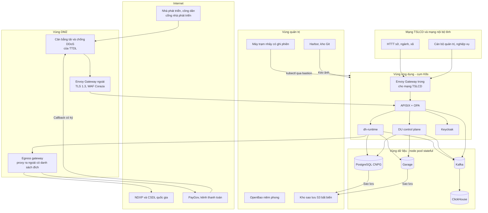
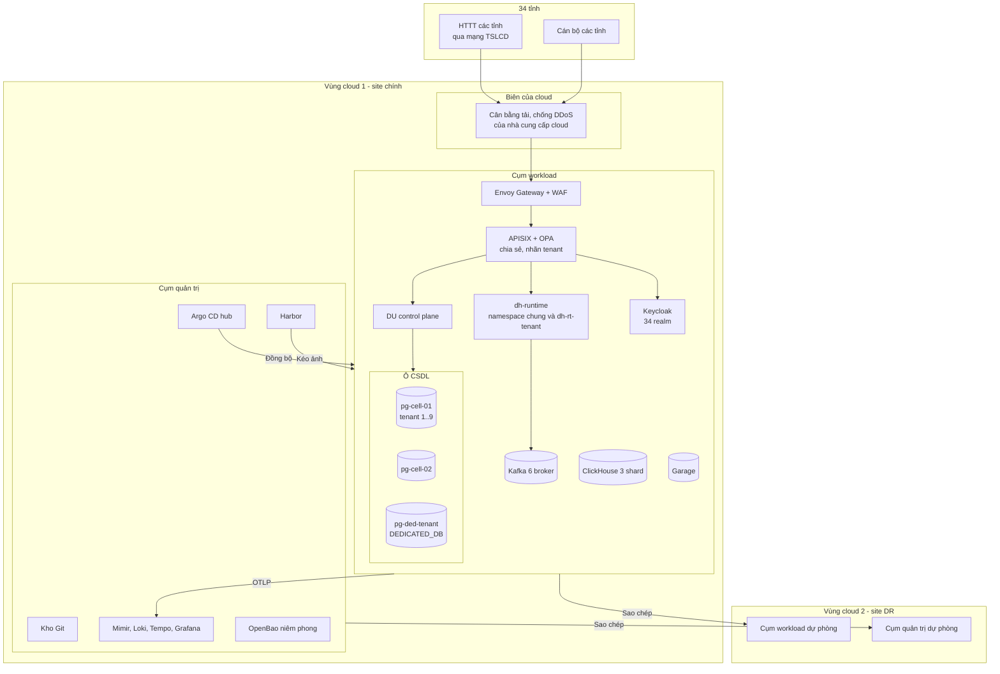

# D03-09 · Thiết kế hạ tầng, triển khai, HA/DR/BCP

## 1. Mục đích, phạm vi và cách đọc

### 1.1. Mục đích

Tài liệu này đặc tả hạ tầng mà Datahub chạy trên đó và cách hạ tầng ấy được dựng, vận hành, nâng cấp, sao lưu và khôi phục. Mục tiêu là để ba nhóm người đọc làm được việc của mình mà không phải hỏi lại kiến trúc sư. Đội vận hành của Trung tâm dữ liệu (TTDL) tỉnh dùng tài liệu để chuẩn bị máy chủ, mạng, lưu trữ và dựng cụm Kubernetes đạt điều kiện tiên quyết, sau đó cài gói phân phối Datahub trong không quá ba ngày làm việc (NFR-00-056). Nhà cung cấp cloud Chính phủ dùng tài liệu để cấp tài nguyên cho nền tảng dùng chung phục vụ 34 tenant và hiểu ranh giới trách nhiệm giữa hạ tầng cloud với phần mềm Datahub. Hội đồng thẩm định dùng tài liệu để kiểm tra rằng các mục tiêu sẵn sàng, phục hồi, sao lưu và lưu giữ nhật ký trong SRS đều có cơ chế cụ thể, có con số định cỡ có thuyết minh, có quy trình diễn tập để chứng minh.

### 1.2. Phạm vi

Tài liệu bao gồm: hồ sơ quy mô và giả định tải (mục 2); hai hồ sơ triển khai on-prem và cloud Chính phủ cùng phân vùng mạng (mục 3); kiến trúc cụm Kubernetes và các thành phần nền (mục 4); định cỡ tài nguyên cho từng thành phần theo từng hồ sơ quy mô (mục 5); tính sẵn sàng cao (High Availability, HA) của từng thành phần (mục 6); khôi phục sau thảm họa (Disaster Recovery, DR) và kế hoạch liên tục hoạt động (Business Continuity Plan, BCP) (mục 7); sao lưu và khôi phục (mục 8); quan sát và vận hành (mục 9); pipeline triển khai và nâng cấp (mục 10); phân phối sản phẩm dạng air-gapped (mục 11); đáp ứng yêu cầu cloud Chính phủ và lưu trữ dữ liệu trong nước (mục 12); dung lượng, rủi ro, truy vết và câu hỏi mở (mục 13 đến 16).

Tài liệu không bao gồm: thiết kế chi tiết từng phân hệ (SDD, D03-02); danh mục biện pháp an toàn thông tin (D03-07, chỉ được tham chiếu ở đây theo dải mã `SEC-nn`); quy trình vận hành hằng ngày và hướng dẫn xử lý sự cố chi tiết cho người trực (D06-02, D06-03); an toàn vật lý của phòng máy, nguồn điện, làm mát, phòng cháy (thuộc trách nhiệm TTDL, xem mục 12.3).

### 1.3. Quan hệ với các tài liệu khác

Tài liệu này chi tiết hóa mục 10 "Triển khai (tóm lược)" của SAD (D03-01) và hiện thực các chiến thuật ở mục 11 của SAD. Các biện pháp an toàn thông tin được định nghĩa ở D03-07; ở đây chỉ nói biện pháp nào được hạ tầng hiện thực và ở đâu, theo các nhóm: SEC-10–19 nhóm biên và mạng (WAF, TLS, phân vùng, network policy, mesh mTLS, chống DDoS); SEC-30–39 nhóm bảo vệ dữ liệu, mã hóa, khóa và bí mật; SEC-50–59 nhóm nền tảng, container, Kubernetes hardening và chuỗi cung ứng; SEC-60–69 nhóm nhật ký, giám sát và phát hiện; SEC-70–79 nhóm sao lưu, liên tục hoạt động và ứng phó sự cố; SEC-80–89 nhóm cách ly đa tenant; SEC-90–99 nhóm biện pháp bổ sung khi nâng lên cấp độ 4. Mô hình đa tenant và các chế độ cách ly `SHARED`, `DEDICATED_DB`, `DEDICATED_CLUSTER` lấy từ D03-10; tài liệu này không định nghĩa lại mà chỉ chỉ ra chế độ nào ánh xạ vào hồ sơ triển khai nào. Hướng dẫn vận hành (D06-02) và sổ tay xử lý sự cố (D06-03) sẽ dùng các runbook đánh mã `RBK-nn` ở mục 7 và mục 8 làm khung.

Bốn quyết định kiến trúc phát sinh từ tài liệu này được ghi thành ADR riêng: ADR-033 về lớp biên (Envoy Gateway và WAF Coraza với bộ luật OWASP CRS), ADR-034 về DR hai site active–standby, ADR-035 về sao lưu bất biến bằng CloudNativePG (plugin Barman Cloud) và Velero, ADR-036 về hai hồ sơ triển khai và gói phân phối air-gapped. Tài liệu cũng dựa trên ADR-003 (PostgreSQL và RLS), ADR-004 (Kafka), ADR-005 (APISIX), ADR-008 (Garage), ADR-009 (GitOps), ADR-011 (OpenTelemetry và LGTM), ADR-012 (OpenBao) và ADR-013 (tách control plane và data plane).

### 1.4. Quy ước trong tài liệu

Tài liệu dùng một số quy ước riêng, được đề xuất bổ sung vào D00-01 ở mục 16. Hồ sơ quy mô được đánh mã `QM-NHO`, `QM-VUA`, `QM-LON`, `QM-CHUNG`. Hồ sơ triển khai được đánh mã `HT-A` (tỉnh độc lập on-prem) và `HT-B` (nền tảng dùng chung trên cloud Chính phủ). Tầng phục hồi được đánh mã `TPH-0` đến `TPH-3`. Runbook được đánh mã `RBK-nn`. Rủi ro hạ tầng được đánh mã `RSK-Hnn`, cùng kiểu với `RSK-Ann` của SAD. Các địa chỉ mạng trong tài liệu là giá trị giả lập thuộc dải `10.x` và tên miền dùng `example.gov.vn`; không có địa chỉ hay bí mật thật nào.

Đơn vị dùng trong tài liệu như sau: vCPU là một luồng xử lý logic (một hyper-thread trên máy vật lý); GiB và TiB là đơn vị nhị phân dùng cho bộ nhớ và yêu cầu dung lượng trong Kubernetes; GB và TB dùng cho dung lượng dữ liệu ước tính. IOPS ghi theo khối 4 KiB, đọc ghi ngẫu nhiên hỗn hợp 70/30, trừ khi ghi khác.

## 2. Yêu cầu đầu vào và hồ sơ quy mô

### 2.1. Các yêu cầu phi chức năng chi phối hạ tầng

Bảng dưới đây gom các yêu cầu phi chức năng trong SRS (D02-02) mà hạ tầng phải đáp ứng, kèm cách tài liệu này hiện thực. Đây là "hợp đồng" giữa SRS và hạ tầng; mọi con số định cỡ ở mục 5 và mọi cơ chế ở mục 6 đến mục 10 đều quy về một trong các dòng này.

| Mã | Yêu cầu tóm tắt | Hệ quả thiết kế hạ tầng | Mục đáp ứng |
|---|---|---|---|
| NFR-00-010 | Data plane sẵn sàng ≥ 99,9%/tháng | Tối thiểu 3 bản sao trải 3 vùng lỗi cho mọi thành phần data plane và các phụ thuộc của nó (Keycloak, OPA, Valkey, OpenBao); ngân sách lỗi 43 phút/tháng | 4.3, 6, 9.1 |
| NFR-00-011 | Control plane sẵn sàng ≥ 99,5%/tháng | Tối thiểu 2 bản sao cho DU control plane; CSDL 1 primary + 2 standby | 6 |
| NFR-00-012 | Data plane chạy ≥ 24 giờ khi control plane ngừng | Data plane không phụ thuộc lúc chạy vào DU control plane; cấu hình gateway và gói chính sách được lưu bền vững cục bộ; phân định rõ thành phần nào thuộc "phụ thuộc data plane" | 6.1, 7.9 |
| NFR-00-013 | Nâng cấp không gián đoạn data plane | PodDisruptionBudget, cập nhật cuốn chiếu, canary bằng Argo Rollouts, nâng cấp Kafka và Kubernetes từng nút | 4.3, 10 |
| NFR-00-014 | RPO ≤ 15 phút; RTO ≤ 1 giờ data plane, ≤ 4 giờ control plane | Site DR active–standby, sao chép liên tục từng kho, runbook chuyển site có ngân sách thời gian | 7 |
| NFR-00-015 | Một nút hỏng không mất dịch vụ, tự phục hồi ≤ 5 phút | Topology spread, anti-affinity, thời gian loại pod khỏi nút hỏng được rút ngắn, lưu trữ cục bộ có nhân bản ở tầng ứng dụng | 4.3, 6 |
| NFR-00-020, 021 | TLS 1.3 ở biên, mTLS nội bộ, mã hóa khi lưu | Envoy Gateway ở biên, Istio ambient, mã hóa volume và bucket | 3.4, 4.4, 4.5 |
| NFR-00-027 | Nhật ký kiểm toán trực tuyến ≥ 12 tháng, lưu trữ theo cấp độ | PostgreSQL phân vùng theo tháng, sao WORM; thời hạn dài hạn theo ADR-031 | 8, 9.3 |
| NFR-00-028 | Log vận hành trực tuyến 90 ngày | Loki giữ 90 ngày | 9.3 |
| NFR-00-050, 051 | Kiểm tra sức khỏe, chỉ số Prometheus, `trace_id` | Bộ thu OpenTelemetry, quy tắc Kyverno bắt buộc probe | 4.10, 9 |
| NFR-00-055 | Phiên bản API cũ duy trì ≥ 6 tháng | Định tuyến song song phiên bản tại APISIX, không ảnh hưởng hạ tầng ngoài dung lượng | 10.5 |
| NFR-00-056 | Triển khai mới một tỉnh ≤ 3 ngày làm việc từ khi có cụm K8s đạt yêu cầu | Gói air-gapped, bộ kiểm tra tiền điều kiện, kế hoạch ba ngày | 11 |
| NFR-00-057 | Khởi tạo tenant trên nền tảng dùng chung ≤ 1 giờ | ApplicationSet theo tenant, ô CSDL đã dựng sẵn | 4.9, 5.6 |
| NFR-00-060 | ≥ 34 tenant trên một nền tảng dùng chung | Hồ sơ `QM-CHUNG`, phân ô CSDL | 2.3, 5.6 |
| NFR-00-061 | Gấp đôi tài nguyên data plane cho ≥ 1,8 lần thông lượng | Data plane không trạng thái, mở rộng ngang; Kafka phân vùng theo tenant | 5.8 |
| NFR-00-062 | 5 triệu bản ghi siêu dữ liệu lượt gọi/ngày/tenant, lưu 12 tháng truy vấn được | Kho cột ClickHouse cho siêu dữ liệu lượt gọi, giữ 12 tháng | 2.4, 5 |

Một điểm cần lưu ý ngay từ đầu là ranh giới giữa control plane và data plane trong NFR-00-012. Lượt gọi API giữa hai HTTT cần token truy cập do Keycloak phát hành, và theo SAD §9 token cho máy chỉ có hiệu lực 5 phút. Như vậy nếu Keycloak ngừng thì sau tối đa 5 phút các HTTT không lấy được token mới và data plane thực chất ngừng phục vụ, dù APISIX vẫn chạy. Tương tự, APISIX cần quyết định ủy quyền của OPA và bộ đếm hạn mức trong Valkey; `dh-runtime` và `dh-payment` cần bí mật và khóa ký trong OpenBao. Vì vậy tài liệu này xếp Keycloak, OPA, Valkey, OpenBao, Kafka, Apicurio (cho tuần tự hóa sự kiện) và kho đối tượng chứa gói chính sách vào nhóm **phụ thuộc data plane**, được định cỡ và bảo vệ cùng tầng với data plane (`TPH-0`, mục 7.1). Phép thử NFR-00-012 ở mục 7.9 chỉ tắt các DU control plane (`dh-connect`, `dh-integration`, `dh-data`, `dh-platform`, `dh-assist`, giao diện) và CSDL nghiệp vụ `pg-core`, không tắt nhóm phụ thuộc data plane. Đề xuất ghi rõ định nghĩa này vào SAD và SRS (mục 16.3).

### 2.2. Định nghĩa hồ sơ quy mô

Datahub được bán cho nhiều tỉnh có quy mô khác nhau, và sau sáp nhập đơn vị hành chính năm 2025 có những tỉnh gộp từ hai, ba tỉnh cũ. Để định cỡ hạ tầng mà không phải tính lại cho từng tỉnh, tài liệu định nghĩa bốn hồ sơ quy mô. Hồ sơ `QM-VUA` lấy đúng số liệu của SRS §6.1, là hồ sơ đo các chỉ tiêu hiệu năng. Hồ sơ `QM-NHO` và `QM-LON` được suy ra để bao quát hai đầu; hồ sơ `QM-CHUNG` là nền tảng dùng chung cho 34 tenant. Các số liệu này là ước lượng thiết kế, chờ khảo sát tỉnh thí điểm (câu hỏi mở Q07 ở SRS).

| Thông số | `QM-NHO` tỉnh nhỏ | `QM-VUA` tỉnh vừa (SRS §6.1) | `QM-LON` tỉnh lớn hoặc sau sáp nhập | `QM-CHUNG` nền tảng dùng chung |
|---|---|---|---|---|
| Số tenant | 1 | 1 | 1–3 (tỉnh cũ chưa gộp xong dữ liệu) | 34 (cộng `PLATFORM`, `COMMON`) |
| HTTT thành viên | 50 | 200 | 500 | ~6.000 (tổng) |
| API đăng ký | 500 | 2.000 | 5.000 | ~70.000 |
| Luồng tích hợp | 100 | 500 | 1.500 | ~17.000 |
| Lượt gọi API/ngày | 1 triệu | 5 triệu | 15 triệu | 170 triệu (34 × 5 triệu theo NFR-00-062) |
| Cao điểm lượt gọi/giây | 80 | 300 | 1.000 | 6.000 (sau hệ số đồng thời) |
| Sự kiện Kafka nghiệp vụ/ngày | 0,3 triệu | 2 triệu | 6 triệu | 70 triệu |
| Người dùng giao diện đồng thời | 50 | 200 | 500 | 3.000 |
| Tài khoản người dùng | 500 | 2.000 | 6.000 | ~70.000 |

Cột `QM-CHUNG` được tính như sau. Giả định cơ cấu 34 tỉnh gồm 6 tỉnh lớn, 16 tỉnh vừa và 12 tỉnh nhỏ thì tổng lượt gọi là 6 × 15 + 16 × 5 + 12 × 1 = 182 triệu lượt/ngày, gần với con số 170 triệu suy từ NFR-00-062; tài liệu dùng 170 triệu làm cơ sở và chừa 10% dự phòng trong định cỡ. Tổng cao điểm của từng tỉnh nếu cộng thẳng là 6 × 1.000 + 16 × 300 + 12 × 80 ≈ 11.800 lượt/giây, nhưng cao điểm các tỉnh không trùng hoàn toàn (giờ hành chính giống nhau nhưng các loại nghiệp vụ cao điểm khác nhau), nên áp hệ số đồng thời 0,5 và được khoảng 6.000 lượt/giây. Con số này cũng xấp xỉ ba lần lưu lượng trung bình (170 triệu / 86.400 ≈ 1.970 lượt/giây), phù hợp với hệ số cao điểm thường gặp của lưu lượng hành chính.

> **Câu hỏi mở Q330:** Cơ cấu 6 lớn / 16 vừa / 12 nhỏ và hệ số đồng thời 0,5 cho nền tảng dùng chung là giả định. Cần số liệu lưu lượng thực của hệ LGSP cũ ở ít nhất ba tỉnh (lấy từ nhật ký gateway cũ) để chốt trước cổng G1.

### 2.3. Giả định lưu lượng

Các giả định dưới đây dùng xuyên suốt mục 5. Chúng được chọn theo hướng thận trọng (ước lượng cao) vì thiếu tài nguyên làm hỏng chỉ tiêu sẵn sàng còn thừa tài nguyên chỉ tốn chi phí.

| Giả định | Giá trị | Lý do |
|---|---|---|
| Kích thước trung bình một bản tin API (yêu cầu + phản hồi) | 8 KB, phân vị 99 là 256 KB | Phần lớn là tra cứu danh mục, hồ sơ; có tệp đính kèm nhỏ |
| Kích thước tối đa thân yêu cầu qua gateway | 10 MB; tệp lớn hơn đi kênh S3 có URL ký trước | Bảo vệ gateway khỏi bản tin khổng lồ |
| Tỷ lệ lượt gọi đi qua `dh-runtime` (có chuyển đổi) | 40% | Còn lại APISIX chuyển thẳng tới backend HTTT |
| Tỷ lệ lượt gọi tới NDXP qua PH-14 | 10% | Theo nhu cầu khai thác CSDL quốc gia |
| Bản ghi siêu dữ liệu một lượt gọi | ~1 KB dạng JSON trên Kafka; ~70 byte sau nén cột | Khoảng 30 trường: thời điểm, tenant, consumer, route, mã kết quả, độ trễ từng chặng, kích thước, `trace_id` |
| Số span trung bình một lượt gọi | 6 (Envoy, APISIX, OPA, runtime, backend, Kafka) | Theo đường đi ở SAD §5 |
| Tỷ lệ lấy mẫu trace | 100% lượt gọi lỗi hoặc chậm hơn p99; 10% còn lại | Lấy mẫu đuôi (tail sampling) tại OTel Collector |
| Log vận hành | ~3 KB log/1.000 lượt gọi ở mức INFO, cộng log nền ~1 GB/ngày/tenant | Log truy cập không ghi vào Loki mà vào kho siêu dữ liệu |
| Bản ghi kiểm toán | ~100.000 bản ghi/ngày cho `QM-VUA`, ~1,5 KB/bản ghi | Thao tác quản trị, duyệt, xem dữ liệu Nhạy cảm, xuất; không gồm lượt gọi data plane |
| Chuỗi chỉ số hoạt động (active series) | ~250.000 cho `QM-VUA` | Khoảng 150 nhóm chỉ số × nhãn tenant, route, consumer có giới hạn số lượng nhãn |

### 2.4. Dung lượng dữ liệu

Bảng dưới đây ước tính dung lượng dữ liệu sau 12 tháng vận hành cho từng hồ sơ quy mô, trước khi nhân hệ số nhân bản. Mỗi dòng có thuyết minh cách tính ở đoạn sau bảng.

| Kho dữ liệu | Thời hạn giữ | `QM-NHO` | `QM-VUA` | `QM-LON` | `QM-CHUNG` |
|---|---|---|---|---|---|
| Siêu dữ liệu lượt gọi (ClickHouse, đã nén) | 12 tháng | 26 GB | 130 GB | 390 GB | 4,4 TB |
| CSDL nghiệp vụ `pg-core` (gồm kiểm toán 12 tháng) | Theo nghiệp vụ | 60 GB | 250 GB | 700 GB | 6,5 TB (chia nhiều ô) |
| CSDL định danh `pg-iam` (Keycloak) | — | 5 GB | 10 GB | 20 GB | 60 GB |
| Kafka (nhật ký phân vùng, chưa nhân bản) | 7 ngày nghiệp vụ; 3 ngày siêu dữ liệu | 15 GB | 70 GB | 210 GB | 1,9 TB |
| Kho đối tượng tệp nghiệp vụ (Garage) | Theo nghiệp vụ | 50 GB | 200 GB | 600 GB | 6 TB |
| Log vận hành (Loki, đã nén) | 90 ngày | 15 GB | 50 GB | 150 GB | 1,2 TB |
| Trace (Tempo, đã nén) | 14 ngày | 3 GB | 15 GB | 45 GB | 0,3 TB |
| Chỉ số (Mimir) | 90 ngày đầy đủ; 25 tháng dạng tổng hợp SLO | 40 GB | 110 GB | 300 GB | 2 TB |
| Kho WORM kiểm toán và bằng chứng | Theo ADR-031 (giả định 5 năm để định cỡ) | 20 GB/năm | 60 GB/năm | 180 GB/năm | 2 TB/năm |
| Kho ảnh container Harbor | 10 bản phát hành gần nhất | 150 GB | 150 GB | 150 GB | 300 GB |

**Siêu dữ liệu lượt gọi.** NFR-00-062 đòi 5 triệu bản ghi mỗi ngày mỗi tenant, giữ 12 tháng và truy vấn được, tức 1,825 tỷ bản ghi/tenant/năm và khoảng 62 tỷ bản ghi/năm trên nền tảng dùng chung. PostgreSQL, kể cả có TimescaleDB, không phải lựa chọn hợp lý ở quy mô này; SAD §6 đã đề xuất ClickHouse khi lưu lượng vượt 50 triệu lượt/tháng, và `QM-VUA` đã ở mức 150 triệu lượt/tháng. Với bảng `ReplicatedMergeTree` sắp xếp theo `(tenant_id, route_id, ts)`, mã hóa `LowCardinality` cho chuỗi lặp và nén ZSTD, một bản ghi khoảng 1 KB thô nén còn khoảng 60–80 byte; tài liệu dùng 70 byte. `QM-VUA`: 1,825 tỷ × 70 byte ≈ 128 GB. `QM-CHUNG`: 62 tỷ × 70 byte ≈ 4,35 TB. Đường đi dữ liệu là APISIX ghi bản ghi qua plugin `kafka-logger` (sau bộ che dữ liệu) vào topic `{tenant}.obs.access.logged.v1`, ClickHouse tiêu thụ bằng bảng động cơ Kafka và view vật chất hóa. Nhờ vậy log truy cập không đi vào Loki, tránh lưu trùng.

> **Câu hỏi mở Q331:** Chọn ClickHouse làm kho siêu dữ liệu lượt gọi cần được chốt ở SDD PH-13 (SAD §6 mới ghi là đề xuất). Tài liệu này định cỡ theo ClickHouse; nếu SDD PH-13 chọn phương án khác, mục 5 phải tính lại.

**CSDL nghiệp vụ.** Thành phần lớn nhất của `pg-core` là nhật ký kiểm toán (100.000 bản ghi/ngày × 1,5 KB × 365 ≈ 55 GB/năm, khoảng 80 GB kèm chỉ mục), giao dịch thanh toán (khoảng 50.000 giao dịch/ngày × 2 KB × 365 ≈ 36 GB/năm), nội dung hàng đợi lỗi giữ tối đa 7 ngày (đến 20 GB), lịch sử Flowable, danh mục dùng chung, cấu hình API và luồng. Cộng thêm chỉ mục, bảng tạm và độ phình (bloat) khoảng 30%, `QM-VUA` khoảng 250 GB sau 12 tháng. Hạn mức mặc định 200 GB/tenant của D03-10 §5.3 phù hợp với con số này. Với `QM-CHUNG`, 34 tenant với cơ cấu ở mục 2.2 cho khoảng 6,5 TB, được chia vào nhiều ô CSDL (mục 5.6).

**Kafka.** Lưu lượng ghi vào Kafka của `QM-VUA` gồm siêu dữ liệu lượt gọi (5 GB/ngày), sự kiện nghiệp vụ (2 triệu × 2 KB = 4 GB/ngày), sự kiện outbox và CDC (khoảng 1 GB/ngày). Giữ 7 ngày cho sự kiện nghiệp vụ và 3 ngày cho siêu dữ liệu (đã có bản trong ClickHouse) được 15 + 35 + 7 ≈ 60–70 GB trước nhân bản. Hệ số nhân bản 3 cho 210 GB, chia 3 broker là 70 GB mỗi broker; cộng 100% dự phòng cho bùng phát và việc phát lại, mỗi broker cần 200 GiB.

**Log, trace, chỉ số.** Log `QM-VUA`: 5 triệu lượt × 3 KB/1.000 lượt = 15 MB/ngày log theo lượt, cộng 1 GB/ngày log nền và log lỗi của các thành phần, nhân 90 ngày được khoảng 270 GB thô; Loki nén còn khoảng 15–20%, tức khoảng 50 GB. Trace: 5 triệu × 10% × 6 span × 800 byte ≈ 2,4 GB/ngày, giữ 14 ngày được 34 GB thô, khoảng 15 GB sau nén. Chỉ số: 250.000 chuỗi × 2.880 mẫu/ngày (30 giây một mẫu) × 90 ngày × 1,5 byte/mẫu ≈ 97 GB; cộng tổng hợp SLO 25 tháng (khoảng 10.000 chuỗi) và chỉ mục được khoảng 110 GB.

> **Câu hỏi mở Q332:** Thời hạn giữ trace (14 ngày) và chỉ số chi tiết (90 ngày) là đề xuất của tài liệu này, SRS chưa quy định. Cần D03-07 xác nhận TCVN 14423:2026 ở cấp độ 3 không đòi thời hạn dài hơn cho loại dữ liệu này (cần đối chiếu số mục của nhóm yêu cầu nhật ký).

## 3. Hai hồ sơ triển khai

Datahub có một bộ mã duy nhất (RB-07) nhưng hai cách đặt lên hạ tầng. Hồ sơ `HT-A` là tỉnh độc lập: một cụm Kubernetes riêng tại TTDL tỉnh, tương ứng chế độ cách ly `DEDICATED_CLUSTER` của D03-10, phần mềm vẫn chạy chế độ đa tenant nhưng thường chỉ có một tenant (hoặc vài tenant trong giai đoạn sáp nhập). Hồ sơ `HT-B` là nền tảng dùng chung trên cloud Chính phủ: một cụm lớn ở mỗi vùng phục vụ nhiều tỉnh, tenant ở chế độ `SHARED` hoặc `DEDICATED_DB`. Lựa chọn hồ sơ do tỉnh quyết định theo năng lực vận hành và chính sách; ADR-036 ghi lý do giữ cả hai hồ sơ thay vì chỉ một.

Hai hồ sơ dùng cùng gói phân phối, cùng manifest Kustomize và chart Helm; khác biệt nằm ở lớp phủ (overlay) theo site và ở các thành phần hạ tầng bên dưới Kubernetes (lưu trữ, cân bằng tải, KMS). Bảng sau tóm tắt những điểm khác nhau để người đọc nắm trước khi vào chi tiết.

| Khía cạnh | `HT-A` tỉnh độc lập on-prem | `HT-B` nền tảng dùng chung cloud Chính phủ |
|---|---|---|
| Người vận hành Kubernetes | Đội TTDL tỉnh (có thể thuê nhà thầu) | Nhà cung cấp cloud (hạ tầng) và đơn vị vận hành nền tảng (Datahub) |
| Số cụm | 1 cụm workload ở site chính, 1 cụm ở site DR (tùy chọn ở giai đoạn đầu, xem 7.2) | Mỗi vùng: 1 cụm workload + 1 cụm quản trị; 2 vùng |
| Hồ sơ quy mô | `QM-NHO`, `QM-VUA`, `QM-LON` | `QM-CHUNG` |
| Vùng lỗi (failure domain) | Máy chủ vật lý hoặc giá máy (rack) trong một phòng máy | Vùng sẵn sàng (availability zone) của cloud; tối thiểu 3 |
| Lưu trữ khối | Đĩa NVMe cục bộ (TopoLVM) cho kho tự nhân bản; Ceph RBD hoặc Longhorn cho volume thường | CSI của cloud (khối có IOPS cam kết) |
| Cân bằng tải biên | Cặp cân bằng tải phần cứng của TTDL hoặc MetalLB chế độ BGP | Cân bằng tải của cloud |
| Mở niêm phong OpenBao | Transit seal từ cụm OpenBao niêm phong riêng; HSM khi lên cấp độ 4 | KMS của cloud nếu được chứng nhận và đặt trong nước, nếu không thì như `HT-A` |
| Tenant | 1–3, chế độ `DEDICATED_CLUSTER` | 34+, `SHARED` hoặc `DEDICATED_DB` |

### 3.1. Hồ sơ `HT-A`: tỉnh độc lập tại TTDL tỉnh

Sơ đồ dưới đây cho thấy cách Datahub đặt trong TTDL tỉnh, các vùng mạng và các kết nối ra ngoài. Mỗi khung là một vùng mạng được ngăn bởi tường lửa của TTDL; mũi tên là luồng được phép theo chiều khởi tạo kết nối.

Sơ đồ thể hiện ba quyết định quan trọng. Thứ nhất, Datahub có **hai cửa vào tách biệt**: cửa ngoài trong DMZ chỉ phục vụ những gì phải mở ra Internet (cổng nhà phát triển, callback PayGov, API công bố cho bên ngoài nếu tỉnh cho phép), còn cửa trong phục vụ HTTT và cán bộ trên mạng truyền số liệu chuyên dùng (TSLCD) hoặc mạng nội bộ tỉnh. Tách hai cửa giúp giao diện quản trị `dh-console` không bao giờ lộ ra Internet, và cho phép áp chính sách WAF, giới hạn tốc độ khác nhau cho hai loại người dùng. Thứ hai, **mọi kết nối ra ngoài đi qua egress gateway** với danh sách đích khai báo (NDXP, PayGov, kho cập nhật của nhà cung cấp nếu có), đúng yêu cầu "còn lại đóng" ở SRS §2.2; pod ứng dụng không có tuyến ra Internet trực tiếp. Thứ ba, **vùng quản trị tách riêng**: thao tác quản trị cụm chỉ đi từ máy trạm nhảy (bastion) có ghi lại phiên, Harbor và kho Git nằm ở vùng quản trị để cụm workload kéo về (mô hình kéo), không có kết nối từ ngoài đẩy vào cụm.

**Phân vùng mạng.** Bảng sau quy định các vùng mạng của `HT-A`, chức năng và luồng được phép. Dải địa chỉ là ví dụ giả lập; TTDL cấp dải thật khi khảo sát. Các quy tắc này hiện thực nhóm biện pháp SEC-10–19 (phân vùng, tường lửa, network policy) ở tầng hạ tầng TTDL; bên trong cụm, network policy Cilium từ chối mặc định thực hiện cùng nguyên tắc ở mức pod (mục 4.4).

| Vùng | Ví dụ dải | Thành phần | Luồng vào được phép | Luồng ra được phép |
|---|---|---|---|---|
| Internet | — | Người dùng ngoài, NDXP, PayGov | — | 443 tới VIP ngoài trong DMZ |
| DMZ | 10.10.0.0/24 | Cân bằng tải, nút biên chạy Envoy Gateway ngoài, egress gateway | 443 từ Internet (chỉ VIP ngoài); 443 từ vùng ứng dụng tới egress | 443 tới APISIX trong vùng ứng dụng; 443 từ egress tới đích khai báo |
| Mạng TSLCD / nội bộ tỉnh | do tỉnh cấp | HTTT, máy cán bộ | — | 443 tới VIP trong (Envoy Gateway trong) |
| Vùng ứng dụng | 10.20.0.0/22 (nút); pod và service dùng dải overlay riêng | Nút worker không trạng thái, nút control-plane K8s | 443 từ DMZ và VIP trong; 6443 từ bastion; Kafka 9093 từ HTTT đã đăng ký (tùy chọn, mục 3.3) | Tới vùng dữ liệu theo cổng dịch vụ; tới vùng quản trị (Harbor 443, Git 443, OpenBao niêm phong 8200); tới egress |
| Vùng dữ liệu | 10.30.0.0/24 | Nút stateful (PostgreSQL, Kafka, Garage, ClickHouse) | Từ vùng ứng dụng theo cổng dịch vụ; nhân bản giữa các nút cùng vùng | Tới kho sao lưu ở vùng quản trị và site DR |
| Vùng quản trị | 10.40.0.0/24 | Bastion, Harbor, kho Git, OpenBao niêm phong, kho sao lưu cục bộ, máy chủ NTP và DNS nội bộ | SSH/RDP từ mạng quản trị riêng của TTDL có MFA | 6443 tới API server; 443 tới site DR để sao chép |
| Liên site | Kênh riêng hoặc VPN IPsec giữa hai TTDL | Sao chép PostgreSQL, Kafka MirrorMaker 2, Garage, Harbor, Git, OpenBao snapshot | Chỉ giữa địa chỉ được liệt kê, mã hóa | — |

Trong cụm Kubernetes, vùng ứng dụng và vùng dữ liệu là các node pool khác nhau đặt trên các dải nút khác nhau. Điều này cho phép tường lửa của TTDL cũng chặn được luồng ở tầng nút (ví dụ nút stateful không bao giờ nhận kết nối từ DMZ), tạo hai lớp phòng thủ độc lập với network policy trong cụm.

**Mô hình trách nhiệm ở `HT-A`.** Bảng RACI rút gọn sau phân định ai làm gì. R là người thực hiện, A là người chịu trách nhiệm cuối cùng, C là người được hỏi ý kiến.

| Hạng mục | TTDL tỉnh | Nhà cung cấp Datahub | Chủ quản HTTT (Sở KH&CN hoặc đơn vị được giao) |
|---|---|---|---|
| Phòng máy, điện, làm mát, an toàn vật lý | R, A | — | C |
| Máy chủ, ảo hóa, mạng, tường lửa, cân bằng tải | R, A | C | — |
| Dựng cụm Kubernetes đạt điều kiện tiên quyết (3.4) | R, A | C (cung cấp bộ kiểm tra) | — |
| Cài gói Datahub, cấu hình ban đầu | C | R, A | — |
| Vận hành hằng ngày, trực sự cố cấp 1 | R, A | C | — |
| Hỗ trợ cấp 2–3, bản vá phần mềm Datahub | C | R, A | — |
| Vá hệ điều hành nút, nâng cấp Kubernetes | R, A | C (xác nhận tương thích) | — |
| Sao lưu, diễn tập DR | R | C | A |
| Hồ sơ cấp độ ATTT, phê duyệt | C | C | R, A |

**Điều kiện tiên quyết của hạ tầng tỉnh.** Tỉnh chọn `HT-A` phải có những điều kiện dưới đây trước khi tính mốc ba ngày của NFR-00-056. Bộ kiểm tra tiền điều kiện ở mục 11.3 kiểm tra tự động các điều kiện kỹ thuật.

1. Tối thiểu ba máy chủ vật lý (hoặc ba máy chủ chủ ảo hóa) là ba vùng lỗi độc lập về nguồn điện và chuyển mạch truy cập; với `QM-VUA` trở lên là bốn máy chủ để còn dư một khi một máy bảo trì.
2. Cụm Kubernetes phiên bản đang được cộng đồng hỗ trợ và không thấp hơn 1.31 (SRS §2.2), bản phân phối tuân thủ CNCF, đạt CIS Kubernetes Benchmark ở mức bản phân phối hỗ trợ; khuyến nghị RKE2 vì có cấu hình CIS sẵn và hỗ trợ cài đặt không mạng.
3. Đĩa NVMe hoặc SSD doanh nghiệp cho nút stateful, đạt IOPS tối thiểu ở mục 5; mã hóa ở tầng đĩa (LUKS hoặc mã hóa của bộ lưu trữ).
4. Hai VIP (ngoài và trong), chứng thư số TLS cho tên miền công bố (do tỉnh cấp hoặc qua cert-manager với CA nội bộ của tỉnh), DNS nội bộ phân giải được tên miền nội bộ.
5. Kết nối ra NDXP và PayGov đã được mở ở tường lửa theo danh sách đích; kênh tới hệ thống giám sát ATTT của tỉnh (IF-08).
6. Kho sao lưu S3 có khóa đối tượng (object lock) ở vị trí vật lý khác phòng máy chính (mục 8.2), hoặc cam kết dùng site DR.
7. Máy chủ NTP nội bộ đồng bộ (độ lệch ≤ 100 ms), vì chuỗi băm kiểm toán, token và Raft đều nhạy với thời gian.
8. Đội vận hành có tối thiểu hai người đã qua đào tạo Kubernetes cơ bản và nắm D06-02.

> **Câu hỏi mở Q333:** Bản phân phối Kubernetes cho `HT-A` (RKE2, kubeadm, OpenShift OKD hay bản phân phối do tỉnh đã có) chưa được chủ đầu tư chốt. Tài liệu khuyến nghị RKE2 nhưng bộ cài chỉ phụ thuộc API Kubernetes chuẩn; cần biết bản phân phối các tỉnh thí điểm đang dùng để kiểm thử tương thích.

### 3.2. Hồ sơ `HT-B`: nền tảng dùng chung trên cloud Chính phủ

Sơ đồ dưới đây cho thấy nền tảng dùng chung ở một vùng cloud. Vùng thứ hai có cấu trúc giống hệt và đóng vai site DR (mục 7.2). Khác với `HT-A`, mỗi vùng có hai cụm: cụm workload chạy Datahub cho mọi tenant, và cụm quản trị chạy công cụ vận hành dùng chung.

Sơ đồ nêu bật ba điểm khác `HT-A`. Một là **ô CSDL (DB cell)**: thay vì một cụm PostgreSQL khổng lồ cho 34 tenant, tenant ở chế độ `SHARED` được xếp vào vài cụm CloudNativePG cỡ vừa, mỗi cụm chứa khoảng 8–10 tenant, và bảng định tuyến tenant của PH-20 (vốn đã có cho `DEDICATED_DB` theo D03-10 §5.2) cho biết tenant nằm ở ô nào. Cách chia ô giới hạn phạm vi ảnh hưởng của một sự cố CSDL vào khoảng một phần tư số tỉnh, giữ kích thước mỗi cụm ở mức sao lưu và khôi phục được trong ngân sách RTO, và cho phép nâng cấp từng ô. Hai là **cụm quản trị tách riêng**: Argo CD, Harbor, kho Git, bộ LGTM và OpenBao niêm phong chạy ở cụm khác cụm workload, để sự cố ở cụm workload (kể cả cạn tài nguyên) không làm mất công cụ dùng để khắc phục nó. Ba là **cửa vào duy nhất qua cân bằng tải của cloud**, vì HTTT của các tỉnh đến qua mạng TSLCD kết nối vào cloud Chính phủ; tên miền API được tách theo tenant (`api.t68.example.gov.vn`) để chứng thư và chính sách WAF áp được theo tỉnh.

**Phân vùng mạng ở `HT-B`.** Các vùng có cùng chức năng như `HT-A` nhưng được hiện thực bằng mạng ảo (VPC hoặc tương đương) và nhóm bảo mật (security group) của cloud. Vùng DMZ là mạng con công khai chỉ chứa cân bằng tải; nút biên chạy Envoy Gateway ở mạng con riêng; nút ứng dụng, nút stateful và cụm quản trị ở ba mạng con riêng không có địa chỉ công khai. Kết nối tới NDXP và PayGov đi qua cổng NAT có địa chỉ ra cố định để các bên đăng ký danh sách cho phép. Kết nối giữa hai vùng cloud dùng mạng nội bộ của nhà cung cấp, có mã hóa.

**Mô hình trách nhiệm ở `HT-B`.** Trách nhiệm được chia giữa ba bên: nhà cung cấp cloud chịu trách nhiệm từ phòng máy đến tầng ảo hóa, mạng ảo, lưu trữ khối và (nếu dùng dịch vụ Kubernetes được quản lý) control plane của Kubernetes; đơn vị vận hành nền tảng (nhà cung cấp Datahub hoặc đơn vị được giao) chịu trách nhiệm từ các thành phần chạy trên Kubernetes trở lên, kể cả sao lưu, DR và giám sát; quản trị tenant của mỗi tỉnh chịu trách nhiệm cấu hình, người dùng, HTTT và dữ liệu trong tenant của mình. Ranh giới này phải được ghi trong hợp đồng dịch vụ, kèm cam kết mức dịch vụ (SLA) của từng tầng; cam kết của tầng dưới phải chặt hơn tầng trên (ví dụ lưu trữ khối và mạng của cloud ≥ 99,95% để nền tảng đạt 99,9%).

**Điều kiện tiên quyết của cloud.** Nhà cung cấp cloud phải bảo đảm: ít nhất ba vùng sẵn sàng độc lập trong mỗi vùng cloud, hoặc ba nhóm máy chủ tách nguồn và mạng nếu cloud không có khái niệm vùng sẵn sàng; hai vùng cloud cách nhau đủ xa để không cùng chịu một sự cố mất điện khu vực (khuyến nghị khác tỉnh); lưu trữ khối có IOPS cam kết; lưu trữ đối tượng có khóa đối tượng để làm kho sao lưu; toàn bộ hạ tầng và dữ liệu, kể cả bản sao lưu và nhật ký, nằm trong lãnh thổ Việt Nam (mục 12).

### 3.3. Kết nối với NDXP, PayGov và các HTTT

Datahub có bốn loại kết nối ra ngoài cụm, mỗi loại có đường đi và cách bảo vệ riêng. Bảng dưới đây mô tả đường đi ở cả hai hồ sơ triển khai.

| Kết nối | Chiều | Đường đi | Xác thực, mã hóa | Ghi chú |
|---|---|---|---|---|
| HTTT gọi API | Vào | Mạng TSLCD → VIP trong → Envoy Gateway → APISIX | TLS 1.3 (1.2 với bộ mã an toàn cho hệ cũ); OAuth 2.1 client_credentials; mTLS hoặc private_key_jwt | Envoy Gateway xác minh chứng thư khách và chuyển dấu vân tay chứng thư cho APISIX (ADR-033) |
| HTTT nhận webhook | Ra | `dh-runtime` hoặc `dh-integration` → egress gateway → HTTT | HTTPS, chữ ký HMAC-SHA256 | Đích phải được khai báo trong hồ sơ HTTT (PH-01) |
| HTTT dùng Kafka trực tiếp | Vào | Mạng TSLCD → listener Kafka ngoài (TLS, cổng 9093) | mTLS hoặc SASL OAUTHBEARER, ACL theo tiền tố tenant | Tùy chọn; mặc định HTTT nhận sự kiện qua webhook hoặc API kéo |
| Datahub gọi NDXP | Ra | `dh-runtime` (PH-14) → egress gateway → NDXP | Token OAuth do NDXP cấp; TLS | Địa chỉ ra cố định để NDXP đăng ký |
| PayGov chuyển hướng và callback | Vào và ra | Trình duyệt công dân → VIP ngoài → APISIX → `dh-payment`; `dh-payment` → egress → PayGov | Callback có chữ ký, khóa ký trong OpenBao transit | Callback là luồng duy nhất từ Internet vào data plane ngoài cổng nhà phát triển |
| Gửi nhật ký an ninh | Ra | OTel Collector hoặc Vector → hệ giám sát ATTT tỉnh hoặc quốc gia | Syslog TLS (RFC 5425) hoặc OTLP qua mTLS | IF-08, nhóm SEC-60–69 |

> **Câu hỏi mở Q334:** Cần biết NDXP và PayGov có yêu cầu địa chỉ IP nguồn cố định, chứng thư khách (mTLS) hay kênh kết nối riêng (qua mạng TSLCD thay vì Internet) đối với LGSP cấp tỉnh hay không, và yêu cầu này có khác nhau giữa `HT-A` và `HT-B` (một nền tảng gọi thay nhiều tỉnh) hay không.

### 3.4. Điều kiện mạng và thời gian

Các thành phần đồng thuận (etcd, Raft của OpenBao, KRaft của Kafka) và nhân bản đồng bộ PostgreSQL nhạy với độ trễ mạng. Trong một site, độ trễ khứ hồi giữa các vùng lỗi phải ≤ 2 ms ở phân vị 99; băng thông giữa các nút stateful tối thiểu 10 Gbit/s (25 Gbit/s cho `QM-LON` và `QM-CHUNG`) vì nhân bản Kafka và Garage nhân ba lưu lượng ghi. Giữa hai site, nhân bản là bất đồng bộ nên không đòi độ trễ thấp, nhưng băng thông phải đủ chuyển lượng thay đổi trong thời gian ngắn hơn RPO: với `QM-VUA` lượng thay đổi cao điểm khoảng 15 Mbit/s (WAL PostgreSQL, Kafka nghiệp vụ, tệp mới), nên kênh liên site tối thiểu 100 Mbit/s để còn dư khi đồng bộ lại sau gián đoạn; `QM-CHUNG` tối thiểu 1 Gbit/s.
