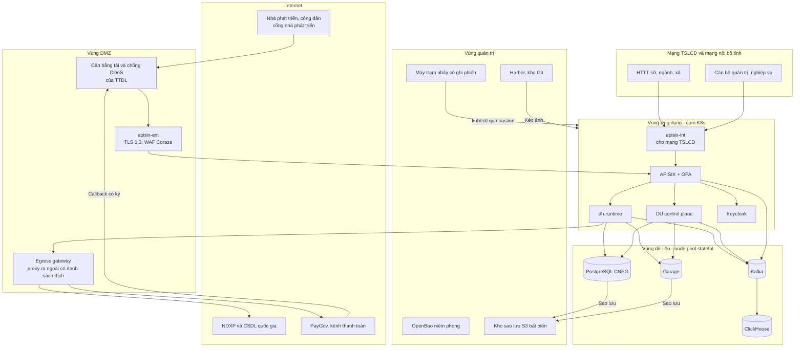
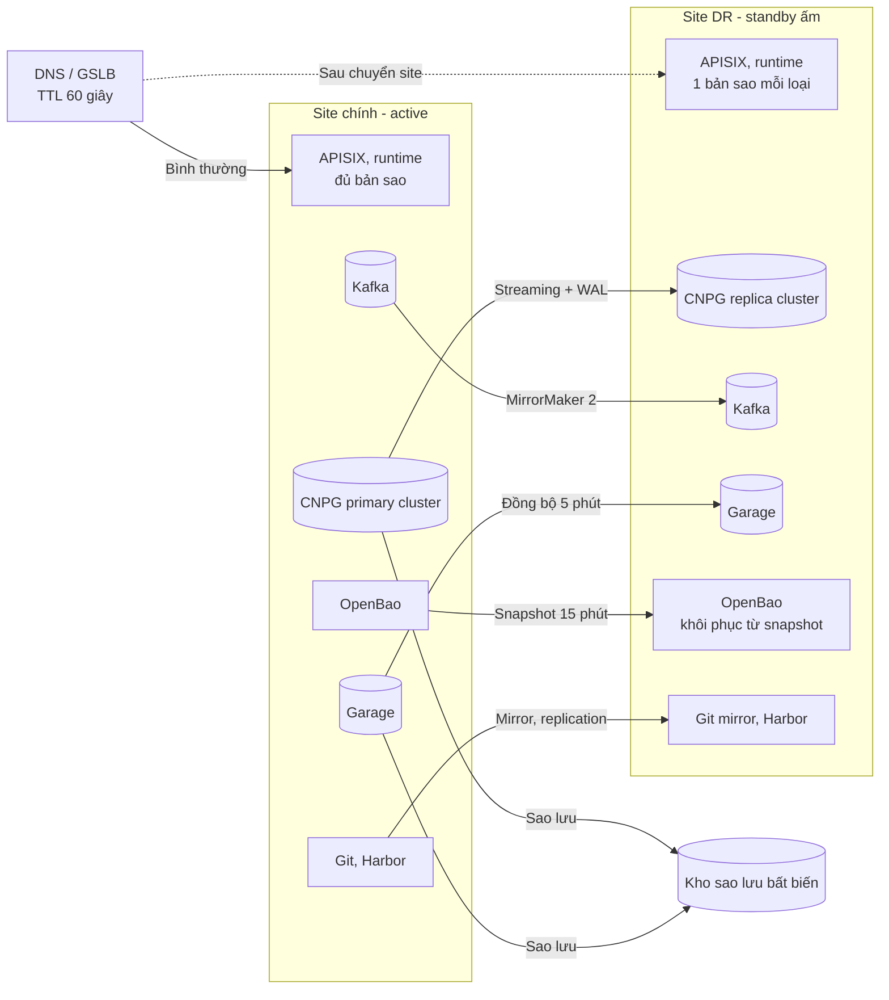

# D03-09 · Thiết kế hạ tầng, triển khai, HA/DR/BCP

## 1. Mục đích, phạm vi và cách đọc

### 1.1. Mục đích

Tài liệu này đặc tả hạ tầng mà Datahub chạy trên đó và cách hạ tầng ấy được dựng, vận hành, nâng cấp, sao lưu và khôi phục. Mục tiêu là để ba nhóm người đọc làm được việc của mình mà không phải hỏi lại kiến trúc sư. Đội vận hành của Trung tâm dữ liệu (TTDL) tỉnh dùng tài liệu để chuẩn bị máy chủ, mạng, lưu trữ và dựng cụm Kubernetes đạt điều kiện tiên quyết, sau đó cài gói phân phối Datahub trong không quá ba ngày làm việc (NFR-00-056). Nhà cung cấp cloud Chính phủ dùng tài liệu để cấp tài nguyên cho nền tảng dùng chung phục vụ 34 tenant và hiểu ranh giới trách nhiệm giữa hạ tầng cloud với phần mềm Datahub. Hội đồng thẩm định dùng tài liệu để kiểm tra rằng các mục tiêu sẵn sàng, phục hồi, sao lưu và lưu giữ nhật ký trong SRS đều có cơ chế cụ thể, có con số định cỡ có thuyết minh, có quy trình diễn tập để chứng minh.

### 1.2. Phạm vi

Tài liệu bao gồm: hồ sơ quy mô và giả định tải (mục 2); hai hồ sơ triển khai on-prem và cloud Chính phủ cùng phân vùng mạng (mục 3); kiến trúc cụm Kubernetes và các thành phần nền (mục 4); định cỡ tài nguyên cho từng thành phần theo từng hồ sơ quy mô (mục 5); tính sẵn sàng cao (High Availability, HA) của từng thành phần (mục 6); khôi phục sau thảm họa (Disaster Recovery, DR) và kế hoạch liên tục hoạt động (Business Continuity Plan, BCP) (mục 7); sao lưu và khôi phục (mục 8); quan sát và vận hành (mục 9); pipeline triển khai và nâng cấp (mục 10); phân phối sản phẩm dạng air-gapped (mục 11); đáp ứng yêu cầu cloud Chính phủ và lưu trữ dữ liệu trong nước (mục 12); dung lượng, rủi ro, truy vết, mã mới và câu hỏi mở (mục 13 đến 17).

Tài liệu không bao gồm: thiết kế chi tiết từng phân hệ (SDD, D03-02); danh mục biện pháp an toàn thông tin (D03-07, chỉ được tham chiếu ở đây theo dải mã `SEC-nn`); quy trình vận hành hằng ngày và hướng dẫn xử lý sự cố chi tiết cho người trực (D06-02, D06-03); an toàn vật lý của phòng máy, nguồn điện, làm mát, phòng cháy (thuộc trách nhiệm TTDL, xem mục 12.3).

### 1.3. Quan hệ với các tài liệu khác

Tài liệu này chi tiết hóa mục 10 "Triển khai (tóm lược)" của SAD (D03-01) và hiện thực các chiến thuật ở mục 11 của SAD. Các biện pháp an toàn thông tin được định nghĩa ở D03-07; ở đây chỉ nói biện pháp nào được hạ tầng hiện thực và ở đâu, theo các nhóm: SEC-10–19 nhóm biên và mạng (WAF, TLS, phân vùng, network policy, mesh mTLS, chống DDoS); SEC-30–39 nhóm bảo vệ dữ liệu, mã hóa, khóa và bí mật; SEC-50–59 nhóm nền tảng, container, Kubernetes hardening và chuỗi cung ứng; SEC-60–69 nhóm nhật ký, giám sát và phát hiện; SEC-70–79 nhóm sao lưu, liên tục hoạt động và ứng phó sự cố; SEC-80–89 nhóm cách ly đa tenant; SEC-90–99 nhóm biện pháp bổ sung khi nâng lên cấp độ 4. Mô hình đa tenant và các chế độ cách ly `SHARED`, `DEDICATED_DB`, `DEDICATED_CLUSTER` lấy từ D03-10; tài liệu này không định nghĩa lại mà chỉ chỉ ra chế độ nào ánh xạ vào hồ sơ triển khai nào. Hướng dẫn vận hành (D06-02) và sổ tay xử lý sự cố (D06-03) sẽ dùng các runbook đánh mã `RBK-nn` ở mục 7 và mục 8 làm khung.

Bốn quyết định kiến trúc phát sinh từ tài liệu này được ghi thành ADR riêng: ADR-033 về lớp biên (APISIX ở biên, WAF Coraza với bộ luật OWASP CRS chạy trong APISIX), ADR-034 về DR hai site active–standby, ADR-035 về sao lưu bất biến bằng CloudNativePG (plugin Barman Cloud) và Velero, ADR-036 về hai hồ sơ triển khai và gói phân phối air-gapped. Tài liệu cũng dựa trên ADR-003 (PostgreSQL và RLS), ADR-004 (Kafka), ADR-005 (APISIX), ADR-008 (Garage), ADR-009 (GitOps), ADR-011 (OpenTelemetry và LGTM), ADR-012 (OpenBao) và ADR-013 (tách control plane và data plane).

### 1.4. Quy ước trong tài liệu

Tài liệu dùng một số quy ước riêng, được đề xuất bổ sung vào D00-01 ở mục 16. Hồ sơ quy mô được đánh mã `QM-NHO`, `QM-VUA`, `QM-LON`, `QM-CHUNG`. Hồ sơ triển khai được đánh mã `HT-A` (tỉnh độc lập on-prem) và `HT-B` (nền tảng dùng chung trên cloud Chính phủ). Tầng phục hồi được đánh mã `TPH-0` đến `TPH-3`. Runbook được đánh mã `RBK-nn`. Rủi ro hạ tầng được đánh mã `RSK-Hnn`, cùng kiểu với `RSK-Ann` của SAD. Các địa chỉ mạng trong tài liệu là giá trị giả lập thuộc dải `10.x` và tên miền dùng `example.gov.vn`; không có địa chỉ hay bí mật thật nào.

Đơn vị dùng trong tài liệu như sau: vCPU là một luồng xử lý logic (một hyper-thread trên máy vật lý); GiB và TiB là đơn vị nhị phân dùng cho bộ nhớ và yêu cầu dung lượng trong Kubernetes; GB và TB dùng cho dung lượng dữ liệu ước tính. IOPS ghi theo khối 4 KiB, đọc ghi ngẫu nhiên hỗn hợp 70/30, trừ khi ghi khác.

## 2. Yêu cầu đầu vào và hồ sơ quy mô

### 2.1. Các yêu cầu phi chức năng chi phối hạ tầng

Bảng dưới đây gom các yêu cầu phi chức năng trong SRS (D02-02) mà hạ tầng phải đáp ứng, kèm cách tài liệu này hiện thực. Đây là "hợp đồng" giữa SRS và hạ tầng; mọi con số định cỡ ở mục 5 và mọi cơ chế ở mục 6 đến mục 10 đều quy về một trong các dòng này.

| Mã | Yêu cầu tóm tắt | Hệ quả thiết kế hạ tầng | Mục đáp ứng |
|---|---|---|---|
| NFR-00-010 | Data plane sẵn sàng ≥ 99,9%/tháng | Tối thiểu 3 bản sao trải 3 vùng lỗi cho mọi thành phần data plane và các phụ thuộc của nó (Keycloak, OPA, Valkey, OpenBao); ngân sách lỗi 43 phút/tháng | 4.3, 6, 9.1 |
| NFR-00-011 | Control plane sẵn sàng ≥ 99,5%/tháng | Tối thiểu 2 bản sao cho DU control plane; CSDL 1 primary + 2 standby | 6 |
| NFR-00-012 | Data plane chạy ≥ 24 giờ khi control plane ngừng | Data plane không phụ thuộc lúc chạy vào DU control plane; cấu hình gateway và gói chính sách được lưu bền vững cục bộ; phân định rõ thành phần nào thuộc "phụ thuộc data plane" | 6.1, 7.9 |
| NFR-00-013 | Nâng cấp không gián đoạn data plane | PodDisruptionBudget, cập nhật cuốn chiếu, canary bằng Argo Rollouts, nâng cấp Kafka và Kubernetes từng nút | 4.3, 10 |
| NFR-00-014 | RPO ≤ 15 phút; RTO ≤ 1 giờ data plane, ≤ 4 giờ control plane | Site DR active–standby, sao chép liên tục từng kho, runbook chuyển site có ngân sách thời gian | 7 |
| NFR-00-015 | Một nút hỏng không mất dịch vụ, tự phục hồi ≤ 5 phút | Topology spread, anti-affinity, thời gian loại pod khỏi nút hỏng được rút ngắn, lưu trữ cục bộ có nhân bản ở tầng ứng dụng | 4.3, 6 |
| NFR-00-020, 021 | TLS 1.3 ở biên, mTLS nội bộ, mã hóa khi lưu | APISIX ở biên, Istio ambient, mã hóa volume và bucket | 3.4, 4.4, 4.5 |
| NFR-00-027 | Nhật ký kiểm toán trực tuyến ≥ 12 tháng, lưu trữ theo cấp độ | PostgreSQL phân vùng theo tháng, sao WORM; thời hạn dài hạn theo ADR-031 | 8, 9.3 |
| NFR-00-028 | Log vận hành trực tuyến 90 ngày | Loki giữ 90 ngày | 9.3 |
| NFR-00-050, 051 | Kiểm tra sức khỏe, chỉ số Prometheus, `trace_id` | Bộ thu OpenTelemetry, quy tắc Kyverno bắt buộc probe | 4.10, 9 |
| NFR-00-055 | Phiên bản API cũ duy trì ≥ 6 tháng | Định tuyến song song phiên bản tại APISIX, không ảnh hưởng hạ tầng ngoài dung lượng | 10.5 |
| NFR-00-056 | Triển khai mới một tỉnh ≤ 3 ngày làm việc từ khi có cụm K8s đạt yêu cầu | Gói air-gapped, bộ kiểm tra tiền điều kiện, kế hoạch ba ngày | 11 |
| NFR-00-057 | Khởi tạo tenant trên nền tảng dùng chung ≤ 1 giờ | ApplicationSet theo tenant, ô CSDL đã dựng sẵn | 4.9, 5.6 |
| NFR-00-060 | ≥ 34 tenant trên một nền tảng dùng chung | Hồ sơ `QM-CHUNG`, phân ô CSDL | 2.3, 5.6 |
| NFR-00-061 | Gấp đôi tài nguyên data plane cho ≥ 1,8 lần thông lượng | Data plane không trạng thái, mở rộng ngang; Kafka phân vùng theo tenant | 5.8 |
| NFR-00-062 | 5 triệu bản ghi siêu dữ liệu lượt gọi/ngày/tenant, lưu 12 tháng truy vấn được | Kho cột ClickHouse cho siêu dữ liệu lượt gọi, giữ 12 tháng | 2.4, 5 |

Một điểm cần lưu ý ngay từ đầu là ranh giới giữa control plane và data plane trong NFR-00-012. Lượt gọi API giữa hai HTTT cần token truy cập do Keycloak phát hành, và theo SAD §9 token cho máy chỉ có hiệu lực 5 phút. Như vậy nếu Keycloak ngừng thì sau tối đa 5 phút các HTTT không lấy được token mới và data plane thực chất ngừng phục vụ, dù APISIX vẫn chạy. Tương tự, APISIX cần quyết định ủy quyền của OPA và bộ đếm hạn mức trong Valkey; `dh-runtime` và `dh-payment` cần bí mật và khóa ký trong OpenBao. Vì vậy tài liệu này xếp Keycloak, OPA, Valkey, OpenBao, Kafka, Apicurio (cho tuần tự hóa sự kiện) và kho đối tượng chứa gói chính sách vào nhóm **phụ thuộc data plane**, được định cỡ và bảo vệ cùng tầng với data plane (`TPH-0`, mục 7.1). Phép thử NFR-00-012 ở mục 7.9 chỉ tắt các DU control plane (`dh-connect`, `dh-integration`, `dh-data`, `dh-platform`, `dh-assist`, giao diện) và CSDL nghiệp vụ `pg-core`, không tắt nhóm phụ thuộc data plane. Đề xuất ghi rõ định nghĩa này vào SAD và SRS (mục 16.3).

### 2.2. Định nghĩa hồ sơ quy mô

Datahub được bán cho nhiều tỉnh có quy mô khác nhau, và sau sáp nhập đơn vị hành chính năm 2025 có những tỉnh gộp từ hai, ba tỉnh cũ. Để định cỡ hạ tầng mà không phải tính lại cho từng tỉnh, tài liệu định nghĩa bốn hồ sơ quy mô. Hồ sơ `QM-VUA` lấy đúng số liệu của SRS §6.1, là hồ sơ đo các chỉ tiêu hiệu năng. Hồ sơ `QM-NHO` và `QM-LON` được suy ra để bao quát hai đầu; hồ sơ `QM-CHUNG` là nền tảng dùng chung cho 34 tenant. Các số liệu này là ước lượng thiết kế, chờ khảo sát tỉnh thí điểm (câu hỏi mở Q07 ở SRS).

| Thông số | `QM-NHO` tỉnh nhỏ | `QM-VUA` tỉnh vừa (SRS §6.1) | `QM-LON` tỉnh lớn hoặc sau sáp nhập | `QM-CHUNG` nền tảng dùng chung |
|---|---|---|---|---|
| Số tenant | 1 | 1 | 1–3 (tỉnh cũ chưa gộp xong dữ liệu) | 34 (cộng `PLATFORM`, `COMMON`) |
| HTTT thành viên | 50 | 200 | 500 | ~6.000 (tổng) |
| API đăng ký | 500 | 2.000 | 5.000 | ~70.000 |
| Luồng tích hợp | 100 | 500 | 1.500 | ~17.000 |
| Lượt gọi API/ngày | 1 triệu | 5 triệu | 15 triệu | 170 triệu (34 × 5 triệu theo NFR-00-062) |
| Cao điểm lượt gọi/giây | 80 | 300 | 1.000 | 6.000 (sau hệ số đồng thời) |
| Sự kiện Kafka nghiệp vụ/ngày | 0,3 triệu | 2 triệu | 6 triệu | 70 triệu |
| Người dùng giao diện đồng thời | 50 | 200 | 500 | 3.000 |
| Tài khoản người dùng | 500 | 2.000 | 6.000 | ~70.000 |

Cột `QM-CHUNG` được tính như sau. Giả định cơ cấu 34 tỉnh gồm 6 tỉnh lớn, 16 tỉnh vừa và 12 tỉnh nhỏ thì tổng lượt gọi là 6 × 15 + 16 × 5 + 12 × 1 = 182 triệu lượt/ngày, gần với con số 170 triệu suy từ NFR-00-062; tài liệu dùng 170 triệu làm cơ sở và chừa 10% dự phòng trong định cỡ. Tổng cao điểm của từng tỉnh nếu cộng thẳng là 6 × 1.000 + 16 × 300 + 12 × 80 ≈ 11.800 lượt/giây, nhưng cao điểm các tỉnh không trùng hoàn toàn (giờ hành chính giống nhau nhưng các loại nghiệp vụ cao điểm khác nhau), nên áp hệ số đồng thời 0,5 và được khoảng 6.000 lượt/giây. Con số này cũng xấp xỉ ba lần lưu lượng trung bình (170 triệu / 86.400 ≈ 1.970 lượt/giây), phù hợp với hệ số cao điểm thường gặp của lưu lượng hành chính.

> **Câu hỏi mở Q330:** Cơ cấu 6 lớn / 16 vừa / 12 nhỏ và hệ số đồng thời 0,5 cho nền tảng dùng chung là giả định. Cần số liệu lưu lượng thực của hệ LGSP cũ ở ít nhất ba tỉnh (lấy từ nhật ký gateway cũ) để chốt trước cổng G1.

### 2.3. Giả định lưu lượng

Các giả định dưới đây dùng xuyên suốt mục 5. Chúng được chọn theo hướng thận trọng (ước lượng cao) vì thiếu tài nguyên làm hỏng chỉ tiêu sẵn sàng còn thừa tài nguyên chỉ tốn chi phí.

| Giả định | Giá trị | Lý do |
|---|---|---|
| Kích thước trung bình một bản tin API (yêu cầu + phản hồi) | 8 KB, phân vị 99 là 256 KB | Phần lớn là tra cứu danh mục, hồ sơ; có tệp đính kèm nhỏ |
| Kích thước tối đa thân yêu cầu qua gateway | 10 MB; tệp lớn hơn đi kênh S3 có URL ký trước | Bảo vệ gateway khỏi bản tin khổng lồ |
| Tỷ lệ lượt gọi đi qua `dh-runtime` (có chuyển đổi) | 40% | Còn lại APISIX chuyển thẳng tới backend HTTT |
| Tỷ lệ lượt gọi tới NDXP qua PH-14 | 10% | Theo nhu cầu khai thác CSDL quốc gia |
| Bản ghi siêu dữ liệu một lượt gọi | ~1 KB dạng JSON trên Kafka; ~70 byte sau nén cột | Khoảng 30 trường: thời điểm, tenant, consumer, route, mã kết quả, độ trễ từng chặng, kích thước, `trace_id` |
| Số span trung bình một lượt gọi | 5 (APISIX, OPA, runtime, backend, Kafka) | Theo đường đi ở SAD §5 |
| Tỷ lệ lấy mẫu trace | 100% lượt gọi lỗi hoặc chậm hơn p99; 10% còn lại | Lấy mẫu đuôi (tail sampling) tại OTel Collector |
| Log vận hành | ~3 KB log/1.000 lượt gọi ở mức INFO, cộng log nền ~1 GB/ngày/tenant | Log truy cập không ghi vào Loki mà vào kho siêu dữ liệu |
| Bản ghi kiểm toán | ~100.000 bản ghi/ngày cho `QM-VUA`, ~1,5 KB/bản ghi | Thao tác quản trị, duyệt, xem dữ liệu Nhạy cảm, xuất; không gồm lượt gọi data plane |
| Chuỗi chỉ số hoạt động (active series) | ~250.000 cho `QM-VUA` | Khoảng 150 nhóm chỉ số × nhãn tenant, route, consumer có giới hạn số lượng nhãn |

### 2.4. Dung lượng dữ liệu

Bảng dưới đây ước tính dung lượng dữ liệu sau 12 tháng vận hành cho từng hồ sơ quy mô, trước khi nhân hệ số nhân bản. Mỗi dòng có thuyết minh cách tính ở đoạn sau bảng.

| Kho dữ liệu | Thời hạn giữ | `QM-NHO` | `QM-VUA` | `QM-LON` | `QM-CHUNG` |
|---|---|---|---|---|---|
| Siêu dữ liệu lượt gọi (ClickHouse, đã nén) | 12 tháng | 26 GB | 130 GB | 390 GB | 4,4 TB |
| CSDL nghiệp vụ `pg-core` (gồm kiểm toán 12 tháng) | Theo nghiệp vụ | 60 GB | 250 GB | 700 GB | 6,5 TB (chia nhiều ô) |
| CSDL định danh `pg-iam` (Keycloak) | — | 5 GB | 10 GB | 20 GB | 60 GB |
| Kafka (nhật ký phân vùng, chưa nhân bản) | 7 ngày nghiệp vụ; 3 ngày siêu dữ liệu | 15 GB | 70 GB | 210 GB | 1,9 TB |
| Kho đối tượng tệp nghiệp vụ (Garage) | Theo nghiệp vụ | 50 GB | 200 GB | 600 GB | 6 TB |
| Log vận hành (Loki, đã nén) | 90 ngày | 15 GB | 50 GB | 150 GB | 1,2 TB |
| Trace (Tempo, đã nén) | 14 ngày | 3 GB | 15 GB | 45 GB | 0,3 TB |
| Chỉ số (Mimir) | 90 ngày đầy đủ; 25 tháng dạng tổng hợp SLO | 40 GB | 110 GB | 300 GB | 2 TB |
| Kho WORM kiểm toán và bằng chứng (hệ lưu trữ riêng, tách Garage) | 5 năm, tối thiểu 3 năm (ADR-031) | 20 GB/năm | 60 GB/năm | 180 GB/năm | 2 TB/năm |
| Kho ảnh container Harbor | 10 bản phát hành gần nhất | 150 GB | 150 GB | 150 GB | 300 GB |

**Siêu dữ liệu lượt gọi.** NFR-00-062 đòi 5 triệu bản ghi mỗi ngày mỗi tenant, giữ 12 tháng và truy vấn được, tức 1,825 tỷ bản ghi/tenant/năm và khoảng 62 tỷ bản ghi/năm trên nền tảng dùng chung. PostgreSQL, kể cả có TimescaleDB, không phải lựa chọn hợp lý ở quy mô này; SAD §6 đã đề xuất ClickHouse khi lưu lượng vượt 50 triệu lượt/tháng, và `QM-VUA` đã ở mức 150 triệu lượt/tháng. Với bảng `ReplicatedMergeTree` sắp xếp theo `(tenant_id, route_id, ts)`, mã hóa `LowCardinality` cho chuỗi lặp và nén ZSTD, một bản ghi khoảng 1 KB thô nén còn khoảng 60–80 byte; tài liệu dùng 70 byte. `QM-VUA`: 1,825 tỷ × 70 byte ≈ 128 GB. `QM-CHUNG`: 62 tỷ × 70 byte ≈ 4,35 TB. Đường đi dữ liệu là APISIX ghi bản ghi qua plugin `kafka-logger` (sau bộ che dữ liệu) vào topic `{tenant}.obs.access.logged.v1`, ClickHouse tiêu thụ bằng bảng động cơ Kafka và view vật chất hóa. Nhờ vậy log truy cập không đi vào Loki, tránh lưu trùng.

> **Câu hỏi mở Q331:** Chọn ClickHouse làm kho siêu dữ liệu lượt gọi cần được chốt ở SDD PH-13 (SAD §6 mới ghi là đề xuất). Tài liệu này định cỡ theo ClickHouse; nếu SDD PH-13 chọn phương án khác, mục 5 phải tính lại.

**CSDL nghiệp vụ.** Thành phần lớn nhất của `pg-core` là nhật ký kiểm toán (100.000 bản ghi/ngày × 1,5 KB × 365 ≈ 55 GB/năm, khoảng 80 GB kèm chỉ mục), giao dịch thanh toán (khoảng 50.000 giao dịch/ngày × 2 KB × 365 ≈ 36 GB/năm), nội dung hàng đợi lỗi giữ tối đa 7 ngày (đến 20 GB), lịch sử Flowable, danh mục dùng chung, cấu hình API và luồng. Cộng thêm chỉ mục, bảng tạm và độ phình (bloat) khoảng 30%, `QM-VUA` khoảng 250 GB sau 12 tháng. Hạn mức mặc định 200 GB/tenant của D03-10 §5.3 phù hợp với con số này. Với `QM-CHUNG`, 34 tenant với cơ cấu ở mục 2.2 cho khoảng 6,5 TB, được chia vào nhiều ô CSDL (mục 5.6).

**Kafka.** Lưu lượng ghi vào Kafka của `QM-VUA` gồm siêu dữ liệu lượt gọi (5 GB/ngày), sự kiện nghiệp vụ (2 triệu × 2 KB = 4 GB/ngày), sự kiện outbox và CDC (khoảng 1 GB/ngày). Giữ 7 ngày cho sự kiện nghiệp vụ và 3 ngày cho siêu dữ liệu (đã có bản trong ClickHouse) được 15 + 35 + 7 ≈ 60–70 GB trước nhân bản. Hệ số nhân bản 3 cho 210 GB, chia 3 broker là 70 GB mỗi broker; cộng 100% dự phòng cho bùng phát và việc phát lại, mỗi broker cần 200 GiB.

**Log, trace, chỉ số.** Log `QM-VUA`: 5 triệu lượt × 3 KB/1.000 lượt = 15 MB/ngày log theo lượt, cộng 1 GB/ngày log nền và log lỗi của các thành phần, nhân 90 ngày được khoảng 270 GB thô; Loki nén còn khoảng 15–20%, tức khoảng 50 GB. Log an ninh (khoảng 10% tổng log) được giữ 12 tháng theo D03-07 ở một tenant Loki riêng, cộng thêm khoảng 20 GB cho `QM-VUA`; con số ở bảng đã gồm phần này. Trace: 5 triệu × 10% × 6 span × 800 byte ≈ 2,4 GB/ngày, giữ 14 ngày được 34 GB thô, khoảng 15 GB sau nén. Chỉ số: 250.000 chuỗi × 2.880 mẫu/ngày (30 giây một mẫu) × 90 ngày × 1,5 byte/mẫu ≈ 97 GB; cộng tổng hợp SLO 25 tháng (khoảng 10.000 chuỗi) và chỉ mục được khoảng 110 GB.

> **Câu hỏi mở Q332:** Thời hạn giữ trace (14 ngày) và chỉ số chi tiết (90 ngày) là đề xuất của tài liệu này, SRS chưa quy định. Cần D03-07 xác nhận TCVN 14423:2026 ở cấp độ 3 không đòi thời hạn dài hơn cho loại dữ liệu này (cần đối chiếu số mục của nhóm yêu cầu nhật ký).

## 3. Hai hồ sơ triển khai

Datahub có một bộ mã duy nhất (RB-07) nhưng hai cách đặt lên hạ tầng. Hồ sơ `HT-A` là tỉnh độc lập: một cụm Kubernetes riêng tại TTDL tỉnh, tương ứng chế độ cách ly `DEDICATED_CLUSTER` của D03-10, phần mềm vẫn chạy chế độ đa tenant nhưng thường chỉ có một tenant (hoặc vài tenant trong giai đoạn sáp nhập). Hồ sơ `HT-B` là nền tảng dùng chung trên cloud Chính phủ: một cụm lớn ở mỗi vùng phục vụ nhiều tỉnh, tenant ở chế độ `SHARED` hoặc `DEDICATED_DB`. Lựa chọn hồ sơ do tỉnh quyết định theo năng lực vận hành và chính sách; ADR-036 ghi lý do giữ cả hai hồ sơ thay vì chỉ một.

Hai hồ sơ dùng cùng gói phân phối, cùng manifest Kustomize và chart Helm; khác biệt nằm ở lớp phủ (overlay) theo site và ở các thành phần hạ tầng bên dưới Kubernetes (lưu trữ, cân bằng tải, KMS). Bảng sau tóm tắt những điểm khác nhau để người đọc nắm trước khi vào chi tiết.

| Khía cạnh | `HT-A` tỉnh độc lập on-prem | `HT-B` nền tảng dùng chung cloud Chính phủ |
|---|---|---|
| Người vận hành Kubernetes | Đội TTDL tỉnh (có thể thuê nhà thầu) | Nhà cung cấp cloud (hạ tầng) và đơn vị vận hành nền tảng (Datahub) |
| Số cụm | 1 cụm workload ở site chính, 1 cụm ở site DR (tùy chọn ở giai đoạn đầu, xem 7.2) | Mỗi vùng: 1 cụm workload + 1 cụm quản trị; 2 vùng |
| Hồ sơ quy mô | `QM-NHO`, `QM-VUA`, `QM-LON` | `QM-CHUNG` |
| Vùng lỗi (failure domain) | Máy chủ vật lý hoặc giá máy (rack) trong một phòng máy | Vùng sẵn sàng (availability zone) của cloud; tối thiểu 3 |
| Lưu trữ khối | Đĩa NVMe cục bộ (TopoLVM) cho kho tự nhân bản; Ceph RBD hoặc Longhorn cho volume thường | CSI của cloud (khối có IOPS cam kết) |
| Cân bằng tải biên | Cặp cân bằng tải phần cứng của TTDL hoặc MetalLB chế độ BGP | Cân bằng tải của cloud |
| Mở niêm phong OpenBao | Transit seal từ cụm OpenBao niêm phong riêng; HSM khi lên cấp độ 4 | KMS của cloud nếu được chứng nhận và đặt trong nước, nếu không thì như `HT-A` |
| Tenant | 1–3, chế độ `DEDICATED_CLUSTER` | 34+, `SHARED` hoặc `DEDICATED_DB` |

### 3.1. Hồ sơ `HT-A`: tỉnh độc lập tại TTDL tỉnh

Sơ đồ dưới đây cho thấy cách Datahub đặt trong TTDL tỉnh, các vùng mạng và các kết nối ra ngoài. Mỗi khung là một vùng mạng được ngăn bởi tường lửa của TTDL; mũi tên là luồng được phép theo chiều khởi tạo kết nối.

Sơ đồ thể hiện ba quyết định quan trọng. Thứ nhất, Datahub có **hai cửa vào tách biệt**: cửa ngoài trong DMZ chỉ phục vụ những gì phải mở ra Internet (cổng nhà phát triển, callback PayGov, API công bố cho bên ngoài nếu tỉnh cho phép), còn cửa trong phục vụ HTTT và cán bộ trên mạng truyền số liệu chuyên dùng (TSLCD) hoặc mạng nội bộ tỉnh. Tách hai cửa giúp giao diện quản trị `dh-console` không bao giờ lộ ra Internet, và cho phép áp chính sách WAF, giới hạn tốc độ khác nhau cho hai loại người dùng. Thứ hai, **mọi kết nối ra ngoài đi qua egress gateway** với danh sách đích khai báo (NDXP, PayGov, kho cập nhật của nhà cung cấp nếu có), đúng yêu cầu "còn lại đóng" ở SRS §2.2; pod ứng dụng không có tuyến ra Internet trực tiếp. Thứ ba, **vùng quản trị tách riêng**: thao tác quản trị cụm chỉ đi từ máy trạm nhảy (bastion) có ghi lại phiên, Harbor và kho Git nằm ở vùng quản trị để cụm workload kéo về (mô hình kéo), không có kết nối từ ngoài đẩy vào cụm.

**Phân vùng mạng.** Bảng sau quy định các vùng mạng ở tầng hạ tầng của `HT-A`, chức năng và luồng được phép; đây là phần hiện thực vật lý của tám vùng tin cậy `Z0`…`Z7` ở D03-07 (SEC-13): Internet là Z0, DMZ là Z1, vùng ứng dụng chứa Z2–Z4, vùng dữ liệu chứa Z5 và phần lưu trữ của Z6, vùng quản trị là Z7. Dải địa chỉ là ví dụ giả lập; TTDL cấp dải thật khi khảo sát. Các quy tắc này hiện thực nhóm biện pháp SEC-10–19 (phân vùng, tường lửa, network policy) ở tầng hạ tầng TTDL; bên trong cụm, network policy Cilium từ chối mặc định thực hiện cùng nguyên tắc ở mức pod (mục 4.4).

| Vùng | Ví dụ dải | Thành phần | Luồng vào được phép | Luồng ra được phép |
|---|---|---|---|---|
| Internet | — | Người dùng ngoài, NDXP, PayGov | — | 443 tới VIP ngoài trong DMZ |
| DMZ | 10.10.0.0/24 | Cân bằng tải, nút biên chạy `apisix-ext`, egress gateway | 443 từ Internet (chỉ VIP ngoài); 443 từ vùng ứng dụng tới egress | 443 tới APISIX trong vùng ứng dụng; 443 từ egress tới đích khai báo |
| Mạng TSLCD / nội bộ tỉnh | do tỉnh cấp | HTTT, máy cán bộ | — | 443 tới VIP trong (`apisix-int`) |
| Vùng ứng dụng | 10.20.0.0/22 (nút); pod và service dùng dải overlay riêng | Nút worker không trạng thái, nút control-plane K8s | 443 từ DMZ và VIP trong; 6443 từ bastion; Kafka 9093 từ HTTT đã đăng ký (tùy chọn, mục 3.3) | Tới vùng dữ liệu theo cổng dịch vụ; tới vùng quản trị (Harbor 443, Git 443, OpenBao niêm phong 8200); tới egress |
| Vùng dữ liệu | 10.30.0.0/24 | Nút stateful (PostgreSQL, Kafka, Garage, ClickHouse) | Từ vùng ứng dụng theo cổng dịch vụ; nhân bản giữa các nút cùng vùng | Tới kho sao lưu ở vùng quản trị và site DR |
| Vùng quản trị | 10.40.0.0/24 | Bastion, Harbor, kho Git, OpenBao niêm phong, kho sao lưu cục bộ, máy chủ NTP và DNS nội bộ | SSH/RDP từ mạng quản trị riêng của TTDL có MFA | 6443 tới API server; 443 tới site DR để sao chép |
| Liên site | Kênh riêng hoặc VPN IPsec giữa hai TTDL | Sao chép PostgreSQL, Kafka MirrorMaker 2, Garage, Harbor, Git, OpenBao snapshot | Chỉ giữa địa chỉ được liệt kê, mã hóa | — |

Trong cụm Kubernetes, vùng ứng dụng và vùng dữ liệu là các node pool khác nhau đặt trên các dải nút khác nhau. Điều này cho phép tường lửa của TTDL cũng chặn được luồng ở tầng nút (ví dụ nút stateful không bao giờ nhận kết nối từ DMZ), tạo hai lớp phòng thủ độc lập với network policy trong cụm.

**Mô hình trách nhiệm ở `HT-A`.** Bảng RACI rút gọn sau phân định ai làm gì. R là người thực hiện, A là người chịu trách nhiệm cuối cùng, C là người được hỏi ý kiến.

| Hạng mục | TTDL tỉnh | Nhà cung cấp Datahub | Chủ quản HTTT (UBND tỉnh hoặc cơ quan được giao, thường là Sở KH&CN; theo D03-07 §12) |
|---|---|---|---|
| Phòng máy, điện, làm mát, an toàn vật lý | R, A | — | C |
| Máy chủ, ảo hóa, mạng, tường lửa, cân bằng tải | R, A | C | — |
| Dựng cụm Kubernetes đạt điều kiện tiên quyết (3.4) | R, A | C (cung cấp bộ kiểm tra) | — |
| Cài gói Datahub, cấu hình ban đầu | C | R, A | — |
| Vận hành hằng ngày, trực sự cố cấp 1 | R, A | C | — |
| Hỗ trợ cấp 2–3, bản vá phần mềm Datahub | C | R, A | — |
| Vá hệ điều hành nút, nâng cấp Kubernetes | R, A | C (xác nhận tương thích) | — |
| Sao lưu, diễn tập DR | R | C | A |
| Hồ sơ cấp độ ATTT, phê duyệt | C | C | R, A |

**Điều kiện tiên quyết của hạ tầng tỉnh.** Tỉnh chọn `HT-A` phải có những điều kiện dưới đây trước khi tính mốc ba ngày của NFR-00-056. Bộ kiểm tra tiền điều kiện ở mục 11.3 kiểm tra tự động các điều kiện kỹ thuật.

1. Tối thiểu ba máy chủ vật lý (hoặc ba máy chủ chủ ảo hóa) là ba vùng lỗi độc lập về nguồn điện và chuyển mạch truy cập; với `QM-VUA` trở lên là bốn máy chủ để còn dư một khi một máy bảo trì.
2. Cụm Kubernetes phiên bản đang được cộng đồng hỗ trợ và không thấp hơn 1.31 (SRS §2.2), bản phân phối tuân thủ CNCF, đạt CIS Kubernetes Benchmark ở mức bản phân phối hỗ trợ; khuyến nghị RKE2 vì có cấu hình CIS sẵn và hỗ trợ cài đặt không mạng.
3. Đĩa NVMe hoặc SSD doanh nghiệp cho nút stateful, đạt IOPS tối thiểu ở mục 5; mã hóa ở tầng đĩa (LUKS hoặc mã hóa của bộ lưu trữ).
4. Hai VIP (ngoài và trong), chứng thư số TLS cho tên miền công bố (do tỉnh cấp hoặc qua cert-manager với CA nội bộ của tỉnh), DNS nội bộ phân giải được tên miền nội bộ.
5. Kết nối ra NDXP và PayGov đã được mở ở tường lửa theo danh sách đích; kênh tới hệ thống giám sát ATTT của tỉnh (IF-08).
6. Kho sao lưu S3 có khóa đối tượng (object lock) ở vị trí vật lý khác phòng máy chính (mục 8.2), hoặc cam kết dùng site DR.
7. Máy chủ NTP nội bộ đồng bộ (độ lệch ≤ 100 ms), vì chuỗi băm kiểm toán, token và Raft đều nhạy với thời gian.
8. Đội vận hành có tối thiểu hai người đã qua đào tạo Kubernetes cơ bản và nắm D06-02.

> **Câu hỏi mở Q333:** Bản phân phối Kubernetes cho `HT-A` (RKE2, kubeadm, OpenShift OKD hay bản phân phối do tỉnh đã có) chưa được chủ đầu tư chốt. Tài liệu khuyến nghị RKE2 nhưng bộ cài chỉ phụ thuộc API Kubernetes chuẩn; cần biết bản phân phối các tỉnh thí điểm đang dùng để kiểm thử tương thích.

### 3.2. Hồ sơ `HT-B`: nền tảng dùng chung trên cloud Chính phủ

Sơ đồ dưới đây cho thấy nền tảng dùng chung ở một vùng cloud. Vùng thứ hai có cấu trúc giống hệt và đóng vai site DR (mục 7.2). Khác với `HT-A`, mỗi vùng có hai cụm: cụm workload chạy Datahub cho mọi tenant, và cụm quản trị chạy công cụ vận hành dùng chung.

Sơ đồ nêu bật ba điểm khác `HT-A`. Một là **ô CSDL (DB cell)**: thay vì một cụm PostgreSQL khổng lồ cho 34 tenant, tenant ở chế độ `SHARED` được xếp vào vài cụm CloudNativePG cỡ vừa, mỗi cụm chứa khoảng 8–10 tenant, và bảng định tuyến tenant của PH-20 (vốn đã có cho `DEDICATED_DB` theo D03-10 §5.2) cho biết tenant nằm ở ô nào. Cách chia ô giới hạn phạm vi ảnh hưởng của một sự cố CSDL vào khoảng một phần tư số tỉnh, giữ kích thước mỗi cụm ở mức sao lưu và khôi phục được trong ngân sách RTO, và cho phép nâng cấp từng ô. Hai là **cụm quản trị tách riêng**: Argo CD, Harbor, kho Git, bộ LGTM và OpenBao niêm phong chạy ở cụm khác cụm workload, để sự cố ở cụm workload (kể cả cạn tài nguyên) không làm mất công cụ dùng để khắc phục nó. Ba là **cửa vào duy nhất qua cân bằng tải của cloud**, vì HTTT của các tỉnh đến qua mạng TSLCD kết nối vào cloud Chính phủ; tên miền API được tách theo tenant (`api.t68.example.gov.vn`) để chứng thư và chính sách WAF áp được theo tỉnh.

**Phân vùng mạng ở `HT-B`.** Các vùng có cùng chức năng như `HT-A` nhưng được hiện thực bằng mạng ảo (VPC hoặc tương đương) và nhóm bảo mật (security group) của cloud. Vùng DMZ là mạng con công khai chỉ chứa cân bằng tải; nút biên chạy `apisix-ext` ở mạng con riêng; nút ứng dụng, nút stateful và cụm quản trị ở ba mạng con riêng không có địa chỉ công khai. Kết nối tới NDXP và PayGov đi qua cổng NAT có địa chỉ ra cố định để các bên đăng ký danh sách cho phép. Kết nối giữa hai vùng cloud dùng mạng nội bộ của nhà cung cấp, có mã hóa.

**Mô hình trách nhiệm ở `HT-B`.** Trách nhiệm được chia giữa ba bên: nhà cung cấp cloud chịu trách nhiệm từ phòng máy đến tầng ảo hóa, mạng ảo, lưu trữ khối và (nếu dùng dịch vụ Kubernetes được quản lý) control plane của Kubernetes; đơn vị vận hành nền tảng (nhà cung cấp Datahub hoặc đơn vị được giao) chịu trách nhiệm từ các thành phần chạy trên Kubernetes trở lên, kể cả sao lưu, DR và giám sát; quản trị tenant của mỗi tỉnh chịu trách nhiệm cấu hình, người dùng, HTTT và dữ liệu trong tenant của mình. Ranh giới này phải được ghi trong hợp đồng dịch vụ, kèm cam kết mức dịch vụ (SLA) của từng tầng; cam kết của tầng dưới phải chặt hơn tầng trên (ví dụ lưu trữ khối và mạng của cloud ≥ 99,95% để nền tảng đạt 99,9%).

**Điều kiện tiên quyết của cloud.** Nhà cung cấp cloud phải bảo đảm: ít nhất ba vùng sẵn sàng độc lập trong mỗi vùng cloud, hoặc ba nhóm máy chủ tách nguồn và mạng nếu cloud không có khái niệm vùng sẵn sàng; hai vùng cloud cách nhau đủ xa để không cùng chịu một sự cố mất điện khu vực (khuyến nghị khác tỉnh); lưu trữ khối có IOPS cam kết; lưu trữ đối tượng có khóa đối tượng để làm kho sao lưu; toàn bộ hạ tầng và dữ liệu, kể cả bản sao lưu và nhật ký, nằm trong lãnh thổ Việt Nam (mục 12).

### 3.3. Kết nối với NDXP, PayGov và các HTTT

Datahub có bốn loại kết nối ra ngoài cụm, mỗi loại có đường đi và cách bảo vệ riêng. Bảng dưới đây mô tả đường đi ở cả hai hồ sơ triển khai.

| Kết nối | Chiều | Đường đi | Xác thực, mã hóa | Ghi chú |
|---|---|---|---|---|
| HTTT gọi API | Vào | Mạng TSLCD → VIP trong → `apisix-int` | TLS 1.3 (1.2 với bộ mã an toàn cho hệ cũ); OAuth 2.1 client_credentials; mTLS hoặc private_key_jwt | APISIX xác minh chứng thư khách và gắn dấu vân tay chứng thư vào consumer (ADR-033) |
| HTTT nhận webhook | Ra | `dh-runtime` hoặc `dh-integration` → egress gateway → HTTT | HTTPS, chữ ký HMAC-SHA256 | Đích phải được khai báo trong hồ sơ HTTT (PH-01) |
| HTTT dùng Kafka trực tiếp | Vào | Mạng TSLCD → listener Kafka ngoài (TLS, cổng 9093) | mTLS hoặc SASL OAUTHBEARER, ACL theo tiền tố tenant | Tùy chọn; mặc định HTTT nhận sự kiện qua webhook hoặc API kéo |
| Datahub gọi NDXP | Ra | `dh-runtime` (PH-14) → egress gateway → NDXP | Token OAuth do NDXP cấp; TLS | Địa chỉ ra cố định để NDXP đăng ký |
| PayGov chuyển hướng và callback | Vào và ra | Trình duyệt công dân → VIP ngoài → APISIX → `dh-payment`; `dh-payment` → egress → PayGov | Callback có chữ ký, khóa ký trong OpenBao transit | Callback là luồng duy nhất từ Internet vào data plane ngoài cổng nhà phát triển |
| Gửi nhật ký an ninh | Ra | OTel Collector hoặc Vector → hệ giám sát ATTT tỉnh hoặc quốc gia | Syslog TLS (RFC 5425) hoặc OTLP qua mTLS | IF-08, nhóm SEC-60–69 |

> **Câu hỏi mở Q334:** Cần biết NDXP và PayGov có yêu cầu địa chỉ IP nguồn cố định, chứng thư khách (mTLS) hay kênh kết nối riêng (qua mạng TSLCD thay vì Internet) đối với LGSP cấp tỉnh hay không, và yêu cầu này có khác nhau giữa `HT-A` và `HT-B` (một nền tảng gọi thay nhiều tỉnh) hay không.

### 3.4. Điều kiện mạng và thời gian

Các thành phần đồng thuận (etcd, Raft của OpenBao, KRaft của Kafka) và nhân bản đồng bộ PostgreSQL nhạy với độ trễ mạng. Trong một site, độ trễ khứ hồi giữa các vùng lỗi phải ≤ 2 ms ở phân vị 99; băng thông giữa các nút stateful tối thiểu 10 Gbit/s (25 Gbit/s cho `QM-LON` và `QM-CHUNG`) vì nhân bản Kafka và Garage nhân ba lưu lượng ghi. Giữa hai site, nhân bản là bất đồng bộ nên không đòi độ trễ thấp, nhưng băng thông phải đủ chuyển lượng thay đổi trong thời gian ngắn hơn RPO: với `QM-VUA` lượng thay đổi cao điểm khoảng 15 Mbit/s (WAL PostgreSQL, Kafka nghiệp vụ, tệp mới), nên kênh liên site tối thiểu 100 Mbit/s để còn dư khi đồng bộ lại sau gián đoạn; `QM-CHUNG` tối thiểu 1 Gbit/s.

## 4. Kiến trúc cụm Kubernetes

### 4.1. Node pool

Các nút của cụm workload được chia thành năm node pool theo hồ sơ tải và yêu cầu cách ly. Việc tách pool có ba mục đích: thành phần data plane không bị thành phần control plane hay bộ giám sát giành tài nguyên khi tải tăng đột biến; nút stateful có đĩa NVMe cục bộ chỉ chạy kho dữ liệu; và việc bảo trì, nâng cấp được làm theo từng pool với rủi ro biết trước. Ở `QM-NHO`, để tiết kiệm, pool control plane ứng dụng, pool data plane và pool giám sát được gộp thành một pool chung, nhưng nhãn và taint vẫn được đặt để tách ra khi tỉnh lớn lên mà không sửa manifest.

| Pool | Nhãn `dh.gov.vn/pool` | Taint | Thành phần chạy trên pool | Ghi chú |
|---|---|---|---|---|
| Hệ thống K8s | (nút control-plane của K8s) | `node-role.kubernetes.io/control-plane:NoSchedule` | API server, etcd, scheduler, controller-manager | Không chạy ứng dụng; 3 nút, 5 nút với cụm trên 100 nút |
| Nền tảng | `platform` | `dh.gov.vn/pool=platform:NoSchedule` | Argo CD (ở `HT-A`), Kyverno, cert-manager, External Secrets, istiod, các operator (CNPG, Strimzi, KEDA, Argo Rollouts, Velero), OpenBao | Ở `QM-NHO` gộp với pool control plane ứng dụng |
| Control plane ứng dụng | `control` | không taint | DU control plane, giao diện, Apicurio | Pool mặc định cho pod không chỉ định |
| Data plane | `dataplane` | `dh.gov.vn/pool=dataplane:NoSchedule` | APISIX + OPA, `dh-runtime`, Keycloak, Valkey | Chỉ thành phần `TPH-0`; có HPA và KEDA nên chừa 30% dung lượng trống |
| Dữ liệu (stateful) | `data` | `dh.gov.vn/pool=data:NoSchedule` | PostgreSQL, Kafka, ClickHouse, Garage | Đĩa NVMe cục bộ; không có pod không trạng thái |
| Giám sát | `observability` | `dh.gov.vn/pool=observability:NoSchedule` | OTel Collector dạng gateway, Mimir, Loki, Tempo, Grafana, Alertmanager | Ở `HT-B` nằm ở cụm quản trị |

Các tác tử chạy trên mọi nút (DaemonSet) như Cilium, ztunnel của Istio ambient, OTel Collector dạng tác tử, tác tử nút của Velero và CSI có toleration với mọi taint. Mỗi pod của Datahub khai báo `nodeSelector` theo nhãn pool và toleration tương ứng; Kyverno có chính sách từ chối pod của namespace `dh-*` không có `nodeSelector` hợp lệ, để không có pod nào lạc sang pool dữ liệu.

### 4.2. Namespace

Bảng sau liệt kê namespace của cụm workload. Namespace là đơn vị áp network policy, hạn mức tài nguyên (ResourceQuota), chính sách Kyverno và quyền RBAC; việc chia namespace theo mặt và theo mức độ nhạy cảm giúp chính sách đơn giản và kiểm tra được.

| Namespace | Nội dung | Mặt | Vùng tin cậy (D03-07, SEC-13) | Ghi chú |
|---|---|---|---|---|
| `dh-edge` | `apisix-ext` (APISIX cửa Internet) kèm WAF Coraza | Biên | Z1 | Chỉ namespace này có Service kiểu LoadBalancer |
| `dh-gateway` | APISIX, OPA sidecar, bộ đồng bộ cấu hình, BFF của giao diện | Data | Z2 | |
| `dh-runtime` | `dh-runtime` dùng chung, nhãn tenant trên từng luồng | Data | Z4 | |
| `dh-rt-{tenant}` | `dh-runtime` riêng cho tenant trên 50 luồng hoặc có yêu cầu (D03-10 §4) | Data | Z4 | Tạo bởi ApplicationSet theo tenant |
| `dh-iam` | Keycloak | Phụ thuộc data | Z6 | |
| `dh-cache` | Valkey | Phụ thuộc data | Z5 | |
| `dh-control` | `dh-connect`, `dh-integration`, `dh-data`, `dh-platform`, giao diện | Control | Z3 | |
| `dh-payment` | `dh-payment` | Control + data | Z3 | Tách riêng vì yêu cầu bảo mật cao hơn (SAD §4.2); network policy riêng ra kênh thanh toán |
| `dh-assist` | `dh-assist` | Control | Z3 | Tắt hoàn toàn được |
| `dh-db` | Các cụm CNPG, PgBouncer | Dữ liệu | Z5 (`pg-iam` thuộc Z6) | |
| `dh-kafka` | Strimzi, Kafka, Apicurio, MirrorMaker 2 | Dữ liệu | Z5 | |
| `dh-olap` | ClickHouse, ClickHouse Keeper | Dữ liệu | Z5 | |
| `dh-s3` | Garage | Dữ liệu | Z5 | |
| `dh-secrets` | OpenBao, External Secrets Operator | Nền tảng | Z6 | |
| `dh-obs` | OTel Collector, Mimir, Loki, Tempo, Grafana | Giám sát | Z7 | |
| `dh-system` | Kyverno, cert-manager, các operator, Argo CD, Argo Rollouts, KEDA, Velero | Nền tảng | Z7 | Có thể tách tiếp theo operator |
| `istio-system`, `kube-system` | Istio ambient, Cilium, CSI | Nền tảng | Z7 | |

Bảng trên là danh sách namespace chuẩn, được D03-07 (SEC-13) dẫn chiếu. Việc chia mịn theo từng loại kho giúp áp hạn mức tài nguyên, PodDisruptionBudget và quyền vận hành riêng cho từng loại. Mỗi namespace mang nhãn `dh.gov.vn/zone` bằng mã vùng ở cột trên. Network policy và chính sách Kyverno được viết theo nhãn vùng, nhờ đó khớp với mô hình tám vùng của D03-07.

### 4.3. Phân bố pod: topology spread, PodDisruptionBudget, priority class

**Topology spread.** Mỗi Deployment và StatefulSet của Datahub có ràng buộc `topologySpreadConstraints` theo nhãn `topology.kubernetes.io/zone` với `maxSkew: 1` và `whenUnsatisfiable: DoNotSchedule` cho thành phần `TPH-0`, `ScheduleAnyway` cho thành phần khác; kèm một ràng buộc thứ hai theo `kubernetes.io/hostname`. Ở `HT-A`, "zone" được gán bằng tên máy chủ vật lý hoặc giá máy chứa nút ảo; TTDL phải gán nhãn này đúng (bộ kiểm tra tiền điều kiện kiểm tra có ít nhất ba giá trị khác nhau). Đây là điều kiện để mất một máy chủ vật lý chỉ làm mất tối đa một bản sao của mỗi thành phần.

**Phát hiện nút hỏng nhanh.** Mặc định Kubernetes chờ 300 giây trước khi loại pod khỏi nút mất liên lạc, không đạt yêu cầu tự phục hồi ≤ 5 phút của NFR-00-015. Datahub đặt `tolerationSeconds: 30` cho taint `node.kubernetes.io/unreachable` và `not-ready` trên pod không trạng thái; cộng thời gian phát hiện nút mất liên lạc khoảng 40 giây và thời gian khởi động pod, dịch vụ phục hồi đủ bản sao trong khoảng 2 phút. Trong thời gian đó các bản sao còn lại vẫn phục vụ vì đã có tối thiểu ba bản sao trải ba vùng. Pod stateful dùng đĩa cục bộ không được lập lịch lại (dữ liệu nằm trên nút hỏng); thay vào đó kho dữ liệu tự chuyển vai trò ở tầng ứng dụng (mục 6).

**PodDisruptionBudget.** Mọi thành phần có từ hai bản sao trở lên đều có PodDisruptionBudget, để việc rút nút khi bảo trì (drain) không bao giờ hạ quá số bản sao an toàn. Bảng sau ghi giá trị chuẩn.

| Thành phần | Bản sao tối thiểu | PodDisruptionBudget |
|---|---|---|
| APISIX, `dh-runtime`, Keycloak | 3 | `maxUnavailable: 1` |
| Kafka broker, Kafka controller | 3 | Strimzi quản lý, `maxUnavailable: 1` |
| PostgreSQL CNPG | 3 | CNPG quản lý; drain nút primary kích hoạt chuyển vai trò có kiểm soát |
| OpenBao, ClickHouse Keeper, etcd | 3 hoặc 5 | `maxUnavailable: 1` (giữ đa số) |
| Garage | 3 | `maxUnavailable: 1` |
| DU control plane | 2 | `minAvailable: 1` |

**Priority class.** Khi cụm thiếu tài nguyên (ví dụ mất một nút trong lúc tải cao), bộ lập lịch phải ưu tiên giữ data plane. Datahub định nghĩa năm priority class: `dh-critical-data` (1.000.000) cho Kafka, PostgreSQL, OpenBao; `dh-critical-dataplane` (900.000) cho APISIX, OPA, `dh-runtime`, Keycloak, Valkey; `dh-control` (500.000) cho DU control plane; `dh-observability` (300.000) cho bộ giám sát; `dh-batch` (100.000, không chiếm chỗ pod khác) cho tác vụ lô, kiểm tra khôi phục. Hệ quả có chủ đích là khi thiếu tài nguyên, bộ giám sát và tác vụ lô bị đẩy ra trước data plane.

### 4.4. Mạng trong cụm: Cilium, Istio ambient, cửa vào APISIX

**Cilium** là CNI, chạy chế độ eBPF thay kube-proxy. Cilium thực thi network policy từ chối mặc định: mỗi namespace có một chính sách `default-deny` cả chiều vào và ra, sau đó từng luồng được mở bằng `CiliumNetworkPolicy` có nhãn nguồn, nhãn đích và cổng. Luồng ra khỏi cụm chỉ được phép tới egress gateway (Cilium Egress Gateway hoặc proxy egress trong DMZ) với chính sách theo tên miền (FQDN policy) cho NDXP và PayGov. Cilium Hubble được bật để ghi lại luồng bị chặn, phục vụ điều tra sự cố (nhóm SEC-60–69). Mã hóa giữa các nút bằng WireGuard của Cilium **không** bật vì Istio ambient đã mã hóa mTLS ở tầng 4; bật cả hai chỉ tốn CPU.

**Istio ambient mesh** cung cấp mTLS giữa mọi pod mà không cần sidecar (đáp ứng NFR-00-020 và nhóm SEC-10–19). `PeerAuthentication` ở chế độ `STRICT` cho toàn mesh (theo D03-07), không chấp nhận lưu lượng không mã hóa giữa các pod. Tác tử ztunnel trên mỗi nút mã hóa và xác thực danh tính SPIFFE của pod; chính sách `AuthorizationPolicy` ở tầng 4 chỉ cho phép danh tính được liệt kê gọi dịch vụ (ví dụ chỉ service account của APISIX được gọi `dh-runtime` ở cổng HTTP). Waypoint proxy (tầng 7) chỉ triển khai cho namespace cần chính sách theo đường dẫn hoặc thử lại ở tầng 7, mặc định không có, để không thêm chặng trên đường đi của data plane. Kafka, PostgreSQL và Garage nằm trong mesh nhưng vẫn bật TLS ở giao thức gốc của chúng, vì cần xác thực chứng thư của chính kho (ví dụ khi kết nối từ site DR, nằm ngoài mesh).

**Cửa vào cụm là APISIX** (ADR-033 bản 0.2). Mỗi cửa vào là một nhóm phiên bản APISIX có Service kiểu LoadBalancer riêng: `apisix-ext` trong `dh-edge` cho Internet và `apisix-int` trong `dh-gateway` cho mạng TSLCD. Hai nhóm dùng chung cấu hình do control plane đồng bộ (ADR-005) và chỉ nạp route được gắn nhãn cho cửa của mình. APISIX đảm nhận cả phần biên (TLS, chứng thư khách, WAF Coraza, `limit-conn`/`limit-req` theo địa chỉ nguồn để chống tràn) lẫn phần nghiệp vụ (xác thực OAuth, gói sử dụng, hạn mức theo consumer, chính sách OPA, nhật ký nghiệp vụ). Plugin chống tràn chạy trước plugin xác thực để loại yêu cầu xấu sớm. Không dùng Ingress NGINX vì dự án cộng đồng đã ngừng phát triển năm 2025, và không thêm Envoy Gateway để bớt một chặng và một thành phần phải vận hành.

> **Q348 (đã đóng 25/11/2026):** Không còn lớp Envoy Gateway riêng, nên NFR-00-001 vẫn đo độ trễ thêm tại một điểm là APISIX, đã gồm chi phí WAF. Không cần thêm chỉ tiêu độ trễ đầu cuối từ biên.

### 4.5. Lưu trữ: StorageClass

Datahub dùng ba StorageClass có tên cố định để manifest không đổi giữa các hồ sơ; chỉ phần hiện thực bên dưới khác nhau. Nguyên tắc chọn là: kho đã tự nhân bản ở tầng ứng dụng (PostgreSQL, Kafka, Garage, ClickHouse, OpenBao Raft) dùng đĩa cục bộ không nhân bản thêm, vì nhân bản hai lần vừa tốn gấp ba dung lượng vừa tăng độ trễ ghi mà không tăng độ bền; kho không tự nhân bản dùng lưu trữ có nhân bản.

| StorageClass | Dùng cho | `HT-A` on-prem | `HT-B` cloud | Mã hóa |
|---|---|---|---|---|
| `dh-local-nvme` | PostgreSQL, Kafka, ClickHouse, Garage, OpenBao, Loki và Mimir ingester (WAL) | TopoLVM trên nhóm đĩa NVMe cục bộ, `volumeBindingMode: WaitForFirstConsumer`, mở rộng trực tuyến | Ổ khối hiệu năng cao của cloud, gắn theo vùng sẵn sàng | LUKS ở tầng đĩa hoặc mã hóa của cloud bằng khóa do đơn vị vận hành quản lý |
| `dh-replicated` | Volume nhỏ không tự nhân bản: kho Git, Grafana, Harbor jobservice | Ceph RBD (Rook) nếu TTDL đã có Ceph, nếu không thì Longhorn với 3 bản sao | Ổ khối tiêu chuẩn của cloud có nhân bản | Như trên |
| `dh-scratch` | Thư mục tạm của tác vụ lô, kiểm tra khôi phục | Đĩa cục bộ, xóa khi pod kết thúc | Ổ khối tiêu chuẩn | Như trên |

Kho đối tượng S3 (Garage) phục vụ cả tệp nghiệp vụ lẫn kho phía sau của Mimir, Loki, Tempo và Harbor. Kho sao lưu bất biến không phải Garage mà là kho S3 có khóa đối tượng ở vị trí khác (ADR-035, mục 8).

> **Câu hỏi mở Q335:** Cần biết TTDL các tỉnh thí điểm đã có Ceph, SAN doanh nghiệp hay chỉ có đĩa cục bộ trên máy chủ ảo hóa. Nếu chỉ có SAN dùng chung (không có NVMe cục bộ), độ trễ ghi của PostgreSQL và Kafka phải được đo lại trước khi cam kết chỉ tiêu hiệu năng.

### 4.6. Chứng thư số: cert-manager

cert-manager cấp và gia hạn mọi chứng thư TLS trong cụm. Có ba nguồn phát hành (issuer). `dh-public` phát hành chứng thư cho tên miền công bố ra Internet, dùng ACME với CA công cộng nếu tỉnh cho phép hoặc nạp chứng thư do tỉnh mua (cert-manager theo dõi hạn và cảnh báo trước 30 ngày). `dh-internal-ca` là CA nội bộ dạng phân cấp: CA gốc ngoại tuyến do chủ quản giữ, CA trung gian nằm trong OpenBao PKI, cert-manager gọi OpenBao để ký chứng thư cho Kafka, PostgreSQL, Garage, Keycloak và chứng thư khách cho HTTT dùng mTLS. Istio ambient dùng CA riêng của mesh (istiod) được ký bởi CA trung gian trong OpenBao, để danh tính mesh ở hai site cùng một gốc tin cậy, cần cho kết nối liên site. Chứng thư nội bộ có hiệu lực 90 ngày, tự gia hạn ở 2/3 thời hạn.

### 4.7. Bí mật: External Secrets và OpenBao HA

**Mô hình.** OpenBao là kho bí mật duy nhất (ADR-012). Ứng dụng không gọi OpenBao để lấy bí mật tĩnh; External Secrets Operator (ESO) đồng bộ bí mật từ OpenBao thành Kubernetes Secret (được mã hóa trong etcd bằng `EncryptionConfiguration` với nhà cung cấp KMS v2 trỏ tới OpenBao transit), pod đọc như tệp gắn kết. Nhờ vậy khi OpenBao ngừng tạm thời, pod đang chạy và pod khởi động lại vẫn có bí mật đã đồng bộ, giảm OpenBao từ phụ thuộc lúc chạy xuống phụ thuộc lúc thay đổi. Ngoại lệ là các thao tác dùng engine transit (ký callback thanh toán, ký chuỗi băm kiểm toán, mã hóa envelope trường Nhạy cảm theo ADR-032) và bí mật động cho CSDL, những thao tác này gọi OpenBao trực tiếp nên OpenBao thuộc `TPH-0`.

**Cụm HA.** OpenBao chạy chế độ lưu trữ tích hợp Raft, 3 nút ở `HT-A` và 5 nút ở `HT-B` (chịu được mất hai nút, cần khi nền tảng phục vụ 34 tỉnh), mỗi nút một vùng lỗi, volume `dh-local-nvme`. Một nút là lãnh đạo (active), các nút khác là dự phòng và chuyển tiếp yêu cầu; khi lãnh đạo mất, Raft bầu lãnh đạo mới trong vài giây. Raft snapshot tự động mỗi 15 phút ra kho sao lưu và site DR (mục 7.4).

**Tự mở niêm phong (auto-unseal).** OpenBao khởi động ở trạng thái niêm phong và cần khóa gốc để mở. Mở thủ công bằng chia khóa Shamir không chấp nhận được với cụm phải tự phục hồi trong 5 phút, còn KMS của cloud thì không có ở on-prem. Tài liệu chọn phương án như sau.

| Phương án | Mô tả | Đánh giá |
|---|---|---|
| A. Shamir thủ công | 5 người giữ mảnh khóa, cần 3 người mở mỗi lần nút khởi động lại | An toàn về tổ chức nhưng vi phạm NFR-00-015: nút khởi động lại ban đêm sẽ niêm phong đến khi đủ người |
| B. Khóa mở niêm phong lưu trong Kubernetes Secret hoặc tệp trên nút | Đơn giản | Không chấp nhận: ai đọc được Secret hoặc đĩa là mở được kho; vi phạm nhóm SEC-30–39 |
| C. **Transit seal từ một cụm OpenBao niêm phong riêng** | Cụm OpenBao nhỏ (3 nút) đặt ở vùng quản trị, trên máy khác cụm workload, chỉ có một engine transit giữ khóa bọc; cụm chính gọi cụm niêm phong để giải bọc khóa gốc khi khởi động. Cụm niêm phong tự nó mở bằng Shamir thủ công | **Chọn cho cấp độ 3.** Cụm niêm phong rất ít khi khởi động lại (không chạy ứng dụng, không nâng cấp thường xuyên), nên mở thủ công chấp nhận được; khóa không bao giờ nằm trên cụm workload |
| D. **HSM qua PKCS#11** | Khóa bọc nằm trong HSM của TTDL | **Chọn khi lên cấp độ 4** (nhóm SEC-90–99) hoặc khi TTDL đã có HSM; cần xác minh bản OpenBao đang dùng hỗ trợ seal PKCS#11 |
| E. KMS của cloud | Dịch vụ quản lý khóa của nhà cung cấp cloud | Dùng ở `HT-B` chỉ khi KMS được chứng nhận theo tiêu chí cloud Chính phủ và đặt trong nước; nếu không, dùng phương án C trong cụm quản trị |

Cụm OpenBao niêm phong có quy trình riêng: mảnh khóa Shamir 3/5 giao cho năm người thuộc hai đơn vị (TTDL và chủ quản), mỗi lần mở niêm phong được ghi biên bản; khóa transit của nó được sao lưu bằng chức năng sao lưu khóa của engine transit, mã hóa bằng khóa công khai của chủ quản, cất ngoại tuyến, vì mất khóa này đồng nghĩa không mở được cụm chính lẫn bản snapshot của cụm chính. Site DR có cụm niêm phong riêng được nạp cùng khóa (mục 7.4). Mảnh khóa khôi phục (recovery key) của cụm chính cũng được chia Shamir và cất như trên.

> **Câu hỏi mở Q336:** Cần xác minh phiên bản OpenBao dự kiến dùng đã hỗ trợ seal PKCS#11 ở bản phát hành ổn định và danh sách HSM đã kiểm thử; đồng thời hỏi TTDL tỉnh thí điểm có HSM dùng chung (ví dụ của hệ thống chữ ký số) có thể cấp phân vùng cho Datahub hay không.

### 4.8. Kho ảnh: Harbor

Harbor là kho ảnh container và kho OCI duy nhất mà cụm được phép kéo (nhóm SEC-50–59). Harbor đặt ở vùng quản trị (`HT-A`, có thể chạy trên một cụm Kubernetes nhỏ hoặc máy ảo do TTDL cấp) hoặc cụm quản trị (`HT-B`), dùng Garage hoặc S3 của cloud làm nơi lưu, PostgreSQL CNPG riêng làm CSDL. Harbor bật quét Trivy khi đẩy và theo lịch hằng ngày với cơ sở dữ liệu lỗ hổng được nạp ngoại tuyến; dự án `datahub` chỉ nhận ảnh có chữ ký cosign của nhà cung cấp; quy tắc nhân bản (replication) đẩy ảnh sang Harbor ở site DR ngay khi có ảnh mới. Harbor ở site DR là điều kiện bắt buộc của DR: nếu site chính mất thì cụm DR phải kéo được ảnh mà không cần Harbor chính (mục 7.4).

### 4.9. GitOps: Argo CD

Argo CD triển khai mọi thứ trên cụm từ kho Git (ADR-009). Kho Git cấu hình được tổ chức theo mẫu app-of-apps: một Application gốc `dh-root` cho mỗi cụm trỏ tới thư mục `clusters/{site}`, trong đó khai báo các Application con cho từng lớp theo thứ tự đồng bộ (sync wave): lớp 0 là CRD và operator; lớp 1 là thành phần nền (cert-manager, Kyverno, ESO, OpenBao, Istio); lớp 2 là kho dữ liệu (CNPG, Strimzi, Garage, ClickHouse, Valkey); lớp 3 là Keycloak, Apicurio, APISIX; lớp 4 là DU Datahub; lớp 5 là luồng tích hợp do người dùng phát hành.

Hai ApplicationSet sinh Application tự động. ApplicationSet theo site dùng bộ sinh danh sách cụm (cluster generator) để triển khai cùng một bộ manifest với lớp phủ khác nhau lên cụm chính và cụm DR. ApplicationSet theo tenant dùng bộ sinh từ tệp (git file generator) đọc thư mục `tenants/{mã}/tenant.yaml` do PH-20 ghi khi khởi tạo tenant, sinh namespace `dh-rt-{tenant}` (nếu có), cấu hình luồng của tenant, hạn mức tài nguyên. Nhờ đó khởi tạo tenant mới chỉ là một commit, đạt NFR-00-057.

Ở `HT-A`, Argo CD chạy trong chính cụm (pool nền tảng). Ở `HT-B`, Argo CD chạy ở cụm quản trị theo mô hình hub quản lý cả cụm workload chính và cụm DR. Argo CD chạy chế độ HA: application controller phân mảnh (sharding) khi trên 500 Application, repo-server 2 bản sao, Redis HA. Kho Git cấu hình được sao chép sang site DR (mục 7.4); Argo CD ở site DR có thể tự đồng bộ từ bản sao này khi site chính mất.

> **Câu hỏi mở Q349:** Máy chủ Git cho kho cấu hình chưa được chọn: dùng hệ GitLab hoặc Gitea sẵn có của tỉnh, hay gói phân phối kèm Forgejo chạy ở vùng quản trị. Lựa chọn ảnh hưởng cách sao chép sang site DR và phân quyền phê duyệt thay đổi PROD.

### 4.10. Chính sách: Kyverno

Kyverno thực thi chính sách nhập (admission) trên cụm, là hiện thực kỹ thuật chính của nhóm SEC-50–59 trong cụm. Bảng sau liệt kê các nhóm chính sách bắt buộc ở chế độ chặn (`Enforce`); danh mục đầy đủ ở D03-07.

| Nhóm chính sách | Nội dung |
|---|---|
| Chuỗi cung ứng | Chỉ ảnh từ Harbor nội bộ; ảnh phải có chữ ký cosign hợp lệ với khóa công khai của nhà cung cấp và có chứng thực SBOM; cấm thẻ `latest`, bắt buộc tham chiếu theo digest ở PROD |
| Chuẩn an ninh pod | Mức `restricted` của Pod Security Standards: không chạy root, không đặc quyền, hệ thống tệp gốc chỉ đọc, bỏ mọi capability, seccomp `RuntimeDefault`; ngoại lệ có tên cho Cilium, CSI, tác tử Velero |
| Tài nguyên | Mọi container có `requests` và `limits` bộ nhớ; có `requests` CPU; có liveness và readiness probe (NFR-00-050) |
| Lập lịch | Bắt buộc `nodeSelector` theo pool; thành phần `TPH-0` bắt buộc có topology spread và PodDisruptionBudget |
| Đa tenant | Pod trong `dh-rt-{tenant}` phải mang nhãn `dh.gov.vn/tenant` khớp tên namespace; cấm `hostPath`, `hostNetwork` (nhóm SEC-80–89) |
| Thay đổi | Cấm `kubectl exec` vào pod ở `dh-payment` và `dh-secrets` trừ vai trò ứng cứu sự cố; mọi thay đổi tài nguyên không qua Argo CD ở PROD bị ghi cảnh báo |

## 5. Định cỡ tài nguyên

### 5.1. Phương pháp tính

Định cỡ đi theo bốn bước. Bước một, từ giả định tải ở mục 2 suy ra tải của từng thành phần (lượt/giây, MB/giây ghi, số kết nối). Bước hai, quy tải ra tài nguyên bằng hệ số năng lực tham chiếu ở mục 5.2, là những con số thận trọng lấy từ kinh nghiệm vận hành các thành phần này và phải được hiệu chỉnh bằng kiểm thử tải ở D05-01. Bước ba, nhân với số bản sao theo yêu cầu HA (mục 6) và cộng dự phòng: thành phần không trạng thái có thêm một vùng lỗi dư (N+1) và 30% khoảng trống cho bùng phát; thành phần stateful dùng đĩa cục bộ không cần N+1 về CPU vì không được lập lịch lại khi nút hỏng, nhưng đĩa có 50% khoảng trống. Bước bốn, xếp pod vào node pool, cộng chi phí của tác tử trên mỗi nút (Cilium, ztunnel, OTel Collector, Velero, kubelet, hệ điều hành) khoảng 1 vCPU và 3 GiB mỗi nút, rồi chọn kích cỡ nút.

`requests` là phần tài nguyên được bảo đảm và là căn cứ xếp pod; `limits` là trần. Datahub đặt `limits` bộ nhớ bằng `requests` bộ nhớ cho mọi thành phần stateful và JVM (tránh bị hủy do hết bộ nhớ khi nút căng), đặt `limits` CPU gấp đôi `requests` cho thành phần không trạng thái để hấp thụ bùng phát ngắn, và không đặt `limits` CPU cho PostgreSQL và Kafka (chỉ đặt `requests`) để tránh bóp nghẹt CPU (CPU throttling) gây tăng độ trễ đuôi.

### 5.2. Hệ số năng lực tham chiếu

| Thành phần | Năng lực tham chiếu dùng để định cỡ | Ghi chú |
|---|---|---|
| APISIX có bật WAF Coraza (TLS + CRS mức paranoia 1) | ~1.500 lượt/giây mỗi vCPU | WAF làm giảm thông lượng 30–50% so với APISIX không WAF; định cỡ APISIX đã cộng phần này |
| APISIX (jwt/oidc, limit-count qua Valkey, OPA, opentelemetry, kafka-logger) | ~1.000 lượt/giây mỗi vCPU | NFR-00-002 đòi ≥ 1.000 lượt/giây trên 3 bản sao, tức mỗi bản sao ≥ 333 lượt/giây ở 1 vCPU, còn dư gấp ba |
| OPA sidecar (chính sách có bộ đệm quyết định) | ~3.000 quyết định/giây mỗi vCPU | |
| `dh-runtime` (Camel Quarkus native, chuyển đổi JSON chuẩn) | ~400 bản tin/giây mỗi vCPU; 150–300 MiB mỗi pod | Luồng có gọi SOAP, XSLT nặng hơn; KEDA bù |
| Keycloak (phát token client_credentials) | ~150 token/giây mỗi vCPU | Token máy 5 phút; HTTT cache token nên tải thấp |
| PostgreSQL | CPU theo số kết nối hoạt động; bộ nhớ đệm chung 25% RAM | PgBouncer giữ số kết nối thực ≤ 200 |
| Kafka broker | ~50 MB/giây ghi mỗi broker với RF=3 trên NVMe, 4 vCPU | Page cache quan trọng hơn heap: heap 6 GiB, phần còn lại cho page cache |
| ClickHouse | ~200.000 bản ghi/giây chèn mỗi vCPU theo lô; truy vấn 12 tháng một tenant < 3 giây với 8 vCPU | |

### 5.3. Bảng định cỡ chi tiết theo thành phần

Bảng dưới đây là kết quả định cỡ cho môi trường PROD ở site chính. Mỗi ô ghi theo dạng "số bản sao × CPU request/limit, bộ nhớ request/limit, đĩa mỗi bản sao". CPU tính bằng vCPU, bộ nhớ và đĩa bằng GiB trừ khi ghi TiB. Cột `QM-CHUNG` là một vùng cloud; vùng DR có cùng cấu hình (mục 7.2). Dấu "—" nghĩa là không đặt limit CPU theo nguyên tắc ở 5.1.

| Thành phần | `QM-NHO` | `QM-VUA` | `QM-LON` | `QM-CHUNG` (một vùng) |
|---|---|---|---|---|
| Phần WAF cộng thêm cho `apisix-ext` và `apisix-int` | 2+2 × 0,25/1, 0,5/0,5 | 3+3 × 0,5/1, 0,5/0,5 | 3+4 × 1/2, 1/1 | 4+8 × 1/2, 1/1 |
| APISIX | 3 × 0,5/1, 0,5/0,5 | 3 × 1/2, 1/1 | 4 × 2/4, 2/2 | 16 × 2/4, 2/2 |
| OPA sidecar (mỗi pod APISIX) | 0,1/0,5, 0,25 | 0,25/0,5, 0,5 | 0,5/1, 0,5 | 0,5/1, 1 |
| `dh-runtime` (tối thiểu, KEDA tới tối đa) | 3 × 0,25/1, 0,25/0,25 (tới 6) | 4 × 0,5/1, 0,5/0,5 (tới 12) | 6 × 1/2, 0,5/0,5 (tới 24) | 40 × 1/2, 0,5/0,5 trải các namespace (tới 120) |
| Keycloak | 2 × 0,5/1, 1,5/1,5 | 3 × 1/2, 2/2 | 3 × 2/4, 3/3 | 6 × 2/4, 4/4 |
| Valkey (1 chính + 2 bản sao + 3 sentinel; cluster 6 nút ở CHUNG) | 3 × 0,25/0,5, 1/1 | 3 × 0,5/1, 2/2 | 3 × 1/2, 4/4 | 6 × 1/2, 8/8 |
| `dh-connect` | 2 × 0,5/1, 1,5/1,5 | 2 × 1/2, 2/2 | 3 × 1/2, 3/3 | 4 × 2/4, 4/4 |
| `dh-integration` | 2 × 0,5/1, 1,5/1,5 | 2 × 1/2, 2/2 | 3 × 1/2, 3/3 | 4 × 2/4, 4/4 |
| `dh-data` | 2 × 0,5/1, 2/2 | 2 × 1/2, 3/3 | 3 × 2/4, 4/4 | 4 × 2/4, 6/6 |
| `dh-platform` (gồm Flowable) | 2 × 0,5/1, 2/2 | 2 × 1,5/3, 3/3 | 3 × 2/4, 4/4 | 4 × 2/4, 6/6 |
| `dh-payment` | 2 × 0,5/1, 1,5/1,5 | 2 × 1/2, 2/2 | 3 × 1/2, 2/2 | 4 × 2/4, 4/4 |
| `dh-assist` (tùy chọn, chưa tính mô hình ngôn ngữ) | 0–2 × 0,5/1, 2/2 | 2 × 1/2, 2/2 | 2 × 1/2, 3/3 | 3 × 2/4, 4/4 |
| BFF của `dh-console`, `dh-portal` (SEC-21 ở D03-07) | 2 × 0,25/0,5, 0,5/0,5 | 2 × 0,5/1, 0,75/0,75 | 3 × 0,5/1, 1/1 | 4 × 1/2, 1/1 |
| Giao diện `dh-console`, `dh-portal` | 2+2 × 0,05/0,2, 0,1 | 2+2 × 0,1/0,5, 0,1 | 3+3 × 0,1/0,5, 0,1 | 3+3 × 0,2/1, 0,25 |
| Apicurio Registry | 2 × 0,25/1, 1/1 | 2 × 0,5/1, 1/1 | 2 × 0,5/1, 1,5/1,5 | 3 × 1/2, 2/2 |
| PostgreSQL `pg-core` (hoặc mỗi ô CSDL) | 3 × 2/—, 8/8, 150 | 3 × 4/—, 16/16, 500 | 3 × 8/—, 32/32, 1.500 | 4 ô × 3 × 8/—, 64/64, 2.500 |
| PostgreSQL `pg-iam` (Keycloak) | 3 × 0,5/—, 2/2, 20 | 3 × 1/—, 4/4, 50 | 3 × 1/—, 4/4, 50 | 3 × 2/—, 8/8, 150 |
| PostgreSQL `pg-infra` (Apicurio, Harbor nếu cùng cụm) | 3 × 0,5/—, 2/2, 20 | 3 × 0,5/—, 2/2, 50 | 3 × 1/—, 4/4, 50 | 3 × 1/—, 4/4, 100 |
| PgBouncer (mỗi cụm PostgreSQL) | 2 × 0,1/0,5, 0,25 | 3 × 0,25/0,5, 0,25 | 3 × 0,5/1, 0,5 | 3 × 0,5/1, 0,5 mỗi ô |
| Kafka controller (KRaft) | 3 × 0,5/—, 2/2, 20 | 3 × 1/—, 2/2, 20 | 3 × 1/—, 4/4, 20 | 3 × 2/—, 4/4, 50 |
| Kafka broker | 3 × 2/—, 8/8, 80 | 3 × 4/—, 16/16, 200 | 3 × 8/—, 32/32, 600 | 6 × 8/—, 64/64, 2.000 |
| ClickHouse (shard × bản sao) | 1 × 2 × 2/—, 8/8, 60 | 1 × 2 × 4/—, 16/16, 300 | 1 × 2 × 8/—, 32/32, 900 | 3 × 2 × 8/—, 64/64, 3.000 |
| ClickHouse Keeper | 3 × 0,25/—, 0,5/0,5, 10 | 3 × 0,5/—, 1/1, 10 | 3 × 0,5/—, 1/1, 20 | 3 × 1/—, 2/2, 50 |
| Garage (dung lượng thô mỗi nút) | 3 × 0,5/1, 1/1, 400 | 3 × 1/2, 2/2, 1.500 | 4 × 2/4, 4/4, 4.000 | 6 × 4/8, 8/8, 7.000 |
| OpenBao | 3 × 0,25/1, 0,5/0,5, 10 | 3 × 0,5/1, 1/1, 10 | 3 × 0,5/1, 1/1, 20 | 5 × 1/2, 2/2, 20 |
| External Secrets, cert-manager, Kyverno (tổng) | 2/4, 4 | 3/6, 6 | 4/8, 8 | 6/12, 12 |
| Istio istiod, Argo Rollouts, KEDA, các operator (tổng) | 2/4, 4 | 3/6, 6 | 4/8, 8 | 6/12, 12 |
| Argo CD (ở `HT-B` nằm ở cụm quản trị) | 1,5/3, 3 | 3/6, 6 | 4/8, 8 | (cụm quản trị) 8/16, 16 |
| OTel Collector gateway (tail sampling) | 2 × 0,5/1, 1/1 | 2 × 1/2, 2/2 | 3 × 2/4, 4/4 | 6 × 2/4, 4/4 |
| Mimir (tổng mọi thành phần) | 3/6, 10, 50 (WAL) | 6/12, 20, 100 | 10/20, 40, 200 | (cụm quản trị) 32/64, 128, 500 |
| Loki (tổng, chế độ simple scalable) | 2/4, 6, 30 | 5/10, 12, 60 | 8/16, 24, 100 | (cụm quản trị) 24/48, 64, 300 |
| Tempo (tổng) | 1/2, 4, 20 | 3/6, 8, 40 | 5/10, 16, 60 | (cụm quản trị) 12/24, 48, 200 |
| Grafana, Alertmanager | 1/2, 2 | 1,5/3, 3 | 2/4, 4 | (cụm quản trị) 4/8, 8 |

Một số con số cần giải thích. **APISIX `QM-VUA`**: 3 bản sao × 1 vCPU × 1.000 lượt/giây = 3.000 lượt/giây danh định, gấp 10 lần cao điểm 300 lượt/giây và gấp 3 lần chỉ tiêu NFR-00-002; khi mất một vùng còn 2.000 lượt/giây. Dư nhiều vì APISIX rẻ, còn độ trễ p99 của gateway tăng mạnh khi CPU trên 60%. **APISIX `QM-CHUNG`**: 6.000 lượt/giây cao điểm cần 6 vCPU danh định; nhân 2 cho khoảng trống CPU dưới 50%, cộng N+1 vùng (mất một trong ba vùng còn 2/3) cần khoảng 18 vCPU, làm tròn 16 bản sao × 2 vCPU = 32 vCPU để có chỗ cho các tenant lớn bùng phát đồng thời. **Kafka `QM-CHUNG`**: lưu lượng ghi trung bình 270 GB/ngày ≈ 3,1 MB/giây, cao điểm ×3 ≈ 10 MB/giây, nhân RF 3 = 30 MB/giây ghi đĩa toàn cụm, xa dưới năng lực 6 broker; số broker do dung lượng quyết định: 1,9 TB × 3 = 5,7 TB cộng 100% dự phòng chia 6 broker ≈ 2 TB mỗi broker. **ClickHouse `QM-CHUNG`**: 4,4 TB nén mỗi bản sao chia 3 shard ≈ 1,5 TB, cộng 100% cho gộp phần (merge) và tăng trưởng được 3 TB mỗi nút. **Garage `QM-VUA`**: tệp nghiệp vụ 200 GB + Loki 50 GB + Tempo 15 GB + Mimir 110 GB + Harbor 150 GB ≈ 525 GB, nhân hệ số nhân bản 3 ≈ 1,6 TB thô, cộng 50% dự phòng chia 3 nút được khoảng 800 GB mỗi nút; làm tròn 1,5 TB vì tăng trưởng năm thứ hai. **Garage `QM-CHUNG`**: tệp 6 TB + Loki 1,2 TB + Mimir 2 TB + Tempo 0,3 TB + dư cho Harbor ≈ 10 TB, × 3 = 30 TB, cộng 40% chia 6 nút ≈ 7 TB mỗi nút.

### 5.4. Yêu cầu IOPS và độ trễ đĩa

Bảng sau ghi yêu cầu tối thiểu mỗi volume cho các kho nhạy với đĩa. Độ trễ ghi đồng bộ (fsync) là chỉ tiêu quan trọng nhất cho PostgreSQL và Kafka; bộ kiểm tra tiền điều kiện đo bằng `fio` trước khi cài.

| Kho | IOPS tối thiểu `QM-NHO` / `VUA` / `LON` / `CHUNG` | Độ trễ fsync p99 | Thông lượng tuần tự |
|---|---|---|---|
| PostgreSQL dữ liệu | 3.000 / 10.000 / 20.000 / 30.000 | ≤ 2 ms | ≥ 200 MB/giây |
| PostgreSQL WAL (volume riêng) | 2.000 / 5.000 / 10.000 / 15.000 | ≤ 1 ms | ≥ 150 MB/giây |
| Kafka nhật ký | 2.000 / 5.000 / 10.000 / 15.000 | ≤ 5 ms | ≥ 300 MB/giây |
| ClickHouse | 2.000 / 5.000 / 10.000 / 20.000 | ≤ 10 ms | ≥ 400 MB/giây |
| Garage dữ liệu và siêu dữ liệu | 1.000 / 3.000 / 5.000 / 10.000 (siêu dữ liệu trên NVMe) | ≤ 5 ms siêu dữ liệu | ≥ 200 MB/giây |
| OpenBao, etcd | 1.000 | ≤ 2 ms (etcd đòi ≤ 10 ms tuyệt đối) | — |

### 5.5. Tổng hợp nút và máy chủ cho `HT-A`

Từ bảng 5.3 cộng chi phí mỗi nút, bảng dưới đây đề xuất cấu hình nút (máy ảo hoặc máy vật lý) cho môi trường PROD ở site chính. Tổng vCPU và bộ nhớ ghi ở dòng cuối là tổng cấu hình nút, không phải tổng `requests`; chênh lệch là khoảng trống N+1 và bùng phát.

| Pool | `QM-NHO` | `QM-VUA` | `QM-LON` |
|---|---|---|---|
| Control-plane K8s | 3 × 4 vCPU, 8 GiB, 100 GiB SSD | 3 × 4 vCPU, 16 GiB, 150 GiB SSD | 3 × 8 vCPU, 32 GiB, 200 GiB SSD |
| Chung (nền tảng + control + data plane + giám sát) | 3 × 16 vCPU, 64 GiB | — | — |
| Nền tảng + control plane ứng dụng | — | 3 × 12 vCPU, 48 GiB | 3 × 16 vCPU, 64 GiB |
| Data plane | — | 3 × 8 vCPU, 32 GiB | 4 × 16 vCPU, 64 GiB |
| Dữ liệu (stateful) | 3 × 8 vCPU, 48 GiB, 2 × 1,92 TB NVMe | 3 × 16 vCPU, 96 GiB, 4 × 1,92 TB NVMe | 5 × 32 vCPU, 160 GiB, 4 × 3,84 TB NVMe |
| Giám sát | — | 3 × 8 vCPU, 32 GiB | 3 × 16 vCPU, 64 GiB |
| Vùng quản trị (Harbor, Git, OpenBao niêm phong, bastion) | 3 × 4 vCPU, 8 GiB + 500 GB | 3 × 4 vCPU, 16 GiB + 1 TB | 3 × 8 vCPU, 16 GiB + 1 TB |
| **Tổng** | **12 nút; 96 vCPU; 384 GiB; ~11,5 TB NVMe thô** | **18 nút; 156 vCPU; 720 GiB; ~23 TB NVMe thô** | **21 nút; 368 vCPU; 1.584 GiB; ~77 TB NVMe thô** |

Pool dữ liệu `QM-LON` có 5 nút thay vì 3 vì Kafka, PostgreSQL và ClickHouse cùng ba bản sao trên ba nút sẽ dồn quá nhiều vào mỗi nút; 5 nút cho phép trải các kho lệch nhau (Garage 4 nút, ClickHouse 2 nút khác nút primary PostgreSQL).

**Máy chủ vật lý tham khảo.** Nếu TTDL triển khai trên nền ảo hóa có sẵn, chỉ cần cấp máy ảo theo bảng trên với điều kiện chống chung máy (anti-affinity) theo vùng lỗi. Nếu mua mới, cấu hình tham khảo cho `QM-VUA` là bốn máy chủ, mỗi máy hai bộ xử lý tổng 32 nhân (64 luồng), 384 GB RAM, 2 × 960 GB SSD RAID 1 cho hệ điều hành, 4 × 3,84 TB NVMe cho dữ liệu, hai cổng 25 Gbit/s; tổng 256 luồng và 1.536 GB RAM, khi một máy bảo trì còn 192 luồng và 1.152 GB, vẫn đủ 156 vCPU và 720 GiB của bảng trên. `QM-NHO` dùng ba máy chủ 24 nhân, 256 GB RAM; `QM-LON` dùng sáu máy chủ 48 nhân, 512 GB RAM.

> **Câu hỏi mở Q337:** Cấu hình máy chủ tham khảo cần được đối chiếu với danh mục thiết bị của dự án đầu tư (NĐ 45/2026/NĐ-CP) và hạ tầng ảo hóa thực có ở TTDL tỉnh thí điểm; nếu tỉnh chỉ có ba máy chủ chủ ảo hóa, `QM-VUA` chạy được nhưng mất khả năng bảo trì một máy mà vẫn giữ đủ ba vùng lỗi.

### 5.6. Tổng hợp tài nguyên cho `HT-B`

Với nền tảng dùng chung, bảng dưới đây ghi tổng tài nguyên cho một vùng cloud. Vùng DR có cùng cấu hình để chạy được toàn bộ tải khi chuyển site; nếu chủ đầu tư chấp nhận chế độ suy giảm ở DR (chỉ data plane đầy đủ, control plane một nửa) thì vùng DR có thể giảm khoảng 30%.

| Cụm, pool | Số nút × cấu hình | Tổng |
|---|---|---|
| Workload: control-plane K8s | 3 × 8 vCPU, 32 GiB | 24 vCPU, 96 GiB |
| Workload: nền tảng | 3 × 8 vCPU, 32 GiB | 24 vCPU, 96 GiB |
| Workload: data plane | 9 × 16 vCPU, 64 GiB (3 mỗi vùng sẵn sàng) | 144 vCPU, 576 GiB |
| Workload: control plane ứng dụng | 6 × 16 vCPU, 64 GiB | 96 vCPU, 384 GiB |
| Workload: dữ liệu | 12 × 32 vCPU, 192 GiB, 4 × 3,84 TB NVMe | 384 vCPU, 2.304 GiB, 184 TB thô |
| Quản trị: control-plane K8s | 3 × 4 vCPU, 16 GiB | 12 vCPU, 48 GiB |
| Quản trị: giám sát, Argo CD, Harbor, Git, OpenBao niêm phong | 6 × 16 vCPU, 64 GiB + 3 × 4 vCPU, 8 GiB | 108 vCPU, 408 GiB |
| **Tổng một vùng** | **45 nút** | **~790 vCPU, ~3,9 TiB RAM, ~184 TB NVMe thô + lưu trữ khối cho cụm quản trị ~10 TB** |

Kafka, ClickHouse, Garage và bốn ô CSDL được trải trên 12 nút dữ liệu theo nguyên tắc mỗi nút chạy tối đa một bản sao của mỗi kho và một primary PostgreSQL. Bốn ô CSDL `SHARED` mỗi ô chứa khoảng 8–9 tenant (khoảng 1,6 TB dữ liệu), còn dư chỗ cho 2–3 cụm `DEDICATED_DB`. Khi số tenant hoặc dung lượng một ô vượt 80% ngưỡng, ô mới được dựng sẵn và tenant mới được xếp vào ô mới; di chuyển tenant giữa các ô dùng cùng công cụ xuất nhập theo tenant ở mục 8.5.

### 5.7. Môi trường DEV, TEST, STAGING

Ba môi trường không phải PROD dùng cùng manifest với lớp phủ thu nhỏ. STAGING phải giống PROD về cấu trúc (đủ ba vùng lỗi, đủ HA) vì đây là nơi diễn tập nâng cấp và kiểm thử hỗn loạn; DEV và TEST chạy một bản sao cho hầu hết thành phần.

| Môi trường | Mục đích | Cấu trúc | Tài nguyên tối thiểu |
|---|---|---|---|
| DEV | Nhà phát triển tích hợp hằng ngày | 1 bản sao mọi thành phần; PostgreSQL 1 instance; Kafka 1 broker kiêm controller; Garage 1 nút; không có OpenBao HA (chế độ dev có dữ liệu bền) | 3 nút × 8 vCPU, 32 GiB; 500 GB |
| TEST | Kiểm thử tự động, kiểm thử chức năng, kiểm thử rò rỉ chéo tenant | Như DEV, thêm 2 tenant giả lập để chạy kiểm thử chéo tenant; ClickHouse 1 bản sao | 4 nút × 8 vCPU, 32 GiB; 1 TB |
| STAGING | Diễn tập nâng cấp, kiểm thử tải thu nhỏ, kiểm thử hỗn loạn, diễn tập khôi phục | Đủ HA như `QM-NHO`: 3 bản sao `TPH-0`, CNPG 3 instance, Kafka 3+3, OpenBao 3 nút với transit seal riêng | Bằng `QM-NHO` (12 nút) |
| Kiểm thử tải (theo đợt) | Đo chỉ tiêu NFR-00-001…008 | Dựng tạm bằng cấu hình `QM-VUA` | Bằng `QM-VUA`, chỉ trong thời gian đo |

Dữ liệu ở DEV, TEST và STAGING là dữ liệu giả lập; không sao chép dữ liệu PROD xuống các môi trường này. Khi cần dữ liệu giống thật để tái hiện lỗi, dùng bản xuất theo tenant đã qua bộ che dữ liệu của PH-09.

### 5.8. Mở rộng

Data plane mở rộng ngang: HPA theo CPU (ngưỡng 60%) cho `apisix-ext` và `apisix-int`, KEDA theo độ trễ tiêu thụ Kafka và theo số lượt/giây cho `dh-runtime`. Để đạt NFR-00-061 (gấp đôi tài nguyên cho ít nhất 1,8 lần thông lượng), các điểm thắt cổ chai dùng chung phải mở rộng được cùng: Valkey (bộ đếm hạn mức) chuyển sang chế độ cluster khi vượt 50.000 thao tác/giây; số phân vùng topic được đặt từ đầu bằng 2–3 lần số consumer tối đa dự kiến; PgBouncer có pool riêng cho luồng đọc tới standby. Kiểm thử tải ở D05-01 phải đo hệ số mở rộng với 3 và 6 bản sao APISIX.

## 6. Tính sẵn sàng cao của từng thành phần

Mục này mô tả cơ chế HA trong một site. Nguyên tắc chung là mọi thành phần `TPH-0` có ít nhất ba bản sao trải ba vùng lỗi, thành phần có trạng thái dùng cơ chế đồng thuận hoặc nhân bản của chính nó, và không có thành phần nào mà hỏng một bản sao làm gián đoạn data plane. Cuối mục có bảng tổng hợp hành vi khi mất một nút và mất một vùng.

### 6.1. APISIX và cấu hình gateway

ADR-005 ghi rằng cấu hình được control plane đồng bộ xuống APISIX qua Admin API, và APISIX chuẩn dùng etcd làm kho cấu hình. Tài liệu này chọn **chế độ standalone khai báo, không dùng etcd**, khớp với cấu hình đang có trong repo (`deployment.role: data_plane`, `config_provider: yaml` ở `deploy/apisix/config.yaml`). Lý do là etcd là một kho có trạng thái nữa phải HA, sao lưu và sao chép sang DR, và quan trọng hơn là khi control plane ngừng thì etcd cùng bộ đồng bộ trở thành điểm hỏng mới của data plane. Với chế độ standalone, mỗi pod APISIX giữ toàn bộ cấu hình trong bộ nhớ, đọc từ một tệp khai báo; không có trạng thái dùng chung giữa các pod.

Cơ chế cụ thể như sau. `dh-connect` (PH-03) là nguồn sự thật, sinh **ảnh chụp cấu hình** (configuration snapshot) đầy đủ gồm route, upstream, consumer, plugin config, có số phiên bản tăng dần và chữ ký. Ảnh chụp được ghi vào hai nơi: một ConfigMap `apisix-config` trong `dh-gateway` (qua kho Git cấu hình và Argo CD, để có lịch sử và quay lui), và một đối tượng trong bucket Garage `dh-platform-gateway` (cho đường cập nhật nhanh). Một tiến trình nhỏ cạnh APISIX (sidecar đồng bộ) theo dõi bucket, kiểm tra chữ ký và số phiên bản, ghi tệp `apisix.yaml` cục bộ; APISIX tự nạp lại tệp khi thay đổi mà không mất kết nối. Khi pod APISIX khởi động lại lúc control plane đang ngừng, nó vẫn có cấu hình từ ConfigMap đã gắn kết (bản Git gần nhất) và từ bucket (bản mới nhất), nên NFR-00-012 đạt được kể cả khi pod bị lập lịch lại. Độ trễ lan truyền thay đổi cấu hình qua bucket là ≤ 10 giây, đáp ứng NFR-00-052 (≤ 60 giây).

> **Câu hỏi mở Q338 (phần quyết định đã đóng 25/11/2026: ADR-005 bản 0.2 chọn chế độ standalone).** Phần còn mở: xác minh phiên bản APISIX 3.x được chọn có hỗ trợ nạp lại tệp standalone khi thay đổi mà không mất kết nối ở mức tải `QM-CHUNG` (khoảng 70.000 route), hoặc hỗ trợ chế độ standalone nhận cấu hình qua API.

Bộ đếm hạn mức của plugin `limit-count` dùng Valkey để đếm chung giữa các pod. Khi Valkey không truy cập được, plugin được cấu hình mở (cho qua, ghi cảnh báo) với giới hạn tốc độ (`limit-req`, đếm cục bộ mỗi pod) vẫn có hiệu lực, để sự cố Valkey không làm ngừng data plane mà chỉ làm hạn ngạch dài hạn tạm thời kém chính xác. OPA chạy sidecar trong pod APISIX, gói chính sách (bundle) tải từ bucket Garage với tùy chọn lưu bền (`persist`) ra đĩa tạm, nên OPA khởi động lại vẫn có chính sách gần nhất.

### 6.2. `dh-runtime` và các DU

`dh-runtime` không trạng thái: luồng được nạp từ ConfigMap do Argo CD đồng bộ, trạng thái tiến trình nằm ở Kafka (offset) và Valkey (khóa chống trùng). Tối thiểu ba bản sao trải ba vùng, KEDA mở rộng theo độ trễ tiêu thụ; consumer Kafka dùng giao thức tái cân bằng hợp tác (cooperative rebalancing) để việc thêm, bớt pod không dừng toàn nhóm. Khi tắt pod, pod hoàn tất bản tin đang xử lý trong tối đa 30 giây (graceful shutdown) và commit offset trước khi thoát.

Các DU control plane chạy hai bản sao (ba ở `QM-LON` và bốn ở `QM-CHUNG`), không trạng thái ngoài CSDL. Tác vụ định kỳ chỉ chạy ở một bản sao nhờ khóa phân tán (ShedLock trên PostgreSQL), nên mất bản sao đang giữ khóa thì bản sao kia nhận sau tối đa thời hạn khóa. Tiến trình chuyển outbox sang Kafka (Debezium) chạy bằng Kafka Connect hai worker, tác vụ tự chuyển sang worker còn lại.

### 6.3. PostgreSQL với CloudNativePG

Mỗi cụm PostgreSQL gồm ba instance: một primary và hai standby, mỗi instance một vùng lỗi, volume `dh-local-nvme` với dữ liệu và WAL ở hai volume riêng. Nhân bản đồng bộ được cấu hình theo quorum: `synchronous_standby_names = 'ANY 1 (*)'` (trong CNPG khai báo `postgresql.synchronous` với `method: any`, `number: 1`), nghĩa là một giao dịch chỉ được xác nhận khi đã ghi vào WAL của primary và ít nhất một trong hai standby. Như vậy mất bất kỳ một instance nào cũng không mất giao dịch đã xác nhận (RPO = 0 trong site), và mất một standby vẫn ghi được vì standby còn lại đủ quorum. Khi mất cả hai standby, CNPG được cấu hình ưu tiên sẵn sàng (`dataDurability: preferred`) cho `pg-iam` (để Keycloak vẫn phát được token) và ưu tiên bền vững (`required`, dừng ghi) cho `pg-core` chứa giao dịch thanh toán và kiểm toán.

Khi primary hỏng, CNPG phát hiện trong khoảng 10–30 giây và nâng standby có WAL mới nhất lên primary; Service `-rw` tự trỏ sang primary mới. Ứng dụng kết nối qua **PgBouncer** do CNPG quản lý (tài nguyên `Pooler`, chế độ giao dịch, ba bản sao), nên chỉ PgBouncer phải kết nối lại, ứng dụng nhận lỗi tạm thời trong vài giây và thử lại. Lưu ý quan trọng về RLS: chế độ gộp giao dịch của PgBouncer tương thích với cách đặt `SET LOCAL app.tenant_id` trong từng giao dịch của D03-10 §3, nhưng **không** tương thích với `SET` cấp phiên; quy tắc này phải nằm trong D04-01. Truy vấn báo cáo nặng đi qua Pooler đọc trỏ tới Service `-ro` (standby).

Tham số chính: `max_connections` 300 (PgBouncer giữ ≤ 200 kết nối thực); `shared_buffers` 25% bộ nhớ; `wal_level = logical` (cho Debezium và nâng cấp bằng nhân bản logic); `archive_timeout = 60s` để WAL được đẩy ra kho sao lưu ít nhất mỗi phút; khe nhân bản (replication slot) được CNPG quản lý cho cả standby và cụm DR.

### 6.4. Kafka với Strimzi chế độ KRaft

Cụm Kafka gồm ba nút controller KRaft và ba broker riêng (sáu broker ở `QM-CHUNG`), mỗi nút một vùng lỗi, khai báo bằng `KafkaNodePool` của Strimzi. Tách controller khỏi broker giúp quorum siêu dữ liệu không bị ảnh hưởng khi broker bận. Nhận thức giá máy (rack awareness) được bật với `broker.rack` lấy từ nhãn vùng của nút, để ba bản sao của mỗi phân vùng nằm ở ba vùng khác nhau; consumer dùng `client.rack` để đọc từ bản sao cùng vùng, giảm lưu lượng chéo vùng.

Tham số độ bền mặc định cho mọi topic: `replication.factor = 3`, `min.insync.replicas = 2`, producer `acks = all` và `enable.idempotence = true`, `unclean.leader.election.enable = false`. Với cấu hình này mất một broker không mất dữ liệu và vẫn ghi được (còn 2 bản sao đồng bộ); mất hai broker cùng lúc thì phân vùng ngừng nhận ghi thay vì mất dữ liệu, một lựa chọn có chủ đích. Chuyển lãnh đạo phân vùng khi broker hỏng mất vài giây; client tự thử lại. Strimzi Cruise Control được bật để cân bằng lại phân vùng sau khi thêm broker.

Listener: `internal` TLS trong cụm (cổng 9093) với xác thực mTLS cho DU; `external` TLS (tùy chọn, mục 3.3) với SASL OAUTHBEARER từ Keycloak hoặc mTLS cho HTTT; `replication` cho MirrorMaker 2 từ site DR. ACL theo tiền tố tenant do PH-10 quản lý (D03-10 §4).

**Apicurio Registry** chạy hai đến ba bản sao không trạng thái, lưu schema trong `pg-infra` (hoặc chế độ lưu KafkaSQL, chọn PostgreSQL để sao lưu chung). Producer và consumer cache schema theo ID, nên Apicurio ngừng ngắn không ảnh hưởng luồng sự kiện đang chạy; chỉ schema mới bị chặn. Vì vậy Apicurio thuộc `TPH-0` về sẵn sàng nhưng thời gian chịu ngừng dài hơn data plane.

### 6.5. Keycloak

Keycloak chạy ba bản sao (sáu ở `QM-CHUNG`) với bộ nhớ đệm phân tán Infinispan nhúng, khám phá thành viên qua DNS headless (JGroups `kubernetes` stack), và CSDL `pg-iam` riêng. Từ Keycloak 26, phiên người dùng được lưu bền vào CSDL (persistent user sessions) nên mất một bản sao không làm người dùng phải đăng nhập lại; Infinispan chỉ còn là bộ nhớ đệm. Token máy không có phiên. Khóa ký token nằm trong CSDL, nên mọi bản sao ký cùng khóa; APISIX xác minh token bằng JWKS đã cache (làm mới 10 phút một lần), nên Keycloak ngừng ngắn không làm hỏng việc xác minh token đã phát, chỉ làm HTTT không lấy được token mới. Vì token máy chỉ có hiệu lực 5 phút, Keycloak là phụ thuộc `TPH-0` (mục 2.1).

`pg-iam` tách khỏi `pg-core` để: sự cố, nâng cấp hoặc khôi phục `pg-core` (control plane, RTO 4 giờ) không kéo theo Keycloak (data plane, RTO 1 giờ); và phép thử NFR-00-012 tắt được `pg-core` mà giữ Keycloak.

### 6.6. OPA

OPA chạy như sidecar trong pod APISIX (quyết định gateway) và trong pod của DU cần quyết định cục bộ nhanh. Gói chính sách được `dh-platform` (PH-12) biên dịch, ký và đặt vào bucket Garage `dh-platform-policy`; OPA tải theo chu kỳ 30 giây, kiểm tra chữ ký gói, lưu bền ra đĩa. OPA không có trạng thái dùng chung, mỗi bản sao độc lập, nên HA của OPA là HA của pod chứa nó cộng HA của Garage. Nhật ký quyết định (decision log) của OPA được gửi qua OTel Collector vào Loki với mẫu 1% cho quyết định cho phép và 100% cho quyết định từ chối.

### 6.7. Valkey

Valkey dùng cho bộ đếm hạn mức, khóa chống trùng (idempotency) ngắn hạn, bộ đệm tra cứu danh mục. Ở `HT-A` chạy một primary, hai bản sao và ba sentinel (theo operator hoặc chart có Sentinel), mỗi bản sao một vùng; sentinel chuyển vai trò trong khoảng 10–15 giây khi primary mất. Ở `QM-CHUNG` chạy chế độ cluster sáu nút (ba shard × hai) để mở rộng ghi. Valkey được coi là bộ nhớ có thể mất: lưu bền bật AOF mỗi giây để khởi động lại nhanh, nhưng không sao chép sang DR và không sao lưu; mất dữ liệu Valkey chỉ làm hạn mức đếm lại từ đầu chu kỳ và bộ đệm nạp lại. Khóa chống trùng của giao dịch thanh toán không dựa vào Valkey mà nằm trong PostgreSQL.

### 6.8. Garage

Garage chạy một cụm với ba vùng (zone) tương ứng ba vùng lỗi, hệ số nhân bản `replication_factor = 3` và chế độ nhất quán mặc định (ghi và đọc theo quorum 2/3). Mất một nút hoặc một vùng, Garage vẫn đọc ghi bình thường; khi nút trở lại, Garage tự đồng bộ phần thiếu. Thêm dung lượng bằng cách thêm nút vào bố cục (layout) và áp dụng phiên bản bố cục mới; Garage cân bằng lại dần. Garage chưa có khóa đối tượng đầy đủ (ADR-008), nên không dùng làm kho WORM hay kho sao lưu bất biến; hai vai trò này do kho S3 khác đảm nhiệm (mục 8.2).

### 6.9. OpenBao

Đã mô tả ở mục 4.7: Raft 3 hoặc 5 nút, tự mở niêm phong bằng transit seal. Mất một nút: Raft còn đa số, lãnh đạo mới được bầu trong vài giây nếu nút mất là lãnh đạo. Mất đa số: OpenBao ngừng phục vụ, pod đang chạy vẫn có bí mật đã đồng bộ qua ESO, nhưng ký callback thanh toán và mã hóa trường Nhạy cảm ngừng; đây là sự cố mức nghiêm trọng (mục 9.2). Cụm OpenBao niêm phong ngừng không ảnh hưởng cụm chính đang chạy, chỉ ảnh hưởng nút cụm chính khởi động lại trong lúc đó.

### 6.10. Bộ LGTM và Argo CD

Mimir, Loki, Tempo chạy ở chế độ phân tán với kho phía sau là Garage; ingester có hệ số nhân bản 3 và WAL trên đĩa cục bộ, nên mất một ingester không mất dữ liệu chưa đẩy xuống kho. Grafana hai bản sao dùng CSDL `pg-infra`. Alertmanager ba bản sao thành cụm gossip để không gửi trùng cảnh báo. Bộ giám sát hỏng không ảnh hưởng data plane; tuy nhiên vì giám sát cần để phát hiện sự cố, có một kiểm tra tổng hợp độc lập chạy ngoài cụm (ở vùng quản trị hoặc site DR) gọi các điểm kiểm tra của data plane và cảnh báo qua kênh riêng, bảo đảm vẫn phát hiện được sự cố khi bộ giám sát trong cụm cũng hỏng.

Argo CD chạy HA (mục 4.9). Argo CD ngừng không ảnh hưởng ứng dụng đang chạy, chỉ chặn triển khai và phát hành luồng mới.

### 6.11. Hành vi khi mất một nút và mất một vùng

Bảng dưới đây tổng hợp hành vi của từng thành phần, là căn cứ để kiểm thử hỗn loạn ở D05-01 kiểm chứng NFR-00-015. "Vùng" ở `HT-A` là một máy chủ vật lý hoặc một giá máy; ở `HT-B` là một vùng sẵn sàng.

| Thành phần | Mất một nút | Mất một vùng (1/3 dung lượng) | Thời gian phục hồi dịch vụ |
|---|---|---|---|
| APISIX, `dh-runtime` | Cân bằng tải bỏ pod hỏng sau kiểm tra sức khỏe; pod mới lập lịch sau 30–70 giây | Còn 2/3 bản sao, HPA bổ sung trên nút còn lại | Không gián đoạn; đủ bản sao ≤ 2 phút |
| Keycloak | Như trên; phiên lưu bền trong CSDL | Như trên | Không gián đoạn |
| Valkey | Sentinel chuyển vai trò nếu mất primary | Như trên | 10–15 giây; hạn mức mở tạm thời |
| PostgreSQL | Mất standby: không ảnh hưởng. Mất primary: nâng standby | Như mất một nút (một instance mỗi vùng) | 10–30 giây ghi bị gián đoạn; RPO = 0 |
| Kafka | Chuyển lãnh đạo phân vùng; còn 2 ISR | Như trên | Vài giây; không mất dữ liệu |
| ClickHouse | Truy vấn sang bản sao còn lại; chèn tiếp tục qua Kafka | Như trên | Không gián đoạn chèn; truy vấn có thể chậm hơn |
| Garage | Quorum 2/3 | Quorum 2/3 | Không gián đoạn |
| OpenBao | Raft bầu lãnh đạo mới | 3 nút: còn 2/3 đa số; 5 nút: còn 3/5 | Vài giây |
| etcd của Kubernetes | Còn đa số | Còn đa số | Không gián đoạn API server |
| DU control plane | Còn 1/2 bản sao, lập lịch lại | Như trên | ≤ 2 phút |
| Bộ giám sát | Ingester còn 2/3 | Có thể mất truy vấn tạm thời | Vài phút |

Mất hai vùng cùng lúc trong một site vượt quá thiết kế HA: các kho đồng thuận mất đa số và ngừng. Tình huống này được xử lý bằng chuyển sang site DR (mục 7).

## 7. Khôi phục sau thảm họa và liên tục hoạt động

### 7.1. Tầng phục hồi và mục tiêu RPO/RTO

NFR-00-014 đặt RPO ≤ 15 phút, RTO ≤ 1 giờ cho data plane và ≤ 4 giờ cho control plane. Để áp được vào từng thành phần, tài liệu chia thành bốn tầng phục hồi. Mỗi thành phần thuộc đúng một tầng; cơ chế sao chép và thứ tự khôi phục được chọn theo tầng.

| Tầng | Thành phần | RPO | RTO | Cơ chế chủ đạo |
|---|---|---|---|---|
| `TPH-0` data plane và phụ thuộc | APISIX, OPA, `dh-runtime`, Keycloak và `pg-iam`, Kafka, Apicurio, Valkey, OpenBao, Garage bucket cấu hình và chính sách, Harbor site DR | ≤ 1 phút với dữ liệu (Kafka, `pg-iam`); ≤ 15 phút với OpenBao | ≤ 1 giờ | Site DR ấm (warm standby): thành phần đã chạy ở quy mô tối thiểu, chỉ cần tăng bản sao và chuyển DNS |
| `TPH-1` control plane | DU control plane, giao diện, `pg-core` (gồm kiểm toán, thanh toán), Garage tệp nghiệp vụ, kho Git cấu hình, Argo CD | ≤ 1 phút với `pg-core`; ≤ 15 phút với tệp | ≤ 4 giờ | CSDL nhân bản liên tục sang cụm DR; DU khởi động ở DR khi chuyển |
| `TPH-2` dữ liệu phân tích và giám sát | ClickHouse siêu dữ liệu lượt gọi, Mimir, Loki, Tempo | ≤ 24 giờ (siêu dữ liệu có thể nạp lại từ Kafka trong 3 ngày) | ≤ 24 giờ | Sao lưu hằng ngày; DR chạy bộ giám sát rỗng ngay để có giám sát mới |
| `TPH-3` công cụ phát triển | Môi trường DEV, TEST, công cụ CI | ≤ 24 giờ | ≤ 5 ngày làm việc | Dựng lại từ Git và gói phân phối |

Phần dữ liệu của `TPH-0` và `TPH-1` có RPO thực tế cỡ giây vì nhân bản liên tục, chặt hơn nhiều so với 15 phút; con số ≤ 15 phút là trần áp dụng cho trường hợp kênh liên site đã gián đoạn trước khi thảm họa xảy ra (khi đó dữ liệu chưa sang được DR sẽ mất), và là căn cứ đặt ngưỡng cảnh báo độ trễ nhân bản ở mục 9.2: độ trễ nhân bản liên site vượt 5 phút là cảnh báo, vượt 10 phút là sự cố.

### 7.2. Mô hình hai site active–standby

Datahub dùng mô hình hai site active–standby (ADR-034): site chính phục vụ toàn bộ lưu lượng, site DR nhận dữ liệu sao chép liên tục và chạy sẵn ở quy mô tối thiểu. Không chọn active–active vì ba lý do: PostgreSQL không có ghi đa chủ an toàn cho dữ liệu thanh toán và kiểm toán; quyết định hạn mức và chống trùng sẽ phải đồng bộ chéo site trên đường đi của mọi lượt gọi; và chi phí vận hành vượt năng lực đội TTDL tỉnh (RSK-A01). Active–active được ghi là điểm nâng cấp khi lên cấp độ 4 (SAD §9).

Ở `HT-A`, site DR là TTDL dự phòng của tỉnh (nếu có) hoặc vùng cloud Chính phủ đặt trong nước; trong giai đoạn đầu khi tỉnh chưa có site DR, yêu cầu tối thiểu là kho sao lưu bất biến ở vị trí vật lý khác (mục 8), khi đó RTO là thời gian dựng lại từ sao lưu (ước tính 1–2 ngày) và tỉnh phải chấp nhận bằng văn bản là chưa đạt NFR-00-014. Ở `HT-B`, site DR là vùng cloud thứ hai có cấu hình như mục 5.6.

Sơ đồ cho thấy mỗi kho có kênh sao chép riêng, không có cơ chế "sao chép cả site" dùng chung. Đây là chủ ý: mỗi kho có ngữ nghĩa nhất quán riêng, và sao chép ở tầng ứng dụng (luồng WAL, offset Kafka) cho RPO thấp và khả năng kiểm chứng tốt hơn sao chép khối đĩa. Site DR tự có đủ công cụ để đứng một mình (Harbor, Git, Argo CD, OpenBao niêm phong), nên site chính mất hoàn toàn vẫn khôi phục được. Kho sao lưu bất biến nằm ở vị trí thứ ba hoặc ở site DR nhưng ngoài cụm Kubernetes, phòng trường hợp thảm họa là tấn công mã độc tống tiền lan sang cả cụm DR.

### 7.3. Trạng thái của site DR khi bình thường

Site DR chạy ở chế độ ấm theo lớp phủ `site-dr` trong kho Git: kho dữ liệu chạy đủ (CNPG replica cluster ba instance, Kafka đủ broker, Garage đủ nút) vì phải nhận dữ liệu liên tục; APISIX, `dh-runtime`, Keycloak chạy một bản sao mỗi loại để luôn kiểm chứng được là khởi động được với cấu hình hiện hành; DU control plane có Deployment với số bản sao 0. Ở site DR có kiểm tra tổng hợp chạy mỗi 5 phút gọi APISIX DR bằng một tenant kiểm thử chỉ-đọc, chứng minh đường đi data plane ở DR luôn sẵn sàng. Chuyển site là việc đổi giá trị `siteRole` từ `standby` sang `active` trong lớp phủ, Argo CD tăng số bản sao.

### 7.4. Cơ chế sao chép từng kho

Bảng dưới đây mô tả cơ chế sao chép, độ trễ mục tiêu và cách kiểm chứng cho từng kho.

| Kho | Cơ chế | Độ trễ mục tiêu | Kiểm chứng liên tục |
|---|---|---|---|
| PostgreSQL (`pg-core`, `pg-iam`, `pg-infra`, các ô) | CNPG replica cluster ở site DR: nhân bản luồng (streaming) từ primary site chính qua kênh TLS, dự phòng bằng WAL từ kho lưu trữ WAL nếu luồng đứt. Dùng cấu trúc phân tán (distributed topology) của CNPG với `primary` được chỉ định, để chuyển vai trò có kiểm soát bằng mã hạ cấp (demotion token) | < 10 giây | Chỉ số `cnpg_pg_replication_lag`; mỗi giờ ghi một dòng "nhịp tim" ở site chính và đọc lại ở DR |
| Kafka | MirrorMaker 2 chạy ở site DR (kéo), dùng `IdentityReplicationPolicy` để giữ nguyên tên topic (consumer không phải đổi cấu hình khi chuyển site); `MirrorCheckpointConnector` với `sync.group.offsets.enabled = true` để dịch offset của nhóm consumer; đồng bộ ACL và cấu hình topic | < 30 giây | Chỉ số độ trễ của MirrorMaker 2; so số bản tin theo topic mỗi giờ |
| Schema Apicurio | Nằm trong `pg-infra`, đi theo PostgreSQL | Như PostgreSQL | — |
| Garage | Hai cụm Garage độc lập; tác vụ đồng bộ (rclone với kiểm tra tổng) chạy mỗi 5 phút cho bucket cấu hình, chính sách và tệp nghiệp vụ; đồng bộ một chiều, không xóa ngay ở đích (giữ 7 ngày) | ≤ 15 phút | So số đối tượng và tổng dung lượng theo bucket; cảnh báo khi lần đồng bộ cuối quá 15 phút |
| Kho Git cấu hình | Đẩy gương (push mirror) sau mỗi commit sang máy chủ Git site DR; Argo CD site DR đọc bản gương | < 1 phút | So commit đầu nhánh hai bên |
| Harbor | Quy tắc nhân bản theo sự kiện đẩy ảnh | < 5 phút sau phát hành | So danh sách digest của bản phát hành hiện hành |
| OpenBao | Raft snapshot mỗi 15 phút, mã hóa, đẩy sang kho site DR. Cụm OpenBao ở DR chạy sẵn, được khôi phục snapshot mới nhất tự động mỗi giờ (không phục vụ ứng dụng khi standby) và khi chuyển site được khôi phục snapshot cuối cùng. Cụm niêm phong ở DR được nạp cùng khóa transit từ bản sao lưu khóa (4.7) | ≤ 15 phút | Diễn tập khôi phục snapshot tự động mỗi giờ là kiểm chứng; cảnh báo khi khôi phục lỗi |
| ClickHouse, Mimir, Loki, Tempo | Không sao chép liên tục; sao lưu hằng ngày ra kho sao lưu (`TPH-2`) | 24 giờ | Kiểm tra khôi phục hằng tháng |
| Valkey | Không sao chép | — | — |

Hai điểm cần làm rõ. Thứ nhất, OpenBao bản mã nguồn mở không có nhân bản DR như bản thương mại của Vault, nên RPO của OpenBao là 15 phút (chu kỳ snapshot). Mất 15 phút thay đổi bí mật là chấp nhận được vì bí mật thay đổi ít, mọi thay đổi có nhật ký kiểm toán và bí mật xoay vòng có thể được cấp lại; bí mật động cho CSDL được cấp lại tự động sau chuyển site. Thứ hai, khi MirrorMaker 2 dùng `IdentityReplicationPolicy`, không được chạy nhân bản hai chiều cùng lúc (sẽ tạo vòng lặp); chiều nhân bản chỉ được đảo khi quay về site chính (mục 7.7).

> **Câu hỏi mở Q339:** Nếu hai TTDL của tỉnh (site chính và DR) cùng thành phố với độ trễ khứ hồi ≤ 5 ms, có thể cân nhắc kéo giãn một cụm Garage qua hai site (vùng thứ ba đặt ở site DR) thay vì đồng bộ bằng tác vụ định kỳ. Cần số liệu độ trễ và băng thông liên site của tỉnh thí điểm.

### 7.5. Tiêu chí quyết định chuyển site

Chuyển site là quyết định có hệ quả (mất tối đa dữ liệu chưa sao chép, người dùng phải đăng nhập lại ở một số trường hợp, quay về tốn công), nên không tự động. Hệ thống tự phát hiện và đề xuất; người có thẩm quyền quyết định. Người có thẩm quyền ở `HT-A` là lãnh đạo TTDL tỉnh hoặc người được ủy quyền trong danh sách trực; ở `HT-B` là trưởng ca của đơn vị vận hành nền tảng, thông báo cho đầu mối các tỉnh.

Đề xuất chuyển site được đưa ra khi có một trong các điều kiện: data plane site chính không phục vụ được (kiểm tra tổng hợp từ ngoài site thất bại liên tục) quá 15 phút và chẩn đoán cho thấy không khôi phục được trong 30 phút tiếp theo; mất từ hai vùng lỗi trở lên ở site chính; sự cố an ninh làm mất tin cậy vào site chính (ví dụ mã độc tống tiền trên cụm) và đội ứng cứu sự cố yêu cầu cô lập; TTDL thông báo mất điện, mất làm mát kéo dài quá 1 giờ. Không chuyển site khi chỉ control plane hỏng (data plane vẫn phục vụ theo NFR-00-012) hoặc khi sự cố có thể khắc phục tại chỗ trong ngân sách RTO.

### 7.6. Runbook chuyển sang site DR (RBK-01)

Runbook dưới đây có ngân sách thời gian cộng lại ≤ 60 phút cho data plane, tính từ khi phát hiện. Các bước được tự động hóa bằng một kịch bản (`dhctl dr failover`) chạy từ bastion site DR; người thực hiện chạy từng bước, xác nhận kết quả rồi chuyển bước. Bước đánh dấu (TPH-0) phải xong trong 60 phút; bước (TPH-1) trong 4 giờ.

| Bước | Hành động | Thời gian ước tính | Lũy kế |
|---|---|---|---|
| 1 | Cảnh báo kích hoạt; người trực xác nhận sự cố, mở kênh liên lạc sự cố (7.10), chẩn đoán sơ bộ | 10 phút | 10 phút |
| 2 | Người có thẩm quyền quyết định chuyển site theo tiêu chí 7.5; ghi quyết định vào nhật ký sự cố | 10 phút | 20 phút |
| 3 | Cô lập site chính (nếu còn truy cập được): đặt APISIX site chính trả 503, dừng MirrorMaker 2 và tác vụ đồng bộ, để không có ghi mới ở site chính (tránh hai site cùng ghi) | 3 phút | 23 phút |
| 4 | Ghi nhận độ trễ nhân bản cuối cùng của PostgreSQL, Kafka, Garage để ước lượng dữ liệu có thể mất | 2 phút | 25 phút |
| 5 (TPH-0) | Khôi phục snapshot OpenBao cuối cùng vào cụm OpenBao DR, mở niêm phong bằng cụm niêm phong DR; kiểm tra engine transit, PKI | 5 phút | 30 phút |
| 6 (TPH-0) | Nâng các CNPG replica cluster lên primary (`pg-iam` trước, sau đó `pg-core`, `pg-infra`, các ô): đổi chỉ định primary sang site DR; nếu site chính mất hẳn thì nâng cấp không cần mã hạ cấp | 5 phút | 35 phút |
| 7 (TPH-0) | Đổi `siteRole: active` trong lớp phủ site DR (commit vào Git mirror DR), Argo CD DR đồng bộ: tăng bản sao APISIX, `dh-runtime`, Keycloak; Kafka consumer nhận offset đã dịch | 10 phút | 45 phút |
| 8 (TPH-0) | Chuyển DNS hoặc GSLB sang VIP site DR (TTL 60 giây); với HTTT qua mạng TSLCD dùng DNS nội bộ, TTDL đổi bản ghi | 5 phút | 50 phút |
| 9 (TPH-0) | Kiểm tra khói: lấy token máy, gọi 5 API mẫu của tenant kiểm thử, phát và nhận một sự kiện, gọi một API qua PH-14 tới NDXP; kiểm tra bảng điều khiển SLO | 10 phút | 60 phút |
| 10 (TPH-1) | Tăng bản sao DU control plane, kiểm tra đăng nhập `dh-console`, kiểm tra hàng đợi outbox, kiểm tra chuỗi băm kiểm toán liên tục qua thời điểm chuyển | 30 phút | 1 giờ 30 phút |
| 11 (TPH-1) | Đối chiếu tệp nghiệp vụ trong Garage DR với danh mục của `pg-core`; liệt kê tệp tham chiếu nhưng chưa sang kịp | 30 phút | 2 giờ |
| 12 (TPH-1) | Thông báo các tỉnh và HTTT: thời điểm chuyển, dữ liệu có thể mất (khoảng thời gian), việc HTTT cần làm (gửi lại giao dịch sau thời điểm X nếu không nhận được phản hồi) | 15 phút | 2 giờ 15 phút |
| 13 (TPH-2) | Dựng ClickHouse và bộ giám sát từ sao lưu hoặc chạy rỗng; nạp lại siêu dữ liệu lượt gọi từ Kafka DR (3 ngày gần nhất) | theo nền | ≤ 24 giờ |
| 14 | Lập báo cáo sự cố sơ bộ; ghi lại thời gian thực tế từng bước để cải tiến runbook | — | — |

Giao dịch thanh toán cần xử lý đặc biệt ở bước 10: giao dịch ở trạng thái chờ kết quả tại thời điểm chuyển được `dh-payment` truy vấn trạng thái lại với PayGov theo mã giao dịch (idempotency) thay vì giả định, để không có giao dịch bị ghi nhận hai lần hoặc mất.

### 7.7. Runbook quay về site chính (RBK-02)

Quay về site chính (failback) không gấp và được làm trong cửa sổ bảo trì có báo trước tối thiểu 3 ngày (không tính vào ngân sách sẵn sàng theo NFR-00-010). Các bước như sau.

1. Khôi phục hạ tầng site chính, dựng lại cụm từ Git nếu cần, xác nhận bằng bộ kiểm tra tiền điều kiện. (Theo tình trạng hư hỏng.)
2. Dựng các cụm CNPG ở site chính thành replica cluster của site DR (khởi tạo từ sao lưu mới nhất cộng luồng WAL); chờ độ trễ < 10 giây. (2–8 giờ tùy dung lượng.)
3. Đảo chiều MirrorMaker 2: chạy MirrorMaker 2 ở site chính kéo từ DR; đảo chiều đồng bộ Garage; khôi phục snapshot OpenBao DR vào site chính. (1 giờ.)
4. Trong cửa sổ bảo trì: đặt site DR chỉ-đọc (APISIX trả 503 cho lệnh ghi, cho phép đọc), chờ độ trễ nhân bản bằng 0. (15 phút.)
5. Chuyển vai trò có kiểm soát CNPG từ DR về site chính bằng mã hạ cấp (không mất giao dịch); chụp snapshot OpenBao cuối cùng và khôi phục ở site chính. (10 phút.)
6. Đổi `siteRole`, chuyển DNS, kiểm tra khói như bước 9 của RBK-01. (20 phút.)
7. Đưa site DR về trạng thái standby, đảo lại chiều sao chép như bình thường, xác nhận cảnh báo độ trễ nhân bản về xanh. (30 phút.)

### 7.8. DNS và GSLB

Mỗi tên miền dịch vụ (ví dụ `api.t68.example.gov.vn`, `console.t68.example.gov.vn`) có bản ghi trỏ tới VIP của site đang active, TTL 60 giây. Ở `HT-B` và ở `HT-A` có thiết bị cân bằng tải toàn cục (GSLB) của TTDL, GSLB theo dõi điểm kiểm tra sức khỏe của hai site nhưng **không tự động** chuyển (chế độ thủ công hoặc chỉ chuyển khi có lệnh), phù hợp tiêu chí 7.5. Nếu không có GSLB, đổi bản ghi DNS thủ công theo bước 8 của RBK-01. Chứng thư TLS cho mọi tên miền được cài sẵn ở cả hai site. Một số HTTT cũ lưu cứng địa chỉ IP hoặc bộ đệm DNS lâu; quy trình kết nạp (PH-01) phải yêu cầu HTTT dùng tên miền và tôn trọng TTL, và danh sách HTTT không tuân thủ được theo dõi để báo trước khi diễn tập.

### 7.9. Kiểm thử NFR-00-012: data plane chạy 24 giờ khi control plane ngừng

Kịch bản kiểm thử dưới đây chạy ở STAGING mỗi quý và trước mỗi bản phát hành chính. Mục đích là chứng minh data plane không có phụ thuộc lúc chạy vào control plane theo định nghĩa ở mục 2.1.

1. Chuẩn bị tải nền bằng k6 ở mức 50% cao điểm `QM-NHO`, gồm lượt gọi API trực tiếp, lượt gọi qua `dh-runtime`, lượt gọi PH-14 tới mô phỏng NDXP, sự kiện Kafka có subscriber đẩy webhook.
2. Tắt toàn bộ DU control plane (đặt bản sao 0 cho `dh-connect`, `dh-integration`, `dh-data`, `dh-platform`, `dh-assist`, giao diện), tắt `pg-core`, tắt Argo CD (đặt chế độ không tự đồng bộ để Argo CD không bật lại).
3. Trong 24 giờ, mỗi 4 giờ xóa ngẫu nhiên một pod APISIX, một pod `dh-runtime`, một pod Keycloak để kiểm chứng pod khởi động lại được mà không cần control plane; một lần trong khoảng đó rút hẳn một nút data plane.
4. Tiêu chí đạt: tỷ lệ lỗi do nền tảng < 0,1%; độ trễ đạt NFR-00-001; token máy tiếp tục được phát; sự kiện tiếp tục được giao; không có cảnh báo cấu hình gateway lệch phiên bản giữa các pod.
5. Bật lại control plane; kiểm tra outbox đẩy hết sự kiện tồn; kiểm tra nhật ký kiểm toán không đứt chuỗi băm; kiểm tra trạng thái đồng bộ cấu hình gateway hiển thị đúng.

Lưu ý: `dh-payment` nằm trong `dh-payment` và có phần data plane (nhận callback); trong phép thử, `dh-payment` được giữ chạy, chỉ phần control plane của nó (màn quản trị) bị ảnh hưởng gián tiếp vì `pg-core` tắt. Do `dh-payment` ghi giao dịch vào `pg-core`, phép thử sẽ cho thấy thanh toán **không** đạt 24 giờ nếu `pg-core` tắt. Đây là một phát hiện thiết kế: hoặc `dh-payment` được xếp vào `TPH-0` cùng một CSDL riêng `pg-payment` (đề xuất của tài liệu này), hoặc SRS ghi rõ NFR-00-012 không áp dụng cho PH-19.

> **Q340 (đã chốt 25/11/2026):** tách `pg-payment` khỏi `pg-core`, xếp `dh-payment` vào `TPH-0`, định cỡ như `pg-iam` cộng 100 GB. *Câu hỏi gốc:* Chủ đầu tư chọn phương án nào cho PH-19 trong phạm vi NFR-00-012: tách `pg-payment` khỏi `pg-core` và xếp `dh-payment` vào `TPH-0`, hay loại trừ PH-19 khỏi NFR-00-012. Tài liệu đề xuất tách, định cỡ `pg-payment` như `pg-iam` cộng 100 GB.

### 7.10. Diễn tập DR hằng quý

NFR-00-014 đòi diễn tập hằng quý. Bốn quý xoay vòng bốn kịch bản để trong một năm mọi cơ chế đều được kiểm chứng thật ở PROD hoặc STAGING đủ HA.

| Quý | Kịch bản | Môi trường | Tiêu chí đạt |
|---|---|---|---|
| Q1 | Chuyển site đầy đủ có kế hoạch (RBK-01 rồi RBK-02) | PROD trong cửa sổ bảo trì | RTO data plane ≤ 1 giờ, control plane ≤ 4 giờ; dữ liệu mất = 0 (vì có kế hoạch) |
| Q2 | Mất site chính đột ngột: cắt kênh liên site và mạng site chính ở STAGING, chạy RBK-01 không báo trước cho người trực | STAGING | RTO ≤ 1 giờ; RPO đo được ≤ 15 phút |
| Q3 | Mã độc tống tiền: giả định cụm site chính và bản sao trực tuyến đều không tin cậy; khôi phục từ kho sao lưu bất biến vào cụm sạch (RBK-03, mục 8.4) | STAGING hoặc cụm tạm | Khôi phục đủ `TPH-0`, `TPH-1` trong ≤ 24 giờ; kiểm tra toàn vẹn chuỗi băm kiểm toán đạt |
| Q4 | Khôi phục một tenant riêng lẻ về thời điểm quá khứ (RBK-04, mục 8.5) cộng phép thử 24 giờ NFR-00-012 (7.9) | STAGING | Khôi phục tenant ≤ 4 giờ, không ảnh hưởng tenant khác; NFR-00-012 đạt |

Mỗi lần diễn tập có biên bản ghi: thời gian thực tế từng bước, sai lệch so với runbook, dữ liệu mất đo được, các cải tiến. Biên bản là bằng chứng cho hồ sơ cấp độ (D03-08) và cho nhóm biện pháp SEC-70–79.

### 7.11. Kế hoạch liên tục hoạt động khi mất cả hai site

Mất cả hai site cùng lúc (thảm họa khu vực, tấn công lan sang cả hai, lỗi phần mềm phá hỏng dữ liệu được sao chép sang DR) là tình huống vượt thiết kế DR. Kế hoạch liên tục hoạt động cho tình huống này gồm ba lớp.

**Lớp một, chế độ suy giảm của các HTTT.** Datahub là trung gian; dịch vụ công vẫn có thể tiếp tục ở mức tối thiểu nếu các HTTT có cơ chế dự phòng. Quy trình kết nạp HTTT (PH-01) khuyến nghị HTTT phân loại các tích hợp thành ba nhóm: có thể dừng tạm (thống kê, đồng bộ danh mục: dùng bản đã cache); có thể chuyển thủ công (trao đổi hồ sơ: chuyển qua hệ thống quản lý văn bản hoặc tệp có ký số); thiết yếu (thanh toán: HTTT chuyển trực tiếp sang kênh thanh toán dự phòng nếu PayGov cho phép). Danh mục dùng chung được xuất định kỳ thành tệp tĩnh có ký số mà HTTT có thể nạp cục bộ.

**Lớp hai, dựng lại từ sao lưu ở nơi thứ ba.** Kho sao lưu bất biến (mục 8.2) có bản sao ở vị trí thứ ba hoặc bản ngoại tuyến. Gói phân phối air-gapped cho phép dựng một cụm mới trên bất kỳ hạ tầng Kubernetes nào đạt điều kiện tiên quyết (ví dụ cloud Chính phủ cấp tạm) và khôi phục theo RBK-03. Mục tiêu dựng lại là 3 ngày cho `TPH-0` và 5 ngày cho `TPH-1`.

**Lớp ba, liên lạc và quyết định.** Kế hoạch liên lạc ở mục 7.12 được kích hoạt ở mức cao nhất.

### 7.12. Kế hoạch liên lạc khi sự cố

Bảng sau quy định ai được thông báo, khi nào, qua kênh nào. Danh sách người cụ thể và số điện thoại nằm trong D06-03, không ghi ở đây. Kênh liên lạc chính không được phụ thuộc vào hạ tầng đang hỏng (ví dụ không dùng hộp thư hay hệ thống nhắn tin chạy trên cùng TTDL).

| Mức sự cố | Người nhận | Thời hạn thông báo đầu tiên | Kênh | Nội dung |
|---|---|---|---|---|
| SEV-1 (data plane ngừng, có thể chuyển site) | Người trực cấp 1 và 2, lãnh đạo TTDL, nhà cung cấp Datahub, đầu mối các tỉnh (`HT-B`) | 15 phút | Điện thoại, nhóm nhắn tin dự phòng ngoài hạ tầng | Hiện tượng, phạm vi, ước lượng, quyết định chuyển site |
| SEV-1 có yếu tố an ninh | Thêm đơn vị chuyên trách ANM, chủ quản HTTT; Bộ Công an theo quy định báo cáo sự cố | Theo D03-07 | Theo quy trình ứng cứu sự cố | Theo D03-07 |
| Lộ lọt dữ liệu cá nhân | Thêm bộ phận bảo vệ dữ liệu cá nhân | ≤ 72 giờ tới cơ quan có thẩm quyền theo Luật 91/2025/QH15 | Theo D03-07 | Theo D03-07 |
| SEV-2 (control plane ngừng, data plane bình thường) | Người trực, quản trị các tỉnh | 30 phút | Trang trạng thái, thư điện tử | Chức năng bị ảnh hưởng, ước lượng |
| HTTT và người dùng cuối | Đầu mối kỹ thuật HTTT | Sau quyết định chuyển site và khi khôi phục | Trang trạng thái tĩnh đặt ngoài hai site, thư điện tử | Thời điểm, việc HTTT cần làm |

Trang trạng thái là một trang tĩnh đặt ở hạ tầng độc lập với hai site (ví dụ cổng thông tin điện tử của tỉnh), cập nhật thủ công bởi người trực.

## 8. Sao lưu và khôi phục

### 8.1. Nguyên tắc

Sao lưu và DR giải quyết hai bài toán khác nhau. DR bảo vệ trước việc mất site, nhưng sao chép liên tục cũng sao chép luôn lỗi: một lệnh xóa nhầm, một lỗi di trú làm hỏng dữ liệu, hay mã độc mã hóa dữ liệu đều lan sang site DR trong vài giây. Sao lưu bảo vệ trước những tình huống đó bằng bản sao tại các thời điểm quá khứ, tách biệt và không sửa được. Datahub áp dụng quy tắc **3-2-1-1-0** (ADR-035): ít nhất **3** bản dữ liệu (bản chạy và hai bản sao lưu); trên **2** loại phương tiện khác nhau (đĩa NVMe của cụm và kho đối tượng trên ổ HDD hoặc băng từ); **1** bản ở ngoài site; **1** bản bất biến hoặc ngoại tuyến; **0** lỗi khi kiểm tra khôi phục.

Hiện thực cụ thể như sau. Bản thứ nhất là dữ liệu chạy trên cụm. Kho WORM chứa nhật ký kiểm toán (ADR-031, giữ 5 năm, tối thiểu 3 năm) là một hệ lưu trữ riêng tách khỏi Garage theo D03-07; kho sao lưu dưới đây có cùng yêu cầu khóa đối tượng và có thể dùng chung thiết bị với bucket và chính sách riêng nếu Q347 chấp thuận. Bản thứ hai là kho sao lưu S3 có khóa đối tượng ở chế độ tuân thủ (compliance mode, người quản trị cũng không xóa được trước hạn) đặt ở site DR nhưng ngoài cụm Kubernetes DR, do một tài khoản quản trị khác quản lý; hiện thực bằng Ceph RGW, SeaweedFS có khóa đối tượng đã kiểm chứng, thiết bị lưu trữ WORM của TTDL hoặc lưu trữ đối tượng của cloud Chính phủ (ADR-008). Bản thứ ba là bản xuất hằng tháng ra phương tiện ngoại tuyến (băng từ LTO hoặc ổ đĩa rời mã hóa) cất ở vị trí thứ ba do chủ quản chỉ định. Mọi bản sao lưu được mã hóa trước khi rời cụm bằng khóa do OpenBao quản lý (khóa bọc dữ liệu được sao lưu riêng như khóa niêm phong, mục 4.7), để kho sao lưu bị lộ cũng không lộ dữ liệu.

### 8.2. Bảng đối tượng sao lưu

Bảng dưới đây là danh mục đầy đủ đối tượng sao lưu. Cột "Kiểm tra khôi phục" là điều kiện "0 lỗi" của quy tắc 3-2-1-1-0: mỗi đối tượng phải được khôi phục thật theo tần suất ghi, tự động khi có thể, và kết quả được đưa vào bảng điều khiển sao lưu.

| Đối tượng | Công cụ | Tần suất | Thời gian giữ | Nơi lưu | Mã hóa | Kiểm tra khôi phục |
|---|---|---|---|---|---|---|
| PostgreSQL (mọi cụm): bản sao cơ sở | CNPG + plugin Barman Cloud | Hằng ngày 01:00 | 35 ngày (cửa sổ PITR 30 ngày) | Kho sao lưu bất biến | Mã hóa phía máy khách trước khi gửi, cộng mã hóa phía kho | Tự động hằng ngày: khôi phục bản mới nhất vào cụm tạm ở `dh-batch`, chạy kiểm tra số dòng và chuỗi băm kiểm toán |
| PostgreSQL: WAL | CNPG + Barman Cloud | Liên tục, tối đa 60 giây/tệp | 35 ngày | Kho sao lưu bất biến | Như trên | Cùng kiểm tra PITR hằng tuần về một thời điểm ngẫu nhiên |
| PostgreSQL: xuất logic theo tenant | `dh-tenant-export` (pg_dump có lọc hoặc COPY theo `tenant_id`) | Hằng ngày cho `pg-core`; hằng tháng bản giữ dài | 35 ngày bản ngày; 12 tháng bản tháng | Kho sao lưu bất biến; bản tháng ra ngoại tuyến | Như trên | Hằng tháng: nhập một tenant ngẫu nhiên vào cụm tạm |
| Kafka: cấu hình topic, ACL | Git (Strimzi `KafkaTopic`, `KafkaUser` là manifest) | Theo commit | Vĩnh viễn trong Git | Kho Git và gương | — | Theo diễn tập Q3 |
| Kafka: nội dung topic | Không sao lưu riêng; nguồn sự thật là PostgreSQL (outbox) và HTTT nguồn | — | — | — | — | — |
| Garage: tệp nghiệp vụ | rclone sao chép tăng dần sang kho sao lưu, bật phiên bản đối tượng ở đích | Mỗi giờ | 35 ngày phiên bản cũ; bản tháng 12 tháng | Kho sao lưu bất biến | Như trên | Hằng tuần: khôi phục mẫu 100 tệp, so tổng kiểm tra |
| OpenBao | Raft snapshot | Mỗi 15 phút; giữ một bản mỗi ngày | 15 phút × 96 bản; bản ngày 35 ngày; bản tháng 12 tháng | Kho site DR và kho sao lưu bất biến | Snapshot đã mã hóa bởi khóa niêm phong | Mỗi giờ tự động ở DR (mục 7.4) |
| Khóa transit của cụm niêm phong, mảnh khóa khôi phục | Sao lưu khóa transit, chia Shamir | Khi tạo và khi xoay khóa | Suốt vòng đời hệ thống | Ngoại tuyến, hai nơi | Mã hóa bằng khóa công khai của chủ quản | Mỗi năm một lần trong diễn tập Q3 |
| Tài nguyên Kubernetes (namespace, CR, Secret đã mã hóa) | Velero | Hằng ngày | 35 ngày | Kho sao lưu bất biến | Như trên | Hằng quý trong diễn tập Q3 |
| Volume không tự nhân bản (kho Git, Grafana) | Velero với Kopia sao lưu tệp | Hằng ngày | 35 ngày | Kho sao lưu bất biến | Như trên | Hằng quý |
| Kho Git cấu hình | Gương sang site DR và bản `git bundle` hằng ngày | Theo commit; bundle hằng ngày | Vĩnh viễn | Git DR; kho sao lưu | Như trên | Hằng tháng: kiểm tra bundle |
| Harbor: ảnh và chữ ký | Nhân bản sang Harbor DR; gói phân phối gốc lưu lại | Theo phát hành | 10 bản phát hành | Harbor DR; kho sao lưu | — | Mỗi bản phát hành |
| ClickHouse | `clickhouse-backup` ra S3 | Hằng ngày (tăng dần), hằng tuần (đầy đủ) | 35 ngày | Kho sao lưu (không cần bất biến) | Như trên | Hằng tháng |
| Mimir, Loki, Tempo | Không sao lưu riêng; dữ liệu nằm trong Garage, tác vụ đồng bộ Garage mục 7.4 không áp dụng cho bucket giám sát | — | — | — | — | — |
| Nhật ký kiểm toán: bản WORM | `dh-platform` (PH-13) ghi lô hằng giờ có chuỗi băm sang kho WORM (ADR-031) | Hằng giờ | Theo ADR-031 | Kho WORM, có thể trùng kho sao lưu bất biến với bucket riêng | Như trên | Hằng tháng: kiểm tra toàn vẹn chuỗi băm từ đầu |

Valkey không được sao lưu vì là dữ liệu có thể mất (mục 6.7). Kafka không sao lưu nội dung vì mọi sự kiện nghiệp vụ có nguồn sự thật ở bảng outbox của PostgreSQL hoặc ở HTTT nguồn; khi khôi phục từ sao lưu, topic được tạo lại và các luồng cần phát lại sẽ đọc từ nguồn.

> **Q341 (đã chốt 25/11/2026):** kho sao lưu bất biến dùng Ceph RGW với Object Lock chế độ compliance (cùng hệ với kho WORM, xem Q347); vẫn phải kiểm chứng chống xóa trước hạn trên phiên bản triển khai. *Câu hỏi gốc:* Cần xác minh sản phẩm làm kho sao lưu bất biến cho từng tỉnh thí điểm: TTDL có thiết bị WORM hay hệ lưu trữ đối tượng có khóa đối tượng chế độ tuân thủ hay không; nếu chọn SeaweedFS, phải kiểm chứng thật khả năng chống xóa trước hạn (theo cảnh báo ở `docs/04-deployment` bước 4.8) trước khi nhận làm kho bằng chứng.

### 8.3. Khôi phục điểm thời gian PostgreSQL (PITR)

PITR cho phép đưa một cụm PostgreSQL về trạng thái tại một thời điểm bất kỳ trong cửa sổ 30 ngày, ví dụ ngay trước một lệnh di trú làm hỏng dữ liệu. CNPG thực hiện PITR bằng cách tạo một cụm mới từ bản sao cơ sở gần nhất trước thời điểm đích, rồi phát lại WAL tới thời điểm đích (`recoveryTarget.targetTime`). Không bao giờ PITR đè lên cụm đang chạy; cụm khôi phục luôn là cụm mới, sau đó hoặc chuyển ứng dụng sang (khôi phục toàn cụm) hoặc trích dữ liệu từ đó (khôi phục một phần, mục 8.5).

Thời gian PITR `QM-VUA` ước tính như sau: tải bản sao cơ sở khoảng 100 GB nén từ kho sao lưu ở 200 MB/giây mất khoảng 10 phút, giải nén và ghi 250 GB khoảng 20 phút; phát lại WAL tối đa 24 giờ (khoảng 10–20 GB) mất 5–10 phút. Tổng khoảng 45 phút, nằm trong RTO 4 giờ của `TPH-1` và đủ dư cho kiểm tra. `QM-CHUNG` chia ô nên mỗi ô (khoảng 1,6 TB) mất khoảng 3 giờ; đây là lý do chính để giới hạn kích thước ô CSDL.

### 8.4. Khôi phục toàn bộ từ kho sao lưu bất biến (RBK-03)

Runbook này dùng khi cả site chính và site DR không tin cậy (kịch bản mã độc tống tiền, diễn tập Q3). Thứ tự khôi phục theo phụ thuộc: (1) dựng cụm Kubernetes sạch và cài gói phân phối từ phương tiện gốc đã kiểm chữ ký, không lấy ảnh từ Harbor bị nghi nhiễm; (2) khôi phục cụm OpenBao niêm phong từ bản sao lưu khóa ngoại tuyến, sau đó khôi phục snapshot OpenBao cụm chính từ kho bất biến, xoay vòng ngay mọi bí mật có thể đã lộ; (3) khôi phục kho Git cấu hình từ bundle, rà soát các commit gần nhất trước thời điểm nghi nhiễm; (4) khôi phục `pg-iam`, `pg-core` và các cụm khác bằng PITR về thời điểm trước khi nhiễm; (5) khôi phục tệp Garage từ phiên bản tương ứng; (6) Argo CD đồng bộ toàn bộ; (7) kiểm tra toàn vẹn chuỗi băm kiểm toán đối chiếu với bản WORM; (8) xoay vòng thông tin xác thực của mọi HTTT (thông báo HTTT lấy lại thông tin xác thực mới). Mục tiêu 24 giờ cho `TPH-0` và `TPH-1` khi đã có hạ tầng.

### 8.5. Khôi phục một tenant riêng lẻ (RBK-04)

Đây là yêu cầu đặc thù của sản phẩm đa tenant: một tỉnh trên nền tảng dùng chung cần đưa dữ liệu của mình về thời điểm quá khứ (ví dụ quản trị tỉnh nhập nhầm danh mục và phát hành), trong khi 33 tỉnh còn lại không bị ảnh hưởng và không mất dữ liệu. PITR toàn cụm không làm được việc này vì sẽ đưa cả các tenant khác về quá khứ. Vì dữ liệu các tenant nằm chung bảng với cột `tenant_id` và RLS (ADR-003), khôi phục một tenant là bài toán trích và thay thế các dòng có `tenant_id` của tenant đó.

Quy trình như sau, được hiện thực bằng công cụ `dh-tenant-restore` thuộc PH-18.

1. **Phê duyệt.** Quản trị tỉnh tạo yêu cầu khôi phục nêu thời điểm đích và phạm vi (toàn tenant hay một số phân hệ); quản trị nền tảng duyệt theo nguyên tắc bốn mắt (FR-00-071); ghi kiểm toán.
2. **Dựng cụm khôi phục.** PITR ô CSDL chứa tenant về thời điểm đích vào một cụm tạm trong namespace cô lập, network policy chỉ cho phép công cụ khôi phục truy cập. (45 phút – 3 giờ.)
3. **Trích dữ liệu.** Trên cụm tạm, dùng vai trò có `BYPASSRLS` chỉ tồn tại ở cụm tạm, xuất các dòng `tenant_id = '{tenant}'` của mọi bảng trong các schema thuộc phạm vi, theo thứ tự phụ thuộc khóa ngoại, ra định dạng nhị phân của `COPY`. Bảng kiểm toán không nằm trong phạm vi (xem bước 7). (≤ 30 phút cho tenant 200 GB.)
4. **Đặt tenant vào trạng thái bảo trì.** Chuyển tenant sang `SUSPENDED` với cờ cho phép API thiết yếu chỉ-đọc nếu cần (D03-10 §5.1); dừng các luồng của tenant; tạm dừng consumer outbox của tenant.
5. **Thay thế.** Trên ô CSDL đang chạy, trong một giao dịch cho mỗi phân hệ với `SET LOCAL app.tenant_id = '{tenant}'` (nên RLS bảo đảm không chạm dòng của tenant khác dù công cụ có lỗi): xóa dòng hiện tại của tenant trong phạm vi, nạp dòng từ bản trích. Trình kích hoạt (trigger) ghi outbox được tắt cho phiên này để không phát lại hàng loạt sự kiện cũ; thay vào đó phát một sự kiện `tenant.restored` để các DU làm mới bộ đệm. (≤ 1 giờ.)
6. **Các kho khác của tenant.** Tệp trong bucket `dh-{tenant}-*` được khôi phục về phiên bản tại thời điểm đích từ kho sao lưu; realm Keycloak được xuất từ một Keycloak tạm chạy trên bản PITR của `pg-iam` rồi nhập đè (chỉ khi phạm vi gồm người dùng, vai trò); đường dẫn `kv/dh/{tenant}/` trong OpenBao được đưa về phiên bản cũ nhờ KV phiên bản 2; topic Kafka của tenant không khôi phục, offset của nhóm consumer được đặt lại tới thời điểm khôi phục nếu cần.
7. **Kiểm toán.** Nhật ký kiểm toán là chỉ-thêm và không bao giờ bị khôi phục về quá khứ; thay vào đó thao tác khôi phục được ghi thành bản ghi kiểm toán gồm thời điểm đích, phạm vi, số dòng thay thế mỗi bảng, người duyệt.
8. **Kiểm tra và mở lại.** Chạy bộ kiểm tra khói của tenant (D03-10 §5.2 bước 9), đối chiếu số dòng với bản trích, chuyển tenant về `ACTIVE`, xóa cụm tạm.

Mục tiêu thời gian khôi phục một tenant `QM-VUA` (dữ liệu ≤ 200 GB) là ≤ 4 giờ từ khi được duyệt. Đây là chỉ tiêu mới, đề xuất bổ sung vào SRS (mục 16.3). Cùng công cụ trích và nạp theo tenant được dùng để chuyển tenant giữa các ô CSDL, chuyển tenant từ `SHARED` sang `DEDICATED_DB`, và bàn giao dữ liệu khi tenant `DECOMMISSIONED`.

> **Câu hỏi mở Q342:** Khôi phục một tenant làm dữ liệu tham chiếu chéo giữa tenant đó và dữ liệu `COMMON` (ví dụ mã danh mục quốc gia đã đổi sau thời điểm đích) có thể không nhất quán. Cần luồng PH-07 và PH-20 xác nhận quy tắc xử lý tham chiếu tới `COMMON` khi khôi phục.

## 9. Quan sát và vận hành

### 9.1. SLI và SLO

Mục tiêu mức dịch vụ (SLO) được đo bằng chỉ số mức dịch vụ (SLI) cụ thể, tính trên cửa sổ 30 ngày trượt. Bảng dưới đây là bộ SLO cấp nền tảng; SLO riêng của từng API do PH-02 khai báo theo gói sử dụng.

| SLO | SLI | Mục tiêu | Ngân sách lỗi 30 ngày | Nguồn đo |
|---|---|---|---|---|
| Sẵn sàng data plane | Tỷ lệ kiểm tra tổng hợp mỗi phút thành công từ ngoài cụm, gộp với tỷ lệ phản hồi không phải lỗi 5xx do nền tảng tại APISIX | ≥ 99,9% | 43 phút | Kiểm tra tổng hợp, chỉ số APISIX |
| Sẵn sàng control plane | Tỷ lệ kiểm tra tổng hợp `dh-console` và API quản trị thành công | ≥ 99,5% | 3 giờ 36 phút | Kiểm tra tổng hợp |
| Độ trễ gateway | Tỷ lệ lượt gọi có độ trễ thêm tại APISIX ≤ 50 ms | ≥ 95% (tức p95 ≤ 50 ms) | — | Histogram APISIX |
| Độ trễ sự kiện | Tỷ lệ sự kiện giao tới subscriber đẩy trong ≤ 2 giây | ≥ 95% | — | Span OTel đầu cuối |
| Phát token | Tỷ lệ yêu cầu token máy thành công | ≥ 99,9% | 43 phút | Chỉ số Keycloak |
| Độ trễ nhân bản DR | Độ trễ nhân bản lớn nhất trong các kho `TPH-0`, `TPH-1` | ≤ 5 phút trong 99% thời gian | — | Chỉ số CNPG, MirrorMaker 2, tác vụ đồng bộ |
| Sao lưu | Tỷ lệ bản sao lưu theo lịch thành công và kiểm tra khôi phục đạt | 100% | 0 | Bảng điều khiển sao lưu |

### 9.2. Cảnh báo cốt lõi

Cảnh báo theo SLO dùng cách đốt ngân sách lỗi đa cửa sổ (multi-window burn rate): đốt 14,4 lần trong 1 giờ và 5 phút thì gọi người trực ngay; 6 lần trong 6 giờ và 30 phút thì gọi người trực; 1 lần trong 3 ngày thì tạo phiếu. Cách này đạt MTTD ≤ 5 phút (KPI-15) cho sự cố lớn mà không gây báo động giả. Ngoài cảnh báo SLO, các cảnh báo nguyên nhân sau là bắt buộc, kèm runbook trong D06-03.

| Cảnh báo | Ngưỡng | Mức |
|---|---|---|
| PostgreSQL primary không có standby đồng bộ | > 1 phút | SEV-2 |
| Độ trễ nhân bản liên site | > 5 phút cảnh báo; > 10 phút sự cố | SEV-3 / SEV-2 |
| Kafka phân vùng dưới số bản sao tối thiểu (under min ISR) | > 0 trong 2 phút | SEV-1 |
| Kafka độ trễ tiêu thụ của nhóm data plane | > 60 giây trong 5 phút | SEV-2 |
| OpenBao niêm phong hoặc mất lãnh đạo | > 1 phút | SEV-1 |
| Raft, etcd, KRaft mất một thành viên | > 5 phút | SEV-3 |
| Dung lượng volume | > 80% cảnh báo; > 90% sự cố; dự báo đầy trong 4 ngày | SEV-3 / SEV-2 |
| Chứng thư sắp hết hạn | < 21 ngày | SEV-3 |
| Cấu hình gateway lệch phiên bản giữa các pod | > 5 phút | SEV-2 |
| Sao lưu thất bại hoặc kiểm tra khôi phục thất bại | 1 lần | SEV-2 |
| Kiểm tra toàn vẹn chuỗi băm kiểm toán thất bại | 1 lần | SEV-1, kèm quy trình an ninh |
| Pod `TPH-0` khởi động lại lặp (CrashLoopBackOff) | > 3 lần trong 10 phút | SEV-2 |
| Network policy chặn bất thường (Hubble) | Tăng gấp 10 lần mức nền | SEV-3, chuyển SIEM |

Kênh cảnh báo SEV-1 và SEV-2 phải có ít nhất hai đường độc lập (ví dụ ứng dụng nhắn tin và gọi điện tự động), một đường không phụ thuộc hạ tầng của site.

### 9.3. Giữ dữ liệu quan sát

Bảng sau tổng hợp thời hạn giữ dữ liệu quan sát, đồng bộ với NFR-00-027 và NFR-00-028.

| Loại dữ liệu | Kho | Trực tuyến | Lưu trữ dài hạn | Căn cứ |
|---|---|---|---|---|
| Log vận hành | Loki | 90 ngày | Không | NFR-00-028 |
| Log an ninh (xác thực, từ chối ủy quyền, Hubble, Kyverno, sự kiện Keycloak) | Loki (tenant Loki `security` riêng) và SIEM của tỉnh | 12 tháng | Theo D03-07 | D03-07, nhóm SEC-60–69 |
| Nhật ký kiểm toán nghiệp vụ | PostgreSQL phân vùng theo tháng | 12 tháng | Kho WORM theo ADR-031 | NFR-00-027 |
| Siêu dữ liệu lượt gọi | ClickHouse | 12 tháng (TTL theo phân vùng tháng) | Không | NFR-00-062 |
| Chỉ số chi tiết | Mimir | 90 ngày | Tổng hợp SLO 25 tháng | Đề xuất, Q332 |
| Trace | Tempo | 14 ngày | Không | Đề xuất, Q332 |
| Nhật ký kiểm toán Kubernetes API | Loki (tenant `security`) và kho WORM | 12 tháng | Kho WORM theo ADR-031 | D03-07, nhóm SEC-60–69 |

> **Q347 (đã chốt 25/11/2026):** kho WORM nhật ký kiểm toán và kho sao lưu bất biến dùng chung một hệ Ceph RGW, nhưng tách bucket, khóa, tài khoản quản trị và chính sách lưu giữ; thời hạn lưu kiểm toán giữ 5 năm. *Câu hỏi gốc:* ADR-031 và D03-07 đặt thời hạn lưu kiểm toán dài hạn 5 năm (tối thiểu 3 năm) trên kho WORM riêng có khóa đối tượng chế độ tuân thủ; sản phẩm kho WORM còn mở ở Q306 của D03-07. Cần chốt việc kho WORM và kho sao lưu bất biến (mục 8.1) có dùng chung một thiết bị với bucket, chính sách riêng hay phải là hai hệ tách biệt.

### 9.4. Vận hành thường xuyên

Các tác vụ vận hành định kỳ được tự động hóa và có chỉ số theo dõi: vá hệ điều hành nút hằng tháng bằng cách thay nút cuốn chiếu (rút nút, vá, đưa lại); quét lỗ hổng ảnh hằng ngày trên Harbor và cảnh báo lỗ hổng CRITICAL mới; xoay vòng chứng thư tự động; kiểm tra khôi phục sao lưu tự động (mục 8.2); rà soát dung lượng hằng tháng với dự báo 6 tháng. Số người trực tối thiểu: `HT-A` một người trực cấp 1 theo giờ hành chính và trực điện thoại ngoài giờ cho SEV-1, SEV-2; `HT-B` trực 24/7.

## 10. Pipeline triển khai và nâng cấp

### 10.1. GitOps và các môi trường

Mọi thay đổi trên cụm đi qua Git (ADR-009, NT-06). Có hai kho: kho mã nguồn (ứng dụng, manifest gốc) do nhà cung cấp quản lý, sinh ra ảnh đã ký và gói phân phối; kho cấu hình theo site do đơn vị vận hành quản lý, chứa lớp phủ của từng môi trường và giá trị riêng của tỉnh, tham chiếu phiên bản gói phân phối. Thay đổi đi theo chuỗi DEV → TEST → STAGING → PROD: DEV và TEST tự động đồng bộ khi có ảnh mới; STAGING và PROD chỉ thay đổi qua yêu cầu hợp nhất (merge request) có hai người duyệt, trong đó PROD chỉ nhận phiên bản đã chạy ở STAGING tối thiểu 3 ngày làm việc và đạt bộ kiểm thử hồi quy, kiểm thử nâng cấp dưới tải.

### 10.2. Chiến lược phát hành

Tài liệu chọn **Argo Rollouts** cho các thành phần data plane. Lý do là Argo Rollouts tự động hóa các bước tăng tỷ lệ, chạy phân tích (AnalysisTemplate) truy vấn Mimir về tỷ lệ lỗi và độ trễ của phiên bản mới, và tự quay lui khi chỉ số xấu. Vì không dùng Gateway API, canary của APISIX chia lưu lượng theo số bản sao sau Service; với các DU phía sau, APISIX chia lưu lượng theo trọng số bằng plugin `traffic-split`.

| Thành phần | Chiến lược | Chi tiết |
|---|---|---|
| APISIX | Canary theo số bản sao bằng Argo Rollouts | 5% → 25% → 50% → 100%, mỗi bước 10 phút, phân tích tỷ lệ 5xx và p99 so với bản ổn định; quay lui tự động |
| `dh-runtime` | Canary theo số bản sao (không cần chia lưu lượng vì tiêu thụ Kafka và nhận qua Service) | 1 pod mới → 25% → 100%, phân tích tỷ lệ lỗi luồng và độ trễ tiêu thụ |
| Luồng tích hợp do người dùng phát hành | Theo PH-04 | Ngoài phạm vi tài liệu này |
| DU control plane | Cập nhật cuốn chiếu (`maxUnavailable: 0`, `maxSurge: 1`) | Migration Liquibase tương thích ngược theo mẫu mở rộng – thu hẹp (expand–contract) |
| Keycloak | Cập nhật cuốn chiếu | Keycloak nâng phiên bản chính cần dừng toàn cụm theo hướng dẫn của Keycloak nếu thay đổi bộ nhớ đệm; làm trong cửa sổ bảo trì |
| Kho dữ liệu | Theo operator | Mục 10.3 |

### 10.3. Nâng cấp không gián đoạn

NFR-00-013 đòi nâng cấp không gây lượt gọi lỗi ở data plane. Bảng sau mô tả cách nâng cấp từng lớp hạ tầng.

| Lớp | Cách nâng cấp | Ảnh hưởng data plane |
|---|---|---|
| Kubernetes (phiên bản phụ) | Nâng control-plane từng nút, sau đó từng node pool bằng thay nút cuốn chiếu, tôn trọng PodDisruptionBudget; pool dữ liệu nâng một nút mỗi lần, chờ kho đồng bộ đủ trước nút kế | Không, nhờ ≥ 3 bản sao và PodDisruptionBudget |
| PostgreSQL (phiên bản phụ) | CNPG cập nhật standby trước rồi chuyển vai trò có kiểm soát | Chỉ control plane bị gián đoạn ghi vài giây; `pg-iam` vài giây phát token chậm |
| PostgreSQL (phiên bản chính, ví dụ 18 → 19) | Ưu tiên nhân bản logic sang cụm phiên bản mới (khai báo publication và subscription của CNPG) rồi chuyển ứng dụng; phương án dự phòng là nâng cấp tại chỗ bằng `pg_upgrade` của CNPG trong cửa sổ bảo trì | Không với data plane (đường đi data plane không ghi `pg-core`); `pg-iam` dùng nhân bản logic |
| Kafka | Strimzi khởi động lại broker cuốn chiếu, chờ hết phân vùng dưới ISR trước broker kế; nâng `metadata.version` của KRaft sau khi toàn cụm chạy phiên bản mới | Không, nhờ RF=3, `min.insync.replicas=2`, producer thử lại |
| Istio ambient, Cilium | Cập nhật DaemonSet cuốn chiếu; ztunnel thay thế giữ kết nối hiện có | Không đáng kể (kiểm chứng ở STAGING) |
| OpenBao | Nâng nút dự phòng trước, sau đó chuyển lãnh đạo | Vài giây với thao tác transit |

### 10.4. Chính sách vòng đời phiên bản

Mỗi thành phần bên thứ ba được ghim phiên bản trong gói phân phối và rà soát theo chính sách sau: chỉ dùng phiên bản đang được cộng đồng hỗ trợ (nhận bản vá bảo mật); Kubernetes không lùi quá một phiên bản phụ so với phiên bản cũ nhất còn được hỗ trợ, nâng tối thiểu hai lần mỗi năm; PostgreSQL nâng phiên bản chính trong vòng 2 năm sau khi phiên bản mới phát hành và trước khi phiên bản đang dùng hết hỗ trợ; bản vá bảo mật mức CRITICAL được đưa vào gói vá trong ≤ 7 ngày (nhóm SEC-50–59). Gói phân phối có phiên bản theo dạng `năm.quý.bản-vá`; mỗi tỉnh được hỗ trợ trên hai phiên bản quý gần nhất.

### 10.5. Phiên bản API song song

NFR-00-055 đòi phiên bản API cũ duy trì ≥ 6 tháng. Về hạ tầng, điều này chỉ đòi APISIX định tuyến song song `/v1` và `/v2` tới các backend tương ứng và DU giữ được hai phiên bản hợp đồng; không cần chạy hai bản DU. Dung lượng đã tính trong mục 5.

## 11. Phân phối sản phẩm

### 11.1. Gói air-gapped

TTDL tỉnh thường không cho cụm truy cập Internet (SRS §2.2), nên Datahub được phân phối thành một gói không cần mạng (ADR-036). Gói là một tập artifact OCI, chuyển vào bằng phương tiện có kiểm soát hoặc kéo qua một kho trung gian ở vùng quản trị, gồm các thành phần sau.

| Thành phần gói | Nội dung |
|---|---|
| Ảnh container | Mọi ảnh của Datahub và thành phần bên thứ ba, tham chiếu theo digest |
| Chart Helm và manifest Kustomize | Chart của thành phần bên thứ ba (đã ghim), bản gốc Kustomize của Datahub, lớp phủ mẫu `ht-a-qm-nho`, `ht-a-qm-vua`, `ht-a-qm-lon`, `ht-b` |
| Danh mục Kamelet được duyệt, mẫu luồng | Dạng artifact OCI |
| SBOM | CycloneDX cho từng ảnh, gắn kèm bằng chứng thực (attestation) |
| Chữ ký và chứng thực | Chữ ký cosign của từng ảnh và chart, chứng thực nguồn gốc bản dựng (SLSA provenance), khóa công khai của nhà cung cấp |
| Cơ sở dữ liệu lỗ hổng | Bản chụp Trivy DB tại thời điểm đóng gói, để quét ngoại tuyến |
| Công cụ cài đặt `dhctl` | Kiểm tra tiền điều kiện, nạp gói vào Harbor, sinh kho cấu hình site, khởi tạo Argo CD, các lệnh DR (`dhctl dr ...`) |
| Tùy chọn: gói Kubernetes | Gói cài RKE2 không mạng cho tỉnh chưa có cụm (không tính vào mốc 3 ngày) |
| Tài liệu | Ghi chú phát hành, hướng dẫn nâng cấp từ phiên bản trước, bảng tương thích |

Gói được ký tổng (tệp kê khai có tổng kiểm tra SHA-256 cho từng artifact, ký bằng khóa của nhà cung cấp lưu trong HSM của nhà cung cấp). Khi nhận gói, `dhctl` kiểm tra chữ ký tổng, sau đó đẩy artifact vào Harbor của tỉnh bằng `oras`/`skopeo`, giữ nguyên chữ ký; Kyverno trên cụm kiểm tra chữ ký từng ảnh bằng khóa công khai đã nạp (xác minh có khóa, không dùng chế độ không khóa vì cần mạng). Gói vá chỉ chứa các ảnh thay đổi cùng tệp kê khai mới.

### 11.2. Bộ cài và kiểm tra tiền điều kiện

`dhctl preflight` kiểm tra tự động trước khi cài và in báo cáo đạt/không đạt: phiên bản Kubernetes và API; số nút, nhãn pool, nhãn vùng (≥ 3 giá trị); tài nguyên trống so với hồ sơ quy mô đã chọn; StorageClass tồn tại; IOPS và độ trễ fsync bằng `fio` trên từng nút pool dữ liệu; đồng bộ thời gian; phân giải DNS; kết nối tới Harbor, kho Git, egress tới NDXP và PayGov (nếu đã mở); VIP và chứng thư; quyền RBAC của tài khoản cài đặt. Báo cáo này là biên bản bàn giao cụm từ TTDL sang nhà cung cấp, đánh dấu mốc bắt đầu tính 3 ngày của NFR-00-056.

### 11.3. Kế hoạch dựng trong 3 ngày làm việc

| Ngày | Công việc | Kết quả cuối ngày |
|---|---|---|
| Ngày 1 | Chạy `dhctl preflight` và khắc phục điểm nhỏ; nạp gói vào Harbor; sinh kho cấu hình site từ mẫu hồ sơ quy mô; cài Argo CD; đồng bộ lớp 0–1 (operator, cert-manager, Kyverno, ESO, Istio); dựng cụm OpenBao niêm phong và cụm chính, mở niêm phong lần đầu có biên bản | Nền tảng cụm sẵn sàng, Kyverno chặn ảnh không ký |
| Ngày 2 | Đồng bộ lớp 2–4: PostgreSQL, Kafka, Garage, ClickHouse, Valkey, Keycloak, Apicurio, APISIX, DU; khởi tạo tenant của tỉnh bằng saga PH-20; cấu hình sao lưu và kiểm tra bản sao lưu đầu tiên | Datahub chạy, tenant `ACTIVE`, sao lưu đầu tiên đạt |
| Ngày 3 | Kết nối NDXP và PayGov (môi trường thử); kết nối hệ giám sát ATTT của tỉnh; chạy bộ kiểm thử khói và kiểm thử mất một nút; cấu hình site DR nếu có; bàn giao tài khoản quản trị, biên bản | Biên bản nghiệm thu cài đặt |

Mốc 3 ngày không gồm việc di trú dữ liệu từ LGSP cũ và kết nối HTTT thực tế, hai việc thuộc D06-01.

## 12. Đáp ứng yêu cầu cloud Chính phủ, lưu trữ trong nước và an toàn vật lý

### 12.1. Cloud Chính phủ

Hồ sơ `HT-B` phải chạy trên nền tảng điện toán đám mây đáp ứng Bộ tiêu chí an ninh mạng cho nền tảng điện toán đám mây phục vụ Chính phủ điện tử theo QĐ 8297/QĐ-BCA-A05 (2025). Tài liệu này chưa xác minh được nội dung chi tiết của bộ tiêu chí nên không khẳng định mức đáp ứng; thiết kế chỉ dùng các dịch vụ hạ tầng cơ bản (máy ảo hoặc Kubernetes, lưu trữ khối, lưu trữ đối tượng, cân bằng tải, mạng ảo) để giảm phụ thuộc vào dịch vụ đặc thù của nhà cung cấp và để việc đánh giá tập trung vào tầng hạ tầng của nhà cung cấp. Điều 30 của NĐ 331/2026/NĐ-CP cho phép HTTT cấp độ 3–4 dùng chung giải pháp, hạ tầng cloud và TTDL; việc phân định phần biện pháp do nhà cung cấp cloud đảm nhận và phần do Datahub đảm nhận phải được ghi trong hồ sơ đề xuất cấp độ (D03-08).

> **Câu hỏi mở Q343:** Cần toàn văn QĐ 8297/QĐ-BCA-A05 để lập bảng đối chiếu tiêu chí với mô hình trách nhiệm ở mục 3.2, và danh sách nền tảng cloud đã được đánh giá đạt; đồng thời xác định cloud phải đạt mức nào để chứa HTTT cấp độ 3 và cấp độ 4.

> **Câu hỏi mở Q344:** Dịch vụ KMS của nhà cung cấp cloud có được coi là đủ an toàn cho khóa niêm phong OpenBao và khóa mã hóa volume ở cấp độ 3 hay không, hay phải dùng HSM chuyên dụng hoặc transit seal riêng như `HT-A`.

### 12.2. Lưu trữ dữ liệu trong nước

Ràng buộc RB-05 và Luật An ninh mạng số 116/2025/QH15 yêu cầu dữ liệu lưu trong lãnh thổ Việt Nam. Hạ tầng hiện thực ràng buộc này như sau: cả hai site (hoặc hai vùng cloud), kho sao lưu bất biến và bản ngoại tuyến đặt trong nước; không thành phần nào gửi dữ liệu đo lường từ xa (telemetry) ra nước ngoài, các chức năng tự gửi thống kê của thành phần bên thứ ba (Grafana, Argo CD, Keycloak và các chart) bị tắt trong gói phân phối và được kiểm tra bằng network policy chặn ra; `dh-assist` mặc định chỉ dùng mô hình triển khai nội bộ, việc gọi mô hình bên ngoài phải được tỉnh cho phép và đích phải đặt trong nước (SAD §6); hỗ trợ từ xa của nhà cung cấp chỉ qua bastion có ghi phiên, không có kết nối thường trực từ ngoài vào.

> **Câu hỏi mở Q345:** Cần xác định văn bản hướng dẫn Luật An ninh mạng 116/2025/QH15 quy định cụ thể về loại dữ liệu phải lưu trong nước, thời hạn lưu nhật ký và việc nhà cung cấp nước ngoài truy cập hỗ trợ kỹ thuật, để chốt quy định về hỗ trợ từ xa và nơi đặt bản sao lưu.

### 12.3. An toàn vật lý

An toàn vật lý (kiểm soát ra vào phòng máy, nguồn điện dự phòng, làm mát, phòng cháy chữa cháy, giám sát môi trường) theo Phụ lục A của TCVN 14423:2026 thuộc trách nhiệm TTDL tỉnh ở `HT-A` và nhà cung cấp cloud ở `HT-B`. Datahub chỉ đặt yêu cầu đầu vào: ba vùng lỗi độc lập về nguồn và mạng trong mỗi site (mục 3.1), site DR ở vị trí vật lý khác, nơi cất phương tiện sao lưu ngoại tuyến có kiểm soát ra vào. D03-08 tổng hợp bằng chứng từ TTDL cho phần này.

## 13. Chi phí và dung lượng tương đối

Bảng dưới đây so sánh tài nguyên tương đối giữa các hồ sơ, lấy `QM-VUA` PROD một site làm đơn vị 1,0. Mục đích là để chủ đầu tư thấy chi phí biên của từng lựa chọn; giá tiền phụ thuộc đơn giá thiết bị hoặc cloud và không thuộc phạm vi tài liệu.

| Cấu hình | vCPU | RAM | Lưu trữ nhanh | Ghi chú |
|---|---|---|---|---|
| `QM-NHO`, một site | 0,6 | 0,5 | 0,5 | Gộp pool, ít bản sao cho control plane |
| `QM-VUA`, một site | 1,0 | 1,0 | 1,0 | Đơn vị so sánh |
| `QM-VUA`, hai site (DR ấm đầy đủ) | 2,0 | 2,0 | 2,0 | DR đầy đủ để chạy toàn tải sau chuyển |
| `QM-VUA`, hai site (DR suy giảm) | 1,7 | 1,7 | 2,0 | Control plane DR một nửa; dữ liệu vẫn đủ |
| `QM-LON`, một site | 2,4 | 2,2 | 3,3 | |
| `QM-CHUNG`, một vùng | 5,1 | 5,4 | 8,0 | Phục vụ 34 tỉnh |
| `QM-CHUNG`, hai vùng | 10,2 | 10,8 | 16,0 | |
| Kho sao lưu bất biến `QM-VUA` | — | — | ~2 TB HDD/năm | Bản sao cơ sở 35 ngày, WAL, xuất theo tenant, tệp |

Phép so sánh cho thấy nền tảng dùng chung hai vùng tốn khoảng 10 đơn vị cho 34 tỉnh, tức khoảng 0,3 đơn vị mỗi tỉnh, so với 2,0 đơn vị nếu mỗi tỉnh `QM-VUA` tự dựng hai site. Đây là lập luận kinh tế chính cho `HT-B`; `HT-A` vẫn cần cho tỉnh có yêu cầu tự chủ hạ tầng hoặc yêu cầu cách ly cấp độ 4.

## 14. Rủi ro hạ tầng

Bảng sau đề xuất các rủi ro hạ tầng để luồng quản lý dự án đưa vào sổ rủi ro D01-02.

| Mã | Rủi ro | Ảnh hưởng | Biện pháp |
|---|---|---|---|
| RSK-H01 | Tỉnh chưa có site DR hoặc kênh liên site | Không đạt NFR-00-014; RTO thực tế tính bằng ngày | Bắt buộc tối thiểu kho sao lưu bất biến ngoài site; khuyến nghị dùng vùng cloud Chính phủ làm site DR; tỉnh xác nhận bằng văn bản mức đạt |
| RSK-H02 | TTDL chỉ có SAN dùng chung, không có NVMe cục bộ | Độ trễ ghi PostgreSQL, Kafka tăng; không đạt NFR-00-001, 006 | Đo bằng `dhctl preflight`; dành riêng LUN hiệu năng cao; điều chỉnh chỉ tiêu nếu cần (Q335) |
| RSK-H03 | Gán nhãn vùng lỗi sai (nhiều nút ảo cùng một máy chủ vật lý mang nhãn vùng khác nhau) | Mất một máy chủ làm mất đa số Raft, etcd, KRaft | Bộ kiểm tra đối chiếu với nền ảo hóa; diễn tập tắt máy chủ vật lý ở STAGING |
| RSK-H04 | Mất khóa transit của cụm niêm phong hoặc mảnh khóa khôi phục | Không mở được OpenBao, không khôi phục được snapshot; mất toàn bộ bí mật và dữ liệu mã hóa trường | Sao lưu khóa ngoại tuyến hai nơi; kiểm tra hằng năm; quy trình bàn giao khi đổi người giữ mảnh khóa |
| RSK-H05 | Sao chép liên tục lan lỗi hoặc mã độc sang site DR | Mất cả hai site | Kho sao lưu bất biến chế độ tuân thủ, quản trị bởi tài khoản khác; bản ngoại tuyến; diễn tập Q3 |
| RSK-H06 | Một tenant lớn gây ảnh hưởng tenant khác trên nền tảng dùng chung | Vi phạm SLO các tỉnh khác | Hạn mức theo tenant (D03-10 §5.3); ô CSDL; namespace `dh-rt-{tenant}`; quota Kafka |
| RSK-H07 | Đội vận hành không duy trì diễn tập DR hằng quý | Runbook lỗi thời, RTO thực tế vượt | Diễn tập là điều kiện trong hợp đồng vận hành; biên bản là bằng chứng hồ sơ cấp độ |
| RSK-H08 | Thành phần bên thứ ba ngừng phát triển hoặc đổi giấy phép (như Ingress NGINX, MinIO bản cộng đồng) | Phải thay gấp | Chính sách vòng đời 10.4; chỉ dùng giao thức chuẩn (S3, OpenAPI, OIDC); rà soát nửa năm |
| RSK-H09 | Bộ chuyển đổi APISIX sang chế độ standalone không đáp ứng số route lớn ở `QM-CHUNG` | Độ trễ nạp cấu hình, tăng bộ nhớ | Kiểm thử với 70.000 route trước cổng G2; phương án dự phòng chia APISIX theo nhóm tenant (Q338) |
| RSK-H10 | Chứng thư hết hạn ở đường kết nối NDXP, PayGov hoặc biên | Ngừng dịch vụ | cert-manager, cảnh báo 21 ngày, danh mục chứng thư ngoài do tỉnh cấp |

> **Câu hỏi mở Q346:** Kinh phí và thời điểm có site DR cho từng tỉnh `HT-A` cần được chủ đầu tư xác định; tài liệu này giả định giai đoạn đầu có thể chỉ có kho sao lưu ngoài site (RSK-H01).

## 15. Truy vết

Bảng dưới đây ánh xạ yêu cầu và quyết định kiến trúc tới mục đáp ứng trong tài liệu này.

| Yêu cầu, quyết định | Nội dung | Mục đáp ứng |
|---|---|---|
| NFR-00-010 | Sẵn sàng data plane 99,9% | 4.3, 6, 9.1 |
| NFR-00-011 | Sẵn sàng control plane 99,5% | 6.2, 6.3, 9.1 |
| NFR-00-012 | Data plane 24 giờ khi control plane ngừng | 2.1, 6.1, 6.5, 6.6, 7.9 |
| NFR-00-013 | Nâng cấp không gián đoạn | 4.3, 10.2, 10.3 |
| NFR-00-014 | RPO ≤ 15 phút, RTO ≤ 1 giờ / 4 giờ, diễn tập quý | 7.1–7.10 |
| NFR-00-015 | Một nút hỏng, tự phục hồi ≤ 5 phút | 4.3, 6.11 |
| NFR-00-020, 021 | Mã hóa đường truyền, mã hóa khi lưu | 3.3, 4.4, 4.5, 4.6, 8.1 |
| NFR-00-022 | Không bí mật trong mã, cấu hình | 4.7 |
| NFR-00-023 | Lỗ hổng phụ thuộc | 4.8, 10.4, 11.1 |
| NFR-00-027, 028 | Giữ nhật ký kiểm toán, log vận hành | 2.4, 8.2, 9.3 |
| NFR-00-050, 051 | Kiểm tra sức khỏe, chỉ số, `trace_id` | 4.10, 9 |
| NFR-00-052 | Cấu hình áp dụng ≤ 60 giây | 6.1 |
| NFR-00-055 | Phiên bản API song song | 10.5 |
| NFR-00-056 | Dựng tỉnh mới ≤ 3 ngày | 11 |
| NFR-00-057 | Khởi tạo tenant ≤ 1 giờ | 4.9, 5.6 |
| NFR-00-060, 061, 062 | 34 tenant, mở rộng tuyến tính, siêu dữ liệu 12 tháng | 2.2, 2.4, 5.3, 5.6, 5.8 |
| RB-05, RB-07 | Dữ liệu trong nước; một bộ mã cho on-prem và cloud | 3, 12.2 |
| KPI-03, KPI-15 | Sẵn sàng 99,9%; MTTD ≤ 5 phút | 6, 9.2 |
| REQ-13, REQ-18 | Giám sát, kiểm toán; vận hành, sao lưu | 8, 9 |
| REQ-20 | Quản trị tenant, đa tenant | 5.6, 8.5 |
| ADR-003 | PostgreSQL + RLS | 6.3, 8.5 |
| ADR-004 | Kafka Strimzi KRaft | 6.4, 7.4 |
| ADR-005 | APISIX | 6.1 (đề xuất chế độ standalone) |
| ADR-008 | Garage | 4.5, 6.8, 8.1 |
| ADR-009 | GitOps Argo CD | 4.9, 10.1 |
| ADR-011 | OpenTelemetry, LGTM | 6.10, 9 |
| ADR-012 | OpenBao | 4.7, 6.9, 7.4 |
| ADR-013 | Tách control và data plane | 2.1, 6.1, 7.9 |
| ADR-033 | Lớp biên APISIX, WAF Coraza trong APISIX | 3.1, 4.4 |
| ADR-034 | DR hai site active–standby | 7 |
| ADR-035 | Sao lưu bất biến CNPG + Velero | 8 |
| ADR-036 | Hai hồ sơ triển khai, gói air-gapped | 3, 11 |
| LGC-NFR-* (hệ cũ) | Yêu cầu phi chức năng hệ cũ về sẵn sàng, sao lưu | Kế thừa qua NFR-00-010…015; ánh xạ chi tiết ở D00-03 |
| SEC-10–19, 30–39, 50–59, 60–69, 70–79, 80–89, 90–99 | Nhóm biện pháp ATTT do hạ tầng hiện thực | 3.1, 4.4–4.10, 8, 9, 12 |

## 16. Mã, thuật ngữ mới và đề xuất sửa tài liệu khác

### 16.1. Mã truy vết mới đề xuất bổ sung D00-01 §3.1

| Mã | Đối tượng | Định nghĩa tại | Ví dụ |
|---|---|---|---|
| `QM-{NHO\|VUA\|LON\|CHUNG}` | Hồ sơ quy mô | D03-09 §2.2 | `QM-VUA` |
| `HT-{A\|B}` | Hồ sơ triển khai | D03-09 §3 | `HT-B` |
| `TPH-{n}` | Tầng phục hồi | D03-09 §7.1 | `TPH-0` |
| `RBK-{nn}` | Runbook vận hành, DR, khôi phục | D03-09 (khung), D06-03 (chi tiết) | `RBK-04` |
| `RSK-H{nn}` | Rủi ro hạ tầng (cùng kiểu `RSK-A{nn}` của SAD) | D03-09 §14, D01-02 | `RSK-H05` |

### 16.2. Thuật ngữ mới đề xuất bổ sung D00-01 §2.2

| Thuật ngữ | Tiếng Anh | Định nghĩa |
|---|---|---|
| Phụ thuộc data plane | Data plane dependency | Thành phần không nằm trên đường đi bản tin nhưng data plane cần lúc chạy (Keycloak, OPA, Valkey, OpenBao, Kafka, Apicurio); được bảo vệ cùng tầng với data plane |
| Ô CSDL | Database cell | Một cụm PostgreSQL chứa một nhóm tenant `SHARED` trên nền tảng dùng chung; tenant được định tuyến tới ô qua bảng định tuyến của PH-20 |
| Site chính, site DR | Primary site, DR site | Hai địa điểm triển khai trong mô hình active–standby |
| Cụm OpenBao niêm phong | Seal cluster | Cụm OpenBao nhỏ chỉ giữ khóa transit để tự mở niêm phong cụm OpenBao chính |
| Ảnh chụp cấu hình gateway | Gateway configuration snapshot | Bản cấu hình APISIX đầy đủ, có phiên bản và chữ ký, do PH-03 sinh |
| Kho sao lưu bất biến | Immutable backup store | Kho S3 có khóa đối tượng chế độ tuân thủ, ngoài cụm, quản trị bởi tài khoản khác |
| Quy tắc 3-2-1-1-0 | 3-2-1-1-0 rule | 3 bản, 2 loại phương tiện, 1 ngoài site, 1 bất biến hoặc ngoại tuyến, 0 lỗi khi kiểm tra khôi phục |
| RPO, RTO theo tầng | — | Mục tiêu phục hồi áp cho từng tầng phục hồi `TPH-n` |

Từ viết tắt mới: BCP (Business Continuity Plan), GSLB (Global Server Load Balancing), HA (High Availability), HSM (Hardware Security Module), KMS (Key Management Service), PITR (Point-In-Time Recovery), SLI/SLO (Service Level Indicator/Objective), WORM (Write Once Read Many), SBOM (Software Bill of Materials).

### 16.3. Đề xuất sửa SAD, SRS và ADR khác (không tự sửa)

1. **SAD §6 hàng "Biên"**: thay "Ingress NGINX hoặc Envoy Gateway, WAF ModSecurity/Coraza" bằng "APISIX ở biên, WAF Coraza với OWASP CRS chạy trong APISIX", ADR-033. *(Đã gộp 25/11/2026.)*
2. **SAD §10 và §11**: ghi định nghĩa "phụ thuộc data plane" (Keycloak, OPA, Valkey, OpenBao, Kafka, Apicurio) và rằng chúng có HA, RTO như data plane; thêm `pg-iam` tách khỏi CSDL nghiệp vụ.
3. **SRS NFR-00-012**: làm rõ "control plane" trong phép thử là các DU control plane và `pg-core`, không gồm phụ thuộc data plane; quyết định PH-19 (Q340).
4. **SRS mục 6.2**: đề xuất thêm yêu cầu khôi phục một tenant riêng lẻ về thời điểm quá khứ trong ≤ 4 giờ (dữ liệu ≤ 200 GB) mà không ảnh hưởng tenant khác (mã đề xuất NFR-00-016).
5. **SRS §2.2**: thay "tài nguyên tối thiểu theo hồ sơ quy mô ở D03-09" bằng tham chiếu cụ thể `QM-NHO`…`QM-CHUNG`; bổ sung yêu cầu ba vùng lỗi.
6. **ADR-005**: chuyển cơ chế đồng bộ cấu hình APISIX từ "Admin API, etcd" sang chế độ standalone có ảnh chụp cấu hình ký số (Q338), khớp `deploy/apisix/config.yaml` của repo. *(Đã gộp 25/11/2026.)*
7. **D03-10 §5.2**: bảng định tuyến tenant dùng cho cả ô CSDL `SHARED` chứ không chỉ `DEDICATED_DB`.
8. **D04-01**: quy tắc chỉ dùng `SET LOCAL` (không `SET` cấp phiên) do PgBouncer chế độ giao dịch.
9. **Lệch với repo**: `docs/04-deployment` bước 13 ghi RTO ≤ 30 phút, SRS ghi ≤ 1 giờ; tài liệu này theo SRS. Repo đặt WAF Coraza trong APISIX (proxy-wasm); tài liệu này giữ đúng cách đó (ADR-033 bản 0.2).

## 17. Câu hỏi mở

Danh sách dưới đây tập hợp các câu hỏi mở của tài liệu, dải Q330–Q349.

| Mã | Câu hỏi | Mục |
|---|---|---|
| Q330 | Cơ cấu tỉnh và hệ số đồng thời cho `QM-CHUNG`; cần số liệu lưu lượng thực của LGSP cũ | 2.2 |
| Q331 | Chốt ClickHouse làm kho siêu dữ liệu lượt gọi ở SDD PH-13 | 2.4 |
| Q332 | Thời hạn giữ trace 14 ngày và chỉ số chi tiết 90 ngày có đáp ứng TCVN 14423:2026 cấp độ 3 | 2.4 |
| Q333 | Bản phân phối Kubernetes cho `HT-A` | 3.1 |
| Q334 | Yêu cầu IP nguồn cố định, mTLS, kênh riêng của NDXP và PayGov | 3.3 |
| Q335 | Hạ tầng lưu trữ thực có ở TTDL (Ceph, SAN, NVMe cục bộ) | 4.5 |
| Q336 | OpenBao hỗ trợ seal PKCS#11; HSM dùng chung của tỉnh | 4.7 |
| Q337 | Đối chiếu cấu hình máy chủ với danh mục thiết bị dự án và nền ảo hóa có sẵn | 5.5 |
| Q338 | Chế độ standalone APISIX thay etcd; khả năng nạp lại ở 70.000 route | 6.1 |
| Q339 | Kéo giãn Garage qua hai site khi độ trễ liên site thấp | 7.4 |
| Q340 | PH-19 trong phạm vi NFR-00-012: tách `pg-payment` hay loại trừ | 7.9 |
| Q341 | Sản phẩm làm kho sao lưu bất biến cho từng tỉnh; kiểm chứng khóa đối tượng | 8.2 |
| Q342 | Xử lý tham chiếu tới dữ liệu `COMMON` khi khôi phục một tenant | 8.5 |
| Q343 | Toàn văn và mức tiêu chí QĐ 8297/QĐ-BCA-A05 cho cloud | 12.1 |
| Q344 | KMS của cloud có đủ cho khóa niêm phong và khóa volume ở cấp độ 3 | 12.1 |
| Q345 | Văn bản hướng dẫn Luật ANM 116/2025 về lưu trong nước và hỗ trợ từ xa | 12.2 |
| Q346 | Kinh phí và thời điểm có site DR cho tỉnh `HT-A` | 14 |
| Q347 | Thời hạn lưu trữ dài hạn nhật ký kiểm toán (ADR-031) | 9.3 |
| Q348 | Chỉ tiêu độ trễ đầu cuối tính cả lớp biên | 4.4 |
| Q349 | Máy chủ Git cho kho cấu hình | 4.9 |
