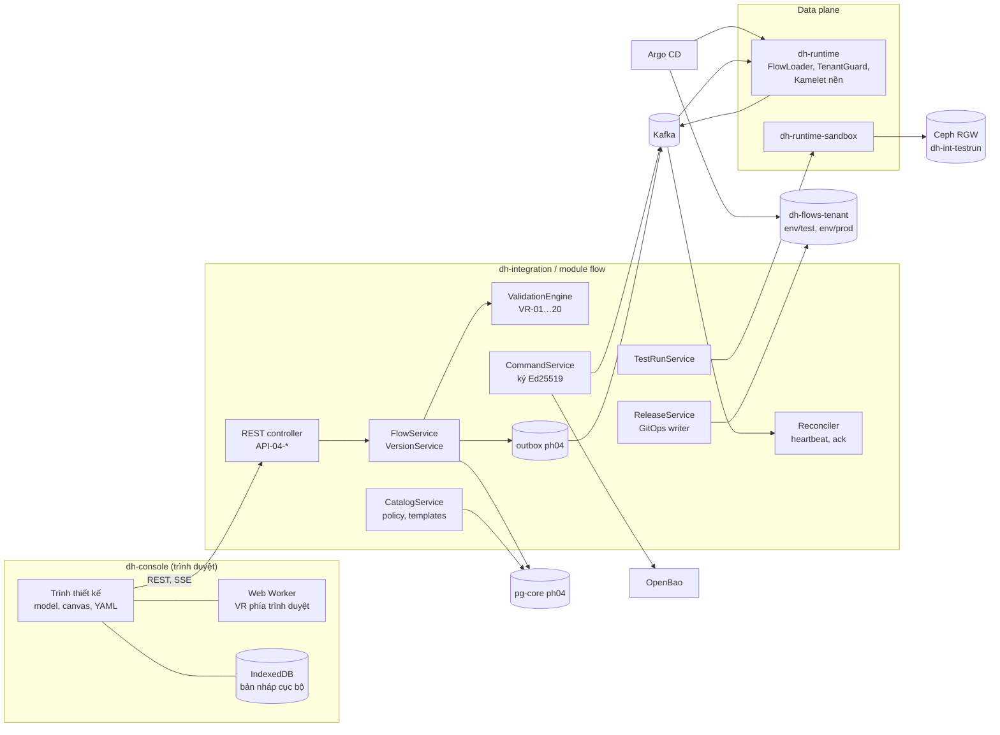

# D03-02-PH04 · Thiết kế chi tiết phân hệ PH-04 Lõi tích hợp và trình thiết kế luồng

## Tóm tắt cho hội đồng thẩm định

PH-04 là nơi kỹ sư tích hợp của tỉnh thiết kế, chạy thử, duyệt và phát hành các luồng tích hợp Apache Camel nối các hệ thống thông tin với nhau và với Nền tảng chia sẻ, điều phối dữ liệu quốc gia (NDXP). Phân hệ thay Bus (Camel agent quản lý qua JMX) và Productivity Tooling (trình kéo thả sinh XML) của hệ cũ. Tài liệu này mô tả cách phần mềm được xây để đáp ứng FRS D02-03-PH04 và mười quyết định ADR-060…069.

Bốn điểm thiết kế quyết định chất lượng của phân hệ:

1. **Một nguồn sự thật cho luồng đang chạy.** Luồng chỉ vào runtime qua kho cấu hình Git của tenant và Argo CD. Không có kênh nào khác nạp định nghĩa vào `dh-runtime` (BR-04-012). Lệnh tạm dừng, dừng khẩn đi qua kênh lệnh có ký Ed25519 và được đối soát về Git trong 5 phút (ADR-065). Nhờ vậy mọi luồng chạy ở PROD đều truy được về một phiên bản đã duyệt bốn mắt, một commit có chữ ký và một người phát hành.
2. **Trình thiết kế dùng đúng catalog của runtime.** Bảng thành phần, Inspector, trình kiểm tra hợp lệ đọc catalog sinh cho đúng phiên bản Camel Quarkus của ảnh runtime (ADR-061). Lệch bản phụ bị CI chặn. Người thiết kế không thể lưu một tham số mà runtime không hiểu.
3. **Chạy thử bằng Camel thật trong sandbox cô lập.** Lần chạy thử nạp đúng định nghĩa (theo băm) vào `dh-runtime-sandbox` cùng phiên bản Camel, thay điểm gọi ra ngoài bằng mô phỏng, ghi vết từng chặng đã che dữ liệu. Gửi duyệt đòi một lần chạy đạt trên đúng băm (BR-04-004). Điều này thay lần chạy thử giả của mã hiện tại (GAP-04-04).
4. **Khung chín chặng là thư viện, không phải quy ước.** Tiếp nhận, kiểm tra lược đồ, ủy quyền, chuyển đổi, làm giàu, định tuyến, gửi đích, ghi vết, phản hồi được hiện thực bằng Kamelet nền và processor Java có kiểm thử (ADR-062). Tenant của bản tin được đặt một lần và khóa (`TenantGuard`). Truy cập CSDL trực tiếp chỉ qua Kamelet nền chỉ đọc theo Q359 (ADR-067).

Về an toàn thông tin: định nghĩa luồng không chứa bí mật (VR-03, chỉ tham chiếu kết nối PH-05 và OpenBao); thành phần nguy hiểm (`exec`, `ssh`, kịch bản) bị cấm theo chính sách; sandbox chạy trong namespace có chính sách mạng chỉ ra WireMock và môi trường TEST; log, vết không chứa dữ liệu Cá nhân, Nhạy cảm (BR-04-013); mọi thay đổi có kiểm toán qua PH-13. Thiết kế đáp ứng nhóm quản lý thay đổi và nhật ký của TCVN 14423:2026 cấp độ 3 (D03-07).

Phạm vi: module `flow` trong đơn vị triển khai `dh-integration` (control plane), thư viện nền và bộ nạp luồng của `dh-runtime` (data plane), DU mới `dh-runtime-sandbox`, phần trình thiết kế của `dh-console`. Ngoài phạm vi: DDL chi tiết (D03-03-PH04), hợp đồng API (D03-04-PH04), màn hình (D03-06-PH04). Câu hỏi mở ở §16.

## 1. Phạm vi và cách đọc

### 1.1. Mục đích

Tài liệu là thiết kế chi tiết phần mềm (SDD) của PH-04. Tài liệu chuyển các yêu cầu đã chốt ở FRS D02-03-PH04, use case D02-04-PH04 và ADR-060…069 thành cấu trúc mã nguồn, giao diện Java và TypeScript, thuật toán, máy trạng thái, biểu đồ tuần tự, cấu hình, quan sát và kiểm thử, ở mức đủ để đội L-INT (control plane), L-RT (runtime) và L-FE (giao diện) bắt đầu viết mã mà không phải tự quyết điểm kiến trúc.

Tài liệu không lặp lại đặc tả từng FR, không viết DDL đầy đủ và không viết OpenAPI. Khi nhắc tới bảng, cột, API, sự kiện, mã lỗi, tài liệu dùng đúng tên trong FRS và D03-03-PH04, D03-04-PH04.

### 1.2. Đối tượng đọc

| Người đọc | Mục nên đọc |
|---|---|
| Lập trình viên L-INT | §2, §3, §5, §6.2, §7, §8, §9, §10, §11 |
| Lập trình viên L-RT | §4, §5.3, §5.4, §8.2, §10, §12 |
| Lập trình viên L-FE | §6, §7.1, §8.4, §9 (trạng thái), D03-06-PH04 §27 |
| Kiểm thử viên | §4.4, §7, §9, §14 |
| Vận hành | §5, §10, §12, §13 |
| Kiến trúc sư thẩm định | Tóm tắt, §2, §4, §5, §11, §15, §16 |

### 1.3. Tài liệu liên quan

| Mã | Tên | Đường dẫn | Quan hệ |
|---|---|---|---|
| D00-01 | Thuật ngữ, quy ước | `../../00-chung/D00-01-thuat-ngu-quy-uoc.md` | Đặt tên, kiểu dữ liệu |
| D02-02 | SRS tổng thể | `../../02-yeu-cau/D02-02-srs.md` | NFR-00 |
| D02-08 | Ma trận phân quyền | `../../02-yeu-cau/D02-08-ma-tran-phan-quyen.md` | PERM-04-* |
| D02-03-PH04 | FRS PH-04 | `../../02-yeu-cau/frs/D02-03-PH04-frs-tich-hop.md` | FR-04, BR-04, VR, tham số |
| D02-04-PH04 | Use case PH-04 | `../../02-yeu-cau/use-case/D02-04-PH04-use-case-tich-hop.md` | UC-04 |
| D03-01 | SAD | `../D03-01-sad.md` | DU, luồng phát hành §4 |
| D03-07 | Thiết kế ATTT | `../attt/D03-07-thiet-ke-attt.md` | SEC-*, kịch bản sự cố |
| D03-09 | Hạ tầng, DR | `../ha-tang/D03-09-ha-tang-trien-khai-dr.md` | Namespace, vùng mạng, Argo CD |
| D03-10 | Đa tenant | `../D03-10-thiet-ke-da-tenant.md` | RLS, ngưỡng tách namespace |
| D03-03-PH04 | CSDL PH-04 | `../csdl/D03-03-PH04-csdl-tich-hop.md` | DDL, RLS chi tiết |
| D03-04-PH04 | API PH-04 | `../api/D03-04-PH04-api-tich-hop.md` | API-04, EVT-04, ERR-04 |
| D03-06-PH04 | Màn hình PH-04 | `../uiux/D03-06-PH04-man-hinh-tich-hop.md` | UI-04, kiến trúc giao diện §27 |
| D05-02-PH04 | Ca kiểm thử PH-04 | `../../05-kiem-thu/test-case/D05-02-PH04-test-case.md` | TS-04 |
| D03-02-PH07 | SDD PH-07 | `./D03-02-PH07-sdd-danh-muc.md` | Mẫu `TenantSession`, outbox, bảng ánh xạ cho `dh_map` |

### 1.4. Quyết định kiến trúc áp dụng

| ADR | Quyết định | Tác động trong SDD |
|---|---|---|
| ADR-001 | Spring Boot 4 + Spring Modulith, gom phân hệ thành DU | §2, §3: module `flow` trong `dh-integration` |
| ADR-002 | Camel Quarkus native cho data plane, JVM khi cần | §4, §5.4: hồ sơ runtime |
| ADR-003 | PostgreSQL RLS cách ly tenant | §3.6, §11.3 |
| ADR-004 | Kafka, outbox + Debezium | §5.6, §10 |
| ADR-006 | Keycloak + OPA | §11 |
| ADR-009 | Argo CD GitOps | §5 |
| ADR-010 | Luồng mô tả bằng Camel YAML DSL | §4, §6.2 |
| ADR-012 | OpenBao quản lý bí mật | §4.3, §10.2 |
| ADR-013 | Tách control và data plane | §2 |
| [ADR-060](../../00-chung/adr/ADR-060-trinh-thiet-ke-tu-lam-mo-hinh-kaoto.md) | Trình thiết kế tự làm theo mô hình Kaoto, `@xyflow/react`, dagre | §6 |
| [ADR-061](../../00-chung/adr/ADR-061-catalog-khop-phien-ban-runtime.md) | Catalog khớp phiên bản runtime | §6.6 |
| [ADR-062](../../00-chung/adr/ADR-062-luong-nghiep-vu-yaml-dsl-java-cho-thu-vien-nen.md) | Luồng nghiệp vụ YAML, Java cho thư viện nền | §4 |
| [ADR-063](../../00-chung/adr/ADR-063-anh-runtime-theo-ho-so-nap-yaml-luc-chay.md) | Ảnh runtime theo hồ sơ, nạp YAML lúc chạy | §5.3, §5.4 |
| [ADR-064](../../00-chung/adr/ADR-064-sandbox-chay-thu-camel-that.md) | Sandbox chạy thử Camel thật | §8 |
| [ADR-065](../../00-chung/adr/ADR-065-dieu-khien-runtime-git-va-lenh-co-ky.md) | Điều khiển runtime: Git + lệnh có ký | §10 |
| [ADR-066](../../00-chung/adr/ADR-066-datamapper-sinh-jq.md) | Trình ánh xạ sinh JQ, `*.dhmap.json` | §6.7 |
| [ADR-067](../../00-chung/adr/ADR-067-truy-cap-csdl-truc-tiep-co-kiem-soat.md) | Truy cập CSDL trực tiếp có kiểm soát | §4.6, §7.4 |
| [ADR-068](../../00-chung/adr/ADR-068-kho-cau-hinh-git-theo-tenant.md) | Kho cấu hình Git theo tenant | §5.1, §5.2 |
| [ADR-069](../../00-chung/adr/ADR-069-may-trang-thai-phien-ban-va-bon-mat.md) | Máy trạng thái phiên bản, bốn mắt | §9 |

### 1.5. Quy ước trong tài liệu

Mã Java là Java 21 (`record`, `sealed interface`, `switch` theo mẫu). Mã TypeScript là TS 5.x, React 19. Mã SQL là PostgreSQL 18. Ví dụ dùng tenant `lam-dong`, không gian `so-tu-phap`, luồng `ho-tich-khai-sinh`, kết nối `ndxp-ho-tich`, `pg-ho-tich-ro`, người dùng giả `u.ie01` (IE), `u.ia01` (IA), `u.to01` (TO). Các đoạn mã là mẫu thiết kế: chữ ký công khai, tên lớp, tên bảng, thứ tự thao tác là ràng buộc; chi tiết bên trong có thể đổi miễn giữ đúng hành vi. Phiên bản thành phần: Spring Boot 4.0.x, Camel Quarkus 3.33.2 (Camel 4.18 LTS) cho runtime, catalog trình thiết kế 3.33.1 (Camel 4.18.2) theo PR #5.

## 2. Vị trí trong kiến trúc

### 2.1. Ba đơn vị triển khai

PH-04 được hiện thực ở ba DU và một phần giao diện:

| DU | Vai trò | Công nghệ | Namespace, vùng | Bản sao |
|---|---|---|---|---|
| `dh-integration` (module `flow`) | Control plane: luồng, phiên bản, kiểm tra hợp lệ, duyệt, phát hành, lệnh điều khiển, catalog, khuôn mẫu | Spring Boot 4, Modulith | `dh-control`, Z3 | 2 (HPA tới 4) |
| `dh-runtime` | Data plane: chạy luồng đã phát hành, khung chín chặng, nhịp tim, nhận lệnh | Camel Quarkus native (hồ sơ JVM khi cần) | `dh-runtime` hoặc `dh-rt-{tenant}`, Z4 | ≥ 3 mỗi hồ sơ |
| `dh-runtime-sandbox` | Chạy thử định nghĩa chưa phát hành bằng Camel thật | Camel Quarkus JVM cùng phiên bản | `dh-sandbox` (đề xuất, Q04-20), Z4 | 2 (KEDA theo hàng đợi) |
| `dh-console` (phần `features/integration`) | Trình thiết kế, các màn UI-04 | React 19, antd v6, `@xyflow/react` | `dh-control`, Z3 (tệp tĩnh qua BFF) | theo console |

Module `flow` chung DU `dh-integration` với `adapter` (PH-05 phần control), `event` (PH-10) và `national` (PH-14 phần control) theo SAD §4. Lý do gom: cùng miền tích hợp, cùng hồ sơ tải (ghi ít, đọc vừa), dùng chung danh sách kết nối và topic. Module có package gốc `vn.datahub.integration.flow` và sở hữu schema PostgreSQL `ph04` trên `pg-core`.

### 2.2. Sơ đồ thành phần



### 2.3. Phụ thuộc với module và phân hệ khác

| Phụ thuộc | Hướng | Cơ chế | Khi không sẵn sàng |
|---|---|---|---|
| Module `adapter` (PH-05) | `flow` gọi | Java API `ConnectionDirectory` trong cùng DU: liệt kê kết nối, kiểm tra loại, có giá trị theo môi trường | Không có: bắt buộc cùng DU |
| Module `event` (PH-10) | `flow` gọi | Java API `TopicDirectory`: topic, quyền publish, subscribe của luồng (VR-10) | Cùng DU |
| PH-01 | Sự kiện vào | Bảng sao `ph04.external_system` cập nhật từ sự kiện kết nạp HTTT | Xem như nội bộ, cảnh báo (FRS §10.1) |
| PH-02 | Hai chiều | REST tới `dh-connect` lấy OpenAPI; PH-02 nghe EVT-04-07 | Không tạo được luồng từ API |
| PH-06 | `flow` gọi | REST tới `dh-data` lấy JSON Schema cho trình ánh xạ | Trình ánh xạ chỉ dùng tài liệu mẫu |
| PH-07 | Runtime gọi | Thư viện `dh_map` tải ảnh chụp bảng ánh xạ, nghe EVT-07 thay đổi | Dùng ảnh chụp gần nhất |
| PH-09 | Runtime gọi | Chính sách che theo phân loại trường | Chính sách đệm; không có thì đóng an toàn |
| PH-12 | `flow` gọi | Keycloak (người dùng, nhóm), OPA (quyết định) | Không đăng nhập được |
| PH-13 | `flow` ghi, đọc | Kiểm toán qua outbox; đọc lịch sử (API-04-091); bảng điều khiển nhúng | Kiểm toán giữ ở outbox |
| PH-15 | `flow` phát | Sự kiện EVT-04 để PH-15 gửi thông báo | Không có thông báo, luồng nghiệp vụ không ảnh hưởng |
| PH-18 | `flow` đọc, runtime ghi | Tham số `04.*`, DLQ `{tenant}.ops.dlq.v1` | Dùng tham số đệm |
| PH-20 | Sự kiện vào | Tenant mới: tạo không gian `DEFAULT`, kho `dh-flows-{tenant}`, ApplicationSet | — |

### 2.4. Luật Spring Modulith

1. Module `flow` chỉ công bố package `vn.datahub.integration.flow.api` (giao diện `FlowQueryApi`, DTO, sự kiện miền). Mọi package khác là `internal`.
2. `flow` được phép phụ thuộc `adapter.api`, `event.api`, `shared.*`. `adapter`, `event` không phụ thuộc ngược lại `flow` (tránh vòng); nếu `event` cần biết luồng nào dùng topic thì nghe sự kiện miền `FlowVersionApproved`.
3. Bài kiểm thử `ApplicationModules.of(IntegrationApplication.class).verify()` bắt buộc trong CI.
4. Sự kiện miền giữa module dùng `@ApplicationModuleListener` (giao dịch riêng, ghi bảng `event_publication` của Modulith); sự kiện ra ngoài DU luôn qua outbox `ph04.outbox`.

### 2.5. Hiện trạng mã và đường chuyển

Mã hiện có ở `apps/control/src/main/java/vn/lgsp/control/routes` (module `routes` của DU `lgsp-control`). Bảng dưới cho biết mỗi lớp hiện có đi đâu trong thiết kế đích và khoảng lệch nào (FRS §2.4) được đóng.

| Lớp hiện có | Đích | GAP đóng |
|---|---|---|
| `RoutesController` (301 dòng) | Tách thành `FlowController`, `VersionController`, `TestRunController`, `ReleaseController`, `RuntimeController` | GAP-04-13 (đổi gói `vn.datahub`) |
| `RoutesService` (754 dòng) | Tách thành `FlowService`, `VersionService`, `ReviewService`, `ReleaseService`; `testRun` mô phỏng bị bỏ | GAP-04-04, 05, 06 |
| `CamelYamlValidator` | `ValidationEngine` với từng quy tắc VR là một lớp; tìm chuỗi con được thay bằng duyệt cây | GAP-04-08 |
| `GitOpsPublisher` (ghi `routes/<mã>/route.camel.yaml` trong repo mã) | `GitConfigRepository` ghi kho `dh-flows-{tenant}` qua JGit HTTP | GAP-04-03 |
| `ExternalSystemRegistry` | `ExternalSystemProjection` đọc bảng sao `ph04.external_system` | — |
| `TestRunRetentionJob` | `TestRunRetentionJob` giữ tên, thêm xóa đối tượng trên Ceph RGW | — |
| Bảng `ph04.route`, `route_version`, `route_test_run`, `route_test_run_stage` | Bảng mới của D03-03-PH04 (`flow`, `flow_version`, `test_run`, `test_run_step`…), có `tenant_id`, RLS | GAP-04-07 |
| `setPaused` chỉ đổi cột `status` | `CommandService` + `Reconciler` | GAP-04-11 |
| Java DSL `TraCuuRoute`, `StandardPipelineRoute`, `CdmMapRoute` ở `camel/dancu`, `camel/datdai` | YAML dùng Kamelet nền (§4) | GAP-04-02, 12 |
| Datasource chung tài khoản `lgsp` ở `camel/dancu` | Kamelet `dh-sql-ro-source`, tài khoản theo luồng | GAP-04-10 |

Đường chuyển theo thứ tự ở §15.

## 3. Cấu trúc mã nguồn

### 3.1. Cây package của module `flow`

```text
vn.datahub.integration.flow
├── api/                         # công bố cho module khác
│   ├── FlowQueryApi.java        # tra luồng theo mã, luồng dùng topic, dùng kết nối
│   ├── FlowRef.java, FlowVersionRef.java
│   └── events/                  # sự kiện miền: FlowCreated, FlowVersionApproved, DeploymentSynced…
├── internal/
│   ├── web/                     # controller REST, ánh xạ lỗi ProblemDetail, SSE
│   ├── workspace/               # Workspace, WorkspaceMember, WorkspaceAccess
│   ├── flow/                    # Flow, FlowService, dependency graph, clone, retire
│   ├── version/                 # FlowVersion, VersionService, contributors, ETag, canonicalizer
│   ├── session/                 # EditSession (nhịp mềm, Valkey)
│   ├── validation/              # ValidationEngine, rules/VR01…VR20, SecretDetector, SqlPolicy
│   ├── testrun/                 # TestRunService, SandboxClient, TestCase, assertions
│   ├── review/                  # ReviewService, FourEyesGuard, checklist
│   ├── release/                 # ReleaseService, GitConfigRepository, FlowManifestWriter, ProfileResolver
│   ├── runtime/                 # CommandService, CommandSigner, Reconciler, HeartbeatProjector
│   ├── catalog/                 # CatalogService, ComponentPolicy, CatalogIndexLoader
│   ├── template/                # TemplateService, khuôn tpl-*
│   ├── legacy/                  # LegacyXmlImporter (camel-xml-io → YAML)
│   ├── mapping/                 # lưu, kiểm tra *.dhmap.json, sinh JQ phía máy chủ
│   ├── params/                  # FlowParams đọc 04.* từ PH-18, FreezeWindowGuard
│   ├── audit/                   # AuditWriter (outbox → PH-13)
│   └── outbox/                  # OutboxWriter, bảng ph04.outbox
└── FlowModuleConfiguration.java
```

### 3.2. Trách nhiệm các lớp chính

| Lớp | Trách nhiệm | FR |
|---|---|---|
| `FlowService` | Tạo (từ khuôn, trống, API PH-02, YAML), sửa thông tin, nhân bản, gỡ; tính `transport`, `exposure` | FR-04-001…006 |
| `VersionService` | Mở phiên bản mới, lưu nháp với `If-Match`, hủy, tải xuống, nhập YAML; thêm người đóng góp; tính băm | FR-04-010, 011, 024, 027 |
| `YamlCanonicalizer` | Chuẩn hóa YAML, bỏ chú thích bố cục, tính SHA-256 (§6.2) | BR-04-006 |
| `ValidationEngine` | Chạy VR theo mức `DESIGN`, `SUBMIT`, `PUBLISH`, trả `Finding` | FR-04-023 |
| `TestRunService` | Hàng đợi chạy thử theo hạn mức tenant, gọi sandbox, nhận vết, khẳng định, SSE | FR-04-030…033 |
| `ReviewService` | Gửi, rút, quyết định duyệt; `FourEyesGuard` | FR-04-040, 041, 043 |
| `ReleaseService` | Phát hành, nâng môi trường, quay lui; điều kiện thứ tự, đóng băng; ghi Git | FR-04-042, 044, 045 |
| `ProfileResolver` | Chọn hồ sơ runtime nhỏ nhất chứa đủ thành phần | FR-04-075 |
| `CommandService` | Tạo, ký, gửi lệnh `PAUSE`, `RESUME`, `EMERGENCY_STOP` | FR-04-050 |
| `Reconciler` | Nghe nhịp tim, xác nhận lệnh; tính `syncStatus`, `healthStatus`; đối soát Git | FR-04-051, BR-04-018 |
| `CatalogService` | Phục vụ chỉ mục, lược đồ thành phần theo `catalogVersion`; chính sách | FR-04-080, 081 |
| `LegacyXmlImporter` | Chuyển Camel XML của Bus cũ | FR-04-082 |

### 3.3. Giao diện công bố `FlowQueryApi`

```java
package vn.datahub.integration.flow.api;

public interface FlowQueryApi {
  Optional<FlowRef> findByCode(TenantId tenant, String flowCode);
  /** Luồng (đã phát hành ở bất kỳ môi trường) dùng topic; PH-10 dùng khi gỡ topic. */
  List<FlowVersionRef> flowsUsingTopic(TenantId tenant, String topic);
  /** Luồng dùng kết nối; PH-05 dùng khi gỡ hoặc xoay kết nối. */
  List<FlowVersionRef> flowsUsingConnection(TenantId tenant, String connectionCode);
  /** Điểm vào HTTP đang chạy; PH-02 dùng khi công bố API có backend là luồng. */
  List<FlowEndpointRef> httpEndpoints(TenantId tenant, Environment env);
}

public record FlowRef(UUID flowId, String code, String name, FlowStatus status, String workspaceCode) {}
public record FlowVersionRef(UUID flowId, String flowCode, int versionNo, Environment env) {}
public record FlowEndpointRef(String flowCode, int versionNo, String method, String path, String routeId) {}
```

Sự kiện miền công bố (trong `api.events`): `FlowCreated`, `FlowVersionSubmitted`, `FlowVersionApproved`, `DeploymentStatusChanged`, `FlowRuntimeStateChanged`, `FlowRetired`. Mỗi sự kiện miền có một bản ra ngoài tương ứng EVT-04-01…10 qua outbox.

### 3.4. DTO và record chính

```java
public record FlowCreateRequest(
    @NotNull @Pattern(regexp = "^[a-z][a-z0-9-]{2,62}$") String code,
    @NotBlank @Size(max = 255) String name,
    @Size(max = 4000) String description,
    @NotNull String workspaceCode,
    @NotNull ResourceKind resourceKind,                // ROUTE, KAMELET, PIPE, TEST
    @NotNull FlowOrigin origin,                        // BLANK, TEMPLATE, OPENAPI, YAML_FILE, CLONE, LEGACY_XML
    String templateCode, Map<String, Object> templateParams,
    String apiRef,                                     // PH-02 khi origin = OPENAPI
    @Size(max = 524_288) String yaml,                  // khi origin = YAML_FILE
    String sourceSystem, @Size(max = 20) List<String> targetSystems,
    @Size(max = 20) Map<@Size(max = 63) String, @Size(max = 63) String> labels,
    String legalBasisRef) {}

public record VersionDraftUpdate(
    @NotNull @Size(max = 524_288) String definitionYaml,
    @NotNull JsonNode canvasLayout,                    // vị trí, ghim, ghi chú dán, nhóm
    @NotNull JsonNode samples,                         // bản tin mẫu theo id chặng, mỗi bản ≤ 256 KiB
    @NotNull @Size(max = 64) String catalogVersion,
    @Size(max = 50) List<@Valid MappingDoc> mappings) {}

public record Finding(String rule, Severity severity, String path, String nodeId,
                      String messageKey, Map<String, Object> args) {}

public record TestRunRequest(
    @NotNull TestMode mode,                            // MOCK, SANDBOX_LIVE
    UUID testCaseId,
    @Size(max = 262_144) String body,
    @Size(max = 50) Map<String, String> headers,
    String fromNodeId,
    @Min(1) @Max(120) int timeoutSeconds,
    boolean captureBodies,
    @Size(max = 20) List<@Valid Assertion> assertions) {}

public sealed interface Assertion permits StatusIs, BodyJq, HeaderIs, StepVisited, StepNotVisited,
    EndpointCalled, DurationLt, ErrorCodeIs, DlqSent {}

public record ReleaseRequest(@NotNull Environment target, @Size(max = 1000) String note,
                             Integer replicas) {}

public record RuntimeCommandRequest(@NotNull Environment environment, @NotNull CommandScope scope,
    @Size(max = 100) List<String> routeIds, @NotNull CommandAction action,
    @NotBlank @Size(min = 10, max = 1000) String reason, boolean drain) {}
```

### 3.5. Thư viện nền của runtime

```text
dh-runtime/
├── dh-runtime-lib/                      # Java, phát hành theo vòng đời mã (ADR-062)
│   ├── vn.datahub.runtime.tenant        # TenantGuard, TenantHeaders, TenantMismatchException
│   ├── vn.datahub.runtime.stage         # StageMarker, StageMetrics (Micrometer, OTel span)
│   ├── vn.datahub.runtime.authz         # OpaClient (200 ms, đóng an toàn), Obligations
│   ├── vn.datahub.runtime.mask          # MaskingProcessor theo PH-09
│   ├── vn.datahub.runtime.jq            # hàm JQ dh_map, dh_now, dh_tenant
│   ├── vn.datahub.runtime.audit         # ConnectionLogWriter (EVT-04-14)
│   ├── vn.datahub.runtime.error         # ErrorClassifier, DlqEnvelope, field encryption
│   ├── vn.datahub.runtime.sql           # TenantScopedSqlProcessor (SET LOCAL app.tenant_id)
│   ├── vn.datahub.runtime.secret        # ConnPropertiesFunction {{conn:}}, VaultPropertiesFunction {{vault:}}
│   └── vn.datahub.runtime.control       # CommandListener, CommandVerifier, HeartbeatPublisher
├── dh-runtime-kamelets/                 # Kamelet nền YAML (§4.2), đóng vào mọi hồ sơ
├── dh-runtime-loader/                   # FlowLoader: theo dõi ConfigMap theo nhãn, nạp, gỡ (§5.4)
└── profiles/
    ├── core-native/pom.xml              # camel-quarkus-* + dh-runtime-lib, native
    ├── files-native/pom.xml
    ├── soap-jvm/pom.xml
    └── legacy-jvm/pom.xml
```

Mỗi hồ sơ sinh `runtime-manifest.json` lúc build (FR-04-081): `profile`, `quarkusVersion`, `camelQuarkusVersion`, `camelVersion`, `extensions[]`, `kamelets[]`, `libVersion`, `imageDigest`. `dh-integration` đọc manifest của mọi hồ sơ (ConfigMap `dh-runtime-manifests`) để chọn hồ sơ và kiểm VR-12.

### 3.6. Truy cập dữ liệu

| Cơ chế | Dùng cho | Lý do |
|---|---|---|
| Spring Data JDBC | `workspace`, `workspace_member`, `flow`, `flow_version`, `review`, `deployment`, `runtime_command`, `test_case`, `template`, `component_policy` | Aggregate nhỏ, khóa lạc quan qua cột `row_version` khớp `If-Match`; không cần lazy loading của JPA |
| `JdbcClient` | `flow_route_index`, `flow_endpoint_index`, `test_run`, `test_run_step`, `command_ack`, `heartbeat_latest`, truy vấn danh sách có `facets` | Ghi hàng loạt, `INSERT … ON CONFLICT`, truy vấn động |
| Valkey | Phiên soạn, khóa lũy đẳng API (24 giờ), hàng đợi chạy thử theo tenant, bộ đệm catalog đã lọc | Dữ liệu ngắn hạn |
| Ceph RGW bucket `dh-int-testrun` | Thân bản tin chạy thử khi `captureBodies` | Không làm phình CSDL; xóa theo vòng đời 7 ngày |

Mọi đường ghi CSDL đi qua `TenantAwareTransactionManager` của thư viện chung (mẫu ở D03-02-PH07 §6.2), đặt `app.tenant_id` đầu mỗi giao dịch, nên RLS luôn có hiệu lực. Cột `definition_yaml` (≤ 512 KiB), `canvas_layout`, `samples` (`jsonb`) nằm ở bảng `flow_version`; truy vấn danh sách không chọn các cột này.

## 4. Khung chín chặng chuẩn trong runtime

### 4.1. Hợp đồng tiêu đề nội bộ

Mọi exchange trong `dh-runtime` mang bộ tiêu đề dưới đây. Tiêu đề bắt đầu bằng `dh-` do runtime đặt; tiêu đề cùng tên do bên gọi gửi vào bị `dh-receive-action` xóa trước khi đặt lại (chống giả mạo).

| Tiêu đề | Đặt ở | Nguồn | Bất biến |
|---|---|---|---|
| `dh-tenant` | `receive` | `X-Dh-Tenant` của APISIX (đồng bộ), tiền tố topic (Kafka), `flow.dh.yaml` (lập lịch) | Có, `TenantGuard` |
| `dh-caller` | `receive` | `X-Dh-Consumer` của APISIX; mã HTTT nguồn với Kafka | Có |
| `dh-subscription` | `receive` | `X-Dh-Subscription` | Có |
| `dh-flow`, `dh-flow-version` | `receive` | Nhãn ConfigMap do Argo CD áp | Có |
| `dh-stage` | Mỗi chặng | `StageMarker` | Không (đổi theo chặng) |
| `dh-data-classes` | `schema` | Phân loại trường của lược đồ (PH-09) | Không |
| `dh-obligations` | `authz` | Kết quả OPA | Không |
| `dh-enrich-partial` | `enrich` | Khi làm giàu lỗi với `CONTINUE` | Không |
| `traceparent` | `receive` | W3C; tạo mới nếu thiếu | Không |

`TenantGuard` là `InterceptStrategy` gắn vào mọi route của luồng đã nạp: trước mỗi processor sau `receive`, nó so `dh-tenant` với giá trị chụp lúc `receive` (lưu trong thuộc tính exchange `dh.tenant.locked`, không phải tiêu đề) và so với tenant sở hữu luồng (nhãn `dh.gov.vn/tenant` của ConfigMap). Lệch thì ném `TenantMismatchException`, exchange dừng với lỗi nội bộ, phát cảnh báo ATTT (FR-04-073, E6 của UC-04-17).

```java
public final class TenantGuard implements InterceptStrategy {
  @Override
  public Processor wrapProcessorInInterceptors(CamelContext ctx, NamedNode def, Processor target, Processor next) {
    return exchange -> {
      String locked = exchange.getProperty(TenantHeaders.LOCKED, String.class);
      if (locked != null) {
        String now = exchange.getMessage().getHeader(TenantHeaders.TENANT, String.class);
        if (!locked.equals(now) || !locked.equals(owningTenant(exchange))) {
          throw new TenantMismatchException(locked, now, def.getId());
        }
      }
      target.process(exchange);
    };
  }
}
```

### 4.2. Kamelet nền

Mỗi chặng chuẩn có một Kamelet nền loại `action` trong `dh-runtime-kamelets`. Kamelet nền có tham số tối thiểu; phần biến thiên của luồng nằm ở bước con mà người thiết kế thêm bên trong khối chặng.

| Chặng | Kamelet nền | Tham số | Hành vi |
|---|---|---|---|
| receive | `dh-receive-action` | `maxBodyKb` (mặc định từ `04.runtime.max-body-kb`), `idempotencyKey` (biểu thức, tùy chọn) | Xóa tiêu đề `dh-*` vào, đặt tiêu đề §4.1, khóa tenant, đo kích thước (ERR-04-107), chống trùng khi có khóa (FR-04-071) |
| schema | `dh-schema-action` | `schemaRef` (mã lược đồ Apicurio hoặc PH-06), `format` (`json`, `xml`, `avro`) | Kiểm tra, trả ≤ 20 lỗi theo đường dẫn (ERR-04-101); đặt `dh-data-classes` |
| authz | `dh-authz-action` | `operation`, `purpose` | Gọi OPA, đặt `dh-obligations`, từ chối ERR-04-102 |
| transform | `dh-transform-action` | `jq` hoặc `mappingRef`, `unknownCode` (`FAIL`, `PASS_THROUGH`, `DEFAULT:<mã>`) | Chạy JQ có `dh_map` (ERR-04-108) |
| enrich | `dh-enrich-action` | `uri` hoặc `direct`, `timeoutMs` (5000), `onError` (`FAIL`, `CONTINUE`) | `enrich` với chiến lược gộp JSON |
| route | `dh-route-action` | không | Đánh dấu chặng; nội dung là `choice`, `split`, `multicast` do người thiết kế đặt |
| deliver | `dh-deliver-action` | `connection`, `path`, `method`, `timeoutMs` | Gọi đích trong `circuitBreaker` (Resilience4j: 50% trên 20 lượt, nửa mở sau 30 giây) |
| audit | `dh-audit-action` | `serviceCode`, `providerSystem` | Ghi nhật ký kết nối lên EVT-04-14 |
| respond | `dh-respond-action` | `contentType` | Áp nghĩa vụ che của OPA và chính sách PH-09; đặt mã HTTP |

Kamelet nền tham chiếu processor Java bằng `#class:` không được phép trong luồng của người dùng; Kamelet nền nằm ngoài kiểm tra VR-04 vì được ký cùng ảnh runtime. Danh sách Kamelet nền và phiên bản ghi trong `runtime-manifest.json` (`kamelets[]`).

### 4.3. `routeConfiguration` nền và xử lý lỗi

`dh-default-config` được nạp sẵn ở mọi hồ sơ; luồng tham chiếu bằng `routeConfigurationId: dh-default-config` (khuôn mẫu đặt sẵn, VR-11 kiểm tra).

```yaml
- routeConfiguration:
    id: dh-default-config
    onException:
      - onException:
          exception: [vn.datahub.runtime.error.TransientException]
          redeliveryPolicy:
            maximumRedeliveries: 3
            redeliveryDelay: 1000
            backOffMultiplier: 4
            collisionAvoidanceFactor: 0.2
            useExponentialBackOff: true
            retryAttemptedLogLevel: WARN
          handled: { constant: true }
          steps:
            - process: { ref: dhDlqEnvelope }
            - to: { uri: "kafka:{{dh.tenant}}.ops.dlq.v1" }
            - process: { ref: dhSyncErrorResponse }
      - onException:
          exception: [vn.datahub.runtime.error.BusinessException, vn.datahub.runtime.error.DataException]
          handled: { constant: true }
          steps:
            - process: { ref: dhRouteBusinessError }   # đồng bộ: trả bên gọi; bất đồng bộ: DLQ
      - onException:
          exception: [vn.datahub.runtime.error.AuthzDeniedException]
          handled: { constant: true }
          steps:
            - process: { ref: dhSyncErrorResponse }    # không đưa DLQ
    onCompletion:
      - onCompletion:
          steps:
            - process: { ref: dhStageMetricsFlush }
```

`ErrorClassifier` ánh xạ ngoại lệ Camel và mã HTTP của đích sang bốn lớp ở FR-04-070: `TransientException` (502, 503, 504, quá thời gian, mất kết nối; 429 theo `Retry-After`), `BusinessException` (400, 404, 409, 422 từ đích), `DataException` (lược đồ, chuyển đổi), `AuthzDeniedException`. Ngoại lệ không phân loại thử lại một lần rồi DLQ và cảnh báo. `dhDlqEnvelope` mã hóa trường phân loại Cá nhân, Nhạy cảm bằng khóa DEK của tenant (OpenBao transit) trước khi đưa DLQ, thêm tiêu đề `dh-dlq-reason`, `dh-dlq-attempts`, `dh-dlq-stage`, `dh-dlq-error-code`.

Phân giải bí mật: `ConnPropertiesFunction` đăng ký tiền tố `conn` cho properties placeholder; `{{conn:ndxp-ho-tich.host}}` đọc giá trị của kết nối PH-05 ở môi trường hiện tại từ OpenBao đường dẫn `kv/dh/{tenant}/conn/{mã}/{env}` lúc khởi động route, giữ trong bộ nhớ, làm mới khi nhận sự kiện xoay kết nối. `{{vault:<path>#<key>}}` chỉ nhận đường dẫn dưới `kv/dh/{tenant}/flow/`.

### 4.4. Luồng mẫu chín chặng

Luồng `ho-tich-khai-sinh` rút gọn dưới đây là đầu ra của khuôn `tpl-standard-9` sau khi điền tham số; cũng là ca quay vòng chuẩn của bộ kiểm thử (§14).

```yaml
- route:
    id: ho-tich-khai-sinh-main
    routeConfigurationId: dh-default-config
    from:
      uri: platform-http:/ho-tich/khai-sinh
      parameters: { httpMethodRestrict: POST }
      steps:
        - step:
            id: dh-stage-receive
            steps:
              - kamelet: { name: dh-receive-action, parameters: { idempotencyKey: "${header.Idempotency-Key}" } }
        - step:
            id: dh-stage-schema
            steps:
              - kamelet: { name: dh-schema-action, parameters: { schemaRef: ho-tich-ks, format: json } }
        - step:
            id: dh-stage-authz
            steps:
              - kamelet: { name: dh-authz-action, parameters: { operation: khai-sinh.dang-ky, purpose: dvc } }
        - step:
            id: dh-stage-transform
            steps:
              - kamelet: { name: dh-transform-action, parameters: { mappingRef: ho-tich-ks-to-ndxp } }
        - step:
            id: dh-stage-enrich
            steps:
              - enrich: { expression: { constant: "direct:lay-ma-dvhc" } }
        - step:
            id: dh-stage-route
            steps:
              - choice:
                  when:
                    - simple: "${body[request][type]} == 'KS'"
                      steps:
                        - kamelet:
                            name: dh-deliver-action
                            id: dh-stage-deliver
                            parameters: { connection: ndxp-ho-tich, path: /api/v1/khai-sinh, method: POST, timeoutMs: 15000 }
                  otherwise:
                    steps:
                      - log: { message: "Loại hồ sơ không hỗ trợ: ${body[request][type]}" }
        - step:
            id: dh-stage-audit
            steps:
              - kamelet: { name: dh-audit-action, parameters: { serviceCode: ho-tich.khai-sinh, providerSystem: ndxp } }
        - step:
            id: dh-stage-respond
            steps:
              - kamelet: { name: dh-respond-action, parameters: { contentType: application/json } }
```

Quy tắc nhận diện chặng (thay GAP-04-08): một phần tử EIP có `id` khớp `^dh-stage-(receive|schema|authz|transform|enrich|route|deliver|audit|respond)$` là đầu khối chặng. Chặng `deliver` được phép nằm lồng trong `route` (như trên) vì định tuyến chọn đích; VR-05 kiểm thứ tự theo lần duyệt cây theo chiều sâu, lấy lần xuất hiện đầu của mỗi mã.

### 4.5. Chỉ số, vết, log

| Tín hiệu | Tên | Nhãn | Nguồn |
|---|---|---|---|
| Đếm | `dh_flow_exchanges_total` | `tenant`, `flow`, `version`, `route`, `outcome` | `onCompletion` |
| Đếm | `dh_flow_failures_total` | trên + `stage`, `error_class`, `error_code` | `ErrorClassifier` |
| Histogram | `dh_flow_duration_seconds` | `tenant`, `flow`, `version`, `route` | Micrometer route policy |
| Histogram | `dh_flow_stage_duration_seconds` | trên + `stage` | `StageMarker` |
| Gauge | `dh_flow_circuit_state` | `tenant`, `flow`, `target` | Resilience4j |
| Đếm | `dh_flow_dlq_total` | `tenant`, `flow`, `reason` | `dhDlqEnvelope` |
| Đếm | `dh_flow_duplicates_total` | `tenant`, `flow` | `dh-receive-action` |
| Span | `dh.stage.{mã}` | thuộc tính `dh.tenant`, `dh.flow`, `dh.flow.version` | OTel |

Nhãn `tenant`, `flow` có lực lượng giới hạn (≤ 1.000 luồng hoạt động toàn nền tảng theo D03-10) nên chấp nhận được trong Prometheus. Log JSON có `traceId`, `spanId`, `tenant`, `flow`, `version`, `stage`, không có thân bản tin, không có giá trị tiêu đề ngoài danh sách cho phép (`Content-Type`, `Content-Length`, `dh-*`).

### 4.6. Truy cập CSDL trực tiếp

Kamelet `dh-sql-ro-source` (nguồn định kỳ) và `dh-sql-ro-action` (tra cứu trong luồng) bọc `camel-sql` với `TenantScopedSqlProcessor`:

1. Lấy `DataSource` của kết nối PH-05 loại "CSDL cho luồng"; tài khoản cấp động từ OpenBao database engine (`database/creds/flow-{tenant}-{flow}`), TTL 1 giờ, gia hạn trước khi hết 10 phút.
2. Mở giao dịch `READ ONLY`, `SET LOCAL statement_timeout = '{04.sql.statement-timeout-seconds}s'`.
3. Nếu kết nối khai báo `rls: true`: `SELECT set_config('app.tenant_id', :tenant, true)` với `:tenant` từ thuộc tính khóa (§4.1), không từ tiêu đề có thể sửa.
4. Chạy câu lệnh đã kiểm tra (VR-13) với tham số ràng buộc; đọc tối đa `04.sql.max-rows` + 1 dòng; vượt thì ném `DataException` ERR-04-108.
5. Ghi bản ghi kiểm toán runtime: `flow`, `version`, `tenant`, `sha256(câu lệnh)`, `rows`, `durationMs`, `traceId`.

Hồ sơ native chỉ đóng gói driver PostgreSQL; CSDL khác (Oracle, SQL Server của HTTT cũ) chạy ở hồ sơ `legacy-jvm`.

## 5. Kho cấu hình và phát hành GitOps

### 5.1. Bố cục kho `dh-flows-{tenant}`

PH-20 tạo kho khi khởi tạo tenant (ADR-068). Mỗi nhánh môi trường có cùng bố cục:

```text
dh-flows-lam-dong/                  # nhánh env/test | env/staging | env/prod
├── README.md                       # sinh tự động, không sửa tay
├── tenant.dh.yaml                  # tenant, namespace đích, hồ sơ được phép, phiên bản lib
├── flows/
│   └── ho-tich-khai-sinh/
│       ├── flow.dh.yaml            # mô tả triển khai (§5.2)
│       ├── route.camel.yaml        # YAML chuẩn hóa, không có bố cục
│       ├── mappings/
│       │   └── ho-tich-ks-to-ndxp.jq
│       └── tests/                  # ca kiểm thử, chỉ CI kho cấu hình dùng
│           └── cases.dh.yaml
├── kamelets/
│   └── ho-tich-chuan-hoa-action.kamelet.yaml
└── .dh/
    └── signatures/                 # chữ ký tách rời của từng tệp do dh-integration ký
```

Tệp `*.dhmap.json` và bố cục sơ đồ không vào kho (BR-04-007); chỉ có `*.jq` sinh ra. Ca kiểm thử đi vào kho để CI kho cấu hình chạy lại trước khi gộp vào `env/prod` (ADR-068).

### 5.2. `flow.dh.yaml`

```yaml
apiVersion: dh.gov.vn/v1
kind: FlowDeployment
metadata:
  tenant: lam-dong
  flow: ho-tich-khai-sinh
  version: 8
  contentHash: sha256:3f1c…
  approvedBy: u.ia01
  approvedAt: 2026-11-25T09:12:44+07:00
  publishedBy: u.ia01
  catalogVersion: camel-quarkus-3.33.2
spec:
  desiredState: RUNNING            # RUNNING | PAUSED | REMOVED
  pausedRoutes: []                 # route bị tạm dừng có chủ đích
  profile: core-native
  replicas: 3
  resources: { cpu: 250m, memory: 256Mi }
  exposure:
    http: [{ method: POST, path: /ho-tich/khai-sinh, routeId: ho-tich-khai-sinh-main }]
    kafka: { consume: [], produce: [] }
  connections: [ndxp-ho-tich]
  kamelets: [{ name: dh-receive-action, source: base }, { name: ho-tich-chuan-hoa-action, source: tenant, version: 2 }]
  env:
    ndxp-ma-don-vi: "{{dh.env.ndxp-ma-don-vi}}"
```

`dh-integration` sinh tệp bằng `FlowManifestWriter`; khóa xếp cố định để diff Git ổn định. Trường `desiredState`, `pausedRoutes` là nơi duy nhất ghi trạng thái mong muốn của lệnh điều khiển (§10).

### 5.3. Từ Git tới pod

ApplicationSet `dh-flows` (bộ sinh Git, mỗi tenant một Application mỗi môi trường) dựng từ mỗi thư mục `flows/*`:

1. Một `ConfigMap` `flow-{flow}` chứa `route.camel.yaml`, `*.jq`, `flow.dh.yaml`, nhãn `dh.gov.vn/tenant`, `dh.gov.vn/flow`, `dh.gov.vn/flow-version`, `dh.gov.vn/profile`.
2. Namespace đích: `dh-runtime` (dùng chung) hoặc `dh-rt-{tenant}` khi `tenant.dh.yaml` đặt `dedicatedNamespace: true` (ngưỡng 50 luồng, D03-10).
3. Mỗi hồ sơ trong namespace là một Deployment `dh-runtime-{profile}` (≥ 3 bản sao, HPA, KEDA theo độ trễ nhóm tiêu thụ). Luồng đi vào Deployment của hồ sơ ghi trong `flow.dh.yaml`.
4. Với điểm vào HTTP, Argo CD áp `ApisixRoute` cho `apisix-int` trỏ tới Service của hồ sơ, tiền tố đường dẫn theo tenant.

Argo CD không khởi động lại pod khi ConfigMap luồng đổi; việc nạp do `FlowLoader` làm (§5.4).

### 5.4. `FlowLoader` trong `dh-runtime`

`FlowLoader` là bộ điều khiển nhỏ dùng Kubernetes informer (Fabric8) theo dõi ConfigMap có nhãn `dh.gov.vn/profile = {hồ sơ của pod}` trong namespace của pod.

| Sự kiện ConfigMap | Hành động |
|---|---|
| Thêm | Kiểm chữ ký tách rời (khóa công khai của `dh-integration`), phân tích YAML bằng `YamlRoutesBuilderLoader`, nạp vào context với `routeGroup = {flow}`, áp `TenantGuard`, khởi động route trừ route trong `pausedRoutes` hoặc khi `desiredState = PAUSED` |
| Sửa, đổi `flow-version` | Nạp phiên bản mới song song dưới `routeGroup` tạm; khởi động thành công thì dừng, gỡ nhóm cũ (graceful 30 giây); lỗi thì giữ nhóm cũ, báo `loadError` trong nhịp tim |
| Sửa, chỉ đổi `desiredState`, `pausedRoutes` | Gọi `RouteController.suspendRoute`, `resumeRoute` |
| Xóa | Dừng, gỡ nhóm route |

Cô lập lỗi: mỗi luồng nạp riêng; lỗi nạp một luồng không chạm luồng khác (ADR-063). Điểm vào `platform-http` của hai phiên bản không cùng lúc nhận lưu lượng: phiên bản mới chỉ đăng ký đường dẫn sau khi phiên bản cũ ngừng nhận (khoảng gián đoạn ≤ 200 ms, lượt đang xử lý của bản cũ chạy hết). Luồng Kafka dùng cùng nhóm tiêu thụ nên chuyển giao qua tái cân bằng.

`HeartbeatPublisher` phát EVT-04-12 mỗi 30 giây và ngay sau mỗi lần nạp:

```json
{
  "replica": "dh-runtime-core-native-7c9f-2xk8p",
  "profile": "core-native",
  "namespace": "dh-runtime",
  "imageDigest": "sha256:…",
  "libVersion": "1.4.0",
  "at": "2026-11-25T22:00:30+07:00",
  "flows": [{
    "tenant": "lam-dong", "flow": "ho-tich-khai-sinh", "version": 8, "contentHash": "sha256:3f1c…",
    "state": "STARTED", "loadError": null,
    "routes": [{ "id": "ho-tich-khai-sinh-main", "state": "Started", "inflight": 2,
                 "exchanges1m": 412, "failures1m": 3, "p95ms": 220 }]
  }]
}
```

### 5.5. Phát hành và nâng môi trường

```java
@Transactional
public DeploymentView release(FlowVersionKey key, ReleaseRequest req, Actor actor, String idemKey) {
  var v = versions.lockForRelease(key);                         // SELECT … FOR UPDATE
  guard.requireStatus(v, APPROVED);                             // ERR-04-005
  freeze.requireOpen(req.target(), actor);                      // ERR-04-041 (BR-04-022)
  order.requirePreviousStageHealthy(v, req.target());           // ERR-04-023 (BR-04-019)
  var findings = validation.run(v, Level.PUBLISH, req.target());
  if (findings.hasErrors()) throw new ValidationFailed(findings); // ERR-04-009
  var profile = profiles.resolve(v.components());               // ERR-04-029
  var dep = deployments.createPending(v, req.target(), profile, actor);
  outbox.add(Evt.deploymentRequested(dep));                     // EVT-04-06
  afterCommit(() -> gitWriter.write(dep));                      // ngoài giao dịch CSDL
  return dep.view();
}
```

`GitConfigRepository.write(dep)` chạy ở tác vụ nền có thử lại (3 lần, 2 s, 8 s, 30 s): clone nông nhánh đích vào thư mục tạm (bộ đệm cục bộ theo tenant), ghi tệp, ký từng tệp (Ed25519, khóa `transit/dh-integration-git`), commit có chữ ký với tác giả `dh-integration[bot]` và trailer `Dh-Published-By: u.ia01`, `Dh-Deployment: {id}`, push. Với `env/test`: push thẳng. Với `env/prod` (nhánh bảo vệ): push nhánh `release/{flow}-v{n}`, mở yêu cầu gộp, CI kho cấu hình chạy lại VR mức `PUBLISH` và ca kiểm thử, tự gộp khi đạt (ADR-068). Lỗi sau 3 lần: triển khai `FAILED` với ERR-04-022, thông báo người phát hành.

Từ `PENDING` sang `SYNCING` khi Argo CD báo Application `Progressing` (webhook Argo CD hoặc hỏi API mỗi 10 giây); `SYNCED` khi đủ số bản sao báo `version`, `contentHash` mới qua nhịp tim; `OUT_OF_SYNC` khi quá `04.runtime.sync-timeout-seconds` mà chưa đủ; `FAILED` khi quá `04.deploy.timeout-minutes` hoặc có `loadError`.

### 5.6. Outbox và sự kiện

Bảng `ph04.outbox` (DD-11) ghi cùng giao dịch với thay đổi miền; Debezium đọc WAL, định tuyến theo cột `topic` (EVT-04-01…10). Topic hệ thống EVT-04-11 (lệnh) không qua outbox vì lệnh khẩn phải đi trước mọi ghi khác (§10.2); `CommandService` gửi trực tiếp bằng nhà sản xuất Kafka lũy đẳng `acks=all` và ghi bảng `runtime_command` trong cùng luồng xử lý (gửi trước, ghi sau với lệnh khẩn; ghi trước, gửi sau với lệnh thường).
