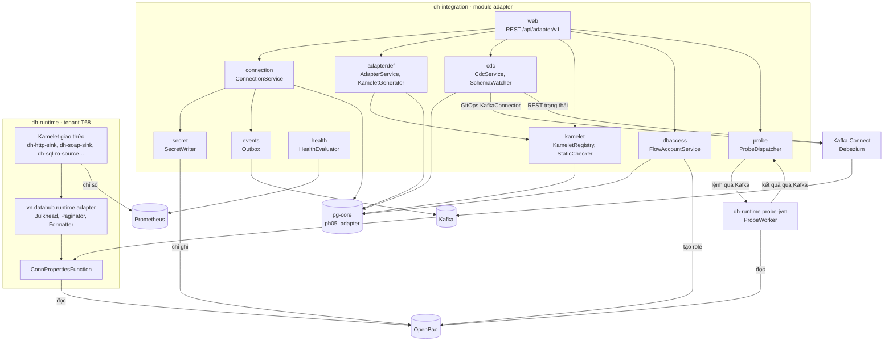
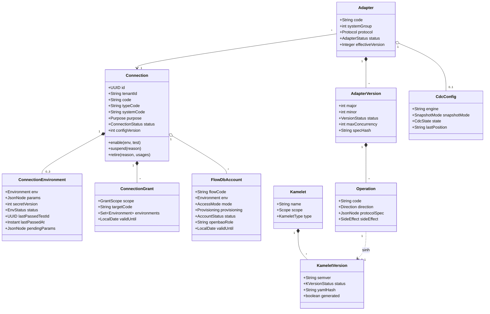
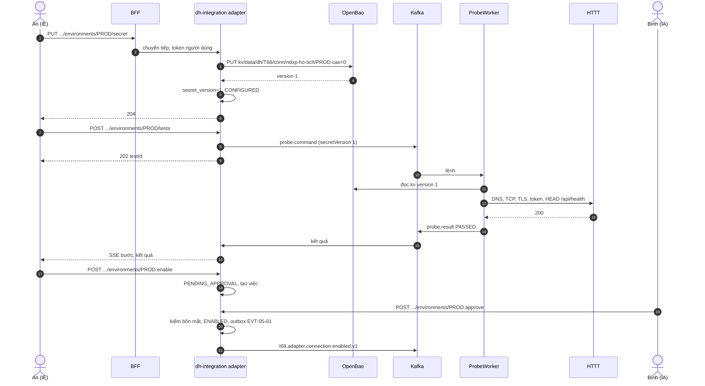
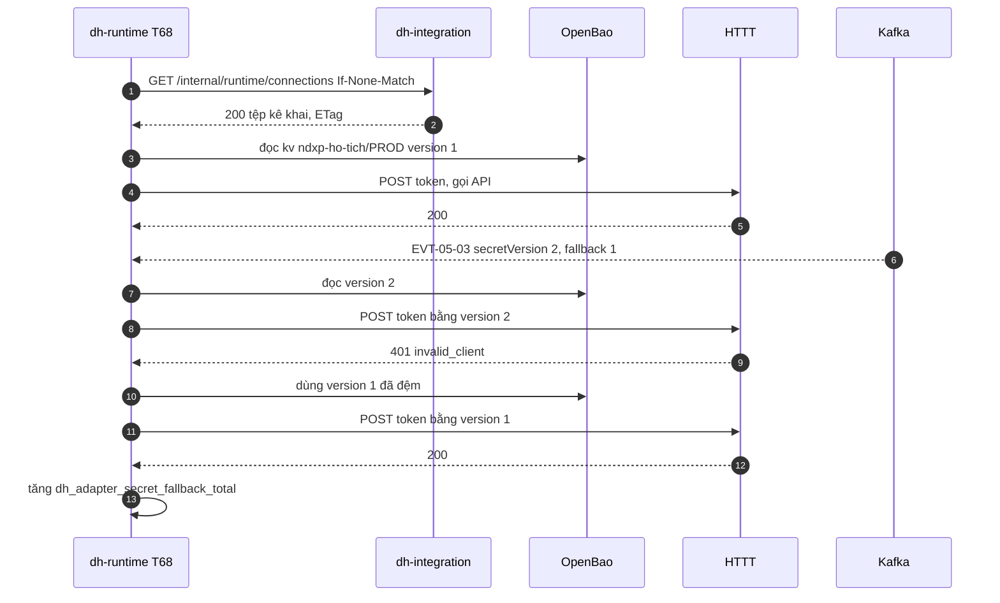
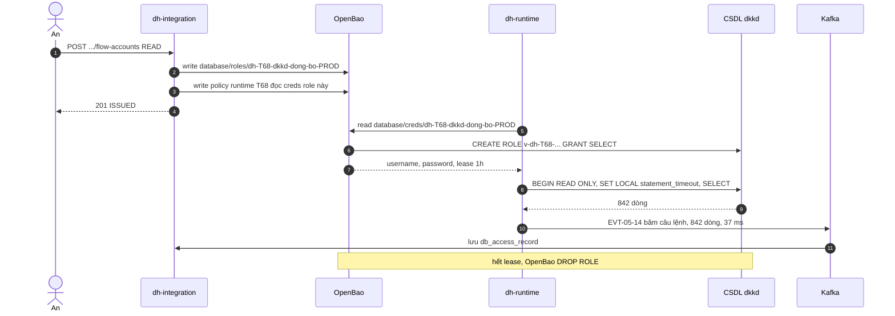
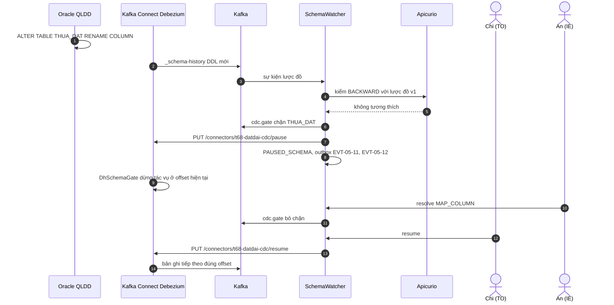
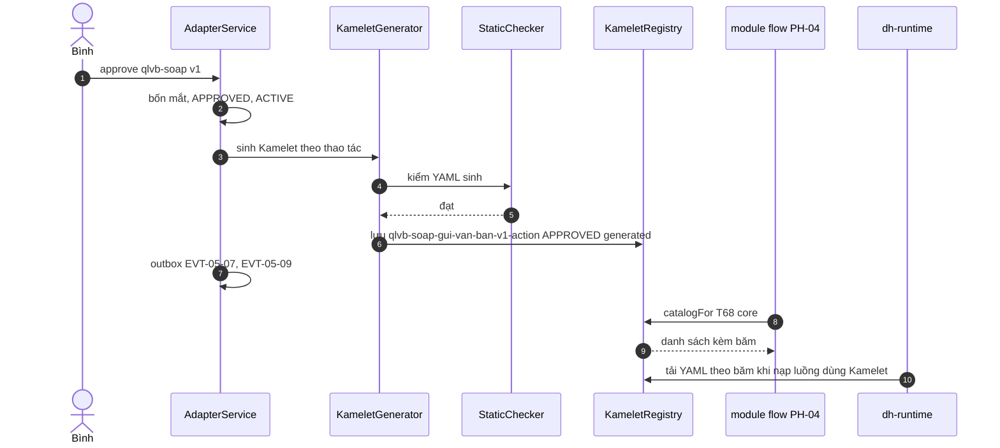

# D03-02-PH05 · Thiết kế chi tiết Bộ điều hợp và kết nối

## Tóm tắt cho hội đồng thẩm định

Tài liệu mô tả cách hiện thực 62 FR của [D02-03-PH05](../../02-yeu-cau/frs/D02-03-PH05-frs-bo-dieu-hop.md). Thiết kế dựa trên bốn quyết định:

1. **Bí mật không đi qua control plane khi chạy.** `dh-integration` chỉ có quyền ghi vào OpenBao; `dh-runtime` của đúng tenant đọc trực tiếp bằng xác thực Kubernetes. CSDL `pg-core` chỉ lưu phiên bản bí mật (ADR-012, BR-05-001, BR-05-003).
2. **Bộ điều hợp là cấu hình, không phải mã.** Mỗi thao tác của một phiên bản đã duyệt được sinh thành một Kamelet mỏng gọi Kamelet nền giao thức. Kamelet nền là mã Java và YAML có kiểm thử, ký cùng ảnh runtime (ADR-062); người dùng không đưa mã tùy ý vào runtime.
3. **Tài khoản CSDL động theo luồng** qua OpenBao database secrets engine hiện thực Q359 (ADR-067); quyền ở CSDL là chốt chặn, kiểm tra tĩnh là lớp phụ.
4. **CDC chạy trên Kafka Connect** (Strimzi) với Debezium, connector khai báo bằng CRD qua GitOps; PH-05 giám sát lược đồ và dừng an toàn khi lược đồ đổi (ADR-059, mới).

Phân hệ là module `adapter` của `dh-integration` (Spring Boot 4, Spring Modulith) và thư viện `vn.datahub.runtime.adapter` cùng bộ Kamelet giao thức của `dh-runtime` (Camel Quarkus 3.33.x). Thiết kế thêm một ADR (ADR-059) và một hồ sơ runtime (`probe-jvm`).

## 1. Phạm vi và cách đọc

Tài liệu đi từ vị trí trong kiến trúc (§2), cấu trúc mã (§3), từng thành phần (§4), sequence của FR phức tạp (§5) tới đa tenant, bảo mật, máy trạng thái, cấu hình, quan sát, hiệu năng. Mã ERR, BR, NFR là của FRS; mã EVT, API là của [D03-04-PH05](../api/D03-04-PH05-api-bo-dieu-hop.md); bảng CSDL ở [D03-03-PH05](../csdl/D03-03-PH05-csdl-bo-dieu-hop.md). Biện pháp ATTT dẫn mã `SEC-*` đã có ở D03-07, không tạo mới.

| ADR áp dụng | Nội dung dùng ở đây |
|---|---|
| ADR-001 | Spring Boot 4 + Modulith cho `dh-integration` |
| ADR-002, ADR-010 | Camel Quarkus, YAML DSL cho Kamelet |
| ADR-003 | PostgreSQL, RLS theo `tenant_id` |
| ADR-004 | Kafka cho sự kiện và CDC |
| ADR-009, ADR-068 | GitOps Argo CD, kho cấu hình theo tenant |
| ADR-012 | OpenBao cho bí mật, database engine, PKI |
| ADR-013 | Tách control plane và data plane |
| ADR-061, ADR-062, ADR-063 | Catalog khớp runtime; luồng YAML và thư viện nền Java; ảnh runtime theo hồ sơ |
| ADR-067 | Truy cập CSDL trực tiếp có kiểm soát |
| ADR-059 (mới) | CDC bằng Debezium trên Kafka Connect |

## 2. Vị trí trong kiến trúc

### 2.1. Đơn vị triển khai và vùng mạng

| Thành phần | DU | Vùng | Ghi chú |
|---|---|---|---|
| Module `adapter` (API, nghiệp vụ, bộ đánh giá sức khỏe, bộ theo dõi CDC) | `dh-integration` | Z3 | Chung DU với module `flow` của PH-04, khác module Modulith |
| Kamelet giao thức, thư viện `vn.datahub.runtime.adapter` | `dh-runtime` (các hồ sơ `core-native`, `files-native`, `soap-jvm`, `legacy-jvm`) | Z4 | Chạy trong pod luồng của tenant |
| Bộ chạy kiểm tra và thăm dò | `dh-runtime` hồ sơ `probe-jvm` | Z4 | Một Deployment mỗi tenant, 2 bản sao, không nạp luồng nghiệp vụ |
| Kafka Connect + Debezium | `dh-cdc` (Strimzi `KafkaConnect`) | Z4 | Một cụm mỗi tenant có CDC (ADR-059) |
| OpenBao | Nền tảng | Z5 | KV v2 `kv/dh/{tenant}/conn/*`, database engine `database/`, PKI `pki-tenant-{tenant}` |
| `pg-core` schema `ph05_adapter` | Nền tảng | Z5 | Cụm CNPG chung control plane |

Lưu lượng tới HTTT đi từ Z4 qua egress gateway với `ServiceEntry` theo FQDN (SEC-16). Bộ chạy `probe-jvm` có cùng chính sách egress với runtime của tenant, nên kết quả kiểm tra phản ánh đúng đường mạng thật của luồng.

### 2.2. Sơ đồ thành phần



Sơ đồ cho thấy ba đường. Đường quản lý: giao diện gọi REST, các dịch vụ ghi `ph05_adapter`, sự kiện đi qua outbox. Đường bí mật: `SecretWriter` chỉ ghi, `ConnPropertiesFunction` và `ProbeWorker` đọc; không có mũi tên đọc bí mật từ `dh-integration`. Đường kiểm tra: `ProbeDispatcher` không tự mở kết nối tới HTTT mà gửi lệnh cho `ProbeWorker` ở Z4 qua topic nội bộ `{tenant}.adapter.probe.command.v1`, nhận kết quả ở `{tenant}.adapter.probe.result.v1`; nhờ vậy `dh-integration` ở Z3 không cần đường ra HTTT và không cần quyền đọc bí mật.

### 2.3. Phụ thuộc với module và phân hệ khác

| Bên | Hướng | Cách | Dùng cho |
|---|---|---|---|
| Module `flow` (PH-04) cùng DU | PH-05 → `flow` | `FlowQueryApi` (Modulith, gọi trong tiến trình) | Kiểm tra không gian làm việc, luồng; nơi dùng |
| Module `flow` (PH-04) | `flow` → PH-05 | `AdapterReferenceApi` (gói `adapter.api`) | VR-07, catalog Kamelet; API-05-031, 089 là bản REST của cùng giao diện cho hồ sơ triển khai tách DU |
| PH-01 | PH-05 đọc | Bản sao `system_replica` qua EVT-01-* | HTTT `ACTIVE`, đầu mối |
| PH-10 | PH-05 gọi | REST `/api/event/v1/topics` | Đăng ký topic CDC |
| PH-18 | PH-05 đọc | `ParameterApi` có đệm 60 giây | Tham số `05.*` |
| PH-13 | PH-05 gửi | Chỉ số Prometheus, sự kiện | Cảnh báo |
| Hộp việc chung (FR-00-070) | PH-05 gửi | `TaskInboxApi` | Việc duyệt |

Hai module `flow` và `adapter` nằm cùng `dh-integration` nên gọi nhau trong tiến trình qua gói `api` công bố. Luật Modulith: `adapter` không import `flow.internal`; `flow` chỉ import `adapter.api`. ArchUnit kiểm ở CI (CI-3).

### 2.4. Hiện trạng mã và đường chuyển

| Hiện trạng repo | Thiết kế | Khoảng cách |
|---|---|---|
| `apps/adapter-mgr` (Spring Boot riêng, bảng `ph05.adapter` 5 cột, chỉ loại `HTTP_MOCK`, lưu `vault_path`) | Module `adapter` trong `dh-integration`, schema `ph05_adapter` 23 bảng | GAP-05-01: gộp vào `dh-integration`, xóa `apps/adapter-mgr` sau khi chuyển dữ liệu (changeset di trú ở D03-03-PH05 §8) |
| Route `/api/v1/adapters` không quyền, không tenant | `/api/adapter/v1/*`, `PERM-05-*`, RLS | GAP-05-02 |
| `camel/dancu` datasource dùng chung tài khoản `lgsp` | `dh-sql-ro-source` với tài khoản động | GAP-05-03 (trùng GAP-04-10, xử lý ở PH-05) |
| Không có kiểm tra kết nối, sức khỏe | `ProbeWorker`, `HealthEvaluator` | GAP-05-04 |
| `lgsp-echo-source.kamelet.yaml` thử nghiệm | Bộ Kamelet giao thức §4.7 | GAP-05-05 |

## 3. Cấu trúc mã nguồn

### 3.1. Module `adapter` trong `dh-integration`

```text
vn.datahub.integration.adapter
├── api/                       # công bố cho module khác: AdapterReferenceApi, KameletCatalogApi, DTO
├── web/                       # @RestController theo nhóm API; ProblemDetail ERR-05-*
├── internal/
│   ├── conntype/              # ConnectionTypeRegistry (nạp từ classpath conntypes/*.json)
│   ├── connection/            # aggregate Connection, ConnectionEnvironment, ConnectionGrant
│   ├── secret/                # SecretWriter (OpenBao KV v2, chỉ ghi), RotationService
│   ├── probe/                 # ProbeDispatcher, ProbeResultConsumer, CauseCatalog (§5.2.1 FRS)
│   ├── health/                # HealthEvaluator (lịch 1 phút), HealthStateMachine, HysteresisWindow
│   ├── dbaccess/              # FlowAccountService, OpenBaoDbRoleWriter, GrantTemplateRenderer, DbAccessLogConsumer
│   ├── adapterdef/            # aggregate Adapter, AdapterVersion, Operation; KameletGenerator; SpecImporter (OpenAPI, WSDL)
│   ├── cdc/                   # CdcService, ConnectorSpecRenderer, KafkaConnectClient, SchemaWatcher
│   ├── kamelet/               # KameletRegistry, StaticChecker, CatalogPublisher
│   ├── legacy/                # LegacyImportService, CamelXmlScanner (không thực thi), ConnectionMapWriter
│   ├── usage/                 # UsageIndex (chỉ mục nơi dùng từ PH-04)
│   └── settings/              # Tham số 05.*, bật tắt loại kết nối
└── events/                    # EVT-05-* record, OutboxPublisher
```

### 3.2. Thư viện và Kamelet ở `dh-runtime`

```text
dh-runtime/
├── dh-runtime-lib/
│   ├── vn.datahub.runtime.secret      # (có từ PH-04) ConnPropertiesFunction, thêm ConnManifestCache, SecretVersionSelector
│   └── vn.datahub.runtime.adapter
│       ├── limit/                     # TenantBulkhead, PoolSizer (hạn mức theo bản sao)
│       ├── http/                      # AuthApplier (Basic, ApiKey, OAuth2TokenCache, mTLS), Paginator, RateLimitGovernor
│       ├── soap/                      # WsdlCache, EnvelopeBuilder, WssApplier, FaultClassifier, WsdlDriftDetector
│       ├── file/                      # ReadyStrategy, FileClaim, RecordReader (CSV, FIXED_WIDTH), ArchiveMover
│       ├── messaging/                 # ReconnectPolicy, PropertyMapper
│       ├── sql/                       # (có từ PH-04) TenantScopedSqlProcessor, thêm RowLimiter, StatementHasher, DbAccessRecorder
│       ├── format/                    # XmlToJson (theo XSD), CsvToJson, JsonToXml, TypeNormalizer, MissingValuePolicy
│       ├── probe/                     # ProbeWorker, ProbeStep cho từng nhóm giao thức
│       └── error/                     # AdapterErrorClassifier → ERR-05-1xx → lớp lỗi của PH-04
├── dh-runtime-kamelets/
│   ├── stage/                         # (PH-04) dh-receive-action…dh-respond-action
│   └── protocol/                      # Kamelet nền giao thức của PH-05 (§4.7)
└── profiles/
    ├── core-native/                   # HTTP, SQL PostgreSQL/MySQL, Kafka ngoài, MQTT, SMTP
    ├── files-native/                  # SFTP, FTPS, SMB, CSV, cố định độ rộng
    ├── soap-jvm/                      # CXF, WS-Security (JVM vì CXF native còn hạn chế)
    ├── legacy-jvm/                    # Oracle, SQL Server JDBC, JMS ActiveMQ, AMQP, IMAP, LDAP
    └── probe-jvm/                     # mọi driver của bốn hồ sơ trên, chỉ ProbeWorker (mới)
```

`probe-jvm` gom đủ driver để một Deployment kiểm tra được mọi loại kết nối. Nó không nạp luồng; `FlowLoader` tắt bằng cấu hình. Hồ sơ được ghi vào `runtime-manifest.json` như mọi hồ sơ khác (FR-04-081).

### 3.3. Giao diện công bố cho PH-04

```java
package vn.datahub.integration.adapter.api;

public interface AdapterReferenceApi {
  /** FR-05-014. Không ném ngoại lệ nghiệp vụ; lỗi từng tham chiếu nằm trong kết quả. */
  VerifyResult verify(TenantId tenant, VerifyRequest request);
  /** FR-05-009. Kết nối được cấp cho không gian, theo loại và môi trường có giá trị. */
  List<ConnectionOption> optionsFor(TenantId tenant, String workspaceCode, String flowCode,
                                    Set<String> typeCodes);
}

public interface KameletCatalogApi {
  /** FR-05-059. Kamelet khả dụng cho tenant, kèm băm để PH-04 so khớp catalog. */
  KameletCatalog catalogFor(TenantId tenant, String runtimeProfile);
}

public record VerifyRequest(String workspaceCode, String flowCode, int flowVersion,
    Stage stage, Environment targetEnv, List<Reference> references) {}
public record Reference(RefKind kind, String code, String operationCode,
    Set<String> keysUsed, AccessMode accessMode) {}
public record VerifyResult(boolean allOk, List<RefResult> results) {}
public record RefResult(int index, RefStatus status, String code, String message) {}
```

### 3.4. DTO chính

```java
public record CreateConnectionRequest(
    @Pattern(regexp = "^[a-z][a-z0-9-]{2,62}$") String connectionCode,
    @NotBlank @Size(min = 3, max = 255) String name,
    @NotBlank String typeCode, @NotBlank String systemCode,
    @NotNull Purpose purpose, @Size(max = 2000) String description,
    String owner, @Size(max = 10) List<String> labels) {}

public record EnvironmentParams(@NotNull Map<String, Object> params) {}      // kiểm theo JSON Schema của loại
public record SecretPayload(@NotNull @Size(max = 16) Map<String, String> secrets) {
  @Override public String toString() { return "SecretPayload[keys=" + secrets.keySet() + "]"; } // không in giá trị
}

public record OperationSpec(
    @Pattern(regexp = "^[a-z][a-z0-9-]{1,40}$") String operationCode,
    @NotBlank String title, @NotNull Direction direction,
    @NotNull JsonNode protocolSpec, @NotNull Format requestFormat, @NotNull Format responseFormat,
    String requestSchemaRef, String responseSchemaRef,
    @Valid NormalizationRules normalization, @Min(100) @Max(120_000) int timeoutMs,
    boolean idempotent, @NotNull SideEffect sideEffect,
    @Size(max = 1_048_576) String sampleRequest, @Size(max = 1_048_576) String sampleResponse) {}

public record FlowAccountRequest(@NotBlank String flowCode, @NotEmpty Set<Environment> environments,
    @NotEmpty Set<String> schemas, Set<String> tables, @NotNull AccessMode accessMode,
    Set<SqlOp> operations, LocalDate validUntil, @Size(min = 30, max = 2000) String justification,
    String ownerConsentRef) {}
```

`SecretPayload` ghi đè `toString` và được đánh dấu `@Sensitive` để bộ lọc log của thư viện nền thay giá trị bằng `***` nếu một đối tượng chứa nó bị log nhầm; kiểm thử ArchUnit cấm log trực tiếp đối tượng này (CC-SEC trong D04-01).

## 4. Thiết kế chi tiết từng thành phần

### 4.1. Mô hình miền



Ba aggregate chính là `Connection`, `Adapter`, `Kamelet`; `CdcConfig` thuộc `Adapter` nhưng được nạp riêng vì có trạng thái vận hành cập nhật thường xuyên. Invariant được kiểm trong aggregate trước khi ghi:

| Aggregate | Invariant | BR |
|---|---|---|
| `Connection` | Mã duy nhất trong tenant kể cả `RETIRED`; chỉ có `ENABLED` khi `lastPassedAt` ≥ hiện tại − 24 giờ và `lastPassedTestId` khớp `paramsHash` và `secretVersion` hiện tại; `RETIRED` không chuyển đi đâu | 004, 006 |
| `Connection` | Môi trường PROD chuyển `ENABLED` chỉ qua `approve(by)` với `by` khác `requestedBy` và khác `secretWrittenBy` | 009 |
| `Adapter` | Một phiên bản `DRAFT` tối đa; một phiên bản `APPROVED` hiệu lực; kết nối cùng `systemCode` | 015, 016 |
| `Kamelet` | Tên duy nhất trên `BASE` ∪ `COMMON` ∪ `TENANT` của tenant; số phụ tương thích ngược | 004, 016 |

### 4.2. Danh mục loại kết nối

Loại kết nối là dữ liệu nền tảng, đóng trong `dh-integration` ở `classpath:conntypes/{typeCode}.json`, mỗi tệp gồm `paramsSchema` (JSON Schema 2020-12), `secretKeys`, `kamelets`, `probeSteps`, `egressFrom` (tên tham số chứa máy chủ để kiểm egress), `ceilings` mặc định. `ConnectionTypeRegistry` nạp khi khởi động và kiểm chéo với `runtime-manifest.json`: loại có Kamelet không nằm trong hồ sơ nào bị đánh dấu `PREVIEW` và không bật được. Tenant chỉ ghi bảng `connection_type_setting` (bật, tắt, trần). Cách này giữ một nguồn sự thật cho loại kết nối và Kamelet giao thức cùng phiên bản phát hành.

### 4.3. Ghi bí mật và xoay vòng

`SecretWriter` dùng token OpenBao lấy qua xác thực Kubernetes của service account `dh-integration`, chính sách:

```hcl
path "kv/data/dh/+/conn/*"     { capabilities = ["create", "update"] }   # không có "read"
path "kv/metadata/dh/+/conn/*" { capabilities = ["read", "list", "delete"] }  # đọc phiên bản, không đọc giá trị
path "kv/destroy/dh/+/conn/*"  { capabilities = ["update"] }             # hủy phiên bản (BR-05-012, xoay)
```

Runtime của tenant `T68` có chính sách:

```hcl
path "kv/data/dh/T68/conn/*"         { capabilities = ["read"] }
path "database/creds/dh-T68-*"       { capabilities = ["read"] }
path "pki-tenant-T68/issue/conn-*"   { capabilities = ["update"] }
```

Ghi bí mật: kiểm tra khóa thuộc `secretKeys` → `PUT kv/data/dh/{t}/conn/{code}/{env}` với `cas = secretVersion` hiện tại (tránh hai người ghi đè nhau) → OpenBao trả `version` mới → cập nhật `connection_environment.secret_version`, `secret_written_by`, `secret_written_at`, đặt `status = CONFIGURED` (hoặc lưu bản chờ với PROD `ENABLED`). Hai bước không nằm trong một giao dịch phân tán; nếu bước PostgreSQL lỗi sau khi OpenBao đã ghi, tác vụ đối soát 5 phút đọc metadata OpenBao và sửa `secret_version` (phiên bản ở OpenBao là nguồn sự thật). Thông báo lỗi của OpenBao đi qua bộ lọc che trước khi log.

Xoay vòng (FR-05-012): `RotationService` ghi phiên bản `n+1` → gửi lệnh kiểm tra với `secretVersion = n+1` → đạt thì đặt `rotation.status = TRANSITION`, `connection_environment.secret_version = n+1`, `fallback_version = n` rồi phát EVT-05-03 → lịch `RotationFinisher` mỗi phút tìm lần xoay hết hạn chuyển tiếp, hủy phiên bản `n` (`kv/destroy`), đặt `fallback_version = null`, `COMPLETED`. Ở runtime, `SecretVersionSelector` đọc phiên bản theo số (`?version=`) và khi Kamelet báo lỗi xác thực với phiên bản mới thì thử một lần với `fallback_version` (BR-05-007).

### 4.4. Kiểm tra kết nối và thăm dò

`ProbeDispatcher` tạo `connection_test` (`RUNNING`), gửi lệnh `ProbeCommand` (tenant, kết nối, môi trường, `secretVersion`, `paramsHash`, bước, `probe`, hạn chờ) vào topic `{tenant}.adapter.probe.command.v1` khóa theo `connectionCode`. `ProbeWorker` ở `probe-jvm` tiêu thụ, chạy từng `ProbeStep`, phát `ProbeStepResult` (để giao diện hiện tiến độ qua SSE) và `ProbeResult` cuối vào `{tenant}.adapter.probe.result.v1`. Hạn chờ tổng 15 giây cộng thời gian chờ khai báo; quá hạn thì `ProbeResultConsumer` đóng lần kiểm tra `FAILED` với bước đang chạy `TIMEOUT`.

| Nhóm | `ProbeStep` sau TLS và xác thực | Không tác dụng phụ vì |
|---|---|---|
| HTTP | `HEAD` hoặc `GET` tới `probe`, chỉ ba phương thức an toàn | Phương thức an toàn theo RFC 9110 |
| SOAP | Tải WSDL, đếm thao tác, so băm với bản đệm | Không gọi thao tác |
| JDBC, `db-flow` | `SELECT 1` trong `SET TRANSACTION READ ONLY`; truy vấn từ điển quyền (FR-05-025) | Giao dịch chỉ đọc, rollback |
| SFTP, FTPS, SMB | `ls baseDir` giới hạn 1 mục | Không đọc nội dung |
| JMS, AMQP, MQTT, Kafka ngoài | Mở kết nối, phiên; với MQTT `CONNECT` rồi `DISCONNECT` không đăng ký | Không gửi, không nhận |
| SMTP | `EHLO`, `AUTH`, `QUIT` | Không `MAIL FROM` |
| IMAP | `LOGIN`, `EXAMINE folder` (chỉ đọc), `LOGOUT` | `EXAMINE` không đổi cờ |
| LDAP | Bind, tìm `baseDn` phạm vi `base` | Chỉ đọc |

`CauseCatalog` ánh xạ ngoại lệ sang `causeCode` của FRS §5.2.1: `UnknownHostException` → `DNS_NXDOMAIN`; `ConnectException` → `TCP_REFUSED`, hoặc `EGRESS_DENIED` khi egress gateway trả `403` với tiêu đề `x-envoy-…` của Istio; `SSLHandshakeException` phân tích theo nguyên nhân (`protocol_version`, `PKIX path`, `hostname`); lỗi xác thực theo nhóm giao thức (HTTP 401, 403 ở bước xác thực; JDBC SQLState `28xxx`; SFTP `Auth fail`). Mỗi `causeCode` có mẫu câu tiếng Việt với chỗ trống được điền giá trị không bí mật.

Thăm dò định kỳ (FR-05-019) dùng cùng `ProbeWorker` nhưng với lệnh `HEALTH`, không chạy lại bước xác thực OAuth nếu token còn hạn trong đệm của worker, và có `HealthGuard`: sau hai lần `AUTH_FAILED` liên tiếp, worker bỏ bước xác thực tới khi `secretVersion` đổi (BR-05-008).

### 4.5. Đánh giá sức khỏe

`HealthEvaluator` chạy mỗi phút (ShedLock để một bản sao chạy), với mỗi `(tenant, đối tượng, env)` đọc ba nguồn: kết quả thăm dò 5 phút gần nhất (bảng `health_sample`), chỉ số Prometheus `dh_adapter_calls_total`, `dh_adapter_call_duration_seconds`, `dh_adapter_pool_wait_seconds` qua truy vấn PromQL theo nhãn `tenant`, `connection`, `adapter`, và đường nền p95 7 ngày (bảng `health_baseline`, tính lại mỗi đêm). Kết quả thô qua `HysteresisWindow`: mức mới phải giữ 2 lần liên tiếp (3 lần nếu là `HEALTHY`) mới được ghi vào `health_state` và phát EVT-05-06. Truy vấn Prometheus gộp theo tenant để mỗi phút chỉ có một truy vấn cho mỗi chỉ số mỗi tenant.

### 4.6. Tài khoản CSDL cho luồng

`FlowAccountService` sinh tên role OpenBao `dh-{tenant}-{flowCode}-{env}` (cắt và thêm băm 6 ký tự nếu quá 63 ký tự) và ghi `database/roles/{role}` với `db_name` là cấu hình kết nối của OpenBao `dh-{tenant}-{connectionCode}-{env}` (tạo khi giá trị môi trường `db-flow` được bật, dùng `adminUsername`, `adminPassword`). Câu lệnh tạo tài khoản sinh từ mẫu theo engine, chỉ từ danh sách schema và bảng đã kiểm (tên được trích dẫn bằng `quote_ident`, không ghép giá trị người dùng nhập ngoài danh sách đã kiểm với `information_schema`):

```sql
-- PostgreSQL, accessMode READ (GrantTemplateRenderer, ví dụ đã điền)
CREATE ROLE "{{name}}" WITH LOGIN PASSWORD '{{password}}' VALID UNTIL '{{expiration}}'
  NOSUPERUSER NOCREATEDB NOCREATEROLE NOINHERIT NOREPLICATION NOBYPASSRLS CONNECTION LIMIT 7;
GRANT CONNECT ON DATABASE "dkkd" TO "{{name}}";
GRANT USAGE ON SCHEMA "dkkd" TO "{{name}}";
GRANT SELECT ON "dkkd"."doanh_nghiep", "dkkd"."nganh_nghe" TO "{{name}}";
ALTER ROLE "{{name}}" SET default_transaction_read_only = on;
ALTER ROLE "{{name}}" SET statement_timeout = '10s';
ALTER ROLE "{{name}}" SET application_name = 'dh:T68:dkkd-dong-bo';
```

`CONNECTION LIMIT` lấy bằng hạn mức theo bản sao của bộ điều hợp (FR-05-042). `default_transaction_read_only` là lớp chặn thứ ba sau quyền và kiểm tra tĩnh. `application_name` giúp pgaudit ở CSDL nguồn ghi tên luồng. Mẫu cho Oracle (khi `STATIC`) là kịch bản để đơn vị chủ quản chạy; MySQL dùng `GRANT SELECT ON dkkd.doanh_nghiep TO '{{name}}'@'%'` kèm `MAX_USER_CONNECTIONS`.

Kiểm tra quyền (FR-05-025) chạy ở `ProbeWorker` với tài khoản tạm `default_ttl = 5m`; truy vấn PostgreSQL:

```sql
SELECT table_schema, table_name, privilege_type FROM information_schema.role_table_grants
 WHERE grantee = current_user
UNION ALL
SELECT n.nspname, NULL, 'CREATE' FROM pg_namespace n WHERE has_schema_privilege(n.oid, 'CREATE')
UNION ALL
SELECT NULL, NULL, 'ATTR:' || a FROM (SELECT unnest(ARRAY[
  CASE WHEN rolsuper THEN 'SUPERUSER' END, CASE WHEN rolcreaterole THEN 'CREATEROLE' END,
  CASE WHEN rolbypassrls THEN 'BYPASSRLS' END]) a FROM pg_roles WHERE rolname = current_user) x
 WHERE a IS NOT NULL;
```

Thu hồi: xóa `database/roles/{role}`, gọi `sys/leases/revoke-prefix/database/creds/{role}`; OpenBao chạy câu lệnh thu hồi (`REASSIGN OWNED`, `DROP OWNED`, `DROP ROLE`).

Nhật ký truy cập (FR-05-027): `DbAccessRecorder` trong Kamelet SQL tính `SHA-256` của câu lệnh đã chuẩn hóa (bỏ khoảng trắng thừa, chữ thường từ khóa), ghi EVT-05-14 qua producer Kafka không đồng bộ có đệm 10.000 bản ghi; đệm đầy thì ghi chỉ số `dh_adapter_dbaudit_dropped_total` và cảnh báo mức cao (mất bản ghi kiểm toán là sự cố ATTT). `DbAccessLogConsumer` ghi vào bảng phân vùng tháng `db_access_record`.

### 4.7. Kamelet nền giao thức

| Kamelet | Loại | Hồ sơ | Tham số chính | Thư viện |
|---|---|---|---|---|
| `dh-http-sink` | sink, action | core-native | `connection`, `method`, `path`, `query`, `timeoutMs`, `pagination`, `rateLimit` | `http.AuthApplier`, `Paginator`, `RateLimitGovernor` |
| `dh-http-source` | source | core-native | `connection` (webhook nhận qua PH-03) | |
| `dh-soap-sink` | sink (trả phản hồi đồng bộ) | soap-jvm | `connection`, `wsdlRef`, `operation`, `faultMapping` | `soap.*` |
| `dh-sql-ro-source` | source | core-native, legacy-jvm | `connection`, `statement`, `schedule`, `pagingKey`, `maxRows` | `sql.*` |
| `dh-sql-ro-action` | action | core-native, legacy-jvm | `connection`, `statement`, `maxRows` | `sql.*` |
| `dh-sql-write-sink` | sink | core-native, legacy-jvm | `connection`, `statement` | `sql.*` |
| `dh-sftp-source`, `dh-ftps-source`, `dh-smb-source` | source | files-native | `connection`, `directory`, `includePattern`, `readyStrategy`, `format`, `recordMode` | `file.*`, `format.*` |
| `dh-sftp-sink`, `dh-ftps-sink`, `dh-smb-sink` | sink | files-native | `connection`, `directory`, `fileName`, `writeMode` | `file.*` |
| `dh-jms-source`, `dh-jms-sink`, `dh-amqp-source`, `dh-amqp-sink` | source, sink | legacy-jvm | `connection`, `destination`, `ackMode` | `messaging.*` |
| `dh-mqtt-source`, `dh-mqtt-sink` | source, sink | core-native | `connection`, `topic`, `qos` | `messaging.*` |
| `dh-kafka-ext-source`, `dh-kafka-ext-sink` | source, sink | core-native | `connection`, `topic`, `groupId` | |
| `dh-mail-sink` | sink | core-native | `connection`, `template`, `allowedDomains` | |
| `dh-imap-source` | source | legacy-jvm | `connection`, `folder`, `filter` | quét mã độc qua DD-12 |
| `dh-ldap-action` | action | legacy-jvm | `connection`, `filterTemplate`, `attributes` | |

Mỗi Kamelet giao thức có cùng ba bước bao: `dhAdapterEnter` (lấy chỗ trong `TenantBulkhead` theo `connection`, đặt tiêu đề `dh-connection`, bắt đầu span `adapter.call`), lời gọi giao thức, `dhAdapterExit` (ghi chỉ số, phân loại lỗi qua `AdapterErrorClassifier`, giải phóng chỗ). Ví dụ rút gọn `dh-sql-ro-action`:

```yaml
apiVersion: camel.apache.org/v1
kind: Kamelet
metadata:
  name: dh-sql-ro-action
  labels: { camel.apache.org/kamelet.type: action, datahub.gov.vn/scope: BASE }
spec:
  definition:
    title: Truy vấn CSDL chỉ đọc
    required: [connection, statement]
    properties:
      connection: { title: Kết nối, type: string, x-descriptors: [urn:camel:group:credentials] }
      statement:  { title: Câu lệnh SELECT có tham số :#ten, type: string }
      maxRows:    { title: Số dòng tối đa, type: integer, default: 10000 }
  template:
    from:
      uri: kamelet:source
      steps:
        - process: { ref: dhAdapterEnter }
        - setProperty: { name: dhStatement, constant: "{{statement}}" }
        - process: { ref: dhSqlReadOnly }        # TenantScopedSqlProcessor + RowLimiter + DbAccessRecorder
        - process: { ref: dhAdapterExit }
```

`dhSqlReadOnly` lấy `DataSource` theo `connection` từ `FlowDataSourceRegistry`: mỗi `(connection, flow, env)` một nhóm Agroal với thông tin đăng nhập động, làm mới khi lease còn 20% thời gian sống; ngắt kết nối cũ một cách mềm.

### 4.8. Sinh Kamelet từ bộ điều hợp

`KameletGenerator` nhận phiên bản `APPROVED` và sinh cho mỗi thao tác một YAML: tên theo FR-05-047, `spec.definition.properties` từ tham số khai báo của thao tác (tiêu đề tiếng Việt, kiểu, bắt buộc), `template` gọi Kamelet nền với tham số cố định (`connection`, đường dẫn, phân trang, định dạng) nhúng dạng hằng. YAML được chuẩn hóa (sắp khóa) rồi băm SHA-256; Kamelet sinh có `generated = true`, `source_adapter_version_id`. Vì nội dung hoàn toàn sinh từ dữ liệu đã kiểm và được duyệt, Kamelet sinh vẫn qua `StaticChecker` như một lớp an toàn nhưng không có bước duyệt riêng (BR-05-027).

### 4.9. Kiểm tra tĩnh Kamelet

`StaticChecker` chạy trên AST YAML (SnakeYAML an toàn, cấm thẻ tùy chỉnh) và mô hình route của Camel (`camel-yaml-dsl` ở chế độ chỉ phân tích, không tạo `CamelContext` chạy):

| Mã quy tắc | Kiểm | Lỗi |
|---|---|---|
| KR-01 | YAML hợp lệ với lược đồ Kamelet Camel 4.18 | ERR-05-020 |
| KR-02 | Tên đúng mẫu, không trùng | ERR-05-002 |
| KR-03 | Mọi URI scheme, EIP, ngôn ngữ thuộc danh mục được phép của tenant (FR-04-080) | ERR-05-020 |
| KR-04 | Không `#class:`, `#type:`, `bean:` ngoài danh sách, không `groovy`, `js`, `python`, `mvel`, `ognl`, `spel` | ERR-05-020 |
| KR-05 | URI ra ngoài (`http:`, `https:`, `sql:`, `ftp:`, `sftp:`, `jms:`, `kafka:`) chỉ qua `kamelet:dh-*` hoặc tham số chứa `{{conn:…}}` | ERR-05-020 |
| KR-06 | Tham số có tên khớp mẫu bí mật phải có `x-descriptors: urn:camel:group:credentials` và không có `default` | ERR-05-020 |
| KR-07 | Không chuỗi có entropy Shannon > 4,0 và dài ≥ 20 ký tự trong `template` (gợi ý bí mật cứng) | ERR-05-020 |
| KR-08 | Thành phần dùng có trong `runtime-manifest.json` của hồ sơ được chọn | ERR-05-021 |
| KR-09 | So với phiên bản trước: số phụ không bỏ tham số, không thêm tham số bắt buộc không mặc định, không đổi kiểu | ERR-05-022 |
| KR-10 | Kích thước ≤ 256 KiB, độ sâu lồng bước ≤ 20 | ERR-05-020 |
| KR-11 | Kiểu tham số thuộc `string`, `boolean`, `integer`, `binary`, `long` (theo FR-04-018) | ERR-05-020 |
| KR-12 | `dataTypes` vào ra khai báo khi Kamelet là `action` | Cảnh báo |
| KR-13 | Có `title`, `description` tiếng Việt | Cảnh báo |
| KR-14 | Không tham chiếu `{{vault:…}}` ngoài `kv/dh/{tenant}/flow/` | ERR-05-020 |

### 4.10. Chuyển đổi định dạng

`XmlToJson` đọc XSD từ WSDL đệm để biết phần tử nào `maxOccurs > 1` (thành mảng dù chỉ có một), kiểu đơn giản (số, boolean, ngày thành kiểu JSON tương ứng). Không có XSD thì phần tử lặp ≥ 2 lần trong bản tin mới thành mảng và thao tác bị cảnh báo "Nên cung cấp XSD để mảng ổn định". `CsvToJson` dùng bộ đọc theo luồng (univocity), đọc theo khối 64 KiB; mã hóa `TCVN3` qua bảng chuyển 134 ký tự sang Unicode. `TypeNormalizer` chạy theo bảng quy tắc của thao tác; ngày không múi giờ gắn `+07:00`. `MissingValuePolicy` áp sau chuẩn hóa kiểu.

### 4.11. Nhóm kết nối và giới hạn tổng

`PoolSizer` ở runtime nhận `replicas` của hồ sơ từ tệp kê khai (do `dh-integration` cập nhật khi nhận sự kiện co giãn của KEDA qua Kubernetes API) và tính hạn mức `ceil(maxConcurrency / replicas)`. `TenantBulkhead` là `Semaphore` công bằng mỗi `(connection hoặc adapter)`; `acquire` chờ tối đa `acquireTimeoutMs`. Khi tổng hạn mức các bản sao vượt `maxConcurrency` do làm tròn lên, sai số tối đa là `replicas − 1` lượt, được chấp nhận và ghi trong FRS FR-05-042 như hành vi định nghĩa. Nhóm HTTP dùng Vert.x client của Quarkus với `maxPoolSize` bằng hạn mức; JDBC dùng Agroal `maxSize` bằng hạn mức và `CONNECTION LIMIT` ở role.

### 4.12. CDC

`CdcService` lưu cấu hình, gọi PH-10 đăng ký topic, rồi `ConnectorSpecRenderer` sinh `KafkaConnector` và commit vào kho `dh-config-{tenant}` thư mục `cdc/{adapterCode}.yaml` ở nhánh môi trường (ADR-068). Ví dụ rút gọn cho Oracle:

```yaml
apiVersion: kafka.strimzi.io/v1beta2
kind: KafkaConnector
metadata:
  name: t68-datdai-cdc
  labels: { strimzi.io/cluster: dh-cdc-t68, datahub.gov.vn/adapter: datdai-cdc }
spec:
  class: io.debezium.connector.oracle.OracleConnector
  tasksMax: 1
  state: running                     # paused khi PAUSED, PAUSED_SCHEMA
  config:
    database.hostname: ${env:DATDAI_HOST}
    database.user: ${secrets:t68-datdai-cdc/username}      # External Secrets từ OpenBao
    database.password: ${secrets:t68-datdai-cdc/password}
    database.dbname: QLDD
    topic.prefix: t68.cdc.datdai-cdc
    table.include.list: QLDD.THUA_DAT,QLDD.CHU_SU_DUNG
    column.exclude.list: QLDD.CHU_SU_DUNG.SO_CMND
    column.mask.hash.SHA-256.with.salt.t68: QLDD.CHU_SU_DUNG.DIEN_THOAI
    snapshot.mode: initial
    schema.history.internal.kafka.topic: t68.cdc.datdai-cdc._schema-history
    heartbeat.interval.ms: 30000
    key.converter: io.apicurio.registry.utils.converter.AvroConverter
    value.converter: io.apicurio.registry.utils.converter.AvroConverter
    transforms: route
    transforms.route.type: io.debezium.transforms.ByLogicalTableRouter
    transforms.route.topic.regex: "t68\\.cdc\\.datdai-cdc\\.QLDD\\.(.*)"
    transforms.route.topic.replacement: "t68.cdc.datdai-cdc.qldd.$1.v1"
```

Muối băm cột nhạy cảm là bí mật của tenant (OpenBao), không phải hằng. Tên topic chữ thường theo quy ước D00-04 §4; `ByLogicalTableRouter` chuyển tên bảng chữ hoa của Oracle.

`SchemaWatcher` tiêu thụ topic lịch sử lược đồ và so DDL mới với lược đồ Avro đã đăng ký: dùng `AvroCompatibilityChecker` chế độ BACKWARD; không tương thích thì là `BREAKING`. Vì Debezium phát sự kiện thay đổi lược đồ trước bản ghi dữ liệu theo lược đồ mới, `SchemaWatcher` đặt `state: paused` qua REST `PUT /connectors/{name}/pause` ngay lập tức (không chờ GitOps), sau đó commit `state: paused` vào kho để Argo CD không bật lại. Khoảng thời gian giữa sự kiện lược đồ và lệnh dừng được đo (`dh_cdc_schema_pause_latency_seconds`); để bảo đảm không bản ghi nào theo lược đồ mới đi tiếp, connector dùng thêm SMT `DhSchemaGate` (lớp Java trong ảnh Kafka Connect) giữ bản ghi của bảng có thay đổi `BREAKING` chưa xử lý: SMT đọc danh sách bảng bị chặn từ topic nén `t68.adapter.cdc.gate.v1` và trả lỗi khiến tác vụ dừng ở offset hiện tại.

`KafkaConnectClient` đọc `GET /connectors/{name}/status` mỗi 30 giây và chỉ số JMX của Debezium (qua Prometheus exporter): `MilliSecondsBehindSource`, `TotalNumberOfEventsSeen`, `SnapshotCompleted`, `RemainingTableCount`.

### 4.13. Nhập kết nối hệ cũ

`CamelXmlScanner` phân tích XML bằng StAX an toàn (cấm DTD, thực thể ngoài), không tạo bean, không chạy Camel. Nó trích: phần tử `<bean class="…DataSource">` với `property` url, username, password; URI trong `from`, `to`, `toD`, `enrich`, `pollEnrich`; tệp `.properties`. Giá trị thuộc tính có tên khớp mẫu bí mật được thay ngay bằng dấu vị trí `{tệp, dòng, cột, tên khóa}` trước khi bất kỳ đối tượng nào được tạo; chuỗi giá trị không đi qua log hay CSDL (BR-05-025). Gom đề xuất theo khóa `(scheme, host, port, database hoặc baseDir, username)`.

## 5. Biểu đồ tuần tự

### 5.1. Khai báo bí mật, kiểm tra và bật PROD (FR-05-005, 010, 007)



Bí mật chỉ đi một chiều từ BFF qua `dh-integration` tới OpenBao, không được lưu ở bộ đệm nào của `dh-integration` (đối tượng `SecretPayload` bị xóa tham chiếu sau khi ghi, không vào log). Kiểm tra chạy ở Z4 với đúng phiên bản bí mật vừa ghi; lần kiểm tra lưu `secret_version` và `params_hash` để invariant ở §4.1 so khớp khi bật.

### 5.2. Runtime phân giải và gọi HTTT có xoay bí mật giữa chừng (FR-05-015, 012, 033)



Sequence minh họa vì sao chuyển tiếp xoay bí mật cần giữ phiên bản cũ: HTTT có thể chưa kích hoạt khóa mới ở mọi nút của họ. Nếu phiên bản 2 vẫn bị từ chối tới hết chuyển tiếp, `HealthEvaluator` thấy chỉ số dự phòng tăng và cảnh báo trước khi phiên bản 1 bị hủy (UC-05-04 E3).

### 5.3. Cấp tài khoản CSDL động và luồng đọc (FR-05-024, 038, 027)



Tài khoản thật ở CSDL nguồn chỉ tồn tại trong thời gian sống của lease. Runtime làm mới thông tin đăng nhập trước khi lease hết (còn 20%); nhóm kết nối Agroal được thay mềm, kết nối đang dùng hoàn tất với tài khoản cũ.

### 5.4. CDC dừng khi lược đồ đổi (FR-05-051)



Hai lớp dừng là có chủ đích: lệnh `pause` có độ trễ (REST, lịch đánh giá), còn SMT `DhSchemaGate` chặn ngay trong tác vụ Debezium nên không bản ghi nào theo lược đồ mới lọt qua trong khoảng chờ. Offset chỉ được commit cho bản ghi đã qua SMT.

### 5.5. Phiên bản bộ điều hợp được duyệt tới bảng thành phần (FR-05-044, 047, 059)



## 6. Đa tenant trong mã nguồn

Mọi bảng `ph05_adapter` có `tenant_id` và `FORCE ROW LEVEL SECURITY` (D03-03-PH05). `TenantContextFilter` của `dh-integration` đặt `SET LOCAL app.tenant_id` ở đầu mỗi giao dịch từ token (D03-10). Tenant `COMMON` giữ Kamelet dùng chung: chính sách RLS của `kamelet`, `kamelet_version` cho đọc `tenant_id IN (current, 'COMMON')`, ghi chỉ `current`; tenant tỉnh ghi vào `COMMON` bị chặn ở RLS và ở dịch vụ (ERR-05-040). Đường dẫn OpenBao, tên role, tên topic, tên `KafkaConnector`, nhãn chỉ số đều chứa mã tenant; chính sách OpenBao giới hạn runtime của tenant vào tiền tố của nó. Lệnh kiểm tra và kết quả đi trên topic theo tenant, `ProbeWorker` của tenant chỉ đăng ký topic của mình. API nội bộ lấy tenant từ token dịch vụ, không từ thân yêu cầu.

## 7. Bảo mật

| Vấn đề | Biện pháp | SEC |
|---|---|---|
| Lộ bí mật | Ghi một chiều, không API đọc, bộ lọc che log, `SecretPayload` không in giá trị, kiểm thử canary NFR-05-011 | SEC-24, SEC-32 |
| Runtime tenant đọc bí mật tenant khác | Chính sách OpenBao theo tiền tố tenant, xác thực Kubernetes theo namespace | SEC-21, SEC-80 |
| Đi tới đích không được phép | Egress theo FQDN, kiểm khi khai báo | SEC-16 |
| SSRF qua `baseUrl`, `probe` | Danh sách cấm dải nội bộ, chỉ phương thức an toàn ở thăm dò | SEC-44 |
| Chèn mã SQL | Câu lệnh khai báo trước, tham số ràng buộc, quyền CSDL, `default_transaction_read_only` | SEC-43 |
| XXE, bom XML ở WSDL, SOAP | `SecureXml` (CC-SEC-13), giới hạn độ sâu, kích thước | SEC-45 |
| Mã tùy ý qua Kamelet | Kiểm tra tĩnh KR-01…14, danh mục thành phần được phép, ký ảnh runtime | SEC-46 |
| Tệp, đính kèm độc hại | Quét DD-12 trước khi xử lý | SEC-47 |
| Truy cập CSDL không truy vết được | Tài khoản theo luồng, pgaudit, EVT-05-14 | SEC-61 |
| Lạm dụng gửi thư | Danh sách miền cho phép | SEC-44 |

Quyền kiểm ở máy chủ: `@PreAuthorize` theo `PERM-05-*` ở lớp `web`, kiểm bốn mắt và trạng thái trong aggregate. Giao diện ẩn nút chỉ là tiện ích, không là lớp bảo vệ.

## 8. Máy trạng thái, xử lý lỗi, thử lại và tính nhất quán

### 8.1. Bảng chuyển trạng thái

| Đối tượng | Từ | Lệnh | Sang | Kiểm ở máy chủ |
|---|---|---|---|---|
| Connection | DRAFT | bật môi trường đầu tiên | ACTIVE | Có môi trường ENABLED |
| Connection | ACTIVE | suspend | SUSPENDED | Lý do |
| Connection | SUSPENDED | resume | ACTIVE | SO chỉ tiếp tục kết nối do SO tạm ngừng |
| Connection | DRAFT, ACTIVE, SUSPENDED | retire | RETIRED | Không còn nơi dùng |
| Environment | CONFIGURED, DISABLED | enable (TEST, STAGING) | ENABLED | Kiểm tra đạt 24 giờ khớp phiên bản |
| Environment | CONFIGURED | enable (PROD) | PENDING_APPROVAL | Như trên |
| Environment | PENDING_APPROVAL | approve, reject | ENABLED, CONFIGURED | Bốn mắt; kiểm tra vẫn còn hiệu lực |
| Environment | ENABLED | disable | DISABLED | Lý do |
| AdapterVersion | DRAFT | submit | SUBMITTED | Mọi thao tác kiểm thử đạt 24 giờ |
| AdapterVersion | SUBMITTED | approve, reject | APPROVED, DRAFT | Bốn mắt |
| Adapter | ACTIVE | suspend | SUSPENDED | Lý do |
| CdcConfig | STOPPED | start | SNAPSHOTTING, STREAMING | Điều kiện đạt 24 giờ, phiên bản APPROVED |
| CdcConfig | STREAMING | (hệ thống) | PAUSED_SCHEMA | Thay đổi BREAKING |
| CdcConfig | PAUSED_SCHEMA | resume | STREAMING | Không còn thay đổi chờ |
| KameletVersion | DRAFT | submit | SUBMITTED | Kiểm tra tĩnh đạt |
| KameletVersion | SUBMITTED | approve, reject | APPROVED, DRAFT | Bốn mắt |
| KameletVersion | APPROVED, DEPRECATED | withdraw | WITHDRAWN | Lý do |
| FlowDbAccount | REQUESTED | consent (WRITE) | CONSENTED | Quyền SO |
| FlowDbAccount | CONSENTED | approve | ISSUED | Bốn mắt, ≤ 90 ngày |

Mỗi aggregate có cột `version` (khóa lạc quan); lệnh từ API có `If-Match`, lệnh hệ thống (CDC, hết hạn) dùng thử lại tối đa 3 lần khi xung đột.

### 8.2. Outbox và sự kiện

Sự kiện EVT-05-01…12, 15 ghi vào bảng `outbox` cùng giao dịch với thay đổi trạng thái, `OutboxPublisher` (Debezium outbox của `pg-core` hoặc bộ quét 500 ms, dùng chung cơ chế với PH-04) đẩy lên Kafka với khóa phân vùng `connectionCode` hoặc `adapterCode`. Runtime xử lý sự kiện lũy đẳng theo `(code, configVersion hoặc secretVersion)`: bỏ qua sự kiện cũ hơn trạng thái đang giữ. EVT-05-14 phát trực tiếp từ runtime (không qua outbox vì không có giao dịch control plane).

### 8.3. Thử lại, thời gian chờ, ngắt mạch

| Lời gọi | Thời gian chờ | Thử lại | Ngắt mạch |
|---|---|---|---|
| OpenBao từ `dh-integration` | 2 giây | 2 lần, 200 ms, 400 ms | 50% trên 10 lượt, nửa mở 30 giây |
| OpenBao từ runtime | 1 giây | 2 lần | Dùng đệm khi mở |
| PH-04 `FlowQueryApi` | Trong tiến trình | Không | — |
| PH-10 đăng ký topic | 5 giây | 2 lần | ERR-05-029 |
| Kafka Connect REST | 5 giây | 3 lần | Lịch 30 giây chạy lại |
| HTTT từ Kamelet | `timeoutMs` của thao tác | Do PH-04 quyết định theo lớp lỗi | Chặng `deliver` của PH-04; PH-05 cấp tín hiệu sức khỏe |
| Lệnh kiểm tra | 15 giây + `timeoutMs` | Không | — |

Kamelet giao thức không tự thử lại lỗi tạm thời (để tránh nhân lượt thử với chính sách của PH-04), trừ hai ngoại lệ có giới hạn: chờ `Retry-After` một lần với `429` (≤ 30 giây) và làm mới token OAuth một lần khi `401` ở lần gọi đầu sau khi token hết hạn.

### 8.4. Phân loại lỗi runtime

| ERR-05 | Lớp lỗi PH-04 (FR-04-070) | Ánh xạ |
|---|---|---|
| 101, 103, 104, 105, 106, 114 | `TransientException` | ERR-04-1xx tạm thời |
| 102 | `BusinessException` (không thử lại) | Cảnh báo, sức khỏe |
| 107 | Theo `faultMapping` | |
| 108, 109, 113 | `DataException` | DLQ |
| 110, 111 | `DataException` | DLQ |
| 112 | Không phải lỗi | Thông tin |
| 115, 119 | `BusinessException` | Sự kiện an ninh |
| 116, 117 | (CDC) | Cảnh báo, trạng thái CDC |
| 118, 120 | `BusinessException` | Không thử lại |

## 9. Cấu hình và cờ tính năng theo tenant

Tham số `05.*` ở FRS §7.2, đọc qua `ParameterApi` (PH-18) có đệm 60 giây. Cờ tính năng (OpenFeature, cùng nhà cung cấp với PH-04):

| Cờ | Mặc định | Ý nghĩa |
|---|---|---|
| `adapter.cdc.enabled` | `false` | Bật nhóm CDC cho tenant (cần cụm Kafka Connect) |
| `adapter.compare.enabled` | `false` | Bật chế độ so sánh (Đợt 3) |
| `adapter.mail.enabled` | `false` | Bật bộ điều hợp thư (Đợt 3) |
| `adapter.ldap.enabled` | `false` | Bật bộ điều hợp LDAP (Đợt 3) |
| `adapter.kamelet.common-proposal` | `false` | Bật đề xuất dùng chung (Đợt 3) |
| `adapter.legacy-import.enabled` | `true` | Nhập kết nối hệ cũ trong giai đoạn strangler |

## 10. Quan sát

| Chỉ số | Kiểu | Nhãn | Nguồn |
|---|---|---|---|
| `dh_adapter_calls_total` | counter | `tenant`, `env`, `connection`, `adapter`, `operation`, `result` (`ok`, `transient`, `business`, `data`) | Kamelet |
| `dh_adapter_call_duration_seconds` | histogram | như trên trừ `result` | Kamelet |
| `dh_adapter_pool_active`, `dh_adapter_pool_wait_seconds`, `dh_adapter_pool_exhausted_total` | gauge, histogram, counter | `tenant`, `connection`, `adapter` | `TenantBulkhead` |
| `dh_adapter_pages_total` | counter | `tenant`, `adapter`, `operation` | `Paginator` |
| `dh_adapter_secret_fallback_total` | counter | `tenant`, `connection`, `env` | `SecretVersionSelector` |
| `dh_adapter_files_total`, `dh_adapter_file_records_total` | counter | `tenant`, `adapter`, `operation`, `result` | `file.*` |
| `dh_adapter_missing_values_total` | counter | `tenant`, `adapter`, `operation`, `field` | `MissingValuePolicy` |
| `dh_adapter_dbaudit_dropped_total` | counter | `tenant` | `DbAccessRecorder` |
| `dh_adapter_probe_duration_seconds`, `dh_adapter_probe_failures_total` | histogram, counter | `tenant`, `connection`, `env`, `step`, `cause` | `ProbeWorker` |
| `dh_adapter_health_state` | gauge (0…3) | `tenant`, `kind`, `code`, `env` | `HealthEvaluator` |
| `dh_cdc_lag_seconds`, `dh_cdc_events_total`, `dh_cdc_schema_pause_latency_seconds` | gauge, counter, histogram | `tenant`, `adapter`, `table` | Debezium exporter, `SchemaWatcher` |
| `dh_adapter_runtime_config_requests_total` | counter | `tenant`, `status` | API-05-032 |

Nhãn `field` của chỉ số giá trị thiếu giới hạn 50 giá trị mỗi thao tác để tránh bùng nổ chuỗi thời gian. Vết: span `adapter.call` với thuộc tính `dh.connection`, `dh.adapter`, `dh.operation`, `net.peer.name`, `http.status_code` hoặc `db.system`; không ghi câu lệnh SQL đầy đủ, chỉ băm. Log JSON có `tenant`, `connection`, `adapter`, `traceId`; không có thân bản tin, không có bí mật.

## 11. Hiệu năng và vận hành

- **Định cỡ** (GĐ-05-02, GĐ-07): tỉnh vừa 120 kết nối, 80 bộ điều hợp; thăm dò PROD 60 giây là 2 lượt mỗi giây cho `probe-jvm`, hai bản sao 0,5 vCPU, 768 MiB mỗi bản. `dh-integration` thêm khoảng 0,3 vCPU cho module `adapter`. Kafka Connect mỗi tenant có CDC: 2 worker 1 vCPU, 2 GiB.
- **Độ trễ thêm** (NFR-05-001): Kamelet nền chỉ thêm semaphore, chỉ số và phân loại lỗi; đo bằng JMH cho `dhAdapterEnter`, `dhAdapterExit` và Gatling cho đường đầy đủ.
- **Tệp lớn** (NFR-05-008): đọc theo khối, không giữ cả tệp; `BATCH` 500 bản ghi mỗi exchange.
- **Vận hành**: sổ tay ở D06-03 gồm: xoay khóa quản trị của OpenBao database engine; xử lý `PAUSED_SCHEMA`; chụp ảnh lại; dọn replication slot mồ côi ở PostgreSQL nguồn (truy vấn `pg_replication_slots` theo tiền tố `dh_`); kiểm tra bí mật mồ côi ở OpenBao so với `ph05_adapter` (tác vụ đêm, báo cáo).
- **Đề nghị đồng bộ D03-09**: thêm cụm Kafka Connect `dh-cdc-{tenant}` và Deployment `probe-jvm` vào sơ đồ triển khai, định cỡ ở trên.

## 12. Kiểm thử

| Mức | Nội dung | Công cụ |
|---|---|---|
| Đơn vị | Invariant aggregate, `GrantTemplateRenderer`, `StaticChecker` KR-01…14, `XmlToJson` theo XSD, `CsvToJson` TCVN3, `Paginator` năm chế độ, `CauseCatalog` | JUnit 5, jqwik cho tính chất của bộ chuyển đổi |
| Kiến trúc | Luật Modulith, cấm log `SecretPayload`, cấm `adapter` import `flow.internal` | ArchUnit |
| Tích hợp | OpenBao (dev server), PostgreSQL 16 với RLS, MySQL 8, Oracle XE 21, SQL Server 2022, SFTP (atmoz), ActiveMQ Artemis, Mosquitto, GreenMail, OpenLDAP | Testcontainers |
| Kamelet | Mỗi Kamelet nền có test Camel Quarkus với WireMock hoặc container, chạy native ở CI ban đêm | `@QuarkusTest`, `@QuarkusIntegrationTest` |
| CDC | Debezium với PostgreSQL, MySQL, Oracle; đổi lược đồ phá vỡ; kill tác vụ | Testcontainers + Strimzi trên kind |
| Hợp đồng | OpenAPI, AsyncAPI | Spectral, oasdiff (CI-5) |
| Bảo mật | Canary bí mật, chéo tenant, SSRF, XXE, SQL injection | D05-02-PH05, D05-04 |

## 13. Lộ trình hiện thực, rủi ro và câu hỏi mở

### 13.1. Lộ trình

| Bước | Nội dung | Phụ thuộc |
|---|---|---|
| 1 | Module `adapter` khung, loại kết nối, kết nối, bí mật, cấp, API xác minh cho PH-04; xóa `apps/adapter-mgr` | OpenBao, PH-04 module `flow` |
| 2 | `probe-jvm`, kiểm tra kết nối, sức khỏe | Bước 1 |
| 3 | Kamelet `dh-http-sink`, `dh-sql-ro-*` với tài khoản động; bộ điều hợp REST | Bước 1, 2 |
| 4 | SOAP, tệp, hàng đợi; sinh Kamelet; catalog cho PH-04 | Bước 3 |
| 5 | Danh mục Kamelet, kiểm tra tĩnh, duyệt | Bước 4 |
| 6 | CDC (Kafka Connect, `SchemaWatcher`, `DhSchemaGate`) | PH-10, ADR-059 |
| 7 | Đợt 3: thư, LDAP, chế độ so sánh, đề xuất dùng chung | |

### 13.2. Rủi ro

| Rủi ro | Mức | Giảm thiểu |
|---|---|---|
| Đơn vị chủ quản không cấp tài khoản quản trị cho OpenBao | Cao | Cơ chế `STATIC` có xoay 90 ngày; kịch bản mẫu |
| CXF chưa ổn ở native | Trung bình | Hồ sơ `soap-jvm` |
| Debezium Oracle cần quyền rộng (Q05-07) | Trung bình | Thỏa thuận với đơn vị thẩm định; truy vấn đọc định kỳ thay thế |
| Giới hạn đồng thời làm tròn lên vượt trần | Thấp | Sai số ≤ số bản sao − 1, ghi rõ; `CONNECTION LIMIT` ở role chặn cứng phía CSDL |
| Mất bản ghi kiểm toán khi Kafka đầy | Trung bình | Đệm, chỉ số, cảnh báo cao; NFR theo dõi |

### 13.3. Câu hỏi mở

> **Câu hỏi mở Q05-20:** `DhSchemaGate` là SMT tự viết chạy trong Kafka Connect; cần thống nhất quy trình ký, quét và phát hành ảnh Kafka Connect như ảnh runtime (D04-02).

> **Câu hỏi mở Q05-21:** Tệp kê khai kết nối lưu đĩa tạm của pod để chịu được control plane mất 24 giờ (NFR-05-012); cần ATTT xác nhận chỉ lưu tham số không bí mật là đủ, không cần mã hóa riêng ngoài mã hóa ổ của nút.

> **Câu hỏi mở Q05-22:** Một cụm Kafka Connect mỗi tenant tốn tài nguyên với tỉnh chỉ có 1–2 nguồn CDC; có cho dùng chung cụm ở hồ sơ HT-B với tách theo connector và chính sách mạng không.

## Lịch sử phiên bản

| Phiên bản | Ngày | Người | Nội dung |
|---|---|---|---|
| 0.1 | 26/11/2026 | Nhóm viết tài liệu (Claude) | Bản đầu theo khuôn K-SDD |
