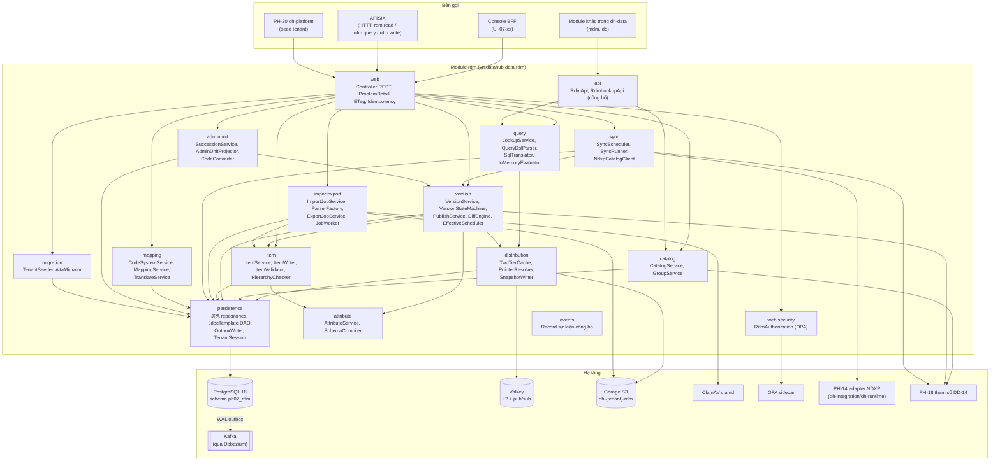
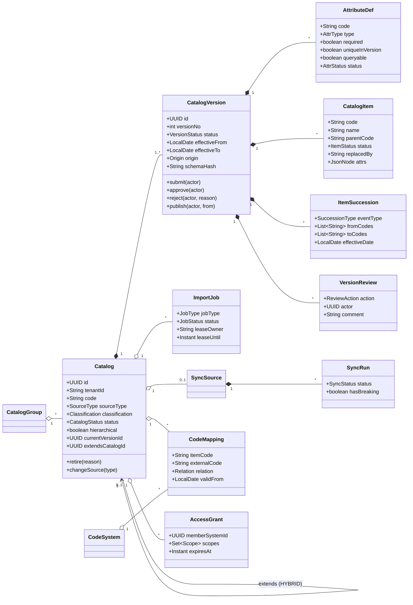
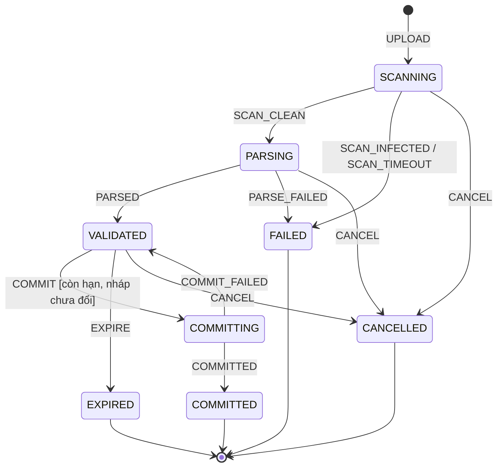
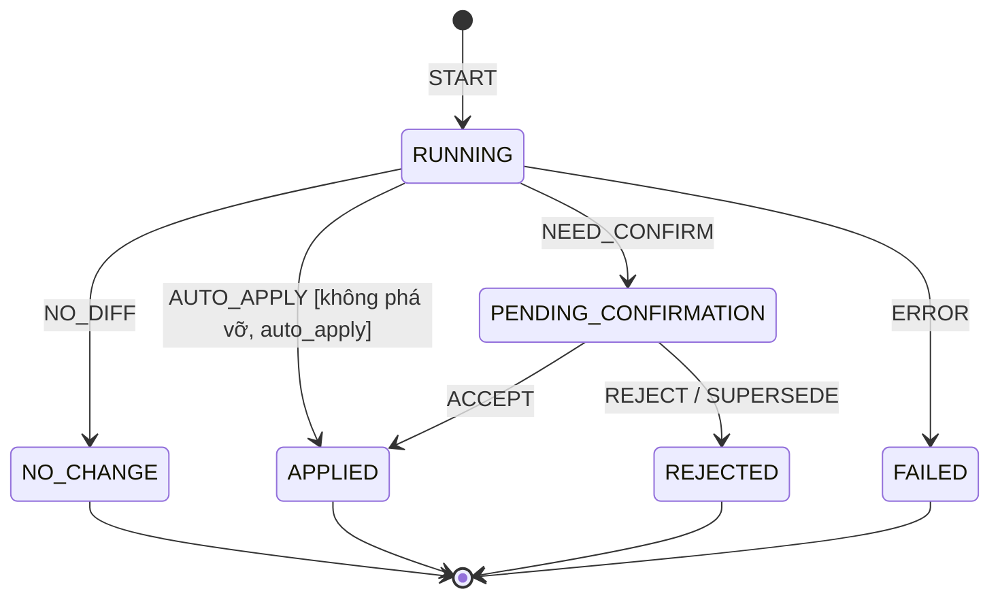
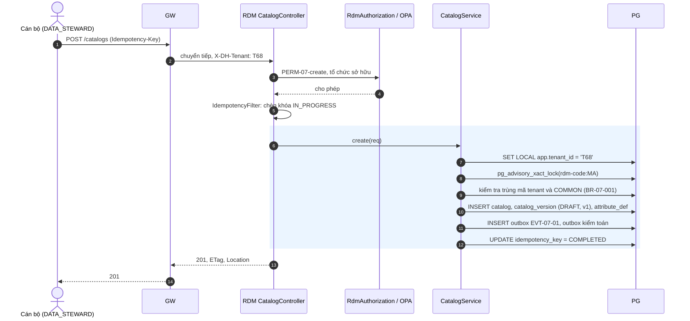
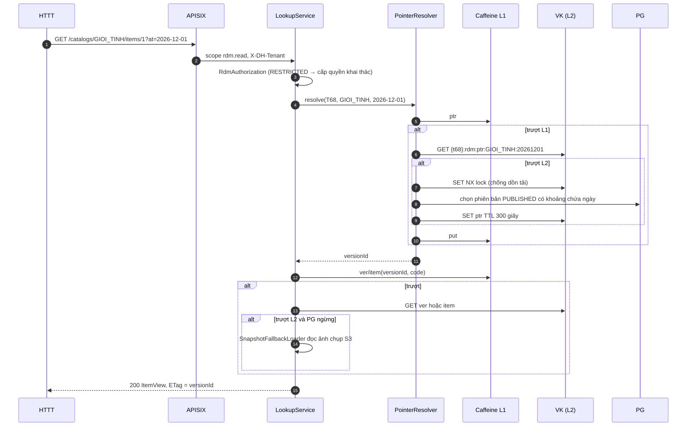
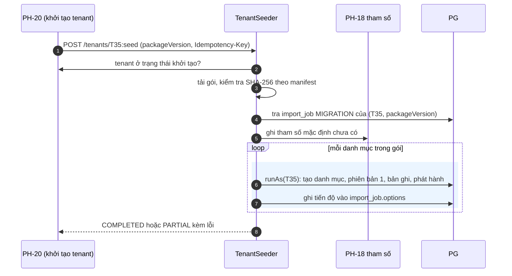
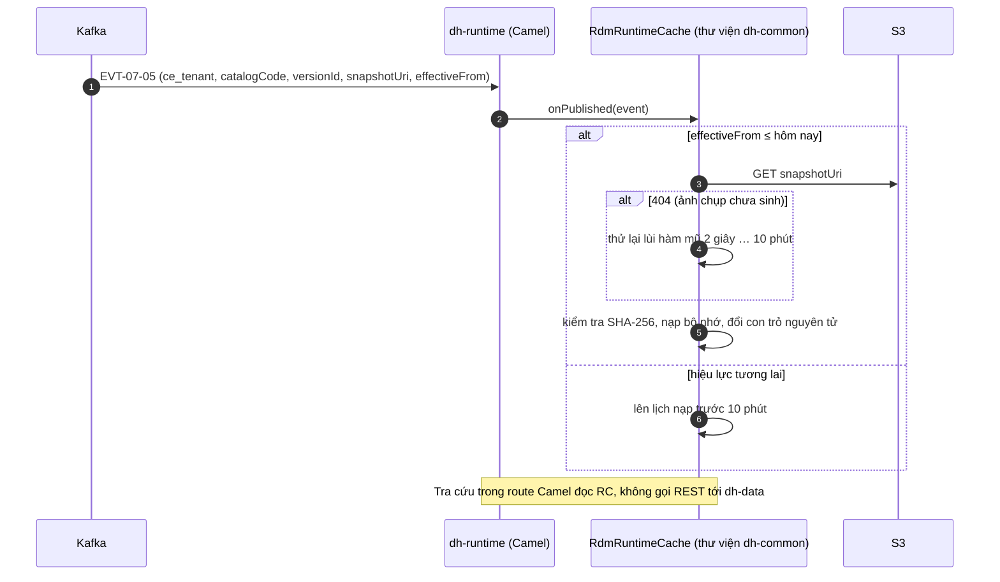

# D03-02-PH07 · Thiết kế chi tiết phân hệ PH-07 Danh mục dùng chung

## Tóm tắt cho hội đồng thẩm định

PH-07 quản lý toàn bộ danh mục dùng chung của tỉnh và các danh mục toàn quốc (đơn vị hành chính, dân tộc, giới tính, mã cơ quan…) và cung cấp chúng cho mọi hệ thống thông tin qua API. Tài liệu này mô tả cách phần mềm được xây để đáp ứng các yêu cầu đã chốt ở FRS D02-03-PH07, ở mức để đội lập trình bắt tay viết mã ngay.

Ba điểm thiết kế quyết định chất lượng của phân hệ:

1. **Danh mục có phiên bản bất biến và ngày hiệu lực.** Mỗi lần thay đổi tạo một phiên bản mới qua soạn, duyệt bốn mắt, phát hành; phiên bản đã phát hành không bị sửa. Vì thế mọi hệ thống tra được "mã này có nghĩa gì vào ngày X", điều hệ cũ Aita không làm được, và điều cần thiết khi tỉnh sắp xếp ĐVHC (Nghị quyết 202/2025/QH15).
2. **Khai thác nhanh, không phụ thuộc cơ sở dữ liệu.** Tra cứu đi qua bộ đệm hai tầng và ảnh chụp trên kho đối tượng (ADR-053), đạt p95 ≤ 20 ms và tiếp tục phục vụ ít nhất 24 giờ khi PostgreSQL ngừng (NFR-07-001, NFR-07-010).
3. **Cách ly dữ liệu giữa các tỉnh bằng cơ sở dữ liệu.** Mọi bảng bật Row Level Security; danh mục toàn quốc lưu một lần ở tenant `COMMON`, chỉ quản trị nền tảng ghi được (§6).

Về an toàn thông tin, phân hệ không lưu dữ liệu cá nhân (BR-07-025), mọi thao tác ghi được kiểm toán qua PH-13 (§4.16), tệp tải lên được quét mã độc trước khi đọc và tệp xuất được chống chèn công thức (§7). Thiết kế đáp ứng yêu cầu cấp độ 3 theo Nghị định 331/2026/NĐ-CP và TCVN 14423:2026 như mô tả ở D03-07; kết nối với Nền tảng chia sẻ, điều phối dữ liệu quốc gia theo Nghị định 278/2025/NĐ-CP đi qua PH-14 (§4.11).

Phạm vi: module `rdm` trong đơn vị triển khai `dh-data` (Spring Boot 4, Spring Modulith). Ngoài phạm vi: lược đồ CSDL chi tiết (D03-03-PH07), hợp đồng API (D03-04-PH07), màn hình (D03-06-PH07). Các điểm còn chờ quyết định ghi ở §13.3.

## 1. Phạm vi và cách đọc

### 1.1. Mục đích

Tài liệu này là thiết kế chi tiết phần mềm (Software Design Description, SDD) của phân hệ PH-07 Danh mục dùng chung (Reference Data Management, RDM) trong sản phẩm Datahub. Tài liệu chuyển các yêu cầu đã chốt ở FRS D02-03-PH07 và các quyết định kiến trúc ADR-050…058 thành cấu trúc mã nguồn, giao diện Java, thuật toán, máy trạng thái, biểu đồ tuần tự, cấu hình, quan sát và kiểm thử ở mức đủ để đội L-DATA bắt đầu viết mã mà không phải tự quyết các điểm kiến trúc.

Tài liệu không lặp lại đặc tả từng yêu cầu chức năng (thuộc FRS), không viết DDL đầy đủ (thuộc D03-03-PH07) và không viết đặc tả OpenAPI (thuộc D03-04-PH07). Khi nhắc tới bảng, cột, mã API, sự kiện, mã lỗi, tài liệu dùng đúng tên trong khung chung PH-07 và các tài liệu nền D02-07, D02-08.

### 1.2. Đối tượng đọc

Lập trình viên đọc toàn bộ, đặc biệt §3 (cấu trúc mã), §4 (thuật toán) và §8 (xử lý lỗi). Kiểm thử viên đọc §4 (máy trạng thái), §5 (biểu đồ tuần tự) và §12. Nhóm vận hành đọc §9, §10, §11. Kiến trúc sư thẩm định đọc §2, §6, §7 và §13.

### 1.3. Tài liệu liên quan

Bảng dưới đây liệt kê tài liệu mà thiết kế này dựa vào hoặc phải khớp. Đường dẫn là tương đối từ thư mục của tài liệu này.

| Mã | Tên | Đường dẫn | Quan hệ |
|---|---|---|---|
| D00-01 | Thuật ngữ, quy ước | `../../00-chung/D00-01-thuat-ngu-quy-uoc.md` | Kiểu dữ liệu T-*, cột ngữ cảnh, đặt tên |
| D02-02 | SRS tổng thể | `../../02-yeu-cau/D02-02-srs.md` | FR-00 dùng chung, NFR-00 |
| D02-07 | Từ điển dữ liệu dùng chung | `../../02-yeu-cau/D02-07-tu-dien-du-lieu.md` | DD-07 ĐVHC, DD-11 outbox, DD-12 tệp, DD-14 tham số |
| D02-08 | Ma trận phân quyền | `../../02-yeu-cau/D02-08-ma-tran-phan-quyen.md` | Vai trò, PERM-07-* |
| D02-03-PH07 | FRS PH-07 | `../../02-yeu-cau/frs/D02-03-PH07-frs-danh-muc.md` | FR-07, BR-07 |
| D02-04-PH07 | Use case PH-07 | `../../02-yeu-cau/use-case/D02-04-PH07-use-case-danh-muc.md` | UC-07 |
| D03-01 | SAD | `../D03-01-sad.md` | DU, quy ước API §7.2, outbox §7.3 |
| D03-10 | Thiết kế đa tenant | `../D03-10-thiet-ke-da-tenant.md` | RLS, COMMON, PLATFORM |
| D03-03-PH07 | Thiết kế CSDL PH-07 | `../csdl/D03-03-PH07-csdl-danh-muc.md` | DDL, chỉ mục, RLS chi tiết |
| D03-04-PH07 | Đặc tả API PH-07 | `../api/D03-04-PH07-api-danh-muc.md` | API-07, EVT-07 |
| D03-06-PH07 | Màn hình PH-07 | `../uiux/D03-06-PH07-man-hinh-danh-muc.md` | UI-07 |
| D05-02-PH07 | Ca kiểm thử PH-07 | `../../05-kiem-thu/test-case/D05-02-PH07-test-case.md` | Ca kiểm thử |

### 1.4. Quyết định kiến trúc áp dụng

Thiết kế này áp dụng các quyết định nền tảng của Datahub và tám quyết định riêng của PH-07. Bảng sau tóm tắt mỗi quyết định và nơi nó tác động trong tài liệu.

| ADR | Quyết định | Tác động trong SDD |
|---|---|---|
| ADR-001 | Spring Boot 4 + Spring Modulith, gom phân hệ thành DU | §2, §3: module `rdm` trong `dh-data` |
| ADR-003 | PostgreSQL RLS cách ly tenant | §6 |
| ADR-004 | Kafka, outbox + Debezium | §4.5, §4.14 |
| ADR-006 | Keycloak + OPA | §7 |
| ADR-007 | Flowable cho quy trình nhiều bước | Không dùng cho PH-07 ở MVP (ADR-058) |
| ADR-008 | Garage làm kho đối tượng | §4.5, §4.7, §4.8 |
| ADR-011 | OpenTelemetry, LGTM | §10 |
| ADR-013 | Tách control và data plane | §4.9, §5.9 |
| [ADR-050](../../00-chung/adr/ADR-050-jsonb-thuoc-tinh-dong.md) | Thuộc tính động jsonb + JSON Schema | §3.5, §4.1 |
| [ADR-051](../../00-chung/adr/ADR-051-phien-ban-anh-chup.md) | Phiên bản ảnh chụp copy-on-write bất biến | §4.2, §4.5, §4.6 |
| [ADR-052](../../00-chung/adr/ADR-052-danh-muc-common-va-hybrid.md) | COMMON + HYBRID phủ lớp | §4.10.6, §6 |
| [ADR-053](../../00-chung/adr/ADR-053-phan-phoi-bo-dem-hai-tang-anh-chup.md) | Bộ đệm hai tầng + ảnh chụp Garage | §4.9, §5.4, §5.9 |
| [ADR-054](../../00-chung/adr/ADR-054-dsl-truy-van-co-cau-truc.md) | DSL truy vấn JSON | §4.10 |
| [ADR-055](../../00-chung/adr/ADR-055-mo-hinh-dvhc-lich-su-ke-thua.md) | ĐVHC theo phiên bản + kế thừa + bảng chiếu | §4.13 |
| [ADR-056](../../00-chung/adr/ADR-056-nhap-tep-hai-pha.md) | Nhập tệp hai pha | §4.7 |
| [ADR-057](../../00-chung/adr/ADR-057-dong-bo-quoc-gia-qua-ph14.md) | Đồng bộ quốc gia qua PH-14 | §4.11 |
| [ADR-058](../../00-chung/adr/ADR-058-may-trang-thai-duyet-noi-bo.md) | Máy trạng thái duyệt nội bộ | §4.4 |

### 1.5. Quy ước trong tài liệu

Mã Java trong tài liệu là Java 21, dùng `record`, `sealed interface`, `switch` theo mẫu. Mã SQL là PostgreSQL 18. Ví dụ dùng tenant `T68` và người dùng giả lập `u.steward01`, `u.approver01`. Các đoạn mã là mẫu thiết kế: chữ ký công khai, tên lớp, tên bảng và thứ tự thao tác là ràng buộc; chi tiết hiện thực bên trong có thể điều chỉnh miễn giữ đúng hành vi.

## 2. Vị trí trong kiến trúc

### 2.1. Module `rdm` trong DU `dh-data`

PH-07 được hiện thực thành module Spring Modulith có tên `rdm`, nằm trong đơn vị triển khai `dh-data` cùng PH-06 (`mdm`), PH-08 (`dq`) và PH-09 (`privacy`). Module có package gốc `vn.datahub.data.rdm` và sở hữu schema PostgreSQL `ph07_rdm`. Lý do gom vào `dh-data` đã nêu ở D03-01 §4.2: cùng miền dữ liệu, cùng hồ sơ tải (đọc nhiều, ghi ít), cùng mức bảo mật. Khi tải tra cứu vượt ba lần phần còn lại trong ba tháng liên tiếp, module có thể tách thành DU riêng mà không đổi hợp đồng (ADR-053).

Module có hai mặt công bố. Mặt REST phục vụ giao diện quản trị (qua BFF của console) và ứng dụng HTTT (qua APISIX). Mặt Java (`RdmApi`, `RdmLookupApi`) phục vụ module khác trong cùng `dh-data`, ví dụ PH-06 chuẩn hóa mã địa chỉ và PH-08 kiểm tra mã hợp lệ. Mặt sự kiện phát EVT-07-01…10 qua outbox.

### 2.2. Sơ đồ thành phần (C4 mức 3)

Sơ đồ dưới đây thể hiện các thành phần bên trong module `rdm` và quan hệ với thành phần ngoài module.



Sơ đồ cho thấy ba lớp. Lớp vào (`web`, `api`) chỉ điều phối: nhận yêu cầu, kiểm tra quyền, gọi dịch vụ nghiệp vụ, ánh xạ lỗi. Lớp nghiệp vụ gồm các gói con theo năng lực (danh mục, thuộc tính, phiên bản, bản ghi, nhập xuất, truy vấn, phân phối, đồng bộ, ánh xạ, ĐVHC, di trú). Lớp `persistence` gom mọi truy cập CSDL và bảo đảm mỗi giao dịch đã đặt biến phiên tenant. Sự kiện không được gửi thẳng lên Kafka mà ghi vào bảng outbox trong cùng giao dịch; Debezium đọc WAL và phát lên Kafka (D03-01 §7.3). Gói `distribution` là thành phần duy nhất nói chuyện với Valkey và ghi ảnh chụp lên Garage, nhờ đó chính sách bộ đệm tập trung một chỗ.

### 2.3. Phụ thuộc với module và phân hệ khác

Module `rdm` tuân thủ luật Modulith của dự án (AGENTS.md §4): chỉ dùng package `api` và `events` của module khác, không chạm `internal`. Bảng dưới đây liệt kê các phụ thuộc và cách thức.

| Phụ thuộc | Hướng | Cách thức | Mục đích |
|---|---|---|---|
| `shared` (thư viện chung `dh-common`) | rdm → shared | Java | `TenantContext`, hàm tạo tên có tenant, ProblemDetail chung, outbox chung |
| PH-20 tổ chức (DD-02) | rdm → PH-20 | REST nội bộ (khác DU) có bộ đệm | Kiểm tra `owner_org_id` tồn tại, lấy tên cơ quan |
| PH-01 HTTT thành viên (DD-03) | rdm → PH-01 | REST nội bộ có bộ đệm | Kiểm tra `member_system_id` của `code_system`, `catalog_access_grant` |
| PH-14 adapter NDXP | rdm → PH-14 | REST nội bộ qua mesh (mTLS) | Đồng bộ quốc gia (ADR-057) |
| PH-18 tham số | rdm → PH-18 | REST nội bộ + sự kiện thay đổi tham số | Đọc `07.rdm.*` (DD-14) |
| PH-13 kiểm toán | rdm → PH-13 | Sự kiện kiểm toán qua thư viện chung | FR-07-050, NFR-07-015 |
| PH-11 / hộp Việc của tôi | PH-11 ← rdm | Sự kiện EVT-07-04/05/06 | Tạo, đóng việc chờ duyệt |
| PH-20 seed tenant | PH-20 → rdm | REST API-07-073 | FR-07-049 |
| `mdm`, `dq` (cùng DU) | → rdm | Java `RdmLookupApi` | Tra mã, kiểm tra mã |
| `dh-runtime` (Camel) | → rdm | Ảnh chụp Garage + EVT-07-05 | Tra cứu trong luồng (ADR-053) |

Vì `dh-data` không chứa PH-20 và PH-01, các phụ thuộc tới chúng là gọi REST qua client có thời gian chờ và bộ ngắt mạch; module không đọc chéo schema `ph20_tenant` hay `ph01_*` (D03-01 §7.3, khung §14.8).

### 2.4. Luật Spring Modulith

Module khai báo ranh giới bằng `package-info.java` ở gốc package. Module `rdm` chỉ được phụ thuộc vào module `shared`; mọi phân hệ khác truy cập qua REST hoặc sự kiện.

```java
// vn/datahub/data/rdm/package-info.java
@org.springframework.modulith.ApplicationModule(
    id = "rdm",
    displayName = "PH-07 Danh mục dùng chung",
    allowedDependencies = {"shared", "shared::tenant", "shared::outbox", "shared::problem"})
package vn.datahub.data.rdm;
```

```java
// vn/datahub/data/rdm/api/package-info.java
@org.springframework.modulith.NamedInterface("api")
package vn.datahub.data.rdm.api;

// vn/datahub/data/rdm/events/package-info.java
@org.springframework.modulith.NamedInterface("events")
package vn.datahub.data.rdm.events;
```

Kiểm thử kiến trúc bắt buộc chạy trong CI:

```java
class ModularityTests {
  static final ApplicationModules MODULES = ApplicationModules.of(DataApplication.class);

  @Test
  void verifiesModularStructure() {
    MODULES.verify(); // thất bại nếu module khác import vn.datahub.data.rdm.internal..
  }

  @Test
  void writesDocumentation() {
    new Documenter(MODULES).writeModulesAsPlantUml().writeIndividualModulesAsPlantUml();
  }
}
```

Ngoài `verify()`, module có bộ luật ArchUnit riêng (§12.6) để bảo đảm các ràng buộc nội bộ: chỉ `ItemWriter` được ghi `catalog_item`, chỉ `PublishService` được đổi trạng thái sang `PUBLISHED`, chỉ `distribution` được dùng client Valkey.

## 3. Cấu trúc mã nguồn

### 3.1. Cây package

Cây dưới đây là cấu trúc đích của module trong `apps/data/src/main/java`. Mỗi gói con của `internal` là một năng lực nghiệp vụ; lớp trong gói có phạm vi package-private trừ khi gói khác trong module cần dùng.

```text
vn/datahub/data/rdm/
├── package-info.java                      @ApplicationModule
├── api/                                   giao diện công bố cho module khác
│   ├── RdmApi.java
│   ├── RdmLookupApi.java
│   ├── dto/                               record công bố (CatalogSummary, ItemView, LookupResult, ...)
│   └── package-info.java                  @NamedInterface("api")
├── events/                                record sự kiện công bố (Modulith + outbox)
│   ├── CatalogCreated.java  CatalogUpdated.java  CatalogRetired.java
│   ├── VersionSubmitted.java  VersionPublished.java  VersionRejected.java
│   ├── ImportCompleted.java  ExportCompleted.java  SyncCompleted.java
│   ├── AdminUnitReorganized.java
│   └── package-info.java                  @NamedInterface("events")
└── internal/
    ├── catalog/        CatalogService, CatalogGroupService, CatalogPolicy, CatalogEntity, CatalogGroupEntity
    ├── version/        VersionService, VersionStateMachine, VersionTransition, PublishService,
    │                   DraftCopier, DiffEngine, BreakingClassifier, EffectiveScheduler, VersionEntity,
    │                   VersionReviewEntity, ChangeThresholdPolicy
    ├── item/           ItemService, ItemWriter, ItemValidator, HierarchyChecker, UniquenessChecker,
    │                   CatalogRefChecker, CodeNormalizer, ItemEntity (đọc), ItemRow (ghi lô)
    ├── attribute/      AttributeService, AttributeDefEntity, SchemaCompiler, CompiledSchemaCache,
    │                   AttributeCompatibilityChecker, SensitiveNameGuard
    ├── importexport/   ImportJobService, ImportJobWorker, ImportCommitter, ParserFactory,
    │                   XlsxStreamParser, PoiSaxParser, CsvStreamParser, EncodingDetector,
    │                   AitaTemplateParser, ZipBombGuard, MalwareScanner (ClamAV),
    │                   TemplateGenerator, ExportJobService, XlsxExportWriter, CsvExportWriter,
    │                   JsonExportWriter, FormulaInjectionSanitizer, JobQueue, ImportJobEntity
    ├── query/          LookupService, ItemQueryService, QueryDslParser, QueryAst (sealed),
    │                   QueryLimits, FieldResolver, SqlTranslator, InMemoryEvaluator,
    │                   CursorCodec, HybridMerger, SearchService, DeltaService, TreeService
    ├── distribution/   TwoTierCache, CacheKeys, PointerResolver, VersionLoader,
    │                   PointerInvalidationListener, SnapshotWriter, SnapshotIndexWriter,
    │                   SnapshotRetryJob, SnapshotFallbackLoader
    ├── sync/           SyncSourceService, SyncScheduler, SyncRunner, SyncDecisionPolicy,
    │                   NdxpCatalogClient, NdxpNormalizer, SyncRunEntity, SyncChangeEntity
    ├── mapping/        CodeSystemService, MappingService, TranslateService, CoverageService
    ├── adminunit/      SuccessionService, SuccessionValidator, AdminUnitProjector,
    │                   AdminUnitCodeConverter, LineageService
    ├── migration/      TenantSeeder, SeedPackage, SeedPackageRegistry, AitaMigrator (CLI profile),
    │                   AitaReader, AitaMapper, ReconciliationReport
    ├── web/            CatalogController, CatalogGroupController, VersionController,
    │                   AttributeController, DraftItemController, ImportJobController,
    │                   ExportJobController, LookupController, QueryController, SyncController,
    │                   MappingController, AdminUnitController, PlatformSeedController,
    │                   AccessGrantController, RdmExceptionHandler, EtagSupport,
    │                   IdempotencyFilter, security/RdmAuthorization, security/OpaClient
    ├── persistence/    *Repository (Spring Data JPA), ItemJdbcDao, VersionJdbcDao, ImportRowDao,
    │                   OutboxWriter, TenantSession, CommonWriteScope, IdempotencyStore
    └── config/         RdmProperties (@ConfigurationProperties "datahub.rdm"),
                        RdmCacheConfig, RdmSchedulingConfig, RdmHttpClientConfig,
                        RdmJsonConfig, RdmParamProvider (DD-14)
```

Cây package dùng `vn.datahub` thay cho `vn.lgsp` của khung W3; lộ trình chuyển nêu ở §13.

### 3.2. Trách nhiệm các lớp chính

Bảng dưới đây mô tả trách nhiệm của từng lớp then chốt. Các lớp phụ trợ (mapper, hằng số) không liệt kê.

| Gói | Lớp | Trách nhiệm |
|---|---|---|
| catalog | `CatalogService` | Tạo, sửa, xóa mềm, ngừng hiệu lực danh mục; kiểm tra BR-07-001, BR-07-009, BR-07-020; ghi EVT-07-01/02/03 |
| catalog | `CatalogPolicy` | Quyết định danh mục có ghi được trong ngữ cảnh hiện tại không (COMMON, NATIONAL, HYBRID, quyền tổ chức) |
| attribute | `SchemaCompiler` | Sinh JSON Schema 2020-12 từ danh sách `attribute_def`, tính `schema_hash` |
| attribute | `CompiledSchemaCache` | Lưu đệm `JsonSchema` đã biên dịch theo `schema_hash` |
| attribute | `AttributeCompatibilityChecker` | Kiểm tra đổi kiểu, thu hẹp ràng buộc trên dữ liệu hiện có (BR-07-013) |
| attribute | `SensitiveNameGuard` | Chặn thuộc tính có tên gợi ý dữ liệu cá nhân (BR-07-025, ERR-07-036) |
| version | `VersionService` | Tạo nháp, sửa thông tin nháp, hủy, điều phối submit/approve/reject |
| version | `VersionStateMachine` | Bảng chuyển trạng thái phiên bản, kiểm tra điều kiện bảo vệ |
| version | `DraftCopier` | Sao chép copy-on-write `attribute_def`, `catalog_item`, `item_succession` |
| version | `DiffEngine` | Tính khác biệt hai phiên bản hoặc phiên bản và tập dữ liệu ngoài |
| version | `BreakingClassifier` | Phân loại phá vỡ theo khung §3.18 |
| version | `ChangeThresholdPolicy` | Áp BR-07-012 và BR-07-026 |
| version | `PublishService` | Phát hành: khóa, đóng phiên bản trước, cập nhật con trỏ, làm mới `admin_unit`, outbox |
| version | `EffectiveScheduler` | Chuyển `current_version_id` khi phiên bản sắp hiệu lực tới ngày |
| item | `ItemWriter` | Lớp duy nhất ghi `catalog_item` (đơn lẻ và lô) |
| item | `ItemValidator` | Kiểm tra một bản ghi và kiểm tra toàn phiên bản |
| item | `HierarchyChecker` | Mã cha, vòng, độ sâu, cha DEPRECATED, tính `path`, `depth` |
| importexport | `ImportJobWorker` | Lấy tác vụ từ hàng đợi CSDL, chạy quét, phân tích, kiểm tra |
| importexport | `ImportCommitter` | Pha 2: ghi `import_row` hợp lệ vào bản nháp |
| importexport | `FormulaInjectionSanitizer` | Vô hiệu công thức khi xuất (CSV/Excel injection) |
| query | `LookupService` | Tra một mã, lô, toàn bộ, cây, delta theo thời điểm |
| query | `QueryDslParser`, `SqlTranslator` | Phân tích DSL, dịch sang SQL tham số hóa |
| query | `HybridMerger` | Hợp nhất COMMON và bản ghi địa phương |
| distribution | `TwoTierCache` | Caffeine L1 + Valkey L2, chống dồn tải |
| distribution | `PointerResolver` | Giải (tenant, catalog, ngày) thành `version_id` |
| distribution | `SnapshotWriter` | Sinh JSON.gz, CSV.gz lên Garage sau commit |
| sync | `SyncRunner` | Một lần đồng bộ: gọi PH-14, chuẩn hóa, diff, quyết định |
| mapping | `TranslateService` | Chuyển mã qua bảng ánh xạ |
| adminunit | `AdminUnitCodeConverter` | Chuyển mã ĐVHC theo chuỗi kế thừa |
| adminunit | `AdminUnitProjector` | Làm mới bảng chiếu `admin_unit` |
| migration | `TenantSeeder` | Nạp gói danh mục nền idempotent |
| migration | `AitaMigrator` | Công cụ di trú một lần từ CSDL Aita |
| persistence | `TenantSession` | Đặt `SET LOCAL app.tenant_id` đầu mỗi giao dịch |
| persistence | `OutboxWriter` | Ghi bảng `ph07_rdm.outbox` theo DD-11 |
| persistence | `IdempotencyStore` | Lưu và đối chiếu `Idempotency-Key` |
| web | `RdmExceptionHandler` | Ánh xạ exception sang RFC 9457 |

### 3.3. Giao diện công bố `RdmApi` và `RdmLookupApi`

Module công bố hai giao diện Java. `RdmLookupApi` là giao diện khai thác chỉ đọc, tối ưu cho module khác trong `dh-data` gọi với tần suất cao (mọi lời gọi đi qua bộ đệm hai tầng). `RdmApi` là giao diện quản trị mỏng cho các nhu cầu liệt kê và đọc metadata; module khác không được ghi danh mục qua Java mà phải đi qua REST để có kiểm tra quyền và kiểm toán đầy đủ. Cả hai giao diện thực thi trong `TenantContext` hiện hành của bên gọi.

```java
package vn.datahub.data.rdm.api;

import java.time.LocalDate;
import java.util.Collection;
import java.util.List;
import java.util.Map;
import java.util.Optional;
import vn.datahub.data.rdm.api.dto.*;

/**
 * Giao diện khai thác danh mục cho module khác trong dh-data (PH-07, FR-07-026…033).
 * Mọi phương thức chỉ đọc, đi qua bộ đệm hai tầng, tôn trọng TenantContext và HYBRID.
 * Tham số {@code at} rỗng nghĩa là ngày hiện tại theo giờ Asia/Ho_Chi_Minh (BR-07-008).
 */
public interface RdmLookupApi {

  /** Tra một mã. Trả rỗng nếu không có tại thời điểm (tương ứng ERR-07-007 ở REST). */
  Optional<ItemView> lookup(String catalogCode, String itemCode, LocalDate at);

  /** Tra lô tối đa 500 mã; kết quả giữ thứ tự đầu vào, mã không thấy có found=false. */
  List<LookupResult> lookupBatch(String catalogCode, Collection<String> itemCodes, LocalDate at);

  /** Kiểm tra nhanh một mã có hợp lệ (tồn tại, ACTIVE) tại thời điểm. */
  boolean isValid(String catalogCode, String itemCode, LocalDate at);

  /** Toàn bộ bản ghi theo trang con trỏ. limit ≤ 1000. */
  ItemPage listItems(String catalogCode, LocalDate at, String cursor, int limit,
                     boolean includeDeprecated);

  /** Cây con từ root (rỗng = gốc), tối đa depth cấp. */
  List<TreeNode> tree(String catalogCode, String rootCode, int depth, LocalDate at);

  /** Truy vấn có cấu trúc theo DSL (ADR-054). */
  ItemPage query(String catalogCode, ItemQuery query);

  /** Chuyển mã qua bảng ánh xạ (FR-07-042). */
  List<TranslateResult> translate(String catalogCode, String codeSystem,
                                  TranslateDirection direction, Collection<String> codes,
                                  LocalDate at);

  /** Chuyển mã ĐVHC cũ sang mới hoặc ngược lại tại ngày đích (FR-07-046). */
  List<AdminUnitConversion> convertAdminUnits(Collection<String> codes, LocalDate fromDate,
                                              LocalDate toDate, ConversionDirection direction);

  /** Phiên bản hiệu lực tại thời điểm (dùng làm ETag, khóa đệm của bên gọi). */
  Optional<VersionRef> effectiveVersion(String catalogCode, LocalDate at);
}
```

```java
package vn.datahub.data.rdm.api;

import java.util.List;
import java.util.Optional;
import vn.datahub.data.rdm.api.dto.*;

/** Giao diện đọc metadata danh mục cho module khác (FR-07-001, FR-07-033). */
public interface RdmApi {

  /** Trạng thái module, dùng cho health check tổng hợp. */
  ModuleStatus status();

  /** Danh mục khả dụng với tenant hiện hành (gồm COMMON đang ACTIVE). */
  List<CatalogSummary> listCatalogs(CatalogFilter filter);

  Optional<CatalogSummary> findCatalog(String catalogCode);

  /** Lược đồ thuộc tính và JSON Schema của một phiên bản (rỗng = hiện hành). */
  Optional<CatalogSchema> schema(String catalogCode, Integer versionNo);

  /** Đơn vị hành chính hiện hành theo id ổn định của bảng chiếu admin_unit (DD-07). */
  Optional<AdminUnitView> adminUnit(java.util.UUID adminUnitId);
}
```

Hai giao diện được hiện thực bởi `internal.query.RdmLookupFacade` và `internal.catalog.RdmApiFacade`, đánh dấu `@Service` và `@Transactional(readOnly = true)`.

### 3.4. DTO và record chính

Các record dưới đây gồm cả DTO công bố trong `api.dto` và record yêu cầu REST trong `internal.web.dto`. Annotation `jakarta.validation` được Spring kiểm tra tự động ở controller; lỗi ràng buộc ánh xạ sang ERR-07-009 với mảng `errors[]` (§8). Mã danh mục và mã bản ghi theo T-CODE: chữ hoa, chữ số, gạch dưới, gạch ngang, dấu chấm, tối đa 64 ký tự.

```java
package vn.datahub.data.rdm.api.dto;

public record ItemView(
    String catalogCode, int versionNo, String code, String name, String parentCode,
    int depth, List<String> path, String levelName, Integer sortOrder,
    ItemStatus status, List<String> replacedBy, LocalDate validFrom, LocalDate validTo,
    Map<String, Object> attrs, boolean localExtension) {}

public enum ItemStatus { ACTIVE, DEPRECATED }

public record LookupResult(String requestedCode, boolean found, ItemView item) {}

public record ItemPage(List<ItemView> items, String nextCursor, VersionRef version) {}

public record VersionRef(java.util.UUID versionId, String catalogCode, int versionNo,
                         LocalDate effectiveFrom, LocalDate effectiveTo, String etag) {}

public record TreeNode(ItemView item, List<TreeNode> children) {}

public record TranslateResult(String input, TranslateOutcome outcome, List<String> outputs,
                              String relation, boolean provisional) {}
public enum TranslateOutcome { MAPPED, NOT_MAPPED, MULTIPLE }
public enum TranslateDirection { TO_CATALOG, FROM_CATALOG }

public record AdminUnitConversion(String input, ConversionOutcome outcome,
                                  List<AdminUnitCandidate> candidates, List<String> path) {}
public enum ConversionOutcome { UNCHANGED, CONVERTED, AMBIGUOUS, ABOLISHED, NOT_FOUND }
public enum ConversionDirection { FORWARD, BACKWARD }
public record AdminUnitCandidate(String code, String name, String level, String eventType,
                                 LocalDate effectiveDate, String legalBasis) {}
```

```java
package vn.datahub.data.rdm.internal.web.dto;

import jakarta.validation.Valid;
import jakarta.validation.constraints.*;

public record CreateCatalogRequest(
    @NotBlank @Pattern(regexp = "^[A-Z0-9][A-Z0-9_.-]{1,63}$") String code,
    @NotBlank @Size(max = 255) String name,
    @Size(max = 4000) String description,
    java.util.UUID groupId,
    @NotNull java.util.UUID ownerOrgId,
    @NotNull SourceType sourceType,
    @NotNull Classification classification,
    boolean hierarchical,
    @Min(1) @Max(10) Integer maxDepth,
    @Size(max = 10) List<@NotBlank @Size(max = 50) String> levelNames,
    @Size(max = 200) String localCodePattern,
    @Pattern(regexp = "^[A-Z0-9][A-Z0-9_.-]{1,63}$") String extendsCatalogCode,
    boolean requireApproval,
    @Valid @Size(max = 100) List<AttributeDefRequest> attributes) {}

public record AttributeDefRequest(
    @NotBlank @Pattern(regexp = "^[a-z][a-z0-9_]{0,62}$") String code,
    @NotBlank @Size(max = 255) String label,
    @NotNull DataType dataType,
    boolean required,
    boolean uniqueInVersion,
    @Positive @Max(4000) Integer maxLength,
    @Size(max = 500) String pattern,
    java.math.BigDecimal minValue,
    java.math.BigDecimal maxValue,
    @Size(max = 500) List<@Valid EnumValue> enumValues,
    @Pattern(regexp = "^[A-Z0-9][A-Z0-9_.-]{1,63}$") String refCatalogCode,
    String defaultValue,
    @PositiveOrZero Integer sortOrder,
    boolean queryable,
    boolean searchable,
    @Size(max = 2000) String description) {}

public record EnumValue(@NotBlank @Size(max = 64) String value, @NotBlank @Size(max = 255) String label) {}

public enum DataType { STRING, TEXT, INTEGER, DECIMAL, BOOLEAN, DATE, DATETIME, ENUM, CATALOG_REF, URI, EMAIL }
public enum SourceType { LOCAL, NATIONAL, HYBRID }
public enum Classification { PUBLIC, INTERNAL, RESTRICTED }

public record UpsertItemRequest(
    @NotBlank @Pattern(regexp = "^[A-Za-z0-9][A-Za-z0-9_.-]{0,63}$") String code,
    @NotBlank @Size(max = 500) String name,
    @Size(max = 64) String parentCode,
    Integer sortOrder,
    LocalDate validFrom,
    LocalDate validTo,
    @NotNull Map<String, Object> attrs) {}

public record DeprecateItemRequest(
    @Size(max = 20) List<@NotBlank String> replacedBy,
    @Size(max = 1000) String reason) {}

public record PublishRequest(
    @NotNull LocalDate effectiveFrom,
    @NotBlank @Size(max = 500) String legalBasis,
    @Size(max = 2000) String changeNote,
    @Size(max = 1000) String retroactiveReason) {}

public record ReviewDecisionRequest(@Size(max = 2000) String comment) {}

public record BatchItemsRequest(
    @NotNull @Size(min = 1, max = 5000) List<@Valid BatchOp> operations,
    boolean continueOnError) {}

public record BatchOp(@NotNull BatchOpType op, @NotBlank String code, @Valid UpsertItemRequest item,
                      @Valid DeprecateItemRequest deprecate) {}
public enum BatchOpType { UPSERT, DEPRECATE, DELETE }

public record CreateImportJobRequest(        // phần JSON "options" của multipart API-07-033
    @NotNull ImportMode mode,
    String catalogCode,                       // bắt buộc trừ CREATE_CATALOG
    @NotNull ImportTemplate template,
    Map<String, String> columnMapping,
    boolean skipInvalidRows) {}
public enum ImportMode { UPSERT, REPLACE, APPEND, CREATE_CATALOG }
public enum ImportTemplate { STANDARD, LEGACY_AITA }

public record ItemQuery(                      // thân API-07-047 (ADR-054)
    LocalDate at,
    @NotNull com.fasterxml.jackson.databind.JsonNode filter,
    @Size(max = 50) List<String> select,
    @Size(max = 3) List<@Valid SortSpec> sort,
    @Min(1) @Max(1000) Integer limit,
    @Size(max = 2048) String cursor,
    boolean includeDeprecated) {}
public record SortSpec(@NotBlank String field, @Pattern(regexp = "asc|desc") String dir) {}

public record ConvertAdminUnitsRequest(
    @NotNull @Size(min = 1, max = 1000) List<@NotBlank String> codes,
    LocalDate fromDate, LocalDate toDate,
    @NotNull ConversionDirection direction) {}
```

### 3.5. Lựa chọn công nghệ truy cập dữ liệu

Module dùng hai cơ chế truy cập dữ liệu, mỗi cơ chế cho một loại thao tác. Lựa chọn này cân nhắc ba đặc điểm của PH-07: dữ liệu bản ghi nằm trong `jsonb` có cấu trúc động; thao tác copy-on-write và nhập tệp tác động hàng chục nghìn dòng một lần; truy vấn khai thác được sinh động từ DSL.

**Spring Data JPA (Hibernate 7)** dùng cho các aggregate có vòng đời và quy tắc nghiệp vụ phong phú nhưng số dòng nhỏ: `catalog_group`, `catalog`, `catalog_version`, `attribute_def`, `version_review`, `import_job`, `sync_source`, `sync_run`, `code_system`, `code_mapping`, `catalog_access_grant`. JPA cho khóa lạc quan qua cột `version` (`@Version`) khớp với `If-Match`/ETag (D03-01 §7.2), cho `@PessimisticLock` khi phát hành, và giảm mã lặp. Cột `jsonb` của các bảng này (`level_names`, `stats`, `options`, `field_mapping`, `enum_values`) ánh xạ bằng `@JdbcTypeCode(SqlTypes.JSON)` sẵn có trong Hibernate 6+.

**JdbcTemplate / NamedParameterJdbcTemplate** dùng cho `catalog_item`, `import_row`, `item_succession` ở các thao tác hàng loạt và truy vấn động: `INSERT … SELECT` sao chép phiên bản, `batchUpdate` 1.000 dòng khi nhập, `INSERT … ON CONFLICT` khi commit, truy vấn DSL, tra cứu nạp phiên bản vào bộ đệm. Lý do không dùng JPA cho các bảng này: Hibernate nạp từng thực thể vào ngữ cảnh lưu trữ, gây tốn bộ nhớ và chậm với 200.000 dòng; câu `INSERT … SELECT` không biểu diễn được tự nhiên bằng JPA; SQL sinh từ DSL cần kiểm soát tuyệt đối để bảo đảm tham số hóa. Spring Data JDBC đã được cân nhắc nhưng không mang lại lợi ích so với JdbcTemplate cho các thao tác này, trong khi thiếu `@Version` kết hợp khóa bi quan tiện như JPA cho aggregate. jOOQ không dùng ở MVP để tránh thêm bước sinh mã; nếu trình dịch DSL phình to có thể xem xét lại (Câu hỏi mở Q07-30).

Mọi đường ghi vào CSDL, dù JPA hay JdbcTemplate, đi qua cùng một `DataSource` được bọc bởi `TenantSession` (§6.2), nên RLS luôn có hiệu lực.

Entity JPA chính:

```java
@Entity
@Table(name = "catalog", schema = "ph07_rdm")
class CatalogEntity extends TenantScopedEntity {   // id uuid v7, tenant_id, created_*, updated_*, @Version version
  @Column(nullable = false, length = 64) private String code;
  @Column(nullable = false) private String name;
  private String description;
  private UUID groupId;
  @Column(nullable = false) private UUID ownerOrgId;
  @Enumerated(EnumType.STRING) @Column(nullable = false) private SourceType sourceType;
  @Enumerated(EnumType.STRING) @Column(nullable = false) private Classification classification;
  @Enumerated(EnumType.STRING) @Column(nullable = false) private CatalogStatus status; // DRAFT, ACTIVE, RETIRED
  private boolean isHierarchical;
  private Integer maxDepth;
  @JdbcTypeCode(SqlTypes.JSON) private List<String> levelNames;
  private String localCodePattern;
  private UUID extendsCatalogId;
  private boolean requireApproval;
  private UUID currentVersionId;
  private String legacyRef;
  private OffsetDateTime deletedAt;

  boolean isCommon() { return "COMMON".equals(getTenantId()); }
  boolean isOpenForUserWrite() { return sourceType != SourceType.NATIONAL && status != CatalogStatus.RETIRED; }
}

@Entity
@Table(name = "catalog_version", schema = "ph07_rdm")
class VersionEntity extends TenantScopedEntity {
  @Column(nullable = false) private UUID catalogId;
  @Column(nullable = false) private int versionNo;
  @Enumerated(EnumType.STRING) @Column(nullable = false) private VersionStatus status;
  private LocalDate effectiveFrom;
  private LocalDate effectiveTo;
  private String legalBasis;
  private String changeNote;
  @Enumerated(EnumType.STRING) private VersionOrigin origin; // MANUAL, IMPORT, API, SYNC, MIGRATION
  private int itemCount;
  @JdbcTypeCode(SqlTypes.JSON) private VersionStats stats;
  private String submittedBy;  private OffsetDateTime submittedAt;
  private String approvedBy;   private OffsetDateTime approvedAt;
  private String publishedBy;  private OffsetDateTime publishedAt;
  private String snapshotUri;
  private String schemaHash;
}

enum VersionStatus { DRAFT, IN_REVIEW, APPROVED, PUBLISHED, DISCARDED;
  boolean isOpen() { return this == DRAFT || this == IN_REVIEW || this == APPROVED; } }

record VersionStats(int added, int changed, int deprecated, int removed, int breaking,
                    int attributesAdded, int attributesRemoved, int attributesChanged) {}
```

`catalog_item` không có entity JPA ghi; đọc và ghi qua `ItemJdbcDao` với record `ItemRow`:

```java
record ItemRow(UUID id, String tenantId, UUID versionId, UUID catalogId, String code, String name,
               String parentCode, int depth, String[] path, String levelName, Integer sortOrder,
               ItemStatus status, String[] replacedBy, LocalDate validFrom, LocalDate validTo,
               String attrsJson, boolean localExtension, String legacyRef, int version) {}
```

Cột `name_search` là cột sinh (`GENERATED ALWAYS AS (lower(ph07_rdm.immutable_unaccent(name))) STORED`) do CSDL tính, ứng dụng không ghi. Hàm `immutable_unaccent` là bọc `IMMUTABLE` của `unaccent` với từ điển cố định, định nghĩa ở D03-03-PH07.

### 3.6. Sơ đồ lớp miền và bất biến

Sơ đồ dưới đây là mô hình miền của module ở mức aggregate. Mỗi aggregate có một lớp gốc chịu trách nhiệm giữ bất biến; lớp khác chỉ thay đổi aggregate qua phương thức của gốc hoặc qua dịch vụ được nêu ở §3.2.



Sơ đồ cho thấy hai aggregate lớn. `Catalog` sở hữu phiên bản; `CatalogVersion` sở hữu thuộc tính, bản ghi, sự kiện sắp xếp và lịch sử duyệt của chính nó. Các aggregate vận hành (`ImportJob`, `SyncSource`, `CodeMapping`, `AccessGrant`) chỉ tham chiếu danh mục bằng id, không nằm trong ranh giới giao dịch của danh mục. Bảng dưới đây liệt kê các bất biến và nơi bảo đảm.

| Aggregate | Bất biến | Bảo đảm ở ứng dụng | Lưới an toàn ở CSDL |
|---|---|---|---|
| Catalog | Mã danh mục duy nhất trong tenant và không trùng `COMMON` đang dùng (BR-07-001) | `CatalogService.create`, giữ khóa tư vấn theo mã trong giao dịch | Chỉ mục duy nhất `uq_catalog_tenant_code`; trùng với `COMMON` không chặn được bằng chỉ mục vì khác tenant |
| Catalog | Mỗi danh mục có tối đa một phiên bản mở (`DRAFT`, `IN_REVIEW`, `APPROVED`) | `VersionService.createDraft` khóa hàng danh mục | Chỉ mục duy nhất từng phần trên `catalog_version` |
| CatalogVersion | Phiên bản `PUBLISHED` không đổi nội dung (ADR-051) | `VersionStateMachine` không có chuyển trạng thái sửa | Trigger bất biến trên `catalog_version`, `attribute_def`, `catalog_item` |
| CatalogVersion | Khoảng hiệu lực các phiên bản đã phát hành không chồng lấn (BR-07-007) | `PublishService.dateRules` | Ràng buộc `EXCLUDE USING gist` |
| CatalogVersion | Người duyệt khác người trình (BR-07-011) | `VersionStateMachine` điều kiện bảo vệ | Không (quy tắc nghiệp vụ) |
| CatalogItem | Mã duy nhất trong phiên bản; mã cha tồn tại, không vòng, không vượt độ sâu (BR-07-002, 004) | `ItemValidator`, `HierarchyChecker` | Duy nhất `(version_id, code)`; `f_recompute_hierarchy` |
| CatalogItem | Thuộc tính đúng lược đồ (BR-07-003) | `SchemaCompiler` + JSON Schema | Không (jsonb tự do theo ADR-050) |
| ItemSuccession | Một mã ĐVHC không dùng cho hai đơn vị trong cùng khoảng thời gian (BR-07-021) | `SuccessionValidator` | `ex_admin_unit_code` trên `admin_unit` |
| CodeMapping | Mỗi mã ngoài trỏ tới tối đa một mã danh mục trong khoảng hiệu lực giao nhau (BR-07-023) | `MappingService` | `ex_code_mapping_external` |
| ImportJob | Commit chỉ khi bản nháp không đổi từ lúc phân tích (BR-07-016) | `ImportCommitter` so `draft_lock_version` | Không |

## 4. Thiết kế chi tiết từng thành phần

Mục này mô tả thuật toán của từng thành phần theo thứ tự luồng dữ liệu: kiểm tra hợp lệ, tạo nháp, so sánh, máy trạng thái, phát hành, lịch hiệu lực, nhập, xuất, bộ đệm, truy vấn, đồng bộ, ánh xạ, ĐVHC, seed và di trú.

### 4.1. Kiểm tra hợp lệ theo lược đồ

#### 4.1.1. Các tầng kiểm tra

Một bản ghi được coi là hợp lệ khi qua đủ năm tầng kiểm tra. Ba tầng đầu chỉ cần bản thân bản ghi và lược đồ nên chạy được trên từng dòng riêng lẻ (dùng khi nhập lô, nhập tệp theo luồng). Hai tầng sau cần toàn bộ phiên bản nên chạy theo tập.

| Tầng | Nội dung | Cách thực hiện | Mã lỗi |
|---|---|---|---|
| 1. Cột hệ thống | `code` theo T-CODE, `name` không rỗng ≤ 500, `validFrom ≤ validTo` | Mã Java trong `ItemValidator` | ERR-07-009 |
| 2. Thuộc tính động | Kiểu, bắt buộc, độ dài, mẫu, khoảng, miền giá trị, khóa lạ | JSON Schema 2020-12 qua networknt | ERR-07-009 |
| 3. Dải mã địa phương | Bản ghi HYBRID khớp `local_code_pattern` | `java.util.regex.Pattern` đã biên dịch, giới hạn thời gian | ERR-07-012 |
| 4. Duy nhất | `code` duy nhất (không phân biệt hoa thường); thuộc tính `unique_in_version` | Chỉ mục duy nhất CSDL + kiểm tra tập trước khi ghi | ERR-07-008, ERR-07-009 |
| 5. Tham chiếu và phân cấp | Mã cha tồn tại, không vòng, độ sâu, cha không DEPRECATED; `CATALOG_REF` tồn tại | Duyệt đồ thị trong bộ nhớ; tra cứu `RdmLookupApi` | ERR-07-010, ERR-07-011, ERR-07-009 |

#### 4.1.2. Sinh JSON Schema từ `attribute_def`

`SchemaCompiler` nhận danh sách `attribute_def` có `status = ACTIVE` hoặc `HIDDEN` (thuộc tính ẩn vẫn được kiểm tra vì chỉ ẩn khỏi giao diện) và sinh lược đồ cho đối tượng `attrs`. Ánh xạ kiểu theo bảng sau.

| `data_type` | Phân đoạn JSON Schema | Ghi chú |
|---|---|---|
| `STRING` | `{"type":"string","maxLength":n,"pattern":p}` | `maxLength` mặc định 500 |
| `TEXT` | `{"type":"string","maxLength":n}` | mặc định 4000 |
| `INTEGER` | `{"type":"integer","minimum":a,"maximum":b}` | giá trị trong khoảng `long` |
| `DECIMAL` | `{"type":"number","minimum":a,"maximum":b}` | lưu dạng số JSON; xuất giữ nguyên độ chính xác bằng `BigDecimal` |
| `BOOLEAN` | `{"type":"boolean"}` | |
| `DATE` | `{"type":"string","format":"date"}` | bật kiểm tra `format` |
| `DATETIME` | `{"type":"string","format":"date-time"}` | |
| `ENUM` | `{"type":"string","enum":[…]}` | lấy `enum_values[].value` |
| `CATALOG_REF` | `{"type":"string","pattern":"^[A-Za-z0-9][A-Za-z0-9_.-]{0,63}$"}` | tồn tại được kiểm ở tầng 5 |
| `URI` | `{"type":"string","format":"uri","maxLength":2000}` | chỉ `https`, `http` (từ khóa tùy biến) |
| `EMAIL` | `{"type":"string","format":"email","maxLength":254}` | |

Thuộc tính `required = true` đưa vào mảng `required`; giá trị `null` được coi như vắng mặt (lược đồ dùng `"type":["string","null"]` cho thuộc tính không bắt buộc). Lược đồ đặt `"additionalProperties": false` để chặn khóa lạ, tránh dữ liệu rác lọt vào `attrs`.

```java
final class SchemaCompiler {
  private static final ObjectMapper M = JsonMapper.builder().build();
  private final JsonSchemaFactory factory = JsonSchemaFactory.getInstance(SpecVersion.VersionFlag.V202012);
  private final SchemaValidatorsConfig cfg = SchemaValidatorsConfig.builder()
      .formatAssertionsEnabled(true).failFast(false).locale(Locale.forLanguageTag("vi")).build();

  CompiledSchema compile(UUID versionId, List<AttributeDef> defs) {
    ObjectNode root = M.createObjectNode()
        .put("$schema", "https://json-schema.org/draft/2020-12/schema")
        .put("type", "object").put("additionalProperties", false);
    ObjectNode props = root.putObject("properties");
    ArrayNode required = root.putArray("required");
    defs.stream().sorted(comparing(AttributeDef::sortOrder)).forEach(d -> {
      props.set(d.code(), fragment(d));
      if (d.required()) required.add(d.code());
    });
    String canonical = Canonical.json(root);              // khóa sắp xếp, không khoảng trắng
    String hash = Hashing.sha256Hex(canonical);
    return new CompiledSchema(versionId, hash, root, factory.getSchema(root, cfg));
  }

  private ObjectNode fragment(AttributeDef d) {
    ObjectNode f = M.createObjectNode();
    String jsonType = switch (d.dataType()) {
      case STRING, TEXT, DATE, DATETIME, ENUM, CATALOG_REF, URI, EMAIL -> "string";
      case INTEGER -> "integer";
      case DECIMAL -> "number";
      case BOOLEAN -> "boolean";
    };
    if (d.required()) f.put("type", jsonType); else f.putArray("type").add(jsonType).add("null");
    switch (d.dataType()) {
      case STRING -> { f.put("maxLength", nvl(d.maxLength(), 500)); putIf(f, "pattern", d.pattern()); }
      case TEXT -> f.put("maxLength", nvl(d.maxLength(), 4000));
      case INTEGER, DECIMAL -> { putIf(f, "minimum", d.minValue()); putIf(f, "maximum", d.maxValue()); }
      case DATE -> f.put("format", "date");
      case DATETIME -> f.put("format", "date-time");
      case ENUM -> { ArrayNode e = f.putArray("enum"); d.enumValues().forEach(v -> e.add(v.value()));
                     if (!d.required()) e.addNull(); }
      case CATALOG_REF -> f.put("pattern", "^[A-Za-z0-9][A-Za-z0-9_.-]{0,63}$");
      case URI -> { f.put("format", "uri"); f.put("maxLength", 2000); }
      case EMAIL -> { f.put("format", "email"); f.put("maxLength", 254); }
      case BOOLEAN -> { }
    }
    f.put("title", d.label());
    return f;
  }
}
```

Lược đồ đã biên dịch được lưu ở `CompiledSchemaCache` (Caffeine, tối đa 2.000 mục, khóa `schema_hash`). Với phiên bản đã phát hành, `schema_hash` được ghi vào `catalog_version` khi phát hành; với bản nháp, hash tính lại sau mỗi thay đổi thuộc tính. Cùng một lược đồ (không có `title` của nhãn tiếng Việt khác nhau) dùng chung một mục đệm. API-07-048 trả đúng đối tượng `root` này.

Mẫu biểu thức chính quy (`pattern`) do người dùng nhập được kiểm tra khi khai báo: biên dịch thành công, độ dài ≤ 500, và chạy thử trên chuỗi 10.000 ký tự trong giới hạn 50 ms để phát hiện mẫu có nguy cơ quay lui thảm họa (ReDoS). networknt được cấu hình dùng bộ máy regex `JoniRegularExpressionFactory` (có ngắt theo bước) thay cho `java.util.regex` cho từ khóa `pattern`. Câu hỏi mở Q07-31 ghi nhận việc chọn bộ máy regex cuối cùng.

#### 4.1.3. Chuyển lỗi lược đồ thành lỗi theo trường

networknt trả tập `ValidationMessage` có `instanceLocation` (ví dụ `/attrs/dien_tich`) và `type` (ví dụ `maxLength`). `ItemValidator` ánh xạ mỗi thông điệp thành `FieldError(field, code, message)` với `field` theo cách gọi của API (`attrs.dien_tich`), `code` là mã con ổn định (`TYPE`, `REQUIRED`, `MAX_LENGTH`, `PATTERN`, `MIN`, `MAX`, `ENUM`, `FORMAT`, `UNKNOWN_FIELD`) và `message` tiếng Việt. Mã con giúp giao diện và bên khai thác xử lý tự động; thông điệp chỉ để hiển thị.

```java
record FieldError(String field, String code, String message, Object rejectedValue) {}

record ItemValidationResult(String itemCode, List<FieldError> errors) {
  boolean valid() { return errors.isEmpty(); }
}
```

`rejectedValue` chỉ được điền khi danh mục có `classification = PUBLIC`; với `INTERNAL` và `RESTRICTED` để `null` nhằm không lặp lại dữ liệu trong log và báo cáo lỗi (FR-00-062).

#### 4.1.4. Kiểm tra duy nhất

Mã bản ghi được chuẩn hóa bởi `CodeNormalizer` trước mọi so sánh: bỏ khoảng trắng đầu cuối, chuyển chữ hoa theo `Locale.ROOT`, không đổi dấu chấm hay gạch. Mã lưu dạng chuẩn hóa nên CSDL có chỉ mục duy nhất `(version_id, code)`; bảo đảm cuối cùng là CSDL và lỗi `23505` ánh xạ sang ERR-07-008. Với nhập tệp và nhập lô, trùng mã được phát hiện trước khi ghi bằng `HashMap<String, Integer>` mã → số dòng xuất hiện đầu tiên, để báo cả hai dòng trùng.

Thuộc tính `unique_in_version = true` được kiểm tra bằng truy vấn khi ghi đơn lẻ:

```sql
SELECT code FROM ph07_rdm.catalog_item
 WHERE version_id = :versionId AND code <> :code
   AND attrs ->> :attrCode = :value
 LIMIT 1;
```

và bằng `HashMap` giá trị → mã khi kiểm tra theo tập. CSDL không có chỉ mục duy nhất trên thuộc tính động vì tập thuộc tính thay đổi theo phiên bản; đây là điểm chấp nhận được vì mọi đường ghi đều qua `ItemWriter` và được tuần tự hóa theo khóa tư vấn của phiên bản (§4.2.3).

#### 4.1.5. Kiểm tra phân cấp bằng duyệt đồ thị

`HierarchyChecker` kiểm tra BR-07-014 và tính `depth`, `path`, `level_name` cho mọi bản ghi của phiên bản. Thuật toán chạy trong bộ nhớ trên bản đồ `code → parentCode`; với 200.000 bản ghi, bản đồ tốn khoảng 30 MB và chạy dưới 300 ms.

```java
final class HierarchyChecker {

  record Node(String code, String parentCode, ItemStatus status) {}
  record Placement(int depth, String[] path, String levelName) {}

  /** Trả lỗi theo mã, đồng thời điền placement cho bản ghi hợp lệ. */
  Map<String, List<FieldError>> check(Map<String, Node> nodes, int maxDepth, List<String> levelNames,
                                      Map<String, Placement> out) {
    Map<String, List<FieldError>> errors = new HashMap<>();
    // 0 = chưa thăm, 1 = đang thăm (trên ngăn xếp), 2 = xong
    Map<String, Integer> state = new HashMap<>(nodes.size() * 2);
    for (String start : nodes.keySet()) {
      if (state.getOrDefault(start, 0) == 2) continue;
      Deque<String> stack = new ArrayDeque<>();
      String cur = start;
      // Đi lên theo cha tới khi gặp gốc, nút đã xong, hoặc vòng
      while (cur != null && state.getOrDefault(cur, 0) == 0) {
        state.put(cur, 1); stack.push(cur);
        Node n = nodes.get(cur);
        String p = n.parentCode();
        if (p != null && !nodes.containsKey(p)) {
          err(errors, cur, "parentCode", "PARENT_NOT_FOUND", "Mã cha " + p + " không tồn tại trong phiên bản");
          p = null; // coi như gốc để tiếp tục tính cho nhánh dưới, nhưng bản ghi đã lỗi
        }
        if (p != null && state.getOrDefault(p, 0) == 1) {         // gặp nút đang trên ngăn xếp → vòng
          List<String> cycle = cycleMembers(stack, p);
          cycle.forEach(c -> err(errors, c, "parentCode", "CYCLE", "Tạo vòng: " + String.join(" → ", cycle)));
          p = null;
        }
        cur = p;
      }
      // Đi xuống theo ngăn xếp để tính depth, path từ nút cha đã biết
      while (!stack.isEmpty()) {
        String c = stack.pop();
        Node n = nodes.get(c);
        Placement parent = n.parentCode() == null ? null : out.get(n.parentCode());
        int depth = parent == null ? 1 : parent.depth() + 1;
        String[] path = parent == null ? new String[0] : append(parent.path(), n.parentCode());
        if (depth > maxDepth) err(errors, c, "parentCode", "MAX_DEPTH", "Vượt số cấp tối đa " + maxDepth);
        if (parent != null && n.status() == ItemStatus.ACTIVE
            && nodes.get(n.parentCode()).status() == ItemStatus.DEPRECATED)
          err(errors, c, "parentCode", "PARENT_DEPRECATED", "Bản ghi đang dùng không được có cha ngừng dùng");
        out.put(c, new Placement(depth, path, levelName(levelNames, depth)));
        state.put(c, 2);
      }
    }
    return errors;
  }
}
```

Thuật toán là duyệt theo chiều sâu lặp (không đệ quy, tránh tràn ngăn xếp với chuỗi dài) có ba màu, độ phức tạp O(n). Lỗi `PARENT_NOT_FOUND` và `CYCLE` ánh xạ sang ERR-07-010, `MAX_DEPTH` sang ERR-07-011, `PARENT_DEPRECATED` sang ERR-07-010 với mã con riêng.

Khi ghi đơn lẻ (API-07-027/028), không cần chạy toàn bộ: `HierarchyChecker.checkSingle` đọc chuỗi tổ tiên của mã cha bằng một truy vấn đệ quy giới hạn `max_depth` và kiểm tra mã đang ghi không xuất hiện trong chuỗi đó. Nếu bản ghi đổi `parentCode`, toàn bộ cây con phải tính lại `depth` và `path`; `ItemWriter` cập nhật bằng một câu `UPDATE … FROM (WITH RECURSIVE …)` trong cùng giao dịch.

```sql
WITH RECURSIVE anc(code, parent_code, lvl) AS (
  SELECT code, parent_code, 1 FROM ph07_rdm.catalog_item
   WHERE version_id = :versionId AND code = :parentCode
  UNION ALL
  SELECT i.code, i.parent_code, a.lvl + 1 FROM ph07_rdm.catalog_item i
    JOIN anc a ON i.code = a.parent_code AND i.version_id = :versionId
   WHERE a.lvl < :maxDepth + 1
)
SELECT code, lvl FROM anc;
```

#### 4.1.6. Tham chiếu danh mục khác (`CATALOG_REF`)

Giá trị `CATALOG_REF` phải là mã đang tồn tại trong phiên bản hiệu lực của danh mục `ref_catalog_code` tại `effective_from` dự kiến của bản nháp (nếu chưa đặt thì ngày hiện tại). `CatalogRefChecker` gom mọi giá trị cần kiểm theo danh mục đích và gọi `RdmLookupApi.lookupBatch` theo lô 500, tận dụng bộ đệm. Danh mục đích có thể là COMMON. Danh mục đích bị ngừng hiệu lực sau đó không làm hỏng phiên bản đã phát hành; BR-07-020 chặn việc ngừng hiệu lực danh mục đang được tham chiếu.

#### 4.1.7. Kiểm tra toàn phiên bản (API-07-016)

`ItemValidator.validateVersion(versionId)` chạy toàn bộ năm tầng theo luồng: đọc bản ghi theo trang 5.000 dòng bằng con trỏ máy chủ (`fetchSize`), kiểm tra tầng 1–3 từng dòng, tích lũy bản đồ cho tầng 4–5, rồi chạy tầng 4–5 trên tập. Kết quả gồm số bản ghi hợp lệ, danh sách lỗi (tối đa 1.000 lỗi đầu trả trực tiếp, toàn bộ có thể tải dạng xlsx) và thống kê khác biệt với phiên bản trước. Submit và publish gọi lại hàm này; phiên bản có lỗi không được trình hoặc phát hành (ERR-07-009).

### 4.2. Tạo bản nháp copy-on-write

#### 4.2.1. Luồng xử lý

API-07-012 tạo bản nháp mới từ phiên bản hiện hành (`catalog.current_version_id`), hoặc từ phiên bản đã phát hành mới nhất nếu chưa có phiên bản nào hiệu lực (trường hợp phiên bản mới nhất đang ở trạng thái "Sắp hiệu lực"). Thao tác chạy trong một giao dịch với các bước:

1. Khóa hàng danh mục bằng `SELECT … FOR UPDATE` để tuần tự hóa với phát hành và với yêu cầu tạo nháp đồng thời.
2. Kiểm tra `CatalogPolicy.assertWritable` (COMMON, NATIONAL, quyền tổ chức) và BR-07-005 (không có phiên bản mở); vi phạm trả ERR-07-003 hoặc ERR-07-005.
3. Tạo dòng `catalog_version` mới với `version_no = max(version_no) + 1`, `status = DRAFT`, `origin` theo bên gọi.
4. Sao chép `attribute_def`, `catalog_item`, và với danh mục `DVHC` không sao chép `item_succession` (sự kiện sắp xếp gắn với phiên bản ghi nhận, phiên bản mới bắt đầu rỗng).
5. Ghi `version_review` không cần (chỉ ghi khi chuyển trạng thái); ghi kiểm toán qua thư viện chung.

Chỉ mục duy nhất từng phần `UNIQUE (catalog_id) WHERE status IN ('DRAFT','IN_REVIEW','APPROVED')` là lưới an toàn cuối: nếu hai yêu cầu vượt qua bước 2 do lỗi lập trình, yêu cầu sau gặp `23505` và được ánh xạ sang ERR-07-005.

#### 4.2.2. Câu lệnh sao chép

Sao chép dùng `INSERT … SELECT` để toàn bộ dữ liệu không đi qua ứng dụng. UUID v7 được sinh trong CSDL bằng hàm `uuidv7()` có sẵn từ PostgreSQL 18, giữ tính tăng dần theo thời gian cho chỉ mục khóa chính.

```sql
-- (1) thuộc tính
INSERT INTO ph07_rdm.attribute_def
  (id, tenant_id, version_id, code, label, data_type, required, unique_in_version, max_length,
   pattern, min_value, max_value, enum_values, ref_catalog_code, default_value, sort_order,
   status, queryable, searchable, description, legacy_field_id,
   created_at, created_by, updated_at, updated_by, version)
SELECT uuidv7(), tenant_id, :newVersionId, code, label, data_type, required, unique_in_version,
       max_length, pattern, min_value, max_value, enum_values, ref_catalog_code, default_value,
       sort_order, status, queryable, searchable, description, legacy_field_id,
       now(), :actor, now(), :actor, 0
  FROM ph07_rdm.attribute_def
 WHERE version_id = :sourceVersionId;

-- (2) bản ghi
INSERT INTO ph07_rdm.catalog_item
  (id, tenant_id, version_id, catalog_id, code, name, parent_code, depth, path, level_name,
   sort_order, status, replaced_by, valid_from, valid_to, attrs, is_local_extension, legacy_ref,
   created_at, created_by, updated_at, updated_by, version)
SELECT uuidv7(), tenant_id, :newVersionId, catalog_id, code, name, parent_code, depth, path,
       level_name, sort_order, status, replaced_by, valid_from, valid_to, attrs,
       is_local_extension, legacy_ref, now(), :actor, now(), :actor, 0
  FROM ph07_rdm.catalog_item
 WHERE version_id = :sourceVersionId;
```

Câu lệnh thứ hai trả số dòng, được ghi vào `catalog_version.item_count`. Không có trigger nào chạy theo dòng trên `catalog_item` khi chèn (trigger bất biến chỉ kiểm khi `UPDATE`/`DELETE`), nên chi phí là chi phí ghi heap và chỉ mục.

#### 4.2.3. Số liệu thời gian và tối ưu

Bảng sau là ước tính trên PostgreSQL 18, 4 vCPU, SSD NVMe, `shared_buffers` 4 GB, `catalog_item` có năm chỉ mục (khóa chính, `(version_id, code)` duy nhất, `(version_id, parent_code)`, `(version_id, name_search)` trigram, GIN `attrs`). Số liệu cần đo lại ở W4 (Câu hỏi mở Q07-32).

| Số bản ghi | Thời gian sao chép ước tính | WAL sinh ra |
|---|---|---|
| 1.000 | < 50 ms | ~1 MB |
| 10.000 | ~300 ms | ~10 MB |
| 50.000 | ~1,5 s | ~50 MB |
| 200.000 | 4–6 s | ~200 MB |

Ba tối ưu được áp dụng. Thứ nhất, chỉ mục GIN `attrs` được khai báo với `fastupdate = on` để chèn hàng loạt vào danh sách chờ thay vì cập nhật cây ngay. Thứ hai, giao dịch đặt `SET LOCAL statement_timeout = '30s'` và `SET LOCAL synchronous_commit = on` (giữ mặc định an toàn). Thứ ba, với danh mục trên 50.000 bản ghi, API-07-012 trả `202 Accepted` kèm `Location` tới phiên bản nháp có trạng thái phụ `COPYING` trong `stats` và việc sao chép chạy nền qua hàng đợi tác vụ (cùng cơ chế `JobQueue` của nhập xuất); giao diện thăm dò tới khi xong. Ngưỡng cấu hình bởi `datahub.rdm.draft.async-copy-threshold`.

Mọi thao tác ghi lên một bản nháp (sửa bản ghi, sửa thuộc tính, nhập, commit nhập) lấy khóa tư vấn giao dịch `pg_advisory_xact_lock(hashtextextended('rdm:draft:' || :versionId, 0))` để tuần tự hóa, đồng thời tăng `catalog_version.version` (khóa lạc quan) để BR-07-016 so được bản nháp có bị sửa kể từ lúc phân tích nhập hay không.

### 4.3. Tính khác biệt và phân loại phá vỡ

#### 4.3.1. Mô hình khác biệt

`DiffEngine` so sánh hai tập: phiên bản cơ sở (thường là phiên bản hiện hành) và phiên bản đích (bản nháp, hoặc tập dữ liệu chuẩn hóa từ NDXP khi đồng bộ, hoặc tập `import_row` khi xem trước nhập chế độ REPLACE). Kết quả gồm khác biệt lược đồ và khác biệt bản ghi.

```java
sealed interface Change permits ItemAdded, ItemChanged, ItemDeprecated, ItemRemoved,
                                AttributeAdded, AttributeRemoved, AttributeChanged {}
record ItemAdded(String code, ItemSnapshot after) implements Change {}
record ItemChanged(String code, ItemSnapshot before, ItemSnapshot after, Set<String> fields) implements Change {}
record ItemDeprecated(String code, ItemSnapshot before, List<String> replacedBy) implements Change {}
record ItemRemoved(String code, ItemSnapshot before) implements Change {}        // chỉ hợp lệ với mã chưa từng phát hành
record AttributeAdded(AttributeDef after) implements Change {}
record AttributeRemoved(AttributeDef before) implements Change {}
record AttributeChanged(AttributeDef before, AttributeDef after, Set<String> props) implements Change {}

record DiffResult(List<Change> changes, VersionStats stats, boolean hasBreaking,
                  Map<Change, BreakingReason> breaking) {}
```

#### 4.3.2. Thuật toán so sánh bản ghi

Hai cách thực hiện tùy kích thước. Với tập ≤ 50.000 bản ghi mỗi bên, so sánh trong CSDL bằng `FULL OUTER JOIN` theo `code` và lọc dòng khác nhau; trả về theo trang để giao diện UI-07-07 hiển thị. Với đồng bộ (tập đích nằm trong bộ nhớ sau khi tải NDXP), so sánh bằng trộn hai dãy đã sắp theo `code` (merge-join) trong Java, bộ nhớ O(n).

```sql
SELECT coalesce(b.code, a.code) AS code,
       CASE WHEN b.code IS NULL THEN 'ADDED'
            WHEN a.code IS NULL THEN 'REMOVED'
            WHEN b.status = 'ACTIVE' AND a.status = 'DEPRECATED' THEN 'DEPRECATED'
            ELSE 'CHANGED' END AS change_type,
       to_jsonb(b) - 'id' - 'version_id' - 'created_at' - 'updated_at' AS before,
       to_jsonb(a) - 'id' - 'version_id' - 'created_at' - 'updated_at' AS after
  FROM (SELECT * FROM ph07_rdm.catalog_item WHERE version_id = :baseId) b
  FULL OUTER JOIN (SELECT * FROM ph07_rdm.catalog_item WHERE version_id = :targetId) a
    ON a.code = b.code
 WHERE b.code IS NULL OR a.code IS NULL
    OR (a.name, a.parent_code, a.sort_order, a.status, a.replaced_by, a.valid_from, a.valid_to, a.attrs)
       IS DISTINCT FROM
       (b.name, b.parent_code, b.sort_order, b.status, b.replaced_by, b.valid_from, b.valid_to, b.attrs)
 ORDER BY 1
 LIMIT :limit OFFSET :offset;
```

So sánh `attrs` dùng toán tử bằng của `jsonb` (không phụ thuộc thứ tự khóa). Thống kê (`stats`) được tính bằng một câu tổng hợp riêng với `count(*) FILTER (WHERE …)` để không phải tải toàn bộ khác biệt.

Danh sách trường thay đổi (`fields` của `ItemChanged`) được tính trong Java bằng so sánh từng cột hệ thống và từng khóa của `attrs`.

#### 4.3.3. Phân loại phá vỡ

`BreakingClassifier` áp dụng khung §3.18 và BR-07-013. Bảng dưới đây là bảng quyết định đầy đủ; mỗi dòng có mã lý do ổn định ghi vào `sync_change.breaking`, `version_review.diff_stats` và hiển thị ở UI-07-07.

| Thay đổi | Điều kiện | Phá vỡ | Mã lý do |
|---|---|---|---|
| `ItemAdded` | mọi trường hợp | Không | |
| `ItemChanged` chỉ `name`, `sortOrder`, thuộc tính giá trị | | Không | |
| `ItemChanged` có `parentCode` | | Có | `PARENT_CHANGED` |
| `ItemChanged` `status` ACTIVE → DEPRECATED (`ItemDeprecated`) | | Có | `ITEM_DEPRECATED` |
| `ItemChanged` `validTo` được đặt sớm hơn hoặc mới đặt | | Có | `ITEM_VALIDITY_SHORTENED` |
| `ItemRemoved` | mã đã từng phát hành | Không cho phép (BR-07-003), với đồng bộ tính là phá vỡ | `ITEM_REMOVED` |
| `AttributeAdded` | `required = false` | Không | |
| `AttributeAdded` | `required = true` | Có | `REQUIRED_ATTRIBUTE_ADDED` |
| `AttributeRemoved` | | Có | `ATTRIBUTE_REMOVED` |
| `AttributeChanged` `dataType` | | Có | `ATTRIBUTE_TYPE_CHANGED` |
| `AttributeChanged` `maxLength` giảm, `pattern` thêm hoặc đổi, `minValue` tăng, `maxValue` giảm, `enumValues` bớt giá trị, `required` false → true | | Có | `CONSTRAINT_NARROWED` |
| `AttributeChanged` nới ràng buộc, đổi `label`, `description`, `sortOrder`, `queryable`, `searchable`, `status` ACTIVE ↔ HIDDEN | | Không | |
| `AttributeChanged` `code` | Không cho phép (mã thuộc tính là khóa); xóa rồi thêm | Có | `ATTRIBUTE_REMOVED` |

Việc đổi `pattern` được coi là thu hẹp một cách bảo thủ vì không thể chứng minh tổng quát hai biểu thức chính quy có quan hệ bao hàm.

#### 4.3.4. Kiểm tra tương thích khi đổi thuộc tính

Khi người dùng sửa thuộc tính trong bản nháp (API-07-024), `AttributeCompatibilityChecker` chạy trên dữ liệu hiện có của bản nháp trước khi chấp nhận, theo BR-07-013. Nếu bất kỳ giá trị nào không chuyển đổi được, trả ERR-07-014 kèm tối đa 100 mã bản ghi vi phạm.

```sql
-- Ví dụ đổi STRING → INTEGER: đếm giá trị không phải số nguyên
SELECT code, attrs ->> :attr AS v
  FROM ph07_rdm.catalog_item
 WHERE version_id = :versionId
   AND attrs ? :attr AND attrs ->> :attr IS NOT NULL
   AND NOT (attrs ->> :attr ~ '^-?[0-9]{1,18}$')
 LIMIT 100;
```

Khi hợp lệ, giá trị được chuyển trong cùng giao dịch bằng `UPDATE … SET attrs = jsonb_set(attrs, ARRAY[:attr], to_jsonb((attrs->>:attr)::bigint))`. Thêm thuộc tính bắt buộc mới yêu cầu `default_value` hoặc mọi bản ghi phải đã có giá trị; giá trị mặc định được điền bằng `jsonb_set` cho bản ghi thiếu.

#### 4.3.5. Ngưỡng thay đổi lớn

`ChangeThresholdPolicy` tính tỷ lệ thay đổi `r = (added + changed + deprecated + removed) / max(1, itemCountBase)` và so với tham số `07.rdm.large-change-threshold-percent` (mặc định 10). Kết quả `requiresApproval = catalog.requireApproval || r * 100 > threshold || hasBreaking` quyết định BR-07-012 và BR-07-026. Danh mục mới (chưa có phiên bản phát hành) luôn coi `r = 100%`, nghĩa là phiên bản 1 của danh mục `require_approval = false` vẫn phải duyệt. Câu hỏi mở Q07-33 ghi nhận điểm này cần nghiệp vụ xác nhận.

### 4.4. Máy trạng thái

PH-07 có ba máy trạng thái được lưu: phiên bản, tác vụ nhập xuất và lần đồng bộ. Theo ADR-058, mỗi máy được khai báo là một danh sách bất biến các chuyển trạng thái trong mã; dịch vụ chỉ thay đổi trạng thái qua phương thức `fire(entity, event, ctx)` của máy, không gán trực tiếp.

```java
record Transition<S extends Enum<S>, E extends Enum<E>, C>(
    S from, E event, BiPredicate<C, Object> guard, String guardCode, BiConsumer<C, Object> action, S to) {}

abstract class StateMachine<S extends Enum<S>, E extends Enum<E>, C> {
  private final Map<S, Map<E, List<Transition<S, E, C>>>> table;
  S fire(S current, E event, C ctx, Object entity) {
    var candidates = table.getOrDefault(current, Map.of()).getOrDefault(event, List.of());
    if (candidates.isEmpty()) throw new InvalidStateException(current, event);      // → ERR-07-004 / 020 / 029
    for (var t : candidates) {
      if (t.guard().test(ctx, entity)) { t.action().accept(ctx, entity); return t.to(); }
    }
    throw new GuardFailedException(candidates.getFirst().guardCode());               // mã lỗi theo điều kiện
  }
  Set<E> availableEvents(S current, C ctx, Object entity) { … }                      // trả cho giao diện
}
```

#### 4.4.1. Máy trạng thái phiên bản

Bảng dưới đây là bảng chuyển trạng thái đầy đủ của `catalog_version.status`. Cột "Điều kiện bảo vệ" liệt kê mọi điều kiện phải đúng; điều kiện nào sai thì trả mã lỗi ở cột cuối. Mọi chuyển trạng thái ghi một dòng `version_review` (trừ `CREATE`) và kiểm toán.

| Từ | Sự kiện (API) | Điều kiện bảo vệ | Hành động | Đến | Lỗi khi sai |
|---|---|---|---|---|---|
| (không) | `CREATE` (API-07-002, 012) | Danh mục ghi được; không có phiên bản mở | Sao chép copy-on-write (§4.2) | `DRAFT` | ERR-07-003, 005 |
| `DRAFT` | `EDIT` (API-07-014, 023–031, 036, 053, 054) | Người gọi có `PERM-07-update`; danh mục không NATIONAL (trừ ngữ cảnh SYNC) | Ghi dữ liệu; tăng `version`; cập nhật `updated_by` (người sửa lần cuối) | `DRAFT` | ERR-07-003, 018 |
| `DRAFT` | `SUBMIT` (API-07-017) | Kiểm tra toàn phiên bản không lỗi; `effective_from` đã đặt và hợp lệ; có ít nhất một thay đổi so với phiên bản trước (hoặc là phiên bản 1) | Ghi `submitted_by/at`, `stats`; outbox EVT-07-04 | `IN_REVIEW` | ERR-07-009, 017, 004 |
| `DRAFT` | `PUBLISH_DIRECT` (API-07-020) | `require_approval = false`; `ChangeThresholdPolicy` không yêu cầu duyệt; người gọi có `PERM-07-publish`; kiểm tra toàn phiên bản không lỗi; ngày hiệu lực hợp lệ | Như `PUBLISH` (§4.5) | `PUBLISHED` | ERR-07-016, 009, 017 |
| `DRAFT` | `DISCARD` (API-07-015) | Người gọi có `PERM-07-update` | Xóa bản ghi, thuộc tính, sự kiện sắp xếp của phiên bản; giữ dòng phiên bản để truy vết | `DISCARDED` | |
| `IN_REVIEW` | `APPROVE` (API-07-018) | Người gọi có `PERM-07-publish`; người gọi ≠ `submitted_by` và ≠ `updated_by` (BR-07-011, bốn mắt D02-08) | Ghi `approved_by/at` | `APPROVED` | ERR-07-015 |
| `IN_REVIEW` | `REJECT` (API-07-019) | Như `APPROVE`; có `comment` | Ghi lý do; outbox EVT-07-06 | `DRAFT` | ERR-07-015, 009 |
| `IN_REVIEW` | `WITHDRAW` (API-07-019 với `withdraw=true` do người trình) | Người gọi = `submitted_by` | Ghi `version_review` | `DRAFT` | ERR-07-004 |
| `APPROVED` | `PUBLISH` (API-07-020) | Người gọi có `PERM-07-publish`; ≠ `submitted_by`, ≠ `updated_by`; `effective_from` hợp lệ tại thời điểm phát hành (BR-07-027) | §4.5; outbox EVT-07-05 (và EVT-07-10 nếu DVHC có sự kiện sắp xếp) | `PUBLISHED` | ERR-07-015, 017 |
| `APPROVED` | `REJECT` | Như `REJECT` ở trên | Trả về soạn | `DRAFT` | ERR-07-015 |
| `PUBLISHED` | mọi sự kiện | | | | ERR-07-004 |
| `DISCARDED` | mọi sự kiện | | | | ERR-07-004 |

Sự kiện `WITHDRAW` (người trình rút lại) là bổ sung so với khung để tránh phải nhờ người duyệt từ chối khi người trình phát hiện sai sót; được hiện thực trên API-07-019 với tham số thân `withdraw: true` để không thêm mã API (Câu hỏi mở Q07-34).

Ngữ cảnh `SYNC` và `MIGRATION` (người thực hiện là tài khoản dịch vụ `svc-rdm-sync`, `svc-rdm-migration`) được miễn điều kiện bốn mắt cho `PUBLISH_DIRECT` khi lần đồng bộ được tự áp dụng theo ADR-057; trường hợp phải xác nhận thì người xác nhận đóng vai trò người trình và phiên bản đi theo luồng duyệt thường.

```mermaid
stateDiagram-v2
    [*] --> DRAFT : CREATE
    DRAFT --> DRAFT : EDIT
    DRAFT --> IN_REVIEW : SUBMIT [hợp lệ]
    DRAFT --> PUBLISHED : PUBLISH_DIRECT [không cần duyệt]
    DRAFT --> DISCARDED : DISCARD
    IN_REVIEW --> APPROVED : APPROVE [bốn mắt]
    IN_REVIEW --> DRAFT : REJECT / WITHDRAW
    APPROVED --> PUBLISHED : PUBLISH [bốn mắt, ngày hợp lệ]
    APPROVED --> DRAFT : REJECT
    PUBLISHED --> [*]
    DISCARDED --> [*]
```



Sơ đồ cho thấy phiên bản chỉ có hai trạng thái kết thúc là `PUBLISHED` và `DISCARDED`; cả hai đều bất biến. Nhãn "Đang hiệu lực", "Sắp hiệu lực", "Hết hiệu lực" không xuất hiện trong máy vì chúng được tính từ `effective_from`/`effective_to` so với ngày hiện tại: sắp hiệu lực khi `today < effective_from`, đang hiệu lực khi `effective_from ≤ today < coalesce(effective_to, ∞)`, hết hiệu lực khi `effective_to ≤ today`.

#### 4.4.2. Máy trạng thái tác vụ nhập xuất

Tác vụ nhập (`import_job.job_type = IMPORT`) đi qua các trạng thái sau. Khung chung đã chốt `SCANNING` trước `PARSING` (§14.6) và các kết quả `VALIDATED`, `COMMITTED`, `FAILED` của EVT-07-07; tài liệu này bổ sung đủ tập trạng thái để hiện thực (báo cáo ở danh sách mã mới).

| Từ | Sự kiện | Điều kiện bảo vệ | Hành động | Đến |
|---|---|---|---|---|
| (không) | `UPLOAD` (API-07-033) | Kích thước ≤ 50 MB; chữ ký tệp là xlsx/csv; `Idempotency-Key` chưa dùng hoặc trùng nội dung | Ghi `file_object` (`scan_status = PENDING`), tạo `import_job` | `SCANNING` |
| `SCANNING` | `SCAN_CLEAN` | ClamAV trả OK | `file_object.scan_status = CLEAN` | `PARSING` |
| `SCANNING` | `SCAN_INFECTED` | ClamAV phát hiện | `scan_status = INFECTED`; xóa đối tượng; cảnh báo an ninh | `FAILED` |
| `SCANNING` | `SCAN_TIMEOUT` | Quá 1 giờ chưa quét được | Ghi `error_message` | `FAILED` |
| `PARSING` | `PARSED` | Không lỗi cấp tệp | Ghi `total_rows`, `valid_rows`, `error_rows`, `expires_at = now + 24h`; outbox EVT-07-07 (VALIDATED) | `VALIDATED` |
| `PARSING` | `PARSE_FAILED` | Lỗi cấp tệp (mã hóa, thiếu cột, vượt số dòng, ZIP bomb) | Ghi lỗi; outbox EVT-07-07 (FAILED) | `FAILED` |
| `VALIDATED` | `COMMIT` (API-07-036) | Chưa hết hạn; `error_rows = 0` hoặc `skipInvalidRows`; bản nháp chưa đổi (`version` khớp); người gọi có `PERM-07-update` | Đặt trạng thái và chạy pha 2 | `COMMITTING` |
| `COMMITTING` | `COMMITTED` | Giao dịch ghi thành công | outbox EVT-07-07 (COMMITTED) | `COMMITTED` |
| `COMMITTING` | `COMMIT_FAILED` | Lỗi giao dịch | Hoàn tác; ghi lỗi | `VALIDATED` (cho thử lại nếu còn hạn) |
| `SCANNING`, `PARSING`, `VALIDATED` | `CANCEL` (API-07-037) | Người tạo hoặc TENANT_ADMIN | Đánh dấu; tiến trình nền kiểm tra cờ giữa các lô và dừng | `CANCELLED` |
| `VALIDATED` | `EXPIRE` (lịch) | `expires_at < now` | Xóa `import_row` sớm | `EXPIRED` |

Tác vụ xuất (`job_type = EXPORT`) có máy đơn giản hơn: `QUEUED` → `RUNNING` → `COMPLETED` (ghi `result_file_id`, `expires_at = now + 24h`, outbox EVT-07-08) hoặc `FAILED`; `COMPLETED` → `EXPIRED` khi quá hạn tệp.



Sơ đồ nhấn mạnh rằng chỉ trạng thái `VALIDATED` cho phép commit, và lỗi trong lúc commit đưa tác vụ về `VALIDATED` chứ không về `FAILED`, vì dữ liệu tạm vẫn còn và người dùng có thể thử lại sau khi xử lý nguyên nhân (ví dụ bản nháp bị khóa tạm thời).

#### 4.4.3. Máy trạng thái lần đồng bộ

Trạng thái `sync_run.status` theo khung §7 EN-07-11. Bảng sau mô tả chuyển trạng thái.

| Từ | Sự kiện | Điều kiện bảo vệ | Hành động | Đến |
|---|---|---|---|---|
| (không) | `START` (lịch hoặc API-07-058) | Nguồn `enabled`; lấy được khóa tư vấn theo `source_id` | Tạo `sync_run`, `started_at` | `RUNNING` |
| `RUNNING` | `NO_DIFF` | Khác biệt rỗng hoặc `remote_version` không đổi | `finished_at`; cập nhật `last_success_at` | `NO_CHANGE` |
| `RUNNING` | `AUTO_APPLY` | Không phá vỡ; `auto_apply = true`; không có phiên bản mở của danh mục | Tạo phiên bản `SYNC`, nạp dữ liệu, `PUBLISH_DIRECT`; `result_version_id` | `APPLIED` |
| `RUNNING` | `NEED_CONFIRM` | Có phá vỡ, hoặc `auto_apply = false`, hoặc đang có phiên bản mở | Ghi `sync_change`; outbox EVT-07-09 | `PENDING_CONFIRMATION` |
| `RUNNING` | `ERROR` | Lỗi gọi PH-14 sau thử lại, lỗi chuẩn hóa | `error_message`; outbox EVT-07-09 | `FAILED` |
| `PENDING_CONFIRMATION` | `ACCEPT` (API-07-061) | `PERM-07-sync`; `remote_version` vẫn là bản mới nhất; không có phiên bản mở | Tạo phiên bản `SYNC` từ `sync_change`; phiên bản đi luồng duyệt thường (hoặc phát hành trực tiếp nếu chính sách cho phép); `confirmed_by/at` | `APPLIED` |
| `PENDING_CONFIRMATION` | `REJECT` (API-07-062) | `PERM-07-sync`; có lý do | `confirmed_by/at` | `REJECTED` |
| `PENDING_CONFIRMATION` | `SUPERSEDE` | Lần chạy mới của cùng nguồn tạo `PENDING_CONFIRMATION` | Đánh dấu lần cũ | `REJECTED` (lý do `SUPERSEDED`) |
| mọi trạng thái khác | `ACCEPT`/`REJECT` | | | ERR-07-029 |



Sơ đồ cho thấy chỉ `PENDING_CONFIRMATION` là trạng thái chờ người. Lần chạy kẹt ở `RUNNING` do pod chết được phát hiện bởi tác vụ dọn dẹp: lần chạy `RUNNING` quá 2 giờ mà khóa tư vấn không còn ai giữ được chuyển sang `FAILED` với lý do `ABANDONED`.

### 4.5. Phát hành phiên bản

#### 4.5.1. Giao dịch phát hành

`PublishService.publish` là nơi duy nhất chuyển phiên bản sang `PUBLISHED`. Mọi bước dưới đây chạy trong **một** giao dịch để bảo đảm hoặc phiên bản được phát hành đầy đủ (con trỏ, khoảng hiệu lực, bảng chiếu ĐVHC, sự kiện) hoặc không có gì thay đổi.

```java
@Service
class PublishService {

  @Transactional(isolation = Isolation.READ_COMMITTED, timeout = 30)
  public VersionEntity publish(String catalogCode, int versionNo, PublishRequest req, Actor actor) {
    // 1. Khóa hàng danh mục: tuần tự hóa với tạo nháp, phát hành khác, EffectiveScheduler
    CatalogEntity cat = catalogRepo.findByCodeForUpdate(catalogCode)            // SELECT … FOR UPDATE
        .orElseThrow(() -> new CatalogNotFoundException(catalogCode));
    policy.assertWritable(cat, actor);                                          // ERR-07-003
    VersionEntity v = versionRepo.findForUpdate(cat.getId(), versionNo)
        .orElseThrow(() -> new VersionNotFoundException(catalogCode, versionNo));

    // 2. Điều kiện ngày hiệu lực (BR-07-007, BR-07-027)
    LocalDate today = clock.todayVn();
    VersionEntity prev = versionRepo.findLatestPublished(cat.getId()).orElse(null);
    dateRules.check(req, prev, today, v.getOrigin());                           // ERR-07-017

    // 3. Kiểm tra toàn phiên bản + ngưỡng
    ValidationReport rep = validator.validateVersion(v.getId());
    if (!rep.valid()) throw new SchemaValidationException(rep.firstErrors(100)); // ERR-07-009
    DiffResult diff = diffEngine.diffStats(prev == null ? null : prev.getId(), v.getId());

    // 4. Máy trạng thái (bốn mắt, PUBLISH hoặc PUBLISH_DIRECT)
    VersionEvent ev = v.getStatus() == VersionStatus.DRAFT ? VersionEvent.PUBLISH_DIRECT : VersionEvent.PUBLISH;
    v.setStatus(stateMachine.fire(v.getStatus(), ev, new VersionCtx(cat, actor, diff), v));

    // 5. Đóng phiên bản trước (cập nhật duy nhất được phép trên phiên bản đã phát hành)
    if (prev != null) versionJdbc.closeEffective(prev.getId(), req.effectiveFrom());

    // 6. Ghi thông tin phát hành
    v.setEffectiveFrom(req.effectiveFrom()); v.setEffectiveTo(null);
    v.setLegalBasis(req.legalBasis()); v.setChangeNote(req.changeNote());
    v.setPublishedBy(actor.id()); v.setPublishedAt(clock.now());
    v.setStats(diff.stats()); v.setItemCount(rep.itemCount());
    v.setSchemaHash(schemaCompiler.hashOf(v.getId()));

    // 7. Con trỏ hiệu lực: chỉ chuyển ngay nếu đã tới ngày; nếu chưa, EffectiveScheduler sẽ chuyển
    if (!req.effectiveFrom().isAfter(today)) cat.setCurrentVersionId(v.getId());
    if (cat.getStatus() == CatalogStatus.DRAFT) cat.setStatus(CatalogStatus.ACTIVE);

    // 8. Bảng chiếu ĐVHC (ADR-055)
    boolean reorganized = false;
    if (AdminUnits.CATALOG_CODE.equals(cat.getCode()) && cat.isCommon())
      reorganized = adminUnitProjector.refresh(v, prev);

    // 9. Lịch sử duyệt + outbox (cùng giao dịch)
    reviewRepo.save(VersionReviewEntity.of(v, ReviewAction.PUBLISH, actor, req.changeNote(), diff.stats()));
    outbox.write(RdmEvents.published(cat, v, diff.hasBreaking()));             // EVT-07-05
    if (reorganized) outbox.write(RdmEvents.adminUnitReorganized(cat, v));      // EVT-07-10

    // 10. Sự kiện nội bộ Modulith: sinh ảnh chụp sau commit
    events.publishEvent(new VersionPublishedInternal(cat.getTenantId(), cat.getId(), v.getId()));
    return v;
  }
}
```

Câu lệnh đóng phiên bản trước và ràng buộc loại trừ:

```sql
UPDATE ph07_rdm.catalog_version
   SET effective_to = :newFrom, updated_at = now(), updated_by = :actor, version = version + 1
 WHERE id = :prevId AND status = 'PUBLISHED'
   AND (effective_to IS NULL OR effective_to > :newFrom);
```

Trigger bất biến cho phép riêng cập nhật này nhờ kiểm tra chỉ các cột `effective_to`, `updated_at`, `updated_by`, `version` thay đổi. Ràng buộc `EXCLUDE USING gist` trên `daterange(effective_from, effective_to, '[)')` (D03-03-PH07) là lưới an toàn: nếu có lỗi logic làm chồng lấn khoảng, giao dịch thất bại với `23P01` và được ánh xạ sang ERR-07-017.

Quy tắc ngày (`dateRules`):

| Điều kiện | Kết quả |
|---|---|
| `prev != null` và `effectiveFrom ≤ prev.effectiveFrom` | ERR-07-017 (BR-07-007) |
| `effectiveFrom < today` và `origin ∉ {SYNC, MIGRATION}` | ERR-07-017 (BR-07-027) |
| `effectiveFrom < today` và `origin ∈ {SYNC, MIGRATION}` và thiếu `retroactiveReason` | ERR-07-017 |
| `prev` là phiên bản sắp hiệu lực (`prev.effectiveFrom > today`) | Cho phép; `prev.effective_to` đặt bằng `effectiveFrom` mới, nghĩa là phiên bản trước có thể chỉ hiệu lực một khoảng ngắn |
| `effectiveFrom > today + 365 ngày` | ERR-07-017 (giới hạn hợp lý, tham số `07.rdm.max-future-effective-days`) |

Hồi tố với phiên bản trước: nếu `SYNC` hồi tố về trước `prev.effectiveFrom`, thao tác bị từ chối (không thể chèn phiên bản vào giữa lịch sử); lần đồng bộ chuyển `FAILED` với lý do `RETROACTIVE_CONFLICT` để người quản trị xử lý.

#### 4.5.2. Sinh ảnh chụp sau commit

Sinh ảnh chụp không nằm trong giao dịch phát hành vì nó ghi ra hệ thống ngoài (Garage) và mất vài giây với danh mục lớn. Thiết kế dùng **Spring Modulith event publication registry** (bảng `event_publication` của Modulith; bảng thuộc schema dùng chung của DU `dh-data` do module `shared` quản lý, không thuộc `ph07_rdm`, vì mọi module trong DU dùng chung một registry) thay cho `@TransactionalEventListener(AFTER_COMMIT)` thuần, vì registry lưu sự kiện bền vững cùng giao dịch phát hành và tự phát lại khi pod khởi động lại; `@TransactionalEventListener` thuần sẽ mất việc nếu pod chết ngay sau commit.

```java
@Component
class SnapshotOnPublish {
  @ApplicationModuleListener                         // = @Async + @Transactional(REQUIRES_NEW) + AFTER_COMMIT, có registry
  void on(VersionPublishedInternal e) {
    TenantContext.runAs(e.tenantId(), () -> snapshotWriter.write(e.versionId()));
  }
}
```

`SnapshotWriter.write` thực hiện:

1. Đọc bản ghi phiên bản bằng con trỏ máy chủ (fetch 5.000), sắp theo `code`.
2. Ghi đồng thời hai luồng nén: JSON (một đối tượng đầu `{"catalog":…,"version":…,"schema":…}` theo sau là mảng `items`) và CSV RFC 4180 có BOM, qua `GZIPOutputStream`, tải lên Garage bằng S3 multipart upload (phần 8 MB) từ AWS SDK v2 `S3AsyncClient` với `checksumAlgorithm = SHA256`.
3. Khóa đối tượng: `snapshots/{catalogCode}/{versionNo}.json.gz`, `snapshots/{catalogCode}/{versionNo}.csv.gz` trong bucket `dh-{tenant}-rdm` (tenant viết thường; COMMON dùng `dh-common-rdm`) tạo qua hàm đặt tên có tenant của thư viện chung (D03-10 §6.4).
4. Cập nhật `catalog_version.snapshot_uri` và `stats.snapshotSha256` bằng câu lệnh riêng (cột được trigger bất biến cho phép như `effective_to`).
5. Cập nhật tệp chỉ mục `snapshots/index.json` (danh sách danh mục, phiên bản hiện hành, phiên bản sắp hiệu lực, SHA-256) bằng ghi có điều kiện `If-Match` ETag để tránh hai pod ghi đè lẫn nhau; xung đột thì đọc lại và thử tối đa 5 lần.
6. Với danh mục là gốc của danh mục HYBRID ở các tenant, phát sự kiện nội bộ để sinh lại ảnh chụp hợp nhất của từng HYBRID (ADR-052). Danh sách HYBRID phải nhìn liên tenant nên không đọc trực tiếp được dưới RLS; MVP dùng danh sách đăng ký mở rộng do mỗi tenant ghi vào sự kiện EVT-07-01 của danh mục HYBRID và lưu ở bảng chiếu của module `shared`, phương án cuối chốt ở Câu hỏi mở Q07-35.

Sự kiện EVT-07-05 đã được ghi vào outbox trong giao dịch phát hành với `snapshotUri` là URI **dự kiến** (khóa đối tượng xác định trước). Bên tiêu thụ (`dh-runtime`) nếu tải chưa thấy đối tượng thì thử lại với lùi theo hàm mũ tới 10 phút; xem §5.9. Lý do không chờ ảnh chụp xong mới phát sự kiện: NFR-07-007 yêu cầu sự kiện lên Kafka ≤ 5 giây sau commit, trong khi ảnh chụp 200.000 dòng có thể mất 10–20 giây.

#### 4.5.3. Xử lý lỗi sinh ảnh chụp

Nếu `SnapshotWriter` thất bại (Garage không phản hồi, lỗi mạng), listener ném exception, Modulith giữ bản ghi `event_publication` ở trạng thái chưa hoàn thành. `SnapshotRetryJob` (ShedLock, mỗi 5 phút) gọi `IncompleteEventPublications.resubmitIncompletePublicationsOlderThan(Duration.ofMinutes(2))`. Sau 12 lần thất bại (khoảng 1 giờ), cảnh báo `RdmSnapshotMissing` được kích hoạt (§10.4). Trong thời gian chưa có ảnh chụp, API khai thác vẫn hoạt động bình thường từ CSDL và bộ đệm; chỉ `dh-runtime` dùng tiếp phiên bản cũ, và API-07-049 trả `503` kèm `Retry-After`. Phát hành không bị hoàn tác vì ảnh chụp là dữ liệu dẫn xuất.

### 4.6. Lịch tự chuyển hiệu lực

Phiên bản có thể phát hành trước ngày hiệu lực. `EffectiveScheduler` chạy mỗi ngày lúc 00:00:30 giờ Việt Nam và mỗi khi pod khởi động (bắt kịp khi lịch bị lỡ), dùng ShedLock tên `rdm-effective-switch` để chỉ một pod chạy.

```java
@Scheduled(cron = "${datahub.rdm.effective.cron:30 0 0 * * *}", zone = "Asia/Ho_Chi_Minh")
@SchedulerLock(name = "rdm-effective-switch", lockAtMostFor = "PT30M", lockAtLeastFor = "PT1M")
void switchEffectiveVersions() {
  LocalDate today = clock.todayVn();
  for (String tenant : tenantDirectory.activeTenantsIncludingCommon()) {
    TenantContext.runAs(tenant, () -> {
      List<UUID> due = versionJdbc.findDueSwitches(today);   // phiên bản PUBLISHED có effective_from ≤ today
      for (UUID catalogId : due) switchOne(catalogId, today); // giao dịch riêng mỗi danh mục
    });
  }
}
```

```sql
-- findDueSwitches: danh mục mà phiên bản lẽ ra hiệu lực hôm nay khác con trỏ hiện tại
SELECT c.id
  FROM ph07_rdm.catalog c
  JOIN ph07_rdm.catalog_version v
    ON v.catalog_id = c.id AND v.status = 'PUBLISHED'
   AND v.effective_from <= :today AND (v.effective_to IS NULL OR v.effective_to > :today)
 WHERE c.deleted_at IS NULL AND c.status = 'ACTIVE'
   AND c.current_version_id IS DISTINCT FROM v.id;
```

`switchOne` khóa hàng danh mục `FOR UPDATE`, tính lại phiên bản hiệu lực, cập nhật `current_version_id`, ghi outbox một sự kiện EVT-07-05 thứ hai với thuộc tính `reason = "EFFECTIVE"` để bộ đệm và `dh-runtime` làm mới con trỏ. Danh mục ĐVHC không cần làm mới `admin_unit` lúc này vì bảng chiếu đã ghi khoảng hiệu lực tương lai khi phát hành.

Lưu ý: tra cứu theo thời điểm không phụ thuộc vào `current_version_id`; `PointerResolver` luôn giải theo khoảng hiệu lực (§4.9.3). Con trỏ chỉ là tối ưu cho trường hợp phổ biến "hôm nay" và cho giao diện. Vì vậy dù lịch chạy trễ vài phút, tra cứu vẫn đúng: con trỏ trong bộ đệm có TTL 60 giây và khóa con trỏ chứa ngày, nên ngày mới tự sinh khóa mới.

### 4.7. Nhập tệp hai pha

#### 4.7.1. Tổng quan

Nhập tệp thực hiện theo ADR-056 với hai pha. Pha 1 (tải lên, quét, phân tích, kiểm tra) chạy nền và kết thúc ở `VALIDATED` với dữ liệu xem trước nằm trong `import_row`. Pha 2 (commit) chạy khi người dùng xác nhận. Mục này mô tả từng bước.

#### 4.7.2. Tải lên (API-07-033)

Controller nhận `multipart/form-data` gồm phần `file` và phần `options` (JSON `CreateImportJobRequest`). Tệp không được đọc vào bộ nhớ: Spring cấu hình `spring.servlet.multipart.file-size-threshold=1MB` để ghi tạm ra đĩa, rồi `ImportJobService` truyền luồng lên Garage đồng thời tính SHA-256 bằng `DigestInputStream`.

1. Kiểm tra quyền `PERM-07-update` trên danh mục (hoặc `PERM-07-create` với `CREATE_CATALOG`) và `CatalogPolicy.assertWritable`.
2. Kiểm tra kích thước ≤ `07.rdm.import-max-mb` (mặc định 50 MB); vượt trả ERR-07-019 ngay (APISIX cũng chặn ở 55 MB).
3. Đọc 8 byte đầu để nhận chữ ký: `50 4B 03 04` (ZIP, kỳ vọng xlsx) hoặc văn bản (CSV). Phần mở rộng tên tệp chỉ dùng để gợi ý.
4. Xử lý `Idempotency-Key` (§4.8.3): nếu khóa đã dùng với cùng SHA-256 và cùng `options` thì trả tác vụ cũ; khác nội dung trả ERR-07-022.
5. Tải lên `s3://dh-{tenant}-rdm/imports/{jobId}/{sha256}.{ext}`, tạo `file_object` (`scan_status = PENDING`, `data_class_id` theo `classification` của danh mục, `expires_at = now + 7 ngày`), tạo `import_job` trạng thái `SCANNING`.
6. Trả `202 Accepted` với `Location: /api/rdm/v1/import-jobs/{jobId}`.

#### 4.7.3. Hàng đợi tác vụ trong CSDL

Tác vụ nền dùng chính bảng `import_job` làm hàng đợi; không thêm Kafka hay hệ thống hàng đợi khác cho việc này vì cần ràng buộc giao dịch với dữ liệu nghiệp vụ. `ImportJobWorker` ở mỗi pod thăm dò mỗi 2 giây (và được đánh thức ngay qua `LISTEN/NOTIFY` kênh `rdm_jobs` khi có tác vụ mới):

```sql
SELECT id, tenant_id FROM ph07_rdm.import_job
 WHERE status IN ('SCANNING','PARSING','QUEUED','COMMITTING')
   AND (lease_until IS NULL OR lease_until < now())
 ORDER BY created_at
 LIMIT :slots
 FOR UPDATE SKIP LOCKED;
-- sau đó: UPDATE … SET lease_owner = :podId, lease_until = now() + interval '2 minutes'
```

Truy vấn này chạy trong giao dịch ngắn với `SET LOCAL app.tenant_id = 'PLATFORM'` và `SET LOCAL ROLE ph07_worker`; vai trò `ph07_worker` chỉ được đọc các cột hàng đợi (`id`, `tenant_id`, `job_type`, `status`, `lease_owner`, `lease_until`, `created_at`) và chỉ sửa hai cột thuê, qua chính sách RLS `rls_import_job_worker_*` (D03-03-PH07 §3.8); ngay sau khi lấy, worker chuyển sang `TenantContext.runAs(job.tenantId)` cho mọi xử lý tiếp theo. Worker gia hạn `lease_until` mỗi 30 giây; nếu pod chết, tác vụ được pod khác nhận sau khi hết hạn và tiếp tục từ trạng thái lưu (bước phân tích làm lại từ đầu sau khi xóa `import_row` của tác vụ, vì phân tích là idempotent). Hai cột `lease_owner`, `lease_until` và chỉ mục `ix_import_job_queue` có trong DDL của EN-07-08. Số tác vụ đồng thời mỗi pod giới hạn bởi `datahub.rdm.jobs.max-concurrent-import` (mặc định 2) và `max-concurrent-export` (mặc định 2).

#### 4.7.4. Quét mã độc

`MalwareScanner` mở kết nối TCP tới `clamd` (dịch vụ trong cụm), gửi lệnh `zINSTREAM` và truyền tệp từ Garage theo khối 64 KB. Phản hồi `stream: OK` thì `scan_status = CLEAN`; `FOUND` thì `INFECTED`, tác vụ `FAILED`, đối tượng bị xóa, sự kiện an ninh gửi PH-13. Lỗi kết nối được thử lại với lùi theo hàm mũ (1, 2, 4, … tối đa 60 giây) tới 1 giờ, sau đó `FAILED` với `SCAN_TIMEOUT`. Kích thước tối đa gửi `clamd` phải cấu hình `StreamMaxLength` ≥ 55 MB ở phía `clamd`.

#### 4.7.5. Phát hiện mã hóa và định dạng

Với CSV, `EncodingDetector` đọc tối đa 64 KB đầu:

```java
Charset detect(byte[] head) {
  if (startsWith(head, 0xEF, 0xBB, 0xBF)) return UTF_8;                 // UTF-8 BOM
  if (startsWith(head, 0xFF, 0xFE)) return UTF_16LE;                    // UTF-16 LE BOM (Aita)
  if (startsWith(head, 0xFE, 0xFF)) return UTF_16BE;
  if (isStrictUtf8(head)) return UTF_8;                                  // CharsetDecoder REPORT
  int zeroEven = countZeroAt(head, 0), zeroOdd = countZeroAt(head, 1);
  if (zeroOdd > head.length / 4 && zeroEven == 0) return UTF_16LE;       // ASCII xen 0x00 ở byte lẻ
  if (zeroEven > head.length / 4 && zeroOdd == 0) return UTF_16BE;
  String guess = UniversalDetector.detectCharset(new ByteArrayInputStream(head)); // juniversalchardet
  if ("WINDOWS-1252".equals(guess) || "WINDOWS-1258".equals(guess))
    throw new ImportFileException("ENCODING_UNSUPPORTED", "Tệp không phải UTF-8/UTF-16. Hãy lưu lại dạng CSV UTF-8.");
  throw new ImportFileException("ENCODING_UNKNOWN", "Không nhận được mã hóa tệp.");
}
```

Mã hóa nhận được ghi vào `import_job.encoding`. Dấu phân cách CSV mặc định `,`; nếu dòng đầu không có `,` nhưng có `;` hoặc tab thì tự chọn (tệp Excel tiếng Việt xuất CSV hay dùng `;`). Mọi chuỗi đọc được chuẩn hóa Unicode NFC (`java.text.Normalizer`) để tiếng Việt tổ hợp và dựng sẵn so sánh được.

Với xlsx, trước khi mở bằng FastExcel, `ZipBombGuard` duyệt mục lục ZIP bằng `java.util.zip.ZipFile` (chỉ đọc central directory): từ chối khi số mục > 10.000, tổng kích thước giải nén khai báo > 500 MB, tỉ lệ nén một mục > 100, có `xl/vbaProject.bin`, có `xl/externalLinks/`. Trong lúc đọc, luồng giải nén được bọc `BoundedInputStream` để chặn trường hợp kích thước khai báo sai. Phân tích XML dùng bộ phân tích có tắt DTD và thực thể ngoài (FastExcel dùng StAX với `IS_SUPPORTING_EXTERNAL_ENTITIES=false`; kiểm thử bảo đảm điều này).

#### 4.7.6. Phân tích theo khuôn

`ParserFactory` chọn trình phân tích theo (định dạng, khuôn). Mọi trình phân tích phát ra dãy `RawRow(rowNo, Map<String,String> cells)` dạng `Iterator` lười, không giữ toàn tệp trong bộ nhớ.

| Khuôn | Định dạng | Nhận diện tiêu đề | Dữ liệu từ dòng |
|---|---|---|---|
| `STANDARD` | xlsx | Sheet `DuLieu`; dòng 2 (ẩn) là mã cột: `MA`, `TEN`, `MA_CHA`, `THU_TU`, `TRANG_THAI`, `MA_THAY_THE`, `HIEU_LUC_TU`, `HIEU_LUC_DEN`, rồi mã thuộc tính | 3 |
| `STANDARD` | csv | Dòng 1 là mã cột như trên | 2 |
| `LEGACY_AITA` | xlsx | Ô A2 là tên danh mục; dòng 4 là **tên** thuộc tính (nhãn tiếng Việt) | 5 |
| `LEGACY_AITA` | csv (UTF-16) | Dòng 1 tên danh mục; dòng tiêu đề nhận bằng heuristic: dòng đầu tiên có ≥ 2 ô không rỗng sau dòng tên | dòng sau tiêu đề |

Với khuôn Aita, nhãn cột được ánh xạ sang mã thuộc tính bằng `column_mapping` người dùng xác nhận ở bước 2 của UI-07-06. Hệ thống đề xuất sẵn ánh xạ: so khớp nhãn đã chuẩn hóa (bỏ dấu, thường hóa, bỏ khoảng trắng thừa) với `attribute_def.label`; nhãn "Mã", "Mã danh mục", "Code" ánh xạ `MA`; "Tên", "Tên gọi" ánh xạ `TEN`; "Mã cha" ánh xạ `MA_CHA`. Với chế độ `CREATE_CATALOG`, mỗi cột chưa ánh xạ trở thành một thuộc tính `STRING` mới với mã sinh từ nhãn (bỏ dấu, snake_case, cắt 63 ký tự, chống trùng bằng hậu tố số), và tên danh mục lấy từ ô A2.

Giá trị ngày nhận các dạng `yyyy-MM-dd`, `dd/MM/yyyy` và số ngày kiểu Excel (FastExcel trả `BigDecimal` cho ô kiểu ngày; chuyển bằng `DateUtil` với hệ 1900). Ô rỗng được coi là `null`. Cột `TRANG_THAI` nhận `ACTIVE`/`DEPRECATED` hoặc tiếng Việt "Đang dùng"/"Ngừng dùng". Cột `MA_THAY_THE` nhận danh sách phân tách bằng `;`.

#### 4.7.7. Kiểm tra và ghi `import_row`

Phân tích và kiểm tra chạy cùng một lượt duyệt, ghi theo lô 1.000 dòng:

```java
void parseAndValidate(ImportJob job) {
  Draft draft = draftLoader.load(job.versionId());                 // lược đồ đã biên dịch, mã hiện có (Set), version
  job.setDraftVersionAtParse(draft.optimisticVersion());            // dùng cho BR-07-016
  try (RowSource src = parserFactory.open(job)) {
    List<ImportRowRecord> batch = new ArrayList<>(1000);
    Map<String, Integer> seen = new HashMap<>();                    // mã → dòng đầu tiên
    HierarchyAccumulator hier = new HierarchyAccumulator(draft);     // gom code/parent cho tầng 5
    int total = 0;
    while (src.hasNext()) {
      if (cancelFlag.isCancelled(job.id())) throw new JobCancelledException();
      RawRow raw = src.next();
      if (++total > limits.maxRows()) throw new ImportFileException("TOO_MANY_ROWS", "Vượt " + limits.maxRows() + " dòng");
      ItemCandidate c = mapper.toCandidate(raw, job.columnMapping());
      List<FieldError> errs = new ArrayList<>(validator.validateRow(c, draft));   // tầng 1–3
      Integer first = seen.putIfAbsent(c.code(), raw.rowNo());
      if (first != null) errs.add(FieldError.duplicate(c.code(), first));
      RowAction action = actionResolver.resolve(job.mode(), c, draft);           // INSERT/UPDATE/UNCHANGED/…
      if (job.mode() == ImportMode.APPEND && draft.hasCode(c.code())) errs.add(FieldError.existsInAppend(c.code()));
      hier.add(c, raw.rowNo());
      batch.add(new ImportRowRecord(job.id(), raw.rowNo(), c.code(), c.toJson(), action, errs.isEmpty(), errs));
      if (batch.size() == 1000) { importRowDao.insertBatch(batch); batch.clear(); progress.update(job, total); }
    }
    if (!batch.isEmpty()) importRowDao.insertBatch(batch);
    // Tầng 4–5 theo tập, cập nhật lỗi bằng UPDATE … FROM (VALUES …)
    importRowDao.appendErrors(job.id(), hier.check());
    if (job.mode() == ImportMode.REPLACE) importRowDao.insertDeprecations(job.id(), draft);  // §4.7.8
    progress.finish(job, importRowDao.counts(job.id()));
  }
}
```

Tiến độ (`progress`) ghi `total_rows` hiện tại vào `import_job` mỗi lô (giao dịch riêng, ngắn) để API-07-034 hiển thị phần trăm; tổng dòng dự kiến lấy từ kích thước sheet (thẻ `dimension` của xlsx) hoặc ước lượng theo kích thước tệp với CSV. Mỗi lô 1.000 dòng là một giao dịch riêng để tránh giao dịch dài; nếu pod chết giữa chừng, tác vụ được làm lại từ đầu như mô tả ở §4.7.3.

Ước tính hiệu năng: FastExcel đọc khoảng 100.000 dòng × 20 cột trong 5–8 giây; kiểm tra JSON Schema khoảng 20–40 µs mỗi dòng; ghi `import_row` 100 lô × khoảng 150 ms. Tổng pha 1 cho 100.000 dòng khoảng 30–45 giây, trong ngân sách 2 phút của NFR-07-005.

#### 4.7.8. Xử lý theo chế độ

Bảng sau mô tả cách `actionResolver` gán `import_row.action` và cách commit xử lý từng chế độ.

| Chế độ | Mã có trong tệp, có trong nháp | Mã có trong tệp, không có trong nháp | Mã có trong nháp, không có trong tệp |
|---|---|---|---|
| `UPSERT` | `UPDATE` nếu khác, `UNCHANGED` nếu giống | `INSERT` | Giữ nguyên |
| `REPLACE` | như UPSERT | `INSERT` | Đã từng phát hành: thêm dòng `DEPRECATE`; mới trong nháp: thêm dòng `DELETE` (giá trị `action` bổ sung cho EN-07-09) |
| `APPEND` | Lỗi `ALREADY_EXISTS` | `INSERT` | Giữ nguyên |
| `CREATE_CATALOG` | (không có nháp) | `INSERT` | (không áp dụng) |

"Đã từng phát hành" được xác định bằng việc mã có trong bất kỳ phiên bản `PUBLISHED` nào của danh mục (truy vấn `EXISTS` trên chỉ mục `(catalog_id, code)`).

#### 4.7.9. Commit (pha 2)

`ImportCommitter.commit` chạy trong một giao dịch, giới hạn 120 giây:

1. Khóa `import_job` `FOR UPDATE`, kiểm tra trạng thái `VALIDATED`, chưa hết hạn (ERR-07-020).
2. Nếu `error_rows > 0` và không `skipInvalidRows` thì ERR-07-021.
3. Lấy khóa tư vấn bản nháp (§4.2.3), khóa `catalog_version` `FOR UPDATE`, so `version` với giá trị lúc phân tích; khác thì ERR-07-020 với mã con `DRAFT_CHANGED` (BR-07-016).
4. Ghi bằng các câu lệnh tập hợp từ `import_row` (dữ liệu không đi qua ứng dụng):

```sql
-- INSERT và UPDATE
INSERT INTO ph07_rdm.catalog_item
  (id, tenant_id, version_id, catalog_id, code, name, parent_code, sort_order, status,
   replaced_by, valid_from, valid_to, attrs, is_local_extension,
   depth, path, level_name, created_at, created_by, updated_at, updated_by, version)
SELECT uuidv7(), r.tenant_id, :versionId, :catalogId, r.item_code,
       r.payload->>'name', r.payload->>'parentCode', (r.payload->>'sortOrder')::int,
       coalesce(r.payload->>'status','ACTIVE'),
       ARRAY(SELECT jsonb_array_elements_text(coalesce(r.payload->'replacedBy','[]'))),
       (r.payload->>'validFrom')::date, (r.payload->>'validTo')::date,
       coalesce(r.payload->'attrs','{}'), :isHybrid,
       (r.payload->>'depth')::int,
       ARRAY(SELECT jsonb_array_elements_text(r.payload->'path')), r.payload->>'levelName',
       now(), :actor, now(), :actor, 0
  FROM ph07_rdm.import_row r
 WHERE r.job_id = :jobId AND r.valid AND r.action IN ('INSERT','UPDATE')
ON CONFLICT (version_id, code) DO UPDATE
   SET name = EXCLUDED.name, parent_code = EXCLUDED.parent_code, sort_order = EXCLUDED.sort_order,
       status = EXCLUDED.status, replaced_by = EXCLUDED.replaced_by, valid_from = EXCLUDED.valid_from,
       valid_to = EXCLUDED.valid_to, attrs = EXCLUDED.attrs, depth = EXCLUDED.depth,
       path = EXCLUDED.path, level_name = EXCLUDED.level_name,
       updated_at = now(), updated_by = :actor, version = catalog_item.version + 1;

-- DEPRECATE (REPLACE)
UPDATE ph07_rdm.catalog_item i SET status = 'DEPRECATED', updated_at = now(), updated_by = :actor,
       version = i.version + 1
  FROM ph07_rdm.import_row r
 WHERE r.job_id = :jobId AND r.action = 'DEPRECATE' AND i.version_id = :versionId AND i.code = r.item_code;

-- DELETE (REPLACE, mã mới trong nháp)
DELETE FROM ph07_rdm.catalog_item i USING ph07_rdm.import_row r
 WHERE r.job_id = :jobId AND r.action = 'DELETE' AND i.version_id = :versionId AND i.code = r.item_code;
```

5. Vì `depth`, `path` được tính ở pha 1 dựa trên tập tệp hợp với nháp, sau commit chạy lại `HierarchyChecker` trên toàn phiên bản như kiểm tra cuối; nếu phát sinh lỗi (trường hợp hiếm do bỏ qua dòng lỗi làm mất cha của dòng khác), giao dịch bị hoàn tác và trả ERR-07-010 với danh sách mã.
6. Cập nhật `catalog_version.item_count`, `stats`, `origin` giữ nguyên nếu đã có (bản nháp `MANUAL` nhập thêm vẫn là `MANUAL`; bản nháp tạo từ `CREATE_CATALOG` là `IMPORT`), tăng `version`.
7. Đặt `import_job.status = COMMITTED`, `finished_at`; outbox EVT-07-07.

Với 100.000 dòng, bước 4 ước tính 8–15 giây và bước 5 dưới 1 giây, trong ngân sách 60 giây.

#### 4.7.10. Hủy, hết hạn, dọn dẹp

Hủy (API-07-037) đặt cờ trong `import_job.options.cancelRequested` và trạng thái `CANCELLED`; worker kiểm tra cờ giữa các lô (bộ nhớ đệm cờ 2 giây) và dừng. Tác vụ dọn dẹp `ImportHousekeeping` (ShedLock, mỗi giờ) thực hiện: chuyển `VALIDATED` quá `expires_at` sang `EXPIRED`; xóa `import_row` của tác vụ kết thúc quá 7 ngày bằng xóa theo lô 10.000 dòng (hoặc `DROP` phân vùng nếu D03-03-PH07 chọn phân vùng theo tuần); xóa đối tượng Garage của tệp nhập quá 7 ngày (đồng thời đặt vòng đời bucket `imports/` 8 ngày làm lưới an toàn).

#### 4.7.11. Báo cáo lỗi

API-07-035 với `?format=xlsx` sinh báo cáo lỗi theo luồng bằng FastExcel writer: các cột gốc của dòng, thêm cột `LOI_COT`, `LOI_MA`, `LOI_MO_TA`; mỗi lỗi một dòng nếu một dòng có nhiều lỗi. Báo cáo áp dụng `FormulaInjectionSanitizer` (§7.5). Báo cáo trên 10.000 lỗi được sinh nền như tác vụ xuất.

### 4.8. Xuất dữ liệu và nhập lô qua API

#### 4.8.1. Xuất (API-07-038, 039)

`ExportJobService` quyết định chế độ đồng bộ hay nền: nếu số bản ghi của phiên bản ≤ 10.000 và yêu cầu không có `Prefer: respond-async`, tệp được sinh và trả trực tiếp trong phản hồi (luồng, `Content-Disposition: attachment`); ngược lại tạo `import_job` với `job_type = EXPORT`, trả `202` và tác vụ chạy nền.

Ba trình ghi dùng chung giao diện `ExportWriter { void begin(Schema s); void row(ItemRow r); void end(); }` và nhận dữ liệu từ con trỏ máy chủ (`fetchSize = 5.000`) nên bộ nhớ không tăng theo số dòng.

| Định dạng | Thư viện | Đặc điểm |
|---|---|---|
| XLSX | FastExcel writer (`org.dhatim.fastexcel.Workbook`) | Ba sheet `HuongDan`, `DuLieu`, `GiaTriHopLe` theo khuôn chuẩn để tệp xuất nhập lại được; dòng 2 chứa mã cột, ẩn và khóa; cột ngày định dạng `dd/mm/yyyy`; luồng ghi thẳng lên Garage |
| CSV | Commons CSV `CSVPrinter` | UTF-8 có BOM, `,`, `\r\n`, RFC 4180, dòng tiêu đề là mã cột |
| JSON | Jackson `JsonGenerator` | Cùng cấu trúc ảnh chụp (§4.5.2); có thể gzip theo `Accept-Encoding` |

Khuôn tải về (API-07-032) dùng Apache POI `SXSSFWorkbook` (cửa sổ 100 dòng) vì cần xác thực dữ liệu (data validation) dạng danh sách cho cột `ENUM` tham chiếu sheet `GiaTriHopLe`, bảo vệ sheet và chú thích ô, là các tính năng FastExcel writer hạn chế.

Tệp kết quả của tác vụ nền được ghi tới `s3://dh-{tenant}-rdm/exports/{jobId}/{catalogCode}_v{versionNo}.{ext}`, tạo `file_object` với `expires_at = now + 24h`, gán `import_job.result_file_id`. API-07-039 trả URL ký sẵn (S3 presigned GET) có hạn 15 phút, sinh mới mỗi lần gọi trong hạn 24 giờ của tệp; sau 24 giờ trả ERR-07-020 (`EXPIRED`) và đối tượng bị xóa bởi vòng đời bucket `exports/` 1 ngày. Lý do URL có hạn ngắn hơn tệp: giảm rủi ro URL bị chuyển tiếp; khung chung nói "URL tải (hạn 24 giờ)" được hiểu là tệp tải được trong 24 giờ (Câu hỏi mở Q07-36).

Mọi giá trị chuỗi khi xuất XLSX và CSV đi qua `FormulaInjectionSanitizer` (§7.5). Xuất ghi kiểm toán gồm danh mục, phiên bản, định dạng, số dòng, người xuất.

Ước tính: 100.000 dòng × 20 cột ra XLSX bằng FastExcel khoảng 15–25 giây (NFR-07-006 ≤ 60 giây).

#### 4.8.2. Nhập lô qua API (API-07-031)

Ứng dụng HTTT có scope `rdm.write` (hoặc người dùng có `PERM-07-update`) gửi tối đa 5.000 thao tác (`07.rdm.batch-max-ops`) vào bản nháp. Xử lý đồng bộ trong một giao dịch:

1. Kiểm tra kích thước lô (ERR-07-026), `Idempotency-Key` bắt buộc với scope máy (§4.8.3).
2. Lấy khóa tư vấn bản nháp; kiểm tra `If-Match` với `catalog_version.version` nếu có (ERR-07-018).
3. Kiểm tra từng thao tác tầng 1–3, rồi tầng 4–5 trên tập (nháp hợp với thao tác).
4. Nếu có lỗi và `continueOnError = false`: hoàn tác, trả 422 ERR-07-009 với `errors[]` có `index` thao tác. Nếu `continueOnError = true`: ghi các thao tác hợp lệ, trả `207 Multi-Status` dạng JSON với kết quả từng thao tác.
5. Ghi bằng `batchUpdate` qua `ItemWriter` (lô JDBC 500 câu), tăng `version` bản nháp, cập nhật `origin` thành `API` nếu bản nháp được tạo bởi API.

#### 4.8.3. Idempotency-Key

`IdempotencyStore` lưu khóa trong bảng `ph07_rdm.idempotency_key` (EN-07-16, D03-03-PH07) với cột `tenant_id`, `key` (≤ 128 ký tự), `principal` (người dùng hoặc client), `operation` (mã API), `request_hash` (SHA-256 của thân yêu cầu đã chuẩn hóa JSON, hoặc SHA-256 tệp + options với API-07-033), `status` (`IN_PROGRESS`, `COMPLETED`), `response_status`, `response_body jsonb` (≤ 64 KB, hoặc tham chiếu tài nguyên), `expires_at`. Khóa chính `(tenant_id, principal, operation, key)`.

Lý do lưu ở PostgreSQL thay vì Valkey: kết quả của thao tác ghi phải nhất quán với dữ liệu nghiệp vụ; ghi khóa trong cùng giao dịch với thao tác bảo đảm "đã thực hiện" và "đã ghi khóa" không lệch nhau khi pod chết.

Thuật toán (`IdempotencyFilter` bọc các API tạo, nhập lô, nhập tệp, commit, chạy đồng bộ):

```text
1. Nếu không có header và API yêu cầu bắt buộc → 422 ERR-07-009 với `field = Idempotency-Key`; khóa ngoài 16…128 ký tự cũng trả ERR-07-009.
2. INSERT … ON CONFLICT DO NOTHING một dòng IN_PROGRESS (giao dịch riêng, ngắn).
3. Nếu chèn được → thực thi thao tác; trong giao dịch nghiệp vụ, UPDATE dòng khóa thành COMPLETED với phản hồi.
   Nếu thao tác lỗi nghiệp vụ (4xx) → vẫn lưu COMPLETED với phản hồi lỗi (lặp lại trả cùng lỗi).
   Nếu lỗi hệ thống (5xx) → xóa dòng khóa để cho phép thử lại.
4. Nếu đã tồn tại:
   a. request_hash khác → 409 ERR-07-022.
   b. IN_PROGRESS → 409 kèm Retry-After: 2 (đang xử lý).
   c. COMPLETED → trả lại response_status, response_body, header Idempotent-Replayed: true.
```

Thời hạn lưu: 24 giờ cho API tạo và nhập lô, 7 ngày cho API-07-033 (khớp thời gian lưu tệp nhập). Tác vụ dọn dẹp xóa khóa hết hạn mỗi giờ.

### 4.9. Bộ đệm hai tầng và phân phối

#### 4.9.1. Mô hình dữ liệu đệm

Bộ đệm lưu ba loại mục, khác nhau về tính bất biến. Bảng dưới đây mô tả khóa, giá trị và chính sách của từng loại. Khóa Valkey sinh bởi `CacheKeys` dùng hàm đặt tên có tenant của thư viện chung (D03-10 §6.4); tenant viết thường, COMMON là `common`.

| Loại | Khóa L2 (Valkey) | Giá trị | Bất biến | TTL L1 | TTL L2 |
|---|---|---|---|---|---|
| Con trỏ | `{t68}:rdm:ptr:{catalogCode}:{yyyyMMdd}` | `versionId` + `extendsVersionId` (HYBRID) + `effectiveTo` | Không | 60 s | 300 s |
| Phiên bản đầy đủ (danh mục ≤ 20.000 bản ghi) | `{t68}:rdm:ver:{versionId}` | Bản ghi nén LZ4, mã hóa Smile/CBOR | Có | 6 h sau truy cập cuối | 7 ngày |
| Bản ghi đơn (danh mục > 20.000 bản ghi) | `{t68}:rdm:item:{versionId}:{code}` | Một bản ghi | Có | 1 h sau truy cập cuối | 24 h |
| Phủ định | `{t68}:rdm:neg:{versionId}:{code}` | Dấu "không có" | Có | 10 min | 1 h |
| Metadata danh mục | `{t68}:rdm:cat:{catalogCode}` | `CatalogSummary`, lược đồ | Không | 60 s | 300 s |

Dấu ngoặc nhọn quanh tenant là hash tag của Valkey Cluster, bảo đảm mọi khóa của một tenant nằm cùng slot khi cần thao tác nhiều khóa. Dữ liệu danh mục `RESTRICTED` vẫn được đệm nhưng kiểm tra quyền HTTT (`catalog_access_grant`) diễn ra trước khi đọc đệm (§7.3).

Ở L1, Caffeine được cấu hình với `maximumWeight` theo byte ước lượng (ước lượng = kích thước đã mã hóa × 3 cho đối tượng Java), mặc định 200 MB, `recordStats()`. Hai bộ đệm L1 riêng: `versions` (phiên bản đầy đủ, chiếm phần lớn) và `items` (bản ghi đơn + phủ định), cộng bộ đệm nhỏ `pointers`, `catalogs`.

#### 4.9.2. Luồng tra một mã

```java
Optional<ItemView> lookup(String tenant, String catalogCode, String code, LocalDate at) {
  Pointer p = pointerResolver.resolve(tenant, catalogCode, at);            // L1 → L2 → DB
  if (p == null) throw new CatalogNotFoundException(catalogCode);
  String c = CodeNormalizer.normalize(code);
  Optional<ItemView> local = findIn(tenant, p.versionId(), c, p.itemCount());
  if (local.isPresent() || p.extendsVersionId() == null) return local;
  return findIn("COMMON", p.extendsVersionId(), c, p.baseItemCount());     // HYBRID: tra gốc (ADR-052)
}

Optional<ItemView> findIn(String tenant, UUID versionId, String code, int itemCount) {
  if (itemCount <= smallCatalogThreshold) {                                // 20.000
    VersionData vd = cache.version(tenant, versionId);                    // L1/L2/DB, nạp gộp
    return Optional.ofNullable(vd.byCode().get(code));
  }
  return cache.item(tenant, versionId, code);                             // L1/L2/DB + phủ định
}
```

Với HYBRID, bản ghi địa phương được tra trước; vì BR-07-010 bảo đảm mã địa phương không trùng mã gốc nên thứ tự không đổi kết quả, chỉ là tối ưu (bản ghi địa phương ít, thường đã ở L1). Trường hợp xung đột phát sinh sau (gốc phát hành mã trùng), ADR-052 quy định bản ghi gốc thắng: `HybridMerger` khi nạp phiên bản HYBRID loại bỏ bản ghi địa phương trùng mã với gốc và ghi chỉ số `rdm_hybrid_conflict_total`.

#### 4.9.3. Giải con trỏ

`PointerResolver` giải (tenant, mã danh mục, ngày) thành phiên bản. Với ngày hôm nay, dùng `catalog.current_version_id` nhưng vẫn xác minh khoảng hiệu lực; với ngày khác, truy vấn theo khoảng:

```sql
SELECT v.id, v.version_no, v.effective_from, v.effective_to, v.item_count, c.extends_catalog_id, c.tenant_id
  FROM ph07_rdm.catalog c
  JOIN ph07_rdm.catalog_version v ON v.catalog_id = c.id AND v.status = 'PUBLISHED'
 WHERE c.code = :code AND c.deleted_at IS NULL
   AND c.tenant_id IN (current_setting('app.tenant_id'), 'COMMON')
   AND v.effective_from <= :at AND (v.effective_to IS NULL OR v.effective_to > :at)
 ORDER BY (c.tenant_id = 'COMMON')            -- ưu tiên danh mục của tenant (HYBRID hoặc LOCAL trùng mã)
 LIMIT 1;
```

Nếu danh mục là HYBRID, câu lệnh thứ hai giải phiên bản gốc tại cùng ngày. Danh mục `RETIRED` trả ERR-07-031 cho ngày sau ngày ngừng hiệu lực, nhưng vẫn tra được với `at` trong quá khứ.

#### 4.9.4. Chống dồn tải

Ba lớp chống dồn tải (cache stampede) được áp dụng.

Lớp 1 trong pod: L1 dùng `AsyncLoadingCache` của Caffeine; nhiều luồng cùng hỏi một khóa chỉ sinh một lần nạp, các luồng khác chờ cùng `CompletableFuture`.

Lớp 2 giữa các pod: khi trượt L2, pod lấy khóa `SET {t68}:rdm:lock:ver:{versionId} {podId} NX PX 10000`. Pod lấy được khóa nạp từ PostgreSQL rồi ghi L2; pod không lấy được thì chờ có thăm dò (50 ms, tối đa 2 giây) rồi đọc lại L2; hết 2 giây mà L2 vẫn trống thì tự nạp từ PostgreSQL (chấp nhận nạp trùng hơn là lỗi).

Lớp 3 trước PostgreSQL: `VersionLoader` dùng `Semaphore` giới hạn 4 lần nạp phiên bản đồng thời mỗi pod, và bộ ngắt mạch Resilience4j `rdm-db-loader` (ngưỡng lỗi 50% trên cửa sổ 20 lời gọi, mở 30 giây).

Làm mới sớm (refresh-ahead) cho con trỏ: Caffeine `refreshAfterWrite(45s)` trên L1 con trỏ, nên con trỏ nóng được làm mới nền trước khi hết hạn 60 giây, không có lần trượt đồng loạt.

#### 4.9.5. Làm mới con trỏ khi phát hành

Khi nhận EVT-07-05 (cả khi phát hành và khi `EffectiveScheduler` chuyển hiệu lực), cần xóa con trỏ của danh mục đó ở mọi pod. `PointerInvalidationListener` kết hợp một consumer Kafka dùng chung nhóm (chỉ một pod xử lý mỗi sự kiện) với kênh pub/sub Valkey để lan tỏa tới mọi pod; cách này tránh phải tạo một consumer group riêng cho từng pod:

1. Một pod (consumer group chung `dh-data-rdm-invalidator`) nhận EVT-07-05 từ Kafka, xóa các khóa con trỏ L2 của danh mục bằng `SCAN MATCH {t68}:rdm:ptr:{catalogCode}:*` (số khóa nhỏ: một khóa mỗi ngày được hỏi) và `UNLINK`, rồi `PUBLISH rdm:pointer-invalidate {"tenant":"t68","catalog":"DVHC"}`.
2. Mọi pod đăng ký kênh `rdm:pointer-invalidate` (Lettuce `StatefulRedisPubSubConnection`), nhận thông điệp và xóa con trỏ L1 tương ứng.
3. Với danh mục COMMON là gốc của HYBRID, thông điệp mang `tenant: common`; pod xóa mọi con trỏ L1 có `extendsVersionId` thuộc danh mục đó (L1 giữ chỉ mục phụ catalog gốc → khóa con trỏ).

Pub/sub của Valkey không bảo đảm giao nhận; nếu một pod lỡ thông điệp (mất kết nối), con trỏ của nó tự hết hạn sau tối đa 60 giây. Độ trễ hiển thị phiên bản mới vì thế tối đa 60 giây, chấp nhận được vì phiên bản thường phát hành trước ngày hiệu lực. Dữ liệu phiên bản không cần xóa vì bất biến.

Ngoài ra, ngay trong pod xử lý phát hành, `PublishService` sau commit (listener `AFTER_COMMIT` không cần bền vững) xóa con trỏ L1/L2 cục bộ để người phát hành thấy ngay kết quả.

#### 4.9.6. Hành vi khi hạ tầng ngừng (NFR-07-010)

Bảng sau mô tả hành vi tra cứu khi từng thành phần ngừng.

| Sự cố | Hành vi | Ghi chú |
|---|---|---|
| Valkey ngừng | L1 tiếp tục phục vụ; trượt L1 đọc thẳng PostgreSQL qua lớp 3 (semaphore + ngắt mạch); khóa phân tán bỏ qua; pub/sub mất nên con trỏ L1 chỉ hết hạn theo TTL | Client Lettuce có thời gian chờ lệnh 50 ms và ngắt mạch `rdm-valkey`; không để Valkey làm chậm đường tra |
| PostgreSQL ngừng | L1 và L2 phục vụ; con trỏ hết hạn trên L1 được lấy lại từ L2; nếu L2 cũng hết hạn con trỏ, `PointerResolver` dùng **con trỏ dự phòng** `{t68}:rdm:ptr-fallback:{catalogCode}` (TTL 48 giờ, ghi cùng lúc với con trỏ thường) và ảnh chụp chỉ mục Garage; trượt dữ liệu thì `SnapshotFallbackLoader` nạp phiên bản từ ảnh chụp JSON.gz | Đáp ứng "ít nhất 24 giờ"; API quản trị trả 503 |
| Cả Valkey và PostgreSQL ngừng | L1 phục vụ; trượt L1 nạp từ ảnh chụp Garage (con trỏ lấy từ `snapshots/index.json`) | Độ trễ trượt cao (100–500 ms) nhưng không lỗi |
| Garage ngừng | Không ảnh hưởng tra cứu qua API; sinh ảnh chụp và xuất nền bị hoãn (§4.5.3) | |

Khi chạy ở chế độ suy giảm, phản hồi có header `Warning: 110 - "Response is Stale"` khi con trỏ được lấy từ nguồn dự phòng, và chỉ số `rdm_lookup_total{result="degraded"}` tăng.

#### 4.9.7. Làm nóng bộ đệm

Khi pod khởi động, `CacheWarmer` (chạy nền sau khi pod sẵn sàng, không chặn readiness) nạp vào L1 các phiên bản hiện hành của danh mục được tra nhiều nhất trong 24 giờ trước (danh sách lưu ở Valkey `{t}:rdm:hot` dạng sorted set, cập nhật mỗi phút từ bộ đếm cục bộ), giới hạn 50 danh mục mỗi tenant hoặc 50% dung lượng L1. Điều này giúp đạt NFR-07-009 (trúng đệm ≥ 95% sau 10 phút).

### 4.10. Truy vấn có cấu trúc, tìm kiếm, cây và delta

#### 4.10.1. Cây cú pháp

`QueryDslParser` đọc `JsonNode` của trường `filter` thành cây cú pháp trừu tượng (AST) bất biến. Cú pháp JSON của DSL đồng thời được mô tả bằng JSON Schema công bố trong OpenAPI để bên khai thác kiểm tra trước khi gửi.

```java
sealed interface Expr permits And, Or, Not, Cond {}
record And(List<Expr> items) implements Expr {}
record Or(List<Expr> items) implements Expr {}
record Not(Expr item) implements Expr {}
record Cond(FieldRef field, Op op, Value value) implements Expr {}

enum Op { EQ, NE, IN, NIN, LT, LTE, GT, GTE, BETWEEN, CONTAINS, STARTS_WITH, IS_NULL, IS_NOT_NULL }

sealed interface FieldRef permits SystemField, AttrField {}
record SystemField(SysCol col) implements FieldRef {}
record AttrField(String code, DataType type) implements FieldRef {}
enum SysCol {
  CODE("code", DataType.STRING), NAME("name", DataType.STRING), PARENT_CODE("parent_code", DataType.STRING),
  DEPTH("depth", DataType.INTEGER), STATUS("status", DataType.ENUM), SORT_ORDER("sort_order", DataType.INTEGER),
  VALID_FROM("valid_from", DataType.DATE), VALID_TO("valid_to", DataType.DATE);
  final String column; final DataType type;
}

sealed interface Value permits Scalar, ListValue, Range, NoValue {}
record Scalar(Object v) implements Value {}
record ListValue(List<Object> vs) implements Value {}
record Range(Object from, Object to) implements Value {}
record NoValue() implements Value {}
```

Quy tắc phân tích:

1. Nút là đối tượng có đúng một trong các khóa `and`, `or`, `not`, hoặc bộ `field` + `op` (+ `value`). Khóa lạ hoặc thiếu trả ERR-07-023 kèm con trỏ JSON (`/filter/and/2`).
2. `field` được `FieldResolver` giải: tên hệ thống theo camelCase (`parentCode` → `PARENT_CODE`); `attrs.{code}` tra `attribute_def` của phiên bản đích, không có trả ERR-07-023, có nhưng không `queryable` trả ERR-07-025.
3. Giá trị được ép theo `DataType` của trường: `INTEGER` nhận số nguyên JSON hoặc chuỗi số; `DECIMAL` thành `BigDecimal`; `DATE` theo ISO 8601; `BOOLEAN` chỉ `true`/`false`; `ENUM` phải thuộc miền; sai trả ERR-07-023 với mã con `VALUE_TYPE`.
4. Kiểm tra toán tử hợp với kiểu: `contains`, `startsWith` chỉ với chuỗi; `lt`…`between` không với `BOOLEAN`, `ENUM`.
5. `QueryLimits` đếm số `Cond` (≤ 20), độ sâu lồng `and`/`or`/`not` (≤ 3), số phần tử `in`/`nin` (≤ 500), `limit` (≤ 1.000), `select` (≤ 50 trường), `sort` (≤ 3 trường). Vượt trả ERR-07-024 với mã con (`MAX_CONDITIONS`, `MAX_DEPTH`, `MAX_IN`, `MAX_LIMIT`) và tăng `rdm_query_rejected_total{reason}`.

#### 4.10.2. Dịch sang SQL tham số hóa

`SqlTranslator` duyệt AST và sinh mệnh đề `WHERE` chỉ từ các mẫu cố định; mọi giá trị và mọi khóa thuộc tính là tham số gắn (`:p1`, `:p2`, …). Không có chuỗi nào từ yêu cầu được nối vào SQL.

```java
final class SqlTranslator {
  private final MapSqlParameterSource params = new MapSqlParameterSource();
  private int seq;

  String translate(Expr e) {
    return switch (e) {
      case And a -> a.items().stream().map(this::translate).collect(joining(" AND ", "(", ")"));
      case Or o  -> o.items().stream().map(this::translate).collect(joining(" OR ", "(", ")"));
      case Not n -> "(NOT " + translate(n.item()) + ")";
      case Cond c -> cond(c);
    };
  }

  private String cond(Cond c) {
    String col = column(c.field());
    return switch (c.op()) {
      case EQ -> col + " = " + bind(c);
      case NE -> "(" + col + " IS DISTINCT FROM " + bind(c) + ")";
      case IN -> col + " = ANY(" + bindArray(c) + ")";
      case NIN -> "NOT (" + col + " = ANY(" + bindArray(c) + "))";
      case LT -> col + " < " + bind(c);
      case LTE -> col + " <= " + bind(c);
      case GT -> col + " > " + bind(c);
      case GTE -> col + " >= " + bind(c);
      case BETWEEN -> col + " BETWEEN " + bindFrom(c) + " AND " + bindTo(c);
      case CONTAINS -> containsExpr(c);
      case STARTS_WITH -> col + " LIKE " + bindLikePrefix(c) + " ESCAPE '\\'";
      case IS_NULL -> col + " IS NULL";
      case IS_NOT_NULL -> col + " IS NOT NULL";
    };
  }

  /** Cột hệ thống: tên cột cố định từ enum. Thuộc tính: biểu thức jsonb với khóa là tham số, ép kiểu theo data_type. */
  private String column(FieldRef f) {
    return switch (f) {
      case SystemField s -> "i." + s.col().column;
      case AttrField a -> {
        String k = bindRaw(a.code());
        yield switch (a.type()) {
          case INTEGER -> "ph07_rdm.try_bigint(i.attrs ->> " + k + ")";
          case DECIMAL -> "ph07_rdm.try_numeric(i.attrs ->> " + k + ")";
          case DATE -> "ph07_rdm.try_date(i.attrs ->> " + k + ")";
          case DATETIME -> "ph07_rdm.try_timestamptz(i.attrs ->> " + k + ")";
          case BOOLEAN -> "(i.attrs -> " + k + ")::boolean";
          default -> "(i.attrs ->> " + k + ")";
        };
      }
    };
  }

  private String containsExpr(Cond c) {
    String v = "%" + escapeLike(Unaccent.lower((String) ((Scalar) c.value()).v())) + "%";
    return switch (c.field()) {
      case SystemField s when s.col() == SysCol.NAME -> "i.name_search LIKE " + bindRaw(v) + " ESCAPE '\\'";
      default -> "lower(ph07_rdm.immutable_unaccent(" + column(c.field()) + ")) LIKE " + bindRaw(v) + " ESCAPE '\\'";
    };
  }
}
```

Các hàm `try_bigint`, `try_numeric`, `try_date`, `try_timestamptz` là hàm SQL `IMMUTABLE` trả `NULL` khi không ép được (dữ liệu đã kiểm tra lược đồ nên hiếm), tránh câu truy vấn thất bại; chúng cũng là biểu thức của chỉ mục biểu thức cho thuộc tính `queryable` (D03-03-PH07) nên bộ lập kế hoạch dùng được chỉ mục. Phép `eq` trên thuộc tính chuỗi với danh mục lớn được dịch thêm điều kiện `i.attrs @> jsonb_build_object(:k, :v)` để tận dụng chỉ mục GIN `jsonb_path_ops`.

Phép `contains` trên `name` dùng cột sinh `name_search` có chỉ mục trigram GIN (`gin_trgm_ops`); giá trị tìm được bỏ dấu ở tầng Java bằng cùng bảng ánh xạ với hàm `immutable_unaccent` (bảo đảm nhất quán bằng kiểm thử so sánh trên toàn bảng chữ cái tiếng Việt, gồm `đ` → `d`).

#### 4.10.3. Câu truy vấn hoàn chỉnh và phân trang con trỏ

```sql
SET LOCAL statement_timeout = '2s';
SET LOCAL app.tenant_id = 'T68';                -- đã đặt bởi TenantSession
SELECT i.code, i.name, i.parent_code, i.depth, i.path, i.level_name, i.sort_order, i.status,
       i.replaced_by, i.valid_from, i.valid_to, i.attrs, i.is_local_extension
  FROM ph07_rdm.catalog_item i
 WHERE i.version_id = :versionId
   AND (:includeDeprecated OR i.status = 'ACTIVE')
   AND <mệnh đề từ SqlTranslator>
   AND (i.sort_order, i.code) > (:cursorSort, :cursorCode)        -- khi có cursor
 ORDER BY i.sort_order ASC NULLS LAST, i.code ASC
 LIMIT :limitPlusOne;
```

Phân trang theo bộ khóa (keyset): khóa sắp xếp luôn được bổ sung `code` làm khóa phụ để duy nhất. Lấy `limit + 1` dòng để biết còn trang sau. Con trỏ là base64url của JSON `{"v":"<versionId>","k":[<giá trị khóa sắp xếp>…,"<code>"],"h":"<8 byte đầu SHA-256 của filter+sort đã chuẩn hóa>"}`, ký HMAC-SHA256 bằng khóa của module (lấy từ OpenBao, xoay vòng) để client không sửa được. Con trỏ cố định `versionId`, nên duyệt trang luôn nhất quán dù trong lúc duyệt có phiên bản mới phát hành. Con trỏ sai chữ ký, sai `h` hoặc phiên bản đã lưu trữ trả ERR-07-023 với mã con `INVALID_CURSOR`.

Khi sắp xếp giảm dần hoặc hỗn hợp, bộ so sánh hàng (`(a,b) > (x,y)`) không dùng được; trình dịch sinh dạng mở rộng `(a < :x) OR (a = :x AND b > :y)`. Sắp xếp theo thuộc tính động dùng biểu thức ép kiểu như ở `column()` và `NULLS LAST`.

`select` chỉ chọn trường trả về ở tầng ứng dụng (lọc khóa của `attrs` khi tuần tự hóa), không thay đổi SQL, để giữ một kế hoạch truy vấn ổn định.

#### 4.10.4. Đường đánh giá trong bộ nhớ

Nếu phiên bản đích đã có trong L1 dạng phiên bản đầy đủ (≤ 20.000 bản ghi), `InMemoryEvaluator` đánh giá AST trực tiếp: biên dịch AST thành `Predicate<ItemView>` một lần, lọc danh sách đã sắp sẵn theo (`sortOrder`, `code`), áp con trỏ bằng tìm kiếm nhị phân. Kết quả phải đồng nhất với đường SQL; bộ kiểm thử đối chứng chạy 500 truy vấn sinh ngẫu nhiên trên cùng dữ liệu cho cả hai đường và so sánh (§12.2). Phép `contains` trong bộ nhớ dùng `Unaccent.lower` trên `name`; so sánh chuỗi dùng thứ tự byte UTF-8 giống collation `C` của cột `code` (D03-03-PH07 quy định `COLLATE "C"` cho `code`).

#### 4.10.5. Tìm kiếm không dấu, cây, delta

Tìm kiếm (API-07-045) dùng `name_search % :q` (độ tương tự trigram) kết hợp `LIKE` tiền tố, xếp hạng bằng `similarity(name_search, :q) DESC`, `limit ≤ 50`; với danh mục nhỏ trong L1 dùng so khớp bỏ dấu trong bộ nhớ. Thuộc tính `searchable` được đưa vào tìm kiếm bằng biểu thức `lower(immutable_unaccent(attrs->>'x'))` khi có cờ.

Cây (API-07-044) với danh mục trong L1 dựng từ bản đồ `parentCode → children` đã tính sẵn khi nạp phiên bản; với danh mục lớn dùng `path` (mảng mã tổ tiên): nhánh con của `root` là `WHERE :root = ANY(path) AND depth <= rootDepth + :depth`, có chỉ mục GIN trên `path`.

Delta (API-07-046) tính khác biệt giữa phiên bản `sinceVersion` và phiên bản hiện hành bằng `DiffEngine` (§4.3.2), trả danh sách bản ghi thêm, đổi, ngừng dùng; kết quả delta giữa hai phiên bản đã phát hành là bất biến nên được đệm ở L2 với khóa `{t}:rdm:delta:{fromId}:{toId}` TTL 7 ngày.

#### 4.10.6. Hợp nhất HYBRID

Với danh mục HYBRID, mọi API khai thác trả hợp của phiên bản gốc (COMMON) và phiên bản HYBRID hiệu lực tại cùng thời điểm (ADR-052). `HybridMerger` có hai chế độ:

- Trong bộ nhớ (cả hai phần ≤ 20.000): trộn hai danh sách đã sắp, loại bản ghi địa phương trùng mã gốc.
- SQL: `UNION ALL` hai truy vấn có cùng mệnh đề lọc, mỗi nhánh có `version_id` riêng và phần thứ hai thêm `NOT EXISTS` mã trùng ở phần thứ nhất; `ORDER BY` và `LIMIT` áp trên hợp. Thuộc tính chỉ có ở HYBRID trả `null` cho bản ghi gốc.

```sql
SELECT * FROM (
  SELECT i.*, false AS local FROM ph07_rdm.catalog_item i
   WHERE i.version_id = :baseVersionId AND <lọc>
  UNION ALL
  SELECT i.*, true FROM ph07_rdm.catalog_item i
   WHERE i.version_id = :hybridVersionId AND <lọc>
     AND NOT EXISTS (SELECT 1 FROM ph07_rdm.catalog_item b
                      WHERE b.version_id = :baseVersionId AND b.code = i.code)
) u
ORDER BY u.sort_order NULLS LAST, u.code
LIMIT :limitPlusOne;
```

Con trỏ của truy vấn HYBRID chứa cả hai `versionId`. ETag của API-07-041 với HYBRID là băm của cặp phiên bản.

### 4.11. Đồng bộ danh mục quốc gia qua PH-14

#### 4.11.1. Thành phần và ranh giới

PH-07 không gọi thẳng NDXP. Mọi lời gọi đi qua adapter `NDXP_DMDC` của PH-14 (ADR-057), nơi giữ chứng thư số, khóa API, nhật ký kết nối với Nền tảng chia sẻ, điều phối dữ liệu quốc gia theo NĐ 278/2025/NĐ-CP. `NdxpCatalogClient` là client REST nội bộ có ba thao tác, ứng với ba đường của adapter:

| Thao tác | Đường adapter | Dùng ở | Thời gian chờ | Thử lại |
|---|---|---|---|---|
| `listRemoteCatalogs(page)` | `GET /internal/ndxp/dmdc/catalogs` | FR-07-038 (API-07-063) | 10 giây | 2 lần, lùi 1 giây và 3 giây |
| `describe(remoteCode)` | `GET /internal/ndxp/dmdc/catalogs/{code}` | FR-07-035, 036 bước 2 | 10 giây | 2 lần |
| `fetchItems(remoteCode, pageToken)` | `GET /internal/ndxp/dmdc/catalogs/{code}/items` | FR-07-036 bước 4 | 30 giây mỗi trang | 3 lần mỗi trang, lùi theo hàm mũ tới 30 giây |
| `submitProposal(remoteCode, items)` | `POST /internal/ndxp/dmdc/catalogs/{code}/proposals` | FR-07-039 | 30 giây | Không thử lại tự động |

Client chạy sau bộ ngắt mạch Resilience4j tên `ndxp` (§8.3). Phản hồi của adapter được ánh xạ: `404` thành ERR-07-028 với chi tiết "không tìm thấy danh mục trên nền tảng quốc gia"; `5xx`, hết thời gian chờ, mạch mở thành ERR-07-028 HTTP 502 ở API đồng bộ, và thành lần chạy `FAILED` ở tác vụ nền.

#### 4.11.2. Bộ lập lịch

`SyncScheduler` dùng ShedLock tên `rdm-sync-tick`, chạy mỗi phút. Ở mỗi nhịp, với mỗi tenant đang hoạt động (kể cả `COMMON` dưới ngữ cảnh `PLATFORM`), bộ lập lịch đọc các nguồn `enabled` có `next_run_at ≤ now()` (tính trong bộ nhớ từ `schedule_cron` và `last_run_id`, không lưu cột) rồi đẩy từng nguồn vào hàng đợi thực thi `rdm-sync` (ThreadPoolTaskExecutor, 2 luồng mỗi pod). Nhịp không chạy đồng bộ trực tiếp để một nguồn chậm không làm trễ các nguồn khác.

Mỗi lần chạy giữ khóa tư vấn PostgreSQL `pg_try_advisory_xact_lock(hashtext('rdm-sync:' || source_id))` trong giao dịch tạo `sync_run`, sau đó giữ khóa phiên `pg_try_advisory_lock` cho tới khi kết thúc. Không giữ được khóa nghĩa là nguồn đang chạy ở pod khác; nhịp lịch bỏ qua, còn API-07-058 trả `409` kèm `runId` của lần đang chạy (FR-07-036 bước 1). Khi sửa nguồn (API-07-057), `SyncSourceService` phát sự kiện nội bộ `SyncSourceChanged` để bộ lập lịch tính lại `next_run_at` trong nhịp kế tiếp, đáp ứng hậu điều kiện ≤ 60 giây của FR-07-035.

#### 4.11.3. Luồng một lần chạy

`SyncRunner.run(sourceId, trigger, force)` thực hiện FR-07-036 theo các bước dưới đây. Mỗi bước có giao dịch riêng, để lần chạy dài không giữ giao dịch mở.

1. Tạo `sync_run` (`RUNNING`), ghi `started_at`.
2. Gọi `describe`; so `remoteVersion` với `sync_source.remote_version`. Khi NDXP không cung cấp phiên bản tin cậy, `NdxpNormalizer` tính băm SHA-256 của toàn bộ dữ liệu sau chuẩn hóa và dùng làm `remoteVersion` (Q07-06 của FRS); trường hợp này bước 3 chỉ dừng sớm được sau khi đã tải xong dữ liệu.
3. Tải dữ liệu theo trang vào tệp tạm trên đĩa của pod dạng JSON Lines nén (không giữ cả danh mục trong bộ nhớ, NFR-07-012), đồng thời chuyển từng bản ghi sang mô hình cục bộ theo `field_mapping`.
4. Kiểm tra hợp lệ từng bản ghi bằng `ItemValidator` với lược đồ của phiên bản hiện hành.
5. Tính khác biệt bằng `DiffEngine.compareExternal(currentVersionId, Stream<ItemRow>)`, ghi `sync_change` theo lô 1.000 dòng, cập nhật `diff_stats`, `has_breaking`.
6. Quyết định nhánh bằng `SyncDecisionPolicy` (BR-07-017, BR-07-012) như máy trạng thái §4.4.3.
7. Nhánh tự áp dụng: `DraftCopier` tạo bản nháp `origin = SYNC`, `ItemWriter.applyChanges` áp `sync_change`, `PublishService.publish` với tác nhân hệ thống `system:rdm-sync`. Nhánh chờ xác nhận: tạo bản nháp nhưng không phát hành; nếu có lần chạy `PENDING_CONFIRMATION` cũ, chuyển nó sang `REJECTED` lý do `SUPERSEDED` và hủy bản nháp cũ trong cùng giao dịch.
8. Cập nhật `sync_source.last_run_id`, `last_success_at`, `remote_version` (chỉ khi kết thúc `NO_CHANGE` hoặc `APPLIED`); ghi outbox EVT-07-09; ghi kiểm toán; nhả khóa; xóa tệp tạm.

Lỗi ở bước 2 tới 5 đưa lần chạy về `FAILED` với `error_message` đã che (bỏ URL nội bộ, mã thông báo). Điều kiện "hai lần chạy định kỳ liên tiếp thất bại" được tính từ hai `sync_run` gần nhất của nguồn, không lưu bộ đếm riêng; chỉ số `rdm_sync_last_success_timestamp{source}` do `SyncMetrics` cập nhật sau mỗi lần chạy (§10.1).

#### 4.11.4. Xác nhận, từ chối và đề xuất bổ sung

`SyncDecisionService.accept(runId, AcceptRequest)` thực hiện FR-07-037: kiểm tra `If-Match`, trạng thái, phiên bản hiện hành không đổi kể từ lần chạy (so `catalog.current_version_id` với phiên bản gốc lưu trong `sync_run.diff_stats.baseVersionId`), loại bản ghi lỗi khi `skipInvalid`, loại `excludeItemCodes` bằng cách khôi phục bản ghi của bản nháp về giá trị của phiên bản gốc, rồi hoặc phát hành ngay (`publishNow` và người xác nhận có `PERM-07-publish`, bốn mắt so với người bấm chạy) hoặc trình duyệt. `reject` hủy bản nháp `origin = SYNC` và giữ nguyên `remote_version` để lần sau phát hiện lại.

Đề xuất bổ sung (FR-07-039, mức C, không thuộc MVP) được lưu là `import_job` với `job_type = PROPOSAL` (Q07-07 của FRS), trạng thái `SUBMITTED`, `ACCEPTED`, `REJECTED`, `UNKNOWN`. Thông tin `remoteReference` và danh sách mã lưu ở `options`. Ở mỗi lần đồng bộ của nguồn gốc, `ProposalMatcher` đối chiếu mã, tên của bản ghi từ xa với đề xuất đang `SUBMITTED` để chuyển `ACCEPTED`.

### 4.12. Hệ thống mã ngoài, ánh xạ và chuyển mã

#### 4.12.1. Ghi lô ánh xạ

`MappingService.upsert(catalogCode, csCode, MappingBatch)` hiện thực API-07-068 theo FR-07-041. ETag của bảng ánh xạ một cặp (danh mục, hệ thống mã) là `W/"m-{max(version)}-{count}"`, tính bằng một truy vấn gộp; `If-Match` lệch trả ERR-07-018. Thứ tự xử lý:

1. Kiểm tra kích thước lô ≤ `07.rdm.batch-max-ops`.
2. Tải tập mã danh mục cần kiểm tra theo `validFrom` của từng dòng bằng `LookupService.lookupBatch` (đi qua bộ đệm), ghi lỗi ERR-07-007 cho mã không tồn tại.
3. Kiểm tra BR-07-023 trong bộ nhớ cho các dòng của lô (mã ngoài trùng với khoảng hiệu lực giao nhau), rồi trong CSDL bằng truy vấn `daterange && daterange` với dòng hiện có; ràng buộc `ex_code_mapping_external` là lưới an toàn và lỗi `23P01` được ánh xạ sang ERR-07-033.
4. Kiểm tra BR-07-024 (ERR-07-034).
5. Ghi bằng `INSERT … ON CONFLICT (id) DO UPDATE` theo lô 1.000; với `mode = REPLACE`, xóa các dòng không nằm trong lô bằng `DELETE … WHERE NOT (id = ANY(:keep))` trong cùng giao dịch.
6. Ghi outbox sự kiện nội bộ `MappingChanged` để `CoverageService` tính lại độ phủ sau commit và để các pod xóa bộ đệm chuyển mã.

Nhập ánh xạ từ tệp dùng tác vụ nhập hai pha (§4.7) với `import_job.mode = MAPPING`; pha hai gọi chính `MappingService.upsert` theo lô, để tệp và API dùng chung một bộ kiểm tra.

#### 4.12.2. Chuyển mã

`TranslateService.translate` (API-07-070, `RdmLookupApi.translate`) nạp bảng ánh xạ hiệu lực tại `at` của cặp (danh mục, hệ thống mã) vào bộ đệm hai tầng với khóa `{t}:rdm:map:{catalogId}:{codeSystemId}:{yyyyMMdd}` (TTL 1 giờ, xóa khi có `MappingChanged`). Giá trị đệm là hai bản đồ: `external → itemCode` và `itemCode → List<Mapping>` đã sắp theo quan hệ ưu tiên (`EQUAL`, `BROADER`, `NARROWER`, `RELATED`) và ánh xạ không tạm thời trước. Kết quả từng mã có trạng thái `MAPPED`, `MULTIPLE`, `NOT_MAPPED` như FR-07-042; với chiều `TO_CATALOG`, bản ghi danh mục được tra qua `LookupService` tại cùng `at` để trả tên và `replacedBy`. Lô 500 mã được xử lý hoàn toàn trong bộ nhớ khi trúng đệm, đáp ứng NFR-07-002.

#### 4.12.3. Độ phủ

`CoverageService.compute(catalogId, codeSystemId, at)` tính các chỉ tiêu của FRS mục 4.16 (số mã `ACTIVE`, số mã có ít nhất một ánh xạ không tạm thời, tỷ lệ, danh sách ánh xạ trỏ tới mã `DEPRECATED`) bằng một truy vấn nối `catalog_item` của phiên bản hiệu lực với `code_mapping` hiệu lực. Kết quả được đệm theo `(catalogId, codeSystemId, versionId, mappingEtag)` và được tính lại khi nhận EVT-07-05 của danh mục hoặc `MappingChanged`. Chỉ số `rdm_mapping_coverage_ratio{catalog,codeSystem}` lấy từ kết quả này (NFR-07-014).

### 4.13. Đơn vị hành chính: sắp xếp, bảng chiếu và chuyển mã

#### 4.13.1. Ghi sự kiện sắp xếp

`SuccessionService` hiện thực API-07-053, 054 (FR-07-045). Mỗi sự kiện có `event_type` trong `MERGE`, `SPLIT`, `RENAME`, `RECODE`, `ABOLISH`, `ESTABLISH` (ràng buộc `ck_item_succession_type`). `SuccessionValidator` kiểm tra bản số của `from_codes`, `to_codes` theo loại, mã nguồn `ACTIVE` tại ngày liền trước `effective_date`, mã đích mới chưa từng được dùng trong khoảng giao nhau (tra `admin_unit` và bản ghi của bản nháp), `effective_date` bằng `effective_from` của bản nháp, và một mã nguồn không xuất hiện ở hai sự kiện của cùng bản nháp. Hệ quả được áp vào bản nháp trong cùng giao dịch bằng `SuccessionApplier`, đúng bảng hệ quả của FR-07-045:

| Loại | Bản số nguồn, đích | Hệ quả trên bản nháp |
|---|---|---|
| `MERGE` | ≥ 2, 1 | Nguồn khác đích chuyển `DEPRECATED`, `replaced_by = [đích]`; đích mới được thêm từ `newUnits`; con của nguồn được gán cha là đích |
| `SPLIT` | ≥ 1, ≥ 2 | Nguồn không nằm trong đích chuyển `DEPRECATED`, `replaced_by` = danh sách đích; `note` bắt buộc; con của nguồn phải được người soạn gán cha mới, trình duyệt bị chặn cho tới khi gán xong |
| `RENAME` | 1, chính nguồn | Giữ mã; đổi `name`, `short_name`, `unit_type` theo `newUnits[0]` |
| `RECODE` | 1, 1 khác nguồn | Nguồn `DEPRECATED`, `replaced_by = [đích]`; đích được thêm cùng tên, cùng cha; con được gán cha là đích |
| `ABOLISH` | ≥ 1, 0 | Nguồn `DEPRECATED`, không có mã thay thế; con phải được gán cha mới |
| `ESTABLISH` | 0, ≥ 1 | Đích mới được thêm |

Sau khi áp, `HierarchyChecker` tính lại `depth`, `path` của các nhánh bị tác động bằng hàm `f_recompute_hierarchy(versionId, baseVersionId)` của CSDL. Xóa một sự kiện chạy `SuccessionApplier.revert`, khôi phục các bản ghi nguồn về giá trị của phiên bản gốc.

#### 4.13.2. Làm mới bảng chiếu `admin_unit`

`AdminUnitProjector.project(versionId)` được `PublishService` gọi trong giao dịch phát hành khi danh mục là ĐVHC (`catalog.code = 'DVHC'` của `COMMON`). Bảng chiếu là DD-07 dùng chung cho mọi phân hệ, nên làm mới trong cùng giao dịch để phân hệ khác không bao giờ thấy trạng thái nửa vời. Phần việc nặng chạy trong CSDL bằng hàm `f_refresh_admin_unit(versionId, actor)` của D03-03-PH07 (tránh kéo hàng nghìn dòng lên ứng dụng); `AdminUnitProjector` gọi hàm, kiểm tra số dòng trả về và ghi sự kiện. Hàm thực hiện:

1. So bản ghi của phiên bản mới với các dòng `admin_unit` đang hiệu lực.
2. Đơn vị mới: chèn dòng với `effective_from` = ngày hiệu lực của phiên bản, `source_version` = `versionId`.
3. Đơn vị bị sáp nhập, chia tách, giải thể, đổi mã: đóng `effective_to` và ghi `successor_ids` theo `to_codes` của sự kiện sắp xếp.
4. Đơn vị đổi tên hoặc đổi cấp trên: cập nhật `name`, `parent_id` trên dòng hiện hành (tên lịch sử tra qua phiên bản).
5. Ràng buộc `ex_admin_unit_code` bảo đảm BR-07-021; vi phạm làm hỏng giao dịch phát hành và trả ERR-07-035.
6. `AdminUnitProjector` ghi outbox EVT-07-10 (`common.rdm.adminunit.reorganized.v1`) với danh sách sự kiện sắp xếp, để PH-20 và các phân hệ dùng ĐVHC cập nhật dữ liệu của mình.

#### 4.13.3. Chuyển mã cũ sang mới

`AdminUnitCodeConverter.convert(codes, asOf, at)` hiện thực FR-07-046 (API-07-051). Đồ thị kế thừa được nạp một lần cho mỗi phiên bản ĐVHC mới nhất vào L1 dưới dạng danh sách sự kiện sắp xếp đã sắp theo ngày (cỡ vài nghìn phần tử, vài trăm KB), khóa `(tenant, latestVersionId)`. Thuật toán áp tập `T` như FRS bước 2 tới 5, giới hạn 50 bước. Chiều ngược (`direction = REVERSE`) áp các sự kiện theo thứ tự giảm dần, thay `to_codes` bằng `from_codes`. Kết quả `AMBIGUOUS` luôn trả danh sách ứng viên, không tự chọn (BR-07-022). Chỉ số `rdm_adminunit_convert_total{direction,status}` đếm theo kết quả.

`LineageService` (API-07-050, FR-07-047) dùng cùng đồ thị, cộng với các đoạn giá trị của bản ghi qua các phiên bản (gộp đoạn liền nhau có cùng giá trị), đệm theo `(catalogId, itemCode, latestVersionId)`.

### 4.14. Phát sự kiện qua outbox

Mọi sự kiện công bố EVT-07-01…10 được ghi vào `ph07_rdm.outbox` trong cùng giao dịch nghiệp vụ bởi `OutboxWriter` (D03-01 §7.3, DD-11). Bảng dưới đây là ánh xạ giữa thao tác và sự kiện; hợp đồng đầy đủ ở `asyncapi-rdm.yaml`.

| Thao tác | Lớp ghi | Sự kiện | Topic |
|---|---|---|---|
| Tạo danh mục | `CatalogService.create` | EVT-07-01 | `{tenant}.rdm.catalog.created.v1` |
| Sửa thông tin, đổi nguồn, đổi phân loại | `CatalogService.update` | EVT-07-02 | `{tenant}.rdm.catalog.updated.v1` |
| Ngừng hiệu lực | `CatalogService.retire` | EVT-07-03 | `{tenant}.rdm.catalog.retired.v1` |
| Trình duyệt | `VersionService.submit` | EVT-07-04 | `{tenant}.rdm.catalog.submitted.v1` |
| Phát hành, tự chuyển hiệu lực | `PublishService`, `EffectiveScheduler` | EVT-07-05 | `{tenant}.rdm.catalog.published.v1` |
| Từ chối | `VersionService.reject` | EVT-07-06 | `{tenant}.rdm.catalog.rejected.v1` |
| Commit nhập tệp | `ImportCommitter` | EVT-07-07 | `{tenant}.rdm.import.completed.v1` |
| Hoàn tất xuất | `ExportJobService` | EVT-07-08 | `{tenant}.rdm.export.completed.v1` |
| Kết thúc lần đồng bộ | `SyncRunner`, `SyncDecisionService` | EVT-07-09 | `{tenant}.rdm.sync.completed.v1` |
| Phát hành ĐVHC có sắp xếp | `PublishService` | EVT-07-10 | `common.rdm.adminunit.reorganized.v1` |

Dòng outbox có `event_id` là UUID v7 (đồng thời là `ce_id`), `topic` đã giải tenant (chữ thường), `aggregate_id` là id danh mục, `payload` là phần `data` của CloudEvent, `trace_id` từ ngữ cảnh OpenTelemetry hiện hành. Debezium Outbox Event Router đọc dòng mới, đặt khóa bản tin `{tenant}:{catalogCode}` để mọi sự kiện của một danh mục vào cùng phân vùng và giữ thứ tự, và đặt các tiêu đề `ce_*` ở chế độ binary của CloudEvents 1.0. Bên tiêu thụ phải chống trùng theo `ce_id` vì Debezium bảo đảm ít nhất một lần.

Tác vụ `OutboxPurgeJob` (ShedLock, mỗi giờ) xóa dòng cũ hơn 3 ngày theo lô 10.000 dòng để không giữ khóa lâu. Kích thước `payload` bị giới hạn 256 KB; sự kiện có danh sách thay đổi lớn (ví dụ EVT-07-05 của phiên bản thay 50.000 mã) chỉ mang thống kê và đường dẫn tới tệp khác biệt trên kho đối tượng.

### 4.15. Dùng chung toàn quốc, HYBRID và nạp gói nền cho tenant

`CatalogPolicy` hiện thực chín quy tắc của FR-07-048. Hai điểm hiện thực đáng chú ý:

- **Kiểm tra trùng mã với `COMMON`.** Khi tenant tạo danh mục, `CatalogService.create` giữ khóa tư vấn `hashtext('rdm-code:' || code)` trong giao dịch rồi tra danh mục `COMMON` cùng mã (RLS cho phép tenant đọc `COMMON`). Khi nền tảng tạo danh mục `COMMON`, việc tìm tenant có mã trùng cần nhìn liên tenant; MVP gọi lần lượt từng tenant dưới `TenantContext.runAs` như `EffectiveScheduler` (34 truy vấn có chỉ mục), không cần vai trò bỏ qua RLS.
- **Gốc thay đổi.** Khi `COMMON` phát hành phiên bản mới, `HybridConflictChecker` (listener của EVT-07-05 trong cùng DU, chạy cho từng tenant có HYBRID mở rộng danh mục đó) kiểm tra mã gốc mới trùng mã bổ sung và mã cha bị ngừng dùng, rồi tạo việc cho cán bộ quản lý danh mục HYBRID qua PH-11. Cờ `baseConflict` trên chi tiết danh mục (FR-07-048 bước 8) không lưu thành cột: `CatalogQueryService` tính khi đọc bằng cách so phiên bản HYBRID hiện hành với phiên bản gốc hiện hành, đệm theo cặp `versionId`, nên cờ tự tắt khi cán bộ phát hành bản HYBRID đã sửa.

`TenantSeeder.seed(tenantId, packageVersion, dryRun)` hiện thực FR-07-049 (API-07-073). Gói nền nằm trong kho cấu hình của PH-20, gồm `manifest.json` (danh sách danh mục, nhóm, tham số mặc định, danh mục `COMMON` bắt buộc, băm SHA-256 từng tệp) và một tệp CSV mỗi danh mục. `SeedPackageRegistry` tải gói, kiểm tra băm, và lưu tiến độ là `import_job` loại `MIGRATION` với `options.seedPackage = packageVersion`, để gọi lại tiếp tục từ danh mục chưa xong. Mỗi danh mục chạy trong giao dịch riêng dưới `TenantContext.runAs(tenantId)` với tác nhân `system:rdm-seed`; phát hành ngay không qua bốn mắt vì tác nhân là hệ thống (BR-07-011).

### 4.16. Kiểm toán và lịch sử

Mọi thao tác ghi gọi `AuditRecorder.record(AuditEntry)` của thư viện chung; thư viện ghi bản ghi kiểm toán vào outbox của module trong cùng giao dịch, và Debezium chuyển tới PH-13. Nhờ vậy kiểm toán không mất khi thao tác đã cam kết và không mất khi PH-13 ngừng (NFR-07-015). Bản ghi có các trường của FR-00-041: tác nhân, tenant, thời điểm, hành động (`RDM_*`), đối tượng (`objectRef = rdm:{catalogCode}[:{versionNo}[:{itemCode}]]`), giá trị trước và sau (chỉ các trường thay đổi), địa chỉ IP, `trace_id`. Với thao tác lô, bản ghi tóm tắt kèm tệp khác biệt trên kho đối tượng `exports/audit/{auditId}.jsonl.gz`, không nhồi hàng nghìn thay đổi vào một bản ghi.

`HistoryService` (API-07-072, FR-07-050) truy vấn PH-13 theo `objectRef` có tiền tố danh mục, nối với `version_review` của PH-07 theo thời gian, che giá trị của danh mục `RESTRICTED` theo quyền (§7.4). PH-13 không sẵn sàng thì trả ERR-07-047 kèm phần dữ liệu PH-07 và `partial = true`.

### 4.17. Công cụ di trú từ Aita

`AitaMigrator` là ứng dụng dòng lệnh chạy cùng mã của `dh-data` với profile Spring `migration` (không chạy trong pod phục vụ). Công cụ đọc bản kết xuất CSDL Aita qua JDBC tới một PostgreSQL tạm (khôi phục từ bản sao lưu Aita, chỉ đọc), và ghi vào Datahub **qua API công bố** (API-07-002, 031, 014, 068) bằng client dịch vụ có `PERM-07-create`, `PERM-07-update`, `PERM-07-mapping` của tenant. Đi qua API thay vì ghi thẳng CSDL bảo đảm mọi kiểm tra, kiểm toán và sự kiện giống hệt thao tác thường.

| Lớp | Trách nhiệm | Bước FR-07-051 |
|---|---|---|
| `AitaReader` | Đọc bốn bảng theo cột thực tế, kiểm tra đủ bảng, cột | 1 |
| `AitaTableBuilder` | Xoay `category_details_value` thành bảng hai chiều theo `jhi_order` | 2 |
| `AitaMapper` | Đề xuất mã danh mục, cột mã, cột tên, cột cha, kiểu thuộc tính | 3–6 |
| `CommonMatcher` | Đối chiếu với danh mục `COMMON`, đề xuất dùng `COMMON`, HYBRID hay tạo mới | 7 |
| `PiiDetector` | Đánh dấu thuộc tính gợi ý dữ liệu cá nhân | 8 |
| `MigrationPlanWriter` | Ghi kế hoạch chạy thử thành `import_job` loại `MIGRATION` để hiển thị trên UI-07-08 | 9 |
| `MigrationExecutor` | Chạy thật theo kế hoạch đã chốt, `Idempotency-Key = mig-{tenant}-{category.id}-{lô}` | 10, 13 |
| `ReconciliationReport` | So băm từng ô, xuất biên bản xlsx | 12 |

Ánh xạ dữ liệu chi tiết ở D03-03-PH07 §8.

### 4.18. Danh mục hạn chế và cấp quyền khai thác

`AccessGrantService` hiện thực FR-07-052. Với danh mục `classification = RESTRICTED`, `RdmAuthorization.checkExploit(catalog, scope)` lấy `member_system_id` từ claim của token client do PH-01 gán khi cấp client (tên claim theo D02-08), tra cấp quyền hiệu lực trong bộ đệm L1 60 giây theo `(catalogId, memberSystemId)` và kiểm tra `scope` (`rdm.read`, `rdm.query`). Không có trả ERR-07-030. Cấp quyền quá `expires_at` tự hết tác dụng vì phép tra so với thời điểm hiện tại. PH-01 phát sự kiện khi HTTT chuyển `SUSPENDED` hoặc `REVOKED`; `MemberSystemListener` xóa mục đệm của HTTT đó trên mọi pod qua kênh `rdm:invalidate`.

API-07-075 PUT thay toàn bộ danh sách trong một giao dịch: xóa dòng không còn, thêm dòng mới, ghi kiểm toán phần khác biệt. ETag của danh sách là `W/"g-{max(version)}-{count}"`.

### 4.19. Tham số theo tenant

`RdmParamProvider` đọc tham số `07.rdm.*` (FRS §7.1) qua API tham số của PH-18, đệm L1 5 phút theo tenant, và làm mới ngay khi nhận sự kiện thay đổi tham số của PH-18. Khi PH-18 không trả lời, provider dùng giá trị đệm gần nhất; chưa từng có giá trị thì dùng mặc định trong `RdmProperties`, ghi cảnh báo và tăng chỉ số `rdm_param_fallback_total`. Giá trị được kiểm tra miền khi đọc; giá trị ngoài miền bị bỏ, dùng mặc định. Tham số mức `PLATFORM` là trần cứng: giá trị của tenant vượt trần bị cắt về trần.

## 5. Biểu đồ tuần tự

Mục này vẽ tuần tự cho các FR phức tạp. Mỗi biểu đồ ghi rõ ranh giới giao dịch (khối `rect`) và sự kiện ghi vào outbox. Người tham gia `GW` là APISIX (PH-03) hoặc BFF của console; `RDM` là module `rdm` trong `dh-data`; `PG` là PostgreSQL; `VK` là Valkey; `S3` là Garage.

### 5.1. Tạo danh mục kèm bản nháp phiên bản 1 (FR-07-003, API-07-002)



Toàn bộ danh mục, phiên bản 1 và thuộc tính được tạo trong một giao dịch, nên không có danh mục mồ côi thiếu bản nháp. Trùng mã trả ERR-07-002 trước khi chèn; nếu hai yêu cầu cùng mã chạy song song, khóa tư vấn bắt yêu cầu sau chờ và nhận ERR-07-002.

### 5.2. Soạn, trình và duyệt phiên bản (FR-07-011, 012, 015)

```mermaid
sequenceDiagram
    autonumber
    actor S as Người soạn
    actor A as Người duyệt (DATA_APPROVER)
    participant RDM as VersionService
    participant SM as VersionStateMachine
    participant CP as DraftCopier
    participant PG as PG
    participant WB as PH-11 Việc của tôi
    S->>RDM: POST /versions (tạo nháp)
    rect rgb(235,245,255)
    RDM->>PG: SELECT catalog FOR UPDATE
    RDM->>CP: copy(currentVersionId → draftId)
    CP->>PG: INSERT … SELECT attribute_def, catalog_item, item_succession
    end
    S->>RDM: PATCH/POST items (If-Match)
    S->>RDM: POST :submit
    rect rgb(235,245,255)
    RDM->>RDM: ItemValidator.validateVersion (toàn bản nháp)
    RDM->>RDM: DiffEngine + ChangeThresholdPolicy
    RDM->>SM: SUBMIT (DRAFT → IN_REVIEW)
    RDM->>PG: UPDATE catalog_version; INSERT version_review; outbox EVT-07-04
    end
    PG-->>WB: (Debezium) EVT-07-04 tạo việc chờ duyệt
    A->>RDM: POST :approve
    rect rgb(235,245,255)
    RDM->>SM: APPROVE [approver ≠ submitter, BR-07-011]
    RDM->>PG: UPDATE status = APPROVED; INSERT version_review
    end
```

Biểu đồ cho thấy bước sao chép copy-on-write xảy ra một lần khi tạo nháp; mọi sửa đổi sau đó chỉ chạm bản sao. Kiểm tra toàn bản nháp chạy lại khi trình, để lỗi phát sinh do sửa đồng thời không lọt qua. Từ chối (API-07-019) đi đường tương tự, chuyển về `DRAFT` và ghi EVT-07-06.

### 5.3. Phát hành và sinh ảnh chụp (FR-07-016)

```mermaid
sequenceDiagram
    autonumber
    actor A as Người duyệt
    participant PS as PublishService
    participant PG as PG
    participant REG as Modulith event registry
    participant SW as SnapshotWriter
    participant S3 as S3
    participant DBZ as Debezium → Kafka
    A->>PS: POST :publish (effectiveFrom, legalBasis)
    rect rgb(235,245,255)
    PS->>PG: SELECT catalog FOR UPDATE
    PS->>PS: dateRules, kiểm tra trạng thái APPROVED (hoặc phát hành thẳng)
    PS->>PG: UPDATE phiên bản trước SET effective_to
    PS->>PG: UPDATE phiên bản SET PUBLISHED; cập nhật current_version_id nếu hiệu lực hôm nay
    PS->>PG: AdminUnitProjector (nếu ĐVHC)
    PS->>PG: INSERT outbox EVT-07-05 (+ EVT-07-10)
    PS->>REG: ghi VersionPublishedInternal
    end
    DBZ->>DBZ: đọc outbox, gửi {tenant}.rdm.catalog.published.v1
    REG->>SW: sau commit (@ApplicationModuleListener)
    SW->>PG: đọc bản ghi theo con trỏ máy chủ
    SW->>S3: multipart upload json.gz, csv.gz
    SW->>PG: UPDATE snapshot_uri, stats.snapshotSha256
    SW->>S3: cập nhật snapshots/index.json (If-Match)
```

Sự kiện EVT-07-05 lên Kafka không chờ ảnh chụp (NFR-07-007); bên tiêu thụ cần ảnh chụp thì thử lại tới khi đối tượng xuất hiện (§5.9). Ảnh chụp lỗi được phát lại bởi `SnapshotRetryJob` (§4.5.3).

### 5.4. Tra một mã qua bộ đệm hai tầng (FR-07-026, API-07-042)



Đường nóng (trúng L1) không chạm mạng ngoài pod, nên đạt p95 ≤ 20 ms (NFR-07-001). Nhánh dự phòng đọc ảnh chụp bảo đảm tra cứu tiếp tục khi PostgreSQL ngừng (NFR-07-010); chi tiết ở §4.9.6.

### 5.5. Nhập tệp hai pha (FR-07-021, API-07-033…036)

```mermaid
sequenceDiagram
    autonumber
    actor U as Cán bộ
    participant API as ImportJobController
    participant S3 as S3
    participant PG as PG
    participant W as ImportJobWorker
    participant AV as ClamAV
    participant IC as ImportCommitter
    U->>API: POST /import-jobs (multipart, Idempotency-Key)
    API->>S3: PUT imports/{jobId}/{sha256}.xlsx (luồng)
    API->>PG: INSERT file_object (PENDING), import_job (QUEUED); NOTIFY rdm_jobs
    API-->>U: 202 jobId
    W->>PG: nhận việc (ph07_worker, FOR UPDATE SKIP LOCKED), đặt lease
    W->>AV: quét luồng tệp
    AV-->>W: CLEAN
    W->>W: ZipBombGuard, EncodingDetector, Parser (SAX/CSV)
    W->>PG: batch INSERT import_row (hợp lệ, lỗi); cập nhật đếm
    W->>PG: status = VALIDATED, expires_at = now + 24h
    U->>API: GET /import-jobs/{id}, /rows (xem trước)
    U->>API: POST :commit (If-Match)
    rect rgb(235,245,255)
    API->>IC: commit(jobId)
    IC->>PG: kiểm tra draft_lock_version = version bản nháp (BR-07-016)
    IC->>PG: INSERT … ON CONFLICT từ import_row vào catalog_item
    IC->>PG: status = COMMITTED; outbox EVT-07-07
    end
    API-->>U: 200 tóm tắt
```

Pha 1 không chạm dữ liệu danh mục, nên người dùng xem trước và hủy được mà không để lại dấu vết. Pha 2 là một giao dịch; nếu bản nháp bị sửa giữa hai pha, commit trả ERR-07-020 và người dùng phải phân tích lại.

### 5.6. Đồng bộ danh mục quốc gia (FR-07-036, 037)

```mermaid
sequenceDiagram
    autonumber
    participant SCH as SyncScheduler
    participant RUN as SyncRunner
    participant P14 as PH-14 NDXP_DMDC
    participant NDXP as NDXP
    participant PG as PG
    actor A as Cán bộ có PERM-07-sync
    SCH->>RUN: nguồn đến hạn
    RUN->>PG: advisory lock(source); INSERT sync_run RUNNING
    RUN->>P14: describe(remoteCode)
    P14->>NDXP: gọi API danh mục (mTLS, chứng thư số)
    NDXP-->>P14: metadata, remoteVersion
    P14-->>RUN: metadata
    alt remoteVersion không đổi
        RUN->>PG: NO_CHANGE, last_success_at
    else có thay đổi
        loop từng trang
            RUN->>P14: fetchItems(page)
        end
        RUN->>RUN: chuẩn hóa, ItemValidator, DiffEngine
        RUN->>PG: INSERT sync_change; tạo bản nháp origin = SYNC
        alt tự áp dụng (BR-07-017)
            RUN->>PG: PublishService.publish (system:rdm-sync); APPLIED
        else chờ xác nhận
            RUN->>PG: PENDING_CONFIRMATION; outbox EVT-07-09
            A->>RUN: POST /sync-runs/{id}:accept
            RUN->>PG: kiểm tra phiên bản gốc không đổi; publish hoặc submit
        end
    end
    RUN->>PG: cập nhật sync_source; nhả khóa
```

### 5.7. Chuyển mã ĐVHC cũ sang mới (FR-07-046, API-07-051)

```mermaid
sequenceDiagram
    autonumber
    participant C as HTTT (ví dụ PH-20, hệ một cửa)
    participant AC as AdminUnitCodeConverter
    participant L1 as L1 đồ thị kế thừa
    participant PG as PG
    C->>AC: convert(codes, asOf = 2025-06-30, at = 2026-12-01)
    AC->>L1: graph(COMMON, latestVersionId)
    alt trượt
        AC->>PG: SELECT item_succession các phiên bản PUBLISHED ORDER BY effective_date
        AC->>L1: put
    end
    loop mỗi mã
        AC->>AC: T = {code}; áp sự kiện trong (asOf, at], tối đa 50 bước
        AC->>AC: UNCHANGED / MAPPED / AMBIGUOUS / NOT_FOUND
    end
    AC-->>C: kết quả kèm tên, đường dẫn tại at
```

### 5.8. Nạp gói danh mục nền cho tenant mới (FR-07-049, API-07-073)



Mỗi danh mục một giao dịch, nên lỗi một danh mục không làm hỏng các danh mục đã nạp; PH-20 gọi lại và công cụ tiếp tục từ danh mục chưa xong.

### 5.9. `dh-runtime` làm mới danh mục trong data plane (ADR-013, ADR-053)



`dh-runtime` không phụ thuộc control plane: khi `dh-data` ngừng, route vẫn tra danh mục từ bộ nhớ và, khi pod khởi động lại, từ `snapshots/index.json` trên kho đối tượng. Đây là cách PH-07 đáp ứng yêu cầu data plane độc lập của NFR-07-010.

## 6. Đa tenant trong mã nguồn

### 6.1. Ngữ cảnh tenant

`TenantContext` của thư viện chung giữ mã tenant của luồng hiện hành (ScopedValue của Java 21, không dùng ThreadLocal để không rò khi dùng virtual thread). Bộ lọc web của thư viện đặt ngữ cảnh từ tiêu đề nội bộ `X-DH-Tenant` mà APISIX ghi sau khi xác minh claim `tenant` của token (D03-10 §2); tiêu đề do client tự gửi bị APISIX xóa. Tác vụ nền đặt ngữ cảnh bằng `TenantContext.runAs(tenant, …)`. Mã ngoài hai đường này không được tự đặt ngữ cảnh; luật ArchUnit `onlyFiltersAndJobsSetTenant` kiểm tra (§12.6).

Người dùng của tenant `PLATFORM` (PA) thao tác trên danh mục `COMMON`. Ngữ cảnh khi đó là `PLATFORM`, và RLS cho phép ghi dòng `tenant_id = 'COMMON'`. Lớp `CommonWriteScope` là cách duy nhất mã ứng dụng tạo dòng `COMMON`: nó kiểm tra ngữ cảnh là `PLATFORM` và người dùng có vai trò PA, rồi gán `tenant_id = 'COMMON'` cho thực thể mới.

### 6.2. Đặt biến phiên trong giao dịch

`TenantSession` bọc `DataSource` bằng `DelegatingDataSource`; khi Spring mở giao dịch trên một kết nối, `TenantAwareTransactionManager` chạy `SELECT set_config('app.tenant_id', :tenant, true)` (tương đương `SET LOCAL`) ngay sau `BEGIN`. Vì biến là cục bộ theo giao dịch, kết nối trả về pool HikariCP không mang tenant cũ. Truy vấn ngoài giao dịch bị cấm bằng cấu hình `spring.datasource.hikari.auto-commit=false` cùng kiểm tra của `TenantSession`: kết nối không có giao dịch thì ném `IllegalStateException`. Do chính sách RLS dùng `current_setting('app.tenant_id', false)`, quên đặt biến làm câu lệnh lỗi ngay chứ không trả rỗng âm thầm.

```java
final class TenantAwareTransactionManager extends JdbcTransactionManager {
  @Override
  protected void prepareTransactionalConnection(Connection con, TransactionDefinition def) throws SQLException {
    super.prepareTransactionalConnection(con, def);
    String tenant = TenantContext.require();                  // ném nếu thiếu ngữ cảnh
    try (PreparedStatement ps = con.prepareStatement("SELECT set_config('app.tenant_id', ?, true)")) {
      ps.setString(1, tenant);
      ps.execute();
    }
  }
}
```

### 6.3. Tác vụ nền liên tenant

Có bốn loại tác vụ phải nhìn nhiều tenant. Thiết kế tránh vai trò `BYPASSRLS` bằng hai cách: lặp từng tenant, hoặc vai trò hẹp chỉ thấy cột hàng đợi.

| Tác vụ | Cách làm | Lý do |
|---|---|---|
| Tự chuyển hiệu lực (`EffectiveScheduler`, §4.6) | Lặp danh sách tenant từ PH-20 (đệm), `runAs` từng tenant | Chạy một lần mỗi ngày, 35 lượt truy vấn có chỉ mục |
| Lịch đồng bộ (`SyncScheduler`, §4.11.2) | Lặp từng tenant mỗi phút | 35 truy vấn nhỏ mỗi phút, chấp nhận được |
| Nhận tác vụ nhập xuất (`ImportJobWorker`, §4.7.3) | `SET LOCAL ROLE ph07_worker` trong giao dịch nhận việc; vai trò chỉ đọc cột hàng đợi và sửa cột thuê | Thăm dò 2 giây một lần; lặp 35 tenant sẽ tốn 17 truy vấn mỗi giây mỗi pod |
| Dọn dẹp (`import_row` theo phân vùng, `outbox`, `idempotency_key`, `file_object` hết hạn) | `import_row`: tác vụ `RdmPartitionJob` (ShedLock, 02:00) gọi hàm `SECURITY DEFINER` `f_import_row_maintain(3, 8)` tạo trước và xóa phân vùng ngày; bảng khác: lặp từng tenant | Xóa phân vùng là DDL, không liên quan tới dòng của tenant nào; các bảng khác xóa theo tenant để giữ cách ly |

Tài khoản `dh_data_app` là thành viên của `ph07_app` và `ph07_worker`. Vai trò `ph07_worker` không có quyền trên bảng nào khác, nên kể cả khi mã nhận việc có lỗi, nó không đọc được bản ghi danh mục của tenant khác.

### 6.4. Kiểm thử cách ly

Bộ kiểm thử `TenantIsolationIT` (Testcontainers PostgreSQL 18, chạy bằng tài khoản có quyền như `dh_data_app`) bắt buộc trong CI, gồm các ca: tenant T68 không đọc, sửa, xóa được dòng của T01 ở mọi bảng của `ph07_rdm`; T68 đọc được nhưng không ghi được dòng `COMMON`; `PLATFORM` ghi được `COMMON` nhưng không ghi được dòng của T68; giao dịch không đặt `app.tenant_id` thất bại; `ph07_worker` không đọc được cột ngoài hàng đợi. Danh sách bảng được lấy động từ `pg_tables`, nên bảng mới thêm mà quên bật RLS làm ca kiểm thử thất bại.

## 7. Bảo mật

### 7.1. Xác thực

Người dùng giao diện xác thực qua Keycloak realm của tenant (OIDC, PKCE) và BFF của console giữ phiên; HTTT dùng client credentials, token có scope `rdm.read`, `rdm.query`, `rdm.write` (FRS Q07-03). `dh-data` là resource server Spring Security, xác minh chữ ký JWT bằng JWKS của realm, kiểm tra `iss` khớp tenant của tiêu đề, `aud = dh-data`, thời hạn. Lời gọi nội bộ giữa DU đi qua mesh với mTLS và token dịch vụ của realm `PLATFORM`. Lỗi xác thực trả ERR-07-041.

### 7.2. Phân quyền

Quyết định phân quyền có ba lớp, theo D02-08:

1. **Vai trò và quyền** (`PERM-07-*`): ánh xạ từ vai trò Keycloak (DS, DA, TA, PA, AU) sang quyền theo ma trận D02-08, đặt trong `RdmPermissions`. Kiểm tra bằng `@PreAuthorize("@rdmAuth.has('PERM-07-update')")` trên controller.
2. **Phạm vi tổ chức**: quyền có ký hiệu ○ trong D02-08 chỉ áp lên danh mục có `owner_org_id` thuộc tổ chức của người dùng hoặc tổ chức con. `RdmAuthorization.canEdit(catalog)` hỏi OPA với đầu vào `{subject, orgPath, catalog.ownerOrgId, sourceType, tenant}`; gói chính sách `datahub.rdm.authz` nằm trong kho chính sách của PH-02 và được kiểm thử bằng `opa test`.
3. **Quy tắc nghiệp vụ**: bốn mắt (BR-07-011), danh mục chỉ đọc (`NATIONAL`, `COMMON` với tenant tỉnh, ERR-07-003), danh mục `RESTRICTED` với HTTT (§4.18). Các quy tắc này nằm trong dịch vụ, không phải trong OPA, vì phụ thuộc trạng thái dữ liệu.

Kết quả OPA được đệm 30 giây theo `(subject, catalogId, action)` để thao tác hàng loạt trên giao diện không gọi OPA mỗi lần. OPA không trả lời trong 200 ms thì từ chối (đóng an toàn) và trả ERR-07-047.

### 7.3. Khai thác của HTTT

APISIX kiểm tra scope và rate limit theo gói đăng ký của HTTT (PH-03). Trong `dh-data`, `LookupController` kiểm tra lại scope (phòng cấu hình gateway sai), kiểm tra cấp quyền khai thác với danh mục `RESTRICTED`, và giới hạn tần suất riêng cho thao tác nặng: nhập lô `07.rdm.batch-rate-per-minute` lần mỗi phút mỗi HTTT, truy vấn DSL theo `07.rdm.query-timeout-ms`. Vượt giới hạn trả ERR-07-044 kèm `Retry-After`. Lượt đọc không ghi kiểm toán từng lượt mà được đếm theo `(memberSystemId, catalog, ngày)` ở chỉ số `rdm_lookup_total` (FR-07-050 bước 4).

### 7.4. Bảo vệ dữ liệu

- **Không có dữ liệu cá nhân.** `SensitiveNameGuard` chặn khai báo thuộc tính có tên gợi ý dữ liệu cá nhân theo `07.rdm.pii-keywords` (ERR-07-036); `PiiDetector` dùng cùng danh sách khi nhập tệp và di trú. Vì vậy PH-07 không thuộc diện xử lý dữ liệu cá nhân của Luật 91/2025/QH15, và không cần mã hóa cột (D03-03-PH07 §7).
- **Danh mục `RESTRICTED`.** Lịch sử thay đổi che nhãn và thuộc tính với người không có `PERM-07-grant` hoặc vai trò AU; tệp xuất ghi kiểm toán với cờ `restricted = true`; ảnh chụp nằm trong bucket của tenant, chỉ tải qua URL ký sẵn hạn 15 phút (API-07-049).
- **Thông điệp lỗi.** `RdmExceptionHandler` không đưa thông báo của exception nội bộ, câu SQL hay đường dẫn tệp ra `detail`; `error_message` của tác vụ nền được che trước khi lưu.
- **Nhật ký.** Log không ghi thân yêu cầu ghi dữ liệu; giá trị bản ghi chỉ xuất hiện trong kiểm toán.

### 7.5. Tệp vào và tệp ra

| Rủi ro | Biện pháp | Lớp |
|---|---|---|
| Mã độc trong tệp tải lên | Quét ClamAV qua clamd trước khi phân tích; tệp chưa quét sạch không bao giờ được mở (BR-07-041, ERR-07-038) | `MalwareScanner` |
| Bom nén (xlsx là zip) | Giới hạn tổng kích thước giải nén 20 lần kích thước tệp và ≤ 500 MB, số mục ≤ 10.000, tỷ lệ nén mỗi mục ≤ 100 | `ZipBombGuard` |
| XXE trong xlsx | Parser SAX với `XMLConstants.FEATURE_SECURE_PROCESSING`, tắt DTD và thực thể ngoài | `PoiSaxParser` |
| Tệp giả định dạng | Kiểm tra chữ ký tệp (magic bytes) khớp phần mở rộng và `Content-Type`; sai trả ERR-07-043 | `ParserFactory` |
| Chèn công thức khi mở tệp xuất | Giá trị bắt đầu bằng `=`, `+`, `-`, `@`, tab, xuống dòng được thêm tiền tố `'`; ô xlsx được ghi kiểu chuỗi | `FormulaInjectionSanitizer` |
| Biểu thức chính quy gây quay lui (ReDoS) | Kiểm tra mẫu khi khai báo, bộ máy regex có ngắt (§4.1.2, Q07-31) | `SchemaCompiler` |
| Truy vấn DSL nặng | Giới hạn độ sâu, số điều kiện, số thuộc tính truy vấn được (`07.rdm.max-queryable-attributes`), `statement_timeout` theo `07.rdm.query-timeout-ms` | `QueryLimits` |
| Tên tệp độc hại | Không dùng tên người dùng làm khóa đối tượng; khóa là `{jobId}/{sha256}.{ext}`; tên gốc chỉ lưu ở `file_object.file_name` sau khi bỏ ký tự điều khiển | `ImportJobService` |

## 8. Xử lý lỗi, thử lại và tính nhất quán

### 8.1. Phân cấp exception và ánh xạ RFC 9457

Mọi lỗi nghiệp vụ là lớp con của `RdmException(ErrorCode code, Map<String,Object> args)`, trong đó `ErrorCode` là enum ERR-07-001…048 mang trạng thái HTTP và khóa thông điệp i18n (tiếng Việt mặc định, tiếng Anh dự phòng). `RdmExceptionHandler` (`@RestControllerAdvice`) chuyển thành `application/problem+json`:

```json
{
  "type": "https://datahub.gov.vn/problems/ERR-07-017",
  "title": "Ngày hiệu lực không hợp lệ",
  "status": 422,
  "detail": "Ngày hiệu lực 2026-11-20 sớm hơn hôm nay; chỉ phiên bản đồng bộ hoặc di trú được hồi tố.",
  "instance": "/api/rdm/v1/catalogs/GIOI_TINH/versions/2:publish",
  "code": "ERR-07-017",
  "traceId": "4bf92f3577b34da6a3ce929d0e0e4736",
  "errors": []
}
```

Bảng mã lỗi đầy đủ là D03-04-PH07 §6. Lỗi không thuộc `RdmException` (lỗi lập trình, lỗi hạ tầng không lường trước) trả `500` với `code = ERR-00-500`, không có `detail` nội bộ, và được ghi log mức ERROR kèm `traceId`.

### 8.2. Ánh xạ lỗi CSDL

| SQLSTATE | Nguồn | Mã lỗi |
|---|---|---|
| `23505` trên `uq_catalog_tenant_code` | Trùng mã danh mục | ERR-07-002 |
| `23505` trên `uq_catalog_item_code` | Trùng mã bản ghi | ERR-07-008 |
| `23505` trên `uq_catalog_version_open` | Đã có phiên bản mở | ERR-07-005 |
| `23P01` trên `ex_catalog_version_no_overlap` | Chồng lấn hiệu lực | ERR-07-017 |
| `23P01` trên `ex_code_mapping_external` | Mã ngoài trùng | ERR-07-033 |
| `23P01` trên `ex_admin_unit_code` | Mã ĐVHC trùng khoảng | ERR-07-035 |
| `P0001` từ trigger bất biến | Sửa phiên bản đã phát hành | ERR-07-004 |
| `57014` (`statement_timeout`) | Truy vấn DSL quá thời gian | ERR-07-024 |
| `40001`, `40P01` | Xung đột tuần tự hóa, bế tắc | Thử lại giao dịch tối đa 3 lần (§8.3), hết thì `503` ERR-07-047 |
| `42501` từ chính sách RLS | Lỗi lập trình (ghi sai tenant) | `500`, cảnh báo bảo mật `RdmRlsViolation` |

`DbErrorTranslator` ánh xạ theo tên ràng buộc, không theo nội dung thông điệp, nên đổi ngôn ngữ của PostgreSQL không ảnh hưởng.

### 8.3. Thời gian chờ, thử lại, bộ ngắt mạch

Bảng dưới đây là cấu hình Resilience4j và thời gian chờ cho mọi phụ thuộc. Giá trị nằm trong `RdmProperties` (§9.1), có thể chỉnh theo môi trường.

| Phụ thuộc | Thời gian chờ | Thử lại | Bộ ngắt mạch | Khi lỗi |
|---|---|---|---|---|
| PostgreSQL (đường ghi) | `statement_timeout` 30 giây; khóa 5 giây (`lock_timeout`) | Giao dịch 3 lần với `40001`, `40P01`, lùi 50/200/800 ms | Không | ERR-07-047 |
| PostgreSQL (khai thác) | 2 giây (truy vấn DSL theo tham số) | Không | `pg-read`: mở khi 50% lỗi trong 20 lượt, nửa mở sau 10 giây | Phục vụ từ L2, ảnh chụp (§4.9.6) |
| Valkey | 50 ms mỗi lệnh | 1 lần | `valkey`: mở khi 50% lỗi trong 50 lượt, nửa mở sau 5 giây | Bỏ qua L2, đọc PG |
| Garage (ảnh chụp, tệp) | 5 giây kết nối, 60 giây mỗi phần | 3 lần, lùi hàm mũ | `s3`: 50% trong 20 lượt | Ảnh chụp chờ phát lại; nhập tệp `FAILED` |
| ClamAV | 120 giây mỗi tệp | 1 lần | `clamav` | Tác vụ giữ `SCANNING`, thử lại sau 5 phút; quá 1 giờ thì `FAILED` ERR-07-038 |
| PH-14 NDXP | Theo §4.11.1 | Theo §4.11.1 | `ndxp`: 50% trong 10 lượt, nửa mở sau 60 giây | Lần chạy `FAILED`; API-07-063 trả ERR-07-028 |
| PH-18 tham số | 1 giây | 1 lần | `ph18` | Dùng giá trị đệm (§4.19) |
| PH-20, PH-01 | 1 giây | 1 lần | `ph20`, `ph01` | Dùng đệm 5 phút; không có đệm thì ERR-07-047 |
| OPA | 200 ms | Không | `opa` | Từ chối (đóng an toàn), ERR-07-047 |
| PH-13 (đọc lịch sử) | 3 giây | Không | `ph13` | Trả một phần, `partial = true` |

Không thử lại tự động bất kỳ lời gọi nào có tác dụng phụ ra ngoài mà không có khóa chống trùng: gửi đề xuất lên NDXP (FR-07-039) không tự thử lại.

### 8.4. Nhất quán giữa CSDL và hệ thống ngoài

PH-07 không có giao dịch phân tán. Ba cơ chế giữ nhất quán:

1. **Outbox** cho mọi sự kiện công bố và kiểm toán: ghi cùng giao dịch nghiệp vụ, Debezium đẩy ít nhất một lần (§4.14).
2. **Event publication registry** của Modulith cho tác dụng phụ sau commit trong DU: sinh ảnh chụp, tính lại độ phủ, xóa đệm. Sự kiện chưa hoàn thành được phát lại (§4.5.3).
3. **Bù trừ** cho luồng nhiều bước có người tham gia: lần đồng bộ bị từ chối thì hủy bản nháp `SYNC`; tác vụ nhập hết hạn thì xóa `import_row` và tệp; nạp gói nền dở dang thì gọi lại tiếp tục từ danh mục chưa xong. Không luồng nào của PH-07 cần saga điều phối bởi Flowable ở MVP (ADR-058).

Dữ liệu dẫn xuất (bộ đệm, ảnh chụp, `admin_unit`, độ phủ) luôn dựng lại được từ PostgreSQL; `RdmRebuildCommand` (lệnh quản trị qua Actuator, chỉ PA) dựng lại cho một danh mục khi nghi ngờ lệch.

## 9. Cấu hình và cờ tính năng

### 9.1. Cấu hình triển khai (`RdmProperties`)

Cấu hình kỹ thuật không đổi theo tenant nằm trong `application.yaml` của `dh-data` dưới tiền tố `datahub.rdm`, được nạp vào `RdmProperties` (`@ConfigurationProperties`, kiểm tra bằng `@Validated`). Giá trị theo môi trường đặt qua ConfigMap của Helm chart (D03-09); bí mật (khóa HMAC con trỏ, thông tin Valkey, S3) lấy từ OpenBao qua External Secrets, không nằm trong ConfigMap.

| Khóa | Mặc định | Ý nghĩa |
|---|---|---|
| `datahub.rdm.cache.l1.max-weight-mb` | 256 | Giới hạn bộ đệm L1 mỗi pod (NFR-07-012) |
| `datahub.rdm.cache.l1.full-version-max-items` | 20000 | Ngưỡng nạp nguyên phiên bản vào L1 (§4.9.1) |
| `datahub.rdm.cache.ptr-ttl` | `PT300S` | TTL con trỏ ở L2 |
| `datahub.rdm.draft.async-copy-threshold` | 50000 | Bản nháp lớn hơn ngưỡng thì sao chép chạy nền (§4.2.3) |
| `datahub.rdm.effective.cron` | `30 0 0 * * *` | Lịch tự chuyển hiệu lực (§4.6) |
| `datahub.rdm.jobs.poll-interval` | `PT2S` | Chu kỳ thăm dò hàng đợi tác vụ |
| `datahub.rdm.jobs.max-concurrent-import` | 2 | Tác vụ nhập đồng thời mỗi pod |
| `datahub.rdm.jobs.max-concurrent-export` | 2 | Tác vụ xuất đồng thời mỗi pod |
| `datahub.rdm.jobs.lease` | `PT2M` | Thời hạn thuê tác vụ |
| `datahub.rdm.sync.executor-threads` | 2 | Luồng chạy đồng bộ mỗi pod |
| `datahub.rdm.snapshot.retry-interval` | `PT5M` | Chu kỳ phát lại ảnh chụp lỗi |
| `datahub.rdm.scan.clamd-host`, `clamd-port` | `clamav.dh-shared.svc`, 3310 | Dịch vụ quét mã độc |
| `datahub.rdm.export.presign-ttl` | `PT15M` | Hạn URL ký sẵn |
| `datahub.rdm.query.max-depth`, `max-conditions` | 8, 50 | Giới hạn cấu trúc DSL (ADR-054) |

### 9.2. Tham số nghiệp vụ theo tenant

Tham số nghiệp vụ là khóa `07.rdm.*` lưu ở PH-18, danh sách chính thức ở FRS §7.1; cách đọc ở §4.19. Thiết kế không đọc tham số nghiệp vụ từ `application.yaml`, để quản trị tỉnh chỉnh được trên giao diện mà không cần triển khai lại.

### 9.3. Cờ tính năng theo tenant

Cờ tính năng dùng cùng cơ chế tham số PH-18, namespace `07.rdm.feature.*`, kiểu boolean, mức đặt `PLATFORM` (quản trị nền tảng bật cho từng tenant). Cờ cho phép đưa tính năng mới tới từng tỉnh theo đợt (D06-01) và tắt nhanh khi có sự cố mà không triển khai lại.

| Cờ | Mặc định | Tác dụng khi tắt |
|---|---|---|
| `07.rdm.feature.national-sync` | bật | API-07-055…063 trả ERR-07-046; bộ lập lịch bỏ qua tenant |
| `07.rdm.feature.hybrid` | bật | Không tạo được danh mục HYBRID mới; HYBRID đã có vẫn khai thác được |
| `07.rdm.feature.structured-query` | bật | API-07-047 trả ERR-07-046 |
| `07.rdm.feature.national-proposal` | tắt | API-07-074 trả ERR-07-046 (FR-07-039 ngoài MVP) |
| `07.rdm.feature.aita-template` | bật tới hết di trú | Khuôn `LEGACY_AITA` không còn trong lựa chọn nhập tệp |

`RdmFeatures.enabled(flag)` đọc cờ qua `RdmParamProvider`; kiểm tra cờ đặt ở controller và ở tác vụ nền, không rải trong lớp nghiệp vụ. Cờ tắt không làm mất dữ liệu đã có.

## 10. Quan sát

### 10.1. Chỉ số

Module phát chỉ số qua Micrometer, xuất OTLP tới OpenTelemetry Collector rồi Mimir (ADR-011). Mọi chỉ số có nhãn `tenant`. Nhãn `catalog` chỉ dùng cho chỉ số khai thác và giới hạn ở 200 danh mục có lượt gọi nhiều nhất mỗi tenant (phần còn lại gộp `other`) để không bùng số chuỗi thời gian. Bảng dưới đây gồm các chỉ số bắt buộc của NFR-07-014 và chỉ số bổ sung của thiết kế.

| Chỉ số | Loại | Nhãn | Phát ở |
|---|---|---|---|
| `rdm_lookup_total` | Counter | `catalog`, `result` (`hit`, `miss`, `not_found`, `denied`) | `LookupService` |
| `rdm_lookup_duration_seconds` | Histogram | `op` (`one`, `batch`, `list`, `tree`, `search`, `delta`) | `LookupService` |
| `rdm_cache_hit_ratio` | Gauge | `tier` (`l1`, `l2`) | `TwoTierCache` (cửa sổ 1 phút) |
| `rdm_query_rejected_total` | Counter | `reason` (`depth`, `conditions`, `attribute`, `timeout`) | `QueryLimits` |
| `rdm_query_duration_seconds` | Histogram | `path` (`sql`, `memory`) | `ItemQueryService` |
| `rdm_import_job_total` | Counter | `status`, `template` | `ImportJobWorker` |
| `rdm_publish_duration_seconds` | Histogram | `origin` | `PublishService` |
| `rdm_sync_run_total` | Counter | `status` | `SyncRunner` |
| `rdm_sync_last_success_timestamp` | Gauge | `source` | `SyncMetrics` |
| `rdm_mapping_coverage_ratio` | Gauge | `catalog`, `codeSystem` | `CoverageService` |
| `rdm_translate_total` | Counter | `result` | `TranslateService` |
| `rdm_adminunit_convert_total` | Counter | `direction`, `status` | `AdminUnitCodeConverter` |
| `rdm_snapshot_failures_total` | Counter | — | `SnapshotWriter` |
| `rdm_job_queue_depth` | Gauge | `type` | `ImportJobWorker` |
| `rdm_param_fallback_total` | Counter | `key` | `RdmParamProvider` |
| `rdm_outbox_lag_seconds` | Gauge | — | `OutboxLagProbe` (tuổi dòng outbox cũ nhất chưa dọn) |

### 10.2. Nhật ký

Log có cấu trúc JSON (Logback encoder của thư viện chung) với các trường `timestamp`, `level`, `logger`, `tenant`, `traceId`, `spanId`, `user` (id, không tên), `catalog`, `jobId` khi có. Mức mặc định INFO cho `vn.datahub.data.rdm`; mỗi thao tác ghi sinh một dòng INFO tóm tắt (hành động, đối tượng, thời gian), không ghi thân yêu cầu. Lỗi nghiệp vụ 4xx ghi WARN không kèm stack trace; lỗi 5xx ghi ERROR kèm stack trace. Log đi qua Collector tới Loki, giữ 30 ngày; log không thay thế kiểm toán (kiểm toán ở PH-13, giữ theo D03-07).

### 10.3. Vết

Mọi API và tác vụ nền tạo span OpenTelemetry. Span tên theo quy ước `rdm.{thao tác}` (ví dụ `rdm.publish`, `rdm.import.parse`, `rdm.sync.fetch`) với thuộc tính `datahub.tenant`, `rdm.catalog`, `rdm.version`, `rdm.items` (số bản ghi xử lý). `traceparent` được ghi vào cột `outbox.trace_id`, nên vết nối tiếp được qua Kafka sang bên tiêu thụ. Lấy mẫu: 100% với lỗi và với thao tác ghi, 5% với khai thác thành công.

### 10.4. Cảnh báo

Quy tắc cảnh báo khai báo dạng PrometheusRule trong Helm chart của `dh-data`, đi qua Alertmanager tới kênh trực vận hành (D06-03). Bảng dưới đây là các cảnh báo của PH-07.

| Cảnh báo | Điều kiện | Mức | Xử lý ban đầu |
|---|---|---|---|
| `RdmLookupLatencyHigh` | p95 `rdm_lookup_duration_seconds{op="one"}` > 20 ms trong 10 phút | Cảnh báo | Xem tỷ lệ trúng đệm, tải PG |
| `RdmCacheHitLow` | `rdm_cache_hit_ratio{tier="l1"}` < 0,9 trong 15 phút | Cảnh báo | Xem L1 có bị đuổi do đầy, có phát hành dồn dập |
| `RdmSnapshotMissing` | `rdm_snapshot_failures_total` tăng liên tục 1 giờ, hoặc phiên bản `PUBLISHED` quá 1 giờ chưa có `snapshot_uri` | Nghiêm trọng | Kiểm tra Garage; chạy `RdmRebuildCommand` |
| `RdmSyncStale` | `time() - rdm_sync_last_success_timestamp` > 24 giờ | Cảnh báo | Kiểm tra PH-14, NDXP (NFR-07-013) |
| `RdmJobQueueBacklog` | `rdm_job_queue_depth` > 20 trong 15 phút | Cảnh báo | Tăng bản sao hoặc `max-concurrent-*` |
| `RdmOutboxLag` | `rdm_outbox_lag_seconds` > 300 | Nghiêm trọng | Kiểm tra Debezium connector |
| `RdmRlsViolation` | Bất kỳ lỗi `42501` từ RLS | Nghiêm trọng, an ninh | Báo đội ATTT theo D03-07; khoanh vùng bản phát hành |
| `RdmQueryRejectedSpike` | `rdm_query_rejected_total` > 100 mỗi phút từ một HTTT | Thông tin | Liên hệ HTTT điều chỉnh truy vấn |

Bảng điều khiển Grafana "PH-07 Danh mục" có ba hàng: khai thác (lượt, độ trễ, trúng đệm theo tenant), quản trị (phát hành, nhập xuất, hàng đợi), đồng bộ (trạng thái nguồn, độ tươi). Tệp JSON của bảng điều khiển nằm cùng Helm chart.

## 11. Hiệu năng và vận hành

### 11.1. Ngân sách hiệu năng

Bảng dưới đây chia ngân sách thời gian của các đường quan trọng thành từng chặng, để khi đo không đạt biết chặng nào cần tối ưu. Số liệu là mục tiêu thiết kế, đo lại ở môi trường PERF theo D05-02-PH07 (Q07-32).

| Đường | Chặng | Ngân sách |
|---|---|---|
| Tra một mã (NFR-07-001, p95 20 ms) | APISIX | 5 ms |
| | Mesh, tuần tự hóa | 3 ms |
| | Kiểm tra quyền (đệm) | 1 ms |
| | L1 trúng | < 1 ms |
| | L2 khi trượt L1 | 3 ms |
| | Dư cho GC, mạng | 7 ms |
| Tra lô 500 mã (NFR-07-002, p95 150 ms) | Giải con trỏ một lần | 2 ms |
| | 500 lượt L1 hoặc một `MGET` L2 | 10 ms |
| | Tuần tự hóa 500 bản ghi | 20 ms |
| Phát hành 50.000 bản ghi (NFR-07-007, 30 giây) | Giao dịch phát hành | 3 giây |
| | Ảnh chụp JSON + CSV nén, tải lên | 15 giây |
| | Làm mới bộ đệm các pod | 2 giây |
| Nhập 100.000 dòng (NFR-07-005) | Quét mã độc | 20 giây |
| | Phân tích và kiểm tra | 60 giây |
| | Commit `INSERT … SELECT` | 30 giây |

### 11.2. Định cỡ

Với NFR-07-011 (34 tenant, 1.000 danh mục mỗi tenant), dung lượng dự kiến của `catalog_item` là khoảng 34 × 1.000 × 1.000 bản ghi trung bình × 5 phiên bản giữ trực tuyến ≈ 170 triệu dòng, khoảng 170 GB kể cả chỉ mục, cộng ĐVHC và danh mục lớn. Cụm PostgreSQL QM-VUA của D03-09 (8 vCPU, 32 GB RAM, 500 GB NVMe) đủ cho giai đoạn đầu; khi vượt 60% dung lượng, tách danh mục của tenant lớn sang CSDL riêng (D03-03-PH07 §1.2). `dh-data` chạy tối thiểu 3 bản sao, mỗi bản 2 vCPU, 2 GB bộ nhớ, HPA theo CPU 70% và theo `rdm_job_queue_depth`.

### 11.3. Thao tác vận hành

| Thao tác | Cách làm | Ai |
|---|---|---|
| Dựng lại bộ đệm, ảnh chụp, `admin_unit` của một danh mục | Actuator `POST /actuator/rdm/rebuild?catalog=…` | PA |
| Phát lại ảnh chụp lỗi ngay | Actuator `POST /actuator/rdm/snapshots:retry` | PA |
| Xem hàng đợi tác vụ | Actuator `GET /actuator/rdm/jobs` | Vận hành |
| Hủy tác vụ kẹt | API-07-037 với quyền PA, hoặc chờ hết hạn thuê | PA |
| Tắt tạm đồng bộ quốc gia của một tenant | Cờ `07.rdm.feature.national-sync` | PA |
| Làm nóng bộ đệm sau khởi động | Tự động (§4.9.7); thủ công qua Actuator `POST /actuator/rdm/cache:warm` | Vận hành |

Endpoint Actuator của module chỉ mở trên cổng quản trị nội bộ, yêu cầu token dịch vụ của realm `PLATFORM` với vai trò PA, và ghi kiểm toán. Kịch bản xử lý sự cố chi tiết nằm ở Hướng dẫn vận hành D06-03.

## 12. Kiểm thử

### 12.1. Kiểm thử đơn vị

JUnit 5, AssertJ, Mockito. Mục tiêu bao phủ dòng ≥ 80% cho `version`, `item`, `attribute`, `query`, `adminunit`, `mapping` (đo bằng JaCoCo, chặn ở CI theo D04-02). Lớp then chốt có bộ ca dạng bảng: `VersionStateMachine` (mọi cặp trạng thái, sự kiện), `BreakingClassifier` (mọi loại thay đổi của §4.3.3), `PublishService.dateRules`, `SuccessionApplier` (sáu loại sự kiện), `AdminUnitCodeConverter` (chuỗi sắp xếp 2025 thật lấy từ dữ liệu mẫu S03).

### 12.2. Kiểm thử đối chứng và dựa trên thuộc tính

`QueryEquivalenceTest` dùng jqwik sinh 500 truy vấn DSL ngẫu nhiên hợp lệ trên dữ liệu 5.000 bản ghi và so kết quả của đường SQL với đường bộ nhớ (§4.10.4), kể cả thứ tự và phân trang con trỏ. `DiffEngineProperties` kiểm tra tính chất: so một phiên bản với chính nó cho khác biệt rỗng; áp khác biệt (A, B) lên A cho B. `CursorCodecTest` kiểm tra con trỏ bị sửa một byte luôn bị từ chối.

### 12.3. Kiểm thử tích hợp

Testcontainers khởi tạo PostgreSQL 18 (chạy changelog Liquibase thật), Valkey, MinIO-tương thích S3 (Garage bản container), Kafka, ClamAV. Các bộ bắt buộc:

| Bộ | Nội dung |
|---|---|
| `TenantIsolationIT` | §6.4 |
| `PublishFlowIT` | Tạo, soạn, trình, duyệt, phát hành; kiểm tra outbox, ảnh chụp, bộ đệm làm mới |
| `ImportFlowIT` | Tệp xlsx, CSV UTF-8/UTF-16, khuôn Aita, tệp nhiễm EICAR, bom nén, tệp hết hạn |
| `SyncFlowIT` | Adapter PH-14 giả lập bằng WireMock: không đổi, tự áp dụng, chờ xác nhận, lỗi, mạch mở |
| `AdminUnitIT` | Phát hành ĐVHC có sắp xếp, `admin_unit`, EVT-07-10, chuyển mã |
| `IdempotencyIT` | Gọi lặp, khác nội dung, pod chết giữa chừng (ngắt kết nối) |
| `OutboxDebeziumIT` | Debezium Server thật đọc outbox, kiểm tra tiêu đề `ce_*`, khóa bản tin |
| `DegradedModeIT` | Dừng container PostgreSQL, tra cứu vẫn trả từ L2 và ảnh chụp |

### 12.4. Kiểm thử hợp đồng

Kiểm tra `openapi-rdm.yaml` bằng Spectral với bộ luật của dự án và kiểm tra mọi ví dụ khớp schema (D03-04-PH07 §7). Phía máy chủ chạy `OpenApiConformanceIT`: gọi từng endpoint với ví dụ trong hợp đồng và kiểm tra phản hồi khớp schema bằng `swagger-request-validator`. Sự kiện được kiểm tra khớp `asyncapi-rdm.yaml` bằng kiểm thử ghi bản tin mẫu rồi xác thực JSON Schema của phần `payload`.

### 12.5. Kiểm thử hiệu năng và hỗn loạn

k6 chạy các kịch bản của NFR-07-001…009 ở môi trường PERF với dữ liệu tổng hợp theo NFR-07-011; kết quả được lưu vào báo cáo của D05-02-PH07. Chaos Mesh tiêm lỗi: dừng PostgreSQL 30 phút, ngắt Valkey, độ trễ 500 ms tới Garage, giết pod đang xử lý tác vụ nhập. Tiêu chí đạt là NFR-07-010 và không mất tác vụ.

### 12.6. Kiểm thử kiến trúc

Ngoài `ApplicationModules.verify()` (§2.4), `RdmArchitectureTest` (ArchUnit) có các luật:

| Luật | Ý nghĩa |
|---|---|
| `onlyItemWriterWritesItems` | Chỉ `ItemWriter` gọi DAO ghi `catalog_item` |
| `onlyPublishServicePublishes` | Chỉ `PublishService` đặt trạng thái `PUBLISHED` |
| `onlyDistributionUsesValkey` | Chỉ gói `distribution` phụ thuộc client Valkey |
| `onlyFiltersAndJobsSetTenant` | Chỉ bộ lọc web và lớp tác vụ nền gọi `TenantContext.runAs` |
| `webDoesNotTouchPersistence` | Gói `web` không phụ thuộc trực tiếp `persistence` |
| `noJavaUtilRegexInSchema` | `SchemaCompiler` không dùng `java.util.regex` cho mẫu của người dùng |
| `noFieldInjection` | Không dùng `@Autowired` trên trường |

## 13. Lộ trình hiện thực, rủi ro và câu hỏi mở

### 13.1. Lộ trình hiện thực theo đợt

Thứ tự hiện thực bám kế hoạch W0 → W6 của dự án; cột "Đợt" dùng mã của kế hoạch phát triển. Mã nguồn W2 hiện có dùng package `vn.lgsp`; đợt W3 đổi sang `vn.datahub` bằng một commit đổi tên thuần (không đổi hành vi) trước khi thêm mã mới của module, để lịch sử dễ theo dõi.

| Đợt | Nội dung | FR chính |
|---|---|---|
| W3 | Khung module, CSDL, RLS, tạo và soạn danh mục, phiên bản, duyệt, phát hành, tra cứu cơ bản | 001…019, 026, 027 |
| W4 | Bộ đệm hai tầng, ảnh chụp, nhập xuất hai pha, khuôn Aita, truy vấn DSL, outbox và sự kiện | 020…025, 028…034 |
| W5 | Đồng bộ quốc gia, ĐVHC và chuyển mã, ánh xạ mã, HYBRID, cấp quyền khai thác, nạp gói nền | 035…038, 040…042, 044…049, 052 |
| W6 | Di trú Aita, kiểm toán và lịch sử, độ phủ, tham số, kiểm thử hiệu năng và hỗn loạn | 043, 050, 051, 053 |

FR-07-039 (đề xuất bổ sung lên NDXP, mức C) không thuộc MVP và để sau W6.

### 13.2. Rủi ro kỹ thuật

| Rủi ro | Ảnh hưởng | Giảm thiểu |
|---|---|---|
| NDXP thay đổi API hoặc không cung cấp phiên bản tin cậy | Đồng bộ lỗi hoặc tải lại toàn bộ mỗi lần | Toàn bộ chi tiết NDXP nằm trong adapter PH-14; dùng băm nội dung (§4.11.3) |
| Dữ liệu ĐVHC chính thức chưa có dạng máy đọc | Không nạp đủ 3.321 đơn vị cấp xã đúng hạn | Nạp qua nhập tệp có duyệt; theo dõi Q07-01, Q07-25 |
| Bản sao copy-on-write tốn dung lượng | CSDL lớn nhanh hơn dự kiến | Giữ trực tuyến theo `07.rdm.version-online-retention-years`, chuyển phiên bản cũ sang ảnh chụp |
| Ảnh chụp chậm hơn sự kiện | `dh-runtime` tạm dùng phiên bản cũ | Thử lại có lùi; cảnh báo `RdmSnapshotMissing` |
| Dữ liệu Aita bẩn hơn dự kiến | Di trú kéo dài | Chạy thử sớm ở W4 trên bản sao Aita thật; báo cáo cho từng sở |

### 13.3. Câu hỏi mở

| Mã | Câu hỏi | Mục | Đề xuất tạm |
|---|---|---|---|
| Q07-30 | Có dùng jOOQ cho trình dịch DSL và truy vấn động không | §3.5 | Không ở MVP; xem lại nếu `SqlTranslator` vượt 1.500 dòng |
| Q07-31 | Bộ máy regex cuối cùng cho từ khóa `pattern` của JSON Schema | §4.1.2 | Joni có ngắt theo bước; RE2/J là phương án dự phòng |
| Q07-32 | Số liệu thời gian sao chép bản nháp và ngân sách hiệu năng chưa đo | §4.2.3, §11.1 | Đo ở W4 trên môi trường PERF |
| Q07-33 | Phiên bản 1 của danh mục `require_approval = false` có bắt buộc duyệt | §4.3.5 | Có (coi thay đổi 100%) cho tới khi nghiệp vụ xác nhận |
| Q07-34 | Rút lại phiên bản đang chờ duyệt bằng `withdraw: true` trên API-07-019 hay thêm API riêng | §4.4.1 | Dùng API-07-019 để không thêm mã API |
| Q07-35 | Cách tìm danh mục HYBRID của mọi tenant mở rộng một danh mục `COMMON` khi sinh ảnh chụp hợp nhất | §4.5.2 | Bảng đăng ký mở rộng ở module `shared`, cập nhật từ EVT-07-01 |
| Q07-36 | URL tải tệp xuất hạn 15 phút trong khi tệp giữ 24 giờ có đúng ý "URL tải (hạn 24 giờ)" của khung | §4.8.1 | Có; URL ký lại được trong 24 giờ |
| Q07-37 | Tên claim mang `member_system_id` trong token của HTTT | §4.18 | Theo D02-08; cần nhóm PH-01 chốt |
