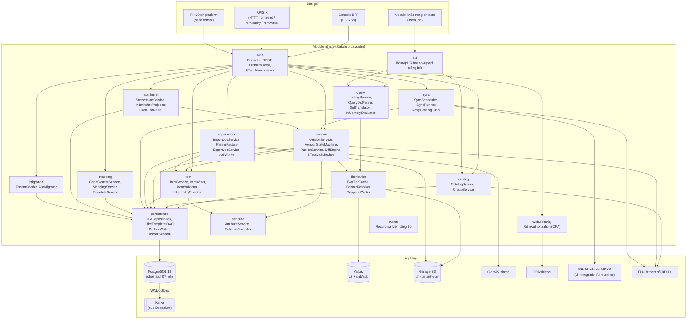
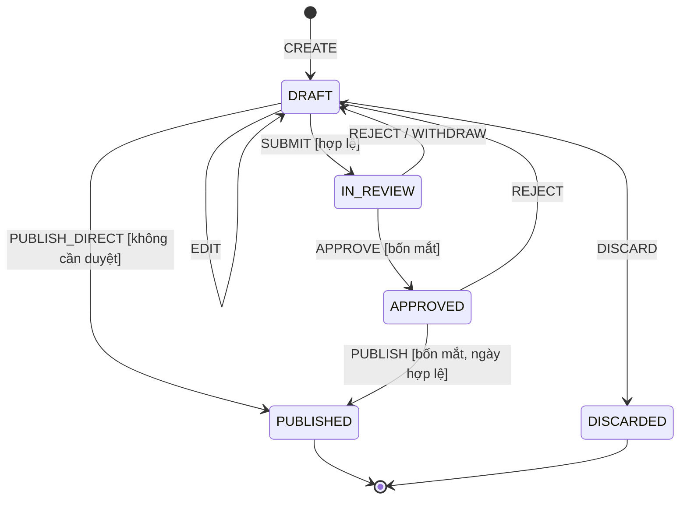
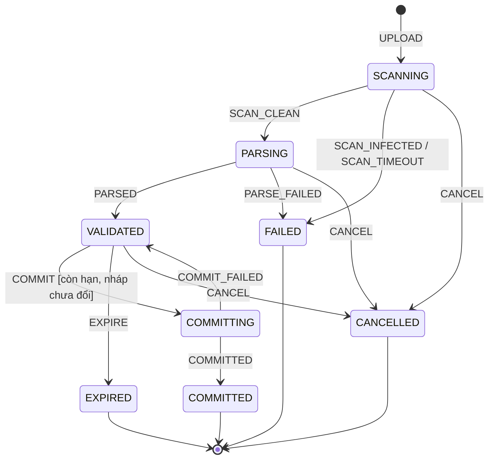
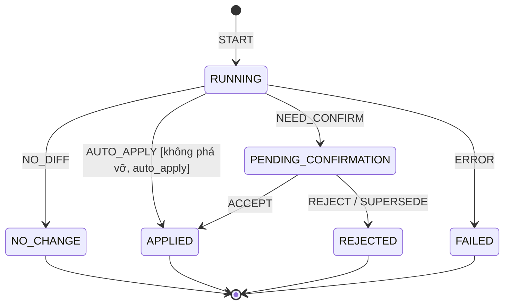

# D03-02-PH07 · Thiết kế chi tiết phân hệ PH-07 Danh mục dùng chung

## 1. Phạm vi và cách đọc

### 1.1. Mục đích

Tài liệu này là thiết kế chi tiết phần mềm (Software Design Description, SDD) của phân hệ PH-07 Danh mục dùng chung (Reference Data Management, RDM) trong sản phẩm Datahub. Tài liệu chuyển các yêu cầu đã chốt ở FRS D02-03-PH07 và các quyết định kiến trúc ADR-050…058 thành cấu trúc mã nguồn, giao diện Java, thuật toán, máy trạng thái, biểu đồ tuần tự, cấu hình, quan sát và kiểm thử ở mức đủ để đội L-DATA bắt đầu viết mã mà không phải tự quyết các điểm kiến trúc.

Tài liệu không lặp lại đặc tả từng yêu cầu chức năng (thuộc FRS), không viết DDL đầy đủ (thuộc D03-03-PH07) và không viết đặc tả OpenAPI (thuộc D03-04-PH07). Khi nhắc tới bảng, cột, mã API, sự kiện, mã lỗi, tài liệu dùng đúng tên trong khung chung PH-07 và các tài liệu nền D02-07, D02-08.

### 1.2. Đối tượng đọc

Lập trình viên đọc toàn bộ, đặc biệt §3 (cấu trúc mã), §4 (thuật toán) và §8 (xử lý lỗi). Kiểm thử viên đọc §4 (máy trạng thái), §5 (biểu đồ tuần tự) và §12. Nhóm vận hành đọc §9, §10, §11. Kiến trúc sư thẩm định đọc §2, §6, §7 và §13.

### 1.3. Tài liệu liên quan

Bảng dưới đây liệt kê tài liệu mà thiết kế này dựa vào hoặc phải khớp. Đường dẫn là tương đối từ thư mục của tài liệu này.

| Mã | Tên | Đường dẫn | Quan hệ |
|---|---|---|---|
| D00-01 | Thuật ngữ, quy ước | `../../00-chung/D00-01-thuat-ngu-quy-uoc.md` | Kiểu dữ liệu T-*, cột ngữ cảnh, đặt tên |
| D02-02 | SRS tổng thể | `../../02-yeu-cau/D02-02-srs.md` | FR-00 dùng chung, NFR-00 |
| D02-07 | Từ điển dữ liệu dùng chung | `../../02-yeu-cau/D02-07-tu-dien-du-lieu.md` | DD-07 ĐVHC, DD-11 outbox, DD-12 tệp, DD-14 tham số |
| D02-08 | Ma trận phân quyền | `../../02-yeu-cau/D02-08-ma-tran-phan-quyen.md` | Vai trò, PERM-07-* |
| D02-03-PH07 | FRS PH-07 | `../../02-yeu-cau/frs/D02-03-PH07-frs-danh-muc.md` | FR-07, BR-07 |
| D02-04-PH07 | Use case PH-07 | `../../02-yeu-cau/use-case/D02-04-PH07-use-case-danh-muc.md` | UC-07 |
| D03-01 | SAD | `../D03-01-sad.md` | DU, quy ước API §7.2, outbox §7.3 |
| D03-10 | Thiết kế đa tenant | `../D03-10-thiet-ke-da-tenant.md` | RLS, COMMON, PLATFORM |
| D03-03-PH07 | Thiết kế CSDL PH-07 | `../csdl/D03-03-PH07-csdl-danh-muc.md` | DDL, chỉ mục, RLS chi tiết |
| D03-04-PH07 | Đặc tả API PH-07 | `../api/D03-04-PH07-api-danh-muc.md` | API-07, EVT-07 |
| D03-06-PH07 | Màn hình PH-07 | `../uiux/D03-06-PH07-man-hinh-danh-muc.md` | UI-07 |
| D05-02-PH07 | Ca kiểm thử PH-07 | `../../05-kiem-thu/test-case/D05-02-PH07-test-case.md` | Ca kiểm thử |

### 1.4. Quyết định kiến trúc áp dụng

Thiết kế này áp dụng các quyết định nền tảng của Datahub và tám quyết định riêng của PH-07. Bảng sau tóm tắt mỗi quyết định và nơi nó tác động trong tài liệu.

| ADR | Quyết định | Tác động trong SDD |
|---|---|---|
| ADR-001 | Spring Boot 4 + Spring Modulith, gom phân hệ thành DU | §2, §3: module `rdm` trong `dh-data` |
| ADR-003 | PostgreSQL RLS cách ly tenant | §6 |
| ADR-004 | Kafka, outbox + Debezium | §4.5, §4.14 |
| ADR-006 | Keycloak + OPA | §7 |
| ADR-007 | Flowable cho quy trình nhiều bước | Không dùng cho PH-07 ở MVP (ADR-058) |
| ADR-008 | Garage làm kho đối tượng | §4.5, §4.7, §4.8 |
| ADR-011 | OpenTelemetry, LGTM | §10 |
| ADR-013 | Tách control và data plane | §4.9, §5.9 |
| [ADR-050](../../00-chung/adr/ADR-050-jsonb-thuoc-tinh-dong.md) | Thuộc tính động jsonb + JSON Schema | §3.5, §4.1 |
| [ADR-051](../../00-chung/adr/ADR-051-phien-ban-anh-chup.md) | Phiên bản ảnh chụp copy-on-write bất biến | §4.2, §4.5, §4.6 |
| [ADR-052](../../00-chung/adr/ADR-052-danh-muc-common-va-hybrid.md) | COMMON + HYBRID phủ lớp | §4.10.6, §6 |
| [ADR-053](../../00-chung/adr/ADR-053-phan-phoi-bo-dem-hai-tang-anh-chup.md) | Bộ đệm hai tầng + ảnh chụp Garage | §4.9, §5.4, §5.9 |
| [ADR-054](../../00-chung/adr/ADR-054-dsl-truy-van-co-cau-truc.md) | DSL truy vấn JSON | §4.10 |
| [ADR-055](../../00-chung/adr/ADR-055-mo-hinh-dvhc-lich-su-ke-thua.md) | ĐVHC theo phiên bản + kế thừa + bảng chiếu | §4.13 |
| [ADR-056](../../00-chung/adr/ADR-056-nhap-tep-hai-pha.md) | Nhập tệp hai pha | §4.7 |
| [ADR-057](../../00-chung/adr/ADR-057-dong-bo-quoc-gia-qua-ph14.md) | Đồng bộ quốc gia qua PH-14 | §4.11 |
| [ADR-058](../../00-chung/adr/ADR-058-may-trang-thai-duyet-noi-bo.md) | Máy trạng thái duyệt nội bộ | §4.4 |

### 1.5. Quy ước trong tài liệu

Mã Java trong tài liệu là Java 21, dùng `record`, `sealed interface`, `switch` theo mẫu. Mã SQL là PostgreSQL 18. Ví dụ dùng tenant `T68` và người dùng giả lập `u.steward01`, `u.approver01`. Các đoạn mã là mẫu thiết kế: chữ ký công khai, tên lớp, tên bảng và thứ tự thao tác là ràng buộc; chi tiết hiện thực bên trong có thể điều chỉnh miễn giữ đúng hành vi.

## 2. Vị trí trong kiến trúc

### 2.1. Module `rdm` trong DU `dh-data`

PH-07 được hiện thực thành module Spring Modulith có tên `rdm`, nằm trong đơn vị triển khai `dh-data` cùng PH-06 (`mdm`), PH-08 (`dq`) và PH-09 (`privacy`). Module có package gốc `vn.datahub.data.rdm` và sở hữu schema PostgreSQL `ph07_rdm`. Lý do gom vào `dh-data` đã nêu ở D03-01 §4.2: cùng miền dữ liệu, cùng hồ sơ tải (đọc nhiều, ghi ít), cùng mức bảo mật. Khi tải tra cứu vượt ba lần phần còn lại trong ba tháng liên tiếp, module có thể tách thành DU riêng mà không đổi hợp đồng (ADR-053).

Module có hai mặt công bố. Mặt REST phục vụ giao diện quản trị (qua BFF của console) và ứng dụng HTTT (qua APISIX). Mặt Java (`RdmApi`, `RdmLookupApi`) phục vụ module khác trong cùng `dh-data`, ví dụ PH-06 chuẩn hóa mã địa chỉ và PH-08 kiểm tra mã hợp lệ. Mặt sự kiện phát EVT-07-01…10 qua outbox.

### 2.2. Sơ đồ thành phần (C4 mức 3)

Sơ đồ dưới đây thể hiện các thành phần bên trong module `rdm` và quan hệ với thành phần ngoài module.



Sơ đồ cho thấy ba lớp. Lớp vào (`web`, `api`) chỉ điều phối: nhận yêu cầu, kiểm tra quyền, gọi dịch vụ nghiệp vụ, ánh xạ lỗi. Lớp nghiệp vụ gồm các gói con theo năng lực (danh mục, thuộc tính, phiên bản, bản ghi, nhập xuất, truy vấn, phân phối, đồng bộ, ánh xạ, ĐVHC, di trú). Lớp `persistence` gom mọi truy cập CSDL và bảo đảm mỗi giao dịch đã đặt biến phiên tenant. Sự kiện không được gửi thẳng lên Kafka mà ghi vào bảng outbox trong cùng giao dịch; Debezium đọc WAL và phát lên Kafka (D03-01 §7.3). Gói `distribution` là thành phần duy nhất nói chuyện với Valkey và ghi ảnh chụp lên Garage, nhờ đó chính sách bộ đệm tập trung một chỗ.

### 2.3. Phụ thuộc với module và phân hệ khác

Module `rdm` tuân thủ luật Modulith của dự án (AGENTS.md §4): chỉ dùng package `api` và `events` của module khác, không chạm `internal`. Bảng dưới đây liệt kê các phụ thuộc và cách thức.

| Phụ thuộc | Hướng | Cách thức | Mục đích |
|---|---|---|---|
| `shared` (thư viện chung `dh-common`) | rdm → shared | Java | `TenantContext`, hàm tạo tên có tenant, ProblemDetail chung, outbox chung |
| PH-20 tổ chức (DD-02) | rdm → PH-20 | REST nội bộ (khác DU) có bộ đệm | Kiểm tra `owner_org_id` tồn tại, lấy tên cơ quan |
| PH-01 HTTT thành viên (DD-03) | rdm → PH-01 | REST nội bộ có bộ đệm | Kiểm tra `member_system_id` của `code_system`, `catalog_access_grant` |
| PH-14 adapter NDXP | rdm → PH-14 | REST nội bộ qua mesh (mTLS) | Đồng bộ quốc gia (ADR-057) |
| PH-18 tham số | rdm → PH-18 | REST nội bộ + sự kiện thay đổi tham số | Đọc `07.rdm.*` (DD-14) |
| PH-13 kiểm toán | rdm → PH-13 | Sự kiện kiểm toán qua thư viện chung | FR-07-050, NFR-07-015 |
| PH-11 / hộp Việc của tôi | PH-11 ← rdm | Sự kiện EVT-07-04/05/06 | Tạo, đóng việc chờ duyệt |
| PH-20 seed tenant | PH-20 → rdm | REST API-07-073 | FR-07-049 |
| `mdm`, `dq` (cùng DU) | → rdm | Java `RdmLookupApi` | Tra mã, kiểm tra mã |
| `dh-runtime` (Camel) | → rdm | Ảnh chụp Garage + EVT-07-05 | Tra cứu trong luồng (ADR-053) |

Vì `dh-data` không chứa PH-20 và PH-01, các phụ thuộc tới chúng là gọi REST qua client có thời gian chờ và bộ ngắt mạch; module không đọc chéo schema `ph20_tenant` hay `ph01_*` (D03-01 §7.3, khung §14.8).

### 2.4. Luật Spring Modulith

Module khai báo ranh giới bằng `package-info.java` ở gốc package. Module `rdm` chỉ được phụ thuộc vào module `shared`; mọi phân hệ khác truy cập qua REST hoặc sự kiện.

```java
// vn/datahub/data/rdm/package-info.java
@org.springframework.modulith.ApplicationModule(
    id = "rdm",
    displayName = "PH-07 Danh mục dùng chung",
    allowedDependencies = {"shared", "shared::tenant", "shared::outbox", "shared::problem"})
package vn.datahub.data.rdm;
```

```java
// vn/datahub/data/rdm/api/package-info.java
@org.springframework.modulith.NamedInterface("api")
package vn.datahub.data.rdm.api;

// vn/datahub/data/rdm/events/package-info.java
@org.springframework.modulith.NamedInterface("events")
package vn.datahub.data.rdm.events;
```

Kiểm thử kiến trúc bắt buộc chạy trong CI:

```java
class ModularityTests {
  static final ApplicationModules MODULES = ApplicationModules.of(DataApplication.class);

  @Test
  void verifiesModularStructure() {
    MODULES.verify(); // thất bại nếu module khác import vn.datahub.data.rdm.internal..
  }

  @Test
  void writesDocumentation() {
    new Documenter(MODULES).writeModulesAsPlantUml().writeIndividualModulesAsPlantUml();
  }
}
```

Ngoài `verify()`, module có bộ luật ArchUnit riêng (§12.6) để bảo đảm các ràng buộc nội bộ: chỉ `ItemWriter` được ghi `catalog_item`, chỉ `PublishService` được đổi trạng thái sang `PUBLISHED`, chỉ `distribution` được dùng client Valkey.

## 3. Cấu trúc mã nguồn

### 3.1. Cây package

Cây dưới đây là cấu trúc đích của module trong `apps/data/src/main/java`. Mỗi gói con của `internal` là một năng lực nghiệp vụ; lớp trong gói có phạm vi package-private trừ khi gói khác trong module cần dùng.

```text
vn/datahub/data/rdm/
├── package-info.java                      @ApplicationModule
├── api/                                   giao diện công bố cho module khác
│   ├── RdmApi.java
│   ├── RdmLookupApi.java
│   ├── dto/                               record công bố (CatalogSummary, ItemView, LookupResult, ...)
│   └── package-info.java                  @NamedInterface("api")
├── events/                                record sự kiện công bố (Modulith + outbox)
│   ├── CatalogCreated.java  CatalogUpdated.java  CatalogRetired.java
│   ├── VersionSubmitted.java  VersionPublished.java  VersionRejected.java
│   ├── ImportCompleted.java  ExportCompleted.java  SyncCompleted.java
│   ├── AdminUnitReorganized.java
│   └── package-info.java                  @NamedInterface("events")
└── internal/
    ├── catalog/        CatalogService, CatalogGroupService, CatalogPolicy, CatalogEntity, CatalogGroupEntity
    ├── version/        VersionService, VersionStateMachine, VersionTransition, PublishService,
    │                   DraftCopier, DiffEngine, BreakingClassifier, EffectiveScheduler, VersionEntity,
    │                   VersionReviewEntity, ChangeThresholdPolicy
    ├── item/           ItemService, ItemWriter, ItemValidator, HierarchyChecker, UniquenessChecker,
    │                   CatalogRefChecker, CodeNormalizer, ItemEntity (đọc), ItemRow (ghi lô)
    ├── attribute/      AttributeService, AttributeDefEntity, SchemaCompiler, CompiledSchemaCache,
    │                   AttributeCompatibilityChecker, SensitiveNameGuard
    ├── importexport/   ImportJobService, ImportJobWorker, ImportCommitter, ParserFactory,
    │                   XlsxStreamParser, PoiSaxParser, CsvStreamParser, EncodingDetector,
    │                   AitaTemplateParser, ZipBombGuard, MalwareScanner (ClamAV),
    │                   TemplateGenerator, ExportJobService, XlsxExportWriter, CsvExportWriter,
    │                   JsonExportWriter, FormulaInjectionSanitizer, JobQueue, ImportJobEntity
    ├── query/          LookupService, ItemQueryService, QueryDslParser, QueryAst (sealed),
    │                   QueryLimits, FieldResolver, SqlTranslator, InMemoryEvaluator,
    │                   CursorCodec, HybridMerger, SearchService, DeltaService, TreeService
    ├── distribution/   TwoTierCache, CacheKeys, PointerResolver, VersionLoader,
    │                   PointerInvalidationListener, SnapshotWriter, SnapshotIndexWriter,
    │                   SnapshotRetryJob, SnapshotFallbackLoader
    ├── sync/           SyncSourceService, SyncScheduler, SyncRunner, SyncDecisionPolicy,
    │                   NdxpCatalogClient, NdxpNormalizer, SyncRunEntity, SyncChangeEntity
    ├── mapping/        CodeSystemService, MappingService, TranslateService, CoverageService
    ├── adminunit/      SuccessionService, SuccessionValidator, AdminUnitProjector,
    │                   AdminUnitCodeConverter, LineageService
    ├── migration/      TenantSeeder, SeedPackage, SeedPackageRegistry, AitaMigrator (CLI profile),
    │                   AitaReader, AitaMapper, ReconciliationReport
    ├── web/            CatalogController, CatalogGroupController, VersionController,
    │                   AttributeController, DraftItemController, ImportJobController,
    │                   ExportJobController, LookupController, QueryController, SyncController,
    │                   MappingController, AdminUnitController, PlatformSeedController,
    │                   AccessGrantController, RdmExceptionHandler, EtagSupport,
    │                   IdempotencyFilter, security/RdmAuthorization, security/OpaClient
    ├── persistence/    *Repository (Spring Data JPA), ItemJdbcDao, VersionJdbcDao, ImportRowDao,
    │                   OutboxWriter, TenantSession, CommonWriteScope, IdempotencyStore
    └── config/         RdmProperties (@ConfigurationProperties "datahub.rdm"),
                        RdmCacheConfig, RdmSchedulingConfig, RdmHttpClientConfig,
                        RdmJsonConfig, RdmParamProvider (DD-14)
```

Cây package dùng `vn.datahub` thay cho `vn.lgsp` của khung W3; lộ trình chuyển nêu ở §13.

### 3.2. Trách nhiệm các lớp chính

Bảng dưới đây mô tả trách nhiệm của từng lớp then chốt. Các lớp phụ trợ (mapper, hằng số) không liệt kê.

| Gói | Lớp | Trách nhiệm |
|---|---|---|
| catalog | `CatalogService` | Tạo, sửa, xóa mềm, ngừng hiệu lực danh mục; kiểm tra BR-07-001, BR-07-009, BR-07-020; ghi EVT-07-01/02/03 |
| catalog | `CatalogPolicy` | Quyết định danh mục có ghi được trong ngữ cảnh hiện tại không (COMMON, NATIONAL, HYBRID, quyền tổ chức) |
| attribute | `SchemaCompiler` | Sinh JSON Schema 2020-12 từ danh sách `attribute_def`, tính `schema_hash` |
| attribute | `CompiledSchemaCache` | Lưu đệm `JsonSchema` đã biên dịch theo `schema_hash` |
| attribute | `AttributeCompatibilityChecker` | Kiểm tra đổi kiểu, thu hẹp ràng buộc trên dữ liệu hiện có (BR-07-013) |
| attribute | `SensitiveNameGuard` | Chặn thuộc tính có tên gợi ý dữ liệu cá nhân (BR-07-025, ERR-07-036) |
| version | `VersionService` | Tạo nháp, sửa thông tin nháp, hủy, điều phối submit/approve/reject |
| version | `VersionStateMachine` | Bảng chuyển trạng thái phiên bản, kiểm tra điều kiện bảo vệ |
| version | `DraftCopier` | Sao chép copy-on-write `attribute_def`, `catalog_item`, `item_succession` |
| version | `DiffEngine` | Tính khác biệt hai phiên bản hoặc phiên bản và tập dữ liệu ngoài |
| version | `BreakingClassifier` | Phân loại phá vỡ theo khung §3.18 |
| version | `ChangeThresholdPolicy` | Áp BR-07-012 và BR-07-026 |
| version | `PublishService` | Phát hành: khóa, đóng phiên bản trước, cập nhật con trỏ, làm mới `admin_unit`, outbox |
| version | `EffectiveScheduler` | Chuyển `current_version_id` khi phiên bản sắp hiệu lực tới ngày |
| item | `ItemWriter` | Lớp duy nhất ghi `catalog_item` (đơn lẻ và lô) |
| item | `ItemValidator` | Kiểm tra một bản ghi và kiểm tra toàn phiên bản |
| item | `HierarchyChecker` | Mã cha, vòng, độ sâu, cha DEPRECATED, tính `path`, `depth` |
| importexport | `ImportJobWorker` | Lấy tác vụ từ hàng đợi CSDL, chạy quét, phân tích, kiểm tra |
| importexport | `ImportCommitter` | Pha 2: ghi `import_row` hợp lệ vào bản nháp |
| importexport | `FormulaInjectionSanitizer` | Vô hiệu công thức khi xuất (CSV/Excel injection) |
| query | `LookupService` | Tra một mã, lô, toàn bộ, cây, delta theo thời điểm |
| query | `QueryDslParser`, `SqlTranslator` | Phân tích DSL, dịch sang SQL tham số hóa |
| query | `HybridMerger` | Hợp nhất COMMON và bản ghi địa phương |
| distribution | `TwoTierCache` | Caffeine L1 + Valkey L2, chống dồn tải |
| distribution | `PointerResolver` | Giải (tenant, catalog, ngày) thành `version_id` |
| distribution | `SnapshotWriter` | Sinh JSON.gz, CSV.gz lên Garage sau commit |
| sync | `SyncRunner` | Một lần đồng bộ: gọi PH-14, chuẩn hóa, diff, quyết định |
| mapping | `TranslateService` | Chuyển mã qua bảng ánh xạ |
| adminunit | `AdminUnitCodeConverter` | Chuyển mã ĐVHC theo chuỗi kế thừa |
| adminunit | `AdminUnitProjector` | Làm mới bảng chiếu `admin_unit` |
| migration | `TenantSeeder` | Nạp gói danh mục nền idempotent |
| migration | `AitaMigrator` | Công cụ di trú một lần từ CSDL Aita |
| persistence | `TenantSession` | Đặt `SET LOCAL app.tenant_id` đầu mỗi giao dịch |
| persistence | `OutboxWriter` | Ghi bảng `ph07_rdm.outbox` theo DD-11 |
| persistence | `IdempotencyStore` | Lưu và đối chiếu `Idempotency-Key` |
| web | `RdmExceptionHandler` | Ánh xạ exception sang RFC 9457 |

### 3.3. Giao diện công bố `RdmApi` và `RdmLookupApi`

Module công bố hai giao diện Java. `RdmLookupApi` là giao diện khai thác chỉ đọc, tối ưu cho module khác trong `dh-data` gọi với tần suất cao (mọi lời gọi đi qua bộ đệm hai tầng). `RdmApi` là giao diện quản trị mỏng cho các nhu cầu liệt kê và đọc metadata; module khác không được ghi danh mục qua Java mà phải đi qua REST để có kiểm tra quyền và kiểm toán đầy đủ. Cả hai giao diện thực thi trong `TenantContext` hiện hành của bên gọi.

```java
package vn.datahub.data.rdm.api;

import java.time.LocalDate;
import java.util.Collection;
import java.util.List;
import java.util.Map;
import java.util.Optional;
import vn.datahub.data.rdm.api.dto.*;

/**
 * Giao diện khai thác danh mục cho module khác trong dh-data (PH-07, FR-07-026…033).
 * Mọi phương thức chỉ đọc, đi qua bộ đệm hai tầng, tôn trọng TenantContext và HYBRID.
 * Tham số {@code at} rỗng nghĩa là ngày hiện tại theo giờ Asia/Ho_Chi_Minh (BR-07-008).
 */
public interface RdmLookupApi {

  /** Tra một mã. Trả rỗng nếu không có tại thời điểm (tương ứng ERR-07-007 ở REST). */
  Optional<ItemView> lookup(String catalogCode, String itemCode, LocalDate at);

  /** Tra lô tối đa 500 mã; kết quả giữ thứ tự đầu vào, mã không thấy có found=false. */
  List<LookupResult> lookupBatch(String catalogCode, Collection<String> itemCodes, LocalDate at);

  /** Kiểm tra nhanh một mã có hợp lệ (tồn tại, ACTIVE) tại thời điểm. */
  boolean isValid(String catalogCode, String itemCode, LocalDate at);

  /** Toàn bộ bản ghi theo trang con trỏ. limit ≤ 1000. */
  ItemPage listItems(String catalogCode, LocalDate at, String cursor, int limit,
                     boolean includeDeprecated);

  /** Cây con từ root (rỗng = gốc), tối đa depth cấp. */
  List<TreeNode> tree(String catalogCode, String rootCode, int depth, LocalDate at);

  /** Truy vấn có cấu trúc theo DSL (ADR-054). */
  ItemPage query(String catalogCode, ItemQuery query);

  /** Chuyển mã qua bảng ánh xạ (FR-07-042). */
  List<TranslateResult> translate(String catalogCode, String codeSystem,
                                  TranslateDirection direction, Collection<String> codes,
                                  LocalDate at);

  /** Chuyển mã ĐVHC cũ sang mới hoặc ngược lại tại ngày đích (FR-07-046). */
  List<AdminUnitConversion> convertAdminUnits(Collection<String> codes, LocalDate fromDate,
                                              LocalDate toDate, ConversionDirection direction);

  /** Phiên bản hiệu lực tại thời điểm (dùng làm ETag, khóa đệm của bên gọi). */
  Optional<VersionRef> effectiveVersion(String catalogCode, LocalDate at);
}
```

```java
package vn.datahub.data.rdm.api;

import java.util.List;
import java.util.Optional;
import vn.datahub.data.rdm.api.dto.*;

/** Giao diện đọc metadata danh mục cho module khác (FR-07-001, FR-07-033). */
public interface RdmApi {

  /** Trạng thái module, dùng cho health check tổng hợp. */
  ModuleStatus status();

  /** Danh mục khả dụng với tenant hiện hành (gồm COMMON đang ACTIVE). */
  List<CatalogSummary> listCatalogs(CatalogFilter filter);

  Optional<CatalogSummary> findCatalog(String catalogCode);

  /** Lược đồ thuộc tính và JSON Schema của một phiên bản (rỗng = hiện hành). */
  Optional<CatalogSchema> schema(String catalogCode, Integer versionNo);

  /** Đơn vị hành chính hiện hành theo id ổn định của bảng chiếu admin_unit (DD-07). */
  Optional<AdminUnitView> adminUnit(java.util.UUID adminUnitId);
}
```

Hai giao diện được hiện thực bởi `internal.query.RdmLookupFacade` và `internal.catalog.RdmApiFacade`, đánh dấu `@Service` và `@Transactional(readOnly = true)`.

### 3.4. DTO và record chính

Các record dưới đây gồm cả DTO công bố trong `api.dto` và record yêu cầu REST trong `internal.web.dto`. Annotation `jakarta.validation` được Spring kiểm tra tự động ở controller; lỗi ràng buộc ánh xạ sang ERR-07-009 với mảng `errors[]` (§8). Mã danh mục và mã bản ghi theo T-CODE: chữ hoa, chữ số, gạch dưới, gạch ngang, dấu chấm, tối đa 64 ký tự.

```java
package vn.datahub.data.rdm.api.dto;

public record ItemView(
    String catalogCode, int versionNo, String code, String name, String parentCode,
    int depth, List<String> path, String levelName, Integer sortOrder,
    ItemStatus status, List<String> replacedBy, LocalDate validFrom, LocalDate validTo,
    Map<String, Object> attrs, boolean localExtension) {}

public enum ItemStatus { ACTIVE, DEPRECATED }

public record LookupResult(String requestedCode, boolean found, ItemView item) {}

public record ItemPage(List<ItemView> items, String nextCursor, VersionRef version) {}

public record VersionRef(java.util.UUID versionId, String catalogCode, int versionNo,
                         LocalDate effectiveFrom, LocalDate effectiveTo, String etag) {}

public record TreeNode(ItemView item, List<TreeNode> children) {}

public record TranslateResult(String input, TranslateOutcome outcome, List<String> outputs,
                              String relation, boolean provisional) {}
public enum TranslateOutcome { MAPPED, NOT_MAPPED, MULTIPLE }
public enum TranslateDirection { TO_CATALOG, FROM_CATALOG }

public record AdminUnitConversion(String input, ConversionOutcome outcome,
                                  List<AdminUnitCandidate> candidates, List<String> path) {}
public enum ConversionOutcome { UNCHANGED, CONVERTED, AMBIGUOUS, ABOLISHED, NOT_FOUND }
public enum ConversionDirection { FORWARD, BACKWARD }
public record AdminUnitCandidate(String code, String name, String level, String eventType,
                                 LocalDate effectiveDate, String legalBasis) {}
```

```java
package vn.datahub.data.rdm.internal.web.dto;

import jakarta.validation.Valid;
import jakarta.validation.constraints.*;

public record CreateCatalogRequest(
    @NotBlank @Pattern(regexp = "^[A-Z0-9][A-Z0-9_.-]{1,63}$") String code,
    @NotBlank @Size(max = 255) String name,
    @Size(max = 4000) String description,
    java.util.UUID groupId,
    @NotNull java.util.UUID ownerOrgId,
    @NotNull SourceType sourceType,
    @NotNull Classification classification,
    boolean hierarchical,
    @Min(1) @Max(10) Integer maxDepth,
    @Size(max = 10) List<@NotBlank @Size(max = 50) String> levelNames,
    @Size(max = 200) String localCodePattern,
    @Pattern(regexp = "^[A-Z0-9][A-Z0-9_.-]{1,63}$") String extendsCatalogCode,
    boolean requireApproval,
    @Valid @Size(max = 100) List<AttributeDefRequest> attributes) {}

public record AttributeDefRequest(
    @NotBlank @Pattern(regexp = "^[a-z][a-z0-9_]{0,62}$") String code,
    @NotBlank @Size(max = 255) String label,
    @NotNull DataType dataType,
    boolean required,
    boolean uniqueInVersion,
    @Positive @Max(4000) Integer maxLength,
    @Size(max = 500) String pattern,
    java.math.BigDecimal minValue,
    java.math.BigDecimal maxValue,
    @Size(max = 500) List<@Valid EnumValue> enumValues,
    @Pattern(regexp = "^[A-Z0-9][A-Z0-9_.-]{1,63}$") String refCatalogCode,
    String defaultValue,
    @PositiveOrZero Integer sortOrder,
    boolean queryable,
    boolean searchable,
    @Size(max = 2000) String description) {}

public record EnumValue(@NotBlank @Size(max = 64) String value, @NotBlank @Size(max = 255) String label) {}

public enum DataType { STRING, TEXT, INTEGER, DECIMAL, BOOLEAN, DATE, DATETIME, ENUM, CATALOG_REF, URI, EMAIL }
public enum SourceType { LOCAL, NATIONAL, HYBRID }
public enum Classification { PUBLIC, INTERNAL, RESTRICTED }

public record UpsertItemRequest(
    @NotBlank @Pattern(regexp = "^[A-Za-z0-9][A-Za-z0-9_.-]{0,63}$") String code,
    @NotBlank @Size(max = 500) String name,
    @Size(max = 64) String parentCode,
    Integer sortOrder,
    LocalDate validFrom,
    LocalDate validTo,
    @NotNull Map<String, Object> attrs) {}

public record DeprecateItemRequest(
    @Size(max = 20) List<@NotBlank String> replacedBy,
    @Size(max = 1000) String reason) {}

public record PublishRequest(
    @NotNull LocalDate effectiveFrom,
    @NotBlank @Size(max = 500) String legalBasis,
    @Size(max = 2000) String changeNote,
    @Size(max = 1000) String retroactiveReason) {}

public record ReviewDecisionRequest(@Size(max = 2000) String comment) {}

public record BatchItemsRequest(
    @NotNull @Size(min = 1, max = 5000) List<@Valid BatchOp> operations,
    boolean continueOnError) {}

public record BatchOp(@NotNull BatchOpType op, @NotBlank String code, @Valid UpsertItemRequest item,
                      @Valid DeprecateItemRequest deprecate) {}
public enum BatchOpType { UPSERT, DEPRECATE, DELETE }

public record CreateImportJobRequest(        // phần JSON "options" của multipart API-07-033
    @NotNull ImportMode mode,
    String catalogCode,                       // bắt buộc trừ CREATE_CATALOG
    @NotNull ImportTemplate template,
    Map<String, String> columnMapping,
    boolean skipInvalidRows) {}
public enum ImportMode { UPSERT, REPLACE, APPEND, CREATE_CATALOG }
public enum ImportTemplate { STANDARD, LEGACY_AITA }

public record ItemQuery(                      // thân API-07-047 (ADR-054)
    LocalDate at,
    @NotNull com.fasterxml.jackson.databind.JsonNode filter,
    @Size(max = 50) List<String> select,
    @Size(max = 3) List<@Valid SortSpec> sort,
    @Min(1) @Max(1000) Integer limit,
    @Size(max = 2048) String cursor,
    boolean includeDeprecated) {}
public record SortSpec(@NotBlank String field, @Pattern(regexp = "asc|desc") String dir) {}

public record ConvertAdminUnitsRequest(
    @NotNull @Size(min = 1, max = 1000) List<@NotBlank String> codes,
    LocalDate fromDate, LocalDate toDate,
    @NotNull ConversionDirection direction) {}
```

### 3.5. Lựa chọn công nghệ truy cập dữ liệu

Module dùng hai cơ chế truy cập dữ liệu, mỗi cơ chế cho một loại thao tác. Lựa chọn này cân nhắc ba đặc điểm của PH-07: dữ liệu bản ghi nằm trong `jsonb` có cấu trúc động; thao tác copy-on-write và nhập tệp tác động hàng chục nghìn dòng một lần; truy vấn khai thác được sinh động từ DSL.

**Spring Data JPA (Hibernate 7)** dùng cho các aggregate có vòng đời và quy tắc nghiệp vụ phong phú nhưng số dòng nhỏ: `catalog_group`, `catalog`, `catalog_version`, `attribute_def`, `version_review`, `import_job`, `sync_source`, `sync_run`, `code_system`, `code_mapping`, `catalog_access_grant`. JPA cho khóa lạc quan qua cột `version` (`@Version`) khớp với `If-Match`/ETag (D03-01 §7.2), cho `@PessimisticLock` khi phát hành, và giảm mã lặp. Cột `jsonb` của các bảng này (`level_names`, `stats`, `options`, `field_mapping`, `enum_values`) ánh xạ bằng `@JdbcTypeCode(SqlTypes.JSON)` sẵn có trong Hibernate 6+.

**JdbcTemplate / NamedParameterJdbcTemplate** dùng cho `catalog_item`, `import_row`, `item_succession` ở các thao tác hàng loạt và truy vấn động: `INSERT … SELECT` sao chép phiên bản, `batchUpdate` 1.000 dòng khi nhập, `INSERT … ON CONFLICT` khi commit, truy vấn DSL, tra cứu nạp phiên bản vào bộ đệm. Lý do không dùng JPA cho các bảng này: Hibernate nạp từng thực thể vào ngữ cảnh lưu trữ, gây tốn bộ nhớ và chậm với 200.000 dòng; câu `INSERT … SELECT` không biểu diễn được tự nhiên bằng JPA; SQL sinh từ DSL cần kiểm soát tuyệt đối để bảo đảm tham số hóa. Spring Data JDBC đã được cân nhắc nhưng không mang lại lợi ích so với JdbcTemplate cho các thao tác này, trong khi thiếu `@Version` kết hợp khóa bi quan tiện như JPA cho aggregate. jOOQ không dùng ở MVP để tránh thêm bước sinh mã; nếu trình dịch DSL phình to có thể xem xét lại (Câu hỏi mở Q07-30).

Mọi đường ghi vào CSDL, dù JPA hay JdbcTemplate, đi qua cùng một `DataSource` được bọc bởi `TenantSession` (§6.2), nên RLS luôn có hiệu lực.

Entity JPA chính:

```java
@Entity
@Table(name = "catalog", schema = "ph07_rdm")
class CatalogEntity extends TenantScopedEntity {   // id uuid v7, tenant_id, created_*, updated_*, @Version version
  @Column(nullable = false, length = 64) private String code;
  @Column(nullable = false) private String name;
  private String description;
  private UUID groupId;
  @Column(nullable = false) private UUID ownerOrgId;
  @Enumerated(EnumType.STRING) @Column(nullable = false) private SourceType sourceType;
  @Enumerated(EnumType.STRING) @Column(nullable = false) private Classification classification;
  @Enumerated(EnumType.STRING) @Column(nullable = false) private CatalogStatus status; // DRAFT, ACTIVE, RETIRED
  private boolean isHierarchical;
  private Integer maxDepth;
  @JdbcTypeCode(SqlTypes.JSON) private List<String> levelNames;
  private String localCodePattern;
  private UUID extendsCatalogId;
  private boolean requireApproval;
  private UUID currentVersionId;
  private String legacyRef;
  private OffsetDateTime deletedAt;

  boolean isCommon() { return "COMMON".equals(getTenantId()); }
  boolean isOpenForUserWrite() { return sourceType != SourceType.NATIONAL && status != CatalogStatus.RETIRED; }
}

@Entity
@Table(name = "catalog_version", schema = "ph07_rdm")
class VersionEntity extends TenantScopedEntity {
  @Column(nullable = false) private UUID catalogId;
  @Column(nullable = false) private int versionNo;
  @Enumerated(EnumType.STRING) @Column(nullable = false) private VersionStatus status;
  private LocalDate effectiveFrom;
  private LocalDate effectiveTo;
  private String legalBasis;
  private String changeNote;
  @Enumerated(EnumType.STRING) private VersionOrigin origin; // MANUAL, IMPORT, API, SYNC, MIGRATION
  private int itemCount;
  @JdbcTypeCode(SqlTypes.JSON) private VersionStats stats;
  private String submittedBy;  private OffsetDateTime submittedAt;
  private String approvedBy;   private OffsetDateTime approvedAt;
  private String publishedBy;  private OffsetDateTime publishedAt;
  private String snapshotUri;
  private String schemaHash;
}

enum VersionStatus { DRAFT, IN_REVIEW, APPROVED, PUBLISHED, DISCARDED;
  boolean isOpen() { return this == DRAFT || this == IN_REVIEW || this == APPROVED; } }

record VersionStats(int added, int changed, int deprecated, int removed, int breaking,
                    int attributesAdded, int attributesRemoved, int attributesChanged) {}
```

`catalog_item` không có entity JPA ghi; đọc và ghi qua `ItemJdbcDao` với record `ItemRow`:

```java
record ItemRow(UUID id, String tenantId, UUID versionId, UUID catalogId, String code, String name,
               String parentCode, int depth, String[] path, String levelName, Integer sortOrder,
               ItemStatus status, String[] replacedBy, LocalDate validFrom, LocalDate validTo,
               String attrsJson, boolean localExtension, String legacyRef, int version) {}
```

Cột `name_search` là cột sinh (`GENERATED ALWAYS AS (lower(ph07_rdm.immutable_unaccent(name))) STORED`) do CSDL tính, ứng dụng không ghi. Hàm `immutable_unaccent` là bọc `IMMUTABLE` của `unaccent` với từ điển cố định, định nghĩa ở D03-03-PH07.

## 4. Thiết kế chi tiết từng thành phần

Mục này mô tả thuật toán của từng thành phần theo thứ tự luồng dữ liệu: kiểm tra hợp lệ, tạo nháp, so sánh, máy trạng thái, phát hành, lịch hiệu lực, nhập, xuất, bộ đệm, truy vấn, đồng bộ, ánh xạ, ĐVHC, seed và di trú.

### 4.1. Kiểm tra hợp lệ theo lược đồ

#### 4.1.1. Các tầng kiểm tra

Một bản ghi được coi là hợp lệ khi qua đủ năm tầng kiểm tra. Ba tầng đầu chỉ cần bản thân bản ghi và lược đồ nên chạy được trên từng dòng riêng lẻ (dùng khi nhập lô, nhập tệp theo luồng). Hai tầng sau cần toàn bộ phiên bản nên chạy theo tập.

| Tầng | Nội dung | Cách thực hiện | Mã lỗi |
|---|---|---|---|
| 1. Cột hệ thống | `code` theo T-CODE, `name` không rỗng ≤ 500, `validFrom ≤ validTo` | Mã Java trong `ItemValidator` | ERR-07-009 |
| 2. Thuộc tính động | Kiểu, bắt buộc, độ dài, mẫu, khoảng, miền giá trị, khóa lạ | JSON Schema 2020-12 qua networknt | ERR-07-009 |
| 3. Dải mã địa phương | Bản ghi HYBRID khớp `local_code_pattern` | `java.util.regex.Pattern` đã biên dịch, giới hạn thời gian | ERR-07-012 |
| 4. Duy nhất | `code` duy nhất (không phân biệt hoa thường); thuộc tính `unique_in_version` | Chỉ mục duy nhất CSDL + kiểm tra tập trước khi ghi | ERR-07-008, ERR-07-009 |
| 5. Tham chiếu và phân cấp | Mã cha tồn tại, không vòng, độ sâu, cha không DEPRECATED; `CATALOG_REF` tồn tại | Duyệt đồ thị trong bộ nhớ; tra cứu `RdmLookupApi` | ERR-07-010, ERR-07-011, ERR-07-009 |

#### 4.1.2. Sinh JSON Schema từ `attribute_def`

`SchemaCompiler` nhận danh sách `attribute_def` có `status = ACTIVE` hoặc `HIDDEN` (thuộc tính ẩn vẫn được kiểm tra vì chỉ ẩn khỏi giao diện) và sinh lược đồ cho đối tượng `attrs`. Ánh xạ kiểu theo bảng sau.

| `data_type` | Phân đoạn JSON Schema | Ghi chú |
|---|---|---|
| `STRING` | `{"type":"string","maxLength":n,"pattern":p}` | `maxLength` mặc định 500 |
| `TEXT` | `{"type":"string","maxLength":n}` | mặc định 4000 |
| `INTEGER` | `{"type":"integer","minimum":a,"maximum":b}` | giá trị trong khoảng `long` |
| `DECIMAL` | `{"type":"number","minimum":a,"maximum":b}` | lưu dạng số JSON; xuất giữ nguyên độ chính xác bằng `BigDecimal` |
| `BOOLEAN` | `{"type":"boolean"}` | |
| `DATE` | `{"type":"string","format":"date"}` | bật kiểm tra `format` |
| `DATETIME` | `{"type":"string","format":"date-time"}` | |
| `ENUM` | `{"type":"string","enum":[…]}` | lấy `enum_values[].value` |
| `CATALOG_REF` | `{"type":"string","pattern":"^[A-Za-z0-9][A-Za-z0-9_.-]{0,63}$"}` | tồn tại được kiểm ở tầng 5 |
| `URI` | `{"type":"string","format":"uri","maxLength":2000}` | chỉ `https`, `http` (từ khóa tùy biến) |
| `EMAIL` | `{"type":"string","format":"email","maxLength":254}` | |

Thuộc tính `required = true` đưa vào mảng `required`; giá trị `null` được coi như vắng mặt (lược đồ dùng `"type":["string","null"]` cho thuộc tính không bắt buộc). Lược đồ đặt `"additionalProperties": false` để chặn khóa lạ, tránh dữ liệu rác lọt vào `attrs`.

```java
final class SchemaCompiler {
  private static final ObjectMapper M = JsonMapper.builder().build();
  private final JsonSchemaFactory factory = JsonSchemaFactory.getInstance(SpecVersion.VersionFlag.V202012);
  private final SchemaValidatorsConfig cfg = SchemaValidatorsConfig.builder()
      .formatAssertionsEnabled(true).failFast(false).locale(Locale.forLanguageTag("vi")).build();

  CompiledSchema compile(UUID versionId, List<AttributeDef> defs) {
    ObjectNode root = M.createObjectNode()
        .put("$schema", "https://json-schema.org/draft/2020-12/schema")
        .put("type", "object").put("additionalProperties", false);
    ObjectNode props = root.putObject("properties");
    ArrayNode required = root.putArray("required");
    defs.stream().sorted(comparing(AttributeDef::sortOrder)).forEach(d -> {
      props.set(d.code(), fragment(d));
      if (d.required()) required.add(d.code());
    });
    String canonical = Canonical.json(root);              // khóa sắp xếp, không khoảng trắng
    String hash = Hashing.sha256Hex(canonical);
    return new CompiledSchema(versionId, hash, root, factory.getSchema(root, cfg));
  }

  private ObjectNode fragment(AttributeDef d) {
    ObjectNode f = M.createObjectNode();
    String jsonType = switch (d.dataType()) {
      case STRING, TEXT, DATE, DATETIME, ENUM, CATALOG_REF, URI, EMAIL -> "string";
      case INTEGER -> "integer";
      case DECIMAL -> "number";
      case BOOLEAN -> "boolean";
    };
    if (d.required()) f.put("type", jsonType); else f.putArray("type").add(jsonType).add("null");
    switch (d.dataType()) {
      case STRING -> { f.put("maxLength", nvl(d.maxLength(), 500)); putIf(f, "pattern", d.pattern()); }
      case TEXT -> f.put("maxLength", nvl(d.maxLength(), 4000));
      case INTEGER, DECIMAL -> { putIf(f, "minimum", d.minValue()); putIf(f, "maximum", d.maxValue()); }
      case DATE -> f.put("format", "date");
      case DATETIME -> f.put("format", "date-time");
      case ENUM -> { ArrayNode e = f.putArray("enum"); d.enumValues().forEach(v -> e.add(v.value()));
                     if (!d.required()) e.addNull(); }
      case CATALOG_REF -> f.put("pattern", "^[A-Za-z0-9][A-Za-z0-9_.-]{0,63}$");
      case URI -> { f.put("format", "uri"); f.put("maxLength", 2000); }
      case EMAIL -> { f.put("format", "email"); f.put("maxLength", 254); }
      case BOOLEAN -> { }
    }
    f.put("title", d.label());
    return f;
  }
}
```

Lược đồ đã biên dịch được lưu ở `CompiledSchemaCache` (Caffeine, tối đa 2.000 mục, khóa `schema_hash`). Với phiên bản đã phát hành, `schema_hash` được ghi vào `catalog_version` khi phát hành; với bản nháp, hash tính lại sau mỗi thay đổi thuộc tính. Cùng một lược đồ (không có `title` của nhãn tiếng Việt khác nhau) dùng chung một mục đệm. API-07-048 trả đúng đối tượng `root` này.

Mẫu biểu thức chính quy (`pattern`) do người dùng nhập được kiểm tra khi khai báo: biên dịch thành công, độ dài ≤ 500, và chạy thử trên chuỗi 10.000 ký tự trong giới hạn 50 ms để phát hiện mẫu có nguy cơ quay lui thảm họa (ReDoS). networknt được cấu hình dùng bộ máy regex `JoniRegularExpressionFactory` (có ngắt theo bước) thay cho `java.util.regex` cho từ khóa `pattern`. Câu hỏi mở Q07-31 ghi nhận việc chọn bộ máy regex cuối cùng.

#### 4.1.3. Chuyển lỗi lược đồ thành lỗi theo trường

networknt trả tập `ValidationMessage` có `instanceLocation` (ví dụ `/attrs/dien_tich`) và `type` (ví dụ `maxLength`). `ItemValidator` ánh xạ mỗi thông điệp thành `FieldError(field, code, message)` với `field` theo cách gọi của API (`attrs.dien_tich`), `code` là mã con ổn định (`TYPE`, `REQUIRED`, `MAX_LENGTH`, `PATTERN`, `MIN`, `MAX`, `ENUM`, `FORMAT`, `UNKNOWN_FIELD`) và `message` tiếng Việt. Mã con giúp giao diện và bên khai thác xử lý tự động; thông điệp chỉ để hiển thị.

```java
record FieldError(String field, String code, String message, Object rejectedValue) {}

record ItemValidationResult(String itemCode, List<FieldError> errors) {
  boolean valid() { return errors.isEmpty(); }
}
```

`rejectedValue` chỉ được điền khi danh mục có `classification = PUBLIC`; với `INTERNAL` và `RESTRICTED` để `null` nhằm không lặp lại dữ liệu trong log và báo cáo lỗi (FR-00-062).

#### 4.1.4. Kiểm tra duy nhất

Mã bản ghi được chuẩn hóa bởi `CodeNormalizer` trước mọi so sánh: bỏ khoảng trắng đầu cuối, chuyển chữ hoa theo `Locale.ROOT`, không đổi dấu chấm hay gạch. Mã lưu dạng chuẩn hóa nên CSDL có chỉ mục duy nhất `(version_id, code)`; bảo đảm cuối cùng là CSDL và lỗi `23505` ánh xạ sang ERR-07-008. Với nhập tệp và nhập lô, trùng mã được phát hiện trước khi ghi bằng `HashMap<String, Integer>` mã → số dòng xuất hiện đầu tiên, để báo cả hai dòng trùng.

Thuộc tính `unique_in_version = true` được kiểm tra bằng truy vấn khi ghi đơn lẻ:

```sql
SELECT code FROM ph07_rdm.catalog_item
 WHERE version_id = :versionId AND code <> :code
   AND attrs ->> :attrCode = :value
 LIMIT 1;
```

và bằng `HashMap` giá trị → mã khi kiểm tra theo tập. CSDL không có chỉ mục duy nhất trên thuộc tính động vì tập thuộc tính thay đổi theo phiên bản; đây là điểm chấp nhận được vì mọi đường ghi đều qua `ItemWriter` và được tuần tự hóa theo khóa tư vấn của phiên bản (§4.2.3).

#### 4.1.5. Kiểm tra phân cấp bằng duyệt đồ thị

`HierarchyChecker` kiểm tra BR-07-014 và tính `depth`, `path`, `level_name` cho mọi bản ghi của phiên bản. Thuật toán chạy trong bộ nhớ trên bản đồ `code → parentCode`; với 200.000 bản ghi, bản đồ tốn khoảng 30 MB và chạy dưới 300 ms.

```java
final class HierarchyChecker {

  record Node(String code, String parentCode, ItemStatus status) {}
  record Placement(int depth, String[] path, String levelName) {}

  /** Trả lỗi theo mã, đồng thời điền placement cho bản ghi hợp lệ. */
  Map<String, List<FieldError>> check(Map<String, Node> nodes, int maxDepth, List<String> levelNames,
                                      Map<String, Placement> out) {
    Map<String, List<FieldError>> errors = new HashMap<>();
    // 0 = chưa thăm, 1 = đang thăm (trên ngăn xếp), 2 = xong
    Map<String, Integer> state = new HashMap<>(nodes.size() * 2);
    for (String start : nodes.keySet()) {
      if (state.getOrDefault(start, 0) == 2) continue;
      Deque<String> stack = new ArrayDeque<>();
      String cur = start;
      // Đi lên theo cha tới khi gặp gốc, nút đã xong, hoặc vòng
      while (cur != null && state.getOrDefault(cur, 0) == 0) {
        state.put(cur, 1); stack.push(cur);
        Node n = nodes.get(cur);
        String p = n.parentCode();
        if (p != null && !nodes.containsKey(p)) {
          err(errors, cur, "parentCode", "PARENT_NOT_FOUND", "Mã cha " + p + " không tồn tại trong phiên bản");
          p = null; // coi như gốc để tiếp tục tính cho nhánh dưới, nhưng bản ghi đã lỗi
        }
        if (p != null && state.getOrDefault(p, 0) == 1) {         // gặp nút đang trên ngăn xếp → vòng
          List<String> cycle = cycleMembers(stack, p);
          cycle.forEach(c -> err(errors, c, "parentCode", "CYCLE", "Tạo vòng: " + String.join(" → ", cycle)));
          p = null;
        }
        cur = p;
      }
      // Đi xuống theo ngăn xếp để tính depth, path từ nút cha đã biết
      while (!stack.isEmpty()) {
        String c = stack.pop();
        Node n = nodes.get(c);
        Placement parent = n.parentCode() == null ? null : out.get(n.parentCode());
        int depth = parent == null ? 1 : parent.depth() + 1;
        String[] path = parent == null ? new String[0] : append(parent.path(), n.parentCode());
        if (depth > maxDepth) err(errors, c, "parentCode", "MAX_DEPTH", "Vượt số cấp tối đa " + maxDepth);
        if (parent != null && n.status() == ItemStatus.ACTIVE
            && nodes.get(n.parentCode()).status() == ItemStatus.DEPRECATED)
          err(errors, c, "parentCode", "PARENT_DEPRECATED", "Bản ghi đang dùng không được có cha ngừng dùng");
        out.put(c, new Placement(depth, path, levelName(levelNames, depth)));
        state.put(c, 2);
      }
    }
    return errors;
  }
}
```

Thuật toán là duyệt theo chiều sâu lặp (không đệ quy, tránh tràn ngăn xếp với chuỗi dài) có ba màu, độ phức tạp O(n). Lỗi `PARENT_NOT_FOUND` và `CYCLE` ánh xạ sang ERR-07-010, `MAX_DEPTH` sang ERR-07-011, `PARENT_DEPRECATED` sang ERR-07-010 với mã con riêng.

Khi ghi đơn lẻ (API-07-027/028), không cần chạy toàn bộ: `HierarchyChecker.checkSingle` đọc chuỗi tổ tiên của mã cha bằng một truy vấn đệ quy giới hạn `max_depth` và kiểm tra mã đang ghi không xuất hiện trong chuỗi đó. Nếu bản ghi đổi `parentCode`, toàn bộ cây con phải tính lại `depth` và `path`; `ItemWriter` cập nhật bằng một câu `UPDATE … FROM (WITH RECURSIVE …)` trong cùng giao dịch.

```sql
WITH RECURSIVE anc(code, parent_code, lvl) AS (
  SELECT code, parent_code, 1 FROM ph07_rdm.catalog_item
   WHERE version_id = :versionId AND code = :parentCode
  UNION ALL
  SELECT i.code, i.parent_code, a.lvl + 1 FROM ph07_rdm.catalog_item i
    JOIN anc a ON i.code = a.parent_code AND i.version_id = :versionId
   WHERE a.lvl < :maxDepth + 1
)
SELECT code, lvl FROM anc;
```

#### 4.1.6. Tham chiếu danh mục khác (`CATALOG_REF`)

Giá trị `CATALOG_REF` phải là mã đang tồn tại trong phiên bản hiệu lực của danh mục `ref_catalog_code` tại `effective_from` dự kiến của bản nháp (nếu chưa đặt thì ngày hiện tại). `CatalogRefChecker` gom mọi giá trị cần kiểm theo danh mục đích và gọi `RdmLookupApi.lookupBatch` theo lô 500, tận dụng bộ đệm. Danh mục đích có thể là COMMON. Danh mục đích bị ngừng hiệu lực sau đó không làm hỏng phiên bản đã phát hành; BR-07-020 chặn việc ngừng hiệu lực danh mục đang được tham chiếu.

#### 4.1.7. Kiểm tra toàn phiên bản (API-07-016)

`ItemValidator.validateVersion(versionId)` chạy toàn bộ năm tầng theo luồng: đọc bản ghi theo trang 5.000 dòng bằng con trỏ máy chủ (`fetchSize`), kiểm tra tầng 1–3 từng dòng, tích lũy bản đồ cho tầng 4–5, rồi chạy tầng 4–5 trên tập. Kết quả gồm số bản ghi hợp lệ, danh sách lỗi (tối đa 1.000 lỗi đầu trả trực tiếp, toàn bộ có thể tải dạng xlsx) và thống kê khác biệt với phiên bản trước. Submit và publish gọi lại hàm này; phiên bản có lỗi không được trình hoặc phát hành (ERR-07-009).

### 4.2. Tạo bản nháp copy-on-write

#### 4.2.1. Luồng xử lý

API-07-012 tạo bản nháp mới từ phiên bản hiện hành (`catalog.current_version_id`), hoặc từ phiên bản đã phát hành mới nhất nếu chưa có phiên bản nào hiệu lực (trường hợp phiên bản mới nhất đang ở trạng thái "Sắp hiệu lực"). Thao tác chạy trong một giao dịch với các bước:

1. Khóa hàng danh mục bằng `SELECT … FOR UPDATE` để tuần tự hóa với phát hành và với yêu cầu tạo nháp đồng thời.
2. Kiểm tra `CatalogPolicy.assertWritable` (COMMON, NATIONAL, quyền tổ chức) và BR-07-005 (không có phiên bản mở); vi phạm trả ERR-07-003 hoặc ERR-07-005.
3. Tạo dòng `catalog_version` mới với `version_no = max(version_no) + 1`, `status = DRAFT`, `origin` theo bên gọi.
4. Sao chép `attribute_def`, `catalog_item`, và với danh mục `DVHC` không sao chép `item_succession` (sự kiện sắp xếp gắn với phiên bản ghi nhận, phiên bản mới bắt đầu rỗng).
5. Ghi `version_review` không cần (chỉ ghi khi chuyển trạng thái); ghi kiểm toán qua thư viện chung.

Chỉ mục duy nhất từng phần `UNIQUE (catalog_id) WHERE status IN ('DRAFT','IN_REVIEW','APPROVED')` là lưới an toàn cuối: nếu hai yêu cầu vượt qua bước 2 do lỗi lập trình, yêu cầu sau gặp `23505` và được ánh xạ sang ERR-07-005.

#### 4.2.2. Câu lệnh sao chép

Sao chép dùng `INSERT … SELECT` để toàn bộ dữ liệu không đi qua ứng dụng. UUID v7 được sinh trong CSDL bằng hàm `uuidv7()` có sẵn từ PostgreSQL 18, giữ tính tăng dần theo thời gian cho chỉ mục khóa chính.

```sql
-- (1) thuộc tính
INSERT INTO ph07_rdm.attribute_def
  (id, tenant_id, version_id, code, label, data_type, required, unique_in_version, max_length,
   pattern, min_value, max_value, enum_values, ref_catalog_code, default_value, sort_order,
   status, queryable, searchable, description, legacy_field_id,
   created_at, created_by, updated_at, updated_by, version)
SELECT uuidv7(), tenant_id, :newVersionId, code, label, data_type, required, unique_in_version,
       max_length, pattern, min_value, max_value, enum_values, ref_catalog_code, default_value,
       sort_order, status, queryable, searchable, description, legacy_field_id,
       now(), :actor, now(), :actor, 0
  FROM ph07_rdm.attribute_def
 WHERE version_id = :sourceVersionId;

-- (2) bản ghi
INSERT INTO ph07_rdm.catalog_item
  (id, tenant_id, version_id, catalog_id, code, name, parent_code, depth, path, level_name,
   sort_order, status, replaced_by, valid_from, valid_to, attrs, is_local_extension, legacy_ref,
   created_at, created_by, updated_at, updated_by, version)
SELECT uuidv7(), tenant_id, :newVersionId, catalog_id, code, name, parent_code, depth, path,
       level_name, sort_order, status, replaced_by, valid_from, valid_to, attrs,
       is_local_extension, legacy_ref, now(), :actor, now(), :actor, 0
  FROM ph07_rdm.catalog_item
 WHERE version_id = :sourceVersionId;
```

Câu lệnh thứ hai trả số dòng, được ghi vào `catalog_version.item_count`. Không có trigger nào chạy theo dòng trên `catalog_item` khi chèn (trigger bất biến chỉ kiểm khi `UPDATE`/`DELETE`), nên chi phí là chi phí ghi heap và chỉ mục.

#### 4.2.3. Số liệu thời gian và tối ưu

Bảng sau là ước tính trên PostgreSQL 18, 4 vCPU, SSD NVMe, `shared_buffers` 4 GB, `catalog_item` có năm chỉ mục (khóa chính, `(version_id, code)` duy nhất, `(version_id, parent_code)`, `(version_id, name_search)` trigram, GIN `attrs`). Số liệu cần đo lại ở W4 (Câu hỏi mở Q07-32).

| Số bản ghi | Thời gian sao chép ước tính | WAL sinh ra |
|---|---|---|
| 1.000 | < 50 ms | ~1 MB |
| 10.000 | ~300 ms | ~10 MB |
| 50.000 | ~1,5 s | ~50 MB |
| 200.000 | 4–6 s | ~200 MB |

Ba tối ưu được áp dụng. Thứ nhất, chỉ mục GIN `attrs` được khai báo với `fastupdate = on` để chèn hàng loạt vào danh sách chờ thay vì cập nhật cây ngay. Thứ hai, giao dịch đặt `SET LOCAL statement_timeout = '30s'` và `SET LOCAL synchronous_commit = on` (giữ mặc định an toàn). Thứ ba, với danh mục trên 50.000 bản ghi, API-07-012 trả `202 Accepted` kèm `Location` tới phiên bản nháp có trạng thái phụ `COPYING` trong `stats` và việc sao chép chạy nền qua hàng đợi tác vụ (cùng cơ chế `JobQueue` của nhập xuất); giao diện thăm dò tới khi xong. Ngưỡng cấu hình bởi `datahub.rdm.draft.async-copy-threshold`.

Mọi thao tác ghi lên một bản nháp (sửa bản ghi, sửa thuộc tính, nhập, commit nhập) lấy khóa tư vấn giao dịch `pg_advisory_xact_lock(hashtextextended('rdm:draft:' || :versionId, 0))` để tuần tự hóa, đồng thời tăng `catalog_version.version` (khóa lạc quan) để BR-07-016 so được bản nháp có bị sửa kể từ lúc phân tích nhập hay không.

### 4.3. Tính khác biệt và phân loại phá vỡ

#### 4.3.1. Mô hình khác biệt

`DiffEngine` so sánh hai tập: phiên bản cơ sở (thường là phiên bản hiện hành) và phiên bản đích (bản nháp, hoặc tập dữ liệu chuẩn hóa từ NDXP khi đồng bộ, hoặc tập `import_row` khi xem trước nhập chế độ REPLACE). Kết quả gồm khác biệt lược đồ và khác biệt bản ghi.

```java
sealed interface Change permits ItemAdded, ItemChanged, ItemDeprecated, ItemRemoved,
                                AttributeAdded, AttributeRemoved, AttributeChanged {}
record ItemAdded(String code, ItemSnapshot after) implements Change {}
record ItemChanged(String code, ItemSnapshot before, ItemSnapshot after, Set<String> fields) implements Change {}
record ItemDeprecated(String code, ItemSnapshot before, List<String> replacedBy) implements Change {}
record ItemRemoved(String code, ItemSnapshot before) implements Change {}        // chỉ hợp lệ với mã chưa từng phát hành
record AttributeAdded(AttributeDef after) implements Change {}
record AttributeRemoved(AttributeDef before) implements Change {}
record AttributeChanged(AttributeDef before, AttributeDef after, Set<String> props) implements Change {}

record DiffResult(List<Change> changes, VersionStats stats, boolean hasBreaking,
                  Map<Change, BreakingReason> breaking) {}
```

#### 4.3.2. Thuật toán so sánh bản ghi

Hai cách thực hiện tùy kích thước. Với tập ≤ 50.000 bản ghi mỗi bên, so sánh trong CSDL bằng `FULL OUTER JOIN` theo `code` và lọc dòng khác nhau; trả về theo trang để giao diện UI-07-07 hiển thị. Với đồng bộ (tập đích nằm trong bộ nhớ sau khi tải NDXP), so sánh bằng trộn hai dãy đã sắp theo `code` (merge-join) trong Java, bộ nhớ O(n).

```sql
SELECT coalesce(b.code, a.code) AS code,
       CASE WHEN b.code IS NULL THEN 'ADDED'
            WHEN a.code IS NULL THEN 'REMOVED'
            WHEN b.status = 'ACTIVE' AND a.status = 'DEPRECATED' THEN 'DEPRECATED'
            ELSE 'CHANGED' END AS change_type,
       to_jsonb(b) - 'id' - 'version_id' - 'created_at' - 'updated_at' AS before,
       to_jsonb(a) - 'id' - 'version_id' - 'created_at' - 'updated_at' AS after
  FROM (SELECT * FROM ph07_rdm.catalog_item WHERE version_id = :baseId) b
  FULL OUTER JOIN (SELECT * FROM ph07_rdm.catalog_item WHERE version_id = :targetId) a
    ON a.code = b.code
 WHERE b.code IS NULL OR a.code IS NULL
    OR (a.name, a.parent_code, a.sort_order, a.status, a.replaced_by, a.valid_from, a.valid_to, a.attrs)
       IS DISTINCT FROM
       (b.name, b.parent_code, b.sort_order, b.status, b.replaced_by, b.valid_from, b.valid_to, b.attrs)
 ORDER BY 1
 LIMIT :limit OFFSET :offset;
```

So sánh `attrs` dùng toán tử bằng của `jsonb` (không phụ thuộc thứ tự khóa). Thống kê (`stats`) được tính bằng một câu tổng hợp riêng với `count(*) FILTER (WHERE …)` để không phải tải toàn bộ khác biệt.

Danh sách trường thay đổi (`fields` của `ItemChanged`) được tính trong Java bằng so sánh từng cột hệ thống và từng khóa của `attrs`.

#### 4.3.3. Phân loại phá vỡ

`BreakingClassifier` áp dụng khung §3.18 và BR-07-013. Bảng dưới đây là bảng quyết định đầy đủ; mỗi dòng có mã lý do ổn định ghi vào `sync_change.breaking`, `version_review.diff_stats` và hiển thị ở UI-07-07.

| Thay đổi | Điều kiện | Phá vỡ | Mã lý do |
|---|---|---|---|
| `ItemAdded` | mọi trường hợp | Không | |
| `ItemChanged` chỉ `name`, `sortOrder`, thuộc tính giá trị | | Không | |
| `ItemChanged` có `parentCode` | | Có | `PARENT_CHANGED` |
| `ItemChanged` `status` ACTIVE → DEPRECATED (`ItemDeprecated`) | | Có | `ITEM_DEPRECATED` |
| `ItemChanged` `validTo` được đặt sớm hơn hoặc mới đặt | | Có | `ITEM_VALIDITY_SHORTENED` |
| `ItemRemoved` | mã đã từng phát hành | Không cho phép (BR-07-003), với đồng bộ tính là phá vỡ | `ITEM_REMOVED` |
| `AttributeAdded` | `required = false` | Không | |
| `AttributeAdded` | `required = true` | Có | `REQUIRED_ATTRIBUTE_ADDED` |
| `AttributeRemoved` | | Có | `ATTRIBUTE_REMOVED` |
| `AttributeChanged` `dataType` | | Có | `ATTRIBUTE_TYPE_CHANGED` |
| `AttributeChanged` `maxLength` giảm, `pattern` thêm hoặc đổi, `minValue` tăng, `maxValue` giảm, `enumValues` bớt giá trị, `required` false → true | | Có | `CONSTRAINT_NARROWED` |
| `AttributeChanged` nới ràng buộc, đổi `label`, `description`, `sortOrder`, `queryable`, `searchable`, `status` ACTIVE ↔ HIDDEN | | Không | |
| `AttributeChanged` `code` | Không cho phép (mã thuộc tính là khóa); xóa rồi thêm | Có | `ATTRIBUTE_REMOVED` |

Việc đổi `pattern` được coi là thu hẹp một cách bảo thủ vì không thể chứng minh tổng quát hai biểu thức chính quy có quan hệ bao hàm.

#### 4.3.4. Kiểm tra tương thích khi đổi thuộc tính

Khi người dùng sửa thuộc tính trong bản nháp (API-07-024), `AttributeCompatibilityChecker` chạy trên dữ liệu hiện có của bản nháp trước khi chấp nhận, theo BR-07-013. Nếu bất kỳ giá trị nào không chuyển đổi được, trả ERR-07-014 kèm tối đa 100 mã bản ghi vi phạm.

```sql
-- Ví dụ đổi STRING → INTEGER: đếm giá trị không phải số nguyên
SELECT code, attrs ->> :attr AS v
  FROM ph07_rdm.catalog_item
 WHERE version_id = :versionId
   AND attrs ? :attr AND attrs ->> :attr IS NOT NULL
   AND NOT (attrs ->> :attr ~ '^-?[0-9]{1,18}$')
 LIMIT 100;
```

Khi hợp lệ, giá trị được chuyển trong cùng giao dịch bằng `UPDATE … SET attrs = jsonb_set(attrs, ARRAY[:attr], to_jsonb((attrs->>:attr)::bigint))`. Thêm thuộc tính bắt buộc mới yêu cầu `default_value` hoặc mọi bản ghi phải đã có giá trị; giá trị mặc định được điền bằng `jsonb_set` cho bản ghi thiếu.

#### 4.3.5. Ngưỡng thay đổi lớn

`ChangeThresholdPolicy` tính tỷ lệ thay đổi `r = (added + changed + deprecated + removed) / max(1, itemCountBase)` và so với tham số `07.rdm.large-change-threshold-percent` (mặc định 10). Kết quả `requiresApproval = catalog.requireApproval || r * 100 > threshold || hasBreaking` quyết định BR-07-012 và BR-07-026. Danh mục mới (chưa có phiên bản phát hành) luôn coi `r = 100%`, nghĩa là phiên bản 1 của danh mục `require_approval = false` vẫn phải duyệt. Câu hỏi mở Q07-33 ghi nhận điểm này cần nghiệp vụ xác nhận.

### 4.4. Máy trạng thái

PH-07 có ba máy trạng thái được lưu: phiên bản, tác vụ nhập xuất và lần đồng bộ. Theo ADR-058, mỗi máy được khai báo là một danh sách bất biến các chuyển trạng thái trong mã; dịch vụ chỉ thay đổi trạng thái qua phương thức `fire(entity, event, ctx)` của máy, không gán trực tiếp.

```java
record Transition<S extends Enum<S>, E extends Enum<E>, C>(
    S from, E event, BiPredicate<C, Object> guard, String guardCode, BiConsumer<C, Object> action, S to) {}

abstract class StateMachine<S extends Enum<S>, E extends Enum<E>, C> {
  private final Map<S, Map<E, List<Transition<S, E, C>>>> table;
  S fire(S current, E event, C ctx, Object entity) {
    var candidates = table.getOrDefault(current, Map.of()).getOrDefault(event, List.of());
    if (candidates.isEmpty()) throw new InvalidStateException(current, event);      // → ERR-07-004 / 020 / 029
    for (var t : candidates) {
      if (t.guard().test(ctx, entity)) { t.action().accept(ctx, entity); return t.to(); }
    }
    throw new GuardFailedException(candidates.getFirst().guardCode());               // mã lỗi theo điều kiện
  }
  Set<E> availableEvents(S current, C ctx, Object entity) { … }                      // trả cho giao diện
}
```

#### 4.4.1. Máy trạng thái phiên bản

Bảng dưới đây là bảng chuyển trạng thái đầy đủ của `catalog_version.status`. Cột "Điều kiện bảo vệ" liệt kê mọi điều kiện phải đúng; điều kiện nào sai thì trả mã lỗi ở cột cuối. Mọi chuyển trạng thái ghi một dòng `version_review` (trừ `CREATE`) và kiểm toán.

| Từ | Sự kiện (API) | Điều kiện bảo vệ | Hành động | Đến | Lỗi khi sai |
|---|---|---|---|---|---|
| (không) | `CREATE` (API-07-002, 012) | Danh mục ghi được; không có phiên bản mở | Sao chép copy-on-write (§4.2) | `DRAFT` | ERR-07-003, 005 |
| `DRAFT` | `EDIT` (API-07-014, 023–031, 036, 053, 054) | Người gọi có `PERM-07-update`; danh mục không NATIONAL (trừ ngữ cảnh SYNC) | Ghi dữ liệu; tăng `version`; cập nhật `updated_by` (người sửa lần cuối) | `DRAFT` | ERR-07-003, 018 |
| `DRAFT` | `SUBMIT` (API-07-017) | Kiểm tra toàn phiên bản không lỗi; `effective_from` đã đặt và hợp lệ; có ít nhất một thay đổi so với phiên bản trước (hoặc là phiên bản 1) | Ghi `submitted_by/at`, `stats`; outbox EVT-07-04 | `IN_REVIEW` | ERR-07-009, 017, 004 |
| `DRAFT` | `PUBLISH_DIRECT` (API-07-020) | `require_approval = false`; `ChangeThresholdPolicy` không yêu cầu duyệt; người gọi có `PERM-07-publish`; kiểm tra toàn phiên bản không lỗi; ngày hiệu lực hợp lệ | Như `PUBLISH` (§4.5) | `PUBLISHED` | ERR-07-016, 009, 017 |
| `DRAFT` | `DISCARD` (API-07-015) | Người gọi có `PERM-07-update` | Xóa bản ghi, thuộc tính, sự kiện sắp xếp của phiên bản; giữ dòng phiên bản để truy vết | `DISCARDED` | |
| `IN_REVIEW` | `APPROVE` (API-07-018) | Người gọi có `PERM-07-publish`; người gọi ≠ `submitted_by` và ≠ `updated_by` (BR-07-011, bốn mắt D02-08) | Ghi `approved_by/at` | `APPROVED` | ERR-07-015 |
| `IN_REVIEW` | `REJECT` (API-07-019) | Như `APPROVE`; có `comment` | Ghi lý do; outbox EVT-07-06 | `DRAFT` | ERR-07-015, 009 |
| `IN_REVIEW` | `WITHDRAW` (API-07-019 với `withdraw=true` do người trình) | Người gọi = `submitted_by` | Ghi `version_review` | `DRAFT` | ERR-07-004 |
| `APPROVED` | `PUBLISH` (API-07-020) | Người gọi có `PERM-07-publish`; ≠ `submitted_by`, ≠ `updated_by`; `effective_from` hợp lệ tại thời điểm phát hành (BR-07-027) | §4.5; outbox EVT-07-05 (và EVT-07-10 nếu DVHC có sự kiện sắp xếp) | `PUBLISHED` | ERR-07-015, 017 |
| `APPROVED` | `REJECT` | Như `REJECT` ở trên | Trả về soạn | `DRAFT` | ERR-07-015 |
| `PUBLISHED` | mọi sự kiện | | | | ERR-07-004 |
| `DISCARDED` | mọi sự kiện | | | | ERR-07-004 |

Sự kiện `WITHDRAW` (người trình rút lại) là bổ sung so với khung để tránh phải nhờ người duyệt từ chối khi người trình phát hiện sai sót; được hiện thực trên API-07-019 với tham số thân `withdraw: true` để không thêm mã API (Câu hỏi mở Q07-34).

Ngữ cảnh `SYNC` và `MIGRATION` (người thực hiện là tài khoản dịch vụ `svc-rdm-sync`, `svc-rdm-migration`) được miễn điều kiện bốn mắt cho `PUBLISH_DIRECT` khi lần đồng bộ được tự áp dụng theo ADR-057; trường hợp phải xác nhận thì người xác nhận đóng vai trò người trình và phiên bản đi theo luồng duyệt thường.



Sơ đồ cho thấy phiên bản chỉ có hai trạng thái kết thúc là `PUBLISHED` và `DISCARDED`; cả hai đều bất biến. Nhãn "Đang hiệu lực", "Sắp hiệu lực", "Hết hiệu lực" không xuất hiện trong máy vì chúng được tính từ `effective_from`/`effective_to` so với ngày hiện tại: sắp hiệu lực khi `today < effective_from`, đang hiệu lực khi `effective_from ≤ today < coalesce(effective_to, ∞)`, hết hiệu lực khi `effective_to ≤ today`.

#### 4.4.2. Máy trạng thái tác vụ nhập xuất

Tác vụ nhập (`import_job.job_type = IMPORT`) đi qua các trạng thái sau. Khung chung đã chốt `SCANNING` trước `PARSING` (§14.6) và các kết quả `VALIDATED`, `COMMITTED`, `FAILED` của EVT-07-07; tài liệu này bổ sung đủ tập trạng thái để hiện thực (báo cáo ở danh sách mã mới).

| Từ | Sự kiện | Điều kiện bảo vệ | Hành động | Đến |
|---|---|---|---|---|
| (không) | `UPLOAD` (API-07-033) | Kích thước ≤ 50 MB; chữ ký tệp là xlsx/csv; `Idempotency-Key` chưa dùng hoặc trùng nội dung | Ghi `file_object` (`scan_status = PENDING`), tạo `import_job` | `SCANNING` |
| `SCANNING` | `SCAN_CLEAN` | ClamAV trả OK | `file_object.scan_status = CLEAN` | `PARSING` |
| `SCANNING` | `SCAN_INFECTED` | ClamAV phát hiện | `scan_status = INFECTED`; xóa đối tượng; cảnh báo an ninh | `FAILED` |
| `SCANNING` | `SCAN_TIMEOUT` | Quá 1 giờ chưa quét được | Ghi `error_message` | `FAILED` |
| `PARSING` | `PARSED` | Không lỗi cấp tệp | Ghi `total_rows`, `valid_rows`, `error_rows`, `expires_at = now + 24h`; outbox EVT-07-07 (VALIDATED) | `VALIDATED` |
| `PARSING` | `PARSE_FAILED` | Lỗi cấp tệp (mã hóa, thiếu cột, vượt số dòng, ZIP bomb) | Ghi lỗi; outbox EVT-07-07 (FAILED) | `FAILED` |
| `VALIDATED` | `COMMIT` (API-07-036) | Chưa hết hạn; `error_rows = 0` hoặc `skipInvalidRows`; bản nháp chưa đổi (`version` khớp); người gọi có `PERM-07-update` | Đặt trạng thái và chạy pha 2 | `COMMITTING` |
| `COMMITTING` | `COMMITTED` | Giao dịch ghi thành công | outbox EVT-07-07 (COMMITTED) | `COMMITTED` |
| `COMMITTING` | `COMMIT_FAILED` | Lỗi giao dịch | Hoàn tác; ghi lỗi | `VALIDATED` (cho thử lại nếu còn hạn) |
| `SCANNING`, `PARSING`, `VALIDATED` | `CANCEL` (API-07-037) | Người tạo hoặc TENANT_ADMIN | Đánh dấu; tiến trình nền kiểm tra cờ giữa các lô và dừng | `CANCELLED` |
| `VALIDATED` | `EXPIRE` (lịch) | `expires_at < now` | Xóa `import_row` sớm | `EXPIRED` |

Tác vụ xuất (`job_type = EXPORT`) có máy đơn giản hơn: `QUEUED` → `RUNNING` → `COMPLETED` (ghi `result_file_id`, `expires_at = now + 24h`, outbox EVT-07-08) hoặc `FAILED`; `COMPLETED` → `EXPIRED` khi quá hạn tệp.



Sơ đồ nhấn mạnh rằng chỉ trạng thái `VALIDATED` cho phép commit, và lỗi trong lúc commit đưa tác vụ về `VALIDATED` chứ không về `FAILED`, vì dữ liệu tạm vẫn còn và người dùng có thể thử lại sau khi xử lý nguyên nhân (ví dụ bản nháp bị khóa tạm thời).

#### 4.4.3. Máy trạng thái lần đồng bộ

Trạng thái `sync_run.status` theo khung §7 EN-07-11. Bảng sau mô tả chuyển trạng thái.

| Từ | Sự kiện | Điều kiện bảo vệ | Hành động | Đến |
|---|---|---|---|---|
| (không) | `START` (lịch hoặc API-07-058) | Nguồn `enabled`; lấy được khóa tư vấn theo `source_id` | Tạo `sync_run`, `started_at` | `RUNNING` |
| `RUNNING` | `NO_DIFF` | Khác biệt rỗng hoặc `remote_version` không đổi | `finished_at`; cập nhật `last_success_at` | `NO_CHANGE` |
| `RUNNING` | `AUTO_APPLY` | Không phá vỡ; `auto_apply = true`; không có phiên bản mở của danh mục | Tạo phiên bản `SYNC`, nạp dữ liệu, `PUBLISH_DIRECT`; `result_version_id` | `APPLIED` |
| `RUNNING` | `NEED_CONFIRM` | Có phá vỡ, hoặc `auto_apply = false`, hoặc đang có phiên bản mở | Ghi `sync_change`; outbox EVT-07-09 | `PENDING_CONFIRMATION` |
| `RUNNING` | `ERROR` | Lỗi gọi PH-14 sau thử lại, lỗi chuẩn hóa | `error_message`; outbox EVT-07-09 | `FAILED` |
| `PENDING_CONFIRMATION` | `ACCEPT` (API-07-061) | `PERM-07-sync`; `remote_version` vẫn là bản mới nhất; không có phiên bản mở | Tạo phiên bản `SYNC` từ `sync_change`; phiên bản đi luồng duyệt thường (hoặc phát hành trực tiếp nếu chính sách cho phép); `confirmed_by/at` | `APPLIED` |
| `PENDING_CONFIRMATION` | `REJECT` (API-07-062) | `PERM-07-sync`; có lý do | `confirmed_by/at` | `REJECTED` |
| `PENDING_CONFIRMATION` | `SUPERSEDE` | Lần chạy mới của cùng nguồn tạo `PENDING_CONFIRMATION` | Đánh dấu lần cũ | `REJECTED` (lý do `SUPERSEDED`) |
| mọi trạng thái khác | `ACCEPT`/`REJECT` | | | ERR-07-029 |



Sơ đồ cho thấy chỉ `PENDING_CONFIRMATION` là trạng thái chờ người. Lần chạy kẹt ở `RUNNING` do pod chết được phát hiện bởi tác vụ dọn dẹp: lần chạy `RUNNING` quá 2 giờ mà khóa tư vấn không còn ai giữ được chuyển sang `FAILED` với lý do `ABANDONED`.
