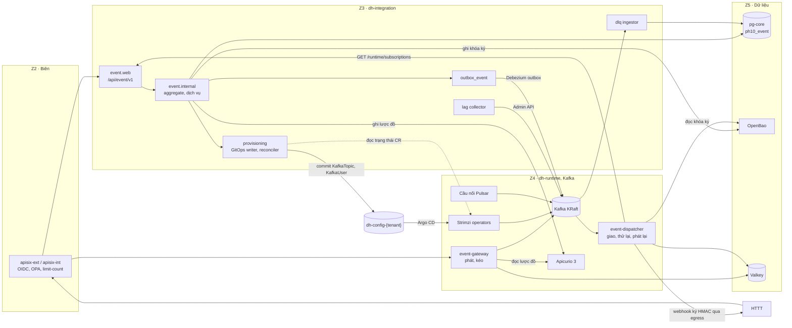
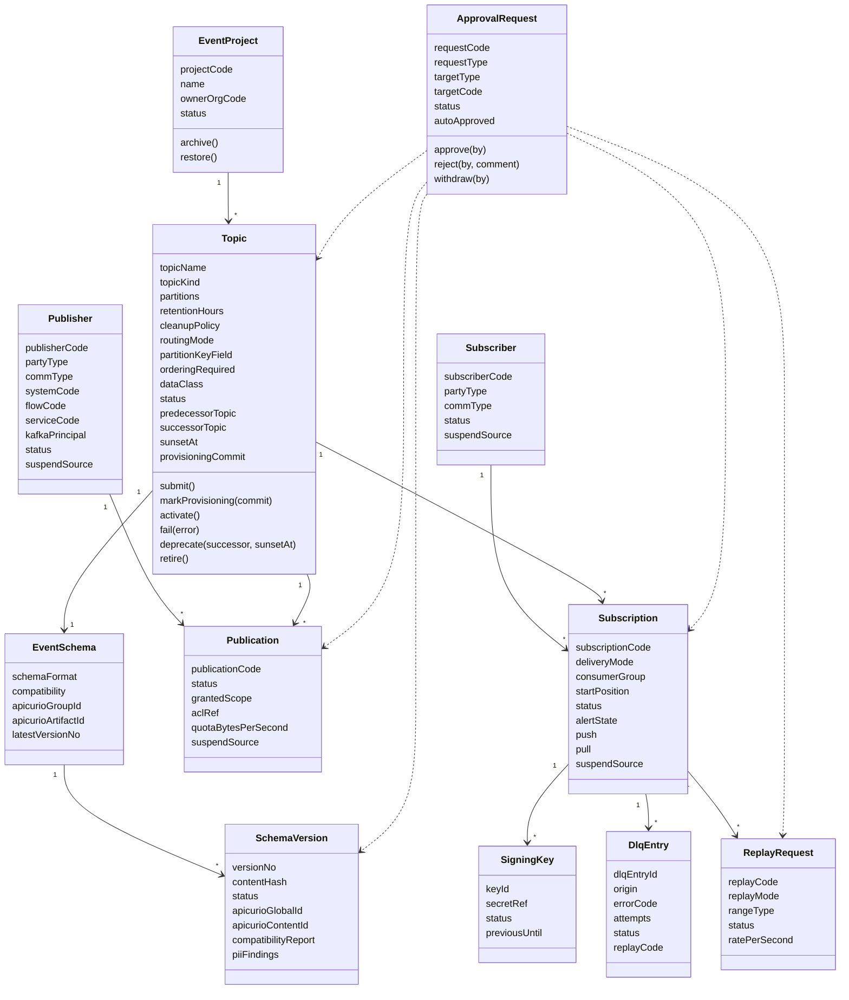

# D03-02-PH10 · Thiết kế chi tiết Sự kiện

## Tóm tắt cho hội đồng thẩm định

Tài liệu mô tả cách hiện thực 76 FR của [D02-03-PH10](../../02-yeu-cau/frs/D02-03-PH10-frs-su-kien.md), phân hệ thay khối Hub Apache Pulsar của hệ cũ bằng trục sự kiện Kafka có lược đồ bắt buộc, có duyệt và có giao nhận tin cậy cho HTTT chỉ biết gọi HTTP. Thiết kế dựa trên năm quyết định:

1. **Control plane và data plane tách hẳn.** Mọi khai báo nghiệp vụ (dự án, topic, lược đồ, bên phát, bên nhận, publication, subscription, yêu cầu duyệt, DLQ, phát lại, di trú) nằm ở module `event` của `dh-integration` (Spring Boot 4, Spring Modulith), lưu ở schema `ph10_event` của cụm `pg-core`. Đường đi của bản tin chỉ qua Kafka và hai mô-đun mới của `dh-runtime`: **cổng sự kiện** (API phát, API kéo) và **bộ giao nhận webhook** (ký HMAC, thử lại, DLQ, phát lại). Khi `dh-integration` hoặc `pg-core` ngừng, sự kiện vẫn được phát, giao và kéo (NFR-10-013, ADR-071).
2. **PH-10 là bên duy nhất ghi Apicurio.** Mỗi topic một artifact (`groupId = {tenant}`, `artifactId = {topicName}`), phiên bản qua duyệt bốn mắt, kiểm tra trước bằng `dryRun`, mức mặc định `BACKWARD`; thay đổi phá vỡ tạo topic `.v{n+1}` (ADR-070).
3. **Cấu hình cụm đi qua Git.** `dh-integration` không có quyền quản trị Kafka; nó sinh `KafkaTopic`, `KafkaUser` vào kho `dh-config-{tenant}`, Argo CD và Strimzi áp dụng, bộ đối soát theo dõi trạng thái `Ready` rồi chuyển đối tượng sang `ACTIVE` (ADR-072). Ngoại lệ duy nhất là Admin API để khởi tạo, đặt lại và xóa vị trí nhóm tiêu thụ, đọc lag.
4. **Ít nhất một lần, không mất bản tin.** Offset chỉ được commit sau khi giao thành công hoặc bản tin đã nằm chắc trên topic `{topicName}.dlq`; DLQ bền ở bảng `dlq_entry`, `dlq_payload`; phát lại không phụ thuộc lưu giữ của topic gốc (BR-10-024).
5. **Di trú song song.** Cầu nối Pulsar hai chiều theo từng topic chạy như luồng Camel trên `dh-runtime`, có hạn dùng, có đối chiếu mỗi giờ và cửa sổ quay lui (ADR-073).

Thiết kế không tạo ADR mới: bốn ADR-070…073 do FRS lập đã đủ. Tập nêu 10 câu hỏi mở Q10-20…29 và một mục "Đề nghị bổ sung cho FRS" (§13.4) cho bảy chỗ Phụ lục A chưa có tên bảng hay đường dẫn mà thiết kế cần.

## 1. Phạm vi và cách đọc

Tài liệu đi từ vị trí trong kiến trúc (§2), cấu trúc mã (§3), từng thành phần (§4), sequence của các ca phức tạp (§5) tới đa tenant (§6), bảo mật (§7), máy trạng thái, lỗi và nhất quán (§8), cấu hình (§9), quan sát (§10), hiệu năng và vận hành (§11), kiểm thử (§12), lộ trình và câu hỏi mở (§13).

Mọi enum, trạng thái, tên trường, mã quyền, tham số `10.*`, mã màn hình, mã sự kiện và định danh kỹ thuật lấy đúng Phụ lục A của FRS; mã ERR, BR, NFR là của FRS; tên bảng là tên gợi ý ở Phụ lục A.3 (tập CSDL D03-03-PH10 viết song song theo cùng phụ lục); mã API theo gợi ý FRS §8.3 (định nghĩa đầy đủ ở D03-04-PH10). Biện pháp ATTT dẫn mã `SEC-*` đã có ở D03-07, không tạo mới. Định nghĩa chung (danh sách, kiểm toán, đăng nhập, "Việc của tôi") dẫn chiếu FR-00 của SRS, không nhắc lại.

| ADR áp dụng | Nội dung dùng ở đây |
|---|---|
| ADR-001 | Spring Boot 4 + Modulith cho `dh-integration` |
| ADR-002, ADR-061 | Camel Quarkus 3.33.x cho `dh-runtime`, hồ sơ runtime |
| ADR-003 | PostgreSQL, RLS theo `tenant_id` |
| ADR-004 | Kafka (Strimzi, KRaft) và Apicurio Registry thay Pulsar |
| ADR-006 | Keycloak, OPA cho token và quyết định truy cập |
| ADR-008 | Valkey cho đệm chia sẻ |
| ADR-009, ADR-068 | GitOps Argo CD, kho cấu hình theo tenant `dh-config-{tenant}` |
| ADR-011 | OpenTelemetry, LGTM |
| ADR-012 | OpenBao cho bí mật ký, khóa transit |
| ADR-013 | Tách control plane và data plane |
| ADR-044 | Chữ ký webhook HMAC-SHA256 dùng chung với PH-19 |
| ADR-059 | CDC bằng Debezium trên Kafka Connect của tenant (`dh-cdc`) |
| [ADR-070](../../00-chung/adr/ADR-070-tuong-thich-luoc-do-va-phien-ban-topic.md) | Tương thích lược đồ, artifact mỗi topic, phiên bản topic |
| [ADR-071](../../00-chung/adr/ADR-071-giao-nhan-day-keo-qua-dh-runtime.md) | Cổng sự kiện, bộ giao nhận webhook trong `dh-runtime` |
| [ADR-072](../../00-chung/adr/ADR-072-cap-phat-topic-acl-qua-gitops.md) | `KafkaTopic`, `KafkaUser` qua kho Git của tenant |
| [ADR-073](../../00-chung/adr/ADR-073-cau-noi-di-tru-pulsar.md) | Cầu nối di trú Pulsar |

## 2. Vị trí trong kiến trúc

### 2.1. Đơn vị triển khai và vùng mạng

| Thành phần | DU, tài nguyên | Vùng | Ghi chú |
|---|---|---|---|
| Module `event` (API control plane, nghiệp vụ, bộ đối soát cấp phát, bộ thu lag, bộ ghi DLQ, bộ điều phối di trú) | `dh-integration` | Z3 | Cùng DU với module `flow` (PH-04), `adapter` (PH-05), khác module Modulith |
| Cổng sự kiện (API phát, API kéo, chống trùng, kiểm lược đồ) | `dh-runtime`, Deployment `dh-runtime-event-gateway` trong namespace `dh-rt-{tenant}` | Z4 | Sau `apisix-ext` và `apisix-int`; tối thiểu 2 bản sao, HPA theo CPU |
| Bộ giao nhận webhook (kèm bộ phát lại, bộ giám sát tuân thủ, bộ xác minh endpoint) | `dh-runtime`, StatefulSet `dh-runtime-event-dispatcher` trong `dh-rt-{tenant}` | Z4 | Tối thiểu 2 bản sao, KEDA theo tổng lag của nhóm `dh-sub-{tenant}-*` |
| Cầu nối Pulsar | Luồng Camel trên `dh-runtime` hồ sơ `legacy-jvm` (thành phần `pulsar`) | Z4 | Chỉ trong giai đoạn di trú |
| Kafka KRaft, Topic Operator, User Operator | Strimzi, namespace `dh-kafka` | Z4 (broker), listener `external` mở ra Z2 khi tenant bật | Ba broker, `replicas: 3`, `min.insync.replicas: 2` |
| Apicurio Registry 3 | Nền tảng, lưu trữ trên `pg-core` (schema riêng của Apicurio) | Z4 | Ghi chỉ bởi `dh-integration`; HTTT đọc qua `/event/v1/registry/**` |
| `pg-core` schema `ph10_event` | Nền tảng (CNPG) | Z5 | RLS theo `tenant_id` |
| OpenBao | Nền tảng | Z5 | `kv/dh/{tenant}/event/subscriptions/{subscriptionCode}/signing`, `transit/dh-{tenant}-event-dlq` |
| Valkey | Nền tảng | Z5 | Lease kéo, chống trùng cổng, ảnh chụp cấu hình runtime (§4.12) |
| Kho Git `dh-config-{tenant}` | Nền tảng (GitHub khi phát triển, GitLab khi bàn giao) | Z3 | `kafka/topics/`, `kafka/users/` |

Lượt giao webhook đi từ Z4 qua egress gateway với `ServiceEntry` theo FQDN (SEC-16). Lượt phát và kéo của HTTT đi vào qua APISIX (Z2), APISIX gọi OPA kiểm scope và quan hệ còn hiệu lực ở từng lượt (SEC-26), rồi chuyển tới cổng sự kiện của đúng tenant theo tiền tố của `topicName` hoặc theo `subscriptionCode` tra trong bảng định tuyến của APISIX.

### 2.2. Sơ đồ thành phần



Sơ đồ cho thấy ba đường. Đường khai báo đi từ giao diện qua APISIX vào `event.web`, ghi `ph10_event` và `outbox_event` trong một giao dịch, rồi sinh tài nguyên Strimzi vào Git và đăng ký lược đồ ở Apicurio. Đường bản tin đi từ HTTT qua APISIX tới cổng sự kiện, ghi Kafka, rồi bộ giao nhận đẩy về HTTT nhận hoặc HTTT nhận tự kéo qua cổng; đường này chỉ chạm Kafka, Apicurio (đọc, có đệm), OpenBao (đọc khóa ký, có đệm) và Valkey. Đường phản hồi gồm bộ thu lag đọc Admin API và bộ ghi DLQ tiêu thụ topic `*.dlq` để lưu bền mục DLQ. Bộ giao nhận lấy cấu hình subscription qua API-10-073 với scope `event:runtime-config` và giữ ảnh chụp ở Valkey để chạy tiếp khi control plane ngừng.

### 2.3. Phụ thuộc với module và phân hệ khác

| Bên | Hướng | Cơ chế | Dùng cho | Khi bên kia không khả dụng |
|---|---|---|---|---|
| PH-01 Kết nạp HTTT | PH-10 gọi và tiêu thụ | `SystemRegistryApi` (bản sao đọc), sự kiện giả định `{tenant}.connect.system.state-changed.v1` (Q10-17) | Kiểm `systemCode` `ACTIVE`, `clientId`, cấp độ ATTT; tạm ngừng theo PH-01 (FR-10-029) | Khai báo bên phát, bên nhận mới trả ERR-10-029; bên đang có giữ nguyên; đối chiếu mỗi giờ bù sự kiện lỡ |
| PH-04 Lõi tích hợp | Hai chiều trong tiến trình | `flow.api.FlowQueryApi` (PH-10 gọi); `event.api.EventPermissionApi`, `EventCatalogApi` (PH-04 gọi, cùng DU); qua HTTP cho môi trường tách DU: API-10-071, 072 với scope `event:permission-check` | VR-10, bảng chọn topic của trình thiết kế, phụ thuộc luồng (API-04-016), EVT-04-09 | PH-04 chặn gửi duyệt luồng khi không kiểm được (FR-10-069) |
| PH-05 Bộ điều hợp | PH-05 gọi | `event.api.TopicRegistrationApi` trong tiến trình hoặc API-10-009, API-10-023 với scope `event:topic-register`; tiêu thụ EVT-05-11 | Topic CDC tự duyệt (FR-10-066, 068) | PH-05 trả ERR-05-029, CDC đang chạy không ảnh hưởng |
| PH-12 Định danh | PH-10 gọi | Keycloak Admin API (gắn, gỡ client scope), bundle dữ liệu OPA | Scope `topic:{topicName}:publish`, `:subscribe` (BR-10-020) | Lệnh duyệt trả ERR-10-029, yêu cầu giữ `PENDING` |
| PH-13 Giám sát, kiểm toán | PH-10 phát | OTLP (chỉ số, vết, log), outbox kiểm toán | Lag, giao nhận, kiểm toán (FR-10-059, 065) | Đệm của bộ thu OTel; kiểm toán nằm trong outbox chờ |
| PH-18 Vận hành | PH-18 gọi, PH-10 phát | API-10-060…065 với scope `event:dlq-read`, `event:replay`; EVT-10-07, 09, 10, 11, 12, 14, 15 | Màn DLQ chung, sự cố | Không ảnh hưởng PH-10 |
| PH-18 kho tham số | PH-10 đọc | `ParameterApi` với tiền tố `10.` | Tham số tenant (FR-10-063) | Đệm 5 phút, giá trị mặc định Phụ lục A.5 |
| PH-20 Quản trị tenant | PH-10 tiêu thụ | Sự kiện khởi tạo, tạm ngừng tenant | Khai báo nền: hạn mức, principal nội bộ, ACL tiền tố, topic hệ thống (FR-10-064) | Khởi tạo chạy lại idempotent |
| PH-02 Danh mục dịch vụ | PH-02 tiêu thụ | EVT-10-01, 03, 04 | Công bố topic như dịch vụ sự kiện | Không ảnh hưởng |
| Apicurio, Git, Argo CD, Strimzi, OpenBao | PH-10 gọi | Client có ngắt mạch (§8.4) | Lược đồ, cấp phát, khóa ký | ERR-10-029, không để lại trạng thái dở dang |

### 2.4. Hiện trạng mã và đường chuyển

Repo hiện có `docs/07-srs/SRS-PH-10-event.md` (FR-10-001…015 cũ) nhưng chưa có mã nguồn của module `event`. Module được tạo mới theo cấu trúc §3; ánh xạ FR cũ sang FR mới ở FRS §9.3. Hai mô-đun `dh-runtime` dựng trên thư viện `dh-runtime-lib` đã có của PH-04 (mTLS mesh, `TenantContext`, chỉ số chung) và PH-05 (đệm bí mật OpenBao `ConnManifestCache` được tái dùng cho khóa ký).

## 3. Cấu trúc mã nguồn

### 3.1. Module `event` trong `dh-integration`

```text
vn.datahub.integration.event
├── api/                         # công bố cho module khác (chỉ gói này được import từ ngoài)
│   ├── EventPermissionApi       # VR-10 cho PH-04 (FR-10-069)
│   ├── EventCatalogApi          # tra cứu topic, lược đồ hiện hành, phụ thuộc luồng
│   ├── TopicRegistrationApi     # đăng ký topic CDC, SYSTEM (FR-10-066, 067)
│   └── dto/                     # TopicView, PermissionCheckItem, PermissionResult, RegistrationResult
├── web/                         # @RestController theo nhóm API-10-001…078; ProblemDetail ERR-10-0xx
│   └── runtime/                 # API-10-073 cho dh-runtime (scope event:runtime-config)
├── internal/
│   ├── project/                 # aggregate EventProject (FR-10-001…005)
│   ├── topic/                   # aggregate Topic, TopicNamePolicy (BR-10-002), TopicConfigPolicy, TopicChangeService
│   ├── schema/                  # aggregate EventSchema, SchemaVersion; ApicurioGateway; CompatibilityChecker; PiiScanner
│   ├── party/                   # aggregate Publisher, Subscriber; CommTypeMatrix (A.2.8, BR-10-017)
│   ├── publication/             # aggregate Publication
│   ├── subscription/            # aggregate Subscription, SigningKey; EndpointPolicy (BR-10-026); StartPositionInitializer
│   ├── approval/                # aggregate ApprovalRequest; FourEyesGuard (BR-10-010); AutoApprovalPolicy (BR-10-031); Expirer
│   ├── provisioning/            # GitOpsWriter, KafkaManifestRenderer, ProvisioningReconciler, DriftDetector, ConsumerGroupAdmin
│   ├── access/                  # KeycloakScopeBinder, OpaDataPublisher, AclRenderer, QuotaAllocator (BR-10-029)
│   ├── signing/                 # SigningKeyService (OpenBao KV v2, chỉ ghi), RotationScheduler
│   ├── dlq/                     # DlqIngestor (tiêu thụ *.dlq), DlqService, PayloadVault (transit), Purger
│   ├── replay/                  # ReplayService (FR-10-051…053), RangeResolver (offsetsForTimes)
│   ├── lag/                     # LagCollector (khóa phân tán), AlertEvaluator (FR-10-055), LagSampleRollup
│   ├── stats/                   # DeliveryStatIngestor (từ dh-runtime), DashboardQuery, GraphBuilder (FR-10-057, 058)
│   ├── catalog/                 # CommType, RoutingMode và bật tắt theo tenant (FR-10-060, 061)
│   ├── quota/                   # TenantEventQuota, QuotaGuard (FR-10-062)
│   ├── settings/                # đọc tham số 10.* qua ParameterApi của PH-18
│   ├── machine/                 # TopicRegistrationService, CdcSchemaChangeConsumer (EVT-05-11), PartySyncConsumer (PH-01, PH-04)
│   ├── tenancy/                 # TenantBootstrapper (PH-20), LeakProbeScheduler (SEC-87)
│   ├── exchange/                # ManifestExporter, ManifestImportJob (FR-10-070, 071)
│   ├── migration/               # PulsarInventoryImporter, LegacyMapping, MigrationBridge, BridgeFlowRenderer, Reconciler
│   └── idempotency/             # IdempotencyFilter, IdempotencyStore
└── events/                      # record EVT-10-01…15, OutboxWriter, EventTypes (ce_type vn.datahub.event.*)
```

Quy tắc phụ thuộc kiểm bằng Spring Modulith (`ApplicationModules.verify()`) và ArchUnit:

| Luật | Kiểm bằng |
|---|---|
| Module khác chỉ import `event.api` và `event.events` | Modulith, `@NamedInterface` |
| `event` chỉ import `flow.api` (PH-04), `adapter.api` (PH-05), `platform.api` (tham số, kiểm toán) | Modulith |
| Lớp `web` không gọi `ApicurioGateway`, `GitOpsWriter`, `SigningKeyService` trực tiếp; mọi lệnh qua dịch vụ ứng dụng trong `internal/*` | ArchUnit |
| Không lớp nào ngoài `signing` có kiểu `SigningSecret`; `SigningSecret.toString()` trả `***` | ArchUnit, kiểm thử canary NFR-10-016 |
| Gói `provisioning` là nơi duy nhất dùng client Kubernetes (chỉ đọc) và Kafka Admin | ArchUnit |
| Mọi lệnh đổi trạng thái đi qua phương thức của aggregate, không `UPDATE … SET status` ngoài repository của aggregate | ArchUnit theo tên phương thức repository |

### 3.2. Hai mô-đun ở `dh-runtime`

```text
dh-runtime/
├── dh-runtime-lib/
│   └── vn.datahub.runtime.event
│       ├── common/              # RuntimeConfigClient (API-10-073), RuntimeConfigCache (Caffeine + ảnh chụp Valkey),
│       │                        # SchemaCache (Apicurio, theo contentId), CloudEventCodec (nhị phân Kafka, JSON có cấu trúc),
│       │                        # TenantGuard (tenant từ tiền tố topic), EventMetrics
│       ├── gateway/             # mô-đun cổng sự kiện (ADR-071)
│       │   ├── PublishResource       # API-10-079
│       │   ├── PullResource          # API-10-080…082
│       │   ├── DeadLetterResource    # API-10-083 (bên nhận Kafka ngoài tự báo)
│       │   ├── RegistryProxy         # API-10-084, chỉ đọc
│       │   ├── EnvelopeValidator     # CloudEvents 1.0, BR-10-021
│       │   ├── PartitionKeyResolver  # FR-10-013
│       │   ├── TenantProducerPool    # producer idempotent acks=all theo tenant
│       │   ├── PublishDeduplicator   # (bên phát, id) 24 giờ ở Valkey
│       │   ├── LeaseManager          # một lease mỗi subscription PULL_API
│       │   └── CursorCodec           # cursor ký HMAC phía máy chủ
│       └── delivery/            # mô-đun bộ giao nhận webhook (ADR-071)
│           ├── SubscriptionSupervisor # khởi, dừng, đổi tham số consumer theo cấu hình
│           ├── SlotAllocator          # chia worker của subscription cho các bản sao
│           ├── PartitionWorker        # vòng giao tuần tự trong một phân vùng
│           ├── WebhookRequestBuilder  # CLOUDEVENTS_STRUCTURED, CLOUDEVENTS_BINARY
│           ├── WebhookSigner          # ADR-044, hai chữ ký khi xoay khóa
│           ├── EgressGuard            # BR-10-026, chống DNS rebinding
│           ├── RetryPolicy            # FR-10-039
│           ├── SubscriptionBreaker    # ngắt mạch 50% trong 10.push.suspend-after-failures-minutes
│           ├── DlqWriter              # ghi {topicName}.dlq acks=all
│           ├── DeliveryStatsReporter  # cửa sổ 1 phút, lượt lỗi
│           ├── EndpointVerifier       # bắt tay CloudEvents HTTP Webhook (FR-10-036)
│           ├── replay/                # ReplayRunner (REDELIVER_RANGE, DLQ_ENTRIES), TokenBucket
│           └── compliance/            # ComplianceSampler (FR-10-023)
├── dh-runtime-kamelets/
│   └── event/                   # dh-kafka-source, dh-kafka-sink (đọc cấu hình topic từ PH-10, dùng cho luồng PH-04),
│                                # dh-pulsar-bridge-source, dh-pulsar-bridge-sink (cầu nối, ADR-073)
└── profiles/
    └── event-native/            # hồ sơ mới: chỉ gateway, delivery; không nạp luồng (FlowLoader tắt)
```

Hồ sơ `event-native` (Quarkus native, Vert.x HTTP client, Kafka client) được ghi vào `runtime-manifest.json` như mọi hồ sơ khác (FR-04-081). Một ảnh, hai vai: biến `DH_EVENT_ROLE=gateway` hoặc `dispatcher` chọn mô-đun khởi động. Hai vai tách Deployment để mở rộng độc lập: cổng mở rộng theo CPU và số yêu cầu, bộ giao nhận theo lag. Cầu nối Pulsar không ở hồ sơ này mà chạy ở `legacy-jvm` vì client Pulsar chưa ổn định ở native.

### 3.3. Giao diện công bố cho PH-04, PH-05

```java
public interface EventPermissionApi {
    // FR-10-069: kết quả ALLOWED, PENDING, DENIED kèm lý do TOPIC_NOT_FOUND, TOPIC_NOT_ACTIVE, NO_GRANT, GRANT_SUSPENDED
    List<PermissionResult> check(TenantId tenant, String environment, List<PermissionCheckItem> items);
    List<TopicView> usableTopics(TenantId tenant, String flowCode, String action);
    FlowDependencies dependenciesOf(TenantId tenant, String flowCode);     // cho API-04-016
    EnsurePartyResult ensureParty(TenantId tenant, String flowCode, List<PermissionCheckItem> wanted, UserRef onBehalfOf);
}

public interface TopicRegistrationApi {
    // FR-10-066, 067: idempotent theo topicName; trả PROVISIONING, PENDING_APPROVAL hoặc trạng thái hiện tại
    RegistrationResult register(TenantId tenant, ServiceRef caller, TopicRegistration request);
    SchemaRegistrationResult registerSchemaVersion(TenantId tenant, ServiceRef caller, String topicName, SchemaDraft draft);
    RegistrationResult newMajorVersion(TenantId tenant, ServiceRef caller, String topicName, SchemaDraft draft);
}
```

Giá trị `ALLOWED`, `PENDING`, `DENIED` và bốn lý do là kết quả trả về do FR-10-069 nêu, không phải trạng thái lưu. PH-04 và PH-05 cùng DU gọi trong tiến trình; khi tách DU (cấu hình `dh.event.remote=true`) lớp `api` có bản hiện thực gọi HTTP API-10-071, 072, 009, 023 với token dịch vụ, ngắt mạch 5 giây.

### 3.4. DTO chính

| DTO | Trường (tên API theo Phụ lục A.3) | Dùng ở |
|---|---|---|
| `TopicView` | `topicName`, `projectCode`, `topicKind`, `status`, `partitions`, `retentionHours`, `cleanupPolicy`, `routingMode`, `partitionKeyField`, `orderingRequired`, `dataClass`, `latestSchemaVersion`, `successorTopic`, `sunsetAt` | API-10-008, 010, `EventCatalogApi` |
| `RuntimeSubscription` | `subscriptionCode`, `topicName`, `deliveryMode`, `status`, `consumerGroup`, `push{endpointUrl, workerCount, maxRetries, retryBackoff, timeoutMs, failurePolicy, payloadFormat}`, `pull{maxBatch, leaseSeconds}`, `signingKeys[]{keyId, status, previousUntil}`, `configVersion` | API-10-073 cho bộ giao nhận, cổng kéo |
| `RuntimeTopic` | `topicName`, `status`, `routingMode`, `partitionKeyField`, `orderingRequired`, `maxMessageBytes`, `apicurioGroupId`, `apicurioArtifactId`, phiên bản `ENABLED`, `DEPRECATED`, `configVersion` | API-10-073 phần topic, cổng phát |
| `DeliveryReport` | `subscriptionCode`, `windowStart`, `successCount`, `transientErrorCount`, `retryCount`, `deadLetterCount`, `latencyP50Ms`, `latencyP95Ms`, danh sách `DeliveryFailure` | Bộ giao nhận gửi về (§4.10) |

`RuntimeSubscription` không bao giờ chứa bí mật ký; chỉ có `keyId` để bộ giao nhận đọc đúng phiên bản ở OpenBao. `configVersion` là giá trị cột `version` của bản ghi, dùng để bộ giao nhận bỏ qua cập nhật cũ hơn trạng thái đang giữ.

## 4. Thiết kế chi tiết từng thành phần

### 4.1. Mô hình miền



Sơ đồ chỉ ghi trường cần cho invariant; danh sách đủ ở Phụ lục A.3. Ranh giới aggregate và invariant được kiểm trong mã:

| Aggregate | Bảng | Invariant kiểm ở máy chủ | Nguồn |
|---|---|---|---|
| `EventProject` | `event_project` | `projectCode` duy nhất trong tenant kể cả `ARCHIVED`, không thuộc từ dành riêng; lưu trữ chỉ khi không còn topic `PENDING_APPROVAL`, `PROVISIONING`, `ACTIVE`, `DEPRECATED` | BR-10-003, FR-10-005 |
| `Topic` | `topic` | Tên theo `TopicNamePolicy`; `replicationFactor = 3`, `minInsyncReplicas = 2` hằng; `partitions` chỉ tăng; `orderingRequired` đòi `KEY_HASH` hoặc `SINGLE_PARTITION`; `COMPACT`, `COMPACT_DELETE` đòi chế độ có khóa; `SINGLE_PARTITION` có `partitions = 1`; người dùng không sửa topic `CDC`, `SYSTEM` ngoài `description` | BR-10-002, 004, 005, 006, 030; ERR-10-045, 046, 048 |
| `EventSchema` + `SchemaVersion` | `event_schema`, `schema_version` | Một lược đồ mỗi topic; không sửa nội dung phiên bản đã `ENABLED`; `NONE` chỉ khi topic chưa từng `ACTIVE` (`activatedAt` rỗng); không `DISABLED` phiên bản mới nhất | BR-10-011, 012, 013, 015 |
| `Publisher`, `Subscriber` | `publisher`, `subscriber` | Tổ hợp `partyType`, `commType`, `deliveryMode` theo `CommTypeMatrix`; một bên `SYSTEM` cho mỗi cặp (`systemCode`, `commType`) | BR-10-017; ERR-10-024 |
| `Publication` | `publication` | Duy nhất theo (`publisherCode`, `topicName`) khi chưa `REVOKED`; topic `ACTIVE` hoặc `DEPRECATED` khi duyệt; topic `RESTRICTED`, `SENSITIVE` chỉ bên `SYSTEM` đạt cấp độ | BR-10-016, 019 |
| `Subscription` + `SigningKey` | `subscription`, `signing_key` | Duy nhất theo (`subscriberCode`, `topicName`) khi chưa `REVOKED`; `workerCount` ≤ min(`partitions`, `10.push.max-workers`); `deliveryMode` hợp với `commType`; tối đa một `SigningKey` `ACTIVE` và một `PREVIOUS` | BR-10-017, 022, 025, 027 |
| `ApprovalRequest` | `approval_request` | Bốn mắt: `decidedBy` khác `requestedBy` và khác người tạo đối tượng đích; một yêu cầu `PENDING` mỗi (`targetType`, `targetCode`, `requestType`) | BR-10-010 |
| `DlqEntry` | `dlq_entry`, `dlq_payload` | Chỉ `PURGED` sau `REPLAYED` hoặc `DISCARDED` và qua thời gian giữ; `NEW` không tự xóa | BR-10-024 |
| `ReplayRequest` | `replay_request` | Một lượt `APPROVED` hoặc `RUNNING` mỗi subscription; `RESET_OFFSET` đòi subscription `PAUSED` | BR-10-028; ERR-10-032, 035 |
| `LegacyMapping`, `MigrationBridge` | `legacy_mapping`, `migration_bridge` | Không hai cầu nối ngược chiều cùng cặp topic đang `RUNNING`; có `expiresAt` | BR-10-033 |

Mỗi aggregate có cột `version` (khóa lạc quan). Lệnh từ API mang `If-Match`; lệnh hệ thống (đối soát, hết hạn, theo PH-01) thử lại tối đa 3 lần khi xung đột rồi ghi cảnh báo.

### 4.2. Chính sách tên topic

`TopicNamePolicy` là hàm thuần, kiểm thử bằng bảng ca. Nó nhận `tenant`, `topicKind`, các đoạn tên và trả tên đã chuẩn hóa hoặc mã lỗi:

| Loại | Mẫu | Kiểm thêm | Lỗi |
|---|---|---|---|
| `BUSINESS` | `^{tenant}\.[a-z][a-z0-9-]*(\.[a-z][a-z0-9-]*){2}\.v[1-9][0-9]*$` | Miền không thuộc danh sách dành riêng của FR-10-008; tổng ≤ 200 ký tự | ERR-10-004 |
| `CDC` | Tiền tố `{tenant}.cdc.`, 2…4 đoạn giữa, hậu tố `.v{n}` | Chỉ tài khoản dịch vụ có `event:topic-register` | ERR-10-004, 005 |
| `SYSTEM` | `{tenant}.{miền dành riêng}.…v{n}` hoặc tiền tố `dh.` (tenant `COMMON`) | Chỉ tài khoản dịch vụ; `dh.` chỉ PA hoặc dịch vụ nền tảng | ERR-10-004, 045 |
| `DLQ` | `{topicName}.dlq` | Chỉ hệ thống tạo cùng topic cha | Không nhận từ API |

Tiền tố tenant luôn là mã tenant chữ thường của ngữ cảnh xác thực (`T68` thành `t68.`); tiền tố khác trả ERR-10-005. Tên đã dùng (kể cả `RETIRED`) bị chặn bằng ràng buộc duy nhất `(tenant_id, topic_name)` không có điều kiện trạng thái (BR-10-003).

### 4.3. Lược đồ và Apicurio

`ApicurioGateway` bọc REST API v3 của Apicurio, là lớp duy nhất có thông tin xác thực ghi registry (client Keycloak `dh-integration-registry`, vai trò `sr-developer`). Các thao tác:

| Thao tác | Lời gọi Apicurio | Khi nào |
|---|---|---|
| Kiểm tra nháp | `POST /groups/{tenant}/artifacts/{topicName}/versions?dryRun=true` (artifact đã có) hoặc tạo artifact với `dryRun=true` | FR-10-017, 018 khi soạn, khi gửi duyệt |
| Tạo artifact và phiên bản 1 | `POST /groups/{tenant}/artifacts` với `artifactType` (`AVRO` hoặc `JSON` theo `schemaFormat`), quy tắc `COMPATIBILITY` theo `compatibility`, quy tắc `VALIDITY = FULL` | Duyệt `TOPIC_CREATE` (FR-10-009) |
| Thêm phiên bản | `POST /groups/{tenant}/artifacts/{topicName}/versions` | Duyệt `SCHEMA_VERSION` (FR-10-019) |
| Đổi trạng thái phiên bản | `PUT …/versions/{versionNo}/state` với `ENABLED`, `DEPRECATED`, `DISABLED` | FR-10-022 |
| Đổi mức tương thích | `PUT …/artifacts/{topicName}/rules/COMPATIBILITY` | Duyệt `TOPIC_CHANGE` (FR-10-021) |
| Xóa bù | `DELETE …/artifacts/{topicName}` | Hủy cấp phát khi topic chưa có bản tin (FR-10-010), lỗi giữa chừng khi duyệt |

`CompatibilityChecker` dùng kết quả `dryRun` làm nguồn chính và ghi `compatibilityReport` (danh sách vi phạm theo đường dẫn trường). Nó thêm hai kiểm tra Apicurio không làm: trường `partitionKeyField` phải có trong lược đồ với kiểu chuỗi hoặc số (ERR-10-017); định dạng phải trùng định dạng đã có (ERR-10-020). `PiiScanner` duyệt cây trường, so tên trường và `doc` với từ điển dữ liệu cá nhân (số định danh, họ tên, ngày sinh, địa chỉ, số điện thoại, thư điện tử) và trả `piiFindings[]` với `severity` `INFO`, `WARNING`, `BLOCKING`; với topic `PUBLIC`, `INTERNAL` và `10.schema.pii-check-mode = BLOCK`, phát hiện `WARNING` trở lên thành `BLOCKING` (ERR-10-018). Khi `WARN`, người duyệt phải gửi `acknowledgePii = true` (FR-10-009).

Thứ tự khi duyệt: (1) ghi Apicurio, (2) ghi `apicurioGlobalId`, `apicurioContentId`, trạng thái `ENABLED` và outbox trong một giao dịch. Nếu bước 2 lỗi sau khi bước 1 thành công, tác vụ bù `SchemaCompensator` chạy mỗi phút tìm phiên bản Apicurio không có bản ghi `ENABLED` tương ứng (so `contentHash`) và hoặc hoàn tất ghi (yêu cầu vẫn `APPROVED` theo nhật ký) hoặc xóa phiên bản Apicurio (yêu cầu không được ghi nhận). Cách này thay cho giao dịch phân tán.

### 4.4. Cấp phát qua GitOps và đối soát

`KafkaManifestRenderer` sinh YAML xác định (cùng đầu vào cho cùng byte, sắp khóa) cho:

| Tài nguyên | Đường dẫn trong `dh-config-{tenant}` | Nội dung chính |
|---|---|---|
| `KafkaTopic` topic | `kafka/topics/{topicName}.yaml` | `partitions`, `replicas: 3`, `config` (`retention.ms`, `cleanup.policy`, `min.insync.replicas: 2`, `max.message.bytes`), nhãn `dh.gov.vn/tenant`, `dh.gov.vn/project`, `dh.gov.vn/topic-kind`, chú thích `dh.gov.vn/request-code` |
| `KafkaTopic` DLQ | `kafka/topics/{topicName}.dlq.yaml` | Cùng số phân vùng, `retention.ms` theo `10.dlq.topic-retention-hours`, nhãn `dh.gov.vn/topic-kind: dlq` (BR-10-023) |
| `KafkaUser` | `kafka/users/{principal}.yaml` | `authentication` (`tls` cho mTLS hoặc không khai báo cho OAUTHBEARER), `authorization.acls` literal theo topic và nhóm, `quotas` (`producerByteRate`, `consumerByteRate`) do `QuotaAllocator` tính |

`GitOpsWriter` dùng thư viện JGit qua HTTPS với token kho của tenant (đọc từ OpenBao, quyền chỉ ghi vào nhánh môi trường), mỗi yêu cầu duyệt là một commit có thông điệp `event: {requestType} {targetCode} ({requestCode})`. Khi đẩy bị từ chối do nhánh đã tiến, `GitOpsWriter` kéo lại, áp lại thay đổi (tệp theo tên đối tượng nên không xung đột nội dung) và thử tối đa 5 lần. Commit hash ghi vào `provisioningCommit` của topic hoặc `aclRef` của publication, subscription.

`ProvisioningReconciler` chạy hai vòng, dùng khóa phân tán ShedLock trên `pg-core` để chỉ một bản sao chạy:

1. **Vòng nhanh (10 giây)** cho đối tượng `PROVISIONING`: đọc `status.conditions` của `KafkaTopic`, `KafkaUser` qua Kubernetes API (ServiceAccount chỉ `get`, `list`, `watch` trong `dh-kafka`). `Ready=True` và `observedGeneration` khớp thì gọi `Topic.activate()` hoặc tiếp bước cấp phát subscription; `Ready=False` với lý do từ Strimzi hoặc Kyverno từ chối (sự kiện admission) thì `fail(error)`; quá `10.provisioning.timeout-minutes` cũng `fail`. Kết quả ghi trạng thái và outbox trong một giao dịch.
2. **Vòng đối chiếu (10 phút)** cho mọi topic `ACTIVE`, `DEPRECATED`: so cấu hình thật trên cụm (Admin `describeConfigs`, `describeTopics`) với tệp trong Git và bản ghi `topic`; lệch thì ghi cảnh báo mức cao kèm khác biệt, chỉ số `dh_event_provisioning_state{state="drift"}`, không sửa đè (BR-10-036).

Xóa topic sau `RETIRED`: tác vụ `RetiredTopicJanitor` chờ `10.topic.delete-after-retire-days`, kiểm không còn mục DLQ `NEW` (BR-10-024), rồi commit xóa hai tệp `KafkaTopic`; Strimzi Topic Operator xóa trên cụm (cấu hình `deleteTopics` bật cho namespace). Bản ghi `topic` giữ vĩnh viễn.

### 4.5. Quyền truy cập: scope, OPA, ACL, hạn mức

Khi publication, subscription chuyển `ACTIVE`, `AccessGrantService` chạy các bước theo `deliveryMode` và `partyType`, mỗi bước idempotent và ghi dấu hoàn tất vào `ApprovalRequest.checks` để có thể chạy tiếp sau lỗi:

| Đối tượng | `SYSTEM` qua HTTP | `SYSTEM` qua Kafka ngoài | `FLOW`, `INTERNAL_SERVICE` |
|---|---|---|---|
| Publication | Gắn client scope `topic:{topicName}:publish` vào client `clientId` (Keycloak Admin API); thêm cặp (client, topic, `PUBLISH`) vào dữ liệu OPA | ACL `WRITE`, `DESCRIBE` literal trên topic cho `kafkaPrincipal`, `quotas.producerByteRate` | Chỉ ghi nhận (VR-10); ACL tiền tố của principal nội bộ tenant đã có từ khởi tạo (BR-10-018) |
| Subscription `PUSH` | Không cấp scope cho HTTT; bộ giao nhận dùng principal `User:CN=dh-runtime-{tenant}` | — | — |
| Subscription `PULL_API` | Gắn `topic:{topicName}:subscribe`; OPA thêm cặp (client, `subscriptionCode`) | — | — |
| Subscription `PULL_KAFKA` | — | ACL `READ`, `DESCRIBE` literal trên topic, `READ` literal trên nhóm `dh-ext-{tenant}-{subscriptionCode}`, `quotas.consumerByteRate` | — |
| Subscription `INTERNAL` | — | — | Chỉ ghi nhận; nhóm `dh-flow-{tenant}-{flow}` hoặc `dh-svc-{service}-{tenant}` |

`OpaDataPublisher` không đẩy trực tiếp vào OPA mà ghi bundle dữ liệu theo tenant (`event/grants/{tenant}.json`) vào kho bundle của PH-12; OPA kéo bundle mỗi 30 giây và nhận thông báo đẩy (`/v1/data` PATCH qua sidecar) để bảo đảm NFR-10-009 (từ chối trong ≤ 60 giây). Chính sách Rego của APISIX đòi đồng thời scope trong token và cặp cấp quyền trong dữ liệu, nên tạm ngừng chỉ cần gỡ dữ liệu OPA là có hiệu lực, không đợi token hết hạn (BR-10-020).

`QuotaAllocator` tính hạn mức của từng `KafkaUser`: phần dự trữ `10.quota.internal-reserve-ratio` của `produceBytesPerSecond`, `consumeBytesPerSecond` cho principal nội bộ; phần còn lại chia theo `quotaBytesPerSecond` khai báo, tối thiểu 256 KiB/s, và từ chối duyệt khi tổng vượt trần (ERR-10-011, BR-10-029). Hạn mức của cổng HTTP đặt ở APISIX (`limit-count` theo publication), sinh vào cấu hình route của tenant.

### 4.6. Cổng sự kiện: API phát

`PublishResource` xử lý API-10-079. APISIX đã kiểm token và OPA trước khi tới cổng; cổng không tin tiêu đề do HTTT gửi mà đọc danh tính từ tiêu đề do APISIX ghi lại sau xác thực (`X-Dh-Client-Id`, `X-Dh-Tenant`, chỉ chấp nhận từ mTLS của APISIX, SEC-15). Đường xử lý theo thứ tự (chi tiết sequence §5.3):

1. `TenantGuard` tách tenant từ tiền tố `topicName`, so với `X-Dh-Tenant` (ERR-10-103 khi khác, không lộ topic tồn tại ở tenant khác).
2. `RuntimeConfigCache` tra `RuntimeTopic`: không có, hoặc không `ACTIVE`, `DEPRECATED` thì ERR-10-103.
3. `EnvelopeValidator` kiểm CloudEvents 1.0, `source` thuộc HTTT của client (bảng `source` cho phép đi kèm `RuntimeTopic.publishers[]`), ghi đè `dhtenant`, bổ sung `time`, `traceparent` (ERR-10-104).
4. `SchemaCache` chọn phiên bản theo `dataschema` hoặc phiên bản `ENABLED` mới nhất, kiểm `data` theo lược đồ (ERR-10-105). Đệm lược đồ theo `contentId`, bất biến nên không cần hết hạn; danh sách phiên bản hợp lệ làm mới bằng EVT-10-05, EVT-10-02.
5. `PartitionKeyResolver` lấy khóa theo `routingMode`: `KEY_HASH` đọc `partitionKeyField` (hoặc `ce_subject` khi `$subject`), thiếu khóa khi bắt buộc thì ERR-10-105; `ROUND_ROBIN` khóa rỗng, bộ chia phân vùng mặc định của client; `SINGLE_PARTITION` ghi phân vùng 0.
6. `PublishDeduplicator` đặt `SET NX` khóa `dh:{tenant}:evt:dedup:{publicationCode}:{id}` giá trị `PENDING`, TTL 24 giờ. Có giá trị `DONE:{partition}:{offset}` thì trả kết quả cũ; có `PENDING` trẻ hơn 30 giây thì chờ tối đa 2 giây để lấy kết quả của lượt đang chạy rồi trả `202` với kết quả đó; `PENDING` cũ hơn 30 giây (lượt trước đã chết giữa chừng) thì ghi lại (chấp nhận khả năng trùng hiếm, bên nhận chống trùng theo `id`, BR-10-009).
7. `TenantProducerPool` ghi với `acks=all`, `enable.idempotence=true`, `max.in.flight.requests.per.connection=5`, `delivery.timeout.ms=10000`. Lỗi `NOT_ENOUGH_REPLICAS` hoặc quá thời gian thì ERR-10-108, xóa khóa chống trùng.
8. Cập nhật khóa chống trùng thành `DONE`, trả `202` với `results[]`.

Lô (`application/cloudevents-batch+json`) được kiểm toàn bộ ở bước 3–5 trước khi ghi bất kỳ bản tin nào; ghi bằng một giao dịch Kafka (`transactional.id = dh-gw-{tenant}-{pod}-{n}`) để lô là tất cả hoặc không. Sự kiện đơn không dùng giao dịch để giữ p99 ≤ 50 ms (NFR-10-002). Bản tin trên Kafka theo định dạng §4.9 FRS: tiêu đề `ce_*`, giá trị có tiền tố định danh lược đồ kiểu Confluent (byte 0 và 4 byte `contentId`, ADR-070).

### 4.7. Cổng sự kiện: API kéo có lease và cursor

`PullResource` phục vụ API-10-080…082 cho subscription `PULL_API`. Mỗi subscription có tối đa một lease (FR-10-043). Thiết kế:

| Thành phần | Thiết kế |
|---|---|
| Đọc bản tin | Consumer gán phân vùng thủ công (`assign`), `group.id = dh-sub-{tenant}-{subscriptionCode}` chỉ để đọc, ghi offset đã commit; không `subscribe` nên không tái cân bằng giữa các bản sao cổng. `auto.offset.reset=none` (BR-10-022) |
| Lease | Valkey khóa `dh:{tenant}:evt:lease:{subscriptionCode}` gồm `leaseId` (ULID), bản sao giữ lease, vị trí đầu và cuối theo phân vùng, `leaseExpiresAt`; đặt bằng `SET NX PX leaseSeconds` |
| Kéo lặp | Lượt kéo khi lease còn hạn và chưa ack trả lại đúng lô cũ: cổng đọc lại theo khoảng offset ghi trong lease (đọc lại từ Kafka, không giữ lô trong bộ nhớ) |
| Cursor | Chuỗi base64url của `{subscriptionCode, leaseId, offsets{partition: nextOffset}, exp}` kèm HMAC-SHA256 bằng khóa cursor của tenant (§13.4 mục 3); cursor không giả được, không dùng được cho subscription khác |
| Ack | Kiểm chữ ký, `leaseId` khớp lease hiện hành và chưa hết hạn (ERR-10-109); commit offset bằng `commitSync` với `group.id` của subscription (nhóm không có thành viên động nên commit hợp lệ); xóa lease |
| Nack | Các `eventIds[]` được đọc lại theo khoảng của lease, ghi lên `{topicName}.dlq` với `dh_dlq_error_code = ERR-10-113`, `origin` sẽ là `PULL_NACK`; sau khi DLQ xác nhận thì xử lý như ack cả lô |
| Chờ dài | Khi không có bản tin, `poll` lặp tới `waitSeconds` (≤ `10.pull.long-poll-max-seconds`) trên luồng ảo; trả `204` khi hết giờ |
| Định tuyến | Cổng nào nhận yêu cầu thì đọc lease ở Valkey; lease thuộc bản sao khác vẫn phục vụ được vì lô xác định bằng khoảng offset, không phụ thuộc trạng thái trong bộ nhớ |
| Hàng chờ phát lại | Lượt phát lại `REDELIVER_RANGE` cho `PULL_API` ghi danh sách khoảng vào khóa `dh:{tenant}:evt:replayq:{subscriptionCode}`; lượt kéo ưu tiên khoảng này trước bản tin mới (FR-10-052) |

Khi Valkey không khả dụng, cổng kéo không cấp được lease nên trả `503` kèm `Retry-After: 5`. ERR-10-029 là mã control plane, ERR-10-108 chỉ nói về bản sao đồng bộ của Kafka, nên FRS chưa có mã data plane đúng nghĩa cho "phụ thuộc runtime không khả dụng"; thiết kế trả `503` với `type` chung của RFC 9457 cho tới khi FRS bổ sung (§13.4 mục 6). API phát không bị chặn khi Valkey ngừng: `PublishDeduplicator` bỏ qua bước chống trùng (chấp nhận trùng, bên nhận chống trùng theo `id`) và tăng chỉ số `dh_event_dedup_bypass_total`.

### 4.8. Bộ giao nhận webhook

Bộ giao nhận là StatefulSet; mỗi bản sao có số thứ tự `i` trong `N` bản sao. `SubscriptionSupervisor` nạp danh sách `RuntimeSubscription` `PUSH` có `status = ACTIVE` từ `RuntimeConfigCache`, và `SlotAllocator` quyết định bản sao nào chạy worker nào:

- Worker `j` (0 ≤ j < `workerCount`) của subscription `s` chạy ở bản sao `(hash(s) + j) mod N`. Mỗi worker là một consumer tham gia nhóm `dh-sub-{tenant}-{subscriptionCode}` với `partition.assignment.strategy = CooperativeStickyAssignor`, nên Kafka chia phân vùng giữa các worker và đổi `workerCount` chỉ di chuyển phần phân vùng cần thiết (FR-10-046).
- `N` đọc từ chú thích của StatefulSet (Kubernetes API, chỉ đọc) và theo dõi thay đổi; khi KEDA đổi số bản sao, các bản sao tính lại phân bổ, đóng worker không còn thuộc mình sau khi lượt đang giao hoàn tất, rồi mở worker mới.
- Mỗi worker xử lý mỗi phân vùng được gán trên một luồng ảo riêng, tuần tự trong phân vùng (BR-10-025). Bản tin kế tiếp của phân vùng chỉ được giao khi bản tin trước đã thành công hoặc đã vào DLQ.

Đường giao một bản tin (sequence §5.5):

1. Giải tuần tự theo `contentId` của tiền tố bằng `SchemaCache`; lỗi thì ghi DLQ ngay với ERR-10-116, `failureClass = DESERIALIZATION`.
2. `WebhookRequestBuilder` dựng yêu cầu theo `payloadFormat`: `CLOUDEVENTS_STRUCTURED` thân `application/cloudevents+json`; `CLOUDEVENTS_BINARY` tiêu đề `ce-*`, thân là `data` JSON.
3. `WebhookSigner` lấy khóa `ACTIVE` (và `PREVIOUS` trong thời gian chồng lấn) từ đệm khóa ký, tính `HMAC-SHA256(secret, "{Webhook-Id}.{Webhook-Timestamp}.{body}")`, ghi `X-Datahub-Signature: t={ts},v1={hex}[,v1={hex}]`, kèm `Webhook-Id` (= `ce_id`), `Webhook-Timestamp`, `X-Datahub-Subscription`, `X-Datahub-Attempt`, `X-Datahub-Key-Id`, `traceparent`. Không đọc được khóa thì tạm dừng phân vùng, ERR-10-117, không gửi không ký.
4. `EgressGuard` phân giải FQDN, chặn địa chỉ thuộc dải riêng của nền tảng và dải cấm (ERR-10-115), ghim IP đã kiểm cho kết nối này để chống DNS rebinding; client HTTP không theo chuyển hướng, chỉ TLS ≥ 1.2 với kho CA nền tảng (ERR-10-114). Lưu lượng ra đi qua egress gateway (SEC-16).
5. Gửi với thời gian chờ `timeoutMs`. Phân loại kết quả theo bảng §8.5.
6. Thành công: đánh dấu offset đã xử lý; commit theo lô mỗi 1 giây hoặc mỗi 100 bản tin cho từng phân vùng (chỉ offset liên tục đã xong). Thất bại tạm thời: `RetryPolicy`. Thất bại vĩnh viễn hoặc hết lượt: `DlqWriter`.

`RetryPolicy` tính lần chờ thứ k là `min(maxMs, initialMs × multiplier^(k-1))` nhân hệ số ngẫu nhiên 0,8…1,2, dùng `Retry-After` nếu nhỏ hơn `maxMs` (FR-10-039). Trong lúc chờ, worker `pause()` riêng phân vùng đó và tiếp tục `poll()` để giữ tư cách thành viên nhóm (không vượt `max.poll.interval.ms`); các phân vùng khác vẫn chạy. Hết `maxRetries`: `DEAD_LETTER` thì ghi DLQ rồi đi tiếp; `BLOCK` thì gửi lệnh tạm ngừng về control plane (API nội bộ `POST /runtime/subscriptions/{subscriptionCode}:suspend` với `suspendSource = CIRCUIT_BREAKER`, §13.4 mục 5), dừng mọi worker của subscription, không commit.

`SubscriptionBreaker` đếm theo cửa sổ trượt 1 phút: tỷ lệ lỗi ≥ 50% liên tục trong `10.push.suspend-after-failures-minutes` phút thì báo control plane đặt `SUSPENDED` với `suspendSource = CIRCUIT_BREAKER`. Ở trạng thái này bộ giao nhận vẫn giữ một worker thăm dò: mỗi 5 phút gửi đúng bản tin đầu tiên chưa commit; thành công thì báo control plane đưa về `ACTIVE` (chỉ khi `suspendSource = CIRCUIT_BREAKER`), tiếp tục giao.

`DlqWriter` ghi bản tin gốc nguyên vẹn (khóa, tiêu đề, giá trị nhị phân) lên `{topicName}.dlq` bằng producer `acks=all` với sáu tiêu đề `dh_dlq_*` của Phụ lục A.8, chờ xác nhận rồi mới cho phép commit offset gốc. Ghi DLQ lỗi thì không commit, tạm dừng phân vùng, thử lại mỗi 5 giây, cảnh báo nghiêm trọng (BR-10-024).

### 4.9. Bộ ghi DLQ và kho nội dung

`DlqIngestor` trong `dh-integration` tiêu thụ mọi topic `*.dlq` của tenant bằng nhóm `dh-svc-dh-integration-{tenant}` (mẫu nhóm DU của Phụ lục A.8), đăng ký theo mẫu tên `^{tenant}\..*\.dlq$`. Với mỗi bản tin, trong một giao dịch `pg-core`:

1. Tra trùng theo (`subscriptionCode`, `sourceTopic`, `sourcePartition`, `sourceOffset`, `attempts`) trên chỉ mục duy nhất, bỏ qua nếu đã có (tiêu thụ lặp an toàn).
2. Tạo `DlqEntry` `NEW` với `origin` suy từ tiêu đề và đường ghi: bộ giao nhận ghi `PUSH`, cổng kéo ghi `PULL_NACK`, API-10-083 ghi `EXTERNAL_REPORT`, bộ phát lại ghi `REPLAY`, cầu nối ghi `BRIDGE` (FRS A.2.11). Tiêu đề `dh_dlq_*` của Phụ lục A.8 chưa có trường mang `origin`; thiết kế đề nghị thêm `dh_dlq_origin` (§13.4 mục 4).
3. Ghi nội dung vào `dlq_payload`: topic `PUBLIC`, `INTERNAL` lưu nguyên (`bytea`, mã hóa khi lưu của CNPG, SEC-30); topic `RESTRICTED`, `SENSITIVE` mã hóa phong bì bằng `transit/dh-{tenant}-event-dlq` của OpenBao (SEC-31, SEC-88). `payloadRef` trỏ tới bản ghi nội dung.
4. Ghi outbox gộp: `DlqAlertAggregator` gom theo subscription trong cửa sổ 1 phút rồi phát một EVT-10-11.

Offset của nhóm ingestor chỉ commit sau khi giao dịch xong. Khi `pg-core` ngừng, bản tin nằm chờ trên topic DLQ (lưu giữ `10.dlq.topic-retention-hours`, mặc định 7 ngày, đủ dài hơn mục tiêu phục hồi `pg-core`). `DlqPurger` chạy mỗi đêm: mục `REPLAYED`, `DISCARDED` quá `10.dlq.payload-retention-days-after-resolve` ngày thì xóa `dlq_payload`, đặt `payloadPurgedAt`, chuyển `PURGED`; siêu dữ liệu giữ 1 năm (FRS §7.2).

### 4.10. Thống kê giao nhận và lượt lỗi

`DeliveryStatsReporter` của bộ giao nhận gộp theo (subscription, phút) trong bộ nhớ và mỗi phút gửi một `DeliveryReport` về control plane. Một topic nội bộ sẽ giữ số liệu tốt hơn khi control plane ngừng, nhưng Phụ lục A.7 không có topic báo cáo giao nhận và tập này không tự đặt topic mới. Vì vậy thiết kế dùng API nội bộ `POST /runtime/delivery-reports` (scope `event:runtime-config`) với đệm 15 phút trong bộ nhớ của bộ giao nhận; quá 15 phút thì bỏ bản cũ nhất và tăng `dh_event_stats_dropped_total` (chỉ số OTLP vẫn đi sang PH-13 nên giám sát không mất). Mã API và lựa chọn topic ghi ở §13.4 mục 5. Control plane ghi `delivery_stat` (một dòng mỗi subscription mỗi phút, khóa `(subscription_code, window_start)` nên gửi lặp ghi đè cùng giá trị) và `delivery_failure` (lượt lỗi, giữ 30 ngày, `responseSnippet` tối đa 512 byte đã lọc theo bộ che SEC-32).

### 4.11. Bộ phát lại

`ReplayService` ở control plane (FR-10-051, 053) giải khoảng: `RangeResolver` gọi Admin `listOffsets` với `OffsetSpec.forTimestamp` cho `TIME`, kiểm khoảng còn trên cụm bằng `earliest`, `latest`, ước lượng `estimatedRecords` bằng tổng chênh offset (với topic `COMPACT` ghi rõ là cận trên). Lượt `APPROVED` được công bố cho bộ giao nhận qua `RuntimeConfigCache` (mục `replays[]` của API-10-073) và EVT-10-09.

`ReplayRunner` trong bộ giao nhận nhận lượt bằng khóa Valkey `dh:{tenant}:evt:replay:{replayCode}` (một bản sao chạy một lượt) rồi báo control plane chuyển `RUNNING`:

| `replayMode` | Cách chạy |
|---|---|
| `REDELIVER_RANGE` | Consumer `assign` các phân vùng của khoảng, không tham gia nhóm của subscription (nhóm `dh-replay-{tenant}-{replayCode}` chỉ để định danh, không commit); giao như §4.8 với `X-Datahub-Replay: {replayCode}` và cùng `Webhook-Id` như lần đầu; `TokenBucket` giới hạn `ratePerSecond`; lỗi cuối vào DLQ với `origin = REPLAY` và `replayCode`. Với `PULL_API` ghi khoảng vào hàng chờ phát lại (§4.7) |
| `RESET_OFFSET` | Control plane (không phải bộ giao nhận) chạy: kiểm subscription vẫn `PAUSED`, đọc vị trí hiện tại ghi vào `previousOffsets`, gọi Admin `alterConsumerGroupOffsets`, chuyển `COMPLETED`; TO tiếp tục subscription |
| `DLQ_ENTRIES` | `ReplayRunner` gọi API nội bộ lấy nội dung theo lô 100 mục (`event:replay`), giao từ nội dung đã lưu, báo kết quả từng mục; control plane chuyển mục `REPLAY_PENDING` sang `REPLAYED` hoặc về `NEW` với `attempts` tăng |

Tiến độ (`deliveredRecords`, `failedRecords`) báo mỗi 5 giây. Hủy (`PERM-10-operate`) đặt cờ trong cấu hình runtime; `ReplayRunner` dừng sau bản tin đang giao. Lượt `APPROVED` quá 24 giờ chưa chạy bị `ReplayExpirer` chuyển `CANCELLED`.

### 4.12. Cấu hình runtime và chạy khi control plane ngừng

`RuntimeConfigClient` của `dh-runtime` gọi API-10-073 (`GET /runtime/subscriptions?since={configVersion}`) mỗi 30 giây và ngay khi nhận EVT-10-02, 05, 08, 09, 13 (tiêu thụ bằng nhóm `dh-svc-dh-runtime-{tenant}`). Phản hồi gồm `RuntimeTopic`, `RuntimeSubscription`, lượt phát lại `APPROVED`, danh sách `source` hợp lệ theo publication. `RuntimeConfigCache` giữ trong bộ nhớ và ghi ảnh chụp nén vào Valkey `dh:{tenant}:evt:runtime-config` sau mỗi lần làm mới thành công. Khi khởi động, bản sao đọc ảnh chụp trước rồi mới gọi API; khi API lỗi, cổng và bộ giao nhận chạy tiếp với ảnh chụp, chỉ số `dh_event_runtime_config_age_seconds` tăng và cảnh báo sau 10 phút. Không có thay đổi khai báo nào có hiệu lực trong thời gian này, đúng NFR-10-013 và NFR-00-012.

Khóa ký đọc trực tiếp OpenBao bằng xác thực Kubernetes của ServiceAccount `dh-runtime-event` trong `dh-rt-{tenant}`, chính sách chỉ `read` trên `kv/dh/{tenant}/event/subscriptions/*`; đệm trong bộ nhớ 10 phút, làm mới khi nhận EVT-10-13 (SEC-33). Khi OpenBao ngừng, khóa trong đệm vẫn dùng tới khi hết hạn đệm; sau đó phân vùng tạm dừng với ERR-10-117 (không bao giờ gửi không ký).

### 4.13. Bộ thu lag và cảnh báo

`LagCollector` (khóa ShedLock, một bản sao mỗi DU) mỗi `10.lag.collect-interval-seconds` giây, theo từng tenant:

1. Liệt kê subscription `ACTIVE`, `PAUSED`, `SUSPENDED` cùng `consumerGroup`.
2. Gọi Admin `listConsumerGroupOffsets` theo lô 50 nhóm và `listOffsets(latest)` cho các phân vùng liên quan.
3. Tính `lagRecords` theo phân vùng. Với phân vùng có `lagRecords > 0`, lấy thời điểm của bản tin tại offset đã commit bằng một consumer `assign` đọc một bản tin (`max.poll.records = 1`, `fetch.max.bytes` nhỏ) để tính `lagSeconds`; phân vùng không lag có `lagSeconds = 0`. Chỉ đọc khi lag đổi so với chu kỳ trước để giảm tải (Q10-25).
4. Ghi `lag_sample` theo lô, xuất `dh_event_consumer_lag_records`, `dh_event_consumer_lag_seconds`.
5. `AlertEvaluator` tính `alertState` theo FR-10-055 (`WARNING` cần hai chu kỳ liên tiếp; `CRITICAL` khi vượt `lagCriticalSeconds` hoặc thời gian còn lại trước hết lưu giữ dưới 24 giờ; `STALLED` khi offset đã commit không đổi trong `10.lag.stalled-minutes` phút ở `ACTIVE`). Đổi mức thì ghi trạng thái và EVT-10-10 trong một giao dịch.

`LagSampleRollup` mỗi 5 phút gộp mẫu 30 giây, giữ mẫu gốc 48 giờ và bản gộp 90 ngày (FRS §7.2) bằng phân vùng bảng theo ngày (chi tiết ở D03-03-PH10).

### 4.14. Đăng ký máy với máy

`TopicRegistrationService` phục vụ PH-05 và DU nội bộ (FR-10-066, 067). Idempotent theo `topicName`: đã có cùng cấu hình thì trả trạng thái hiện tại với `200`; khác cấu hình thì ERR-10-002. `AutoApprovalPolicy` quyết định tự duyệt khi đồng thời: chủ thể là tài khoản dịch vụ có `event:topic-register`; `topicKind` là `CDC` hoặc `SYSTEM`; `10.approval.auto-approve-machine = true` (BR-10-031). Tự duyệt vẫn tạo `ApprovalRequest` `APPROVED` với `autoApproved = true`, `decidedBy = system:auto`, `requestedBy` là tài khoản dịch vụ và chú thích `onBehalfOf`. Cùng giao dịch tạo publication `ACTIVE` cho bên phát `INTERNAL_SERVICE` của `dh-cdc` (topic CDC) hoặc của DU chủ quản (topic `SYSTEM`) theo `10.approval.auto-approve-internal`. Phần ghi Apicurio và Git chạy bất đồng bộ trong `ProvisioningWorker` sau khi giao dịch commit, nên lời gọi trả `202` trong ≤ 2 giây (PH-05 chờ tối đa 5 giây).

`CdcSchemaChangeConsumer` tiêu thụ EVT-05-11 qua inbox (§8.3). Thay đổi tương thích: chờ PH-05 gửi phiên bản qua `registerSchemaVersion`, tự duyệt khi đạt mức tương thích của topic, ngược lại trả ERR-10-016. Thay đổi phá vỡ được chấp nhận ở PH-05: `newMajorVersion` tạo topic `.v{n+1}` tự duyệt, đặt topic cũ `DEPRECATED` với `successorTopic`, `sunsetAt` theo `10.topic.deprecation-days`, phát EVT-10-03 và thông báo đầu mối các subscription (FR-10-068).

`PartySyncConsumer` tiêu thụ sự kiện PH-01 (giả định Q10-17) và EVT-04-09. Sự kiện HTTT tạm ngừng: mọi publisher, subscriber gắn `systemCode` sang `SUSPENDED` với `suspendSource = PH01`, kéo theo publication, subscription của chúng sang `SUSPENDED` cùng nguồn, gỡ dữ liệu OPA trước (hiệu lực ≤ 60 giây, NFR-10-009) rồi mới ghi Git gỡ ACL. HTTT `ACTIVE` lại: chỉ tiếp tục đối tượng có `suspendSource = PH01`. `PartyReconciler` mỗi giờ so toàn bộ với bản sao đọc của PH-01 và danh sách luồng PH-04 để bù sự kiện lỡ.

### 4.15. Sơ đồ kết nối và dashboard

`GraphBuilder` (API-10-007) dựng đồ thị bằng ba truy vấn theo tenant và bộ lọc (publication với bên phát, subscription với bên nhận, topic), gộp nút HTTT xuất hiện ở cả hai phía, gắn chỉ số phủ theo `overlay`: `LAG` từ mẫu lag mới nhất, `TRAFFIC` từ `delivery_stat` 15 phút và tốc độ vào từ PH-13 (truy vấn Prometheus qua API của PH-13, có thể trống), `DLQ` từ đếm mục `NEW`. Đếm nút trước khi dựng; vượt `10.graph.max-nodes` trả ERR-10-049. Bố cục ELK làm ở trình duyệt, máy chủ chỉ trả `nodes[]`, `edges[]`. `DashboardQuery` (API-10-066) đọc bảng tổng hợp làm mới mỗi phút (`MATERIALIZED VIEW` theo tenant, đề nghị ở D03-03-PH10) cho bốn số đếm thay LGC-HUB-001…004 và liên kết sang bảng chỉ số cụm của PH-13 thay LGC-HUB-005, 006.

### 4.16. Di trú từ Pulsar

| Thành phần | Trách nhiệm |
|---|---|
| `PulsarInventoryImporter` | Đọc tệp kiểm kê Hub cũ (`sourceKind = PULSAR_HUB`) trong `ManifestImportJob`, sinh `LegacyMapping` `PROPOSED` với `confidence`, `issues`; ánh xạ loại subscription Pulsar theo Phụ lục A.2.14 |
| `BridgeFlowRenderer` | Khi cầu nối được duyệt (yêu cầu `BRIDGE`), sinh định nghĩa luồng Camel dùng Kamelet `dh-pulsar-bridge-source` (chiều `PULSAR_TO_KAFKA`) hoặc `dh-pulsar-bridge-sink` (chiều `KAFKA_TO_PULSAR`), commit vào kho luồng của tenant theo quy trình triển khai luồng của PH-04 với hồ sơ `legacy-jvm` |
| Kamelet `dh-pulsar-bridge-source` | Subscription Pulsar `Failover` tên `pulsarSubscriptionName`; dựng CloudEvents với `id` từ `messageId`, `source = /legacy-hub/{pulsarTopic}`; chuyển nội dung theo lược đồ đích; ghi Kafka `acks=all` với principal `User:CN=dh-runtime-{tenant}`; ack Pulsar sau khi Kafka xác nhận; lỗi chuyển nội dung ghi DLQ với ERR-10-118, `origin = BRIDGE` |
| Kamelet `dh-pulsar-bridge-sink` | Tiêu thụ topic Kafka với nhóm `dh-bridge-{tenant}-{bridgeCode}`, bỏ phong bì, ghi Pulsar theo định dạng cũ |
| `BridgeMonitor` | Đọc chỉ số của luồng cầu nối (`bridgedCount`, `lagSeconds`, `lastPulsarMessageId`) mỗi 30 giây, cập nhật `migration_bridge`; vượt `10.migration.bridge-max-lag-seconds` thì cảnh báo; `expiresAt` tới thì dừng (`EXPIRED`) |
| `MigrationReconciler` | Mỗi giờ so số bản tin theo khoảng giờ giữa Pulsar (`stats` qua Admin REST của Pulsar) và Kafka (đếm bản tin có `source` cầu nối, dựa trên `DeliveryStat` của luồng cầu nối), so mẫu 100 `id`; lưu báo cáo (§13.4 mục 7), cảnh báo khi chênh khác 0 sau khi trừ lag |
| `CutOverService` | Kiểm điều kiện FR-10-075, dừng cầu nối, chuyển ánh xạ `CUT_OVER`, phát EVT-10-15; quay lui bật lại cầu nối chiều cũ, `ROLLED_BACK`; hết `10.migration.rollback-window-days` thì `CLOSED` |

Ràng buộc không hai chiều cùng lúc (BR-10-033) kiểm bằng chỉ mục duy nhất một phần trên `migration_bridge (tenant_id, pulsar_topic, kafka_topic) WHERE status = 'RUNNING'` cộng kiểm ở dịch vụ khi tạo chiều ngược (ERR-10-042).

### 4.17. Xuất, nhập khai báo

`ManifestExporter` (FR-10-070) xuất YAML theo dự án gồm dự án, topic, lược đồ, bên phát, bên nhận, publication, subscription; không bao giờ chứa bí mật ký, `clientId` chỉ là tham chiếu (BR-10-027). `ManifestImportJob` (FR-10-071, Đợt sau) đi qua `VALIDATING`, `PREVIEW`, `APPLYING`, `APPLIED` hoặc `FAILED`, `CANCELLED`; mỗi dòng xem trước có `changeKind` `CREATE`, `UPDATE`, `UNCHANGED`, `CONFLICT`, `SKIP`; áp dụng chỉ tạo đối tượng ở trạng thái chờ duyệt, không bao giờ `ACTIVE` trực tiếp (BR-10-032).
