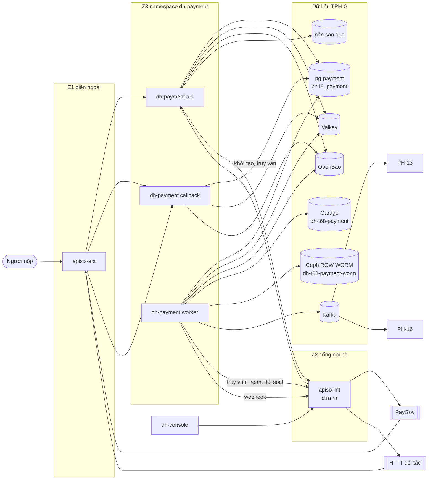

# D03-02-PH19 · Thiết kế chi tiết phân hệ PH-19 Thanh toán điện tử

## Tóm tắt cho hội đồng thẩm định

PH-19 là cổng thanh toán trung gian của tỉnh: các HTTT (dịch vụ công, một cửa, hộ tịch…) gọi một API duy nhất để thu phí, lệ phí qua Nền tảng thanh toán của Cổng Dịch vụ công quốc gia (PayGov); Datahub ghi nhận giao dịch, nhận kết quả có xác minh, báo lại cho HTTT, hoàn tiền có phê duyệt và đối soát hằng ngày với PayGov. Phân hệ thay khối Payment của LGSP cũ. Tài liệu này mô tả cách phần mềm được xây để đáp ứng [FRS D02-03-PH19](../../02-yeu-cau/frs/D02-03-PH19-frs-thanh-toan.md) và mười quyết định ADR-040…049.

Năm điểm thiết kế quyết định độ tin cậy của phân hệ:

1. **Lõi nghiệp vụ không biết PayGov.** Mọi trao đổi với nhà cung cấp đi qua một cổng Java `PaymentProviderPort`; adapter PayGov là lớp chống nhiễm (ADR-040), chuyển định dạng, chữ ký, mã kết quả của PayGov thành khái niệm nội bộ. Mã kết quả đi qua bảng ánh xạ cấu hình có phê duyệt (§7); mã chưa biết luôn ra kết cục `UNKNOWN`, không bao giờ thành công.
2. **Đúng một lần ở cả hai chiều.** Chiều vào từ đối tác: khóa lũy đẳng trên Valkey và bảng `idempotency_record`, bảng chống trùng mã hồ sơ không phân vùng (ADR-041). Chiều vào từ PayGov: hộp nhận `callback_inbox` ghi nguyên văn rồi xử lý tuần tự theo giao dịch (ADR-042). Chiều ra: outbox cùng giao dịch CSDL, webhook ký HMAC có số thứ tự (ADR-044).
3. **Tenant được xác định trước khi chạm dữ liệu.** Lời gọi của đối tác mang tenant trong token; callback của PayGov không có token, nên tenant lấy từ `connectionKey` 160 bit trong đường dẫn và được kiểm tra chéo với mã đơn vị trong nội dung đã ký (ADR-045). RLS `FORCE` chặn mọi truy cập chéo.
4. **Tiền chỉ đổi qua bốn mắt.** Kích hoạt NCC, duyệt đối tác, hoàn tiền, xử lý chênh lệch, mở lại phiên, đổi chế độ định tuyến, đổi bảng ánh xạ đều qua một máy trạng thái đề nghị phê duyệt chung với ràng buộc tách nhiệm ở cả ứng dụng và CSDL (ADR-046).
5. **Sống sót khi phần còn lại của Datahub ngừng.** `dh-payment` là DU riêng ở tầng phục hồi `TPH-0` với cụm `pg-payment` riêng (chốt Q340): khi control plane và `pg-core` ngừng, công dân vẫn thanh toán được, IPN vẫn được nhận và webhook vẫn được gửi.

Về an toàn thông tin: khóa ký, chứng thư chỉ ở OpenBao, ký qua transit khi PayGov cho phép (ADR-012); dữ liệu cá nhân người nộp mã hóa mức trường bằng khóa của từng tenant và tìm kiếm qua băm HMAC (ADR-048, chi tiết hóa ADR-032); không lưu số thẻ, số tài khoản, OTP (BR-19-032); bảng lịch sử, IPN nguyên văn, phiên đã chốt là chỉ-ghi-thêm, biên bản lưu WORM (ADR-031, ADR-047). Thiết kế đáp ứng cấp độ 3 theo NĐ 331/2026 và TCVN 14423:2026, sẵn sàng cấp độ 4 (ADR-030).

Phạm vi: DU `dh-payment` (API quản trị, API đối tác, callback, bộ xử lý nền), schema `ph19_payment` trên cụm `pg-payment`, phần `features/payment` của `dh-console`. Ngoài phạm vi: DDL đầy đủ ([D03-03-PH19](../csdl/D03-03-PH19-csdl-thanh-toan.md)), hợp đồng API ([D03-04-PH19](../api/D03-04-PH19-api-thanh-toan.md)), màn hình ([D03-06-PH19](../uiux/D03-06-PH19-man-hinh-thanh-toan.md)).

## 1. Phạm vi và cách đọc

### 1.1. Mục đích

Tài liệu chuyển FRS, use case [D02-04-PH19](../../02-yeu-cau/use-case/D02-04-PH19-use-case-thanh-toan.md) và ADR-040…049 thành cấu trúc mã nguồn, giao diện Java và TypeScript, thuật toán, máy trạng thái, cấu hình, quan sát và kiểm thử ở mức đủ để đội phát triển bắt đầu viết mã mà không tự quyết điểm kiến trúc. Khi nhắc tới bảng, cột, API, sự kiện, mã lỗi, tài liệu dùng đúng tên trong FRS, D03-03-PH19 và D03-04-PH19.

### 1.2. Đối tượng đọc

| Người đọc | Mục nên đọc |
|---|---|
| Lập trình viên backend | §2…§14 |
| Lập trình viên giao diện | §3.5, §8, §9.1, D03-06-PH19 |
| Kiểm thử viên | §4.5, §5, §6, §7, §11, §16 |
| Vận hành | §2.1, §6, §14, §15 |
| Cán bộ ATTT | §4.3, §9, §14 |
| Kiến trúc sư thẩm định | Tóm tắt, §2, §4, §6, §7, §9, §17 |

### 1.3. Tài liệu liên quan

| Mã | Tên | Quan hệ |
|---|---|---|
| [D00-01](../../00-chung/D00-01-thuat-ngu-quy-uoc.md) | Thuật ngữ, quy ước | Kiểu T-*, đặt tên |
| [D02-03-PH19-00](../../02-yeu-cau/frs/D02-03-PH19-00-khung-truy-vet.md) | Khung truy vết PH-19 | Mã, máy trạng thái, thực thể |
| [D02-03-PH19](../../02-yeu-cau/frs/D02-03-PH19-frs-thanh-toan.md) | FRS PH-19 | FR, BR, NFR, tham số `19.*` |
| [D02-04-PH19](../../02-yeu-cau/use-case/D02-04-PH19-use-case-thanh-toan.md) | Use case PH-19 | UC-19 |
| [D03-01](../D03-01-sad.md) | SAD | DU, cụm CSDL, tầng phục hồi |
| [D03-07](../attt/D03-07-thiet-ke-attt.md) | Thiết kế ATTT | SEC-*, mã hóa, kiểm toán |
| [D03-09](../ha-tang/D03-09-ha-tang-trien-khai-dr.md) | Hạ tầng, DR | Namespace `dh-payment`, vùng Z3, định cỡ |
| [D03-10](../D03-10-thiet-ke-da-tenant.md) | Đa tenant | RLS, `TenantContext` |
| [D03-03-PH19](../csdl/D03-03-PH19-csdl-thanh-toan.md) | CSDL PH-19 | DDL, RLS, phân vùng |
| [D03-04-PH19](../api/D03-04-PH19-api-thanh-toan.md) | API PH-19 | OpenAPI, AsyncAPI, ERR-19 |
| [D03-06-PH19](../uiux/D03-06-PH19-man-hinh-thanh-toan.md) | Màn hình PH-19 | UI-19 |
| [D05-02-PH19](../../05-kiem-thu/test-case/D05-02-PH19-test-case.md) | Ca kiểm thử PH-19 | TS-19, TC-19 |
| [D03-02-PH07](D03-02-PH07-sdd-danh-muc.md) | SDD PH-07 | Mẫu `TenantSession`, outbox |

### 1.4. Quyết định kiến trúc áp dụng

| ADR | Quyết định | Tác động trong SDD |
|---|---|---|
| ADR-001 | Spring Boot 4 + Spring Modulith | §2, §3 |
| ADR-003 | PostgreSQL RLS cách ly tenant | §3.6, §9.3 |
| ADR-004 | Kafka, outbox | §6 |
| ADR-005, ADR-033 | APISIX ở biên (`apisix-ext` Z1, `apisix-int` Z2), WAF Coraza | §2.3, §9.2 |
| ADR-006 | Keycloak + OPA | §9.1 |
| ADR-008 | Garage cho tệp; Ceph RGW Object Lock cho WORM (chốt Q306, Q347) | §11.6, §15 |
| ADR-011 | OpenTelemetry | §15.2 |
| ADR-012 | OpenBao | §4.3, §9.4 |
| ADR-031, ADR-032 | Kiểm toán chuỗi băm WORM; mã hóa envelope | §9.4, §9.5 |
| [ADR-040](../../00-chung/adr/ADR-040-adapter-chong-nhiem-nha-cung-cap.md) | Cổng NCC và adapter chống nhiễm | §4 |
| [ADR-041](../../00-chung/adr/ADR-041-idempotency-va-chong-trung.md) | Idempotency hai tầng, bảng chống trùng mã hồ sơ | §5.2, §5.3 |
| [ADR-042](../../00-chung/adr/ADR-042-inbox-outbox-trong-du.md) | Inbox, outbox trong DU, không phụ thuộc Kafka để báo đối tác | §6 |
| [ADR-043](../../00-chung/adr/ADR-043-mo-hinh-trang-thai-giao-dich.md) | Máy trạng thái giao dịch nội bộ, ánh xạ mã NCC qua bảng (GĐ-03) | §5.4, §7 |
| [ADR-044](../../00-chung/adr/ADR-044-ky-webhook-hmac.md) | Ký webhook HMAC-SHA256 kiểu `t=,v1=` | §6.4 |
| [ADR-045](../../00-chung/adr/ADR-045-xac-dinh-tenant-callback.md) | Xác định tenant của callback bằng `connectionKey` | §6.2 |
| [ADR-046](../../00-chung/adr/ADR-046-phe-duyet-bon-mat.md) | Đề nghị phê duyệt bốn mắt dùng chung | §12 |
| [ADR-047](../../00-chung/adr/ADR-047-luu-tru-phan-vung.md) | Phân vùng theo tháng, lưu trữ dài hạn | §15.3, D03-03-PH19 |
| [ADR-048](../../00-chung/adr/ADR-048-ma-hoa-dlcn-nguoi-nop.md) | Mã hóa DLCN người nộp, băm tìm kiếm | §9.5 |
| [ADR-049](../../00-chung/adr/ADR-049-strangler-theo-doi-tac.md) | Chuyển đổi strangler theo từng đối tác | §13 |

### 1.5. Quy ước trong tài liệu

Mã Java là Java 21, Spring Boot 4.0.x; mã TypeScript là TS 5.x, React 19, antd v6; SQL là PostgreSQL 18 (DDL đã chạy thử trên 16). Ví dụ dùng tenant `T68`, NCC `PAYGOV-T68`, đối tác `MCDT-T68`, dịch vụ `LP-LLTP`. Tên bucket dùng mã tenant viết thường (`dh-t68-payment`); khóa Valkey, topic Kafka dùng mã tenant viết thường (`t68:payment:…`, `t68.payment.…`). Các đoạn mã là mẫu thiết kế: chữ ký công khai, tên lớp, tên bảng, thứ tự thao tác là ràng buộc.

Mọi chi tiết của PayGov (tên trường, thuật toán ký, mã kết quả, định dạng đối soát) là **giả định chờ đối chiếu tài liệu kỹ thuật kết nối do VPCP cấp** (OQ-19-01…08); chúng chỉ xuất hiện trong package `adapter.paygov` và bảng ánh xạ §7.

## 2. Vị trí trong kiến trúc

### 2.1. Đơn vị triển khai và vai trò tiến trình

PH-19 chạy trong DU riêng `dh-payment` (SAD §4.2), namespace `dh-payment`, vùng Z3, tầng phục hồi `TPH-0`. Một ảnh container chạy ba vai trò, chọn bằng hồ sơ Spring (`spring.profiles.active`), để mở rộng độc lập theo tải:

| Vai trò | Nhận | Thành phần chạy | Bản sao (QM-VUA) | Mở rộng |
|---|---|---|---|---|
| `api` | API quản trị `/api/payment/v1`, API đối tác `/api/payment-partner/v1` | Controller, dịch vụ ứng dụng, adapter (khởi tạo, truy vấn) | 3 | HPA theo CPU, độ trễ p95 |
| `callback` | `/api/payment-callback/v1/**` | Xác minh IPN, ghi inbox, trang quay về | 2 | HPA theo số yêu cầu |
| `worker` | Không nhận HTTP (chỉ cổng quản lý) | Bộ xử lý inbox, bộ gửi webhook, bộ phát outbox (khi chưa có Debezium), bộ lập lịch (truy vấn bù, hết hạn, đối soát, sức khỏe), tác vụ nền | 2 | KEDA theo tồn đọng inbox, outbox, `background_job` |

Ba vai trò dùng chung schema `ph19_payment` trên `pg-payment` (CloudNativePG, 3 nút, đồng bộ tối thiểu một bản sao, NFR-19-011) và bản sao đọc cho tra cứu, báo cáo (§8). Bộ lập lịch dùng ShedLock trên bảng `shedlock` để mỗi tác vụ chỉ chạy ở một pod; tác vụ giám sát sức khỏe dùng khóa lãnh đạo Valkey `{tenant}:payment:health-leader` để giảm số lời gọi tới PayGov.

### 2.2. Sơ đồ thành phần



### 2.3. Phụ thuộc với phân hệ khác

| Phân hệ | Hướng | Cơ chế | Khi phân hệ ngừng |
|---|---|---|---|
| PH-03 (APISIX) | Vào, ra | Tuyến `payment-admin`, `payment-partner`, `payment-callback`; cửa ra tới PayGov, webhook | Không phục vụ được; APISIX thuộc `TPH-0` |
| PH-12 (Keycloak) | Vào | JWT, JWKS đệm 10 phút; API quản trị client | Token còn hạn vẫn chạy (≤ 5 phút); cấp client mới bị chặn |
| OPA | Vào | Quyết định quyền, gói chính sách đệm cục bộ | Dùng gói đệm cuối cùng |
| PH-07 | Đọc | API tra mã, sự kiện `catalog.item-changed.v1` | Đệm mã (Caffeine 10 phút, Valkey 24 giờ); ghi mới cần kiểm tra bị chặn ERR-19-039 |
| PH-09 | Đọc | API chính sách che | Quy tắc che mặc định BR-19-031 |
| PH-13 | Ra | Kafka `audit.recorded.v1`, OTLP, luật cảnh báo | Kiểm toán nằm trong outbox chờ phát |
| PH-20 | Vào | Sự kiện bật, tắt mô-đun | Không ảnh hưởng tenant đã bật |
| PH-05 | Đọc | Kết nối chỉ đọc CSDL hệ cũ (di trú) | Di trú bằng tệp |

`dh-payment` **không** gọi đồng bộ bất kỳ DU nào thuộc control plane (`dh-connect`, `dh-integration`, `dh-data`, `dh-platform`) trên đường thu tiền; mọi phụ thuộc trên đường thu tiền thuộc `TPH-0` (D03-09 §7.1).

### 2.4. Luật Spring Modulith

1. Ứng dụng `PaymentApplication` gồm các module: `provider`, `catalog`, `partner`, `transaction`, `callback`, `refund`, `reconciliation`, `approval`, `notification`, `reporting`, `config`, `migration`, cùng `shared` (không phải module, chỉ thư viện).
2. Mỗi module chỉ công bố package `api` (giao diện truy vấn, lệnh, DTO, sự kiện miền); phần còn lại `internal`.
3. Phụ thuộc cho phép (không vòng): `transaction → provider.api, catalog.api, partner.api, config.api`; `callback → transaction.api, provider.api`; `refund → transaction.api, provider.api, approval.api`; `reconciliation → transaction.api, refund.api, provider.api, approval.api`; `notification → partner.api`; `migration → mọi *.api`; `approval` không phụ thuộc module nghiệp vụ (đối tượng được duyệt nhận quyết định qua sự kiện miền `ApprovalDecided`).
4. `ApplicationModules.of(PaymentApplication.class).verify()` chạy trong CI.
5. Sự kiện miền giữa module trong cùng giao dịch dùng `ApplicationEventPublisher` đồng bộ (cần thay đổi nguyên tử, ví dụ hoàn tiền thành công cập nhật giao dịch gốc); sự kiện không cần nguyên tử dùng `@ApplicationModuleListener`. Sự kiện ra ngoài DU luôn qua `outbox_event`.

### 2.5. Hiện trạng mã và đường chuyển

Kho mã hiện chưa có phân hệ thanh toán (khoảng trống ghi ở bộ nhớ dự án ngày 21/11/2026 và FRS §1.5). PH-19 được viết mới trong `apps/payment/` với package gốc `vn.datahub.payment` (Q350), không chuyển mã cũ của Viettel. Dữ liệu cũ đi qua công cụ di trú §13.

## 3. Cấu trúc mã nguồn

### 3.1. Cây package

```text
vn.datahub.payment
├── PaymentApplication.java
├── shared/                      # TenantContext, Money, TxnCode, ProblemFactory, Clock, Ids (UUIDv7)
├── provider/
│   ├── api/                     # ProviderQueryApi, ProviderRef, ProviderCapabilities, events
│   ├── spi/                     # PaymentProviderPort, ProviderRequest/Result records (cổng ADR-040)
│   ├── internal/
│   │   ├── web/                 # ProviderController, CredentialController, CheckRunController
│   │   ├── lifecycle/           # ProviderService, ActivationChecklist, RetirementGuard
│   │   ├── credential/          # CredentialRefService, OpenBaoMetadataClient, RotationService
│   │   ├── health/              # HealthMonitor, CircuitBreakerRegistry (Resilience4j), HealthLeader
│   │   ├── mapping/             # ResultMappingService, ResultMapper, MappingVersion (§7)
│   │   └── checkrun/            # ConnectionTester, TestTransactionRunner
│   ├── adapter/
│   │   ├── paygov/              # PayGovAdapter, PayGovSigner, PayGovCallbackParser, PayGovReconParser
│   │   └── mock/                # MockProviderAdapter (NFR-19-032), chỉ nạp ở hồ sơ không phải PROD
├── catalog/                     # ServiceGroup, PaymentService, CatalogLookupClient (PH-07), CatalogValidityListener
├── partner/                     # Partner, PartnerClientService (PH-12), ServiceGrant, WebhookEndpoint, RoutingMode
├── transaction/
│   ├── api/                     # TransactionQueryApi, TransactionCommandApi, TransactionStateChanged
│   └── internal/
│       ├── web/                 # PartnerPaymentController, AdminTransactionController
│       ├── create/              # CreatePaymentHandler, PaymentValidator (15 bước), QuotaCounter
│       ├── idem/                # IdempotencyService, IdemKeyStore (Valkey), IdemRecordRepository
│       ├── state/               # TransactionStateMachine, Transition, TransitionSource
│       ├── query/               # PendingQueryScheduler, ExpiryScheduler, ManualSyncService
│       └── pii/                 # PayerDataProtector (mã hóa, băm tìm kiếm, che)
├── callback/                    # CallbackController, CallbackVerifier, InboxWriter, InboxProcessor, ReturnPageController
├── refund/                      # RefundService, RefundExecutor, ManualConfirmation
├── reconciliation/              # SessionScheduler, Collector, Matcher, DiscrepancyService, MinutesGenerator
├── approval/                    # ApprovalService, FourEyesGuard, ApprovalExpiryJob
├── notification/                # OutboxWriter, OutboxRelay, WebhookDispatcher, WebhookSigner, NotificationFeed
├── reporting/                   # DashboardService, StatsAggregator, ReportService, ExportJobRunner
├── config/                      # TenantPaymentConfigService, ConfigVersion, ModuleProvisioner
├── migration/                   # LegacyReader (JDBC, CSV), ImportRunner, LegacyStatusMapper, ShadowComparer
└── audit/                       # AuditWriter (outbox → PH-13), AuditAction (§9.6)
```

### 3.2. Trách nhiệm các lớp chính

| Lớp | Trách nhiệm | FR |
|---|---|---|
| `ProviderService` | Khai báo, sửa, vòng đời NCC; áp `pending_changes` sau kiểm tra kết nối | FR-19-001, 005, 006, 009, 010 |
| `ActivationChecklist` | Tính bốn mục của BR-19-010 từ `provider_check_run`, `provider_credential` | FR-19-005 |
| `HealthMonitor` | Thăm dò định kỳ, gộp số liệu cửa sổ trượt, đặt `health_status`, mạch | FR-19-011 |
| `ResultMappingService` | Đọc bảng ánh xạ theo phiên bản, đề nghị đổi, áp phiên bản mới | FR-19-069 |
| `CreatePaymentHandler` | Điều phối tạo giao dịch: lũy đẳng, kiểm tra, hạn mức, ghi, gọi NCC | FR-19-022…024, 033, 034 |
| `PaymentValidator` | 15 bước của BR-19-004 theo thứ tự cố định | FR-19-023 |
| `TransactionStateMachine` | Bảng chuyển trạng thái hợp lệ, nguồn chuyển, ghi `transaction_event` | FR-19-028, BR-19-014 |
| `CallbackVerifier` | Bảy bước xác minh IPN | FR-19-029 |
| `InboxProcessor` | Áp IPN đúng một lần, cách ly bất thường | FR-19-030, 031 |
| `PendingQueryScheduler` | Lịch truy vấn bù BR-19-016 | FR-19-036 |
| `RefundExecutor` | Thực thi hoàn chế độ `API`, `MANUAL` | FR-19-040 |
| `Matcher` | So khớp phiên đối soát, phân loại chênh lệch | FR-19-044 |
| `FourEyesGuard` | Kiểm tra tách nhiệm theo loại đề nghị | BR-19-011 |
| `WebhookDispatcher` | Gửi, thử lại, ký webhook | FR-19-060, 062 |
| `OutboxRelay` | Phát outbox lên Kafka khi chưa có Debezium | FR-19-061 |
| `ModuleProvisioner` | Khởi tạo tài nguyên khi bật PH-19 cho tenant | FR-19-064 |
| `ImportRunner`, `ShadowComparer` | Nhập dữ liệu hệ cũ, đối chiếu | FR-19-065, 068 |

### 3.3. Kiểu giá trị dùng chung

```java
package vn.datahub.payment.shared;

/** Số tiền VND nguyên đồng (T-MONEY). Không có phép toán số thực. */
public record Money(long dong) {
  public static final long MAX = 999_999_999_999L;
  public Money {
    if (dong < 0 || dong > MAX) throw new IllegalArgumentException("ERR-19-010");
  }
  public Money plus(Money o) { return new Money(Math.addExact(dong, o.dong)); }
  public Money minus(Money o) { return new Money(Math.subtractExact(dong, o.dong)); }
  public boolean gt(Money o) { return dong > o.dong; }
}

/** Mã giao dịch BR-19-002: {tenant}{yyMMdd}{10 ký tự Base32 Crockford}. */
public record TxnCode(String value) {
  private static final Pattern P = Pattern.compile("^[A-Z][A-Z0-9]{1,15}\\d{6}[0-9A-HJKMNP-TV-Z]{10}$");
  public TxnCode { if (!P.matcher(value).matches()) throw new IllegalArgumentException("ERR-19-001"); }
  public static TxnCode generate(TenantId t, LocalDate vnDate, SecureRandom r) { /* 50 bit ngẫu nhiên */ }
}
```

Mọi thời điểm là `Instant` (UTC); ngày nghiệp vụ tính bằng `ZoneId.of("Asia/Ho_Chi_Minh")` qua `BusinessCalendar` (NFR-19-028). JSON dùng `long` cho số tiền, không có `double` ở bất kỳ DTO nào; bài kiểm thử kiến trúc ArchUnit chặn kiểu `double`, `float`, `BigDecimal` trong package `transaction`, `refund`, `reconciliation`.

### 3.4. DTO và record chính

```java
// API-19-101 (đối tác tạo giao dịch)
public record CreatePaymentRequest(
    @NotBlank @Size(max = 32) String serviceCode,
    @NotBlank @Size(max = 64) @Pattern(regexp = "^[A-Za-z0-9._:/-]+$") String partnerOrderId,
    @Positive long amount,
    @NotNull Currency currency,          // chỉ VND
    @Valid PayerInfo payer,              // tùy chọn từng trường, mã hóa khi lưu
    @Size(max = 255) String description,
    @Min(5) @Max(1440) Integer expiryMinutes,
    @NotBlank @Size(max = 2048) String returnUrl,
    Map<@Size(max = 40) String, @Size(max = 255) String> metadata) {}   // ≤ 10 cặp

public record CreatePaymentResponse(
    String transactionCode, TransactionStatus status, String paymentUrl,
    Instant expiresAt, long amount, String partnerOrderId, int sequence) {}

public enum TransactionStatus { CREATED, PENDING, SUCCEEDED, FAILED, EXPIRED, CANCELLED, PARTIALLY_REFUNDED, REFUNDED }
public enum ReconStatus { UNRECONCILED, MATCHED, MISMATCHED }
public enum TransitionSource { PARTNER, PROVIDER_INIT, IPN, QUERY, EXPIRY, USER, REFUND, DISCREPANCY_RESOLUTION, MIGRATION }
```

### 3.5. Giao diện `dh-console`

Phần giao diện nằm ở `apps/console/src/features/payment/` theo kiến trúc chung của D03-06-00: `routes.tsx` (28 màn UI-19-nn), `api/` (client sinh từ OpenAPI quản trị bằng `openapi-typescript` + `openapi-fetch`, TanStack Query), `components/` (thành phần riêng: `MoneyText`, `TxnStatusTag`, `ReconStatusTag`, `MaskedPayer`, `ApprovalEvidenceDrawer`, `StateTimeline`, `ProviderHealthCard`), `hooks/` (`usePermission('PERM-19-…')`, `useEtag`). Mọi số tiền hiển thị qua `MoneyText` (`Intl.NumberFormat('vi-VN')` + ` ₫`, NFR-19-030); nhãn trạng thái tiếng Việt lấy từ bảng §5.4 của FRS. Lớp điều hướng, ngăn kéo dùng vật liệu Liquid Glass; bảng, biểu mẫu dùng nền đặc (D03-05).

### 3.6. Truy cập dữ liệu

- Spring Data JDBC cho thực thể có vòng đời (NCC, dịch vụ, đối tác, giao dịch, hoàn, phiên, chênh lệch, đề nghị); `JdbcClient` cho truy vấn đọc, lô ghi dòng đối soát, outbox.
- Mỗi giao dịch CSDL mở bằng `TenantSession.run(tenantId, () -> …)` đặt `SET LOCAL app.tenant_id` trước câu lệnh đầu tiên (mẫu D03-02-PH07); tài khoản ứng dụng `ph19_app` không có `BYPASSRLS`; bảng có `FORCE ROW LEVEL SECURITY`.
- Khóa lạc quan bằng cột `version` (ETag) cho thao tác quản trị; khóa bi quan `SELECT … FOR UPDATE` trên hàng giao dịch cho mọi chuyển trạng thái (IPN, truy vấn, hoàn, chênh lệch) để tuần tự hóa theo giao dịch.
- Liquibase quản lý schema (`db/changelog/ph19/`), DDL nguồn ở D03-03-PH19.

## 4. Cổng nhà cung cấp và adapter PayGov

### 4.1. Cổng `PaymentProviderPort`

```java
package vn.datahub.payment.provider.spi;

/** Cổng chống nhiễm (ADR-040). Lõi chỉ thấy các kiểu trong package này. */
public interface PaymentProviderPort {
  String adapterType();                                   // "PAYGOV", "MOCK"
  ProviderCapabilities capabilities(ProviderConfig cfg);  // khai năng lực theo bản ghi NCC

  InitResult initiate(ProviderConfig cfg, InitRequest req);          // khởi tạo, timeout 10 s
  QueryResult query(ProviderConfig cfg, QueryRequest req);           // truy vấn trạng thái
  CancelResult cancel(ProviderConfig cfg, CancelRequest req);        // nếu capabilities.cancel
  RefundResult refund(ProviderConfig cfg, RefundRequest req);        // nếu capabilities.refund
  HealthResult ping(ProviderConfig cfg);

  /** Phân tích, xác minh IPN thanh toán hoặc hoàn. Không chạm CSDL. */
  CallbackParseResult parseCallback(ProviderConfig cfg, CallbackKind kind, RawHttpRequest raw);
  /** Phân tích trang quay về. */
  ReturnParseResult parseReturn(ProviderConfig cfg, RawHttpRequest raw);
  /** Thu thập, phân tích dữ liệu đối soát. */
  ReconFetchResult fetchRecon(ProviderConfig cfg, LocalDate businessDate);   // nếu reconSource ≠ FILE_UPLOAD
  ReconParseResult parseRecon(ProviderConfig cfg, LocalDate businessDate, InputStream file);
  /** Phản hồi mà NCC chờ cho một IPN (mã xác nhận theo đặc tả NCC). */
  RawHttpResponse callbackAck(ProviderConfig cfg, CallbackAck ack);
}

public record ProviderCapabilities(boolean cancel, boolean refund, boolean partialRefund,
    boolean refundIpn, ReconSource reconSource, boolean returnSigned, boolean mtls,
    int queryRatePerSecond, Duration callbackRetryWindow) {}

public enum ReconSource { API, FILE_FETCH, FILE_UPLOAD }

/** Kết quả thô của NCC; lõi ánh xạ ra kết cục qua ResultMapper (§7). */
public record ProviderResult(Operation operation, String providerCode, String providerMessage,
    boolean transport ok, Map<String, String> extra) {}   // ok = false khi timeout, 5xx, mất kết nối
```

Ghi chú: dòng `boolean transport ok` là tên trường minh họa; khi hiện thực đặt `transportOk`. Adapter **không** tự quyết kết cục nghiệp vụ; nó trả `providerCode` thô và cờ `transportOk`. `ResultMapper` (§7.2) là nơi duy nhất chuyển `providerCode` thành `Outcome`.

### 4.2. Đăng ký adapter

Adapter là bean Spring có `@PaymentAdapter("PAYGOV")`; `AdapterRegistry` nạp theo `payment_provider.adapter_type`. Adapter `MOCK` chỉ có trong hồ sơ `dev`, `test`, `staging` (Maven profile loại khỏi ảnh PROD; bài kiểm thử khởi động PROD khẳng định không có bean `MOCK`). Thêm NCC mới (OQ-19-13) là thêm một package `adapter.{ten}` và bảng ánh xạ mặc định, không sửa lõi (NFR-19-027).

### 4.3. Adapter PayGov (giả định)

Theo giả định A-19-01…07 và mô tả chung của Nền tảng thanh toán Cổng DVCQG, adapter hiện thực như sau; mỗi dòng đánh dấu câu hỏi cần đối chiếu.

| Khía cạnh | Thiết kế giả định | Đối chiếu |
|---|---|---|
| Vận chuyển | HTTPS TLS 1.3 (1.2 AEAD nếu PayGov chưa hỗ trợ), mTLS bằng chứng thư của tỉnh nếu PayGov yêu cầu; cửa ra qua `apisix-int`, địa chỉ đích theo `payment_provider.*_base_url` | OQ-19-02 |
| Ký yêu cầu | Chữ ký số trên chuỗi chuẩn hóa các trường theo thứ tự PayGov quy định; khóa riêng của tỉnh trong OpenBao transit (`transit/dh/t68/payment/paygov-signing`), PH-19 gọi `sign` không lấy khóa ra | OQ-19-02 |
| Xác minh IPN | Chữ ký của PayGov bằng khóa công khai ở `provider_credential` mục đích `PROVIDER_PUBLIC_KEY` (`ACTIVE` hoặc `NEXT`) | OQ-19-02, 03 |
| Mã giao dịch gửi PayGov | `transaction_code` (19 ký tự với tenant `T68`); nếu PayGov giới hạn ngắn hơn thì adapter rút gọn có thể đảo ngược | OQ-19-01 |
| Số tiền | Số nguyên VND | OQ-19-01 |
| Thời hạn | `expiresAt` gửi theo giờ Việt Nam nếu PayGov dùng giờ địa phương | A-19-14 |
| Mã kết quả | Qua bảng §7 | OQ-19-05 |
| Truy vấn | Theo mã giao dịch; giới hạn tần suất `queryRatePerSecond` (mặc định giả định 10/giây) | OQ-19-04 |
| Hủy, hoàn | `capabilities.cancel = false`, `refund = false` cho tới khi OQ-19-06, 10 trả lời | OQ-19-06, 10 |
| Đối soát | `reconSource = FILE_UPLOAD`, tệp CSV: mã giao dịch bên gọi, mã PayGov, số tiền, thời điểm thanh toán, trạng thái, ngân hàng | OQ-19-07 |

### 4.4. Bulkhead, timeout, mạch ngắt

Mỗi NCC có một bulkhead riêng (Resilience4j `ThreadPoolBulkhead`, tối đa 50 lời gọi đồng thời mỗi pod, hàng chờ 0) và một `CircuitBreaker` (cửa sổ trượt thời gian 60 giây, ngưỡng lỗi `19.provider.circuit-error-rate`, tối thiểu 20 lời gọi, nửa mở sau 30 giây với 5 lời gọi thử). Timeout: khởi tạo 10 giây, truy vấn 5 giây, hoàn 10 giây, ping 3 giây. Lỗi một NCC không chiếm luồng của NCC khác hay API quản trị (NFR-19-012). Kiểm tra mạch **trước** khi ghi CSDL ở luồng tạo giao dịch (BR-19-013).

### 4.5. Lọc dữ liệu khi ghi nhật ký tích hợp

`IntegrationLogWriter` nhận yêu cầu, phản hồi thô và áp `Redactor` theo thứ tự: bỏ tiêu đề `Authorization`, `X-Signature`, `Cookie`; thay giá trị các khóa JSON khớp `(?i)(password|secret|key|token|signature|cardNo|pan|cvv|otp|accountNo)` bằng `***`; che dữ liệu người nộp theo BR-19-031; cắt 64 KB mỗi phía (FR-19-054). Bài kiểm thử thuộc tính (jqwik) sinh nội dung có số thẻ, OTP ngẫu nhiên và khẳng định không còn trong bản ghi.

## 5. Giao dịch

### 5.1. Luồng tạo giao dịch

```mermaid
sequenceDiagram
  autonumber
  participant C as PartnerPaymentController
  participant I as IdempotencyService
  participant V as PaymentValidator
  participant Q as QuotaCounter
  participant R as TransactionRepository
  participant M as TransactionStateMachine
  participant A as PaymentProviderPort
  participant X as ResultMapper
  C->>I: begin(client, key, hash)
  alt đã có phản hồi
    I-->>C: phản hồi đã lưu (Idempotent-Replayed)
  end
  C->>V: validate(req) 15 bước
  C->>Q: reserve(partner, service, amount)
  C->>R: tx1: guard + CREATED + event + outbox EVT-19-05 + idem IN_PROGRESS
  C->>A: initiate()
  A-->>C: ProviderResult
  C->>X: map(INIT, code)
  alt SUCCEEDED
    C->>M: CREATED→PENDING (tx2) + outbox EVT-19-06
  else FAILED
    C->>M: CREATED→FAILED (tx2) + outbox EVT-19-08; Q.release
  else UNKNOWN hoặc transportOk=false
    C->>M: giữ CREATED, init_uncertain=true (tx2)
  end
  C->>I: complete(key, response)
```

Giao dịch CSDL thứ nhất (tx1) cam kết **trước** khi gọi PayGov, để nếu pod chết giữa chừng thì bản ghi `CREATED` vẫn còn và bộ truy vấn bù tìm thấy (giao dịch `CREATED` quá 2 phút mà chưa có `provider_reference` được coi là `init_uncertain`). Không giữ kết nối CSDL trong lúc gọi PayGov.

### 5.2. Idempotency hai tầng (ADR-041)

1. **Tầng nhanh, Valkey:** `SET {tenant}:payment:idem:{clientId}:{sha256(key)} {requestHash}|IN_PROGRESS NX PX 86400000`. Không đặt được thì đọc giá trị: cùng `requestHash` và `IN_PROGRESS` → ERR-19-004; cùng hash và đã có phản hồi → trả phản hồi; khác hash → ERR-19-003.
2. **Tầng chuẩn, PostgreSQL:** `idempotency_record` (khóa duy nhất `tenant_id, client_id, method, path, key`) ghi trong tx1 với `request_hash`, `status = IN_PROGRESS`; tx2 cập nhật `COMPLETED` kèm `response_status`, `response_body` (đã loại dữ liệu cá nhân). Khi Valkey mất dữ liệu, ràng buộc duy nhất của PostgreSQL vẫn chặn bản trùng.
3. `requestHash` = SHA-256 của thân yêu cầu chuẩn hóa JCS (RFC 8785) cộng `method` và `path` (BR-19-006). Bản ghi hết hạn sau 24 giờ; tác vụ dọn xóa theo lô.
4. Yêu cầu `IN_PROGRESS` quá 60 giây (pod chết) được coi là bỏ dở: lần gửi lại tiếp tục từ bản ghi `CREATED` đã có (không tạo giao dịch mới) và trả kết quả hiện tại.

### 5.3. Chống trùng mã hồ sơ

Bảng giao dịch phân vùng theo tháng nên không đặt được chỉ mục duy nhất trên `partner_order_id` toàn bảng. `transaction_order_guard` (không phân vùng) giữ khóa (`tenant_id`, `partner_id`, `partner_order_id`) cho giao dịch đang ở `CREATED`, `PENDING`, `SUCCEEDED`, `PARTIALLY_REFUNDED`, `REFUNDED`; khi giao dịch về `FAILED`, `EXPIRED`, `CANCELLED` thì dòng guard bị xóa trong cùng giao dịch CSDL; thanh toán muộn (`CANCELLED`/`EXPIRED` → `SUCCEEDED`) chèn lại dòng guard, nếu đã có giao dịch khác giữ guard thì vẫn chuyển `SUCCEEDED` nhưng sinh chênh lệch `DUPLICATE` (BR-19-007, 018).

### 5.4. Máy trạng thái giao dịch (ADR-043)

```java
public final class TransactionStateMachine {
  private static final Map<TransactionStatus, Map<TransactionStatus, Set<TransitionSource>>> ALLOWED = Map.of(
    CREATED,   Map.of(PENDING, Set.of(PROVIDER_INIT, QUERY), FAILED, Set.of(PROVIDER_INIT, QUERY),
                      CANCELLED, Set.of(PARTNER, USER), EXPIRED, Set.of(EXPIRY), SUCCEEDED, Set.of(IPN, QUERY)),
    PENDING,   Map.of(SUCCEEDED, Set.of(IPN, QUERY), FAILED, Set.of(IPN, QUERY),
                      CANCELLED, Set.of(PARTNER, USER), EXPIRED, Set.of(EXPIRY)),
    CANCELLED, Map.of(SUCCEEDED, Set.of(IPN, QUERY, DISCREPANCY_RESOLUTION)),
    EXPIRED,   Map.of(SUCCEEDED, Set.of(IPN, QUERY, DISCREPANCY_RESOLUTION)),
    FAILED,    Map.of(SUCCEEDED, Set.of(DISCREPANCY_RESOLUTION)),
    SUCCEEDED, Map.of(FAILED, Set.of(DISCREPANCY_RESOLUTION), PARTIALLY_REFUNDED, Set.of(REFUND), REFUNDED, Set.of(REFUND)),
    PARTIALLY_REFUNDED, Map.of(PARTIALLY_REFUNDED, Set.of(REFUND), REFUNDED, Set.of(REFUND)),
    REFUNDED,  Map.of());

  /** Gọi trong giao dịch CSDL đã khóa hàng giao dịch. */
  public TransitionResult apply(PaymentTransaction tx, TransactionStatus to, TransitionSource src, TransitionContext ctx) {
    var ok = ALLOWED.getOrDefault(tx.status(), Map.of()).getOrDefault(to, Set.of()).contains(src);
    if (!ok) return TransitionResult.rejected("ERR-19-021");
    // ghi transaction_event (from, to, source, ref, trace), tăng sequence, cập nhật guard, outbox
  }
}
```

`CREATED → SUCCEEDED` có ở bảng vì IPN có thể đến trước khi phản hồi khởi tạo về (đua). Lượt quay về của người nộp không có trong `TransitionSource` nên về kiểu dữ liệu không thể đổi trạng thái (BR-19-014). Mỗi chuyển trạng thái tăng `sequence` của giao dịch (BR-19-021) và ghi `mapping_version` nếu kết cục đến từ bảng ánh xạ.

### 5.5. Hạn mức ngày

`QuotaCounter` dùng một script Lua trên khóa `{tenant}:payment:quota:{partnerId}:{serviceId}:{yyyyMMdd}` (hash hai trường `count`, `amount`, TTL 48 giờ): kiểm tra cộng thêm không vượt, rồi cộng, trả kết quả trong một lệnh nguyên tử. Hoàn lại khi giao dịch `FAILED` do NCC từ chối khởi tạo. Tác vụ mỗi 5 phút tính lại từ CSDL và sửa bộ đếm nếu lệch (BR-19-005); khi Valkey không sẵn sàng, `QuotaCounter` rơi về đếm bằng `SELECT … FOR UPDATE` trên bảng `partner_quota_usage` (đề xuất D03-03-PH19), chậm hơn nhưng đúng.

### 5.6. Truy vấn bù và hết hạn

`PendingQueryScheduler` chạy mỗi 30 giây, chọn giao dịch có `next_query_at ≤ now()` theo chỉ mục một phần (`WHERE status IN ('CREATED','PENDING') AND next_query_at IS NOT NULL`), theo lô 200, tôn trọng `queryRatePerSecond` bằng bộ giới hạn token bucket theo NCC. Sau mỗi lần truy vấn, `next_query_at` lấy từ lịch BR-19-016 (2, 5, 10, 15 phút; 30 phút, 1, 2, 4 giờ; rồi mỗi 6 giờ tới 72 giờ). `ExpiryScheduler` xử lý giao dịch quá hạn theo BR-19-017. Hai tác vụ chạy ở vai trò `worker` dưới ShedLock.
