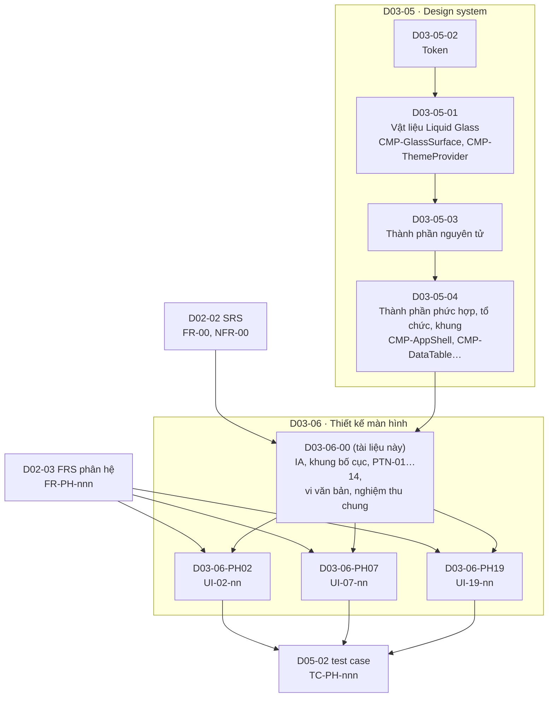

# D03-06-00 · Kiến trúc thông tin, khung bố cục và mẫu màn hình chuẩn

## 1. Mục đích, phạm vi và cách dùng

### 1.1. Mục đích

Tài liệu này là phần chung mở đầu của bộ thiết kế màn hình D03-06. Nó trả lời ba câu hỏi mà mọi màn hình của Datahub đều phải trả lời giống nhau: người dùng tìm thấy màn hình ở đâu trong hệ thống (kiến trúc thông tin, information architecture, viết tắt IA), màn hình nằm trong khung nào (khung bố cục, layout shell) và màn hình được dựng theo khuôn nào (mẫu màn hình, screen pattern, mã `PTN-{nn}`). Khi ba câu hỏi này đã được trả lời một lần ở đây, các tập thiết kế màn hình theo phân hệ chỉ cần chọn mẫu và mô tả phần khác biệt về nghiệp vụ. Nhờ vậy, hơn hai trăm màn hình của hai mươi phân hệ có cùng cách điều hướng, cùng vị trí nút, cùng cách báo lỗi, và kỹ sư hay AI agent sinh mã có thể dựng một màn mới mà không phải tự thiết kế lại bố cục.

Tài liệu đáp ứng trực tiếp nhóm yêu cầu giao diện dùng chung `FR-00-001`…`FR-00-082` và các yêu cầu phi chức năng về trải nghiệm `NFR-00-003`, `NFR-00-005`, `NFR-00-040`…`NFR-00-045` của D02-02. Nó kế thừa ý tưởng của bộ quy tắc CRUD cũ trong `docs/ui_ux_rule.md` (cấu trúc màn hình, bộ lọc, bảng, trạng thái bắt buộc, tiêu chí nghiệm thu) và nâng cấp chúng thành mẫu có thể kiểm thử, áp dụng cho cả những loại màn không phải CRUD như trình thiết kế luồng, dashboard trực ca hay trang tra log.

### 1.2. Quan hệ với các tài liệu khác

Bộ tài liệu giao diện được tổ chức thành hai tầng. Tầng design system (D03-05) định nghĩa "viên gạch": token giá trị, vật liệu Liquid Glass và các thành phần `CMP-*`. Tầng thiết kế màn hình (D03-06) định nghĩa "căn nhà": cách ghép các viên gạch thành màn hình. Sơ đồ dưới đây cho thấy chiều phụ thuộc giữa các tài liệu.



Sơ đồ đọc từ trên xuống. Token ở D03-05-02 là nguồn giá trị duy nhất; vật liệu glass ở D03-05-01 dùng token để tạo bốn bề mặt kính; thành phần nguyên tử và phức hợp ở D03-05-03 và D03-05-04 dùng cả hai. Tài liệu này không định nghĩa thêm thành phần nào mà chỉ quy định **thành phần nào đặt ở vùng nào, trên vật liệu nào, hành xử ra sao** trong từng mẫu màn hình. Các tập UI phân hệ (ví dụ `D03-06-PH07` cho danh mục dùng chung) nhận đầu vào nghiệp vụ từ FRS phân hệ và đầu vào bố cục từ tài liệu này. Kiểm thử viên lấy tiêu chí nghiệm thu của mẫu (mục 4) và tiêu chí chung (mục 6) để sinh test case ở D05-02.

Ranh giới trách nhiệm giữa D03-05-04 và tài liệu này cần được hiểu đúng để tránh mô tả trùng. D03-05-04 đặc tả **thành phần khung** (`CMP-AppShell`, `CMP-Topbar`, `CMP-Sidebar`, `CMP-TenantSwitcher`, `CMP-UserMenu`, `CMP-CommandPalette`, `CMP-NotificationCenter`) ở mức API thành phần: thuộc tính, sự kiện, trạng thái nội tại. Tài liệu này đặc tả **cách các thành phần đó được dùng** trong ứng dụng `dh-console` và `dh-portal`: cây menu cụ thể, route cụ thể, quy tắc hiển thị theo quyền, kích thước vùng và hành vi responsive. Khi hai tài liệu mâu thuẫn về giá trị thị giác, D03-05-02 (token) thắng; khi mâu thuẫn về cách dùng trong màn hình, tài liệu này thắng.

### 1.3. Cách một tập UI phân hệ tham chiếu mẫu màn hình

Mỗi màn hình trong tập UI phân hệ được khai báo bằng một khối đặc tả cố định. Khối này đủ để kỹ sư dựng màn hình và để kiểm thử viên biết phải kiểm tra gì; mọi điều không ghi trong khối được hiểu là **kế thừa nguyên vẹn mẫu PTN** đã chọn. Mẫu khai báo dưới đây là bắt buộc; các trường đánh dấu "nếu có" được bỏ qua khi không áp dụng.

```markdown
### UI-07-03 · Danh sách danh mục

| Trường | Giá trị |
|---|---|
| Mẫu | PTN-08 Cây + bảng (biến thể: cây nhóm danh mục bên trái) |
| Ứng dụng | dh-console |
| Route | /du-lieu/danh-muc?nhom={ma-nhom}&q=&trang-thai=&sap-xep=&trang=&co= |
| Mục menu | Dữ liệu dùng chung › Danh mục dùng chung |
| Tiêu đề tab | Danh mục dùng chung · Datahub |
| Quyền vào màn | PERM-07-view |
| Quyền theo hành động | Thêm: PERM-07-create; Nhập: PERM-07-import; Xuất: PERM-07-export; Công bố: PERM-07-publish |
| FR phục vụ | FR-07-001, FR-07-004, FR-07-021; tuân thủ FR-00-020…024, FR-00-030, FR-00-053 |
| Thành phần | CMP-PageHeader, CMP-Tree, CMP-FilterBar, CMP-DataTable, CMP-BulkActionBar, CMP-StatusTag |
| Cột / trường | (bảng cột: tên, kiểu, định dạng, sắp xếp được, mặc định ẩn/hiện) |
| Hành động | (bảng hành động: nhãn, vị trí, điều kiện trạng thái, quyền, xác nhận, lý do) |
| Trạng thái khác biệt | Rỗng: "Nhóm này chưa có danh mục nào" + nút Thêm danh mục / Nhập từ Excel |
| Phím tắt riêng (nếu có) | — |
| API | API-07-010 (danh sách), API-07-011 (cây nhóm) |
| Khác biệt so với mẫu | Cây bên trái hiển thị số danh mục mỗi nhóm; chọn nút cây cập nhật query `nhom` |
```

Bảng khai báo trên có bốn quy tắc đi kèm. Thứ nhất, trường "Mẫu" chỉ được chọn một PTN; nếu màn hình là tổ hợp (ví dụ chi tiết có tab chứa danh sách), chọn mẫu của khung ngoài (PTN-02) và ghi mẫu của phần trong ở trường "Khác biệt so với mẫu". Thứ hai, trường "Trạng thái khác biệt" chỉ ghi những trạng thái có nội dung riêng (ví dụ thông điệp trạng thái rỗng); các trạng thái còn lại kế thừa bảng trạng thái của mẫu và không được bỏ. Thứ ba, route phải theo quy tắc URL ở mục 2.4 và phải nằm dưới nhánh route của mục menu ghi ở trường "Mục menu". Thứ tư, mọi lệch khỏi mẫu về bố cục hay hành vi phải được nêu ở "Khác biệt so với mẫu" kèm lý do; lệch không nêu được coi là lỗi khi duyệt thiết kế.

### 1.4. Phạm vi

Tài liệu áp dụng cho hai ứng dụng web của Datahub là `dh-console` (giao diện quản trị cho mọi phân hệ) và `dh-portal` (cổng nhà phát triển của PH-15). Tài liệu không áp dụng cho trang đăng nhập (do Keycloak phục vụ theo FR-00-001, giao diện trang đăng nhập được tùy biến bằng chủ đề Keycloak dùng chung token ở D03-05-02 nhưng nằm ngoài bố cục mô tả ở đây), cho thư điện tử thông báo và cho báo cáo xuất tệp.

## 2. Kiến trúc thông tin

### 2.1. Hai ứng dụng và lý do tách

Datahub có hai ứng dụng giao diện với hai đối tượng người dùng khác nhau về bản chất. Bảng dưới đây so sánh hai ứng dụng để giải thích vì sao chúng có IA, khung bố cục và quy tắc truy cập khác nhau dù dùng chung design system `@datahub/ui`.

| Tiêu chí | `dh-console` | `dh-portal` |
|---|---|---|
| Đối tượng | Cán bộ của tỉnh và của đơn vị vận hành nền tảng: quản trị nền tảng, quản trị tỉnh, kỹ sư tích hợp, cán bộ nghiệp vụ, chủ quản dữ liệu, cán bộ đối soát, lãnh đạo, kiểm toán viên | Nhà phát triển HTTT (thường là nhân sự nhà thầu, không phải cán bộ nhà nước) |
| Phân hệ phục vụ | PH-01 … PH-20 (trừ phần công khai của PH-15) | PH-15 (danh mục API công khai, tài liệu, thử API, sandbox, ứng dụng của nhà phát triển) |
| Đăng nhập | Bắt buộc với mọi trang, OIDC qua realm của tenant (FR-00-001), MFA cho vai trò quản trị (FR-00-002) | Trang danh mục và tài liệu có thể xem không đăng nhập nếu tenant bật chế độ công khai; trang "Ứng dụng của tôi", "Thông tin xác thực", "Sandbox" bắt buộc đăng nhập |
| Mật độ thông tin | Cao: bảng, biểu mẫu dài, log | Vừa: văn bản tài liệu, ví dụ mã |
| Chiều rộng tối thiểu | 1366×768 mục tiêu thiết kế (mục 3.4) | Từ 360px (D02-02 §2.2) |
| Ngôn ngữ | Tiếng Việt | Tiếng Việt mặc định, tiếng Anh nên có |
| Bố cục | Sidebar + topbar (mục 3) | Topbar ngang + mục lục trái trong trang tài liệu (PTN-14) |
| Quan hệ quản trị | Quản trị nội dung cổng (trang giới thiệu, API công khai, duyệt ứng dụng) đặt trong `dh-console`, nhóm "Kết nối & API" | Chỉ hiển thị, không quản trị |

Việc tách hai ứng dụng có ba lý do. Thứ nhất, bề mặt tấn công khác nhau: `dh-portal` có thể mở ra ngoài mạng nội bộ tỉnh, còn `dh-console` chỉ truy cập từ mạng quản trị; tách mã và tách miền giúp chính sách mạng và CSP đơn giản. Thứ hai, nhịp phát hành khác nhau: nội dung cổng thay đổi theo tài liệu API, còn console thay đổi theo tính năng. Thứ ba, người dùng khác nhau về thói quen: nhà phát triển quen bố cục tài liệu kiểu "mục lục trái, nội dung giữa, ví dụ phải", còn cán bộ quản trị cần điều hướng chức năng sâu.

### 2.2. Nguyên tắc tổ chức menu

Menu của `dh-console` được chia theo **nhóm nhiệm vụ của người dùng**, không theo tên kỹ thuật của phân hệ hay đơn vị triển khai. Người dùng không cần biết "PH-10" hay "dh-integration" là gì; họ cần biết "tôi muốn cho hai hệ thống trao đổi sự kiện thì vào đâu". Năm nguyên tắc sau chi phối việc sắp xếp cây menu.

1. **Nhãn là việc, không là hệ thống.** Nhãn menu dùng danh từ nghiệp vụ quen thuộc với cán bộ ("Hệ thống thành viên", "Danh mục dùng chung", "Giao dịch") chứ không dùng tên công nghệ ("Kafka topic", "APISIX route"). Thuật ngữ kỹ thuật chỉ xuất hiện ở cấp 2 khi người dùng mục tiêu là kỹ sư (ví dụ "Topic sự kiện" cho kỹ sư tích hợp).
2. **Tối đa hai cấp trong sidebar.** Cấp 1 là nhóm nhiệm vụ (không điều hướng, chỉ mở/đóng), cấp 2 là màn hình đích. Mọi cấp sâu hơn (chi tiết đối tượng, tab) đi bằng điều hướng trong trang và được thể hiện trên breadcrumb, không thêm cấp menu thứ ba. Giới hạn này giữ sidebar đọc được trong một lần nhìn và tránh menu kiểu cây thư mục của hệ cũ.
3. **Mỗi nhóm không quá chín mục cấp 2.** Khi một nhóm vượt chín mục, tách nhóm hoặc gộp màn hình thành tab trong một trang.
4. **Thứ tự nhóm theo tần suất.** Nhóm dùng hằng ngày (Tổng quan, Việc của tôi) ở trên; nhóm dùng thỉnh thoảng (Quản trị) ở dưới. Trong một nhóm, mục thường dùng nhất đứng đầu.
5. **Ẩn theo quyền, không ẩn theo phân hệ chưa triển khai bằng cờ trong mã.** Một mục hiện khi người dùng có quyền xem màn hình đích và phân hệ đã được bật cho tenant (cấu hình PH-20). Phân hệ thuộc đợt sau chưa phát hành thì không có mục trong bản dựng, không hiện dạng "sắp ra mắt".

### 2.3. Cây điều hướng của `dh-console`

#### 2.3.1. Sơ đồ tổng quát

Sơ đồ dưới đây thể hiện mười hai nhóm cấp 1 của sidebar và các mục cấp 2. Mục có hậu tố "(Đ2)" hoặc "(Đ3)" thuộc đợt 2 hoặc đợt 3 theo bảng phân hệ của D03-01 §4.1; các mục còn lại thuộc MVP.

```mermaid
flowchart LR
    ROOT(["dh-console"])
    ROOT --> N0["Tổng quan"]
    ROOT --> N1["Việc của tôi"]
    ROOT --> N2["Kết nối & API"]
    ROOT --> N3["Tích hợp"]
    ROOT --> N4["Dữ liệu dùng chung"]
    ROOT --> N5["Thanh toán (Đ2)"]
    ROOT --> N6["Quy trình (Đ2)"]
    ROOT --> N7["Giám sát & kiểm toán"]
    ROOT --> N8["Vận hành"]
    ROOT --> N9["Quản trị"]
    ROOT -.-> AI["Trợ lý AI (Đ3)<br/>bảng bên + CommandPalette"]
    ROOT -.-> TB["Thanh trên: tìm kiếm, thông báo,<br/>tenant, tài khoản, trợ giúp"]

    N0 --> N0a["Bảng điều khiển"]
    N1 --> N1a["Hộp việc"] & N1b["Yêu cầu tôi đã gửi"] & N1c["Tác vụ nền"]
    N2 --> N2a["Hệ thống thành viên"] & N2b["Danh mục API"] & N2c["Gói sử dụng"] & N2d["Đăng ký sử dụng"] & N2e["Chính sách cổng API"] & N2f["Nút gateway"] & N2g["Cổng nhà phát triển (Đ2)"]
    N3 --> N3a["Luồng tích hợp"] & N3b["Bộ điều hợp"] & N3c["Kết nối nguồn"] & N3d["Dự án sự kiện"] & N3e["Topic sự kiện"] & N3f["Sơ đồ kết nối"] & N3g["Dịch vụ quốc gia"]
    N4 --> N4a["Danh mục dùng chung"] & N4b["Đồng bộ danh mục quốc gia"] & N4c["Dữ liệu chủ (Đ3)"] & N4d["Chất lượng dữ liệu (Đ3)"] & N4e["Quyền riêng tư (Đ2)"]
    N5 --> N5a["Giao dịch"] & N5b["Đối soát"] & N5c["Hoàn tiền"] & N5d["Dịch vụ thu"] & N5e["Nhà cung cấp & đối tác"] & N5f["Kênh thanh toán"]
    N6 --> N6a["Mô hình quy trình"] & N6b["Phiên quy trình"]
    N7 --> N7a["Bảng giám sát"] & N7b["Cảnh báo"] & N7c["Tra log"] & N7d["Truy vết"] & N7e["Nhật ký kiểm toán"] & N7f["Báo cáo chỉ tiêu (Đ3)"]
    N8 --> N8a["Hàng đợi lỗi (DLQ)"] & N8b["Tham số hệ thống"] & N8c["Sao lưu & khôi phục"] & N8d["Di trú hệ cũ"]
    N9 --> N9a["Người dùng"] & N9b["Nhóm & vai trò"] & N9c["Chính sách truy cập"] & N9d["Cài đặt tỉnh"] & N9e["Tenant (nền tảng)"]
```



Sơ đồ được đọc từ trái sang phải: gốc là ứng dụng, tầng giữa là nhóm cấp 1 hiển thị trên sidebar, tầng phải là mục cấp 2 dẫn tới màn hình. Hai nút nối bằng nét đứt (Trợ lý AI và thanh trên) không phải nhóm menu mà là các điểm vào luôn có mặt ở mọi màn hình. Nhóm "Tổng quan" chỉ có một mục nên được hiển thị như một mục đơn ở cấp 1, không có mũi tên mở rộng. Nhóm "Cài đặt cá nhân" không nằm trên sidebar mà được mở từ menu tài khoản trên thanh trên (mục 2.10).

#### 2.3.2. Bảng mục menu chi tiết

Bảng dưới đây là đặc tả chuẩn của cây menu. Kỹ sư dùng nó để sinh cấu hình route và menu; kiểm thử viên dùng nó để kiểm tra hiển thị theo quyền (mục 2.6). Cột "Nhóm người dùng chính" dùng tên nhóm ở D02-02 §2.1; vai trò phân quyền cụ thể (`ROLE-*`) sẽ được ánh xạ ở D02-08. Cột "Mẫu chính" cho biết PTN của màn hình đích; các màn con (chi tiết, biểu mẫu) có mẫu riêng được khai báo trong tập UI phân hệ. Cột "Đợt" theo D03-01 §4.1.

| # | Nhóm cấp 1 | Mục cấp 2 | PH | Route | Nhóm người dùng chính | Mẫu chính | Đợt |
|---|---|---|---|---|---|---|---|
| 1 | Tổng quan | Bảng điều khiển | PH-13 | `/tong-quan` | Mọi nhóm (nội dung thẻ theo quyền) | PTN-06 | MVP |
| 2 | Việc của tôi | Hộp việc | Dùng chung (FR-00-070) | `/viec-cua-toi` | Mọi nhóm có quyền duyệt | PTN-10 | MVP |
| 3 | Việc của tôi | Yêu cầu tôi đã gửi | Dùng chung | `/viec-cua-toi/da-gui` | Mọi nhóm | PTN-10 | MVP |
| 4 | Việc của tôi | Tác vụ nền | Dùng chung (FR-00-031, FR-00-054) | `/viec-cua-toi/tac-vu-nen` | Mọi nhóm | PTN-01 | MVP |
| 5 | Kết nối & API | Hệ thống thành viên | PH-01 | `/ket-noi/he-thong` | Quản trị tỉnh | PTN-01 | MVP |
| 6 | Kết nối & API | Danh mục API | PH-02 | `/ket-noi/api` | Quản trị tỉnh, Kỹ sư tích hợp | PTN-01 | MVP |
| 7 | Kết nối & API | Gói sử dụng | PH-02 | `/ket-noi/goi-su-dung` | Quản trị tỉnh | PTN-01 | MVP |
| 8 | Kết nối & API | Đăng ký sử dụng | PH-02 | `/ket-noi/dang-ky` | Quản trị tỉnh, Chủ quản dữ liệu | PTN-01 | MVP |
| 9 | Kết nối & API | Chính sách cổng API | PH-03 | `/ket-noi/chinh-sach` | Quản trị tỉnh | PTN-01 | MVP |
| 10 | Kết nối & API | Nút gateway | PH-03 | `/ket-noi/gateway` | Quản trị tỉnh, Quản trị nền tảng | PTN-11 | MVP |
| 11 | Kết nối & API | Cổng nhà phát triển | PH-15 (quản trị) | `/ket-noi/cong-nha-phat-trien` | Quản trị tỉnh | PTN-12 | Đợt 2 |
| 12 | Tích hợp | Luồng tích hợp | PH-04 | `/tich-hop/luong` | Kỹ sư tích hợp | PTN-01 (danh sách), PTN-07 (thiết kế) | MVP |
| 13 | Tích hợp | Bộ điều hợp | PH-05 | `/tich-hop/bo-dieu-hop` | Kỹ sư tích hợp | PTN-01 | MVP |
| 14 | Tích hợp | Kết nối nguồn | PH-05 | `/tich-hop/ket-noi-nguon` | Kỹ sư tích hợp | PTN-01 | MVP |
| 15 | Tích hợp | Dự án sự kiện | PH-10 | `/tich-hop/du-an` | Kỹ sư tích hợp | PTN-01 | MVP |
| 16 | Tích hợp | Topic sự kiện | PH-10 | `/tich-hop/topic` | Kỹ sư tích hợp | PTN-01 | MVP |
| 17 | Tích hợp | Sơ đồ kết nối | PH-10 | `/tich-hop/so-do` | Kỹ sư tích hợp, Quản trị tỉnh | PTN-07 (chế độ xem) | MVP |
| 18 | Tích hợp | Dịch vụ quốc gia | PH-14 | `/tich-hop/dich-vu-quoc-gia` | Quản trị tỉnh, Kỹ sư tích hợp | PTN-01 | MVP |
| 19 | Dữ liệu dùng chung | Danh mục dùng chung | PH-07 | `/du-lieu/danh-muc` | Cán bộ nghiệp vụ | PTN-08 | MVP |
| 20 | Dữ liệu dùng chung | Đồng bộ danh mục quốc gia | PH-07 | `/du-lieu/dong-bo-quoc-gia` | Cán bộ nghiệp vụ, Quản trị tỉnh | PTN-01 | MVP |
| 21 | Dữ liệu dùng chung | Dữ liệu chủ | PH-06 | `/du-lieu/du-lieu-chu` | Cán bộ nghiệp vụ | PTN-01 | Đợt 3 |
| 22 | Dữ liệu dùng chung | Chất lượng dữ liệu | PH-08 | `/du-lieu/chat-luong` | Cán bộ nghiệp vụ, Chủ quản dữ liệu | PTN-06 | Đợt 3 |
| 23 | Dữ liệu dùng chung | Quyền riêng tư | PH-09 | `/du-lieu/quyen-rieng-tu` | Chủ quản dữ liệu | PTN-01 | Đợt 2 |
| 24 | Thanh toán | Giao dịch | PH-19 | `/thanh-toan/giao-dich` | Cán bộ đối soát | PTN-01 | Đợt 2 |
| 25 | Thanh toán | Đối soát | PH-19 | `/thanh-toan/doi-soat` | Cán bộ đối soát | PTN-01 | Đợt 2 |
| 26 | Thanh toán | Hoàn tiền | PH-19 | `/thanh-toan/hoan-tien` | Cán bộ đối soát | PTN-01 | Đợt 2 |
| 27 | Thanh toán | Dịch vụ thu | PH-19 | `/thanh-toan/dich-vu` | Quản trị tỉnh, Cán bộ đối soát | PTN-08 | Đợt 2 |
| 28 | Thanh toán | Nhà cung cấp & đối tác | PH-19 | `/thanh-toan/doi-tac` | Quản trị tỉnh | PTN-01 | Đợt 2 |
| 29 | Thanh toán | Kênh thanh toán | PH-19 | `/thanh-toan/kenh` | Quản trị tỉnh | PTN-06 | Đợt 2 |
| 30 | Quy trình | Mô hình quy trình | PH-11 | `/quy-trinh/mo-hinh` | Kỹ sư tích hợp, Quản trị tỉnh | PTN-01, PTN-07 | Đợt 2 |
| 31 | Quy trình | Phiên quy trình | PH-11 | `/quy-trinh/phien` | Quản trị tỉnh, Cán bộ nghiệp vụ | PTN-01 | Đợt 2 |
| 32 | Giám sát & kiểm toán | Bảng giám sát | PH-13 | `/giam-sat/bang-dieu-khien` | Quản trị tỉnh, Quản trị nền tảng | PTN-06 | MVP |
| 33 | Giám sát & kiểm toán | Cảnh báo | PH-13 | `/giam-sat/canh-bao` | Quản trị tỉnh | PTN-01 | MVP |
| 34 | Giám sát & kiểm toán | Tra log | PH-13 | `/giam-sat/log` | Quản trị tỉnh, Kỹ sư tích hợp | PTN-11 | MVP |
| 35 | Giám sát & kiểm toán | Truy vết | PH-13 | `/giam-sat/truy-vet` | Kỹ sư tích hợp | PTN-11 | MVP |
| 36 | Giám sát & kiểm toán | Nhật ký kiểm toán | PH-13 | `/giam-sat/kiem-toan` | Kiểm toán viên, Quản trị tỉnh | PTN-11 | MVP |
| 37 | Giám sát & kiểm toán | Báo cáo chỉ tiêu | PH-16 | `/giam-sat/chi-tieu` | Lãnh đạo, Quản trị tỉnh | PTN-06 | Đợt 3 |
| 38 | Vận hành | Hàng đợi lỗi (DLQ) | PH-18 | `/van-hanh/dlq` | Quản trị tỉnh, Kỹ sư tích hợp | PTN-01 | MVP |
| 39 | Vận hành | Tham số hệ thống | PH-18 | `/van-hanh/tham-so` | Quản trị tỉnh | PTN-12 | MVP |
| 40 | Vận hành | Sao lưu & khôi phục | PH-18 | `/van-hanh/sao-luu` | Quản trị tỉnh, Quản trị nền tảng | PTN-01 | MVP |
| 41 | Vận hành | Di trú hệ cũ | PH-18 | `/van-hanh/di-tru` | Quản trị tỉnh | PTN-05 (chạy), PTN-01 (lịch sử) | MVP |
| 42 | Quản trị | Người dùng | PH-12 | `/quan-tri/nguoi-dung` | Quản trị tỉnh | PTN-01 | MVP |
| 43 | Quản trị | Nhóm & vai trò | PH-12 | `/quan-tri/vai-tro` | Quản trị tỉnh | PTN-08 | MVP |
| 44 | Quản trị | Chính sách truy cập | PH-12 | `/quan-tri/chinh-sach` | Quản trị tỉnh | PTN-01 | MVP |
| 45 | Quản trị | Cài đặt tỉnh | PH-20 (phần tenant tự quản) | `/quan-tri/cai-dat-tinh` | Quản trị tỉnh | PTN-12 | MVP |
| 46 | Quản trị | Tenant | PH-20 | `/nen-tang/tenant` | Quản trị nền tảng | PTN-01 | MVP |

Có bốn điểm trong bảng cần thuyết minh. Thứ nhất, màn "Bảng điều khiển" ở mục 1 thuộc PH-13 về dữ liệu nhưng đóng vai trò trang chủ của mọi người dùng, nên nội dung thẻ được lắp theo quyền: cán bộ đối soát thấy thẻ giao dịch, kỹ sư tích hợp thấy thẻ luồng lỗi, lãnh đạo thấy thẻ chỉ tiêu; người không có quyền xem số liệu nào chỉ thấy thẻ "Việc của tôi" và "Thông báo mới". Thứ hai, mục "Tenant" (mục 46) dùng nhánh route `/nen-tang/` thay vì `/quan-tri/` vì đây là màn của vai trò nền tảng, thao tác trên nhiều tenant; nó chỉ xuất hiện trong nhóm Quản trị khi người dùng có vai trò nền tảng, và được đặt cuối nhóm, ngăn cách bằng `CMP-Divider` với nhãn "Nền tảng". Thứ ba, màn thiết kế luồng (PTN-07) không có mục menu riêng; người dùng vào từ danh sách luồng (`/tich-hop/luong/{ma-luong}/thiet-ke`) để luôn có ngữ cảnh luồng nào đang sửa. Thứ tư, PH-17 (Trợ lý AI) không có mục menu vì nó là năng lực xuyên suốt, được mở bằng nút trên thanh trên hoặc từ CommandPalette (mục 2.12).

#### 2.3.3. Lối vào ngoài sidebar

Một số màn không nằm trên sidebar nhưng vẫn có route ổn định và có thể liên kết sâu. Bảng sau liệt kê các lối vào đó để không màn nào "mồ côi".

| Màn hình | Route | Lối vào | Mẫu |
|---|---|---|---|
| Cài đặt cá nhân | `/ca-nhan/cai-dat` | Menu tài khoản (`CMP-UserMenu`) › Cài đặt cá nhân | PTN-12 |
| Phiên đăng nhập của tôi | `/ca-nhan/phien` | Menu tài khoản › Phiên đăng nhập (FR-00-005) | PTN-01 |
| Thông báo (toàn trang) | `/ca-nhan/thong-bao` | Trung tâm thông báo › Xem tất cả | PTN-01 |
| Bộ lọc đã lưu | `/ca-nhan/bo-loc` | Menu tài khoản › Bộ lọc đã lưu (FR-00-024) | PTN-01 |
| Trợ giúp | Mở HDSD theo ngữ cảnh ở tab mới | Nút trợ giúp trên thanh trên (FR-00-082) | — |
| Trang lỗi 403, 404, 500, bảo trì | `/loi/403`, `/loi/404`, `/loi/500`, `/bao-tri` | Hệ thống tự điều hướng | PTN-13 |
| Chọn tenant | `/chon-tenant` | Sau đăng nhập khi người dùng thuộc nhiều tenant và chưa có tenant mặc định | PTN-13 (biến thể) |

### 2.4. Quy tắc URL

URL là một phần của giao diện: người dùng chia sẻ URL cho đồng nghiệp, dán vào phiếu hỗ trợ, đánh dấu trang. Vì vậy URL phải ổn định, đọc được và mang đủ trạng thái để mở lại đúng màn hình (FR-00-022). Các quy tắc dưới đây áp dụng cho `dh-console`; `dh-portal` theo cùng quy tắc với tiền tố riêng ở mục 2.14.

**Đường dẫn (path).** Đường dẫn gồm các đoạn tiếng Việt không dấu viết `kebab-case`, theo cấu trúc `/{nhóm}/{tài-nguyên}/{mã-đối-tượng}/{màn-con}`. Đoạn `{nhóm}` khớp với nhóm menu (bảng ở mục 2.3.2), đoạn `{tài-nguyên}` khớp với mục cấp 2. Các màn con chuẩn dùng từ cố định sau để mọi phân hệ thống nhất: `/moi` (tạo mới, PTN-03), `/{ma}` (chi tiết, PTN-02), `/{ma}/sua` (sửa, PTN-03), `/{ma}/thiet-ke` (designer, PTN-07), `/{ma}/lich-su` (tab Lịch sử có thể liên kết sâu), `/nhap` (nhập dữ liệu, PTN-09). Tab trong trang chi tiết được phản ánh bằng đoạn cuối, ví dụ `/ket-noi/api/tra-cuu-ho-tich/phien-ban`, để có thể gửi liên kết thẳng tới tab.

**Mã đối tượng trong URL.** Khi đối tượng có mã nghiệp vụ duy nhất trong tenant và bất biến (mã danh mục, mã API, mã luồng, mã HTTT, mã giao dịch), URL dùng mã đó thay cho khóa nội bộ, ví dụ `/du-lieu/danh-muc/DM_GIOI_TINH` chứ không phải `/du-lieu/danh-muc/5f2c…`. Mã nghiệp vụ giúp người dùng đọc được URL và giúp phiếu hỗ trợ có nghĩa. Khi đối tượng không có mã nghiệp vụ ổn định (bản ghi kiểm toán, phiên quy trình, thông báo), URL dùng định danh do hệ thống sinh nhưng là định danh công khai (ULID hoặc UUID), không bao giờ dùng khóa tự tăng của CSDL, vì khóa tự tăng cho phép suy đoán số lượng bản ghi và vi phạm tinh thần FR-00-011. Mã trong URL được mã hóa theo RFC 3986; mã chứa ký tự đặc biệt phải được `encodeURIComponent`.

**Tham số truy vấn (query).** Mọi trạng thái người dùng có thể muốn chia sẻ được giữ trên query: từ khóa, bộ lọc, sắp xếp, trang, số dòng mỗi trang, tab con, khoảng thời gian. Bảng dưới quy định tên tham số dùng chung để `CMP-FilterBar`, `CMP-DataTable` và `CMP-Pagination` có thể đồng bộ với URL qua một hook chung `useUrlState` mà không cần cấu hình theo màn.

| Tham số | Ý nghĩa | Ví dụ | Ghi chú |
|---|---|---|---|
| `q` | Từ khóa tìm kiếm | `q=da%20nang` | Cắt khoảng trắng đầu cuối trước khi ghi lên URL |
| `trang` | Số trang, bắt đầu từ 1 | `trang=3` | Bỏ khỏi URL khi bằng 1 |
| `co` | Cỡ trang | `co=50` | Chỉ nhận 10, 20, 50, 100 (FR-00-021); bỏ khi bằng 20 |
| `sap-xep` | Trường và chiều sắp xếp | `sap-xep=ngay-tao:giam` | Chiều `tang` hoặc `giam`; nhiều trường nối bằng dấu phẩy nếu màn cho phép đa cột |
| `{tên-trường}` | Giá trị lọc | `trang-thai=phat-hanh,cho-duyet` | Nhiều giá trị nối bằng dấu phẩy (FR-00-023) |
| `tu`, `den` | Khoảng thời gian | `tu=2026-11-01&den=2026-11-21` | Ngày theo ISO `yyyy-MM-dd`; thời điểm theo ISO có múi giờ |
| `khoang` | Khoảng tương đối | `khoang=24h` | Dùng cho PTN-06 và PTN-11; loại trừ `tu`/`den` |
| `chon` | Đối tượng đang mở trong Drawer hoặc bảng bên | `chon=GD20261121000123` | Cho phép liên kết sâu tới Drawer chi tiết |
| `bo-loc` | Mã bộ lọc đã lưu | `bo-loc=bl_01J…` | FR-00-024; khi có, các tham số lọc khác ghi đè lên bộ lọc đã lưu |

Ba quy tắc về hành vi đi kèm bảng trên. Thứ nhất, giá trị trên URL dùng **mã giá trị** (ví dụ `phat-hanh`) chứ không dùng nhãn hiển thị (ví dụ "Phát hành"), để URL không đổi khi đổi nhãn hay đổi ngôn ngữ. Thứ hai, thay đổi bộ lọc hoặc từ khóa ghi lên URL bằng `replace` (không tạo mục lịch sử mới cho mỗi phím gõ), còn chuyển trang và mở chi tiết dùng `push` để nút Quay lại của trình duyệt hoạt động như người dùng kỳ vọng. Thứ ba, tham số không hợp lệ (cỡ trang 37, trang âm, giá trị lọc không tồn tại) bị bỏ qua và được sửa lại trên URL bằng `replace`, kèm một `CMP-Toast` mức thông tin "Một số điều kiện lọc không còn hợp lệ nên đã được bỏ qua."; không hiển thị trang lỗi.

**Không đưa dữ liệu nhạy cảm lên URL.** URL được ghi trong log truy cập, lịch sử trình duyệt và tiêu đề Referer, nên tuyệt đối không đặt lên URL số định danh cá nhân, số điện thoại, nội dung bản tin hay bí mật. Khi người dùng tìm kiếm theo trường mức Nhạy cảm (ví dụ tra giao dịch theo số CCCD người nộp), giá trị tìm kiếm được giữ trong trạng thái phiên của trang chứ không ghi lên query, và URL chia sẻ được sẽ không có điều kiện đó; giao diện hiển thị dòng chú thích "Điều kiện tìm theo thông tin cá nhân không được lưu trong liên kết chia sẻ."

**Liên kết sâu và quay về sau đăng nhập.** Mọi route đều mở được trực tiếp. Khi phiên hết hạn hoặc chưa đăng nhập, `dh-console` lưu URL đầy đủ (path và query) vào tham số `state` của luồng OIDC và quay về đúng URL sau đăng nhập (FR-00-001). Khi URL trỏ tới tenant khác tenant đang làm việc (xem mục 2.11), giao diện hỏi người dùng có muốn chuyển tenant hay không, không tự chuyển.

### 2.5. Breadcrumb và tiêu đề tab trình duyệt

Breadcrumb (`CMP-Breadcrumb`) đặt ở dòng đầu của `CMP-PageHeader`, phía trên tiêu đề trang. Breadcrumb thể hiện vị trí theo cấu trúc IA, không theo lịch sử duyệt: nhóm cấp 1, mục cấp 2, đối tượng cha (nếu có), đối tượng hiện tại. Ví dụ màn sửa một mục danh mục có breadcrumb "Dữ liệu dùng chung › Danh mục dùng chung › Giới tính › Sửa mục". Nhóm cấp 1 hiển thị dạng chữ không bấm được (vì nhóm không có trang riêng); các phần tử còn lại là liên kết, trừ phần tử cuối là trang hiện tại có `aria-current="page"`. Liên kết tới mục cấp 2 trên breadcrumb khôi phục bộ lọc gần nhất người dùng đã dùng ở danh sách đó trong phiên (mục 2.4 và hành vi "quay lại giữ bộ lọc" của PTN-01), vì đó là điều người dùng muốn khi bấm ngược.

Phần tử đối tượng trên breadcrumb hiển thị tên ngắn của đối tượng, cắt bằng dấu ba chấm ở 32 ký tự kèm `CMP-Tooltip` hiện đầy đủ. Khi breadcrumb dài hơn chiều rộng khả dụng, các phần tử giữa được gộp thành một nút "…" mở `CMP-DropdownMenu`, giữ nguyên phần tử đầu và hai phần tử cuối. Trang chủ "Tổng quan" và các trang cấp 2 không có đối tượng cha vẫn hiển thị breadcrumb hai phần tử để vị trí luôn nhất quán; riêng PTN-13 (trang lỗi) không có breadcrumb.

Tiêu đề tab trình duyệt (`document.title`) có dạng `{Tiêu đề trang} · {Tên đối tượng nếu có} · Datahub`, ví dụ "Sửa mục · Giới tính · Datahub". Khi người dùng đang ở chế độ liên tenant, tiền tố `[Liên tenant] ` được thêm vào đầu tiêu đề. Khi có việc chờ duyệt mới, không đưa số đếm lên tiêu đề tab, vì số đếm thay đổi liên tục gây nhiễu cho trình đọc màn hình; số đếm chỉ hiển thị trên huy hiệu của sidebar và thanh trên. Tiêu đề tab được cập nhật mỗi khi đổi route và được thông báo cho trình đọc màn hình bằng cách chuyển focus tới tiêu đề trang (mục 3.7).

### 2.6. Hiển thị và ẩn theo quyền

Datahub phân quyền theo hành động (`PERM-{PH}-{động-từ}`, định nghĩa ở D02-08) chứ không chỉ theo màn hình, kế thừa mục 6 của `docs/ui_ux_rule.md`. Giao diện dùng quyền để quyết định cái gì hiện ra, nhưng **backend luôn kiểm tra lại quyền trên mọi API**; ẩn trên giao diện chỉ phục vụ trải nghiệm, không phải biện pháp bảo vệ. Bảng dưới quy định hành vi giao diện cho từng loại phần tử khi người dùng thiếu quyền.

| Phần tử | Khi thiếu quyền | Lý do |
|---|---|---|
| Mục menu cấp 2 | Ẩn hoàn toàn | Người dùng không nên thấy chức năng họ không dùng được; giảm nhiễu |
| Nhóm menu cấp 1 | Ẩn khi mọi mục con đều bị ẩn | Tránh nhóm rỗng |
| Truy cập route trực tiếp (gõ URL, liên kết cũ) | Hiển thị trang 403 (PTN-13) trong khung ứng dụng, giữ sidebar và thanh trên | Người dùng hiểu là thiếu quyền chứ không phải trang hỏng; có nút "Về Tổng quan" và "Yêu cầu quyền" |
| Nút hành động chính (Thêm, Nhập, Xuất) | Ẩn | Tránh gợi ý một hành động không làm được |
| Hành động trên hàng, hành động trong trang chi tiết | Ẩn nếu thiếu quyền; hiện nhưng vô hiệu kèm tooltip lý do nếu đủ quyền mà trạng thái không cho phép | Phân biệt "không bao giờ làm được" với "chưa làm được lúc này" (FR-00-053) |
| Trường biểu mẫu không được sửa | Hiện ở dạng chỉ đọc, không ẩn | Kế thừa CRUD-U-03; người dùng cần thấy giá trị |
| Trường dữ liệu Nhạy cảm | Hiện bằng `CMP-MaskedValue`; nút "Hiện" chỉ có khi có quyền xem đầy đủ, bấm phải nêu lý do (`CMP-ReasonDialog`) và sinh bản ghi kiểm toán | FR-00-034, FR-00-040 |
| Thẻ trên bảng điều khiển | Ẩn thẻ | Bảng điều khiển lắp theo quyền |
| Tab trong trang chi tiết | Ẩn tab; riêng tab Lịch sử luôn hiện với người có quyền xem đối tượng | FR-00-043 |

Thông tin quyền được nạp một lần sau đăng nhập dưới dạng tập quyền hiệu lực của người dùng trong tenant hiện tại (do PH-12 trả về), lưu trong bộ nhớ của TanStack Query với khóa gắn tenant, và được làm mới khi đổi tenant hoặc khi API trả 403 bất ngờ (dấu hiệu quyền vừa bị thu hồi). Khi một thao tác bị backend từ chối 403 dù giao diện đã cho hiện nút, giao diện hiển thị `CMP-Alert` mức lỗi "Bạn không còn quyền thực hiện thao tác này. Quyền của bạn có thể vừa được thay đổi." kèm mã truy vết, làm mới tập quyền và vẽ lại màn hình.

Trang 403 có nút "Yêu cầu quyền" mở biểu mẫu nhanh (PTN-04) gửi yêu cầu tới quản trị tỉnh với nội dung tự điền: màn hình, quyền thiếu, lý do do người dùng nhập. Nút này chỉ hiện khi tenant bật quy trình yêu cầu quyền (cấu hình PH-12); nếu không, trang hiển thị tên và thư điện tử đầu mối quản trị của tỉnh.

### 2.7. Tìm kiếm toàn cục và CommandPalette

`dh-console` có một điểm tìm kiếm duy nhất: ô tìm kiếm dạng viên nang (`radius-pill`) giữa thanh trên, bấm vào hoặc nhấn `Ctrl+K` (trên macOS `⌘K`) mở `CMP-CommandPalette`. Ô tìm kiếm trên thanh trên không tự tìm; nó là nút mở bảng lệnh, hiển thị chữ giữ chỗ "Tìm màn hình, đối tượng hoặc lệnh" và gợi ý phím tắt bằng `CMP-Kbd`. Cách làm này giữ thanh trên gọn và cho người dùng một thói quen duy nhất.

CommandPalette là lớp nổi vật liệu `glass-modal`, rộng `size-modal-md`, đặt cách mép trên viewport 12% chiều cao, danh sách kết quả nằm trong giếng nội dung nền đặc. Kết quả được nhóm thành bốn nhóm theo thứ tự cố định dưới đây; mỗi nhóm hiển thị tối đa năm kết quả kèm dòng "Xem tất cả kết quả {nhóm}".

| Nhóm kết quả | Nguồn | Ví dụ | Hành vi khi chọn |
|---|---|---|---|
| Màn hình | Cây menu đã lọc theo quyền, cộng các lối vào ở mục 2.3.3 | Gõ "giao dich" ra "Thanh toán › Giao dịch" | Điều hướng tới route |
| Đối tượng | API tìm kiếm hợp nhất của các phân hệ theo mã và tên (mã API, mã danh mục, mã luồng, mã HTTT, mã giao dịch) | Gõ "DM_GIOI" ra danh mục "Giới tính" | Mở trang chi tiết (PTN-02) |
| Lệnh | Danh sách lệnh đăng ký bởi từng màn và lệnh toàn cục | "Tạo API mới", "Chuyển sang chế độ tối", "Đổi tenant", "Mở Hộp việc" | Thực thi lệnh; lệnh tạo mới mở PTN-03 hoặc PTN-04 |
| Hỏi trợ lý AI | PH-17 (Đợt 3, khi tenant bật) | Câu hỏi tự nhiên "API nào trả thông tin hộ tịch?" | Mở bảng bên Trợ lý AI với câu hỏi đã điền |

Tìm kiếm trong CommandPalette tuân thủ FR-00-020: không phân biệt hoa thường và dấu tiếng Việt, khớp theo tiền tố từ và khớp mã chính xác. Kết quả "Màn hình" và "Lệnh" được lọc ngay tại trình duyệt; kết quả "Đối tượng" gọi máy chủ sau 250ms kể từ lần gõ cuối, tối thiểu hai ký tự, và chỉ trả đối tượng người dùng có quyền xem trong tenant hiện tại. Người dùng điều hướng bằng phím mũi tên, `Enter` để chọn, `Esc` để đóng, `Tab` để chuyển giữa các nhóm. Khi mở lại, CommandPalette hiển thị năm mục gần đây của người dùng (lưu cục bộ theo người dùng và tenant).

Về truy cập, CommandPalette là `role="dialog"` có `aria-modal="true"`, ô nhập là `role="combobox"` với `aria-controls` trỏ tới danh sách `role="listbox"`, mục đang chọn được thông báo bằng `aria-activedescendant`. Khi đóng, focus trở về phần tử đã mở bảng lệnh.

### 2.8. Việc của tôi

"Việc của tôi" là nhóm menu đứng thứ hai, ngay sau Tổng quan, hiện thực FR-00-070…072. Nó tổng hợp mọi yêu cầu chờ người dùng xử lý từ mọi phân hệ: duyệt kết nạp HTTT (PH-01), duyệt phát hành API và đăng ký sử dụng (PH-02), duyệt phát hành luồng (PH-04), duyệt Kamelet mới (PH-05), duyệt công bố danh mục (PH-07), chấp thuận khai thác dữ liệu (PH-09), việc trong quy trình BPMN (PH-11), duyệt hoàn tiền (PH-19), duyệt thay đổi vai trò (PH-12). Mỗi phân hệ đăng ký loại việc của mình với hộp việc chung qua hợp đồng ở D03-04; giao diện không gọi riêng từng phân hệ.

Mục "Hộp việc" trên sidebar mang `CMP-Badge` đếm số việc chưa xử lý, giới hạn hiển thị "99+". Số đếm được cập nhật qua kênh đẩy thời gian thực (SSE) khi có, và thăm dò 60 giây một lần khi kênh đẩy không khả dụng. Khi số đếm tăng, không phát âm báo và không dùng `aria-live` mức `assertive`; thay vào đó trung tâm thông báo nhận một thông báo "Có yêu cầu mới chờ bạn duyệt" (mục 2.9). Bố cục và hành vi chi tiết của hộp việc theo PTN-10.

### 2.9. Trung tâm thông báo

Trung tâm thông báo (`CMP-NotificationCenter`) hiện thực FR-00-060. Nút chuông trên thanh trên mang huy hiệu số thông báo chưa đọc; bấm mở một lớp nổi vật liệu `glass-overlay` rộng 400px, neo dưới nút chuông, gồm ba tab "Tất cả", "Việc cần làm", "Tác vụ nền" và nút "Đánh dấu đã đọc tất cả". Mỗi thông báo có biểu tượng loại, tiêu đề một dòng, mô tả tối đa hai dòng, thời điểm tương đối ("5 phút trước", kèm thời điểm tuyệt đối trên tooltip) và liên kết sâu tới đối tượng. Thông báo kết quả tác vụ nền (xuất tệp lớn theo FR-00-031, nhập dữ liệu theo FR-00-054) có nút hành động trực tiếp như "Tải tệp" hay "Xem báo cáo lỗi".

Thông báo phân thành ba mức với hành vi hiển thị khác nhau. Mức thông tin chỉ tăng huy hiệu. Mức cần chú ý (việc chờ duyệt, tác vụ nền xong) tăng huy hiệu và hiện `CMP-Notification` góc trên phải trong 6 giây nếu người dùng đang ở trong ứng dụng. Mức khẩn (cảnh báo vận hành mức nghiêm trọng của PH-13 gửi tới người trực) hiện `CMP-Notification` không tự đóng cho tới khi người dùng xác nhận đã xem. Thông báo không bao giờ chứa dữ liệu Hạn chế hoặc Nhạy cảm trong nội dung; chỉ chứa mã đối tượng và liên kết (cùng tinh thần FR-00-062). Toàn bộ lịch sử thông báo xem được ở trang `/ca-nhan/thong-bao` theo PTN-01; cấu hình kênh nhận theo loại (FR-00-061) nằm trong Cài đặt cá nhân (PTN-12).

### 2.10. Menu tài khoản

Menu tài khoản (`CMP-UserMenu`) ở góc phải thanh trên hiển thị `CMP-Avatar` chữ cái đầu của người dùng; bấm mở `CMP-DropdownMenu` gồm, theo thứ tự: khối thông tin (họ tên, thư điện tử, đơn vị, danh sách vai trò trong tenant hiện tại), "Cài đặt cá nhân", "Phiên đăng nhập", "Bộ lọc đã lưu", lựa chọn nhanh chế độ giao diện (Sáng / Tối / Theo hệ thống bằng `CMP-SegmentedControl`), "Phím tắt" (mở Modal liệt kê phím tắt, cũng mở bằng `?`), và "Đăng xuất" ở cuối, ngăn cách bằng `CMP-Divider`. Đăng xuất kết thúc phiên Keycloak (đăng xuất phía máy chủ, không chỉ xóa token trình duyệt) và xóa toàn bộ bộ nhớ đệm TanStack Query.

### 2.11. Ngữ cảnh tenant và truy cập liên tenant

**Hiển thị tenant hiện tại.** Theo FR-00-004, mọi màn hình hiển thị tenant hiện tại trên thanh trên. `CMP-TenantSwitcher` đặt ngay bên phải logo ở thanh trên, hiển thị tên ngắn của tỉnh (ví dụ "Tỉnh Mẫu A", dữ liệu giả lập) kèm mã tenant dạng `CMP-Identifier`. Với người dùng chỉ thuộc một tenant, thành phần hiển thị dạng chữ tĩnh không có mũi tên. Với người dùng thuộc nhiều tenant, bấm vào mở danh sách tenant có ô tìm kiếm, nhóm "Gần đây" ở trên.

**Đổi tenant.** Đổi tenant là thao tác nặng: giao diện hiển thị `CMP-ConfirmDialog` nếu trang hiện tại có thay đổi chưa lưu, sau đó điều hướng về `/tong-quan` của tenant mới, xóa toàn bộ bộ nhớ đệm truy vấn (`queryClient.clear()`), nạp lại tập quyền và cây menu. Không giữ lại route cũ vì đối tượng của tenant cũ không tồn tại ở tenant mới. Tiêu chí kiểm thử: sau khi đổi tenant, không có yêu cầu mạng nào mang ngữ cảnh tenant cũ và không có dữ liệu của tenant cũ trong bộ nhớ đệm (FR-00-004).

**Chế độ liên tenant.** Theo FR-00-012, chỉ vai trò nền tảng được truy cập dữ liệu của tenant không phải tenant nhà của họ, phải nêu lý do và được ghi kiểm toán. Người dùng có vai trò nền tảng chọn một tenant khác trong `CMP-TenantSwitcher` (danh sách có nhóm riêng "Truy cập liên tenant") thì giao diện mở `CMP-ReasonDialog` yêu cầu chọn loại lý do (hỗ trợ sự cố, kiểm tra cấu hình, theo yêu cầu của tỉnh, khác) và nhập mô tả tối thiểu 20 ký tự, tùy chọn kèm mã phiếu hỗ trợ. Sau khi xác nhận, máy chủ cấp một phiên liên tenant có thời hạn (mặc định 60 phút) và giao diện bước vào chế độ liên tenant với các dấu hiệu sau.

1. **Dải cảnh báo liên tenant** cố định ngay trên thanh trên, cao 32px, nền `color-warning-bg`, chữ `color-warning-on-bg`, có biểu tượng khiên và nội dung "Bạn đang truy cập dữ liệu của {Tên tỉnh} ở chế độ liên tenant. Mọi thao tác đều được ghi nhật ký kiểm toán. Còn {mm} phút." kèm nút "Kết thúc truy cập". Dải này là `CMP-Banner` biến thể `cross-tenant`, không đóng được, có `role="region"` và `aria-label="Cảnh báo truy cập liên tenant"`. Dải dùng nền đặc chứ không glass, vì đây là thông tin an toàn bắt buộc phải đọc được tuyệt đối.
2. **Viền khung** của vùng nội dung có thêm đường viền trên 2px màu `color-warning` (giá trị `-solid`) chạy suốt chiều ngang, để dù người dùng cuộn mất dải cảnh báo (dải không cuộn, nhưng phòng trường hợp ảnh chụp màn hình bị cắt) vẫn nhận ra.
3. **Tiền tố tiêu đề tab** `[Liên tenant]` như mục 2.5.
4. **Thao tác ghi** trong chế độ liên tenant mặc định bị vô hiệu kèm tooltip "Chế độ liên tenant chỉ cho phép xem"; tenant có thể cấp quyền ghi cho phiên liên tenant theo quy trình riêng của PH-20, khi đó mỗi thao tác ghi lại hỏi lý do bằng `CMP-ReasonDialog`.
5. **Hết hạn**: hai phút trước khi phiên liên tenant hết hạn, dải cảnh báo chuyển sang nội dung "Phiên liên tenant sẽ kết thúc sau 2 phút" và có nút "Gia hạn" (phải nêu lý do lần nữa). Khi hết hạn, giao diện quay về tenant nhà và hiển thị `CMP-Toast` thông báo.

Việc không dùng màu làm phương tiện duy nhất được bảo đảm vì dải có chữ và biểu tượng; màu vàng chỉ tăng cường nhận biết.

### 2.12. Trợ lý AI (PH-17)

Trợ lý AI thuộc Đợt 3 và có thể tắt theo tenant (D02-02 §5). Nó không chiếm mục menu mà có hai lối vào: nút biểu tượng "Trợ lý" trên thanh trên (chỉ hiện khi tenant bật) và nhóm "Hỏi trợ lý AI" trong CommandPalette. Khi mở, trợ lý hiển thị dạng **bảng bên** (complementary panel) gắn mép phải của vùng nội dung, rộng 400px, vật liệu `glass-chrome` khi nằm trên canvas, nội dung hội thoại trong giếng nền đặc. Bảng bên đẩy vùng nội dung thu hẹp lại chứ không phủ lên, để người dùng vừa đọc câu trả lời vừa thao tác trên màn hình (ví dụ trợ lý gợi ý ánh xạ trường trong khi kỹ sư đang ở PTN-07). Dưới `bp-xl`, bảng bên chuyển thành `CMP-Drawer` phủ.

Trợ lý nhận ngữ cảnh màn hình hiện tại (route, mã đối tượng, mã lỗi đang hiển thị) để trả lời đúng chỗ, ví dụ nút "Giải thích lỗi này" xuất hiện cạnh mã lỗi trong `CMP-Alert` khi trợ lý được bật. Mọi câu trả lời có nhãn "Nội dung do AI tạo, cần kiểm tra lại" và không bao giờ tự thực hiện thao tác ghi; trợ lý chỉ đề xuất, người dùng bấm áp dụng. Bảng bên có `role="complementary"` và `aria-label="Trợ lý AI"`.

### 2.13. Ma trận nhóm người dùng và nhóm menu

Ma trận dưới đây cho biết nhóm người dùng nào thường thấy nhóm menu nào. Nó không thay thế phân quyền ở D02-08 mà dùng làm căn cứ thiết kế: kiểm tra rằng mỗi nhóm người dùng có ít nhất một đường vào cho nhu cầu chính của họ, và sidebar của nhóm người dùng ít dùng (lãnh đạo, kiểm toán viên) đủ gọn. Ký hiệu: **●** là nhóm menu chính của người dùng (dùng thường xuyên), **○** là thấy một phần (một vài mục hoặc chỉ xem), ô trống là thường không thấy.

| Nhóm menu \ Nhóm người dùng | Quản trị nền tảng | Quản trị tỉnh | Kỹ sư tích hợp | Cán bộ nghiệp vụ | Chủ quản dữ liệu | Cán bộ đối soát | Lãnh đạo | Kiểm toán viên |
|---|---|---|---|---|---|---|---|---|
| Tổng quan | ● | ● | ● | ● | ● | ● | ● | ● |
| Việc của tôi | ● | ● | ● | ● | ● | ● | ○ | ○ |
| Kết nối & API | ○ | ● | ● | | ○ | | | ○ |
| Tích hợp | ○ | ● | ● | | | | | ○ |
| Dữ liệu dùng chung | | ○ | ○ | ● | ● | | | ○ |
| Thanh toán | | ○ | | | | ● | ○ | ○ |
| Quy trình | | ● | ○ | ○ | | | | |
| Giám sát & kiểm toán | ● | ● | ○ | | ○ | ○ | ○ | ● |
| Vận hành | ● | ● | ○ | | | | | |
| Quản trị | ● | ● | | | | | | ○ |

Từ ma trận có thể rút ra hai hệ quả thiết kế. Thứ nhất, lãnh đạo chủ yếu chỉ thấy Tổng quan và Báo cáo chỉ tiêu, nên bảng điều khiển phải tự đủ cho họ (PTN-06 có thẻ chỉ tiêu và liên kết tới báo cáo), không bắt họ đi tìm trong menu. Thứ hai, kiểm toán viên thấy nhiều nhóm ở mức "○" (chỉ đọc), nên mọi màn họ vào phải hiển thị đúng ở chế độ chỉ đọc: nút ghi bị ẩn, tab Lịch sử luôn có.

### 2.14. Kiến trúc thông tin của `dh-portal`

`dh-portal` có cấu trúc phẳng hơn, điều hướng bằng thanh trên ngang thay cho sidebar, vì số mục ít và người dùng đến từ công cụ tìm kiếm hoặc liên kết trực tiếp tới tài liệu một API. Bảng dưới liệt kê các khu vực của cổng.

| Khu vực | Route | Đăng nhập | Mẫu | Mô tả |
|---|---|---|---|---|
| Trang chủ | `/` | Không bắt buộc | PTN-14 (biến thể trang chào) | Giới thiệu, ô tìm API lớn, nhóm API nổi bật, hướng dẫn bắt đầu |
| Danh mục API | `/api` | Không bắt buộc (theo cấu hình tenant) | PTN-01 (biến thể thẻ) | Lọc theo lĩnh vực, cơ quan cung cấp, kiểu xác thực; hiển thị dạng lưới thẻ hoặc bảng |
| Tài liệu một API | `/api/{ma-api}/{phien-ban}` | Không bắt buộc | PTN-14 | Mục lục, nội dung, khung thử API |
| Hướng dẫn | `/huong-dan/{bai}` | Không bắt buộc | PTN-14 | Bài hướng dẫn: xác thực, mã lỗi, giới hạn, sự kiện |
| Ứng dụng của tôi | `/ung-dung` | Bắt buộc | PTN-01, PTN-02 | Ứng dụng của nhà phát triển, đăng ký sử dụng API, trạng thái duyệt |
| Thông tin xác thực | `/ung-dung/{ma}/xac-thuc` | Bắt buộc | PTN-02 (tab) | Client ID, xoay vòng bí mật; bí mật chỉ hiện một lần bằng `CMP-SecretField` |
| Sandbox | `/sandbox` | Bắt buộc | PTN-11 (biến thể) | Lịch sử lượt gọi thử, dữ liệu giả lập |
| Tài khoản | `/tai-khoan` | Bắt buộc | PTN-12 | Thông tin cá nhân, giao diện, thông báo |

Thanh trên của cổng gồm logo và tên cổng của tỉnh, các liên kết "API", "Hướng dẫn", "Ứng dụng của tôi", ô tìm kiếm (cũng mở bằng `Ctrl+K`, chỉ có nhóm "API" và "Bài hướng dẫn"), chọn ngôn ngữ và nút đăng nhập hoặc menu tài khoản. Dưới `bp-md`, các liên kết gộp vào nút menu mở `CMP-Drawer`.

## 3. Khung bố cục

### 3.1. Giải phẫu `CMP-AppShell`

`CMP-AppShell` là khung chứa mọi màn hình của `dh-console`. Nó gồm năm lớp xếp chồng từ dưới lên theo trục z: canvas, sidebar, topbar, vùng nội dung và các lớp phủ. Thứ tự này đồng thời là thứ tự vật liệu: canvas là nền trang trí, sidebar và topbar là kính trên canvas, vùng nội dung chứa các khối nền đặc, lớp phủ là kính nổi trên tất cả. Bảng dưới đây mô tả từng lớp, vật liệu và token kích thước.

| Lớp | Thành phần | Vật liệu | Token chính | Lớp chồng |
|---|---|---|---|---|
| Canvas | Nền `body` | `color-canvas` cộng lớp phủ `color-canvas-wash` cố định theo viewport | | `z-base` |
| Sidebar | `CMP-Sidebar` | `glass-chrome` | `size-sidebar`, `size-sidebar-collapsed`, `radius-xl`, `shadow-2`, `space-2` (khoảng cách mép) | `z-sidebar` |
| Thanh trên | `CMP-Topbar` | `glass-chrome` khi nội dung chưa cuộn dưới nó; `glass-chrome-scrolled` cộng `glass-scroll-edge` khi nội dung cuộn dưới | `size-topbar`, `shadow-2` khi cuộn | `z-topbar` |
| Vùng nội dung | `<main>` chứa `CMP-PageHeader` và các khối `CMP-Card`, `CMP-DataTable`, `CMP-Form` | Nền trong suốt để lộ canvas; mỗi khối nội dung là bề mặt đặc `color-surface-solid` với `radius-lg`, `shadow-1` | `size-page-max`, `space-6` (lề), `space-8` (khoảng giữa phần lớn) | `z-base`, tiêu đề bảng dính `z-sticky` |
| Lớp phủ | `CMP-Drawer`, `CMP-Modal`, `CMP-CommandPalette`, `CMP-Popover`, `CMP-DropdownMenu`, `CMP-Notification`, `CMP-Toast`, `CMP-Tooltip` | `glass-modal` (Drawer, Modal, CommandPalette), `glass-overlay` (Popover, Dropdown, Notification), nền đảo đặc `color-surface-inverse` (Toast, Tooltip) | `size-drawer-md`, `size-drawer-lg`, `size-modal-sm/md/lg`, `radius-xl`, `shadow-3`, `shadow-4`, `color-scrim` | `z-drawer`, `z-modal`, `z-popover`, `z-tooltip`, `z-toast`, `z-session-dialog` |

Quy tắc "không đặt kính chồng kính" chi phối trực tiếp khung này. Sidebar và topbar là hai bề mặt kính nằm cạnh nhau trên canvas chứ không chồng lên nhau; vùng nội dung không bao giờ được đặt bề mặt kính (một `CMP-Card` không được dùng `glass-chrome` để "trông đẹp hơn"). Khi một lớp phủ mở, nó nằm trên `color-scrim` che toàn bộ khung, nên kính của lớp phủ làm nhòe một nền đã bị che chứ không làm nhòe trực tiếp kính của sidebar; trường hợp ngoại lệ duy nhất là popover mở từ trong Modal, được phép vì `glass-overlay` có độ đục 0,94.

### 3.2. Sơ đồ vùng

Sơ đồ dưới đây vẽ khung ở độ rộng 1600px (mốc `bp-xxl`), mật độ Chuẩn, sidebar mở rộng. Số đo trong ngoặc là token; các số px là giá trị của token ở mật độ Chuẩn để dễ hình dung.

```text
┌──────────────────────────────────────────────────────────────────────────────────────────┐
│ canvas: color-canvas + color-canvas-wash (cố định theo viewport)                         │
│ ┌8px┐                                                                                    │
│  ┌────────────────────┐ ┌──────────────────────────────────────────────────────────────┐ │
│  │ SIDEBAR            │ │ TOPBAR  glass-chrome → glass-chrome-scrolled khi cuộn        │ │
│  │ glass-chrome       │ │ [≡] [Tỉnh Mẫu A ▾] [ Tìm…  Ctrl K ]  [AI][?][🔔3][Avatar▾] │ │
│  │ radius-xl, shadow-2│ │ cao size-topbar (56px)                                       │ │
│  │ rộng size-sidebar  │ ├──────────────────────────────────────────────────────────────┤ │
│  │ (256px)            │ │░░ glass-scroll-edge 16px (chỉ khi cuộn) ░░░░░░░░░░░░░░░░░░░░░│ │
│  │                    │ │ MAIN (nền trong suốt, lộ canvas), lề space-6 (24px)          │ │
│  │ [Logo Datahub]     │ │  ┌ CMP-PageHeader (trên canvas, không có nền) ─────────────┐ │ │
│  │                    │ │  │ Breadcrumb                                               │ │ │
│  │ ▸ Tổng quan        │ │  │ Tiêu đề trang (font-title-2)       [Phụ] [Hành động chính]│ │ │
│  │ ▸ Việc của tôi  12 │ │  └──────────────────────────────────────────────────────────┘ │ │
│  │ ▾ Kết nối & API    │ │       space-6                                                │ │
│  │    Hệ thống TV     │ │  ┌ Khối đặc color-surface-solid, radius-lg, shadow-1 ───────┐ │ │
│  │  ● Danh mục API    │ │  │ CMP-FilterBar                                            │ │ │
│  │    Gói sử dụng     │ │  │──────────────────────────────────────────────────────────│ │ │
│  │ ▸ Tích hợp         │ │  │ CMP-DataTable (tiêu đề dính z-sticky)                    │ │ │
│  │ ▸ Dữ liệu dùng chung│ │  │                                                         │ │ │
│  │ …                  │ │  │ CMP-Pagination                                           │ │ │
│  │                    │ │  └──────────────────────────────────────────────────────────┘ │ │
│  │ [« Thu gọn]        │ │  rộng tối đa size-page-max (1600px) với trang biểu mẫu/chi tiết│ │
│  └────────────────────┘ └──────────────────────────────────────────────────────────────┘ │
│ └8px┘ cao: 100vh − 2×8px                                                                 │
└──────────────────────────────────────────────────────────────────────────────────────────┘
```

Sơ đồ cho thấy sidebar là một tấm kính nổi cách mép trái, mép trên và mép dưới viewport một khoảng `space-2` (8px), bo góc `radius-xl`, cao bằng chiều cao viewport trừ hai lần khoảng cách mép. Thanh trên bắt đầu sau mép phải của sidebar cộng `space-2`, kéo tới mép phải viewport, dính ở đầu cột nội dung và không bo góc vì nó là một dải liền với cột. Vùng `main` nằm dưới thanh trên trong cùng cột và cuộn độc lập; khi cuộn, nội dung trượt bên dưới thanh trên, kích hoạt chuyển vật liệu. `CMP-PageHeader` nằm trực tiếp trên canvas (không có khối nền) để tạo nhịp thở giữa thanh trên và khối nội dung đầu tiên.

### 3.3. Quyết định: sidebar nổi cách mép

Có hai cách đặt sidebar kính: dính sát mép trái viewport, cao toàn màn, không bo góc (kiểu thanh bên truyền thống của antd `Layout.Sider`); hoặc nổi cách mép 8px, bo `radius-xl`, có bóng `shadow-2` (kiểu thanh bên của các ứng dụng Liquid Glass). Datahub **chọn sidebar nổi cách mép** vì bốn lý do.

1. **Kính cần thấy được nền để đọc ra là kính.** Một tấm kính dính sát mép chỉ có canvas phía sau ở một phía, mép ngoài trùng mép viewport nên mất viền phản quang (`glass-highlight-top`, `glass-edge`); nó trông như một cột màu xám nhạt phẳng. Khi nổi cách mép, dải canvas 8px với `color-canvas-wash` bao quanh tạo đường viền tự nhiên và người dùng nhận ra lớp điều hướng là một lớp riêng nằm trên nội dung, đúng tinh thần ADR-020.
2. **Phân tầng thị giác rõ.** Bóng `shadow-2` cùng góc bo tách sidebar khỏi vùng nội dung mà không cần đường kẻ phân cách, giảm số đường kẻ trên màn hình vốn đã nhiều bảng.
3. **Token đã chuẩn bị cho phương án này.** D03-05-02 định nghĩa `radius-xl` dùng cho "sidebar dạng nổi" và `shadow-2` cho "Sidebar nổi", nên phương án này không cần token mới.
4. **Đồng nhất với lớp phủ.** Drawer cũng bo `radius-xl` ở cạnh hở; sidebar thu thành Drawer ở dưới `bp-lg` (mục 3.4) giữ nguyên hình dạng, chuyển đổi không gây giật hình.

Cái giá của phương án nổi là mất 16px chiều rộng (8px mỗi bên của sidebar) và thêm một vùng canvas có thể bấm nhầm. Ở 1366px với sidebar thu gọn, mất 16px là chấp nhận được (vùng nội dung vẫn còn hơn 1270px). Vùng canvas quanh sidebar không có hành vi bấm. Ở chế độ glass "Tắt" (D03-05-01), sidebar vẫn nổi, bo góc, nền `color-surface-solid` và giữ `shadow-2`, để bố cục không thay đổi giữa các chế độ glass; chỉ vật liệu thay đổi.

### 3.4. Lưới, lề và hành vi responsive

Vùng nội dung dùng lưới 12 cột của antd (`Row`/`Col`) để các khối thẻ, biểu mẫu hai cột và lưới KPI căn thẳng hàng. Lưới không phải token riêng mà là quy ước bố cục dùng các token khoảng cách. Bảng dưới đây quy định lề, khoảng cách cột (gutter) và trạng thái sidebar theo điểm ngắt.

| Khoảng độ rộng viewport | Sidebar | Lề vùng nội dung | Gutter | Số cột hữu dụng | Ghi chú |
|---|---|---|---|---|---|
| ≥ `bp-xxl` (1600px) | Mở rộng `size-sidebar` | `space-6` | `space-6` | 12 | Bảng điều khiển hiển thị lưới 4 thẻ KPI một hàng; nội dung trang biểu mẫu/chi tiết giới hạn `size-page-max` và căn giữa |
| `bp-xl` … < `bp-xxl` (1200–1599px) | Mở rộng; ở 1200–1365px mặc định thu gọn `size-sidebar-collapsed` | `space-6` | `space-5` | 12 | 1366×768 là độ phân giải mục tiêu: sidebar mở rộng vẫn còn ≈ 1062px cho nội dung |
| `bp-lg` … < `bp-xl` (992–1199px) | Thu gọn `size-sidebar-collapsed` | `space-5` | `space-4` | 12 | Biểu mẫu hai cột vẫn giữ; lưới KPI 2 thẻ một hàng |
| `bp-md` … < `bp-lg` (768–991px) | Ẩn; mở bằng nút ≡ thành `CMP-Drawer` trái | `space-4` | `space-4` | 12 | Biểu mẫu chuyển một cột; bảng cuộn ngang với cột hành động dính phải |
| < `bp-md` (dưới 768px) | Như trên | `space-4` | `space-3` | 4 (gộp) | Chỉ đảm bảo đọc và thao tác cơ bản; PTN-07 hiển thị thông báo "Trình thiết kế cần màn hình rộng tối thiểu 992px" |

Có ba điểm cần giải thích. Thứ nhất, D02-02 §2.2 đặt màn hình tối thiểu 1280×720 cho màn quản trị, còn D03-05-02 §12.3 lấy 1366×768 làm độ phân giải mục tiêu thiết kế. Hai số không mâu thuẫn: thiết kế tối ưu cho 1366×768, và mọi màn vẫn phải dùng được đầy đủ (không mất chức năng, không cuộn ngang toàn trang) ở 1280×720 với sidebar thu gọn; kiểm thử viên chạy cả hai kích thước. Thứ hai, ở 1200–1365px sidebar mặc định thu gọn nhưng người dùng có thể mở rộng; lựa chọn được ghi nhớ theo người dùng. Khi sidebar thu gọn, mục cấp 1 chỉ còn biểu tượng (`size-icon-lg`) và rê chuột hoặc focus vào biểu tượng mở popover `glass-overlay` liệt kê mục cấp 2; popover này mở được bằng phím `Enter` hoặc `→`. Thứ ba, chiều cao 768px buộc khung tiết kiệm chiều dọc: thanh trên 56px (48px ở mật độ Gọn), không có thanh chân trang (footer) trong `dh-console`, và `CMP-PageHeader` một dòng tiêu đề.

Chiều rộng tối đa `size-page-max` chỉ áp dụng cho trang biểu mẫu (PTN-03), chi tiết (PTN-02) và cài đặt (PTN-12); trang danh sách (PTN-01), dashboard (PTN-06), designer (PTN-07) và tra log (PTN-11) dùng toàn bộ chiều rộng vì dữ liệu dạng bảng và biểu đồ hưởng lợi từ chiều ngang. Cột biểu mẫu đơn không vượt `size-form-max`.

### 3.5. Hành vi chuyển vật liệu của thanh trên

Thanh trên có hai trạng thái vật liệu. Khi `main` ở vị trí cuộn bằng 0, không có nội dung nào nằm dưới thanh trên, chỉ có canvas; thanh trên dùng `glass-chrome` và không có bóng. Khi `main` cuộn xuống quá 4px, nội dung bắt đầu trượt dưới thanh trên; thanh trên chuyển sang `glass-chrome-scrolled` (độ đục cao hơn, để chữ cấp hai và liên kết đạt tương phản dù dưới nó là bảng màu sặc sỡ), thêm `shadow-2` và một dải `glass-scroll-edge` cao 16px ngay dưới mép dưới, làm nội dung mờ dần khi trượt vào. Quá trình chuyển dùng `motion-duration-base` với `motion-ease-standard`; khi giảm chuyển động, chuyển tức thì.

Việc phát hiện cuộn dùng `IntersectionObserver` trên một phần tử mốc cao 1px đặt đầu `main`, không dùng sự kiện `scroll` để tránh tốn tài nguyên. Quy tắc chuyển vật liệu này là **bắt buộc**, không phải tùy chọn thẩm mỹ: `glass-chrome` không đạt tương phản chữ cấp hai trong trường hợp xấu nhất (D03-05-02 §5), nên để nguyên `glass-chrome` khi có nội dung bên dưới là lỗi truy cập.

### 3.6. Thanh "Bỏ qua tới nội dung", landmark và thứ tự focus

**Bỏ qua tới nội dung.** Phần tử focus được đầu tiên của trang là liên kết "Bỏ qua tới nội dung chính" (NFR-00-042). Liên kết ẩn khỏi màn hình bằng kỹ thuật ẩn trực quan (không dùng `display:none`) cho tới khi nhận focus, khi đó nó hiện ở góc trên trái, trên mọi lớp (`z-toast`), dạng nút nền `color-surface-inverse` chữ `color-text-on-inverse`, có vòng focus kép. Kích hoạt liên kết chuyển focus tới tiêu đề `h1` của trang trong `main` (có `tabindex="-1"`). Trang có bảng lớn (PTN-01, PTN-11) có thêm liên kết thứ hai "Bỏ qua tới bảng dữ liệu".

**Landmark ARIA.** Khung dùng landmark HTML5 để người dùng trình đọc màn hình nhảy nhanh giữa các vùng. Bảng sau quy định ánh xạ.

| Vùng | Phần tử / vai trò | Nhãn truy cập |
|---|---|---|
| Thanh trên | `<header role="banner">` | (không cần nhãn, chỉ có một banner) |
| Sidebar | `<nav aria-label="Điều hướng chính">` | "Điều hướng chính" |
| Breadcrumb | `<nav aria-label="Vị trí hiện tại">` | "Vị trí hiện tại" |
| Vùng nội dung | `<main id="noi-dung-chinh">` | (duy nhất) |
| Bảng bên Trợ lý AI, bảng Inspector của PTN-07 | `<aside role="complementary">` | "Trợ lý AI", "Thuộc tính nút" |
| Dải liên tenant, dải thông báo hệ thống | `<section role="region">` | "Cảnh báo truy cập liên tenant", "Thông báo hệ thống" |
| Vùng thông báo động | `<div aria-live>` (mục 3.7) | |

**Thứ tự focus.** Thứ tự focus theo thứ tự đọc thị giác: liên kết bỏ qua, dải cảnh báo (nếu có, chỉ các nút trong dải), thanh trên (nút ≡, chọn tenant, ô tìm kiếm, Trợ lý, Trợ giúp, Thông báo, Tài khoản), sidebar (các mục theo thứ tự hiển thị), rồi `main` (breadcrumb, tiêu đề, hành động trang, bộ lọc, bảng, phân trang). Không dùng `tabindex` dương. Trong sidebar, toàn bộ cây menu chỉ chiếm một điểm dừng `Tab`; di chuyển giữa các mục bằng phím mũi tên lên, xuống, `→` để mở nhóm, `←` để đóng nhóm (mẫu "tree view" của ARIA APG), giúp người dùng bàn phím không phải nhấn `Tab` hai mươi lần để vào nội dung. Khi đổi route, focus được chuyển tới `h1` của trang mới để trình đọc màn hình đọc tiêu đề.

### 3.7. Vùng thông báo động

Khung có hai vùng `aria-live` cố định, luôn tồn tại trong DOM từ khi tải trang (vùng live được thêm động thường không được trình đọc màn hình theo dõi). Vùng `polite` nhận các thông báo không khẩn: kết quả lưu thành công, số kết quả sau khi lọc ("Tìm thấy 128 kết quả"), tác vụ nền xong. Vùng `assertive` chỉ nhận thông báo cần ngắt ngang: lỗi lưu, mất kết nối, phiên sắp hết hạn. `CMP-Toast` và `CMP-Notification` không tự là vùng live mà đẩy nội dung văn bản vào hai vùng này qua một dịch vụ dùng chung, để tránh việc trình đọc đọc trùng hai lần. Thông báo lặp lại giống hệt trong vòng 2 giây được gộp.

### 3.8. Dải thông báo hệ thống và dải liên tenant

Phía trên thanh trên có thể xuất hiện tối đa hai dải ngang, xếp theo thứ tự cố định từ trên xuống: dải liên tenant (mục 2.11) rồi dải thông báo hệ thống. Khi có dải, toàn bộ khung (sidebar và cột nội dung) dịch xuống tương ứng; dải không phủ lên nội dung.

Dải thông báo hệ thống (`CMP-Banner`) do quản trị nền tảng hoặc quản trị tỉnh phát (ví dụ "Hệ thống bảo trì từ 22:00 đến 23:30 ngày 25/11/2026. Các luồng tích hợp vẫn hoạt động."). Dải có bốn mức theo sắc thái trạng thái (`color-info`, `color-warning`, `color-error`, `color-success` với cặp `-bg`/`-on-bg`), luôn có biểu tượng và chữ, cao tối thiểu 32px, nền đặc. Dải mức thông tin và thành công đóng được, lựa chọn đóng ghi nhớ theo mã thông báo; dải mức cảnh báo và lỗi chỉ thu gọn được về một dòng. Khi có nhiều thông báo hệ thống cùng lúc, chỉ hiển thị thông báo mức cao nhất kèm liên kết "và {n} thông báo khác" mở popover. Dải liên tenant luôn ưu tiên trên cùng và không bao giờ bị gộp.

### 3.9. Chế độ toàn màn hình

Hai loại màn cần tận dụng tối đa diện tích: designer (PTN-07) khi kỹ sư thiết kế luồng lớn, và dashboard trực ca (PTN-06) chiếu lên màn hình lớn ở phòng điều hành. Hai màn này có nút "Toàn màn hình" (biểu tượng `Maximize2` của Lucide) ở góc phải `CMP-PageHeader`, phím tắt `F` khi focus không ở trong ô nhập.

Ở chế độ toàn màn hình, khung ẩn sidebar và thanh trên, gọi Fullscreen API của trình duyệt, chỉ giữ lại một thanh công cụ nổi nhỏ vật liệu `glass-overlay` ở góc trên phải gồm tên màn, đồng hồ (với dashboard), nút "Thoát toàn màn hình" (phím `Esc`). Dải liên tenant và dải thông báo hệ thống mức lỗi **vẫn hiển thị** trong chế độ toàn màn hình vì là thông tin an toàn. Hộp thoại sắp hết phiên (`CMP-SessionTimeoutDialog`, `z-session-dialog`) vẫn hiển thị; riêng dashboard trực ca có thể được cấu hình một phiên kiosk chỉ đọc dài hạn theo chính sách PH-12, khi đó không có hộp thoại hết phiên.

### 3.10. Khung của `dh-portal`

Cổng nhà phát triển dùng khung khác: thanh trên ngang vật liệu `glass-chrome` (chuyển `glass-chrome-scrolled` khi cuộn như mục 3.5) cao `size-topbar`, rộng toàn màn hình, nội dung căn giữa giới hạn `size-page-max`. Không có sidebar ứng dụng; trang tài liệu có mục lục trái riêng là một phần của PTN-14. Cổng có chân trang trên canvas gồm liên kết điều khoản sử dụng, chính sách bảo vệ dữ liệu cá nhân, đầu mối hỗ trợ của tỉnh và phiên bản cổng. Chữ thân trong cổng dùng `font-callout` thay vì `font-body` để dễ đọc văn bản dài.

