# D03-06-PH01 · Thiết kế giao diện màn hình Kết nạp hệ thống thông tin

Tập màn **không tự đặt** token, `CMP-*` hay `PTN-*`; dùng tên chuẩn ở D03-05 và D03-06-00. Thành phần còn thiếu ghi ở Phụ lục A, API còn thiếu ghi ở Phụ lục B.

## Tóm tắt cho hội đồng thẩm định

PH-01 có 17 màn (UI-01-01…17) chia bốn nhóm: hồ sơ và thẩm định (01…07), định danh và kiểm thử (08…10), vòng đời và rà soát quyền (11…13), danh bạ, di trú, quản trị (14…17). Mười lăm màn nằm trong khung `dh-console`; hai màn (UI-01-09 bàn giao thông tin xác thực, UI-01-13 xác nhận của đơn vị) là trang riêng mở từ liên kết trong thư thông báo, không có menu. Người dùng chính là quản trị tỉnh (duyệt, cấp, tạm ngừng), kỹ sư tích hợp và Cán bộ ATTT (thẩm định), cán bộ đầu mối của sở, ngành, huyện, xã (lập hồ sơ, nhận bàn giao, xác nhận rà soát). Năm quyết định giao diện chính:

1. **Bí mật chỉ hiện đúng một lần, ở một màn.** Duy nhất UI-01-09 hiển thị bí mật, bằng `CMP-SecretField` chế độ `issue` trong khung nền đặc, có sao chép, tải về và cảnh báo "chỉ hiển thị MỘT LẦN"; trang yêu cầu đăng nhập đúng tài khoản đầu mối và xác thực hai yếu tố mới. Mọi màn khác (danh sách định danh, chi tiết, nhật ký) chỉ hiện mã ứng dụng, dấu vân tay rút gọn, hạn và tuổi bí mật; không có nút "hiện", không có ô sao chép giá trị.
2. **Thẩm định từng mục, không duyệt cả gói.** UI-01-06 cho người thẩm định kết luận từng mục nhu cầu khai thác bằng ba lựa chọn Chấp thuận, Thu hẹp, Từ chối; dòng thiếu căn cứ tô đỏ, dòng thuộc danh mục bí mật nhà nước vô hiệu "Chấp thuận" kèm giải thích; nút "Hoàn tất" chỉ bật khi đã đánh giá hết. Màn này là màn phức tạp nhất của phân hệ nên được viết ở mức siêu chi tiết (chương 12).
3. **Thao tác nhạy cảm luôn có ba lớp chặn.** Tạm ngừng, chấm dứt, thu hồi, xoay vòng, quyết định thu hồi phạm vi đều bắt buộc nhập lý do, xem phân tích tác động và xác thực lại hai yếu tố (ERR-01-033, 034, 035). Nút hành động ẩn khi thiếu quyền, vô hiệu kèm lý do khi trạng thái chưa cho phép, lấy từ `allowedActions`, `disabledReasons` của API; bốn mắt do máy chủ quyết định, giao diện chỉ phản ánh.
4. **Cái gì chờ ai luôn nhìn thấy.** Mỗi hồ sơ có dòng thời gian, thời gian ở từng bước và vai trò đang chờ (UI-01-02), hàng đợi theo hạn và nhãn quá hạn (UI-01-05), thẻ tổng làm bộ lọc nhanh (UI-01-03); không ai phải hỏi "hồ sơ của tôi đang ở đâu". Mục tiêu đo được là tổng thời gian từ nộp đến kích hoạt không quá 5 ngày làm việc (KPI-05), hiển thị ở UI-01-17.
5. **Kính chỉ ở lớp điều hướng và lớp nổi.** Bảng, biểu mẫu, bảng thẩm định, khối bí mật dùng nền đặc `color-surface-solid`; ngăn kéo văn bản căn cứ, ngăn kéo tạm ngừng dùng khung `glass-modal` với nội dung đặc. Trạng thái luôn có chữ hoặc biểu tượng đi kèm màu; mọi luồng chính đi hết được bằng bàn phím (WCAG 2.2 AA).

Mỗi màn có ảnh hi-fi dựng bằng token Liquid Glass của D03-05, dữ liệu minh họa của tenant `T68` (tỉnh mẫu), không phải dữ liệu thật.

## 1. Mục đích, phạm vi và tài liệu liên quan

### 1.1. Mục đích

Tài liệu đặc tả đủ để kỹ sư giao diện dựng 17 màn của PH-01 bằng React + antd v6 với design system D03-05 mà không phải hỏi lại, và để kiểm thử viên viết ca kiểm thử giao diện (D05-02-PH01). Mỗi màn có bảng đặc tả đầu mục (mục đích, người dùng và quyền, FR hiện thực, đường dẫn, mẫu `PTN-*`, API), wireframe, bảng thành phần `CMP-*`, trường hoặc cột, trạng thái, thông báo theo mã `ERR-01-*`, phím tắt và yêu cầu truy cập, kèm ảnh hi-fi.

### 1.2. Phạm vi

Phạm vi là giao diện của các chức năng FR-01-001…051 có người dùng trực tiếp thao tác. Hai chức năng không có màn là FR-01-037 (đồng bộ trạng thái tới phân hệ khác) và FR-01-038 (bản sao đọc cho phân hệ khác) vì chỉ gọi nhau qua API nội bộ. Giao diện không hiện thực lại các việc thuộc phân hệ khác mà PH-01 chỉ liên kết tới: đăng ký sử dụng API (PH-02), nhật ký truy cập cổng (PH-03), quản lý người dùng (PH-12), nhật ký kiểm toán chung (PH-13). Khung ứng dụng, thanh trên, hộp việc, trung tâm thông báo là thành phần dùng chung của D03-06-00.

### 1.3. Danh sách màn và mức chi tiết

Cột "Mẫu" theo `PTN-*` của D03-06-00 §4; cột "Đợt" theo D03-01 §4.1. Màn UI-01-06 viết siêu chi tiết như UI-04-04 của PH-04 vì phức tạp nhất; các màn còn lại ở mức đầy đủ.

| Mã | Tên | PTN | Mức chi tiết | Đợt | FR |
|---|---|---|---|---|---|
| UI-01-01 | Biểu mẫu kết nạp | PTN-05 | Đầy đủ | MVP | 003…008, 010…012 |
| UI-01-02 | Tiến độ hồ sơ | PTN-02 | Đầy đủ | MVP | 009, 017, 019 |
| UI-01-03 | Danh sách HTTT thành viên | PTN-01 | Đầy đủ | MVP | 001, 050 |
| UI-01-04 | Chi tiết HTTT thành viên | PTN-02 | Đầy đủ | MVP | 002, 008, 009, 028, 034, 035, 036 |
| UI-01-05 | Hàng đợi thẩm định | PTN-10 | Đầy đủ | MVP | 016 |
| UI-01-06 | Thẩm định hồ sơ | PTN-02 (ba tab) | **Siêu chi tiết** | MVP | 013…017, 035 |
| UI-01-07 | Duyệt kết nạp | PTN-10 | Đầy đủ | MVP | 018, 034 |
| UI-01-08 | Định danh ứng dụng | PTN-02 (tab) | Đầy đủ | MVP | 020, 021, 025, 026, 027, 028 |
| UI-01-09 | Bàn giao thông tin xác thực | Trang riêng | Đầy đủ | MVP | 022, 025 |
| UI-01-10 | Kiểm thử SANDBOX và kích hoạt | PTN-02 | Đầy đủ | MVP | 023, 024 |
| UI-01-11 | Vòng đời và xử lý khẩn | PTN-04 (ngăn kéo, hộp thoại) | Đầy đủ | MVP | 026, 029…033 |
| UI-01-12 | Rà soát quyền định kỳ | PTN-10 | Đầy đủ | MVP | 039…044 |
| UI-01-13 | Xác nhận của đơn vị | Trang riêng | Đầy đủ | MVP | 041 |
| UI-01-14 | Danh bạ đầu mối | PTN-01 | Đầy đủ | MVP | 045, 046, 047 |
| UI-01-15 | Nhập HTTT từ hệ cũ | PTN-09 | Đầy đủ | MVP | 048 |
| UI-01-16 | Tham số kết nạp | PTN-12 | Đầy đủ | MVP | 049 |
| UI-01-17 | Thống kê kết nạp | PTN-06 | Đầy đủ | Đợt 2 | 051 |

: Danh sách màn và mức chi tiết

### 1.4. Tài liệu liên quan

Bảng dưới trình bày tài liệu liên quan.

| Tài liệu | Dùng cho |
|---|---|
| [D02-03-PH01](../../02-yeu-cau/frs/D02-03-PH01-frs-ket-nap-httt.md) | FR, BR, tham số §8.2, bảng thông báo §9.2, danh sách màn §10.1 |
| [D02-04-PH01](../../02-yeu-cau/use-case/D02-04-PH01-use-case-ket-nap-httt.md) | Luồng người dùng UC-01-01…34 |
| [D03-02-PH01](../sdd/D03-02-PH01-sdd-ket-nap-httt.md) | Thành phần máy chủ, saga, đồng hồ thẩm định |
| [D03-04-PH01](../api/D03-04-PH01-api-ket-nap-httt.md) | API-01-001…088, `allowedActions`, mã lỗi §6 |
| [D03-05](D03-05-design-system.md), [D03-05-01](D03-05-01-vat-lieu-liquid-glass.md), [D03-05-02](D03-05-02-design-token.md), [D03-05-03](D03-05-03-thanh-phan-nguyen-tu.md), [D03-05-04](D03-05-04-thanh-phan-phuc-hop.md) | Vật liệu, token, thành phần |
| [D03-06-00](D03-06-00-ia-layout-mau-man-hinh.md) | Cây menu, route, `PTN-*`, trạng thái `ST-*` |
| [D03-06-PH05](D03-06-PH05-man-hinh-bo-dieu-hop.md) | Mẫu đối chiếu cách viết; tab Định danh của HTTT liên kết sang kết nối nguồn |

: Tài liệu liên quan

### 1.5. Người đọc và thuật ngữ

Bảng dưới cho biết mỗi nhóm người đọc nên đọc phần nào; thuật ngữ dùng chung theo D00-01 §2.

| Người đọc | Phần cần đọc |
|---|---|
| Kỹ sư giao diện | Chương 2, 4…6 và từng màn ở chương 7…23, chương 27 |
| Kiểm thử viên | Bảng trạng thái, thông báo, phím tắt của từng màn; chương 5 và chương 26 |
| Quản trị tỉnh, Cán bộ ATTT | Tóm tắt, chương 3, ảnh hi-fi UI-01-03, 06, 07, 11, 12 |
| Hội đồng thẩm định | Tóm tắt, chương 3, ảnh hi-fi, chương 24 và 26 |

: Người đọc và phần cần đọc

Thuật ngữ dùng chung với [D02-03-PH01](../../02-yeu-cau/frs/D02-03-PH01-frs-ket-nap-httt.md) §1.4. HTTT là hệ thống thông tin; SANDBOX là môi trường thử với dữ liệu giả; PRODUCTION là môi trường thật; trần phạm vi là giới hạn trên các loại dữ liệu HTTT được đăng ký sử dụng; bàn giao là liên kết dùng một lần để nhận bí mật. Vai trò viết tắt theo D02-08: OR cán bộ đầu mối của tổ chức, TA quản trị tỉnh, IE kỹ sư tích hợp, SO Cán bộ ATTT, TO vận hành tỉnh, DO chủ quản dữ liệu, VW người xem, AU kiểm toán viên, PA quản trị nền tảng, PO vận hành nền tảng.

### 1.6. Cấu trúc tài liệu

Tài liệu gồm chương mở đầu (1 đến 3: mục đích, nguyên tắc thiết kế, màn hệ cũ được giữ lại), chương dùng chung (4 đến 6: điều hướng, quy ước hiển thị, trạng thái màn hình), mười bảy chương đặc tả từng màn UI-01-01…17 (chương 7 đến 23), rồi ma trận vai trò và màn hình (24), luồng người dùng chính (25), khả năng truy cập và bản hi-fi (26), kiến trúc mã giao diện (27), truy vết FR sang màn (28), các phụ lục đề nghị bổ sung, đề nghị đồng bộ và câu hỏi mở. Mỗi chương đặc tả màn theo cùng khuôn: thông tin chung, wireframe, thành phần, hành động và trạng thái màn.

## 2. Nguyên tắc thiết kế áp dụng cho PH-01

### 2.1. Bản đồ vật liệu

Bảng nêu vật liệu và token cho từng vùng giao diện của PH-01; tên vật liệu và token theo D03-05-01 và D03-05-02.

| Vùng | Thành phần | Vật liệu, token | Lý do |
|---|---|---|---|
| Thanh trên, sidebar khung ứng dụng | `CMP-AppShell` | `glass-chrome` | Lớp điều hướng |
| Bảng danh sách, hồ sơ, bảng thẩm định, biểu mẫu, tab | `CMP-DataTable`, `CMP-Form`, `CMP-Tabs` | Đặc `color-surface-solid`, tiêu đề cột `color-surface-solid-2` | Nội dung dày |
| Khối bí mật ở UI-01-09 | `CMP-SecretField` chế độ `issue` | Đặc `color-surface-solid-2`, chữ `font-mono` | Cần tương phản cao, tránh mờ |
| Ngăn kéo văn bản căn cứ (UI-01-06), ngăn kéo tạm ngừng (UI-01-11) | `CMP-Drawer` | Khung `glass-modal`, nội dung đặc, rộng `size-drawer-md` hoặc `size-drawer-lg` | Lớp nổi chứa nội dung dày |
| Hộp lý do, xác nhận, xác thực lại, xung đột | `CMP-ReasonDialog`, `CMP-ConfirmDialog`, `CMP-ConflictDialog` | Khung `glass-modal`, nội dung đặc, rộng `size-modal-sm` | |
| Menu hành động, popover, tooltip | `CMP-DropdownMenu`, `CMP-Popover`, `CMP-Tooltip` | `glass-overlay` | Lớp nổi |
| Thẻ tổng, thẻ KPI | `CMP-KpiCard` (biến thể `filter` ở UI-01-03) | Đặc | Số liệu phải đọc chắc |
| Cảnh báo, dải thông báo | `CMP-Alert`, `CMP-Banner` | Nền `color-warning`, `color-error`, `color-info` nhạt, chữ `color-warning-text`, `color-error-text`, `color-info-text` | Đạt tương phản 4,5:1 |

: Bản đồ vật liệu và token

Khi bật giảm trong suốt hoặc tự hạ cấp (D03-05-01 §7), lớp glass chuyển `glass-lite-tint` hoặc `glass-off-tint`. Không màn nào dựa vào trong suốt để truyền thông tin. Vòng focus dùng `color-focus-ring` dày 2 px, không bị cắt ở bảng và ngăn kéo.

### 2.2. Mật độ

Danh sách, chi tiết, biểu mẫu dùng mật độ thường (điều khiển `size-control-md` 32 px, dòng bảng `size-table-row` 40 px). Bảng thẩm định UI-01-06 và bảng rà soát UI-01-12 dùng mật độ gọn (28 px, dòng 32 px) vì một hồ sơ có thể có vài chục mục. Hai trang riêng UI-01-09 và UI-01-13 dùng cỡ chữ lớn hơn một bậc (`font-body` thay `font-callout`) và vùng chạm tối thiểu 44 × 44 px vì người mở là đầu mối có thể dùng máy cá nhân hoặc màn nhỏ. Vùng chạm ở các màn còn lại tối thiểu 24 × 24 px (WCAG 2.5.8).

### 2.3. Ngôn ngữ và thuật ngữ

Dùng "hệ thống thành viên" (HTTT thành viên), "hồ sơ kết nạp", "thẩm định", "trần phạm vi", "định danh ứng dụng", "bàn giao", "xoay vòng", "thu hồi", "tạm ngừng", "chấm dứt", "xử lý khẩn", "rà soát quyền", "đầu mối". Không dùng "Application", "client", "token" trong chữ hiển thị, trừ khi là tên tham số kỹ thuật (mã ứng dụng `clientId`, điểm cuối lấy token) ở khối thông tin kết nối của UI-01-09, hiển thị bằng `CMP-CodeText`. Ngày giờ `dd/MM/yyyy HH:mm` giờ Việt Nam, hạn tính theo ngày làm việc ghi "còn 2 ngày làm việc". Giọng văn theo D03-06-00 §5: câu đầy đủ, nêu điều gì sai và cần làm gì, không đổ lỗi cho người dùng.

### 2.4. Hành động theo quyền và trạng thái

Không có quyền thì ẩn; có quyền nhưng trạng thái hoặc bốn mắt chưa cho phép thì hiện vô hiệu kèm tooltip lấy từ `disabledReasons` của API (D03-04-PH01 §1). Ví dụ nút "Kích hoạt môi trường thật" ở UI-01-10 vô hiệu với lý do "Chưa đủ lượt kiểm thử đạt ở môi trường thử"; nút "Duyệt kết nạp" ở UI-01-07 của người từng thẩm định hồ sơ ẩn khỏi `allowedActions` và hộp việc hiện "Anh/chị đã tham gia hồ sơ này nên không thực hiện được bước này. Nhờ người khác." (ERR-01-017). Giao diện không tự suy ra quyền; mọi quyết định cuối cùng ở máy chủ và OPA (SEC-26).

### 2.5. Bí mật và dữ liệu liên hệ trên giao diện

Bảng dưới trình bày bí mật và dữ liệu liên hệ trên giao diện.

| Quy tắc | Hiện thực |
|---|---|
| Bí mật hiện một lần | Chỉ UI-01-09 (và hộp "Xoay vòng" khi đầu mối tự mở liên kết mới). `CMP-SecretField` chế độ `issue`; `Cache-Control: no-store`; thân phản hồi không vào bộ nhớ đệm trình duyệt, không vào `localStorage`, `sessionStorage`, không vào URL |
| Rời trang là hủy | Nút "Đã lưu, đóng" và sự kiện rời trang (`pagehide`) đều không gọi lại API mở; làm mới trang thì nhận ERR-01-024 và hướng dẫn xoay bí mật |
| Không gửi bí mật qua thư | Thư thông báo chỉ chứa liên kết; màn hiển thị nhắc lại điều này ở khối cảnh báo |
| Dữ liệu liên hệ cá nhân | Thư điện tử, điện thoại của đầu mối hiển thị đầy đủ cho người có quyền xem; ở xuất tệp và ở danh sách HTTT không có cột liên hệ. Đầu mối `SECURITY` chỉ TA, SO nhìn thấy (BR-01-027) |
| Giá trị tham chiếu bí mật | `secret_ref` chỉ hiện cho PA, TA dưới dạng đường dẫn rút gọn (không phải giá trị) ở tab Định danh |
| Chụp màn hình, chia sẻ màn hình | Khối bí mật có nhãn "Thông tin nhạy cảm, không chia sẻ màn hình"; không che bằng CSS vì giá trị đã hiển thị cho đúng người |

: Bí mật và dữ liệu liên hệ trên giao diện

### 2.6. Giữ trạng thái trên URL

Tab, bộ lọc, trang, sắp xếp, kỳ rà soát, mục đang xem, hành động đang mở trong ngăn kéo đều phản ánh vào URL theo §4.2 để chia sẻ liên kết khi phối hợp xử lý. Ngoại lệ: liên kết bàn giao và liên kết xác nhận mang `token` dùng một lần, không thêm tham số nào khác; nội dung tìm kiếm chứa họ tên đầu mối ở UI-01-14 vẫn ghi vào URL (`q`) vì đã giới hạn trong phạm vi tenant, nhưng không ghi vào nhật ký truy cập của cổng.

### 2.7. Tác vụ dài

Xuất danh sách từ 5.000 dòng, xuất báo cáo rà soát, xuất danh bạ lớn, nhập hệ cũ, gửi phiếu xác nhận hàng loạt trả 202 (FR-00-031, 054). Giao diện hiện `CMP-JobProgress`, cho rời màn và đưa tác vụ vào `CMP-BackgroundTaskTray`; xong thì báo qua trung tâm thông báo và tải tệp bằng liên kết ký ngắn hạn. Saga cấp định danh (FR-01-020) hiện tiến độ từng bước ở UI-01-08 bằng `CMP-Steps`, hỏi lại mỗi 3 giây khi tab đang mở, dừng khi tab ẩn.

## 3. Màn hệ cũ được giữ lại thành gì

Hệ cũ có hai nguồn màn hình: ứng dụng quản lý Application của APIM (màn có giá trị vận hành được D00-03 giữ lại) và bảy màn trong SRS cũ của repo (`docs/07-srs/SRS-PH-01-onboarding.md`). Bảng sau cho biết từng màn cũ thành màn mới nào và giữ hay thiết kế lại.

| Hệ cũ | Màn cũ | Màn mới | Giữ, thay |
|---|---|---|---|
| LGC-APIM-019 | Danh sách Application | UI-01-03 (danh sách), UI-01-04 (chi tiết) | Nâng cấp: Application thành HTTT thành viên có hồ sơ, trạng thái, cờ cảnh báo, thẻ tổng; giữ bố cục bảng quen thuộc, thêm cột Nhóm, Phạm vi, Rà soát |
| LGC-APIM-020 | Tạo Application: tên, mô tả, loại, Client ID | UI-01-01 (hồ sơ có duyệt), UI-01-08 (cấp định danh), UI-01-09 (nhận bí mật) | Thay: không tạo trực tiếp; qua hồ sơ, thẩm định, duyệt rồi mới cấp định danh theo môi trường |
| LGC-HUB-010 | Quản lý publisher | UI-01-01 bước 1 (vai trò `PUBLISHER`), UI-01-04 | Nâng cấp: publisher là HTTT thành viên `ACTIVE`; kiểu giao tiếp, topic ở PH-10 |
| LGC-HUB-011 | Quản lý subscriber | UI-01-01 bước 1 (vai trò `SUBSCRIBER`), UI-01-04 | Nâng cấp: tương tự; luồng ở PH-04 |
| SRS cũ UI-01-01 | Biểu mẫu kết nạp (bốn bước) | UI-01-01 | Nâng cấp: năm bước, tự lưu 30 giây, kiểm tra hợp lệ đầy đủ, mẫu văn bản tải xuống |
| SRS cũ UI-01-02 | Tiến độ hồ sơ | UI-01-02 | Giữ ý, thêm dòng thời gian, thời gian ở bước, yêu cầu bổ sung theo trường |
| SRS cũ UI-01-03 | Hàng đợi thẩm định | UI-01-05 | Nâng cấp: hạn theo ngày làm việc, quá hạn, nhận việc, phân công, tham vấn |
| SRS cũ UI-01-04 | Thẩm định (pháp lý, kỹ thuật, ATTT) | UI-01-06 | Thay: gộp ba tab, đánh giá từng mục, xem văn bản ngay trong màn |
| SRS cũ UI-01-05 | Danh sách thành viên | UI-01-03 | Nâng cấp: gộp vào danh sách chung của LGC-APIM-019 |
| SRS cũ UI-01-06 | Rà soát quyền | UI-01-12, UI-01-13 | Thay: theo mức sử dụng thực tế, phiếu xác nhận cho đơn vị, xử lý hàng loạt |
| SRS cũ UI-01-07 | Bàn giao | UI-01-09 | Thay: liên kết một lần, đăng nhập đúng đầu mối kèm xác thực hai yếu tố, bí mật bọc bằng OpenBao |
| Chưa có ở hệ cũ | Phê duyệt, định danh, kiểm thử, vòng đời, danh bạ, nhập, tham số, thống kê | UI-01-07, 08, 10, 11, 14, 15, 16, 17 | Mới theo FR-01-018, 020…033, 045…049, 051 |

: Màn hệ cũ được giữ lại thành gì

## 4. Điều hướng

### 4.1. Sơ đồ điều hướng

Sơ đồ cho thấy từ đâu vào được từng màn. Bốn mục sidebar là lối vào chính; chi tiết HTTT là trung tâm dẫn tới định danh, kiểm thử, vòng đời; hai trang riêng chỉ mở từ thư.

```{.mermaid caption="Sơ đồ điều hướng của PH-01"}
flowchart TB
  M["Menu Kết nối và API"] --> L3["UI-01-03 Danh sách HTTT"]
  M --> L5["UI-01-05 Hàng đợi thẩm định"]
  M --> L12["UI-01-12 Rà soát quyền"]
  M --> L14["UI-01-14 Danh bạ đầu mối"]
  M --> L17["UI-01-17 Thống kê"]
  QT["Menu Quản trị"] --> L16["UI-01-16 Tham số"]
  L3 --> W1["UI-01-01 Biểu mẫu kết nạp"]
  L3 --> I15["UI-01-15 Nhập hệ cũ"]
  L3 --> D4["UI-01-04 Chi tiết HTTT"]
  W1 --> P2["UI-01-02 Tiến độ"]
  D4 --> P2
  D4 --> C8["UI-01-08 Định danh (tab)"]
  D4 --> K10["UI-01-10 Kiểm thử, kích hoạt"]
  D4 --> V11["UI-01-11 Vòng đời (ngăn kéo)"]
  L5 --> T6["UI-01-06 Thẩm định"]
  H["Việc của tôi"] --> A7["UI-01-07 Duyệt"]
  T6 --> A7
  A7 --> C8
  C8 --> V11
  L12 --> V11
  E1["Thư: liên kết bàn giao"] --> B9["UI-01-09 Bàn giao"]
  E2["Thư: phiếu xác nhận"] --> X13["UI-01-13 Xác nhận của đơn vị"]
```

Đọc từ trên xuống: người dùng khởi đầu ở một trong năm mục sidebar hoặc ở "Việc của tôi"; từ danh sách đi tới biểu mẫu, nhập hoặc chi tiết; từ chi tiết đi tới các màn vòng đời. UI-01-09 và UI-01-13 chỉ có lối vào từ thư, không từ menu (D03-06-00 §2.3.3).

### 4.2. Bảng đường dẫn React Router

Gốc `/ket-noi/he-thong` theo D03-06-00 §2.3.2 (mục 5). Các đường dẫn con và đường dẫn ngoài gốc nằm ở bảng dưới; sáu đường dẫn ngoài `/ket-noi/he-thong` được đề nghị bổ sung vào D03-06-00 (Đề nghị đồng bộ). Đoạn tĩnh (`moi`, `nhap`, `tham-dinh`) được so khớp trước đoạn động `{ma}`; mã HTTT bắt đầu bằng chữ hoa (`^[A-Z]…`) nên không trùng.

| Đường dẫn | Màn | Tham số URL giữ trạng thái |
|---|---|---|
| `/ket-noi/he-thong` | UI-01-03 | `q`, `trang`, `co`, `sap-xep`, `trang-thai`, `nhom`, `don-vi`, `vai-tro`, `cap-do`, `canh-bao`, `bo-loc` |
| `/ket-noi/he-thong/moi` | UI-01-01 (tạo) | `buoc` (1…5) |
| `/ket-noi/he-thong/{ma}/sua` | UI-01-01 (sửa nháp) | `buoc` |
| `/ket-noi/he-thong/nhap` | UI-01-15 | `buoc`, `job` |
| `/ket-noi/he-thong/tham-dinh` | UI-01-05 | `q`, `trang`, `co`, `sap-xep`, `buoc-tham-dinh`, `han`, `nguoi-xu-ly`, `chon` |
| `/ket-noi/he-thong/{ma}` | UI-01-04 tab Hồ sơ | `lich-su-trang` |
| `/ket-noi/he-thong/{ma}/dinh-danh` | UI-01-08 (tab "Ứng dụng và thông tin xác thực" của UI-01-04) | `moi-truong` (`sandbox`, `production`), `dinh-danh` (mã định danh) |
| `/ket-noi/he-thong/{ma}/dau-moi` | UI-01-04 tab Đầu mối | |
| `/ket-noi/he-thong/{ma}/api` | UI-01-04 tab API đang dùng | `trang` |
| `/ket-noi/he-thong/{ma}/phu-thuoc` | UI-01-04 tab Phụ thuộc | |
| `/ket-noi/he-thong/{ma}/lich-su` | UI-01-04 tab Lịch sử | `trang` |
| `/ket-noi/he-thong/{ma}/tien-do` | UI-01-02 | |
| `/ket-noi/he-thong/{ma}/tham-dinh` | UI-01-06 | `tab` (`ky-thuat`, `phap-ly`, `attt`), `muc` (mã mục nhu cầu), `van-ban` (tài liệu mở ở ngăn kéo) |
| `/ket-noi/he-thong/{ma}/kiem-thu` | UI-01-10 | |
| `/ket-noi/he-thong/{ma}/vong-doi` | UI-01-11 (ngăn kéo hoặc hộp thoại trên UI-01-04) | `hanh-dong` (`tam-ngung`, `khoi-phuc`, `cham-dut`, `khan`, `xac-nhan-khan`) |
| `/viec-cua-toi/{id}` | UI-01-07 (loại việc `ph01.*`) | |
| `/ket-noi/ban-giao/{token}` | UI-01-09 (không có khung ứng dụng) | không có |
| `/ket-noi/ra-soat-quyen` | UI-01-12 | `ky`, `co`, `don-vi`, `de-xuat`, `trang`, `chon` |
| `/ket-noi/xac-nhan/{token}` | UI-01-13 (không có khung ứng dụng) | không có |
| `/ket-noi/danh-ba` | UI-01-14 | `q`, `loai`, `to-chuc`, `trang` |
| `/quan-tri/tham-so/ket-nap` | UI-01-16 | `nhom`, `khoa` |
| `/ket-noi/thong-ke-ket-nap` | UI-01-17 | `khoang` (`quy-4-2026` hoặc `tu`, `den`), `don-vi` |

: Bảng đường dẫn React Router

Hai route có `{token}` đứng ngoài `CMP-AppShell`: chúng dùng khung tối giản chỉ có logo, tên tenant và tài khoản đang đăng nhập (`CMP-AppShell` biến thể `bare`, D03-05-04 §12.1). Nếu chưa đăng nhập, router chuyển sang Keycloak với `acr_values` yêu cầu hai yếu tố và quay lại đúng liên kết; liên kết không bị tiêu hao khi chưa qua bước xác thực (ERR-01-021 và 023 đã nêu ở D03-04-PH01 §6.4).

### 4.3. Menu và phân quyền hiển thị

Bảng dưới trình bày menu và phân quyền hiển thị.

| Mục menu | Hiện khi | Huy hiệu |
|---|---|---|
| Hệ thống thành viên | `PERM-01-read` (OR, DO chỉ thấy HTTT của tổ chức mình) | Số HTTT có cờ cảnh báo, màu cam |
| Hàng đợi thẩm định | `PERM-01-read` và có vai trò TA, IE hoặc SO | Số bước chờ nhận, màu cam; số bước quá hạn, màu đỏ |
| Rà soát quyền | `PERM-01-read` và có vai trò TA, SO hoặc AU | Chấm "●" khi có kỳ đang mở |
| Danh bạ đầu mối | Mọi người dùng nội bộ đã đăng nhập (quyền cơ sở) | Số tổ chức thiếu đầu mối với TA |
| Thống kê kết nạp | `PERM-01-read` và có vai trò TA, SO, VW hoặc AU | |
| Tham số kết nạp (nhóm Quản trị) | `PERM-18-config` | |

: Menu và phân quyền hiển thị

Việc duyệt kết nạp, duyệt thay đổi, xác nhận thao tác khẩn xuất hiện ở "Việc của tôi" (FR-00-070), không có mục menu riêng; huy hiệu của "Việc của tôi" là số việc chờ của người dùng từ mọi phân hệ.

### 4.4. Breadcrumb và tiêu đề tab

Breadcrumb `Kết nối & API › Hệ thống thành viên › {mã HTTT} › {tab hoặc màn}`; riêng UI-01-07 `Việc của tôi › Duyệt kết nạp {mã HTTT}`; riêng UI-01-16 `Quản trị › Tham số › Kết nạp`. Tiêu đề tab trình duyệt `{màn} · {mã HTTT} · Datahub`, UI-01-01 thêm dấu `•` đầu tiêu đề khi có thay đổi chưa lưu. Hai trang riêng đặt tiêu đề `Bàn giao thông tin kết nối · Datahub` và `Xác nhận phạm vi kết nối · Datahub`, không có mã HTTT trong tiêu đề (tránh lộ qua lịch sử trình duyệt chia sẻ).

## 5. Quy ước hiển thị dùng chung

### 5.1. Nhãn trạng thái

Dùng `CMP-StatusTag` (chữ + biểu tượng + màu), không dùng màu đơn thuần. Môi trường SANDBOX và PRODUCTION hiển thị bằng `CMP-Tag` cố định màu theo D03-06-00; PRODUCTION luôn có viền đậm để không nhầm.

| Đối tượng | Giá trị | Nhãn | Sắc thái |
|---|---|---|---|
| HTTT | `DRAFT`, `SUBMITTED`, `APPROVED`, `ACTIVE`, `SUSPENDED`, `TERMINATED`, `REJECTED` | Bản nháp, Đang thẩm định, Đã duyệt, Hoạt động, Tạm ngừng, Đã chấm dứt, Bị từ chối | trung tính, thông tin, thông tin, thành công, cảnh báo, trung tính mờ, lỗi |
| Giai đoạn thẩm định (`reviewStage`) | `WAITING_ASSIGN`, `IN_REVIEW`, `CONSULTING`, `WAITING_APPROVAL` | Chờ phân công, Đang thẩm định, Đang tham vấn, Chờ phê duyệt | cảnh báo, thông tin, trung tính, thông tin |
| Giai đoạn cấp định danh (`provisionStage`) | `PROVISIONING`, `AWAITING_KEY`, `SANDBOX_READY`, `PROVISION_FAILED` | Đang cấp định danh, Chờ đăng ký khóa, Đang kiểm thử, Cấp định danh lỗi | thông tin, cảnh báo, thông tin, lỗi |
| Kết luận mục thẩm định | `APPROVED`, `NARROWED`, `REJECTED` | Chấp thuận, Thu hẹp, Từ chối | thành công, cảnh báo, lỗi |
| Kết quả bước thẩm định | `PASS`, `FAIL`, `RETURNED` | Đạt, Không đạt, Đã trả bổ sung | thành công, lỗi, cảnh báo |
| Định danh | `ACTIVE`, `ROTATING`, `REVOKED`, `EXPIRED`; cờ `disabled` | Hoạt động, Đang xoay, Đã thu hồi, Hết hạn; Vô hiệu do không dùng | thành công, thông tin, lỗi, lỗi, cảnh báo |
| Bàn giao | `PENDING`, `OPENED`, `EXPIRED`, `CANCELLED` | Chờ nhận, Đã nhận, Hết hạn, Đã hủy | thông tin, thành công, cảnh báo, trung tính |
| Thao tác khẩn | `PENDING_CONFIRM`, `CONFIRMED`, `OVERDUE` | Chờ xác nhận, Đã xác nhận, Quá hạn xác nhận | cảnh báo, thành công, lỗi |
| Kỳ rà soát | `OPEN`, `WAITING`, `DECIDING`, `CLOSED` | Đang mở, Chờ phản hồi, Chờ quyết định, Đã đóng | thông tin, thông tin, cảnh báo, trung tính |
| Phản hồi của đơn vị | `KEEP`, `REDUCE`, `RELEASE` | Còn cần, Thu hẹp, Không cần nữa | thành công, cảnh báo, trung tính |
| Quyết định rà soát | `KEEP`, `NARROW`, `REVOKE_SCOPE` | Giữ, Thu hẹp, Thu hồi phạm vi | thành công, cảnh báo, lỗi |
| Mức phân loại dữ liệu | `PUBLIC`, `INTERNAL`, `RESTRICTED`, `SENSITIVE` | Công khai, Nội bộ, Hạn chế, Nhạy cảm | thành công, thông tin, cảnh báo, lỗi |
| Mức tác động | `NONE`, `LOW`, `MEDIUM`, `HIGH` | Không, Thấp, Trung bình, Cao | trung tính, thành công, cảnh báo, lỗi |
| Cờ cảnh báo danh sách | `REVIEW_OVERDUE`, `CREDENTIAL_EXPIRING`, `SANDBOX_TOO_LONG`, `NO_TECH_CONTACT` | Quá hạn rà soát, Định danh sắp hết hạn, SANDBOX quá lâu, Thiếu đầu mối kỹ thuật | lỗi, cảnh báo, cảnh báo, lỗi |

: Nhãn trạng thái

Trạng thái chấm `CMP-StatusDot` trong bảng đi kèm `aria-label` chữ ("Bình thường", "Cần chú ý", "Cần xử lý"), không chỉ màu.

### 5.2. Thông điệp lỗi ERR-01 sang câu hiển thị

Nguồn chuẩn của 28 câu chính là [D02-03-PH01](../../02-yeu-cau/frs/D02-03-PH01-frs-ket-nap-httt.md) §9.2; 24 câu bổ sung ở [D03-04-PH01](../api/D03-04-PH01-api-ket-nap-httt.md) §6.2. Tập này chốt vị trí hiển thị theo thành phần của D03-05; câu nào chưa có ở hai nguồn trên được viết ở bảng dưới và ghi vào Đề nghị đồng bộ. Mọi câu hiển thị kèm mã lỗi ở dòng phụ và nút "Sao chép mã truy vết" (`CMP-CopyButton`).

| Mã | Câu hiển thị | Thành phần, vị trí |
|---|---|---|
| ERR-01-001 | "Không tìm thấy hệ thống {mã}." | `CMP-ResultPage` ST-08 hoặc `CMP-Toast` |
| ERR-01-002 | "Mã {mã} đã được dùng (kể cả hệ thống đã chấm dứt). Chọn mã khác." | `CMP-FormField` dưới trường mã |
| ERR-01-003 | "Dữ liệu chưa hợp lệ. Sửa các trường được đánh dấu." | `CMP-Alert` đầu biểu mẫu và lỗi từng trường theo `errors[].path` |
| ERR-01-004 | "Tổ chức chủ quản không có trong danh mục hoặc đã ngừng hoạt động. Liên hệ quản trị tỉnh." | Dưới trường tổ chức |
| ERR-01-005 | "Hồ sơ đã nộp, không sửa được. Dùng Rút hồ sơ nếu cần sửa." | `CMP-Alert` đầu màn |
| ERR-01-006 | "Anh/chị không thuộc tổ chức {tên}. Chọn tổ chức của mình hoặc nhờ quản trị tỉnh lập hồ sơ." | `CMP-Alert` bước 1 |
| ERR-01-007 | "Hồ sơ vừa được {tên} cập nhật lúc {giờ}. Xem khác biệt để quyết định giữ bản nào." | `CMP-ConflictDialog` (ST-13) |
| ERR-01-008 | "Hồ sơ còn {n} thiếu sót. Xem danh sách và sửa trước khi nộp." | `CMP-Alert` bước Rà soát, danh sách `issues[]` |
| ERR-01-009 | "Đã có hồ sơ khác đang xử lý cho hệ thống này. Chờ kết quả hoặc rút hồ sơ đó." | `CMP-Alert` bước Rà soát |
| ERR-01-010 | "Tổ chức còn hệ thống {mã} chưa có đầu mối kỹ thuật. Bổ sung đầu mối trước khi kết nạp hệ thống mới." | `CMP-Alert` bước Rà soát |
| ERR-01-011 | "Thư điện tử phải thuộc miền {danh sách}. Dùng thư công vụ của cơ quan." | Dưới trường thư |
| ERR-01-012 | "Tệp lớn hơn {n} MB. Nén hoặc chia nhỏ tệp." | Dưới ô tải tệp |
| ERR-01-013 | "Chỉ nhận PDF, DOCX, XLSX, PNG, JPG." | Dưới ô tải tệp |
| ERR-01-014 | "Tệp không qua kiểm tra an toàn và đã bị loại. Kiểm tra máy rồi tải lại." | Dưới ô tải tệp |
| ERR-01-015 | "Mục {tên} chưa có căn cứ pháp lý. Bổ sung số, ngày, cơ quan ban hành văn bản cho phép khai thác." | Dòng nhu cầu tô đỏ, `CMP-Alert` đầu bước 3 |
| ERR-01-016 | "Dữ liệu này thuộc danh mục bí mật nhà nước, không kết nối qua Datahub." | Dòng nhu cầu và dòng thẩm định |
| ERR-01-017 | "Anh/chị đã tham gia hồ sơ này nên không thực hiện được bước này. Nhờ người khác." | `CMP-ConfirmDialog`, hộp việc |
| ERR-01-018 | "Còn {n} mục chưa có kết luận. Đánh giá hết các mục rồi hoàn tất." | Dưới nút "Hoàn tất" |
| ERR-01-019 | "Nhập nhóm HTTT đã xác nhận và ý kiến thẩm định." | Dưới nút "Hoàn tất" |
| ERR-01-020 | "Bước thẩm định này đã đóng hoặc hồ sơ đang ở trạng thái khác." | `CMP-Toast`, tải lại màn |
| ERR-01-021 | "Đang chờ dịch vụ định danh, hệ thống sẽ tự thử lại." | Khối tiến độ cấp định danh |
| ERR-01-022 | "Mã client đã tồn tại ở dịch vụ định danh, cần xử lý thủ công." | Khối tiến độ cấp định danh |
| ERR-01-023 | "Kho bí mật tạm thời không khả dụng. Mở lại liên kết sau ít phút." | `CMP-ResultPage` ở UI-01-09 |
| ERR-01-024 | "Liên kết bàn giao đã được sử dụng hoặc hết hạn. Nếu chưa nhận được thông tin, liên hệ quản trị tỉnh để xoay bí mật và nhận liên kết mới." | `CMP-ResultPage` ở UI-01-09 |
| ERR-01-025 | "Tài khoản này không phải đầu mối nhận bàn giao. Sự việc đã được ghi nhận." | `CMP-ResultPage` ở UI-01-09 |
| ERR-01-026 | "Liên kết đã bị khóa do thử sai nhiều lần. Liên hệ quản trị tỉnh." | `CMP-ResultPage` ở UI-01-09 |
| ERR-01-027 | "Khóa không hợp lệ: dùng ES256 (P-256) hoặc PS256 (RSA ≥ 3072 bit), chỉ tải khóa công khai." | Dưới ô tải khóa |
| ERR-01-028 | "Yêu cầu chứng thư không hợp lệ: {lý do}." | Dưới ô tải CSR |
| ERR-01-029 | "Đang trong thời gian chuyển tiếp tới {thời điểm}. Kết thúc hoặc chờ hết hạn." | Hộp xoay vòng |
| ERR-01-030 | "Định danh không còn dùng được. Cấp định danh mới." | `CMP-ConfirmDialog` |
| ERR-01-031 | "Chưa đủ lượt kiểm thử đạt ở môi trường thử. Xem kết quả và khắc phục." | Dưới nút "Kích hoạt môi trường thật" |
| ERR-01-032 | "Chưa đủ điều kiện kích hoạt: {danh sách}." | Hộp kích hoạt |
| ERR-01-033 | "Nhập lý do cho thao tác này." | Dưới trường lý do |
| ERR-01-034 | "Có {n} đối tượng đang phụ thuộc hệ thống này. Xem danh sách và xác nhận để tiếp tục." | Khối tác động ở UI-01-11 |
| ERR-01-035 | "Cần xác thực lại hai yếu tố để tiếp tục." | Hộp xác thực lại (`CMP-ReasonDialog` bước 2) |
| ERR-01-036 | "HTTT bị tạm ngừng vì nghi lộ bí mật. Cần Cán bộ ATTT đồng ý trước khi khôi phục." | Hộp khôi phục |
| ERR-01-037 | "Mở rộng phạm vi phải qua thẩm định pháp lý lại. Dùng Đề nghị mở rộng phạm vi." | `CMP-Alert` ở hộp sửa hồ sơ |
| ERR-01-038 | "Đã có thay đổi chờ duyệt. Chờ quyết định trước khi gửi thay đổi mới." | `CMP-Alert` ở hộp sửa hồ sơ |
| ERR-01-039 | "Kỳ rà soát {mã} đang mở. Hoàn tất hoặc đóng kỳ đó trước." | Hộp mở kỳ |
| ERR-01-040 | "Phiếu xác nhận đã hết hạn hoặc đã được trả lời. Liên hệ quản trị tỉnh." | `CMP-ResultPage` ở UI-01-13 |
| ERR-01-041 | "Không giữ được mục có căn cứ hết hiệu lực. Chọn thu hồi hoặc bổ sung căn cứ ở Đề nghị mở rộng." | Dòng mục rà soát |
| ERR-01-042 | "Tệp không đúng mẫu. Tải mẫu nhập và thử lại." | `CMP-Alert` ở UI-01-15 |
| ERR-01-043 | "{n} dòng trùng hệ thống đã có, đã bỏ qua." | Bản xem trước nhập |
| ERR-01-044 | "Giá trị {khóa} phải từ {min} đến {max}." | Dưới trường tham số |
| ERR-01-045 | "Bạn tra cứu quá nhanh. Thử lại sau {n} giây." | `CMP-Toast`, ô tìm đếm ngược |
| ERR-01-046 | "Dịch vụ {tên} tạm thời không khả dụng. Thử lại sau." | `CMP-Toast` hoặc khối chức năng |
| ERR-01-047 | "Dữ liệu mức {mức} cần HTTT cấp độ từ {L} và xác thực bằng {phương thức}." | `CMP-Alert` ở bước 3 |
| ERR-01-048 | "Hệ thống đang tạm ngừng, không tạo liên kết bàn giao mới. Chờ khôi phục hoặc xoay định danh." | `CMP-Alert` ở UI-01-08 |
| ERR-01-049 | "Địa chỉ {giá trị} không hợp lệ. Chỉ nhận https và dải CIDR hợp lệ." | Dưới trường địa chỉ |
| ERR-01-050 | "HTTT phải còn ít nhất một đầu mối kỹ thuật. Thêm đầu mối mới trước khi bỏ người này." | `CMP-ConfirmDialog` |
| ERR-01-051 | "Yêu cầu này đã được gửi với nội dung khác. Tải lại trang rồi thử lại." | `CMP-Toast` |
| ERR-01-052 | "Anh/chị không có quyền thực hiện thao tác này hoặc phiên đã hết hạn. Đăng nhập lại hoặc liên hệ quản trị tỉnh." | `CMP-Toast` hoặc ST-07, ST-14 |
| ERR-01-054 | "Yêu cầu đang được xử lý. Chờ vài giây rồi xem kết quả." | `CMP-Toast` |
| Khác | Theo FR-00-080: câu tiếng Việt từ `detail`, kèm mã lỗi và nút "Sao chép mã truy vết" | `CMP-Alert` |

: Thông điệp lỗi ERR-01 sang câu hiển thị

ERR-01-053 (kết quả cấp định danh đến không khớp bước đang chờ) chỉ ghi nhật ký vận hành, không hiện cho người dùng nên không có dòng.

## 6. Trạng thái màn hình dùng chung

Mọi màn áp ST-01 (đang tải lần đầu), ST-02 (đang tải lại), ST-03 (rỗng), ST-04 (không có kết quả), ST-05 (lỗi tải), ST-06 (mất kết nối), ST-07 (không có quyền), ST-08 (không tồn tại), ST-09…ST-13 (lưu, thành công, lỗi hợp lệ, lỗi nghiệp vụ, xung đột phiên bản), ST-14 (hết phiên), ST-15 (chỉ đọc) của D03-06-00 §4.2. Mục từng màn chỉ ghi phần khác hoặc nội dung cụ thể (câu rỗng, hình dạng skeleton, vị trí thông báo). Ba quy tắc riêng của PH-01:

1. **Đối tượng ngoài phạm vi trả như không tồn tại.** OR mở chi tiết HTTT của tổ chức khác, hoặc mở HTTT của tenant khác, nhận ST-08 (ERR-01-001) với cùng câu, không phân biệt "không có" và "không được xem" (BR-01-030).
2. **Hết phiên ở trang có bí mật hoặc liên kết một lần.** UI-01-09 và UI-01-13 không giữ bản nháp cục bộ (ST-14 không áp dụng); hết phiên thì quay lại Keycloak và mở lại cùng liên kết. Riêng UI-01-09 sau lần mở thành công không thể mở lại (§15.5).
3. **Chỉ đọc theo trạng thái HTTT.** HTTT ở `SUBMITTED`, `SUSPENDED`, `TERMINATED`, `REJECTED` hiển thị biểu mẫu dạng mô tả (ST-15) với nhãn "Hồ sơ đang thẩm định, không sửa được" hoặc tương ứng; nút hành động theo `allowedActions`.

## 7. UI-01-01 Biểu mẫu kết nạp

::: dac-ta
**Mục đích.** Cho cán bộ đầu mối của đơn vị (hoặc quản trị tỉnh lập thay) lập hồ sơ kết nạp một HTTT thành viên qua năm bước, có tự lưu, kiểm tra hợp lệ đầy đủ trước khi nộp và gửi duyệt. Thay màn tạo Application của hệ cũ.

**Người dùng, quyền.** OR (tổ chức của mình), TA; `PERM-01-create` để lập và sửa, `PERM-01-submit` để nộp.

**FR, UC hiện thực.** FR-01-003…008, 010…012; UC-01-02…06.

**Truy vết hệ cũ.** LGC-APIM-020 (tạo Application); SRS cũ UI-01-01.

**Đường dẫn.** `/ket-noi/he-thong/moi`, `/ket-noi/he-thong/{ma}/sua`.

**Mẫu.** PTN-05 (Wizard).

**API.** API-01-004, 005, 006, 007, 008, 009, 010, 011, 012, 013, 014, 015, 016, 017, 018, 020, 021, 022, 023.

**Phát hành, mức chi tiết.** MVP; đầy đủ.
:::

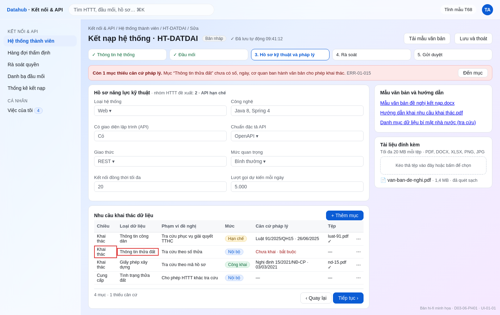

Ảnh là bước 3 "Hồ sơ kỹ thuật và pháp lý" khi hồ sơ còn một mục thiếu căn cứ: dải đỏ ở đầu bước nêu đúng mục và có nút "Đến mục"; dòng "Thông tin thửa đất" tô viền đỏ và ghi chữ "Chưa khai · bắt buộc" (không chỉ dựa vào màu). Cột phải gom mẫu văn bản, hướng dẫn và tài liệu đính kèm để người lập không phải rời màn.

### 7.1. Wireframe

Hình dưới là bố cục dạng chữ của UI-01-01, dùng để thống nhất vị trí các khối trước khi đọc bản hi-fi.

```text
┌ Kết nối & API › Hệ thống thành viên › HT-DATDAI › Sửa ────────────────────────────────────────┐
│ Kết nạp hệ thống · HT-DATDAI [Bản nháp]  ✓ Đã lưu tự động 09:41:12      [Tải mẫu văn bản] [Lưu và thoát] │
│ ┌✓ 1 Thông tin┐ ┌✓ 2 Đầu mối┐ ┌● 3 Hồ sơ kỹ thuật, pháp lý┐ ┌4 Rà soát┐ ┌5 Gửi duyệt┐         │
│ ┌ ⚠ Còn 1 mục thiếu căn cứ pháp lý … ERR-01-015                                  [Đến mục] ┐ │
│ ┌ Hồ sơ năng lực kỹ thuật · nhóm đề xuất 2 ──────────────┐ ┌ Mẫu văn bản, hướng dẫn ─────┐ │
│ │ Loại hệ thống   Công nghệ        Có API      Chuẩn API   │ │ Mẫu đề nghị kết nạp.docx     │ │
│ │ Giao thức       Mức quan trọng   Đồng thời   Lượt/ngày   │ ├ Tài liệu đính kèm ───────────┤ │
│ └──────────────────────────────────────────────────────────┘ │ [Kéo thả tệp] PDF…20 MB      │ │
│ ┌ Nhu cầu khai thác dữ liệu ──────────────────── [+ Thêm mục] ┐ └──────────────────────────────┘ │
│ │ Chiều│Loại dữ liệu│Phạm vi│Mức│Căn cứ pháp lý│Tệp│⋯         │                                  │
│ │ …    │…           │…      │…  │…             │…  │⋯         │                                  │
│ └──────────────────────────── 4 mục · 1 thiếu căn cứ ── [‹ Quay lại] [Tiếp tục ›] ┘              │
└────────────────────────────────────────────────────────────────────────────────────────────────┘
```

Bước 4 thay thân màn bằng danh sách thiếu sót (`issues[]`) nhóm theo bước, mỗi dòng có liên kết nhảy về trường; bước 5 là tóm tắt chỉ đọc, người sẽ thẩm định, hạn dự kiến và nút "Gửi duyệt".

### 7.2. Thành phần

Bảng dưới liệt kê các thành phần giao diện của UI-01-01 theo thứ tự từ trên xuống, kèm thành phần `CMP-*` dùng, quy tắc kiểm tra và nguồn dữ liệu.

| # | Thành phần | `CMP-*` | Nội dung, kiểm tra | Nguồn | Ghi chú |
|---|---|---|---|---|---|
| 1 | Tiêu đề trang | `CMP-PageHeader`, `CMP-StatusTag`, `CMP-SaveIndicator` | "Kết nạp hệ thống · {mã}", nhãn Bản nháp, trạng thái tự lưu | — | `aria-live="polite"` cho trạng thái lưu |
| 2 | Thanh bước | `CMP-Wizard`, `CMP-Steps` | 5 bước; bước chưa qua không bấm nhảy tới được nếu bước trước lỗi nghiêm trọng, bước đã qua bấm quay lại tự do | — | `aria-current="step"` |
| 3 | Dải lỗi | `CMP-Alert` mức lỗi | Số lỗi, liên kết nhảy tới trường | `errors[]`, `issues[]` | Focus chuyển tới đây khi bấm "Tiếp tục" có lỗi |
| 4 | Biểu mẫu | `CMP-Form`, `CMP-FormField`, `CMP-Input`, `CMP-TextArea`, `CMP-Select`, `CMP-NumberInput`, `CMP-Switch` | Theo §7.3 | API-01-004, 005, 010 | Tối đa `size-form-max` |
| 5 | Chọn tổ chức | `CMP-OrganizationSelect` (biến thể `organization` của `CMP-ResourceSelect`, D03-05-03 §7.18) | Tìm theo tên, mã; chỉ tổ chức `ACTIVE` ở PH-20; OR chỉ thấy tổ chức của mình | PH-20 qua API-01-004 | ERR-01-004, 006 |
| 6 | Chọn loại dữ liệu | `CMP-CodeListSelect` | Danh mục loại dữ liệu của tenant, gợi ý mức phân loại mặc định | Danh mục (Q01-16) | Mục bí mật nhà nước hiện nhãn đỏ và không chọn được |
| 7 | Bảng nhu cầu | `CMP-EditableTable` | Thêm, sửa tại chỗ, xóa; cột theo §7.3; dòng thiếu căn cứ tô `color-error` kèm chữ | API-01-012, 013 | Sửa bằng `Enter`, hộp thoại căn cứ pháp lý khi dòng có chiều `CONSUME` |
| 8 | Tải tài liệu | `CMP-Upload` biến thể `dropzone` | Loại tài liệu, tiêu đề; PDF, DOCX, XLSX, PNG, JPG ≤ 20 MB (tham số) | API-01-006…009 | Hiện "đã quét sạch" sau quét mã độc |
| 9 | Đầu mối | `CMP-DataTable` + `CMP-Drawer` (PTN-04) | Thêm, thay thế, xóa; ít nhất một đầu mối kỹ thuật | API-01-014…017 | ERR-01-011, 050 |
| 10 | Mẫu và hướng dẫn | `CMP-Card`, `CMP-Link` | Tải mẫu văn bản đề nghị, hướng dẫn khai nhu cầu | API-01-020, 021 | |
| 11 | Hộp xác nhận nộp | `CMP-ConfirmDialog` | Người thẩm định dự kiến, hạn dự kiến, "Hồ sơ sẽ bị khóa sau khi nộp" | API-01-023 | Có `Idempotency-Key` |
| 12 | Chân biểu mẫu | `CMP-Button` | "Quay lại", "Tiếp tục" (primary), "Lưu và thoát" | — | |

: UI-01-01 · Thành phần

### 7.3. Trường theo bước

Kiểu, ràng buộc lấy từ bảng dữ liệu vào của FR-01-003, 006, 007, 008; cột "Kiểm tra" là kiểm tra ở giao diện, máy chủ kiểm lại.

| Bước | Trường (nhãn) | Kiểu | Bắt buộc | Kiểm tra | Ánh xạ API |
|---|---|---|---|---|---|
| 1 | Mã HTTT | `CMP-Input` + `CMP-CodeText` | Có | `^[A-Z][A-Z0-9-]{2,63}$`; sau khi tạo không sửa được; kiểm trùng khi rời trường (ERR-01-002) | `code` |
| 1 | Tên HTTT | `CMP-Input` | Có | 3…255 ký tự | `name` |
| 1 | Mô tả nghiệp vụ | `CMP-TextArea` | Có | ≤ 2.000 ký tự, đếm ký tự | `description` |
| 1 | Đơn vị chủ quản | `CMP-OrganizationSelect` | Có | Tổ chức `ACTIVE` | `ownerOrgId` |
| 1 | Đơn vị vận hành, nhà thầu | `CMP-Input` | Không | | `operatorName` |
| 1 | Loại HTTT | `CMP-Select` | Có | Cấp tỉnh, Quốc gia, Bộ ngành, Hệ cũ, Bên ngoài | `systemType` |
| 1 | Vai trò | `CMP-Checkbox` nhóm | Có | Chọn ≥ 1: CONSUMER, PROVIDER, PUBLISHER, SUBSCRIBER | `roles` |
| 1 | Cấp độ ATTT | `CMP-Select` | Có | L1…L5 | `securityLevel` |
| 1 | Số, ngày quyết định phê duyệt cấp độ | `CMP-Input` | Khi cấp độ từ L3 | Không trống | `securityApprovalRef` |
| 1 | Địa chỉ cơ sở | `CMP-Input` (nhiều dòng) | Khi có vai trò PROVIDER | Chỉ `https` (ERR-01-049) | `baseUrls` |
| 1 | Danh sách IP cho phép | `CMP-Input` (nhiều dòng) | Không | CIDR hợp lệ (ERR-01-049) | `ipAllowlist` |
| 1 | Mã ở hệ cũ | `CMP-Input` | Không | | `legacyRef` |
| 2 | Loại đầu mối | `CMP-SegmentedControl` | Có | Nghiệp vụ, Kỹ thuật, ATTT | `contactType` |
| 2 | Họ tên, chức vụ | `CMP-Input` | Có | | `fullName`, `position` |
| 2 | Thư điện tử | `CMP-Input` | Có | Miền công vụ theo tham số (ERR-01-011) | `email` |
| 2 | Điện thoại | `CMP-Input` | Không | E.164, hiển thị `0912 345 678` | `phone` |
| 2 | Công khai trong danh bạ | `CMP-Switch` | Không | Mặc định Bật cho Nghiệp vụ, Kỹ thuật; Tắt cho ATTT | `isPublic` |
| 3 | Loại hệ thống, công nghệ | `CMP-Select`, `CMP-Input` | Có | ≤ 255 ký tự | `systemKind`, `technology` |
| 3 | Có API, chuẩn đặc tả, giao thức | `CMP-Switch`, `CMP-Select` | Có | Chuẩn đặc tả bắt buộc khi có API; loại CSDL khi không có API; nhóm HTTT đề xuất tính ngay và hiện bên cạnh tiêu đề | `hasApi`, `apiSpecKind`, `protocols`, `dbType` |
| 3 | Nhật ký giao dịch (nhóm 3) | `CMP-Select` | Khi nhóm 3 | Có, Không, Chưa rõ | `cdcLogEnabled` |
| 3 | Bảo trì, kế hoạch thay thế, ngày thay | `CMP-Switch`, `CMP-DatePicker` | Có | Ngày thay khi có kế hoạch | `underMaintenance`, `replacementPlanned`, `replacementDate` |
| 3 | Mức quan trọng | `CMP-SegmentedControl` | Có | Bình thường, Thiết yếu | `criticality` |
| 3 | Kết nối đồng thời tối đa, lượt gọi dự kiến mỗi ngày | `CMP-NumberInput` | Có | ≥ 1; ≥ 0 | `maxConcurrentConnections`, `expectedDailyCalls` |
| 3 | Nhu cầu: chiều, loại dữ liệu, phạm vi, mức, mục đích | `CMP-EditableTable` | Có | Phạm vi ≤ 200, mục đích ≤ 500 ký tự | `dataDemands[]` |
| 3 | Căn cứ pháp lý: số, ngày, cơ quan, hiệu lực đến, tệp | Hộp thoại `CMP-Form` | Khi chiều Khai thác | Ngày không ở tương lai; tệp loại `LEGAL_BASIS` (ERR-01-015) | `legalBasis.*` |
| 3 | Tài liệu: loại, tiêu đề, tệp | `CMP-Upload` | Tùy loại | Theo FR-01-005 | `attachments` |

: UI-01-01 · Trường theo bước

### 7.4. Hành động và hành vi

Các ý dưới đây trình bày hành động và hành vi.

1. **Tự lưu.** Sau 30 giây không gõ hoặc khi rời trường, giao diện gửi `PATCH` với `If-Match` (API-01-005); `CMP-SaveIndicator` đổi "Đang lưu…" thành "✓ Đã lưu tự động hh:mm:ss". Lưu lỗi mạng thì giữ bản nháp cục bộ (không gồm dữ liệu liên hệ nếu đã nhập, theo ST-14) và thử lại; 412 mở `CMP-ConflictDialog` (ERR-01-007).
2. **Tiếp tục.** Kiểm tra theo trường trước; có lỗi thì không chuyển bước, focus tới dải lỗi. Bước 4 gọi API-01-022 (không dừng ở lỗi đầu tiên), hiển thị `issues[]` mức ERROR chặn nộp, WARNING cho nộp nhưng báo người thẩm định.
3. **Gửi duyệt.** Nút ở bước 5 bật khi bước 4 không còn ERROR và hồ sơ đã kiểm tra sau lần sửa cuối. Hộp xác nhận nêu người thẩm định và hạn; sau khi nộp, màn chuyển sang UI-01-02 kèm `CMP-Toast` "Hồ sơ {số} đã được tiếp nhận, hạn thẩm định dự kiến {ngày}."
4. **Hồ sơ bị trả bổ sung.** Mở lại hồ sơ `DRAFT` có `returnReason`: dải vàng đầu màn liệt kê yêu cầu, các trường liên quan tô đỏ kèm chữ "Cần bổ sung" (FR-01-004, 017).
5. **Rời trang.** Hộp "Bạn có thay đổi chưa lưu" (D03-06-00 §4.3) khi còn thay đổi chưa tự lưu.

### 7.5. Trạng thái màn

Bảng dưới nêu cách UI-01-01 hiển thị ở từng trạng thái (đang tải, rỗng, lỗi, không có quyền và các trạng thái riêng), theo bộ trạng thái chuẩn ST-nn của D03-06-00.

| Trạng thái | Hiển thị |
|---|---|
| Đang tải | Skeleton ba cột trường (ST-01); thanh bước hiện ngay |
| Rỗng (hồ sơ mới) | Bước 1 trống; bước 3 bảng nhu cầu hiện "Chưa có nhu cầu khai thác nào. Thêm mục đầu tiên và nêu căn cứ pháp lý văn bản cho phép khai thác." |
| Lỗi hợp lệ | ST-11; dải đỏ đầu bước, lỗi tại trường, focus trường đầu tiên lỗi |
| Lỗi nghiệp vụ | ST-12: ERR-01-006 (không thuộc tổ chức), 009 (có hồ sơ khác), 010 (thiếu đầu mối kỹ thuật), 047 (cấp độ thấp hơn mức dữ liệu) |
| Xung đột | ST-13 với `CMP-DiffViewer` (ERR-01-007) |
| Không có quyền | ST-07; OR mở hồ sơ tổ chức khác thấy ST-08 |
| Chỉ đọc | Hồ sơ `SUBMITTED` mở ở `/sua` chuyển sang UI-01-02 kèm ERR-01-005 |
| Tệp lỗi | ERR-01-012, 013, 014 dưới ô tải, tệp không được lưu |

: UI-01-01 · Trạng thái màn

### 7.6. Thông báo

Bảng dưới trình bày thông báo.

| Tình huống | Thông báo | Vị trí |
|---|---|---|
| Lưu tự động xong | "✓ Đã lưu tự động hh:mm:ss" | `CMP-SaveIndicator` |
| Nộp thành công | "Hồ sơ {số} đã được tiếp nhận, hạn thẩm định dự kiến {ngày}." | `CMP-Toast` |
| Thiếu căn cứ | ERR-01-015, câu ở §5.2 | Dòng nhu cầu, dải lỗi |
| Chưa đủ điều kiện nộp | ERR-01-008 kèm `issues[]` | Bước 4 |
| Thiếu đầu mối kỹ thuật của tổ chức | ERR-01-010 | Bước 4 |
| Bí mật nhà nước | ERR-01-016 | Dòng nhu cầu |

: UI-01-01 · Thông báo

### 7.7. Tương tác bàn phím và truy cập

`Ctrl+S` lưu ngay; `Ctrl+Enter` tương đương "Tiếp tục" khi focus không ở ô nhiều dòng; trong bảng nhu cầu: `↑`, `↓` chọn dòng, `Enter` sửa dòng, `Delete` xóa dòng (hỏi xác nhận), `N` thêm mục; `Esc` đóng hộp thoại và trả focus về nút đã mở. Thanh bước là `nav` có `aria-label`, bước hiện tại `aria-current="step"`; mỗi trường có nhãn liên kết, lỗi gắn `aria-describedby` và `aria-invalid`; dải lỗi `role="alert"`. Dòng lỗi trong bảng có biểu tượng và chữ, không chỉ màu (WCAG 1.4.1). Tải tệp có phương án bàn phím (nút "Chọn tệp"), không chỉ kéo thả (WCAG 2.5.7).

## 8. UI-01-02 Tiến độ hồ sơ

::: dac-ta
**Mục đích.** Cho đơn vị và quản trị tỉnh thấy hồ sơ đang ở đâu, đang chờ ai, đã mất bao lâu ở từng bước, và nếu bị trả thì cần bổ sung gì; cho phép rút hồ sơ đã nộp. Thay màn tiến độ của hệ cũ.

**Người dùng, quyền.** OR (hồ sơ của tổ chức mình), TA, IE, SO; `PERM-01-read`; "Rút hồ sơ" cần `PERM-01-submit`.

**FR, UC hiện thực.** FR-01-009, 017, 019; UC-01-07, 11.

**Truy vết hệ cũ.** SRS cũ UI-01-02, FR-01-007.

**Đường dẫn.** `/ket-noi/he-thong/{ma}/tien-do`.

**Mẫu.** PTN-02 (Chi tiết).

**API.** API-01-034, 019, 018, 031.

**Phát hành, mức chi tiết.** MVP; đầy đủ.
:::

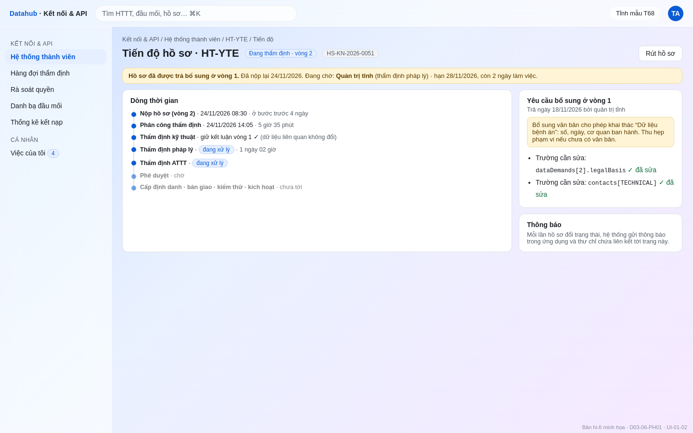

Ảnh là hồ sơ ở vòng 2 sau khi bị trả bổ sung: dải vàng nêu ngay "đang chờ ai" và hạn; cột trái là dòng thời gian dọc có thời gian ở từng bước; cột phải liệt kê yêu cầu bổ sung của vòng 1 với dấu "✓ đã sửa". Tên cá nhân người thẩm định không hiển thị, chỉ vai trò (FR-01-019 bước 3).

### 8.1. Wireframe

Hình dưới là bố cục dạng chữ của UI-01-02, dùng để thống nhất vị trí các khối trước khi đọc bản hi-fi.

```text
┌ Tiến độ hồ sơ · HT-YTE [Đang thẩm định · vòng 2] [HS-KN-2026-0051]            [Rút hồ sơ] ┐
│ ┌ ⚠ Đã được trả bổ sung ở vòng 1, nộp lại 24/11/2026. Đang chờ: Quản trị tỉnh · hạn 28/11 ┐ │
│ ┌ Dòng thời gian ─────────────────────────┐ ┌ Yêu cầu bổ sung ở vòng 1 ────────────────┐ │
│ │ ● Nộp hồ sơ (vòng 2)  24/11 08:30        │ │ "Bổ sung văn bản cho phép …"              │ │
│ │ ● Phân công           24/11 14:05 · 5h35 │ │ • dataDemands[2].legalBasis  ✓ đã sửa     │ │
│ │ ● Kỹ thuật ✓ (giữ kết luận vòng 1)       │ │ • contacts[TECHNICAL]        ✓ đã sửa     │ │
│ │ ◐ Pháp lý, ATTT  đang xử lý              │ ├ Thông báo ────────────────────────────────┤ │
│ │ ○ Phê duyệt · định danh · kiểm thử …     │ │ Thư chỉ chứa liên kết tới trang này       │ │
│ └──────────────────────────────────────────┘ └───────────────────────────────────────────┘ │
└──────────────────────────────────────────────────────────────────────────────────────────────┘
```

### 8.2. Thành phần

Bảng dưới liệt kê các thành phần giao diện của UI-01-02 theo thứ tự từ trên xuống, kèm thành phần `CMP-*` dùng, quy tắc kiểm tra và nguồn dữ liệu.

| # | Thành phần | `CMP-*` | Nội dung, kiểm tra | Nguồn | Ghi chú |
|---|---|---|---|---|---|
| 1 | Tiêu đề, nhãn | `CMP-PageHeader`, `CMP-StatusTag`, `CMP-CodeText` | Tên HTTT, trạng thái và vòng, số hồ sơ `HS-KN-{năm}-{số}` | API-01-034 | |
| 2 | Dải "đang chờ" | `CMP-Alert` mức thông tin hoặc cảnh báo | Vai trò đang chờ, hạn dự kiến, nhãn Quá hạn | `waitingOn.role`, `waitingOn.dueAt` | Không có tên cá nhân |
| 3 | Dòng thời gian | `CMP-Timeline` biến thể `status` | Mốc: nộp, phân công, thẩm định kỹ thuật, pháp lý, ATTT, phê duyệt, cấp định danh, bàn giao, kiểm thử, kích hoạt; mỗi mốc có thời điểm và thời gian ở bước (`CMP-Duration`) | `milestones[]` | Mốc chưa tới mờ; `aria-label` "bước 4 trên 10" |
| 4 | Yêu cầu bổ sung | `CMP-Card`, `CMP-Link` | `requests[]`: đường dẫn trường, yêu cầu; liên kết "Sửa" tới UI-01-01 đúng trường | `returnRequests[]` | Hiện khi vòng ≥ 2 hoặc `DRAFT` có `returnReason` |
| 5 | Hành động | `CMP-Button`, `CMP-ConfirmDialog` | "Rút hồ sơ", "Sửa và nộp lại", "Xóa bản nháp" | `allowedActions` | Rút hồ sơ: hộp xác nhận nêu hồ sơ về `DRAFT` |
| 6 | Thông báo | `CMP-Card` | Nhắc thư và thông báo ứng dụng | — | |

: UI-01-02 · Thành phần

### 8.3. Hành động

Bảng dưới trình bày hành động.

| Hành động | Hiện khi | Hộp, xác nhận | API | Kết quả |
|---|---|---|---|---|
| Rút hồ sơ | `SUBMITTED` và `PERM-01-submit` | `CMP-ConfirmDialog` "Rút hồ sơ về bản nháp? Các bước thẩm định đang mở sẽ đóng." | API-01-019 | Về `DRAFT`, đi UI-01-01 |
| Sửa và nộp lại | `DRAFT` có `returnReason` | — | — | Đi UI-01-01 bước 3 hoặc bước có yêu cầu |
| Xóa bản nháp | `DRAFT` chưa từng nộp và `PERM-01-submit` | `CMP-ConfirmDialog` gõ lại mã HTTT | API-01-018 | Về UI-01-03 |
| Trả bổ sung | Người thẩm định ở UI-01-06, không ở màn này | | API-01-031 | |

: UI-01-02 · Hành động

### 8.4. Trạng thái màn

Bảng dưới nêu cách UI-01-02 hiển thị ở từng trạng thái (đang tải, rỗng, lỗi, không có quyền và các trạng thái riêng), theo bộ trạng thái chuẩn ST-nn của D03-06-00.

| Trạng thái | Hiển thị |
|---|---|
| Đang tải | Skeleton dòng thời gian 6 mốc (ST-01) |
| Rỗng | Không có: hồ sơ `DRAFT` chưa nộp hiện "Hồ sơ chưa nộp. Hoàn tất các bước để gửi duyệt." kèm nút "Tiếp tục khai hồ sơ" |
| Quá hạn | Dải chuyển mức lỗi, nhãn "Quá hạn {n} ngày làm việc"; leo thang hiện "Đã báo quản trị tỉnh" |
| Lỗi tải | ST-05 trong vùng dòng thời gian; dải "đang chờ" vẫn hiện nếu có |
| Không có quyền | OR tổ chức khác thấy ST-08 (ERR-01-001) |
| Hồ sơ bị từ chối | Dải đỏ "Hồ sơ bị từ chối ngày {ngày}. Lý do: …" và hướng "Lập hồ sơ mới với mã khác"; mã cũ không dùng lại (ERR-01-002) |

: UI-01-02 · Trạng thái màn

### 8.5. Thông báo, bàn phím, truy cập

Thông báo: ERR-01-005 (đã nộp không sửa được), ERR-01-020 (bước đã đóng khi rút hồ sơ), ERR-01-009 (đã có hồ sơ khác) theo §5.2. Phím tắt: `R` rút hồ sơ khi có quyền, `E` mở UI-01-01. Dòng thời gian là danh sách có thứ tự (`ol`), mỗi mốc có chữ trạng thái "Hoàn tất", "Đang xử lý", "Chưa tới" ngoài biểu tượng; thời gian ở bước đọc được bằng chữ ("1 ngày 2 giờ").

## 9. UI-01-03 Danh sách HTTT thành viên

::: dac-ta
**Mục đích.** Nơi quản trị tỉnh bắt đầu mọi việc: thấy toàn bộ HTTT thành viên, trạng thái, cờ cảnh báo cần làm; tìm, lọc, mở chi tiết, tạo hồ sơ, nhập từ hệ cũ, xuất danh sách. Thay danh sách Application của APIM.

**Người dùng, quyền.** Mọi vai trò có `PERM-01-read` (OR, DO chỉ thấy HTTT của tổ chức mình); "Tạo hồ sơ" cần `PERM-01-create`; "Nhập từ hệ cũ" cần `PERM-18-migration`.

**FR, UC hiện thực.** FR-01-001, 050; UC-01-01.

**Truy vết hệ cũ.** LGC-APIM-019; SRS cũ UI-01-05.

**Đường dẫn.** `/ket-noi/he-thong`.

**Mẫu.** PTN-01 (Danh sách).

**API.** API-01-001, 085, 088.

**Phát hành, mức chi tiết.** MVP; đầy đủ.
:::

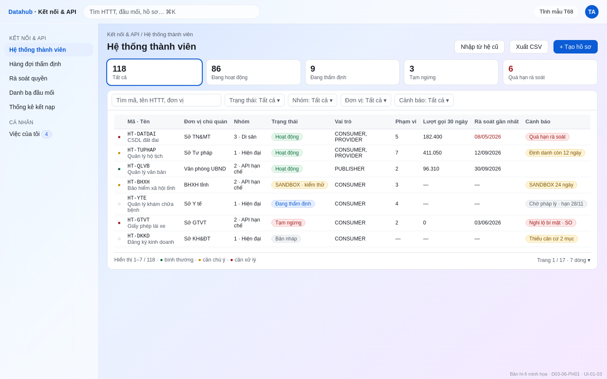

Năm thẻ ở đầu trang vừa là số liệu vừa là bộ lọc nhanh: bấm "Quá hạn rà soát" chỉ còn HTTT cần rà soát. Cột "Cảnh báo" gom việc phải làm; HTTT có cờ cảnh báo xếp trước trong cùng trạng thái. Không cột nào hiển thị bí mật hay thông tin liên hệ cá nhân.

### 9.1. Wireframe

Hình dưới là bố cục dạng chữ của UI-01-03, dùng để thống nhất vị trí các khối trước khi đọc bản hi-fi.

```text
┌ Hệ thống thành viên ──────────────────── [Nhập từ hệ cũ] [Xuất CSV] [+ Tạo hồ sơ] ┐
│ [Tất cả 118] [Đang hoạt động 86] [Đang thẩm định 9] [Tạm ngừng 3] [Quá hạn rà soát 6]   │
│ [Tìm mã, tên, đơn vị…] [Trạng thái ▾] [Nhóm ▾] [Đơn vị ▾] [Cảnh báo ▾]                  │
├─┬───────────────┬────────────┬───────┬──────────┬────────────┬──────┬────────┬──────┬────────┤
│●│ Mã · Tên      │ Đơn vị     │ Nhóm  │ Trạng thái│ Vai trò    │Phạm vi│Lượt 30d│Rà soát│Cảnh báo│
├─┼───────────────┼────────────┼───────┼──────────┼────────────┼──────┼────────┼──────┼────────┤
│●│ HT-DATDAI     │ Sở TN&MT   │ 3     │ Hoạt động│ CONSUMER … │ 5    │182.400 │08/05 │Quá hạn…│
└─┴───────────────┴────────────┴───────┴──────────┴────────────┴──────┴────────┴──────┴────────┘
  Hiển thị 1–7 / 118 · ● bình thường ● cần chú ý ● cần xử lý          Trang 1 / 17 · 7 dòng ▾
```

### 9.2. Thành phần

Bảng dưới liệt kê các thành phần giao diện của UI-01-03 theo thứ tự từ trên xuống, kèm thành phần `CMP-*` dùng, quy tắc kiểm tra và nguồn dữ liệu.

| # | Thành phần | `CMP-*` | Nội dung, kiểm tra | Nguồn | Ghi chú |
|---|---|---|---|---|---|
| 1 | Tiêu đề, nút | `CMP-PageHeader`, `CMP-Button` | "Tạo hồ sơ" primary; "Nhập từ hệ cũ", "Xuất CSV" mặc định | — | Ẩn khi thiếu `PERM-01-create`, `PERM-18-migration` |
| 2 | Thẻ tổng | `CMP-KpiCard` biến thể `filter` | Tất cả, Đang hoạt động, Đang thẩm định, Tạm ngừng, Quá hạn rà soát; `aria-pressed` | `facets` | Bấm là bật lọc; thẻ "Quá hạn rà soát" số đỏ có chữ |
| 3 | Thanh lọc | `CMP-FilterBar`, `CMP-SearchInput`, `CMP-Select`, `CMP-FilterChips` | Tìm không dấu, ≥ 2 ký tự, trễ 300 ms; lọc theo trạng thái, nhóm, đơn vị, vai trò, cấp độ ATTT, cờ | API-01-001 `q`, `status[]`, `group`, `ownerOrgId`, `role[]`, `securityLevel[]`, `flag` | Ghi URL; bộ lọc đã lưu (FR-00-024) |
| 4 | Bảng | `CMP-DataTable`, `CMP-StatusDot`, `CMP-StatusTag`, `CMP-CodeText` | Cột §9.3 | `items` | Mặc định: có cờ trước, sau đó theo mã |
| 5 | Xuất | `CMP-Button`, `CMP-JobProgress` | CSV, XLSX; từ 5.000 dòng chạy nền | API-01-085, 088 | Cùng bộ lọc; không có liên hệ, `secret_ref`, IP |
| 6 | Phân trang | `CMP-Pagination` | `trang`, `co` 10/20/50/100 | `page` | |
| 7 | Chú giải | `CMP-Text` | Ba mức chấm trạng thái | — | |

: UI-01-03 · Thành phần

### 9.3. Cột bảng

Bảng dưới mô tả từng cột của bảng chính ở UI-01-03: tên cột, nội dung hiển thị và ghi chú.

| Cột | Nội dung | Sắp xếp | Ghi chú |
|---|---|---|---|
| Chấm | `CMP-StatusDot`: lỗi nếu có cờ `REVIEW_OVERDUE` hoặc thao tác khẩn quá hạn; cam nếu có cờ khác; xanh nếu không | Không | `aria-label` "Cần xử lý", "Cần chú ý", "Bình thường" |
| Mã · Tên | Mã `CMP-CodeText` dòng 1, tên dòng 2 | Có | Liên kết UI-01-04 |
| Đơn vị chủ quản | Tên tổ chức | Có | |
| Nhóm | "1 · Hiện đại", "2 · API hạn chế", "3 · Di sản (CSDL)", "4 · Khác" | Có | Chưa thẩm định: "—" |
| Trạng thái | `CMP-StatusTag`; `SUBMITTED` kèm giai đoạn, `APPROVED` kèm giai đoạn cấp | Có | |
| Vai trò | Danh sách vai trò rút gọn | | Tooltip đầy đủ |
| Phạm vi | Số mục trong trần phạm vi | Có | Liên kết tab Hồ sơ |
| Lượt gọi 30 ngày | Từ PH-13; "—" khi chưa có hoặc PH-13 chậm | Có | Q01-33 |
| Rà soát gần nhất | `dd/MM/yyyy`; đỏ và có chữ "quá hạn" khi quá 6 tháng | Có | |
| Cảnh báo | `CMP-StatusTag` theo cờ, tối đa hai nhãn rồi "+n" | | |
| ⋯ | Menu `CMP-DropdownMenu`: Mở, Xem tiến độ, Sửa hồ sơ (DRAFT), Xóa bản nháp (DRAFT), Xuất dòng này | | Theo `allowedActions` |

: UI-01-03 · Cột bảng

### 9.4. Trạng thái màn

Bảng dưới nêu cách UI-01-03 hiển thị ở từng trạng thái (đang tải, rỗng, lỗi, không có quyền và các trạng thái riêng), theo bộ trạng thái chuẩn ST-nn của D03-06-00.

| Trạng thái | Hiển thị |
|---|---|
| Đang tải | Skeleton năm thẻ và 8 dòng (ST-01) |
| Rỗng lần đầu | `CMP-EmptyState` "Chưa có hệ thống thành viên nào. Hệ thống thành viên là nơi khai báo hồ sơ, đầu mối và định danh để HTTT của sở, ngành kết nối Datahub." kèm "Tạo hồ sơ" và "Nhập từ hệ cũ" |
| Không có kết quả | ST-04 kèm điều kiện lọc và "Xóa bộ lọc" |
| Lỗi tải | ST-05; năm thẻ giữ số cũ nếu có |
| Phụ thuộc chậm | Cột "Lượt gọi 30 ngày" hiện "—", `CMP-Toast` ERR-01-046 một lần |
| Không có quyền | ST-07 |
| Tác vụ xuất | `CMP-JobProgress` trong `CMP-BackgroundTaskTray` |

: UI-01-03 · Trạng thái màn

### 9.5. Thông báo, bàn phím, truy cập

Thông báo: ERR-01-003 (tham số lọc sai miền, hiện ở thanh lọc), ERR-01-046 (PH-13 không khả dụng), "Đang xuất danh sách… Báo cho bạn khi xong." khi chạy nền. Phím tắt: `/` vào ô tìm; `N` mở UI-01-01 (khi có quyền); `↑`, `↓` chọn dòng, `Enter` mở chi tiết; `F` mở bộ lọc mở rộng; `1`…`5` bật thẻ tổng tương ứng. Bảng có `caption` ẩn, tiêu đề cột `scope="col"`, cột sắp xếp báo `aria-sort`; thẻ tổng là nút bật tắt có `aria-pressed` và số đọc kèm nhãn. Chấm trạng thái luôn kèm chữ ở cột Cảnh báo.

## 10. UI-01-04 Chi tiết HTTT thành viên

::: dac-ta
**Mục đích.** Một chỗ xem trọn HTTT: hồ sơ, trần phạm vi, định danh, đầu mối, API đang dùng, phụ thuộc, lịch sử; và là điểm xuất phát của mọi hành động trong vòng đời (sửa, đề nghị mở rộng phạm vi, kiểm thử, kích hoạt, tạm ngừng, chấm dứt).

**Người dùng, quyền.** Mọi vai trò có `PERM-01-read` trong phạm vi của mình; sửa hồ sơ, đề nghị mở rộng cần `PERM-01-create`; tạm ngừng, chấm dứt, xử lý khẩn cần `PERM-01-suspend`; xoay vòng, thu hồi định danh cần `PERM-01-credential`.

**FR, UC hiện thực.** FR-01-002, 008, 009, 028, 034, 035, 036; UC-01-01, 05, 07, 19, 20, 23, 24, 25.

**Truy vết hệ cũ.** LGC-APIM-019 (chi tiết Application); LGC-HUB-010, 011 (vai trò).

**Đường dẫn.** `/ket-noi/he-thong/{ma}` và các tab `/dinh-danh`, `/dau-moi`, `/api`, `/phu-thuoc`, `/lich-su`.

**Mẫu.** PTN-02 (Chi tiết).

**API.** API-01-002, 003, 014…017, 018, 019, 049, 050, 056, 057, 058, 060, 061.

**Phát hành, mức chi tiết.** MVP (hành động bật lại định danh tự vô hiệu thuộc Đợt 2); đầy đủ.
:::

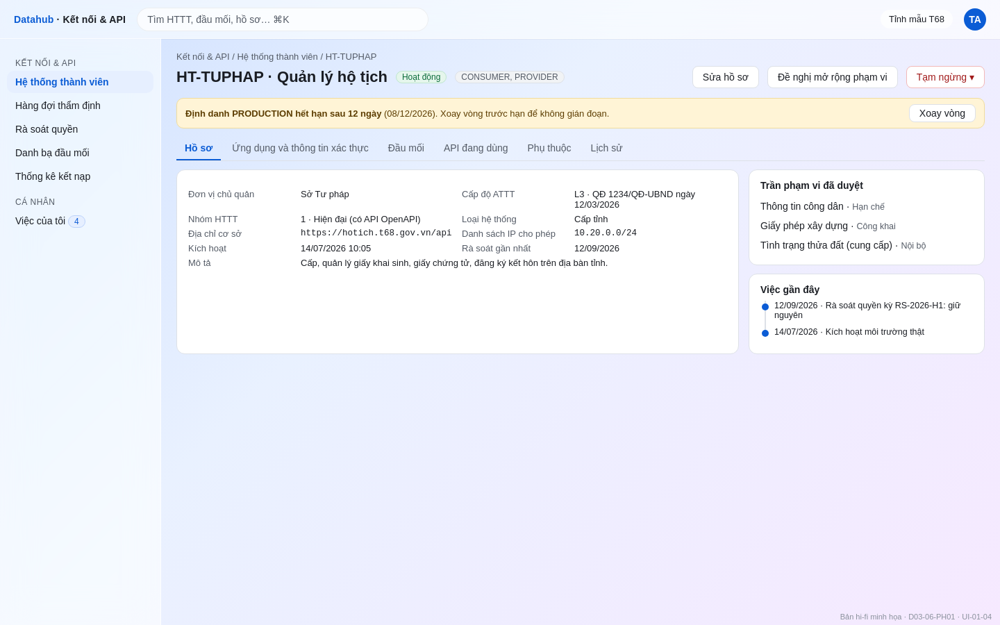

Ảnh là HTTT đang hoạt động có định danh PRODUCTION sắp hết hạn: dải cam ở đầu trang nhắc xoay vòng kèm nút hành động; bên dưới là sáu tab, tab Hồ sơ chia hai cột (mô tả bên trái, trần phạm vi và việc gần đây bên phải). Thanh hành động ở đầu trang đổi theo trạng thái HTTT và quyền.

### 10.1. Wireframe

Hình dưới là bố cục dạng chữ của UI-01-04, dùng để thống nhất vị trí các khối trước khi đọc bản hi-fi.

```text
┌ HT-TUPHAP · Quản lý hộ tịch [Hoạt động] [CONSUMER, PROVIDER]  [Sửa hồ sơ] [Đề nghị mở rộng] [Tạm ngừng ▾] ┐
│ ┌ ⚠ Định danh PRODUCTION hết hạn sau 12 ngày (08/12/2026)                         [Xoay vòng] ┐ │
│ Hồ sơ │ Ứng dụng và thông tin xác thực │ Đầu mối │ API đang dùng │ Phụ thuộc │ Lịch sử            │
│ ┌ Mô tả hồ sơ ──────────────────────────────────────┐ ┌ Trần phạm vi đã duyệt ───────────────┐ │
│ │ Đơn vị chủ quản · Cấp độ ATTT · Nhóm · Loại      │ │ Thông tin công dân · Hạn chế         │ │
│ │ Địa chỉ cơ sở · IP cho phép · Kích hoạt · Rà soát │ │ Giấy phép xây dựng · Công khai       │ │
│ └───────────────────────────────────────────────────┘ ├ Việc gần đây ────────────────────────┤ │
│                                                         │ 12/09 Rà soát quyền: giữ nguyên      │ │
│                                                         └──────────────────────────────────────┘ │
└──────────────────────────────────────────────────────────────────────────────────────────────────┘
```

### 10.2. Thanh hành động tiêu đề

Nút hiện theo `allowedActions` của API-01-002; bảng nêu điều kiện hiển thị và nơi dẫn tới.

| Nút | Hiện khi (trạng thái, quyền) | Dẫn tới | API |
|---|---|---|---|
| Sửa hồ sơ | `DRAFT`: đi UI-01-01. `ACTIVE`, `SUSPENDED`: mở ngăn kéo sửa (PTN-04); `PERM-01-create` | UI-01-01 hoặc ngăn kéo | API-01-005, 057 |
| Đề nghị mở rộng phạm vi | `ACTIVE`; `PERM-01-create` | Ngăn kéo thêm mục nhu cầu kèm căn cứ (như bước 3 của UI-01-01) | API-01-060 |
| Kiểm thử và kích hoạt | `APPROVED` | UI-01-10 | — |
| Xem tiến độ | `DRAFT` (có vòng nộp), `SUBMITTED` | UI-01-02 | API-01-034 |
| Rút hồ sơ, Xóa bản nháp | `SUBMITTED`, `DRAFT`; `PERM-01-submit` | `CMP-ConfirmDialog` | API-01-019, 018 |
| Tạm ngừng ▾ | `ACTIVE`; `PERM-01-suspend`; menu gồm Tạm ngừng, Chấm dứt, Xử lý khẩn (chỉ SO) | UI-01-11 | API-01-051, 053, 054 |
| Khôi phục | `SUSPENDED`; `PERM-01-suspend`; vô hiệu nếu bị SO tạm ngừng do nghi lộ bí mật và chưa có đồng ý của SO (ERR-01-036) | UI-01-11 | API-01-052 |

: UI-01-04 · Thanh hành động tiêu đề

### 10.3. Các tab

Bảng dưới trình bày các tab.

| Tab | Nội dung | `CMP-*` | Nguồn | Hành động trong tab |
|---|---|---|---|---|
| Hồ sơ | Mô tả; kỹ thuật (nhóm, công nghệ, API, giao thức); trần phạm vi (loại dữ liệu, phạm vi, mức, căn cứ); tài liệu đính kèm; việc gần đây | `CMP-DescriptionList`, `CMP-DataTable`, `CMP-Card` | API-01-002, 011, 013 | Tải tài liệu (API-01-008, liên kết ký 60 giây) |
| Ứng dụng và thông tin xác thực | Nội dung của UI-01-08 | Xem chương 14 | API-01-049, 050 | Xoay vòng, thu hồi, đăng ký khóa |
| Đầu mối | Bảng đầu mối: loại, họ tên, chức vụ, thư, điện thoại, công khai, xác nhận gần nhất, trạng thái | `CMP-DataTable`, `CMP-Drawer` (PTN-04) | API-01-014 | Thêm, thay thế, sửa, bỏ đầu mối (API-01-015…017); ERR-01-011, 050 |
| API đang dùng | API HTTT công bố và API HTTT đang đăng ký dùng, số lượt gọi 30 ngày | `CMP-DataTable`, `CMP-Link` | PH-02 qua API nội bộ | Liên kết sang danh mục API (PH-02) |
| Phụ thuộc | Đăng ký sử dụng, luồng, kết nối nguồn, topic gắn HTTT; mức tác động | `CMP-DataTable`, `CMP-DependencyGraph` (xem dạng đồ thị) | API-01-056 | Mở đối tượng ở phân hệ khác |
| Lịch sử | Đổi trạng thái, đề nghị thay đổi, thao tác khẩn, kết luận thẩm định | `CMP-AuditTrail`, `CMP-VersionTimeline` | API-01-003, 058 | Lọc theo loại sự kiện |

: UI-01-04 · Các tab

Tab chỉ đọc cho HTTT `SUBMITTED`, `TERMINATED`, `REJECTED`. Tab Đầu mối luôn sửa được cho HTTT `ACTIVE` mà không cần duyệt (BR-01-025), trừ đầu mối kỹ thuật cuối cùng không được bỏ (ERR-01-050).

### 10.4. Dải cảnh báo ở đầu trang

Tối đa ba dải `CMP-Alert` xếp theo mức nghiêm trọng, mỗi dải có một nút hành động.

| Điều kiện | Mức | Nội dung | Nút |
|---|---|---|---|
| Thao tác khẩn chờ xác nhận | Lỗi | "Cán bộ ATTT đã {tạm ngừng} HTTT lúc {giờ}. Chờ quản trị tỉnh xác nhận trước {hạn}." | "Xác nhận" (TA, khác SO) |
| HTTT `SUSPENDED` | Cảnh báo | "HTTT đang tạm ngừng từ {ngày}. Lý do: {…}. Cắt quyền: {đang thực hiện / đã xong}." | "Khôi phục" |
| Định danh sắp hết hạn, đã hết hạn | Cảnh báo, lỗi | "Định danh {môi trường} hết hạn sau {n} ngày." | "Xoay vòng" |
| Thiếu đầu mối kỹ thuật | Lỗi | "Hệ thống chưa có đầu mối kỹ thuật đang hoạt động." | "Thêm đầu mối" |
| SANDBOX quá lâu | Cảnh báo | "Đã ở môi trường thử {n} ngày." | "Mở kiểm thử" |
| Căn cứ pháp lý hết hiệu lực | Lỗi | "Phạm vi {tên} bị tạm ngừng vì căn cứ hết hiệu lực." | "Đề nghị mở rộng phạm vi" |
| Định danh tự vô hiệu do không dùng | Cảnh báo | "Định danh {môi trường} bị vô hiệu vì không dùng {n} ngày." | "Bật lại" (`PERM-01-credential`) |

: UI-01-04 · Dải cảnh báo ở đầu trang

### 10.5. Ngăn kéo "Sửa hồ sơ" của HTTT đã kết nạp

Ngăn kéo `CMP-Drawer` rộng `size-drawer-lg`, nội dung `CMP-Form`. Giao diện gợi ý mức duyệt theo từng nhóm trường để người dùng biết trước (máy chủ vẫn tự phân loại và quyết định, BR-01-025): "Không cần duyệt" cho mô tả, đầu mối; "Cần duyệt kỹ thuật" cho địa chỉ cơ sở, IP cho phép, hạn mức, cấp độ ATTT; "Cần thẩm định đầy đủ" cho mở rộng phạm vi, chỉ qua nút "Đề nghị mở rộng phạm vi". Bấm "Gửi" nhận `200` (áp dụng ngay, `CMP-Toast` "Đã cập nhật hồ sơ.") hoặc `202` (chờ duyệt, "Đã gửi đề nghị thay đổi, chờ quản trị tỉnh duyệt."). Đổi đơn vị chủ quản cần thêm xác nhận của tổ chức mới và hiện nhãn "Cần tổ chức {tên} xác nhận" (BR-01-029).

### 10.6. Trạng thái màn

Bảng dưới nêu cách UI-01-04 hiển thị ở từng trạng thái (đang tải, rỗng, lỗi, không có quyền và các trạng thái riêng), theo bộ trạng thái chuẩn ST-nn của D03-06-00.

| Trạng thái | Hiển thị |
|---|---|
| Đang tải | Skeleton tiêu đề, dải thông tin, bảng mô tả (ST-01); tab tải lười khi mở |
| Rỗng theo tab | Đầu mối: "Chưa có đầu mối. Thêm ít nhất một đầu mối kỹ thuật." ; API đang dùng: "HTTT chưa đăng ký hoặc công bố API nào."; Phụ thuộc: "Không có đối tượng nào phụ thuộc HTTT này." |
| Lỗi tải từng tab | ST-05 trong tab; các tab khác dùng được; tab API đang dùng hiện ERR-01-046 khi PH-02 không khả dụng |
| Xung đột | Đề nghị thay đổi đang chờ: ERR-01-038; sửa khi đang thẩm định: ERR-01-005 |
| Không tồn tại hoặc ngoài phạm vi | ST-08 (ERR-01-001) |
| Chỉ đọc | ST-15: nút ghi ẩn; nhãn "Chỉ xem" ở đầu trang với vai trò chỉ có `PERM-01-read` |

: UI-01-04 · Trạng thái màn

### 10.7. Thông báo, bàn phím, truy cập

Thông báo: ERR-01-011 và 050 (đầu mối), ERR-01-037 và 038 (sửa hồ sơ), ERR-01-036 (khôi phục), ERR-01-048 (tạo liên kết bàn giao khi đang tạm ngừng). Phím tắt: `1`…`6` chuyển tab; `E` sửa hồ sơ; `X` mở menu "Tạm ngừng"; `Esc` đóng ngăn kéo. Tab dùng `role="tablist"` với mũi tên trái phải; ngăn kéo bẫy focus và trả focus về nút đã mở; mọi dải cảnh báo là `role="status"` hoặc `role="alert"` theo mức; bảng đầu mối có thư điện tử và điện thoại đọc được bằng trình đọc màn hình, không dùng ảnh.

## 11. UI-01-05 Hàng đợi thẩm định

::: dac-ta
**Mục đích.** Cho người thẩm định và quản trị tỉnh thấy các bước thẩm định đang chờ xử lý theo loại bước, hạn và quá hạn; nhận việc, phân công, gửi tham vấn; mở hồ sơ để thẩm định. Thay hàng đợi của hệ cũ (hạn 10 ngày) bằng hạn theo tham số, mặc định 2 ngày làm việc mỗi bước.

**Người dùng, quyền.** TA, IE, SO; `PERM-01-read`; phân công cần `PERM-01-approve`; người thẩm định chỉ ghi kết luận cho bước được phân công (quy tắc OPA, SEC-26).

**FR, UC hiện thực.** FR-01-016; UC-01-08.

**Truy vết hệ cũ.** SRS cũ UI-01-03.

**Đường dẫn.** `/ket-noi/he-thong/tham-dinh`.

**Mẫu.** PTN-10 (Hộp việc, duyệt), biến thể danh sách.

**API.** API-01-027, 028, 029, 030.

**Phát hành, mức chi tiết.** MVP; đầy đủ.
:::

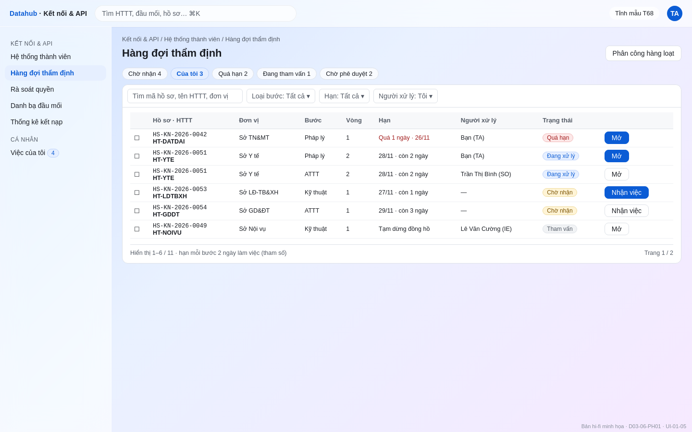

Ảnh là hàng đợi của một quản trị tỉnh với bộ lọc "Của tôi": hai hồ sơ quá hạn hoặc sắp hạn nằm đầu, nhãn "Quá hạn" đỏ có chữ; dòng đang tham vấn hiện "Tạm dừng đồng hồ" thay cho hạn. Nút "Nhận việc" chỉ hiện ở bước chưa có người xử lý mà người xem có đúng vai trò.

### 11.1. Wireframe

Hình dưới là bố cục dạng chữ của UI-01-05, dùng để thống nhất vị trí các khối trước khi đọc bản hi-fi.

```text
┌ Hàng đợi thẩm định ──────────────────────────────────────── [Phân công hàng loạt] ┐
│ (Chờ nhận 4) (Của tôi 3) (Quá hạn 2) (Đang tham vấn 1) (Chờ phê duyệt 2)              │
│ [Tìm mã hồ sơ, HTTT, đơn vị] [Loại bước ▾] [Hạn ▾] [Người xử lý: Tôi ▾]               │
├──┬──────────────────┬────────────┬────────┬─────┬──────────────────┬──────────┬────────┬───────┤
│☐ │ Hồ sơ · HTTT     │ Đơn vị     │ Bước   │Vòng │ Hạn              │ Xử lý    │Trạng thái│       │
│☐ │ HS-KN-2026-0042  │ Sở TN&MT   │ Pháp lý│ 1   │ Quá 1 ngày · 26/11│ Bạn (TA) │ Quá hạn │ [Mở]  │
│☐ │ HS-KN-2026-0053  │ Sở LĐ-TB&XH│ Kỹ thuật│ 1  │ 27/11 · còn 1 ngày│ —        │ Chờ nhận│[Nhận việc]│
└──┴──────────────────┴────────────┴────────┴─────┴──────────────────┴──────────┴────────┴───────┘
```

### 11.2. Thành phần

Bảng dưới liệt kê các thành phần giao diện của UI-01-05 theo thứ tự từ trên xuống, kèm thành phần `CMP-*` dùng, quy tắc kiểm tra và nguồn dữ liệu.

| # | Thành phần | `CMP-*` | Nội dung, kiểm tra | Nguồn | Ghi chú |
|---|---|---|---|---|---|
| 1 | Tiêu đề, nút | `CMP-PageHeader`, `CMP-Button` | "Phân công hàng loạt" chỉ hiện với `PERM-01-approve` | — | |
| 2 | Bộ lọc nhanh | `CMP-KpiCard` biến thể `filter` | Chờ nhận, Của tôi, Quá hạn, Đang tham vấn, Chờ phê duyệt | `facets` | `aria-pressed` |
| 3 | Thanh lọc | `CMP-FilterBar`, `CMP-SearchInput`, `CMP-Select` | Loại bước (Kỹ thuật, Pháp lý, ATTT, Phê duyệt), hạn, người xử lý | API-01-027 | Ghi URL |
| 4 | Bảng | `CMP-DataTable`, `CMP-StatusTag`, `CMP-Duration` | Cột §11.3 | `items` | Mặc định: quá hạn trước, rồi hạn tăng dần |
| 5 | Thanh chọn nhiều | `CMP-BulkActionBar` | Số dòng chọn; "Phân công…", "Bỏ chọn" | — | Chỉ hiện khi chọn ≥ 1 và có quyền |
| 6 | Hộp phân công | `CMP-Modal`, `CMP-ResourceSelect` | Chọn người có vai trò đúng bước, không phải người lập, nộp hồ sơ | API-01-028 | ERR-01-017 hiện từng dòng |
| 7 | Ngăn kéo tham vấn | `CMP-Drawer`, `CMP-TextArea` | Chọn người nội bộ có quyền xem hồ sơ, nhập câu hỏi | API-01-029, 030 | Đồng hồ tạm dừng hiển thị ngay |
| 8 | Phân trang | `CMP-Pagination` | | `page` | |

: UI-01-05 · Thành phần

### 11.3. Cột bảng

Bảng dưới mô tả từng cột của bảng chính ở UI-01-05: tên cột, nội dung hiển thị và ghi chú.

| Cột | Nội dung | Sắp xếp | Ghi chú |
|---|---|---|---|
| Chọn | `CMP-Checkbox` | | Chỉ dòng phân công được |
| Hồ sơ · HTTT | Số hồ sơ `CMP-CodeText`, mã HTTT đậm | Có | Liên kết UI-01-06 đúng tab của bước |
| Đơn vị | Tên tổ chức | Có | |
| Bước | Kỹ thuật, Pháp lý, ATTT, Phê duyệt | Có | |
| Vòng | `revisionNo` | | |
| Hạn | `dd/MM · còn n ngày` hoặc `Quá n ngày` đỏ kèm chữ; `Tạm dừng đồng hồ` khi tham vấn | Có | Tính theo ngày làm việc của tenant |
| Người xử lý | Tên, vai trò; "Bạn" nếu là người xem; "—" nếu chưa nhận | Có | |
| Trạng thái | Chờ nhận, Đang xử lý, Đang tham vấn, Quá hạn, Chờ phê duyệt | | |
| Hành động | "Mở", "Nhận việc", "⋯" (Phân công, Tham vấn, Kết thúc tham vấn) | | Theo `allowedActions` |

: UI-01-05 · Cột bảng

### 11.4. Trạng thái màn

Bảng dưới nêu cách UI-01-05 hiển thị ở từng trạng thái (đang tải, rỗng, lỗi, không có quyền và các trạng thái riêng), theo bộ trạng thái chuẩn ST-nn của D03-06-00.

| Trạng thái | Hiển thị |
|---|---|
| Đang tải | Skeleton 8 dòng (ST-01) |
| Rỗng | `CMP-EmptyState` "Không có hồ sơ nào chờ thẩm định. Hồ sơ mới nộp sẽ xuất hiện ở đây." |
| Không có kết quả | ST-04 kèm "Xóa bộ lọc" |
| Lỗi từng dòng khi phân công hàng loạt | Hộp kết quả: "Đã phân công 3/4. 1 lỗi: HS-KN-2026-0042, ERR-01-017." |
| Không có quyền | ST-07 với người thiếu cả ba vai trò TA, IE, SO |
| Hết hạn đồng hồ | Dòng quá hạn đỏ; sau `escalate.afterWorkingDays` ghi "Đã leo thang tới quản trị tỉnh" |

: UI-01-05 · Trạng thái màn

### 11.5. Thông báo, bàn phím, truy cập

Thông báo: ERR-01-017 (người được giao đã tham gia hồ sơ), ERR-01-020 (bước đã đóng hoặc hồ sơ ở trạng thái khác, tải lại hàng đợi), ERR-01-052 (không đủ quyền). Phím tắt: `/` vào ô tìm; `↑`, `↓` chọn dòng; `Enter` mở UI-01-06; `A` nhận việc dòng chọn; `Space` chọn dòng; `Shift+A` phân công khi có dòng chọn. Mỗi thẻ lọc và nhãn quá hạn có chữ; bảng có `aria-sort`; bảng chọn nhiều thông báo "đã chọn n dòng" bằng vùng `aria-live`. Nút "Nhận việc" dùng API nhận việc nêu ở Phụ lục B (API-01-028 hiện chỉ cho TA phân công).

## 12. UI-01-06 Thẩm định hồ sơ (siêu chi tiết)

::: dac-ta
**Mục đích.** Cho kỹ sư tích hợp, Cán bộ ATTT và quản trị tỉnh thẩm định một hồ sơ kết nạp ở một màn: đánh giá kỹ thuật và nhóm HTTT, thẩm định căn cứ pháp lý **từng mục** nhu cầu khai thác, thẩm định ATTT; tham vấn, trả bổ sung; xem văn bản căn cứ ngay bên cạnh. Thay màn thẩm định gộp của hệ cũ.

**Người dùng, quyền.** IE (bước kỹ thuật), SO (bước ATTT), TA hoặc người TA chỉ định (bước pháp lý); `PERM-01-read` cộng phân công của TA; không phải người lập hay nộp hồ sơ (ERR-01-017).

**FR, UC hiện thực.** FR-01-013, 014, 015, 016, 017, 035; UC-01-09, 10, 11.

**Truy vết hệ cũ.** SRS cũ UI-01-04 và FR-01-004, 005.

**Đường dẫn.** `/ket-noi/he-thong/{ma}/tham-dinh`.

**Mẫu.** PTN-02 (Chi tiết) với ba tab thẩm định và thanh hành động dính chân.

**API.** API-01-013, 024, 025, 026, 029, 030, 031, 008.

**Phát hành, mức chi tiết.** MVP; siêu chi tiết.
:::

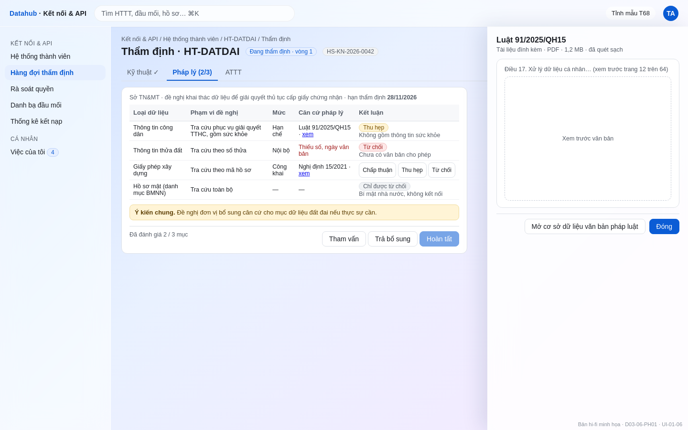

Ảnh là tab Pháp lý khi đã đánh giá 2 trên 3 mục: dòng "Thông tin công dân" chọn Thu hẹp kèm phạm vi được duyệt, dòng "Thông tin thửa đất" chọn Từ chối vì thiếu căn cứ, dòng thứ ba chưa chọn (ba nút), dòng "Hồ sơ mật" chỉ cho Từ chối kèm giải thích. Nút "Hoàn tất" mờ vì còn mục chưa đánh giá. Văn bản căn cứ mở ở ngăn kéo bên phải để đối chiếu ngay.

### 12.1. Mục đích, người dùng, bối cảnh

Người thẩm định làm việc ở màn này lâu nhất trong PH-01 (giả định 20 đến 40 phút mỗi hồ sơ, hồ sơ trung bình 6 mục nhu cầu, tối đa 30 mục) và phải đối chiếu nhiều nguồn cùng lúc: hồ sơ kỹ thuật, văn bản căn cứ, ý kiến các bước khác. Ba yêu cầu thiết kế: (1) không phải chuyển trang để xem văn bản căn cứ; (2) kết luận từng mục nhập tại chỗ, không nhập một khối chung; (3) màn không bao giờ cho thao tác sai vai (SO không ghi bước pháp lý, người lập hồ sơ không ghi bước nào). Màn dùng tốt ở khung 1366 × 768 trở lên; ở dưới 1200 px ngăn kéo văn bản chiếm toàn chiều rộng.

### 12.2. Lưới bố cục

Khung `CMP-AppShell` như mọi màn; vùng nội dung rộng tối đa `size-page-max`, đệm `space-4`, khoảng cách giữa vùng `space-3`. Bảy vùng R1…R7 đánh số theo thứ tự đọc và thứ tự focus.

| Vùng | Tên | Kích thước (ở 1440 px) | Vật liệu |
|---|---|---|---|
| R1 | Tiêu đề: tên HTTT, nhãn trạng thái, số hồ sơ, vòng, hạn, người xử lý | cao 56 px, dính đầu vùng nội dung | Đặc `color-surface-solid` |
| R2 | Thanh tab: Kỹ thuật, Pháp lý, ATTT, kèm dấu hoàn tất và bộ đếm | cao 44 px | Đặc |
| R3 | Dải tóm tắt hồ sơ: đơn vị, cấp độ ATTT, nhóm đề xuất, hạn, nút "Chi tiết hồ sơ" mở rộng thành bảng mô tả | cao 40 px, mở rộng tối đa 240 px | Đặc `color-surface-solid-2` |
| R4 | Thân tab: bảng đánh giá hoặc biểu mẫu thẩm định | co giãn, cuộn dọc | Đặc |
| R5 | Ý kiến chung và khối cảnh báo của tab | cao theo nội dung | Đặc |
| R6 | Thanh hành động dính chân: bộ đếm "Đã đánh giá n / m mục", Tham vấn, Trả bổ sung, Hoàn tất | cao 56 px, dính đáy | `glass-chrome` (lớp điều hướng) |
| R7 | Ngăn kéo văn bản căn cứ, mở từ R4 | rộng `size-drawer-lg` (560 px), phủ phải | Khung `glass-modal`, nội dung đặc, `z-drawer` |

: UI-01-06 · Lưới bố cục và vùng

### 12.3. Wireframe tổng thể

Hình dưới là bố cục dạng chữ của UI-01-06, dùng để thống nhất vị trí các khối trước khi đọc bản hi-fi.

```text
┌ R1 Thẩm định · HT-DATDAI [Đang thẩm định · vòng 1] [HS-KN-2026-0042]   Hạn 28/11 · Bạn đang xử lý ┐
│ R2 [ Kỹ thuật ✓ ] [ Pháp lý (2/3) ] [ ATTT ]                                                       │
│ R3 Sở TN&MT · L3 · nhóm đề xuất 3 · đề nghị khai thác để cấp giấy chứng nhận       [Chi tiết hồ sơ ▾]│
│ ┌ R4 Nhu cầu khai thác ────────────────────────────────────────────────────────────────────────┐ │
│ │ Loại dữ liệu │ Phạm vi đề nghị │ Mức │ Căn cứ pháp lý │ Kết luận                              │ │
│ │ ① Thông tin công dân │ Tra cứu … gồm sức khỏe │ Hạn chế │ Luật 91/2025 [Xem] │ (Chấp thuận)(Thu hẹp)(Từ chối) │ │
│ │   └ Phạm vi được duyệt: [Không gồm thông tin sức khỏe…]  Ý kiến: […]                        │ │
│ │ ② Thông tin thửa đất │ … │ Nội bộ │ ⚠ Thiếu số, ngày văn bản │ Từ chối · "Chưa có văn bản"  │ │
│ │ ③ Giấy phép xây dựng │ … │ Công khai │ NĐ 15/2021 [Xem] │ (Chấp thuận)(Thu hẹp)(Từ chối)     │ │
│ │ ④ Hồ sơ mật (BMNN)   │ … │ — │ — │ Chỉ được từ chối · không kết nối được                      │ │
│ └──────────────────────────────────────────────────────────────────────────────────────────────┘ │
│ R5 Ý kiến chung: […………………………………………………………]                                                   │
│ R6 Đã đánh giá 2 / 3 mục                                  [Tham vấn] [Trả bổ sung] [Hoàn tất ⛔] │
└────────────────────────────────────────────────────────────────────────────────────────────────────┘
                                                        R7 ┌ Luật 91/2025/QH15 · PDF · 1,2 MB ──────┐
                                                           │ Xem trước trang 12 / 64                 │
                                                           │ [Mở cơ sở dữ liệu văn bản pháp luật][Đóng]│
                                                           └─────────────────────────────────────────┘
```

### 12.4. Vùng R1: tiêu đề và R2: tab

R1 hiển thị tên HTTT (`CMP-Heading`), `CMP-StatusTag` giai đoạn (`IN_REVIEW`, `CONSULTING`), số hồ sơ, vòng nộp, hạn và người xử lý bước đang mở ("Bạn", hoặc tên người được giao nếu người xem là TA). R2 là `CMP-Tabs` ba tab; mỗi tab có nhãn trạng thái ghi bằng chữ: "✓" hoàn tất, "(2/3)" số mục đã đánh giá, "Chưa nhận" khi người xem không được giao bước đó. Tab của bước người xem không được phân công hiển thị **chỉ đọc**, nhãn "Chỉ xem". Tab hiện tại phản ánh vào `?tab=`; phím `1`, `2`, `3` chuyển tab.

### 12.5. Vùng R3: dải tóm tắt hồ sơ

Một dòng `CMP-DescriptionList` ngang: đơn vị chủ quản, cấp độ ATTT và số quyết định phê duyệt cấp độ, nhóm HTTT đề xuất, số mục nhu cầu, hạn thẩm định. "Chi tiết hồ sơ" mở rộng tại chỗ (không rời màn) thành bảng mô tả đầy đủ hồ sơ năng lực kỹ thuật, đầu mối, tài liệu đính kèm (mỗi tài liệu có "Xem" mở R7). Thông tin liên hệ cá nhân của đầu mối không hiện ở đây (chỉ vai trò và tên).

### 12.6. Vùng R4, tab Kỹ thuật

Biểu mẫu của người thẩm định kỹ thuật (FR-01-013) bên phải và hồ sơ năng lực kỹ thuật (chỉ đọc) bên trái, hai cột 50/50 ở 1440 px.

| Trường | Kiểu | Bắt buộc | Kiểm tra | Ánh xạ API-01-024 |
|---|---|---|---|---|
| Kết quả | `CMP-SegmentedControl` Đạt, Không đạt | Có | | `result` |
| Nhóm HTTT xác nhận | `CMP-RadioCard` 1…4, nhóm đề xuất đánh dấu "Đề xuất" | Có | 1…4 | `confirmedGroup` |
| Loại bộ điều hợp cần xây | `CMP-Select` nhiều lựa chọn | Khi nhóm 2, 3 | REST, SOAP, MQ, FILE, DB, CDC | `adapterTypes` |
| Phương thức xác thực | `CMP-Select` | Có | Không yếu hơn mức tối thiểu hệ thống tính (hiện dòng "Tối thiểu theo mức dữ liệu cao nhất: Khóa công khai"); lựa chọn yếu hơn bị vô hiệu kèm giải thích (BR-01-019) | `authMethod` |
| Hạn mức đề xuất | `CMP-NumberInput` + `CMP-Select` chu kỳ | Có | Giây, phút, giờ, ngày | `proposedQuota.*` |
| Khả năng đọc nhật ký (nhóm 3) | `CMP-Radio` | Khi nhóm 3 | Có, Không, Phương án thay thế | `cdcFeasible` |
| Ước tính công tích hợp (ngày) | `CMP-NumberInput` | Không | ≥ 0 | `effortDays` |
| Ý kiến | `CMP-TextArea` | Khi Không đạt | ≤ 4.000 ký tự | `opinion` |

: UI-01-06 · Trường tab Kỹ thuật

Khối "Tác động hạn mức quốc gia" (FR-01-015) hiện khi hồ sơ có dịch vụ quốc gia: bảng theo dịch vụ gồm hạn mức còn lại, mức dùng thêm ước tính, mức tác động (Thấp, Trung bình, Cao bằng `CMP-StatusTag`) và gợi ý; bấm "Tính lại" gọi API-01-026. Khi PH-14 không khả dụng hiện ERR-01-046 trong khối, không chặn việc còn lại.

### 12.7. Vùng R4, tab Pháp lý: giải phẫu một dòng đánh giá

Mỗi dòng nhu cầu là một hàng của `CMP-DataTable` mật độ gọn, có hàng phụ (mở rộng) cho phạm vi được duyệt và ý kiến.

| # | Phần tử | `CMP-*` | Mô tả |
|---|---|---|---|
| a | Số thứ tự và loại dữ liệu | `CMP-CodeText`, văn bản | Số ① … theo thứ tự khai; tên loại dữ liệu; mục bí mật nhà nước có nhãn đỏ "BMNN" |
| b | Phạm vi đề nghị | Văn bản, tối đa 2 dòng | Cắt bằng dấu ba chấm, tooltip đầy đủ |
| c | Mức phân loại | `CMP-StatusTag` | Công khai, Nội bộ, Hạn chế, Nhạy cảm |
| d | Căn cứ pháp lý | `CMP-Link`, văn bản | "{văn bản} · {ngày}" và "Xem" mở R7; thiếu số, ngày, cơ quan hiện chữ đỏ "Thiếu số, ngày văn bản" kèm biểu tượng cảnh báo (ERR-01-015) |
| e | Kết luận | `CMP-SegmentedControl` ba lựa chọn Chấp thuận, Thu hẹp, Từ chối | Chưa chọn: không lựa chọn nào sáng; chọn xong mở hàng phụ nếu Thu hẹp hoặc Từ chối |
| f | Phạm vi được duyệt | `CMP-Input` ở hàng phụ | Bắt buộc khi Thu hẹp, ≤ 200 ký tự, phải hẹp hơn phạm vi đề nghị (máy chủ kiểm) |
| g | Ý kiến | `CMP-TextArea` ở hàng phụ | Bắt buộc khi Thu hẹp, Từ chối, ≤ 2.000 ký tự (ERR-01-019) |
| h | Khóa theo bí mật nhà nước | `CMP-Tooltip`, `CMP-Alert` nhỏ | Dòng BMNN: nút Chấp thuận và Thu hẹp vô hiệu, chữ "Chỉ được từ chối. Dữ liệu này thuộc danh mục bí mật nhà nước, không kết nối qua Datahub." (ERR-01-016) |

: UI-01-06 · Giải phẫu dòng đánh giá

Quy tắc hiển thị: dòng Từ chối nền `color-diff-removed`, dòng Thu hẹp nền `color-diff-changed`, dòng Chấp thuận nền `color-diff-added`, mỗi dòng kèm chữ kết luận để không chỉ dựa vào màu; dòng chưa đánh giá nền trắng viền trái `color-warning`. Phím tắt trên dòng: `C` Chấp thuận, `T` Thu hẹp, `X` Từ chối, `V` mở văn bản căn cứ. Hồ sơ vòng 2 giữ kết luận cũ của mục có dữ liệu không đổi (BR-01-032) và hiện nhãn "Giữ từ vòng 1" bên cạnh, cho đổi lại.

### 12.8. Vùng R4, tab ATTT

Bước ATTT do SO thực hiện (FR-01-014). Bên trái: tóm tắt mức phân loại cao nhất của trần phạm vi dự kiến, cấp độ ATTT khai báo, tài liệu phê duyệt cấp độ (liên kết xem), phương thức xác thực do bước kỹ thuật chọn. Bên phải: biểu mẫu `CMP-SegmentedControl` Đạt, Không đạt; `CMP-Select` cấp độ ATTT được xác nhận L1…L5 (`securityLevelConfirmed`); `CMP-TextArea` ý kiến (bắt buộc khi Không đạt). Khối cảnh báo ERR-01-047 hiện khi cấp độ xác nhận thấp hơn yêu cầu mức dữ liệu ("Dữ liệu mức Hạn chế cần HTTT cấp độ từ L3 và xác thực bằng khóa công khai").

### 12.9. Vùng R5, R6: ý kiến chung và hành động dính chân

R5 gồm ô "Ý kiến chung" (`overallOpinion`, tùy chọn, ≤ 4.000 ký tự) và khối cảnh báo của tab (ví dụ "Còn 1 mục chưa có kết luận"). R6 dính đáy với vật liệu `glass-chrome`; bên trái bộ đếm "Đã đánh giá n / m mục" (bước pháp lý) hoặc "Đã nhập kết quả" (hai bước còn lại); bên phải ba nút:

| Nút | Điều kiện bật | Hành vi | API | Lỗi |
|---|---|---|---|---|
| Tham vấn | Bước đang `IN_REVIEW` và người xem được giao | Mở ngăn kéo tham vấn như UI-01-05; trạng thái `CONSULTING`, hiện "Đồng hồ tạm dừng" ở R1 | API-01-029; API-01-030 để kết thúc | ERR-01-020 |
| Trả bổ sung | Bước còn mở; có ≥ 1 yêu cầu | Mở `CMP-ReasonDialog` với danh sách yêu cầu, mỗi dòng gắn trường hồ sơ (chọn từ cây trường), nội dung cụ thể | API-01-031 | ERR-01-033, 020 |
| Hoàn tất | Pháp lý: mọi mục đã có kết luận; kỹ thuật, ATTT: đã nhập kết quả và ý kiến khi cần | `CMP-ConfirmDialog` nêu kết quả bước và tác động ("Ít nhất một mục được duyệt: bước ĐẠT. Mọi mục bị từ chối: bước KHÔNG ĐẠT, đề xuất từ chối cho người phê duyệt") | API-01-024 hoặc 025 | ERR-01-017, 018, 019, 020 |

: UI-01-06 · Hành động dính chân

Khi "Hoàn tất" vô hiệu, tooltip và dòng chữ ngay dưới nút nêu lý do ("Còn 1 mục chưa có kết luận. Đánh giá hết các mục rồi hoàn tất." tức ERR-01-018). Nút nhấn rồi ngay lập tức vô hiệu cho tới khi có phản hồi (ST-09).

### 12.10. Vùng R7: ngăn kéo văn bản căn cứ

`CMP-Drawer` rộng `size-drawer-lg`, khung `glass-modal` nhưng vùng đọc văn bản nền đặc `color-surface-solid`. Đầu ngăn kéo: tên văn bản, loại tệp, cỡ, trạng thái quét ("đã quét sạch"); thân: xem trước PDF trong khung cô lập (không tải về máy, liên kết ký 60 giây cấp khi mở, Q01-31) với điều khiển trang; tệp DOCX, XLSX hiện tên và nút "Tải về"; chân: "Mở cơ sở dữ liệu văn bản pháp luật" (mở tab mới để tự kiểm chứng căn cứ, BR-01-002) và "Đóng". Mở ngăn kéo không làm mất dữ liệu đã nhập ở R4. Hệ thống không tự kiểm tra tính hợp lệ của văn bản; chỉ hỗ trợ hiển thị và kiểm tra hiệu lực theo ngày (BR-01-002).

### 12.11. Lưu, đồng thời, xung đột

Kết luận từng mục chưa gửi lên máy chủ cho tới "Hoàn tất" nhưng được giữ ở bộ nhớ trình duyệt theo hồ sơ và vòng (không có bí mật nên được phép, như ST-14) để không mất khi tải lại; mỗi lần gõ 2 giây tự lưu bản nháp cục bộ và hiện "Nháp chưa gửi" ở R6. Khi hai người thẩm định cùng bước (TA phân công lại trong lúc xử lý) nhận ERR-01-020 và `CMP-Modal` "Bước thẩm định này đã đóng hoặc đã giao cho người khác" với nút "Về hàng đợi". Phiên bản hồ sơ đổi trong lúc đang thẩm định (đơn vị rút hồ sơ) hiện dải "Hồ sơ đã được rút về bản nháp" và vô hiệu mọi nút ghi.

### 12.12. Trạng thái màn

Bảng dưới nêu cách UI-01-06 hiển thị ở từng trạng thái (đang tải, rỗng, lỗi, không có quyền và các trạng thái riêng), theo bộ trạng thái chuẩn ST-nn của D03-06-00.

| Trạng thái | Hiển thị |
|---|---|
| Đang tải | Skeleton R1, R3 và 4 dòng bảng (ST-01); tab chưa chọn tải lười |
| Rỗng | Không có: hồ sơ luôn có ít nhất một mục; hồ sơ chỉ có chiều Cung cấp hiện nhóm "Chỉ cung cấp dữ liệu, không có mục khai thác cần căn cứ pháp lý" |
| Đang lưu | Nút "Hoàn tất" loading (ST-09) |
| Lỗi tải văn bản | R7 hiện ST-05 cục bộ "Chưa xem trước được văn bản. Thử lại hoặc tải về." |
| Lỗi nghiệp vụ | ST-12 tại R5 hoặc ngay dưới nút (ERR-01-017, 018, 019, 020) |
| Chỉ đọc | Tab không phải của mình; bước đã đóng; hồ sơ không còn `SUBMITTED` |
| Không có quyền | ST-07 khi không thuộc TA, IE, SO; người lập hồ sơ mở màn thấy ST-07 kèm ERR-01-017 |
| Không tồn tại | ST-08 |
| Mất kết nối | ST-06; nháp cục bộ giữ, nút ghi vô hiệu |

: UI-01-06 · Trạng thái màn

### 12.13. Bàn phím

Bảng dưới trình bày bàn phím.

| Phím | Tác dụng | Điều kiện |
|---|---|---|
| `1`, `2`, `3` | Chuyển tab Kỹ thuật, Pháp lý, ATTT | Focus ngoài ô nhập |
| `↑`, `↓` | Chọn dòng đánh giá trước, sau | Trong bảng R4 |
| `C`, `T`, `X` | Chấp thuận, Thu hẹp, Từ chối dòng đang chọn | Dòng không phải BMNN; `T`, `X` mở hàng phụ và đưa focus vào ô phạm vi hoặc ý kiến |
| `V` | Mở R7 văn bản căn cứ của dòng | Dòng có căn cứ |
| `Esc` | Đóng R7, hộp thoại; trả focus về phần tử đã mở | |
| `Ctrl+Enter` | Bấm "Hoàn tất" (hỏi xác nhận) | Nút đang bật |
| `Tab`, `Shift+Tab` | Thứ tự focus: R1 → R2 → R3 → R4 (từng dòng, từng nút) → R5 → R6 → R7 khi đang mở | |
| `?` | Mở `CMP-ShortcutSheet` | |

: UI-01-06 · Bàn phím

Phím chữ đơn tắt khi focus ở ô nhập, và có thể tắt hoàn toàn trong Cài đặt cá nhân để không đè trình đọc màn hình (WCAG 2.1.4).

### 12.14. Chuột

Bấm vào một nhãn kết luận để chọn; bấm lại vào nhãn đang chọn để bỏ chọn (trừ khi đã gửi). Bấm "Xem" mở R7; bấm ra ngoài R7 không đóng (tránh mất vị trí đọc), chỉ nút "Đóng" hoặc `Esc`. Rê vào chữ đỏ "Thiếu số, ngày văn bản" hiện tooltip nêu trường còn thiếu. Kéo cạnh trái R7 đổi độ rộng từ 480 đến 720 px, giữ giá trị cho lần sau.

### 12.15. Trợ năng

Bảng R4 là `table` thật với `scope` cho tiêu đề; ba lựa chọn kết luận là nhóm `radiogroup` có nhãn "Kết luận mục {tên}", mũi tên trái phải chuyển lựa chọn. Hàng phụ mở ra có `aria-expanded` ở nút điều khiển và focus tự đưa vào ô đầu tiên bắt buộc. Màu kết luận luôn đi kèm chữ (WCAG 1.4.1); tương phản chữ trên nền `color-diff-*` đạt 4,5:1. R6 là `role="toolbar"`; thông báo trạng thái "Đã đánh giá n / m mục" là `aria-live="polite"`. R7 là `role="dialog"` không modal, bẫy focus khi mở bằng bàn phím và trả focus về nút "Xem" đã mở. Văn bản PDF trong R7 có nút "Tải về" làm phương án thay thế cho người dùng trình đọc màn hình (WCAG 1.1.1). Mục tiêu hộp thoại đóng/mở không gây chuyển động mạnh; tôn trọng `prefers-reduced-motion`.

### 12.16. Hiệu năng

Mục tiêu: mở màn với 30 mục nhu cầu trong ≤ 1 giây (p95, giả định cùng cơ sở với NFR-01-003); bảng không phân trang, cuộn mượt vì tối đa 30 dòng; xem trước PDF tải lười theo trang, không tải trước toàn tệp; ghi kết luận một lần ở "Hoàn tất" nên p95 ≤ 600 ms (NFR-01-001).

## 13. UI-01-07 Duyệt kết nạp

::: dac-ta
**Mục đích.** Cho quản trị tỉnh xem tóm tắt hồ sơ đã qua thẩm định, trần phạm vi sẽ cấp và ý kiến các bước, rồi Duyệt, Từ chối hoặc Trả bổ sung; cũng là nơi duyệt đề nghị thay đổi kỹ thuật, đề nghị chấm dứt và xác nhận thao tác khẩn (cùng khối duyệt, khác nội dung tóm tắt).

**Người dùng, quyền.** TA có `PERM-01-approve`; không phải người lập, nộp hay thẩm định hồ sơ (BR-01-017).

**FR, UC hiện thực.** FR-01-018, 034; UC-01-12, 23.

**Truy vết hệ cũ.** SRS cũ FR-01-006 (phê duyệt).

**Đường dẫn.** `/viec-cua-toi/{id}` (loại việc `ph01.approve-onboarding`, `ph01.approve-change`, `ph01.approve-terminate`, `ph01.confirm-emergency`).

**Mẫu.** PTN-10 (Hộp việc, duyệt).

**API.** API-01-032, 033, 031, 059, 055.

**Phát hành, mức chi tiết.** MVP; đầy đủ.
:::

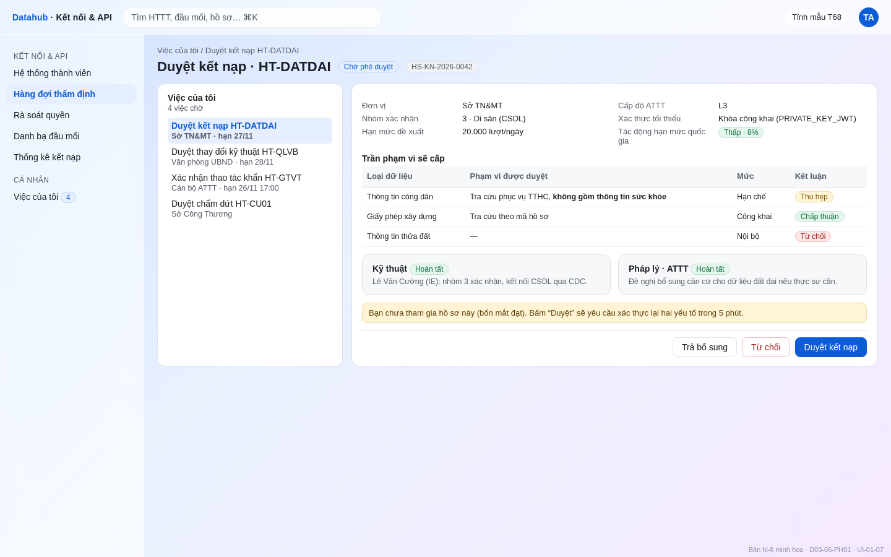

Ảnh cho thấy cột trái là hộp "Việc của tôi" (bốn loại việc của PH-01 cùng một khung), cột phải là tóm tắt hồ sơ chờ duyệt: bảng trần phạm vi với kết luận từng mục, ý kiến kỹ thuật và pháp lý, dải nhắc bốn mắt đạt và xác thực lại hai yếu tố. Ba nút ở chân: Trả bổ sung, Từ chối, Duyệt kết nạp.

### 13.1. Wireframe

Hình dưới là bố cục dạng chữ của UI-01-07, dùng để thống nhất vị trí các khối trước khi đọc bản hi-fi.

```text
┌ Duyệt kết nạp · HT-DATDAI [Chờ phê duyệt] [HS-KN-2026-0042] ───────────────────────────────┐
│ ┌ Việc của tôi (4) ───────┐ ┌ Tóm tắt hồ sơ ──────────────────────────────────────────────┐ │
│ │ ▌Duyệt kết nạp HT-DATDAI│ │ Đơn vị · Cấp độ ATTT · Nhóm xác nhận · Xác thực tối thiểu     │ │
│ │  Duyệt thay đổi …       │ │ Hạn mức đề xuất · Tác động hạn mức quốc gia [Thấp 8%]         │ │
│ │  Xác nhận khẩn …        │ │ ┌ Trần phạm vi sẽ cấp ─────────────────────────────────────┐ │ │
│ │  Duyệt chấm dứt …       │ │ │ Loại dữ liệu │ Phạm vi được duyệt │ Mức │ Kết luận          │ │ │
│ └─────────────────────────┘ │ └────────────────────────────────────────────────────────────┘ │ │
│                              │ [Kỹ thuật ✓ ý kiến] [Pháp lý, ATTT ✓ ý kiến]                   │ │
│                              │ ⚠ Bạn chưa tham gia hồ sơ này. Duyệt cần xác thực lại hai yếu tố │ │
│                              │                       [Trả bổ sung] [Từ chối] [Duyệt kết nạp]   │ │
└──────────────────────────────┴────────────────────────────────────────────────────────────────┘
```

### 13.2. Thành phần

Bảng dưới liệt kê các thành phần giao diện của UI-01-07 theo thứ tự từ trên xuống, kèm thành phần `CMP-*` dùng, quy tắc kiểm tra và nguồn dữ liệu.

| # | Thành phần | `CMP-*` | Nội dung, kiểm tra | Nguồn | Ghi chú |
|---|---|---|---|---|---|
| 1 | Hộp việc | Khung `CMP-AppShell` vùng "Việc của tôi", `CMP-DataTable` rút gọn | Việc chờ của người dùng từ mọi phân hệ, lọc loại `ph01.*` | PH-18 hộp việc (FR-00-070) | Chọn việc đổi `{id}` trên URL |
| 2 | Khối duyệt | `CMP-ApprovalPanel` | Tóm tắt, ý kiến, nút Duyệt, Từ chối, Trả bổ sung theo `allowedActions` | API-01-032, 033, 031 | Bốn mắt: nút ẩn nếu người xem là người lập, nộp, thẩm định |
| 3 | Tóm tắt hồ sơ | `CMP-DescriptionList` | Đơn vị, cấp độ ATTT, nhóm xác nhận, phương thức xác thực tối thiểu, hạn mức đề xuất, tác động hạn mức quốc gia | API-01-013, 024 | |
| 4 | Trần phạm vi | `CMP-DataTable` | Loại dữ liệu, phạm vi được duyệt, mức, kết luận (Chấp thuận, Thu hẹp, Từ chối) | API-01-013 | Mục Từ chối hiện mờ, không vào trần |
| 5 | Ý kiến các bước | `CMP-Card` ×2, `CMP-CommentThread` | Kỹ thuật, Pháp lý, ATTT: người, kết quả, ý kiến | `reviews[]` | Hiện tên người thẩm định cho TA |
| 6 | Hộp Từ chối | `CMP-ReasonDialog` | Lý do bắt buộc; xác thực lại hai yếu tố | API-01-033 | ERR-01-033, 035 |
| 7 | Hộp Duyệt | `CMP-ConfirmDialog` | Nhắc "Hệ thống sẽ cấp định danh SANDBOX và gửi liên kết bàn giao cho đầu mối"; xác thực lại hai yếu tố | API-01-032 | ERR-01-035, 017 |
| 8 | Khối duyệt thay đổi, chấm dứt, khẩn | `CMP-ApprovalPanel` + `CMP-DiffTable` | Bản so sánh giá trị cũ, mới của đề nghị thay đổi; tóm tắt tác động của chấm dứt; lý do và hạn xác nhận của thao tác khẩn | API-01-059, 055 | Người đề nghị không duyệt (ERR-01-017) |

: UI-01-07 · Thành phần

### 13.3. Nội dung theo loại việc

Bảng dưới trình bày nội dung theo loại việc.

| Loại việc | Tóm tắt hiển thị | Hành động | Ghi chú |
|---|---|---|---|
| `ph01.approve-onboarding` | Như §13.2 mục 3…5 | Duyệt, Từ chối, Trả bổ sung | Duyệt tạo trần phạm vi và khởi động saga (FR-01-018, 020) |
| `ph01.approve-change` | `CMP-DiffTable` giá trị cũ, mới; mức thay đổi (Kỹ thuật); người đề nghị; lý do | Duyệt, Từ chối | Đổi chủ quản chỉ hiện khi tổ chức mới đã xác nhận (BR-01-029) |
| `ph01.approve-terminate` | Phân tích tác động (mức, danh sách), lý do, căn cứ | Duyệt chấm dứt, Từ chối | Người đề nghị không duyệt; xác thực lại hai yếu tố |
| `ph01.confirm-emergency` | Chế độ (Tạm ngừng, Chấm dứt), lý do của SO, giờ thực hiện, hạn xác nhận, tác động | Xác nhận, Đảo ngược (chỉ với tạm ngừng, cần SO đồng ý) | Thao tác đã có hiệu lực; không tự hoàn tác khi quá hạn (BR-01-010) |

: UI-01-07 · Nội dung theo loại việc

### 13.4. Trạng thái màn

Bảng dưới nêu cách UI-01-07 hiển thị ở từng trạng thái (đang tải, rỗng, lỗi, không có quyền và các trạng thái riêng), theo bộ trạng thái chuẩn ST-nn của D03-06-00.

| Trạng thái | Hiển thị |
|---|---|
| Đang tải | Skeleton danh sách việc và khối tóm tắt (ST-01) |
| Rỗng | "Không có việc nào chờ anh/chị." (danh sách); chọn việc trống hiện hướng dẫn |
| Việc đã xử lý | Dải "Việc này đã được {tên} xử lý lúc {giờ}." và khối duyệt chỉ đọc (ERR-01-020) |
| Vi phạm bốn mắt | Nút Duyệt, Từ chối ẩn; dải thông tin "Anh/chị đã tham gia hồ sơ này nên không thực hiện được bước này. Nhờ người khác." |
| Lỗi nghiệp vụ | ST-12: ERR-01-005 (hồ sơ không còn chờ duyệt), 017, 018, 019, 035 |
| Không có quyền | ST-07 với người không có `PERM-01-approve` mở trực tiếp URL |
| Không tồn tại | ST-08 |

: UI-01-07 · Trạng thái màn

### 13.5. Thông báo, bàn phím, truy cập

Thông báo: ERR-01-017 (bốn mắt), ERR-01-033 (thiếu lý do khi Từ chối), ERR-01-035 (xác thực lại hai yếu tố, `CMP-ReasonDialog` bước 2), ERR-01-020 (việc đã đóng). Sau khi Duyệt thành công `CMP-Toast` "Đã duyệt kết nạp HT-DATDAI. Hệ thống đang cấp định danh thử." kèm nút "Xem định danh" tới UI-01-08. Phím tắt: `↑`, `↓` chọn việc; `Enter` mở việc; `A` Duyệt, `R` Từ chối khi nút bật (luôn qua hộp xác nhận, không thực hiện ngay). Danh sách việc là `listbox` với `aria-selected`; khối duyệt có tiêu đề cấp 2 để nhảy bằng trình đọc màn hình; hộp xác thực lại hai yếu tố trả focus về nút đã bấm khi đóng.

## 14. UI-01-08 Định danh ứng dụng

::: dac-ta
**Mục đích.** Cho đầu mối, quản trị tỉnh thấy định danh ứng dụng của HTTT theo môi trường (SANDBOX, PRODUCTION), tiến độ cấp định danh, và thực hiện đăng ký khóa công khai hoặc CSR, xoay vòng, thu hồi, tạo lại liên kết bàn giao. Màn **không bao giờ hiển thị bí mật**; bí mật chỉ ở UI-01-09.

**Người dùng, quyền.** TA, OR (tổ chức của mình); xem `PERM-01-read`; cấp lại, đăng ký khóa, xoay vòng, thu hồi, bật lại, tạo lại liên kết cần `PERM-01-credential` (SO có thêm xoay vòng, thu hồi khi khẩn nhờ `PERM-01-suspend`).

**FR, UC hiện thực.** FR-01-020, 021, 025, 026, 027, 028, 036; UC-01-13, 14, 18, 19, 25.

**Truy vết hệ cũ.** LGC-APIM-020 (Client ID của Application).

**Đường dẫn.** `/ket-noi/he-thong/{ma}/dinh-danh` (tab "Ứng dụng và thông tin xác thực" của UI-01-04).

**Mẫu.** PTN-02 (tab) kèm PTN-04 (hộp thoại, ngăn kéo).

**API.** API-01-035, 036, 037, 038, 041, 045, 046, 047, 048, 049, 050, 061.

**Phát hành, mức chi tiết.** MVP (bật lại định danh tự vô hiệu: Đợt 2); đầy đủ.
:::

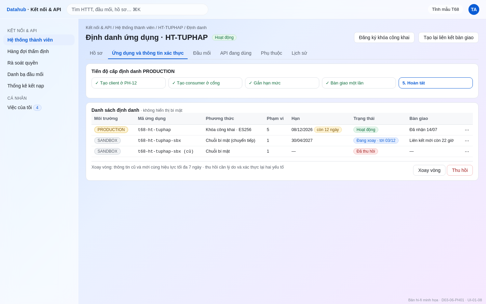

Ảnh cho thấy trên cùng là tiến độ cấp định danh PRODUCTION ở bước cuối; bên dưới bảng ba định danh: PRODUCTION sắp hết hạn (nhãn "còn 12 ngày"), SANDBOX đang xoay vòng (nhãn "Đang xoay · tới 03/12", liên kết bàn giao mới còn 22 giờ), SANDBOX cũ đã thu hồi. Không dòng nào có ô hiện hay sao chép bí mật.

### 14.1. Wireframe

Hình dưới là bố cục dạng chữ của UI-01-08, dùng để thống nhất vị trí các khối trước khi đọc bản hi-fi.

```text
┌ Định danh ứng dụng · HT-TUPHAP [Hoạt động]      [Đăng ký khóa công khai] [Tạo lại liên kết bàn giao] ┐
│ Hồ sơ │ ▌Ứng dụng và thông tin xác thực │ Đầu mối │ API đang dùng │ Phụ thuộc │ Lịch sử             │
│ ┌ Tiến độ cấp định danh PRODUCTION ─────────────────────────────────────────────────────────┐ │
│ │ ✓ Tạo client ở PH-12 ─ ✓ Tạo consumer ở cổng ─ ✓ Gắn hạn mức ─ ✓ Bàn giao ─ ● Hoàn tất    │ │
│ └───────────────────────────────────────────────────────────────────────────────────────────┘ │
│ ┌ Danh sách định danh (không hiển thị bí mật) ───────────────────────────────────────────────┐ │
│ │ Môi trường│ Mã ứng dụng │ Phương thức │ Phạm vi │ Hạn │ Trạng thái │ Bàn giao │ ⋯        │ │
│ │ PRODUCTION│ t68-ht-tuphap │ Khóa công khai ES256 │ 5 │ 08/12 (còn 12 ngày) │ Hoạt động │ Đã nhận │⋯│ │
│ │ SANDBOX   │ t68-ht-tuphap-sbx │ Chuỗi bí mật │ 1 │ 30/04/2027 │ Đang xoay · tới 03/12 │ còn 22 giờ│⋯│ │
│ └───────────────────────────────────────────────────────────────────────────────────────────┘ │
│                               [Xoay vòng] [Thu hồi]                                              │
└──────────────────────────────────────────────────────────────────────────────────────────────────┘
```

### 14.2. Thành phần

Bảng dưới liệt kê các thành phần giao diện của UI-01-08 theo thứ tự từ trên xuống, kèm thành phần `CMP-*` dùng, quy tắc kiểm tra và nguồn dữ liệu.

| # | Thành phần | `CMP-*` | Nội dung, kiểm tra | Nguồn | Ghi chú |
|---|---|---|---|---|---|
| 1 | Tiến độ saga | `CMP-Steps` | Tạo client (PH-12), tạo consumer (PH-03), gắn hạn mức, bàn giao, hoàn tất; bước lỗi hiện ERR-01-021 (tự thử lại), ERR-01-022 (xử lý thủ công) và nút "Thử lại" | API-01-036 | Hỏi lại mỗi 3 giây khi saga chưa xong |
| 2 | Bảng định danh | `CMP-DataTable`, `CMP-Tag`, `CMP-StatusTag`, `CMP-CodeText`, `CMP-Timestamp` | Cột §14.3 | API-01-049 | Sắp xếp: PRODUCTION trước SANDBOX, đang hoạt động trước đã thu hồi |
| 3 | Chi tiết định danh | `CMP-Drawer` | Môi trường, phương thức, mã ứng dụng, trạng thái, hạn, lần dùng cuối, dấu vân tay rút gọn, tuổi bí mật, phạm vi hiệu lực (từ PH-12), `secret_ref` rút gọn (chỉ TA, PA) | API-01-050 | Không có giá trị bí mật |
| 4 | Đăng ký khóa, CSR | `CMP-Upload`, `CMP-Tabs`, `CMP-CodeBlock` | Ba cách: tải tập khóa công khai JWKS, dán JWK, gửi CSR (PKCS#10); kiểm tra thuật toán và độ mạnh | API-01-037, 038 | ERR-01-027, 028; không nhận khóa riêng |
| 5 | Hộp xoay vòng | `CMP-ReasonDialog` | Lý do, thời gian chuyển tiếp (mặc định 7, tối đa 14 ngày; 0 chỉ khi xoay khẩn), xác thực lại hai yếu tố | API-01-045 | ERR-01-029, 030, 033, 035 |
| 6 | Kết thúc chuyển tiếp | `CMP-ConfirmDialog` | "Gỡ thông tin cũ khỏi cổng và dịch vụ định danh?" | API-01-046 | |
| 7 | Hộp thu hồi | `CMP-ReasonDialog`, `CMP-ConfirmDialog` | Lý do, xác thực lại; cảnh báo nếu là định danh PRODUCTION cuối của HTTT `ACTIVE`: đề nghị tạm ngừng | API-01-047 | ERR-01-033, 034, 035 |
| 8 | Tạo lại liên kết | `CMP-ConfirmDialog` | Khi bàn giao `EXPIRED`, bí mật chưa nhận; liên kết cũ vô hiệu | API-01-041 | ERR-01-048 khi HTTT đang tạm ngừng |
| 9 | Bật lại định danh | `CMP-ConfirmDialog` + lý do | Định danh bị tự vô hiệu do không dùng; không cấp bí mật mới | API-01-061 | Đợt 2 |
| 10 | Nhãn hạn | `CMP-StatusTag` | Cam từ 30 ngày, đỏ từ 7 ngày còn lại, "Hết hạn" khi `EXPIRED`; "Quá hạn bí mật" khi tuổi bí mật quá tham số | `expires_at`, `secretAgeDays` | Cả chữ và màu |

: UI-01-08 · Thành phần

### 14.3. Cột bảng

Bảng dưới mô tả từng cột của bảng chính ở UI-01-08: tên cột, nội dung hiển thị và ghi chú.

| Cột | Nội dung | Ghi chú |
|---|---|---|
| Môi trường | `CMP-Tag` SANDBOX hoặc PRODUCTION (viền đậm) | |
| Mã ứng dụng | `CMP-CodeText` (`clientId`) kèm sao chép mã | Mã không phải bí mật |
| Phương thức | Chuỗi bí mật, Khóa công khai ES256 hoặc PS256, Chứng thư (mTLS), Khóa API (chỉ dữ liệu mở) | |
| Phạm vi | Số scope hiệu lực | Liên kết mở danh sách trong ngăn kéo |
| Hạn | Ngày và "còn n ngày" | |
| Trạng thái | Hoạt động, Đang xoay · tới {ngày}, Đã thu hồi, Hết hạn, Vô hiệu do không dùng | |
| Bàn giao | Chờ nhận (hạn liên kết), Đã nhận {ngày}, Hết hạn, Đã hủy | Không hiện token liên kết |
| ⋯ | Chi tiết, Xoay vòng, Thu hồi, Tạo lại liên kết, Bật lại, Đăng ký khóa | Theo `allowedActions` của từng định danh |

: UI-01-08 · Cột bảng

### 14.4. Trạng thái màn

Bảng dưới nêu cách UI-01-08 hiển thị ở từng trạng thái (đang tải, rỗng, lỗi, không có quyền và các trạng thái riêng), theo bộ trạng thái chuẩn ST-nn của D03-06-00.

| Trạng thái | Hiển thị |
|---|---|
| Đang tải | Skeleton khối tiến độ và 3 dòng bảng (ST-01) |
| Rỗng | HTTT chưa được duyệt: "Chưa có định danh. Định danh được cấp sau khi hồ sơ kết nạp được duyệt." |
| Đang cấp | Khối tiến độ, các nút ghi vô hiệu; `CMP-Alert` thông tin "Đang cấp định danh. Thường mất vài phút." |
| Chờ đăng ký khóa | `provisionStage = AWAITING_KEY`: `CMP-Alert` cảnh báo "Định danh đã tạo, chờ đầu mối đăng ký khóa công khai hoặc CSR." kèm nút "Đăng ký khóa công khai" |
| Cấp lỗi | `PROVISION_FAILED`: `CMP-Alert` lỗi, ERR-01-021 hoặc 022, nút "Thử lại" (API-01-035) |
| Dịch vụ phụ thuộc lỗi | ERR-01-021, 023 hiện trong khối tiến độ; trạng thái đã đặt không đổi; không tiêu hao liên kết bàn giao |
| Đang xoay | Dòng "Đang xoay" kèm hạn; nút "Xoay vòng" vô hiệu với lý do ERR-01-029; nút "Kết thúc chuyển tiếp" bật |
| Không có quyền | Vai trò chỉ xem thấy bảng, nút ghi ẩn (ST-15); người ngoài phạm vi ST-08 |

: UI-01-08 · Trạng thái màn

### 14.5. Thông báo, bàn phím, truy cập

Thông báo: ERR-01-021, 022, 023 (khối tiến độ), ERR-01-027, 028 (dưới ô tải khóa, CSR), ERR-01-029, 030, 033, 034, 035 (các hộp), ERR-01-048 (tạo lại liên kết). Sau xoay vòng thành công: `CMP-Toast` "Đã bắt đầu xoay vòng. Liên kết bàn giao đã gửi tới {đầu mối}." Nếu người xoay vòng chính là đầu mối kỹ thuật của HTTT, hộp xoay vòng hiển thị thêm nút "Nhận thông tin mới ngay", mở UI-01-09 trong tab mới (Q01-34). Phím tắt: `↑`, `↓` chọn dòng; `Enter` mở chi tiết; `R` xoay vòng; `Del` mở hộp thu hồi (luôn qua hộp xác nhận). Bảng định danh có `caption`; nhãn hạn có chữ; các hộp xoay vòng, thu hồi bẫy focus, `Esc` đóng và trả focus; ô tải khóa có nút "Chọn tệp" thay thế kéo thả.

## 15. UI-01-09 Bàn giao thông tin xác thực

::: dac-ta
**Mục đích.** Cho đúng đầu mối kỹ thuật của HTTT nhận một lần bí mật của định danh vừa cấp hoặc vừa xoay vòng, kèm thông tin kết nối (mã ứng dụng, điểm cuối lấy token, địa chỉ API, phạm vi, hạn mức), sao chép hoặc tải về ngay. Màn duy nhất của Datahub hiển thị một bí mật.

**Người dùng, quyền.** Người nhận liên kết: tài khoản đầu mối kỹ thuật đã đăng nhập, xác thực hai yếu tố mới; không cần quyền `PERM-01-*`.

**FR, UC hiện thực.** FR-01-022, 025; UC-01-15, 18.

**Truy vết hệ cũ.** SRS cũ UI-01-07 (bàn giao), FR-01-009.

**Đường dẫn.** `/ket-noi/ban-giao/{token}`; không có khung ứng dụng.

**Mẫu.** Trang riêng (khung tối giản), chế độ `issue` của `CMP-SecretField`.

**API.** API-01-040 (mở liên kết), API-01-041 (tạo lại, từ UI-01-08).

**Phát hành, mức chi tiết.** MVP; đầy đủ.
:::

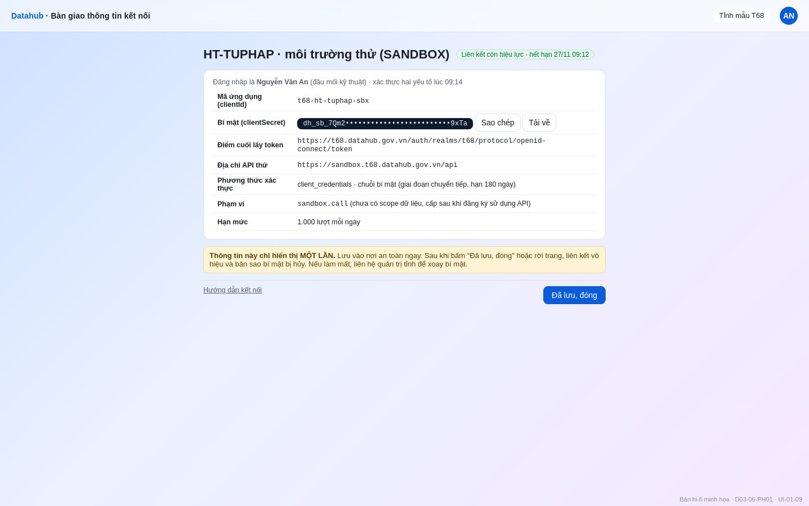

Bí mật nằm trong khung tối riêng kèm nút Sao chép và Tải về (trên ảnh minh họa phần giữa được che); cảnh báo cam nhắc "chỉ hiển thị MỘT LẦN"; sau khi bấm "Đã lưu, đóng" hoặc rời trang, liên kết vô hiệu và bản sao bí mật bị hủy. Trang yêu cầu đăng nhập đúng tài khoản đầu mối với xác thực hai yếu tố mới, nên liên kết rơi vào tay người khác cũng vô dụng.

### 15.1. Luồng trang và wireframe

Sơ đồ dưới mô tả luồng trang và wireframe.

```{.mermaid caption="Các trạng thái của trang bàn giao"}
stateDiagram-v2
  [*] --> MoLienKet : mở liên kết trong thư
  MoLienKet --> DangNhap : chưa có phiên hợp lệ
  DangNhap --> XacThuc2YeuTo : đăng nhập Keycloak
  XacThuc2YeuTo --> KiemTraDoiTuong : hai yếu tố mới đạt
  KiemTraDoiTuong --> HienBiMat : đúng đầu mối
  KiemTraDoiTuong --> LoiKhongPhaiDauMoi : sai tài khoản
  HienBiMat --> DaHuy : bấm Đã lưu hoặc rời trang
  DaHuy --> [*]
```

Sơ đồ thuyết minh: trang không có trạng thái "xem lại"; sau `HienBiMat` mọi đường đều tới `DaHuy`. Sai tài khoản không tiêu hao liên kết nhưng tăng bộ đếm thử sai và báo SO (ERR-01-025), quá số lần thì khóa (ERR-01-026).

```text
┌ Datahub · Bàn giao thông tin kết nối ─────────────────────── Tỉnh mẫu T68 · [AN] ┐
│                 HT-TUPHAP · môi trường thử (SANDBOX)   [Liên kết còn hiệu lực · hết hạn 27/11 09:12] │
│ Đăng nhập là Nguyễn Văn An (đầu mối kỹ thuật) · xác thực hai yếu tố lúc 09:14                        │
│ ┌──────────────────────────────────────────────────────────────────────────────────┐ │
│ │ Mã ứng dụng (clientId)    t68-ht-tuphap-sbx                                  [Sao chép] │ │
│ │ Bí mật (clientSecret)     ┃dh_sb_7Qm2•••••••••••••••••••••9xTa┃  [Sao chép] [Tải về]  │ │
│ │ Điểm cuối lấy token       https://t68.datahub.gov.vn/auth/realms/t68/…/token   [Sao chép] │ │
│ │ Địa chỉ API thử           https://sandbox.t68.datahub.gov.vn/api               [Sao chép] │ │
│ │ Phương thức · Phạm vi · Hạn mức                                                  │ │
│ └──────────────────────────────────────────────────────────────────────────────────┘ │
│ ⚠ Thông tin này chỉ hiển thị MỘT LẦN. Lưu vào nơi an toàn ngay. …                              │
│ Hướng dẫn kết nối                                                    [Đã lưu, đóng]          │
└─────────────────────────────────────────────────────────────────────────────────────┘
```

### 15.2. Thành phần

Bảng dưới liệt kê các thành phần giao diện của UI-01-09 theo thứ tự từ trên xuống, kèm thành phần `CMP-*` dùng, quy tắc kiểm tra và nguồn dữ liệu.

| # | Thành phần | `CMP-*` | Nội dung, kiểm tra | Nguồn | Ghi chú |
|---|---|---|---|---|---|
| 1 | Khung tối giản | `CMP-AppShell` biến thể `bare` (D03-05-04 §12.1) | Logo, tên tenant, tài khoản đang đăng nhập; không menu | — | Tiêu đề tab không có mã HTTT |
| 2 | Tiêu đề | `CMP-Heading`, `CMP-StatusTag` | "{mã HTTT} · môi trường thử (SANDBOX)" hoặc "thật (PRODUCTION)"; hạn liên kết | API-01-040 | `Cache-Control: no-store` |
| 3 | Thông tin tài khoản | `CMP-Text` | "Đăng nhập là {tên} ({vai trò đầu mối}) · xác thực hai yếu tố lúc {giờ}" | Phiên Keycloak | |
| 4 | Khối thông tin kết nối | `CMP-DescriptionList`, `CMP-CodeText`, `CMP-CopyButton` | Mã ứng dụng, điểm cuối lấy token, địa chỉ API, phương thức, phạm vi, hạn mức; mỗi giá trị có nút sao chép | Thân phản hồi | |
| 5 | Bí mật | `CMP-SecretField` chế độ `issue`, `CMP-CopyButton` biến thể có nhãn và `sensitive`, `CMP-Button` "Tải về" | Hiện đầy đủ bằng `font-mono` trên nền `color-surface-solid-2`; sao chép xong nút đổi "Đã sao chép" 3 giây, xóa khỏi bộ nhớ đệm bảng tạm sau 60 giây nếu trình duyệt cho phép | Thân phản hồi | Không có ô nhập; chặn in (`@media print`) |
| 6 | Cảnh báo một lần | `CMP-Alert` mức cảnh báo | "Thông tin này chỉ hiển thị MỘT LẦN. Lưu vào nơi an toàn ngay. Sau khi bấm "Đã lưu, đóng" hoặc rời trang, liên kết vô hiệu và bản sao bí mật bị hủy. Nếu làm mất, liên hệ quản trị tỉnh để xoay bí mật." | — | `role="alert"`, luôn trên bí mật trong thứ tự đọc |
| 7 | Hộp xác nhận đóng | `CMP-ConfirmDialog` | Khi chưa sao chép hoặc tải về mà bấm đóng: "Chưa lưu bí mật. Đóng ngay sẽ không xem lại được. Vẫn đóng?" | — | Mặc định focus "Ở lại" |
| 8 | Kết quả lỗi | `CMP-ResultPage` | Câu theo mã lỗi §15.4 | Thân lỗi | Không lộ lý do cụ thể ngoài câu chuẩn |
| 9 | Hướng dẫn | `CMP-Link` | "Hướng dẫn kết nối" mở tài liệu cổng nhà phát triển | — | |

: UI-01-09 · Thành phần

### 15.3. Bản đồ dữ liệu hiển thị

Bảng dưới trình bày bản đồ dữ liệu hiển thị.

| Nhãn | Trường API-01-040 | Nhạy cảm | Ghi chú |
|---|---|---|---|
| Mã ứng dụng (clientId) | `clientId` | Không | Có thể sao chép nhiều lần trong lúc trang mở |
| Bí mật (clientSecret) | `clientSecret` | **Có** | Một lần; không vào nhật ký, vết, bộ nhớ đệm (SEC-32) |
| Điểm cuối lấy token | `tokenEndpoint` | Không | |
| Địa chỉ API thử, thật | `apiBaseUrl` | Không | |
| Phương thức xác thực | `authMethod` | Không | Chuỗi bí mật hiện nhãn "giai đoạn chuyển tiếp, hạn 180 ngày" |
| Phạm vi | `scopes[]` | Không | Định danh mới có scope môi trường thử, chưa có scope dữ liệu (BR-01-003) |
| Hạn mức | `quota` | Không | "1.000 lượt mỗi ngày" (SANDBOX) |

: UI-01-09 · Bản đồ dữ liệu hiển thị

### 15.4. Trạng thái màn

Bảng dưới nêu cách UI-01-09 hiển thị ở từng trạng thái (đang tải, rỗng, lỗi, không có quyền và các trạng thái riêng), theo bộ trạng thái chuẩn ST-nn của D03-06-00.

| Trạng thái | Hiển thị |
|---|---|
| Đang xác thực | Trang chuyển Keycloak, không nháy nội dung; sau khi quay lại hiện skeleton khối thông tin 1 giây (ST-01) |
| Hiển thị | Như ảnh hi-fi |
| Đã sao chép | Nút đổi nhãn "Đã sao chép ✓" 3 giây, vùng `aria-live` đọc "Đã sao chép bí mật" |
| Liên kết đã dùng, hết hạn, đã hủy | ERR-01-024: "Liên kết bàn giao đã được sử dụng hoặc hết hạn. Nếu chưa nhận được thông tin, liên hệ quản trị tỉnh để xoay bí mật và nhận liên kết mới." (mọi nguyên nhân dùng chung một câu, không dò) |
| Sai tài khoản | ERR-01-025: "Tài khoản này không phải đầu mối nhận bàn giao. Sự việc đã được ghi nhận." kèm nút "Đăng nhập tài khoản khác" |
| Bị khóa do thử sai | ERR-01-026: "Liên kết đã bị khóa do thử sai nhiều lần. Liên hệ quản trị tỉnh." |
| Kho bí mật lỗi | ERR-01-023: "Kho bí mật tạm thời không khả dụng. Mở lại liên kết sau ít phút." (liên kết chưa bị tiêu hao) |
| Chưa xác thực hai yếu tố mới | ERR-01-035: chuyển Keycloak yêu cầu hai yếu tố, không hiện lỗi thô |
| Mất kết nối | ST-06; bí mật đã hiển thị vẫn giữ trên trang, không gọi lại |
| Làm mới trang sau khi mở | Nhận ERR-01-024; trang không giữ bí mật trong bộ nhớ qua làm mới |

: UI-01-09 · Trạng thái màn

### 15.5. Hành vi một lần

Các ý dưới đây trình bày hành vi một lần.

1. Giao diện gọi API-01-040 một lần khi tải trang (sau xác thực). Thân phản hồi lưu trong biến cục bộ của thành phần, không vào kho trạng thái chung, không vào bộ nhớ đệm truy vấn (TanStack Query đặt `gcTime: 0`, không `persist`).
2. Nút "Đã lưu, đóng" xóa biến, chuyển về trang xác nhận "Thông tin đã được hủy trên máy chủ. Có thể đóng tab này." Không có nút "Quay lại xem".
3. Sự kiện `pagehide`, `visibilitychange` quá 15 phút ẩn, hoặc phiên hết hạn đều xóa biến và thay nội dung bằng ERR-01-024. Máy chủ đã hủy bản sao ngay sau lần mở (BR-01-006) nên làm mới trang cũng không lấy lại được.
4. Sao chép dùng Clipboard API và chỉ thực hiện theo thao tác người dùng; tải về tạo tệp `.txt` bằng Blob cục bộ, không qua máy chủ; tên tệp `{clientId}-secret.txt`.
5. Khối bí mật chặn in và chọn nhiều vùng; không dùng `autocomplete`; không chèn vào tiêu đề tab, URL, `localStorage`, `sessionStorage`.

### 15.6. Phím tắt và truy cập

`Tab` đi qua các nút Sao chép theo thứ tự trên xuống; `Enter` hoặc `Space` sao chép; `Ctrl+Shift+C` không bị đè. Trang là `main` có tiêu đề cấp 1; cảnh báo một lần `role="alert"` đọc trước bí mật; bí mật là văn bản thật (không ảnh), nhãn "Bí mật (clientSecret)" liên kết bằng `aria-labelledby`, trình đọc màn hình đọc từng ký tự theo chế độ `spell-out` nếu người dùng yêu cầu. Cỡ chữ `font-body`, vùng chạm ≥ 44 × 44 px (WCAG 2.5.8 mức nâng cao), tương phản chữ trên nền tối `color-text-on-inverse` đạt 7:1. Không dùng màu duy nhất để báo hạn: nhãn "hết hạn 27/11 09:12" có chữ và biểu tượng đồng hồ.

## 16. UI-01-10 Kiểm thử SANDBOX và kích hoạt

::: dac-ta
**Mục đích.** Cho đơn vị và quản trị tỉnh cùng thấy HTTT đã gọi được Datahub ở môi trường thử chưa, nếu chưa thì sửa gì, và cho quản trị tỉnh kích hoạt môi trường thật sau khi đủ điều kiện. Thay màn kiểm thử kết nối của hệ cũ.

**Người dùng, quyền.** OR, TA, IE, SO xem (`PERM-01-read`); "Kích hoạt môi trường thật" cần `PERM-01-approve`, không phải người nộp hồ sơ (BR-01-017).

**FR, UC hiện thực.** FR-01-023, 024; UC-01-16, 17.

**Truy vết hệ cũ.** SRS cũ FR-01-010 (kiểm thử kết nối trước khi kích hoạt).

**Đường dẫn.** `/ket-noi/he-thong/{ma}/kiem-thu`.

**Mẫu.** PTN-02 (Chi tiết).

**API.** API-01-042, 043, 044.

**Phát hành, mức chi tiết.** MVP; đầy đủ.
:::

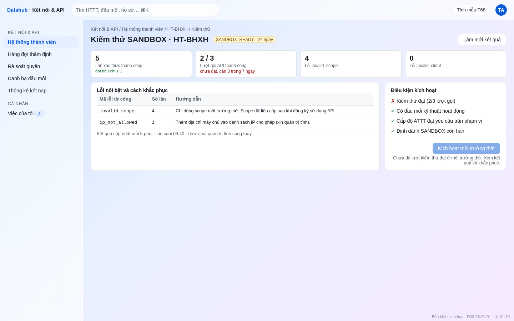

Ảnh là HTTT đã có 5 lần xác thực thành công nhưng mới 2 trên 3 lượt gọi API đạt; bảng lỗi liệt kê mã lỗi nổi bật từ cổng kèm hướng dẫn khắc phục tiếng Việt; khối điều kiện kích hoạt dùng ✓ và ✗; nút "Kích hoạt môi trường thật" mờ kèm lý do ngay bên dưới.

### 16.1. Thành phần

Bảng dưới liệt kê các thành phần giao diện của UI-01-10 theo thứ tự từ trên xuống, kèm thành phần `CMP-*` dùng, quy tắc kiểm tra và nguồn dữ liệu.

| # | Thành phần | `CMP-*` | Nội dung, kiểm tra | Nguồn | Ghi chú |
|---|---|---|---|---|---|
| 1 | Tiêu đề | `CMP-PageHeader`, `CMP-StatusTag`, `CMP-Duration` | "Kiểm thử SANDBOX · {mã}", giai đoạn, số ngày ở SANDBOX | API-01-043 | Quá `sandbox.maxDays` hiện cảnh báo |
| 2 | Thẻ kết quả | `CMP-KpiCard` ×4 | Lần xác thực thành công; lượt gọi API thành công so với cần (n / m); lỗi `invalid_scope`; lỗi `invalid_client` | `authOk`, `callCount`, `required`, `errors[]` | Thẻ chưa đạt có chữ "chưa đạt, cần m trong 7 ngày" |
| 3 | Bảng lỗi | `CMP-DataTable`, `CMP-CodeText` | Mã lỗi từ cổng, số lần, hướng dẫn khắc phục (sáu mã ở bảng của FR-01-023) | `errors[]` | Có nút "Sao chép để gửi đơn vị" |
| 4 | Điều kiện kích hoạt | `CMP-DescriptionList` (danh sách có ✓, ✗) | Kiểm thử đạt; có đầu mối kỹ thuật hoạt động; cấp độ ATTT đạt yêu cầu theo trần phạm vi; định danh SANDBOX còn hạn | `readyToActivate`, điều kiện | Mỗi điều kiện ✗ có liên kết tới nơi sửa |
| 5 | Nút làm mới | `CMP-Button` | "Làm mới kết quả" gọi API-01-042; khoảng cách 30 giây giữa hai lần | API-01-042 | `Idempotency-Key` |
| 6 | Nút kích hoạt | `CMP-Button` primary, `CMP-ConfirmDialog` | Hộp xác nhận nêu điều kiện, nhập ghi chú (tùy chọn), xác thực lại hai yếu tố | API-01-044 | ERR-01-017, 031, 032, 035 |
| 7 | Cảnh báo nghi lộ bí mật | `CMP-Alert` lỗi | Khi từ 20 lượt `invalid_client` trong 1 giờ: "Nghi bí mật bị lộ hoặc cấu hình sai. Xoay bí mật và báo Cán bộ ATTT." kèm nút "Xoay bí mật" | `errors[]` | SO được báo tự động |
| 8 | Kết quả kích hoạt | `CMP-Alert` thành công, `CMP-Link` | "Đã kích hoạt môi trường thật lúc {giờ}. Định danh PRODUCTION đã cấp." liên kết sang tab Định danh | API-01-044 | `200`; hoặc `202` khi saga chạy nền, hiển thị "Đang cấp định danh môi trường thật. Theo dõi tiến độ ở tab Ứng dụng và thông tin xác thực." và theo dõi bằng `progressUrl` (API-01-036) |

: UI-01-10 · Thành phần

### 16.2. Hành vi

Kết quả tự làm mới mỗi 60 giây khi tab đang mở và nút "Làm mới kết quả" cập nhật ngay (dữ liệu từ PH-13 thu thập mỗi 5 phút, nên hiển thị "cập nhật lúc {giờ}"). Khi `readyToActivate` chuyển sang đúng, `CMP-Toast` "HTTT {mã} đã kiểm thử đạt, chờ kích hoạt." và nút kích hoạt sáng. Nút kích hoạt vô hiệu khi một điều kiện chưa đạt với tooltip lấy từ `disabledReasons` (ERR-01-031 hoặc 032); người nộp hồ sơ không thấy nút (ERR-01-017). Với HTTT chỉ có vai trò `PROVIDER`, màn nêu "HTTT chỉ cung cấp API; vẫn kích hoạt để công bố, chưa có scope dữ liệu." (luồng thay thế FR-01-024).

### 16.3. Trạng thái màn

Bảng dưới nêu cách UI-01-10 hiển thị ở từng trạng thái (đang tải, rỗng, lỗi, không có quyền và các trạng thái riêng), theo bộ trạng thái chuẩn ST-nn của D03-06-00.

| Trạng thái | Hiển thị |
|---|---|
| Đang tải | Skeleton bốn thẻ và bảng (ST-01) |
| Chưa có lượt gọi nào | `CMP-EmptyState` "Chưa có lượt gọi nào ở môi trường thử. Dùng thông tin đã nhận ở bàn giao để gọi điểm cuối thử." kèm liên kết hướng dẫn |
| Chưa đạt | Như ảnh hi-fi |
| Đạt, chờ kích hoạt | Thẻ xanh có chữ "Đạt"; nút kích hoạt bật với TA không phải người nộp |
| Thiếu dữ liệu nhật ký | ERR-01-046 trong khối: "Chưa lấy được kết quả kiểm thử. Thử làm mới sau." |
| Đã kích hoạt | Khối kết quả §16.1 mục 8; nút làm mới ẩn |
| Quá hạn SANDBOX | `CMP-Alert` cảnh báo "Đã ở môi trường thử {n} ngày. Liên hệ đơn vị hoặc đề nghị chấm dứt." kèm liên kết UI-01-11 |
| Không có quyền | ST-07, người tổ chức khác ST-08 |

: UI-01-10 · Trạng thái màn

### 16.4. Thông báo, bàn phím, truy cập

Thông báo: ERR-01-031, 032 (hộp kích hoạt), ERR-01-017 (người nộp), ERR-01-035 (xác thực lại), ERR-01-021, 046 (phụ thuộc). Phím tắt: `L` làm mới kết quả, `K` mở hộp kích hoạt khi nút bật. Điều kiện ✓ và ✗ kèm chữ "Đạt", "Chưa đạt" đọc được; thẻ kết quả có `aria-label` đầy đủ ("Lượt gọi API thành công: 2 trên 3, chưa đạt"); bảng lỗi có nút sao chép với `aria-live` báo "Đã sao chép hướng dẫn".

## 17. UI-01-11 Vòng đời và xử lý khẩn

::: dac-ta
**Mục đích.** Gom các hộp thoại và ngăn kéo thao tác nhạy cảm của vòng đời HTTT vào một nơi để cùng một cách làm: xem phân tích tác động, nhập lý do, xác thực lại hai yếu tố. Gồm Tạm ngừng, Khôi phục, Chấm dứt (đề nghị), Xử lý khẩn của Cán bộ ATTT, Xác nhận bổ sung thao tác khẩn, và hộp Thu hồi định danh dùng chung với UI-01-08.

**Người dùng, quyền.** TA, SO; `PERM-01-suspend` cho tạm ngừng, khôi phục, chấm dứt, thu hồi khẩn; `PERM-01-approve` để xác nhận bổ sung thao tác khẩn (TA, không phải SO đã thực hiện).

**FR, UC hiện thực.** FR-01-026, 029, 030, 031, 032, 033; UC-01-19, 20, 21, 22.

**Truy vết hệ cũ.** SRS cũ FR-01-011 (tạm ngừng, khôi phục), FR-01-012 (thu hồi kết nạp).

**Đường dẫn.** `/ket-noi/he-thong/{ma}/vong-doi?hanh-dong={…}`; mở từ UI-01-04, UI-01-08, UI-01-12.

**Mẫu.** PTN-04 (Biểu mẫu nhanh): ngăn kéo cho thao tác có danh sách tác động, hộp thoại cho thao tác ngắn.

**API.** API-01-047, 051, 052, 053, 054, 055, 056, 059.

**Phát hành, mức chi tiết.** MVP; đầy đủ.
:::

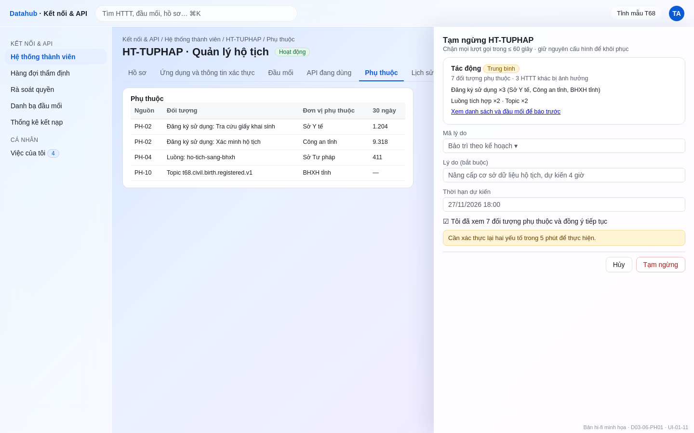

Ảnh là ngăn kéo "Tạm ngừng HT-TUPHAP" mở trên tab Phụ thuộc: khối tác động mức Trung bình với 7 đối tượng phụ thuộc và liên kết xem danh sách kèm đầu mối để báo trước; bên dưới mã lý do, lý do bắt buộc, thời hạn dự kiến, ô "Tôi đã xem… và đồng ý tiếp tục", nhắc xác thực lại hai yếu tố, nút "Tạm ngừng" màu cảnh báo.

### 17.1. Bảy hành động và hình thức hiển thị

Bảng dưới trình bày bảy hành động và hình thức hiển thị.

| Hành động (`hanh-dong`) | Hình thức | Điều kiện | Nội dung chính | API |
|---|---|---|---|---|
| `tam-ngung` | Ngăn kéo `size-drawer-md` | HTTT `ACTIVE`, `PERM-01-suspend` | Tác động, mã lý do, lý do, thời hạn dự kiến, xác nhận tác động, xác thực lại | API-01-056 rồi 051 |
| `khoi-phuc` | Hộp thoại `size-modal-sm` | HTTT `SUSPENDED`, `PERM-01-suspend` | Danh sách điều kiện khôi phục (căn cứ còn hiệu lực, cấp độ ATTT, đầu mối), lý do, xác thực lại; HTTT bị SO tạm ngừng khẩn: nêu cần đồng ý của SO | API-01-052 |
| `cham-dut` | Ngăn kéo `size-drawer-md` | HTTT `ACTIVE`, `SUSPENDED`, `APPROVED`, `PERM-01-suspend` | Tác động, lý do, căn cứ, xác nhận tác động, xác thực lại; kết quả là **đề nghị** chờ TA khác duyệt ở UI-01-07 | API-01-053 |
| `khan` | Ngăn kéo `size-drawer-md` | SO, `PERM-01-suspend` | Chế độ Tạm ngừng hoặc Chấm dứt, lý do, cảnh báo "Có hiệu lực ngay, không chờ duyệt, không chờ giao dịch đang xử lý", xác thực lại | API-01-054 |
| `xac-nhan-khan` | Hộp thoại | TA khác SO, `PERM-01-approve`, thao tác `PENDING_CONFIRM` | Lý do của SO, tác động, Xác nhận hoặc Đảo ngược (chỉ tạm ngừng) | API-01-055 |
| `thu-hoi-dinh-danh` | Hộp thoại `size-modal-sm` | Định danh còn hiệu lực; `PERM-01-credential` hoặc `PERM-01-suspend` | Lý do, cảnh báo nếu là định danh PRODUCTION cuối, xác thực lại | API-01-047 |
| `duyet-cham-dut` | Hộp ở UI-01-07 | TA khác người đề nghị | Xem chương 13 | API-01-059 |

: UI-01-11 · Bảy hành động và hình thức hiển thị

### 17.2. Thành phần

Bảng dưới liệt kê các thành phần giao diện của UI-01-11 theo thứ tự từ trên xuống, kèm thành phần `CMP-*` dùng, quy tắc kiểm tra và nguồn dữ liệu.

| # | Thành phần | `CMP-*` | Nội dung, kiểm tra | Nguồn | Ghi chú |
|---|---|---|---|---|---|
| 1 | Khối tác động | `CMP-Card`, `CMP-StatusTag`, `CMP-DataTable`, `CMP-DependencyGraph` | Mức (Không, Thấp, Trung bình, Cao); số đối tượng phụ thuộc; danh sách theo nguồn (PH-02, 04, 05, 10) kèm đơn vị và đầu mối để báo trước | API-01-056 | HTTT thiết yếu (`CRITICAL`) hoặc ≥ 5 HTTT phụ thuộc là mức Cao |
| 2 | Mã lý do | `CMP-Select` | Bảo trì theo kế hoạch, Nghi lộ bí mật, Vi phạm chính sách, Yêu cầu của đơn vị, Khác | `reasonCode` | Mã danh mục do PH-07 hoặc cấu hình, giả định danh sách này |
| 3 | Lý do | `CMP-TextArea` | Bắt buộc, 10…1.000 ký tự | `reason` | ERR-01-033 |
| 4 | Thời hạn dự kiến | `CMP-DatePicker` | Tùy chọn khi tạm ngừng; không ở quá khứ | `expectedUntil` | |
| 5 | Xác nhận tác động | `CMP-Checkbox` | "Tôi đã xem {n} đối tượng phụ thuộc và đồng ý tiếp tục"; bắt buộc khi mức ≥ Trung bình hoặc HTTT thiết yếu | `confirmImpact` | ERR-01-034 |
| 6 | Xác thực lại | `CMP-ReasonDialog` bước 2, liên kết Keycloak | Mở khi bấm gửi nếu chưa xác thực trong `mfa.stepUpMinutes` | Phiên Keycloak | ERR-01-035 |
| 7 | Tiến độ cắt quyền | `CMP-JobProgress` | Sau khi gửi: "Đang chặn ở cổng (≤ 60 giây)… → Đã vô hiệu client… → Hoàn tất"; `enforcement` PENDING, DONE | API-01-002 `enforcement` | Đóng ngăn kéo vẫn chạy, báo ở khay tác vụ |
| 8 | Nút gửi | `CMP-Button` màu cảnh báo hoặc lỗi | "Tạm ngừng", "Khôi phục", "Gửi đề nghị chấm dứt", "Thực hiện ngay" | | Vô hiệu cho tới khi đủ điều kiện, nêu lý do |

: UI-01-11 · Thành phần

### 17.3. Hành vi theo từng hành động

Các ý dưới đây trình bày hành vi theo từng hành động.

1. **Tạm ngừng.** Mở ngăn kéo gọi API-01-056; trong lúc chờ hiện skeleton khối tác động. Gửi thành công: `CMP-Toast` "Đã tạm ngừng HT-TUPHAP. Đang chặn lượt gọi ở cổng." và tiến độ cắt quyền; hiệu lực ở cổng không quá 60 giây (BR-01-023). Thông báo gửi đơn vị chủ quản kèm lý do.
2. **Khôi phục.** Điều kiện liệt kê bằng ✓ và ✗; thiếu điều kiện: ERR-01-032. HTTT bị SO tạm ngừng vì nghi lộ bí mật và chưa có đồng ý của SO: nút vô hiệu kèm ERR-01-036; SO thấy ô "Đồng ý khôi phục" ngay trong hộp để ghi nhận đồng ý.
3. **Chấm dứt.** Không có hiệu lực ngay: gửi tạo đề nghị `TERMINATE`, hiện "Đã gửi đề nghị chấm dứt, chờ quản trị tỉnh khác duyệt." và liên kết sang UI-01-02 tab Lịch sử. Khi được duyệt, hệ thống chờ `terminate.drainMinutes` rồi cắt (FR-01-031).
4. **Xử lý khẩn.** Có hiệu lực ngay; sau khi gửi hiện khối "Chờ Quản trị tỉnh xác nhận trong {hạn}" ở UI-01-04. TA xác nhận bổ sung hoặc đảo ngược; quá hạn xác nhận chuyển nhãn "Quá hạn xác nhận" nhưng thao tác không tự hoàn tác (BR-01-010).
5. **Thu hồi định danh.** Nêu hệ quả "HTTT sẽ không gọi được bằng định danh này ngay"; định danh PRODUCTION cuối của HTTT `ACTIVE` nêu thêm "HTTT sẽ không còn định danh dùng được" và đề nghị Tạm ngừng; vẫn tiếp tục được khi tick `confirmImpact`.

### 17.4. Trạng thái màn

Bảng dưới nêu cách UI-01-11 hiển thị ở từng trạng thái (đang tải, rỗng, lỗi, không có quyền và các trạng thái riêng), theo bộ trạng thái chuẩn ST-nn của D03-06-00.

| Trạng thái | Hiển thị |
|---|---|
| Đang tải tác động | Skeleton khối tác động (ST-01); nút gửi vô hiệu |
| Không có phụ thuộc | Khối tác động "Không có đối tượng nào phụ thuộc." mức Không; không cần tick xác nhận |
| Lỗi nghiệp vụ | ST-12 đầu ngăn kéo: ERR-01-005 (trạng thái không hợp lệ), 017, 032, 033, 034, 035, 036, 048, 054 |
| Xung đột | Thao tác khẩn đã được xử lý bởi người khác: ERR-01-036, tải lại |
| Dịch vụ phụ thuộc lỗi | ERR-01-046 trong khối tác động: danh sách chưa đủ; cho phép tiếp tục với cảnh báo "Chưa lấy được đủ phụ thuộc từ {PH}" và bắt buộc tick xác nhận |
| Không có quyền | Hành động không hiện; mở trực tiếp URL ST-07 |
| Đang cắt quyền | Khối tiến độ, đóng ngăn kéo cho phép |

: UI-01-11 · Trạng thái màn

### 17.5. Thông báo, bàn phím, truy cập

Thông báo theo §5.2: ERR-01-033, 034, 035, 036, 048. Phím tắt: `Esc` đóng (hỏi nếu đã nhập lý do); `Ctrl+Enter` gửi khi đủ điều kiện, luôn qua bước xác nhận cuối; không có phím tắt chữ đơn trong ngăn kéo để tránh gửi nhầm. Ngăn kéo `role="dialog"` có `aria-labelledby` là tiêu đề; nút nguy hiểm (màu cảnh báo, lỗi) không là nút mặc định, focus đầu vào "Hủy" hoặc trường lý do; khối tác động có tóm tắt đọc được "Tác động trung bình, 7 đối tượng phụ thuộc, 3 HTTT khác bị ảnh hưởng".

## 18. UI-01-12 Rà soát quyền định kỳ

::: dac-ta
**Mục đích.** Cho quản trị tỉnh và Cán bộ ATTT mở kỳ rà soát, xem mức sử dụng thực tế của từng phạm vi, gửi phiếu xác nhận cho đơn vị chủ quản, xử lý hàng loạt (giữ, thu hẹp, thu hồi phạm vi) và lập báo cáo; đáp ứng yêu cầu rà soát ít nhất mỗi 6 tháng (BR-01-014). Thay màn rà soát quyền của hệ cũ.

**Người dùng, quyền.** TA, SO có `PERM-01-suspend` để mở kỳ, gửi phiếu, quyết định; AU xem và xuất báo cáo (`PERM-01-read`).

**FR, UC hiện thực.** FR-01-039…044; UC-01-27, 28, 29.

**Truy vết hệ cũ.** SRS cũ UI-01-06 và FR-01-013.

**Đường dẫn.** `/ket-noi/ra-soat-quyen`.

**Mẫu.** PTN-10 (Hộp việc, duyệt), biến thể bảng mục với xử lý hàng loạt.

**API.** API-01-065, 066, 067, 068, 069, 072, 073, 074, 075, 088.

**Phát hành, mức chi tiết.** MVP; đầy đủ.
:::

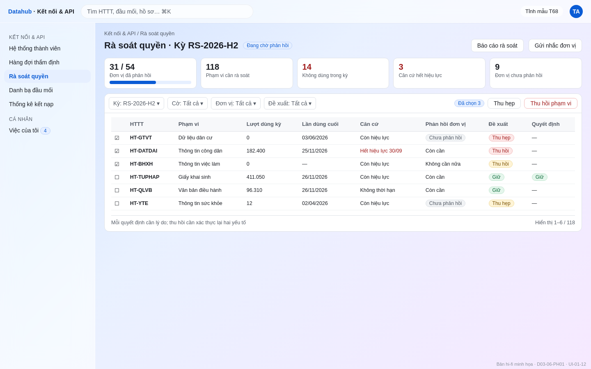

Ảnh là kỳ RS-2026-H2 đang chờ phản hồi: dải thống kê (31 trên 54 đơn vị đã phản hồi, 14 phạm vi không dùng trong kỳ, 3 căn cứ hết hiệu lực), thanh công cụ lọc và thanh xử lý hàng loạt, bảng mục với cột đề xuất của hệ thống và cột quyết định của người rà soát. Ba dòng đang chọn để thu hẹp hoặc thu hồi.

### 18.1. Wireframe

Hình dưới là bố cục dạng chữ của UI-01-12, dùng để thống nhất vị trí các khối trước khi đọc bản hi-fi.

```text
┌ Rà soát quyền · Kỳ RS-2026-H2 [Đang chờ phản hồi]           [Báo cáo rà soát] [Gửi nhắc đơn vị] ┐
│ [31/54 đơn vị đã phản hồi ▬▬▬▬▬▁▁▁] [118 phạm vi] [14 không dùng trong kỳ] [3 căn cứ hết hiệu lực] [9 chưa phản hồi] │
│ [Kỳ ▾] [Cờ ▾] [Đơn vị ▾] [Đề xuất ▾]                 Đã chọn 3 [Thu hẹp] [Thu hồi phạm vi]        │
├──┬──────────┬──────────────┬────────┬──────────┬──────────────┬──────────────┬─────────┬──────────┤
│☑ │ HTTT     │ Phạm vi      │ Lượt dùng│ Lần cuối │ Căn cứ       │ Phản hồi đơn vị│ Đề xuất │ Quyết định│
│☑ │ HT-GTVT  │ Dữ liệu dân cư│ 0       │ 03/06    │ Còn hiệu lực │ Chưa phản hồi │ Thu hẹp │ —         │
│☑ │ HT-DATDAI│ Thông tin công dân│182.400│ 25/11   │ Hết hiệu lực 30/09 │ Còn cần  │ Thu hồi │ —         │
└──┴──────────┴──────────────┴────────┴──────────┴──────────────┴──────────────┴─────────┴──────────┘
```

### 18.2. Thành phần

Bảng dưới liệt kê các thành phần giao diện của UI-01-12 theo thứ tự từ trên xuống, kèm thành phần `CMP-*` dùng, quy tắc kiểm tra và nguồn dữ liệu.

| # | Thành phần | `CMP-*` | Nội dung, kiểm tra | Nguồn | Ghi chú |
|---|---|---|---|---|---|
| 1 | Tiêu đề, kỳ | `CMP-PageHeader`, `CMP-Select`, `CMP-StatusTag` | Chọn kỳ; trạng thái Đang mở, Chờ phản hồi, Chờ quyết định, Đã đóng | API-01-066, 067 | `ky` trên URL |
| 2 | Nút kỳ mới | `CMP-Button` | "Mở kỳ rà soát" khi chưa có kỳ mở; hộp nhập tên kỳ, khoảng thời gian | API-01-065 | ERR-01-039 khi đã có kỳ mở |
| 3 | Thống kê kỳ | `CMP-KpiCard` (biến thể `filter`), `CMP-ProgressBar` | Tỷ lệ đơn vị đã phản hồi, tổng phạm vi, không dùng trong kỳ, căn cứ hết hiệu lực, đơn vị chưa phản hồi | API-01-067 | Bấm thẻ để lọc |
| 4 | Thanh lọc | `CMP-FilterBar`, `CMP-Select` | Cờ (Không dùng trong kỳ, Không dùng quá 12 tháng, Định danh sắp hết hạn, Căn cứ hết hiệu lực, Đơn vị chưa phản hồi), đơn vị, đề xuất | API-01-068 | |
| 5 | Bảng mục | `CMP-DataTable`, `CMP-StatusTag`, `CMP-Checkbox` | Cột §18.3 | `items` | Mật độ gọn |
| 6 | Thanh xử lý hàng loạt | `CMP-BulkActionBar` | Số dòng chọn; "Giữ", "Thu hẹp", "Thu hồi phạm vi" | API-01-072 | Chỉ khi kỳ ở `DECIDING` |
| 7 | Hộp quyết định | `CMP-ReasonDialog` | Lý do bắt buộc; với thu hồi: danh sách đăng ký sử dụng bị ảnh hưởng và xác nhận; xác thực lại hai yếu tố | API-01-072 | ERR-01-033, 035, 041 |
| 8 | Gửi phiếu, nhắc | `CMP-ConfirmDialog`, `CMP-JobProgress` | Số tổ chức nhận phiếu, hạn liên kết; chạy nền | API-01-069 | Q01-36 |
| 9 | Đánh dấu hết hiệu lực | `CMP-ConfirmDialog` | Chọn văn bản, ngày bãi bỏ, ghi chú | API-01-073 | Tạm ngừng phạm vi ngay (BR-01-015) |
| 10 | Báo cáo | `CMP-DropdownMenu`, `CMP-JobProgress` | PDF, XLSX; chạy nền khi lớn | API-01-074, 075, 088 | Ghi kiểm toán xuất |

: UI-01-12 · Thành phần

### 18.3. Cột bảng

Bảng dưới mô tả từng cột của bảng chính ở UI-01-12: tên cột, nội dung hiển thị và ghi chú.

| Cột | Nội dung | Ghi chú |
|---|---|---|
| Chọn | `CMP-Checkbox` | Chỉ khi kỳ `DECIDING` và có quyền |
| HTTT | Mã đậm, tên | Liên kết UI-01-04 |
| Phạm vi | Loại dữ liệu và mức phân loại | |
| Lượt dùng trong kỳ | Số lượt gọi thành công từ PH-13 | `usageInPeriod`; "—" khi PH-13 không khả dụng |
| Lần dùng cuối | `dd/MM/yyyy` và số ngày chưa dùng | `unusedDays` |
| Căn cứ | "Còn hiệu lực", "Hết hiệu lực {ngày}", "Không thời hạn" | `LEGAL_EXPIRED` đỏ có chữ |
| Phản hồi đơn vị | Còn cần, Thu hẹp (kèm phạm vi còn cần), Không cần nữa, Chưa phản hồi | |
| Đề xuất | Giữ, Thu hẹp, Thu hồi do hệ thống đề xuất (quy tắc: không dùng quá 365 ngày, không phản hồi 30 ngày, căn cứ hết hiệu lực) | Tooltip nêu quy tắc |
| Quyết định | Giữ, Thu hẹp, Thu hồi phạm vi; "—" khi chưa quyết | Sau khi lưu, không sửa được; kỳ `CLOSED` chỉ đọc |

: UI-01-12 · Cột bảng

### 18.4. Hành vi

Mục "Căn cứ hết hiệu lực" không giữ được: chọn "Giữ" nhận ERR-01-041 ("Không giữ được mục có căn cứ hết hiệu lực. Chọn thu hồi hoặc bổ sung căn cứ ở Đề nghị mở rộng.") ngay trên dòng. Khi chọn Thu hồi hoặc Thu hẹp, hộp quyết định liệt kê đăng ký sử dụng đang hoạt động bị ảnh hưởng (từ PH-02) và cần tick xác nhận. Khi mọi mục đã có quyết định, kỳ chuyển Đã đóng và `lastReviewAt` của từng HTTT được cập nhật; màn hiện `CMP-Toast` "Kỳ RS-2026-H2 đã đóng. 118 mục: 96 giữ, 14 thu hẹp, 8 thu hồi." kèm nút "Báo cáo rà soát".

### 18.5. Trạng thái màn

Bảng dưới nêu cách UI-01-12 hiển thị ở từng trạng thái (đang tải, rỗng, lỗi, không có quyền và các trạng thái riêng), theo bộ trạng thái chuẩn ST-nn của D03-06-00.

| Trạng thái | Hiển thị |
|---|---|
| Đang tải | Skeleton dải thống kê và 8 dòng (ST-01) |
| Chưa có kỳ nào | `CMP-EmptyState` "Chưa có kỳ rà soát nào. Mỗi HTTT hoạt động cần được rà soát quyền ít nhất mỗi 6 tháng." kèm "Mở kỳ rà soát" |
| Kỳ không còn mục cần xử lý | "Mọi mục đã có quyết định." kèm nút báo cáo |
| Lỗi từng cột | PH-13 lỗi: cột lượt dùng "—" và `CMP-Alert` ERR-01-046; không chặn quyết định đối với mục không phụ thuộc số liệu |
| Lỗi nghiệp vụ | ERR-01-033, 035, 039, 041; ERR-01-020 khi kỳ không ở giai đoạn xử lý |
| Chỉ đọc | AU, kỳ `CLOSED`, kỳ chưa tới `DECIDING`: ẩn cột chọn và thanh hàng loạt |
| Không có quyền | ST-07 |

: UI-01-12 · Trạng thái màn

### 18.6. Thông báo, bàn phím, truy cập

Thông báo: ERR-01-039 (đã có kỳ mở), ERR-01-041, ERR-01-033, ERR-01-035, ERR-01-046. Phím tắt: `/` vào ô tìm; `↑`, `↓` chọn dòng; `Space` đánh dấu chọn; `Ctrl+A` chọn mọi dòng trang hiện tại; `G`, `H`, `V` đặt Giữ, Thu hẹp, Thu hồi cho dòng chọn (qua hộp lý do). Cột đề xuất và quyết định có chữ; thanh hàng loạt thông báo "đã chọn n dòng" bằng `aria-live`; bảng có `aria-rowcount` khi phân trang.

## 19. UI-01-13 Xác nhận của đơn vị

::: dac-ta
**Mục đích.** Cho đại diện đơn vị chủ quản xác nhận từng phạm vi kết nối của đơn vị còn cần hay không, dựa trên mức dùng thực tế, thay vì quản trị tỉnh tự quyết. Trang riêng mở từ liên kết trong thư; phản hồi được ghi kèm tên và thời điểm.

**Người dùng, quyền.** OR hoặc đầu mối của đơn vị có tên trong phiếu, đã đăng nhập đúng tổ chức, xác thực hai yếu tố; không cần quyền `PERM-01-*`.

**FR, UC hiện thực.** FR-01-041; UC-01-28.

**Truy vết hệ cũ.** SRS cũ FR-01-013 (rà soát quyền).

**Đường dẫn.** `/ket-noi/xac-nhan/{token}`; không có khung ứng dụng.

**Mẫu.** Trang riêng (khung tối giản).

**API.** API-01-070, 071.

**Phát hành, mức chi tiết.** MVP; đầy đủ.
:::

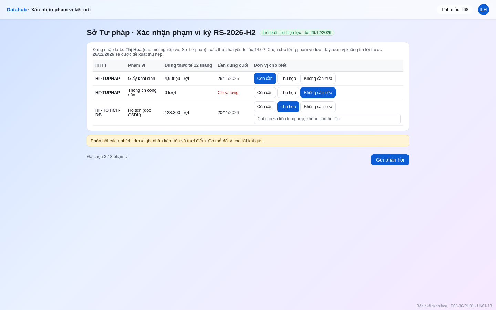

Ảnh là phiếu của một sở với ba phạm vi: mỗi dòng có số liệu dùng thực tế 12 tháng và ba nút "Còn cần", "Thu hẹp", "Không cần nữa"; dòng thu hẹp mở ô nhập phạm vi còn cần. Dải cam nhắc hạn trả lời và hậu quả khi không trả lời.

### 19.1. Thành phần

Bảng dưới liệt kê các thành phần giao diện của UI-01-13 theo thứ tự từ trên xuống, kèm thành phần `CMP-*` dùng, quy tắc kiểm tra và nguồn dữ liệu.

| # | Thành phần | `CMP-*` | Nội dung, kiểm tra | Nguồn | Ghi chú |
|---|---|---|---|---|---|
| 1 | Khung tối giản | `CMP-AppShell` biến thể `bare` | Logo, tên tenant, tài khoản | — | Tiêu đề tab không có tên HTTT |
| 2 | Tiêu đề | `CMP-Heading`, `CMP-StatusTag` | "{tên đơn vị} · Xác nhận phạm vi kỳ {mã kỳ}", hạn liên kết | API-01-070 | |
| 3 | Hướng dẫn | `CMP-Text`, `CMP-Alert` | Giải thích cách chọn; "Đơn vị không trả lời trước {ngày} sẽ được đề xuất thu hẹp" | `noResponseDays` | |
| 4 | Bảng phạm vi | `CMP-DataTable`, `CMP-SegmentedControl` | HTTT, phạm vi, dùng thực tế 12 tháng, lần dùng cuối, ba lựa chọn | `items[]` | Lựa chọn là `radiogroup` |
| 5 | Ô phạm vi còn cần | `CMP-Input` | Bắt buộc khi chọn "Thu hẹp", ≤ 200 ký tự | `reducedScope` | |
| 6 | Chân trang | `CMP-Button` | "Gửi phản hồi" bật khi mọi dòng đã chọn | API-01-071 | `Idempotency-Key`; ERR-01-040 |
| 7 | Trang kết quả | `CMP-ResultPage` | "Đã ghi nhận phản hồi của anh/chị lúc {giờ}. Cảm ơn." | — | Không cho gửi lại |

: UI-01-13 · Thành phần

### 19.2. Trạng thái màn

Bảng dưới nêu cách UI-01-13 hiển thị ở từng trạng thái (đang tải, rỗng, lỗi, không có quyền và các trạng thái riêng), theo bộ trạng thái chuẩn ST-nn của D03-06-00.

| Trạng thái | Hiển thị |
|---|---|
| Đang xác thực, đang tải | Chuyển Keycloak yêu cầu hai yếu tố; skeleton bảng 1 giây (ST-01) |
| Đang điền | Như ảnh; bộ đếm "Đã chọn n / m phạm vi" ở chân |
| Chưa đủ lựa chọn | Nút "Gửi phản hồi" mờ; dưới nút "Còn {n} phạm vi chưa chọn." |
| Phiếu hết hạn hoặc đã trả lời | ERR-01-040: "Phiếu xác nhận đã hết hạn hoặc đã được trả lời. Liên hệ quản trị tỉnh." |
| Sai tổ chức | ERR-01-025 dạng chung: "Tài khoản này không thuộc đơn vị nhận phiếu." kèm "Đăng nhập tài khoản khác" |
| Đã gửi | Trang kết quả §19.1 mục 7 |
| Mất kết nối | ST-06; lựa chọn đã chọn giữ trên trang (không chứa bí mật), nút gửi vô hiệu |

: UI-01-13 · Trạng thái màn

### 19.3. Thông báo, bàn phím, truy cập

Thông báo: ERR-01-040; thiếu phạm vi còn cần khi chọn "Thu hẹp" hiện "Nhập phạm vi còn cần." dưới ô (ERR-01-003). Phím tắt: `↑`, `↓` chuyển dòng; trong dòng, `←`, `→` đổi lựa chọn; `Enter` gửi khi đủ. Cỡ chữ lớn một bậc, vùng chạm ≥ 44 × 44 px; trình đọc màn hình đọc "Phạm vi {tên}, dùng 4,9 triệu lượt, lần cuối 26/11/2026, chọn một: Còn cần, Thu hẹp, Không cần nữa".

## 20. UI-01-14 Danh bạ đầu mối

::: dac-ta
**Mục đích.** Cho mọi cán bộ trong phạm vi cơ quan nhà nước của tỉnh tra cứu nhanh ai là đầu mối nghiệp vụ, kỹ thuật của một HTTT hay một tổ chức; cho quản trị tỉnh thấy và xử lý tổ chức thiếu đầu mối, thư không hoạt động, thông tin lâu chưa xác nhận; xuất danh bạ có kiểm soát.

**Người dùng, quyền.** Mọi người dùng nội bộ đã đăng nhập (quyền cơ sở) để tra cứu; TA xử lý khối "Cần xử lý"; TA, SO xem thêm đầu mối ATTT (BR-01-027); xuất cần `PERM-01-read`, ghi mục đích và kiểm toán.

**FR, UC hiện thực.** FR-01-045, 046, 047; UC-01-30, 31.

**Truy vết hệ cũ.** SRS cũ FR-01-015 (danh bạ đầu mối).

**Đường dẫn.** `/ket-noi/danh-ba`.

**Mẫu.** PTN-01 (Danh sách) kèm khối "Cần xử lý".

**API.** API-01-076, 077, 078, 079, 088, 016.

**Phát hành, mức chi tiết.** MVP; đầy đủ.
:::

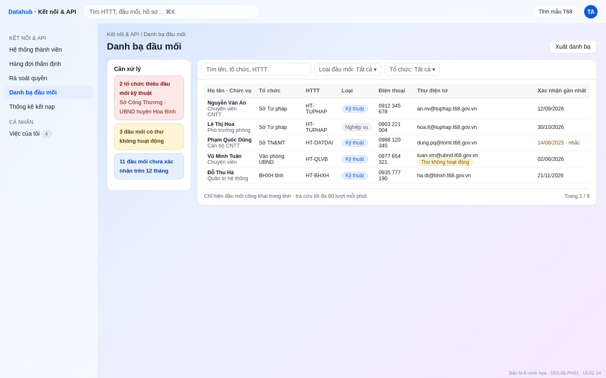

Ảnh là danh bạ với cột trái "Cần xử lý" (chỉ TA thấy): hai tổ chức thiếu đầu mối kỹ thuật, ba thư không hoạt động, mười một đầu mối chưa xác nhận trên 12 tháng; bên phải bảng tra cứu với chức vụ dưới họ tên, loại đầu mối bằng chữ, thư và điện thoại hiển thị đầy đủ cho người có quyền tra cứu.

### 20.1. Thành phần

Bảng dưới liệt kê các thành phần giao diện của UI-01-14 theo thứ tự từ trên xuống, kèm thành phần `CMP-*` dùng, quy tắc kiểm tra và nguồn dữ liệu.

| # | Thành phần | `CMP-*` | Nội dung, kiểm tra | Nguồn | Ghi chú |
|---|---|---|---|---|---|
| 1 | Tiêu đề, nút | `CMP-PageHeader`, `CMP-Button` | "Xuất danh bạ" (`PERM-01-read`) | — | |
| 2 | Khối "Cần xử lý" | `CMP-Card`, `CMP-Alert` ×3 | Tổ chức thiếu đầu mối kỹ thuật; đầu mối thư không hoạt động; đầu mối chưa xác nhận trên `directory.staleMonths` | API-01-078 | Chỉ TA; mỗi dải bấm để lọc bảng |
| 3 | Thanh lọc | `CMP-FilterBar`, `CMP-SearchInput`, `CMP-Select` | Tìm theo tên, tổ chức, HTTT (không dấu); loại đầu mối; tổ chức | API-01-076 | Ghi URL |
| 4 | Bảng | `CMP-DataTable` | Cột §20.2 | `items` | Phân trang |
| 5 | Xác nhận thông tin | `CMP-Button` nhỏ, `CMP-Toast` | Với đầu mối của chính người dùng hoặc tổ chức của mình: "Xác nhận còn đúng" ghi `lastConfirmedAt` | API-01-016 | Một nút bấm |
| 6 | Hộp xuất | `CMP-ReasonDialog` | Định dạng (XLSX, CSV), mục đích sử dụng bắt buộc; ghi chú "Dữ liệu liên hệ cán bộ, chỉ dùng cho mục đích đã nêu" | API-01-079 | Từ 5.000 dòng chạy nền |
| 7 | Hạn chế tốc độ | `CMP-Toast` | ERR-01-045 kèm đếm ngược trên ô tìm | — | 60 lượt mỗi phút (tham số) |

: UI-01-14 · Thành phần

### 20.2. Cột bảng

Bảng dưới mô tả từng cột của bảng chính ở UI-01-14: tên cột, nội dung hiển thị và ghi chú.

| Cột | Nội dung | Ghi chú |
|---|---|---|
| Họ tên · Chức vụ | Họ tên đậm, chức vụ dòng phụ | |
| Tổ chức | Tên | Liên kết lọc theo tổ chức (API-01-077) |
| HTTT | Mã | Liên kết UI-01-04 nếu có quyền xem |
| Loại | Nghiệp vụ, Kỹ thuật; ATTT (chỉ TA, SO) | `CMP-StatusTag` |
| Điện thoại | Định dạng `0912 345 678` | Sao chép |
| Thư điện tử | Đầy đủ; kèm nhãn "Thư không hoạt động" khi thư bị trả lại | Sao chép |
| Xác nhận gần nhất | `dd/MM/yyyy`; vàng kèm chữ "nhắc" khi quá hạn | |

: UI-01-14 · Cột bảng

### 20.3. Trạng thái màn

Bảng dưới nêu cách UI-01-14 hiển thị ở từng trạng thái (đang tải, rỗng, lỗi, không có quyền và các trạng thái riêng), theo bộ trạng thái chuẩn ST-nn của D03-06-00.

| Trạng thái | Hiển thị |
|---|---|
| Đang tải | Skeleton khối "Cần xử lý" và 8 dòng (ST-01) |
| Rỗng | "Chưa có đầu mối công khai nào. Đầu mối được thêm khi lập hồ sơ kết nạp." |
| Không có kết quả | ST-04: "Không tìm thấy đầu mối phù hợp." kèm "Xóa bộ lọc" |
| Vượt giới hạn tốc độ | ERR-01-045 |
| Khối "Cần xử lý" rỗng | "Không có việc cần xử lý." |
| Lỗi tải | ST-05 |

: UI-01-14 · Trạng thái màn

### 20.4. Thông báo, bàn phím, truy cập

Thông báo: ERR-01-045, ERR-01-046, ERR-01-033 (thiếu mục đích khi xuất). Phím tắt: `/` vào ô tìm; `↑`, `↓` chọn dòng; `C` sao chép thư của dòng chọn; `X` mở hộp xuất. Thư điện tử và điện thoại là văn bản thật để trình đọc màn hình đọc; nút sao chép có nhãn "Sao chép thư của {tên}"; mức nhạy cảm của dữ liệu liên hệ (BR-01-027) được nêu ở chân bảng "Chỉ hiện đầu mối công khai trong tỉnh".

## 21. UI-01-15 Nhập HTTT từ hệ cũ

::: dac-ta
**Mục đích.** Cho quản trị tỉnh nhập danh sách Application, publisher, subscriber của hệ cũ thành hồ sơ HTTT nháp trong Datahub, kiểm tra trước khi ghi: ghép tổ chức, gộp vai trò, bỏ qua mọi thông tin xác thực; ghi tất cả hoặc không ghi gì.

**Người dùng, quyền.** TA, PA, PO có `PERM-18-migration`.

**FR, UC hiện thực.** FR-01-048; UC-01-32.

**Truy vết hệ cũ.** LGC-APIM-019; 020; LGC-HUB-010, 011.

**Đường dẫn.** `/ket-noi/he-thong/nhap`.

**Mẫu.** PTN-09 (Nhập dữ liệu có xem trước).

**API.** API-01-080, 081, 082, 088.

**Phát hành, mức chi tiết.** MVP; đầy đủ.
:::

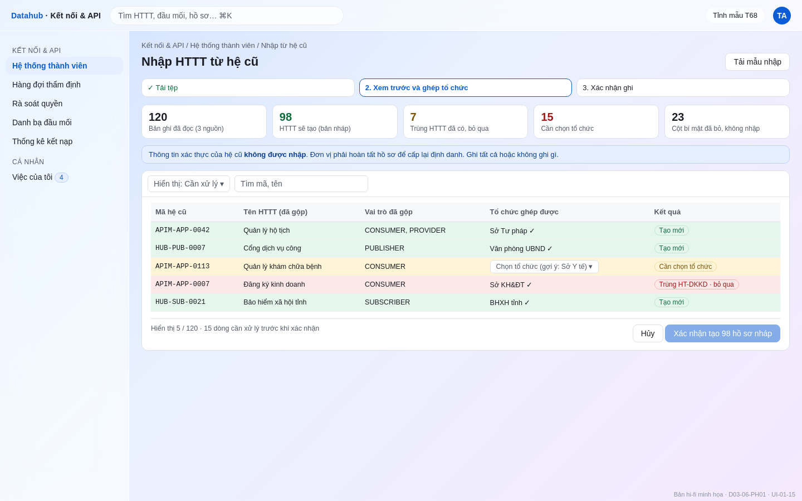

Ảnh là bước 2 "Xem trước và ghép tổ chức" với 120 bản ghi từ ba nguồn: 98 sẽ tạo, 7 trùng HTTT đã có (bỏ qua), 15 cần chọn tổ chức, 23 cột bí mật đã bỏ. Dòng xanh sẽ tạo, vàng cần chọn tổ chức, đỏ trùng; dải xanh nhắc thông tin xác thực không được nhập. Nút xác nhận mờ cho tới khi hết dòng cần chọn tổ chức.

### 21.1. Ba bước

Bảng dưới trình bày ba bước.

| Bước | Nội dung | `CMP-*` | API |
|---|---|---|---|
| 1. Tải tệp | Chọn tệp xuất từ hệ cũ (XLSX hoặc CSV, tối đa `legacyImport.maxRows` dòng, mặc định 5.000); nút "Tải mẫu nhập"; kiểm tra kiểu theo nội dung và quét mã độc | `CMP-Wizard`, `CMP-Upload` biến thể `dropzone`, `CMP-JobProgress` | API-01-080 |
| 2. Xem trước và ghép tổ chức | Năm thẻ số liệu; bảng kết quả từng dòng (đã gộp vai trò); chọn tổ chức cho dòng chưa ghép được; bỏ qua dòng | `CMP-KpiCard`, `CMP-DataTable`, `CMP-OrganizationSelect`, `CMP-Alert` | API-01-081 |
| 3. Xác nhận và báo cáo | Hộp xác nhận tạo `n` hồ sơ nháp; sau khi xong báo cáo đối chiếu: số đọc, số tạo, số trùng, số cảnh báo, số bí mật bỏ qua; nút tải báo cáo | `CMP-ConfirmDialog`, `CMP-DescriptionList` | API-01-082 |

: UI-01-15 · Ba bước

### 21.2. Thành phần bước 2

Bảng dưới trình bày thành phần bước 2.

| # | Thành phần | `CMP-*` | Nội dung, kiểm tra | Ghi chú |
|---|---|---|---|---|
| 1 | Thẻ số liệu | `CMP-KpiCard` ×5 | Đã đọc, Sẽ tạo, Trùng bỏ qua, Cần chọn tổ chức, Cột bí mật đã bỏ | Thẻ "Cần chọn tổ chức" bấm để lọc |
| 2 | Dải lưu ý | `CMP-Alert` thông tin | "Thông tin xác thực của hệ cũ không được nhập. Đơn vị phải hoàn tất hồ sơ để cấp lại định danh. Ghi tất cả hoặc không ghi gì." | |
| 3 | Bảng xem trước | `CMP-DataTable`, `CMP-StatusTag` | Mã hệ cũ, tên chuẩn hóa, vai trò đã gộp, tổ chức ghép được hoặc ô chọn, kết quả (Tạo mới, Cần chọn tổ chức, Trùng) | Nền dòng `color-diff-added`, `color-diff-changed`, `color-diff-removed` kèm chữ |
| 4 | Chọn tổ chức | `CMP-OrganizationSelect` | Gợi ý tổ chức gần đúng; chọn hoặc "Bỏ qua dòng" | ERR-01-004 nếu tổ chức không hoạt động |
| 5 | Chân | `CMP-Button` | "Hủy"; "Xác nhận tạo {n} hồ sơ nháp" bật khi không còn dòng cần chọn | Qua `CMP-ConfirmDialog` |

: UI-01-15 · Thành phần bước 2

### 21.3. Trạng thái màn

Bảng dưới nêu cách UI-01-15 hiển thị ở từng trạng thái (đang tải, rỗng, lỗi, không có quyền và các trạng thái riêng), theo bộ trạng thái chuẩn ST-nn của D03-06-00.

| Trạng thái | Hiển thị |
|---|---|
| Đang phân tích tệp | `CMP-JobProgress` "Đang đọc tệp… {n} / {tổng} dòng"; rời màn được, báo ở khay tác vụ |
| Tệp sai cấu trúc | ERR-01-042: "Tệp không đúng mẫu. Tải mẫu nhập và thử lại." kèm liên kết mẫu |
| Dòng trùng | ERR-01-043 dạng số: "{n} dòng trùng hệ thống đã có, đã bỏ qua." |
| Tệp lớn quá | ERR-01-044: "Giá trị số dòng phải từ 1 đến {max}." hoặc ERR-01-012, 013, 014 cho cỡ, kiểu, mã độc |
| Xác nhận thành công | `CMP-Toast` "Đã tạo {n} hồ sơ nháp. Đơn vị sẽ nhận việc Hoàn tất hồ sơ." và báo cáo đối chiếu |
| Ghi lỗi giữa chừng | Không tạo gì (giao dịch tất cả hoặc không), `CMP-Alert` lỗi "Chưa tạo hồ sơ nào do lỗi hệ thống. Thử lại." |
| Không có quyền | ST-07 |

: UI-01-15 · Trạng thái màn

### 21.4. Thông báo, bàn phím, truy cập

Thông báo: ERR-01-042, 043, 044, 004, 012, 013, 014, 046 theo §5.2. Phím tắt: `↑`, `↓` chọn dòng; `Enter` mở ô chọn tổ chức; `S` bỏ qua dòng; `Ctrl+Enter` xác nhận khi bật. Màu nền dòng luôn kèm chữ ở cột Kết quả; bảng dài có điều hướng đến dòng cần xử lý tiếp theo bằng nút "Dòng tiếp theo cần chọn" (`N`).

## 22. UI-01-16 Tham số kết nạp

::: dac-ta
**Mục đích.** Cho quản trị tỉnh xem và chỉnh các tham số `onboarding.*` của tỉnh trong miền cho phép (hạn thẩm định, thời gian bàn giao, hạn định danh, kiểm thử, rà soát, danh bạ…), mỗi thay đổi kèm lý do và lưu lịch sử.

**Người dùng, quyền.** TA, PA có `PERM-18-config`; người khác không thấy màn.

**FR, UC hiện thực.** FR-01-049; UC-01-33.

**Truy vết hệ cũ.** Không có ở hệ cũ (hạn cứng trong mã).

**Đường dẫn.** `/quan-tri/tham-so/ket-nap`.

**Mẫu.** PTN-12 (Cài đặt).

**API.** API-01-083, 084.

**Phát hành, mức chi tiết.** MVP; đầy đủ.
:::

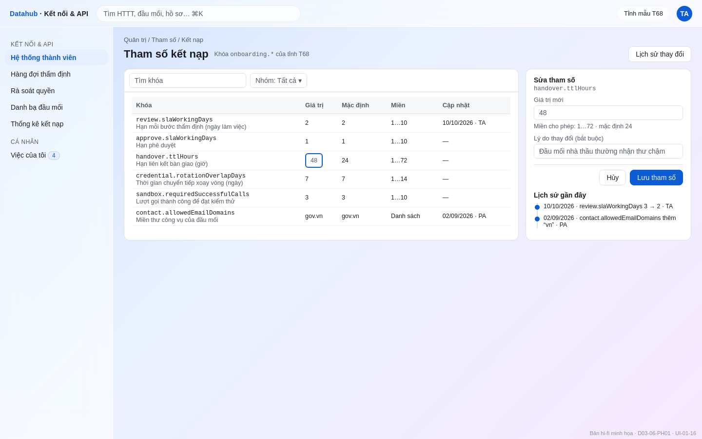

Ảnh cho thấy bảng khóa tham số bên trái (khóa đơn cách, mô tả, giá trị, mặc định, miền, người và ngày cập nhật) và bên phải ngăn sửa tham số đang chọn: giá trị mới, miền cho phép, ô lý do bắt buộc, lịch sử gần đây. Dòng đang sửa viền xanh `color-focus-ring`.

### 22.1. Thành phần

Bảng dưới liệt kê các thành phần giao diện của UI-01-16 theo thứ tự từ trên xuống, kèm thành phần `CMP-*` dùng, quy tắc kiểm tra và nguồn dữ liệu.

| # | Thành phần | `CMP-*` | Nội dung, kiểm tra | Nguồn | Ghi chú |
|---|---|---|---|---|---|
| 1 | Tiêu đề | `CMP-PageHeader`, `CMP-CodeText` | "Tham số kết nạp" kèm tiền tố `onboarding.` | — | |
| 2 | Bảng tham số | `CMP-DataTable` | Khóa (rút gọn bỏ tiền tố, mô tả dòng phụ), Giá trị, Mặc định, Miền, Cập nhật; nhóm: Thẩm định, Định danh, Bàn giao, Kiểm thử, Rà soát, Danh bạ, Khác | API-01-083 | Giá trị khác mặc định in đậm kèm chữ "Đã đổi" |
| 3 | Thanh lọc | `CMP-SearchInput`, `CMP-Select` | Tìm khóa; lọc nhóm | | |
| 4 | Ngăn sửa | `CMP-Form`, `CMP-NumberInput` hoặc `CMP-Input` hoặc `CMP-KeyValueEditor` | Giá trị mới theo kiểu (số, danh sách số ngày, danh sách miền thư); miền cho phép; trần của nền tảng nếu có; lý do bắt buộc | API-01-084 | ERR-01-044, 033 |
| 5 | Khôi phục mặc định | `CMP-Button` nhỏ | Đưa về mặc định qua cùng quy trình lý do | API-01-084 | |
| 6 | Xác thực lại | `CMP-ReasonDialog` bước 2 | Tham số an ninh (thời hạn định danh, bàn giao, số lần mở sai, miền thư, xác thực lại) chỉ cần xác thực lại khi **nới lỏng**; siết chặt tự do | API-01-084 | ERR-01-035 |
| 7 | Lịch sử | `CMP-AuditTrail` | Giá trị cũ, mới, người, lúc, lý do | API-01-083 | Lọc theo khóa |

: UI-01-16 · Thành phần

### 22.2. Quy tắc nhập

Bảng dưới trình bày quy tắc nhập.

| Quy tắc | Hiển thị |
|---|---|
| Ngoài miền | "Giá trị {khóa} phải từ {min} đến {max}." (ERR-01-044) dưới trường |
| Vượt trần nền tảng | "Giá trị vượt trần {n} do quản trị nền tảng đặt." (ERR-01-044) |
| Nới lỏng tham số an ninh | `CMP-Alert` cảnh báo "Thay đổi này làm giảm mức an toàn. Cần lý do và ghi kiểm toán mức cao." |
| Hiệu lực | "Có hiệu lực trong vòng 60 giây." sau khi lưu |
| Tham số theo danh sách | `[30,14,7]` nhập bằng `CMP-KeyValueEditor` dạng nhãn chip, sắp xếp giảm dần tự động |

: UI-01-16 · Quy tắc nhập

### 22.3. Trạng thái màn

Bảng dưới nêu cách UI-01-16 hiển thị ở từng trạng thái (đang tải, rỗng, lỗi, không có quyền và các trạng thái riêng), theo bộ trạng thái chuẩn ST-nn của D03-06-00.

| Trạng thái | Hiển thị |
|---|---|
| Đang tải | Skeleton 10 dòng (ST-01) |
| Không có kết quả | ST-04 "Không có tham số phù hợp." |
| Lỗi lưu | ST-11 tại trường, ST-12 nếu ERR-01-044 |
| Xung đột | Hai người cùng sửa một khóa: ST-13 với `CMP-DiffViewer` giá trị |
| Lưu thành công | `CMP-Toast` "Đã lưu tham số {khóa}." và thêm dòng lịch sử |
| Chỉ đọc | PA, TA chỉ có `PERM-18-config`; người khác ST-07 |

: UI-01-16 · Trạng thái màn

### 22.4. Thông báo, bàn phím, truy cập

Thông báo: ERR-01-044, ERR-01-033, ERR-01-035. Phím tắt: `/` vào ô tìm; `↑`, `↓` chọn dòng; `Enter` mở ngăn sửa; `Ctrl+S` lưu; `Esc` đóng ngăn sửa (hỏi nếu có thay đổi). Mỗi ô nhập có nhãn, đơn vị và miền cho phép trong `aria-describedby`; nhóm tham số là `region` có tiêu đề cấp 2.

## 23. UI-01-17 Thống kê kết nạp

::: dac-ta
**Mục đích.** Cho quản trị tỉnh, Cán bộ ATTT, lãnh đạo và kiểm toán thấy tình hình kết nạp: số hồ sơ theo trạng thái, thời gian trung vị và p90 từng giai đoạn so với mục tiêu từ nộp đến kích hoạt không quá 5 ngày làm việc (KPI-05), tỷ lệ trả bổ sung, hồ sơ quá hạn, định danh sắp hết hạn.

**Người dùng, quyền.** TA, SO, VW, AU có `PERM-01-read`.

**FR, UC hiện thực.** FR-01-051; UC-01-34.

**Truy vết hệ cũ.** Không có ở hệ cũ.

**Đường dẫn.** `/ket-noi/thong-ke-ket-nap`.

**Mẫu.** PTN-06 (Dashboard).

**API.** API-01-086.

**Phát hành, mức chi tiết.** Đợt 2; đầy đủ.
:::

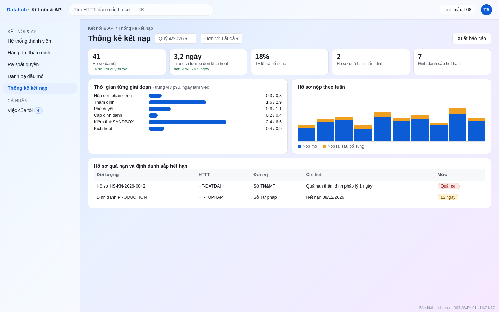

Ảnh là quý 4/2026 của tỉnh mẫu: hàng năm thẻ KPI (41 hồ sơ, trung vị 3,2 ngày đạt KPI-05, tỷ lệ trả bổ sung 18%, 2 hồ sơ quá hạn, 7 định danh sắp hết hạn), thanh ngang thời gian từng giai đoạn dạng trung vị trên p90, cột xếp chồng hồ sơ theo tuần, bảng hồ sơ quá hạn và định danh sắp hết hạn có liên kết.

### 23.1. Thành phần

Bảng dưới liệt kê các thành phần giao diện của UI-01-17 theo thứ tự từ trên xuống, kèm thành phần `CMP-*` dùng, quy tắc kiểm tra và nguồn dữ liệu.

| # | Thành phần | `CMP-*` | Nội dung, kiểm tra | Nguồn | Ghi chú |
|---|---|---|---|---|---|
| 1 | Bộ lọc | `CMP-FilterBar`, `CMP-DateRangePicker`, `CMP-Select` | Khoảng thời gian (quý, tuần, tùy chọn); đơn vị chủ quản | API-01-086 `khoang`, `don-vi` | Ghi URL |
| 2 | Thẻ KPI | `CMP-KpiCard` | Hồ sơ đã nộp, trung vị từ nộp đến kích hoạt (so KPI-05), tỷ lệ trả bổ sung, hồ sơ quá hạn thẩm định, định danh sắp hết hạn; có thể kèm chênh lệch so với kỳ trước bằng mũi tên và chữ | `kpis` | Bấm thẻ đi tới danh sách đã lọc |
| 3 | Thời gian từng giai đoạn | `CMP-Chart` (thanh ngang) | Nộp đến phân công, thẩm định, phê duyệt, cấp định danh, kiểm thử SANDBOX, kích hoạt; trung vị và p90 | `stages[]` | Nút "Xem dạng bảng" |
| 4 | Hồ sơ theo tuần | `CMP-Chart` (cột xếp chồng) | Nộp mới, nộp lại sau bổ sung | `weekly[]` | Mẫu nền (kẻ chéo) cho chuỗi thứ hai ngoài màu; bảng thay thế |
| 5 | Bảng cần chú ý | `CMP-DataTable` | Hồ sơ quá hạn thẩm định, định danh sắp hết hạn, HTTT quá hạn rà soát | `attention[]` | Liên kết tới UI-01-02, 08, 12 |
| 6 | Xuất | `CMP-Button` | "Xuất báo cáo": CSV số liệu đang hiển thị, tạo ở trình duyệt | — | Không gọi API (Phụ lục B nếu cần báo cáo định dạng) |
| 7 | Chỉ số phát cho PH-13 | — | Chỉ số `onboarding_*` ở NFR-01-015 phát sang PH-13; màn này không hiện lại | — | |

: UI-01-17 · Thành phần

### 23.2. Trạng thái màn

Bảng dưới nêu cách UI-01-17 hiển thị ở từng trạng thái (đang tải, rỗng, lỗi, không có quyền và các trạng thái riêng), theo bộ trạng thái chuẩn ST-nn của D03-06-00.

| Trạng thái | Hiển thị |
|---|---|
| Đang tải | Skeleton năm thẻ và hai khung biểu đồ (ST-01) |
| Rỗng | `CMP-EmptyState` "Chưa có hồ sơ kết nạp trong khoảng thời gian này." |
| Ít dữ liệu | Khi dưới 5 hồ sơ, p90 hiện "—" kèm chú thích "Cần ít nhất 5 hồ sơ để tính p90" |
| Lỗi tải | ST-05 trong từng khung; thẻ còn lại giữ |
| Vượt mục tiêu | Thẻ trung vị đổi sang mức cảnh báo có chữ "Vượt KPI-05" |
| Không có quyền | ST-07 |

: UI-01-17 · Trạng thái màn

### 23.3. Thông báo, bàn phím, truy cập

Thông báo: ERR-01-003 (khoảng thời gian sai), ERR-01-046. Phím tắt: `/` vào bộ lọc; `T` bật xem dạng bảng của biểu đồ có focus; `1`…`5` mở danh sách theo thẻ KPI. Mỗi biểu đồ có tóm tắt `aria-describedby` ("Thời gian thẩm định trung vị 1,6 ngày, p90 2,9 ngày; kiểm thử SANDBOX dài nhất, trung vị 2,4 ngày") và bảng thay thế (WCAG 1.1.1); màu cột đi kèm nhãn trục và giá trị, chuỗi thứ hai có mẫu nền; thẻ KPI không dùng chỉ màu để báo đạt hay vượt.

## 24. Ma trận vai trò và màn hình

Ma trận cho biết vai trò nào thấy và làm được gì ở từng màn; ký hiệu: X thao tác đầy đủ; X\* theo phạm vi hoặc chỉ một phần (ghi trong ngoặc); R chỉ xem; R\* chỉ xem trong phạm vi tổ chức của mình; trống là không thấy. Tên vai trò theo D02-08; quyền chi tiết theo nhóm `PERM-01-*` ở D02-08 và ma trận quyền của FRS §3.2. Đầu mối kỹ thuật (người nhận bàn giao) là tài khoản của OR có tên trong danh sách đầu mối, không phải vai trò riêng.

| Màn | PA | PO | TA | TO | SO | IE | IA | SV | CA | OR | DO | VW | AU |
|---|---|---|---|---|---|---|---|---|---|---|---|---|---|
| UI-01-01 | | | X | | | | | | | X\* (tổ chức mình) | | | |
| UI-01-02 | R | R | X | R | R | R | R | R | R | X\* (rút hồ sơ) | R\* | R | R |
| UI-01-03 | X\* (nhập) | X\* (nhập) | X | R | R | R | R | R | R | R\* | R\* | R | R (xuất) |
| UI-01-04 | R | R | X | R | X\* (tạm ngừng, khẩn) | R | R | R | R | X\* (sửa, xoay, đề nghị) | R\* | R | R |
| UI-01-05 | | | X | | X\* (bước ATTT) | X\* (bước kỹ thuật) | | | | | | | |
| UI-01-06 | | | X\* (pháp lý hoặc được giao) | | X\* (ATTT) | X\* (kỹ thuật) | | | | | | | |
| UI-01-07 | | | X | | | | | | | | | | |
| UI-01-08 | R | R | X | R | X\* (xoay, thu hồi khi khẩn) | R | R | R | R | X\* (đăng ký khóa, xoay) | R\* | R | R |
| UI-01-09 | | | | | | | | | | X\* (đầu mối kỹ thuật được chỉ định) | | | |
| UI-01-10 | | | X (kích hoạt) | | R | X\* (làm mới) | | | | X\* (xem, làm mới) | | | |
| UI-01-11 | | | X | | X (khẩn, tạm ngừng) | | | | | | | | |
| UI-01-12 | | | X | | X | | | | | | | | R |
| UI-01-13 | | | | | | | | | | X\* (đại diện đơn vị) | | | |
| UI-01-14 | R | R | X (xử lý) | R | R (cả đầu mối ATTT) | R | R | R | R | X\* (xác nhận của mình) | R | R | X\* (xuất) |
| UI-01-15 | X | X | X | | | | | | | | | | |
| UI-01-16 | X | | X | | | | | | | | | | |
| UI-01-17 | | | R | | R | | | | | | | R | R |

: Ma trận vai trò và màn hình

Ba ràng buộc không thấy ở ma trận nhưng giao diện phải phản ánh: bốn mắt (BR-01-017: người lập, nộp, thẩm định hồ sơ không duyệt chính hồ sơ ấy; người đề nghị chấm dứt không duyệt; người nộp không kích hoạt), cặp loại trừ IE và IA của D02-08 §4, và đối tượng ngoài phạm vi trả như không tồn tại (BR-01-030).

## 25. Luồng người dùng chính

Hai luồng dưới đây nối các màn thành hành trình người dùng thực; chi tiết từng bước nghiệp vụ ở D02-04-PH01.

### 25.1. Hành trình một hồ sơ từ lập đến kích hoạt

Sơ đồ dưới mô tả hành trình một hồ sơ từ lập đến kích hoạt.

```{.mermaid caption="Hành trình một hồ sơ kết nạp qua các màn"}
flowchart TB
  A["OR lập hồ sơ<br/>UI-01-01 bước 1 đến 3"] --> B["Kiểm tra hợp lệ<br/>UI-01-01 bước 4"]
  B -->|còn lỗi| A
  B -->|đạt| C["Gửi duyệt<br/>UI-01-01 bước 5"]
  C --> D["Theo dõi tiến độ<br/>UI-01-02"]
  C --> E["Nhận việc, phân công<br/>UI-01-05"]
  E --> F["Thẩm định ba bước<br/>UI-01-06"]
  F -->|trả bổ sung| A
  F --> G["TA duyệt<br/>UI-01-07"]
  G -->|từ chối| H["Kết thúc, mã không dùng lại"]
  G -->|duyệt| I["Cấp định danh SANDBOX<br/>UI-01-08"]
  I --> J["Đầu mối nhận bí mật<br/>UI-01-09"]
  J --> K["Kiểm thử SANDBOX<br/>UI-01-10"]
  K --> L["TA kích hoạt PRODUCTION<br/>UI-01-10"]
  L --> M["HTTT hoạt động<br/>UI-01-04"]
```

Hình cho thấy hai vòng lặp có chủ ý: sửa lỗi hợp lệ trước khi nộp, và trả bổ sung sau thẩm định (nội dung hồ sơ được giữ, bước thẩm định mà dữ liệu không đổi giữ nguyên kết luận). Người nhận bí mật ở UI-01-09 không phải người duyệt, và người kích hoạt ở UI-01-10 không phải người nộp.

### 25.2. Nhận thông tin xác thực một lần

Sơ đồ dưới mô tả nhận thông tin xác thực một lần.

```{.mermaid caption="Đầu mối nhận bí mật qua liên kết bàn giao"}
sequenceDiagram
  autonumber
  actor DM as Đầu mối kỹ thuật
  participant UI as UI-01-09
  participant KC as Keycloak
  participant API as API-01-040
  DM->>UI: mở liên kết trong thư
  UI->>KC: chuyển đăng nhập, yêu cầu hai yếu tố mới
  KC-->>UI: phiên hợp lệ, đúng tài khoản
  UI->>API: mở bàn giao kèm token
  API-->>UI: 200 clientId, clientSecret, no-store
  UI-->>DM: hiển thị một lần, cảnh báo, sao chép, tải về
  DM->>UI: bấm Đã lưu, đóng
  UI-->>DM: trang xác nhận, bí mật bị xóa khỏi trang
```

Hình cho thấy trang chỉ gọi API mở đúng một lần sau khi xác thực xong; mọi lần mở lại hoặc làm mới nhận ERR-01-024. Chi tiết phía máy chủ (response wrapping của OpenBao, chiếm chỗ `PENDING → OPENING`) ở D03-02-PH01 §5.3.

## 26. Khả năng truy cập, kiểm thử giao diện và bản hi-fi

### 26.1. Yêu cầu khả năng truy cập

Các yêu cầu A11Y-01 áp dụng cho cả 17 màn và được kiểm tự động trong CI (Playwright + axe-core) cùng kiểm thủ công với trình đọc màn hình, để giao diện đạt WCAG 2.2 AA (STD-04) và không phụ thuộc màu.

| Mã | Yêu cầu | Cách kiểm |
|---|---|---|
| A11Y-01-01 | Mọi màn đạt WCAG 2.2 AA; axe-core không có lỗi mức "serious" trở lên | CI Playwright + axe cho 17 màn ở trạng thái mặc định và trạng thái lỗi |
| A11Y-01-02 | Luồng chính của từng màn đi hết bằng bàn phím; thứ tự focus theo vùng đánh số; không bẫy focus ngoài hộp thoại, ngăn kéo | Ca Playwright chỉ dùng bàn phím |
| A11Y-01-03 | Trạng thái, kết luận, nhãn hạn, chấm cảnh báo luôn có chữ hoặc biểu tượng đi kèm màu (WCAG 1.4.1) | So ảnh chụp ở chế độ thang xám |
| A11Y-01-04 | Hai trang riêng UI-01-09, 13: chữ lớn một bậc, vùng chạm ≥ 44 × 44 px, một cột ở 320 px (WCAG 1.4.10) | Chụp ở 320, 768, 1440 px |
| A11Y-01-05 | Bí mật chỉ hiện ở UI-01-09, không rò vào bộ nhớ trình duyệt, URL, nhật ký, tiêu đề tab | Ca với giá trị mồi `DH-CANARY-…`; quét `localStorage`, `sessionStorage`, IndexedDB, bộ nhớ đệm, HAR |
| A11Y-01-06 | Hộp thoại nguy hiểm (tạm ngừng, thu hồi, chấm dứt, xử lý khẩn) không đặt nút nguy hiểm làm nút mặc định; focus đầu vào trường lý do hoặc "Hủy" | Ca Playwright |
| A11Y-01-07 | Biểu đồ UI-01-17 có bảng thay thế và tóm tắt; dòng thời gian UI-01-02 là danh sách có thứ tự | Kiểm thủ công NVDA, VoiceOver |
| A11Y-01-08 | Phím tắt chữ đơn tắt được trong Cài đặt cá nhân và tự tắt khi focus ở ô nhập (WCAG 2.1.4) | Ca Playwright |
| A11Y-01-09 | Xem trước văn bản ở UI-01-06 có phương án tải về cho người dùng trình đọc màn hình (WCAG 1.1.1) | Kiểm thủ công |
| A11Y-01-10 | Chế độ giảm trong suốt, giảm chuyển động hiển thị đúng; tương phản chữ trên `glass-chrome` đạt 4,5:1 ở cả hai chế độ | Chụp so sánh với `prefers-reduced-transparency`, `prefers-reduced-motion` |

: Yêu cầu khả năng truy cập A11Y-01 và cách kiểm

### 26.2. Tiêu chí nghiệm thu giao diện

Tiêu chí nghiệm thu là điều hội đồng và người dùng nghiệp vụ kiểm khi nhận bàn giao giao diện; mỗi tiêu chí gắn với màn cụ thể.

| Mã | Tiêu chí | Màn |
|---|---|---|
| UAC-01-01 | Cán bộ đầu mối lần đầu hoàn thành biểu mẫu kết nạp trong ≤ 30 phút (UAT với 5 cán bộ, NFR-01-014); nháp không mất khi mất kết nối | UI-01-01 |
| UAC-01-02 | Hồ sơ thiếu căn cứ pháp lý không nộp được; dòng lỗi chỉ đúng mục, có chữ không chỉ màu | UI-01-01 |
| UAC-01-03 | Người thẩm định không "Hoàn tất" được khi còn mục chưa đánh giá; mục bí mật nhà nước không chọn được Chấp thuận | UI-01-06 |
| UAC-01-04 | Không nút nào cho người lập, nộp, thẩm định duyệt hồ sơ của mình; gọi trực tiếp API cũng bị chặn (ERR-01-017) | UI-01-05, 06, 07, 10, 11 |
| UAC-01-05 | Bí mật chỉ thấy ở UI-01-09 và đúng một lần; làm mới trang không lấy lại được; không rò ra bộ nhớ, nhật ký, URL | UI-01-08, 09 |
| UAC-01-06 | Tạm ngừng không hoàn tất nếu thiếu lý do, xác nhận tác động hoặc xác thực lại hai yếu tố; tiến độ cắt quyền hiển thị, hiệu lực ≤ 60 giây | UI-01-11 |
| UAC-01-07 | Kỳ rà soát: không giữ được mục căn cứ hết hiệu lực; đơn vị trả lời được bằng liên kết; báo cáo tải được | UI-01-12, 13 |
| UAC-01-08 | Mọi nút ẩn, hiện, vô hiệu đúng theo `allowedActions`, `disabledReasons` của API cho mười ba vai trò ở §24 | Mọi màn |
| UAC-01-09 | Nhập hệ cũ không đưa bất kỳ thông tin xác thực nào vào Datahub; ghi tất cả hoặc không ghi gì | UI-01-15 |
| UAC-01-10 | Thống kê hiển thị đúng KPI-05 (trung vị từ nộp đến kích hoạt) và khớp số liệu ở PH-13 | UI-01-17 |

: Tiêu chí nghiệm thu giao diện UAC-01

### 26.3. Bản hi-fi và kiểm thử trực quan

Mỗi màn có một ảnh hi-fi dựng bằng bộ kiểu `hifi.css` (tên token theo D03-05-02) từ chương trình sinh `gen_hifi.py`, chụp bằng Playwright (`shot.js`) ở khung 1440 × 900, chụp cả trang khi dài hơn. Dữ liệu là dữ liệu minh họa của tenant `T68`. Ảnh vừa dùng cho hội đồng thẩm định vừa là bản chuẩn để so sánh trực quan: ca Playwright chụp màn thật ở cùng khung hình và so với ảnh (ngưỡng sai khác 0,2% điểm ảnh), chỉ để phát hiện vỡ bố cục, không thay kiểm thử chức năng.

| Màn | Tệp ảnh | Trạng thái minh họa | Kịch bản kiểm thử chính | Kịch bản lỗi hoặc không có quyền |
|---|---|---|---|---|
| UI-01-01 | `ph01/hifi/ui-01-01.png` | Bước 3, còn một mục thiếu căn cứ | Lập hồ sơ đủ năm bước, gửi duyệt | Thiếu căn cứ (ERR-01-015), tệp quá lớn (ERR-01-012) |
| UI-01-02 | `ph01/hifi/ui-01-02.png` | Vòng 2 sau bổ sung | Xem tiến độ, rút hồ sơ | Hồ sơ tổ chức khác (ERR-01-001) |
| UI-01-03 | `ph01/hifi/ui-01-03.png` | Bảy dòng, cờ cảnh báo | Lọc bằng thẻ, tìm, xuất | Rỗng, không có kết quả |
| UI-01-04 | `ph01/hifi/ui-01-04.png` | HTTT hoạt động, định danh sắp hết hạn | Mở các tab, sửa hồ sơ | Sửa khi chờ duyệt (ERR-01-038) |
| UI-01-05 | `ph01/hifi/ui-01-05.png` | Bộ lọc "Của tôi" | Nhận việc, phân công | Người được giao đã tham gia (ERR-01-017) |
| UI-01-06 | `ph01/hifi/ui-01-06.png` | Tab Pháp lý đánh giá 2/3 | Đánh giá từng mục, hoàn tất | Còn mục chưa đánh giá (ERR-01-018), mục BMNN |
| UI-01-07 | `ph01/hifi/ui-01-07.png` | Chờ duyệt, bốn mắt đạt | Duyệt, từ chối, trả bổ sung | Vi phạm bốn mắt (ERR-01-017) |
| UI-01-08 | `ph01/hifi/ui-01-08.png` | Ba định danh, một đang xoay | Xoay vòng, thu hồi, đăng ký khóa | Khóa sai thuật toán (ERR-01-027) |
| UI-01-09 | `ph01/hifi/ui-01-09.png` | Hiển thị bí mật (che giữa) | Nhận bí mật, sao chép, đóng | Dùng lại liên kết (ERR-01-024), sai tài khoản (ERR-01-025) |
| UI-01-10 | `ph01/hifi/ui-01-10.png` | Kiểm thử chưa đạt 2/3 | Làm mới, kích hoạt khi đạt | Kích hoạt khi chưa đạt (ERR-01-031) |
| UI-01-11 | `ph01/hifi/ui-01-11.png` | Ngăn kéo tạm ngừng | Tạm ngừng, khôi phục, khẩn | Thiếu lý do (ERR-01-033), chưa xác thực lại (ERR-01-035) |
| UI-01-12 | `ph01/hifi/ui-01-12.png` | Kỳ chờ phản hồi, 3 dòng chọn | Gửi phiếu, quyết định hàng loạt | Giữ mục hết hiệu lực (ERR-01-041) |
| UI-01-13 | `ph01/hifi/ui-01-13.png` | Phiếu ba phạm vi | Chọn, gửi phản hồi | Phiếu hết hạn (ERR-01-040) |
| UI-01-14 | `ph01/hifi/ui-01-14.png` | Tra cứu, khối Cần xử lý | Tìm, xuất có mục đích | Vượt tốc độ (ERR-01-045) |
| UI-01-15 | `ph01/hifi/ui-01-15.png` | Xem trước 120 bản ghi | Ghép tổ chức, xác nhận | Tệp sai mẫu (ERR-01-042) |
| UI-01-16 | `ph01/hifi/ui-01-16.png` | Đang sửa `handover.ttlHours` | Sửa kèm lý do | Ngoài miền (ERR-01-044) |
| UI-01-17 | `ph01/hifi/ui-01-17.png` | Quý 4/2026 | Đổi khoảng, xem bảng thay thế | Rỗng, ít dữ liệu |

: Bản hi-fi và kịch bản kiểm thử theo màn

Kiểm thử giao diện dùng kịch bản của D05-02-PH01 (tập kiểm thử, viết sau); mỗi màn có ít nhất một ca Playwright cho đường chính và một ca cho trạng thái lỗi hoặc không có quyền. Chạy lại ảnh: `python3 datahub-docs/03-thiet-ke/uiux/ph01/hifi/gen_hifi.py` rồi `node shot.js` trong cùng thư mục.

## 27. Kiến trúc mã giao diện

Theo SDD §3.1, giao diện PH-01 là mô-đun `onboarding` của `dh-console` (gọi `dh-connect` qua BFF). Hai trang có `{token}` đóng thành một gói tĩnh nhỏ riêng để giảm bề mặt tấn công. Bảng dưới là cấu trúc thư mục đề nghị, theo cùng cách đặt tên của `features/integration/` ở PH-04.

| Thư mục | Nội dung | Màn |
|---|---|---|
| `apps/console/src/features/onboarding/pages/` | `SystemListPage`, `SystemDetailPage` (và tab `OverviewTab`, `CredentialsTab`, `ContactsTab`, `UsedApisTab`, `DependenciesTab`, `HistoryTab`), `OnboardingWizardPage`, `ProgressPage` | UI-01-01…04, 08 |
| `…/onboarding/review/` | `ReviewQueuePage`, `ReviewPage`, `TechnicalReviewPanel`, `LegalReviewTable`, `SecurityReviewPanel`, `LegalDocDrawer`, `ReviewActionBar` | UI-01-05, 06 |
| `…/onboarding/approval/` | `OnboardingApprovalView` và các khối duyệt thay đổi, chấm dứt, xác nhận khẩn; đăng ký loại việc `ph01.*` với hộp việc chung | UI-01-07 |
| `…/onboarding/sandbox/` | `SandboxTestPage`, `ActivationChecklist`, `ActivateDialog` | UI-01-10 |
| `…/onboarding/lifecycle/` | `SuspendDrawer`, `ResumeDialog`, `TerminateDrawer`, `EmergencyDrawer`, `EmergencyConfirmDialog`, `RevokeCredentialDialog`, `ImpactPanel` | UI-01-11 |
| `…/onboarding/access-review/` | `AccessReviewPage`, `ReviewItemsTable`, `DecisionDialog`, `CycleOpenDialog` | UI-01-12 |
| `…/onboarding/directory/` | `ContactDirectoryPage`, `GapPanel`, `ExportDialog` | UI-01-14 |
| `…/onboarding/legacy-import/` | `LegacyImportPage` (ba bước) | UI-01-15 |
| `…/onboarding/settings/` | `OnboardingSettingsPage`, `ParameterEditPanel` | UI-01-16 |
| `…/onboarding/statistics/` | `StatisticsPage`, `StageDurationChart`, `WeeklyChart` | UI-01-17 |
| `…/onboarding/api/` | Client sinh từ [`ph01/openapi-onboarding.yaml`](../api/ph01/openapi-onboarding.yaml) (TanStack Query); `useAllowedActions(systemCode)` đọc `allowedActions`, `disabledReasons` | Mọi màn |
| `apps/handover/` | Gói tĩnh riêng cho UI-01-09 và UI-01-13, không nạp thư viện của `dh-console`, không service worker, CSP không `unsafe-inline`; APISIX định tuyến `/ket-noi/ban-giao/*` và `/ket-noi/xac-nhan/*` tới gói này (giả định, Q01-30) | UI-01-09, 13 |

: Thư mục mã nguồn giao diện theo màn

Quy tắc kiến trúc: trạng thái máy chủ qua TanStack Query với khóa `['onb', tenant, …]`, ETag giữ cùng dữ liệu; biểu mẫu nhiều bước (UI-01-01) giữ bản nháp ở kho Zustand riêng cho mỗi hồ sơ và tự lưu lên máy chủ; riêng `apps/handover/` đặt `gcTime: 0` và không dùng bộ nhớ lâu bền nào. Nút hành động chỉ đọc `allowedActions`, không tự suy ra từ trạng thái. Thành phần dùng chung lấy từ D03-05-03 và D03-05-04, không làm riêng trong phân hệ.

## 28. Truy vết FR sang màn

Mọi FR có người dùng thao tác trực tiếp đều có màn; hai FR chỉ là API nội bộ ghi rõ.

| FR | Màn |
|---|---|
| FR-01-001 | UI-01-03 |
| FR-01-002 | UI-01-04 |
| FR-01-003, 004 | UI-01-01 bước 1 |
| FR-01-005 | UI-01-01 bước 3; UI-01-06 R3, R7 (xem tài liệu) |
| FR-01-006, 007 | UI-01-01 bước 3 |
| FR-01-008 | UI-01-01 bước 2; UI-01-04 tab Đầu mối |
| FR-01-009 | UI-01-02; UI-01-04 |
| FR-01-010 | UI-01-01 (mẫu văn bản) |
| FR-01-011, 012 | UI-01-01 bước 4, 5 |
| FR-01-013, 014, 015 | UI-01-06 |
| FR-01-016 | UI-01-05; UI-01-06 |
| FR-01-017 | UI-01-06 (Trả bổ sung); UI-01-02; UI-01-01 |
| FR-01-018 | UI-01-07 |
| FR-01-019 | UI-01-02 |
| FR-01-020, 021 | UI-01-08 |
| FR-01-022 | UI-01-09; UI-01-08 (tạo lại liên kết) |
| FR-01-023, 024 | UI-01-10 |
| FR-01-025 | UI-01-08; UI-01-09 |
| FR-01-026 | UI-01-08; UI-01-11 |
| FR-01-027, 028 | UI-01-08; UI-01-03, 04 (nhãn, dải cảnh báo) |
| FR-01-029, 030, 031, 032, 033 | UI-01-11 |
| FR-01-034 | UI-01-04 (ngăn kéo sửa hồ sơ); UI-01-07 |
| FR-01-035 | UI-01-04 (đề nghị mở rộng phạm vi); UI-01-06 |
| FR-01-036 | UI-01-04, 08 (bật lại định danh) |
| FR-01-037, 038 | API nội bộ, không có màn |
| FR-01-039, 040, 041 | UI-01-12; UI-01-13 (041) |
| FR-01-042, 043, 044 | UI-01-12 |
| FR-01-045, 046, 047 | UI-01-14 |
| FR-01-048 | UI-01-15 |
| FR-01-049 | UI-01-16 |
| FR-01-050 | UI-01-03 |
| FR-01-051 | UI-01-17 |

: Truy vết FR sang màn

## Phụ lục A. Đề nghị bổ sung cho D03-05

Không có thành phần mới bắt buộc. Ba biến thể dưới đây đã được thêm vào design system (D03-05-03 bản 0.4, D03-05-04 bản 0.4); bảng giữ lại để truy vết lý do.

| Đề xuất | Dựa trên | Dùng ở | Lý do |
|---|---|---|---|
| `CMP-AppShell` biến thể `bare` (đã thêm vào D03-05-04 §12.1) | `CMP-AppShell` | UI-01-09, 13 (và các trang mở bằng liên kết của phân hệ khác) | Khung chỉ có logo, tên tenant, tài khoản; không menu, không tìm kiếm toàn cục, không trung tâm thông báo, không `CMP-CommandPalette`; ngoài khung `dh-console` để giảm bề mặt tấn công |
| `CMP-SegmentedControl` biến thể `verdict` (đã thêm vào D03-05-03 §7.10) | `CMP-SegmentedControl` | UI-01-06 (ba lựa chọn Chấp thuận, Thu hẹp, Từ chối), UI-01-13 (Còn cần, Thu hẹp, Không cần nữa) | Nhóm radio ba lựa chọn nằm trong ô bảng, mỗi lựa chọn có sắc thái và chữ cố định, hỗ trợ khóa từng lựa chọn kèm lý do, ghi `aria-label` theo dòng |
| `CMP-OrganizationSelect` (đã thêm vào D03-05-03 §7.18) | `CMP-ResourceSelect` | UI-01-01, 15 | Chọn tổ chức từ danh mục PH-20, giới hạn theo tổ chức của OR, gợi ý gần đúng khi ghép từ tệp nhập |

: Phụ lục A. Thành phần đề xuất bổ sung cho design system

## Phụ lục B. Đề nghị bổ sung API

Chênh lệch giữa giao diện và D03-04-PH01 hiện tại; mỗi dòng kèm cách giao diện xử lý tạm thời.

| # | Đề nghị | Màn | Xử lý tạm thời |
|---|---|---|---|
| 1 | Thêm thao tác tự nhận việc thẩm định: mở rộng API-01-028 cho người có đúng vai trò của bước (IE kỹ thuật, SO ATTT, TA pháp lý) khi `assigneeId` là chính họ, hoặc thêm `POST /systems/{systemCode}/reviews:claim`; hiện API-01-028 chỉ cho `PERM-01-approve` (TA) | UI-01-05 | Chỉ TA có nút "Phân công"; IE, SO nhận việc qua TA (Q01-35) |
| 2 | API-01-069 nhận tùy chọn `orgIds[]` (tên chuẩn ở D03-04-PH01; bản đầu của tập này ghi `organizationIds[]`) để gửi nhắc, gửi lại phiếu cho các đơn vị chưa phản hồi. Đã có ở API-01-069, màn dùng `orgIds[]` | UI-01-12 | Nút "Gửi nhắc đơn vị" chỉ hiện khi API hỗ trợ; ảnh hi-fi minh họa bản đích (Q01-36) |
| 3 | Phản hồi API-01-002 và API-01-001 có `flags[]`, `waitingOn` (bản đầu ghi `waitingFor`), `dueAt`, `allowedActions`, `disabledReasons` thống nhất tên với D03-04-PH01 §1. Đã có ở OpenAPI; màn dùng `waitingOn` | UI-01-02, 03, 04 | Dựa vào mô tả §1; xác nhận khi sinh client |
| 4 | Xem trước PDF trong khung cô lập: API-01-008 hỗ trợ `Range` và `Content-Disposition: inline` với `Content-Security-Policy: sandbox` | UI-01-06 R7 | Tải cả tệp qua liên kết ký 60 giây rồi hiển thị bằng trình xem PDF của trình duyệt (Q01-31) |
| 5 | Phản hồi API-01-013 có cờ `stateSecret` cho mục thuộc danh mục bí mật nhà nước | UI-01-01, 06 | Chặn bằng ERR-01-016 sau khi gửi (Q01-32) |
| 6 | Phản hồi API-01-045 trả `handoverToken` khi người xoay vòng chính là đầu mối kỹ thuật, để mở UI-01-09 ngay | UI-01-08 | Chỉ gửi liên kết qua thư (Q01-34) |
| 7 | API-01-084 và API-01-083 trả thêm `platformMax` (trần của nền tảng, đã có dưới tên `platformCeiling` ở lược đồ `Setting`; màn dùng tên này) và `securityRelated` (cờ tham số an ninh, chưa có, chờ chốt) cho từng khóa | UI-01-16 | Hiển thị lỗi ERR-01-044 sau khi lưu |

: Phụ lục B. Đề nghị bổ sung API

Tình trạng ở bản 0.2: D03-04-PH01 đã nhận API-01-087, 088 và mã lỗi ERR-01-051…054 nhưng chưa xử lý bảy đề nghị trên; đã có `allowedActions`, `disabledReasons` (đề nghị 3) còn `waitingFor`, `dueAt`, `flags[]` cần xác nhận ở lược đồ. Giao diện giữ cách xử lý tạm thời của từng dòng cho tới khi tập API trả lời; việc này được ghi ở đề nghị đồng bộ số 16 của D03-04-PH01.

## Đề nghị đồng bộ

Các việc dưới đây thuộc tài liệu dùng chung hoặc phân hệ khác, ngoài quyền sửa của tập này; ghi để đợt đồng bộ cuối thực hiện.

| # | Tài liệu | Đề nghị |
|---|---|---|
| 1 | D03-06-00 §2.3.2 | Bổ sung các đường dẫn của PH-01 ngoài `/ket-noi/he-thong`: `/ket-noi/ra-soat-quyen`, `/ket-noi/danh-ba`, `/ket-noi/thong-ke-ket-nap` (mục menu mới của nhóm Kết nối & API, PTN-10, PTN-01, PTN-06), `/quan-tri/tham-so/ket-nap`; và §2.3.3 hai trang riêng `/ket-noi/ban-giao/{token}`, `/ket-noi/xac-nhan/{token}` (không có khung ứng dụng) |
| 2 | D03-06-00 §2.4 | Ghi quy tắc đoạn tĩnh (`moi`, `nhap`, `tham-dinh`) được so khớp trước đoạn động `{ma}`; nêu `{ma}` của HTTT bắt đầu bằng chữ hoa; thêm ví dụ tab ở đoạn cuối `/ket-noi/he-thong/{ma}/dinh-danh` |
| 3 | D03-06-00 §2.3.2 mục 39 | Thống nhất vị trí màn tham số: PH-18 `/van-hanh/tham-so` hay `/quan-tri/tham-so/ket-nap` của PH-01 (Q01-39); đề xuất `/quan-tri/tham-so/{phân-hệ}` cho tham số riêng từng phân hệ |
| 4 | D03-05-03, D03-05-04 | Đã ghi ba biến thể ở Phụ lục A: `CMP-AppShell` `bare`, `CMP-SegmentedControl` `verdict`, `CMP-OrganizationSelect` |
| 5 | D03-04-PH01 | Xử lý Phụ lục B (bảy đề nghị), đặc biệt tự nhận việc thẩm định (#1) và nhắc đơn vị rà soát (#2) |
| 6 | D03-04-PH01 §6.2 | Dẫn bảng thông điệp §5.2 của tập này là nguồn chuẩn cho vị trí hiển thị; thêm câu cho ERR-01-001, 003, 005, 009, 012, 013, 014, 019, 020, 022, 026, 028, 030, 032, 038, 041, 042, 043, 044, 048, 049, 051, 052, 054 đã dùng ở §5.2 |
| 7 | D02-03-PH01 §10.1 | Bổ sung cột Phát hành (UI-01-17 Đợt 2); sửa đường dẫn UI-01-11 thành hộp thoại, ngăn kéo `/{ma}/vong-doi?hanh-dong=…`; ghi UI-01-06 mức siêu chi tiết |
| 8 | D02-03-PH01 §9.2 | Thêm các câu ERR-01-051, 052, 054 vào bảng thông báo nếu người dùng thấy trên màn |
| 9 | Hộp việc chung (PH-18, FR-00-070) | Đăng ký bốn loại việc của PH-01: `ph01.approve-onboarding`, `ph01.approve-change`, `ph01.approve-terminate`, `ph01.confirm-emergency` với tiêu đề, hạn, liên kết `/viec-cua-toi/{id}` |
| 10 | D03-07 (SEC-32, SEC-33) | Ghi yêu cầu giao diện của trang bàn giao: `Cache-Control: no-store`, không lưu bí mật ở bộ nhớ trình duyệt, CSP chặt, gói tĩnh riêng `apps/handover/` |
| 11 | D03-01 SAD §4 | Nếu chấp nhận gói tĩnh `apps/handover/`, bổ sung vào danh mục thành phần giao diện và đường định tuyến của APISIX |
| 12 | D00-04 §3.2 | Chạy `kiem_tra_ma.py --cap-nhat-so-tra-cuu` để thêm dải UI 01…17 của PH-01 và đổi tình trạng tài liệu PH-01 trong bảng §2 |
| 13 | Đề xuất ADR (chưa cấp số) | Trang tĩnh riêng cho liên kết dùng một lần (`apps/handover/`) tách khỏi `dh-console` (Q01-30); chính sách giữ bí mật trong bộ nhớ trình duyệt bằng `gcTime: 0` và không persist |

: Đề nghị đồng bộ với tài liệu dùng chung và phân hệ khác

## Câu hỏi mở

Các câu hỏi dưới đây chưa có trả lời; tài liệu đang dùng giả định ghi trong từng câu và sẽ cập nhật khi có quyết định.

> **Câu hỏi mở Q01-30:** Trang bàn giao và trang xác nhận của đơn vị đặt ở miền nào: cùng miền của `dh-console` hay miền con riêng. Giả định: cùng miền của tenant, đường dẫn `/ket-noi/ban-giao/{token}` và `/ket-noi/xac-nhan/{token}` định tuyến ở APISIX tới gói tĩnh `apps/handover/`, không nạp mã của console; nếu có miền riêng thì chỉ đổi cấu hình định tuyến. Người trả lời: chủ đầu tư, kỹ sư nền tảng.

> **Câu hỏi mở Q01-31:** Xem trước văn bản căn cứ ở UI-01-06 dùng trình xem PDF của trình duyệt với liên kết ký 60 giây, hay trình xem trong khung cô lập không cho tải về. Giả định: khung cô lập, kèm nút "Tải về" làm phương án thay thế cho trợ năng. Người trả lời: Cán bộ ATTT.

> **Câu hỏi mở Q01-32:** Cách giao diện biết một mục nhu cầu thuộc danh mục bí mật nhà nước (liên quan Q01-08): cờ `stateSecret` từ API hay danh sách riêng do tỉnh khai. Giả định: API trả cờ ở API-01-013 (Phụ lục B #5); chưa có thì chỉ chặn sau khi gửi bằng ERR-01-016. Người trả lời: Cán bộ ATTT, pháp chế.

> **Câu hỏi mở Q01-33:** Cột "Lượt gọi 30 ngày" ở UI-01-03 và cột "Lượt dùng trong kỳ" ở UI-01-12 lấy số liệu từ PH-13; khi PH-13 chậm hoặc không khả dụng, giao diện hiện "—" và không chặn tải danh sách. Giả định: chấp nhận, cột này không phải điều kiện nghiệp vụ ở UI-01-03; ở UI-01-12 chỉ chặn quyết định "thu hồi vì không dùng" khi chưa có số liệu. Người trả lời: Quản trị tỉnh.

> **Câu hỏi mở Q01-34:** Khi người bấm "Xoay vòng" ở UI-01-08 chính là đầu mối kỹ thuật của HTTT, có cho hiển thị bí mật mới ngay trong tab mới (dùng cùng API-01-040) hay luôn gửi liên kết qua thư như người khác. Giả định: gửi liên kết qua thư và cho mở nhanh bằng nút "Nhận thông tin mới ngay" (Phụ lục B #6); D03-06-00 PTN-04 nêu "Modal hiện bí mật một lần" cần đồng bộ với quy tắc bàn giao. Người trả lời: Cán bộ ATTT.

> **Câu hỏi mở Q01-35:** IE và SO nhận việc thẩm định theo cách nào khi API-01-028 chỉ cho TA phân công. Giả định: thêm thao tác tự nhận (Phụ lục B #1); đến khi có, UI-01-05 chỉ hiện "Phân công" cho TA và IE, SO nhận việc do TA giao. Người trả lời: nhóm API PH-01, quản trị tỉnh.

> **Câu hỏi mở Q01-36:** Nút "Gửi nhắc đơn vị" ở UI-01-12 có dùng lại API-01-069 hay cần API riêng (Phụ lục B #2); cũng cần quy định số lần nhắc tối đa. Giả định: nhắc tối đa 2 lần mỗi kỳ, dùng cùng API với tham số danh sách đơn vị. Người trả lời: nhóm API PH-01.

> **Câu hỏi mở Q01-37:** Phím chữ đơn (`C`, `T`, `X`, `A`, `R`, `G`, `H`, `V`…) có đè lên phím của trình đọc màn hình ở máy cơ quan nhà nước không. Giả định: tắt được ở Cài đặt cá nhân, tự tắt khi focus ở ô nhập (A11Y-01-08); cần thử với NVDA, JAWS trong UAT. Người trả lời: nhóm kiểm thử trợ năng.

> **Câu hỏi mở Q01-38:** Đơn vị ở UI-01-13 có cần xem lịch sử phản hồi các kỳ trước của mình không. Giả định: không, chỉ thấy phiếu kỳ hiện tại; quản trị tỉnh thấy lịch sử ở UI-01-12. Người trả lời: Quản trị tỉnh.

> **Câu hỏi mở Q01-39:** Màn tham số của PH-01 đặt ở `/quan-tri/tham-so/ket-nap` (theo FRS) hay gộp vào `/van-hanh/tham-so` của PH-18 (D03-06-00 mục 39) với bộ lọc theo phân hệ. Giả định: giữ `/quan-tri/tham-so/ket-nap`, quyền `PERM-18-config`, và đề nghị D03-06-00 chuẩn hóa dạng `/quan-tri/tham-so/{phân-hệ}`. Người trả lời: nhóm viết D03-06-00, PH-18.

## Lịch sử phiên bản

| Phiên bản | Ngày | Người | Nội dung |
|---|---|---|---|
| 0.1 | 26/11/2026 | Nhóm viết tài liệu (Claude) | Bản đầu: 17 màn UI-01-01…17 kèm ảnh hi-fi |
| 0.2 | 26/11/2026 | Nhóm viết tài liệu (Claude) | Rà soát chéo: thêm mục 1.6 Cấu trúc tài liệu, đoạn mở cho 65 mục, câu thông báo cho kích hoạt 202, ghi tình trạng Phụ lục B so với API 0.2 |
| 0.3 | 27/11/2026 | Nhóm viết tài liệu (Claude) | Đồng bộ chéo cuối: dùng waitingOn theo API-01 |
| 0.4 | 27/11/2026 | Nhóm viết tài liệu (Claude) | Đồng bộ chéo cuối: dùng tên chuẩn `CMP-SegmentedControl`, `CMP-OrganizationSelect` và dẫn D03-05 cho biến thể `bare`, `verdict`; Phụ lục A ghi đã thêm vào design system; Phụ lục B ghi `orgIds`, `waitingOn`, `platformCeiling` đã có ở D03-04-PH01 |
