# D03-06-PH02 · Thiết kế giao diện màn hình Danh mục dịch vụ

Tập màn **không tự đặt** token, `CMP-*` hay `PTN-*`; dùng tên chuẩn ở D03-05 và D03-06-00. Thành phần còn thiếu ghi ở Phụ lục A, Phụ lục B ghi tình trạng các API mà màn cần.

## Tóm tắt cho hội đồng thẩm định

PH-02 là "cuốn danh bạ dịch vụ" của tỉnh: mọi API mà một hệ thống thông tin (HTTT) cung cấp đều phải được đăng ký, kiểm tra, duyệt và công bố ở đây trước khi HTTT khác được dùng. Tập này thiết kế 17 màn (UI-02-01…17) cho ba nhóm người dùng: **chủ dịch vụ** (cán bộ đơn vị cung cấp dữ liệu) đăng ký và quản lý API, **người duyệt dịch vụ** rà soát công bố và đăng ký sử dụng, **cán bộ đầu mối đơn vị khai thác** xin dùng API. Màn thay thế các màn APIM cũ của hệ hiện hành (danh sách API, gói, đăng ký) và bổ sung những gì hệ cũ chưa có: kiểm tra đặc tả, duyệt bốn mắt, so sánh phiên bản, cam kết SLA, đồng bộ lên Nền tảng quốc gia.

Bốn quyết định giao diện chính:

1. **Kiểm tra ngay khi soạn, chặn trước khi gửi.** Đặc tả OpenAPI được kiểm tra không lưu khi gõ (FR-02-019), kết quả hiện theo dòng kèm cách sửa bằng tiếng Việt; lỗi mức "Lỗi" khóa nút gửi duyệt kèm lý do, nên người duyệt không phải trả lại hồ sơ vì lỗi hình thức.
2. **Nói rõ hậu quả trước khi thay đổi.** Mọi thao tác ảnh hưởng bên khai thác (công bố phiên bản phá vỡ, ngừng khuyến nghị, tạm ngừng, thu hồi) đều hiện số HTTT bị ảnh hưởng và yêu cầu lý do; so sánh phiên bản (UI-02-05) phân loại thay đổi thành "phá vỡ", "cần xác nhận", "tương thích".
3. **Người duyệt thấy đủ căn cứ trong một màn.** UI-02-10 gom điều kiện công bố, kết quả kiểm tra, API gần giống và ý kiến vào một khung; người gửi không tự duyệt được hồ sơ của mình (bốn mắt, ERR-02-013).
4. **Không dựa vào màu sắc, không dựa vào trong suốt.** Trạng thái luôn có chữ và biểu tượng; kính (Liquid Glass) chỉ dùng ở thanh điều hướng và lớp nổi, bảng, biểu mẫu và khung mã dùng nền đặc để đạt WCAG 2.2 AA.

Phạm vi pháp lý: giao diện chỉ hiển thị và thu thập thông tin; quy tắc bảo vệ dữ liệu áp dụng ở API. Cụ thể giao diện không hiển thị giá trị bí mật hay dữ liệu cá nhân thật lấy từ đặc tả (chỉ vị trí và đuôi đã che; căn cứ Luật Bảo vệ dữ liệu cá nhân 91/2025, NĐ 356/2025), và API dữ liệu thuộc bí mật nhà nước không được công bố (ERR-02-016; Luật An ninh mạng 116/2025). Danh mục cấp tenant tuân thủ NĐ 331/2026 về kết nối, chia sẻ dữ liệu.

## 1. Mục đích, phạm vi và tài liệu liên quan

### 1.1. Mục đích

Đặc tả đủ để kỹ sư giao diện dựng màn bằng React + antd v6 với design system D03-05 mà không phải hỏi lại, và để kiểm thử viên viết ca kiểm thử giao diện (D05-02-PH02). Mỗi màn có bảng đặc tả đầu mục (đường dẫn, mẫu, quyền, API, FR), wireframe, bảng thành phần, bảng trường hoặc cột, trạng thái, thông báo theo mã `ERR-02-nnn`, phím tắt, ghi chú truy cập và ảnh hi-fi.

### 1.2. Danh sách màn và mức chi tiết

Danh sách khớp FRS D02-03-PH02 §12. Cột "Mức chi tiết": **Đầy đủ** là wireframe, thành phần, trường, hành động, trạng thái, thông báo, bàn phím; **Siêu chi tiết** thêm lưới bố cục và giải phẫu vùng (UI-02-03 vì là nơi chủ dịch vụ làm việc lâu nhất).

| Mã | Tên | PTN | Mức chi tiết | FR |
|---|---|---|---|---|
| UI-02-01 | Danh mục API | PTN-01 | Đầy đủ | 001, 003, 004, 007, 009 |
| UI-02-02 | Chi tiết API | PTN-02 | Đầy đủ | 002, 005, 006, 012…014, 022…026, 034, 036, 037, 040…042, 045, 049, 055, 056, 058 |
| UI-02-03 | Đăng ký API từ OpenAPI | PTN-05 | **Siêu chi tiết** | 010, 011, 014, 015, 019, 020, 022, 024, 027, 034, 055 |
| UI-02-04 | Kết quả kiểm tra đặc tả | PTN-02 | Đầy đủ | 016…020 |
| UI-02-05 | So sánh phiên bản và tác động | PTN-02 (`CMP-DiffViewer`) | Đầy đủ | 043, 044 |
| UI-02-06 | Danh sách gói sử dụng | PTN-01 | Đầy đủ | 027, 030…033 |
| UI-02-07 | Tạo, sửa gói sử dụng | PTN-03 | Đầy đủ | 027…029 |
| UI-02-08 | Danh sách đăng ký sử dụng | PTN-01 | Đầy đủ | 048, 050…052 |
| UI-02-09 | Gửi đăng ký sử dụng | PTN-04 | Đầy đủ | 046 |
| UI-02-10 | Duyệt công bố, gói, đăng ký | PTN-10 | Đầy đủ | 020, 030, 031, 035, 038, 039, 041, 047 |
| UI-02-11 | Tuân thủ SLA và thống kê | PTN-06 | Đầy đủ | 055, 056, 058 |
| UI-02-12 | Đồng bộ danh mục quốc gia | PTN-11 | Đầy đủ | 053, 054 |
| UI-02-13 | Lộ trình ngừng dùng và thông báo | PTN-04 | Đầy đủ | 038, 039, 044, 057 |
| UI-02-14 | Phân loại và thẻ | PTN-08 | Đầy đủ | 007, 008 |
| UI-02-15 | Bộ luật kiểm tra quy ước | PTN-12 | Đầy đủ | 021 |
| UI-02-16 | Nhập từ APIM cũ | PTN-09 | Đầy đủ | 061 |
| UI-02-17 | Cài đặt phân hệ và đối soát | PTN-12 | Đầy đủ | 060, 062 |

: Danh sách màn và mức chi tiết

FR ghi theo số (`FR-02-` bỏ tiền tố). FR-02-059 (giao diện nội bộ cho PH-03, PH-04, PH-15) và FR-02-013, FR-02-053 (tự động) không có màn riêng; kết quả hiện ở UI-02-02 và UI-02-12.

### 1.3. Tài liệu liên quan và cấu trúc tài liệu

Bảng dưới nêu tài liệu cần mở khi đọc từng phần của tập này; cấu trúc tập nêu ngay sau bảng.

| Tài liệu | Dùng cho |
|---|---|
| [D02-03-PH02](../../02-yeu-cau/frs/D02-03-PH02-frs-danh-muc-dich-vu.md) | FR, BR, máy trạng thái §4.3–4.5, bảng màn hình §12 |
| [D02-04-PH02](../../02-yeu-cau/use-case/D02-04-PH02-use-case-danh-muc-dich-vu.md) | Luồng người dùng UC-02-01…38 |
| [D03-02-PH02](../sdd/D03-02-PH02-sdd-danh-muc-dich-vu.md) | Thành phần, bộ cấp quyền, bộ đồng bộ |
| [D03-03-PH02](../csdl/D03-03-PH02-csdl-danh-muc-dich-vu.md) | Mã trạng thái, dữ liệu hiển thị |
| [D03-04-PH02](../api/D03-04-PH02-api-danh-muc-dich-vu.md) | API-02-001…095, bảng lỗi `ERR-02-nnn` |
| [D03-06-00](D03-06-00-ia-layout-mau-man-hinh.md) | Cây menu §2.3, quy tắc URL §2.4, mẫu `PTN-nn` §4, trạng thái `ST-nn` §4.2, vi văn bản §5 |
| [D03-05](D03-05-design-system.md) | Vật liệu, token, `CMP-*` |
| [D02-08](../../02-yeu-cau/D02-08-ma-tran-phan-quyen.md) | `ROLE-*`, `PERM-02-*` |

: Tài liệu liên quan

Cấu trúc tập: chương 2 đến 6 là nguyên tắc, điều hướng, quy ước hiển thị và trạng thái dùng chung; chương 7 đến 23 đặc tả từng màn UI-02-01…17; chương 24 đến 26 là mẫu truy cập WCAG 2.2 AA, kiến trúc mã giao diện và luồng người dùng; chương 27 đến 29 là ma trận vai trò, truy vết FR sang màn, kiểm thử giao diện và ảnh hi-fi; Phụ lục A và B ghi đề nghị bổ sung thành phần và API.

### 1.4. Người đọc và thuật ngữ

Người đọc: kỹ sư giao diện (dựng màn), kiểm thử viên (ca kiểm thử), chủ dịch vụ và người duyệt dịch vụ (kiểm chứng nghiệp vụ), hội đồng thẩm định. Thuật ngữ giao diện dùng đúng từ điển D03-06-00 §5.8; riêng PH-02 có các từ sau.

| Thuật ngữ trên giao diện | Nghĩa | Ghi chú |
|---|---|---|
| Dịch vụ, API | Một giao diện lập trình do HTTT cung cấp, có mã `apiCode` | Màn dùng "API" ở nhãn, "dịch vụ" ở câu giải thích |
| Phiên bản | Bản đặc tả có số `x.y.z`; vòng đời nằm ở phiên bản | `DRAFT`…`RETIRED` |
| Gói sử dụng | Điều kiện truy cập, hạn mức, kiểu xác thực của một phiên bản | `STAGING`…`CLOSED` |
| Đăng ký sử dụng | Việc một HTTT xin dùng một gói | `PENDING`…`EXPIRED` |
| Chủ dịch vụ (SV), người duyệt dịch vụ (CA) | `ROLE-SERVICE_OWNER`, `ROLE-CATALOG_APPROVER` | Theo FRS §3.1 |
| Bên khai thác | HTTT đang có đăng ký hiệu lực | |
| Thay đổi phá vỡ | Thay đổi làm lời gọi hiện có lỗi | Nhãn đỏ ở UI-02-05 |
| Mức hiển thị | Trong tỉnh, quốc gia, công khai | Ràng buộc theo mức phân loại dữ liệu |
| Đồng bộ quốc gia | Gửi danh mục lên Nền tảng quốc gia qua PH-14 | UI-02-12 |

: Thuật ngữ giao diện của PH-02

## 2. Nguyên tắc thiết kế áp dụng cho PH-02

PH-02 có hai kiểu màn: màn **tra cứu** (danh sách, chi tiết, thống kê) dùng nhiều và cần đọc nhanh, màn **ra quyết định** (duyệt, ngừng dùng, thu hồi) dùng ít nhưng hậu quả lớn. Nguyên tắc dưới đây tách hai kiểu để màn quyết định luôn chậm hơn và rõ hơn.

### 2.1. Bản đồ vật liệu

Bảng dưới gán vật liệu hiển thị (kính hay nền đặc) cho từng vùng giao diện của PH-02 theo ADR-020: kính chỉ dùng cho lớp điều hướng và lớp nổi, vùng nội dung dày dùng nền đặc để đạt WCAG 2.2 AA.

| Vùng | Thành phần | Vật liệu | Lý do |
|---|---|---|---|
| Thanh trên, sidebar khung ứng dụng | `CMP-AppShell` | `glass-chrome` | Lớp điều hướng |
| Bảng, biểu mẫu, tab nội dung | `CMP-DataTable`, `CMP-Form`, `CMP-Tabs` | Đặc `color-surface-solid` | Nội dung dày |
| Khung đặc tả, khung mã, khung so sánh | `CMP-CodeEditor`, `CMP-CodeBlock`, `CMP-DiffViewer` | Đặc `color-surface-solid-2` | Chữ nhỏ cần tương phản cao |
| Drawer (UI-02-09, UI-02-13) | `CMP-Drawer` | Khung `glass-modal`, nội dung đặc | Lớp nổi chứa nội dung dày |
| Hộp lý do, xác nhận, xung đột | `CMP-ReasonDialog`, `CMP-ConfirmDialog`, `CMP-ConflictDialog` | Khung `glass-modal`, nội dung đặc | |
| Menu, popover, tooltip | `CMP-DropdownMenu`, `CMP-Popover`, `CMP-Tooltip` | `glass-overlay` | Lớp nổi |
| Thẻ chỉ số (UI-02-01, 11, 12) | `CMP-KpiCard` | Đặc | Số liệu phải đọc chắc |

: Bản đồ vật liệu

Khi bật giảm trong suốt hoặc tự hạ cấp (D03-05-01 §7), lớp glass chuyển `glass-lite-tint` hoặc `glass-off-tint`. Không màn nào dựa vào trong suốt để truyền thông tin.

### 2.2. Mật độ

Danh sách và chi tiết dùng mật độ thường (điều khiển 32 px, dòng 40 px). UI-02-03 và UI-02-04 dùng mật độ gọn cho khung đặc tả (dòng mã 20 px). Vùng chạm tối thiểu 24 × 24 px (WCAG 2.2 SC 2.5.8).

### 2.3. Ngôn ngữ và thuật ngữ

Nhãn dùng động từ ở nút ("Gửi duyệt", "Tạm ngừng", "Thu hồi"), danh từ ở tiêu đề. Mã kỹ thuật (`apiCode`, `contextPath`, mã luật) luôn đặt trong `CMP-CodeText`, kèm tên tiếng Việt. Không hiện tên trạng thái tiếng Anh cho người dùng (§5.1); mã trạng thái chỉ ở tooltip hoặc cột "Mã" của bản xuất.

### 2.4. Hành động theo quyền và trạng thái

Không có quyền thì **ẩn** nút. Có quyền nhưng trạng thái chưa cho phép thì **hiện vô hiệu** kèm tooltip lấy từ `disabledReasons` của API (ví dụ "Đặc tả còn 2 lỗi, sửa trước khi gửi duyệt."). Người dùng chỉ thấy và sửa API của đơn vị mình (SV), nên bộ lọc "Chủ quản" mặc định theo đơn vị người dùng; CA, TA xem toàn tenant. Bốn mắt: nút Duyệt trong UI-02-10 vô hiệu kèm lý do khi người xem là người gửi hoặc người sửa gần nhất của hồ sơ (ERR-02-013).

### 2.5. Rủi ro khi hiển thị đặc tả

Đặc tả OpenAPI do người dùng nạp có thể chứa bí mật, dữ liệu cá nhân hoặc nội dung độc hại; bảng dưới nêu từng rủi ro khi hiển thị đặc tả và cách giao diện ngăn.

| Quy tắc | Hiện thực |
|---|---|
| Không lặp lại bí mật | Phát hiện bí mật (FR-02-018) hiện vị trí và đuôi đã che bằng `CMP-MaskedValue`; không có nút hiện, không sao chép giá trị; ảnh chụp màn hình không lộ gì |
| Che dữ liệu cá nhân | Ví dụ trong đặc tả bị đánh dấu "dữ liệu cá nhân thật" cũng che; người dùng được sửa hoặc đề nghị đánh dấu "không phải bí mật" (API-02-093) |
| Không nạp URL nội bộ lộ IP | ERR-02-010 chỉ nêu lý do chung, không in địa chỉ IP phân giải được |
| Đặc tả hiển thị là văn bản | Mô tả Markdown trong đặc tả được lọc HTML; liên kết ngoài mở tab mới `rel="noopener noreferrer"` |

: Quy tắc hiển thị đặc tả

### 2.6. Giữ trạng thái trên URL

Tab, bộ lọc, trang, phiên bản đang xem, cặp phiên bản so sánh, bước wizard (từ bước 2 trở đi, không gồm nội dung dán) đều phản ánh vào URL (§4.2) để chia sẻ liên kết khi phối hợp duyệt.

### 2.7. Tác vụ dài

Đồng bộ lại đặc tả (API-02-016), sinh khung route (API-02-032), đồng bộ quốc gia (API-02-069), đối soát gateway (API-02-084), công bố ra gateway (API-02-047) trả `202` kèm `operationId`. Giao diện hiện tiến độ bằng `CMP-JobProgress`, cho rời màn và đưa tác vụ vào `CMP-BackgroundTaskTray`; hỏi lại API-02-095 mỗi 2 giây, giãn tới 10 giây; xong thì báo ở trung tâm thông báo.

## 3. Màn hệ cũ được giữ lại thành gì

Hệ cũ là Gravitee APIM với phần quản lý API, gói (plan), đăng ký (subscription) và ứng dụng (kiểm kê D00-03 phần A). PH-02 giữ nguyên bốn trạng thái gói và quản lý đăng ký, nâng cấp tạo API (bắt buộc đặc tả, có duyệt) và thay màn gateway sang PH-03, PH-13.

| Hệ cũ | Màn cũ | Màn mới | Giữ, thay |
|---|---|---|---|
| LGC-APIM-001 | Danh sách API | UI-02-01 | Giữ nguyên: thêm thẻ "Cần chú ý", tìm toàn văn, lọc theo phân loại và mức hiển thị |
| LGC-APIM-002; 003, 004 | Tạo API từ đầu, nạp Swagger, tạo và triển khai ngay | UI-02-03 | Nâng cấp: một wizard năm bước, bắt buộc đặc tả OpenAPI 3.1, kiểm tra hai lớp, có bước duyệt |
| LGC-APIM-005 | Start / Stop API | UI-02-02 (nút Tạm ngừng, Tiếp tục) | Giữ nguyên: thêm lý do bắt buộc, bốn mắt cho tạm ngừng khẩn của SO |
| LGC-APIM-006; 007 | Publish lên portal, Make Public | UI-02-02 (khối Hiển thị) | Giữ nguyên: ba mức hiển thị, ràng buộc theo mức phân loại dữ liệu |
| LGC-APIM-008 | Xóa API | UI-02-02, UI-02-13 | Nâng cấp: chỉ xóa khi không còn đăng ký; còn thì đi theo lộ trình ngừng dùng |
| LGC-APIM-009 | Plan bốn trạng thái | UI-02-06, UI-02-07 | Giữ nguyên bốn trạng thái, đổi tên mã chuẩn |
| LGC-APIM-010; 011 | Plan: Define, Secure | UI-02-07 (nhóm Thông tin, Kiểu xác thực) | Nâng cấp: thêm OAuth2 + mTLS; không cho API key với dữ liệu hạn chế |
| LGC-APIM-012; 013, 014 | Plan: rate limit, quota, white/black list | UI-02-07 (nhóm Hạn mức, Đường dẫn cho phép) | Giữ nguyên, hiện thực ở gateway PH-03 |
| LGC-APIM-015 | Plan: Policies | PH-03 (`/ket-noi/chinh-sach`) | Chuyển sang PH-03 |
| LGC-APIM-016; 021 | Subscription theo API, theo Application | UI-02-08 (hai chế độ xem), UI-02-02 tab Đăng ký | Giữ nguyên: thêm trạng thái cấp phạm vi, gia hạn |
| LGC-APIM-017 | Đường dẫn sử dụng API | UI-02-02 khối "Cách gọi" | Giữ nguyên: thêm mẫu lệnh gọi |
| LGC-APIM-018 | Endpoint backend | UI-02-02 tab Backend | Giữ nguyên: nhiều backend, cân bằng tải, kiểm tra sức khỏe |
| LGC-APIM-019; 020 | Danh sách, tạo Application | PH-01 (`/ket-noi/he-thong`) | Thay: Application thành HTTT thành viên |
| LGC-APIM-022…025 | Log request, danh sách và giám sát gateway | PH-03, PH-13 | Thay: không còn ở PH-02 |
| LGC-APIM-026; 027 | Dashboard, audit | PH-13 | Thay; PH-02 chỉ có UI-02-11 cho SLA và thống kê dịch vụ |

: Màn hệ cũ được giữ lại thành gì

Màn mới không có ở hệ cũ: UI-02-04, 05, 10, 11, 12, 13, 14, 15, 16, 17. UI-02-16 chính là đường di trú dữ liệu từ APIM cũ sang hệ mới (FR-02-061).

## 4. Điều hướng

### 4.1. Sơ đồ điều hướng

Hình dưới cho thấy các màn của PH-02 nối với nhau thế nào, bắt đầu từ mục "Kết nối & API" ở menu.

```{.mermaid caption="Sơ đồ điều hướng giữa các màn PH-02"}
flowchart TB
  L1["UI-02-01 Danh mục API"] --> D2["UI-02-02 Chi tiết API"]
  L1 --> W3["UI-02-03 Đăng ký API"]
  L1 --> I16["UI-02-16 Nhập từ APIM cũ"]
  W3 --> D2
  D2 --> K4["UI-02-04 Kết quả kiểm tra"]
  W3 --> K4
  D2 --> C5["UI-02-05 So sánh phiên bản"]
  C5 --> N13["UI-02-13 Lộ trình ngừng dùng"]
  D2 --> N13
  D2 --> P7["UI-02-07 Tạo, sửa gói"]
  P6["UI-02-06 Danh sách gói"] --> P7
  D2 --> R8["UI-02-08 Đăng ký sử dụng"]
  R8 --> R9["UI-02-09 Gửi đăng ký"]
  D2 --> S11["UI-02-11 SLA và thống kê"]
  H["Việc của tôi"] --> A10["UI-02-10 Duyệt"]
  D2 -. gửi duyệt .-> A10
  Y12["UI-02-12 Đồng bộ quốc gia"] --> D2
  Q14["UI-02-14 Phân loại"] --> L1
  Q15["UI-02-15 Bộ luật"] --> K4
  Q17["UI-02-17 Cài đặt, đối soát"] --> D2
```

Sơ đồ cho thấy UI-02-02 là trung tâm: từ đây đi tới kiểm tra, so sánh, gói, đăng ký, SLA và ngừng dùng. UI-02-10 không nằm trong cây menu của PH-02 mà là một loại việc trong "Việc của tôi" (D03-06-00 §2.8); đường nét đứt là việc được tạo khi chủ dịch vụ gửi duyệt.

### 4.2. Bảng đường dẫn React Router

Gốc `/ket-noi/api`, `/ket-noi/goi-su-dung`, `/ket-noi/dang-ky` theo D03-06-00 §2.3 (mục 6, 7, 8). Các đường dẫn con theo §2.4; query theo D00-04 §4 (`q`, `trang`, `co`, `sap-xep`, `tu`, `den`, `khoang`, `bo-loc`).

| Đường dẫn | Màn | Tham số URL giữ trạng thái |
|---|---|---|
| `/ket-noi/api` | UI-02-01 | `q`, `trang`, `co`, `sap-xep`, `nhom`, `phan-loai`, `trang-thai`, `hien-thi`, `chu-quan`, `bo-loc` (`can-chu-y`, `cho-duyet`, `sap-ngung`) |
| `/ket-noi/api/moi` | UI-02-03 | `buoc` (1…5), `nguon` (`tep`, `dan`, `url`) |
| `/ket-noi/api/{ma-api}` | UI-02-02 | `tab` (`tong-quan`, `phien-ban`, `backend`, `goi`, `dang-ky`, `thong-ke`, `sla`, `lich-su`), `ban` (số phiên bản) |
| `/ket-noi/api/{ma-api}/sua` | UI-02-03 chế độ sửa (chỉ phiên bản `DRAFT`) | `ban`, `buoc` |
| `/ket-noi/api/{ma-api}/phien-ban/{so}/kiem-tra` | UI-02-04 | `muc` (`loi`, `canh-bao`, `bi-mat`), `chon` (mã phát hiện) |
| `/ket-noi/api/{ma-api}/so-sanh` | UI-02-05 | `tu`, `den` (số phiên bản), `loai` |
| `/ket-noi/api/{ma-api}/phien-ban/{so}/ngung-dung` | UI-02-13 (drawer trên UI-02-02) | — |
| `/ket-noi/goi-su-dung` | UI-02-06 | `q`, `trang`, `co`, `sap-xep`, `api`, `trang-thai`, `xac-thuc` |
| `/ket-noi/goi-su-dung/moi` | UI-02-07 chế độ tạo | `api`, `ban` |
| `/ket-noi/goi-su-dung/{ma-goi}/sua` | UI-02-07 chế độ sửa | `api`, `ban` |
| `/ket-noi/dang-ky` | UI-02-08 | `xem` (`api`, `httt`), `api`, `httt`, `trang-thai`, `q`, `trang`, `co`, `sap-xep` |
| `/ket-noi/dang-ky/moi` | UI-02-09 (drawer trên UI-02-08) | `api`, `goi`, `httt` |
| `/viec-cua-toi?loai=ph02.*` | UI-02-10 | `loai`, `chon` (mã yêu cầu duyệt) |
| `/ket-noi/tuan-thu-sla` | UI-02-11 | `khoang`, `api`, `nhom` |
| `/ket-noi/dong-bo-quoc-gia` | UI-02-12 | `trang-thai`, `khoang`, `q`, `chon` |
| `/ket-noi/quan-tri/phan-loai` | UI-02-14 | `nhom` |
| `/ket-noi/quan-tri/bo-luat` | UI-02-15 | `q` |
| `/ket-noi/quan-tri/nhap-apim-cu` | UI-02-16 | `buoc`, `nhap` (mã lần nhập) |
| `/ket-noi/quan-tri/cai-dat` | UI-02-17 | `tab` (`tham-so`, `doi-soat`) |

: Bảng đường dẫn React Router

Bốn đường dẫn `/ket-noi/tuan-thu-sla`, `/ket-noi/dong-bo-quoc-gia`, `/ket-noi/quan-tri/*` chưa có ở D03-06-00 §2.3; ghi vào "Đề nghị đồng bộ".

### 4.3. Menu và phân quyền hiển thị

Bảng dưới nêu mục menu của PH-02 hiện với vai trò nào, theo quyền `PERM-02-*`.

| Mục menu | Hiện khi | Huy hiệu |
|---|---|---|
| Danh mục API | `PERM-02-read` | Số API "Cần chú ý" (đỏ) |
| Gói sử dụng | `PERM-02-read` | |
| Đăng ký sử dụng | `PERM-02-read` | Số đăng ký chờ duyệt với người có `PERM-02-approve-subscription` (cam) |
| Đồng bộ quốc gia | `PERM-02-operate` hoặc quyền quản trị phân hệ | Số bản ghi quá hạn (đỏ) |
| Tuân thủ SLA | `PERM-02-read` | Số API không đạt nhiều kỳ (cam) |
| Quản trị dịch vụ (Phân loại, Bộ luật, Nhập từ APIM cũ, Cài đặt) | Quyền quản trị phân hệ (động từ admin, đề nghị) | |

: Menu và phân quyền hiển thị

Mục "Việc của tôi" có số yêu cầu duyệt `ph02.*` chờ người dùng, cộng vào huy hiệu chung của khung ứng dụng.

### 4.4. Breadcrumb và tiêu đề tab

Breadcrumb `Kết nối & API › Danh mục API › {tên API} › So sánh phiên bản`. Tiêu đề tab trình duyệt `{Tiêu đề trang} · {mã API} · Datahub`; UI-02-03 thêm dấu `•` đầu tiêu đề khi có thay đổi chưa lưu. Tên API dài cắt ở 32 ký tự kèm tooltip (D03-06-00 §2.5).

## 5. Quy ước hiển thị dùng chung

### 5.1. Nhãn trạng thái

Dùng `CMP-StatusTag` (chữ + biểu tượng + màu), không dùng màu đơn thuần. Sắc thái lấy từ `color-success`, `color-warning`, `color-error`, `color-info`, `color-neutral`.

| Đối tượng | Giá trị | Nhãn | Sắc thái |
|---|---|---|---|
| Phiên bản API | `DRAFT`, `PENDING`, `PUBLISHED`, `SUSPENDED`, `DEPRECATED`, `RETIRED` | Bản nháp, Chờ duyệt, Đang chạy, Tạm ngừng, Sắp ngừng, Đã ngừng | trung tính, cảnh báo, thành công, cảnh báo, cảnh báo, trung tính mờ |
| Gói sử dụng | `STAGING`, `PUBLISHED`, `DEPRECATED`, `CLOSED` | Đang soạn, Đang công bố, Ngừng khuyến nghị, Đã đóng | thông tin, thành công, cảnh báo, trung tính mờ |
| Đăng ký sử dụng | `PENDING`, `ACTIVE`, `SUSPENDED`, `REJECTED`, `CANCELLED`, `REVOKED`, `EXPIRED` | Chờ duyệt, Hiệu lực, Tạm ngừng, Bị từ chối, Đã hủy, Đã thu hồi, Hết hạn | cảnh báo, thành công, cảnh báo, lỗi, trung tính, lỗi, lỗi |
| Cấp phạm vi | `GRANTED`, `AWAITING_CREDENTIAL`, `FAILED` | Đã cấp, Chờ định danh, Cấp lỗi | thành công, thông tin, lỗi |
| Cấu hình ở cổng | `APPLYING`, `SYNCED`, `FAILED`; phiên bản `PENDING` đã duyệt cuối đang chờ cổng xác nhận (`activating` ở lớp dịch vụ) | Đang nạp, Đã áp dụng, Nạp lỗi; phiên bản chờ cổng hiện "Đang kích hoạt" | thông tin, thành công, lỗi, thông tin |
| Nhãn trạng thái trống | không có giá trị | "Phiên bản chưa công bố", "Dịch vụ đã ngừng ở PH-10", "Chưa có số liệu sử dụng." | trung tính |
| Mức phát hiện kiểm tra | `ERROR`, `WARNING`, `INFO`, `SECRET` | Lỗi, Cảnh báo, Gợi ý, Bí mật | lỗi, cảnh báo, thông tin, lỗi |
| Thay đổi giữa phiên bản | `BREAKING`, `UNCERTAIN`, `COMPATIBLE` | Phá vỡ, Cần xác nhận, Tương thích | lỗi, cảnh báo, thành công |
| Mức phân loại dữ liệu | `PUBLIC`, `INTERNAL`, `RESTRICTED`, `SENSITIVE` | Công khai, Nội bộ, Hạn chế, Nhạy cảm | thành công, thông tin, lỗi, lỗi viền đậm |
| Mức hiển thị | `TENANT`, `NATIONAL`, `PUBLIC` | Trong tỉnh, Quốc gia, Công khai | trung tính, thông tin, thành công |
| Sức khỏe backend | `HEALTHY`, `DEGRADED`, `UNHEALTHY`, `UNKNOWN` | Tốt, Suy giảm, Mất kết nối, Chưa rõ | `CMP-StatusDot` + chữ |
| Đồng bộ quốc gia | `QUEUED`, `SENT`, `SYNCED`, `REJECTED`, `FAILED` | Đang chờ, Đã gửi, Đã đồng bộ, Bị từ chối, Lỗi gửi | thông tin, thông tin, thành công, lỗi, lỗi |
| Tuân thủ SLA | đạt, gần ngưỡng, không đạt, chưa công bố | Đạt, Gần ngưỡng, Không đạt, Chưa công bố | thành công, cảnh báo, lỗi, trung tính |

: Nhãn trạng thái

Tên mã trạng thái theo D03-03-PH02; nhãn tiếng Việt do tập màn quy định. Mã trạng thái chỉ hiện ở tooltip. Mức phân loại "Nhạy cảm" dùng viền đậm để không nhầm với "Hạn chế" khi in đen trắng.

### 5.2. Thông điệp lỗi ERR-02 sang câu hiển thị

Câu hiển thị lấy từ `detail` của RFC 9457 (FR-00-080) nếu có, ngược lại theo bảng. Vị trí là nơi hiện thông điệp; mọi lỗi nghiệp vụ kèm dòng phụ "Mã ERR-02-nnn" và nút "Sao chép mã truy vết".

| Mã | Câu hiển thị | Vị trí |
|---|---|---|
| ERR-02-001 | "Không tìm thấy {đối tượng} {mã}. Có thể đã bị xóa hoặc thuộc tỉnh khác." | ST-08, `CMP-ResultPage` |
| ERR-02-002 | "Mã {mã} đã được dùng (kể cả đối tượng đã xóa hoặc ngừng). Chọn mã khác." | Dưới trường mã |
| ERR-02-003 | "Có {n} trường chưa hợp lệ." kèm lỗi từng trường theo `errors[]` | `CMP-Alert` đầu biểu mẫu, dưới từng trường |
| ERR-02-004 | "HTTT {mã} chưa được kết nạp hoặc không ở trạng thái hoạt động. Hoàn tất kết nạp ở mục Hệ thống thành viên trước." | Dưới trường HTTT |
| ERR-02-005 | "Đặc tả sai cú pháp ở dòng {n}, cột {m}: {mô tả}." | Khung đặc tả, `CMP-Alert` |
| ERR-02-006 | "Đặc tả còn {n} lỗi. Sửa các lỗi dưới đây rồi kiểm tra lại." | `CMP-Alert` đầu bước 3, dải đầu UI-02-04 |
| ERR-02-007 | "Đặc tả còn {n} lỗi theo quy ước nền tảng. Mở kết quả kiểm tra để xem hướng dẫn sửa." | `CMP-Alert` đầu bước 3, dải đầu UI-02-04 |
| ERR-02-008 | "Đặc tả có giá trị giống khóa hoặc dữ liệu cá nhân thật tại {vị trí}. Thay bằng giá trị giữ chỗ rồi kiểm tra lại." (không lặp giá trị) | Dòng phát hiện, `CMP-MaskedValue` |
| ERR-02-009 | "Tệp vượt {n} MiB cho phép. Rút gọn tệp rồi thử lại." | Khung nạp tệp |
| ERR-02-010 | "Không tải được đặc tả từ địa chỉ này (địa chỉ không nằm trong danh sách cho phép hoặc không phản hồi)." | Dưới ô URL |
| ERR-02-011 | "Không thực hiện được ở trạng thái {trạng thái} hiện tại." | `CMP-Alert` trong hộp thao tác |
| ERR-02-012 | "Chưa đủ điều kiện: {danh sách}." mỗi điều kiện có liên kết tới nơi sửa | Danh sách điều kiện, UI-02-02 và UI-02-10 |
| ERR-02-013 | "Bạn là người gửi duyệt hoặc sửa gần nhất nên không được tự duyệt." | Hộp duyệt, tooltip nút Duyệt |
| ERR-02-014 | "Bạn không có quyền thực hiện thao tác này." | ST-07 hoặc `CMP-Toast` |
| ERR-02-015 | "Thông tin vừa được người khác thay đổi. Tải lại để xem." kèm `CMP-ConflictDialog` | ST-13 |
| ERR-02-016 | "Dữ liệu thuộc danh mục bí mật nhà nước không được công bố trên Datahub." | `CMP-Alert` đầu biểu mẫu |
| ERR-02-017 | "Có {n} thay đổi phá vỡ tương thích. Tăng số phiên bản chính rồi gửi lại." kèm nút "Dùng {số đề xuất}" | `CMP-Alert` ở UI-02-05 |
| ERR-02-018 | "Số phiên bản phải dạng MAJOR.MINOR.PATCH và lớn hơn {số hiện có}." | Dưới trường số phiên bản |
| ERR-02-019 | "Đường dẫn {đường dẫn} đã được dùng hoặc xung đột với {đường dẫn khác}." | Dưới trường |
| ERR-02-020 | "Backend không hợp lệ: {lý do}." | Dưới trường đích |
| ERR-02-021 | "Phiên bản cần ít nhất một backend hoạt động và một gói." | Danh sách điều kiện |
| ERR-02-022 | "Dữ liệu mức {mức} yêu cầu xác thực {kiểu tối thiểu}. Chọn kiểu mạnh hơn." | Dưới nhóm xác thực |
| ERR-02-023 | "Hạn mức không hợp lý: {mô tả}." | Dưới trường hạn mức |
| ERR-02-024 | "Còn {n} đăng ký đang dùng gói này. Chuyển hoặc thu hồi trước khi đóng." kèm danh sách liên kết | `CMP-Modal` |
| ERR-02-025 | "Gói {mã} không nhận đăng ký mới. Chọn gói khác." | Dưới trường gói ở UI-02-09 |
| ERR-02-026 | "HTTT {mã} chưa được kết nạp hoặc không hoạt động." | Dưới trường HTTT |
| ERR-02-027 | "HTTT đã có đăng ký {trạng thái} cho phiên bản này." | Hộp cảnh báo đầu bước |
| ERR-02-028 | "HTTT của bạn không thuộc nhóm được dùng gói này." | Dưới trường HTTT ở UI-02-09 |
| ERR-02-029 | "Cần nêu mục đích và khối lượng dự kiến." | Dưới trường mục đích ở UI-02-09 |
| ERR-02-030 | "Còn {n} bên đang dùng hoặc phiên bản đang phục vụ. Ngừng dùng có báo trước trước khi ngừng hẳn hoặc xóa." kèm danh sách liên kết | `CMP-Modal` |
| ERR-02-031 | "Hạn chuyển đổi tối thiểu {n} ngày. Chọn ngày muộn hơn {ngày}." | Dưới trường hạn |
| ERR-02-032 | "Chưa có phiên bản kế nhiệm. Chọn phiên bản kế nhiệm hoặc xác nhận ngừng hẳn dịch vụ." | Dưới trường kế nhiệm |
| ERR-02-033 | "Cổng API chưa nhận cấu hình, hệ thống đang thử lại. Phiên bản giữ nguyên trạng thái hiện tại." | `CMP-Banner` cảnh báo, dải đầu trang chi tiết |
| ERR-02-034 | "Dịch vụ phụ thuộc chưa phản hồi, hệ thống đang thử lại. Thử lại sau ít phút." | `CMP-Banner` cảnh báo |
| ERR-02-035 | "Đang có lần {kiểm tra, đồng bộ, đối soát} chạy cho đối tượng này." kèm liên kết mở lần đó | `CMP-Toast` |
| ERR-02-036 | "Đã thực hiện quá số lần cho phép. Thử lại sau {n} phút." | `CMP-Toast`, nút đếm ngược |
| ERR-02-037 | "Thao tác {operationId} không có trong đặc tả." | Dưới trường thao tác ở UI-02-07 |
| ERR-02-038 | "Phiên bản đang chờ duyệt, không sửa được. Rút lại yêu cầu duyệt trước." | `CMP-Alert` đầu màn |
| ERR-02-039 | "Đang trong khoảng đóng băng thay đổi môi trường thật tới {thời điểm}." | `CMP-Banner` |
| ERR-02-040 | "Vượt trần {n} {đối tượng} ({tham số})." | `CMP-Alert` |
| ERR-02-041 | "Nhập lý do (bắt buộc)." | Dưới ô lý do trong `CMP-ReasonDialog` |
| ERR-02-042 | "Yêu cầu này đã được gửi với nội dung khác. Tải lại trang rồi thử lại." | `CMP-Toast` |
| ERR-02-043 | "Mức hiển thị {mức} không phù hợp với dữ liệu mức {phân loại}." | Dưới trường hiển thị |
| ERR-02-044 | "API {mã} chưa đủ điều kiện đồng bộ quốc gia (chưa công bố hoặc mức hiển thị là nội bộ)." | UI-02-12, hộp thao tác |
| ERR-02-045 | "Gói xuất từ APIM cũ sai định dạng. Dùng tệp xuất do hệ cũ sinh ra." | UI-02-16 bước 1 |
| Khác | Theo FR-00-080: câu tiếng Việt từ `detail`, kèm mã và nút "Sao chép mã truy vết" | |

: Thông điệp lỗi ERR-02 sang câu hiển thị

Khi gặp ERR-02-012, giao diện dựng câu "Chưa đủ điều kiện: …" bằng cách nối các cụm dưới đây theo từng mã trong `missing[]` của thân lỗi, mỗi cụm là một liên kết tới nơi sửa; mã lạ hiển thị nguyên mã kèm nút "Sao chép mã truy vết".

| Mã trong `missing[]` | Cụm hiển thị | Liên kết tới |
|---|---|---|
| `NO_ACTIVE_BACKEND` | "chưa có backend hoạt động" | UI-02-02, tab Backend |
| `NO_PLAN` | "chưa có gói sử dụng" | UI-02-02, tab Gói sử dụng |
| `SPEC_NOT_VALID` | "đặc tả chưa đạt kiểm tra" | UI-02-04 |
| `TEST_DEPLOY_REQUIRED` | "chưa thử trên môi trường TEST" | UI-02-02, hành động "Triển khai thử" |
| `BREAKING_WITHOUT_MAJOR` | "có thay đổi phá vỡ nhưng chưa tăng số phiên bản chính" | UI-02-05 |
| `OPEN_REVIEW_EXISTS` | "đã có một yêu cầu duyệt đang chờ" | UI-02-10 |

: Cụm hiển thị cho từng điều kiện còn thiếu của ERR-02-012

## 6. Trạng thái màn hình dùng chung

Mọi màn áp ST-01 (đang tải lần đầu), ST-02 (đang tải lại), ST-03 (rỗng), ST-04 (không có kết quả), ST-05 (lỗi tải), ST-06 (mất kết nối), ST-07 (không có quyền), ST-08 (không tồn tại), ST-09…ST-13 (lưu, thành công, lỗi kiểm tra hợp lệ, lỗi nghiệp vụ, xung đột phiên bản), ST-14 (hết phiên), ST-15 (chỉ đọc) theo D03-06-00 §4.2. Mỗi màn dưới đây chỉ ghi phần **cụ thể hóa** (nội dung câu rỗng, vị trí); những gì không ghi được hiểu là theo ST-nn.

Hai điểm riêng của PH-02:

1. **ST-13 ở sửa đặc tả và gói.** `If-Match` theo `ETag` của phiên bản; khi xung đột, `CMP-ConflictDialog` dùng `CMP-DiffViewer` so sánh đặc tả của bạn với bản mới nhất; không có nút "Ghi đè" cho đặc tả (chỉ "Tải bản mới nhất" hoặc "Sao chép bản của tôi ra tệp").
2. **ST-15 chỉ đọc theo vòng đời.** Phiên bản `PENDING` hoặc `PUBLISHED` hiển thị biểu mẫu dạng mô tả; sửa phải tạo phiên bản mới. IE, VW, AU luôn chỉ đọc.

## 7. UI-02-01 Danh mục API

::: dac-ta
**Mục đích.** Tìm API trong danh mục của tỉnh, thấy ngay API nào cần chú ý (SLA không đạt, đồng bộ quốc gia lỗi, gateway lệch cấu hình), mở chi tiết, đăng ký API mới.

**Người dùng chính.** IE, SV, CA, TA; mọi vai trò có quyền xem.

**FR hiện thực.** FR-02-001, 003, 004, 007, 009.

**Đường dẫn.** `/ket-noi/api`.

**Mẫu.** PTN-01.

**Quyền.** `PERM-02-read`; nút "Đăng ký API" cần `PERM-02-create`; "Nhập từ APIM cũ" cần quyền quản trị phân hệ.

**API.** API-02-001, 003, 013, 009 (cây phân loại cho bộ lọc).
:::

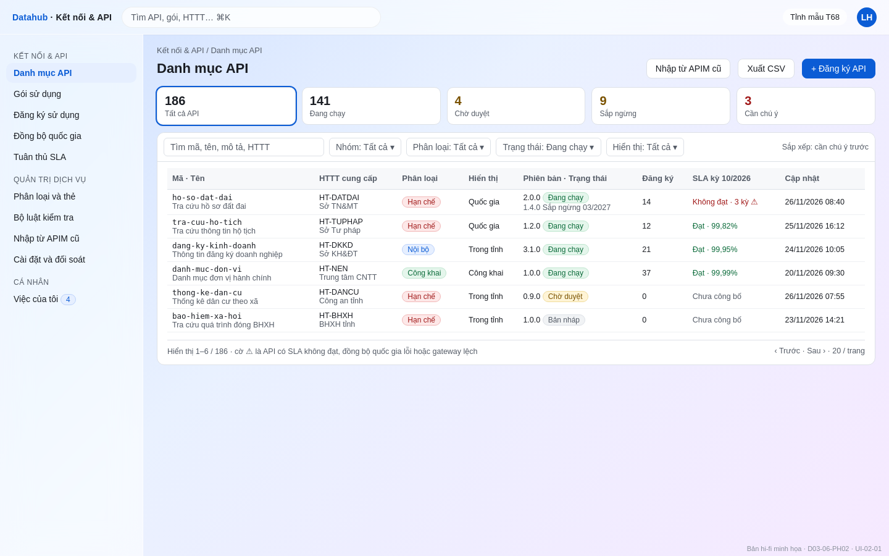

### 7.1. Wireframe

Khối dưới là wireframe bằng chữ của UI-02-01; ảnh hi-fi của màn nằm trong cùng chương, số thứ tự trong wireframe khớp cột "#" của bảng thành phần.

```text
┌ Danh mục API ───────────────────────── [Nhập từ APIM cũ] [Xuất CSV] [+ Đăng ký API] ┐
│ [Tất cả 186] [Đang chạy 141] [Chờ duyệt 4] [Sắp ngừng 9] [Cần chú ý 3]               │
│ [Tìm mã, tên, mô tả, HTTT…      ] [Nhóm ▾] [Phân loại ▾] [Trạng thái ▾] [Hiển thị ▾]  │
├──────────────────────┬────────────┬────────┬────────┬───────────────┬────┬────────┬───┤
│ Mã · Tên             │ HTTT       │ Phân   │ Hiển   │ Phiên bản ·   │ ĐK │ SLA    │ ⋯ │
│                      │ cung cấp   │ loại   │ thị    │ trạng thái    │    │ kỳ 10  │   │
├──────────────────────┼────────────┼────────┼────────┼───────────────┼────┼────────┼───┤
│ ho-so-dat-dai        │ HT-DATDAI  │ Hạn chế│ Quốc gia│ 2.0.0 Đang chạy│ 14 │ ⚠ 3 kỳ │ ⋯ │
└──────────────────────┴────────────┴────────┴────────┴───────────────┴────┴────────┴───┘
  Hiển thị 1–20 / 186                                         ‹ Trước  Sau ›  20 / trang
```

### 7.2. Thành phần

Bảng dưới liệt kê từng vùng của UI-02-01 theo số trên wireframe: thành phần `CMP-*`, nội dung hiển thị, nguồn dữ liệu và điều kiện hiện hoặc khóa.

| # | Thành phần | `CMP-*` | Nội dung, kiểm tra | Nguồn | Ghi chú |
|---|---|---|---|---|---|
| 1 | Tiêu đề, nút | `CMP-PageHeader`, `CMP-Button`, `CMP-DropdownMenu` | "Đăng ký API" primary; "Nhập từ APIM cũ", "Xuất CSV" mặc định | — | Ẩn khi thiếu quyền |
| 2 | Thẻ tổng | `CMP-KpiCard` biến thể `filter` | Tất cả, Đang chạy, Chờ duyệt, Sắp ngừng, Cần chú ý; bấm là bật bộ lọc nhanh | `facets` của API-02-001 | Có `aria-pressed` |
| 3 | Thanh lọc | `CMP-FilterBar`, `CMP-SearchInput`, `CMP-Select`, `CMP-TreeSelect` | Tìm ≥ 2 ký tự, trễ 300 ms, toàn văn (API-02-003); nhóm và phân loại chọn theo cây | API-02-001 `q`, `category`, `status`, `visibility` | Ghi URL |
| 4 | Bảng | `CMP-DataTable` | Cột §7.3; mặc định "cần chú ý" lên đầu rồi theo ngày cập nhật | `items` | Phân trang `page`/`size` |
| 5 | Dịch vụ sự kiện | `CMP-Tabs` (Đợt 2) | Tab "API" và "Sự kiện (topic)"; tab sự kiện ẩn khi chưa bật PH-10 | API-02-013 | FR-02-009 |
| 6 | Phân trang | `CMP-Pagination` | 10/20/50/100 | `page`, `size` | |

: UI-02-01 · Thành phần

### 7.3. Cột bảng

Bảng dưới nêu các cột của danh sách ở UI-02-01: nội dung, kiểu hiển thị, khả năng sắp xếp.

| Cột | Nội dung | Sắp xếp | Ghi chú |
|---|---|---|---|
| Mã · Tên | `CMP-CodeText` mã (dòng 1), tên (dòng 2); từ khóa tìm tô nền nhạt | Có | Liên kết tới UI-02-02 |
| HTTT cung cấp | Mã HTTT, tên đơn vị chủ quản | Có | |
| Phân loại | `CMP-StatusTag` mức phân loại dữ liệu | Có | Nhãn kèm chữ |
| Hiển thị | Trong tỉnh, Quốc gia, Công khai | | |
| Phiên bản · Trạng thái | Phiên bản mới nhất đang chạy và nhãn; phiên bản sắp ngừng ở dòng 2 kèm tháng ngừng | Có | |
| Đăng ký | Số đăng ký `ACTIVE` | Có | Liên kết UI-02-08 lọc theo API |
| SLA kỳ gần nhất | "Đạt · 99,82%", "Không đạt · 3 kỳ ⚠", "Chưa công bố" | Có | Có chữ, không chỉ màu |
| Cập nhật | `CMP-Timestamp` | Có | |
| ⋯ | Menu: Mở, Sao chép đường dẫn, So sánh phiên bản, Tạm ngừng (theo `allowedActions`) | | |

: UI-02-01 · Cột bảng

### 7.4. Trạng thái màn

Bảng dưới nêu từng trạng thái của UI-02-01 (rỗng, đang tải, lỗi, thiếu quyền và các trạng thái nghiệp vụ) và cách giao diện phản ứng.

| Trạng thái | Hiển thị |
|---|---|
| Đang tải | `CMP-Skeleton` 8 dòng và 5 thẻ tổng (ST-01) |
| Rỗng lần đầu | "Danh mục chưa có API nào. Mỗi API cần có đặc tả OpenAPI, được kiểm tra và duyệt trước khi HTTT khác sử dụng." kèm "Đăng ký API" (khi có quyền) và "Nhập từ APIM cũ" |
| Không có kết quả | ST-04 "Không tìm thấy API phù hợp" kèm điều kiện đang lọc và "Xóa bộ lọc" |
| Lỗi tải | ST-05; riêng lỗi tìm kiếm toàn văn (OpenSearch không sẵn sàng) chuyển sang tìm theo mã, tên và hiện `CMP-Banner` "Tìm toàn văn tạm thời không dùng được" |
| Không có quyền | ST-07 |

: UI-02-01 · Trạng thái màn

### 7.5. Tương tác và phím tắt

`/` vào ô tìm; `N` mở UI-02-03 (khi có quyền); `↑`, `↓` chọn dòng, `Enter` mở chi tiết; `F` mở bộ lọc; `?` mở `CMP-ShortcutSheet`. Thẻ tổng thao tác bằng `Space`. Bảng có `aria-label="Danh sách API"`; thông báo "Hiển thị 20 trong 186 API" cập nhật qua `aria-live="polite"` sau mỗi lần lọc (WCAG SC 4.1.3).

## 8. UI-02-02 Chi tiết API

::: dac-ta
**Mục đích.** Xem đầy đủ một API: thông tin, các phiên bản và vòng đời, backend, gói, đăng ký, SLA; cách gọi và tải đặc tả; thực hiện các thao tác vòng đời.

**Người dùng chính.** SV, CA, TA, TO, SO; IE xem và tải đặc tả.

**FR hiện thực.** FR-02-002, 005, 006, 012, 013, 014, 022…026, 034, 036, 037, 040…042, 045, 049, 055, 056, 058.

**Đường dẫn.** `/ket-noi/api/{ma-api}`.

**Mẫu.** PTN-02.

**Quyền.** `PERM-02-read`; thao tác theo §8.2.

**API.** API-02-002, 006, 007, 090, 091, 026, 031, 033, 059, 074, 075, 078; hành động API-02-042…054, 057, 061…062, 073.
:::

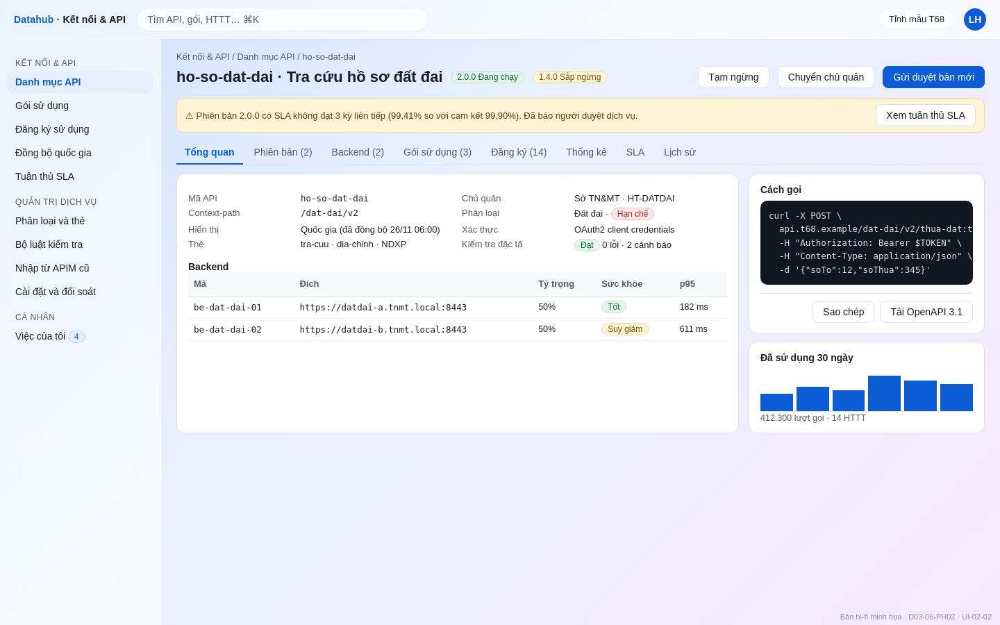

### 8.1. Wireframe

Khối dưới là wireframe bằng chữ của UI-02-02; ảnh hi-fi của màn nằm trong cùng chương, số thứ tự trong wireframe khớp cột "#" của bảng thành phần.

```text
┌ ho-so-dat-dai · Tra cứu hồ sơ đất đai  (2.0.0 Đang chạy) (1.4.0 Sắp ngừng) ─ [Tạm ngừng] [⋯] [Gửi duyệt bản mới] ┐
│ ⚠ Phiên bản 2.0.0 có SLA không đạt 3 kỳ liên tiếp…                        [Xem tuân thủ SLA]          │
│ Tổng quan │ Phiên bản │ Backend │ Gói sử dụng │ Đăng ký │ Thống kê │ SLA │ Lịch sử                      │
├───────────────────────────────────────────────────┬─────────────────────────────────────────────────┤
│ Mã, chủ quản, context-path, phân loại, hiển thị…  │ Cách gọi (lệnh mẫu)  [Sao chép] [Tải OpenAPI]    │
│ Backend: be-01 ● Tốt · be-02 ◐ Suy giảm          │ Sử dụng 30 ngày: biểu đồ cột                    │
└───────────────────────────────────────────────────┴─────────────────────────────────────────────────┘
```

### 8.2. Thanh hành động tiêu đề

Nút hiện theo `allowedActions` của API-02-002; nút chính (primary) là hành động hợp lệ tiếp theo của phiên bản đang xem.

| Nút | Điều kiện hiện | Hộp thoại | API | Quyền |
|---|---|---|---|---|
| Gửi duyệt | Phiên bản `DRAFT`, đủ điều kiện | `CMP-ConfirmDialog` kèm danh sách điều kiện; thiếu thì vô hiệu và liệt kê (ERR-02-012) | API-02-042 | `PERM-02-submit` |
| Rút yêu cầu duyệt | `PENDING`, là người gửi | `CMP-ConfirmDialog` | API-02-043 | `PERM-02-submit` |
| Tạm ngừng, Tiếp tục | `PUBLISHED` ↔ `SUSPENDED` | `CMP-ReasonDialog` (lý do bắt buộc), hiện số bên khai thác bị ảnh hưởng | API-02-048, 049 | `PERM-02-operate` |
| Tạo phiên bản mới | `PUBLISHED` hoặc `DEPRECATED` | `CMP-Modal`: số phiên bản đề xuất, sao chép đặc tả, gói | API-02-054 | `PERM-02-create` |
| Ngừng khuyến nghị | `PUBLISHED` | Mở UI-02-13 | API-02-050 | `PERM-02-submit` |
| Ngừng hẳn, Hủy bản nháp | `DEPRECATED` hết hạn, hoặc `DRAFT` | `CMP-ReasonDialog`; còn đăng ký thì chặn (ERR-02-030) | API-02-051 | `PERM-02-submit`, `PERM-02-create` |
| Xóa API | Không còn phiên bản phục vụ | `CMP-ConfirmDialog` nhập lại mã API | API-02-052 | `PERM-02-create` |
| Đặt mức hiển thị | Luôn (nâng mức thì cần duyệt) | `CMP-Modal` chọn mức; mức không hợp lệ bị chặn ERR-02-043 | API-02-053 | `PERM-02-create` hoặc `PERM-02-submit` |
| Đồng bộ lại đặc tả | Phiên bản có URL nguồn | `CMP-Button`, tiến độ `CMP-JobProgress` | API-02-016 | `PERM-02-create` |
| Chuyển chủ quản | Chỉ TA | `CMP-Modal` chọn HTTT, đơn vị đích, lý do | API-02-057 | Quyền quản trị phân hệ |

: UI-02-02 · Thanh hành động

### 8.3. Các tab

Bảng dưới nêu từng tab của UI-02-02: nội dung, nguồn dữ liệu và vai trò được thấy tab.

| Tab | Nội dung | Thành phần | API |
|---|---|---|---|
| Tổng quan | Thông tin chung, phân loại, thẻ, hiển thị, xác thực; kết quả kiểm tra đặc tả (liên kết UI-02-04); cách gọi; sử dụng 30 ngày | `CMP-DescriptionList`, `CMP-CodeBlock`, `CMP-CopyButton`, `CMP-Chart` | API-02-002, 006, 078 |
| Phiên bản | Dòng thời gian các phiên bản, trạng thái, ngày công bố; chọn hai bản để so sánh (UI-02-05); tải đặc tả | `CMP-VersionTimeline`, `CMP-DataTable` | API-02-090, 007 |
| Backend | Danh sách backend, tỷ trọng, sức khỏe, p95; thêm, sửa cân bằng tải, thời gian chờ, thử lại, kiểm tra sức khỏe; xóa | `CMP-DataTable`, `CMP-Drawer`, `CMP-StatusDot` | API-02-026…029, 031 |
| Gói sử dụng | Gói của phiên bản đang chọn, trạng thái, số đăng ký; "Tạo gói", "Sao chép từ phiên bản trước" | `CMP-DataTable` | API-02-033, 040 |
| Đăng ký | Đăng ký theo API; chuyển tới UI-02-08 | `CMP-DataTable` | API-02-059 |
| Thống kê | Lượt gọi, bên khai thác hàng đầu (Đợt 2) | `CMP-Chart` | API-02-078 |
| SLA | Cam kết hiện hành, đang chờ hiệu lực, đối chiếu theo kỳ; sửa cam kết | `CMP-DataTable`, `CMP-Form` | API-02-073…075 |
| Lịch sử | Chuyển trạng thái và thay đổi kèm người, lý do | `CMP-AuditTimeline` | API-02-091 |

: UI-02-02 · Các tab

### 8.4. Trạng thái màn

Bảng dưới nêu từng trạng thái của UI-02-02 (rỗng, đang tải, lỗi, thiếu quyền và các trạng thái nghiệp vụ) và cách giao diện phản ứng.

| Trạng thái | Hiển thị |
|---|---|
| Đang tải | Skeleton đầu trang, hàng tab và khối mô tả |
| Phiên bản `PENDING` | Dải `CMP-Alert` thông tin "Đang chờ {người duyệt} duyệt từ {giờ}. Nội dung bị khóa." (ERR-02-038 nếu cố sửa); nút "Rút yêu cầu" |
| Phiên bản `SUSPENDED` | Dải cảnh báo kèm lý do, người, thời điểm và nút "Tiếp tục" |
| Gateway chưa nạp cấu hình | `CMP-Banner` "Cổng API chưa nhận cấu hình, hệ thống đang thử lại" (ERR-02-033) |
| Không tồn tại | ST-08: "Không tìm thấy API {mã}" |
| Không có quyền | ST-07; IE xem được, các nút ghi ẩn (ST-15) |

: UI-02-02 · Trạng thái màn

### 8.5. Tương tác và phím tắt

`1…8` đổi tab; `G` rồi `V` tới tab Phiên bản (chuỗi phím, có thể tắt); `C` sao chép lệnh gọi; `E` mở sửa (khi `DRAFT`). Tab dùng `role="tablist"` với mũi tên trái phải; nội dung tab giữ vị trí cuộn khi quay lại. Khi nút bị vô hiệu, tooltip mở bằng focus bàn phím chứ không chỉ khi rê chuột (SC 1.4.13).

## 9. UI-02-03 Đăng ký API từ OpenAPI (siêu chi tiết)

::: dac-ta
**Mục đích.** Giúp chủ dịch vụ đưa một API vào danh mục trong một phiên làm việc: khai thông tin, nạp đặc tả (tệp, dán, URL), nhìn kết quả kiểm tra ngay khi sửa, khai backend và gói, rồi lưu nháp hoặc gửi duyệt.

**Người dùng chính.** SV, TA.

**FR hiện thực.** FR-02-010, 011, 014, 015, 019, 020, 022, 024, 027, 034, 055.

**Đường dẫn.** `/ket-noi/api/moi`; sửa: `/ket-noi/api/{ma-api}/sua`.

**Mẫu.** PTN-05 (wizard) với bước 3 có bố cục hai cột kiểu PTN-07.

**Quyền.** `PERM-02-create`; bước gửi duyệt cần `PERM-02-submit`.

**API.** API-02-014, 015, 018, 019, 022, 023, 027, 030, 034, 036 (qua gói), 042, 073.
:::

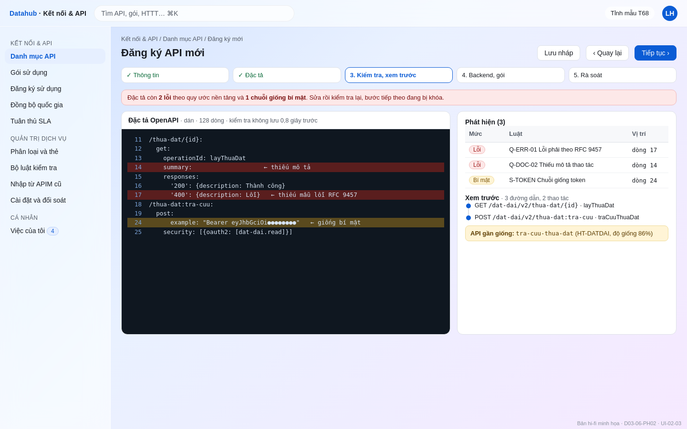

### 9.1. Các bước

Năm bước theo `CMP-Wizard`/`CMP-Steps`; bước đã qua bấm quay lại được, bước chưa tới khóa. Mỗi bước lưu nháp tự động mỗi 30 giây (phiên bản `DRAFT` tạo ở bước 1 qua API-02-014 với `Idempotency-Key`).

| Bước | Tên | Nội dung | Điều kiện sang bước sau |
|---|---|---|---|
| 1 | Thông tin | Mã API, tên, mô tả, HTTT cung cấp, đơn vị, context-path, phân loại, mức phân loại dữ liệu, mức hiển thị, thẻ | Trường bắt buộc hợp lệ; context-path không trùng (API-02-030, kiểm tra khi gõ) |
| 2 | Đặc tả | Chọn nguồn: tải tệp, dán, URL; nút "Tải mẫu theo quy ước nền tảng" (API-02-019) | Phân tích được đặc tả (không ERR-02-005) |
| 3 | Kiểm tra, xem trước | Khung đặc tả bên trái, phát hiện và xem trước bên phải; API gần giống | Không còn phát hiện mức Lỗi hoặc Bí mật chưa xử lý |
| 4 | Backend, gói | Khai ít nhất một backend; tạo gói đầu (rút gọn của UI-02-07); khai SLA (tùy chọn) | Có backend và gói hợp lệ để gửi duyệt; lưu nháp thì không bắt buộc |
| 5 | Rà soát | Tóm tắt các bước, danh sách điều kiện công bố, thông báo "sẽ gửi tới {người duyệt}" | Nút "Lưu nháp" hoặc "Gửi duyệt" (ERR-02-012 liệt kê điều kiện thiếu) |

: UI-02-03 · Các bước

### 9.2. Lưới bố cục bước 3

Bước 3 là vùng làm việc lâu nhất nên chia vùng như sau (cửa sổ ≥ 1280 px; dưới 1280 px hai cột xếp dọc).

| Vùng | Vị trí, kích thước | Nội dung | Thành phần |
|---|---|---|---|
| R1 | Trên, cao 56 px | Tiêu đề bước, nút "Lưu nháp", "Quay lại", "Tiếp tục" | `CMP-PageHeader`, `CMP-Steps` |
| R2 | Dải cảnh báo, cao 40 px | Tổng số lỗi, bí mật; "Bước tiếp theo đang bị khóa" | `CMP-Alert` (`role="status"`) |
| R3 | Trái, 60% (≥ 640 px) | Khung đặc tả có đánh số dòng, tô sáng dòng có phát hiện, đường kẻ lề mang biểu tượng mức | `CMP-CodeEditor` (chế độ chỉ đọc cho nguồn URL) |
| R4 | Phải trên, 40% | Bảng phát hiện: mức, luật, vị trí; bấm là nhảy tới dòng và đưa focus vào R3 | `CMP-DataTable` |
| R5 | Phải giữa | Xem trước đường dẫn và thao tác sinh từ đặc tả (kèm context-path) | `CMP-Tree` |
| R6 | Phải dưới | API gần giống (độ giống ≥ ngưỡng `02.duplicate.threshold`), liên kết so sánh | `CMP-Alert` mức cảnh báo, `CMP-Link` |

: UI-02-03 · Vùng bước 3

### 9.3. Giải phẫu khung đặc tả (R3)

Bảng dưới mô tả các vùng của khung đặc tả dùng chung ở bước 2 và bước 3 của trình hướng dẫn, để kỹ sư dựng đúng một thành phần cho cả hai bước.

| Phần tử | Hành vi |
|---|---|
| Thanh trên khung | Nguồn (Dán, Tệp, URL), số dòng, "kiểm tra không lưu 0,8 giây trước", nút "Định dạng", "Mẫu" |
| Lề trái | Số dòng; biểu tượng ● đỏ (Lỗi), ▲ vàng (Cảnh báo), ◆ (Bí mật) kèm `aria-label` |
| Dòng có phát hiện | Nền đỏ nhạt, vàng nhạt kèm ghi chú cuối dòng (chữ, không chỉ màu), con trỏ tới là đọc to "Lỗi: thiếu mô tả thao tác" |
| Giá trị nghi bí mật | Đuôi đã che bằng `CMP-MaskedValue`, nút "Đề nghị không phải bí mật" mở `CMP-ReasonDialog` (API-02-093) |
| Kiểm tra khi gõ | Trễ 800 ms sau lần gõ cuối, gọi API-02-022; tối đa 60 lần/giờ/người (ERR-02-036: hiện "Tạm dừng kiểm tra tự động, bấm 'Kiểm tra lại' sau {n} phút") |
| Tệp lớn | Đặc tả vượt `02.spec.max-size-mib` bị từ chối ERR-02-009; trên 2.000 dòng tắt tô sáng cú pháp để giữ mượt |

: UI-02-03 · Khung đặc tả

### 9.4. Trường bước 1

Bảng dưới liệt kê từng trường nhập của UI-02-03: kiểu, bắt buộc, ràng buộc và thông báo lỗi.

| Trường | Kiểu | Bắt buộc | Kiểm tra | API |
|---|---|---|---|---|
| Mã API (`apiCode`) | `T-CODE` | Có | `^[a-z][a-z0-9-]{2,62}$`; trùng ERR-02-002 | API-02-014 |
| Tên hiển thị (`name`) | Chuỗi ≤ 120 | Có | Không rỗng | API-02-014 |
| Mô tả | Markdown ≤ 2.000 | Không | Lọc HTML | API-02-014 |
| HTTT cung cấp | `CMP-ResourceSelect` | Có | `ACTIVE` ở PH-01 (ERR-02-004); SV chỉ thấy HTTT của đơn vị mình | API-02-014 |
| Context-path | `T-CODE` đường dẫn | Có | `^/[a-z0-9/-]{3,120}$`; trùng ERR-02-019; kiểm tra trực tiếp | API-02-030 |
| Phân loại, thẻ | `CMP-TreeSelect`, `CMP-Select` nhiều | Có (1 nhóm) | Nhóm có thật | API-02-008 |
| Mức phân loại dữ liệu | `CMP-Select` | Có | Bí mật nhà nước bị chặn ERR-02-016 | API-02-014 |
| Mức hiển thị | `CMP-Segmented` | Có | Phù hợp mức phân loại (ERR-02-043) | API-02-014 |

: UI-02-03 · Trường bước 1

### 9.5. Trạng thái màn

Bảng dưới nêu từng trạng thái của UI-02-03 (rỗng, đang tải, lỗi, thiếu quyền và các trạng thái nghiệp vụ) và cách giao diện phản ứng.

| Trạng thái | Hiển thị |
|---|---|
| Đang kiểm tra | Dải R2 "Đang kiểm tra…" `aria-busy`, giữ kết quả cũ mờ 60% |
| Có lỗi hoặc bí mật | Dải đỏ; nút "Tiếp tục" vô hiệu, tooltip "Còn 2 lỗi và 1 bí mật cần xử lý" |
| Chỉ còn cảnh báo | Cho tiếp tục; mỗi cảnh báo có nút "Chấp nhận" kèm lý do (API-02-092) |
| Đặc tả không phân tích được | ERR-02-005 trong R3, các vùng khác trống kèm hướng dẫn "Kiểm tra cú pháp YAML/JSON" |
| URL không tải được | ERR-02-010 dưới ô URL; không in IP |
| Có bản nháp chưa lưu khi rời trang | `CMP-ConfirmDialog` "Lưu nháp trước khi rời?"; bản nháp cục bộ không chứa giá trị nghi bí mật |
| Hết phiên | ST-14, khôi phục nháp sau đăng nhập |

: UI-02-03 · Trạng thái màn

### 9.6. Bàn phím, chuột, trợ năng

Bảng dưới nêu phím tắt và cách thao tác bằng bàn phím, chuột và trình đọc màn hình cho UI-02-03.

| Phím, thao tác | Tác dụng |
|---|---|
| `Ctrl+Enter` | Kiểm tra lại ngay |
| `F8`, `Shift+F8` | Tới phát hiện kế tiếp, trước đó (focus vào dòng ở R3) |
| `Ctrl+S` | Lưu nháp |
| `Alt+←`, `Alt+→` | Bước trước, bước sau (khi hợp lệ) |
| `Esc` trong khung đặc tả | Thoát khung, đưa focus tới thanh trên (không bẫy bàn phím, SC 2.1.2) |
| Kéo thả tệp vào khung | Có nút "Chọn tệp" thay thế (SC 2.5.7) |
| Đổi cỡ hai cột | Kéo thanh chia hoặc `Ctrl+←`/`Ctrl+→` bước 5% |

: UI-02-03 · Bàn phím

Trợ năng: kết quả kiểm tra thông báo bằng `aria-live="polite"` ("Còn 2 lỗi, 1 cảnh báo"); danh sách phát hiện có `role="list"`; không mất dữ liệu khi người dùng nhập lại (SC 3.3.7: bước 4 tự điền HTTT, context-path đã khai ở bước 1).

## 10. UI-02-04 Kết quả kiểm tra đặc tả

::: dac-ta
**Mục đích.** Cho chủ dịch vụ, cán bộ ATTT và người duyệt xem đầy đủ kết quả kiểm tra hai lớp và quét bí mật của một phiên bản, biết sửa ở đâu và sửa thế nào, chạy kiểm tra lại, chấp nhận cảnh báo kèm lý do.

**Người dùng chính.** SV, TA, SO, CA.

**FR hiện thực.** FR-02-016, 017, 018, 019, 020.

**Đường dẫn.** `/ket-noi/api/{ma-api}/phien-ban/{so}/kiem-tra`.

**Mẫu.** PTN-02.

**Quyền.** `PERM-02-read`; "Kiểm tra lại", "Chấp nhận", "Đề nghị không phải bí mật" cần `PERM-02-create`; SO xác nhận hoặc bác đề nghị cần `PERM-02-operate`.

**API.** API-02-020, 021, 023, 092, 093, 094.
:::

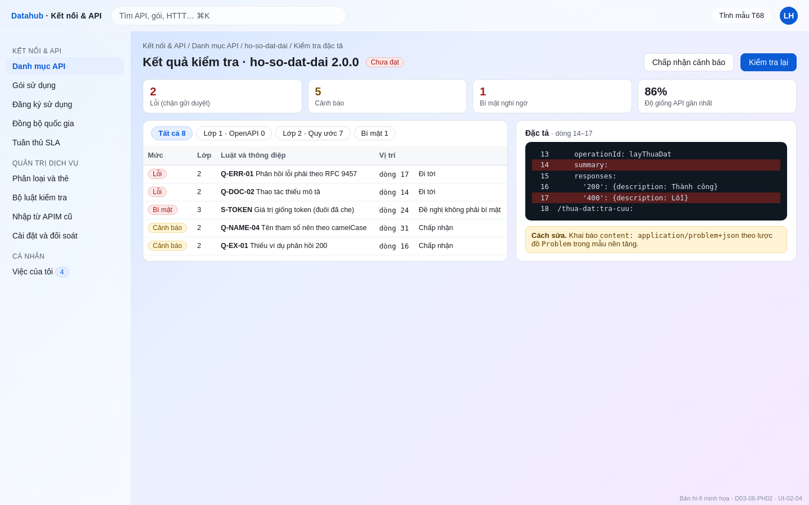

### 10.1. Thành phần

Bảng dưới liệt kê từng vùng của UI-02-04 theo số trên wireframe: thành phần `CMP-*`, nội dung hiển thị, nguồn dữ liệu và điều kiện hiện hoặc khóa.

| # | Thành phần | `CMP-*` | Nội dung, kiểm tra | Nguồn |
|---|---|---|---|---|
| 1 | Tiêu đề, nút | `CMP-PageHeader`, `CMP-Button` | "Kiểm tra lại" primary; "Chấp nhận cảnh báo" theo dòng chọn | API-02-021 |
| 2 | Thẻ tổng | `CMP-KpiCard` | Lỗi, Cảnh báo, Bí mật nghi ngờ, Độ giống API gần nhất | `summary` |
| 3 | Bộ lọc nhanh | `CMP-FilterBar` (hàng nhãn bộ lọc, D03-05-04 §3.4) | Tất cả, theo lớp (1 OpenAPI, 2 Quy ước, 3 Bí mật) | `findings[].layer` |
| 4 | Danh sách phát hiện | `CMP-DataTable` | Cột: Mức, Lớp, Luật và thông điệp, Vị trí, Thao tác | `findings[]` |
| 5 | Khung đặc tả | `CMP-CodeEditor` chỉ đọc | Tô sáng dòng đang chọn, nhảy tới dòng | API-02-007 |
| 6 | Ô cách sửa | `CMP-Alert` thông tin | Gợi ý sửa của luật (`remediation`) | `findings[].remediation` |
| 7 | Phát hiện trùng chức năng | `CMP-DataTable` thu gọn | API gần giống, độ giống, liên kết so sánh | API-02-023 |

: UI-02-04 · Thành phần

### 10.2. Hành động theo dòng

Bảng dưới nêu các hành động trên từng dòng của UI-02-04, điều kiện bật nút và kết quả.

| Phát hiện | Hành động | Hộp thoại | API | Ghi chú |
|---|---|---|---|---|
| Lỗi (`ERROR`) | Đi tới dòng | — | — | Không chấp nhận được, phải sửa đặc tả |
| Cảnh báo (`WARNING`) | Chấp nhận | `CMP-ReasonDialog` (lý do bắt buộc, ERR-02-041) | API-02-092 | Ghi kiểm toán, người duyệt thấy lý do |
| Bí mật (`SECRET`) | Đề nghị không phải bí mật | `CMP-ReasonDialog` | API-02-093 | SO thấy hàng đợi "Chờ xác nhận" |
| Bí mật đang chờ | SO: Xác nhận hoặc Bác | `CMP-ReasonDialog` | API-02-094 | Người đề nghị không tự xác nhận (ERR-02-013) |

: UI-02-04 · Hành động theo dòng

### 10.3. Trạng thái màn

Bảng dưới nêu từng trạng thái của UI-02-04 (rỗng, đang tải, lỗi, thiếu quyền và các trạng thái nghiệp vụ) và cách giao diện phản ứng.

| Trạng thái | Hiển thị |
|---|---|
| Đang chạy kiểm tra | `CMP-JobProgress` "Đang kiểm tra lớp 2…"; nút kiểm tra đếm ngược khi ERR-02-036 |
| Đạt hoàn toàn | `CMP-ResultPage` nhỏ "Đặc tả đạt cả hai lớp, không có bí mật." kèm "Quay lại API" |
| Có lỗi | Nút "Gửi duyệt" ở UI-02-02 vô hiệu, liên kết về màn này |
| Rỗng (chưa từng kiểm tra) | ST-03 "Phiên bản chưa được kiểm tra" kèm "Kiểm tra ngay" |
| Không có quyền | ST-07; không hiện đuôi bí mật cho người không có `PERM-02-read` |

: UI-02-04 · Trạng thái màn

`J`/`K` chọn phát hiện kế, trước; `Enter` nhảy tới dòng trong khung đặc tả; `A` chấp nhận (dòng cảnh báo). Biểu tượng mức luôn đi kèm chữ.

## 11. UI-02-05 So sánh phiên bản và tác động

::: dac-ta
**Mục đích.** So sánh hai phiên bản của một API, phân loại thay đổi (phá vỡ, cần xác nhận, tương thích) và cho biết HTTT nào đang gọi đúng các thao tác bị ảnh hưởng, từ đó quyết định số phiên bản và lộ trình ngừng dùng.

**Người dùng chính.** SV, CA, TA.

**FR hiện thực.** FR-02-043, 044.

**Đường dẫn.** `/ket-noi/api/{ma-api}/so-sanh?tu=1.4.0&den=2.0.0`.

**Mẫu.** PTN-02 với `CMP-DiffViewer`.

**Quyền.** `PERM-02-read`; nút "Tạo lộ trình ngừng dùng" cần `PERM-02-submit`.

**API.** API-02-055, 056, 090.
:::

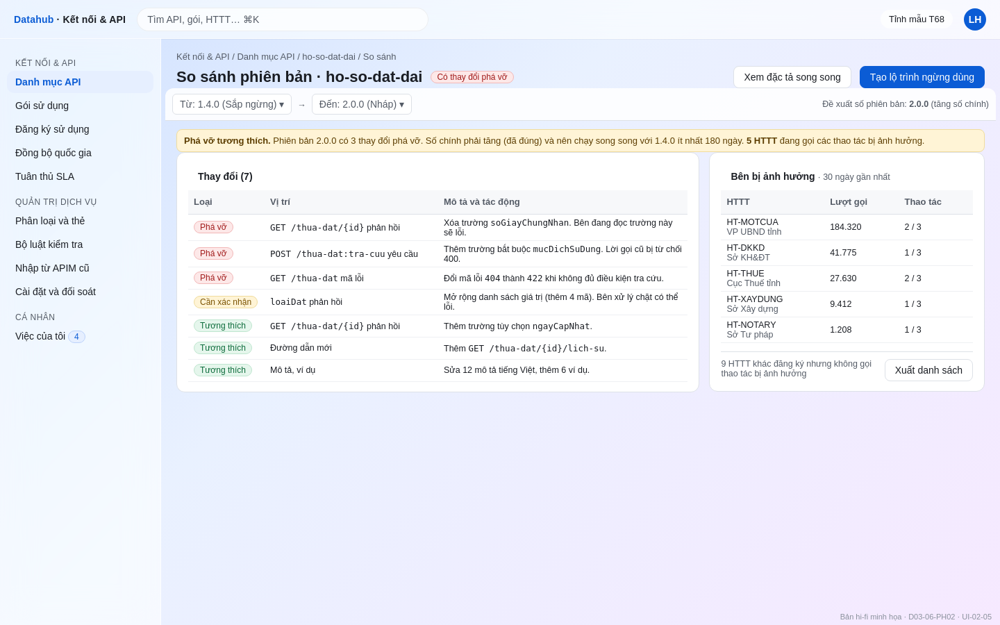

### 11.1. Thành phần

Bảng dưới liệt kê từng vùng của UI-02-05 theo số trên wireframe: thành phần `CMP-*`, nội dung hiển thị, nguồn dữ liệu và điều kiện hiện hoặc khóa.

| # | Thành phần | `CMP-*` | Nội dung | Nguồn |
|---|---|---|---|---|
| 1 | Chọn phiên bản | `CMP-Select` ×2 | "Từ", "Đến"; đổi chỗ bằng nút ⇄; cặp mặc định là bản đang chạy và bản mới nhất | API-02-090 |
| 2 | Dải kết luận | `CMP-Alert` (lỗi nếu có thay đổi phá vỡ) | "Phiên bản 2.0.0 có 3 thay đổi phá vỡ. Số chính phải tăng… 5 HTTT đang gọi các thao tác bị ảnh hưởng." | `breakingCount`, `suggestedVersion` |
| 3 | Danh sách thay đổi | `CMP-DiffTable` | Loại, Vị trí (phương thức, đường dẫn, phần yêu cầu hay phản hồi), Mô tả và tác động | API-02-055 |
| 4 | Xem song song | `CMP-DiffViewer` (hộp trượt) | Đặc tả hai bản, tô thêm, đổi, xóa; có chữ "Thêm", "Đổi", "Xóa" ở lề | API-02-007 |
| 5 | Bên bị ảnh hưởng | `CMP-DataTable` | HTTT, lượt gọi 30 ngày, số thao tác bị ảnh hưởng; "Xuất danh sách" | API-02-056 |
| 6 | Nút hành động | `CMP-Button` | "Tạo lộ trình ngừng dùng" mở UI-02-13 | — |

: UI-02-05 · Thành phần

### 11.2. Trạng thái và quy tắc

Bảng dưới nêu từng trạng thái của UI-02-05 (rỗng, đang tải, lỗi, thiếu quyền và các trạng thái nghiệp vụ) và cách giao diện phản ứng.

| Trường hợp | Hiển thị |
|---|---|
| Không có thay đổi phá vỡ | Dải kết luận xanh "Hai phiên bản tương thích" |
| Thay đổi phá vỡ nhưng giữ số chính | ERR-02-017 kèm nút "Dùng {số đề xuất}" (sửa số phiên bản khi còn `DRAFT`) |
| Phân tích tác động đang chạy | Bảng bên phải skeleton, bảng trái đã hiện |
| Không có bên bị ảnh hưởng | "Chưa có HTTT nào gọi thao tác bị ảnh hưởng trong 30 ngày qua." |
| Cùng một phiên bản | Không cho chọn trùng; thông báo "Chọn hai phiên bản khác nhau" |
| Không có quyền | ST-07 |

: UI-02-05 · Trạng thái màn

Loại thay đổi dùng chữ và biểu tượng (không chỉ màu đỏ, vàng, xanh) và token `color-diff-removed`, `color-diff-changed`, `color-diff-added` cho nền dòng. `←`/`→` đổi giữa danh sách và khung song song; `D` bật khung song song.

## 12. UI-02-06 Danh sách gói sử dụng

::: dac-ta
**Mục đích.** Xem toàn bộ gói theo API, trạng thái, kiểu xác thực; công bố, ngừng khuyến nghị, đóng, sao chép gói sang phiên bản mới.

**Người dùng chính.** SV, CA, TA.

**FR hiện thực.** FR-02-027, 030, 031, 032, 033.

**Đường dẫn.** `/ket-noi/goi-su-dung`.

**Mẫu.** PTN-01.

**Quyền.** `PERM-02-read`; tạo, sửa, sao chép cần `PERM-02-create`; công bố, ngừng khuyến nghị, đóng (gửi duyệt) cần `PERM-02-submit`.

**API.** API-02-096 (danh sách gói toàn tenant), 033, 037…041.
:::

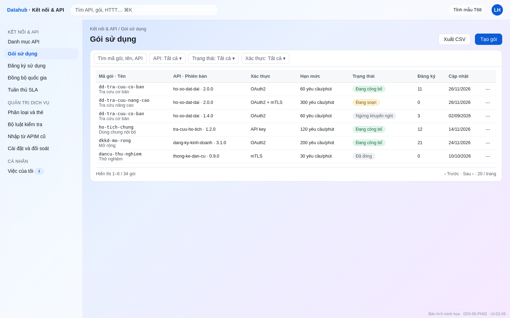

### 12.1. Thành phần và cột

Bảng dưới liệt kê từng vùng của UI-02-06 theo số trên wireframe: thành phần `CMP-*`, nội dung hiển thị, nguồn dữ liệu và điều kiện hiện hoặc khóa.

| # | Thành phần | `CMP-*` | Nội dung | Nguồn |
|---|---|---|---|---|
| 1 | Tiêu đề, nút | `CMP-PageHeader`, `CMP-Button` | "Tạo gói" mở UI-02-07; "Xuất CSV" | — |
| 2 | Thanh lọc | `CMP-FilterBar` | Tìm mã gói, tên; API; trạng thái; kiểu xác thực | API-02-096 |
| 3 | Bảng | `CMP-DataTable` | Mã gói · Tên; API · Phiên bản; Xác thực; Hạn mức; Trạng thái; Số đăng ký; Cập nhật; ⋯ | — |
| 4 | Thao tác hàng | `CMP-DropdownMenu` | Sửa (chỉ `STAGING`), Công bố, Ngừng khuyến nghị, Đóng, Sao chép sang phiên bản…, Hủy (nháp) | API-02-037…041 |

: UI-02-06 · Thành phần

Quy tắc hiển thị thao tác: "Công bố" khi gói `STAGING` và phiên bản `PUBLISHED` hoặc cùng đợt (FR-02-030); "Đóng" bị chặn khi còn đăng ký hiệu lực (ERR-02-024: "Còn {n} đăng ký đang dùng") và dẫn tới danh sách đăng ký của gói. Gửi duyệt đưa yêu cầu `PLAN_PUBLISH`, `PLAN_DEPRECATE` vào UI-02-10.

### 12.2. Trạng thái màn

Bảng dưới nêu từng trạng thái của UI-02-06 (rỗng, đang tải, lỗi, thiếu quyền và các trạng thái nghiệp vụ) và cách giao diện phản ứng.

| Trạng thái | Hiển thị |
|---|---|
| Đang tải | Skeleton 8 dòng |
| Rỗng lần đầu | "Chưa có gói sử dụng nào. Gói quy định điều kiện, hạn mức và cách xác thực để HTTT khác dùng API của bạn." kèm "Tạo gói" |
| Không có kết quả | ST-04 |
| Không có quyền | ST-07 |

: UI-02-06 · Trạng thái màn

`/` ô tìm; `N` tạo gói; `Enter` mở sửa gói đang chọn.

## 13. UI-02-07 Tạo, sửa gói sử dụng

::: dac-ta
**Mục đích.** Khai báo một gói: thông tin và điều kiện truy cập, đối tượng được xin dùng, kiểu xác thực, hạn mức và đường dẫn cho phép.

**Người dùng chính.** SV, TA.

**FR hiện thực.** FR-02-027, 028, 029.

**Đường dẫn.** `/ket-noi/goi-su-dung/moi?api={ma}&ban={so}`; sửa `/ket-noi/goi-su-dung/{ma-goi}/sua`.

**Mẫu.** PTN-03.

**Quyền.** `PERM-02-create`.

**API.** API-02-034, 035, 036, 033.
:::

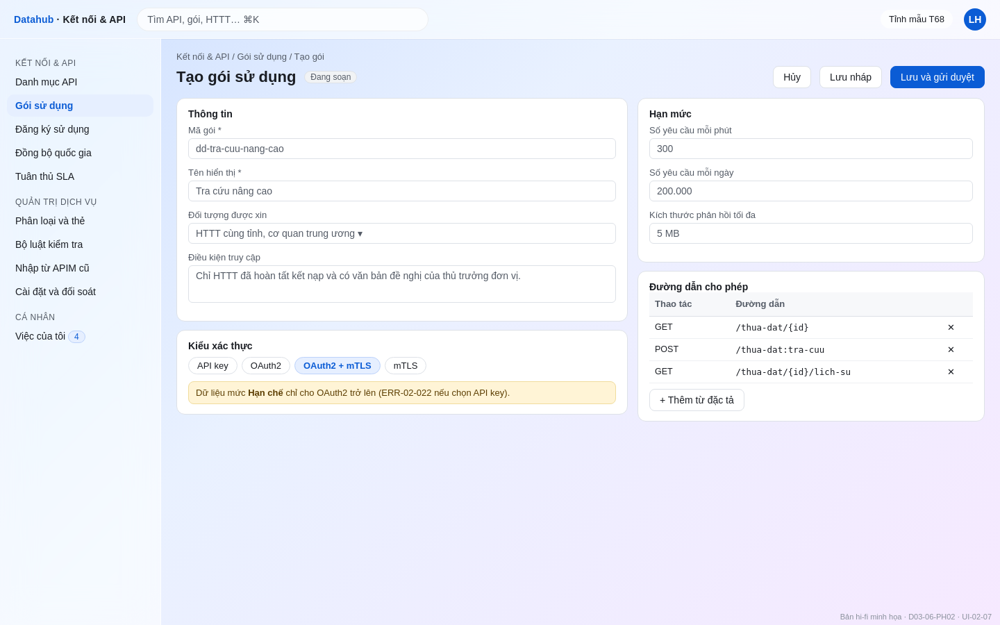

### 13.1. Trường biểu mẫu

Bảng dưới liệt kê từng trường nhập của UI-02-07: kiểu, bắt buộc, ràng buộc và thông báo lỗi.

| Nhóm | Trường | Kiểu | Bắt buộc | Kiểm tra | Ánh xạ API |
|---|---|---|---|---|---|
| Thông tin | Mã gói `planCode` | `T-CODE` | Có | `^[a-z][a-z0-9-]{2,62}$`; trùng ERR-02-002 | API-02-034 |
| Thông tin | Tên hiển thị | Chuỗi ≤ 120 | Có | | API-02-034 |
| Thông tin | Đối tượng được xin | `CMP-Select` nhiều | Có | Nhóm đối tượng có thật (ERR-02-028 khi đăng ký) | API-02-035 |
| Thông tin | Điều kiện truy cập | Văn bản ≤ 1.000 | Không | | API-02-035 |
| Xác thực | Kiểu xác thực | `CMP-Segmented` (`KEYLESS`, `API_KEY`, `OAUTH2`, `OAUTH2_MTLS`, `MTLS`) | Có | Theo mức phân loại (ERR-02-022); Keyless chỉ cho dữ liệu công khai | API-02-036 |
| Hạn mức | Số yêu cầu/phút, /ngày; kích thước phản hồi | `CMP-NumberInput` | Có | > 0 và ≤ trần; vô lý ERR-02-023 | API-02-036 |
| Đường dẫn cho phép | Thao tác được dùng | `CMP-DataTable` + "Thêm từ đặc tả" | Không | Phải có trong đặc tả (ERR-02-037) | API-02-036 |

: UI-02-07 · Trường biểu mẫu

### 13.2. Hành vi và trạng thái

Bảng dưới nêu từng trạng thái của UI-02-07 (rỗng, đang tải, lỗi, thiếu quyền và các trạng thái nghiệp vụ) và cách giao diện phản ứng.

| Trường hợp | Hiển thị |
|---|---|
| Chọn kiểu xác thực yếu cho dữ liệu hạn chế | Dải cảnh báo ngay khi chọn, lưu mới bị ERR-02-022 |
| Gói đang `PUBLISHED` | Biểu mẫu chỉ cho sửa theo hướng tương thích (tăng hạn mức, thêm đường dẫn); các trường khác vô hiệu kèm "Sửa không tương thích cần tạo gói mới" |
| Vượt `02.plan.max-per-version` | ERR-02-040 |
| Xung đột phiên bản | ST-13 |
| Lưu thành công | ST-10 "Đã lưu gói {mã}"; nút phụ "Gửi duyệt công bố" |

: UI-02-07 · Hành vi và trạng thái

`Ctrl+S` lưu; `Esc` đóng hỏi bỏ thay đổi. Nhóm kiểu xác thực là `role="radiogroup"` với mũi tên chọn.

## 14. UI-02-08 Danh sách đăng ký sử dụng

::: dac-ta
**Mục đích.** Xem đăng ký theo API (chủ dịch vụ, người duyệt) hoặc theo HTTT (cán bộ đầu mối); theo dõi trạng thái cấp phạm vi; tạm ngừng, tiếp tục, thu hồi, hủy, gia hạn.

**Người dùng chính.** OR, SV, CA, TA, TO.

**FR hiện thực.** FR-02-048, 050, 051, 052.

**Đường dẫn.** `/ket-noi/dang-ky`.

**Mẫu.** PTN-01.

**Quyền.** `PERM-02-read`; tạm ngừng, tiếp tục, cấp lại `PERM-02-operate`; thu hồi `PERM-02-approve-subscription`; hủy, gia hạn `PERM-02-subscribe`.

**API.** API-02-059, 060, 061…068.
:::

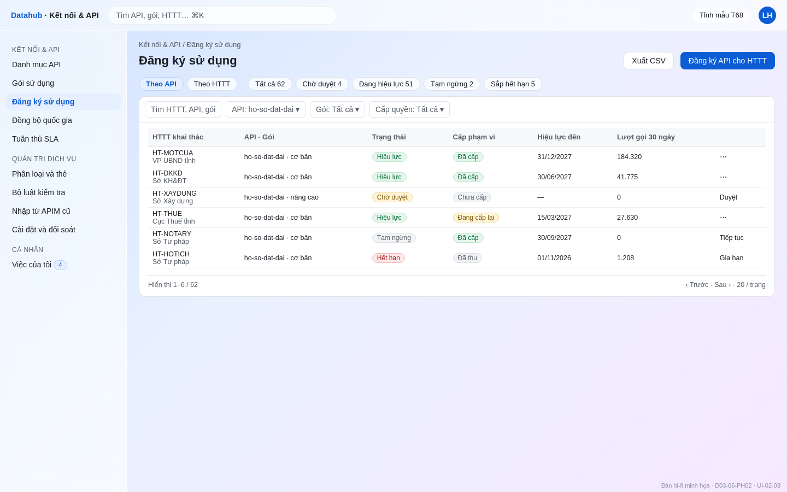

### 14.1. Thành phần và cột

Bảng dưới liệt kê từng vùng của UI-02-08 theo số trên wireframe: thành phần `CMP-*`, nội dung hiển thị, nguồn dữ liệu và điều kiện hiện hoặc khóa.

| # | Thành phần | `CMP-*` | Nội dung | Nguồn |
|---|---|---|---|---|
| 1 | Chế độ xem | `CMP-Segmented` | "Theo API", "Theo HTTT"; mặc định theo vai trò (OR: theo HTTT) | API-02-059 `groupBy` |
| 2 | Bộ lọc nhanh | `CMP-FilterBar` (hàng nhãn bộ lọc, D03-05-04 §3.4) | Tất cả, Chờ duyệt, Hiệu lực, Tạm ngừng, Sắp hết hạn | `facets` |
| 3 | Thanh lọc | `CMP-FilterBar` | Tìm HTTT, API, gói; chọn API; gói; cấp quyền | API-02-059, 060 |
| 4 | Bảng | `CMP-DataTable` | HTTT khai thác; API · Gói; Trạng thái; Cấp phạm vi; Hiệu lực đến; Lượt gọi 30 ngày; ⋯ | — |
| 5 | Chọn nhiều | `CMP-SelectionBar` | Tạm ngừng, Thu hồi hàng loạt (tối đa 50) kèm một lý do chung | API-02-061, 063 |

: UI-02-08 · Thành phần

Menu hàng theo trạng thái: `PENDING` → Duyệt (mở UI-02-10), Hủy; `ACTIVE` → Tạm ngừng, Thu hồi, Hủy, Gia hạn (Đợt 2), Cấp lại phạm vi (khi `FAILED`); `SUSPENDED` → Tiếp tục, Thu hồi. Thu hồi, tạm ngừng dùng `CMP-ReasonDialog` kèm số lượt gọi 30 ngày của HTTT để người thao tác thấy hậu quả.

### 14.2. Trạng thái màn

Bảng dưới nêu từng trạng thái của UI-02-08 (rỗng, đang tải, lỗi, thiếu quyền và các trạng thái nghiệp vụ) và cách giao diện phản ứng.

| Trạng thái | Hiển thị |
|---|---|
| Đang tải | Skeleton 8 dòng |
| Rỗng lần đầu (OR) | "HTTT của đơn vị chưa đăng ký sử dụng API nào. Vào Danh mục API, chọn API rồi bấm 'Đăng ký sử dụng'." kèm "Mở Danh mục API" |
| Rỗng lần đầu (SV) | "Chưa có HTTT nào đăng ký API của bạn." |
| Không có kết quả | ST-04 |
| Cấp phạm vi lỗi | Dòng hiện `CMP-StatusTag` "Cấp lỗi" và nút "Cấp lại" (API-02-068) |
| Không có quyền | ST-07 |

: UI-02-08 · Trạng thái màn

`/` tìm; `N` mở UI-02-09; `Space` chọn dòng; `Shift+↑/↓` chọn dải; `Delete` không gán (tránh thu hồi nhầm).

## 15. UI-02-09 Gửi đăng ký sử dụng

::: dac-ta
**Mục đích.** Cán bộ đầu mối chọn API, gói, HTTT của đơn vị mình, nêu mục đích, khối lượng, căn cứ pháp lý và xác nhận điều khoản để gửi đăng ký.

**Người dùng chính.** OR, TA.

**FR hiện thực.** FR-02-046.

**Đường dẫn.** `/ket-noi/dang-ky/moi?api=&goi=&httt=` (drawer trên UI-02-08; mở từ UI-02-02 thì nền là chi tiết API).

**Mẫu.** PTN-04.

**Quyền.** `PERM-02-subscribe`.

**API.** API-02-058, 060, 033.
:::

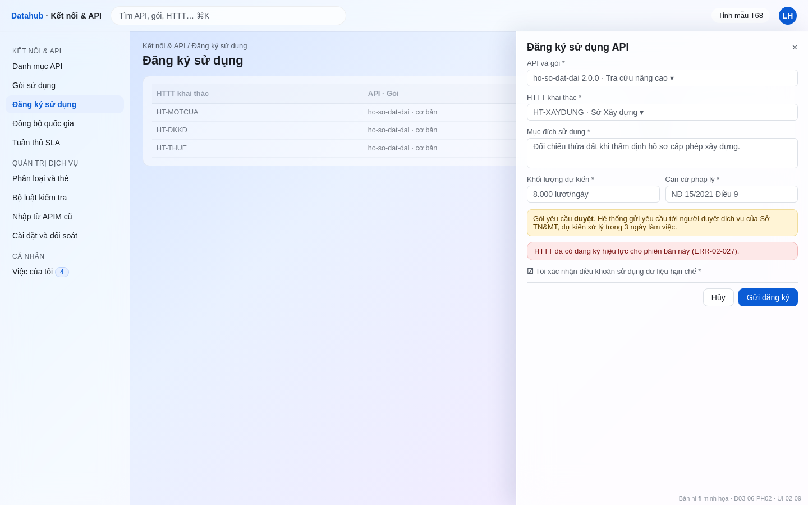

### 15.1. Trường biểu mẫu

Bảng dưới liệt kê từng trường nhập của UI-02-09: kiểu, bắt buộc, ràng buộc và thông báo lỗi.

| Trường | Kiểu | Bắt buộc | Kiểm tra | Lỗi |
|---|---|---|---|---|
| API và gói | `CMP-ApiSelect` | Có | Gói `PUBLISHED`, phiên bản nhận đăng ký | ERR-02-025 |
| HTTT khai thác | `CMP-ResourceSelect` | Có | `ACTIVE`, thuộc tổ chức người gửi; nguồn API-02-060 | ERR-02-026 |
| Mục đích sử dụng | `CMP-TextArea` ≤ 1.000 | Có | | ERR-02-029 |
| Khối lượng dự kiến | `CMP-NumberInput` + đơn vị (lượt/ngày) | Có | ≤ hạn mức gói gợi ý | ERR-02-029 |
| Căn cứ pháp lý | `CMP-Input` | Có | Tên văn bản và điều khoản | ERR-02-029 |
| Xác nhận điều khoản | `CMP-Checkbox` | Có khi dữ liệu hạn chế | Phải chọn | ERR-02-003 |

: UI-02-09 · Trường biểu mẫu

### 15.2. Hành vi và trạng thái

Bảng dưới nêu từng trạng thái của UI-02-09 (rỗng, đang tải, lỗi, thiếu quyền và các trạng thái nghiệp vụ) và cách giao diện phản ứng.

| Trường hợp | Hiển thị |
|---|---|
| Gói tự duyệt (`02.subscription.auto-approve.max-class`) | Dải thông tin "Gói này được duyệt tự động; phạm vi được cấp ngay sau khi gửi" |
| Gói cần duyệt | Dải "Gói yêu cầu duyệt… dự kiến xử lý trong {n} ngày làm việc" (n lấy từ `02.review.overdue-days`) |
| HTTT đã có đăng ký hiệu lực | ERR-02-027 trên đầu drawer, liên kết tới đăng ký hiện có |
| HTTT không thuộc đối tượng gói | ERR-02-028 dưới trường HTTT |
| Gửi thành công | ST-10 "Đã gửi đăng ký" + liên kết "Xem đăng ký"; drawer đóng, focus về nút "Đăng ký" |
| Tải lại trang giữa chừng | Giữ giá trị trừ ô xác nhận, không lưu bản nháp cục bộ có dữ liệu cá nhân |

: UI-02-09 · Hành vi và trạng thái

Drawer bẫy focus có chủ đích (`role="dialog"`, `aria-modal`), `Esc` đóng và hỏi nếu đã nhập, focus trả về phần tử mở. Nút "Gửi đăng ký" chuyển `loading` khi gửi (ST-09) để tránh gửi trùng (`Idempotency-Key`).

## 16. UI-02-10 Duyệt công bố, gói, đăng ký

::: dac-ta
**Mục đích.** Người duyệt dịch vụ rà soát và quyết định các yêu cầu của PH-02 ngay trong "Việc của tôi": công bố phiên bản, công bố gói, ngừng khuyến nghị, ngừng hẳn, nâng mức hiển thị, đăng ký sử dụng. Duyệt bốn mắt: người gửi không tự duyệt.

**Người dùng chính.** CA, TA; SV duyệt đăng ký sử dụng API của mình; SO xem.

**FR hiện thực.** FR-02-020, 030, 031, 035, 038, 039, 041, 047.

**Đường dẫn.** `/viec-cua-toi?loai=ph02.*&chon={ma-yeu-cau}`.

**Mẫu.** PTN-10.

**Quyền.** `PERM-02-publish` (công bố, gói, ngừng dùng, hiển thị); `PERM-02-approve-subscription` (đăng ký); xem `PERM-02-read`.

**API.** API-02-044, 098 (chi tiết yêu cầu), 045, 046, 020, 023, 055.
:::

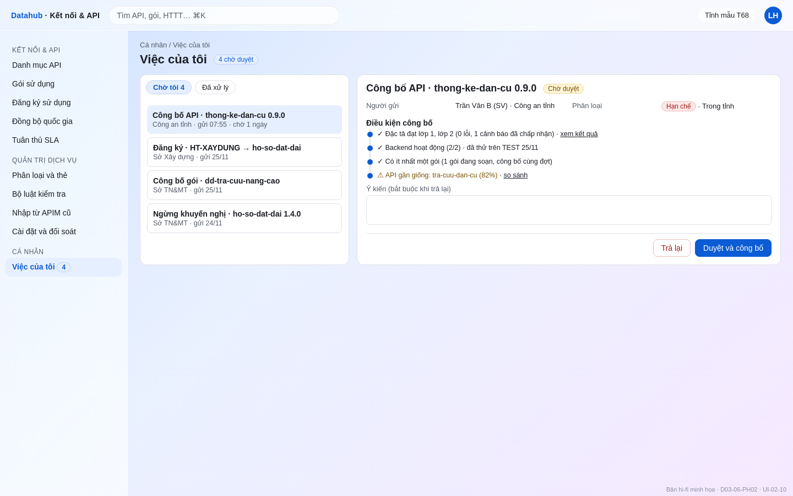

### 16.1. Bố cục

Hai cột theo PTN-10: trái là hộp việc (380 px) chia "Chờ tôi" và "Đã xử lý", phải là chi tiết yêu cầu. Chọn một việc đưa mã yêu cầu vào URL (`chon`).

| # | Thành phần | `CMP-*` | Nội dung | Nguồn |
|---|---|---|---|---|
| 1 | Hộp việc | `CMP-DataTable` kiểu danh sách | Loại yêu cầu, đối tượng, đơn vị gửi, thời gian chờ; quá hạn `02.review.overdue-days` có nhãn "Quá hạn" | API-02-044 |
| 2 | Tiêu đề yêu cầu | `CMP-PageHeader` nhỏ, `CMP-StatusTag` | Tên yêu cầu, trạng thái | — |
| 3 | Khối điều kiện | `CMP-ApprovalPanel` | Danh sách điều kiện kèm ✓/✗ và liên kết nguồn: đặc tả đạt, backend, gói, thử trên TEST, API gần giống | `conditions[]` |
| 4 | Khối nội dung theo loại | `CMP-DescriptionList`, `CMP-DiffTable` | Công bố: tóm tắt phiên bản và thay đổi phá vỡ; đăng ký: HTTT, mục đích, khối lượng, căn cứ; ngừng dùng: lộ trình, bên bị ảnh hưởng | API-02-020, 055 |
| 5 | Ý kiến, quyết định | `CMP-DecisionPanel` | Ô ý kiến (bắt buộc khi trả lại); "Duyệt" primary, "Trả lại" nguy hiểm | API-02-045, 046 |
| 6 | Lịch sử yêu cầu | `CMP-AuditTimeline` | Người gửi, ý kiến trước đó | `history[]` |

: UI-02-10 · Bố cục

### 16.2. Loại yêu cầu

Bảng dưới nêu từng loại yêu cầu duyệt hiện ở UI-02-10, quyền của người duyệt và thông tin hiển thị để quyết định.

| Loại | Điều kiện kiểm tra hiển thị | Hậu quả khi duyệt |
|---|---|---|
| Công bố phiên bản (`VERSION_PUBLISH`) | `SPEC_VALID`, `ACTIVE_BACKEND`, `HAS_PLAN`, `TEST_DEPLOYED`, không phá vỡ khi giữ số chính | Đẩy cấu hình ra gateway (có thể 202); hiện "Sẽ công bố ra gateway và danh mục" |
| Công bố gói (`PLAN_PUBLISH`) | Phiên bản `PUBLISHED` hoặc cùng đợt | Gói nhận đăng ký mới |
| Ngừng khuyến nghị (`VERSION_DEPRECATE`, `PLAN_DEPRECATE`) | Có kế nhiệm, hạn ≥ `02.deprecation.min-days` | Gửi thông báo cho bên khai thác |
| Ngừng hẳn (`VERSION_RETIRE`) | Không còn đăng ký (ERR-02-030) | Gỡ khỏi gateway |
| Nâng mức hiển thị (`VISIBILITY_RAISE`) | Hợp mức phân loại | Hiện ở cổng nhà phát triển, đồng bộ quốc gia nếu quốc gia |
| Quyết định đăng ký (`SUBSCRIPTION_DECISION`) | HTTT `ACTIVE`, thuộc đối tượng gói | Cấp phạm vi truy cập (API-02-067 theo dõi) |

: UI-02-10 · Loại yêu cầu

### 16.3. Trạng thái và lỗi

Bảng dưới nêu từng trạng thái của UI-02-10 (rỗng, đang tải, lỗi, thiếu quyền và các trạng thái nghiệp vụ) và cách giao diện phản ứng.

| Trường hợp | Hiển thị |
|---|---|
| Rỗng | "Không có yêu cầu nào chờ bạn." kèm liên kết "Xem việc đã xử lý" |
| Người xem là người gửi | Nút Duyệt vô hiệu, tooltip nêu ERR-02-013; vẫn trả lại được nếu có quyền khác vai |
| Thiếu điều kiện | Nút Duyệt vô hiệu, danh sách điều kiện thiếu nổi lên đầu (ERR-02-012) |
| Thiếu ý kiến khi trả lại | ERR-02-041 dưới ô ý kiến |
| Xung đột (yêu cầu đã được người khác xử lý) | ST-13: "Yêu cầu đã được {người} xử lý lúc {giờ}" kèm "Tải lại" |
| Gateway chưa nạp | Duyệt thành công nhưng dải thông tin "Đang công bố ra gateway…" kèm `CMP-JobProgress` (ERR-02-033 nếu quá thời hạn) |
| Không có quyền | ST-07 |

: UI-02-10 · Trạng thái và lỗi

`J`/`K` chọn việc kế, trước; `A` mở hộp xác nhận duyệt, `R` mở trả lại (đều hỏi xác nhận, không thực hiện ngay). Hộp xác nhận nêu rõ hậu quả ("Sẽ công bố ra gateway; 14 HTTT sẽ thấy phiên bản này").

## 17. UI-02-11 Tuân thủ SLA và thống kê

::: dac-ta
**Mục đích.** Đối chiếu cam kết chất lượng dịch vụ (SLA) với thực tế theo kỳ, thấy API không đạt nhiều kỳ liên tiếp; xem lượt gọi và bên khai thác.

**Người dùng chính.** SV, CA, TA, VW.

**FR hiện thực.** FR-02-055, 056, 058.

**Đường dẫn.** `/ket-noi/tuan-thu-sla` (đề nghị bổ sung vào D03-06-00).

**Mẫu.** PTN-06.

**Quyền.** `PERM-02-read`.

**API.** API-02-097 (tổng hợp SLA toàn tenant), 074, 075, 078, 079.
:::

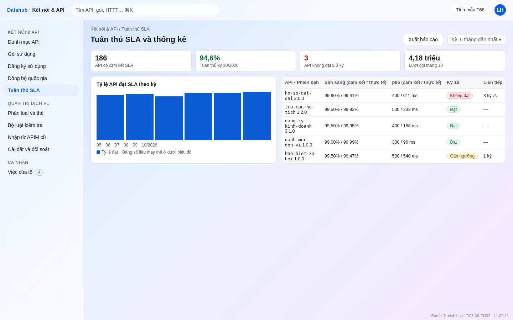

### 17.1. Thành phần

Bảng dưới liệt kê từng vùng của UI-02-11 theo số trên wireframe: thành phần `CMP-*`, nội dung hiển thị, nguồn dữ liệu và điều kiện hiện hoặc khóa.

| # | Thành phần | `CMP-*` | Nội dung | Nguồn |
|---|---|---|---|---|
| 1 | Bộ lọc kỳ | `CMP-DateRangePicker`, `CMP-Select` | 6 tháng gần nhất; lọc theo nhóm, chủ quản | `khoang` |
| 2 | Thẻ chỉ số | `CMP-KpiCard` ×4 | API có cam kết, % tuân thủ kỳ gần nhất, API không đạt ≥ `02.sla.breach-periods` kỳ, lượt gọi | API-02-097, 079 |
| 3 | Biểu đồ cột | `CMP-Chart` | Tỷ lệ API đạt SLA theo kỳ; màu `color-chart-1`, có nhãn giá trị và bảng thay thế | |
| 4 | Bảng cam kết với thực tế | `CMP-DataTable` | API · Phiên bản; sẵn sàng cam kết/thực tế; p95 cam kết/thực tế; kỳ; số kỳ liên tiếp không đạt | API-02-075 |
| 5 | Chi tiết một API | `CMP-Drawer` | Đối chiếu từng kỳ, lượt gọi, bên khai thác hàng đầu | API-02-078 |

: UI-02-11 · Thành phần

Kỳ có số lượt gọi dưới `02.sla.min-calls` hoặc dữ liệu dưới `02.sla.min-days-data` ngày hiện "Chưa đủ dữ liệu" thay vì "Đạt", để không báo đạt giả. Mọi biểu đồ có nút "Xem dạng bảng" (WCAG SC 1.1.1, 1.4.1).

| Trạng thái | Hiển thị |
|---|---|
| Đang tải | Skeleton thẻ và biểu đồ |
| Rỗng | "Chưa có API nào khai SLA. Khai cam kết ở tab SLA của từng API." |
| Dữ liệu đo chưa sẵn sàng (PH-13 chậm) | `CMP-Banner` "Số liệu kỳ này đang được chốt" (ERR-02-034 khi dịch vụ đo lỗi) |
| Không có quyền | ST-07 |

: UI-02-11 · Trạng thái màn

## 18. UI-02-12 Đồng bộ danh mục quốc gia

::: dac-ta
**Mục đích.** Theo dõi việc gửi danh mục lên Nền tảng quốc gia qua PH-14: bản ghi nào đã đồng bộ, đang chờ, bị từ chối, quá hạn; thử lại và xem lý do từ chối.

**Người dùng chính.** TO, TA.

**FR hiện thực.** FR-02-053, 054.

**Đường dẫn.** `/ket-noi/dong-bo-quoc-gia`.

**Mẫu.** PTN-11.

**Quyền.** `PERM-02-read` xem; "Đồng bộ ngay", "Gửi lại" cần `PERM-02-operate`.

**API.** API-02-070, 072, 069, 071, 095.
:::

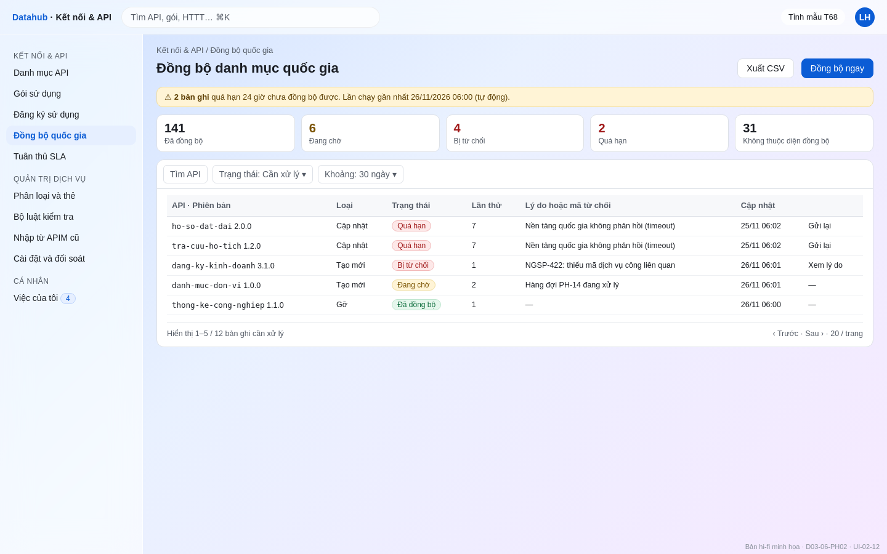

### 18.1. Thành phần và cột

Bảng dưới liệt kê từng vùng của UI-02-12 theo số trên wireframe: thành phần `CMP-*`, nội dung hiển thị, nguồn dữ liệu và điều kiện hiện hoặc khóa.

| # | Thành phần | `CMP-*` | Nội dung | Nguồn |
|---|---|---|---|---|
| 1 | Dải cảnh báo quá hạn | `CMP-Alert` mức cảnh báo | "{n} bản ghi quá hạn {02.sync.overdue-days} ngày chưa đồng bộ" kèm lần chạy gần nhất | API-02-070 |
| 2 | Thẻ tổng | `CMP-KpiCard` ×5 | Đã đồng bộ, Đang chờ, Bị từ chối, Quá hạn, Không thuộc diện | API-02-070 |
| 3 | Thanh lọc | `CMP-FilterBar` | Tìm API; trạng thái (mặc định "Cần xử lý"); khoảng thời gian | API-02-072 |
| 4 | Bảng | `CMP-DataTable` | API · Phiên bản; Loại (Tạo mới, Cập nhật, Gỡ); Trạng thái; Số lần thử; Lý do hoặc mã từ chối; Cập nhật; Thao tác | `items` |
| 5 | Drawer lý do | `CMP-Drawer` | Nội dung phản hồi của Nền tảng quốc gia (đã lọc), cách khắc phục theo mã | `rejection` |
| 6 | Nút "Đồng bộ ngay" | `CMP-Button` + `CMP-ConfirmDialog` | Hỏi số bản ghi sẽ gửi (≤ `02.sync.batch-size`); chạy là 202, tiến độ `CMP-JobProgress` | API-02-069 |

: UI-02-12 · Thành phần

| Trạng thái, lỗi | Hiển thị |
|---|---|
| Đồng bộ tắt (`02.sync.enabled` = false) | `CMP-Banner` "Đồng bộ quốc gia đang tắt cho tỉnh" kèm liên kết UI-02-17; nút ghi vô hiệu |
| API chưa đủ điều kiện | ERR-02-044 nêu điều kiện (ví dụ mức hiển thị chưa là Quốc gia) |
| Đang có lần chạy | ERR-02-035 "Đang có lần đồng bộ chạy" kèm liên kết tiến độ |
| PH-14 không khả dụng | ERR-02-034 `CMP-Banner`, dữ liệu đã tải vẫn hiện |
| Rỗng | "Chưa có API nào thuộc diện đồng bộ quốc gia." |
| Không có quyền | ST-07 |

: UI-02-12 · Trạng thái và lỗi

`R` gửi lại dòng đang chọn (có xác nhận); `Enter` mở drawer lý do. Số đếm trên thẻ cập nhật bằng `aria-live="polite"`.

## 19. UI-02-13 Lộ trình ngừng dùng và thông báo

::: dac-ta
**Mục đích.** Lập lộ trình ngừng khuyến nghị hoặc ngừng hẳn một phiên bản: chọn phiên bản kế nhiệm, hạn, hướng dẫn chuyển đổi; xem bên bị ảnh hưởng và trạng thái thông báo từng bên; gửi thông báo tay.

**Người dùng chính.** SV, CA, TA.

**FR hiện thực.** FR-02-038, 039, 044, 057.

**Đường dẫn.** `/ket-noi/api/{ma-api}/phien-ban/{so}/ngung-dung` (drawer trên UI-02-02 hoặc UI-02-05).

**Mẫu.** PTN-04.

**Quyền.** `PERM-02-submit`; thông báo tay `PERM-02-create`.

**API.** API-02-050, 051, 056, 076, 077.
:::

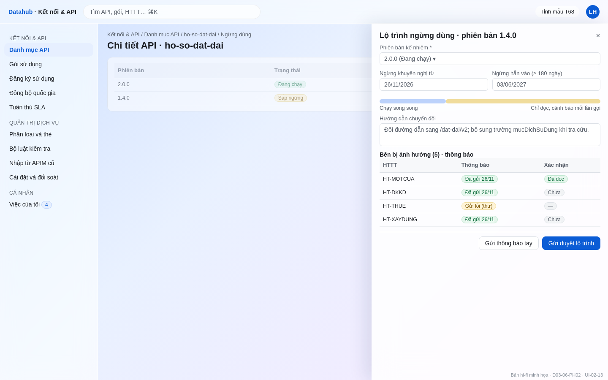

### 19.1. Trường và thành phần

Bảng dưới liệt kê từng vùng của UI-02-13 theo số trên wireframe: thành phần `CMP-*`, nội dung hiển thị, nguồn dữ liệu và điều kiện hiện hoặc khóa.

| Trường, thành phần | `CMP-*` | Kiểm tra | Lỗi |
|---|---|---|---|
| Phiên bản kế nhiệm | `CMP-Select` (phiên bản `PUBLISHED` cùng API) | Bắt buộc khi ngừng khuyến nghị | ERR-02-032 |
| Ngừng khuyến nghị từ | `CMP-DatePicker` | Không trước hôm nay | ERR-02-003 |
| Ngừng hẳn vào | `CMP-DatePicker` | Cách ngày bắt đầu ≥ `02.deprecation.min-days` | ERR-02-031 |
| Hướng dẫn chuyển đổi | `CMP-TextArea` ≤ 2.000 | Không | |
| Dải thời gian | `CMP-Timeline` | Hai đoạn: chạy song song, chỉ đọc có cảnh báo | — |
| Bên bị ảnh hưởng | `CMP-DataTable` | HTTT, lượt gọi, trạng thái thông báo (Đã gửi, Gửi lỗi, Chưa), xác nhận đã đọc | API-02-056, 077 |
| Gửi thông báo tay | `CMP-Button` + `CMP-Modal` | Giới hạn `02.notice.announcement-max-per-day` mỗi API mỗi ngày | ERR-02-036 |

: UI-02-13 · Trường và thành phần

Gửi lộ trình tạo yêu cầu `VERSION_DEPRECATE` vào UI-02-10. Thông báo gửi lỗi (thư, tin nhắn) hiện nhãn "Gửi lỗi" kèm "Gửi lại". Khi bên nhận là HTTT không còn đầu mối (`NO_RECIPIENTS`), dải cảnh báo "Không có đầu mối nhận thông báo; liên hệ chủ quản HTTT".

| Trạng thái | Hiển thị |
|---|---|
| Còn đăng ký khi chọn "Ngừng hẳn" | ERR-02-030 "Còn {n} đăng ký đang dùng" kèm liên kết |
| Không có bên bị ảnh hưởng | "Không có HTTT đang dùng phiên bản này; có thể ngừng ngay." |
| Hết phiên giữa chừng | ST-14, khôi phục nháp |
| Không có quyền | ST-07 |

: UI-02-13 · Trạng thái màn

## 20. UI-02-14 Phân loại và thẻ

::: dac-ta
**Mục đích.** Quản lý cây phân loại API của tenant: thêm, đổi tên, di chuyển, gộp, xóa nhóm; xem API trong từng nhóm; quản lý thẻ.

**Người dùng chính.** TA, PA.

**FR hiện thực.** FR-02-007, 008.

**Đường dẫn.** `/ket-noi/quan-tri/phan-loai`.

**Mẫu.** PTN-08.

**Quyền.** Quyền quản trị phân hệ (động từ admin, đề nghị); xem `PERM-02-read`.

**API.** API-02-009, 010, 011, 012, 001 (lọc theo nhóm), 008.
:::

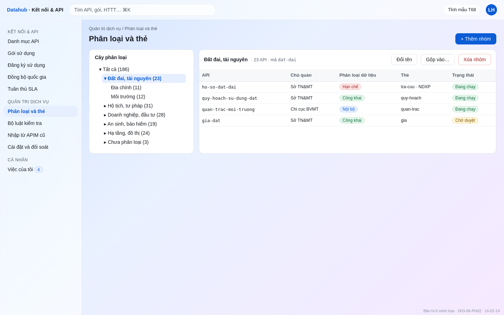

### 20.1. Bố cục

Trái là cây (`CMP-Tree`, 300 px, kéo thả hoặc "Di chuyển…" bằng hộp chọn), phải là chi tiết nhóm và bảng API trong nhóm (`CMP-DataTable`). Sửa tên và mã nhóm bằng `CMP-Modal`; xóa nhóm bắt buộc chọn nhóm đích cho API đang thuộc nhóm (`CMP-ConfirmDialog`, API-02-012). Gộp nhóm: chọn nhóm đích, hiện số API sẽ chuyển.

| Trường hợp | Hiển thị |
|---|---|
| Mã nhóm trùng | ERR-02-002 dưới trường mã |
| Vượt trần nhóm | ERR-02-040 |
| Nhóm đang có API khi xóa | Bắt buộc chọn nhóm đích; không xóa trực tiếp |
| Rỗng | "Chưa có nhóm phân loại. Thêm nhóm đầu tiên để API dễ tìm hơn." |
| Không có quyền sửa | Cây và bảng chỉ đọc (ST-15) |

: UI-02-14 · Trạng thái và lỗi

Kéo thả có thao tác thay thế bằng bàn phím: chọn nút cây, `Alt+↑/↓` đổi thứ tự, `Alt+→` thụt vào (SC 2.5.7). Cây dùng `role="tree"`, mũi tên mở, đóng nút.

## 21. UI-02-15 Bộ luật kiểm tra quy ước

::: dac-ta
**Mục đích.** Quản trị tenant chỉnh mức hiệu lực của các luật kiểm tra quy ước đặc tả (Lỗi, Cảnh báo, Tắt), xem số API đang vi phạm; mẫu quét bí mật do nền tảng quản lý, chỉ đọc.

**Người dùng chính.** TA, PA.

**FR hiện thực.** FR-02-021.

**Đường dẫn.** `/ket-noi/quan-tri/bo-luat`.

**Mẫu.** PTN-12.

**Quyền.** Quyền quản trị phân hệ (động từ admin, đề nghị); xem `PERM-02-read`.

**API.** API-02-024, 025.
:::

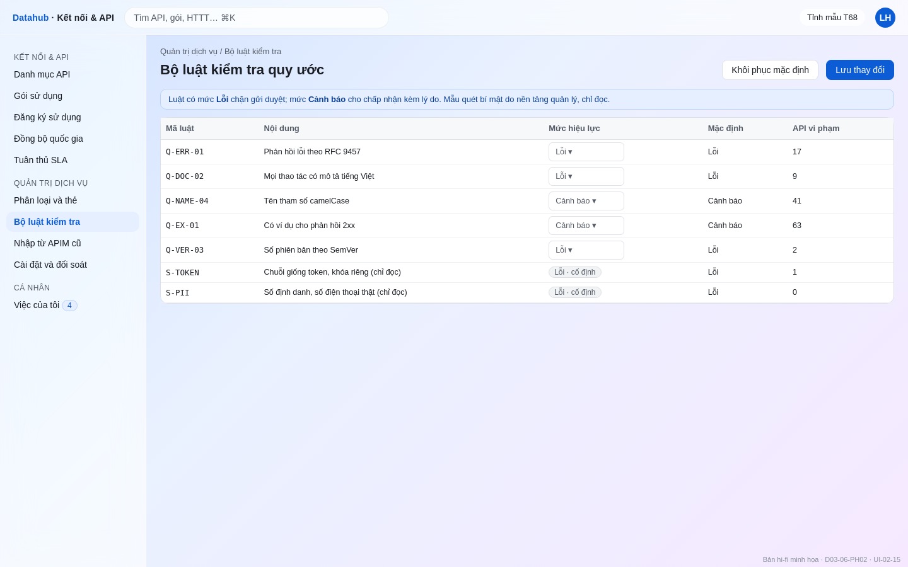

### 21.1. Thành phần và quy tắc

Bảng dưới liệt kê từng vùng của UI-02-15 theo số trên wireframe: thành phần `CMP-*`, nội dung hiển thị, nguồn dữ liệu và điều kiện hiện hoặc khóa.

| # | Thành phần | `CMP-*` | Nội dung |
|---|---|---|---|
| 1 | Dải giải thích | `CMP-Alert` thông tin | Ý nghĩa mức Lỗi, Cảnh báo; luật bí mật cố định |
| 2 | Bảng luật | `CMP-DataTable` | Mã luật; nội dung; mức hiệu lực (`CMP-Select`: Lỗi, Cảnh báo, Tắt); mặc định nền tảng; số API vi phạm (liên kết UI-02-01 lọc) |
| 3 | Thanh lưu | `CMP-SaveIndicator`, `CMP-Button` | "Lưu thay đổi" cần lý do (`CMP-ReasonDialog`); "Khôi phục mặc định" |

: UI-02-15 · Thành phần

Luật bí mật (`S-*`) hiện mức "Lỗi · cố định", ô chọn vô hiệu kèm tooltip "Do nền tảng quản lý để bảo vệ dữ liệu". Hạ mức một luật Lỗi xuống Cảnh báo hiện `CMP-ConfirmDialog` nêu số API đang vi phạm sẽ được qua cửa. Rỗng không xảy ra (luật mặc định luôn có). Lưu lỗi thiếu lý do: ERR-02-041; xung đột: ST-13; không có quyền: ST-07 hoặc chế độ chỉ đọc ST-15.

## 22. UI-02-16 Nhập từ APIM cũ

::: dac-ta
**Mục đích.** Quản trị tenant nạp gói xuất từ APIM cũ, xem trước ánh xạ API, gói, đăng ký sang mô hình mới, sửa chỗ vướng, xác nhận nhập và tải báo cáo đối chiếu.

**Người dùng chính.** TA, PA.

**FR hiện thực.** FR-02-061.

**Đường dẫn.** `/ket-noi/quan-tri/nhap-apim-cu`.

**Mẫu.** PTN-09.

**Quyền.** Quyền quản trị phân hệ (động từ admin, đề nghị).

**API.** API-02-085, 086, 087, 095.
:::

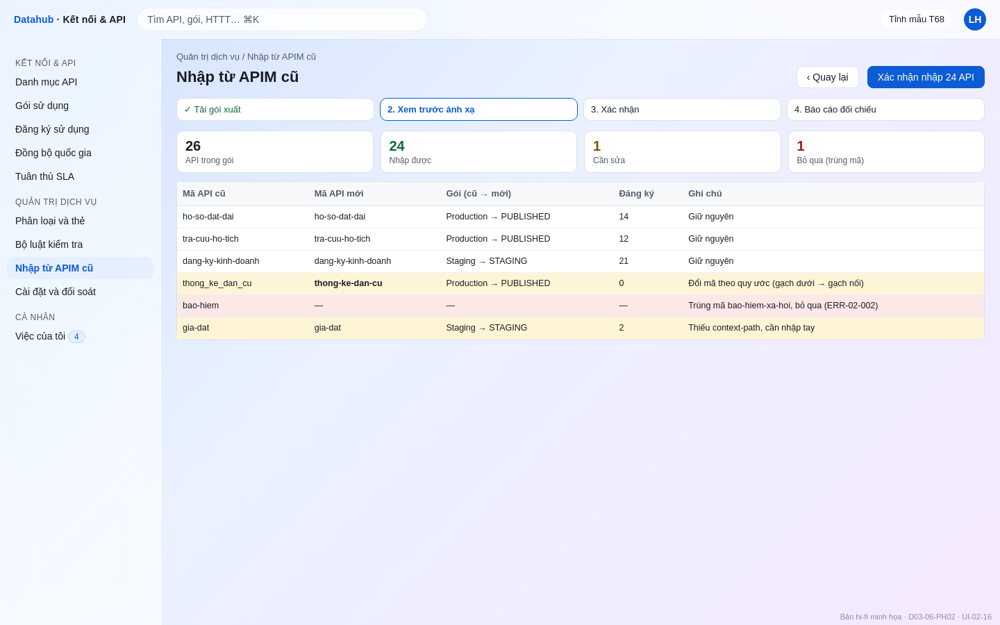

### 22.1. Các bước

Bảng dưới nêu các bước của UI-02-16, điều kiện qua bước và kết quả.

| Bước | Nội dung | Thành phần | Lỗi |
|---|---|---|---|
| 1. Tải gói xuất | Kéo thả hoặc chọn tệp; hướng dẫn cách xuất từ APIM cũ | `CMP-Upload` (biến thể `dropzone`) | ERR-02-009 (quá lớn), ERR-02-045 (sai định dạng) |
| 2. Xem trước ánh xạ | Thẻ tổng (trong gói, nhập được, cần sửa, bỏ qua); bảng ánh xạ có nền `color-diff-changed` cho dòng được đổi mã, `color-diff-removed` cho dòng bỏ qua; sửa trực tiếp mã và context-path | `CMP-KpiCard`, `CMP-EditableTable` | ERR-02-002 (trùng mã), ERR-02-019 (context-path) |
| 3. Xác nhận | Tóm tắt số API, gói, đăng ký sẽ tạo; đăng ký di trú ở trạng thái "Chờ định danh" cho tới khi HTTT có định danh ở PH-01 | `CMP-ConfirmDialog`, `Idempotency-Key` | ERR-02-040 |
| 4. Báo cáo đối chiếu | Kết quả nhập từng dòng; tải báo cáo | `CMP-JobProgress`, `CMP-DataTable` | ERR-02-034 |

: UI-02-16 · Các bước

Cột "Ghi chú" mỗi dòng nêu lý do bằng chữ (không chỉ màu). Nhập là tác vụ dài (202); rời màn thì tiếp tục ở `CMP-BackgroundTaskTray`. Chạy lại cùng gói là an toàn nhờ `Idempotency-Key` (ERR-02-042 nếu thân khác). Rỗng bước 1: "Chọn tệp xuất từ APIM cũ để bắt đầu."

## 23. UI-02-17 Cài đặt phân hệ và đối soát

::: dac-ta
**Mục đích.** Quản trị tenant xem và sửa tham số `02.*` của tenant trong trần nền tảng; xem kết quả đối soát cấu hình công bố với gateway và đẩy lại cấu hình lệch.

**Người dùng chính.** TA, PA, TO.

**FR hiện thực.** FR-02-060, 062.

**Đường dẫn.** `/ket-noi/quan-tri/cai-dat` (tab `tham-so`, `doi-soat`).

**Mẫu.** PTN-12.

**Quyền.** Tham số: quyền quản trị phân hệ (động từ admin, đề nghị); đối soát: `PERM-02-operate`.

**API.** API-02-088, 089, 083, 084, 095.
:::

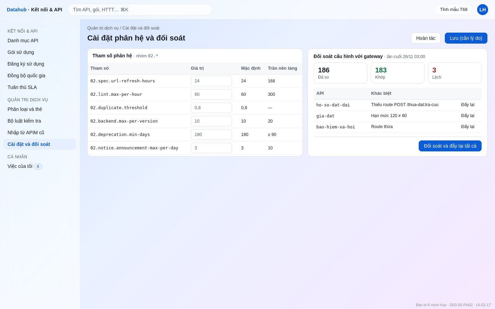

### 23.1. Thành phần

Bảng dưới liệt kê từng vùng của UI-02-17 theo số trên wireframe: thành phần `CMP-*`, nội dung hiển thị, nguồn dữ liệu và điều kiện hiện hoặc khóa.

| # | Thành phần | `CMP-*` | Nội dung |
|---|---|---|---|
| 1 | Bảng tham số | `CMP-DataTable`, `CMP-NumberInput`, `CMP-Switch`, `CMP-Select` | Tên tham số, giá trị, mặc định, trần nền tảng; giá trị vượt trần bị chặn ERR-02-040 kèm trần |
| 2 | Lưu | `CMP-Button`, `CMP-ReasonDialog` | Lý do bắt buộc (ERR-02-041); ghi qua PH-18 |
| 3 | Thẻ đối soát | `CMP-KpiCard` ×3 | Đã so, Khớp, Lệch |
| 4 | Bảng lệch | `CMP-DataTable` | API; khác biệt (`MISSING_ROUTE`, `EXTRA_ROUTE`, hạn mức lệch); "Đẩy lại" |
| 5 | Nút đối soát | `CMP-Button` | "Đối soát và đẩy lại tất cả" (xác nhận số API); chạy là 202, `CMP-JobProgress` |

: UI-02-17 · Thành phần

| Trường hợp | Hiển thị |
|---|---|
| Đang đóng băng thay đổi môi trường thật | `CMP-Banner` ERR-02-039; nút đẩy lại vô hiệu |
| Gateway không nhận | ERR-02-033, thử lại tự động |
| Đang có lần đối soát | ERR-02-035 |
| Tự sửa lệch bật (`02.reconcile.auto-repair`) | Dải thông tin "Hệ thống tự đẩy lại cấu hình lệch mỗi lần đối soát" |
| Chưa từng đối soát | ST-03 "Chưa có kết quả đối soát" kèm "Đối soát ngay" |

: UI-02-17 · Trạng thái và lỗi

## 24. Mẫu truy cập WCAG 2.2 AA

Phân hệ áp dụng bảng dưới cho mọi màn, ngoài quy tắc riêng đã ghi ở từng màn. Mục tiêu: không có lỗi mức A hoặc AA khi chạy kiểm tra tự động (axe) và duyệt tay bằng bàn phím, trình đọc màn hình NVDA.

| Tiêu chí | Áp dụng trong PH-02 |
|---|---|
| 1.1.1, 1.4.1 Nội dung không phải chữ, dùng màu | Trạng thái, mức phát hiện, loại thay đổi luôn có chữ và biểu tượng; biểu đồ có bảng thay thế (UI-02-11) |
| 1.4.3, 1.4.11 Tương phản | Chữ ≥ 4,5:1, thành phần giao diện ≥ 3:1 trên nền đặc; khung mã dùng `color-surface-solid-2`; không đặt chữ lên kính |
| 1.4.10 Reflow, 1.4.4 Phóng chữ | Tới 200% chữ và 400% thu nhỏ không mất nội dung; bảng cuộn ngang trong khung, cột "Mã · Tên" cố định |
| 1.4.13 Nội dung khi rê, focus | Tooltip lý do vô hiệu mở bằng focus, đóng bằng `Esc`, rê được vào tooltip |
| 2.1.1, 2.1.2 Bàn phím, không bẫy | Mọi thao tác có phím; khung đặc tả thoát bằng `Esc`; drawer bẫy focus có chủ đích, `Esc` đóng |
| 2.4.3, 2.4.7, 2.4.11 Thứ tự focus, thấy focus, focus không bị che | Vòng focus `color-focus-ring`; thanh trên cố định không che phần tử đang focus (cuộn tự bù chiều cao thanh) |
| 2.5.7 Thay thế kéo thả | Kéo thả tệp có nút chọn tệp; kéo cây phân loại có `Alt+↑/↓/→`; đổi cỡ cột có phím |
| 2.5.8 Cỡ vùng chạm | ≥ 24 × 24 px kể cả biểu tượng ⋯ và nút đóng |
| 3.2.6, 3.3.7 Trợ giúp nhất quán, nhập lại | Vị trí nút "Sao chép mã truy vết", "Thử lại" nhất quán; không bắt nhập lại HTTT, context-path đã khai ở bước trước |
| 3.3.1, 3.3.3 Nhận diện và gợi ý sửa lỗi | Lỗi nêu bằng chữ cạnh trường kèm cách sửa (§5.2); `CMP-Alert` đầu biểu mẫu liên kết tới trường |
| 3.3.8 Xác thực dễ tiếp cận | Không có bước xác thực riêng của PH-02; đăng nhập theo PH-12 |
| 4.1.2, 4.1.3 Tên, vai trò, trạng thái thông báo | Tab, cây, bảng, radiogroup có vai trò; kết quả lọc, kiểm tra, đồng bộ qua `aria-live="polite"`, lỗi chặn qua `role="alert"` |

: Tiêu chí WCAG 2.2 AA áp dụng

Tôn trọng `prefers-reduced-motion` (tắt chuyển động của skeleton, thanh tiến độ) và `prefers-reduced-transparency` (hạ kính, §2.1).

## 25. Kiến trúc mã giao diện

PH-02 là một mô-đun của ứng dụng `dh-console` (React + antd v6). Nội dung dưới là đề xuất tổ chức mã cho PH-02; tên thư mục theo quy ước chung của `dh-console`.

| Lớp | Nội dung | Quy ước |
|---|---|---|
| `routes/ph02` | Định nghĩa route §4.2, tải lười từng màn (`React.lazy`) | Mỗi route khai `PERM-02-*` yêu cầu để ẩn menu |
| `pages/ph02/*` | Một thư mục mỗi `UI-02-nn`: trang, thành phần riêng, kiểm thử | Không dùng thành phần riêng nếu đã có `CMP-*` |
| `api/ph02` | Hook TanStack Query sinh từ OpenAPI của D03-04-PH02 (`/api/catalog/v1`) | `staleTime` danh sách 30 giây, chi tiết 10 giây; lệnh ghi vô hiệu hóa bộ nhớ đệm theo khóa `apis`, `plans`, `subscriptions` |
| `state` | Trạng thái nằm trên URL (§2.6); bản nháp wizard ở bộ nhớ cục bộ không chứa chuỗi nghi bí mật | Không dùng kho toàn cục cho dữ liệu máy chủ |
| `editor` | Gói `CMP-CodeEditor` tải lười, riêng chunk, chỉ tải khi vào UI-02-03, 04 | Ngân sách chunk ≤ 600 KB nén (giả định, đo ở CI) |
| `i18n` | Chuỗi tiếng Việt ở tệp riêng theo mã `ERR-02-nnn` (§5.2) | Câu lỗi lấy `detail` của máy chủ trước, bảng này là dự phòng |
| Lỗi | Bộ chuyển RFC 9457 sang `CMP-Alert`, `CMP-Toast`, lỗi trường | Dùng chung với các phân hệ |

: Tổ chức mã giao diện PH-02

Mục tiêu hiệu năng (giả định, cơ sở: tenant T01 quy mô vừa, 200 HTTT, khoảng 200 API, GĐ-01…07): danh sách UI-02-01 hiện dòng đầu dưới 1,5 giây (p95) với 200 API; kiểm tra không lưu trả kết quả dưới 2 giây cho đặc tả 2.000 dòng; so sánh phiên bản dưới 3 giây.

## 26. Luồng người dùng chính

Hai luồng bao trùm phần lớn việc của PH-02: chủ dịch vụ đưa API lên danh mục, và một HTTT xin dùng API.

```{.mermaid caption="Luồng đưa API lên danh mục"}
flowchart TB
  A["SV mở UI-02-01, bấm Đăng ký API"] --> B["UI-02-03 bước 1-2: khai thông tin, nạp đặc tả"]
  B --> C{"Kiểm tra bước 3<br/>còn lỗi hoặc bí mật?"}
  C -- Còn --> D["UI-02-04: sửa đặc tả, kiểm tra lại"]
  D --> C
  C -- Hết --> E["UI-02-03 bước 4-5: backend, gói, rà soát"]
  E --> F["Gửi duyệt tại UI-02-02"]
  F --> G["CA duyệt ở UI-02-10"]
  G -- Trả lại --> E
  G -- Duyệt --> H["Công bố ra gateway và danh mục"]
  H --> I["UI-02-12: đồng bộ quốc gia nếu hiển thị Quốc gia"]
```

Luồng cho thấy vòng lặp giữa kiểm tra và sửa nằm hoàn toàn ở phía chủ dịch vụ, nên người duyệt chỉ nhận hồ sơ đã đạt điều kiện hình thức; việc trả lại chỉ còn vì lý do nghiệp vụ.

| Bước | Màn | Tác nhân | Lỗi có thể gặp |
|---|---|---|---|
| 1 | UI-02-03 bước 1 | SV | ERR-02-002, 004, 016, 019, 043 |
| 2 | UI-02-03 bước 2 | SV | ERR-02-005, 009, 010, 036 |
| 3 | UI-02-03 bước 3, UI-02-04 | SV | ERR-02-006, 007, 008 |
| 4 | UI-02-03 bước 4 | SV | ERR-02-020, 022, 023 |
| 5 | UI-02-02 gửi duyệt | SV | ERR-02-012, 017, 038 |
| 6 | UI-02-10 | CA | ERR-02-013, 015, 041 |
| 7 | UI-02-12 | TO | ERR-02-033, 034, 044 |

: Các bước luồng đưa API lên danh mục

```{.mermaid caption="Luồng đăng ký sử dụng API"}
flowchart TB
  A["OR mở UI-02-02, bấm Đăng ký sử dụng"] --> B["UI-02-09: chọn gói, HTTT, nêu mục đích"]
  B --> C{"Gói tự duyệt?"}
  C -- Có --> E["Cấp phạm vi truy cập"]
  C -- Không --> D["CA hoặc SV duyệt ở UI-02-10"]
  D -- Từ chối --> F["OR nhận thông báo kèm lý do"]
  D -- Duyệt --> E
  E --> G["UI-02-08: trạng thái Hiệu lực, Đã cấp"]
```

Luồng cho thấy hai đường duyệt tự động và thủ công cùng đổ về một trạng thái cuối; đăng ký chỉ "Hiệu lực" khi phạm vi đã cấp (cấp lỗi hiện "Cấp lỗi" và nút "Cấp lại").

## 27. Ma trận màn hình theo vai trò

Ký hiệu: ● xem và thao tác theo quyền, ○ chỉ xem, — không có trong menu. SV chỉ thấy API của đơn vị mình; OR chỉ thấy HTTT của tổ chức mình. Vai trò theo FRS §3.1 (`ROLE-SERVICE_OWNER`, `ROLE-CATALOG_APPROVER`, `ROLE-ORG_REQUESTER`, `ROLE-TENANT_ADMIN`, `ROLE-TENANT_OPERATOR`, `ROLE-SECURITY_OFFICER`, `ROLE-INTEGRATION_ENGINEER`, `ROLE-PLATFORM_ADMIN`, `ROLE-VIEWER`).

| Màn | SV | CA | OR | TA | TO | SO | IE | PA | VW |
|---|---|---|---|---|---|---|---|---|---|
| UI-02-01 Danh mục API | ● | ○ | ○ | ● | ○ | ○ | ○ | ○ | ○ |
| UI-02-02 Chi tiết API | ● | ○ | ○ | ● | ● | ● | ○ | ○ | ○ |
| UI-02-03 Đăng ký API | ● | — | — | ● | — | — | — | — | — |
| UI-02-04 Kết quả kiểm tra | ● | ○ | — | ● | — | ● | — | — | — |
| UI-02-05 So sánh phiên bản | ● | ○ | — | ● | — | — | — | — | — |
| UI-02-06 Danh sách gói | ● | ○ | — | ● | — | — | ○ | — | ○ |
| UI-02-07 Tạo, sửa gói | ● | — | — | ● | — | — | — | — | — |
| UI-02-08 Danh sách đăng ký | ● | ○ | ● | ● | ● | ● | — | — | — |
| UI-02-09 Gửi đăng ký | — | — | ● | ● | — | — | — | — | — |
| UI-02-10 Duyệt | ● | ● | — | ● | — | ○ | — | — | — |
| UI-02-11 Tuân thủ SLA | ○ | ○ | — | ○ | — | — | — | — | ○ |
| UI-02-12 Đồng bộ quốc gia | — | — | — | ● | ● | — | — | — | — |
| UI-02-13 Lộ trình ngừng dùng | ● | ● | — | ● | — | — | — | — | — |
| UI-02-14 Phân loại và thẻ | — | — | — | ● | — | — | — | ● | — |
| UI-02-15 Bộ luật kiểm tra | — | — | — | ● | — | — | — | ● | — |
| UI-02-16 Nhập từ APIM cũ | — | — | — | ● | — | — | — | ● | — |
| UI-02-17 Cài đặt và đối soát | — | — | — | ● | ● | — | — | ● | — |

: Ma trận màn hình theo vai trò

Ma trận chỉ quyết định ẩn hay hiện màn; thao tác cụ thể do `PERM-02-*` và `allowedActions` của API quyết định, và API vẫn kiểm tra lại quyền ở máy chủ (giao diện không phải biện pháp bảo mật).

## 28. Truy vết FR sang màn

Mọi FR của PH-02 có ít nhất một màn, trừ FR-02-059 (giao diện nội bộ cho PH-03, PH-04, PH-15, không có người dùng nhìn trực tiếp; kết quả nạp cấu hình hiện ở UI-02-02, UI-02-17).

| Màn | FR |
|---|---|
| UI-02-01 | FR-02-001, 003, 004, 009, 025, 056 |
| UI-02-02 | FR-02-002, 005…007, 012…014, 022…026, 034, 036, 037, 040…042, 045, 049, 051, 055, 056, 058 |
| UI-02-03 | FR-02-007, 010, 011, 014, 015, 019, 020, 022, 024, 027, 034, 055 |
| UI-02-04 | FR-02-016…020 |
| UI-02-05 | FR-02-043, 044 |
| UI-02-06 | FR-02-027, 030…033 |
| UI-02-07 | FR-02-027…029 |
| UI-02-08 | FR-02-048, 050…052 |
| UI-02-09 | FR-02-046 |
| UI-02-10 | FR-02-020, 030, 031, 035, 036, 038, 039, 041, 044, 047 |
| UI-02-11 | FR-02-055, 056, 058 |
| UI-02-12 | FR-02-053, 054 |
| UI-02-13 | FR-02-038, 039, 044, 057 |
| UI-02-14 | FR-02-007, 008 |
| UI-02-15 | FR-02-021 |
| UI-02-16 | FR-02-061 |
| UI-02-17 | FR-02-060, 062 |

: Truy vết FR sang màn

## 29. Kiểm thử giao diện và bản hi-fi

### 29.1. Kiểm thử giao diện

Ca kiểm thử chi tiết viết ở tập kiểm thử của PH-02; mục này nêu những điều bắt buộc phải có để tập đó bám vào.

| Nhóm | Nội dung phải kiểm | Màn |
|---|---|---|
| Quyền và ẩn hiện | Mỗi vai trò ở §27 thấy đúng menu, nút; thiếu quyền ẩn nút, thiếu điều kiện vô hiệu kèm lý do | Mọi màn |
| Bốn trạng thái | Rỗng, đang tải, lỗi, không có quyền hiện đúng nội dung §7…§23 | Mọi màn |
| Kiểm tra đặc tả | Dòng lỗi tô sáng đúng vị trí, nhảy tới lỗi, khóa bước tiếp; không hiện giá trị bí mật ở bất kỳ nơi nào (DOM, tooltip, URL, nháp cục bộ) | UI-02-03, 04 |
| Bốn mắt | Người gửi không bấm được Duyệt, thông báo đúng ERR-02-013 | UI-02-10 |
| Hậu quả | Hộp tạm ngừng, thu hồi, ngừng dùng nêu đúng số bên bị ảnh hưởng | UI-02-02, 08, 13 |
| Xung đột | `If-Match` sai hiện hộp ST-13, không có "Ghi đè" cho đặc tả | UI-02-03, 07 |
| Thông báo lỗi | Mỗi `ERR-02-nnn` ở §5.2 hiện đúng câu và vị trí | Mọi màn |
| Trợ năng | axe không lỗi A, AA; duyệt bàn phím; NVDA đọc đúng kết quả lọc, kiểm tra | Mọi màn |
| Hiệu năng | Chỉ tiêu §25 trên 200 API | UI-02-01, 03, 05 |

: Phạm vi kiểm thử giao diện

### 29.2. Bản hi-fi

Ảnh hi-fi của từng màn sinh từ mã HTML tĩnh trong `ph02/hifi/`, dùng chung `hifi.css` (token theo D03-05-02, sao từ bộ PH-19) và dữ liệu minh họa (tỉnh mẫu T68, không phải dữ liệu thật). Chạy lại bằng hai lệnh:

```bash
cd datahub-docs/03-thiet-ke/uiux/ph02/hifi
python3 gen_hifi.py && node shot.js
```

| Tệp | Màn | Ghi chú |
|---|---|---|
| `ui-02-01.png` … `ui-02-17.png` | UI-02-01…17 | Khung 1440 × 900 px; UI-02-09 và UI-02-13 là drawer phủ lên màn nền |

: Tệp ảnh hi-fi

Bản hi-fi minh họa bố cục, thứ bậc thông tin và nội dung tiếng Việt; không thay thế đặc tả ở các mục trên. Khi hai bên khác nhau, đặc tả bằng chữ có giá trị.

## Phụ lục A. Đề nghị bổ sung cho D03-05

> **Đợt đồng bộ chéo cuối (27/11/2026).** Các đề nghị dưới đây đã được xét; kết luận từng dòng (đã sửa, đã khớp sẵn, câu hỏi mở, không làm) ghi ở [D00-03-01 Sổ đồng bộ chéo cuối](../../00-chung/D00-03-01-so-dong-bo-cuoi.md).

Phụ lục này ghi các thành phần giao diện mà tập màn cần nhưng D03-05 chưa có; tập màn không tự đặt thành phần. Cột "Tạm dùng" ghi cách dựng hiện tại; cột cuối ghi kết quả xử lý ở đợt đồng bộ cuối.

| Mã đề nghị | Thành phần | Lý do | Tạm dùng | Kết quả |
|---|---|---|---|---|
| A-1 | Danh sách phát hiện kiểm tra gắn với khung mã (nhảy tới dòng, biểu tượng mức ở lề) | Dùng ở UI-02-03, 04 và có thể ở PH-05 (Kamelet) | `CMP-DataTable` + `CMP-CodeEditor` ghép tay | Đã xử lý bằng `markers`, `onMarkerSelect`, `revealRef` của `CMP-CodeEditor` (D03-05-04 §9.1); dựng bằng `CMP-CodeEditor` và `CMP-DataTable` |
| A-2 | Dải lộ trình ngừng dùng (hai đoạn thời gian, mốc ngày) | UI-02-13 | `CMP-Timeline` | Không thêm: chỉ PH-02 dùng, giữ `CMP-Timeline` hai hàng cục bộ ở UI-02-13 |
| A-3 | Biến thể `CMP-KpiCard` chọn được (`aria-pressed`) làm bộ lọc nhanh | UI-02-01, 08, 12 | `CMP-FilterBar` (hàng nhãn bộ lọc) bên cạnh thẻ | Đã có: `CMP-KpiCard` biến thể `filter` (D03-05-04 §6.2); không cần hàng nhãn bên cạnh |
| A-4 | `CMP-CodeEditor` hỗ trợ chú thích lề (marker) theo mức | UI-02-03, 04 | Tô nền dòng | Đã có: `markers` của `CMP-CodeEditor` (D03-05-04 §9.1) |

: Đề nghị bổ sung cho D03-05

## Phụ lục B. Đề nghị bổ sung API

> **Đợt đồng bộ chéo cuối (27/11/2026).** Các đề nghị dưới đây đã được xét; kết luận từng dòng (đã sửa, đã khớp sẵn, câu hỏi mở, không làm) ghi ở [D00-03-01 Sổ đồng bộ chéo cuối](../../00-chung/D00-03-01-so-dong-bo-cuoi.md).

Phụ lục này ghi các API mà màn hình cần và tình trạng của từng đề nghị ở D03-04-PH02.

| Mã đề nghị | Nội dung | Màn dùng | Tình trạng ở D03-04-PH02 |
|---|---|---|---|
| B-1 | API-02-001 trả `facets` (đếm theo trạng thái, "cần chú ý") và cờ `attention` (`slaBreach`, `syncOverdue`, `gatewayDrift`) từng dòng | UI-02-01 | Đã có ở API-02-001 (`facets`, `attention`) |
| B-2 | Xuất CSV cho API-02-001, 059, 072 (hoặc `Accept: text/csv`), không có bí mật, cùng bộ lọc | UI-02-01, 08, 12 | Còn mở: Q02-60 (đề xuất `Accept: text/csv`) |
| B-3 | `GET /plans` danh sách gói toàn tenant có lọc `apiCode`, `status`, `authType`, phân trang | UI-02-06 | Đã có: API-02-096 |
| B-4 | `GET /sla/summary` tổng hợp tuân thủ SLA toàn tenant theo kỳ và nhóm | UI-02-11 | Đã có: API-02-097 |
| B-5 | `allowedActions` và `disabledReasons` ở API-02-002, 059, 044 (như PH-05) | UI-02-02, 08, 10 | Đã có `allowedActions[]`, `disabledReasons` (quy ước chung, D03-04-PH02 §1) |
| B-6 | `GET /review-requests/{reviewRequestId}` chi tiết yêu cầu duyệt kèm `conditions[]`, `history[]` | UI-02-10 | Đã có: API-02-098 |
| B-7 | API-02-020 trả mỗi phát hiện `layer`, `line`, `remediation` | UI-02-03, 04 | Đã có: `Finding` mang `layer`, `line`, `column`, `hint` (hướng dẫn sửa) |

: Đề nghị bổ sung API

## Đề nghị đồng bộ

> **Đợt đồng bộ chéo cuối (27/11/2026).** Các đề nghị dưới đây đã được xét; kết luận từng dòng (đã sửa, đã khớp sẵn, câu hỏi mở, không làm) ghi ở [D00-03-01 Sổ đồng bộ chéo cuối](../../00-chung/D00-03-01-so-dong-bo-cuoi.md).

Các việc cần sửa ở tài liệu dùng chung, không sửa trong tập này.

| # | Tài liệu | Đề nghị |
|---|---|---|
| 1 | D03-06-00 §2.3, §2.4 | Thêm route `/ket-noi/tuan-thu-sla`, `/ket-noi/dong-bo-quoc-gia`, nhóm `/ket-noi/quan-tri/{phan-loai, bo-luat, nhap-apim-cu, cai-dat}` và mục menu tương ứng (§4.2, §4.3 tập này) |
| 2 | D02-08 | Thêm động từ quản trị phân hệ cho `PERM-02` (phân loại, bộ luật, chuyển chủ quản, nhập từ APIM cũ, tham số), đang ghi "đề nghị, động từ admin" ở D03-04-PH02 |
| 3 | D03-05-04 | Đã xử lý Phụ lục A: A-1, A-3, A-4 đã có ở D03-05-04 bản 0.5; A-2 giữ cục bộ |
| 4 | D03-04-PH02 | Phụ lục B đã được đáp ứng trừ B-2 (xuất CSV), ghi ở Q02-60 của tập API |
| 5 | D02-03-PH02 §12 | Ghi route cho UI-02-11, 12, 14…17 theo §4.2 |
| 6 | ADR | Không đề xuất ADR mới |

: Đề nghị đồng bộ

## Câu hỏi mở

> **Câu hỏi mở Q02-30:** Nhóm "Quản trị dịch vụ" đặt dưới `/ket-noi/quan-tri/*` (như tập này) hay gom vào khu `/quan-tri/*` chung của tenant? Cơ sở: phân loại, bộ luật, tham số của PH-02 gắn chặt danh mục nhưng PH-20 cũng có khu quản trị tenant.

> **Câu hỏi mở Q02-31:** Phím tắt dạng chuỗi (`G` rồi `V`) ở UI-02-02 có dùng được khi khung ứng dụng đã có `CMP-ShortcutSheet` toàn cục? Cơ sở: D03-06-00 chưa quy định chuỗi phím; tạm đề xuất tắt được trong cài đặt cá nhân.

> **Câu hỏi mở Q02-32:** Người xem có được xuất CSV danh mục và đăng ký không, và cột nào bị che với người ngoài đơn vị chủ quản? Cơ sở: danh sách đăng ký liệt kê HTTT và khối lượng gọi, có thể là thông tin cạnh tranh nội bộ giữa các sở.

> **Câu hỏi mở Q02-33:** Câu "dự kiến xử lý trong {n} ngày làm việc" ở UI-02-09 lấy `n` từ tham số nào? Cơ sở: `02.review.overdue-days` là hạn quá hạn, chưa phải cam kết thời gian xử lý với người xin dùng.

> **Câu hỏi mở Q02-34:** Tab "Sự kiện (topic)" ở UI-02-01 (FR-02-009, Đợt 2) hiển thị chung danh mục API hay tách thành màn riêng khi PH-10 bật? Cơ sở: topic không có phiên bản, gói như API nên cột và bộ lọc khác nhiều.

> **Câu hỏi mở Q02-35:** Có cho chủ dịch vụ bỏ qua cảnh báo "API gần giống" (độ giống ≥ 0,8) mà không cần lý do? Cơ sở: tập này hiển thị cảnh báo ở UI-02-03 và UI-02-10, FRS chưa nói rõ ai được chấp nhận và có cần lý do.

## Lịch sử phiên bản

| Phiên bản | Ngày | Người | Nội dung |
|---|---|---|---|
| 0.1 | 2026-11-26 | Claude (Agent SDK, Actions) | Bản đầu: 17 màn UI-02-01…17 kèm ảnh hi-fi, điều hướng, thông báo ERR-02, truy cập WCAG 2.2 AA, truy vết FR, đề nghị đồng bộ, 6 câu hỏi mở Q02-30…35 |
| 0.2 | 26/11/2026 | Nhóm viết tài liệu (Claude) | Rà soát chéo: bảng thông báo ERR-02 đủ 45 mã khớp D02-03-PH02 §9.2; thêm bảng cụm hiển thị cho ERR-02-012; thêm nhãn cấu hình ở cổng; gắn API-02-096, 097, 098 cho UI-02-06, 10, 11; cập nhật Phụ lục B; thêm câu mở cho các mục chỉ có bảng |
| 0.3 | 27/11/2026 | Nhóm viết tài liệu (Claude) | Đồng bộ chéo cuối: Phụ lục A ghi kết quả xử lý A-1…A-4; dùng `CMP-KpiCard` biến thể `filter` và `CMP-FilterBar` thay `CMP-FilterChips` |
