# D03-06-PH03 · Thiết kế giao diện màn hình Cổng API

Tập màn **không tự đặt** token, `CMP-*` hay `PTN-*`; dùng tên chuẩn ở D03-05 và D03-06-00. Thành phần còn thiếu ghi ở Phụ lục A, API còn thiếu ghi ở Phụ lục B.

## Tóm tắt cho hội đồng thẩm định

**Mục tiêu.** PH-03 là cửa vào của mọi lượt gọi API, nên giao diện của nó là nơi vận hành và cán bộ ATTT phát hiện sự cố và ra quyết định nhanh: dừng một API, tạm ngừng một HTTT, đổi chế độ WAF, quay lui cấu hình. Tập này đặc tả 18 màn hình (UI-03-01…18) của `dh-console` để kỹ sư giao diện dựng bằng React và antd v6 theo design system Liquid Glass, và để kiểm thử viên viết ca kiểm thử giao diện mà không phải hỏi lại.

**Phạm vi.** 18 màn chia ba nhóm: **quan sát và nhật ký** (UI-03-01 tổng quan lưu lượng, UI-03-07 nhật ký WAF, UI-03-09 nhật ký lượt gọi); **cấu hình và chính sách** (UI-03-02…06 route, consumer, hạn mức; UI-03-08 ngoại lệ WAF; UI-03-12 chứng thư; UI-03-13 mẫu chính sách; UI-03-15 địa chỉ bị chặn; UI-03-16 tham số); **phát hành và nút** (UI-03-10 ảnh chụp cấu hình, UI-03-11 nút gateway, UI-03-14 chạy thử, UI-03-17 duyệt, UI-03-18 nhập từ gateway cũ). Mỗi màn có bảng đặc tả, wireframe, bảng thành phần với `CMP-*` chuẩn, trạng thái, thông báo theo mã `ERR-03-…`, phím tắt, ghi chú truy cập và ảnh hi-fi. UI-03-03 (chi tiết route) được viết ở mức "siêu chi tiết" vì là màn phức tạp nhất.

**Căn cứ.** NFR-00-040 (WCAG 2.2 mức AA, 0 lỗi axe-core, NVDA kiểm tra 10 luồng); FR-00-050 (xác nhận và lý do cho thao tác ảnh hưởng vận hành), FR-00-052 (xung đột phiên bản), FR-00-053 (nhãn trạng thái), FR-00-054 (tác vụ chạy lâu), FR-00-071 (bốn mắt), FR-00-080, 081 (thông báo lỗi); BR-03-007 và CMP-LAW-05 (không hiển thị hay lưu dữ liệu cá nhân, giá trị tiêu đề xác thực, thân bản tin trong nhật ký).

**Những điểm hội đồng cần lưu ý.**

1. **Hành động nguy hiểm luôn có lý do và dấu vết.** Dừng API, tạm ngừng khẩn cấp, quay lui, bỏ chặn địa chỉ, đổi chế độ WAF đều mở hộp lý do (`CMP-ReasonDialog`) và nói rõ hậu quả bằng số ("làm 3 HTTT đang gọi nhận 503") trước khi bấm xác nhận.
2. **Bốn mắt thể hiện ngay trên màn.** Người vừa đề nghị mở màn duyệt thấy nút "Duyệt" bị vô hiệu kèm lý do "Bạn đã đề nghị thay đổi này nên không thể tự duyệt" (ERR-03-008), không phải bấm xong mới biết.
3. **Giao diện không bao giờ hiện bí mật hay dữ liệu cá nhân.** Màn consumer chỉ hiện vân tay chứng thư và hạn dùng; nhật ký lượt gọi chỉ hiện siêu dữ liệu và đường dẫn đã bỏ giá trị tham số truy vấn.
4. **Số liệu thiếu thì nói thiếu.** Khi PH-13 không trả số liệu (ERR-03-026), khung hiển thị "Chưa có số liệu" chứ không hiện số 0, vì số 0 sai khiến vận hành tưởng hệ thống yên.
5. **Một điểm lệch với D03-06-00 cần đồng bộ.** FRS PH-03 đề nghị nhóm menu riêng "Cổng API" với route `/cong-api/...`, trong khi D03-06-00 §2.3.2 hiện mới có hai mục `/ket-noi/chinh-sach` và `/ket-noi/gateway`; tập này dùng `/cong-api/...` và giữ hai đường cũ làm đường chuyển hướng (mục 4.2, "Đề nghị đồng bộ").

**Con số chính.**

| Chỉ số | Giá trị |
|---|---|
| Màn hình | 18 (UI-03-01…18), trong đó 1 màn siêu chi tiết (UI-03-03) |
| Mẫu màn dùng | PTN-01 (9 màn), PTN-02, PTN-04, PTN-05, PTN-06, PTN-10, PTN-11 (2 màn), PTN-12; không tạo mẫu mới |
| API được gọi | 93 trong 98 operation API-03-001…098 (5 operation còn lại là API nội bộ cho PH-01, PH-12 hoặc danh sách upstream không cần màn: API-03-005, 013, 014, 015, 053) |
| Mã lỗi chuyển thành câu hiển thị | 27 mã `ERR-03-001…027` của control plane và 12 mã gateway hay gặp ở nhật ký lượt gọi |
| Ảnh hi-fi | 18 ảnh, một ảnh mỗi màn, khung 1440 × 900 |
| Câu hỏi mở | 5 (Q03-30…34) |

: Con số chính của tập màn hình PH-03

## 1. Mục đích, phạm vi và tài liệu liên quan

### 1.1. Mục đích

Tài liệu cho kỹ sư giao diện biết từng màn của PH-03 gồm những vùng nào, thành phần nào, gọi API nào, hiển thị gì ở từng trạng thái, và cho kiểm thử viên biết chính xác cái gì phải kiểm tra. Tài liệu không lặp lại hành vi nghiệp vụ đã có ở FRS (D02-03-PH03) mà dẫn mã FR; khi hai nơi lệch nhau thì FRS đúng và tập này sửa theo.

### 1.2. Danh sách màn và mức chi tiết

18 màn đi theo ba nhóm việc của người dùng ở một tỉnh: quan sát (ca trực mở màn nào đầu tiên), cấu hình (chỉnh một API, một HTTT, một chính sách), phát hành (đưa cấu hình xuống gateway và xử lý khi sự cố). Cột "Mức chi tiết" là độ sâu của mục đặc tả màn.

| Mã | Tên | PTN | Mức chi tiết | FR |
|---|---|---|---|---|
| UI-03-01 | Tổng quan lưu lượng | PTN-06 | Đầy đủ | 026, 052, 053, 054, 055, 058 |
| UI-03-02 | Danh sách route | PTN-01 | Đầy đủ | 028, 035, 036, 047 |
| UI-03-03 | Chi tiết route | PTN-02 | **Siêu chi tiết** | 009, 010, 015, 017, 019, 020, 028…031, 033…036, 038 |
| UI-03-04 | Danh sách consumer | PTN-01 | Đầy đủ | 046 |
| UI-03-05 | Chi tiết consumer | PTN-02 | Đầy đủ | 014, 016, 018, 022, 046, 047, 051 |
| UI-03-06 | Hạn mức và hạn ngạch | PTN-01 | Đầy đủ | 021…024, 027 |
| UI-03-07 | Nhật ký WAF và sự kiện chặn | PTN-11 | Đầy đủ | 005, 006, 007, 054 |
| UI-03-08 | Ngoại lệ luật WAF và luật vá ảo | PTN-01 | Đầy đủ | 007, 008 |
| UI-03-09 | Nhật ký lượt gọi | PTN-11 | Đầy đủ | 051 |
| UI-03-10 | Ảnh chụp cấu hình và phát hành | PTN-01, PTN-02 | Đầy đủ | 039…042, 044 |
| UI-03-11 | Nút gateway | PTN-01 | Đầy đủ | 012, 043, 045 |
| UI-03-12 | Chứng thư và TLS | PTN-01 | Đầy đủ | 001, 002, 049 |
| UI-03-13 | Mẫu chính sách | PTN-01 | Đầy đủ | 015, 020, 048 |
| UI-03-14 | Chạy thử chính sách | PTN-04 | Đầy đủ | 057 |
| UI-03-15 | Địa chỉ bị chặn | PTN-01 | Đầy đủ | 003, 004 |
| UI-03-16 | Tham số, chuyển tiếp tenant | PTN-12 | Đầy đủ | 003, 011, 037, 056 |
| UI-03-17 | Duyệt thay đổi gateway | PTN-10 | Đầy đủ | 006, 007, 023, 038 |
| UI-03-18 | Nhập cấu hình từ gateway cũ | PTN-05 | Đầy đủ | 059 |

: Danh sách màn và mức chi tiết

### 1.3. Tài liệu liên quan

| Tài liệu | Dùng để |
|---|---|
| D02-03-PH03 (FRS) | Hành vi, quyền, mã lỗi, câu thông báo gốc (§9.2), danh sách màn (§10.1) |
| D02-04-PH03 (Use case) | Luồng người dùng từng use case, bảng use case → màn hình |
| D03-02-PH03 (SDD) | Thành phần `dh-connect`, máy trạng thái, kênh nhanh Valkey |
| D03-04-PH03 (API) | Đường dẫn, tham số, thân, mã lỗi RFC 9457 của từng `API-03-…` |
| D03-05-01…04 | Vật liệu kính, token, `CMP-*` nguyên tử và phức hợp |
| D03-06-00 | Menu, URL, trạng thái chuẩn `ST-*`, mẫu `PTN-*`, vi văn bản |
| D02-08 | Vai trò `ROLE-*`, quyền `PERM-03-*` |
| D03-07 | Biện pháp `SEC-*` liên quan: SEC-24, 25 (xác thực), SEC-65 (lệch cấu hình), SEC-80 (cách ly tenant) |

: Tài liệu liên quan

### 1.4. Người đọc và thuật ngữ

Kỹ sư giao diện đọc từ chương 2 đến chương 24; kiểm thử viên đọc bảng trạng thái, thông báo và phím tắt của từng màn; hội đồng thẩm định đọc Tóm tắt, chương 3, 5 và ma trận vai trò (chương 28).

| Thuật ngữ | Nghĩa trong tập này |
|---|---|
| Route | Quy tắc định tuyến của gateway, sinh từ API đã công bố ở PH-02 (FRS §4.1) |
| Consumer | Hình chiếu trên gateway của một client của HTTT; `consumerCode` trùng `clientId` ở Keycloak |
| Cửa vào `INT`, `EXT` | Cửa mạng nội bộ (mặc định) và cửa Internet (cần duyệt) |
| Ảnh chụp cấu hình | Tệp cấu hình đầy đủ có số phiên bản và chữ ký mà nút gateway nạp |
| Nút | Một pod APISIX; trạng thái đồng bộ là phiên bản đang chạy so với phiên bản mong muốn |
| Ngoại lệ WAF | Quyết định có thời hạn bỏ qua một mã luật CRS cho một route |
| Bốn mắt | Người đề nghị khác người duyệt (FR-00-071) |
| Tạm ngừng khẩn cấp | Chặn ngay một route hoặc consumer, hiệu lực trong 30 giây, không cần duyệt nhưng bắt buộc lý do |

: Thuật ngữ riêng của tập màn hình

Vai trò viết tắt giống FRS: PA (`ROLE-PLATFORM_ADMIN`), PO (`ROLE-PLATFORM_OPERATOR`), AU (`ROLE-PLATFORM_AUDITOR`), TA (`ROLE-TENANT_ADMIN`), TO (`ROLE-TENANT_OPERATOR`), SO (`ROLE-SECURITY_OFFICER`).

### 1.5. Phạm vi

Tập này đặc tả giao diện quản trị của PH-03 trong `dh-console` cho 18 màn UI-03-01…18. Ngoài phạm vi: màn của PH-02 (vòng đời API, gói, đăng ký), PH-01 (kết nạp HTTT), PH-13 (bảng điều khiển chung, tra log và truy vết, cảnh báo, kiểm toán), PH-12 (thu hồi token, chính sách truy cập) và `dh-portal`; tập chỉ dẫn liên kết tới các màn đó. Hành vi data plane (gateway trả lỗi cho bên gọi) không có giao diện; người vận hành xem kết quả của chúng ở UI-03-07 và UI-03-09.

### 1.6. Cấu trúc tài liệu

| Chương | Nội dung |
|---|---|
| 2 | Nguyên tắc thiết kế: vật liệu, mật độ, ngôn ngữ, hành động có hậu quả, dữ liệu nhạy cảm |
| 3, 4 | Màn hệ cũ được giữ lại, điều hướng, đường dẫn, menu theo quyền |
| 5, 6 | Nhãn trạng thái, thông điệp `ERR-03-…`, trạng thái màn dùng chung |
| 7 đến 24 | Đặc tả 18 màn UI-03-01…18, mỗi màn một chương; UI-03-03 siêu chi tiết |
| 25 đến 27 | Mẫu truy cập WCAG 2.2, kiến trúc mã giao diện, ba luồng người dùng chính |
| 28, 29 | Ma trận vai trò và màn hình, truy vết FR sang màn |
| 30 | Kiểm thử giao diện, mười luồng trình đọc màn hình, danh sách ảnh hi-fi |
| Phụ lục A, B, C | Đề nghị bổ sung D03-05, đề nghị bổ sung API, danh sách kiểm tra khi dựng màn |
| Đề nghị đồng bộ, Câu hỏi mở | Việc cho đợt đồng bộ, câu hỏi Q03-30…34 |

: Cấu trúc tài liệu D03-06-PH03

## 2. Nguyên tắc thiết kế áp dụng cho PH-03

PH-03 dùng nhiều số liệu thời gian thực và nhiều hành động có hậu quả ngay, nên nguyên tắc quan trọng nhất là **đọc được trong vài giây và không bấm nhầm**. Các mục dưới đây cụ thể hóa nguyên tắc chung của D03-05 cho phân hệ này.

### 2.1. Bản đồ vật liệu

| Vùng | Thành phần | Vật liệu | Lý do |
|---|---|---|---|
| Thanh trên, sidebar khung ứng dụng | `CMP-AppShell`, `CMP-Topbar`, `CMP-Sidebar` | `glass-chrome` | Lớp điều hướng |
| Thẻ số liệu, biểu đồ, bảng, biểu mẫu, tab | `CMP-KpiCard`, `CMP-Chart`, `CMP-DataTable`, `CMP-Form`, `CMP-Tabs` | Đặc `color-surface-solid` | Nội dung dày, chữ số nhỏ cần tương phản cao |
| Khung mã SecLang, mẫu yêu cầu, so sánh cấu hình | `CMP-CodeEditor`, `CMP-JsonViewer`, `CMP-DiffViewer` | Đặc `color-surface-solid-2` | Chữ đơn cách cần tương phản cao |
| Drawer chi tiết lượt gọi, chạy thử, đề nghị ngoại lệ | `CMP-Drawer` | Khung `glass-modal`, giếng nội dung đặc | Lớp nổi chứa nội dung dày |
| Hộp lý do, xác nhận, xung đột | `CMP-ReasonDialog`, `CMP-ConfirmDialog`, `CMP-Modal` | Khung `glass-modal`, nội dung đặc | |
| Menu hành động, popover, tooltip | `CMP-DropdownMenu`, `CMP-Popover`, `CMP-Tooltip` | `glass-overlay` | Lớp nổi |
| Dải cảnh báo hệ thống (mất kết nối, Valkey suy giảm) | `CMP-Banner` | Đặc, màu ngữ nghĩa `color-warning`, `color-error` | Thông tin quan trọng không dựa vào trong suốt |

: Bản đồ vật liệu

Khi người dùng bật giảm trong suốt hoặc trình duyệt tự hạ cấp (D03-05-01 §7), lớp kính chuyển `glass-lite-tint` hoặc `glass-off-tint`. Không màn nào dùng độ trong suốt để truyền thông tin; màu trạng thái luôn đi kèm biểu tượng và chữ.

### 2.2. Mật độ

Danh sách và chi tiết dùng mật độ thường (điều khiển `size-control-md` 32 px, dòng `size-table-row` 40 px). Bảng nhật ký UI-03-07, UI-03-09 dùng mật độ gọn (dòng 32 px, điều khiển `size-control-sm` 28 px) vì vận hành quét hàng trăm dòng; người dùng đổi được ở menu "Mật độ" và lựa chọn được nhớ theo người dùng. Vùng chạm tối thiểu 24 × 24 px (WCAG 2.2 tiêu chí 2.5.8).

### 2.3. Ngôn ngữ và thuật ngữ

Giữ đúng từ vựng sau trên giao diện: "route", "consumer" (có chú thích "HTTT gọi API" ở lần đầu trong trang), "cửa vào" (Nội bộ, Internet), "ảnh chụp cấu hình", "phát", "quay lui", "nút", "hạn mức" (theo giây), "hạn ngạch" (theo giờ, ngày, tháng), "ngoại lệ luật WAF", "luật vá ảo", "chế độ phát hiện", "chế độ chặn", "tạm ngừng khẩn cấp", "bốn mắt" chỉ dùng trong tài liệu, giao diện viết "cần người khác duyệt". Mã, đường dẫn, tên tham số, mã luật hiển thị phông đơn cách `CMP-CodeText`. Ngày giờ `dd/MM/yyyy HH:mm:ss` giờ Việt Nam (`CMP-Timestamp`); độ trễ `ms` dưới 1 giây, `1,2 s` từ 1 giây (`CMP-Duration`). Số có dấu chấm ngăn nghìn, dấu phẩy thập phân.

### 2.4. Hành động theo quyền và trạng thái

Như PH-04 và PH-05: không có quyền thì **ẩn** nút; có quyền nhưng trạng thái chưa cho phép thì **hiện vô hiệu** kèm tooltip lấy từ `disabledReasons` của API (ví dụ "Route đã ở trạng thái Đã dừng"; "Bạn đã đề nghị thay đổi này nên không thể tự duyệt"). Riêng hành động tạm ngừng khẩn cấp luôn hiện với người có `PERM-03-operate`, vì khi sự cố người trực không được mất thời gian tìm nút.

### 2.5. Hành động có hậu quả và hộp lý do

Mọi hành động ảnh hưởng vận hành (FR-00-050) dùng một trong hai hộp: `CMP-ConfirmDialog` khi không cần lý do (dừng mở, xác nhận cảnh báo) hoặc `CMP-ReasonDialog` khi bắt buộc lý do (tạm ngừng khẩn cấp, quay lui, bỏ chặn, đề nghị ngoại lệ). Cả hai nêu hậu quả bằng số lấy từ API (số HTTT đang gọi route trong 15 phút gần nhất, số route bị ảnh hưởng). Nút xác nhận mặc định không nhận focus; focus đầu tiên ở ô lý do hoặc nút "Hủy". Lý do tối thiểu 10 ký tự, tối đa 500, có bộ đếm.

### 2.6. Dữ liệu nhạy cảm trên giao diện

| Quy tắc | Hiện thực |
|---|---|
| Không bí mật | Màn consumer chỉ hiện vân tay SHA-256 rút gọn (`3F:9A:…:C2`), hạn chứng thư; không có khóa, không có `client_secret` (gateway không lưu) |
| Không giá trị tham số truy vấn | Đường dẫn trong nhật ký hiển thị `/api/v1/cong-dan?soDinhDanh=***`, giá trị đã bị bỏ ở nguồn (BR-03-007) |
| Địa chỉ nguồn | Hiển thị đầy đủ cho người có `PERM-03-log-read`; người chỉ có `PERM-03-read` thấy `203.0.113.***` (che octet cuối) |
| Mẫu yêu cầu bị WAF chặn | Hiển thị phần trích đã che do API trả về; không có nút "hiện bản gốc" |
| Sao chép | `CMP-CopyButton` chỉ có ở mã, `traceId`, vân tay, địa chỉ; không có ở nội dung đã che |

: Dữ liệu nhạy cảm trên giao diện

### 2.7. Giữ trạng thái trên URL

Tab, bộ lọc, khoảng thời gian, dòng đang mở ở Drawer (`chon=`), phiên bản đang so sánh đều phản ánh vào URL theo D03-06-00 §2.4, để người trực chia sẻ liên kết cho đồng nghiệp khi phối hợp xử lý sự cố. Giá trị trên URL là mã giá trị (ví dụ `trang-thai=dang-chay`), không phải nhãn.

### 2.8. Làm mới số liệu và tác vụ dài

Màn quan sát tự làm mới: UI-03-01 mỗi 15 giây, UI-03-11 mỗi 10 giây, UI-03-07 và UI-03-09 ở chế độ "Theo dõi trực tiếp" mỗi 5 giây (tắt mặc định). Người dùng tạm dừng được bằng nút "Tạm dừng làm mới"; khi đang kéo chuột chọn văn bản hoặc đang mở Drawer thì làm mới tự hoãn. Tác vụ dài (xuất nhật ký, xuất báo cáo, kiểm tra hợp lệ cấu hình, nhập từ gateway cũ) trả 202, giao diện hiện tiến độ ở `CMP-JobProgress`, cho rời màn và đưa vào `CMP-BackgroundTaskTray` (FR-00-054); xong thì báo qua trung tâm thông báo.

## 3. Màn hệ cũ được giữ lại thành gì

Hệ cũ không có màn quản trị gateway riêng: gateway Gravitee chỉ có phần "danh sách gateway" và "chi tiết gateway" trong APIM, còn chính sách bảo mật và hạn mức nằm trong bước Secure, Restriction, Policies của plan ở màn API. Vì vậy PH-03 phần lớn là màn mới; bảng dưới nối từng mục `LGC` mà PH-03 là phân hệ đích (FRS §11.1) với màn mới.

| Hệ cũ | Màn cũ | Màn mới | Giữ, thay |
|---|---|---|---|
| LGC-BUS-041 | Bảo mật route, mã hóa bản tin, bảo mật endpoint | UI-03-03 tab Chính sách và Bảo mật, UI-03-12 | Nâng cấp: thêm mTLS, OAuth 2.1; phần bảo mật ra HTTT ở PH-05 |
| LGC-APIM-005 | Start, Stop API | UI-03-02 và UI-03-03 (hành động "Dừng API", "Mở API") | Giữ nguyên chức năng, thêm lý do và hậu quả |
| LGC-APIM-011 | Plan bước Secure (Keyless, API key) | UI-03-03 tab Chính sách (phương thức bảo mật chiếu từ gói), UI-03-13 | Nâng cấp: thêm OAuth 2.1, mTLS; Keyless chỉ dữ liệu mở |
| LGC-APIM-012 | Plan bước Restriction: rate limit | UI-03-06, UI-03-05 tab Hạn mức và mức dùng | Giữ nguyên |
| LGC-APIM-013 | Plan bước Restriction: quota | UI-03-06 tab Cảnh báo hạn ngạch, UI-03-05 | Giữ nguyên, thêm cảnh báo 80% |
| LGC-APIM-014 | Whitelist, blacklist đường dẫn | UI-03-03 tab Chính sách (danh sách đường dẫn) | Giữ nguyên |
| LGC-APIM-015 | Plan bước Policies | UI-03-13 Mẫu chính sách, UI-03-14 Chạy thử | Nâng cấp: chỉ mẫu được duyệt sẵn |
| LGC-APIM-022 | Log request của Application, chi tiết một log | UI-03-09 | Nâng cấp: lọc theo `traceId`, che dữ liệu, xuất |
| LGC-APIM-023 | Danh sách gateway đang kết nối | UI-03-11 | Thay thế: trạng thái đồng bộ phiên bản, JWKS, Valkey |

: Màn hệ cũ được giữ lại thành gì

Hệ cũ có màn Dashboard (LGC-APIM-026) và giám sát CPU, heap JVM (LGC-APIM-024; 025); PH-03 chỉ hiện phần lưu lượng gateway ở UI-03-01 và chỉ số APISIX ở UI-03-11, còn bảng điều khiển chung ở PH-13 (`/giam-sat/bang-dieu-khien`).

## 4. Điều hướng

### 4.1. Sơ đồ điều hướng

Nhóm menu "Cổng API" có 14 mục cấp 2; các màn con mở từ danh sách hoặc từ liên kết trong chi tiết. Hộp việc chung `/viec-cua-toi` nhận yêu cầu duyệt của PH-03 (UI-03-17 là bộ lọc của hộp này).

```{.mermaid caption="Sơ đồ điều hướng của nhóm Cổng API"}
flowchart TB
  T[UI-03-01 Tổng quan] --> R[UI-03-02 Danh sách route]
  T --> W[UI-03-07 Nhật ký WAF]
  T --> L[UI-03-09 Nhật ký lượt gọi]
  R --> RD[UI-03-03 Chi tiết route]
  RD --> L
  RD --> RT[UI-03-14 Chạy thử]
  C[UI-03-04 Danh sách consumer] --> CD[UI-03-05 Chi tiết consumer]
  CD --> L
  CD --> Q[UI-03-06 Hạn mức]
  W --> EX[UI-03-08 Ngoại lệ WAF]
  W --> IP[UI-03-15 Địa chỉ bị chặn]
  EX --> AP[UI-03-17 Duyệt thay đổi]
  S[UI-03-10 Ảnh chụp cấu hình] --> N[UI-03-11 Nút gateway]
  CE[UI-03-12 Chứng thư và TLS] --> S
  PT[UI-03-13 Mẫu chính sách] --> RT
  P[UI-03-16 Tham số] --> AP
  IM[UI-03-18 Nhập từ hệ cũ] --> S
```

Hình cho thấy ba điểm vào của người trực: tổng quan (cảnh báo và số liệu), nhật ký lượt gọi (tra một lỗi cụ thể) và danh sách route (xử lý một API). Chi tiết route và chi tiết consumer đều có đường tắt sang nhật ký đã lọc sẵn theo đối tượng; nhật ký WAF dẫn tới ngoại lệ và địa chỉ bị chặn; các thay đổi rủi ro cao đều về UI-03-17.

### 4.2. Bảng đường dẫn React Router

Nhóm menu mới "Cổng API" đề nghị bổ sung vào D03-06-00 §2.3.2 (mục "Đề nghị đồng bộ"). Trong lúc chờ, hai mục hiện có của D03-06-00 được giữ làm đường chuyển hướng: `/ket-noi/chinh-sach` → `/cong-api/route`, `/ket-noi/gateway` → `/cong-api/nut`. Bảng dùng quy ước query của D03-06-00 §2.4 (`q`, `trang`, `co`, `sap-xep`, `tu`, `den`, `khoang`, `chon`).

| Đường dẫn | Màn | Tham số URL giữ trạng thái |
|---|---|---|
| `/cong-api/tong-quan` | UI-03-01 | `khoang` (`15p`, `1h`, `24h`, `7d`), `httt`, `route`, `tab` (`luu-luong`, `bao-cao`) |
| `/cong-api/route` | UI-03-02 | `q`, `trang-thai`, `cua-vao`, `phien-ban`, `sap-xep`, `trang`, `co` |
| `/cong-api/route/{routeCode}` | UI-03-03 | `tab` (`tong-quan`, `chinh-sach`, `backend`, `phien-ban`, `cua-vao`, `lich-su`), `chon` |
| `/cong-api/consumer` | UI-03-04 | `q`, `trang-thai`, `nhom-uu-tien`, `xac-thuc`, `sap-xep`, `trang`, `co` |
| `/cong-api/consumer/{consumerCode}` | UI-03-05 | `tab` (`xac-thuc`, `dang-ky`, `han-muc`, `thu-hoi`, `nhat-ky`, `lich-su`), `khoang` |
| `/cong-api/han-muc` | UI-03-06 | `tab` (`tenant`, `ghi-de`, `canh-bao`), `pham-vi`, `route`, `httt` |
| `/cong-api/waf` | UI-03-07 | `khoang`, `luat`, `route`, `dia-chi`, `hanh-dong`, `chon`, `truc-tiep` |
| `/cong-api/waf/ngoai-le` | UI-03-08 | `tab` (`ngoai-le`, `va-ao`), `trang-thai`, `route`, `chon` |
| `/cong-api/nhat-ky` | UI-03-09 | `khoang` hoặc `tu`, `den`, `httt`, `route`, `ma-loi`, `trace`, `chon`, `truc-tiep` |
| `/cong-api/cau-hinh` | UI-03-10 | `trang-thai`, `trang`, `co` |
| `/cong-api/cau-hinh/{version}` | UI-03-10 chi tiết | `tab` (`tong-quan`, `kiem-tra`, `so-sanh`, `nut`), `so-voi` |
| `/cong-api/nut` | UI-03-11 | `cua`, `site`, `trang-thai-dong-bo`, `chon` |
| `/cong-api/chung-thu` | UI-03-12 | `tab` (`chung-thu`, `ho-so-tls`, `ngoai-le-tls`, `bo-ca-khach`), `chon` |
| `/cong-api/mau-chinh-sach` | UI-03-13 | `q`, `loai`, `bat`, `chon` |
| `/cong-api/chay-thu` | UI-03-14 (Drawer trên `/cong-api/route`) | `route`, `consumer`, `kich-ban` |
| `/cong-api/chan-dia-chi` | UI-03-15 | `tab` (`dang-chan`, `tin-cay`), `nguon` (`tu-dong`, `thu-cong`), `q` |
| `/cong-api/tham-so` | UI-03-16 | `tab` (`gioi-han-ip`, `waf-tls`, `tieu-de`, `chuyen-tiep`) |
| `/cong-api/duyet` | UI-03-17 (bộ lọc của `/viec-cua-toi?loai=ph03.*`) | `loai`, `trang-thai`, `chon` |
| `/cong-api/nhap-he-cu` | UI-03-18 | `buoc` (1…4), `job` |

: Bảng đường dẫn React Router

`/cong-api/duyet` chuyển hướng tới `/viec-cua-toi?loai=ph03.*` để người duyệt thấy một hộp việc duy nhất trên mọi phân hệ (FR-00-070), còn UI-03-17 là cấu hình hiển thị của bộ lọc đó. Route `/cong-api/route/{routeCode}` dùng mã route có phiên bản (ví dụ `tra-cuu-cong-dan.v1`) nên đọc được trên URL; mã chứa dấu chấm được `encodeURIComponent`.

### 4.3. Menu và phân quyền hiển thị

Menu hiện khi người dùng có ít nhất `PERM-03-read`. Mục nào ẩn do thiếu quyền thì không hiện trong sidebar, nhưng mở thẳng bằng URL sẽ ra ST-07 (không có quyền).

| Mục menu | Hiện khi | Huy hiệu |
|---|---|---|
| Tổng quan | `PERM-03-read` | Số cảnh báo Nghiêm trọng đang mở (đỏ) |
| Route | `PERM-03-read` | |
| Consumer | `PERM-03-read` | Số consumer đang `SUSPENDED` (cam) |
| Hạn mức | `PERM-03-read` | Số HTTT đã vượt 80% hạn ngạch (cam) |
| WAF | `PERM-03-waf-request` | Số sự kiện chặn chưa phân loại trong 24 giờ |
| Ngoại lệ WAF | `PERM-03-waf-request` | Số ngoại lệ sắp hết hạn trong 7 ngày (cam), số chờ duyệt cho người có `PERM-03-waf-approve` |
| Nhật ký lượt gọi | `PERM-03-log-read` | |
| Cấu hình đã phát | `PERM-03-read` | Số ảnh chụp bị từ chối trong 24 giờ (đỏ) |
| Nút gateway | `PERM-03-read` | Số nút `LAGGING` hoặc `UNKNOWN` (đỏ) |
| Chứng thư và TLS | `PERM-03-read` | Số chứng thư còn dưới 30 ngày (cam) |
| Mẫu chính sách | `PERM-03-read` | |
| Địa chỉ bị chặn | `PERM-03-waf` hoặc `PERM-03-read` (chỉ xem) | Số địa chỉ đang bị chặn |
| Tham số | `PERM-03-read` (xem), `PERM-03-admin` (sửa) | |
| Nhập từ gateway cũ | `PERM-03-admin` | |

: Menu và phân quyền hiển thị

Sidebar nhóm "Cổng API" gấp lại theo ba cụm có tiêu đề nhỏ để 14 mục không dài quá một màn hình: **Quan sát** (Tổng quan, Nhật ký lượt gọi, WAF, Ngoại lệ WAF), **Cấu hình** (Route, Consumer, Hạn mức, Mẫu chính sách, Địa chỉ bị chặn, Tham số), **Phát hành và nút** (Cấu hình đã phát, Nút gateway, Chứng thư và TLS, Nhập từ gateway cũ). UI-03-14 (Chạy thử) và UI-03-17 (Duyệt) không có mục riêng: Chạy thử mở từ UI-03-03 và UI-03-13, Duyệt nằm ở hộp việc chung. Mỗi màn vì thế vẫn có lối vào (D03-06-00 §2.3.3).

### 4.4. Breadcrumb và tiêu đề tab

Breadcrumb `Cổng API › Route › tra-cuu-cong-dan.v1`, `Cổng API › Consumer › ndxp-gateway`, `Cổng API › Cấu hình đã phát › Phiên bản 1287`. Tiêu đề tab trình duyệt `{đối tượng} · {mục} · Datahub`. Với nhật ký chạy trực tiếp, tiêu đề tab thêm chấm `●` đầu khi có dòng mới trong lúc tab không hiện.

## 5. Quy ước hiển thị dùng chung

### 5.1. Nhãn trạng thái

Nhãn trạng thái dùng `CMP-StatusTag` (FR-00-053): màu `color-success`, `color-warning`, `color-error`, `color-info`, `color-neutral` kèm biểu tượng và chữ để không phụ thuộc màu. Bảng dưới là nhãn của sáu loại đối tượng của PH-03.

| Đối tượng | Trạng thái | Nhãn | Màu |
|---|---|---|---|
| Route | `PENDING` | Chờ nạp | `color-neutral` |
| Route | `ACTIVE` | Đang chạy | `color-success` |
| Route | `STOPPED` | Đã dừng | `color-warning` |
| Route | `SUSPENDED` | Tạm ngừng khẩn cấp | `color-error` |
| Route | `SUNSET` | Sắp ngừng phục vụ | `color-warning` |
| Route | `RETIRED` | Đã ngừng | `color-neutral` |
| Consumer | `ACTIVE` | Đang hoạt động | `color-success` |
| Consumer | `SUSPENDED` | Tạm ngừng | `color-error` |
| Ngoại lệ WAF | `REQUESTED` | Chờ duyệt | `color-info` |
| Ngoại lệ WAF | `ACTIVE` | Hiệu lực | `color-success` |
| Ngoại lệ WAF | `EXPIRING` | Sắp hết hạn | `color-warning` |
| Ngoại lệ WAF | `EXPIRED`, `REJECTED`, `REVOKED` | Hết hạn, Bị từ chối, Đã thu hồi | `color-neutral` |
| Ảnh chụp | `BUILT` | Đã tổng hợp | `color-info` |
| Ảnh chụp | `REJECTED` | Bị từ chối | `color-error` |
| Ảnh chụp | `SIGNED` | Đã ký | `color-info` |
| Ảnh chụp | `PUBLISHED` | Đã phát | `color-info` |
| Ảnh chụp | `APPLIED` | Đã áp dụng | `color-success` |
| Ảnh chụp | `PARTIAL` | Áp dụng một phần | `color-warning` |
| Ảnh chụp | `SUPERSEDED` | Đã được thay thế | `color-neutral` |
| Nút | `SYNCED` | Đồng bộ | `color-success` |
| Nút | `LAGGING` | Chậm phiên bản | `color-warning` |
| Nút | `UNKNOWN` | Mất tín hiệu | `color-error` |
| Chứng thư | còn trên 30 ngày | Còn hạn | `color-success` |
| Chứng thư | 8 đến 30 ngày | Sắp hết hạn | `color-warning` |
| Chứng thư | dưới 8 ngày hoặc đã hết | Nghiêm trọng, Hết hạn | `color-error` |

: Nhãn trạng thái theo đối tượng

Mức nghiêm trọng của cảnh báo dùng `CMP-Badge`: Nghiêm trọng (`color-error`), Cao (`color-warning`), Trung bình (`color-info`). Chế độ WAF `DETECT` hiển thị "Phát hiện" (`color-info`), `BLOCK` hiển thị "Chặn" (`color-success`). Nhóm ưu tiên của consumer dùng `CMP-Tag`: `ESSENTIAL` "Thiết yếu" (viền `color-accent`), `NORMAL` "Thường", `LOW` "Thấp". Giá trị nhãn `PENDING`, `SUNSET`… chỉ là mã ở API; người dùng không bao giờ thấy chữ tiếng Anh.

### 5.2. Thông điệp lỗi ERR-03 sang câu hiển thị

Nguồn chuẩn của các câu là FRS §9.2; bảng dưới là bản đầy đủ có thêm vị trí cụ thể ở từng màn và thành phần hiển thị. Lỗi không có trong bảng hiển thị theo FR-00-080: câu từ trường `detail`, kèm mã lỗi và nút "Sao chép mã truy vết" (`CMP-CopyButton`). Mọi thông điệp theo giọng văn D03-06-00 §5: nêu điều gì sai và việc cần làm, không đổ lỗi cho người dùng.

| Mã | Câu hiển thị | Thành phần, vị trí | Màn |
|---|---|---|---|
| ERR-03-001 | "Không tìm thấy {đối tượng} {mã}. Có thể đối tượng đã bị gỡ hoặc thuộc tỉnh khác." | `CMP-ResultPage` (ST-08) | Mọi màn chi tiết |
| ERR-03-002 | "Mã {mã} đã được dùng. Chọn mã khác." | Dưới trường mã, `CMP-FormField` | UI-03-08, 18 |
| ERR-03-003 | "Dữ liệu chưa hợp lệ: {n} lỗi. Xem các trường được đánh dấu." | `CMP-Alert` đầu biểu mẫu, lỗi tại từng trường (ST-11) | Biểu mẫu |
| ERR-03-004 | "{Người} vừa cập nhật {đối tượng} lúc {giờ}. Xem khác biệt rồi tải bản mới nhất hoặc ghi đè." | `CMP-Modal` với `CMP-DiffViewer` (ST-13) | UI-03-03, 06, 13, 16 |
| ERR-03-005 | "Cấu hình gateway không hợp lệ: {n} lỗi. Xem danh sách bên dưới." | `CMP-Alert` đầu trang, danh sách lỗi dưới (`CMP-DataTable` nhỏ) | UI-03-10 |
| ERR-03-006 | "Đang có một lần tổng hợp hoặc phát cấu hình cho tỉnh này. Chờ lần đó hoàn tất." | `CMP-Banner` trên cùng | UI-03-10, 17 |
| ERR-03-007 | "Không thể quay lui về phiên bản {v}: {đối tượng} không còn hợp lệ." | `CMP-Alert` trong hộp quay lui | UI-03-10 |
| ERR-03-008 | "Bạn đã đề nghị thay đổi này nên không thể tự duyệt." | Tooltip nút "Duyệt" vô hiệu và `CMP-Alert` trong khối duyệt | UI-03-08, 17 |
| ERR-03-009 | "Ngoại lệ cần có lý do, mã luật hợp lệ và thời hạn không quá 90 ngày." | Dưới trường thời hạn | UI-03-08 |
| ERR-03-010 | "Route này đã có ngoại lệ cho luật {mã luật} đến {ngày}. Thu hồi ngoại lệ cũ hoặc chờ hết hạn." | `CMP-Alert` đầu biểu mẫu | UI-03-08 |
| ERR-03-011 | "Route chưa đủ điều kiện mở ra Internet: {lý do}." | `CMP-Alert` trong hộp "Mở cửa Internet" | UI-03-03 |
| ERR-03-012 | "Route {mã} thiếu lược đồ OpenAPI đã duyệt hoặc chính sách ủy quyền nên chưa được phát." | Danh sách lỗi của ảnh chụp | UI-03-10 |
| ERR-03-013 | "Route {mã} dùng plugin {tên} không có trong danh mục được duyệt." | Danh sách lỗi của ảnh chụp | UI-03-10 |
| ERR-03-014 | "Không ghi được cấu hình tới nơi lưu. Cấu hình đang chạy không đổi; hệ thống sẽ thử lại." | `CMP-Banner` trên cùng | UI-03-10 |
| ERR-03-015 | "Dịch vụ ký cấu hình tạm thời không khả dụng. Thử lại sau; cấu hình đang chạy không đổi." | `CMP-Banner` trên cùng | UI-03-10, 12 |
| ERR-03-016 | "Chứng thư không hợp lệ: {lý do}." | Dưới trường tệp chứng thư | UI-03-12 |
| ERR-03-017 | "HTTT còn {n} đăng ký sử dụng đang hiệu lực. Thu hồi đăng ký trước khi gỡ." | `CMP-ConfirmDialog` | UI-03-05 |
| ERR-03-018 | "Hạn mức phải nằm trong trần của tỉnh ({trần} lượt/giây)." | Dưới trường giới hạn | UI-03-06, 16 |
| ERR-03-019 | "{Route, HTTT} {mã} đã ở trạng thái {trạng thái}." | `CMP-Toast` mức cảnh báo, giữ 8 giây | UI-03-02, 03, 04, 05 |
| ERR-03-020 | "Gói cấu hình hệ cũ không đọc được: {lý do}." | Dưới ô tải tệp `CMP-Upload` | UI-03-18 |
| ERR-03-021 | "Chỉ tra cứu tối đa 31 ngày mỗi lần và trong vòng 12 tháng gần nhất." | Dưới bộ chọn thời gian `CMP-DateRangePicker` | UI-03-01, 07, 09 |
| ERR-03-022 | "Bạn chưa có quyền thực hiện thao tác này. Liên hệ quản trị tỉnh để được cấp quyền." | `CMP-Toast` mức lỗi hoặc ST-07 nếu là truy vấn chính | Mọi màn |
| ERR-03-023 | "Route {mã} đang {trạng thái} nên chưa thực hiện được thao tác này." | `CMP-Toast` mức cảnh báo | UI-03-02, 03 |
| ERR-03-024 | "Địa chỉ này thuộc danh sách tin cậy hoặc hạ tầng của nền tảng, không thể chặn." | Dưới trường địa chỉ | UI-03-15 |
| ERR-03-025 | "Chỉ tạo được chuyển tiếp cho tỉnh đã sáp nhập và chưa có chuyển tiếp đang chạy." | `CMP-Alert` trong hộp | UI-03-16 |
| ERR-03-026 | "Chưa lấy được số liệu từ hệ thống giám sát. Thử lại sau." | Khung số liệu, thay cho số 0 | UI-03-01, 05, 06 |
| ERR-03-027 | "Chưa thể chuyển sang chế độ chặn: cần chạy phát hiện tối thiểu 14 ngày (đã chạy {n} ngày)." | `CMP-Alert` trong hộp đổi chế độ WAF | UI-03-07 |

: Thông điệp lỗi ERR-03 sang câu hiển thị

Sáu mã (ERR-03-001, 002, 003, 004, 022, 023) chưa có câu ở FRS §9.2 vì dùng câu chung của FR-00-080, 081; tập này viết câu cụ thể cho PH-03 và ghi vào "Đề nghị đồng bộ" để FRS §9.2 bổ sung. Bảng dưới là câu hiển thị khi người vận hành xem một lượt gọi lỗi ở UI-03-09: giao diện hiển thị lại `title` và `detail` mà gateway đã trả cho bên gọi, thêm cột "Việc nên làm" cho vận hành.

| Mã | Câu ở cột "Kết quả" | Gợi ý cho vận hành ở Drawer |
|---|---|---|
| ERR-03-103 | "Token hoặc khóa API không hợp lệ" | Kiểm tra `kid` và `iss` ở tab Xác thực của consumer |
| ERR-03-105 | "Token đã bị thu hồi" | Xem danh sách thu hồi ở UI-03-05 tab Thu hồi |
| ERR-03-109 | "Bị WAF chặn" | Mở sự kiện chặn ở UI-03-07; nếu nhầm thì đề nghị ngoại lệ |
| ERR-03-111 | "HTTT chưa đăng ký sử dụng API" | Kiểm tra đăng ký ở PH-02, tab Đăng ký của consumer |
| ERR-03-112 | "OPA từ chối theo chính sách truy cập" | Hiển thị lý do OPA, liên hệ chủ quản dữ liệu |
| ERR-03-116 | "Vượt tần suất của HTTT" | Xem hạn mức ở UI-03-06; cân nhắc ghi đè |
| ERR-03-117 | "Vượt hạn ngạch theo chu kỳ" | Xem mức dùng ở UI-03-05 |
| ERR-03-120 | "Không có backend khỏe hoặc mạch đang mở" | Mở tab Backend và sức khỏe của route |
| ERR-03-121 | "Backend quá hạn chờ" | Xem độ trễ backend; chỉnh thời hạn chờ ở UI-03-03 |
| ERR-03-123 | "API đang dừng hoặc route bị tạm ngừng" | Mở lại ở UI-03-02 nếu hợp lệ |
| ERR-03-124 | "Dịch vụ định danh hoặc ủy quyền tạm không khả dụng" | Xem JWKS và OPA ở UI-03-11 |
| ERR-03-129 | "Lỗi nội bộ gateway" | Sao chép `traceId` gửi vận hành nền tảng |

: Gợi ý cho vận hành khi xem lượt gọi lỗi

### 5.3. Thông báo thành công, cảnh báo và xác nhận

| Tình huống | Thành phần | Câu |
|---|---|---|
| Dừng API xong | `CMP-Toast` thành công 4 giây | "Đã dừng API {mã}. Bên gọi sẽ nhận 503 trong tối đa 30 giây tới." |
| Mở API xong | `CMP-Toast` | "Đã mở API {mã}." |
| Tạm ngừng khẩn cấp xong | `CMP-Toast` + dòng kiểm toán | "Đã tạm ngừng {route, HTTT} {mã}. Có hiệu lực trong 30 giây." |
| Phát cấu hình xong | `CMP-Toast` kèm nút "Xem" | "Đã phát phiên bản {v}. {n}/{m} nút đã áp dụng." |
| Quay lui xong | `CMP-Toast` | "Đã tạo phiên bản {v2} có nội dung của phiên bản {v}. Tổng hợp tự động tạm giữ {n} giờ." |
| Gửi đề nghị xong | `CMP-Toast` kèm nút "Xem trong hộp việc" | "Đã gửi đề nghị {loại}. Chờ người khác duyệt." |
| Hết thời hạn ngoại lệ sắp tới | `CMP-Banner` mức thông tin ở đầu UI-03-08 | "{n} ngoại lệ sẽ hết hạn trong 7 ngày tới. Đề nghị lại nếu vẫn cần." |
| Valkey suy giảm | `CMP-Banner` mức cảnh báo ở đầu UI-03-01, 06, 11 | "Bộ đếm hạn mức đang chạy cục bộ vì Valkey không khả dụng. Hạn mức vẫn được áp dụng theo số bản sao." |

: Thông báo thành công, cảnh báo và xác nhận

## 6. Trạng thái màn hình dùng chung

Mọi màn áp ST-01 (đang tải lần đầu), ST-02 (đang tải lại), ST-03 (rỗng), ST-04 (không có kết quả), ST-05 (lỗi tải), ST-06 (mất kết nối), ST-07 (không có quyền), ST-08 (không tồn tại), ST-09 đến ST-13 (lưu, thành công, lỗi hợp lệ, lỗi nghiệp vụ, xung đột phiên bản), ST-14 (hết phiên), ST-15 (chỉ đọc) của D03-06-00 §4.2. Mục từng màn chỉ ghi phần cụ thể hóa: nội dung rỗng, vị trí lỗi và thành phần đặc thù. Ba điểm riêng của PH-03:

1. **ST-05 không thay bằng số 0.** Khối số liệu lấy từ PH-13 (thẻ, biểu đồ, mức dùng) khi lỗi hiển thị "Chưa có số liệu" kèm biểu tượng và nút "Thử lại" của riêng khối, các khối khác vẫn dùng được (ERR-03-026).
2. **ST-15 có hai nguồn.** Người có `PERM-03-read` nhưng không có quyền ghi thấy mọi nút ghi bị ẩn; riêng AU luôn ở chế độ chỉ đọc, giao diện hiện nhãn "Chỉ đọc (kiểm toán)" cạnh tiêu đề.
3. **ST-13 chỉ áp cho đối tượng sửa được** (tham số, hạn mức, mẫu chính sách, route); ảnh chụp cấu hình và nhật ký không sửa nên không có xung đột.

## 7. UI-03-01 Tổng quan lưu lượng

::: dac-ta
**Mục đích.** Cho người trực ca nhìn một lần biết gateway có khỏe không: bao nhiêu lượt gọi, bao nhiêu lỗi, gateway làm chậm thêm bao nhiêu, nút nào lệch, cảnh báo nào đang mở; từ đó đi thẳng tới nhật ký, WAF hoặc route cần xử lý. Có thêm tab báo cáo sử dụng theo HTTT và gói. Thay LGC-APIM-026 (phần lưu lượng gateway).

**Người dùng chính.** TO, TA, SO, PO, PA, AU.

**FR hiện thực.** FR-03-026, 052, 053, 054, 055, 058.

**Đường dẫn.** `/cong-api/tong-quan`.

**Mẫu.** PTN-06.

**Quyền.** `PERM-03-read`; nút "Xác nhận" cảnh báo cần `PERM-03-operate`; liên kết sang UI-03-09 và nút "Xuất báo cáo" cần `PERM-03-log-read`; "Cấu hình kiểm tra" cần `PERM-03-admin`.

**API.** API-03-077, 078, 079, 080, 081, 082, 083, 084, 085, 089, 090.
:::

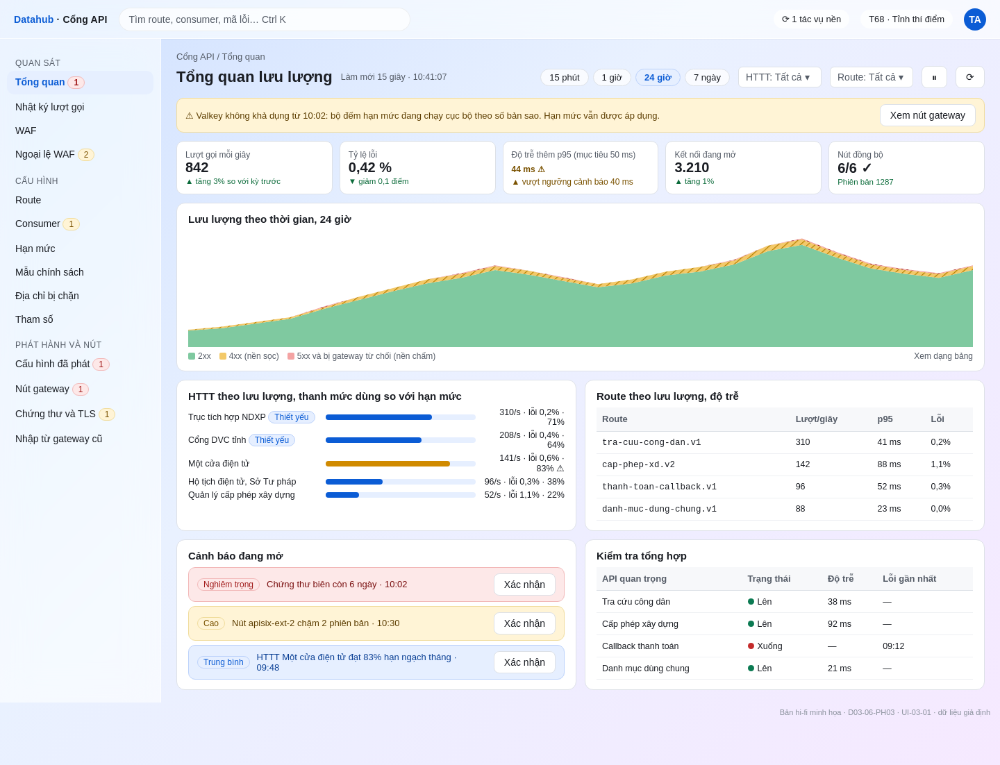

Ảnh cho thấy thứ tự đọc: dải cảnh báo hệ thống ở trên cùng, hàng năm thẻ chỉ số có mũi tên xu hướng và chữ, biểu đồ lưu lượng xếp chồng, hai bảng xếp hạng có thanh mức dùng, rồi cảnh báo đang mở và kiểm tra tổng hợp. Thẻ "Độ trễ thêm p95" đổi sang màu cảnh báo vì vượt ngưỡng 40 ms của mục tiêu 50 ms. Dữ liệu là giả định của tỉnh T68.

### 7.1. Wireframe

```text
┌ Tổng quan lưu lượng ───── [15p|1h|24h|7d] [HTTT ▾] [Route ▾]  Làm mới 15 giây [⏸] [⟳] ┐
│ ⚠ Banner: Valkey không khả dụng, hạn mức đếm cục bộ…                    (nếu có)    │
│ ① ┌ Lượt/giây ┐┌ Tỷ lệ lỗi ┐┌ Độ trễ thêm p95 ┐┌ Kết nối mở ┐┌ Nút đồng bộ ┐         │
│   │ 842  ▲3%  ││ 0,42% ▼   ││ 44 ms  ⚠ (≤50)   ││ 3.210      ││ 6/6  ✓      │         │
│ ② ┌ Lưu lượng theo thời gian (vùng xếp chồng 2xx / 4xx / 5xx / bị gateway từ chối) ──┐ │
│   │                                                                [Xem dạng bảng] │ │
│ ③ ┌ Top HTTT theo lưu lượng ───────────┐ ④ ┌ Top route theo lưu lượng, độ trễ ──────┐ │
│   │ NDXP ▓▓▓▓▓▓░░ 71% hạn mức           │   │ tra-cuu-cong-dan.v1  310/s  41 ms      │ │
│ ⑤ ┌ Cảnh báo đang mở ─────────────────┐ ⑥ ┌ Kiểm tra tổng hợp ────────────────────┐ │
│   │ ■ Nghiêm trọng … [Xác nhận]        │   │ ● ● ● ○ ●   lỗi gần nhất 09:12        │ │
│ Tab: [Lưu lượng] [Báo cáo sử dụng]                                                    │
└──────────────────────────────────────────────────────────────────────────────────────┘
```

### 7.2. Thành phần

| # | Thành phần | `CMP-*` | Nội dung, kiểm tra | Nguồn | Ghi chú |
|---|---|---|---|---|---|
| 1 | Tiêu đề, bộ lọc thời gian | `CMP-PageHeader`, `CMP-SegmentedControl`, `CMP-ResourceSelect` | Khoảng 15 phút, 1 giờ, 24 giờ, 7 ngày; lọc theo HTTT, route | API-03-077 `khoang`, `consumer`, `route` | Ghi URL; tối đa 31 ngày (ERR-03-021) |
| 2 | Banner suy giảm | `CMP-Banner` | Hiện khi `degraded.valkey=true` hoặc `waf.autoDowngraded=true` | API-03-077 `degraded` | Không đóng được tới khi hết suy giảm |
| 3 | Năm thẻ chỉ số | `CMP-KpiCard` | Lượt/giây; tỷ lệ lỗi; độ trễ thêm p95 (ngưỡng cảnh báo 40 ms, mục tiêu 50 ms); kết nối đang mở; nút đồng bộ `{synced}/{total}` | API-03-077 `kpis` | Mỗi thẻ bấm được; mũi tên xu hướng kèm chữ "tăng 3% so với kỳ trước" |
| 4 | Biểu đồ lưu lượng | `CMP-Chart` (vùng xếp chồng) | Nhóm `2xx`, `4xx`, `5xx`, bị gateway từ chối; làm mới 15 giây | API-03-077 `series` | Mẫu nền khác nhau cho từng nhóm; "Xem dạng bảng" |
| 5 | Xếp hạng HTTT | `CMP-DataTable` (gọn) + `CMP-ProgressBar` | HTTT, lượt gọi, tỷ lệ lỗi, thanh mức dùng so với hạn mức; đổi `color-warning` khi vượt 80%; nhãn `ESSENTIAL` | API-03-078 | Bấm một dòng lọc cả trang theo HTTT |
| 6 | Xếp hạng route | `CMP-DataTable` (gọn) | Route, lượt gọi, p95, tỷ lệ lỗi, cửa vào | API-03-079 | Bấm dòng mở UI-03-03 |
| 7 | Cảnh báo đang mở | `CMP-Alert` dạng danh sách, `CMP-Badge` | Mức, mô tả, thời điểm, liên kết sang UI-03-07 hoặc UI-03-09; nút "Xác nhận" | API-03-084, 085 | Nút ẩn nếu thiếu `PERM-03-operate` |
| 8 | Kiểm tra tổng hợp | `CMP-StatusDot` + `CMP-Timestamp` | Chấm xanh, đỏ cho từng API quan trọng; thời điểm lỗi gần nhất | API-03-080 | Tooltip tên API, độ trễ |
| 9 | Tab báo cáo sử dụng | `CMP-Tabs`, `CMP-DataTable`, `CMP-Button` | Bảng sử dụng theo HTTT và gói trong khoảng chọn; nút "Xuất báo cáo" | API-03-089, 090 | Xuất là tác vụ nền, tối đa 100.000 dòng |
| 10 | Cấu hình kiểm tra tổng hợp | `CMP-Drawer` (PTN-04), `CMP-Form`, `CMP-Select`, `CMP-NumberInput` | Nút "Cấu hình kiểm tra" ở khối Kiểm tra tổng hợp mở Drawer liệt kê, thêm, sửa, xóa kiểm tra: API quan trọng, chu kỳ (30 giây đến 15 phút), ngưỡng độ trễ; kiểm tra không tăng hạn mức HTTT thật (BR-03-027) | API-03-080, 081, 082, 083 | Chỉ hiện với `PERM-03-admin`; xóa có `CMP-ConfirmDialog` |

: UI-03-01 · Thành phần

### 7.3. Hành động và điều hướng từ thẻ

| Thẻ, vùng | Bấm để | Quyền |
|---|---|---|
| Tỷ lệ lỗi | Mở UI-03-09 đã lọc `ma-loi=4xx,5xx` cùng khoảng thời gian | `PERM-03-log-read` |
| WAF chặn (trong biểu đồ, nhóm "bị gateway từ chối") | Mở UI-03-07 cùng khoảng | `PERM-03-waf-request` |
| Nút đồng bộ | Mở UI-03-11 | `PERM-03-read` |
| Một HTTT ở xếp hạng | Lọc trang theo HTTT; liên kết "Mở consumer" sang UI-03-05 | `PERM-03-read` |
| Một route ở xếp hạng | Mở UI-03-03 | `PERM-03-read` |
| Cảnh báo | Mở màn nguồn của cảnh báo | Theo màn đích |

: UI-03-01 · Điều hướng từ thẻ và vùng

### 7.4. Trạng thái màn

| Trạng thái | Hiển thị |
|---|---|
| Đang tải | Skeleton năm thẻ, khung biểu đồ, hai bảng 8 dòng |
| Rỗng lần đầu | Tenant mới chưa có route: "Chưa có API nào chạy qua gateway. Route được tạo khi API được công bố ở Danh mục API." kèm liên kết `/ket-noi/api` |
| Không có kết quả | Lọc HTTT hoặc route không có lượt gọi trong khoảng: "Không có lượt gọi nào trong khoảng đã chọn." kèm "Xóa bộ lọc" |
| Lỗi tải một khối | "Chưa có số liệu" trong khối, nút "Thử lại"; không hiện số 0 (ERR-03-026) |
| Không có quyền | ST-07 |

: UI-03-01 · Trạng thái màn

### 7.5. Tương tác, phím tắt và truy cập

`1`, `2`, `3`, `4` chọn khoảng 15 phút, 1 giờ, 24 giờ, 7 ngày; `R` làm mới ngay; `P` tạm dừng hoặc tiếp tục làm mới; `/` vào ô lọc HTTT. Biểu đồ có bảng số liệu tương đương và mô tả `aria-label` ("Lưu lượng 24 giờ, đỉnh 1.120 lượt/giây lúc 10:14"); mỗi thẻ là một nút có tên đầy đủ ("Tỷ lệ lỗi 0,42 phần trăm, giảm so với kỳ trước, mở nhật ký lỗi"). Làm mới tự động không đưa focus đi nơi khác và thông báo thay đổi lớn (cảnh báo mới) qua vùng `aria-live="polite"`.

## 8. UI-03-02 Danh sách route

::: dac-ta
**Mục đích.** Tìm một route theo mã, host, đường dẫn; thấy ngay route nào đang dừng, bị tạm ngừng, sắp ngừng phục vụ hay đang ở cửa Internet; dừng, mở hoặc tạm ngừng khẩn cấp ngay trên dòng. Route do PH-02 sinh nên không có nút "Tạo route".

**Người dùng chính.** TO, TA, PA.

**FR hiện thực.** FR-03-028, 035, 036, 047.

**Đường dẫn.** `/cong-api/route`.

**Mẫu.** PTN-01.

**Quyền.** `PERM-03-read`; dừng, mở, tạm ngừng cần `PERM-03-operate`.

**API.** API-03-001, 003, 004, 019, 020.
:::

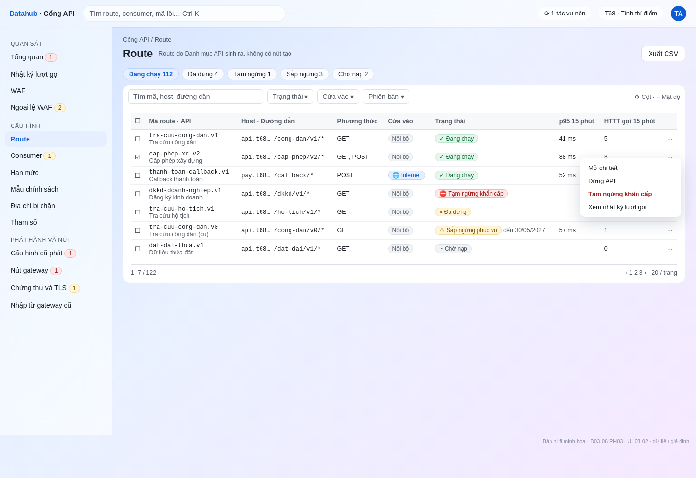

Ảnh cho thấy dải lọc nhanh theo trạng thái ở trên bảng, cột "Cửa vào" có nhãn Internet cho route `EXT`, cột "HTTT gọi 15 phút" để biết hậu quả trước khi dừng, và route `SUSPENDED` được tô nền cảnh báo nhưng vẫn kèm chữ trạng thái. Hàng đầu có menu hành động mở sẵn.

### 8.1. Wireframe

```text
┌ Route ─────────────────────────────────────────────────── [Xuất CSV] ┐
│ [Tìm mã, host, đường dẫn…] [Trạng thái ▾] [Cửa vào ▾] [Phiên bản ▾]    │
│ Lọc nhanh: (Đang chạy 112) (Đã dừng 4) (Tạm ngừng 1) (Sắp ngừng 3)    │
├──┬───────────────────────┬────────────────┬──────┬────────┬─────┬─────┬───┤
│  │ Mã route · API        │ Host · Đường dẫn│ Cửa  │ Trạng  │ p95 │ HTTT│ ⋯ │
│  │ tra-cuu-cong-dan.v1   │ api.t68… /cd/v1 │ Nội bộ│ Đang chạy│41ms │ 5  │ ⋯ │
└──┴───────────────────────┴────────────────┴──────┴────────┴─────┴─────┴───┘
  Chọn 2 route ▸ [Dừng API] [Tạm ngừng khẩn cấp]               ‹ 1 2 3 › 20 / trang
```

### 8.2. Thành phần

| # | Thành phần | `CMP-*` | Nội dung, kiểm tra | Nguồn | Ghi chú |
|---|---|---|---|---|---|
| 1 | Tiêu đề, xuất | `CMP-PageHeader`, `CMP-Button` | "Xuất CSV" mặc định | — | Xuất theo bộ lọc, không gồm bí mật |
| 2 | Thanh lọc | `CMP-FilterBar`, `CMP-SearchField`, `CMP-Select` | Tìm ≥ 2 ký tự, trễ 300 ms; lọc nhiều giá trị | API-03-001 `q`, `state`, `exposure`, `version` | Ghi URL |
| 3 | Lọc nhanh | `CMP-Tag` bấm được | Đếm từ `facets.state` | `facets` | Bấm là bật lọc |
| 4 | Bảng | `CMP-DataTable` | Cột mục 8.3; chọn nhiều dòng | `items` | Mặc định: `SUSPENDED`, `STOPPED` lên đầu |
| 5 | Thanh chọn nhiều | `CMP-BulkActionBar` | "Dừng API", "Tạm ngừng khẩn cấp" khi chọn ≥ 1 | — | Tối đa 50 dòng mỗi lần; hậu quả tổng hợp ở hộp xác nhận |
| 6 | Menu hàng | `CMP-DropdownMenu` | Mở chi tiết, Dừng API hoặc Mở API, Tạm ngừng khẩn cấp hoặc Mở lại, Xem nhật ký | `allowedActions` | Theo trạng thái và quyền |
| 7 | Hộp xác nhận | `CMP-ConfirmDialog`, `CMP-ReasonDialog` | Dừng: xác nhận; tạm ngừng: lý do bắt buộc | API-03-003, 019 | Mục 8.4 |
| 8 | Phân trang | `CMP-Pagination` | 10, 20, 50, 100 dòng | `page` | |

: UI-03-02 · Thành phần

### 8.3. Cột bảng

| Cột | Nội dung | Sắp xếp | Ghi chú |
|---|---|---|---|
| Mã route · API | `routeCode` bằng `CMP-CodeText`, tên API dòng 2 | Có | Liên kết tới UI-03-03 |
| Host · Đường dẫn | `hostPattern` và `pathPattern` rút gọn, tooltip đầy đủ | | `CMP-CodeText` |
| Phương thức | Danh sách `CMP-Tag` (GET, POST…) | | |
| Cửa vào | "Nội bộ" hoặc "Internet" (`CMP-Tag`, biểu tượng quả cầu cho Internet) | Có | `EXT` luôn nổi bật |
| Trạng thái | `CMP-StatusTag` theo §5.1 | Có | `SUNSET` kèm ngày ngừng |
| p95 15 phút | `CMP-Duration` | Có | Chưa có số liệu hiện "—" |
| HTTT gọi 15 phút | Số HTTT khác nhau đã gọi | Có | Dùng cho hộp hậu quả |
| ⋯ | Menu hàng | | |

: UI-03-02 · Cột bảng

### 8.4. Hộp dừng, mở, tạm ngừng

Dừng API mở `CMP-ConfirmDialog`: "Dừng route {mã}? {n} HTTT đã gọi route này trong 15 phút qua sẽ nhận lỗi 503 trong tối đa 30 giây tới." Nút "Dừng API" dùng màu `color-warning`. Tạm ngừng khẩn cấp mở `CMP-ReasonDialog`: cảnh báo "Route bị chặn hoàn toàn cho mọi HTTT, kể cả HTTT thiết yếu", trường lý do bắt buộc, nút `color-error`. Mở lại chỉ cần xác nhận. Route đã ở trạng thái đích thì hiện ERR-03-019; route chưa `ACTIVE` mà bấm dừng thì ERR-03-023.

### 8.5. Trạng thái màn

| Trạng thái | Hiển thị |
|---|---|
| Đang tải | Skeleton 8 dòng |
| Rỗng lần đầu | "Chưa có route nào. Route xuất hiện khi API được công bố ở Danh mục API." kèm liên kết `/ket-noi/api` (không có nút tạo) |
| Không có kết quả | ST-04 kèm "Xóa bộ lọc" |
| Lỗi tải | ST-05 trong vùng bảng |
| Không có quyền | ST-07 |
| Chỉ đọc | Menu hàng chỉ còn "Mở chi tiết", "Xem nhật ký" |

: UI-03-02 · Trạng thái màn

### 8.6. Tương tác, phím tắt và truy cập

`/` vào ô tìm; `↑`, `↓` chọn dòng; `Enter` mở chi tiết; `Space` đánh dấu chọn; `S` dừng hoặc mở dòng đang chọn (có hộp xác nhận); `Shift+S` tạm ngừng khẩn cấp (có hộp lý do). Bảng có `aria-label` "Danh sách route"; cột sắp xếp công bố `aria-sort`; trạng thái hàng đọc bằng chữ, không bằng màu nền.

## 9. UI-03-03 Chi tiết route (siêu chi tiết)

::: dac-ta
**Mục đích.** Là nơi một quản trị hoặc vận hành xem và chỉnh đủ mọi thứ gateway thực thi cho một route: chính sách bảo mật chiếu từ gói, giới hạn kích thước, CORS, danh sách đường dẫn, backend và sức khỏe từng nút backend, phiên bản API song song, cửa vào, lịch sử thay đổi; đồng thời dừng, mở, tạm ngừng khẩn cấp, mở cửa Internet. Đây là màn có nhiều thao tác ghi nhất của phân hệ nên viết chi tiết đến từng vùng.

**Người dùng chính.** TA, PA, TO.

**FR hiện thực.** FR-03-009, 010, 015, 017, 019, 020, 028, 029, 030, 031, 033, 034, 035, 036, 038.

**Đường dẫn.** `/cong-api/route/{routeCode}`; tab trong tham số `tab`.

**Mẫu.** PTN-02.

**Quyền.** `PERM-03-read`; sửa chính sách và giới hạn cần `PERM-03-admin`; dừng, mở, tạm ngừng cần `PERM-03-operate`; đề nghị cửa Internet cần `PERM-03-admin` (người duyệt có `PERM-03-approve`).

**API.** API-03-002, 003, 004, 006, 007, 008, 009, 010, 019, 020, 021, 022, 050, 051, 055, 071.
:::

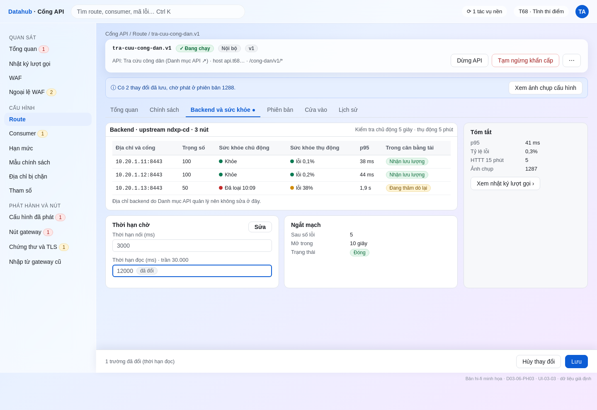

Ảnh cho thấy khung tiêu đề dính (trạng thái, cửa vào, các nút hành động), hàng sáu tab và tab "Backend và sức khỏe" đang mở: bảng nút backend với trọng số, dấu hiệu sức khỏe chủ động và thụ động, và khối thời hạn chờ, ngắt mạch ở bên phải. Mọi giá trị đang sửa có chấm đánh dấu "chưa lưu".

### 9.1. Mục đích, người dùng, bối cảnh

Người dùng mở màn này ở ba bối cảnh. Một là **sự cố**: từ cảnh báo hoặc nhật ký lượt gọi, TO cần dừng route hoặc xem backend nào đã bị loại; thao tác phải làm được trong dưới 30 giây từ lúc mở màn. Hai là **thay đổi có kế hoạch**: TA điều chỉnh giới hạn thân yêu cầu, thời hạn chờ, danh sách CORS; thay đổi này đi qua ảnh chụp cấu hình nên có độ trễ, giao diện phải nói rõ "đã lưu, chờ phát". Ba là **mở cửa Internet**: TA đề nghị, SO duyệt, màn phải cho người đề nghị thấy từng điều kiện còn thiếu. Màn dùng trên máy tính bàn màn hình rộng từ 1280 px; dưới 1024 px bố cục chuyển một cột và bảng nút backend cuộn ngang trong khung.

### 9.2. Lưới bố cục và kích thước

Khung trang theo PTN-02: nội dung tối đa `size-page-max`, lề `space-6`, khoảng cách giữa các khối `space-4`. Tiêu đề dính cao 88 px khi cuộn về 56 px (chỉ còn mã route, trạng thái và nút chính).

| Vùng | Kích thước | Ghi chú |
|---|---|---|
| R1 Tiêu đề dính | Rộng toàn nội dung, cao 88 px, vật liệu đặc `color-surface-solid` có viền dưới `color-border-subtle` | Không dùng kính vì chứa nút hành động nguy hiểm |
| R2 Dải cảnh báo của route | Cao tự động, 0 hoặc 1 dải | Hiện khi route `STOPPED`, `SUSPENDED`, `SUNSET` hoặc có thay đổi chờ phát |
| R3 Hàng tab | Cao 40 px | `CMP-Tabs`, sáu tab; thanh trượt cuộn ngang khi hẹp |
| R4 Nội dung tab | Lưới 12 cột, khoảng cách `space-4` | Cột chính 8 cột, cột phụ 4 cột (tóm tắt, trợ giúp) |
| R5 Thanh lưu dính đáy | Cao 56 px, chỉ hiện khi có thay đổi chưa lưu | `CMP-Form` dirty: "Lưu", "Hủy thay đổi", đếm số trường đã đổi |

: UI-03-03 · Lưới bố cục và kích thước

### 9.3. Wireframe tổng thể

```text
┌ ① Cổng API › Route › tra-cuu-cong-dan.v1 ─────────────────────────────────────────────┐
│ ② tra-cuu-cong-dan.v1  [Đang chạy] [Nội bộ] [v1]   API: Tra cứu công dân (PH-02 ↗)    │
│   host api.t68.datahub.local · /cong-dan/v1/*   [Dừng API] [Tạm ngừng khẩn cấp] [⋯]   │
│ ③ ⚠ Có 2 thay đổi đã lưu, chờ phát ở phiên bản 1288. [Xem ảnh chụp]                    │
│ ④ [Tổng quan] [Chính sách] [Backend và sức khỏe] [Phiên bản] [Cửa vào] [Lịch sử]       │
│ ┌ ⑤ Cột chính (8/12) ─────────────────────────────┐ ┌ ⑥ Cột phụ (4/12) ────────────┐ │
│ │ Backend (upstream ndxp-cd, 3 nút)                │ │ Tóm tắt                      │ │
│ │ ┌ Nút        │ Trọng số │ Chủ động │ Thụ động ┐  │ │ p95 41 ms · lỗi 0,3%         │ │
│ │ │ 10.20.1.11 │ 100      │ ● Khỏe   │ ● 0,1%   │  │ │ HTTT gọi 15 phút: 5          │ │
│ │ │ 10.20.1.12 │ 100      │ ● Khỏe   │ ● 0,2%   │  │ │ Mạch ngắt: Đóng              │ │
│ │ │ 10.20.1.13 │ 50       │ ○ Loại   │ ▲ 38%    │  │ │ [Xem nhật ký lượt gọi ›]     │ │
│ │ Thời hạn chờ: nối [3000] ms  đọc [10000] ms      │ │                              │ │
│ │ Ngắt mạch: sau [5] lỗi, mở [10] giây             │ │                              │ │
│ └──────────────────────────────────────────────────┘ └──────────────────────────────┘ │
│ ⑦ Thanh lưu dính: 2 trường đã đổi  [Hủy thay đổi] [Lưu]                              │
└──────────────────────────────────────────────────────────────────────────────────────┘
```

Wireframe đánh số vùng theo thứ tự đọc: ① và ② thuộc R1, ③ là R2, ④ là R3, ⑤ và ⑥ thuộc R4, ⑦ là R5.

### 9.4. Vùng R1: tiêu đề dính

| Phần tử | `CMP-*` | Hành vi |
|---|---|---|
| Breadcrumb | `CMP-Breadcrumb` | Mục cuối không bấm; mục "Route" giữ bộ lọc gần nhất |
| Mã route | `CMP-Heading` + `CMP-CodeText` + `CMP-CopyButton` | Sao chép mã bằng phím `C` khi focus ở tiêu đề |
| Nhãn trạng thái | `CMP-StatusTag` | Theo §5.1; thay đổi tức thì khi có sự kiện trạng thái |
| Nhãn cửa vào, phiên bản | `CMP-Tag` | "Nội bộ" hoặc "Internet"; phiên bản `v1`; bấm phiên bản mở tab Phiên bản |
| Liên kết API | `CMP-Link` | Mở API ở PH-02 (`/ket-noi/api/{apiCode}`) ở cùng tab |
| Nút "Dừng API" hoặc "Mở API" | `CMP-Button` | Hiện theo `allowedActions`; mở `CMP-ConfirmDialog` mục 8.4 |
| Nút "Tạm ngừng khẩn cấp" | `CMP-Button` màu `color-error` | Luôn hiện với `PERM-03-operate`; mở `CMP-ReasonDialog`; sau khi tạm ngừng đổi thành "Mở lại" |
| Menu "⋯" | `CMP-DropdownMenu` | Chạy thử chính sách (mở UI-03-14 với route này), Xem nhật ký lượt gọi, Xem trong Danh mục API |

: UI-03-03 · Vùng R1 Tiêu đề dính

### 9.5. Vùng R3 và R4: các tab

#### 9.5.1. Tab Tổng quan

Khối `CMP-DescriptionList` hai cột: Mã route, API và phiên bản, Host, Đường dẫn, Phương thức, Độ ưu tiên, Cửa vào, Upstream, Bộ chính sách, Gói áp dụng, Trạng thái, Thời điểm nạp gần nhất, Phiên bản ảnh chụp chứa route. Cột phụ có ba `CMP-KpiCard` nhỏ (lượt/giây, tỷ lệ lỗi, p95) lấy từ API-03-002 `stats` và liên kết "Xem nhật ký lượt gọi" mở UI-03-09 lọc theo route. Không có trường sửa được ở tab này; mọi sửa nằm ở tab chuyên đề.

#### 9.5.2. Tab Chính sách

Tab có bốn khối, mỗi khối là một `CMP-Card` có nút "Sửa" riêng (khi có `PERM-03-admin`) để chỉ một khối ở chế độ sửa tại một thời điểm.

| Khối | Trường | Kiểu, kiểm tra | Ánh xạ API |
|---|---|---|---|
| Phương thức bảo mật (chiếu từ gói, chỉ đọc) | `securityMode` (Keyless, API key, OAuth 2.1, mTLS), phạm vi quyền thô `requiredScopes[]`, `requireMtls` | Chỉ đọc; liên kết tới gói ở PH-02; Keyless kèm nhãn "Dữ liệu mở" | API-03-002, 022 |
| Giới hạn yêu cầu | `bodyMaxBytes` (KiB, MiB), `jsonMaxDepth`, `jsonMaxArrayItems`, kiểu nội dung cho phép | Số nguyên trong miền của tham số `gw.body.maxBytes` (1 KiB…10 MiB), `gw.json.maxDepth` (8…64); sai: ERR-03-018 hoặc ERR-03-003 | API-03-009 |
| CORS | `allowedOrigins[]`, `allowedMethods[]`, `allowedHeaders[]`, `maxAgeSeconds`, `allowCredentials` | Nguồn gốc viết đủ `https://host`, không ký tự đại diện (BR-03-012); ô nhập thẻ `CMP-KeyValueEditor` dạng danh sách; sai: ERR-03-003 | API-03-051 |
| Danh sách đường dẫn | `pathAllow[]`, `pathDeny[]` | Chỉ đọc nếu chiếu từ gói; hiển thị mẫu đường dẫn bằng `CMP-CodeText`; ưu tiên chặn trước cho phép | API-03-022 |
| Ủy quyền chi tiết (OPA) | Tên gói chính sách, phiên bản gói, trạng thái liên kết | Chỉ đọc; cảnh báo nếu thiếu (ERR-03-012) | API-03-055 |

: UI-03-03 · Tab Chính sách

Khi lưu một khối, giao diện gửi `If-Match` với `ETag` của route; 412 mở hộp xung đột ST-13 (ERR-03-004). Sau lưu thành công hiện dải R2 "Đã lưu, chờ phát cấu hình" kèm liên kết tới UI-03-10 vì thay đổi chỉ có hiệu lực khi ảnh chụp mới được phát (thường trong 3 giây nhờ gộp sự kiện, `gw.snapshot.debounceSeconds`).

#### 9.5.3. Tab Backend và sức khỏe

Bảng nút backend (`CMP-DataTable` gọn, `CMP-StatusDot`) gồm các cột Địa chỉ và cổng, Trọng số, Sức khỏe chủ động (khỏe, loại, thăm dò gần nhất), Sức khỏe thụ động (tỷ lệ lỗi 5 phút), Độ trễ p95, Trạng thái trong cân bằng tải (Nhận lưu lượng, Đã loại, Đang thăm dò lại). Bên phải là hai khối chỉ đọc "Thời hạn chờ" (`connectMs`, `readMs`, trần 30.000 ms theo CV 631) và "Ngắt mạch" (`failures`, `openSeconds`, trạng thái Đóng, Mở, Nửa mở) lấy từ upstream; thời hạn chờ sửa được bằng nút "Sửa" khi có `PERM-03-admin` (API-03-010). Khi mọi nút bị loại, đầu tab hiện `CMP-Alert` mức lỗi: "Không có backend khỏe. Lượt gọi nhận 503 nhanh (ERR-03-120) và gateway thăm dò lại mỗi {n} giây." (BR-03-011). Bảng không có nút sửa địa chỉ backend vì upstream do PH-02 quản lý.

#### 9.5.4. Tab Phiên bản

Danh sách các phiên bản của API cùng chạy song song (`CMP-DataTable`): phiên bản, route, trạng thái, ngày công bố ngừng dùng, ngày `SUNSET`, số HTTT còn gọi trong 7 ngày. Dòng phiên bản đã `SUNSET` hiện `color-warning`; phiên bản `RETIRED` hiện `color-neutral`. Chú thích dưới bảng: "Phiên bản cũ được phục vụ song song tối thiểu 180 ngày sau khi công bố ngừng dùng và có tiêu đề Deprecation, Sunset" (BR-03-030). Tab chỉ đọc; công bố ngừng dùng làm ở PH-02.

#### 9.5.5. Tab Cửa vào

Khối trạng thái hiện cửa vào hiện tại và điều kiện mở ra Internet dưới dạng danh sách kiểm (`CMP-Steps` dọc, mỗi mục đạt hoặc chưa đạt): WAF ở chế độ chặn, bắt buộc xác thực, có lược đồ OpenAPI đã duyệt, có chính sách OPA, đã đặt giới hạn kích thước thân. Nút "Đề nghị mở cửa Internet" chỉ bật khi đủ điều kiện (nếu chưa, tooltip nêu điều kiện thiếu theo `disabledReasons`, ERR-03-011). Bấm nút mở `CMP-ReasonDialog` (lý do bắt buộc, nêu rủi ro), gửi API-03-008; kết quả là yêu cầu `change-request` chờ SO duyệt ở UI-03-17. Khi route đã ở `EXT`, nút đổi thành "Thu hẹp về cửa nội bộ" (có xác nhận, không cần duyệt vì giảm rủi ro).

#### 9.5.6. Tab Lịch sử

`CMP-AuditTrail` liệt kê thay đổi cấu hình của route: thời điểm, người, hành động, trường đổi (trước, sau), phiên bản ảnh chụp, `traceId`. Lọc theo hành động và người. Dòng tạm ngừng khẩn cấp hiện lý do. Không có thao tác ghi.

### 9.6. Vùng R5: lưu, đồng thời, xung đột

Thanh lưu hiện khi biểu mẫu dirty và gồm bộ đếm số trường đổi, nút "Hủy thay đổi" (hỏi xác nhận nếu đổi ≥ 3 trường) và "Lưu" primary. Gửi bằng `Idempotency-Key` sinh khi mở màn. Rời trang khi dirty mở `CMP-ConfirmDialog` "Bạn có thay đổi chưa lưu" (D03-06-00 §4.3). Khi hai người sửa đồng thời, người lưu sau nhận ST-13: `CMP-Modal` với `CMP-DiffViewer` hai bên, ba nút "Tải bản mới nhất" (mặc định), "Ghi đè" (chỉ với `PERM-03-admin`, hỏi xác nhận) và "Hủy".

### 9.7. Hộp xác nhận và hậu quả ở màn này

| Hành động | Hộp | Nội dung nêu hậu quả |
|---|---|---|
| Dừng API | `CMP-ConfirmDialog` | "{n} HTTT đã gọi route này trong 15 phút qua sẽ nhận 503 trong tối đa 30 giây tới." |
| Mở API | `CMP-ConfirmDialog` | "Route sẽ nhận lưu lượng trở lại sau tối đa 30 giây." |
| Tạm ngừng khẩn cấp | `CMP-ReasonDialog` | "Chặn hoàn toàn mọi HTTT, kể cả HTTT thiết yếu. Hiệu lực trong 30 giây." |
| Mở lại sau tạm ngừng | `CMP-ConfirmDialog` | "Kiểm tra nguyên nhân đã được xử lý trước khi mở lại." kèm lý do tạm ngừng cũ |
| Đề nghị cửa Internet | `CMP-ReasonDialog` | "Route sẽ nhận lưu lượng từ Internet sau khi Cán bộ ATTT duyệt." |

: UI-03-03 · Hộp xác nhận và hậu quả

### 9.8. Trạng thái màn

| Trạng thái | Hiển thị |
|---|---|
| Đang tải | Skeleton tiêu đề, hàng tab, hai khối nội dung; tab khác tải khi mở lần đầu |
| Route `STOPPED` | Dải R2 mức cảnh báo "Route đã dừng từ {thời điểm} bởi {người}. Bên gọi nhận 503." nút "Mở API" |
| Route `SUSPENDED` | Dải R2 mức lỗi "Tạm ngừng khẩn cấp từ {thời điểm}: {lý do}." nút "Mở lại" |
| Route `SUNSET` hoặc `RETIRED` | Dải R2 thông tin; mọi nút ghi ẩn trừ "Xem nhật ký" |
| Có thay đổi chờ phát | Dải R2 thông tin kèm liên kết UI-03-10 |
| Không có backend khỏe | `CMP-Alert` mức lỗi đầu tab Backend (mục 9.5.3) |
| Mất số liệu | Khối p95 và lỗi hiện "Chưa có số liệu" (ERR-03-026) |
| Không tồn tại | ST-08: "Không tìm thấy route {mã}" (ERR-03-001) kèm "Về danh sách route" |
| Không có quyền | ST-07 |
| Chỉ đọc | Nút "Sửa", dừng, mở ẩn; biểu mẫu hiển thị dạng mô tả |

: UI-03-03 · Trạng thái màn

### 9.9. Bàn phím

| Phím | Tác dụng | Điều kiện |
|---|---|---|
| `Ctrl+S` | Lưu khối đang sửa | Đang dirty, hợp lệ |
| `Esc` | Hủy sửa khối (hỏi nếu đã đổi), đóng hộp thoại | |
| `1` … `6` | Chuyển sáu tab | Focus ở hàng tab |
| `←`, `→` | Chuyển tab khi focus ở hàng tab | Theo mẫu WAI-ARIA tabs |
| `S` | Dừng hoặc mở API (mở hộp xác nhận) | Có `PERM-03-operate`, focus ngoài ô nhập |
| `Shift+S` | Tạm ngừng khẩn cấp (mở hộp lý do) | Như trên |
| `L` | Mở nhật ký lượt gọi lọc theo route | |
| `?` | Mở `CMP-ShortcutSheet` | |

: UI-03-03 · Phím tắt

### 9.10. Chuột và cảm ứng

Bấm một dòng nút backend mở popover (`CMP-Popover`) chi tiết thăm dò gần nhất (mã trạng thái, độ trễ, lỗi); bấm tên API chuyển sang PH-02; rê chuột lên nhãn `SUNSET` hiện tooltip ngày ngừng. Không có thao tác chỉ làm được bằng kéo thả (WCAG 2.5.7). Trên màn cảm ứng, các nút hành động có vùng chạm tối thiểu 44 px.

### 9.11. Trợ năng

Hàng tab theo mẫu WAI-ARIA `tablist`; khi đổi tab, focus ở tab, nội dung mới công bố qua `aria-live="polite"`. Dải R2 có `role="status"` (thông tin) hoặc `role="alert"` (lỗi). Hộp xác nhận bẫy focus, trả focus về nút gọi khi đóng. Vòng focus dùng `color-focus-ring` dày 2 px, không bị thanh lưu dính che (WCAG 2.2 tiêu chí 2.4.11): trang có `scroll-padding-bottom` bằng chiều cao thanh lưu. Chỉ báo sức khỏe backend có chữ ("Khỏe", "Đã loại") ngoài chấm màu. Nhãn trạng thái có tên đọc đầy đủ ("Trạng thái route: Đang chạy").

### 9.12. Hiệu năng

Tải tab Tổng quan trong 1,5 giây ở mạng nội bộ (giả định, đo ở hồ sơ tỉnh vừa); các tab khác tải khi mở lần đầu và giữ trong bộ nhớ đệm TanStack Query 30 giây. Làm mới trạng thái route qua sự kiện đẩy (SSE) để dải R2 đổi ngay khi có người khác dừng route; nếu không có SSE thì hỏi lại mỗi 10 giây.

## 10. UI-03-04 Danh sách consumer

::: dac-ta
**Mục đích.** Tìm một client của HTTT (consumer) đang được gateway nhận diện, thấy ngay consumer nào đang bị tạm ngừng, dùng phương thức xác thực nào, chứng thư sắp hết hạn, và tạm ngừng khẩn cấp khi nghi bị lộ khóa. Danh sách này là hình chiếu; consumer được tạo và gỡ tự động khi HTTT kết nạp ở PH-01 nên không có nút "Tạo consumer".

**Người dùng chính.** TA, TO, SO.

**FR hiện thực.** FR-03-046, 047.

**Đường dẫn.** `/cong-api/consumer`.

**Mẫu.** PTN-01.

**Quyền.** `PERM-03-read`; tạm ngừng, mở lại cần `PERM-03-operate`.

**API.** API-03-011, 017, 018.
:::

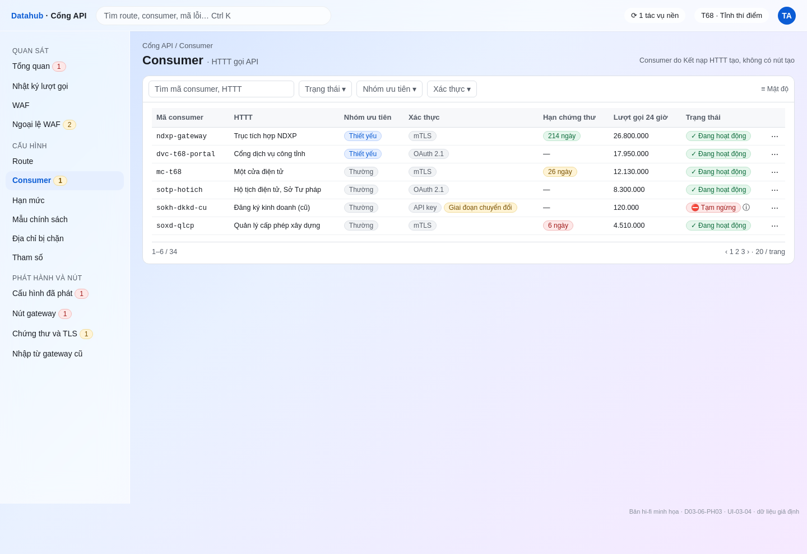

Ảnh cho thấy cột "Xác thực" dùng nhãn khác nhau cho mTLS, OAuth 2.1 và API key (API key kèm nhãn "Giai đoạn chuyển đổi"), cột "Hạn chứng thư" đổi màu theo ngưỡng 30 ngày và 7 ngày, và một consumer đang tạm ngừng ở dòng cuối kèm lý do trong tooltip.

### 10.1. Wireframe

```text
┌ Consumer (HTTT gọi API) ────────────────────────────────────────────────┐
│ [Tìm mã, HTTT…] [Trạng thái ▾] [Nhóm ưu tiên ▾] [Xác thực ▾]            │
├────────────────────┬──────────────┬───────┬────────┬──────────┬────────┬───┤
│ Mã consumer        │ HTTT         │ Nhóm  │ Xác thực│ Hạn chứng│ Trạng  │ ⋯ │
│ ndxp-gateway       │ Trục NDXP    │ Thiết yếu│ mTLS │ 214 ngày │ Hoạt động│ ⋯ │
└────────────────────┴──────────────┴───────┴────────┴──────────┴────────┴───┘
```

### 10.2. Thành phần và cột

| # | Thành phần | `CMP-*` | Nội dung, kiểm tra | Nguồn | Ghi chú |
|---|---|---|---|---|---|
| 1 | Thanh lọc | `CMP-FilterBar`, `CMP-SearchField`, `CMP-Select` | Tìm ≥ 2 ký tự; lọc trạng thái, nhóm ưu tiên, phương thức xác thực | API-03-011 `q`, `state`, `priorityGroup`, `authMethod` | Ghi URL |
| 2 | Bảng | `CMP-DataTable` | Cột bên dưới | `items` | `SUSPENDED` lên đầu |
| 3 | Menu hàng | `CMP-DropdownMenu` | Mở chi tiết, Tạm ngừng khẩn cấp hoặc Mở lại, Xem nhật ký | `allowedActions` | |
| 4 | Hộp lý do | `CMP-ReasonDialog` | Lý do bắt buộc 10–500 ký tự | API-03-017 | Nêu số route consumer đang gọi |
| 5 | Phân trang | `CMP-Pagination` | 10, 20, 50, 100 | `page` | |

: UI-03-04 · Thành phần

| Cột | Nội dung | Sắp xếp | Ghi chú |
|---|---|---|---|
| Mã consumer | `consumerCode` bằng `CMP-CodeText` | Có | Liên kết tới UI-03-05 |
| HTTT | Tên HTTT, mã trong tooltip | Có | Liên kết `/ket-noi/he-thong/{ma}` |
| Nhóm ưu tiên | `CMP-Tag`: Thiết yếu, Thường, Thấp | Có | |
| Xác thực | Nhãn theo phương thức: mTLS, OAuth 2.1, API key (kèm "Giai đoạn chuyển đổi") | Có | |
| Hạn chứng thư | Số ngày còn lại, `CMP-StatusTag` theo §5.1 | Có | "—" nếu không dùng mTLS |
| Lượt gọi 24 giờ | Số lượt, `CMP-Duration` p95 ở tooltip | Có | |
| Trạng thái | `CMP-StatusTag` (Đang hoạt động, Tạm ngừng) | Có | Tạm ngừng kèm biểu tượng |

: UI-03-04 · Cột bảng

### 10.3. Trạng thái màn

| Trạng thái | Hiển thị |
|---|---|
| Đang tải | Skeleton 8 dòng |
| Rỗng lần đầu | "Chưa có consumer nào. Consumer được tạo khi HTTT được kết nạp và có client ở Danh mục HTTT." kèm liên kết `/ket-noi/he-thong` |
| Không có kết quả | ST-04 kèm "Xóa bộ lọc" |
| Lỗi tải | ST-05 |
| Không có quyền | ST-07 |
| Chỉ đọc | Menu hàng chỉ còn mở chi tiết, xem nhật ký |

: UI-03-04 · Trạng thái màn

Thông điệp: tạm ngừng consumer đã tạm ngừng hiện ERR-03-019 (`CMP-Toast` cảnh báo); thành công "Đã tạm ngừng consumer {mã}. Có hiệu lực trong 30 giây." Phím tắt: `/` vào ô tìm; `↑`, `↓` chọn dòng; `Enter` mở chi tiết; `Shift+S` tạm ngừng khẩn cấp. Truy cập: bảng có `aria-label` "Danh sách consumer", nhãn xác thực có chữ đầy đủ ("Xác thực mTLS").

## 11. UI-03-05 Chi tiết consumer

::: dac-ta
**Mục đích.** Cho người quản trị và cán bộ ATTT thấy một HTTT đang được gateway nhận diện thế nào: thông tin xác thực công khai (vân tay chứng thư, hạn, khóa công khai `kid`), các API đã đăng ký, hạn mức và mức dùng hạn ngạch, danh sách thu hồi, nhật ký lượt gọi của riêng consumer, và tạm ngừng khẩn cấp khi nghi lộ khóa. Gateway không lưu bí mật nên màn không có gì để che.

**Người dùng chính.** TA, TO, SO.

**FR hiện thực.** FR-03-014, 016, 018, 022, 046, 047, 051.

**Đường dẫn.** `/cong-api/consumer/{consumerCode}`.

**Mẫu.** PTN-02.

**Quyền.** `PERM-03-read`; tạm ngừng, mở lại `PERM-03-operate`; tab Nhật ký `PERM-03-log-read`.

**API.** API-03-012, 016, 017, 018, 029, 030, 054, 074.
:::

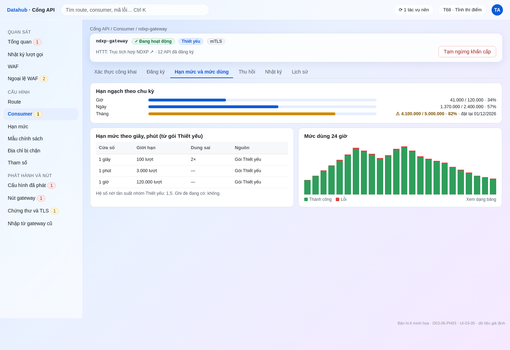

Ảnh cho thấy tab "Hạn mức và mức dùng": thanh hạn ngạch tháng đã dùng 82% đổi sang màu cảnh báo kèm chữ, ba hàng hạn mức theo giây, phút, giờ và nhãn nhóm Thiết yếu. Tiêu đề có nút "Tạm ngừng khẩn cấp" màu lỗi.

### 11.1. Wireframe

```text
┌ ndxp-gateway  [Đang hoạt động] [Thiết yếu] [mTLS]  HTTT: Trục NDXP ↗  [Tạm ngừng khẩn cấp] ┐
│ [Xác thực công khai] [Đăng ký] [Hạn mức và mức dùng] [Thu hồi] [Nhật ký] [Lịch sử]          │
│ ┌ Hạn ngạch tháng ───────────────────────────────────────────────────────────────────────┐ │
│ │ 4.100.000 / 5.000.000 lượt  ▓▓▓▓▓▓▓▓░░ 82%  ⚠ vượt ngưỡng 80%, đặt lại 01/12/2026      │ │
│ ├ Hạn mức theo giây, phút, giờ ──────────────────────────────────────────────────────────┤ │
│ │ 100/giây · 3.000/phút · 120.000/giờ (từ gói Thiết yếu)    Hiệu lực: từ gói PH-02        │ │
│ └─────────────────────────────────────────────────────────────────────────────────────────┘ │
└──────────────────────────────────────────────────────────────────────────────────────────────┘
```

### 11.2. Các tab

| Tab | Nội dung | `CMP-*` | API |
|---|---|---|---|
| Xác thực công khai | Phương thức; với mTLS: vân tay SHA-256 rút gọn, chủ thể, hạn, trạng thái ràng buộc token `cnf`; với OAuth 2.1: `kid` hiện hành, thời điểm đồng bộ JWKS; với API key: hash rút gọn 8 ký tự, hạn, nhãn "Giai đoạn chuyển đổi" | `CMP-DescriptionList`, `CMP-Identifier`, `CMP-MaskedValue`, `CMP-CopyButton` | API-03-012, 016 |
| Đăng ký | Các API HTTT đã đăng ký: API, gói, hiệu lực, trạng thái đăng ký, hạn | `CMP-DataTable` | API-03-012 |
| Hạn mức và mức dùng | Ba thanh `CMP-ProgressBar` theo giờ, ngày, tháng; bảng hạn mức theo giây, phút; mức dùng 24 giờ bằng `CMP-Chart`; ghi đè đang có | `CMP-ProgressBar`, `CMP-Chart`, `CMP-DataTable` | API-03-029, 030 |
| Thu hồi | Danh sách thu hồi token liên quan consumer: thời điểm, lý do, người đẩy (PH-12), thời gian hiệu lực. Chỉ đọc; muốn thu hồi token thì dùng PH-12, màn có liên kết "Thu hồi ở Định danh" | `CMP-DataTable`, `CMP-Link` | API-03-054 |
| Nhật ký | Mười lượt gọi gần nhất của consumer và liên kết "Mở trong Nhật ký lượt gọi" (lọc sẵn) | `CMP-DataTable` | API-03-074 |
| Lịch sử | Thay đổi trạng thái, đồng bộ từ PH-01, tạm ngừng, mở lại | `CMP-AuditTrail` | API-03-012 |

: UI-03-05 · Các tab

### 11.3. Tạm ngừng khẩn cấp

Nút ở tiêu đề mở `CMP-ReasonDialog`: "Tạm ngừng consumer {mã}? Mọi lượt gọi của consumer này nhận 403 (ERR-03-127) trong 30 giây tới. HTTT {tên} có {n} API đang đăng ký và đã gọi {m} lần trong 15 phút qua." Lý do bắt buộc. Sau khi thành công, tiêu đề đổi thành nhãn "Tạm ngừng" kèm lý do và nút "Mở lại"; việc mở lại cũng yêu cầu xác nhận. Gỡ consumer không có ở màn này mà do PH-01 gọi; nếu còn đăng ký đang hiệu lực thì máy chủ trả ERR-03-017 và PH-01 hiển thị lỗi.

### 11.4. Trạng thái màn

| Trạng thái | Hiển thị |
|---|---|
| Đang tải | Skeleton tiêu đề và khối của tab |
| Rỗng (tab Đăng ký) | "HTTT chưa đăng ký sử dụng API nào. Đăng ký thực hiện ở Danh mục API." |
| Rỗng (tab Thu hồi) | "Chưa có token nào bị thu hồi cho consumer này." |
| Mất số liệu mức dùng | "Chưa có số liệu" trong khối mức dùng (ERR-03-026) |
| Consumer tạm ngừng | Dải mức lỗi "Consumer đang bị tạm ngừng từ {thời điểm}: {lý do}." |
| Không tồn tại | ST-08 (ERR-03-001) |
| Không có quyền | ST-07; tab Nhật ký không có quyền hiện `CMP-ResultPage` nhỏ trong tab |

: UI-03-05 · Trạng thái màn

Phím tắt: `1` đến `6` khi focus ở hàng tab chuyển tab; `Shift+S` tạm ngừng; `L` mở nhật ký lọc theo consumer. Truy cập: vân tay đọc từng nhóm hai ký tự; thanh hạn ngạch có `role="progressbar"` với `aria-valuenow` và chữ "82 phần trăm, đã vượt ngưỡng cảnh báo".

## 12. UI-03-06 Hạn mức và hạn ngạch

::: dac-ta
**Mục đích.** Gom một chỗ ba lớp giới hạn mà gateway áp dụng: hạn mức toàn tenant (mặc định 500 lượt/giây), ghi đè theo route hoặc HTTT, và cảnh báo hạn ngạch sắp hết. TA xem được cách các lớp chồng lên nhau theo thứ tự ưu tiên, đặt hoặc hạ hạn mức, và biết HTTT nào sắp bị chặn trước khi bị chặn.

**Người dùng chính.** TA, PA.

**FR hiện thực.** FR-03-021, 022, 023, 024, 027.

**Đường dẫn.** `/cong-api/han-muc`; tab `tenant`, `ghi-de`, `canh-bao`.

**Mẫu.** PTN-01 (ba tab bảng).

**Quyền.** `PERM-03-read`; sửa hạn mức, ghi đè `PERM-03-limit`; hạ hạn mức tenant sinh yêu cầu bốn mắt cần `PERM-03-approve` ở người duyệt.

**API.** API-03-021, 022, 023, 024, 025, 026, 027, 028, 029, 030, 071.
:::

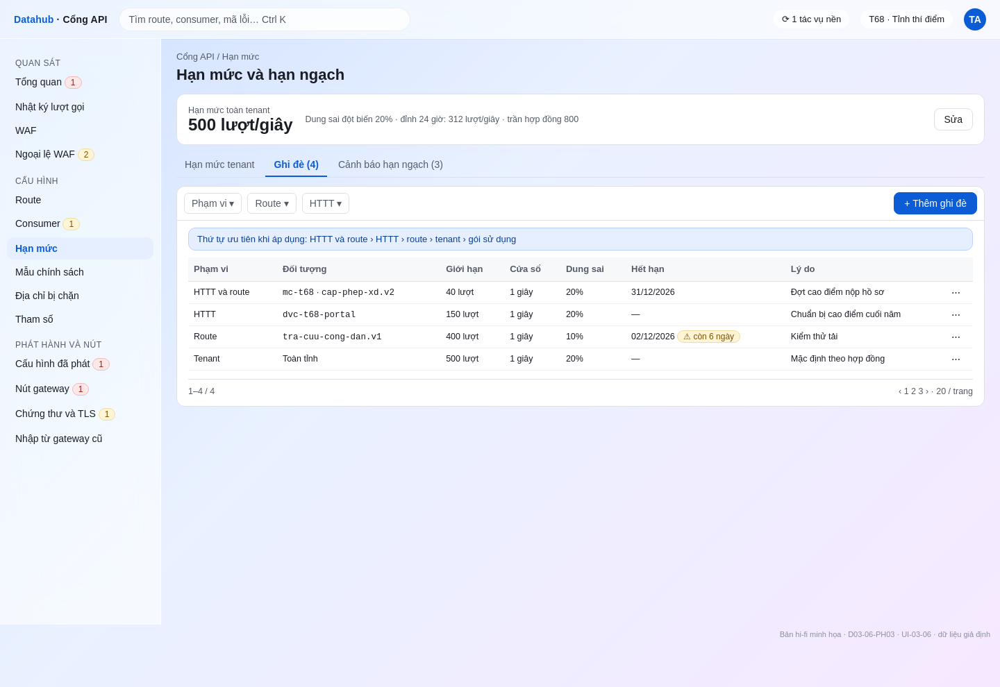

Ảnh cho thấy tab "Ghi đè": bảng ghi đè theo phạm vi (HTTT, HTTT và route, route, tenant), dải thứ tự ưu tiên ở trên bảng, và một ghi đè sắp hết hạn có biểu tượng cảnh báo. Khối hạn mức tenant ở đầu trang hiển thị 500 lượt/giây cùng mức dùng đỉnh 24 giờ.

### 12.1. Wireframe

```text
┌ Hạn mức và hạn ngạch ─────────────────────────────────────────────────┐
│ ┌ Hạn mức toàn tenant ────────────────────────────────────────────────┐│
│ │ 500 lượt/giây · dung sai đột biến 20% · đỉnh 24 giờ: 312   [Sửa]    ││
│ └─────────────────────────────────────────────────────────────────────┘│
│ [Hạn mức tenant] [Ghi đè (7)] [Cảnh báo hạn ngạch (3)]                  │
│ Thứ tự ưu tiên: HTTT+route › HTTT › route › tenant › gói                │
│ [Phạm vi ▾] [Route ▾] [HTTT ▾]                         [+ Thêm ghi đè]  │
│ Phạm vi │ Đối tượng │ Giới hạn │ Cửa sổ │ Dung sai │ Hết hạn │ Lý do │ ⋯ │
└─────────────────────────────────────────────────────────────────────────┘
```

### 12.2. Thành phần

| # | Thành phần | `CMP-*` | Nội dung, kiểm tra | Nguồn | Ghi chú |
|---|---|---|---|---|---|
| 1 | Khối hạn mức tenant | `CMP-Card`, `CMP-KpiCard` | `perSecond`, `burst`, đỉnh 24 giờ; nút "Sửa" | API-03-023 | Sửa mở `CMP-Modal` |
| 2 | Hộp sửa hạn mức tenant | `CMP-Modal`, `CMP-NumberInput`, `CMP-FormField` | Số lượt/giây trong khoảng 10 đến trần hợp đồng; lý do bắt buộc nếu hạ | API-03-024 | Hạ sinh yêu cầu bốn mắt (BR-03-019); tăng áp ngay trong trần; quá trần ERR-03-018 |
| 3 | Tab và bảng ghi đè | `CMP-Tabs`, `CMP-DataTable`, `CMP-FilterBar` | Phạm vi `CONSUMER`, `CONSUMER_ROUTE`, `ROUTE`, `TENANT`; giới hạn; cửa sổ; dung sai; hạn; lý do | API-03-025 | |
| 4 | Dải thứ tự ưu tiên | `CMP-Steps` ngang (chỉ đọc) | Hiện thứ tự áp dụng (FR-03-024) | — | Giúp đọc bảng |
| 5 | Drawer thêm, sửa ghi đè | `CMP-Drawer` (PTN-04) | Phạm vi, đối tượng (`CMP-ResourceSelect`), giới hạn, cửa sổ giây, dung sai, hạn, lý do | API-03-026, 027 | Tối đa 8 trường |
| 6 | Bảng cảnh báo hạn ngạch | `CMP-DataTable`, `CMP-ProgressBar` | HTTT, hạn ngạch chu kỳ, đã dùng %, thời điểm đặt lại, mức (80%, 100%) | API-03-030 | Bấm dòng mở UI-03-05 tab Hạn mức |
| 7 | Chỉ số điều tiết backend | `CMP-StatusTag` | Route đang bị điều tiết theo tình trạng backend, hệ số | API-03-021, 029 | Chỉ đọc (FR-03-027, Đợt 2) |

: UI-03-06 · Thành phần

### 12.3. Trường biểu mẫu ghi đè

| Trường | Kiểu | Bắt buộc | Kiểm tra | Ánh xạ API |
|---|---|---|---|---|
| Phạm vi | `CMP-Select` | Có | `CONSUMER`, `CONSUMER_ROUTE`, `ROUTE`, `TENANT` | `scope` |
| Đối tượng | `CMP-ResourceSelect` | Theo phạm vi | Consumer và route phải tồn tại; không dùng phạm vi `TENANT` với đối tượng | `consumerCode`, `routeCode` |
| Giới hạn (lượt) | `CMP-NumberInput` | Có | Số nguyên ≥ 1, không vượt trần hợp đồng (ERR-03-018) | `limit` |
| Cửa sổ (giây) | `CMP-Select` | Có | 1, 60, 3.600 | `windowSeconds` |
| Dung sai đột biến (%) | `CMP-NumberInput` | Không | 0…100 | `burst` |
| Hạn hiệu lực | `CMP-DatePicker` | Không | Sau hôm nay; để trống là không hết hạn (hiện cảnh báo) | `expiresAt` |
| Lý do | `CMP-TextArea` | Có | 10–500 ký tự, bộ đếm | `reason` |

: UI-03-06 · Trường biểu mẫu ghi đè

### 12.4. Trạng thái màn

| Trạng thái | Hiển thị |
|---|---|
| Đang tải | Skeleton khối tenant và bảng |
| Rỗng (tab Ghi đè) | "Chưa có ghi đè nào. Mọi HTTT dùng hạn mức của gói." kèm "Thêm ghi đè" nếu có quyền |
| Rỗng (tab Cảnh báo) | "Chưa có HTTT nào gần hết hạn ngạch." |
| Không có kết quả | ST-04 |
| Valkey suy giảm | `CMP-Banner` mức cảnh báo (§5.3); khối mức dùng ghi "đếm cục bộ" |
| Mất số liệu | "Chưa có số liệu" thay cho số đỉnh (ERR-03-026) |
| Chờ duyệt | Hạ hạn mức đã gửi: thẻ tenant hiện nhãn "Đang chờ duyệt: 400 lượt/giây" kèm liên kết hộp việc |
| Không có quyền | ST-07; chỉ đọc thì ẩn nút sửa, thêm |

: UI-03-06 · Trạng thái màn

Thông điệp: vượt trần ERR-03-018; xung đột phiên bản ST-13 (ERR-03-004); gửi hạ hạn mức "Đã gửi đề nghị hạ hạn mức tenant. Chờ người khác duyệt." Phím tắt: `N` thêm ghi đè (tab Ghi đè); `1`, `2`, `3` chuyển tab khi focus ở hàng tab; `Ctrl+Enter` gửi biểu mẫu trong Drawer.

## 13. UI-03-07 Nhật ký WAF và sự kiện chặn

::: dac-ta
**Mục đích.** Cho Cán bộ ATTT xem các sự kiện WAF chặn hoặc cảnh báo, phân loại cảnh báo giả với tấn công thật, đổi chế độ WAF (phát hiện, chặn) theo quy trình bốn mắt và đề nghị ngoại lệ cho một luật ngay từ dòng sự kiện. Sự kiện hiển thị đã che dữ liệu nhạy cảm.

**Người dùng chính.** SO, TO, TA.

**FR hiện thực.** FR-03-005, 006, 007, 054.

**Đường dẫn.** `/cong-api/waf`.

**Mẫu.** PTN-11.

**Quyền.** `PERM-03-waf-request` để xem sự kiện và đề nghị ngoại lệ; đổi chế độ WAF `PERM-03-waf`; người duyệt đổi chế độ có `PERM-03-approve`.

**API.** API-03-039, 040, 041, 043, 084, 085, 071.
:::

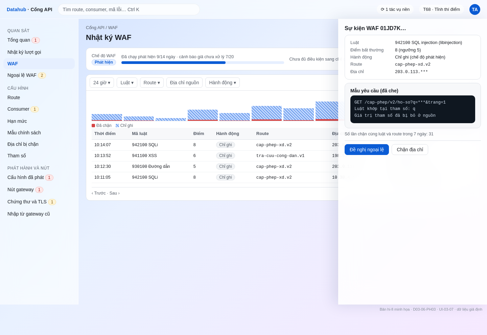

Ảnh cho thấy thanh trạng thái chế độ WAF ở đầu trang (Phát hiện, đã chạy 9/14 ngày, điều kiện chuyển sang chặn chưa đạt), bảng sự kiện theo dòng thời gian với mã luật CRS, điểm bất thường, hành động và route, và Drawer chi tiết sự kiện bên phải với mẫu yêu cầu đã che cùng nút "Đề nghị ngoại lệ".

### 13.1. Wireframe

```text
┌ Nhật ký WAF ──────────────────────────────────── [Theo dõi trực tiếp ○] [Xuất] ┐
│ ┌ Chế độ WAF: PHÁT HIỆN · đã chạy 9/14 ngày · cảnh báo giả chưa xử lý: 7/20 ┐ │
│ │ Điều kiện sang chế độ chặn: chưa đạt (cần 14 ngày)       [Đề nghị đổi chế độ]│ │
│ [24 giờ ▾] [Luật ▾] [Route ▾] [Địa chỉ nguồn] [Hành động ▾]   Khoảng 1.204 sự kiện · 38 route │
│ ▁▂▃▅▇▆▃▂▁ biểu đồ số sự kiện theo giờ                                          │
│ Thời điểm │ Luật CRS │ Điểm │ Hành động │ Route │ Địa chỉ │ Mẫu trích │        │
│ 10:14:07  │ 942100   │ 8    │ Chỉ ghi   │ cap-phep… │ 203.0.113.*** │ …      │   │
└────────────────────────────────────────────────────────────────────────────────┘
                                                  ┌ Drawer chi tiết sự kiện ─────┐
                                                  │ Mẫu đã che · [Đề nghị ngoại lệ]│
```

### 13.2. Thành phần

| # | Thành phần | `CMP-*` | Nội dung, kiểm tra | Nguồn | Ghi chú |
|---|---|---|---|---|---|
| 1 | Thanh chế độ WAF | `CMP-Card`, `CMP-StatusTag`, `CMP-ProgressBar` | Chế độ `DETECT`, `BLOCK`; số ngày đã chạy phát hiện; điều kiện chuyển (≥ 14 ngày, cảnh báo giả chưa xử lý ≤ `gw.waf.fpReviewMax`) | API-03-040 | Nhãn "Tự hạ về phát hiện từ {giờ}" khi `autoDowngraded` |
| 2 | Nút đổi chế độ | `CMP-Button` | "Đề nghị chuyển sang chế độ chặn" hoặc "Đề nghị chuyển về phát hiện" | API-03-041 | Mở hộp mục 13.3 |
| 3 | Thanh lọc | `CMP-FilterBar`, `CMP-DateRangePicker`, `CMP-Select`, `CMP-Input` | Khoảng thời gian ≤ 31 ngày (ERR-03-021), mã luật, route, địa chỉ, hành động | API-03-039 | Ghi URL |
| 4 | Biểu đồ số sự kiện | `CMP-Chart` | Cột theo giờ, tách chặn và chỉ ghi | API-03-039 `histogram` | Bảng tương đương |
| 5 | Bảng sự kiện | `CMP-DataTable` (gọn), `CMP-LogViewer` biến thể bảng | Cột mục 13.3 | `items` | Chế độ trực tiếp thêm dòng ở đầu |
| 6 | Drawer chi tiết | `CMP-Drawer`, `CMP-DescriptionList`, `CMP-CodeBlock` | Mã luật, điểm bất thường, hành động, route, `traceId`; không hiển thị mẫu trích của yêu cầu (BR-03-007, đã chốt 27/11/2026) | `chon` | Mở bằng Enter |
| 7 | Nút "Đề nghị ngoại lệ" | `CMP-Button` | Mở Drawer biểu mẫu UI-03-08 điền sẵn route, luật, sự kiện căn cứ | API-03-043 | Cần `PERM-03-waf-request` |
| 8 | Nút "Chặn địa chỉ" | `CMP-Button` | Mở hộp chặn của UI-03-15 điền sẵn địa chỉ | API-03-037 | Cần `PERM-03-waf` |

: UI-03-07 · Thành phần

### 13.3. Cột bảng và hộp đổi chế độ

| Cột | Nội dung | Ghi chú |
|---|---|---|
| Thời điểm | `CMP-Timestamp` đến giây | Sắp xếp mặc định giảm |
| Mã luật | `CMP-CodeText` (ví dụ 942100) và tên ngắn | Lọc theo giá trị |
| Điểm bất thường | Số điểm, so với ngưỡng 5 | |
| Hành động | "Đã chặn" hoặc "Chỉ ghi" (chế độ phát hiện) | `CMP-Tag` |
| Route | Mã route | Liên kết UI-03-03 |
| Địa chỉ nguồn | Đầy đủ nếu có `PERM-03-log-read`, còn lại che octet cuối | `CMP-CopyButton` |
| Mẫu trích | Phần trích đã che, rút gọn 60 ký tự | Không có "hiện bản gốc" |

: UI-03-07 · Cột bảng

Hộp đổi chế độ là `CMP-ReasonDialog`: chuyển sang chặn hiển thị điều kiện (đã chạy {n}/14 ngày; cảnh báo giả chưa xử lý), nếu chưa đủ 14 ngày thì nút gửi vô hiệu và hiện ERR-03-027 "Chưa thể chuyển sang chế độ chặn: cần chạy phát hiện tối thiểu 14 ngày (đã chạy {n} ngày)." Đủ điều kiện thì gửi đề nghị bốn mắt; người duyệt (khác người đề nghị) duyệt ở UI-03-17. Chuyển từ chặn về phát hiện cũng cần bốn mắt nhưng không bị ràng buộc 14 ngày.

### 13.4. Trạng thái màn

| Trạng thái | Hiển thị |
|---|---|
| Đang tải | Skeleton thanh chế độ và 10 dòng |
| Rỗng lần đầu | "Chưa có sự kiện WAF nào. WAF đang chạy ở chế độ {chế độ}; sự kiện hiện ở đây khi có yêu cầu khớp luật." |
| Không có kết quả | ST-04 kèm "Xóa bộ lọc" |
| Khoảng quá 31 ngày | ERR-03-021 dưới bộ chọn, không gửi truy vấn |
| Đang theo dõi trực tiếp | Chấm nhấp nháy "Trực tiếp", dòng mới thêm đầu bảng mỗi 5 giây, tạm hoãn khi mở Drawer |
| WAF tự hạ | `CMP-Banner` mức cảnh báo "WAF tự chuyển về chế độ phát hiện lúc {giờ} vì p99 vượt {ms} ms." |
| Không có quyền | ST-07 |

: UI-03-07 · Trạng thái màn

Phím tắt: `/` vào ô lọc; `↑`, `↓` chọn dòng; `Enter` mở Drawer; `E` đề nghị ngoại lệ cho dòng đang chọn; `B` chặn địa chỉ của dòng; `T` bật tắt theo dõi trực tiếp. Truy cập: dòng mới trong chế độ trực tiếp không chiếm focus, chỉ công bố tổng số dòng mới qua `aria-live="polite"` mỗi 30 giây để không làm ngập trình đọc màn hình; có nút "Tạm dừng" để người dùng đọc.

## 14. UI-03-08 Ngoại lệ luật WAF và luật vá ảo

::: dac-ta
**Mục đích.** Cho TO, TA đề nghị và SO duyệt ngoại lệ luật WAF để xử lý cảnh báo giả mà không tắt cả luật; cho SO soạn luật vá ảo khẩn cấp khi có lỗ hổng chưa có bản vá. Mỗi ngoại lệ gắn một route và một mã luật, có hạn tối đa 90 ngày, không có ngoại lệ vĩnh viễn (BR-03-006).

**Người dùng chính.** SO, TA, TO.

**FR hiện thực.** FR-03-007, 008.

**Đường dẫn.** `/cong-api/waf/ngoai-le`; tab `ngoai-le`, `va-ao`.

**Mẫu.** PTN-01; biểu mẫu đề nghị theo PTN-04 (Drawer).

**Quyền.** `PERM-03-waf-request` (xem, đề nghị); `PERM-03-waf-approve` (duyệt, từ chối); `PERM-03-waf` (thu hồi, luật vá ảo).

**API.** API-03-042, 043, 044, 045, 046, 047, 048, 049.
:::

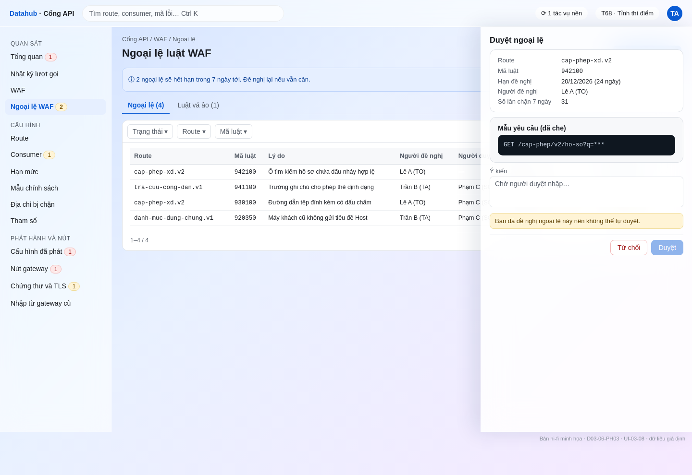

Ảnh cho thấy bảng ngoại lệ với nhãn trạng thái đủ bốn màu và biểu tượng cảnh báo cho ngoại lệ còn dưới 7 ngày, Drawer duyệt bên phải với mẫu yêu cầu đã che, số lần chặn 7 ngày, ô ý kiến và nút "Duyệt" bị vô hiệu kèm chú thích "Bạn đã đề nghị ngoại lệ này" vì người đang xem là người đề nghị.

### 14.1. Wireframe

```text
┌ Ngoại lệ luật WAF ─────────────────────────────────── [+ Đề nghị ngoại lệ] ┐
│ ⓘ 2 ngoại lệ sẽ hết hạn trong 7 ngày tới. Đề nghị lại nếu vẫn cần.          │
│ [Ngoại lệ (14)] [Luật vá ảo (1)]                                            │
│ [Trạng thái ▾] [Route ▾] [Mã luật ▾]                                        │
│ Route │ Mã luật │ Lý do │ Người đề nghị │ Người duyệt │ Hạn │ Trạng thái │ ⋯  │
│ cap-phep-xd.v2 │ 942100 │ Mẫu tìm kiếm… │ Lê A │ — │ 20/12 │ Chờ duyệt │ ⋯   │
└──────────────────────────────────────────────────────────────────────────────┘
                                   ┌ Drawer: Duyệt ngoại lệ ───────────────┐
                                   │ Mẫu yêu cầu đã che · Số lần chặn 7 ngày │
                                   │ Ý kiến [____]  [Từ chối] [Duyệt]        │
```

### 14.2. Thành phần

| # | Thành phần | `CMP-*` | Nội dung, kiểm tra | Nguồn | Ghi chú |
|---|---|---|---|---|---|
| 1 | Banner sắp hết hạn | `CMP-Banner` | Số ngoại lệ còn ≤ 7 ngày (`gw.waf.exception.warnDays`) | API-03-042 `facets.expiring` | Liên kết lọc "Sắp hết hạn" |
| 2 | Tab | `CMP-Tabs` | "Ngoại lệ", "Luật vá ảo" kèm số | — | Ghi URL |
| 3 | Thanh lọc | `CMP-FilterBar`, `CMP-Select` | Trạng thái, route, mã luật | API-03-042 | |
| 4 | Bảng ngoại lệ | `CMP-DataTable`, `CMP-StatusTag` | Cột mục 14.3; biểu tượng cảnh báo khi còn < 7 ngày | `items` | `EXPIRING` lên đầu |
| 5 | Nút "Đề nghị ngoại lệ" | `CMP-Button` | Mở Drawer đề nghị | API-03-043 | Cần `PERM-03-waf-request` |
| 6 | Drawer đề nghị | `CMP-Drawer`, `CMP-Form` | Route, mã luật, lý do, hạn, sự kiện căn cứ | API-03-043 | Điền sẵn khi mở từ UI-03-07 |
| 7 | Khối duyệt | `CMP-ApprovalPanel`, `CMP-DecisionPanel` | Mẫu yêu cầu đã che (`CMP-CodeBlock`), số lần chặn 7 ngày, ý kiến, "Duyệt", "Từ chối" | API-03-044, 045 | Nút "Duyệt" vô hiệu với người đề nghị (ERR-03-008) |
| 8 | Thu hồi | `CMP-ReasonDialog` | Lý do bắt buộc | API-03-046 | Cần `PERM-03-waf` |
| 9 | Tab Luật vá ảo | `CMP-DataTable`, `CMP-CodeEditor` | Soạn SecLang, phạm vi, căn cứ, hạn; "Thử khô" | API-03-047, 048, 049, 097 | Mục 14.4 |

: UI-03-08 · Thành phần

### 14.3. Cột bảng và trường đề nghị

| Cột | Nội dung | Ghi chú |
|---|---|---|
| Route | Mã route, liên kết UI-03-03 | |
| Mã luật | `CMP-CodeText` | |
| Lý do | Rút gọn 60 ký tự, tooltip đầy đủ | |
| Người đề nghị, người duyệt | Tên và vai trò viết tắt | Người duyệt "—" khi chờ |
| Hạn | `CMP-Timestamp` ngày; còn < 7 ngày kèm biểu tượng cảnh báo và chữ "còn {n} ngày" | |
| Trạng thái | `CMP-StatusTag` theo §5.1 | |

: UI-03-08 · Cột bảng ngoại lệ

| Trường | Kiểu | Bắt buộc | Kiểm tra | Ánh xạ API |
|---|---|---|---|---|
| Route | `CMP-ResourceSelect` | Có | Route tồn tại, thuộc tenant | `routeCode` |
| Mã luật | `CMP-Select` có tìm | Có | Mã luật CRS đang bật (ERR-03-009) | `ruleId` |
| Lý do | `CMP-TextArea` | Có | 10–500 ký tự, bộ đếm | `reason` |
| Hạn | `CMP-DatePicker` | Có | Từ ngày mai đến tối đa 90 ngày; chọn quá thì ô tự bôi đỏ (ERR-03-009) | `expiresAt` |
| Sự kiện căn cứ | `CMP-Input` chỉ đọc | Không | Mã sự kiện chặn nếu mở từ UI-03-07 | `evidenceEventId` |

: UI-03-08 · Trường biểu mẫu đề nghị ngoại lệ

Đã có ngoại lệ còn hiệu lực cho cặp route và mã luật thì đầu Drawer hiện `CMP-Alert` ERR-03-010 và nút "Gửi" vô hiệu.

### 14.4. Tab Luật vá ảo

Bảng luật vá ảo có cột Mã, Phạm vi (route hoặc toàn tenant), Căn cứ (CVE hoặc mô tả), Hạn, Trạng thái, Người soạn. Nút "Soạn luật vá ảo" (cần `PERM-03-waf`) mở trang soạn: ô `CMP-CodeEditor` SecLang cao 240 px, ô phạm vi, căn cứ, hạn, nút "Thử khô" hiển thị số yêu cầu mẫu 24 giờ gần nhất sẽ bị luật chặn, và "Gửi duyệt" (bốn mắt, BR-03-019). Luật chưa qua "Thử khô" thì nút "Gửi duyệt" vô hiệu với tooltip "Chạy thử khô trước khi gửi". "Thử khô" cần API riêng (Phụ lục B).

### 14.5. Trạng thái màn

| Trạng thái | Hiển thị |
|---|---|
| Đang tải | Skeleton 8 dòng |
| Rỗng lần đầu | "Chưa có ngoại lệ luật WAF nào. Đề nghị ngoại lệ khi một luật chặn nhầm yêu cầu hợp lệ." |
| Không có kết quả | ST-04 |
| Người đề nghị mở khối duyệt | Nút "Duyệt" vô hiệu, chú thích "Bạn đã đề nghị ngoại lệ này" (ERR-03-008) |
| Tenant chỉ có một SO | `CMP-Alert` thông tin "Tỉnh chưa có người duyệt thứ hai; PA duyệt thay, ghi rõ trong kiểm toán" (theo Q03-02, chờ chốt) |
| Không có quyền | ST-07; chỉ có `PERM-03-waf-request` thì không thấy nút duyệt, thu hồi |

: UI-03-08 · Trạng thái màn

Phím tắt: `N` đề nghị ngoại lệ; `Enter` mở Drawer của dòng; `A` duyệt, `R` từ chối khi focus ở khối duyệt (có xác nhận, không dùng khi đang gõ trong ô ý kiến). Truy cập: nhãn trạng thái và hạn đọc thành "Sắp hết hạn, còn 5 ngày"; ô chọn ngày có nhập tay theo `dd/MM/yyyy`.

## 15. UI-03-09 Nhật ký lượt gọi

::: dac-ta
**Mục đích.** Tra cứu từng lượt gọi qua gateway theo thời gian, HTTT, route, mã lỗi hoặc `traceId`; xem chi tiết một lượt (siêu dữ liệu, mã lỗi `ERR-03-1xx` và gợi ý xử lý); xuất kết quả. Nhật ký chỉ có siêu dữ liệu: không có thân bản tin, giá trị tiêu đề xác thực hay giá trị tham số truy vấn (BR-03-007). Thay LGC-APIM-022.

**Người dùng chính.** TA, TO, SO, AU.

**FR hiện thực.** FR-03-051.

**Đường dẫn.** `/cong-api/nhat-ky`.

**Mẫu.** PTN-11.

**Quyền.** `PERM-03-log-read`.

**API.** API-03-074, 075, 076.
:::

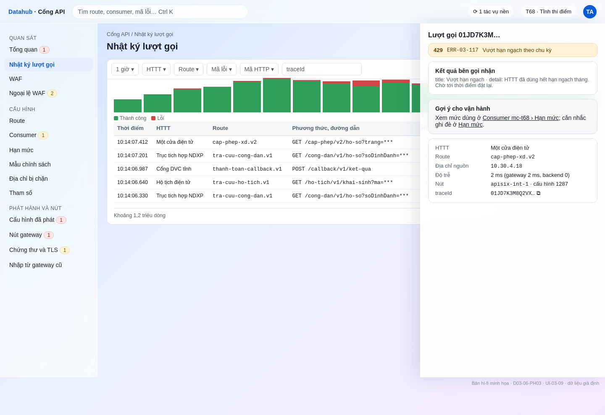

Ảnh cho thấy thanh lọc với khoảng thời gian, HTTT, route, mã lỗi và `traceId`; biểu đồ số lượt theo phút tách thành công và lỗi; bảng lượt gọi mật độ gọn, đường dẫn đã bỏ giá trị tham số (`?soDinhDanh=***`); và Drawer chi tiết một lượt bị từ chối vì hết hạn ngạch kèm gợi ý cho vận hành.

### 15.1. Wireframe

```text
┌ Nhật ký lượt gọi ──────────────────────────── [Theo dõi trực tiếp ○] [Xuất] ┐
│ [1 giờ ▾] [HTTT ▾] [Route ▾] [Mã lỗi ▾] [Trạng thái HTTP ▾] [traceId……]     │
│ ▁▂▃▅▇▇▆▃▂ lượt theo phút (xanh: thành công, đỏ: lỗi)                        │
│ Thời điểm │ HTTT │ Route │ Phương thức, đường dẫn │ HTTP │ Mã lỗi │ ms │ Nút │
│ 10:14:07  │ ndxp │ cap-phep…│ GET /cd/v1/..?soDinhDanh=*** │ 429 │ 03-117│ 2 │ int-1│
│ Khoảng 1,2 triệu dòng · ‹ Trước  Sau ›                                       │
└──────────────────────────────────────────────────────────────────────────────┘
                                  ┌ Drawer: Lượt gọi 01JD… ────────────────┐
                                  │ Kết quả · Gợi ý cho vận hành · traceId  │
```

### 15.2. Thành phần

| # | Thành phần | `CMP-*` | Nội dung, kiểm tra | Nguồn | Ghi chú |
|---|---|---|---|---|---|
| 1 | Thanh lọc | `CMP-FilterBar`, `CMP-DateRangePicker`, `CMP-ResourceSelect`, `CMP-Select`, `CMP-Input` | Khoảng ≤ 31 ngày trong 12 tháng (ERR-03-021); HTTT, route, mã lỗi, mã HTTP, `traceId` | API-03-074 | Ghi URL; tìm `traceId` bỏ qua các lọc khác |
| 2 | Biểu đồ theo phút | `CMP-Chart` | Cột xếp chồng thành công, lỗi | API-03-074 `histogram` | Bảng tương đương |
| 3 | Bảng lượt gọi | `CMP-DataTable` (gọn) | Cột mục 15.3 | `items` | Phân trang con trỏ; không hiện tổng chính xác, hiện "khoảng {n}" (`approxTotal`) |
| 4 | Phân trang con trỏ | `CMP-Pagination` biến thể "Trước, Sau" | `cursor`, `limit` 50, 100, 200 | `page.next` | Theo Q03-56 |
| 5 | Drawer chi tiết | `CMP-Drawer`, `CMP-DescriptionList`, `CMP-CodeBlock` | Mọi trường siêu dữ liệu, mã lỗi, gợi ý, liên kết sang consumer, route, sự kiện WAF | API-03-075 | Mở bằng Enter |
| 6 | Nút xuất | `CMP-Button`, `CMP-JobProgress` | Tệp CSV theo bộ lọc, tối đa 100.000 dòng; hỏi lý do xuất | API-03-076 | Tác vụ nền; tệp có hạn 24 giờ; ghi kiểm toán |
| 7 | Chế độ trực tiếp | `CMP-Switch` | Làm mới 5 giây, thêm dòng mới đầu bảng | API-03-074 `after` | Tắt mặc định; tự tắt sau 15 phút |

: UI-03-09 · Thành phần

### 15.3. Cột bảng

| Cột | Nội dung | Ghi chú |
|---|---|---|
| Thời điểm | `CMP-Timestamp` đến mili giây ở tooltip | |
| HTTT, consumer | Tên HTTT, mã consumer ở tooltip | Liên kết UI-03-05 |
| Route | Mã route | Liên kết UI-03-03 |
| Phương thức, đường dẫn | `CMP-CodeText`; giá trị tham số truy vấn luôn là `***` | Cắt giữa khi dài, tooltip đầy đủ |
| HTTP | Mã trạng thái, nhóm màu `2xx`, `4xx`, `5xx` kèm chữ | |
| Mã lỗi | `ERR-03-1xx` bằng `CMP-CodeText` | Tooltip là câu ở §5.2 |
| Độ trễ | `CMP-Duration` tổng, tooltip tách thời gian gateway và backend | |
| Nút | Mã nút gateway xử lý | |
| `traceId` | Rút gọn 8 ký tự + `CMP-CopyButton` | |

: UI-03-09 · Cột bảng

### 15.4. Drawer chi tiết

Drawer có ba khối. **Kết quả:** trạng thái HTTP, mã lỗi, câu `title` và `detail` mà gateway đã trả cho bên gọi, thời điểm. **Gợi ý cho vận hành:** câu ở bảng "Gợi ý cho vận hành" §5.2 kèm liên kết (consumer, route, sự kiện WAF). **Siêu dữ liệu:** địa chỉ nguồn (đầy đủ theo `PERM-03-log-read`), phiên bản API, kích thước yêu cầu và phản hồi, độ trễ gateway và backend, nút, phiên bản ảnh chụp đang chạy, `traceId` có liên kết "Mở truy vết" sang PH-13. Không có khối nội dung bản tin vì gateway không lưu.

### 15.5. Trạng thái màn

| Trạng thái | Hiển thị |
|---|---|
| Đang tải | Skeleton thanh lọc, biểu đồ, 12 dòng |
| Rỗng lần đầu | "Chưa có lượt gọi nào qua gateway trong khoảng đã chọn." |
| Không có kết quả | ST-04 kèm điều kiện đang áp dụng và "Xóa bộ lọc" |
| `traceId` không thấy | "Không tìm thấy lượt gọi có mã truy vết này trong 12 tháng gần nhất." |
| Khoảng quá 31 ngày | ERR-03-021 dưới bộ chọn; không gửi truy vấn |
| Truy vấn chậm | Sau 3 giây hiện `CMP-ProgressBar` và nút "Thu hẹp khoảng thời gian" |
| Lỗi tải | ST-05 kèm mã lỗi và `traceId` |
| Không có quyền | ST-07 (`PERM-03-log-read` tách khỏi `PERM-03-read`) |

: UI-03-09 · Trạng thái màn

Phím tắt: `/` vào ô lọc; `↑`, `↓` chọn dòng; `Enter` mở Drawer; `C` sao chép `traceId` của dòng; `[`, `]` dòng trước, sau trong Drawer; `T` bật tắt trực tiếp; `Esc` đóng Drawer. Truy cập: bảng có `aria-rowcount="-1"` vì tổng không biết chính xác; `aria-live` chỉ công bố tổng dòng mới theo chu kỳ 30 giây ở chế độ trực tiếp; Drawer trả focus về dòng đã mở khi đóng.

## 16. UI-03-10 Ảnh chụp cấu hình và phát hành

::: dac-ta
**Mục đích.** Cho PA và TA thấy gateway đang chạy cấu hình phiên bản nào, từng phiên bản đã tổng hợp ra sao (đạt, bị từ chối vì lỗi gì), so sánh hai phiên bản, phát thủ công, quay lui khi phát gây sự cố và bỏ giữ tổng hợp tự động. Cấu hình luôn đi qua ảnh chụp có số phiên bản và chữ ký; không sửa trực tiếp trên nút (BR-03-016).

**Người dùng chính.** PA, TA.

**FR hiện thực.** FR-03-039, 040, 041, 042, 044.

**Đường dẫn.** `/cong-api/cau-hinh`; chi tiết `/cong-api/cau-hinh/{version}`.

**Mẫu.** PTN-01 (danh sách), PTN-02 (chi tiết phiên bản).

**Quyền.** `PERM-03-read`; kiểm tra, xây, phát `PERM-03-publish`; quay lui `PERM-03-operate`.

**API.** API-03-056, 057, 058, 059, 060, 061, 062, 063.
:::

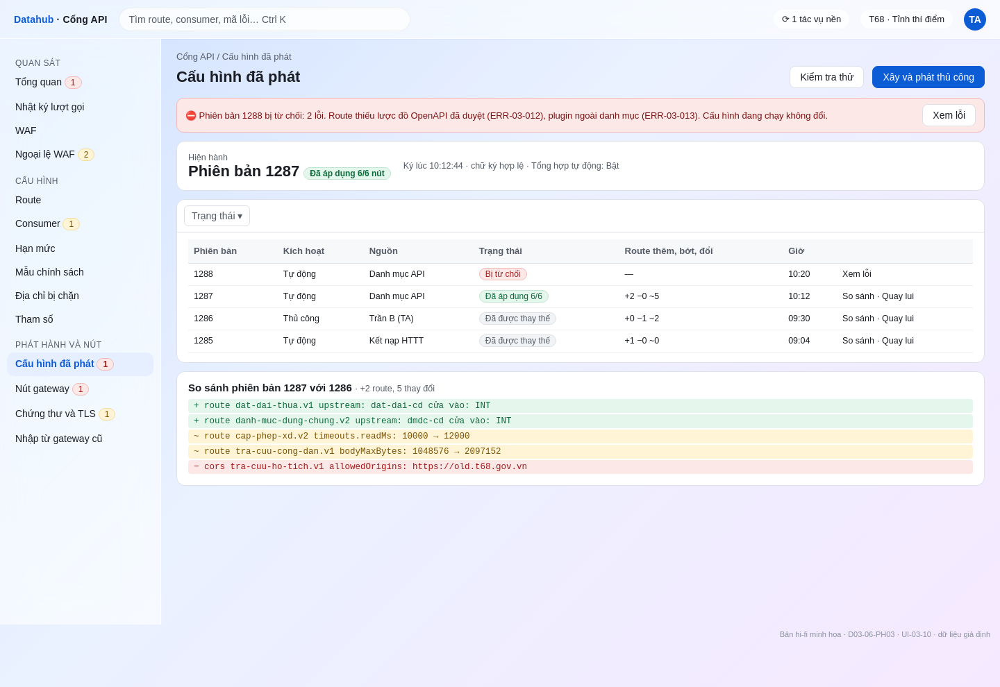

Ảnh cho thấy dải trạng thái hiện hành ở đầu trang (phiên bản 1287 đã áp dụng ở 6/6 nút, tổng hợp tự động bình thường), bảng phiên bản có nhãn Đã áp dụng, Áp dụng một phần, Bị từ chối, Đã được thay thế, và khối so sánh hai phiên bản bằng bảng khác biệt dạng thêm, đổi, xóa.

### 16.1. Wireframe danh sách

```text
┌ Cấu hình đã phát ───────────────────── [Kiểm tra thử] [Xây và phát thủ công] ┐
│ ┌ Hiện hành: phiên bản 1287 [Đã áp dụng 6/6 nút] · ký 10:12 · Tổng hợp tự động: Bật ┐ │
│ [Trạng thái ▾]                                                                │
│ Phiên bản │ Kích hoạt │ Nguồn │ Trạng thái │ Route +/-/~ │ Người, giờ │ ⋯      │
│ 1288      │ Tự động   │ PH-02 │ Bị từ chối │ —           │ 10:20      │ Xem lỗi │
│ 1287      │ Tự động   │ PH-02 │ Đã áp dụng │ +2 -0 ~5    │ 10:12      │ So sánh, Quay lui │
└───────────────────────────────────────────────────────────────────────────────┘
```

### 16.2. Thành phần danh sách

| # | Thành phần | `CMP-*` | Nội dung, kiểm tra | Nguồn | Ghi chú |
|---|---|---|---|---|---|
| 1 | Dải hiện hành | `CMP-Card`, `CMP-StatusTag`, `CMP-Switch` (chỉ đọc) | Phiên bản hiện hành, số nút áp dụng, thời điểm ký, trạng thái tổng hợp tự động (Bật, Giữ đến {giờ}) | API-03-056, 063 | Khi giữ sau quay lui có nút "Bỏ giữ" (API-03-098) |
| 2 | Bảng phiên bản | `CMP-DataTable`, `CMP-StatusTag` | Phiên bản, kích hoạt (Tự động, Thủ công, Quay lui), nguồn, trạng thái, số route thêm, bớt, đổi, người, giờ | API-03-056 | Phiên bản cuối là `1288` cao nhất |
| 3 | Nút "Kiểm tra thử" | `CMP-Button` | Tổng hợp và kiểm tra hợp lệ, không phát (`dryRun`) | API-03-058 | Tác vụ ngắn; hiện báo cáo ở Drawer |
| 4 | Nút "Xây và phát thủ công" | `CMP-Button` primary | Tổng hợp rồi phát (cần `PERM-03-publish`) | API-03-059, 060 | Hộp xác nhận nêu số thay đổi |
| 5 | Menu hàng | `CMP-DropdownMenu` | Xem chi tiết, So sánh với hiện hành, Quay lui về phiên bản này | `allowedActions` | Quay lui ẩn với `REJECTED`, `SUPERSEDED` không còn hợp lệ |

: UI-03-10 · Thành phần của danh sách

### 16.3. Chi tiết một phiên bản

Trang chi tiết (PTN-02) có bốn tab. **Tổng quan:** `CMP-DescriptionList` phiên bản, kích hoạt, `contentHash` rút gọn, chữ ký đã xác minh, danh sách phiên bản nguồn (`builtFrom`: PH-02, PH-01), kích thước. **Kiểm tra:** kết quả kiểm tra hợp lệ theo từng kiểm tra (CHK-01…), với bản `REJECTED` liệt kê lỗi bằng `CMP-DataTable` (route, lỗi, mã ERR) và câu theo §5.2 (ERR-03-012, ERR-03-013); đầu tab hiện ERR-03-005 "Cấu hình gateway không hợp lệ: {n} lỗi." **So sánh:** `CMP-DiffViewer` hai bên giữa phiên bản này và phiên bản chọn ở `so-voi` (mặc định bản hiện hành), tóm tắt số route thêm, bớt, đổi; màu thêm, đổi, xóa theo token `color-diff-added`, `color-diff-changed`, `color-diff-removed` kèm ký hiệu `+`, `~`, `-` để không chỉ dựa vào màu. **Nút:** bảng nút gateway với phiên bản đang chạy và trạng thái đồng bộ (`CMP-DataTable`), dùng cho phiên bản `PUBLISHED` hoặc `PARTIAL`.

### 16.4. Quay lui

Menu "Quay lui về phiên bản này" mở `CMP-ReasonDialog` nêu hậu quả bằng số: "Hệ thống tạo phiên bản mới {v2} có nội dung của phiên bản {v}. {n} route thêm sau {v} sẽ biến mất, {m} thay đổi sẽ bị đảo. Tổng hợp tự động tạm giữ {h} giờ." Lý do bắt buộc. Quay lui không đưa phiên bản cũ trở lại mà sinh ảnh chụp mới (BR-03-018). Phiên bản đích tham chiếu đối tượng không còn hợp lệ thì ERR-03-007. Sau quay lui, dải hiện hành đổi sang trạng thái "Giữ tổng hợp đến {giờ}" kèm nút "Bỏ giữ" (cần `PERM-03-operate`); bấm "Bỏ giữ" yêu cầu xác nhận và tổng hợp lại từ dữ liệu nguồn mới nhất; việc này cần thêm tham số cho API-03-059 (Phụ lục B).

### 16.5. Trạng thái màn

| Trạng thái | Hiển thị |
|---|---|
| Đang tải | Skeleton dải hiện hành và 10 dòng |
| Rỗng lần đầu | "Chưa có ảnh chụp cấu hình nào. Ảnh chụp đầu tiên được tạo khi có API được công bố." |
| Không có kết quả | ST-04 |
| Đang tổng hợp, phát | `CMP-JobProgress` ở dải hiện hành; nút phát vô hiệu; nếu có lần khác đang chạy: ERR-03-006 |
| Phát lỗi | `CMP-Banner` ERR-03-014 hoặc ERR-03-015 ở đầu trang; dải hiện hành giữ nguyên phiên bản cũ |
| Có nút chậm | Dải hiện hành mức cảnh báo "Áp dụng một phần: {n}/{m} nút" kèm liên kết UI-03-11 |
| Không tồn tại | ST-08 cho phiên bản không có |
| Không có quyền | ST-07; chỉ đọc thì ẩn nút phát, quay lui |

: UI-03-10 · Trạng thái màn

Phím tắt: `↑`, `↓` chọn dòng; `Enter` mở chi tiết; `D` so sánh với hiện hành; `1` đến `4` chuyển tab khi focus ở hàng tab. Truy cập: bảng khác biệt có tiêu đề cột "Trước", "Sau" và cột ký hiệu `+`, `~`, `-` đọc được; kết quả kiểm tra công bố bằng `aria-live` khi xong.

## 17. UI-03-11 Nút gateway

::: dac-ta
**Mục đích.** Cho PO, PA, TA, TO thấy từng nút APISIX: nút nào chạy phiên bản cấu hình nào, nút nào chậm hoặc mất tín hiệu, JWKS còn mới không, Valkey nối được không, tải CPU và bộ nhớ ra sao. Thay LGC-APIM-023 (danh sách gateway) với chỉ số của APISIX thay cho JVM.

**Người dùng chính.** PO, PA, TA, TO.

**FR hiện thực.** FR-03-012, 043, 045.

**Đường dẫn.** `/cong-api/nut`.

**Mẫu.** PTN-01.

**Quyền.** `PERM-03-read`.

**API.** API-03-052, 063, 064.
:::

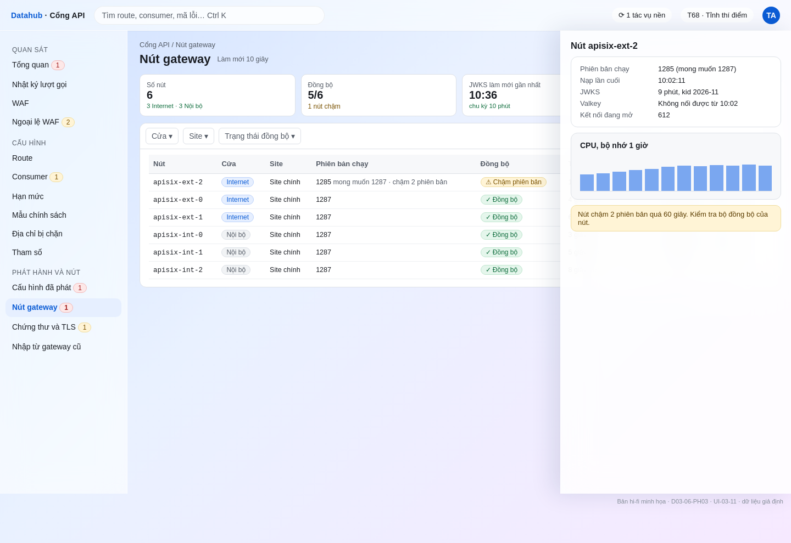

Ảnh cho thấy bốn thẻ tóm tắt ở trên (số nút, đồng bộ, JWKS, Valkey), bảng nút theo cửa vào Internet và nội bộ với cột phiên bản đang chạy so với mong muốn, nút `apisix-ext-2` chậm hai phiên bản có nhãn cảnh báo, và Drawer chi tiết nút mở sẵn với biểu đồ CPU, bộ nhớ.

### 17.1. Thành phần

| # | Thành phần | `CMP-*` | Nội dung, kiểm tra | Nguồn | Ghi chú |
|---|---|---|---|---|---|
| 1 | Thẻ tóm tắt | `CMP-KpiCard` | Số nút; số nút đồng bộ `{n}/{m}`; JWKS làm mới gần nhất; Valkey (Nối được, Suy giảm) | API-03-063, 052 | Thẻ JWKS và Valkey đổi màu cảnh báo khi quá hạn |
| 2 | Thanh lọc | `CMP-FilterBar`, `CMP-Select` | Cửa (`EXT`, `INT`), site, trạng thái đồng bộ | API-03-063 | |
| 3 | Bảng nút | `CMP-DataTable`, `CMP-StatusTag`, `CMP-StatusDot` | Cột mục 17.2 | `items` | Làm mới 10 giây, `LAGGING` và `UNKNOWN` lên đầu |
| 4 | Drawer chi tiết nút | `CMP-Drawer`, `CMP-DescriptionList`, `CMP-Chart` | Phiên bản đang chạy, mong muốn, thời điểm nạp, JWKS, kết nối Valkey, CPU, bộ nhớ, kết nối đang mở | API-03-064 | Mở bằng Enter |
| 5 | Khối JWKS | `CMP-Card`, `CMP-Timestamp` | Thời điểm làm mới, tuổi bộ đệm so với `gw.jwks.maxStaleHours`, `kid` đang dùng | API-03-052 | Quá hạn đệm: ERR-03-124 ở nhật ký |

: UI-03-11 · Thành phần

### 17.2. Cột bảng

| Cột | Nội dung | Ghi chú |
|---|---|---|
| Nút | `nodeId` bằng `CMP-CodeText` | Liên kết mở Drawer |
| Cửa | "Internet" hoặc "Nội bộ" | `CMP-Tag` |
| Site | Mã site (chính, dự phòng) | |
| Phiên bản chạy | Số phiên bản, so với phiên bản mong muốn | Lệch kèm "chậm {n} phiên bản" |
| Đồng bộ | `CMP-StatusTag`: Đồng bộ, Chậm phiên bản (quá `gw.node.lagSeconds` 60 giây), Mất tín hiệu (quá `gw.node.unknownSeconds` 120 giây) | |
| Tín hiệu cuối | `CMP-Timestamp` tương đối ("12 giây trước") | Đầy đủ ở tooltip |
| JWKS | Tuổi bộ đệm | Quá hạn đệm tô cảnh báo |
| Valkey | Nối được hoặc Suy giảm | |
| CPU, bộ nhớ | Phần trăm, `CMP-ProgressBar` nhỏ | Không dùng chỉ số JVM |

: UI-03-11 · Cột bảng

### 17.3. Trạng thái màn

| Trạng thái | Hiển thị |
|---|---|
| Đang tải | Skeleton bốn thẻ và 6 dòng |
| Rỗng lần đầu | "Chưa có nút gateway nào báo trạng thái. Kiểm tra bộ đồng bộ ở từng nút." |
| Không có kết quả | ST-04 |
| Có nút mất tín hiệu | `CMP-Banner` mức lỗi "{n} nút mất tín hiệu quá {s} giây." liên kết lọc |
| Mất số liệu | Cột CPU, bộ nhớ "—", thẻ "Chưa có số liệu" (ERR-03-026) |
| Không có quyền | ST-07 |

: UI-03-11 · Trạng thái màn

Phím tắt: `↑`, `↓` chọn dòng; `Enter` mở Drawer; `R` làm mới; `Esc` đóng Drawer. Truy cập: nhãn đồng bộ có biểu tượng và chữ; thời gian tương đối có `aria-label` đầy đủ; làm mới tự động không đóng Drawer đang mở.

## 18. UI-03-12 Chứng thư và TLS

::: dac-ta
**Mục đích.** Cho PA và TA quản lý chứng thư biên (hạn, host, gia hạn), hồ sơ TLS đang áp dụng (chỉ TLS 1.3, bộ mã), ngoại lệ TLS 1.2 có thời hạn cho HTTT cũ và bộ CA khách dùng xác minh mTLS. Màn nhắc hạn sớm để chứng thư không hết hạn bất ngờ.

**Người dùng chính.** PA, TA.

**FR hiện thực.** FR-03-001, 002, 049.

**Đường dẫn.** `/cong-api/chung-thu`; tab `chung-thu`, `ho-so-tls`, `ngoai-le-tls`, `bo-ca-khach`.

**Mẫu.** PTN-01 (bốn tab bảng).

**Quyền.** `PERM-03-read`; gia hạn `PERM-03-operate`; tạo, thu hồi ngoại lệ TLS `PERM-03-admin`.

**API.** API-03-031, 032, 033, 034, 035, 068, 069, 070.
:::

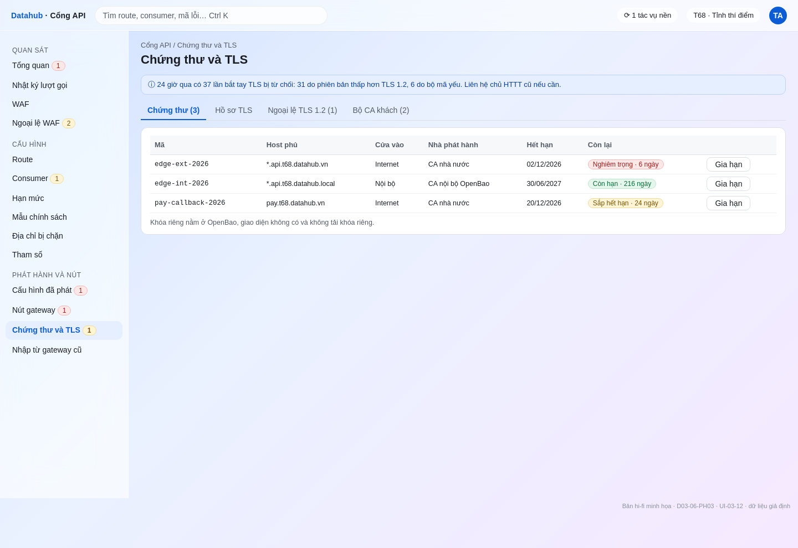

Ảnh cho thấy tab "Chứng thư" với cột "Còn lại" đổi màu theo ngưỡng (còn 6 ngày ở mức Nghiêm trọng), cột "Host" liệt kê các host phủ, và nút "Gia hạn" ở dòng sắp hết hạn; dải trên cùng nêu số lần bắt tay TLS bị từ chối trong 24 giờ.

### 18.1. Thành phần

| # | Thành phần | `CMP-*` | Nội dung, kiểm tra | Nguồn | Ghi chú |
|---|---|---|---|---|---|
| 1 | Dải bắt tay bị từ chối | `CMP-Alert` thông tin | Số lần `rejected` theo lý do (phiên bản TLS thấp, bộ mã yếu) trong 24 giờ | API-03-031 | Giúp liên hệ chủ HTTT cũ |
| 2 | Tab chứng thư | `CMP-DataTable`, `CMP-StatusTag` | Mã, chủ thể, host, cửa vào, nhà phát hành, hạn, còn lại, trạng thái; nút "Gia hạn" | API-03-068, 069, 070 | Còn < 30 ngày cảnh báo, < 8 ngày nghiêm trọng |
| 3 | Hộp gia hạn | `CMP-ConfirmDialog` | "Gia hạn chứng thư {mã}? Nút gateway nạp chứng thư mới không cắt kết nối." | API-03-070 | Lỗi ký: ERR-03-015 |
| 4 | Tab hồ sơ TLS | `CMP-DescriptionList` | Phiên bản TLS tối thiểu (1.3), bộ mã, HSTS, OCSP stapling, ALPN | API-03-031 | Chỉ đọc; đổi qua ảnh chụp |
| 5 | Tab ngoại lệ TLS 1.2 | `CMP-DataTable`, `CMP-Drawer` | Host chuyên dụng, lý do, hạn (≤ 180 ngày, `gw.tls.exceptionMaxDays`), người tạo; "Thêm", "Thu hồi" | API-03-032, 033, 034 | Hết hạn tự gỡ |
| 6 | Tab bộ CA khách | `CMP-DataTable` | Bộ CA, vân tay, hạn, số consumer dùng | API-03-035 | Chỉ đọc |
| 7 | Tải tệp chứng thư | `CMP-Upload` | PEM, ≤ 64 KiB; không có khóa riêng (khóa ở OpenBao) | API-03-070 | Chứng thư sai: ERR-03-016 |

: UI-03-12 · Thành phần

Chứng thư không hợp lệ (chuỗi, hạn, khóa, host) hiện ERR-03-016 dưới trường tệp. Tab ngoại lệ có `CMP-Alert` "TLS 1.2 chỉ dùng cho host chuyên dụng của HTTT cũ, tối đa 180 ngày" (BR-03-003).

### 18.2. Trạng thái màn

| Trạng thái | Hiển thị |
|---|---|
| Đang tải | Skeleton dải bắt tay và 4 dòng bảng của tab đang mở |
| Rỗng (tab ngoại lệ TLS 1.2) | "Không có ngoại lệ TLS 1.2. Mọi host dùng TLS 1.3." kèm "Thêm ngoại lệ" nếu có quyền |
| Rỗng (tab chứng thư) | Không xảy ra vì luôn có chứng thư của hai cửa vào |
| Lỗi tải | ST-05 trong vùng bảng; lỗi ký chứng thư ERR-03-015 ở `CMP-Banner` trên cùng |
| Không có quyền | ST-07; chỉ đọc thì ẩn "Gia hạn", "Thêm", "Thu hồi" |

: UI-03-12 · Trạng thái màn

Phím tắt: `1` đến `4` chuyển tab khi focus ở hàng tab; `G` gia hạn dòng đang chọn (có xác nhận); `N` thêm ngoại lệ ở tab ngoại lệ. Truy cập: vân tay đọc theo nhóm hai ký tự; số ngày còn lại đi kèm chữ mức độ.

## 19. UI-03-13 Mẫu chính sách

::: dac-ta
**Mục đích.** Cho PA và TA xem danh mục mẫu chính sách gateway đã được duyệt sẵn (plugin, tham số) và bật tắt từng mẫu cho tỉnh. Chỉ mẫu trong danh mục mới dùng được; không có đường tải plugin hay mã tùy ý (BR-03-017).

**Người dùng chính.** PA, TA.

**FR hiện thực.** FR-03-015, 020, 048.

**Đường dẫn.** `/cong-api/mau-chinh-sach`.

**Mẫu.** PTN-01.

**Quyền.** `PERM-03-read`; bật, tắt `PERM-03-admin`.

**API.** API-03-021, 022, 065, 066, 067.
:::

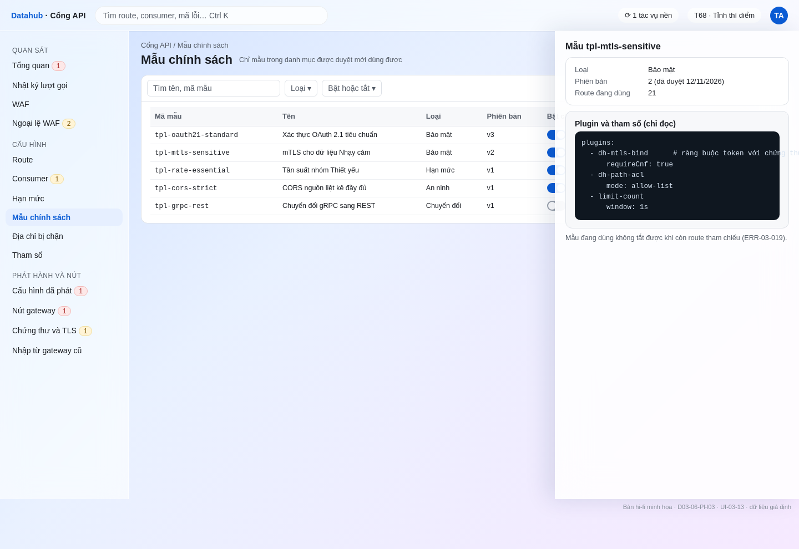

Ảnh cho thấy bảng mẫu với cột loại (bảo mật, hạn mức, chuyển đổi, an ninh), công tắc "Bật cho tỉnh", số route đang dùng và Drawer chi tiết mẫu bên phải liệt kê plugin và tham số của mẫu (chỉ đọc).

### 19.1. Thành phần

| # | Thành phần | `CMP-*` | Nội dung, kiểm tra | Nguồn | Ghi chú |
|---|---|---|---|---|---|
| 1 | Thanh lọc | `CMP-FilterBar`, `CMP-SearchField`, `CMP-Select` | Tìm tên, mã; loại; bật hoặc tắt | API-03-065 | |
| 2 | Bảng mẫu | `CMP-DataTable`, `CMP-Switch`, `CMP-Tag` | Mã, tên, loại, phiên bản mẫu, bật cho tỉnh, số route đang dùng, mức rủi ro | `items` | Công tắc vô hiệu khi thiếu quyền |
| 3 | Drawer chi tiết | `CMP-Drawer`, `CMP-DescriptionList`, `CMP-JsonViewer` | Plugin, tham số có giá trị mặc định, ràng buộc, route đang dùng | API-03-066 | Chỉ đọc |
| 4 | Hộp tắt mẫu | `CMP-ConfirmDialog` | "Tắt mẫu {tên}? {n} route đang dùng sẽ không phát được ở lần tổng hợp tới." | API-03-067 | Tắt mẫu đang dùng: ERR-03-019 |

: UI-03-13 · Thành phần

### 19.2. Trạng thái màn

| Trạng thái | Hiển thị |
|---|---|
| Đang tải | Skeleton 6 dòng |
| Rỗng | "Chưa có mẫu chính sách nào được duyệt cho nền tảng." (hiếm, chỉ khi cài mới) |
| Không có kết quả | ST-04 kèm "Xóa bộ lọc" |
| Lỗi tải | ST-05; xung đột phiên bản khi hai quản trị bật tắt cùng mẫu là ST-13 (ERR-03-004) |
| Không có quyền, chỉ đọc | ST-07; chỉ đọc thì công tắc hiện nhưng vô hiệu kèm tooltip "Cần quyền quản lý chính sách gateway" |

: UI-03-13 · Trạng thái màn

Phím tắt: `/` vào ô tìm; `Space` bật tắt mẫu đang chọn (có xác nhận khi tắt); `Enter` mở Drawer. Truy cập: công tắc có tên "Bật mẫu {tên} cho tỉnh" và trạng thái bật, tắt đọc được.

## 20. UI-03-14 Chạy thử chính sách

::: dac-ta
**Mục đích.** Cho TA, SO, PA nhập một yêu cầu giả định và thấy kết quả đi qua từng chốt của gateway (TLS, WAF, xác thực, đăng ký, phạm vi, hạn mức, OPA, đường dẫn, định tuyến) mà không tăng bộ đếm hạn mức của HTTT thật và không gọi backend (BR-03-027). Dùng để hiểu vì sao một HTTT bị từ chối trước khi chỉnh chính sách.

**Người dùng chính.** TA, SO, PA.

**FR hiện thực.** FR-03-057.

**Đường dẫn.** `/cong-api/chay-thu`, mở dạng Drawer rộng trên `/cong-api/route` hoặc trên màn gọi; tham số `route`, `consumer`.

**Mẫu.** PTN-04 (Drawer).

**Quyền.** `PERM-03-admin`.

**API.** API-03-088.
:::

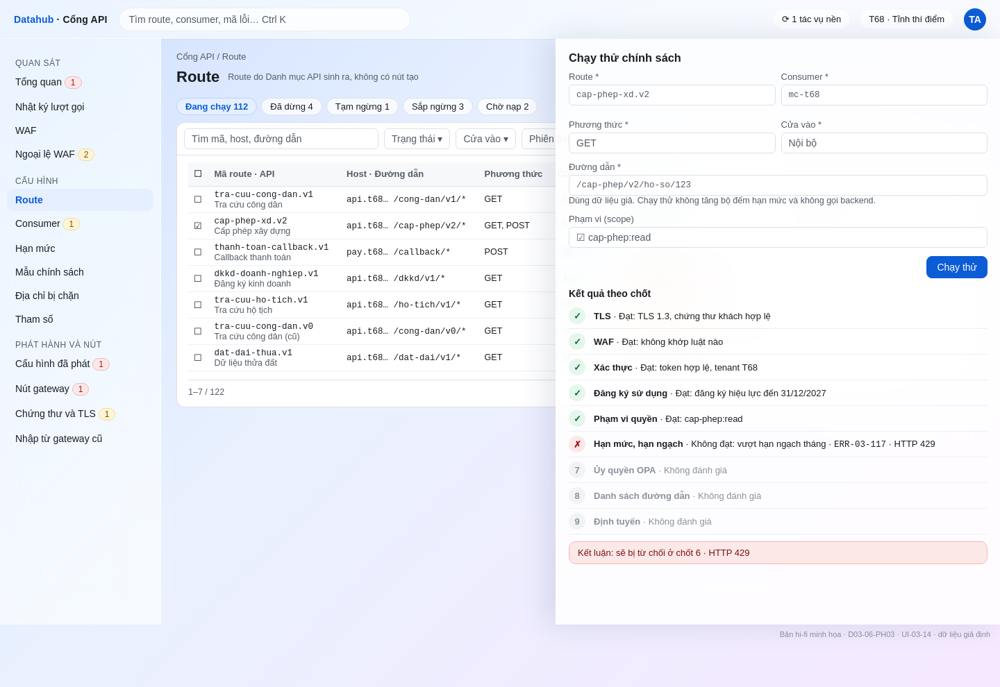

Ảnh cho thấy Drawer rộng chia hai phần: biểu mẫu yêu cầu giả định ở trên, và dưới là chuỗi các chốt theo thứ tự với chốt đạt (dấu tích), chốt đầu tiên không đạt (dấu chấm than, mã `ERR-03-117`) và các chốt sau đó mờ vì không được đánh giá.

### 20.1. Wireframe

```text
┌ Drawer Chạy thử chính sách (size-drawer-lg) ───────────────────── [×] ┐
│ Route [cap-phep-xd.v2 ▾]  Consumer [ndxp-gateway ▾]  Phương thức [GET ▾]│
│ Đường dẫn [/cap-phep/v2/ho-so/123]  Cửa [Nội bộ ▾]  Scope [☑ cap-phep:read]│
│ Giờ giả định [ ] (mặc định: bây giờ)                       [Chạy thử]  │
│ ── Kết quả ────────────────────────────────────────────────────────── │
│ ✓ 1 TLS  ✓ 2 WAF  ✓ 3 Xác thực  ✓ 4 Đăng ký  ✓ 5 Phạm vi                │
│ ✗ 6 Hạn mức: vượt hạn ngạch tháng (ERR-03-117)  ○ 7 OPA  ○ 8 Đường dẫn   │
│ Kết luận: sẽ bị từ chối ở chốt 6 · HTTP 429                              │
└──────────────────────────────────────────────────────────────────────────┘
```

### 20.2. Trường và thành phần

| Trường, thành phần | `CMP-*` | Bắt buộc | Kiểm tra | Ghi chú |
|---|---|---|---|---|
| Route | `CMP-ResourceSelect` | Có | Route `ACTIVE` hoặc `STOPPED` | Điền sẵn khi mở từ UI-03-03 |
| Consumer | `CMP-ResourceSelect` | Có | Consumer thuộc tenant | |
| Phương thức | `CMP-Select` | Có | Nằm trong phương thức của route | |
| Đường dẫn | `CMP-Input` | Có | Bắt đầu bằng `/`, ≤ 2.048 ký tự; không nhập giá trị cá nhân thật | Cảnh báo "Dùng dữ liệu giả" dưới trường |
| Cửa vào | `CMP-Select` | Có | `INT`, `EXT` | |
| Phạm vi (scope) | `CMP-Checkbox` nhóm | Không | Chỉ các scope consumer đã đăng ký | |
| Giờ giả định | `CMP-DatePicker` giờ | Không | Dùng cho thử WAF, cửa sổ hạn mức | |
| Kết quả theo chốt | `CMP-Steps` dọc, `CMP-StatusTag` | | Tối đa 9 chốt; chốt không đạt hiện mã lỗi và câu §5.2; chốt sau đó "Không đánh giá" | API-03-088 |
| Kết luận | `CMP-Alert` | | "Sẽ được chuyển tới backend" hoặc "Sẽ bị từ chối ở chốt {n}: {mã lỗi}" | |

: UI-03-14 · Trường và thành phần

### 20.3. Trạng thái màn

| Trạng thái | Hiển thị |
|---|---|
| Chưa chạy | "Nhập yêu cầu giả định rồi bấm Chạy thử. Chạy thử không tăng bộ đếm hạn mức và không gọi backend." |
| Đang chạy | Nút "Chạy thử" ở trạng thái `loading` (ST-09); các chốt hiện skeleton |
| Lỗi nhập | ST-11: lỗi tại từng trường, focus vào trường lỗi đầu tiên |
| Đối tượng không đủ điều kiện | ERR-03-012 trong khối kết luận (route thiếu lược đồ hoặc chính sách ủy quyền) |
| Lỗi tải | ST-05 trong khối kết quả, nút "Thử lại" |
| Không có quyền | ST-07: Drawer không mở, hiện `CMP-Toast` ERR-03-022 |

: UI-03-14 · Trạng thái màn

Phím tắt: `Ctrl+Enter` chạy thử; `Esc` đóng Drawer (hỏi nếu đã nhập). Truy cập: Drawer bẫy focus; kết quả công bố bằng `aria-live="assertive"` một lần khi xong; từng chốt có chữ "đạt", "không đạt", "không đánh giá" ngoài biểu tượng.

## 21. UI-03-15 Địa chỉ bị chặn

::: dac-ta
**Mục đích.** Cho SO và PA xem địa chỉ nguồn bị gateway chặn (tự động khi vi phạm liên tục, hoặc chặn thủ công), chặn thêm, bỏ chặn, và xem danh sách tin cậy được miễn giới hạn theo địa chỉ. Hạn mức chính tính theo HTTT không theo IP nên màn nhắc rằng nhiều sở có thể dùng chung một địa chỉ sau NAT (BR-03-005).

**Người dùng chính.** SO, PA.

**FR hiện thực.** FR-03-003, 004.

**Đường dẫn.** `/cong-api/chan-dia-chi`; tab `dang-chan`, `tin-cay`.

**Mẫu.** PTN-01.

**Quyền.** `PERM-03-read` (xem); chặn, bỏ chặn `PERM-03-waf`; sửa danh sách tin cậy cần `PERM-03-admin` và SO duyệt.

**API.** API-03-036, 037, 038, 086, 087.
:::

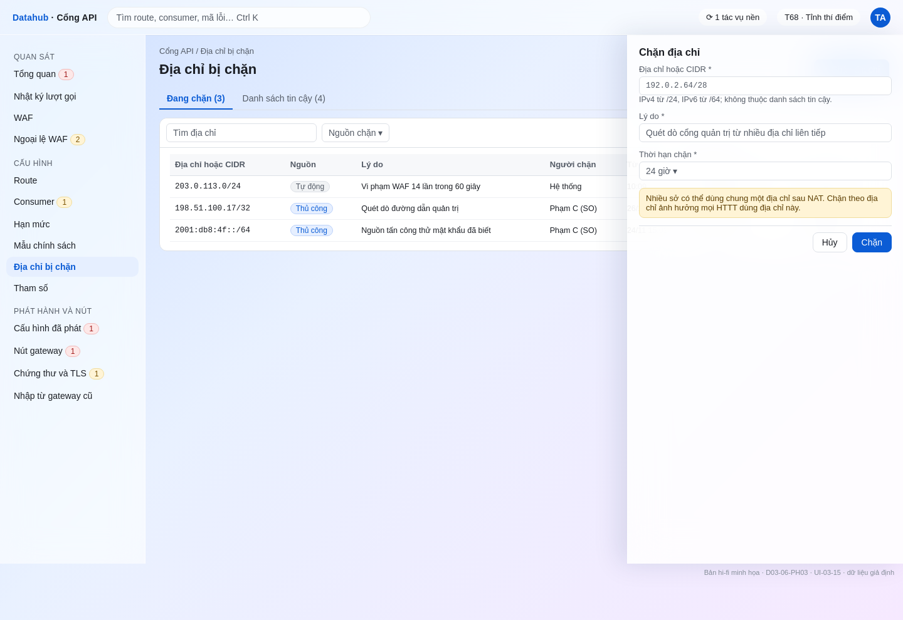

Ảnh cho thấy bảng địa chỉ đang bị chặn với cột nguồn (Tự động, Thủ công), thời điểm hết hạn của chặn tự động (15 phút), lý do, và nút "Bỏ chặn"; Drawer "Chặn địa chỉ" mở với trường CIDR, lý do và thời hạn, cùng cảnh báo NAT.

### 21.1. Thành phần và trường

| # | Thành phần | `CMP-*` | Nội dung, kiểm tra | Nguồn | Ghi chú |
|---|---|---|---|---|---|
| 1 | Tab | `CMP-Tabs` | "Đang chặn", "Danh sách tin cậy" | — | Ghi URL |
| 2 | Thanh lọc | `CMP-FilterBar`, `CMP-SearchField`, `CMP-Select` | Tìm địa chỉ, nguồn chặn | API-03-036 | |
| 3 | Bảng đang chặn | `CMP-DataTable`, `CMP-StatusTag` | CIDR, nguồn, lý do, người chặn, thời điểm, hết hạn | `items` | Địa chỉ đầy đủ với người có `PERM-03-log-read`, còn lại che octet cuối |
| 4 | Drawer "Chặn địa chỉ" | `CMP-Drawer`, `CMP-Form` | CIDR (IPv4, IPv6), lý do, thời hạn (đến 1.440 phút hoặc vô thời hạn kèm xác nhận) | API-03-037 | Cảnh báo NAT; địa chỉ tin cậy: ERR-03-024 |
| 5 | Hộp bỏ chặn | `CMP-ReasonDialog` | Lý do bắt buộc | API-03-038 | |
| 6 | Tab tin cậy | `CMP-DataTable`, `CMP-Tag` | Danh sách `gw.ip.trustedCidrs`; "Đề xuất thêm" tạo yêu cầu duyệt | API-03-086, 087 | Chỉ SO duyệt |

: UI-03-15 · Thành phần

| Trường | Kiểu | Bắt buộc | Kiểm tra | Ánh xạ API |
|---|---|---|---|---|
| Địa chỉ hoặc CIDR | `CMP-Input` | Có | IPv4 hoặc IPv6; tiền tố từ /24 (IPv4), từ /56 (IPv6); không thuộc danh sách tin cậy (ERR-03-024) | `cidr` |
| Lý do | `CMP-TextArea` | Có | 10–500 ký tự | `reason` |
| Thời hạn chặn | `CMP-Select` | Có | 15 phút, 1 giờ, 24 giờ, 7 ngày, Vô thời hạn | `expiresAt` |

: UI-03-15 · Trường biểu mẫu chặn địa chỉ

Cảnh báo dưới trường CIDR: "Nhiều sở có thể dùng chung một địa chỉ sau NAT. Chặn theo địa chỉ ảnh hưởng mọi HTTT dùng địa chỉ này."

### 21.2. Trạng thái màn

| Trạng thái | Hiển thị |
|---|---|
| Đang tải | Skeleton 5 dòng |
| Rỗng | "Hiện không có địa chỉ nào bị chặn." kèm "Chặn địa chỉ" nếu có quyền |
| Không có kết quả | ST-04 kèm "Xóa bộ lọc" |
| Lỗi tải | ST-05 |
| Lỗi nghiệp vụ | Địa chỉ tin cậy: ERR-03-024 dưới trường địa chỉ |
| Không có quyền | ST-07; chỉ có `PERM-03-read` thì ẩn "Chặn địa chỉ", "Bỏ chặn" |

: UI-03-15 · Trạng thái màn

Phím tắt: `N` chặn địa chỉ; `U` bỏ chặn dòng đang chọn (hộp lý do). Truy cập: địa chỉ IPv6 dài có `title` đầy đủ và `CMP-CopyButton`.

## 22. UI-03-16 Tham số, chuyển tiếp tenant

::: dac-ta
**Mục đích.** Cho TA và PA điều chỉnh tham số gateway của tỉnh trong miền nền tảng cho phép (giới hạn theo địa chỉ nguồn, mức hoang tưởng và ngưỡng WAF, tiêu đề bảo mật) và quản lý chuyển tiếp lượt gọi của tỉnh đã sáp nhập. Mỗi tham số hiển thị miền cho phép, mặc định và trần hợp đồng.

**Người dùng chính.** TA, PA.

**FR hiện thực.** FR-03-003, 011, 037, 056.

**Đường dẫn.** `/cong-api/tham-so`; tab `gioi-han-ip`, `waf-tls`, `tieu-de`, `chuyen-tiep`.

**Mẫu.** PTN-12.

**Quyền.** `PERM-03-read` (xem); sửa `PERM-03-admin`; tạo, kết thúc chuyển tiếp `PERM-03-admin`.

**API.** API-03-086, 087, 094, 095, 096.
:::

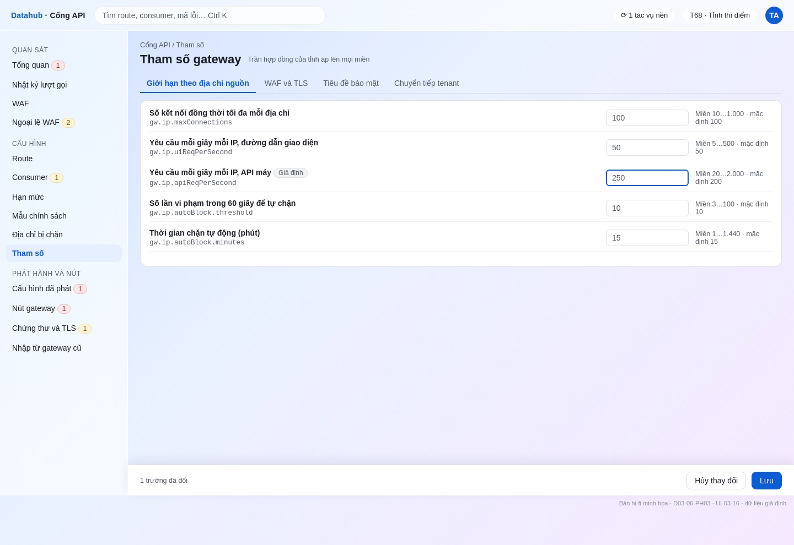

Ảnh cho thấy tab "Giới hạn theo địa chỉ nguồn" với từng tham số có nhãn tiếng Việt, khóa kỹ thuật (`gw.ip.apiReqPerSecond`), ô số kèm miền (20…2.000) và mặc định (200), nhãn "Giả định" ở tham số chưa có số liệu thật, và thanh lưu dính đáy với số trường đã đổi.

### 22.1. Thành phần

| # | Thành phần | `CMP-*` | Nội dung, kiểm tra | Nguồn | Ghi chú |
|---|---|---|---|---|---|
| 1 | Tab | `CMP-Tabs` | Bốn tab nhóm tham số | — | Mỗi tab một nhóm tham số của FRS §8.2 |
| 2 | Biểu mẫu tham số | `CMP-Form`, `CMP-NumberInput`, `CMP-Select`, `CMP-Switch` | Mỗi tham số: nhãn, khóa `CMP-CodeText`, giá trị, miền, mặc định, đơn vị | API-03-086 | Vượt miền hoặc trần hợp đồng: ERR-03-018 |
| 3 | Nhãn "Giả định" | `CMP-Tag` | Tham số mặc định chưa có số liệu thật (ví dụ `gw.ip.apiReqPerSecond`, Q03-05) | — | Tooltip nêu cơ sở |
| 4 | Thanh lưu dính | `CMP-SaveIndicator`, `CMP-Button` | Số trường đã đổi, "Hủy thay đổi", "Lưu" | API-03-087 | `If-Match` theo ETag; 412 là ST-13 |
| 5 | Hộp xác nhận ảnh hưởng | `CMP-ConfirmDialog` | Tham số rủi ro (hạ giới hạn IP, hạ hạn mức) nêu số HTTT có thể bị ảnh hưởng theo mức dùng đỉnh 7 ngày | API-03-087 | Hạ hạn mức tenant sinh yêu cầu bốn mắt (202) |
| 6 | Tab chuyển tiếp | `CMP-DataTable`, `CMP-Drawer` | Danh sách chuyển tiếp (tenant nguồn, đích, bắt đầu, kết thúc, số lượt gọi chuyển tiếp 24 giờ); "Tạo chuyển tiếp", "Kết thúc" | API-03-094, 095, 096 | Mặc định 180 ngày |

: UI-03-16 · Thành phần

Tạo chuyển tiếp cho tỉnh chưa `MERGED` hoặc đã có chuyển tiếp dùng ERR-03-025. Nhóm tham số của tab WAF và TLS không có chế độ WAF vì chế độ đổi qua quy trình bốn mắt ở UI-03-07; tab có liên kết "Đổi chế độ WAF ở Nhật ký WAF". 

### 22.2. Trạng thái màn

| Trạng thái | Hiển thị |
|---|---|
| Đang tải | Skeleton biểu mẫu của tab đang mở |
| Rỗng (tab chuyển tiếp) | "Tỉnh này chưa có chuyển tiếp lượt gọi nào." kèm "Tạo chuyển tiếp" nếu có quyền |
| Lỗi tải | ST-05 trong vùng biểu mẫu |
| Lỗi nhập | ST-11; vượt miền hoặc trần hợp đồng: ERR-03-018 dưới trường |
| Chỉ đọc | ST-15: biểu mẫu dạng mô tả, ẩn thanh lưu |
| Lưu thành công | `CMP-Toast` "Đã lưu tham số gateway. Có hiệu lực sau khi phát cấu hình." |
| Không có quyền | ST-07 |

: UI-03-16 · Trạng thái màn

Phím tắt: `Ctrl+S` lưu; `1` đến `4` chuyển tab; `Esc` hủy sửa trường đang chọn. Truy cập: mỗi ô số có nhãn, miền cho phép trong `aria-describedby`; lỗi theo FR-00-081 gắn `aria-invalid`.

## 23. UI-03-17 Duyệt thay đổi gateway

::: dac-ta
**Mục đích.** Cho người duyệt xử lý các thay đổi rủi ro cao của gateway cần người thứ hai: ngoại lệ WAF, chế độ WAF, mở route ra cửa Internet, hạ hạn mức toàn tenant. Màn là bộ lọc `ph03.*` của hộp việc chung (FR-00-070) với phần chi tiết riêng của PH-03. Người đề nghị không tự duyệt (FR-00-071, BR-03-019).

**Người dùng chính.** TA, SO.

**FR hiện thực.** FR-03-006, 007, 023, 038.

**Đường dẫn.** `/cong-api/duyet` chuyển tới `/viec-cua-toi?loai=ph03.*`; tham số `chon`.

**Mẫu.** PTN-10.

**Quyền.** `PERM-03-approve` (chế độ WAF, cửa Internet, hạ hạn mức); `PERM-03-waf-approve` (ngoại lệ WAF).

**API.** API-03-042, 044, 045, 071, 072, 073.
:::

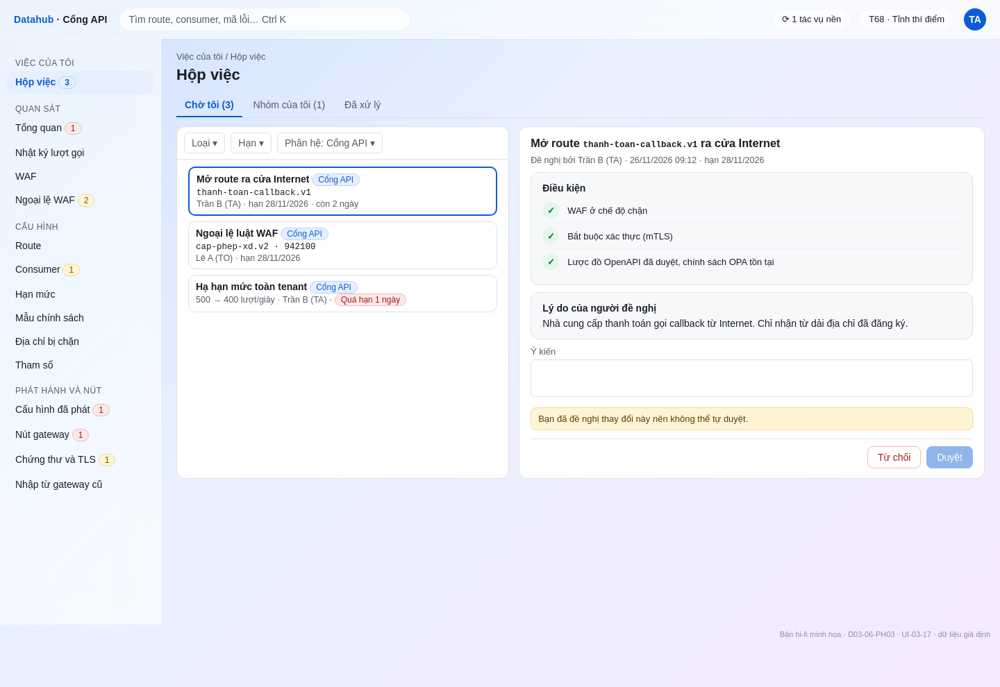

Ảnh cho thấy danh sách việc bên trái với bốn loại thay đổi và hạn xử lý, chi tiết bên phải của yêu cầu "Mở route ra cửa Internet" gồm điều kiện đã đạt, ý kiến người đề nghị, và khối duyệt có ba nút; nút "Duyệt" bị vô hiệu cho người đề nghị kèm câu giải thích.

### 23.1. Thành phần

| # | Thành phần | `CMP-*` | Nội dung, kiểm tra | Nguồn | Ghi chú |
|---|---|---|---|---|---|
| 1 | Tab hộp việc | `CMP-Tabs` | "Chờ tôi", "Nhóm của tôi", "Đã xử lý" | API-03-071 `state` | |
| 2 | Danh sách việc | `CMP-DataTable` dạng danh sách, `CMP-Tag` | Loại thay đổi, đối tượng, người đề nghị, hạn, tuổi | `items` | Lọc theo loại |
| 3 | Chi tiết yêu cầu | `CMP-DescriptionList`, `CMP-DiffViewer` | Giá trị trước, sau; điều kiện đã đạt; lý do; người đề nghị | API-03-071 | Hạ hạn mức nêu số HTTT có thể bị ảnh hưởng |
| 4 | Dòng thời gian | `CMP-Timeline` | Ý kiến các bước trước, thời điểm | `history` | |
| 5 | Khối duyệt | `CMP-ApprovalPanel`, `CMP-DecisionPanel` | Ý kiến (bắt buộc khi từ chối), "Từ chối", "Duyệt" | API-03-072, 073, 044, 045 | "Duyệt" vô hiệu cho người đề nghị (ERR-03-008) |

: UI-03-17 · Thành phần

Các loại thay đổi và điều kiện duyệt: mở cửa Internet phải còn đủ điều kiện (ERR-03-011 nếu đổi trong lúc chờ), chuyển WAF sang chặn phải đủ 14 ngày phát hiện (ERR-03-027), hạ hạn mức không dưới mức tối thiểu (ERR-03-018). Duyệt thành công `CMP-Toast` "Đã duyệt. Thay đổi sẽ có hiệu lực sau khi phát cấu hình."

### 23.2. Trạng thái màn

| Trạng thái | Hiển thị |
|---|---|
| Đang tải | Skeleton danh sách 5 dòng và khối chi tiết |
| Rỗng | "Không có yêu cầu nào chờ bạn duyệt." |
| Yêu cầu không còn hiệu lực | Yêu cầu đã bị rút hoặc người đề nghị mất quyền: ST-08 "Yêu cầu không còn hiệu lực" |
| Lỗi tải | ST-05 trong từng khung |
| Người xem là người đề nghị | "Duyệt" vô hiệu kèm ERR-03-008 |
| Không có quyền duyệt | Chi tiết chỉ đọc, ẩn khối duyệt; không có quyền xem hộp việc: ST-07 |

: UI-03-17 · Trạng thái màn

Phím tắt: `J`, `K` việc kế, trước; `A` duyệt, `R` từ chối khi focus ngoài ô ý kiến (có xác nhận). Truy cập: danh sách theo mẫu `listbox`; hạn quá thời hạn có chữ "Quá hạn 1 ngày".

## 24. UI-03-18 Nhập cấu hình từ gateway cũ

::: dac-ta
**Mục đích.** Cho PA và TA đưa cấu hình route, plan của gateway Gravitee cũ vào Datahub theo bốn bước (tải gói, xem phân tích, sửa ánh xạ, áp dụng) để chạy song song và chuyển dần (strangler). Gói được bộ quét kiểm tra trước; chỉ nhập thông tin cấu hình, không nhập bí mật.

**Người dùng chính.** PA, TA.

**FR hiện thực.** FR-03-059.

**Đường dẫn.** `/cong-api/nhap-he-cu`; tham số `buoc`, `job`.

**Mẫu.** PTN-05 (wizard).

**Quyền.** `PERM-03-admin`.

**API.** API-03-091, 092, 093.
:::

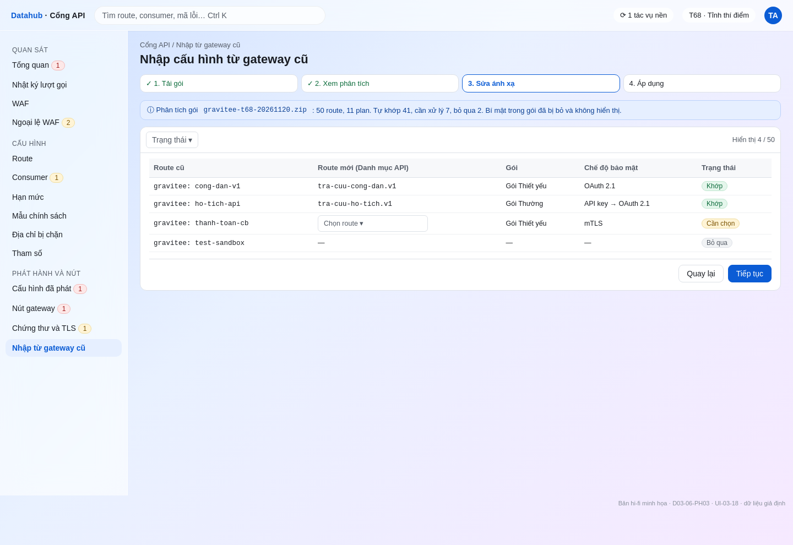

Ảnh cho thấy bước 3 "Sửa ánh xạ": thanh các bước ở trên, bảng ánh xạ từng route cũ sang route mới với cột trạng thái (khớp, cần chọn, bỏ qua), và dải tóm tắt số route tự khớp 41, cần xử lý 7, bỏ qua 2.

### 24.1. Các bước

| Bước | Nội dung | `CMP-*` | API |
|---|---|---|---|
| 1. Tải gói | Chọn tệp gói xuất từ gateway cũ (JSON hoặc ZIP, ≤ 20 MiB); bộ quét kiểm tra loại tệp và nội dung; sai: ERR-03-020 dưới ô tải | `CMP-Wizard`, `CMP-Steps`, `CMP-Upload` | API-03-091 |
| 2. Xem phân tích | Tóm tắt số route, plan, ứng dụng đọc được; cảnh báo tính năng không hỗ trợ; tiến độ phân tích là tác vụ nền | `CMP-JobProgress`, `CMP-DescriptionList`, `CMP-Alert` | API-03-092 |
| 3. Sửa ánh xạ | Bảng ánh xạ route cũ sang route mới (chọn API ở PH-02), plan cũ sang gói mới, chế độ bảo mật; mỗi dòng Khớp, Cần chọn, Bỏ qua | `CMP-EditableTable`, `CMP-ResourceSelect`, `CMP-StatusTag` | API-03-092 |
| 4. Áp dụng | Xem trước kết quả; xác nhận; áp dụng là tác vụ nền; kết quả sinh ảnh chụp cấu hình | `CMP-ConfirmDialog`, `CMP-JobProgress` | API-03-093 |

: UI-03-18 · Các bước của wizard

Rời wizard khi chưa áp dụng thì giữ bản nháp ở máy chủ theo `job`, mở lại từ `?job=`. Giá trị bí mật trong gói (khóa API, mật khẩu) bị bỏ ở bước phân tích và không hiển thị.

### 24.2. Trạng thái màn

| Trạng thái | Hiển thị |
|---|---|
| Đang phân tích | `CMP-JobProgress` với tiến độ; cho rời màn, tác vụ vào `CMP-BackgroundTaskTray` |
| Rỗng | Chưa tải gói: ô `CMP-Upload` kèm hướng dẫn xuất gói từ gateway cũ |
| Phân tích lỗi | ERR-03-020 kèm lý do dưới ô tải |
| Áp dụng thất bại | ERR-03-005 kèm danh sách lỗi theo route |
| Hoàn tất | "Đã nhập {n} route. Phiên bản cấu hình mới {v} đang được phát." kèm liên kết UI-03-10 |
| Không có quyền | ST-07 |

: UI-03-18 · Trạng thái màn

Phím tắt: `Alt+←`, `Alt+→` không dùng (xung đột trình duyệt); dùng nút "Quay lại", "Tiếp tục"; `Ctrl+Enter` tiếp tục khi bước hợp lệ. Truy cập: thanh các bước có `aria-current="step"`; mỗi lần đổi bước công bố tên bước.

## 25. Mẫu truy cập

PH-03 bám NFR-00-040: 0 lỗi mức A, AA với axe-core trên mọi màn và kiểm tra thủ công bằng NVDA cho 10 luồng chính (chương 30). Bảng dưới ghi cách phân hệ hiện thực các tiêu chí WCAG 2.2 dễ vi phạm nhất ở màn dày số liệu và hành động nhanh.

| Tiêu chí WCAG 2.2 | Cách hiện thực ở PH-03 |
|---|---|
| 1.4.1 Dùng màu | Mọi trạng thái có chữ hoặc ký hiệu cùng màu (nhãn §5.1, ký hiệu `+`, `~`, `-` của khác biệt, mẫu nền ở biểu đồ, chữ "Đã loại" cạnh chấm backend) |
| 1.4.3, 1.4.11 Tương phản | Chữ trên nền đặc `color-surface-solid` đạt 4,5:1; viền điều khiển `color-border-control` đạt 3:1; không đặt chữ lên kính; ở giảm trong suốt dùng `glass-lite-tint`, `glass-off-tint` |
| 1.4.10 Reflow | Ở 320 px rộng (thu phóng 400%) bảng cuộn ngang trong khung, hàng tab cuộn ngang, không mất chức năng; Drawer chiếm toàn màn |
| 2.1.1, 2.1.2 Bàn phím | Mọi chức năng làm được bằng bàn phím; không bẫy focus ngoài hộp thoại; `Esc` đóng lớp nổi trên cùng |
| 2.4.3, 2.4.7 Thứ tự và nhìn thấy focus | Thứ tự focus theo thứ tự đọc; vòng focus `color-focus-ring` 2 px; thanh "Bỏ qua tới nội dung" của khung |
| 2.4.11 Focus không bị che | Thanh lưu dính, thanh chọn nhiều, banner có `scroll-padding` để phần tử đang focus luôn lộ ra |
| 2.5.7 Thao tác kéo | Không thao tác nào chỉ làm được bằng kéo thả; sắp xếp cột bằng nút |
| 2.5.8 Kích thước vùng chạm | Tối thiểu 24 × 24 px; nút hành động hàng bảng 28 px; cảm ứng 44 px |
| 3.2.6 Trợ giúp nhất quán | Nút trợ giúp và `CMP-ShortcutSheet` (`?`) ở cùng vị trí mọi màn |
| 3.3.1, 3.3.3 Lỗi nhập | Lỗi tại trường kèm cách sửa; focus chuyển tới trường lỗi đầu tiên; `CMP-Alert` tóm tắt có liên kết nhảy tới trường (ST-11) |
| 3.3.7 Nhập lại | Lý do đã nhập ở hộp lý do giữ lại khi gửi lỗi mạng; không bắt nhập lại biểu mẫu khi quay lại bước |
| 3.3.8 Xác thực dễ truy cập | Hộp lý do không dùng câu đố; xác thực thao tác nhạy cảm dựa vào phiên Keycloak, không thêm bài kiểm tra nhận thức |
| 4.1.3 Thông báo trạng thái | `aria-live="polite"` cho toast, làm mới, dòng mới ở nhật ký trực tiếp; `role="alert"` cho lỗi chặn thao tác |

: Mẫu truy cập theo tiêu chí WCAG 2.2

Ba mẫu thành phần dùng lặp lại. **Bảng dữ liệu:** `aria-label`, tiêu đề cột `scope="col"`, `aria-sort`, hàng chọn được có hộp kiểm đặt tên "Chọn route {mã}"; bảng cursor không biết tổng nên đặt `aria-rowcount="-1"`. **Biểu đồ:** luôn có bảng số liệu tương đương và mô tả tóm tắt (đỉnh, đáy, xu hướng); series phân biệt bằng màu `color-chart-*` cộng mẫu nền. **Drawer, hộp thoại:** bẫy focus, nhãn bằng tiêu đề, trả focus về phần tử đã mở, chặn cuộn nền.

## 26. Kiến trúc mã giao diện

Màn của PH-03 là một "feature" trong ứng dụng `dh-console` (React, antd v6, ADR-020), không có ứng dụng riêng. Kiến trúc dưới đây là quy ước để các màn thống nhất; chi tiết thư viện theo D03-05 và quy ước chung của `dh-console`.

| Chủ đề | Quy ước |
|---|---|
| Thư mục | `src/features/cong-api/` với một thư mục con mỗi cụm màn: `tong-quan`, `route`, `consumer`, `han-muc`, `waf`, `nhat-ky`, `cau-hinh`, `nut`, `chung-thu`, `mau-chinh-sach`, `chay-thu`, `chan-dia-chi`, `tham-so`, `nhap-he-cu` |
| Client API | Sinh từ OpenAPI của `dh-connect` (có `x-datahub-id`), đặt ở `src/api/gateway/`; không viết tay đường dẫn; một hàm một `API-03-nnn` |
| Dữ liệu | TanStack Query: khóa `['gateway', tenantId, tài-nguyên, tham-số]`; đọc thử lại tối đa 2 lần với lỗi mạng hoặc 5xx; ghi không tự thử lại trừ khi có `Idempotency-Key` |
| Trạng thái URL | Hook `useUrlState` chung của D03-06-00 §2.4 cho `q`, `trang`, `co`, `sap-xep`, `khoang`, `chon` và tham số riêng ở §4.2 |
| Phân quyền | Hook `usePermission('PERM-03-…')` đọc quyền từ phiên; nút lấy hiện, ẩn từ quyền, vô hiệu từ `allowedActions`, `disabledReasons`; ẩn nút không thay cho kiểm tra ở máy chủ |
| Bảng lớn | `CMP-DataTable` ở chế độ cursor và cuộn ảo hóa khi trang ≥ 100 dòng (UI-03-07, UI-03-09); mỗi trang giữ tối đa 1.000 dòng trong bộ nhớ (giả định, cơ sở: dòng ~1 KiB, ngưỡng 1 MiB) rồi bỏ dòng cũ |
| Làm mới | Hook `useAutoRefresh(giây)` tạm dừng khi tab ẩn, khi mở Drawer, khi người dùng đang chọn văn bản; mặc định theo §2.8 |
| Trạng thái route, nút | Kênh sự kiện đẩy của BFF nếu có, dự phòng hỏi lại 10 giây (Q03-34) |
| Lỗi | Bộ chuyển mã `ERR-03-…` sang câu ở `src/features/cong-api/messages.ts`, một nguồn cho §5.2; mã không có thì dùng `detail` |
| Kiểm thử | Storybook cho từng trạng thái ST-*; Playwright cho luồng chính; axe-core trong CI |

: Quy ước kiến trúc mã giao diện của PH-03

## 27. Luồng người dùng chính

Ba luồng dưới đây là luồng người trực và cán bộ ATTT dùng nhiều nhất; chúng là cơ sở cho ca kiểm thử giao diện ở chương 30.

```{.mermaid caption="Luồng xử lý sự cố một API"}
flowchart TB
  A[Cảnh báo ở UI-03-01] --> B{Lỗi từ đâu}
  B -->|Backend lỗi| C[UI-03-03 tab Backend]
  B -->|HTTT vượt hạn mức| D[UI-03-05 tab Hạn mức]
  B -->|WAF chặn nhầm| E[UI-03-07 sự kiện chặn]
  C --> F[Dừng API hoặc chờ backend]
  D --> G[Ghi đè hạn mức ở UI-03-06]
  E --> H[Đề nghị ngoại lệ ở UI-03-08]
  F --> I[Xác nhận cảnh báo]
  G --> I
  H --> I
```

Hình cho thấy mọi sự cố đều bắt đầu từ một cảnh báo ở tổng quan rồi phân nhánh theo nguyên nhân sang đúng màn xử lý; ba nhánh cùng kết thúc bằng việc xác nhận cảnh báo để ca trực sau thấy đã có người xử lý.

```{.mermaid caption="Đề nghị và duyệt ngoại lệ luật WAF"}
sequenceDiagram
  actor TO as Vận hành TO
  participant UI as dh-console
  participant CN as dh-connect
  actor SO as Cán bộ ATTT SO
  TO->>UI: Chọn sự kiện chặn ở UI-03-07 và bấm Đề nghị ngoại lệ
  UI->>CN: POST waf/exceptions kèm lý do và hạn
  CN-->>UI: 201 trạng thái REQUESTED
  CN-->>SO: Thông báo có việc chờ duyệt
  SO->>UI: Mở UI-03-17 xem mẫu đã che và số lần chặn 7 ngày
  SO->>UI: Bấm Duyệt
  UI->>CN: POST waf/exceptions/id:approve
  CN-->>UI: 200 trạng thái ACTIVE
  CN-->>TO: Thông báo ngoại lệ có hiệu lực sau khi phát cấu hình
```

Hình mô tả thứ tự giữa hai người: TO đề nghị từ chính dòng sự kiện nên mã luật và route được điền sẵn; SO chỉ thấy phần mẫu đã che; nếu SO cũng là người đề nghị thì nút "Duyệt" bị vô hiệu và máy chủ trả ERR-03-008 để chặn cả khi gọi API trực tiếp.

```{.mermaid caption="Quay lui cấu hình gateway"}
flowchart TB
  A[Phát phiên bản 1288 gây lỗi] --> B[UI-03-10 so sánh 1288 với 1287]
  B --> C[Quay lui về 1287 kèm lý do]
  C --> D[Hệ thống tạo phiên bản 1289 nội dung của 1287]
  D --> E[Giữ tổng hợp tự động 24 giờ]
  E --> F[Xử lý nguyên nhân ở nguồn]
  F --> G[Bỏ giữ và tổng hợp lại]
```

Hình nhấn mạnh quay lui không đưa phiên bản cũ trở lại mà tạo phiên bản mới (BR-03-018), và tổng hợp tự động bị giữ để lỗi không bị phát lại cho tới khi người vận hành bấm "Bỏ giữ".

## 28. Ma trận vai trò và màn hình

X: thao tác được ít nhất một thao tác ghi hoặc xuất; R: chỉ xem; trống: không thấy (menu ẩn, mở thẳng URL ra ST-07). Ma trận suy từ `PERM-03-*` ở FRS §3.2, nên rộng hơn cột "Vai trò chính" ở FRS §10.1 (cột đó chỉ nêu người dùng thường xuyên).

| Màn | PA | PO | TA | TO | SO | AU |
|---|---|---|---|---|---|---|
| UI-03-01 | X (xác nhận) | R | X | X | X | R |
| UI-03-02 | X | R | X | X | X | R |
| UI-03-03 | X | R | X | X\* (dừng, tạm ngừng) | X | R |
| UI-03-04 | X | R | X | X\* (tạm ngừng) | X\* (tạm ngừng) | R |
| UI-03-05 | X | R | X | X\* (tạm ngừng) | X\* (tạm ngừng) | R |
| UI-03-06 | X | R | X | R | R | R |
| UI-03-07 | X | | X\* (đề nghị ngoại lệ) | X\* (đề nghị ngoại lệ) | X | |
| UI-03-08 | X\* (thu hồi, luật vá ảo) | | X\* (đề nghị) | X\* (đề nghị) | X (duyệt) | |
| UI-03-09 | X (xuất) | | X (xuất) | X (xuất) | X (xuất) | X (xuất) |
| UI-03-10 | X | R | X | X\* (quay lui) | X\* (quay lui) | R |
| UI-03-11 | R | R | R | R | R | R |
| UI-03-12 | X | R | X | X\* (gia hạn) | X | R |
| UI-03-13 | X | R | X | R | X | R |
| UI-03-14 | X | | X | | X | |
| UI-03-15 | X | R | R | R | X | R |
| UI-03-16 | X | R | X | R | X | R |
| UI-03-17 | | | X\* (cửa Internet, hạn mức, chế độ WAF) | | X (cả ngoại lệ WAF) | |
| UI-03-18 | X | | X | | X | |

: Ma trận vai trò và màn hình

Tên vai trò theo D02-08: PA `ROLE-PLATFORM_ADMIN`, PO `ROLE-PLATFORM_OPERATOR`, TA `ROLE-TENANT_ADMIN`, TO `ROLE-TENANT_OPERATOR`, SO `ROLE-SECURITY_OFFICER`, AU `ROLE-PLATFORM_AUDITOR`. Chú thích \*: chỉ một phần thao tác. Bốn mắt: người đề nghị luôn khác người duyệt dù cùng có quyền duyệt (ERR-03-008). Tập `PERM-03-*` còn tám quyền chưa vào D02-08 (FRS "Đề nghị đồng bộ"); ma trận sẽ cập nhật theo D02-08 sau đợt đồng bộ.

## 29. Truy vết FR sang màn

Bảng sinh từ danh sách chức năng của FRS §5. FR không có màn là FR của data plane (gateway thực thi) hoặc API nội bộ; kết quả của chúng được người dùng nhìn thấy gián tiếp ở nhật ký và cảnh báo.

| FR | Tên chức năng | Màn |
|---|---|---|
| FR-03-001 | Kết thúc TLS tại hai cửa vào | UI-03-12 |
| FR-03-002 | Xác minh chứng thư khách mTLS | UI-03-12 |
| FR-03-003 | Giới hạn kết nối và tốc độ theo địa chỉ nguồn | UI-03-15, UI-03-16 |
| FR-03-004 | Chặn tạm địa chỉ nguồn vi phạm liên tục | UI-03-15 |
| FR-03-005 | WAF Coraza với bộ luật OWASP CRS | UI-03-07 |
| FR-03-006 | Chế độ phát hiện, chặn của WAF và tự hạ khi quá tải | UI-03-07, UI-03-17 |
| FR-03-007 | Ngoại lệ luật WAF có thời hạn | UI-03-07, UI-03-08, UI-03-17 |
| FR-03-008 | Luật vá ảo khẩn cấp | UI-03-08 |
| FR-03-009 | Kiểm tra lược đồ và giới hạn kích thước yêu cầu | UI-03-03 |
| FR-03-010 | Xử lý CORS | UI-03-03 |
| FR-03-011 | Tiêu đề bảo mật và che thông tin máy chủ | UI-03-16 |
| FR-03-012 | Xác minh chữ ký JWT cục bộ | UI-03-11 |
| FR-03-013 | Xác định tenant của lượt gọi | Không có màn (data plane hoặc API nội bộ) |
| FR-03-014 | Ràng buộc token với chứng thư khách | UI-03-05 |
| FR-03-015 | Áp phương thức bảo mật theo gói sử dụng | UI-03-03, UI-03-13 |
| FR-03-016 | Kiểm tra đăng ký sử dụng và hiệu lực gói | UI-03-05 |
| FR-03-017 | Kiểm tra phạm vi quyền thô | UI-03-03 |
| FR-03-018 | Thu hồi token nhanh bằng danh sách chặn | UI-03-05 |
| FR-03-019 | Ủy quyền chi tiết bằng OPA tại gateway | UI-03-03 |
| FR-03-020 | Danh sách cho phép và chặn đường dẫn | UI-03-03, UI-03-13 |
| FR-03-021 | Giới hạn tần suất theo bên gọi | UI-03-06 |
| FR-03-022 | Hạn ngạch theo chu kỳ và cảnh báo ngưỡng | UI-03-05, UI-03-06 |
| FR-03-023 | Hạn mức toàn tenant | UI-03-06, UI-03-17 |
| FR-03-024 | Hạn mức theo route và thứ tự ưu tiên chính sách | UI-03-06 |
| FR-03-025 | Phản hồi vượt hạn mức và tiêu đề hạn mức | Không có màn (data plane hoặc API nội bộ) |
| FR-03-026 | Suy giảm có kiểm soát khi Valkey mất | UI-03-01 |
| FR-03-027 | Điều tiết theo tình trạng backend | UI-03-06 |
| FR-03-028 | Định tuyến theo host, đường dẫn, phương thức | UI-03-02, UI-03-03 |
| FR-03-029 | Cân bằng tải giữa các backend | UI-03-03 |
| FR-03-030 | Kiểm tra sức khỏe backend chủ động và thụ động | UI-03-03 |
| FR-03-031 | Thời hạn chờ, ngắt mạch và trả lỗi nhanh | UI-03-03 |
| FR-03-032 | Sinh và truyền định danh truy vết | Không có màn (data plane hoặc API nội bộ) |
| FR-03-033 | Chuyển tiếp WebSocket và nén nội dung | UI-03-03 |
| FR-03-034 | Chuyển đổi gRPC và REST | UI-03-03 |
| FR-03-035 | Phiên bản API song song và tiêu đề ngừng dùng | UI-03-02, UI-03-03 |
| FR-03-036 | Dừng và mở API tức thời | UI-03-02, UI-03-03 |
| FR-03-037 | Chuyển tiếp lượt gọi của tenant đã sáp nhập | UI-03-16 |
| FR-03-038 | Phân cửa vào Internet và mạng nội bộ | UI-03-03, UI-03-17 |
| FR-03-039 | Tổng hợp cấu hình gateway từ danh mục | UI-03-10 |
| FR-03-040 | Kiểm tra hợp lệ cấu hình trước khi phát | UI-03-10 |
| FR-03-041 | Sinh ảnh chụp cấu hình có phiên bản và chữ ký | UI-03-10 |
| FR-03-042 | Phát ảnh chụp tới Git và bucket | UI-03-10 |
| FR-03-043 | Nạp ảnh chụp ở nút gateway | UI-03-11 |
| FR-03-044 | Quay lui về phiên bản cấu hình trước | UI-03-10 |
| FR-03-045 | Theo dõi nút và trạng thái đồng bộ | UI-03-11 |
| FR-03-046 | Đồng bộ consumer và thông tin xác thực công khai | UI-03-04, UI-03-05 |
| FR-03-047 | Tạm ngừng khẩn cấp route hoặc consumer | UI-03-02, UI-03-05 |
| FR-03-048 | Bộ mẫu chính sách gateway được duyệt sẵn | UI-03-13 |
| FR-03-049 | Quản lý chứng thư biên | UI-03-12 |
| FR-03-050 | Ghi siêu dữ liệu lượt gọi có che dữ liệu | Không có màn (data plane hoặc API nội bộ) |
| FR-03-051 | Tra cứu và xuất nhật ký lượt gọi | UI-03-05, UI-03-09 |
| FR-03-052 | Phát chỉ số và vết OpenTelemetry | UI-03-01 |
| FR-03-053 | Kiểm tra tổng hợp cho API quan trọng | UI-03-01 |
| FR-03-054 | Cảnh báo sự kiện an ninh tại gateway | UI-03-01, UI-03-07 |
| FR-03-055 | Bảng điều khiển lưu lượng gateway | UI-03-01 |
| FR-03-056 | Tham số gateway theo tenant | UI-03-16 |
| FR-03-057 | Chạy thử chính sách bằng mô phỏng | UI-03-14 |
| FR-03-058 | Báo cáo sử dụng API theo HTTT và gói | UI-03-01 |
| FR-03-059 | Nhập cấu hình từ gateway cũ | UI-03-18 |

: Truy vết FR sang màn

## 30. Kiểm thử giao diện và bản hi-fi

### 30.1. Kiểm thử giao diện

Ca kiểm thử chi tiết viết ở D05-02-PH03 (theo `number_tcs.py`); tập này nêu phạm vi mà ca phải phủ.

| Nhóm kiểm thử | Nội dung | Công cụ |
|---|---|---|
| Trạng thái màn | Mọi màn đủ ST-01 đến ST-08 và các trạng thái riêng ở từng mục; Storybook chụp từng trạng thái | Storybook, Playwright |
| Phân quyền | Với mỗi vai trò ở chương 28: menu hiện đúng, nút ẩn hoặc vô hiệu đúng, mở URL không có quyền ra ST-07 | Playwright, ma trận D02-08 |
| Bốn mắt | Người đề nghị không bấm được "Duyệt" ở UI-03-08, UI-03-17; gọi API trực tiếp vẫn nhận ERR-03-008 | Playwright, API |
| Thông điệp | Mỗi mã ở §5.2 hiện đúng câu, đúng vị trí; mã chưa có câu hiện `detail` kèm nút sao chép mã truy vết | Playwright |
| Rò rỉ dữ liệu | Gửi lượt gọi có giá trị mồi `DH-CANARY-…` ở tham số truy vết, tiêu đề; không giá trị nào xuất hiện ở UI-03-07, 09, tệp xuất | Playwright, tập mồi |
| Số liệu thiếu | Giả lập PH-13 lỗi: khung hiện "Chưa có số liệu", không hiện số 0 | Mock API |
| Truy cập | axe-core 0 lỗi mức A, AA ở 18 màn; NVDA 10 luồng (mục 30.2); thu phóng 200% và 400% | axe-core, NVDA |
| Hiệu năng | Tải UI-03-01 dưới 2 giây ở hồ sơ tỉnh vừa; cuộn bảng 1.000 dòng mượt (giả định, ngưỡng 50 khung hình mỗi giây) | Lighthouse, Playwright |
| Hi-fi | So ảnh hi-fi với bản dựng bằng so sánh hình ảnh, dung sai 2%, trước khi nghiệm thu | Playwright |

: Phạm vi kiểm thử giao diện

### 30.2. Mười luồng kiểm tra bằng trình đọc màn hình

1. Mở tổng quan, nghe cảnh báo Nghiêm trọng, xác nhận cảnh báo (UI-03-01).
2. Tìm route theo mã, mở chi tiết, dừng API kèm xác nhận (UI-03-02, 03).
3. Tạm ngừng khẩn cấp một consumer có lý do (UI-03-04, 05).
4. Tra một lượt gọi theo `traceId`, mở Drawer, sao chép mã (UI-03-09).
5. Từ sự kiện WAF đề nghị ngoại lệ, nhập lý do và hạn (UI-03-07, 08).
6. Duyệt ngoại lệ với tư cách SO và thử duyệt với tư cách người đề nghị (UI-03-17).
7. Đặt ghi đè hạn mức cho một HTTT (UI-03-06).
8. So sánh hai phiên bản cấu hình và quay lui (UI-03-10).
9. Chặn một địa chỉ, rồi bỏ chặn (UI-03-15).
10. Chạy thử chính sách và đọc kết quả theo chốt (UI-03-14).

### 30.3. Bản hi-fi

Ảnh hi-fi của 18 màn sinh bằng `03-thiet-ke/uiux/ph03/hifi/gen_hifi.py` (dùng `hifi.css` theo tên token chuẩn D03-05-02) và chụp bằng `node shot.js` (Playwright), khung 1440 × 900, chụp cả trang khi cao hơn. Dữ liệu minh họa là giả định của tỉnh thí điểm T68. Ảnh là minh họa bố cục và trạng thái, không thay cho đặc tả: khi lệch thì đặc tả ở các chương 7 đến 24 đúng. Chạy lại từ thư mục `ph03/hifi`: `python3 gen_hifi.py && node shot.js`.

| Ảnh | Màn | Trạng thái minh họa |
|---|---|---|
| `ui-03-01.png` | UI-03-01 | Có cảnh báo, độ trễ p95 vượt ngưỡng 40 ms |
| `ui-03-02.png` | UI-03-02 | Có route dừng và tạm ngừng, menu hàng mở |
| `ui-03-03.png` | UI-03-03 | Tab Backend và sức khỏe, một nút bị loại, có thay đổi chưa lưu |
| `ui-03-04.png` | UI-03-04 | Có consumer tạm ngừng và chứng thư sắp hết hạn |
| `ui-03-05.png` | UI-03-05 | Tab Hạn mức, hạn ngạch tháng 82% |
| `ui-03-06.png` | UI-03-06 | Tab Ghi đè, một ghi đè sắp hết hạn |
| `ui-03-07.png` | UI-03-07 | Chế độ phát hiện 9/14 ngày, Drawer sự kiện |
| `ui-03-08.png` | UI-03-08 | Drawer duyệt, nút "Duyệt" vô hiệu với người đề nghị |
| `ui-03-09.png` | UI-03-09 | Drawer lượt gọi bị 429 hết hạn ngạch |
| `ui-03-10.png` | UI-03-10 | Danh sách, phiên bản 1288 bị từ chối, khối so sánh 1287 với 1286 |
| `ui-03-11.png` | UI-03-11 | Một nút chậm hai phiên bản, Drawer nút |
| `ui-03-12.png` | UI-03-12 | Chứng thư còn 6 ngày |
| `ui-03-13.png` | UI-03-13 | Drawer chi tiết mẫu |
| `ui-03-14.png` | UI-03-14 | Kết quả bị từ chối ở chốt hạn mức |
| `ui-03-15.png` | UI-03-15 | Drawer chặn địa chỉ có cảnh báo NAT |
| `ui-03-16.png` | UI-03-16 | Tab giới hạn theo địa chỉ, có thay đổi chưa lưu |
| `ui-03-17.png` | UI-03-17 | Yêu cầu mở cửa Internet, người xem là người đề nghị |
| `ui-03-18.png` | UI-03-18 | Bước 3 sửa ánh xạ |

: Ảnh hi-fi của PH-03

## Phụ lục A. Đề nghị bổ sung cho D03-05

> **Đợt đồng bộ chéo cuối (27/11/2026).** Các đề nghị dưới đây đã được xét; kết luận từng dòng (đã sửa, đã khớp sẵn, câu hỏi mở, không làm) ghi ở [D00-03-01 Sổ đồng bộ chéo cuối](../../00-chung/D00-03-01-so-dong-bo-cuoi.md).

Không có thành phần mới bắt buộc: mọi màn dựng được bằng các `CMP-*` chuẩn. Bốn biến thể dưới đây đã có ở D03-05-04 bản 0.4 trở lên (cột "Đã có ở"), bảng giữ lại để truy vết:

| Đề xuất | Dựa trên | Dùng ở | Lý do | Đã có ở |
|---|---|---|---|---|
| `CMP-Chart` có mẫu nền cho series | `CMP-Chart`, `color-chart-*` | UI-03-01, 07, 09 | Phân biệt series không dựa vào màu (WCAG 1.4.1); hiện mới có màu | D03-05-04 §6.6: hoa văn `decal` luôn bật từ ba chuỗi |
| `CMP-Steps` biến thể danh sách kiểm dọc | `CMP-Steps` | UI-03-03 tab Cửa vào, UI-03-14 | Hiện đạt, chưa đạt, không đánh giá cho từng điều kiện hoặc chốt kèm mã lỗi | D03-05-04 §10.1: biến thể `checklist` |
| `CMP-Pagination` biến thể con trỏ "Trước, Sau" kèm số ước lượng | `CMP-Pagination` | UI-03-07, 09 | Nhật ký từ ClickHouse không có tổng chính xác (Q03-56 của D03-04-PH03) | D03-05-04 §4.4: biến thể `cursor` |
| `CMP-CodeEditor` ngôn ngữ SecLang | `CMP-CodeEditor` | UI-03-08 tab Luật vá ảo | Tô cú pháp và báo lỗi cú pháp luật WAF | D03-05-04 §9.1: ngôn ngữ `seclang` |

: Phụ lục A. Đề nghị bổ sung cho D03-05

## Phụ lục B. Đề nghị bổ sung API

> **Đợt đồng bộ chéo cuối (27/11/2026).** Các đề nghị dưới đây đã được xét; kết luận từng dòng (đã sửa, đã khớp sẵn, câu hỏi mở, không làm) ghi ở [D00-03-01 Sổ đồng bộ chéo cuối](../../00-chung/D00-03-01-so-dong-bo-cuoi.md).

Các điểm dưới đây là chỗ giao diện cần dữ liệu mà D03-04-PH03 bản 0.1 chưa có hoặc chưa rõ; ghi để đợt đồng bộ API xử lý, tập này không sửa D03-04.

| # | Đề nghị | Màn | Lý do |
|---|---|---|---|
| 1 | Thêm `POST /waf/virtual-patches:dry-run` trả số yêu cầu mẫu 24 giờ sẽ bị chặn | UI-03-08 | Đã chốt 27/11/2026: thêm API-03-097 (quyền `waf`) ở D03-04-PH03 và FRS §9.4; nút "Thử khô" của FRS §10.2 dùng API này |
| 2 | Thêm tham số `releaseHold=true` cho API-03-059 hoặc API riêng `POST /snapshots:release-hold` | UI-03-10 | Đã chốt 27/11/2026: API riêng `POST /snapshots:release-hold` (API-03-098, quyền `operate`, lý do bắt buộc), không thêm tham số `releaseHold` vào API-03-059, để tách khỏi thao tác phát |
| 3 | API-03-001, 002, 004, 017 trả `impact.consumersLast15m` và `impact.routesAffected` | UI-03-02, 03, 04, 05 | Hộp xác nhận nêu hậu quả bằng số trước khi bấm |
| 4 | Thêm `GET /waf/events/{eventId}` hoặc xác nhận API-03-039 trả đủ trường cho Drawer | UI-03-07 | Đã chốt 27/11/2026: không hiển thị mẫu trích đã che (trái BR-03-007); Drawer chỉ dùng mã luật, điểm, hành động, route, `traceId` có sẵn ở API-03-039, không thêm `GET /waf/events/{eventId}` |
| 5 | Thêm `GET /routes/{routeCode}/history` hoặc dùng truy vấn kiểm toán của PH-13 | UI-03-03 tab Lịch sử | Chưa có API lịch sử thay đổi của route |
| 6 | API-03-012 trả danh sách đăng ký (API, gói, hiệu lực) của consumer | UI-03-05 tab Đăng ký | Tab Đăng ký |
| 7 | API-03-077 trả `degraded.valkey`, `degraded.waf`, `kpis[]` có `trend` so với kỳ trước | UI-03-01 | Banner và thẻ có xu hướng |
| 8 | API-03-039, 074 dùng phân trang con trỏ và `approxTotal` (đã nêu ở Q03-56 của D03-04-PH03) | UI-03-07, 09 | Hiệu năng ClickHouse; đã chốt 27/11/2026 (Q03-56), OpenAPI đã đổi, ngoại lệ ghi ở quy ước phân trang của D00-04 |
| 9 | Thêm tham số `eligibility` ở API-03-002 cho điều kiện mở cửa Internet (danh sách điều kiện đạt hoặc chưa) | UI-03-03 tab Cửa vào | Danh sách kiểm điều kiện |

: Phụ lục B. Đề nghị bổ sung API

## Phụ lục C. Danh sách kiểm tra khi dựng màn

| # | Kiểm tra | Áp dụng |
|---|---|---|
| 1 | Không trường, nhật ký, URL, bộ nhớ trình duyệt nào chứa giá trị mồi `DH-CANARY` hay giá trị tham số truy vấn | UI-03-07, 09, 14 |
| 2 | Mọi nút hành động lấy hiện, ẩn từ quyền và vô hiệu từ `allowedActions`, `disabledReasons` | Mọi màn |
| 3 | Hành động ảnh hưởng vận hành dùng `CMP-ConfirmDialog` hoặc `CMP-ReasonDialog` và nêu hậu quả bằng số | UI-03-02, 03, 04, 05, 10, 15 |
| 4 | Trạng thái không chỉ bằng màu: có chữ hoặc ký hiệu | Mọi bảng, biểu đồ, khác biệt |
| 5 | Trạng thái giao diện phản ánh vào URL theo §4.2 | Mọi màn |
| 6 | Khối số liệu lấy từ PH-13 lỗi thì hiện "Chưa có số liệu", không hiện số 0 | UI-03-01, 05, 06, 11 |
| 7 | Tác vụ 202 vào `CMP-BackgroundTaskTray` | UI-03-09, 10, 18 và xuất báo cáo |
| 8 | Glass chỉ ở lớp khung và lớp nổi; nội dung dày nền đặc; đạt tương phản ở chế độ giảm trong suốt | Mọi màn |
| 9 | Câu lỗi lấy theo §5.2, có mã truy vết sao chép được | Mọi màn |
| 10 | Thử ở 1280, 1440, 1920 px và thu phóng 200% | UI-03-03, 09 |

: Phụ lục C. Danh sách kiểm tra khi dựng màn

## Đề nghị đồng bộ

> **Đợt đồng bộ chéo cuối (27/11/2026).** Các đề nghị dưới đây đã được xét; kết luận từng dòng (đã sửa, đã khớp sẵn, câu hỏi mở, không làm) ghi ở [D00-03-01 Sổ đồng bộ chéo cuối](../../00-chung/D00-03-01-so-dong-bo-cuoi.md).

Tập này không sửa tài liệu dùng chung; các việc dưới đây để đợt đồng bộ cuối thực hiện.

| Tài liệu | Đề nghị |
|---|---|
| D03-06-00 §2.3.2, §7 | Thêm nhóm menu "Cổng API" với 14 mục và route `/cong-api/...` ở bảng 4.2 của tập này (FRS PH-03 cũng đề nghị); đổi mục 9 và 10 hiện có (`/ket-noi/chinh-sach`, `/ket-noi/gateway`) thành đường chuyển hướng tới `/cong-api/route`, `/cong-api/nut`; sửa mẫu của UI-03-11 trong IA từ PTN-11 thành PTN-01; cập nhật cột "Màn mới" của LGC-APIM-023 ở §7 |
| D03-06-00 §2.3.3 | Thêm lối vào `/cong-api/chay-thu` (Drawer), `/cong-api/duyet` (chuyển hướng hộp việc) |
| D03-05-04 | Đã xử lý: bốn biến thể ở Phụ lục A đã có ở D03-05-04 |
| D02-03-PH03 §9.2 | Bổ sung câu cho ERR-03-001, 002, 003, 004, 022, 023 theo §5.2 của tập này; §10.1 giữ nguyên PTN, thêm cột route nếu cần |
| D03-04-PH03 | Chín đề nghị ở Phụ lục B |
| Hộp việc chung (FR-00-070 ở D02-02) | Hỗ trợ bộ lọc `loai=ph03.*` và vùng chi tiết riêng của PH-03 (UI-03-17); xác nhận với tập chung (Q03-33) |
| D00-04 §3.2 | Chạy lại `kiem_tra_ma.py --cap-nhat-so-tra-cuu` để ghi dải UI-03 (18) và Q03-30…34 |
| ADR (đề xuất, không tạo ở tập này) | Không có đề xuất ADR mới từ tập màn hình |

: Đề nghị đồng bộ của tập màn hình PH-03

## Câu hỏi mở

> **Câu hỏi mở Q03-30:** Nhóm menu "Cổng API" có 14 mục cấp 2 dài hơn các nhóm khác của `dh-console`. Đề xuất giữ 14 mục chia ba cụm (Quan sát, Cấu hình, Phát hành và nút) kèm đường chuyển hướng cho hai mục cũ của D03-06-00; phương án khác là gộp còn 8 mục và đưa các màn phụ vào thẻ trong trang cha. Cần ý kiến chủ IA ở D03-06-00 và nhóm UX.

> **Câu hỏi mở Q03-31:** Chế độ "Theo dõi trực tiếp" ở UI-03-07 và UI-03-09 làm mới 5 giây có thể tạo tải truy vấn lên ClickHouse khi nhiều người trực mở cùng lúc. Đề xuất giới hạn 3 phiên trực tiếp mỗi tenant và tự tắt sau 15 phút (giả định, cơ sở: truy vấn mỗi 5 giây, 20 người trực). Cần ước lượng cùng PH-13 (liên quan Q03-56 của D03-04-PH03).

> **Câu hỏi mở Q03-32:** Địa chỉ nguồn của lượt gọi có phải dữ liệu cá nhân theo Luật BVDLCN 91/2025 không. Giao diện hiện che octet cuối với người không có `PERM-03-log-read` (mục 2.6) và hiện đầy đủ với người có quyền này. Cần ý kiến cán bộ ATTT và đầu mối bảo vệ dữ liệu cá nhân về việc có che cả với TO hay không.

> **Câu hỏi mở Q03-33:** UI-03-17 dựa vào việc hộp việc chung `/viec-cua-toi` hỗ trợ lọc theo loại `ph03.*` và hiển thị vùng chi tiết riêng (bảng khác biệt, điều kiện đã đạt). Cần xác nhận với tập chung (FR-00-070…072) và PH-12; nếu hộp việc chung không mở rộng được thì UI-03-17 là màn riêng ở `/cong-api/duyet`.

> **Câu hỏi mở Q03-34:** Trạng thái route, nút và dải thay đổi chờ phát cần cập nhật ngay khi có người khác thao tác. Đề xuất MVP hỏi lại mỗi 10 giây, kênh đẩy (SSE hoặc WebSocket qua BFF) làm ở Đợt 2 nếu BFF hỗ trợ. Cần ý kiến nhóm kiến trúc `dh-console` và BFF.

## Lịch sử phiên bản

| Phiên bản | Ngày | Người | Nội dung |
|---|---|---|---|
| 0.1 | 26/11/2026 | Nhóm viết tài liệu (Claude) | Bản đầu: 18 màn UI-03-01…18 theo khuôn K-MH (bảng đặc tả đầu mỗi màn, route `/cong-api/...`, mẫu PTN, thành phần `CMP-*` chuẩn, trạng thái, 27 thông điệp `ERR-03-…`, phím tắt, truy cập WCAG 2.2 AA), UI-03-03 siêu chi tiết, ảnh hi-fi 18 màn, ma trận vai trò, truy vết 59 FR, phụ lục đề nghị bổ sung D03-05 và API; 5 câu hỏi mở Q03-30…34 |
| 0.2 | 27/11/2026 | Nhóm viết tài liệu (Claude) | Đồng bộ chéo cuối: Phụ lục A ghi bốn biến thể (`decal`, `checklist`, `cursor`, `seclang`) đã có ở D03-05-04; chốt câu hỏi mở đợt đồng bộ: Q438, Q439, Q440, Q441 (Phụ lục B) |
