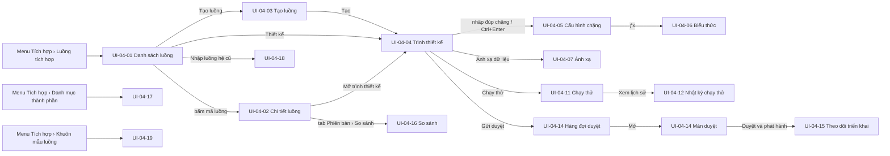

# D03-06-PH04 · Thiết kế giao diện màn hình phân hệ PH-04 Lõi tích hợp và trình thiết kế luồng

## Tóm tắt cho hội đồng thẩm định

Tài liệu đặc tả 21 màn hình của PH-04 trên ứng dụng quản trị `dh-console`. Trọng tâm là **trình thiết kế luồng** (UI-04-04) và các lớp nổi gắn với nó: cấu hình chặng, trình soạn biểu thức, trình ánh xạ dữ liệu, Kamelet, Pipe, chạy thử, gửi duyệt. Đây là các màn thay cho "Productivity Tooling" của hệ cũ, nơi kỹ sư tích hợp làm việc nhiều giờ mỗi ngày, nên được đặc tả tới từng vùng, từng nút, từng trạng thái, từng thao tác chuột và bàn phím. Giao diện theo design system Liquid Glass trên antd v6 (D03-05): kính mờ chỉ dùng cho lớp điều hướng và lớp nổi; canvas, bảng, biểu mẫu, khung mã dùng nền đặc để đạt WCAG 2.2 AA. Mục 3 liệt kê từng màn của Bus và Tooling cũ được giữ lại thành màn nào trong Datahub.

## 1. Mục đích, phạm vi và tài liệu liên quan

### 1.1. Mục đích

Đặc tả đủ để đội giao diện lập trình ngay mà không phải đoán: mỗi màn có đường dẫn, mẫu bố cục, wireframe, danh sách thành phần với nhãn tiếng Việt, kiểu, kiểm tra hợp lệ và nguồn dữ liệu (API), hành động gắn với quyền và trạng thái, các trạng thái màn (đang tải, rỗng, lỗi, không có quyền, chỉ đọc, xung đột, mất kết nối), thông điệp, phím tắt, yêu cầu khả năng truy cập và tiêu chí nghiệm thu. Tài liệu không lặp lại nghiệp vụ của FRS; khi cần thì dẫn mã `FR-04-nnn`, `BR-04-nnn`, `API-04-nnn`, `ERR-04-nnn`.

Thứ tự ưu tiên khi mâu thuẫn: D02-08 (phân quyền), D03-05 (design system), D03-06-00 (kiến trúc thông tin, mẫu màn), D02-03-PH04 (FRS), rồi tài liệu này.

### 1.2. Phạm vi và mức chi tiết

| Mã | Màn hình | Mẫu bố cục (D03-06-00 §4) | Mức chi tiết |
|---|---|---|---|
| UI-04-01 | Danh sách luồng | PTN-01 Danh sách | Đầy đủ |
| UI-04-02 | Chi tiết luồng (11 tab) | PTN-02 Chi tiết | Đầy đủ |
| UI-04-03 | Tạo luồng (trình hướng dẫn) | PTN-05 Wizard | Đầy đủ |
| UI-04-04 | **Trình thiết kế luồng** | PTN-07 Designer (canvas) | **Siêu chi tiết** |
| UI-04-05 | **Cấu hình chặng mở rộng** | Lớp nổi trên UI-04-04 | **Siêu chi tiết** |
| UI-04-06 | **Trình soạn biểu thức** | Lớp nổi trên UI-04-04, 05 | **Siêu chi tiết** |
| UI-04-07 | **Trình ánh xạ dữ liệu** | Lớp nổi toàn màn trên UI-04-04 | **Siêu chi tiết** |
| UI-04-08 | **Trình soạn Kamelet** | Chế độ của UI-04-04 | **Siêu chi tiết** |
| UI-04-09 | **Trình soạn Pipe** | Chế độ của UI-04-04 | Rất chi tiết |
| UI-04-10 | Cấu hình cấp tệp và bean | Drawer trên UI-04-04 | Rất chi tiết |
| UI-04-11 | **Chạy thử** | Drawer trên UI-04-04 và trang riêng | **Siêu chi tiết** |
| UI-04-12 | Nhật ký chạy thử | PTN-01 + chi tiết | Đầy đủ |
| UI-04-13 | Ca kiểm thử | Drawer trên UI-04-04 | Rất chi tiết |
| UI-04-14 | **Hàng đợi duyệt và màn duyệt** | PTN-10 Hộp việc và duyệt | **Siêu chi tiết** |
| UI-04-15 | **Phát hành, triển khai, quay lui** | Drawer + tab của UI-04-02 | **Siêu chi tiết** |
| UI-04-16 | So sánh phiên bản | Trang riêng (dùng `CMP-DiffViewer`) | Đầy đủ |
| UI-04-17 | Danh mục thành phần | PTN-08 Cây + bảng | Đầy đủ |
| UI-04-18 | Nhập luồng hệ cũ | PTN-09 Nhập dữ liệu có xem trước | Đầy đủ |
| UI-04-19 | Thư viện khuôn mẫu | PTN-01 dạng lưới thẻ | Đầy đủ |
| UI-04-20 | Tham số PH-04 | Màn tham số chung PH-18 | Mô tả cách nhúng |
| UI-04-21 | Không gian làm việc | PTN-01 + PTN-04 | Đầy đủ |

### 1.3. Tài liệu liên quan

| Mã | Tài liệu | Dùng để |
|---|---|---|
| D02-03-PH04 | FRS PH-04 | Nghiệp vụ, quy tắc, mã lỗi |
| D02-04-PH04 | Use case PH-04 | Luồng người dùng |
| D03-04-PH04 | API và sự kiện PH-04 | Hợp đồng `openapi-integration.yaml` |
| D03-05-01 | Vật liệu Liquid Glass | Bản đồ vật liệu, chế độ giảm trong suốt |
| D03-05-02 | Design token | Màu, khoảng cách, bo góc, lớp chồng |
| D03-05-03, 04 | Thành phần nguyên tử, phức hợp | `CMP-*` |
| D03-06-00 | Kiến trúc thông tin, mẫu màn | Menu, URL, PTN-01…11 |
| `docs/ui_ux_rule.md`, `docs/07-srs/SRS-PH-04-designer.md` | Quy tắc UX và SRS trình thiết kế của repo | Nguồn tham khảo, số liệu catalog |
| `apps/console/src/flows/**` | Mã trình thiết kế hiện có | Hiện trạng; mục 30 ghi ánh xạ mã hiện có sang thiết kế |

## 2. Nguyên tắc thiết kế áp dụng cho PH-04

### 2.1. Bản đồ vật liệu của PH-04

PH-04 có màn nhiều lớp chồng nhất của console (canvas, ngăn trái, ngăn phải, bảng dưới, Inspector, popover biểu thức, drawer chạy thử, modal ánh xạ). Nếu mọi lớp đều là kính mờ, chữ trên lớp trên cùng sẽ phụ thuộc vào màu của ba lớp bên dưới và không còn đảm bảo tương phản; đồng thời `backdrop-filter` trên nhiều lớp làm kéo thả trên canvas giật dưới 30 khung hình/giây ở máy văn phòng. Vì vậy PH-04 áp đúng bản đồ vật liệu của D03-05-01 §3.1 như sau.

| Vùng | Thành phần | Vật liệu | Token nền | Lý do |
|---|---|---|---|---|
| Thanh trên của khung ứng dụng (màn PTN-01, 02, 05, 10) | `CMP-AppShell` topbar | `glass-chrome` → `glass-chrome-scrolled` khi cuộn | theo D03-05-02 §5 | Lớp điều hướng |
| Sidebar của khung ứng dụng | `CMP-AppShell` sidebar nổi | `glass-chrome` | | Lớp điều hướng |
| Thanh công cụ trình thiết kế ① | `CMP-DesignerToolbar` | **Đặc** `color-surface-solid` có viền dưới `color-border-subtle` | | Chứa nhiều nút, chỉ báo trạng thái lưu; phải đọc chắc chắn |
| Thanh thực thể ②, bảng thành phần ③, Inspector ⑤, bảng dưới ⑥ | `CMP-EntityRail`, `CMP-NodePalette`, `CMP-Inspector`, `CMP-BottomPanel` | **Đặc** `color-surface-solid` | | Nội dung dày, chữ 13 px |
| Canvas ④ | `CMP-FlowCanvas` | **Đặc** `color-surface-solid-2` với lưới chấm `color-border-subtle` | | Chặng và cạnh cần tương phản ổn định (PTN-07) |
| Chặng trên canvas | `CMP-FlowNode` | **Đặc** `color-surface-solid`, viền 1 px, đổ bóng `shadow-1` | | |
| Điều khiển nổi trên canvas (thu phóng, minimap, chú giải, thanh chọn nhiều) | `CMP-CanvasControls`, `CMP-Minimap`, `CMP-SelectionBar` | `glass-overlay` | | Lớp nổi; `glass-overlay` đạt ngưỡng cho mọi nấc chữ |
| Menu ngữ cảnh, popover gợi ý, tooltip mô tả thành phần | `CMP-DropdownMenu`, `CMP-Popover` | `glass-overlay` | | Lớp nổi |
| Cửa sổ cấu hình chặng mở rộng, trình ánh xạ, hộp gửi duyệt, hộp xung đột | `CMP-Modal` | Khung `glass-modal`; **vùng nội dung đặc** `color-surface-solid` | | Liên kết, chữ nhỏ trong modal phải nằm trên nền đặc (D03-05-02 §5) |
| Drawer chạy thử, ca kiểm thử, cấu hình cấp tệp | `CMP-Drawer` | Khung `glass-modal`; vùng nội dung đặc | | |
| Khung mã YAML, JQ, JSON | `CMP-CodeEditor`, `CMP-JsonViewer` | **Đặc** `color-surface-solid-2` | | Mã cần tương phản cao |
| Thanh toàn màn hình nổi (chế độ F) | `CMP-FullscreenBar` | `glass-overlay` | | D03-06-00 §3.9 |

Khi người dùng bật "Giảm trong suốt" hoặc hệ điều hành báo `prefers-reduced-transparency`, hoặc cơ chế tự hạ cấp trên máy yếu kích hoạt (D03-05-01 §7), mọi lớp glass chuyển sang `glass-lite-tint` hoặc `glass-off-tint`. Không màn nào của PH-04 dựa vào hiệu ứng trong suốt để truyền thông tin.

### 2.2. Mật độ và kích thước

Trình thiết kế dùng mật độ gọn (`size="small"` của antd: điều khiển cao 24 px ở thanh công cụ và bảng thành phần, 28 px trong Inspector; dòng bảng 32 px). Các màn danh sách, chi tiết, duyệt dùng mật độ thường (điều khiển 32 px, dòng 40 px). Người dùng đổi mật độ bảng bằng "Mật độ hiển thị"; lựa chọn lưu trong `localStorage` khóa `dh.int.density.{tableId}`. Vùng chạm tối thiểu 24 × 24 px (WCAG 2.5.8), kể cả cổng nối trên chặng (vùng nhận rộng hơn hình vẽ, mục 10.6).

### 2.3. Ngôn ngữ và thuật ngữ

Nhãn, thông điệp tiếng Việt có dấu, viết hoa chữ đầu câu. Thuật ngữ thống nhất trong PH-04: "luồng" (flow), "route" (giữ nguyên tiếng Anh vì là khái niệm Camel người dùng tra cứu tài liệu), "chặng" (step, node), "thành phần" (component), "mẫu tích hợp" (EIP), "Kamelet", "Pipe", "biểu thức" (expression), "ánh xạ" (mapping), "kết nối" (connection PH-05), "phiên bản", "bản nháp", "gửi duyệt", "duyệt", "yêu cầu sửa", "phát hành", "triển khai", "môi trường", "tạm dừng", "tiếp tục", "dừng khẩn", "gỡ", "quay lui", "chạy thử", "ca kiểm thử", "khẳng định" (assertion), "bản tin mẫu", "ghim". Tên thành phần Camel, tên tham số, mã lỗi hiển thị nguyên dạng bằng phông đơn cách (`CMP-CodeText`). Ngày giờ `dd/MM/yyyy HH:mm:ss` theo giờ Việt Nam; thời lượng hiển thị `ms` dưới 1 giây, `1,2 s` từ 1 giây, `2 phút 05 giây` từ 1 phút; số theo `vi-VN`.

### 2.4. Hành động theo quyền và trạng thái

API trả `allowedActions` và `disabledReasons` trên `Flow`, `FlowVersion`, `Deployment`, `TestRun` (D03-04-PH04). Giao diện dùng `allowedActions` làm nguồn quyết định chính. Quy ước: không có quyền thì **ẩn**; có quyền nhưng trạng thái chưa cho phép thì **hiện vô hiệu kèm tooltip lý do** lấy từ `disabledReasons` (ví dụ "Chưa có lần chạy thử đạt cho phiên bản này. Chạy thử trước khi gửi duyệt"). Lý do: người có quyền cần biết phải làm gì tiếp.

### 2.5. Không chỉ dùng màu

Trạng thái chặng (lỗi, cảnh báo, đạt, lỗi khi chạy, bỏ qua), loại khác biệt (thêm, xóa, sửa) và mức phát hiện đều có biểu tượng và chữ đi kèm màu (WCAG 1.4.1). Ví dụ chặng lỗi có viền `color-error-text` 2 px, huy hiệu tròn chứa dấu "!" và số lỗi, và `aria-label` "Chặng Gọi hộ tịch, 2 lỗi".

### 2.6. Giữ trạng thái trên URL

Tab đang mở, phiên bản đang xem, route đang mở trong tệp, chặng đang chọn, chế độ Sơ đồ/YAML/Chia đôi, lần chạy thử đang phủ được phản ánh vào URL (mục 4.2). Mức thu phóng, vị trí cuộn canvas và trạng thái thu gọn ngăn không vào URL mà lưu cục bộ theo người dùng.

### 2.7. Tác vụ dài chạy nền

Chạy thử, kiểm tra mức gửi duyệt, phát hành (chờ đồng bộ), nhập XML hệ cũ có thể vượt 3 giây. Giao diện hiện tiến độ, cho rời màn, đưa tác vụ vào `CMP-BackgroundTaskTray` và báo khi xong qua trung tâm thông báo (FR-00-054, FR-00-060). Kết quả chạy thử cập nhật trực tiếp qua luồng sự kiện máy chủ (SSE, API-04-042 `Accept: text/event-stream`).

### 2.8. Bàn phím trước, chuột sau

Mọi thao tác của trình thiết kế làm được bằng bàn phím (NFR-04-015, WCAG 2.1.1, 2.5.7). Kéo thả là cách nhanh cho người dùng chuột, không phải cách duy nhất. Mỗi thao tác kéo thả có tương đương bàn phím ở bảng phím tắt mục 10.13.

## 3. Màn hệ cũ được giữ lại thành gì

Theo Q4, các màn có giá trị vận hành của hệ cũ được giữ chức năng, thiết kế lại theo design system. Bảng dưới liệt kê từng màn, tab hoặc thanh của Bus và Tooling, kết luận và màn Datahub tương ứng.

| Màn, vùng hệ cũ | Khối | LGC | Kết luận | Màn Datahub | Thay đổi chính |
|---|---|---|---|---|---|
| Danh sách chương trình tích hợp (agent), phân trang, bốn ô tìm | Bus | 001–005 | Giữ, thiết kế lại | UI-04-01 | Một ô tìm chung và bộ lọc theo endpoint, nguồn, môi trường thay ô host; đếm theo trạng thái; cột tình trạng theo môi trường |
| Màn tổng quan hệ thống (số agent hoạt động) | Bus | 014 | Chuyển | Bảng điều khiển PH-13; thẻ "Luồng" trên trang chủ | Thẻ số luồng đang chạy, suy giảm, tạm dừng |
| Màn số liệu từng agent (route, endpoint, thành công, thất bại, thời gian trung bình) | Bus | 015 | Gộp | UI-04-02 tab Tổng quan, Giám sát | Số liệu theo luồng và route, không theo máy chủ |
| Đồ thị CPU, bộ nhớ agent | Bus | 016 | Gộp | UI-04-02 tab Giám sát (nhúng PH-13) | Theo bản sao pod |
| Chi tiết agent: metadata, agent URL | Bus | 006, 017 | Giữ, mở rộng | UI-04-02 tab Tổng quan | Bỏ agent URL; thêm chủ sở hữu, HTTT, phiên bản, namespace |
| Danh sách route của agent | Bus | 008, 018 | Giữ | UI-04-02 tab Route | Có trạng thái từng route theo nhịp tim, tạm dừng từng route |
| Tab Endpoint | Bus | 020, 027 | Giữ, mở rộng | UI-04-02 tab Điểm kết nối | Thêm số liệu theo điểm kết nối từ PH-13 |
| Tab Properties của route | Bus | 021 | Giữ | UI-04-02 tab Thuộc tính | Lấy từ định nghĩa, không từ JMX |
| Tab Graph của route | Bus | 022 | Nâng cấp | UI-04-02 tab Sơ đồ; UI-04-04 chỉ đọc | Sơ đồ của trình thiết kế, phủ số liệu chạy thật |
| Tab Source của route | Bus | 023 | Nâng cấp | UI-04-02 tab Mã nguồn; UI-04-16 | YAML theo phiên bản, so sánh khác biệt |
| Tab Extra data | Bus | 024 | Giữ | UI-04-02 tab Tổng quan (khối "Thông tin thêm") | Nhãn, liên kết tài liệu |
| Nút Start/Stop agent, route | Bus | 009, 012, 026 | Nâng cấp | UI-04-02 tab Triển khai, tab Route | Hộp lý do bắt buộc; dừng khẩn tách riêng; hiện bản sao đã xác nhận |
| Hộp sửa host, port, method | Bus | 011 | Thay thế | UI-04-04 Inspector; màn kết nối PH-05 | Không sửa trên runtime; tạo phiên bản mới |
| Hộp thêm chương trình có kiểm tra kết nối | Bus | 013 | Thay thế | UI-04-03 + UI-04-11 | Tạo từ khuôn mẫu, chạy thử cả luồng |
| Nút xóa agent | Bus | 010 | Nâng cấp | UI-04-02 hành động "Gỡ luồng" | Hiện danh sách phụ thuộc trước khi gỡ |
| Màn log agent | Bus | 029 | Chuyển | PH-13 tra log, lọc sẵn theo luồng | Liên kết từ UI-04-02 |
| Màn cấu hình hệ thống | Bus | 031 | Thay thế | UI-04-20 (màn tham số PH-18) | Có miền giá trị, theo tenant |
| Màn quản lý project, group | Bus | 032 | Thay thế | UI-04-21 | Không gian làm việc và thành viên |
| Thanh Project (danh sách project) | Tooling | 001 | Giữ, gộp | UI-04-01 và nút "Mở luồng khác" trên UI-04-04 | |
| Hộp thêm mới project | Tooling | 002 | Nâng cấp | UI-04-03 | Bốn điểm xuất phát |
| Thanh Component thu gọn, mở rộng, tìm kiếm, bảy nhóm | Tooling | 003–012 | Giữ, thiết kế lại | UI-04-04 vùng ③ | Hai chế độ hiển thị (danh sách, lưới biểu tượng); nhóm nghiệp vụ như cũ và tab theo loại Camel; chỉ thành phần được phép |
| Vùng thiết kế kéo thả, đường kết nối | Tooling | 013, 023–025 | Giữ, thiết kế lại | UI-04-04 vùng ④ | Nối theo ngữ nghĩa Camel; thêm chặng không cần kéo |
| Nút lưu | Tooling | 014 | Nâng cấp | UI-04-04 ① | Tự lưu 30 giây, chỉ báo trạng thái, xung đột ba bên |
| Nút tải XML | Tooling | 015 | Thay thế | UI-04-04 menu "Tệp" | Tải YAML, gói luồng |
| Nút xóa project | Tooling | 016 | Giữ | UI-04-02 "Gỡ luồng" | |
| Nút Clear Page | Tooling | 017 | Giữ | UI-04-04 menu "Sửa" → "Xóa nội dung route" | Có hoàn tác |
| Nút thu, phóng | Tooling | 018 | Giữ | UI-04-04 `CMP-CanvasControls` | Thêm vừa khung, minimap |
| Thanh Properties | Tooling | 019, 020 | Nâng cấp | UI-04-04 vùng ⑤ Inspector và UI-04-05 | Biểu mẫu sinh từ catalog; khôi phục giá trị gốc |
| Tab Source | Tooling | 021, 026 | Giữ | UI-04-04 chế độ YAML, Chia đôi | YAML thay XML |
| Màn Data mapping | Tooling | 028 | Nâng cấp | UI-04-07 | Sinh JQ; chuyển mã PH-07 |
| Hộp sửa pom | Tooling | 022 | Loại bỏ | — | Lý do ATTT (D00-03 §6) |
| Hộp nhập component JAR | Tooling | 027 | Loại bỏ | UI-04-17 nút "Đề xuất thành phần mới" | Lý do ATTT; thay bằng quy trình đăng ký Kamelet |

Tổng cộng: 33 màn và vùng của hệ cũ; 22 giữ hoặc nâng cấp, 7 chuyển hoặc thay thế, 2 gộp vào PH-13, 2 loại bỏ.

## 4. Điều hướng

### 4.1. Sơ đồ điều hướng



### 4.2. Bảng đường dẫn React Router

Đường dẫn theo quy tắc URL tiếng Việt không dấu của D03-06-00 §2.4. Đường dẫn cũ `/flows/...` của repo được chuyển hướng 301 phía client sang đường dẫn mới trong một đợt phát hành (GAP-04-13).

| Đường dẫn | Màn | Tham số truy vấn giữ trên URL | Đường dẫn cũ của repo |
|---|---|---|---|
| `/tich-hop/luong` | UI-04-01 | `q`, `trang-thai`, `loai`, `van-chuyen`, `khong-gian`, `nguon`, `dich`, `endpoint`, `moi-truong`, `trang`, `co`, `sap-xep` | `/flows` |
| `/tich-hop/luong/tao-moi` | UI-04-03 | `buoc`, `loai`, `xuat-phat`, `khuon` | — |
| `/tich-hop/luong/:ma` | UI-04-02 | `tab`, `phien-ban`, `moi-truong` | — |
| `/tich-hop/luong/:ma/thiet-ke` | UI-04-04 | `phien-ban` (mặc định phiên bản mở), `thuc-the` (route đang mở), `chang` (chặng chọn), `che-do` (`so-do`, `yaml`, `chia-doi`), `lan-chay` (phủ kết quả) | `/flows/:code/design` |
| `/tich-hop/luong/:ma/chay-thu` | UI-04-11 (trang) | `phien-ban`, `lan-chay` | `/flows/:code/test` |
| `/tich-hop/luong/:ma/nhat-ky-chay-thu` | UI-04-12 | `ket-qua`, `nguoi-chay`, `phien-ban`, `tu`, `den`, `so-sanh` (hai mã lần chạy) | `/flows/:code/runs` |
| `/tich-hop/luong/:ma/so-sanh` | UI-04-16 | `tu`, `den`, `che-do` | — |
| `/tich-hop/duyet-luong` | UI-04-14 hàng đợi | `trang-thai`, `khong-gian`, `cua-toi` | `/flows/review` |
| `/tich-hop/duyet-luong/:ma/:phienBan` | UI-04-14 màn duyệt | `tab` | — |
| `/tich-hop/thanh-phan` | UI-04-17 | `loai`, `nhan`, `q`, `chinh-sach`, `chon` | `/components` |
| `/tich-hop/khuon-mau` | UI-04-19 | `nhom`, `loai`, `q` | — |
| `/tich-hop/luong/nhap-he-cu` | UI-04-18 | `buoc`, `tac-vu` | — |
| `/tich-hop/khong-gian` | UI-04-21 | | — |
| `/quan-tri/tham-so?nhom=04` | UI-04-20 | | — |

Lớp nổi (UI-04-05, 06, 07, 10, 11 drawer, 13) không có đường dẫn riêng; chúng được mở lại khi tải lại trang nhờ tham số `chang` và tham số `lop` (`cau-hinh`, `bieu-thuc`, `anh-xa`, `cap-tep`, `chay-thu`, `ca-kiem-thu`) trên URL của UI-04-04.

### 4.3. Menu và phân quyền hiển thị

| Mục menu (nhóm Tích hợp) | Quyền để hiện | Huy hiệu số |
|---|---|---|
| Luồng tích hợp | `PERM-04-read` | Số luồng `DEGRADED` (màu cảnh báo) |
| Duyệt luồng | `PERM-04-publish` | Số phiên bản `PENDING_REVIEW` người dùng được duyệt |
| Danh mục thành phần | `PERM-04-read` | — |
| Khuôn mẫu luồng | `PERM-04-create` hoặc `PERM-04-catalog-admin` | — |
| Không gian làm việc | `PERM-04-admin` | — |

Trình thiết kế không có mục menu riêng (D03-06-00 §2.3.2): người dùng luôn vào từ danh sách hoặc chi tiết luồng để có ngữ cảnh.

### 4.4. Breadcrumb và tiêu đề tab trình duyệt

| Màn | Breadcrumb | Tiêu đề tab |
|---|---|---|
| UI-04-01 | Tích hợp › Luồng tích hợp | Luồng tích hợp · Datahub |
| UI-04-02 | Tích hợp › Luồng tích hợp › {tên luồng} | {tên luồng} · Luồng · Datahub |
| UI-04-04 | (không có breadcrumb; thanh công cụ có nút ‹ quay lại và tên luồng) | ✎ {tên luồng} v{n} · Thiết kế · Datahub (dấu ● trước tên khi chưa lưu) |
| UI-04-14 màn duyệt | Tích hợp › Duyệt luồng › {tên luồng} v{n} | Duyệt {tên luồng} v{n} · Datahub |

## 5. Quy ước hiển thị dùng chung trong PH-04

### 5.1. Nhãn trạng thái

Mọi nhãn dùng `CMP-StatusTag` với sắc thái của D03-05-02 §4.4, luôn có biểu tượng Lucide và chữ.

| Đối tượng | Trạng thái | Nhãn | Sắc thái | Biểu tượng |
|---|---|---|---|---|
| Luồng | `DRAFT` | Nháp | neutral | `PencilLine` |
| | `IN_REVIEW` | Chờ duyệt | info | `Hourglass` |
| | `APPROVED` | Đã duyệt | info | `BadgeCheck` |
| | `ACTIVE` | Đang chạy | success | `Play` |
| | `PAUSED` | Tạm dừng | warning | `Pause` |
| | `DEGRADED` | Suy giảm | error | `TriangleAlert` |
| | `RETIRED` | Đã gỡ | neutral | `Archive` |
| Phiên bản | `DRAFT` | Bản nháp | neutral | `PencilLine` |
| | `PENDING_REVIEW` | Chờ duyệt | info | `Hourglass` |
| | `CHANGES_REQUESTED` | Cần sửa | warning | `MessageSquareWarning` |
| | `APPROVED` | Đã duyệt | success | `BadgeCheck` |
| | `SUPERSEDED` | Đã thay | neutral | `History` |
| | `ROLLED_BACK` | Đã quay lui | warning | `Undo2` |
| | `DISCARDED` | Đã hủy | neutral | `Trash2` |
| Triển khai | `PENDING`, `SYNCING` | Đang đồng bộ | info | `RefreshCw` (xoay, tắt khi giảm chuyển động) |
| | `SYNCED` + `HEALTHY` | Đồng bộ, khỏe | success | `CircleCheck` |
| | `SYNCED` + `DEGRADED` | Đồng bộ, suy giảm | warning | `CircleAlert` |
| | `OUT_OF_SYNC` | Lệch cấu hình | warning | `GitCompare` |
| | `FAILED` | Triển khai lỗi | error | `CircleX` |
| | sức khỏe `UNKNOWN` | Không rõ | neutral | `CircleHelp` |
| Lần chạy thử | `QUEUED` | Đang chờ | neutral | `Clock` |
| | `RUNNING` | Đang chạy | info | `Loader` |
| | `PASSED` | Đạt | success | `CircleCheck` |
| | `FAILED` | Không đạt | error | `CircleX` |
| | `TIMED_OUT` | Quá thời gian | error | `TimerOff` |
| | `CANCELLED` | Đã hủy | neutral | `Ban` |
| | `SIMULATED` | Mô phỏng | warning | `FlaskConical` (luôn kèm tooltip "Không chạy Camel thật, không tính là chạy thử đạt") |
| Lệnh điều khiển | `ISSUED`, `DELIVERED` | Đang gửi | info | `Send` |
| | `ACKNOWLEDGED`, `RECONCILED` | Đã xác nhận | success | `CircleCheck` |
| | `PARTIAL` | Xác nhận một phần ({k}/{n}) | warning | `CircleDashed` |
| | `REJECTED` | Bị từ chối | error | `ShieldX` |

### 5.2. Biểu tượng và màu nhóm thành phần

Chặng trên canvas và mục trong bảng thành phần có dải màu nhóm 4 px ở cạnh trái và biểu tượng nhóm. Màu nhóm lấy từ bảng màu biểu đồ của D03-05-02 §4.5 (`color-chart-1…8`), không dùng màu trạng thái để tránh nhầm với lỗi, cảnh báo.

| Nhóm nghiệp vụ | Nhãn gốc catalog ánh xạ vào | Biểu tượng | Màu |
|---|---|---|---|
| Điểm vào | consumer của `platform-http`, `rest`, `kafka`, `timer`, `cron`, Kamelet `source` | `LogIn` | `color-chart-1` |
| Định tuyến | eip routing: `choice`, `filter`, `split`, `aggregate`, `multicast`, `recipientList`, `loadBalance` | `GitBranch` | `color-chart-2` |
| Chuyển đổi dữ liệu | `transformation`, `dataformat`, `language`, `jq`, `setBody`, `marshal`, `unmarshal` | `Shuffle` | `color-chart-3` |
| Kết nối CSDL | `database`, `SQL` | `Database` | `color-chart-4` |
| Mạng | `http`, `rest`, `file`, `ftp`, `sftp`, `soap`, `cxf` | `Globe` | `color-chart-5` |
| Hàng đợi bản tin | `messaging`, `Kafka`, `JMS`, `amqp`, `mqtt` | `Mail` | `color-chart-6` |
| Lập lịch | `scheduling`, `timer`, `quartz`, `cron` | `CalendarClock` | `color-chart-7` |
| Bảo mật | `security`, `crypto`, `jasypt`, Kamelet che dữ liệu | `ShieldCheck` | `color-chart-8` |
| Chặng chuẩn Datahub | Kamelet nền `dh-*` | `Hexagon` | `color-accent` |
| Khác | còn lại | `Box` | `color-neutral-solid` |

### 5.3. Thông điệp lỗi ERR-04 sang câu hiển thị

Giao diện không hiện `detail` thô của máy chủ khi đã có câu dưới đây; câu có tham số trong `{}` lấy từ trường mở rộng của lỗi RFC 9457. Mọi thông điệp lỗi kèm "Mã lỗi {code} · Mã truy vết {traceId}" và nút "Sao chép" (FR-00-080).

| Mã | Câu hiển thị | Gợi ý hành động |
|---|---|---|
| ERR-04-001 | Không tìm thấy luồng, hoặc bạn không có quyền xem luồng này. | Nút "Về danh sách luồng" |
| ERR-04-002 | Mã luồng "{code}" đã được dùng trong tỉnh. | Gợi ý mã khác: "{code}-2" |
| ERR-04-003 | Bạn chưa có quyền sửa trong không gian làm việc "{workspace}". | "Liên hệ quản trị không gian làm việc: {owner}" |
| ERR-04-005 | Phiên bản đang ở trạng thái "{status}" nên không thể {action}. | Theo trạng thái |
| ERR-04-006 | {user} đã lưu phiên bản này lúc {time}. Thay đổi của bạn chưa được lưu. | Mở hộp xung đột (mục 10.16.3) |
| ERR-04-008 | YAML có lỗi cú pháp ở dòng {line}, cột {column}: {message} | Nhảy tới dòng |
| ERR-04-009 | Luồng còn {n} lỗi cần sửa trước khi {action}. | Mở bảng Vấn đề |
| ERR-04-010 | Phát hiện giá trị giống bí mật ở chặng "{node}", trường "{field}". Không được ghi bí mật vào luồng. | "Chọn kết nối" |
| ERR-04-011 | Thành phần "{component}" không được phép dùng trong tỉnh. | "Xem chính sách thành phần" |
| ERR-04-012 | Luồng đối ngoại phải có đủ chín chặng chuẩn. Đang thiếu: {stages}. | "Thêm chặng chuẩn còn thiếu" |
| ERR-04-013 | Kết nối "{connection}" không tồn tại, sai loại hoặc chưa được cấp cho không gian làm việc. | "Chọn kết nối khác", "Mở PH-05" |
| ERR-04-014 | Chưa có lần chạy thử đạt cho đúng nội dung đang gửi. Nội dung đã đổi sau lần chạy thử gần nhất. | "Chạy thử ngay" |
| ERR-04-015 | Bạn đã tham gia soạn phiên bản này nên không thể tự duyệt. Cần một người duyệt khác. | — |
| ERR-04-016 | Luồng đã có bản nháp v{n} do {user} tạo. | "Mở bản nháp" |
| ERR-04-017 | Luồng đang được dùng bởi {n} đối tượng. Gỡ các phụ thuộc trước. | Danh sách phụ thuộc |
| ERR-04-019 | Môi trường chạy thử đang bận hoặc chưa sẵn sàng. Thử lại sau ít phút. | "Thử lại" |
| ERR-04-021 | Bản tin mẫu vượt {limit}. | — |
| ERR-04-022 | Không ghi được vào kho cấu hình. Luồng chưa được phát hành. | "Thử lại"; mã truy vết để báo hỗ trợ |
| ERR-04-023 | Phiên bản phải chạy ổn định ở {previousEnv} trước khi lên {env}. | — |
| ERR-04-025 | Vui lòng nhập lý do (ít nhất {min} ký tự). | Focus ô lý do |
| ERR-04-029 | Không hồ sơ runtime nào có đủ thành phần: {components}. | "Đề xuất thành phần" |
| ERR-04-031 | Câu lệnh SQL ở chặng "{node}" không được phép: {reason}. Luồng chỉ được đọc dữ liệu. | Liên kết quy định Q359 |
| ERR-04-033 | Định nghĩa luồng vượt {limit}. Tách thành nhiều luồng hoặc luồng con. | — |
| ERR-04-036 | Đã có Kamelet tên "{name}". | — |
| ERR-04-037 | Biểu thức {language} có lỗi ở vị trí {pos}: {message} | Tô vị trí |
| ERR-04-038 | Ánh xạ tới trường "{target}" không hợp lệ: {reason} | — |
| ERR-04-041 | Đang trong khoảng đóng băng thay đổi tới {until}. Chỉ được quay lui hoặc tạm dừng khẩn. | — |

Danh sách đầy đủ ở D03-04-PH04 §6; mã không có trong bảng hiển thị `title` của lỗi.

## 6. Trạng thái màn hình dùng chung

| Mã | Trạng thái | Cách hiển thị trong PH-04 |
|---|---|---|
| ST-01 | Đang tải lần đầu | `CMP-Skeleton` theo hình dạng màn: bảng 8 dòng; trình thiết kế dùng skeleton ba chặng nối nhau trên canvas, bảng thành phần 12 dòng, Inspector 6 trường |
| ST-02 | Đang tải lại nền | Giữ dữ liệu cũ, thanh tiến độ mảnh 2 px dưới thanh công cụ |
| ST-03 | Rỗng lần đầu | `CMP-EmptyState` có minh họa, câu giải thích và nút hành động chính |
| ST-04 | Không có kết quả lọc | `CMP-EmptyState` "Không có luồng khớp bộ lọc" và nút "Xóa bộ lọc" |
| ST-05 | Lỗi tải | `CMP-ResultPage` hoặc `CMP-Alert` lỗi với câu ở mục 5.3, nút "Thử lại", mã truy vết |
| ST-06 | Không có quyền | `CMP-ResultPage` 403 "Bạn không có quyền xem nội dung này" (chỉ dùng khi URL hợp lệ nhưng thiếu quyền chức năng; thiếu quyền đối tượng hiện như 404) |
| ST-07 | Chỉ đọc | `CMP-Banner` thông tin dính dưới thanh công cụ nói rõ lý do và lối thoát (mục 10.15) |
| ST-08 | Xung đột ETag | Hộp xung đột ba bên (mục 10.16.3) |
| ST-09 | Mất kết nối | `CMP-Banner` cảnh báo "Mất kết nối máy chủ. Thay đổi đang được giữ trên máy này và sẽ tự lưu khi có kết nối"; chỉ báo lưu "Chưa lưu lên máy chủ" |
| ST-10 | Rời trang khi chưa lưu | `CMP-ConfirmDialog` "Bạn có thay đổi chưa lưu. Rời trang sẽ mất các thay đổi này." nút "Lưu rồi rời", "Rời không lưu", "Ở lại" |
| ST-11 | Tác vụ nền | `CMP-JobProgress` trong drawer; khay tác vụ nền trên thanh trên |
| ST-12 | Phiên sắp hết hạn | `CMP-SessionTimeoutDialog`; trình thiết kế tự lưu trước khi đăng xuất |

## 7. UI-04-01 Danh sách luồng

**Mục đích.** Điểm vào của PH-04: tìm luồng, xem nhanh tình trạng ở từng môi trường, mở chi tiết hoặc trình thiết kế. Thay màn danh sách agent của Bus (LGC-BUS-001…005) và thanh Project của Tooling (LGC-TOOL-001). FR-04-001, FR-04-002, FR-04-005.
**Đường dẫn.** `/tich-hop/luong`. **Mẫu.** PTN-01. **Quyền.** `PERM-04-read`.
**API.** API-04-001 (danh sách, có `facets` đếm theo trạng thái), API-04-005 (không gian làm việc của tôi), API-04-070 (tình trạng triển khai gộp).

### 7.1. Wireframe

```
┌ glass-chrome ─────────────────────────────────────────────────────────────────────────────────┐
│ ☰ Datahub   Tích hợp › Luồng tích hợp                          🔍 Ctrl+K   🔔 3   ⧗ 1   👤 │
└───────────────────────────────────────────────────────────────────────────────────────────────┘
  Luồng tích hợp                                          [⇪ Nhập luồng hệ cũ] [＋ Tạo luồng ▾]
  Thiết kế, chạy thử, phát hành các luồng Camel kết nối hệ thống trong tỉnh.

  ┌ Tất cả 142 ┬ Nháp 18 ┬ Chờ duyệt 4 ┬ Đang chạy 103 ┬ Tạm dừng 6 ┬ Suy giảm 3 ┬ Đã gỡ 8 ┐  ← Segmented
  └────────────┴─────────┴─────────────┴───────────────┴────────────┴────────────┴─────────┘
  [🔍 Tìm theo mã, tên, endpoint, mô tả…        ] [Không gian ▾] [Loại ▾] [Môi trường ▾] [⚙ Bộ lọc khác 2]
  Đang lọc: Nguồn = HTTT Hộ tịch ✕   Vận chuyển = REST ✕                       Xóa bộ lọc
  ┌───────────────────────────────────────────────────────────────────────────────────────────┐
  │☐│ Mã luồng ▲        │ Tên luồng                │ Loại      │ Nguồn → Đích   │ Test │Stg │Prod│ Phiên bản │ Cập nhật     │ ⋯ │
  │☐│ ho-tich-khai-sinh │ Đồng bộ khai sinh sang…  │ Đối ngoại │ HTTT HT → NDXP │  ●   │ ●  │ ●  │ v7 · Chạy │ 2 giờ trước  │ ⋯ │
  │ │                   │ ⓘ 2 route · không gian Tư pháp                                         │
  │☐│ dkkd-tra-cuu      │ Tra cứu ĐKKD             │ Đối ngoại │ Cổng DVC → ĐKKD│  ●   │ ○  │ —  │ v2 · Nháp │ hôm qua      │ ⋯ │
  └───────────────────────────────────────────────────────────────────────────────────────────┘
  Hiển thị 1–20 trong 103                                         ‹ 1 2 3 4 5 6 › [20 / trang ▾]
```

Thanh hành động hàng loạt (`CMP-BulkActionBar`, `glass-overlay`) trượt lên từ đáy khi chọn ít nhất một dòng: "Đã chọn {n}" · [Xuất danh sách] · [Gắn nhãn] · [Tạm dừng ở môi trường…] · [Bỏ chọn].

### 7.2. Thành phần

| # | Thành phần | `CMP-*` | Nội dung, kiểm tra | Nguồn | Ghi chú |
|---|---|---|---|---|---|
| 1 | Tiêu đề trang và mô tả | `CMP-PageHeader` | Cố định | — | |
| 2 | Nút "Tạo luồng" có mũi tên | `CMP-Button` primary + `CMP-DropdownMenu` | Mục: "Luồng trống", "Từ khuôn mẫu…", "Nhập từ YAML…", "Kamelet mới", "Pipe mới" | — | Hiện khi `PERM-04-create`; bấm phần chính mở UI-04-03 bước 1 |
| 3 | Nút "Nhập luồng hệ cũ" | `CMP-Button` default | | — | Hiện khi `PERM-04-create` và tham số `04.legacy_import_enabled` = true |
| 4 | Thanh đếm theo trạng thái | `CMP-Segmented` | Số từ `facets.status` | API-04-001 | Mặc định "Tất cả" trừ "Đã gỡ"; chọn đồng bộ vào `trang-thai` |
| 5 | Ô tìm kiếm | `CMP-SearchInput` | 2–100 ký tự; trễ 300 ms; tìm không dấu | `q` | Tìm trên mã, tên, mô tả, URI endpoint đã chỉ mục (EN-04-04) |
| 6 | Lọc không gian | `CMP-Select` nhiều chọn, có tìm | Không gian người dùng xem được | API-04-005 | Mặc định: không gian của tôi nếu có |
| 7 | Lọc loại | `CMP-Select` | Đối ngoại, Nội bộ, Kamelet, Pipe | | |
| 8 | Lọc môi trường | `CMP-Select` | Có triển khai ở: Test, Staging, Prod; "Chưa triển khai" | | |
| 9 | Bộ lọc khác | `CMP-FilterDrawer` | Vận chuyển (REST, SOAP, Kafka, SFTP, CSDL, Lịch), Nguồn HTTT, Đích HTTT, Chủ sở hữu, Nhãn, Sức khỏe, Cập nhật trong khoảng | PH-01 HTTT | Số trên nút = số điều kiện đang áp |
| 10 | Dải điều kiện đang lọc | `CMP-FilterChips` | | | Bấm ✕ bỏ một điều kiện |
| 11 | Bảng | `CMP-DataTable` | Cột ở 7.3 | API-04-001 | Phân trang máy chủ; chọn cột, mật độ, xuất |
| 12 | Hàng mở rộng | `CMP-DataTable` expandable | Số route, không gian, nhãn, mô tả 2 dòng, lần chạy thử gần nhất | | Mở bằng mũi tên hoặc phím → |
| 13 | Thanh hàng loạt | `CMP-BulkActionBar` | | | Mỗi hành động hàng loạt mở hộp xác nhận nêu đúng số dòng |

### 7.3. Cột bảng

| Cột | Rộng | Sắp xếp | Hiển thị |
|---|---|---|---|
| Chọn | 40 px | | `Checkbox` |
| Mã luồng | 200 px, ghim trái | Có | `CMP-CodeText`, là liên kết tới UI-04-02 |
| Tên luồng | linh hoạt, tối thiểu 220 px | Có | Cắt một dòng, tooltip đầy đủ; dưới là biểu tượng loại |
| Loại | 110 px | | Thẻ "Đối ngoại" (info), "Nội bộ" (neutral), "Kamelet", "Pipe" |
| Nguồn → Đích | 200 px | | Tên ngắn HTTT; nhiều đích hiện "+2" có tooltip |
| Test, Staging, Prod | 56 px mỗi cột | | Chấm trạng thái `CMP-StatusDot` + `aria-label` ("Prod: Đồng bộ, khỏe, v7"); "—" chưa triển khai. Tooltip: phiên bản, thời điểm đồng bộ, số bản sao khỏe {k}/{n} |
| Phiên bản | 120 px | | "v{n} · {nhãn trạng thái luồng}"; thêm biểu tượng bút khi có bản nháp mới hơn |
| Cập nhật | 140 px | Có (mặc định giảm dần) | Thời gian tương đối, tooltip tuyệt đối và người cập nhật |
| ⋯ | 48 px, ghim phải | | Menu: "Mở trình thiết kế" (E), "Xem chi tiết", "Chạy thử", "Nhân bản", "Xuất YAML", "Xem nhật ký trên PH-13", "Gỡ luồng" (nguy hiểm) — mỗi mục theo `allowedActions` |

### 7.4. Trạng thái màn

| Trạng thái | Hiển thị |
|---|---|
| Đang tải | Skeleton 8 dòng; thanh đếm hiện số "—" |
| Rỗng lần đầu (tỉnh chưa có luồng nào) | Minh họa sơ đồ ba chặng; "Chưa có luồng tích hợp nào. Tạo luồng đầu tiên từ khuôn mẫu, hoặc nhập luồng từ hệ thống LGSP cũ." Nút "Tạo luồng", "Nhập luồng hệ cũ" |
| Rỗng do lọc | ST-04 |
| Người chỉ xem, chưa thuộc không gian nào | Bảng hiện luồng công khai trong tỉnh; dải thông tin "Bạn đang xem với quyền chỉ đọc. Để thiết kế luồng, xin quản trị thêm bạn vào một không gian làm việc." |
| Lỗi tải | ST-05 trong vùng bảng; thanh lọc vẫn dùng được |

### 7.5. Tương tác và phím tắt

`/` focus ô tìm; `↑`/`↓` chuyển dòng; `Enter` mở chi tiết; `E` mở trình thiết kế của dòng đang focus; `Space` chọn dòng; `Ctrl+A` chọn trang hiện tại. Nhấp giữa hoặc `Ctrl`+nhấp mã luồng mở tab mới. Danh sách tự làm mới tình trạng môi trường mỗi 30 giây khi tab trình duyệt đang hiện (không làm mất dòng đang focus).

## 8. UI-04-02 Chi tiết luồng

**Mục đích.** Một trang cho mọi thứ về một luồng: thông tin, route, điểm kết nối, phiên bản, triển khai ở từng môi trường, chạy thử, phụ thuộc, giám sát, nhật ký thay đổi. Thay màn chi tiết agent và các tab route của Bus (LGC-BUS-006, 008, 015–024, 026, 027). FR-04-003, 004, 060–075.
**Đường dẫn.** `/tich-hop/luong/:ma?tab=`. **Mẫu.** PTN-02. **Quyền.** `PERM-04-read` + quyền xem không gian.
**API.** API-04-002 (luồng), 010 (phiên bản), 060 (triển khai), 040 (lần chạy thử), 080 (phụ thuộc), 090 (nhật ký), PH-13 nhúng số liệu.

### 8.1. Wireframe

```
  Tích hợp › Luồng tích hợp › Đồng bộ khai sinh sang NDXP
  ┌──────────────────────────────────────────────────────────────────────────────────────────┐
  │ 🔀 Đồng bộ khai sinh sang NDXP   ho-tich-khai-sinh ⧉   [Đang chạy] [Đối ngoại]           │
  │ Không gian: Tư pháp · Chủ sở hữu: Nguyễn V. A · HTTT Hộ tịch → Nền tảng NDXP              │
  │                       [✎ Mở trình thiết kế] [▶ Chạy thử] [⇡ Phát hành ▾] [⏸ Tạm dừng ▾] [⋯]│
  │ ┌ Test ─────────────┐ ┌ Staging ──────────┐ ┌ Prod ─────────────────────────────┐        │
  │ │ v8 · Đồng bộ, khỏe│ │ v7 · Đồng bộ, khỏe│ │ v7 · Đồng bộ, khỏe · 3/3 bản sao │        │
  │ │ 10 phút trước     │ │ 2 ngày trước      │ │ 2 ngày trước · 1.204 bản tin/giờ │        │
  │ └───────────────────┘ └───────────────────┘ └───────────────────────────────────┘        │
  └──────────────────────────────────────────────────────────────────────────────────────────┘
  Tổng quan │ Sơ đồ │ Route 2 │ Điểm kết nối 5 │ Thuộc tính │ Mã nguồn │ Phiên bản 8 │ Triển khai │ Chạy thử │ Phụ thuộc │ Nhật ký
  ─────────────────────────────────────────────────────────────────────────────────────────────
  (nội dung tab, nền đặc)
```

Ba thẻ môi trường (`CMP-EnvCard`) là thông tin quan trọng nhất của trang: phiên bản đang chạy ở đâu và có khỏe không. Thẻ bấm được, mở tab Triển khai lọc theo môi trường. Thẻ "Prod" có viền `color-warning-text` khi `OUT_OF_SYNC` hoặc `DEGRADED`, viền `color-error-text` khi `FAILED`, kèm dòng chữ nêu lý do.

### 8.2. Thanh hành động tiêu đề

| Nút | Điều kiện hiện | Điều kiện bật | Hành vi |
|---|---|---|---|
| Mở trình thiết kế | `PERM-04-read` | Luôn | Mở UI-04-04 với bản nháp nếu có, nếu không với phiên bản mới nhất ở chế độ chỉ đọc (người có `PERM-04-update` thấy nút "Tạo bản nháp từ v{n}" trên banner) |
| Chạy thử | `PERM-04-test` | Có phiên bản ≥ `DRAFT` hợp lệ | Mở drawer UI-04-11 |
| Phát hành ▾ | `PERM-04-publish` hoặc `PERM-04-promote` | Có phiên bản `APPROVED` chưa ở môi trường đích | Mục: "Lên Test", "Lên Staging", "Lên Prod" (UI-04-15) |
| Tạm dừng ▾ | `PERM-04-operate` | Luồng `ACTIVE`/`DEGRADED` | Mục: "Tạm dừng ở {env}", "Tiếp tục", "Dừng khẩn" (chỉ `PERM-04-emergency-stop`, màu nguy hiểm) |
| ⋯ | | | "Nhân bản", "Xuất YAML", "Xuất gói luồng", "Xem nhật ký trên PH-13", "Chuyển không gian", "Gỡ luồng" |

### 8.3. Các tab

| Tab | Nội dung | Thành phần chính | Ghi chú |
|---|---|---|---|
| Tổng quan | Mô tả, mục đích, căn cứ pháp lý (liên kết văn bản), HTTT nguồn, đích, dịch vụ PH-03 tiêu thụ luồng, nhãn, "Thông tin thêm" (LGC-BUS-024); bốn thẻ số liệu 24 giờ ở Prod: số bản tin, tỷ lệ lỗi, p95, lần lỗi gần nhất | `CMP-Descriptions`, `CMP-StatCard` | Số liệu từ PH-13; "—" khi chưa triển khai Prod |
| Sơ đồ | Sơ đồ của phiên bản đang chạy ở môi trường chọn, chỉ đọc; phủ số liệu chặng (số lần qua, lỗi) khi PH-13 có | `CMP-FlowCanvas` readOnly | Bộ chọn môi trường và phiên bản ở góc |
| Route | Bảng route: id, mô tả, điểm vào, trạng thái theo nhịp tim ở từng môi trường, số bản tin, lỗi, nút tạm dừng route | `CMP-DataTable` | Thay LGC-BUS-008, 018, 026 |
| Điểm kết nối | Bảng endpoint đã chỉ mục: vai trò (vào, ra), lược đồ (`platform-http`, `kafka`, `sql`…), URI đã che tham số, kết nối PH-05, số liệu | `CMP-DataTable` | URI không bao giờ hiện bí mật; tham số `{{connection.*}}` hiện như thẻ |
| Thuộc tính | Thuộc tính cấp tệp và tham số môi trường (giá trị theo Test, Staging, Prod trong ba cột) | `CMP-DataTable` | Giá trị đến từ kho bí mật hiện "•••• (kho bí mật)" |
| Mã nguồn | YAML của phiên bản chọn, chỉ đọc, nút sao chép, tải | `CMP-CodeEditor` readOnly | |
| Phiên bản | Bảng phiên bản: số, trạng thái, người tạo, người duyệt, ghi chú phát hành, ngày; chọn hai dòng → "So sánh" | `CMP-DataTable` + `CMP-Timeline` | Mỗi dòng có "Mở", "So sánh với đang chạy", "Quay lui về bản này" |
| Triển khai | Lịch sử triển khai và lệnh điều khiển theo môi trường; chi tiết lệnh hiện số bản sao đã xác nhận | `CMP-DataTable` + `CMP-Drawer` | Mục 19 |
| Chạy thử | 10 lần gần nhất, liên kết "Xem tất cả" sang UI-04-12; danh sách ca kiểm thử của luồng | `CMP-DataTable` | |
| Phụ thuộc | Luồng con gọi tới, Kamelet dùng, kết nối PH-05, lược đồ PH-06, bảng mã PH-07, dịch vụ PH-03 dùng luồng này | `CMP-DependencyGraph` + bảng | Dùng cho "Gỡ luồng" |
| Nhật ký | Sự kiện thay đổi: tạo, lưu, gửi duyệt, duyệt, phát hành, lệnh, ai, khi nào, lý do | `CMP-AuditTimeline` | Lọc theo loại sự kiện |

### 8.4. Trạng thái màn

Không tìm thấy hoặc không có quyền đối tượng: ST-05 với ERR-04-001 (không phân biệt hai trường hợp). Luồng `RETIRED`: banner "Luồng đã gỡ ngày {date} bởi {user}. Lý do: {reason}." và mọi hành động chỉnh sửa ẩn, chỉ còn "Nhân bản". Có lệnh điều khiển đang xử lý: thẻ môi trường hiện "Đang tạm dừng… 2/3 bản sao đã xác nhận" và hai nút "Tạm dừng", "Tiếp tục" vô hiệu kèm lý do.

## 9. UI-04-03 Tạo luồng

**Mục đích.** Tạo luồng mới đủ thông tin quản lý ngay từ đầu, xuất phát từ khuôn mẫu để có sẵn chín chặng chuẩn. Thay hộp thêm project của Tooling (LGC-TOOL-002) và hộp thêm agent có kiểm tra kết nối (LGC-BUS-013). FR-04-001, 006, 007.
**Đường dẫn.** `/tich-hop/luong/tao-moi?buoc=`. **Mẫu.** PTN-05, ba bước. **Quyền.** `PERM-04-create` và vai trò EDIT ở ít nhất một không gian.

### 9.1. Wireframe bước 1

```
  Tạo luồng tích hợp                                                              ✕ Hủy
  ① Điểm xuất phát ──── ② Thông tin luồng ──── ③ Xem lại và tạo
  ┌─────────────────────┐ ┌─────────────────────┐ ┌─────────────────────┐ ┌──────────────────┐
  │ ▦ Từ khuôn mẫu      │ │ ◻ Luồng trống       │ │ ⇪ Nhập YAML         │ │ ⧉ Nhân bản luồng │
  │ Có sẵn 9 chặng chuẩn│ │ Chỉ có điểm vào     │ │ Từ tệp .camel.yaml  │ │ Sao chép luồng   │
  │ ✓ Khuyên dùng       │ │                     │ │                     │ │ đã có            │
  └─────────────────────┘ └─────────────────────┘ └─────────────────────┘ └──────────────────┘
  Khuôn mẫu  [🔍 Tìm khuôn mẫu…]   [Tất cả] [Tra cứu đồng bộ] [Đồng bộ định kỳ] [Nhận sự kiện] [Tệp]
  ┌ REST → NDXP tra cứu ──────┐ ┌ Kafka → CSDL ─────────────┐ ┌ SFTP định kỳ → REST ──────┐
  │ [sơ đồ thu nhỏ 9 chặng]   │ │ [sơ đồ thu nhỏ]           │ │ [sơ đồ thu nhỏ]           │
  │ Dùng 34 lần · Đối ngoại   │ │ Dùng 12 lần · Nội bộ      │ │ Dùng 7 lần · Đối ngoại    │
  └───────────────────────────┘ └───────────────────────────┘ └───────────────────────────┘
                                                                          [Tiếp tục →]
```

Thẻ điểm xuất phát là `CMP-RadioCard` (nhóm radio, mũi tên chuyển lựa chọn). Khi chọn "Nhập YAML" vùng dưới đổi thành `CMP-FileDropzone` nhận `.yaml`, `.yml`, `.camel.yaml` tối đa `04.max_definition_size` (mặc định 512 KB), kiểm tra cú pháp ngay khi thả và hiện số route, Kamelet, lỗi. Khi chọn "Nhân bản" vùng dưới là `CMP-Select` tìm luồng và phiên bản.

### 9.2. Trường bước 2

| Trường | Kiểu | Bắt buộc | Kiểm tra | Mặc định, gợi ý |
|---|---|---|---|---|
| Tên luồng | `Input` | Có | 3–200 ký tự | Từ khuôn mẫu: "{tên khuôn} – " |
| Mã luồng | `Input` có tiền tố không gian | Có | `^[a-z][a-z0-9-]{2,62}$`, duy nhất trong tenant (kiểm tra trực tuyến API-04-003, trễ 400 ms, hiện ✓ hoặc ERR-04-002) | Tự sinh từ tên, bỏ dấu, nối gạch; sửa tay thì ngừng tự sinh |
| Không gian làm việc | `Select` | Có | Không gian người dùng có EDIT | Không gian gần nhất |
| Loại | `Radio` | Có | Đối ngoại, Nội bộ | Theo khuôn mẫu; tooltip: "Đối ngoại: có hệ thống ngoài tỉnh hoặc người dân tham gia, bắt buộc chín chặng chuẩn (BR-04-003)" |
| HTTT nguồn | `Select` từ PH-01 | Có với Đối ngoại | | |
| HTTT đích | `Select` nhiều chọn từ PH-01 | Có với Đối ngoại | | |
| Mô tả | `TextArea` | Không | ≤ 2.000 ký tự | |
| Căn cứ pháp lý | `Select` nhiều chọn từ danh mục văn bản PH-07 | Có với Đối ngoại khi tham số `04.require_legal_basis` = true | | |
| Nhãn | `Select` mode tags | Không | ≤ 10 nhãn, mỗi nhãn ≤ 32 ký tự | |
| Hồ sơ runtime | `Select` | Không | `core-native`, `files-native`, `soap-jvm`, `legacy-jvm` | "Tự chọn theo thành phần" (khuyên dùng) |
| Tham số khuôn mẫu | Biểu mẫu sinh từ khuôn | Theo khuôn | Theo khuôn | Ví dụ "Đường dẫn nhận", "Kết nối đích" (chọn từ PH-05) |

Bước 3 hiện tóm tắt, sơ đồ xem trước của luồng sẽ tạo (canvas chỉ đọc, thu nhỏ) và danh sách cảnh báo kiểm tra sơ bộ. Nút "Tạo và mở trình thiết kế" (chính) và "Tạo" (phụ). Tạo thành công: thông báo "Đã tạo luồng {tên}. Bản nháp v1 sẵn sàng để thiết kế." và chuyển tới UI-04-04.

### 9.3. Trạng thái

Không có khuôn mẫu nào (tỉnh mới): vùng khuôn mẫu hiện "Chưa có khuôn mẫu. Quản trị tích hợp có thể thêm khuôn ở Khuôn mẫu luồng." và thẻ "Luồng trống" được chọn sẵn. Người dùng không có không gian EDIT: không vào được màn (nút Tạo bị ẩn ở UI-04-01); vào thẳng bằng URL nhận ST-06. Rời trình hướng dẫn giữa chừng: ST-10.

## 10. UI-04-04 Trình thiết kế luồng

### 10.1. Mục đích và phạm vi

Nơi kỹ sư tích hợp vẽ, cấu hình, kiểm tra, chạy thử và gửi duyệt một phiên bản luồng. Mô hình là Camel YAML DSL (ADR-062); sơ đồ và YAML là hai cách nhìn của cùng một mô hình, sửa bên nào bên kia cập nhật (FR-04-012). Trình thiết kế dựng lại mô hình của Kaoto trong React 19 + XYFlow (ADR-060), catalog lấy từ `@kaoto/camel-catalog` đúng phiên bản runtime (ADR-061).

Một tệp luồng có thể chứa nhiều thực thể: route, `routeConfiguration`, `rest`, Kamelet, Pipe, bean, thuộc tính cấp tệp. Trình thiết kế mở một thực thể trên canvas tại một thời điểm; thanh thực thể ② chuyển giữa chúng.

**FR phủ.** FR-04-010…027, 030–033, 040–045, 050–053. **LGC thay thế.** LGC-TOOL-003…026, 028. **Quyền.** Xem: `PERM-04-read`; sửa: `PERM-04-update` + vai trò EDIT trên không gian; chạy thử: `PERM-04-test`; gửi duyệt: `PERM-04-submit`.
**API.** API-04-010 (đọc phiên bản, ETag), 011 (lưu, `If-Match`), 012 (kiểm tra), 013 (chuyển YAML ↔ mô hình phía máy chủ khi cần đối chiếu), 020 (catalog theo hồ sơ), 021 (chính sách thành phần của tenant), 025 (khóa soạn thảo, nhịp 30 s), 030 (gửi duyệt), 040–043 (chạy thử), PH-05 API-05-010 (kết nối khả dụng), PH-06 (lược đồ), PH-07 (bảng mã).

### 10.2. Wireframe tổng thể (màn 1440 × 900)

```
┌① DesignerToolbar (đặc, cao 48) ──────────────────────────────────────────────────────────────────────────────────────┐
│ ‹  Đồng bộ khai sinh sang NDXP  v8 [Bản nháp] ▾   ● Đã lưu 14:02   │ Tệp▾ Sửa▾ Xem▾ │ ↶ ↷ │ [Sơ đồ|YAML|Chia đôi] │
│                                                                    │ ⚠ 2 ✕ 1 │ ▶ Chạy thử ▾ │ ⇪ Gửi duyệt │ 👥 A,B │ ⛶ │
├② EntityRail (đặc, cao 36) ───────────────────────────────────────────────────────────────────────────────────────────┤
│ [⇢ route: nhan-khai-sinh ✕1] [⇢ route: goi-ndxp] [⚙ routeConfiguration] [⬡ bean 2] [≡ Thuộc tính tệp]  ＋ Thêm ▾     │
├③ NodePalette (đặc, 280) ──┬④ FlowCanvas (đặc solid-2, linh hoạt) ─────────────────────────┬⑤ Inspector (đặc, 360) ──┤
│ 🔍 Tìm thành phần… Ctrl+P │  · · · · · · · · · · · · · · · · · · · · · · · · · · · · · · │ ⇢ Gọi hộ tịch            │
│ [Nghiệp vụ|Thành phần|EIP │  ┌──────────────────┐                                         │ to · http  [Tài liệu ↗]  │
│  |Kamelet] [☰|▦]          │  │▌⤓ Nhận yêu cầu   │ dh-stage-receive                        │ ───────────────────────  │
│ ★ Hay dùng                │  │  platform-http   │                                         │ [Cơ bản|Nâng cao|Lỗi|    │
│  ▣ Gọi REST               │  └────────┬─────────┘                                         │  Mô tả]  ⤢ Mở rộng       │
│  ▣ Ánh xạ dữ liệu         │           ⊕                                                   │ Kết nối *                │
│ ▸ Điểm vào          7     │  ┌────────▼─────────┐                                         │ [ndxp-ho-tich ▾] ⓘ PH-05 │
│ ▾ Định tuyến        9     │  │▌✓ Kiểm lược đồ   │                                         │ Đường dẫn *              │
│  ◆ Rẽ nhánh (choice)      │  └────────┬─────────┘                                         │ [/api/v1/khai-sinh  ] ƒx │
│  ◆ Lọc (filter)           │           ⋮  (7 chặng)                                        │ Phương thức              │
│  ◆ Tách (split)           │  ┌────────▼─────────┐  ┌ choice ─────────────────────┐        │ [POST ▾]                 │
│ ▸ Chuyển đổi dữ liệu 14   │  │▌◆ Rẽ nhánh  ⚠1   │──┤ when ${header.loai}=='KS'  │        │ Thời gian chờ (ms)       │
│ ▸ Kết nối CSDL       4    │  └──────────────────┘  │ ┌▌⇢ Gọi hộ tịch ✕2 ┐ ◀chọn │        │ [10000  ] mặc định 30000 │
│ ▸ Mạng              11    │                        │ └──────────────────┘       │        │ ⟲ Khôi phục mặc định     │
│ ▸ Hàng đợi bản tin   6    │                        │ otherwise                   │        │ ───────────────────────  │
│ ▸ Lập lịch           3    │                        │ ┌▌✎ Ghi nhật ký     ┐      │        │ ✕ Thiếu kết nối hợp lệ   │
│ ▸ Bảo mật            5    │                        │ └──────────────────┘       │        │ ⚠ Thời gian chờ > SLA    │
│ ▸ Chặng chuẩn Datahub 9   │                        └────────────────────────────┘        │                          │
│ ─────────────────────     │ ┌glass-overlay┐                         ┌glass-overlay──────┐│                          │
│ 751 thành phần · 612 được │ │ − 85% + ⤢ ⊡ │                         │ ▭ minimap          ││                          │
│ phép · catalog 3.33.1     │ └─────────────┘                         └───────────────────┘│                          │
├⑥ BottomPanel (đặc, cao 220, thu được) ───────────────────────────────────────────────────┴──────────────────────────┤
│ [Vấn đề 3] [Kết quả chạy] [Nhật ký] [Lịch sử sửa]                                                     ⌄ Thu gọn     │
│ ✕ ERR-04-013  Gọi hộ tịch · Kết nối    Kết nối "ndxp-ho-tich" chưa được cấp cho không gian Tư pháp.  [Đi tới]       │
│ ⚠ VR-07       Gọi hộ tịch · Thời gian  Thời gian chờ 10.000 ms lớn hơn SLA dịch vụ 5.000 ms.          [Đi tới]       │
│ ⚠ VR-04       Rẽ nhánh                Nhánh "otherwise" chỉ ghi nhật ký, bản tin sẽ không được trả lời. [Đi tới]    │
└──────────────────────────────────────────────────────────────────────────────────────────────────────────────────────┘
```

### 10.3. Lưới bố cục và kích thước

| Vùng | Mặc định | Tối thiểu | Tối đa | Thu gọn | Lưu |
|---|---|---|---|---|---|
| ① Thanh công cụ | cao 48 px | — | — | Không | — |
| ② Thanh thực thể | cao 36 px | — | — | Ẩn khi tệp chỉ có một route và không có thực thể khác (tự hiện khi thêm) | — |
| ③ Bảng thành phần | rộng 280 px | 220 | 420 | Thành dải 48 px chỉ có biểu tượng nhóm (phím `Ctrl+B`) | `dh.int.designer.palette.width`, `.collapsed` |
| ④ Canvas | phần còn lại | 480 | — | — | Thu phóng, vị trí theo `{flow}/{entity}` |
| ⑤ Inspector | rộng 360 px | 300 | 560 | Ẩn khi không chọn chặng nào (hiện thông tin route); `Ctrl+I` bật tắt | `dh.int.designer.inspector.width` |
| ⑥ Bảng dưới | cao 220 px | 120 | 60 % chiều cao | Thành thanh 32 px hiện số vấn đề (`Ctrl+J`) | `dh.int.designer.bottom.height`, `.tab` |

Ngăn đổi kích thước bằng tay nắm `CMP-Splitter` rộng 4 px (vùng nhận 8 px), focus được bằng Tab, đổi bằng phím mũi tên 16 px mỗi lần, `Shift`+mũi tên 64 px, nhấp đúp trả về mặc định. Ở chế độ toàn màn hình (`F11` của trình duyệt hoặc nút ⛶), khung ứng dụng ẩn; ① vẫn hiện; thoát bằng `Esc` hoặc thanh nổi `CMP-FullscreenBar`.

### 10.4. ① Thanh công cụ

| Vị trí | Điều khiển | Kiểu | Hành vi | Quyền, trạng thái | Phím |
|---|---|---|---|---|---|
| 1 | Quay lại ‹ | `Button` icon | Về UI-04-02 (hoặc trang trước nếu cùng PH-04); chưa lưu thì ST-10 | | `Alt+←` |
| 2 | Tên luồng | `Typography` có nút sửa ✎ khi rê | Sửa tên tại chỗ (3–200 ký tự); `Enter` lưu, `Esc` hủy | `PERM-04-update` | |
| 3 | Phiên bản và trạng thái ▾ | `Dropdown` | Danh sách phiên bản với nhãn trạng thái; mục "So sánh với phiên bản đang chạy ở Prod", "Tạo bản nháp từ phiên bản này" | | |
| 4 | Chỉ báo lưu | `CMP-SaveIndicator` | Một trong: "● Chưa lưu" (chấm `color-warning-text`), "⟳ Đang lưu…", "✓ Đã lưu {HH:mm}", "⚠ Lưu lỗi · Thử lại", "⊘ Chưa lưu lên máy chủ (mất kết nối)", "🔒 Chỉ đọc" | | |
| 5 | Menu Tệp | `Dropdown` | Lưu (`Ctrl+S`); Tải YAML (`Ctrl+Shift+S`); Tải gói luồng (.zip có YAML, ánh xạ, ca kiểm thử); Nhập YAML vào tệp này…; Thuộc tính tệp; Chọn hồ sơ runtime; Lịch sử phiên bản | | |
| 6 | Menu Sửa | `Dropdown` | Hoàn tác, Làm lại, Cắt, Sao chép, Dán, Nhân đôi, Xóa, Chọn tất cả, Tìm trong luồng (`Ctrl+F`), Thay thế giá trị tham số…, Xóa nội dung route (LGC-TOOL-017, có xác nhận) | | |
| 7 | Menu Xem | `Dropdown` | Bảng thành phần, Inspector, Bảng dưới (bật tắt); Hướng sơ đồ: Dọc ↓ / Ngang →; Tự sắp xếp (`Shift+L`); Hiện mã chặng (`id`); Hiện mô tả chặng; Hiện chặng chuẩn dạng thu gọn; Chế độ danh sách (a11y, mục 10.19); Mật độ | | |
| 8 | Hoàn tác ↶, làm lại ↷ | `Button` icon | Ngăn xếp 100 bước của phiên soạn (mục 10.21); tooltip nêu bước: "Hoàn tác: Xóa chặng Ghi nhật ký" | Vô hiệu khi rỗng | `Ctrl+Z`, `Ctrl+Shift+Z`/`Ctrl+Y` |
| 9 | Chế độ | `CMP-Segmented` | Sơ đồ / YAML / Chia đôi (mục 10.14) | | `Ctrl+1`, `Ctrl+2`, `Ctrl+3` |
| 10 | Bộ đếm vấn đề | `Button` text | "✕ {lỗi} ⚠ {cảnh báo}"; bấm mở ⑥ tab Vấn đề. Không có vấn đề: "✓ Hợp lệ" màu `color-success-text` | | `F8` tới vấn đề kế, `Shift+F8` trước |
| 11 | Chạy thử ▾ | `Dropdown.Button` | Phần chính: chạy với bản tin mẫu lần trước (hoặc mở UI-04-11 nếu chưa có); mũi tên: "Chạy với bản tin…", "Chạy ca kiểm thử…", "Chạy tất cả ca kiểm thử", "Xem lịch sử chạy thử" | `PERM-04-test`; vô hiệu khi còn lỗi mức chặn (tooltip ERR-04-009) | `F5`; `Shift+F5` mở drawer |
| 12 | Gửi duyệt | `Button` primary | Mở hộp gửi duyệt (mục 10.22). Đổi thành "Rút lại" khi phiên bản `PENDING_REVIEW` và người dùng là người gửi | `PERM-04-submit`; vô hiệu kèm lý do khi: còn lỗi, chưa lưu, chưa có chạy thử đạt cho đúng `contentHash` (BR-04-008) | `Ctrl+Shift+Enter` |
| 13 | Người đang xem | `CMP-AvatarGroup` | Ảnh đại diện người đang mở cùng phiên bản (tối đa 3 + "+n"); người giữ khóa sửa có viền `color-accent` và biểu tượng bút | | |
| 14 | Toàn màn hình ⛶ | `Button` icon | | | `Ctrl+Shift+F` |

Khi chiều rộng dưới 1280 px, mục 5–7 gộp vào một menu "☰", nhãn "Chạy thử", "Gửi duyệt" chỉ còn biểu tượng có `aria-label`.

### 10.5. ② Thanh thực thể

Mỗi thực thể là một tab `CMP-EntityTab` gồm biểu tượng loại, nhãn "{loại}: {id}", huy hiệu số lỗi nếu có, nút ✕ (xóa thực thể, có xác nhận, chỉ khi không phải thực thể duy nhất). Thứ tự theo thứ tự trong YAML; kéo tab để đổi thứ tự (thay đổi thứ tự trong YAML, hoàn tác được). Nhấp đúp nhãn để đổi `id`.

| Loại thực thể | Biểu tượng | Mở bằng | Ghi chú |
|---|---|---|---|
| route | `ArrowRightLeft` | Canvas | |
| routeTemplate | `LayoutTemplate` | Canvas có tham số mẫu | Chỉ trong không gian có `PERM-04-catalog-admin` |
| routeConfiguration | `Settings2` | Biểu mẫu (UI-04-10 dạng nhúng), có canvas nhỏ cho `onException` | `dh-default-config` có sẵn, khóa, chỉ xem |
| rest | `Webhook` | Bảng phương thức REST + canvas `to direct:` | |
| Kamelet | `Hexagon` | Chế độ Kamelet (UI-04-08) | |
| Pipe | `Cable` | Chế độ Pipe (UI-04-09) | |
| beans | `Package` | Bảng bean (UI-04-10) | Gộp mọi bean thành một tab |
| Thuộc tính tệp | `ListTree` | Bảng thuộc tính (UI-04-10) | |

"＋ Thêm ▾" mở menu: Route mới, Route từ khuôn mẫu…, REST, routeConfiguration, Bean, Kamelet mới (chỉ trong tệp Kamelet). Route mới có sẵn điểm vào `direct:{id}` và được chọn ngay.

### 10.6. ③ Bảng thành phần

#### 10.6.1. Cấu trúc

| Phần | Mô tả |
|---|---|
| Ô tìm | `CMP-SearchInput`, focus bằng `Ctrl+P` hoặc `/` khi focus trong ③. Tìm mờ không dấu trên tên, tiêu đề, mô tả, nhãn, tên tiếng Việt, từ đồng nghĩa (ví dụ "gọi api" → `http`, `rest`; "chia" → `split`; "gộp" → `aggregate`). Kết quả xếp: khớp tên chính xác, khớp tiền tố, hay dùng, còn lại. Trễ 120 ms, chạy trong Web Worker trên chỉ mục dựng sẵn |
| Tab phân loại | `CMP-Segmented` bốn tab: **Nghiệp vụ** (mặc định, nhóm như Tooling cũ, mục 5.2), **Thành phần** (751 component Camel theo nhãn catalog), **EIP** (các processor), **Kamelet** (Kamelet của catalog + Kamelet của tỉnh) |
| Chế độ hiển thị | Nút ☰ danh sách (mặc định) / ▦ lưới biểu tượng 3 cột (giống Tooling cũ) |
| Nhóm "★ Hay dùng" | 8 thành phần người dùng dùng nhiều nhất 30 ngày, tính cục bộ; ghim tay bằng nút ☆ khi rê |
| Nhóm | `Collapse` có số lượng; nhớ trạng thái mở |
| Chân | "{tổng} thành phần · {được phép} được phép · catalog {phiên bản}"; liên kết "Danh mục thành phần" (UI-04-17) |

#### 10.6.2. Mục thành phần

```
┌▌[ic] Gọi REST                     ⓘ  ☆ ┐   ← cao 32 (danh sách) · 72×72 (lưới)
│     http · Mạng                         │
└─────────────────────────────────────────┘
```

| Trạng thái mục | Hiển thị | Tương tác |
|---|---|---|
| Bình thường | Nền đặc, chữ `color-text` | Kéo được, `Enter` thêm vào sau chặng đang chọn |
| Rê, focus | Nền `color-fill-hover`, vòng focus `color-focus-ring` 2 px | Hiện ⓘ, ☆ |
| Không hợp lệ ở vị trí đang chọn | Mờ 50 %, biểu tượng ⊘, tooltip "Chỉ dùng được làm điểm vào (from)" | Không kéo vào vị trí đó được |
| Bị chặn theo chính sách tỉnh (EN-04-11) | Ẩn mặc định; bật "Hiện cả thành phần bị chặn" thì hiện mờ với ổ khóa và lý do | Không thêm được; nút "Đề xuất cho phép" (mở UI-04-17) |
| Không có trong hồ sơ runtime đang chọn | Thẻ nhỏ "JVM" hoặc "files"; tooltip "Thêm thành phần này sẽ đổi hồ sơ sang soap-jvm" | Thêm được, hiện cảnh báo VR-15 |
| Lỗi thời (deprecated trong catalog) | Chữ gạch ngang mờ, thẻ "Lỗi thời", gợi ý thay thế | Thêm được kèm cảnh báo |

Tooltip ⓘ (`CMP-Popover` `glass-overlay`, rộng 320): tiêu đề, mô tả catalog (tiếng Việt khi có bản dịch, nếu không tiếng Anh kèm nhãn "EN"), nhãn, có hỗ trợ consumer/producer, hồ sơ runtime hỗ trợ, liên kết "Tài liệu Camel ↗" (mở `camel.apache.org` phiên bản 4.18 ở tab mới).

#### 10.6.3. Ánh xạ "Nghiệp vụ"

Tab Nghiệp vụ hiện chín nhóm của mục 5.2. Một thành phần thuộc nhiều nhóm (ví dụ `kafka` thuộc "Điểm vào" khi làm consumer và "Hàng đợi bản tin") được hiện ở cả hai nhóm. Bảng ánh xạ đầy đủ `nhãn catalog → nhóm nghiệp vụ` nằm trong tệp cấu hình `palette-groups.json` của console, quản trị tích hợp sửa qua UI-04-17 (D03-02-PH04 §6.3).

### 10.7. ④ Canvas

#### 10.7.1. Mô hình hiển thị

Canvas vẽ cây chặng của một route theo cách Kaoto: điểm vào (`from`) ở trên cùng, các chặng trong `steps` nối tuần tự theo hướng dọc (mặc định) hoặc ngang. Mẫu tích hợp có nhánh (`choice`, `doTry`, `multicast`, `split`, `loop`, `filter`, `aggregate`, `circuitBreaker`, `saga`, `loadBalance`) vẽ thành **nhóm** (container) chứa các nhánh con. Không có cạnh tự do: cạnh luôn suy ra từ thứ tự trong cây, nên người dùng không thể vẽ một sơ đồ mà Camel không chạy được (khác Tooling cũ). Vị trí do bố cục tự động (ELK `layered`, khoảng cách 48 px giữa chặng, 64 px giữa nhánh) tính; người dùng không kéo chặng tới tọa độ tùy ý, chỉ kéo để **đổi thứ tự** hoặc **chuyển vào nhánh khác**.

Lý do: tọa độ tùy ý không có trong Camel YAML DSL và repo hiện ghi tọa độ vào chú thích `# @lgsp-canvas-v1:` (GAP-04-06); bỏ cách này để YAML sạch và so sánh phiên bản chỉ còn khác biệt có nghĩa.

#### 10.7.2. Giải phẫu chặng (`CMP-FlowNode`)

```
         ┌──────────────────────────────────────┐  rộng 240, cao 56 (gọn: 200 × 40)
  dải ►  │▌ [ic]  Gọi hộ tịch           ✕2  ⋯  │  ← tên hiển thị: description || tiêu đề catalog
  nhóm   │▌       to · http · /api/v1/…        │  ← dòng phụ: loại · thành phần · tham số chính
 4 px    └──────────────────────────────────────┘
          ○ cổng vào (ẩn)        ⊕ nút thêm sau (hiện khi rê cạnh) ○ cổng ra (ẩn)
```

| Phần | Nội dung | Quy tắc |
|---|---|---|
| Dải nhóm | Màu nhóm (mục 5.2) | Chặng chuẩn Datahub dùng `color-accent` và góc trên trái có huy hiệu lục giác nhỏ |
| Biểu tượng | Biểu tượng thành phần từ catalog Kaoto (SVG), nếu không có thì biểu tượng nhóm | 20 × 20 px, có `alt` rỗng (tên đã có ở nhãn) |
| Tên | `description` của chặng nếu có; nếu không, tiêu đề catalog ("Gọi HTTP") | Một dòng, cắt "…", tooltip đầy đủ |
| Dòng phụ | `{loại EIP}` · `{thành phần}` · `{tham số chính}` (path, topic, query rút gọn) | `color-text-secondary`, 12 px; tham số chứa `{{…}}` hiện như thẻ |
| Huy hiệu vấn đề | ✕{n} (lỗi) hoặc ⚠{n} (cảnh báo) | Bấm mở Inspector tab chứa trường lỗi |
| Huy hiệu chạy thử | ✓ (đạt), ✕ (lỗi), ⊘ (không đi qua), thời lượng "12 ms" | Chỉ khi phủ kết quả (mục 10.7.6) |
| Huy hiệu khác | 🔒 chặng chuẩn khóa cấu trúc; ⏸ chặng bị tắt (`disabled: true`); ⤷ có `id` tùy chỉnh; 🗎 có mô tả dài | |
| Nút ⋯ | Mở menu ngữ cảnh (mục 10.10) | Hiện khi rê hoặc chọn; luôn focus được |

#### 10.7.3. Trạng thái chặng

| Trạng thái | Viền | Nền | Biểu tượng, chữ | `aria` |
|---|---|---|---|---|
| Bình thường | 1 px `color-border` | `color-surface-solid` | | `aria-label="{tên}, {loại}"` |
| Rê chuột | 1 px `color-border-strong` | `color-fill-hover` | hiện ⋯ | |
| Focus bàn phím | vòng 2 px `color-focus-ring`, cách 2 px | | | |
| Đang chọn | 2 px `color-accent` | `color-accent-bg` | | `aria-selected="true"` |
| Chọn nhiều | 2 px `color-accent` nét đứt | `color-accent-bg` | | |
| Có lỗi | 2 px `color-error-text` | | ✕{n} | "…, {n} lỗi" |
| Có cảnh báo | 2 px `color-warning-text` | | ⚠{n} | "…, {n} cảnh báo" |
| Bị tắt (`disabled`) | 1 px nét đứt `color-border` | sọc chéo `color-fill` | ⏸, chữ "Đã tắt" | "…, đã tắt" |
| Kéo đi (nguồn) | | mờ 40 % | | |
| Chặng chuẩn khóa | 1 px `color-accent` | | 🔒 | "…, chặng chuẩn, không xóa được" |
| Chạy thử: đạt | viền trái 4 px `color-success-text` thay dải nhóm | | ✓ + thời lượng | "…, chạy thử đạt, 12 mili giây" |
| Chạy thử: lỗi | 2 px `color-error-text` | `color-error-bg` | ✕ + mã ngoại lệ | |
| Chạy thử: không đi qua | | mờ 60 % | ⊘ | "…, không đi qua" |
| Khác biệt (khi so sánh): thêm | 2 px `color-success-text` | | "＋ Thêm" | |
| Khác biệt: sửa | 2 px `color-warning-text` | | "~ Sửa" | |
| Khác biệt: xóa | 1 px nét đứt `color-error-text` | mờ | "− Xóa", chữ gạch ngang | |

Khi một chặng vừa lỗi vừa đang chọn: viền chọn 2 px `color-accent` bên ngoài, viền lỗi 2 px bên trong (hai vòng), để không mất thông tin.

#### 10.7.4. Nhóm (container) và nhánh

| Mẫu | Hình vẽ | Nhánh con | Thao tác riêng |
|---|---|---|---|
| `choice` | Khung bo 12 px, tiêu đề "◆ Rẽ nhánh", nhánh xếp cạnh nhau | `when` (mỗi nhánh có nhãn là biểu thức rút gọn), `otherwise` (tối đa 1) | Nút "＋ Thêm điều kiện" ở cuối khung; kéo đổi thứ tự `when`; cảnh báo VR-04 khi thiếu `otherwise` ở luồng đối ngoại |
| `doTry` | Khung tiêu đề "🛡 Thử (doTry)" | thân, `doCatch` (nhiều, nhãn là danh sách ngoại lệ), `doFinally` (tối đa 1) | "＋ Bắt ngoại lệ", "＋ Finally" |
| `split`, `loop`, `filter`, `aggregate`, `circuitBreaker`, `saga`, `resequence`, `throttle`, `idempotentConsumer` | Khung có tiêu đề và dòng biểu thức | Một thân `steps` | `circuitBreaker` thêm nhánh `onFallback` |
| `multicast`, `loadBalance` | Khung, nhánh xếp cạnh nhau | Mỗi chặng con là một nhánh | |
| Chặng chuẩn thu gọn | Khi bật "Hiện chặng chuẩn dạng thu gọn", chín chặng chuẩn liên tiếp gộp thành một thanh mảnh "⬡ 9 chặng chuẩn" bấm để mở | | Mặc định tắt; bật thì giảm nhiễu khi đọc logic nghiệp vụ |

Khung thu gọn được bằng nút ⌃ ở tiêu đề; khi thu, khung hiện "◆ Rẽ nhánh · 3 nhánh · 7 chặng" và giữ huy hiệu lỗi tổng. Trạng thái thu gọn lưu cục bộ theo `id` chặng.

Nhóm lồng tối đa hiển thị 6 cấp; sâu hơn vẫn đúng mô hình nhưng cảnh báo VR-11 "Luồng lồng quá sâu, nên tách thành route con dùng `direct:`" và gợi ý tác vụ "Tách thành route con" (menu ngữ cảnh).

#### 10.7.5. Cạnh và nút thêm

Cạnh là đường cong bậc hai 1,5 px `color-border-strong`, có đầu mũi tên. Cạnh vào nhánh có nhãn (điều kiện `when` rút gọn 32 ký tự, "otherwise", tên ngoại lệ). Rê lên cạnh hiện nút ⊕ ở giữa (vùng nhận 24 × 24); bấm mở **bảng chọn nhanh** (`CMP-QuickInsert`, `glass-overlay`, rộng 360): ô tìm có focus sẵn, 6 gợi ý theo ngữ cảnh (ví dụ sau `from: platform-http` gợi ý "Kiểm lược đồ", "Ánh xạ dữ liệu", "Gọi REST"), danh sách kết quả; `Enter` chèn vào vị trí cạnh. Cuối mỗi nhánh có nút ⊕ mờ "Thêm chặng".

#### 10.7.6. Lớp phủ

| Lớp phủ | Bật bằng | Hiển thị |
|---|---|---|
| Kết quả chạy thử | Sau khi chạy thử, hoặc `?lan-chay=` | Huy hiệu ✓ ✕ ⊘ và thời lượng trên mỗi chặng; cạnh đã đi qua đậm 2,5 px `color-success-text`; cạnh không đi qua nét đứt. Dải nổi trên đầu canvas (`glass-overlay`): "Đang xem kết quả lần chạy #{n} · Đạt · 184 ms · [Ẩn] [Mở chi tiết]". Sửa bất kỳ chặng nào thì lớp phủ chuyển sang "Cũ: nội dung đã đổi sau lần chạy này" và mờ đi |
| Số liệu chạy thật (chỉ đọc, từ UI-04-02) | Bộ chọn môi trường | Số bản tin qua mỗi chặng, tỷ lệ lỗi, p95 24 giờ (PH-13) |
| Khác biệt | Từ UI-04-16 "Mở trên sơ đồ" | Trạng thái khác biệt mục 10.7.3 |
| Tìm kiếm | `Ctrl+F` | Chặng khớp có viền `color-accent` nét đứt; ô tìm nổi góc trên phải "2/5 ‹ ›" |

#### 10.7.7. Điều khiển nổi

`CMP-CanvasControls` (góc dưới trái, `glass-overlay`): − (thu, `Ctrl+-`), mức "85%" (bấm chọn 50/75/100/150 %), + (phóng, `Ctrl+=`), ⤢ vừa khung (`Shift+1`), ⊡ vừa chặng chọn (`Shift+2`), 🔒 khóa sơ đồ (chặn kéo, cho chọn). Phạm vi 25–200 %. Dưới 50 % chặng chuyển sang hiển thị tối giản (chỉ dải màu, biểu tượng, huy hiệu lỗi) để vẫn thấy lỗi. `CMP-Minimap` (góc dưới phải, 200 × 140) hiện khi luồng vượt khung nhìn, ẩn bằng nút ✕, kéo khung nhìn trên minimap để di chuyển; chặng lỗi trên minimap là chấm đỏ có viền.

### 10.8. Tương tác chuột trên canvas

| Thao tác | Trên | Kết quả |
|---|---|---|
| Nhấp | Chặng | Chọn chặng, Inspector hiện cấu hình; URL cập nhật `chang={id}` |
| Nhấp | Nền canvas | Bỏ chọn; Inspector hiện thông tin route |
| `Ctrl`/`Shift` + nhấp | Chặng | Thêm, bớt chặng khỏi vùng chọn (chỉ chọn nhiều trong cùng một danh sách `steps` liên tiếp hoặc rời rạc; thao tác khả dụng tùy vùng chọn) |
| Kéo trên nền (giữ `Shift`) | Nền | Khung chọn chữ nhật |
| Kéo trên nền (không phím) | Nền | Di chuyển khung nhìn; con trỏ `grab` |
| Cuộn | Nền | Di chuyển dọc; `Shift`+cuộn di chuyển ngang; `Ctrl`+cuộn thu phóng tại vị trí con trỏ |
| Nhấp đúp | Chặng | Mở UI-04-05 cấu hình mở rộng |
| Nhấp đúp | Nhãn `when` trên cạnh | Mở UI-04-06 với biểu thức của nhánh |
| Nhấp đúp | Tiêu đề nhóm | Thu gọn, mở nhóm |
| Nhấp phải | Chặng, nhóm, cạnh, nền | Menu ngữ cảnh (mục 10.10) |
| Kéo | Chặng (giữ 150 ms hoặc dịch 4 px) | Bắt đầu kéo để đổi vị trí (mục 10.9) |
| Rê | Cạnh | Hiện ⊕ |
| Rê | Huy hiệu ✕/⚠ | Tooltip danh sách vấn đề của chặng |
| Chạm hai ngón (màn cảm ứng, máy tính bảng) | Nền | Thu phóng; chạm giữ 500 ms trên chặng = nhấp phải |

### 10.9. Kéo thả

#### 10.9.1. Nguồn kéo và vùng thả

| Nguồn | Vùng thả hợp lệ | Kết quả |
|---|---|---|
| Mục ở ③ | Cạnh (giữa hai chặng) | Chèn chặng mới vào vị trí đó |
| Mục ở ③ | Cuối nhánh (ô "Thêm chặng") | Thêm vào cuối nhánh |
| Mục ở ③ | Chặng `from` (chỉ thành phần có consumer) | Hỏi "Thay điểm vào {cũ} bằng {mới}?"; giữ `steps` |
| Mục ở ③ | Chặng thường | Hỏi "Thay chặng này?" kèm tùy chọn "Giữ tham số trùng tên" (bật sẵn) |
| Mục ở ③ | Tiêu đề nhóm `choice` | Thêm nhánh `when` mới có chặng đó |
| Mục ở ③ | Nền trống | Không hợp lệ: hiện chú thích "Thả lên một cạnh hoặc ô Thêm chặng" |
| Chặng trên canvas | Cạnh khác, cuối nhánh khác | Di chuyển chặng (kèm toàn bộ con nếu là nhóm) |
| Chặng + `Alt` | Như trên | Sao chép, `id` mới tự sinh |
| Nhóm chặng đã chọn nhiều | Như trên | Di chuyển cả vùng chọn, giữ thứ tự |
| Tệp `.yaml` từ máy | Canvas | Hộp "Nhập YAML": thay thế route này, thêm thành route mới, hoặc hủy |
| Tệp `.json`, `.xml` từ máy | Canvas | Mở UI-04-11 với tệp làm bản tin mẫu |

#### 10.9.2. Phản hồi khi kéo

- Bóng kéo: bản thu nhỏ của mục (tên + biểu tượng), mờ 85 %, đi theo con trỏ lệch 12 px.
- Vùng thả hợp lệ: cạnh đổi thành vạch 4 px `color-accent` và hiện chữ "Thả để chèn vào đây"; ô cuối nhánh có viền nét đứt `color-accent`.
- Vùng không hợp lệ: con trỏ `not-allowed`, chú thích nhỏ dưới con trỏ nêu lý do ("`timer` chỉ dùng làm điểm vào", "Thành phần bị chặn ở tỉnh", "Chặng chuẩn không di chuyển ra ngoài khối chuẩn").
- Tự cuộn khi kéo cách mép canvas dưới 48 px, tốc độ tăng dần tới 16 px mỗi khung.
- `Esc` hủy kéo; nhả ngoài vùng hợp lệ cũng hủy, không đổi gì.
- Thả xong: chặng mới được chọn, Inspector mở tab Cơ bản, focus vào trường bắt buộc đầu tiên chưa có giá trị; vùng thông báo trực tiếp đọc "Đã chèn Gọi REST sau Kiểm lược đồ".

#### 10.9.3. Tương đương bàn phím (WCAG 2.5.7)

| Kéo thả | Bàn phím |
|---|---|
| Kéo mục từ ③ vào sau chặng đang chọn | Focus mục ở ③, `Enter` (chèn sau chặng chọn) hoặc `Shift+Enter` (chèn trước) |
| Kéo vào vị trí bất kỳ | Chọn chặng ở vị trí muốn chèn, `A` (thêm sau) hoặc `Shift+A` (thêm trước) mở bảng chọn nhanh |
| Di chuyển chặng | `Alt+↑`/`Alt+↓` đổi chỗ với chặng trước, sau trong cùng danh sách; `Ctrl+X` rồi chọn vị trí và `Ctrl+V` để chuyển nhánh |
| Thay chặng | Menu ngữ cảnh `Shift+F10` → "Thay bằng…" |

### 10.10. Menu ngữ cảnh

`CMP-DropdownMenu` (`glass-overlay`), mở bằng nhấp phải, nút ⋯, `Shift+F10` hoặc phím menu. Mục không áp dụng thì ẩn; mục áp dụng nhưng không được phép (chỉ đọc, chặng chuẩn) thì vô hiệu kèm lý do.

| Đối tượng | Mục (phím tắt) |
|---|---|
| Chặng | Cấu hình… (`Ctrl+Enter`) · Đổi tên hiển thị (`F2`) · Thêm chặng sau (`A`) · Thêm chặng trước (`Shift+A`) · Thay bằng… · Bọc trong ▸ {Thử (doTry), Rẽ nhánh, Lọc, Tách, Vòng lặp, Ngắt mạch} · Tách thành route con · Tắt chặng / Bật chặng (`Ctrl+/`) · Nhân đôi (`Ctrl+D`) · Cắt, Sao chép, Dán sau (`Ctrl+X`, `C`, `V`) · Sao chép YAML của chặng · Xem trong YAML (`Ctrl+Shift+Y`) · Chạy thử đến chặng này · Xem tài liệu thành phần ↗ · Xóa (`Delete`) |
| Nhóm | như chặng, thêm: Thu gọn / Mở · Bỏ bọc (giữ chặng con) · Thêm nhánh (`choice`, `doTry`, `multicast`) |
| Nhánh `when` | Sửa điều kiện… · Đưa lên / Đưa xuống · Chuyển thành otherwise · Xóa nhánh |
| Cạnh | Chèn chặng… · Dán vào đây |
| Nền | Dán (`Ctrl+V`) · Chọn tất cả (`Ctrl+A`) · Tự sắp xếp (`Shift+L`) · Vừa khung · Đổi hướng sơ đồ · Xuất ảnh sơ đồ (SVG, PNG) |
| Chặng chuẩn `dh-stage-*` | Cấu hình… · Xem trong YAML · Tài liệu chặng chuẩn; "Xóa", "Di chuyển", "Thay bằng" vô hiệu: "Chặng chuẩn bắt buộc với luồng đối ngoại (BR-04-003)" |

"Tách thành route con" lấy vùng chọn liên tiếp, tạo route mới `id` = `{route}-sub-{n}` có `from: direct:{id}`, thay vùng chọn bằng một chặng `to: direct:{id}`, mở route mới ở tab bên cạnh, hoàn tác được trong một bước.

### 10.11. ⑤ Inspector

#### 10.11.1. Đầu Inspector

Biểu tượng, tên hiển thị (sửa tại chỗ), dòng "{loại} · {thành phần}", `id` chặng (`CMP-CodeText`, nút ⧉; sửa `id` qua tab Nâng cao), nút "Tài liệu ↗", nút ⤢ "Mở rộng" (mở UI-04-05 với cùng chặng, `Ctrl+Enter`), nút ⋯ (các mục của menu ngữ cảnh).

#### 10.11.2. Tab và trường

Biểu mẫu sinh từ catalog (`properties` của component, `parameters` của Kamelet, mô hình EIP). Số trường lớn (median 19, p90 64, tối đa 154 ở SRS-PH-04), nên phân tab và lọc:

| Tab | Chứa | Quy tắc |
|---|---|---|
| Cơ bản | Trường `required` + trường có `group` là `common` hoặc `producer`/`consumer` tùy vai trò, tối đa 12; với chặng chuẩn là tham số của Kamelet | Luôn mở đầu tiên |
| Nâng cao | Các trường còn lại theo `group` của catalog (`advanced`, `security`, `scheduler`…), mỗi nhóm là `Collapse` | Ô lọc "Tìm tham số…" trên đầu; công tắc "Chỉ hiện trường đã đặt" |
| Xử lý lỗi | `onException`, `errorHandler` cục bộ (nếu thành phần hỗ trợ), số lần thử lại, độ trễ, hành vi khi hết lần thử (DLQ Kafka của tenant) | Hiện giá trị kế thừa từ `dh-default-config` với nhãn "Kế thừa" |
| Mô tả | `description`, ghi chú thiết kế (Markdown, ≤ 2.000 ký tự, lưu vào `description` dài), nhãn | |
| Dữ liệu vào/ra | Lược đồ vào, ra dự kiến (nếu chặng trước có lược đồ từ PH-06 hoặc từ chạy thử) | Chỉ đọc; nút "Mở trình ánh xạ" khi chặng là ánh xạ |

Trường hiển thị theo kiểu catalog:

| Kiểu catalog | Điều khiển | Kiểm tra trực tuyến |
|---|---|---|
| `string` | `Input`; có `enum` thì `Select`; tên dạng `*Uri`, `path` có gợi ý | Mẫu `pattern` nếu có |
| `integer`, `number`, `duration` | `InputNumber` có đơn vị; `duration` chấp nhận "10s", "500ms", "2m" và hiện giá trị quy đổi | `min`, `max` |
| `boolean` | `Switch` có ba trạng thái hiển thị: bật, tắt, "Mặc định ({giá trị})" | |
| `object` (bean tham chiếu) | `Select` bean trong tệp + "Tạo bean…" | Bean tồn tại (VR-09) |
| biểu thức (`expression`) | `CMP-ExpressionField`: chọn ngôn ngữ (simple, jq, jsonpath, xpath, constant, header) + ô một dòng có tô cú pháp + nút ƒx mở UI-04-06 | Phân tích cú pháp ở trình duyệt (simple, jq); ERR-04-037 |
| bí mật (`secret: true`) | Không cho nhập giá trị. `CMP-SecretRefField`: chọn kết nối PH-05 hoặc khóa trong kho bí mật `{{secret:…}}` | VR-03, ERR-04-010 |
| Kết nối (tham số `connection` của Kamelet `dh-*`) | `CMP-ConnectionSelect`: danh sách kết nối PH-05 đúng loại, cấp cho không gian; mỗi mục có trạng thái kiểm tra gần nhất | ERR-04-013 |
| Lược đồ (tham số `schema`) | `CMP-SchemaSelect` từ PH-06, chọn phiên bản | |
| Bảng mã (`codeList`) | `CMP-CodeListSelect` từ PH-07 | |
| SQL (`query` của `sql`, `dh-sql-ro-source`) | `CMP-CodeEditor` SQL cao 120, tô cú pháp; dưới có kết quả kiểm tra tĩnh: "Chỉ SELECT · không có `;` thứ hai · không gọi hàm bị chặn" | VR-16 (Q359, ADR-067): chặn DDL, DML, `COPY`, `SET` ngoài `SET LOCAL app.tenant_id`, nhiều câu lệnh; ERR-04-031 |
| Ánh xạ khóa-giá trị (headers, query params) | `CMP-KeyValueEditor` | Khóa không trùng |

Mỗi trường: nhãn tiếng Việt (bản dịch catalog) với tên gốc nhỏ bên cạnh (`connectionTimeout`); dấu * nếu bắt buộc; ⓘ mô tả; giá trị mặc định hiện dạng chữ mờ trong ô ("mặc định 30000"); nút ⟲ "Khôi phục mặc định" khi đã đặt (LGC-TOOL-020); nút ƒx cho trường chấp nhận placeholder `{{…}}` (mở danh sách thuộc tính tệp và tham số môi trường). Thay đổi áp ngay vào mô hình (không có nút "Áp dụng"), gom các phím gõ liên tiếp trong 600 ms thành một bước hoàn tác.

#### 10.11.3. Khi không chọn chặng

Inspector hiện "Thông tin route": `id`, mô tả, `routeConfigurationId` (mặc định `dh-default-config`), `autoStartup`, `group`, thống kê (số chặng, số nhánh, số Kamelet), danh sách điểm kết nối của route và vấn đề cấp route.

#### 10.11.4. Chặng chuẩn

Chặng `dh-stage-*` hiện biểu mẫu tham số Kamelet nền: ví dụ `dh-stage-authz` có "Chính sách truy cập" (chọn từ PH-03), "Phạm vi dữ liệu"; `dh-stage-audit` có "Mức nhật ký" (`METADATA`, `FULL_MASKED`), "Trường che" (gợi ý từ lược đồ). Đầu Inspector có dải thông tin "Chặng chuẩn {mã} · bắt buộc với luồng đối ngoại · không xóa, không di chuyển ra ngoài khối" và liên kết tài liệu chặng chuẩn (D03-02-PH04 §4).

### 10.12. ⑥ Bảng dưới

| Tab | Nội dung | Tương tác |
|---|---|---|
| Vấn đề | Bảng: mức (✕ lỗi, ⚠ cảnh báo, ⓘ gợi ý), mã (VR-nn hoặc ERR-04-nnn), vị trí (thực thể › chặng › trường), thông điệp, hành động sửa nhanh | Nhấp dòng: chọn chặng, mở Inspector tab chứa trường, focus trường; nút "Sửa nhanh" khi có (ví dụ "Thêm otherwise", "Thêm chặng chuẩn còn thiếu", "Chọn kết nối"); lọc theo mức và theo thực thể; `F8` duyệt |
| Kết quả chạy | Tóm tắt lần chạy gần nhất: trạng thái, thời lượng, bản tin trả về; danh sách chặng đã qua theo thứ tự với thời lượng, liên kết mở UI-04-11 chi tiết | Nhấp chặng: chọn trên canvas |
| Nhật ký | Log Camel của lần chạy thử gần nhất (đã che), lọc theo mức, theo route, tìm | Tải tệp log |
| Lịch sử sửa | Các bước trong ngăn hoàn tác với thời điểm và mô tả; người khác lưu (khi chế độ đồng soạn) | Nhấp một bước để hoàn tác tới đó (có xác nhận) |

Kiểm tra hợp lệ chạy trên trình duyệt sau mỗi thay đổi (trễ 400 ms, Web Worker) cho các quy tắc cú pháp và cấu trúc (VR-01…12); các quy tắc cần máy chủ (VR-13…20: chính sách thành phần, kết nối, bí mật, hồ sơ runtime, SQL, chín chặng chuẩn với cách đánh dấu chính thức) chạy khi lưu (API-04-012) và kết quả gộp vào cùng bảng với nhãn "Máy chủ · {thời điểm}". Danh sách VR đầy đủ ở FRS §5 và D03-02-PH04 §7.

### 10.13. Phím tắt

Phím tắt chỉ có hiệu lực khi focus trong trình thiết kế và không nằm trong ô nhập (trừ các phím có `Ctrl`). Bảng tra nhanh mở bằng `?` (`CMP-ShortcutSheet`).

| Nhóm | Phím | Hành động |
|---|---|---|
| Tệp | `Ctrl+S` | Lưu ngay |
| | `Ctrl+Shift+S` | Tải YAML |
| Sửa | `Ctrl+Z`, `Ctrl+Shift+Z` / `Ctrl+Y` | Hoàn tác, làm lại |
| | `Ctrl+X`, `Ctrl+C`, `Ctrl+V` | Cắt, sao chép, dán (YAML trong bộ nhớ tạm, dán được sang trình soạn YAML ngoài) |
| | `Ctrl+D` | Nhân đôi |
| | `Delete`, `Backspace` | Xóa chặng chọn (chặng con của nhóm hỏi xác nhận nếu > 3) |
| | `F2` | Đổi tên hiển thị |
| | `Ctrl+/` | Tắt, bật chặng |
| | `Ctrl+F` | Tìm trong luồng |
| Điều hướng canvas | `↑` `↓` | Chặng trước, sau theo dòng chảy |
| | `←` `→` | Sang nhánh bên cạnh (trong nhóm) |
| | `Home`, `End` | Điểm vào, chặng cuối |
| | `Enter` | Vào trong nhóm (chọn chặng con đầu) |
| | `Esc` | Ra nhóm cha; lần nữa thì bỏ chọn |
| | `Tab`, `Shift+Tab` | Rời canvas sang vùng kế (③ → ④ → ⑤ → ⑥) |
| | `F6` | Xoay vòng giữa các vùng ①…⑥ |
| Chèn | `A`, `Shift+A` | Thêm sau, trước (bảng chọn nhanh) |
| | `Ctrl+P` | Focus ô tìm thành phần |
| | `Alt+↑`, `Alt+↓` | Di chuyển chặng |
| Xem | `Ctrl+=`, `Ctrl+-`, `Ctrl+0` | Phóng, thu, 100 % |
| | `Shift+1`, `Shift+2` | Vừa khung, vừa chặng chọn |
| | `Shift+L` | Tự sắp xếp |
| | `Ctrl+1`, `Ctrl+2`, `Ctrl+3` | Sơ đồ, YAML, Chia đôi |
| | `Ctrl+B`, `Ctrl+I`, `Ctrl+J` | Bật tắt ③, ⑤, ⑥ |
| | `Ctrl+Shift+Y` | Nhảy tới đoạn YAML của chặng chọn |
| Cấu hình | `Ctrl+Enter` | Mở cấu hình mở rộng |
| | `Ctrl+M` | Mở trình ánh xạ (khi chặng là ánh xạ) |
| Chạy, duyệt | `F5`, `Shift+F5` | Chạy thử lại, mở drawer chạy thử |
| | `F8`, `Shift+F8` | Vấn đề kế, trước |
| | `Ctrl+Shift+Enter` | Gửi duyệt |
| Khác | `?` | Bảng phím tắt |

Trên macOS `Ctrl` đọc là `⌘`. Người dùng không đổi được phím tắt trong bản 1.0.

### 10.14. Chế độ YAML và Chia đôi

#### 10.14.1. Trình soạn YAML

`CMP-CodeEditor` (Monaco, ngôn ngữ YAML, lược đồ JSON của Camel YAML DSL 4.18 nạp từ catalog để gợi ý và kiểm tra), nền đặc `color-surface-solid-2`, phông đơn cách 13 px, số dòng, thu gọn khối, bản đồ mã. Hỗ trợ:

- Gợi ý (`Ctrl+Space`): khóa EIP, tên thành phần sau `uri: `, tham số sau `?` hoặc trong `parameters:`, tên Kamelet, `id` bean, khóa thuộc tính tệp `{{…}}`.
- Di chuột lên khóa: mô tả catalog; lên `uri`: thành phần và tham số.
- Lỗi cú pháp và lỗi VR hiện thành gạch sóng, cùng nguồn với bảng Vấn đề.
- `Ctrl+Shift+F` định dạng theo quy ước (thụt 2 dấu cách, thứ tự khóa của Kaoto).
- Bí mật: dán chuỗi khớp mẫu bí mật (VR-03) thì gạch đỏ ngay và hộp gợi ý "Thay bằng tham chiếu kết nối".

#### 10.14.2. Đồng bộ hai chiều

| Hướng | Khi nào | Hành vi |
|---|---|---|
| Sơ đồ → YAML | Mỗi thay đổi mô hình | YAML được sinh lại từ mô hình bằng bộ tuần tự hóa giữ thứ tự khóa và **giữ chú thích `#` đứng trước khóa** (bám theo đường dẫn khóa); vị trí con trỏ của người dùng trong YAML (nếu đang mở chia đôi) được giữ theo đường dẫn khóa |
| YAML → Sơ đồ | Người dùng ngừng gõ 800 ms, hoặc rời focus, hoặc `Ctrl+S` | Phân tích YAML. Hợp lệ: mô hình cập nhật, sơ đồ vẽ lại, giữ chặng chọn theo `id`. Không hợp lệ (cú pháp): sơ đồ giữ lần hợp lệ cuối, phủ dải cảnh báo "YAML có lỗi ở dòng {n}. Sơ đồ đang hiện bản hợp lệ gần nhất." và mờ 30 %; chuyển sang chế độ Sơ đồ bị chặn kèm tooltip cho tới khi sửa |
| YAML có cấu trúc trình thiết kế không vẽ được (ví dụ khóa lạ, thành phần ngoài catalog) | Phân tích | Chặng hiện dạng "Chặng chưa hỗ trợ hiển thị" (khung xám, biểu tượng `FileCode`), giữ nguyên YAML, Inspector hiện YAML thô của chặng để sửa; không làm mất dữ liệu |
| Khác biệt sinh lại | Sơ đồ → YAML làm đổi định dạng ngoài ý (dấu ngoặc, kiểu chuỗi) | Không có: bộ sinh dùng một kiểu chuẩn; lần đầu mở YAML viết tay, trình thiết kế hỏi "Chuẩn hóa định dạng YAML?" (chỉ một lần mỗi phiên bản) và ghi rõ thay đổi chỉ là định dạng |

Hoàn tác dùng chung một ngăn xếp cho hai chế độ: một lần dừng gõ trong YAML là một bước.

#### 10.14.3. Chế độ Chia đôi

Canvas bên trái, YAML bên phải (tỷ lệ 55/45, kéo được). Chọn chặng trên canvas thì YAML cuộn tới và tô nền dòng của chặng (`color-accent-bg`); đặt con trỏ trong YAML thì chặng tương ứng được chọn trên canvas (trễ 200 ms). Inspector thu thành drawer phải khi màn dưới 1600 px.

### 10.15. Chế độ chỉ đọc

| Nguyên nhân | Banner (`CMP-Banner` dính dưới ②) | Lối thoát |
|---|---|---|
| Phiên bản không phải `DRAFT` hoặc `CHANGES_REQUESTED` | "Phiên bản v{n} đang ở trạng thái {nhãn}. Bạn đang xem chỉ đọc." | "Tạo bản nháp từ v{n}" (nếu có quyền và chưa có bản nháp); "Mở bản nháp v{m}" (nếu đã có) |
| Không có quyền sửa | "Bạn chỉ có quyền xem luồng này." | "Xin quyền sửa" (gửi yêu cầu tới chủ không gian, FR-04-005) |
| Người khác giữ khóa sửa | "{user} đang sửa phiên bản này từ {time}. Bạn đang xem chỉ đọc, nội dung tự cập nhật khi họ lưu." | "Yêu cầu chuyển quyền sửa" (gửi thông báo cho người giữ); người có `PERM-04-admin` thấy "Lấy quyền sửa" (có xác nhận, người kia nhận thông báo và chuyển chỉ đọc sau khi lưu bản cuối) |
| Đóng băng thay đổi (`04.change_freeze`) | ERR-04-041 | — |
| Catalog không tải được | "Không tải được danh mục thành phần. Bạn vẫn xem được luồng, nhưng chưa sửa được." | "Thử lại" |

Trong chỉ đọc: ③ ẩn, mọi trường Inspector `readOnly` (vẫn chọn, sao chép được), menu ngữ cảnh chỉ còn mục xem, YAML chỉ đọc, phím sửa bị bỏ qua và vùng thông báo đọc "Chỉ đọc". Chạy thử vẫn dùng được với người có `PERM-04-test`.

### 10.16. Lưu, tự lưu, xung đột, mất kết nối

#### 10.16.1. Khóa soạn thảo

Mở bản nháp với quyền sửa: gọi API-04-025 lấy khóa soạn thảo (EN-04-09) hạn 2 phút, gia hạn mỗi 30 giây khi tab đang hiện và có tương tác trong 15 phút qua. Tab ẩn quá 15 phút hoặc không tương tác 15 phút (bằng ngưỡng khóa phiên của D03-07): tự lưu rồi nhả khóa, chỉ báo đổi thành "Đã nhả quyền sửa do không hoạt động · [Tiếp tục sửa]".

#### 10.16.2. Tự lưu

Lưu khi: `Ctrl+S`; 30 giây sau thay đổi đầu tiên chưa lưu (`04.autosave_interval`); trước khi chạy thử, gửi duyệt, rời trang, đổi phiên bản. Mỗi lần lưu gửi toàn bộ YAML + tệp ánh xạ + `If-Match: {etag}` (API-04-011). Bản nháp cục bộ giữ trong IndexedDB `dh-int-drafts` khóa `{tenant}/{flow}/{version}` cho tới khi máy chủ xác nhận (mã hóa bằng khóa phiên trong bộ nhớ; xóa khi đăng xuất).

#### 10.16.3. Xung đột (ERR-04-006, HTTP 412)

Xảy ra khi khóa hết hạn và người khác đã lưu. Hộp `CMP-Modal` rộng 1200 px, không đóng bằng nhấp ngoài:

```
┌ Có người đã lưu phiên bản này ─────────────────────────────────────────────────────────┐
│ Trần T. B đã lưu v8 lúc 14:06. Thay đổi của bạn từ 14:02 chưa được lưu.                 │
│ [Sơ đồ | YAML]                                                                          │
│ ┌ Bản gốc (14:02) ──────┐ ┌ Của Trần T. B (14:06) ─┐ ┌ Của bạn ───────────────────────┐ │
│ │ ...                   │ │ ~ Gọi hộ tịch: timeout │ │ + Ghi nhật ký (nhánh otherwise)│ │
│ └───────────────────────┘ └────────────────────────┘ └────────────────────────────────┘ │
│ 2 thay đổi tự gộp được · 1 xung đột: chặng "Gọi hộ tịch" trường "Thời gian chờ"          │
│   ( ) Giữ của Trần T. B: 5000   (•) Giữ của tôi: 10000                                   │
│                         [Tải bản của tôi về máy] [Bỏ thay đổi của tôi] [Gộp và lưu]      │
└─────────────────────────────────────────────────────────────────────────────────────────┘
```

Gộp ba bên theo đường dẫn khóa YAML (chặng xác định bằng `id`). Mỗi xung đột là một cặp radio; "Gộp và lưu" vô hiệu tới khi giải quyết hết. "Tải bản của tôi về máy" luôn có để không bao giờ mất công.

#### 10.16.4. Mất kết nối

Phát hiện qua lỗi mạng hoặc sự kiện `offline`: ST-09, chỉ báo "⊘ Chưa lưu lên máy chủ", vẫn sửa được, chạy thử và gửi duyệt vô hiệu. Có mạng lại: thử lưu ngay; khóa đã mất mà có người khác lưu thì vào 10.16.3.

#### 10.16.5. Rời trang

Có thay đổi chưa lưu: chặn `beforeunload` của trình duyệt và ST-10 cho điều hướng trong ứng dụng. Đóng tab đột ngột: lần mở sau thấy bản nháp cục bộ mới hơn máy chủ thì hỏi "Khôi phục thay đổi chưa lưu từ {time}?" với "Khôi phục", "So sánh", "Bỏ".

### 10.17. Catalog thay đổi

Khi máy chủ báo phiên bản catalog khác bản trình duyệt đang giữ (trường `catalogVersion` của API-04-010 hoặc sự kiện EVT-04-12 qua SSE): banner "Danh mục thành phần đã cập nhật lên {ver}. Tải lại để dùng thành phần mới." và nút "Tải lại danh mục" (lưu trước, giữ chọn). Mở phiên bản luồng được tạo với catalog cũ hơn: kiểm tra lại, chặng dùng tham số bị bỏ hiện cảnh báo VR-14 "Tham số {p} không còn trong Camel {ver}"; không tự xóa tham số.

### 10.18. Chế độ danh sách (thay canvas cho người dùng trình đọc màn hình)

Bật ở "Xem › Chế độ danh sách" hoặc tự gợi ý khi phát hiện điều hướng chỉ bằng bàn phím lâu trên canvas. Canvas thay bằng `CMP-TreeGrid` (`role="treegrid"`): mỗi dòng là một chặng với cột Tên, Loại, Thành phần, Tham số chính, Vấn đề; nhóm và nhánh là nút cây mở được. Mọi thao tác của canvas có trên cây: thêm trước, sau; di chuyển lên, xuống; thụt vào (chuyển vào nhánh), thụt ra; bọc; xóa. Inspector, bảng dưới không đổi. Thông báo trực tiếp (`aria-live="polite"`) cho mỗi thay đổi cấu trúc: "Đã di chuyển Ghi nhật ký vào nhánh otherwise, vị trí 1 trên 1". Đây là cách đáp ứng WCAG 1.3.1, 2.1.1 cho sơ đồ, không phải tính năng phụ (NFR-04-015).

### 10.19. Màn nhỏ và thiết bị

| Chiều rộng | Bố cục |
|---|---|
| ≥ 1600 px | Đủ sáu vùng; Chia đôi có Inspector cố định |
| 1280–1599 px | ③ mặc định chế độ lưới hẹp 240; Inspector 320 |
| 1024–1279 px | ③ thu thành dải 48 px, mở thành lớp phủ; Inspector thành drawer phải; ⑥ mặc định thu gọn |
| < 1024 px | Chỉ xem: banner "Trình thiết kế cần màn hình rộng ít nhất 1024 px để sửa. Bạn vẫn xem và chạy thử được." Canvas chỉ đọc, mở Chế độ danh sách nếu muốn; nút "Gửi đường dẫn sang máy tính" (sao chép URL) |

Thu phóng trình duyệt 200 % tương đương màn 720 px và rơi vào hàng cuối, vẫn dùng được (WCAG 1.4.10 cho phép ngoại lệ sơ đồ hai chiều nhưng thông tin vẫn đọc được qua chế độ danh sách).

### 10.20. Hoàn tác, làm lại

Ngăn xếp theo phiên bản, sống trong phiên trình duyệt, tối đa 100 bước (`04.designer_undo_depth`). Mỗi bước có mô tả tiếng Việt và ảnh chụp mô hình dạng vá (JSON Patch) để nhỏ. Các thao tác là một bước: thêm, xóa, di chuyển, bọc, bỏ bọc, tách route con, thay chặng, một đợt gõ trong một trường (600 ms), một đợt gõ YAML (800 ms), dán, nhập YAML, gộp xung đột, khôi phục mặc định. Không hoàn tác được: lưu (lưu không phải thay đổi mô hình), gửi duyệt, chạy thử. Lưu không xóa ngăn xếp. Mở phiên bản khác thì ngăn xếp riêng.

### 10.21. Gửi duyệt

Hộp `CMP-Modal` rộng 720 px:

```
┌ Gửi duyệt Đồng bộ khai sinh sang NDXP v8 ───────────────────────────────────────┐
│ Kiểm tra trước khi gửi                                                          │
│  ✓ Đã lưu                                                                       │
│  ✓ Không còn lỗi (2 cảnh báo · Xem)                                             │
│  ✓ Chạy thử đạt lần #41 lúc 14:10, đúng nội dung hiện tại (mã a3f9…)            │
│  ✓ Đủ chín chặng chuẩn                                                          │
│  ✓ Kết nối đã cấp: ndxp-ho-tich, pg-ho-tich-ro                                  │
│  ⚠ 1 truy cập CSDL trực tiếp (Q359): pg-ho-tich-ro · chỉ đọc · đã khai báo PH-05│
│ Thay đổi so với v7 (đang chạy ở Prod): +2 chặng · ~3 chặng · −0  [Xem khác biệt]│
│ Ghi chú phát hành *                                                             │
│ [Thêm nhánh xử lý giấy khai sinh cấp lại; tăng thời gian chờ NDXP…          ]  │
│ Người duyệt đề xuất   [Lê V. C ▾] (không bắt buộc; mọi người có quyền duyệt    │
│                        trong không gian đều thấy)                               │
│ Môi trường mong muốn sau duyệt  ( ) Test  (•) Staging  ( ) Prod                 │
│                                                   [Hủy] [Gửi duyệt]             │
└─────────────────────────────────────────────────────────────────────────────────┘
```

Danh sách kiểm tra gọi API-04-012 với `level=submit`, mỗi dòng ✓ / ✕ / ⚠ có liên kết sửa. Một dòng ✕ thì "Gửi duyệt" vô hiệu. Ghi chú 10–2.000 ký tự. Danh sách người duyệt đề xuất loại sẵn người tạo, người đóng góp, người gửi (BR-04-010, bốn mắt). Gửi thành công: phiên bản sang `PENDING_REVIEW`, trình thiết kế chuyển chỉ đọc với banner "Đã gửi duyệt lúc {time}. [Rút lại]", thông báo tới người duyệt (EVT-04-04).

### 10.22. Ngân sách hiệu năng

| Chỉ số | Mục tiêu (máy văn phòng 4 lõi, 8 GB, Chrome bản hiện hành) |
|---|---|
| Mở trình thiết kế tới tương tác được (luồng 50 chặng, catalog đã cache) | ≤ 2,5 s |
| Tải catalog lần đầu (751 mục, nén) | ≤ 1,5 MB truyền, cache theo phiên bản catalog vĩnh viễn |
| Kéo chặng, di chuyển canvas với 200 chặng | ≥ 50 khung/s; không dùng `backdrop-filter` trên lớp cuộn |
| Vẽ lại sau một thay đổi (200 chặng) | ≤ 100 ms |
| YAML → sơ đồ (2.000 dòng) | ≤ 300 ms trong Web Worker |
| Kiểm tra hợp lệ phía trình duyệt | ≤ 150 ms cho 200 chặng |
| Bộ nhớ | ≤ 300 MB với luồng 500 chặng |

Kỹ thuật bắt buộc: ảo hóa chặng ngoài khung nhìn của XYFlow (`onlyRenderVisibleElements`), bố cục ELK trong Web Worker, memo hóa `CMP-FlowNode` theo băm cấu hình, catalog tách theo nhóm và tải lười phần `properties` khi chọn chặng.

### 10.23. Tiêu chí nghiệm thu UI-04-04

| Mã | Tiêu chí |
|---|---|
| AC-UI-04-04-01 | Tạo luồng chín chặng chuẩn + một `choice` hai nhánh chỉ bằng bàn phím, không dùng chuột, trong ≤ 5 phút với người đã học phím tắt |
| AC-UI-04-04-02 | Sửa tham số trên sơ đồ, chuyển YAML thấy đúng giá trị; sửa YAML, chuyển sơ đồ thấy đúng; chú thích `#` trong YAML giữ nguyên sau mười lần chuyển |
| AC-UI-04-04-03 | Không lưu được giá trị khớp mẫu bí mật ở bất kỳ trường nào hoặc trong YAML |
| AC-UI-04-04-04 | Hai người mở cùng bản nháp: người sau chỉ đọc; khi khóa hết hạn và cả hai lưu, hộp xung đột hiện đúng ba bên, không mất thay đổi |
| AC-UI-04-04-05 | Rút mạng 2 phút khi đang sửa, cắm lại: thay đổi được lưu, không mất bước |
| AC-UI-04-04-06 | Với trình đọc màn hình NVDA + Chrome, chế độ danh sách đọc đủ cấu trúc và mọi thao tác thêm, xóa, di chuyển, bọc có thông báo |
| AC-UI-04-04-07 | Kiểm tra axe-core không có vi phạm mức nghiêm trọng, nghiêm trọng vừa ở cả ba chế độ, giao diện sáng và tối, glass bật và tắt |
| AC-UI-04-04-08 | Đạt ngân sách hiệu năng 10.22 trên luồng mẫu 200 chặng |
| AC-UI-04-04-09 | Mọi thành phần trong bảng thành phần đúng tập catalog 3.33.1 trừ thành phần bị chính sách tỉnh chặn |
| AC-UI-04-04-10 | Gửi duyệt không được khi `contentHash` khác lần chạy thử đạt gần nhất |
