# D03-06-PH04 · Thiết kế giao diện màn hình phân hệ PH-04 Lõi tích hợp và trình thiết kế luồng

## Tóm tắt cho hội đồng thẩm định

Tài liệu đặc tả 21 màn hình của PH-04 trên ứng dụng quản trị `dh-console`. Trọng tâm là **trình thiết kế luồng** (UI-04-04) và các lớp nổi gắn với nó: cấu hình chặng, trình soạn biểu thức, trình ánh xạ dữ liệu, Kamelet, Pipe, chạy thử, gửi duyệt. Đây là các màn thay cho "Productivity Tooling" của hệ cũ, nơi kỹ sư tích hợp làm việc nhiều giờ mỗi ngày, nên được đặc tả tới từng vùng, từng nút, từng trạng thái, từng thao tác chuột và bàn phím. Giao diện theo design system Liquid Glass trên antd v6 (D03-05): kính mờ chỉ dùng cho lớp điều hướng và lớp nổi; canvas, bảng, biểu mẫu, khung mã dùng nền đặc để đạt WCAG 2.2 AA. Mục 3 liệt kê từng màn của Bus và Tooling cũ được giữ lại thành màn nào trong Datahub.

## 1. Giới thiệu

Chương này nói tài liệu dùng để làm gì, phủ những màn nào, ai cần đọc phần nào, các thuật ngữ và tài liệu tham chiếu, và cách các chương được sắp xếp. Đây là phần mở đầu chung cho mọi tập màn hình theo K-TRINH-BAY §5.

### 1.1. Mục đích

Đặc tả đủ để đội giao diện lập trình ngay mà không phải đoán: mỗi màn có đường dẫn, mẫu bố cục, wireframe, danh sách thành phần với nhãn tiếng Việt, kiểu, kiểm tra hợp lệ và nguồn dữ liệu (API), hành động gắn với quyền và trạng thái, các trạng thái màn (đang tải, rỗng, lỗi, không có quyền, chỉ đọc, xung đột, mất kết nối), thông điệp, phím tắt, yêu cầu khả năng truy cập và tiêu chí nghiệm thu. Tài liệu không lặp lại nghiệp vụ của FRS; khi cần thì dẫn mã `FR-04-nnn`, `BR-04-nnn`, `API-04-nnn`, `ERR-04-nnn`.

Thứ tự ưu tiên khi mâu thuẫn: D02-08 (phân quyền), D03-05 (design system), D03-06-00 (kiến trúc thông tin, mẫu màn), D02-03-PH04 (FRS), rồi tài liệu này.

### 1.2. Phạm vi và mức chi tiết

Bảng dưới liệt kê đủ 21 màn của PH-04 với mẫu bố cục, mức chi tiết và các FR mà màn hiện thực (theo FRS §12). Màn in đậm là màn viết ở mức siêu chi tiết vì kỹ sư tích hợp làm việc lâu nhất ở đó.

| Mã | Màn hình | Mẫu bố cục (D03-06-00 §4) | Mức chi tiết | FR-04 |
|---|---|---|---|---|
| UI-04-01 | Danh sách luồng | PTN-01 Danh sách | Đầy đủ | 001 |
| UI-04-02 | Chi tiết luồng (11 tab) | PTN-02 Chi tiết | Đầy đủ | 002, 004, 006, 033, 043, 050…053, 083 |
| UI-04-03 | Tạo luồng (trình hướng dẫn) | PTN-05 Wizard | Đầy đủ | 003, 005, 025 |
| UI-04-04 | **Trình thiết kế luồng** | PTN-07 Designer (canvas) | **Siêu chi tiết** | 010…017, 021…024, 026, 027, 040 |
| UI-04-05 | **Cấu hình chặng mở rộng** | Lớp nổi trên UI-04-04 | **Siêu chi tiết** | 014, 016, 022 |
| UI-04-06 | **Trình soạn biểu thức** | Lớp nổi trên UI-04-04, 05 | **Siêu chi tiết** | 015 |
| UI-04-07 | **Trình ánh xạ dữ liệu** | Lớp nổi toàn màn trên UI-04-04 | **Siêu chi tiết** | 020 |
| UI-04-08 | **Trình soạn Kamelet** | Chế độ của UI-04-04 | **Siêu chi tiết** | 018 |
| UI-04-09 | **Trình soạn Pipe** | Chế độ của UI-04-04 | Rất chi tiết | 019 |
| UI-04-10 | Cấu hình cấp tệp và bean | Drawer trên UI-04-04 | Rất chi tiết | 021, 084 |
| UI-04-11 | **Chạy thử** | Drawer trên UI-04-04 và trang riêng | **Siêu chi tiết** | 030, 033 |
| UI-04-12 | Nhật ký chạy thử | PTN-01 + chi tiết | Đầy đủ | 032 |
| UI-04-13 | Ca kiểm thử | Drawer trên UI-04-04 | Rất chi tiết | 031 |
| UI-04-14 | **Hàng đợi duyệt và màn duyệt** | PTN-10 Hộp việc và duyệt | **Siêu chi tiết** | 041, 043 |
| UI-04-15 | **Phát hành, triển khai, quay lui** | Drawer + tab của UI-04-02 | **Siêu chi tiết** | 042, 044, 045, 050, 051 |
| UI-04-16 | So sánh phiên bản | Trang riêng (dùng `CMP-DiffViewer`) | Đầy đủ | 043 |
| UI-04-17 | Danh mục thành phần | PTN-08 Cây + bảng | Đầy đủ | 080, 081 |
| UI-04-18 | Nhập luồng hệ cũ | PTN-09 Nhập dữ liệu có xem trước | Đầy đủ | 082 |
| UI-04-19 | Thư viện khuôn mẫu | PTN-01 dạng lưới thẻ | Đầy đủ | 025 |
| UI-04-20 | Tham số PH-04 | Màn tham số chung PH-18 | Mô tả cách nhúng | 084 |
| UI-04-21 | Không gian làm việc | PTN-01 + PTN-04 | Đầy đủ | 007 |

: Danh sách 21 màn PH-04, mẫu bố cục, mức chi tiết và FR hiện thực

### 1.3. Tài liệu liên quan

| Mã | Tài liệu | Dùng để |
|---|---|---|
| D02-03-PH04 | FRS PH-04 | Nghiệp vụ, quy tắc, mã lỗi |
| D02-04-PH04 | Use case PH-04 | Luồng người dùng |
| D03-04-PH04 | API và sự kiện PH-04 | Hợp đồng `openapi-integration.yaml` |
| D03-05-01 | Vật liệu Liquid Glass | Bản đồ vật liệu, chế độ giảm trong suốt |
| D03-05-02 | Design token | Màu, khoảng cách, bo góc, lớp chồng |
| D03-05-03, 04 | Thành phần nguyên tử, phức hợp | `CMP-*` |
| D03-06-00 | Kiến trúc thông tin, mẫu màn | Menu, URL, PTN-01…14 |
| `docs/ui_ux_rule.md`, `docs/07-srs/SRS-PH-04-designer.md` | Quy tắc UX và SRS trình thiết kế của repo | Nguồn tham khảo, số liệu catalog |
| `apps/console/src/flows/**` | Mã trình thiết kế hiện có | Hiện trạng; mục 30 ghi ánh xạ mã hiện có sang thiết kế |

: Tài liệu tham chiếu của tập màn hình PH-04

### 1.4. Người đọc

Mỗi nhóm người đọc cần một phần khác nhau của tài liệu. Bảng dưới chỉ phần cần đọc trước để không phải đọc hết gần 300 KB nội dung.

| Người đọc | Phần cần đọc |
|---|---|
| Kỹ sư giao diện dh-console | Chương 2, 4…6; bảng đặc tả và mọi mục con của từng màn ở chương 7…26; chương 27 kiến trúc mã |
| Thiết kế UX/UI | Chương 2, 5; wireframe, giải phẫu phần tử và ảnh hi-fi của từng màn; mục 10 trọn vẹn |
| Kiểm thử viên | Bảng trạng thái, thông điệp và bàn phím của từng màn; §5.3 câu hiển thị theo mã lỗi; mục 10.23 tiêu chí nghiệm thu; chương 29 |
| Phân tích nghiệp vụ | Bảng đặc tả đầu mỗi màn (FR, quyền, API); chương 3 màn hệ cũ; chương 28 ma trận vai trò |
| Kiến trúc sư | Chương 2.1 bản đồ vật liệu, 10.14 đồng bộ YAML, 10.16 lưu và xung đột, 10.22 ngân sách hiệu năng, chương 27 |
| Hội đồng thẩm định | Tóm tắt, chương 3, ảnh hi-fi của UI-04-04, 07, 11, 14 |

: Người đọc và phần cần đọc

### 1.5. Thuật ngữ và viết tắt

Thuật ngữ nghiệp vụ dùng chung với D02-03-PH04 §1 và §4; cách gọi thống nhất trên giao diện ở mục 2.3. Bảng dưới chỉ gồm các từ và viết tắt riêng của tập màn hình.

| Thuật ngữ, viết tắt | Nghĩa trong tài liệu này |
|---|---|
| Màn (`UI-04-nn`) | Một trang hoặc một lớp nổi có đặc tả riêng; lớp nổi không có đường dẫn riêng (mục 4.2) |
| `PTN-nn` | Mẫu bố cục màn của D03-06-00 §4 (danh sách, chi tiết, wizard, designer…) |
| `CMP-*` | Thành phần giao diện chuẩn của design system D03-05-03, 04 |
| `ST-nn` | Trạng thái màn dùng chung (chương 6) |
| Chặng (node, step) | Một bước của route trên canvas, ứng với một phần tử Camel |
| Chặng chuẩn | Một trong chín khối `dh-stage-*` bắt buộc với luồng đối ngoại (BR-04-002) |
| Canvas | Vùng vẽ sơ đồ luồng ④ của trình thiết kế |
| Inspector | Ngăn thuộc tính ⑤ bên phải trình thiết kế |
| Thanh thực thể | Dải tab ② chuyển giữa route, `routeConfiguration`, bean, Kamelet, Pipe trong một tệp |
| Glass (kính mờ) | Vật liệu Liquid Glass (D03-05-01), chỉ dùng cho lớp điều hướng và lớp nổi |
| Wireframe | Khung bố cục dạng chữ trong khối mã; ảnh hi-fi là bản dựng màu ở cuối mỗi màn |
| Hi-fi | Bản dựng giao diện độ trung thực cao, chụp 1440 px, dữ liệu minh họa tenant T68 |
| `VR-nn`, `LINT-04-nn` | Quy tắc kiểm tra hợp lệ của FR-04-023; gợi ý thiết kế không chặn (mục 10.12) |
| SSE | Server-Sent Events, luồng sự kiện máy chủ đẩy về trình duyệt |
| a11y | Khả năng truy cập (accessibility), theo WCAG 2.2 AA |
| IE, IA, TO, TA, SO, PA, VW, AU | Vai trò theo FRS §3.1: kỹ sư tích hợp, người duyệt, vận hành, quản trị tenant, ATTT, quản trị nền tảng, người xem, kiểm toán |

: Thuật ngữ và viết tắt riêng của tập màn hình

### 1.6. Cấu trúc tài liệu

Chương 2…6 là quy ước chung áp cho mọi màn: nguyên tắc thiết kế, màn hệ cũ, điều hướng, nhãn và thông điệp, trạng thái dùng chung. Chương 7…26 đặc tả từng màn theo thứ tự mã; mỗi màn mở bằng một khối đặc tả (mục đích, người dùng, FR, hệ cũ thay thế, đường dẫn, mẫu, quyền, API, trạng thái, thông báo), sau đó là wireframe, thành phần, trường, hành động, trạng thái, bàn phím và cuối cùng là ảnh hi-fi có thuyết minh. Chương 27…31 là kiến trúc mã, ma trận vai trò, kế hoạch kiểm thử, hiện trạng mã và câu hỏi mở. Cuối tài liệu là đề nghị đồng bộ cho tập khác và lịch sử phiên bản.

Ảnh hi-fi sinh bằng `ph04/hifi/gen_hifi.py` (HTML tĩnh dùng `../../ph07/hifi/hifi.css`) và chụp bằng `ph04/hifi/shot.js` (Playwright, 1440 × 900, `deviceScaleFactor` 1). Chạy lại: `python3 gen_hifi.py && node shot.js` trong thư mục `ph04/hifi`.

## 2. Nguyên tắc thiết kế áp dụng cho PH-04

### 2.1. Bản đồ vật liệu của PH-04

PH-04 có màn nhiều lớp chồng nhất của console (canvas, ngăn trái, ngăn phải, bảng dưới, Inspector, popover biểu thức, drawer chạy thử, modal ánh xạ). Nếu mọi lớp đều là kính mờ, chữ trên lớp trên cùng sẽ phụ thuộc vào màu của ba lớp bên dưới và không còn đảm bảo tương phản; đồng thời `backdrop-filter` trên nhiều lớp làm kéo thả trên canvas giật dưới 30 khung hình/giây ở máy văn phòng. Vì vậy PH-04 áp đúng bản đồ vật liệu của D03-05-01 §3.1 như sau.

| Vùng | Thành phần | Vật liệu | Token nền | Lý do |
|---|---|---|---|---|
| Thanh trên của khung ứng dụng (màn PTN-01, 02, 05, 10) | `CMP-AppShell` topbar | `glass-chrome` → `glass-chrome-scrolled` khi cuộn | theo D03-05-02 §5 | Lớp điều hướng |
| Sidebar của khung ứng dụng | `CMP-AppShell` sidebar nổi | `glass-chrome` | | Lớp điều hướng |
| Thanh công cụ trình thiết kế ① | `CMP-DesignerToolbar` | **Đặc** `color-surface-solid` có viền dưới `color-border-subtle` | | Chứa nhiều nút, chỉ báo trạng thái lưu; phải đọc chắc chắn |
| Thanh thực thể ②, bảng thành phần ③, Inspector ⑤, bảng dưới ⑥ | `CMP-EntityRail`, `CMP-NodePalette`, `CMP-Inspector`, `CMP-BottomPanel` | **Đặc** `color-surface-solid` | | Nội dung dày, chữ 13 px |
| Canvas ④ | `CMP-FlowCanvas` | **Đặc** `color-surface-solid-2` với lưới chấm `color-border-subtle` | | Chặng và cạnh cần tương phản ổn định (PTN-07) |
| Chặng trên canvas | `CMP-FlowNode` | **Đặc** `color-surface-solid`, viền 1 px, đổ bóng `shadow-1` | | |
| Điều khiển nổi trên canvas (thu phóng, minimap, chú giải, thanh chọn nhiều) | `CMP-CanvasControls`, `CMP-Minimap`, `CMP-BulkActionBar` biến thể `floating` | `glass-overlay` | | Lớp nổi; `glass-overlay` đạt ngưỡng cho mọi nấc chữ |
| Menu ngữ cảnh, popover gợi ý, tooltip mô tả thành phần | `CMP-DropdownMenu`, `CMP-Popover` | `glass-overlay` | | Lớp nổi |
| Cửa sổ cấu hình chặng mở rộng, trình ánh xạ, hộp gửi duyệt, hộp xung đột | `CMP-Modal` | Khung `glass-modal`; **vùng nội dung đặc** `color-surface-solid` | | Liên kết, chữ nhỏ trong modal phải nằm trên nền đặc (D03-05-02 §5) |
| Drawer chạy thử, ca kiểm thử, cấu hình cấp tệp | `CMP-Drawer` | Khung `glass-modal`; vùng nội dung đặc | | |
| Khung mã YAML, JQ, JSON | `CMP-CodeEditor`, `CMP-JsonViewer` | **Đặc** `color-surface-solid-2` | | Mã cần tương phản cao |
| Thanh toàn màn hình nổi (chế độ F) | `CMP-FullscreenBar` | `glass-overlay` | | D03-06-00 §3.9 |

: Bản đồ vật liệu của PH-04

Khi người dùng bật "Giảm trong suốt" hoặc hệ điều hành báo `prefers-reduced-transparency`, hoặc cơ chế tự hạ cấp trên máy yếu kích hoạt (D03-05-01 §7), mọi lớp glass chuyển sang `glass-lite-tint` hoặc `glass-off-tint`. Không màn nào của PH-04 dựa vào hiệu ứng trong suốt để truyền thông tin.

### 2.2. Mật độ và kích thước

Trình thiết kế dùng mật độ gọn (`size="small"` của antd: điều khiển cao 24 px ở thanh công cụ và bảng thành phần, 28 px trong Inspector; dòng bảng 32 px). Các màn danh sách, chi tiết, duyệt dùng mật độ thường (điều khiển 32 px, dòng 40 px). Người dùng đổi mật độ bảng bằng "Mật độ hiển thị"; lựa chọn lưu trong `localStorage` khóa `dh.int.density.{tableId}`. Vùng chạm tối thiểu 24 × 24 px (WCAG 2.5.8), kể cả cổng nối trên chặng (vùng nhận rộng hơn hình vẽ, mục 10.7.5).

### 2.3. Ngôn ngữ và thuật ngữ

Nhãn, thông điệp tiếng Việt có dấu, viết hoa chữ đầu câu. Thuật ngữ thống nhất trong PH-04: "luồng" (flow), "route" (giữ nguyên tiếng Anh vì là khái niệm Camel người dùng tra cứu tài liệu), "chặng" (step, node), "thành phần" (component), "mẫu tích hợp" (EIP), "Kamelet", "Pipe", "biểu thức" (expression), "ánh xạ" (mapping), "kết nối" (connection PH-05), "phiên bản", "bản nháp", "gửi duyệt", "duyệt", "yêu cầu sửa", "phát hành", "triển khai", "môi trường", "tạm dừng", "tiếp tục", "dừng khẩn", "gỡ", "quay lui", "chạy thử", "ca kiểm thử", "khẳng định" (assertion), "bản tin mẫu", "ghim". Tên thành phần Camel, tên tham số, mã lỗi hiển thị nguyên dạng bằng phông đơn cách (`CMP-CodeText`). Ngày giờ `dd/MM/yyyy HH:mm:ss` theo giờ Việt Nam; thời lượng hiển thị `ms` dưới 1 giây, `1,2 s` từ 1 giây, `2 phút 05 giây` từ 1 phút; số theo `vi-VN`.

### 2.4. Hành động theo quyền và trạng thái

API trả `allowedActions` và `disabledReasons` trên `Flow`, `FlowVersion`, `Deployment`, `TestRun` (D03-04-PH04). Giao diện dùng `allowedActions` làm nguồn quyết định chính. Quy ước: không có quyền thì **ẩn**; có quyền nhưng trạng thái chưa cho phép thì **hiện vô hiệu kèm tooltip lý do** lấy từ `disabledReasons` (ví dụ "Chưa có lần chạy thử đạt cho phiên bản này. Chạy thử trước khi gửi duyệt"). Lý do: người có quyền cần biết phải làm gì tiếp.

### 2.5. Không chỉ dùng màu

Trạng thái chặng (lỗi, cảnh báo, đạt, lỗi khi chạy, bỏ qua), loại khác biệt (thêm, xóa, sửa) và mức phát hiện đều có biểu tượng và chữ đi kèm màu (WCAG 1.4.1). Ví dụ chặng lỗi có viền `color-error-text` 2 px, huy hiệu tròn chứa dấu "!" và số lỗi, và `aria-label` "Chặng Gọi hộ tịch, 2 lỗi".

### 2.6. Giữ trạng thái trên URL

Tab đang mở, phiên bản đang xem, route đang mở trong tệp, chặng đang chọn, chế độ Sơ đồ/YAML/Chia đôi, lần chạy thử đang phủ được phản ánh vào URL (mục 4.2). Mức thu phóng, vị trí cuộn canvas và trạng thái thu gọn ngăn không vào URL mà lưu cục bộ theo người dùng.

### 2.7. Tác vụ dài chạy nền

Chạy thử, kiểm tra mức gửi duyệt, phát hành (chờ đồng bộ), nhập XML hệ cũ có thể vượt 3 giây. Giao diện hiện tiến độ, cho rời màn, đưa tác vụ vào `CMP-BackgroundTaskTray` và báo khi xong qua trung tâm thông báo (FR-00-054, FR-00-060). Kết quả chạy thử cập nhật trực tiếp qua luồng sự kiện máy chủ (SSE, API-04-042 `Accept: text/event-stream`); tiến trình triển khai qua SSE của API-04-054.

### 2.8. Bàn phím trước, chuột sau

Mọi thao tác của trình thiết kế làm được bằng bàn phím (NFR-04-015, WCAG 2.1.1, 2.5.7). Kéo thả là cách nhanh cho người dùng chuột, không phải cách duy nhất. Mỗi thao tác kéo thả có tương đương bàn phím ở bảng phím tắt mục 10.13.

## 3. Màn hệ cũ được giữ lại thành gì

Theo Q4, các màn có giá trị vận hành của hệ cũ được giữ chức năng, thiết kế lại theo design system. Bảng dưới đi theo từng mục LGC của FRS §9 (70 mục) gom theo màn, vùng của Bus và Tooling, nêu kết luận và màn Datahub tương ứng. Kết luận dùng đúng bốn giá trị của FRS: Giữ nguyên, Nâng cấp, Thay thế, Loại bỏ.

| Màn, vùng hệ cũ | Khối | LGC | Kết luận | Màn Datahub | Thay đổi chính |
|---|---|---|---|---|---|
| Danh sách chương trình tích hợp, phân trang | Bus | 001 | Nâng cấp | UI-04-01 | Đếm theo trạng thái; cột tình trạng theo môi trường |
| Bốn ô tìm theo endpoint, nguồn, tên, host | Bus | 002, 003, 004, 005 | Giữ nguyên (002–004), Thay thế (005) | UI-04-01 ô tìm chung và bộ lọc | Host thay bằng lọc môi trường, namespace |
| Trạng thái hoạt động, dừng trên danh sách | Bus | 025 | Giữ nguyên | UI-04-01 cột Test, Staging, Prod; UI-04-02 thẻ môi trường | Theo nhịp tim runtime |
| Metadata chương trình, chi tiết agent | Bus | 006, 017 | Nâng cấp, Thay thế | UI-04-02 tab Tổng quan | Bỏ agent URL; thêm chủ sở hữu, HTTT, phiên bản, namespace |
| Biểu đồ lượng bản tin, số liệu agent, CPU, bộ nhớ, biểu đồ theo route | Bus | 007, 015, 016, 019 | Thay thế | UI-04-02 tab Giám sát (nhúng PH-13) | Theo luồng, route, bản sao pod |
| Tổng quan số agent hoạt động | Bus | 014 | Thay thế | Bảng điều khiển PH-13; thẻ "Luồng" trên trang chủ | Số luồng đang chạy, suy giảm, tạm dừng |
| Danh sách route, dữ liệu các route | Bus | 008, 018 | Giữ nguyên | UI-04-02 tab Route | Trạng thái từng route theo nhịp tim, tạm dừng từng route |
| Tab Endpoint, thống kê theo endpoint | Bus | 020, 027 | Giữ nguyên, Thay thế | UI-04-02 tab Điểm kết nối | Số liệu theo điểm kết nối từ PH-13 |
| Tab Properties của route | Bus | 021 | Giữ nguyên | UI-04-02 tab Thuộc tính | Lấy từ định nghĩa, không từ JMX |
| Tab Graph của route | Bus | 022 | Nâng cấp | UI-04-02 tab Sơ đồ; UI-04-04 chỉ đọc | Sơ đồ của trình thiết kế, phủ số liệu chạy thật |
| Tab Source của route | Bus | 023 | Nâng cấp | UI-04-02 tab Mã nguồn; UI-04-16 | YAML theo phiên bản, so sánh khác biệt |
| Tab Extra data | Bus | 024 | Giữ nguyên | UI-04-02 tab Tổng quan, khối "Thông tin thêm" | Nhãn, liên kết tài liệu |
| Nút Start/Stop agent, kích hoạt, hủy, Start/Stop route | Bus | 009, 012, 026 | Nâng cấp | UI-04-02 thanh hành động, tab Route; UI-04-15 | Lý do bắt buộc; dừng khẩn tách riêng; hiện bản sao đã xác nhận |
| Hộp sửa host, port, method | Bus | 011 | Thay thế | UI-04-04 Inspector; màn kết nối PH-05 | Không sửa trên runtime; tạo phiên bản mới |
| Hộp thêm chương trình có kiểm tra kết nối | Bus | 013 | Nâng cấp | UI-04-03 + UI-04-11 | Tạo từ khuôn mẫu, chạy thử cả luồng |
| Nút xóa chương trình | Bus | 010 | Nâng cấp | UI-04-02 "Gỡ luồng" | Hiện phụ thuộc trước khi gỡ |
| REST API của agent | Bus | 028 | Thay thế | PH-02 công bố API; UI-04-02 tab Điểm kết nối | |
| Màn log agent, lấy dữ liệu JMX/Jolokia, logging routing | Bus | 029, 030, 038 | Thay thế | PH-13, lọc sẵn theo luồng; liên kết từ UI-04-02 | |
| Màn cấu hình hệ thống | Bus | 031 | Nâng cấp | UI-04-20 (màn tham số PH-18) | Miền giá trị, theo tenant |
| Màn project, group, phân quyền | Bus | 032 | Nâng cấp | UI-04-21 | Không gian làm việc và thành viên |
| Lưu context XML; dependency Maven, builder | Bus | 033, 034 | Thay thế | UI-04-15 (phát hành GitOps); UI-04-17 (danh mục, hồ sơ runtime) | Không có màn quản lý context, builder |
| Routing, transformation, error handling, document và event message | Bus | 035, 036, 037, 039 | Giữ nguyên, Nâng cấp | UI-04-04 (EIP, chặng chuẩn), UI-04-07 (ánh xạ), UI-04-10 (`routeConfiguration`) | |
| Danh mục connector, bảo mật route | Bus | 040, 041 | Nâng cấp | UI-04-04 bảng thành phần, chọn kết nối PH-05; chặng `authz`, che dữ liệu | |
| Thanh Project | Tooling | 001 | Nâng cấp | UI-04-01; nút ‹ và menu phiên bản trên UI-04-04 | |
| Hộp thêm mới project | Tooling | 002 | Nâng cấp | UI-04-03 | Năm điểm xuất phát |
| Thanh Component thu gọn, mở rộng, tìm, bảy nhóm | Tooling | 003–012 | Giữ nguyên, Nâng cấp (007, 008, 010, 012) | UI-04-04 vùng ③ | Chế độ danh sách và lưới biểu tượng; giữ bảy nhóm nghiệp vụ; chỉ thành phần được phép; thành phần cần kết nối mở ô chọn kết nối PH-05 |
| Vùng thiết kế kéo thả, đường kết nối, chèn ngang, dọc, bắt kết nối khi thả, nhiều route | Tooling | 013, 023, 024, 025 | Giữ nguyên | UI-04-04 vùng ②, ④ | Chỉ cho nối đúng ngữ nghĩa Camel; thêm chặng không cần kéo |
| Nút lưu, phiên nháp `draft_session` | Tooling | 014, 029 | Nâng cấp, Giữ nguyên | UI-04-04 ① | Tự lưu 30 giây, bản nháp cục bộ, xung đột ba bên |
| Nút tải XML | Tooling | 015 | Thay thế | UI-04-04 menu "Tệp" | Tải YAML, YAML kèm bố cục, gói luồng |
| Nút xóa project | Tooling | 016 | Giữ nguyên | UI-04-02 "Gỡ luồng" | |
| Nút Clear Page | Tooling | 017 | Giữ nguyên | UI-04-04 menu "Sửa" → "Xóa nội dung route" | Giữ chặng đầu, hoàn tác được |
| Nút thu, phóng | Tooling | 018 | Giữ nguyên | UI-04-04 `CMP-CanvasControls` | Thêm vừa khung, minimap |
| Thanh Properties, lưu dữ liệu gốc, reset tham số | Tooling | 019, 020 | Nâng cấp, Giữ nguyên | UI-04-04 vùng ⑤ Inspector; UI-04-05 | Biểu mẫu sinh từ catalog; khôi phục hai mức |
| Đồng bộ hai chiều, tab Source | Tooling | 021, 026 | Giữ nguyên | UI-04-04 chế độ YAML, Chia đôi | YAML thay XML |
| Màn Data mapping | Tooling | 028 | Nâng cấp | UI-04-07 | Sinh JQ; chuyển mã PH-07 |
| Hộp sửa pom | Tooling | 022 | Loại bỏ | — | Lý do ATTT (D00-03 §6) |
| Hộp nhập component JAR | Tooling | 027 | Loại bỏ | UI-04-08 Kamelet tự viết; "Đề xuất thành phần mới" ở UI-04-17 | Lý do ATTT; thay bằng quy trình đăng ký Kamelet PH-05 |

: Màn hệ cũ được giữ lại thành gì

Bảng phủ đủ 41 mục LGC-BUS và 29 mục LGC-TOOL của FRS §9. Hai mục bị loại bỏ (LGC-TOOL-022, 027) đúng quyết định ngày 21/11/2026.

## 4. Điều hướng

### 4.1. Sơ đồ điều hướng

```{.mermaid caption="Sơ đồ điều hướng giữa các màn PH-04"}
flowchart TB
    M["Menu Tích hợp › Luồng tích hợp"] --> L["UI-04-01 Danh sách luồng"]
    L -->|"Tạo luồng"| C["UI-04-03 Tạo luồng"]
    C -->|"Tạo"| D["UI-04-04 Trình thiết kế"]
    L -->|"bấm mã luồng"| DT["UI-04-02 Chi tiết luồng"]
    L -->|"Thiết kế"| D
    DT -->|"Mở trình thiết kế"| D
    D -->|"nhấp đúp chặng / Ctrl+Enter"| CF["UI-04-05 Cấu hình chặng"]
    CF -->|"ƒx"| EX["UI-04-06 Biểu thức"]
    D -->|"Ánh xạ dữ liệu"| MP["UI-04-07 Ánh xạ"]
    D -->|"Chạy thử"| T["UI-04-11 Chạy thử"]
    T -->|"Xem lịch sử"| R["UI-04-12 Nhật ký chạy thử"]
    D -->|"Gửi duyệt"| Q["UI-04-14 Hàng đợi duyệt"]
    Q -->|"Mở"| RV["UI-04-14 Màn duyệt"]
    RV -->|"Duyệt và phát hành"| P["UI-04-15 Theo dõi triển khai"]
    DT -->|"tab Phiên bản › So sánh"| CMP["UI-04-16 So sánh"]
    M2["Menu Tích hợp › Danh mục thành phần"] --> CAT["UI-04-17"]
    M3["Menu Tích hợp › Khuôn mẫu luồng"] --> TPL["UI-04-19"]
    L -->|"Nhập luồng hệ cũ"| LEG["UI-04-18"]
```

Hình cho thấy người dùng luôn vào trình thiết kế UI-04-04 từ danh sách hoặc chi tiết luồng, các lớp nổi (cấu hình chặng, biểu thức, ánh xạ, chạy thử) đều mở từ trình thiết kế, còn chuỗi gửi duyệt, duyệt, phát hành đi qua UI-04-14 tới UI-04-15. Ba mục menu riêng dẫn thẳng tới danh mục thành phần, khuôn mẫu và nhập luồng hệ cũ.

### 4.2. Bảng đường dẫn React Router

Đường dẫn theo quy tắc URL tiếng Việt không dấu của D03-06-00 §2.4. Đường dẫn cũ `/flows/...` của repo được chuyển hướng 301 phía client sang đường dẫn mới trong một đợt phát hành (GAP-04-13).

| Đường dẫn | Màn | Tham số truy vấn giữ trên URL | Đường dẫn cũ của repo |
|---|---|---|---|
| `/tich-hop/luong` | UI-04-01 | `q`, `trang-thai`, `loai`, `van-chuyen`, `khong-gian`, `nguon`, `dich`, `endpoint`, `moi-truong`, `trang`, `co`, `sap-xep` | `/flows` |
| `/tich-hop/luong/moi` | UI-04-03 | `buoc`, `loai`, `xuat-phat`, `khuon` | — |
| `/tich-hop/luong/:ma` | UI-04-02 | `tab`, `phien-ban`, `moi-truong` | — |
| `/tich-hop/luong/:ma/thiet-ke` | UI-04-04 | `phien-ban` (mặc định phiên bản mở), `thuc-the` (route đang mở), `chang` (chặng chọn), `che-do` (`so-do`, `yaml`, `chia-doi`), `lan-chay` (phủ kết quả) | `/flows/:code/design` |
| `/tich-hop/luong/:ma/chay-thu` | UI-04-11 (trang) | `phien-ban`, `lan-chay` | `/flows/:code/test` |
| `/tich-hop/luong/:ma/nhat-ky-chay-thu` | UI-04-12 | `ket-qua`, `nguoi-chay`, `phien-ban`, `tu`, `den`, `so-sanh` (hai mã lần chạy) | `/flows/:code/runs` |
| `/tich-hop/luong/:ma/so-sanh` | UI-04-16 | `tu`, `den`, `che-do` | — |
| `/tich-hop/duyet-luong` | UI-04-14 hàng đợi | `trang-thai`, `khong-gian`, `cua-toi` | `/flows/review` |
| `/tich-hop/duyet-luong/:ma/:phienBan` | UI-04-14 màn duyệt | `tab` | — |
| `/tich-hop/thanh-phan` | UI-04-17 | `loai`, `nhan`, `q`, `chinh-sach`, `chon` | `/components` |
| `/tich-hop/khuon-mau` | UI-04-19 | `nhom`, `loai`, `q` | — |
| `/tich-hop/luong/nhap-he-cu` | UI-04-18 | `buoc`, `tac-vu` | — |
| `/tich-hop/khong-gian` | UI-04-21 | | — |
| `/quan-tri/tham-so?nhom=04` | UI-04-20 | | — |

: Bảng đường dẫn React Router

Lớp nổi (UI-04-05, 06, 07, 10, 11 drawer, 13) không có đường dẫn riêng; chúng được mở lại khi tải lại trang nhờ tham số `chang` và tham số `lop` (`cau-hinh`, `bieu-thuc`, `anh-xa`, `cap-tep`, `chay-thu`, `ca-kiem-thu`) trên URL của UI-04-04.

### 4.3. Menu và phân quyền hiển thị

| Mục menu (nhóm Tích hợp) | Quyền để hiện | Huy hiệu số |
|---|---|---|
| Luồng tích hợp | `PERM-04-read` | Số luồng `DEGRADED` (màu cảnh báo) |
| Duyệt luồng | `PERM-04-publish` | Số phiên bản `PENDING_REVIEW` người dùng được duyệt |
| Danh mục thành phần | `PERM-04-read` | — |
| Khuôn mẫu luồng | `PERM-04-create` hoặc `PERM-04-catalog-admin` | — |
| Không gian làm việc | `PERM-04-admin` | — |

: Menu và phân quyền hiển thị

Trình thiết kế không có mục menu riêng (D03-06-00 §2.3.2): người dùng luôn vào từ danh sách hoặc chi tiết luồng để có ngữ cảnh.

### 4.4. Breadcrumb và tiêu đề tab trình duyệt

| Màn | Breadcrumb | Tiêu đề tab |
|---|---|---|
| UI-04-01 | Tích hợp › Luồng tích hợp | Luồng tích hợp · Datahub |
| UI-04-02 | Tích hợp › Luồng tích hợp › {tên luồng} | {tên luồng} · Luồng · Datahub |
| UI-04-04 | (không có breadcrumb; thanh công cụ có nút ‹ quay lại và tên luồng) | ✎ {tên luồng} v{n} · Thiết kế · Datahub (dấu ● trước tên khi chưa lưu) |
| UI-04-14 màn duyệt | Tích hợp › Duyệt luồng › {tên luồng} v{n} | Duyệt {tên luồng} v{n} · Datahub |

: Breadcrumb và tiêu đề tab trình duyệt

## 5. Quy ước hiển thị dùng chung trong PH-04

### 5.1. Nhãn trạng thái

Mọi nhãn dùng `CMP-StatusTag` với sắc thái của D03-05-02 §4.4, luôn có biểu tượng Lucide và chữ.

| Đối tượng | Trạng thái | Nhãn | Sắc thái | Biểu tượng |
|---|---|---|---|---|
| Luồng | `DRAFT` | Nháp | neutral | `PencilLine` |
| | `IN_REVIEW` | Chờ duyệt | info | `Hourglass` |
| | `APPROVED` | Đã duyệt | info | `BadgeCheck` |
| | `ACTIVE` | Đang chạy | success | `Play` |
| | `PAUSED` | Tạm dừng | warning | `Pause` |
| | `DEGRADED` | Suy giảm | error | `TriangleAlert` |
| | `RETIRED` | Đã gỡ | neutral | `Archive` |
| Phiên bản | `DRAFT` | Bản nháp | neutral | `PencilLine` |
| | `PENDING_REVIEW` | Chờ duyệt | info | `Hourglass` |
| | `CHANGES_REQUESTED` | Cần sửa | warning | `MessageSquareWarning` |
| | `APPROVED` | Đã duyệt | success | `BadgeCheck` |
| | `SUPERSEDED` | Đã thay | neutral | `History` |
| | `ROLLED_BACK` | Đã quay lui | warning | `Undo2` |
| | `DISCARDED` | Đã hủy | neutral | `Trash2` |
| Triển khai | `PENDING`, `SYNCING` | Đang đồng bộ | info | `RefreshCw` (xoay, tắt khi giảm chuyển động) |
| | `SYNCED` + `HEALTHY` | Đồng bộ, khỏe | success | `CircleCheck` |
| | `SYNCED` + `DEGRADED` | Đồng bộ, suy giảm | warning | `CircleAlert` |
| | `OUT_OF_SYNC` | Lệch cấu hình | warning | `GitCompare` |
| | `FAILED` | Triển khai lỗi | error | `CircleX` |
| | sức khỏe `DOWN` | Ngừng | error | `CircleOff` |
| | sức khỏe `UNKNOWN` | Không rõ | neutral | `CircleHelp` |
| Lần chạy thử | `QUEUED` | Đang chờ | neutral | `Clock` |
| | `RUNNING` | Đang chạy | info | `Loader` |
| | `PASSED` | Đạt | success | `CircleCheck` |
| | `FAILED` | Không đạt | error | `CircleX` |
| | `TIMED_OUT` | Quá thời gian | error | `TimerOff` |
| | `CANCELLED` | Đã hủy | neutral | `Ban` |
| | `SIMULATED` | Mô phỏng | warning | `FlaskConical` (luôn kèm tooltip "Không chạy Camel thật, không tính là chạy thử đạt") |
| Chặng trong lần chạy | `OK` | Xong | success | `CircleCheck` |
| | `SKIPPED` | Bỏ qua | neutral | `CircleSlash` |
| | `HUNG` | Treo, quá thời gian | error | `TimerOff` |
| Lệnh điều khiển | `ISSUED`, `DELIVERED` | Đang gửi | info | `Send` |
| | `ACKNOWLEDGED`, `RECONCILED` | Đã xác nhận | success | `CircleCheck` |
| | `PARTIAL` | Xác nhận một phần ({k}/{n}) | warning | `CircleDashed` |
| | `REJECTED` | Bị từ chối | error | `ShieldX` |

: Nhãn trạng thái

### 5.2. Biểu tượng và màu nhóm thành phần

Chặng trên canvas và mục trong bảng thành phần có dải màu nhóm 4 px ở cạnh trái và biểu tượng nhóm. Bảy nhóm đầu từ "Định tuyến" tới "Bảo mật" là bảy nhóm nghiệp vụ của Tooling cũ giữ nguyên theo FR-04-012; ba nhóm "Điểm vào", "Chặng chuẩn Datahub", "Khác" là bổ sung của thiết kế giao diện. Màu nhóm lấy từ bảng màu biểu đồ của D03-05-02 §4.5 (`color-chart-1…8`), không dùng màu trạng thái để tránh nhầm với lỗi, cảnh báo.

| Nhóm nghiệp vụ | Nhãn gốc catalog ánh xạ vào | Biểu tượng | Màu |
|---|---|---|---|
| Điểm vào | consumer của `platform-http`, `rest`, `kafka`, `timer`, `cron`, Kamelet `source` | `LogIn` | `color-chart-1` |
| Định tuyến | eip routing: `choice`, `filter`, `split`, `aggregate`, `multicast`, `recipientList`, `loadBalance` | `GitBranch` | `color-chart-2` |
| Chuyển đổi dữ liệu | `transformation`, `dataformat`, `language`, `jq`, `setBody`, `marshal`, `unmarshal` | `Shuffle` | `color-chart-3` |
| Kết nối CSDL | `database`, `SQL` | `Database` | `color-chart-4` |
| Mạng | `http`, `rest`, `file`, `ftp`, `sftp`, `soap`, `cxf` | `Globe` | `color-chart-5` |
| Hàng đợi bản tin | `messaging`, `Kafka`, `JMS`, `amqp`, `mqtt` | `Mail` | `color-chart-6` |
| Lập lịch | `scheduling`, `timer`, `quartz`, `cron` | `CalendarClock` | `color-chart-7` |
| Bảo mật | `security`, `crypto`, `jasypt`, Kamelet che dữ liệu | `ShieldCheck` | `color-chart-8` |
| Chặng chuẩn Datahub | Kamelet nền `dh-*` | `Hexagon` | `color-accent` |
| Khác | còn lại | `Box` | `color-neutral-solid` |

: Biểu tượng và màu nhóm thành phần

### 5.3. Thông điệp lỗi ERR-04 sang câu hiển thị

Giao diện không hiện `detail` thô của máy chủ khi đã có câu dưới đây; câu có tham số trong `{}` lấy từ trường mở rộng của lỗi RFC 9457. Mọi thông điệp lỗi kèm "Mã lỗi {code} · Mã truy vết {traceId}" và nút "Sao chép" (FR-00-080).

| Mã | Câu hiển thị | Gợi ý hành động |
|---|---|---|
| ERR-04-001 | Không tìm thấy luồng, hoặc bạn không có quyền xem luồng này. | Nút "Về danh sách luồng" |
| ERR-04-002 | Mã luồng "{code}" đã được dùng trong tỉnh. | Gợi ý mã khác: "{code}-2" |
| ERR-04-003 | Bạn chưa có quyền sửa trong không gian làm việc "{workspace}". | "Liên hệ quản trị không gian làm việc: {owner}" |
| ERR-04-004 | Không tìm thấy phiên bản v{n} của luồng này. | "Mở phiên bản mới nhất" |
| ERR-04-005 | Phiên bản đang ở trạng thái "{status}" nên không thể {action}. | Theo trạng thái |
| ERR-04-006 | {user} đã lưu phiên bản này lúc {time}. Thay đổi của bạn chưa được lưu. | Mở hộp xung đột (mục 10.16.3) |
| ERR-04-007 | Thiếu thông tin phiên bản dữ liệu. Tải lại trang rồi thử lại. | "Tải lại"; bản nháp cục bộ giữ nguyên (mục 10.16.2) |
| ERR-04-008 | YAML có lỗi cú pháp ở dòng {line}, cột {column}: {message} | Nhảy tới dòng |
| ERR-04-009 | Luồng còn {n} lỗi cần sửa trước khi {action}. | Mở bảng Vấn đề |
| ERR-04-010 | Phát hiện giá trị giống bí mật ở chặng "{node}", trường "{field}". Không được ghi bí mật vào luồng. | "Chọn kết nối" |
| ERR-04-011 | Thành phần "{component}" không được phép dùng trong tỉnh. | "Xem chính sách thành phần" |
| ERR-04-012 | Luồng đối ngoại phải có đủ chín chặng chuẩn. Đang thiếu: {stages}. | "Thêm chặng chuẩn còn thiếu" |
| ERR-04-013 | Kết nối "{connection}" không tồn tại, sai loại hoặc chưa được cấp cho không gian làm việc. | "Chọn kết nối khác", "Mở PH-05" |
| ERR-04-014 | Chưa có lần chạy thử đạt (không mô phỏng) cho đúng nội dung đang gửi, hoặc còn ca kiểm thử chưa đạt. | "Chạy thử ngay", "Chạy tất cả ca kiểm thử" |
| ERR-04-024 | Runtime chưa xác nhận lệnh ({k}/{n} bản sao) hoặc đã từ chối lệnh. | "Gửi lại lệnh", "Xem bản sao chưa xác nhận" |
| ERR-04-015 | Bạn đã tạo, đóng góp hoặc gửi duyệt phiên bản này nên không thể tự duyệt. Cần một người duyệt khác. | — |
| ERR-04-016 | Luồng đã có bản nháp v{n} do {user} tạo. | "Mở bản nháp" |
| ERR-04-017 | Luồng đang được dùng bởi {n} đối tượng. Gỡ các phụ thuộc trước. | Danh sách phụ thuộc |
| ERR-04-018 | Yêu cầu này đã được gửi với nội dung khác. Tải lại trang rồi thử lại. | "Tải lại" |
| ERR-04-019 | Môi trường chạy thử đang bận hoặc chưa sẵn sàng (tỉnh đang có {n}/{max} lần chạy thử đồng thời). Thử lại sau ít phút. | "Thử lại"; "Xem lần chạy đang chờ" |
| ERR-04-020 | Lần chạy thử quá {n} giây và đã dừng ở chặng "{node}". | "Mở kết quả" |
| ERR-04-021 | Bản tin mẫu vượt {limit}. | — |
| ERR-04-022 | Không ghi được vào kho cấu hình. Luồng chưa được phát hành. | "Thử lại"; mã truy vết để báo hỗ trợ |
| ERR-04-023 | Phiên bản phải đồng bộ, khỏe ở {previousEnv} (và chạy ổn định đủ {minutes} phút) trước khi lên {env}, hoặc luồng chưa triển khai ở {env}. | — |
| ERR-04-025 | Vui lòng nhập lý do (ít nhất {min} ký tự). | Focus ô lý do |
| ERR-04-027 | Không tìm thấy không gian làm việc "{workspace}". | "Chọn không gian khác" |
| ERR-04-028 | Mã không gian làm việc "{code}" đã được dùng. | Focus ô mã |
| ERR-04-026 | Mỗi trang tối đa 100 dòng. | Bộ chọn số dòng |
| ERR-04-029 | Không hồ sơ runtime nào có đủ thành phần: {components}. | "Đề xuất thành phần" |
| ERR-04-030 | Không tìm thấy đối tượng được yêu cầu (lần chạy thử, ca kiểm thử, triển khai hoặc lệnh). | Trang lỗi của tài nguyên con |
| ERR-04-031 | Câu lệnh SQL ở chặng "{node}" không được phép: {reason}. Luồng chỉ được đọc dữ liệu. | Liên kết quy định Q359 |
| ERR-04-032 | Tệp không phải Camel XML hợp lệ của hệ cũ hoặc vượt 2 MiB. | "Chọn tệp khác" (UI-04-18) |
| ERR-04-033 | Định nghĩa luồng vượt {limit}. Tách thành nhiều luồng hoặc luồng con. | — |
| ERR-04-034 | Luồng đã gỡ và chỉ còn để xem. | "Nhân bản" |
| ERR-04-035 | Thành phần "{component}" không có trong danh mục của phiên bản {version}. | "Xem danh mục thành phần" (UI-04-17) |
| ERR-04-036 | Đã có Kamelet tên "{name}". | — |
| ERR-04-037 | Biểu thức {language} có lỗi ở vị trí {pos}: {message} | Tô vị trí |
| ERR-04-038 | Ánh xạ tới trường "{target}" không hợp lệ: {reason} | — |
| ERR-04-039 | Khuôn mẫu "{template}" không tồn tại hoặc không được phép dùng trong tỉnh. | "Chọn khuôn khác" (UI-04-19) |
| ERR-04-040 | Không quay lui được về v{n} vì phiên bản đó dùng thành phần "{component}" nay không còn được phép. | "Xem chính sách thành phần" |
| ERR-04-041 | Đang trong khoảng đóng băng thay đổi tới {until}. Chỉ được quay lui hoặc tạm dừng khẩn. | — |
| ERR-04-042 | Luồng được soạn trên danh mục thành phần {old}, cũ hơn danh mục hiện hành {new}. Mở lại luồng để kiểm tra lại. | "Mở trình thiết kế" (mục 10.17) |
| ERR-04-043 | HTTT "{system}" chưa được kết nạp hoặc chưa hoạt động ở danh mục HTTT. | Bảng Vấn đề; "Xem HTTT ở PH-01" |
| ERR-04-044 | Phiên làm việc đã hết hạn hoặc cần đăng nhập lại để tiếp tục. | Hộp thoại đăng nhập lại |
| ERR-04-045 | Bạn chưa có quyền thực hiện thao tác này. | — |
| ERR-04-046 | Định dạng tệp hoặc nội dung gửi lên không được hỗ trợ. | Thông báo nổi, ô tải tệp |
| ERR-04-047 | Chưa lấy được dữ liệu từ {phân hệ}. Thử lại sau. | Khối dữ liệu phụ thuộc (kết nối, số liệu, lịch sử); "Thử lại" |
| ERR-04-048 | Bạn thao tác quá nhanh. Vui lòng thử lại sau {retryAfterSeconds} giây. | Thông báo nổi |
| ERR-04-049 | Giá trị của {tham số} không hợp lệ. | Dưới trường, bộ lọc |

: Câu hiển thị theo mã lỗi ERR-04 (bản 0.2 đồng bộ với D02-03-PH04 §9.2 và D02-04-PH04 §8.4)

Mã ERR-04-101…112 do `dh-runtime` trả cho bên gọi luồng hoặc ghi vào DLQ; không có màn nào hiện chúng cho người thiết kế. Người vận hành thấy các câu dưới đây ở nhật ký kết nối và màn DLQ (PH-13, PH-18); câu lấy nguyên văn từ D02-03-PH04 §9.2.

| Mã | Câu hiển thị | Gợi ý hành động |
|---|---|---|
| ERR-04-101 | Bản tin không đúng lược đồ {schemaRef}: {n} lỗi. | Xem lỗi theo đường dẫn trường; DLQ ở PH-18 |
| ERR-04-102 | Bên gọi không được phép dùng dịch vụ này cho mục đích đã khai. | Nhật ký kết nối |
| ERR-04-103 | Hệ thống cung cấp dữ liệu không phản hồi kịp. Thử lại sau. | Chỉ số ở PH-13 |
| ERR-04-104 | Hệ thống cung cấp dữ liệu trả lỗi. Thử lại sau. | DLQ |
| ERR-04-105 | Hệ thống cung cấp dữ liệu đang tạm gián đoạn. Thử lại sau. | Chỉ số mạch ngắt ở PH-13 |
| ERR-04-106 | Yêu cầu này đã được xử lý trước đó. | — |
| ERR-04-107 | Bản tin vượt kích thước tối đa {limit} của dịch vụ. | DLQ |
| ERR-04-108 | Không chuyển đổi được dữ liệu: {lý do ngắn}. | DLQ |
| ERR-04-109 | Lỗi nội bộ khi xử lý yêu cầu. Mã truy vết {traceId}. | DLQ; cảnh báo PH-13 |
| ERR-04-110 | Dịch vụ đang tạm dừng. Thử lại sau. | Chỉ thân lỗi; trạng thái tạm dừng xem ở UI-04-15 |
| ERR-04-111 | Không có dịch vụ tại đường dẫn này. | — |
| ERR-04-112 | Lỗi nội bộ khi xử lý yêu cầu. Mã truy vết {traceId}. | Cảnh báo an ninh mức cao ở PH-13 |

: Câu hiển thị theo mã lỗi runtime ERR-04-101…112

Danh sách đầy đủ ở D03-04-PH04 §6; mã không có trong bảng hiển thị `title` của lỗi. Bản 0.2 bổ sung câu cho ERR-04-004, 007, 018, 026, 027, 028, 030, 032, 034, 035, 039, 042, 043, 045, 047, 049 và ERR-04-101…112, lấy nguyên văn từ D02-03-PH04 §9.2 (nguồn chuẩn), để không màn nào phải hiện `title` thô; câu cùng mã giống nhau ở D02-04-PH04 §8.4 và D03-04-PH04 §6.

## 6. Trạng thái màn hình dùng chung

| Mã | Trạng thái | Cách hiển thị trong PH-04 |
|---|---|---|
| ST-01 | Đang tải lần đầu | `CMP-Skeleton` theo hình dạng màn: bảng 8 dòng; trình thiết kế dùng skeleton ba chặng nối nhau trên canvas, bảng thành phần 12 dòng, Inspector 6 trường |
| ST-02 | Đang tải lại nền | Giữ dữ liệu cũ, thanh tiến độ mảnh 2 px dưới thanh công cụ |
| ST-03 | Rỗng lần đầu | `CMP-EmptyState` có minh họa, câu giải thích và nút hành động chính |
| ST-04 | Không có kết quả lọc | `CMP-EmptyState` "Không có luồng khớp bộ lọc" và nút "Xóa bộ lọc" |
| ST-05 | Lỗi tải | `CMP-ResultPage` hoặc `CMP-Alert` lỗi với câu ở mục 5.3, nút "Thử lại", mã truy vết |
| ST-06 | Không có quyền | `CMP-ResultPage` 403 "Bạn không có quyền xem nội dung này" (chỉ dùng khi URL hợp lệ nhưng thiếu quyền chức năng; thiếu quyền đối tượng hiện như 404) |
| ST-07 | Chỉ đọc | `CMP-Banner` thông tin dính dưới thanh công cụ nói rõ lý do và lối thoát (mục 10.15) |
| ST-08 | Xung đột ETag (ERR-04-006) | Hộp xung đột ba bên (mục 10.16.3) |
| ST-09 | Mất kết nối | `CMP-Banner` cảnh báo "Mất kết nối máy chủ. Thay đổi đang được giữ trên máy này và sẽ tự lưu khi có kết nối"; chỉ báo lưu "Chưa lưu lên máy chủ" |
| ST-10 | Rời trang khi chưa lưu | `CMP-ConfirmDialog` "Bạn có thay đổi chưa lưu. Rời trang sẽ mất các thay đổi này." nút "Lưu rồi rời", "Rời không lưu", "Ở lại" |
| ST-11 | Tác vụ nền | `CMP-JobProgress` trong drawer; khay tác vụ nền trên thanh trên |
| ST-12 | Phiên sắp hết hạn | `CMP-SessionTimeoutDialog`; trình thiết kế tự lưu trước khi đăng xuất |

: Trạng thái màn hình dùng chung

## 7. UI-04-01 Danh sách luồng

Màn đầu tiên người dùng thấy khi vào nhóm menu Tích hợp. Khối đặc tả dưới tóm tắt màn; các mục con mô tả bố cục, thành phần, cột, trạng thái và phím tắt.

::: dac-ta
**Mục đích.** Điểm vào của PH-04: tìm luồng, xem nhanh tình trạng ở từng môi trường, mở chi tiết hoặc trình thiết kế.

**Người dùng chính.** Mọi vai trò có `PERM-04-read` (IE, IA, TO, TA, SO, PA, VW, AU); IE tạo luồng từ đây.

**FR hiện thực.** FR-04-001; vào UI-04-03 (FR-04-003, 005).

**Thay hệ cũ.** Màn danh sách agent của Bus (LGC-BUS-001…005) và thanh Project của Tooling (LGC-TOOL-001).

**Đường dẫn.** `/tich-hop/luong`.

**Mẫu.** PTN-01.

**Quyền.** `PERM-04-read`; nút "Tạo luồng", "Nhập luồng hệ cũ" cần `PERM-04-create`.

**API.** API-04-010 (danh sách luồng, có `facets` đếm theo trạng thái và tình trạng triển khai gộp theo môi trường), API-04-001 (không gian làm việc của tôi).

**Trạng thái đối tượng.** Nhãn luồng Nháp, Chờ duyệt, Đã duyệt, Đang chạy, Tạm dừng, Suy giảm, Đã gỡ; chấm triển khai theo môi trường (mục 5.1).

**Trạng thái màn.** ST-01, ST-02, ST-03, ST-04, ST-05, ST-06 theo mục 7.4.

**Thông báo.** ERR-04-001 khi mở mã luồng không xem được; ERR-04-045 khi thiếu quyền; ERR-04-048 khi làm mới quá dày.
:::

### 7.1. Wireframe

```
┌ glass-chrome ─────────────────────────────────────────────────────────────────────────────────┐
│ ☰ Datahub   Tích hợp › Luồng tích hợp                          🔍 Ctrl+K   🔔 3   ⧗ 1   👤 │
└───────────────────────────────────────────────────────────────────────────────────────────────┘
  Luồng tích hợp                                          [⇪ Nhập luồng hệ cũ] [＋ Tạo luồng ▾]
  Thiết kế, chạy thử, phát hành các luồng Camel kết nối hệ thống trong tỉnh.

  ┌ Tất cả 142 ┬ Nháp 18 ┬ Chờ duyệt 4 ┬ Đang chạy 103 ┬ Tạm dừng 6 ┬ Suy giảm 3 ┬ Đã gỡ 8 ┐  ← Segmented
  └────────────┴─────────┴─────────────┴───────────────┴────────────┴────────────┴─────────┘
  [🔍 Tìm theo mã, tên, endpoint, mô tả…        ] [Không gian ▾] [Loại ▾] [Môi trường ▾] [⚙ Bộ lọc khác 2]
  Đang lọc: Nguồn = HTTT Hộ tịch ✕   Vận chuyển = REST ✕                       Xóa bộ lọc
  ┌───────────────────────────────────────────────────────────────────────────────────────────┐
  │☐│ Mã luồng ▲        │ Tên luồng                │ Loại      │ Nguồn → Đích   │ Test │Stg │Prod│ Phiên bản │ Cập nhật     │ ⋯ │
  │☐│ ho-tich-khai-sinh │ Đồng bộ khai sinh sang…  │ Đối ngoại │ HTTT HT → NDXP │  ●   │ ●  │ ●  │ v7 · Chạy │ 2 giờ trước  │ ⋯ │
  │ │                   │ ⓘ 2 route · không gian Tư pháp                                         │
  │☐│ dkkd-tra-cuu      │ Tra cứu ĐKKD             │ Đối ngoại │ Cổng DVC → ĐKKD│  ●   │ ○  │ —  │ v2 · Nháp │ hôm qua      │ ⋯ │
  └───────────────────────────────────────────────────────────────────────────────────────────┘
  Đang xem 20 luồng (khoảng 103)                    ‹ Trước   Tiếp › [20 / trang ▾]
```

Thanh hành động hàng loạt (`CMP-BulkActionBar`, `glass-overlay`) trượt lên từ đáy khi chọn ít nhất một dòng: "Đã chọn {n}" · [Xuất danh sách] · [Gắn nhãn] · [Bỏ chọn]. Không có tạm dừng hàng loạt: mỗi lệnh tạm dừng cần lý do và phạm vi riêng (FR-04-050).

### 7.2. Thành phần

| # | Thành phần | `CMP-*` | Nội dung, kiểm tra | Nguồn | Ghi chú |
|---|---|---|---|---|---|
| 1 | Tiêu đề trang và mô tả | `CMP-PageHeader` | Cố định | — | |
| 2 | Nút "Tạo luồng" có mũi tên | `CMP-Button` primary + `CMP-DropdownMenu` | Mục: "Luồng trống", "Từ khuôn mẫu…", "Từ API trong danh mục dịch vụ…", "Nhập từ YAML…", "Kamelet mới", "Pipe mới" | — | Hiện khi `PERM-04-create`; bấm phần chính mở UI-04-03 bước 1 |
| 3 | Nút "Nhập luồng hệ cũ" | `CMP-Button` default | | — | Hiện khi `PERM-04-create` (FR-04-082) |
| 4 | Thanh đếm theo trạng thái | `CMP-SegmentedControl` | Số từ `facets.status` | API-04-010 | Mặc định "Tất cả" trừ "Đã gỡ"; chọn đồng bộ vào `trang-thai` |
| 5 | Ô tìm kiếm | `CMP-SearchField` | 2–100 ký tự; trễ 300 ms; tìm không dấu | `q` | Tìm trên mã, tên, mô tả, URI endpoint đã chỉ mục (EN-04-04) |
| 6 | Lọc không gian | `CMP-Select` nhiều chọn, có tìm | Không gian người dùng xem được | API-04-001 | Mặc định: không gian của tôi nếu có |
| 7 | Lọc loại | `CMP-Select` | Đối ngoại, Nội bộ, Kamelet, Pipe | | |
| 8 | Lọc môi trường | `CMP-Select` | Có triển khai ở: Test, Staging, Prod; "Chưa triển khai" | | |
| 9 | Bộ lọc khác | `CMP-FilterBar` (vùng nâng cao) | Vận chuyển (REST, SOAP, Kafka, SFTP, CSDL, Lịch), Nguồn HTTT, Đích HTTT, Chủ sở hữu, Nhãn, Sức khỏe, Cập nhật trong khoảng | PH-01 HTTT | Số trên nút = số điều kiện đang áp |
| 10 | Dải điều kiện đang lọc | `CMP-FilterBar` (dải điều kiện) | | | Bấm ✕ bỏ một điều kiện |
| 11 | Bảng | `CMP-DataTable` | Cột ở 7.3 | API-04-010 | Phân trang máy chủ; chọn cột, mật độ, xuất |
| 12 | Hàng mở rộng | `CMP-DataTable` expandable | Số route, không gian, nhãn, mô tả 2 dòng, lần chạy thử gần nhất | | Mở bằng mũi tên hoặc phím → |
| 13 | Thanh hàng loạt | `CMP-BulkActionBar` | | | Mỗi hành động hàng loạt mở hộp xác nhận nêu đúng số dòng |

: UI-04-01 · Thành phần

### 7.3. Cột bảng

| Cột | Rộng | Sắp xếp | Hiển thị |
|---|---|---|---|
| Chọn | 40 px | | `Checkbox` |
| Mã luồng | 200 px, ghim trái | Có | `CMP-CodeText`, là liên kết tới UI-04-02 |
| Tên luồng | linh hoạt, tối thiểu 220 px | Có | Cắt một dòng, tooltip đầy đủ; dưới là biểu tượng loại |
| Loại | 110 px | | Thẻ "Đối ngoại" (info), "Nội bộ" (neutral), "Kamelet", "Pipe" |
| Nguồn → Đích | 200 px | | Tên ngắn HTTT; nhiều đích hiện "+2" có tooltip |
| Test, Staging, Prod | 56 px mỗi cột | | Chấm trạng thái `CMP-StatusDot` + `aria-label` ("Prod: Đồng bộ, khỏe, v7"); "—" chưa triển khai. Tooltip: phiên bản, thời điểm đồng bộ, số bản sao khỏe {k}/{n} |
| Phiên bản | 120 px | | "v{n} · {nhãn trạng thái luồng}"; thêm biểu tượng bút khi có bản nháp mới hơn |
| Cập nhật | 140 px | Có (mặc định giảm dần) | Thời gian tương đối, tooltip tuyệt đối và người cập nhật |
| ⋯ | 48 px, ghim phải | | Menu: "Mở trình thiết kế" (E), "Xem chi tiết", "Chạy thử", "Nhân bản" (FR-04-005), "Tải YAML", "Xem nhật ký trên PH-13", "Gỡ luồng" (nguy hiểm, FR-04-006) — mỗi mục theo `allowedActions` |

: UI-04-01 · Cột bảng

### 7.4. Trạng thái màn

| Trạng thái | Hiển thị |
|---|---|
| Đang tải | Skeleton 8 dòng; thanh đếm hiện số "—" |
| Rỗng lần đầu (tỉnh chưa có luồng nào) | Minh họa sơ đồ ba chặng; "Chưa có luồng tích hợp nào. Tạo luồng đầu tiên từ khuôn mẫu, hoặc nhập luồng từ hệ thống LGSP cũ." Nút "Tạo luồng", "Nhập luồng hệ cũ" |
| Rỗng do lọc | ST-04 |
| Người chỉ xem, chưa thuộc không gian nào | Bảng hiện luồng công khai trong tỉnh; dải thông tin "Bạn đang xem với quyền chỉ đọc. Để thiết kế luồng, xin quản trị thêm bạn vào một không gian làm việc." |
| Lỗi tải | ST-05 trong vùng bảng; thanh lọc vẫn dùng được |

: UI-04-01 · Trạng thái màn

### 7.5. Tương tác và phím tắt

`/` focus ô tìm; `↑`/`↓` chuyển dòng; `Enter` mở chi tiết; `E` mở trình thiết kế của dòng đang focus; `Space` chọn dòng; `Ctrl+A` chọn trang hiện tại. Nhấp giữa hoặc `Ctrl`+nhấp mã luồng mở tab mới. Danh sách tự làm mới tình trạng môi trường mỗi 30 giây khi tab trình duyệt đang hiện (không làm mất dòng đang focus).

### 7.6. Bản hi-fi

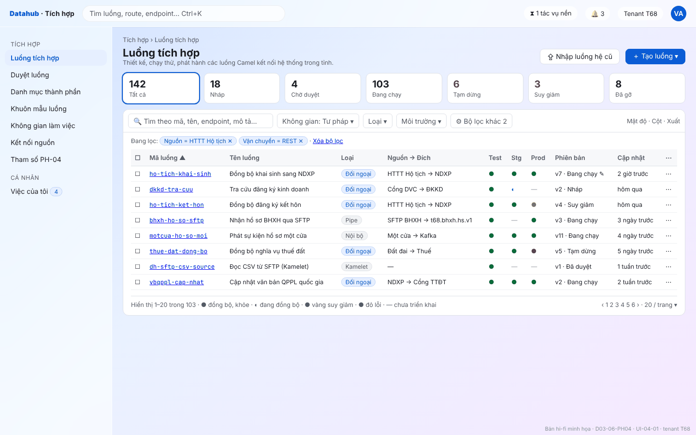

Ảnh cho thấy thanh đếm theo trạng thái ở đầu trang, dải điều kiện đang lọc và cột Test, Stg, Prod với chấm trạng thái triển khai; dòng `ho-tich-ket-hon` có chấm vàng ở PROD (suy giảm), `thue-dat-dong-bo` chấm đỏ (tạm dừng, lỗi). Mọi chấm có nhãn chữ trong chú giải cuối bảng.

## 8. UI-04-02 Chi tiết luồng

Trang chi tiết gom mọi thông tin của một luồng vào một chỗ, thẻ môi trường đặt trên cùng vì đó là câu hỏi đầu tiên của người vận hành.

::: dac-ta
**Mục đích.** Một trang cho mọi thứ về một luồng: thông tin, route, điểm kết nối, thuộc tính, sơ đồ, mã nguồn, phiên bản, triển khai ở từng môi trường, chạy thử, giám sát, lịch sử.

**Người dùng chính.** Mọi vai trò có `PERM-04-read`; IA, TA, TO, SO dùng thanh hành động phát hành, tạm dừng.

**FR hiện thực.** FR-04-002, 004, 006, 033, 043, 050…053, 083.

**Thay hệ cũ.** Màn chi tiết agent và các tab route của Bus (LGC-BUS-006…008, 015–027).

**Đường dẫn.** `/tich-hop/luong/:ma?tab=`.

**Mẫu.** PTN-02.

**Quyền.** `PERM-04-read` + quyền xem không gian (khi `04.workspace.enforce` bật); từng nút theo mục 8.2.

**API.** API-04-012 (chi tiết luồng), 013 (sửa thông tin), 016 (phụ thuộc), 024 (danh sách phiên bản), 041 (lần chạy thử), 054 (triển khai theo môi trường), 060 (tình trạng runtime), 061 (lệnh điều khiển), 062 (điểm kết nối), 063 (số liệu nhúng PH-13), 091 (lịch sử, lấy từ PH-13).

**Trạng thái đối tượng.** Nhãn luồng, phiên bản, triển khai và lệnh điều khiển (mục 5.1).

**Trạng thái màn.** ST-01, ST-02, ST-05 (ERR-04-001), luồng đã gỡ, lệnh đang xử lý (mục 8.4).

**Thông báo.** ERR-04-001, 017 (gỡ còn phụ thuộc), 023 (thứ tự môi trường), 024 (lệnh chưa xác nhận), 025 (thiếu lý do), 041 (đóng băng).
:::

### 8.1. Wireframe

```
  Tích hợp › Luồng tích hợp › Đồng bộ khai sinh sang NDXP
  ┌──────────────────────────────────────────────────────────────────────────────────────────┐
  │ 🔀 Đồng bộ khai sinh sang NDXP   ho-tich-khai-sinh ⧉   [Đang chạy] [Đối ngoại]           │
  │ Không gian: Tư pháp · Chủ sở hữu: Nguyễn V. A · HTTT Hộ tịch → Nền tảng NDXP              │
  │                       [✎ Mở trình thiết kế] [▶ Chạy thử] [⇡ Phát hành ▾] [⏸ Tạm dừng ▾] [⋯]│
  │ ┌ TEST ─────────────┐ ┌ STAGING ──────────┐ ┌ PROD ─────────────────────────────┐        │
  │ │ v8 · Đồng bộ, khỏe│ │ v7 · Đồng bộ, khỏe│ │ v7 · Đồng bộ, khỏe · 3/3 bản sao │        │
  │ │ 10 phút trước     │ │ 2 ngày trước      │ │ 2 ngày trước · 1.204 bản tin/giờ │        │
  │ └───────────────────┘ └───────────────────┘ └───────────────────────────────────┘        │
  └──────────────────────────────────────────────────────────────────────────────────────────┘
  Tổng quan │ Sơ đồ │ Route 2 │ Điểm kết nối 5 │ Thuộc tính │ Mã nguồn │ Phiên bản 8 │ Triển khai │ Chạy thử │ Giám sát │ Lịch sử
  ─────────────────────────────────────────────────────────────────────────────────────────────
  (nội dung tab, nền đặc)
```

Thẻ môi trường (`CMP-EnvCard`) là thông tin quan trọng nhất của trang: phiên bản đang chạy ở đâu và có khỏe không. Số thẻ theo `04.env.stages` (mặc định `TEST,PROD`; tỉnh có STAGING thì ba thẻ). Thẻ bấm được, mở tab Triển khai lọc theo môi trường. Thẻ có viền `color-warning-text` khi `OUT_OF_SYNC` hoặc sức khỏe `DEGRADED`, viền `color-error-text` khi `FAILED` hoặc `DOWN`, kèm dòng chữ nêu lý do.

### 8.2. Thanh hành động tiêu đề

| Nút | Điều kiện hiện | Điều kiện bật | Hành vi |
|---|---|---|---|
| Mở trình thiết kế | `PERM-04-read` | Luôn | Mở UI-04-04 với phiên bản mở nếu có; nếu không, mở phiên bản đang chạy ở PROD (hoặc mới nhất) chỉ đọc, kèm nút "Tạo phiên bản mới" cho người có `PERM-04-update` (FR-04-010, 011) |
| Chạy thử | `PERM-04-update` | Phiên bản mở không có lỗi mức `ERROR` ở `DESIGN` | Mở UI-04-04 với drawer UI-04-11 |
| Phát hành ▾ | `PERM-04-publish` hoặc `PERM-04-promote` | Có phiên bản `APPROVED` chưa ở môi trường kế tiếp | Mục theo `04.env.stages`: "Lên TEST", "Thăng cấp lên STAGING", "Thăng cấp lên PROD" (UI-04-15) |
| Tạm dừng ▾ | `PERM-04-operate` hoặc `PERM-04-emergency-stop` | Có triển khai `SYNCED` ở môi trường chọn | Mục: "Tạm dừng ở {env}…", "Tiếp tục ở {env}…" (`operate`), "Dừng khẩn ở {env}…" (`emergency-stop`, màu nguy hiểm) |
| ⋯ | | | "Sửa thông tin" (FR-04-004), "Nhân bản", "Tải YAML", "Tải gói luồng", "Lưu làm khuôn mẫu" (TA, PA), "Xem nhật ký trên PH-13", "Gỡ luồng" (`PERM-04-delete`) |

: UI-04-02 · Thanh hành động tiêu đề

### 8.3. Các tab

| Tab | Nội dung | Thành phần chính | LGC, FR |
|---|---|---|---|
| Tổng quan | Mô tả, HTTT nguồn, đích, vận chuyển (`SYNC`, `ASYNC`, `SCHEDULED`, `MIXED`, suy từ chặng đầu), đối ngoại hay nội bộ, nhãn, khối "Thông tin thêm"; khối **Phụ thuộc**: luồng con, Kamelet, kết nối PH-05, topic PH-10, lược đồ, bảng mã PH-07, API PH-02 dùng luồng làm backend (`CMP-DependencyGraph` thu gọn) | `CMP-DescriptionList`, `CMP-DependencyGraph` | BUS-006, 017, 024; FR-04-002, 004 |
| Sơ đồ | Sơ đồ của phiên bản đang chạy ở môi trường chọn, chỉ đọc; phủ số liệu chạy thật 15 phút, 1 giờ, 24 giờ (số bản tin, tỷ lệ lỗi, p95 theo chặng) | `CMP-FlowCanvas` readOnly | BUS-022; FR-04-033 |
| Route | Bảng route: `id`, mô tả, điểm vào, trạng thái theo nhịp tim ở từng môi trường, số bản tin, lỗi, nút tạm dừng, tiếp tục route | `CMP-DataTable` | BUS-008, 018, 026; FR-04-050 |
| Điểm kết nối | Endpoint đã chỉ mục: vai trò (vào, ra), lược đồ URI (`platform-http`, `kafka`, `sql`…), URI đã che tham số, kết nối PH-05, số liệu từ PH-13 | `CMP-DataTable` | BUS-020, 027, 028; FR-04-052 |
| Thuộc tính | Thuộc tính cấp tệp và biến môi trường `{{dh.env.*}}` theo TEST, STAGING, PROD; tham chiếu `{{conn:…}}`, `{{vault:…}}` hiện như thẻ, không bao giờ hiện giá trị bí mật | `CMP-DataTable` | BUS-021; FR-04-002, 084 |
| Mã nguồn | YAML chuẩn hóa của phiên bản chọn, chỉ đọc, nút sao chép, tải | `CMP-CodeEditor` readOnly | BUS-023; FR-04-002, 027 |
| Phiên bản | Bảng phiên bản: số, trạng thái, người tạo, người đóng góp, người duyệt, ghi chú thay đổi, ngày; chọn hai dòng → "So sánh" | `CMP-DataTable` + `CMP-Timeline` | FR-04-011, 043 |
| Triển khai | Triển khai và lệnh điều khiển theo môi trường; chi tiết lệnh hiện bản sao đã xác nhận | `CMP-DataTable` + `CMP-Drawer` | FR-04-042, 044, 045, 050; mục 20 |
| Chạy thử | 10 lần gần nhất và liên kết "Xem tất cả" (UI-04-12); danh sách ca kiểm thử | `CMP-DataTable` | FR-04-031, 032 |
| Giám sát | Bảng điều khiển PH-13 nhúng, lọc theo luồng: lượng bản tin theo giây, lỗi, độ trễ, CPU, bộ nhớ từng bản sao, biểu đồ theo route | `CMP-EmbeddedDashboard` | BUS-007, 015, 016, 019; FR-04-051, 053 |
| Lịch sử | Sự kiện thay đổi: tạo, lưu (gộp 10 phút), gửi duyệt, duyệt, phát hành, lệnh; ai, khi nào, lý do | `CMP-AuditTrail` | FR-04-083 |

: UI-04-02 · Các tab

### 8.4. Trạng thái màn

Không tìm thấy hoặc không có quyền đối tượng: ST-05 với ERR-04-001 (không phân biệt hai trường hợp). Luồng `RETIRED`: banner "Luồng đã gỡ ngày {date} bởi {user}. Lý do: {reason}." và mọi hành động chỉnh sửa ẩn, chỉ còn "Nhân bản". Có lệnh điều khiển đang xử lý: thẻ môi trường hiện "Đang tạm dừng… 2/3 bản sao đã xác nhận" và nút "Tạm dừng", "Tiếp tục" vô hiệu kèm lý do.

### 8.5. Bản hi-fi

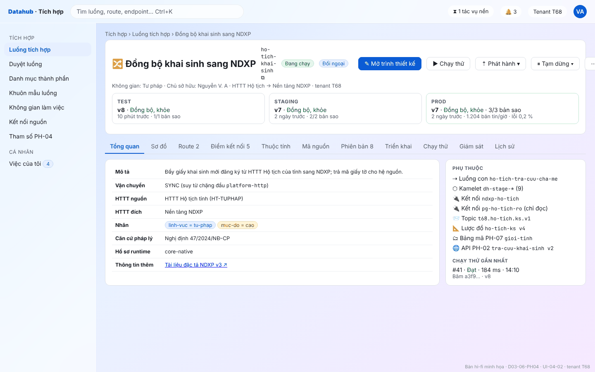

Ba thẻ môi trường nằm ngay dưới tiêu đề nói phiên bản nào chạy ở đâu và có khỏe không; thanh hành động theo quyền ở góc phải; tab Tổng quan có khối Phụ thuộc liệt kê kết nối, topic `t68.*`, lược đồ, bảng mã và API dùng luồng.

## 9. UI-04-03 Tạo luồng

Trình hướng dẫn ba bước dẫn kỹ sư tích hợp từ chọn điểm xuất phát tới khi luồng mở trong trình thiết kế.

::: dac-ta
**Mục đích.** Tạo luồng mới đủ thông tin quản lý ngay từ đầu, xuất phát từ khuôn mẫu để có sẵn chín chặng chuẩn.

**Người dùng chính.** IE.

**FR hiện thực.** FR-04-003, 005, 025.

**Thay hệ cũ.** Hộp thêm project của Tooling (LGC-TOOL-002) và hộp thêm chương trình có kiểm tra kết nối (LGC-BUS-013).

**Đường dẫn.** `/tich-hop/luong/moi?buoc=`.

**Mẫu.** PTN-05, ba bước.

**Quyền.** `PERM-04-create` và mức `EDIT` ở ít nhất một không gian (khi `04.workspace.enforce` bật).

**API.** API-04-011 (tạo luồng), API-04-080, 081 (khuôn mẫu), API-04-027 (nhập YAML), API-04-014 (nhân bản), API-04-030 (kiểm tra sơ bộ).

**Trạng thái đối tượng.** Luồng mới ở `DRAFT`, phiên bản v1 `DRAFT`.

**Trạng thái màn.** ST-01 khi nạp khuôn; ST-06 khi không có không gian `EDIT`; ST-10 khi rời giữa chừng (mục 9.3).

**Thông báo.** ERR-04-002 (trùng mã), 008 (YAML lỗi cú pháp), 027 (không gian không tồn tại), 033 (YAML quá lớn), 039 (khuôn không dùng được); thành công: "Đã tạo luồng {tên}. Phiên bản v1 sẵn sàng để thiết kế."
:::

### 9.1. Wireframe bước 1

```
  Tạo luồng tích hợp                                                                       ✕ Hủy
  ① Điểm xuất phát ──── ② Thông tin luồng ──── ③ Xem lại và tạo
  ┌──────────────────┐ ┌──────────────────┐ ┌──────────────────┐ ┌──────────────────┐ ┌──────────────────┐
  │ ▦ Từ khuôn mẫu   │ │ ⇄ Từ API         │ │ ◻ Luồng trống    │ │ ⇪ Nhập YAML      │ │ ⧉ Nhân bản       │
  │ Có sẵn 9 chặng   │ │ Chọn API trong   │ │ Chỉ có điểm vào  │ │ Từ tệp           │ │ Sao chép luồng   │
  │ chuẩn            │ │ danh mục PH-02   │ │                  │ │ .camel.yaml      │ │ đã có            │
  │ ✓ Khuyên dùng    │ │                  │ │                  │ │                  │ │                  │
  └──────────────────┘ └──────────────────┘ └──────────────────┘ └──────────────────┘ └──────────────────┘
  Khuôn mẫu  [🔍 Tìm khuôn mẫu…]   [Tất cả] [Tra cứu đồng bộ] [Đồng bộ định kỳ] [Nhận sự kiện] [Tệp] [Quốc gia]
  ┌ tpl-sync-lookup ──────────┐ ┌ tpl-db-poll-to-kafka ─────┐ ┌ tpl-sftp-to-kafka ────────┐
  │ Tra cứu đồng bộ REST      │ │ Đọc định kỳ CSDL → Kafka  │ │ SFTP định kỳ → Kafka      │
  │ [sơ đồ thu nhỏ 9 chặng]   │ │ [sơ đồ thu nhỏ]           │ │ [sơ đồ thu nhỏ]           │
  │ Dùng 34 lần · Đối ngoại   │ │ Dùng 12 lần · Nội bộ      │ │ Dùng 7 lần · Đối ngoại    │
  └───────────────────────────┘ └───────────────────────────┘ └───────────────────────────┘
                                                                          [Tiếp tục →]
```

Thẻ điểm xuất phát là `CMP-RadioCard` (nhóm radio, mũi tên chuyển lựa chọn). "Từ API": vùng dưới là `CMP-Select` tìm API trong danh mục dịch vụ PH-02 mà người dùng được xem; luồng sinh ra có `rest` DSL, mỗi thao tác một route `direct:{operationId}` có khung chín chặng và lược đồ gắn vào chặng `schema` (FR-04-003 mục 3). "Nhập YAML": `CMP-Upload` biến thể `dropzone` nhận `.yaml`, `.yml`, `.camel.yaml` tối đa `04.flow.max-definition-kb` (mặc định 512 KB), kiểm tra cú pháp ngay khi thả, hiện số route, Kamelet và lỗi. "Nhân bản": `CMP-Select` tìm luồng và phiên bản (FR-04-005). Ngoài luồng loại `ROUTE`, bước 1 cho chọn loại tài nguyên `KAMELET` hoặc `PIPE` qua liên kết "Tạo Kamelet hoặc Pipe".

### 9.2. Trường bước 2

| Trường | Kiểu | Bắt buộc | Kiểm tra | Mặc định, gợi ý |
|---|---|---|---|---|
| Tên luồng | `Input` | Có | 1–255 ký tự, chuẩn hóa NFC | Từ khuôn mẫu: "{tên khuôn} – " |
| Mã luồng | `Input` | Có | `^[a-z][a-z0-9-]{2,62}$`, không dùng tiền tố dành riêng `dh-`, `sys-`, `platform-`; duy nhất trong tenant kể cả luồng đã gỡ trong 30 ngày (kiểm tra trực tuyến qua API-04-010 `code=`, trễ 400 ms, hiện ✓ hoặc ERR-04-002); không đổi được sau khi tạo (BR-04-001), ô có ghi chú này | Tự sinh từ tên, bỏ dấu, nối gạch; sửa tay thì ngừng tự sinh |
| Không gian làm việc | `Select` | Có | Không gian người dùng có `EDIT` | Không gian gần nhất |
| HTTT nguồn | `Select` từ PH-01 | Không | | Có nguồn hoặc đích là HTTT thành viên thì luồng là đối ngoại |
| HTTT đích | `Select` nhiều chọn từ PH-01 | Không | | |
| Đối ngoại / nội bộ | Hiển thị suy ra, không sửa | — | | Dòng chữ: "Luồng đối ngoại: bắt buộc đủ chín chặng chuẩn khi gửi duyệt (BR-04-002)" |
| Mô tả | `TextArea` | Không | ≤ 4.000 ký tự | |
| Căn cứ pháp lý | `Select` nhiều chọn từ danh mục văn bản PH-07 | Khi `04.flow.require-legal-basis` bật và luồng đối ngoại (tham số đề xuất, mục 25) | | |
| Nhãn | `CMP-KeyValueEditor` | Không | Tối đa 20 cặp; khóa `^[a-z0-9.-/]{1,63}$` | Ví dụ `linh-vuc` = `tu-phap` |
| Liên kết tài liệu | Danh sách URL | Không | Tối đa 10 URL `https` | |
| Tham số khuôn mẫu `${tpl.*}` | Biểu mẫu sinh từ lược đồ JSON của khuôn | Theo khuôn | Theo khuôn | Ví dụ "Đường dẫn nhận", "Kết nối đích" (chọn từ PH-05) |

: UI-04-03 · Trường bước 2

Hồ sơ runtime không chọn ở đây: được gán khi phát hành theo thành phần luồng dùng (ADR-063); trình thiết kế hiện hồ sơ dự kiến. Bước 3 hiện tóm tắt, sơ đồ xem trước (canvas chỉ đọc, thu nhỏ) và kết quả kiểm tra mức `DESIGN`. Nút "Tạo và mở trình thiết kế" (chính) và "Tạo" (phụ). Tạo thành công: thông báo "Đã tạo luồng {tên}. Phiên bản v1 sẵn sàng để thiết kế." và chuyển tới UI-04-04.

### 9.3. Trạng thái

Không có khuôn mẫu nào ngoài khuôn nền: vùng khuôn mẫu vẫn hiện tám khuôn nền của FR-04-025. Người dùng không có không gian `EDIT`: nút Tạo bị ẩn ở UI-04-01; vào thẳng bằng URL nhận ST-06. Rời trình hướng dẫn giữa chừng: ST-10.

### 9.4. Bản hi-fi

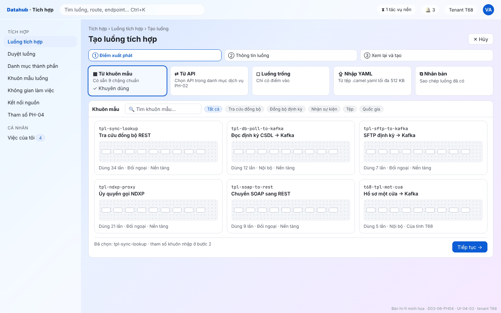

Năm thẻ điểm xuất phát dạng radio, "Từ khuôn mẫu" được chọn sẵn và gắn nhãn khuyên dùng; lưới khuôn mẫu bên dưới có sơ đồ thu nhỏ chín chặng, phạm vi Nền tảng hoặc Của tỉnh T68.

## 10. UI-04-04 Trình thiết kế luồng

Đây là màn quan trọng nhất của PH-04 và được viết ở mức siêu chi tiết: lưới bố cục, sáu vùng đánh số ①…⑥, giải phẫu từng phần tử, mọi trạng thái, tương tác chuột, bàn phím và trợ năng. Khối đặc tả dưới là bản tóm tắt để tra nhanh; nội dung đầy đủ ở các mục 10.1…10.23.

::: dac-ta
**Mục đích.** Nơi kỹ sư tích hợp vẽ, cấu hình, kiểm tra, chạy thử và gửi duyệt một phiên bản luồng; sơ đồ và YAML là hai cách nhìn của cùng một mô hình Camel YAML DSL.

**Người dùng chính.** IE (sửa, chạy thử, gửi duyệt); mọi vai trò có `PERM-04-read` (xem chỉ đọc).

**FR hiện thực.** FR-04-010…017, 021…024, 026, 027, 033 (phủ kết quả), 040 (gửi duyệt).

**Thay hệ cũ.** Vùng thiết kế, thanh Component, thanh Properties, tab Source của Tooling (LGC-TOOL-001, 003…026, 029).

**Đường dẫn.** `/tich-hop/luong/:ma/thiet-ke` với `phien-ban`, `thuc-the`, `chang`, `che-do`, `lan-chay`, `lop` (mục 4.2).

**Mẫu.** PTN-07 Designer (canvas), sáu vùng ①…⑥ (mục 10.2, 10.3).

**Quyền.** Xem `PERM-04-read`; sửa và chạy thử `PERM-04-update` + mức `EDIT`; gửi duyệt `PERM-04-submit`.

**API.** API-04-020…027, 030, 032, 034, 040…044, 050, 051, 070, 071; PH-05, PH-06, PH-07, PH-10 (chi tiết mục 10.1).

**Trạng thái đối tượng.** Phiên bản `DRAFT`, `CHANGES_REQUESTED` sửa được; trạng thái khác chỉ đọc (mục 10.15); chỉ báo lưu năm trạng thái (mục 10.4 vị trí 4).

**Trạng thái màn.** ST-01 skeleton ba chặng, ST-07 chỉ đọc, ST-08 xung đột, ST-09 mất kết nối, ST-10 rời trang, ST-12 phiên sắp hết hạn; trạng thái chặng ở mục 10.7.3.

**Thông báo.** ERR-04-006, 008, 009, 010, 011, 012, 013, 014, 016, 031, 033, 034, 037, 042 (mục 5.3); gợi ý LINT-04-01…06 (mục 10.12).

**Bàn phím, trợ năng.** Mọi thao tác làm được bằng bàn phím (mục 10.9.3, 10.13); chế độ danh sách thay canvas cho trình đọc màn hình (mục 10.18); tiêu chí nghiệm thu mục 10.23.
:::

### 10.1. Mục đích và phạm vi

Nơi kỹ sư tích hợp vẽ, cấu hình, kiểm tra, chạy thử và gửi duyệt một phiên bản luồng. Mô hình là Camel YAML DSL (ADR-062); sơ đồ và YAML là hai cách nhìn của cùng một mô hình, sửa bên nào bên kia cập nhật (FR-04-012). Trình thiết kế dựng lại mô hình của Kaoto trong React 19 + XYFlow (ADR-060), catalog lấy từ `@kaoto/camel-catalog` đúng phiên bản runtime (ADR-061).

Một tệp luồng có thể chứa nhiều thực thể: route, `routeConfiguration`, `rest`, Kamelet, Pipe, bean, thuộc tính cấp tệp. Trình thiết kế mở một thực thể trên canvas tại một thời điểm; thanh thực thể ② chuyển giữa chúng.

**FR phủ.** FR-04-010…017, 021…024, 026, 027, 033 (phủ kết quả), 040 (gửi duyệt); mở UI-04-05…13. **LGC.** LGC-TOOL-001, 003…026, 029. **Quyền.** Xem: `PERM-04-read`; sửa và chạy thử: `PERM-04-update` + mức `EDIT` trên không gian; gửi duyệt: `PERM-04-submit`.
**API.** API-04-020 (đọc phiên bản: định nghĩa, bố cục, bản tin mẫu, `catalogVersion`, ETag), 021 (tạo phiên bản mới), 022 (lưu nháp, `If-Match`), 023 (hủy nháp), 024 (danh sách phiên bản), 026, 027 (tải, nhập YAML), 030 (kiểm tra hợp lệ theo mức), 032 (kiểm tra, xem trước biểu thức), 034 (nhịp phiên soạn 30 s), 040…044 (chạy thử), 050 (gửi duyệt), 051 (rút lại), 070 (chỉ mục catalog theo `catalogVersion`, đã lọc chính sách tenant), 071 (lược đồ thuộc tính một thành phần); PH-05 (kết nối khả dụng), PH-06 (lược đồ), PH-07 (bảng mã), PH-10 (topic).

### 10.2. Wireframe tổng thể (màn 1440 × 900)

```
┌① DesignerToolbar (đặc, cao 48) ──────────────────────────────────────────────────────────────────────────────────────┐
│ ‹  Đồng bộ khai sinh sang NDXP  v8 [Bản nháp] ▾   ● Đã lưu 14:02   │ Tệp▾ Sửa▾ Xem▾ │ ↶ ↷ │ [Sơ đồ|YAML|Chia đôi] │
│                                                                    │ ⚠ 2 ✕ 1 │ ▶ Chạy thử ▾ │ ⇪ Gửi duyệt │ 👥 A,B │ ⛶ │
├② EntityRail (đặc, cao 36) ───────────────────────────────────────────────────────────────────────────────────────────┤
│ [⇢ route: nhan-khai-sinh ✕1] [⇢ route: goi-ndxp] [⚙ routeConfiguration] [⬡ bean 2] [≡ Thuộc tính tệp]  ＋ Thêm ▾     │
├③ NodePalette (đặc, 280) ──┬④ FlowCanvas (đặc solid-2, linh hoạt) ─────────────────────────┬⑤ Inspector (đặc, 360) ──┤
│ 🔍 Tìm thành phần… Ctrl+P │  · · · · · · · · · · · · · · · · · · · · · · · · · · · · · · │ ⇢ Gọi hộ tịch            │
│ [Nghiệp vụ|Thành phần|EIP │  ┌──────────────────┐                                         │ to · http  [Tài liệu ↗]  │
│  |Kamelet] [☰|▦]          │  │▌⤓ Nhận yêu cầu   │ dh-stage-receive                        │ ───────────────────────  │
│ ★ Hay dùng                │  │  platform-http   │                                         │ [Cơ bản|Nâng cao|Lỗi|    │
│  ▣ Gọi REST               │  └────────┬─────────┘                                         │  Mô tả]  ⤢ Mở rộng       │
│  ▣ Ánh xạ dữ liệu         │           ⊕                                                   │ Kết nối *                │
│ ▸ Điểm vào          7     │  ┌────────▼─────────┐                                         │ [ndxp-ho-tich ▾] ⓘ PH-05 │
│ ▾ Định tuyến        9     │  │▌✓ Kiểm lược đồ   │                                         │ Đường dẫn *              │
│  ◆ Rẽ nhánh (choice)      │  └────────┬─────────┘                                         │ [/api/v1/khai-sinh  ] ƒx │
│  ◆ Lọc (filter)           │           ⋮  (7 chặng)                                        │ Phương thức              │
│  ◆ Tách (split)           │  ┌────────▼─────────┐  ┌ choice ─────────────────────┐        │ [POST ▾]                 │
│ ▸ Chuyển đổi dữ liệu 14   │  │▌◆ Rẽ nhánh  ⚠1   │──┤ when ${header.loai}=='KS'  │        │ Thời gian chờ (ms)       │
│ ▸ Kết nối CSDL       4    │  └──────────────────┘  │ ┌▌⇢ Gọi hộ tịch ✕2 ┐ ◀chọn │        │ [10000  ] mặc định 30000 │
│ ▸ Mạng              11    │                        │ └──────────────────┘       │        │ ⟲ Khôi phục mặc định     │
│ ▸ Hàng đợi bản tin   6    │                        │ otherwise                   │        │ ───────────────────────  │
│ ▸ Lập lịch           3    │                        │ ┌▌✎ Ghi nhật ký     ┐      │        │ ✕ Thiếu kết nối hợp lệ   │
│ ▸ Bảo mật            5    │                        │ └──────────────────┘       │        │ ⚠ Thời gian chờ > SLA    │
│ ▸ Chặng chuẩn Datahub 9   │                        └────────────────────────────┘        │                          │
│ ─────────────────────     │ ┌glass-overlay┐                         ┌glass-overlay──────┐│                          │
│ 751 thành phần · 612 được │ │ − 85% + ⤢ ⊡ │                         │ ▭ minimap          ││                          │
│ phép · catalog 3.33.1     │ └─────────────┘                         └───────────────────┘│                          │
├⑥ BottomPanel (đặc, cao 220, thu được) ───────────────────────────────────────────────────┴──────────────────────────┤
│ [Vấn đề 3] [Kết quả chạy] [Nhật ký] [Lịch sử sửa]                                                     ⌄ Thu gọn     │
│ ✕ ERR-04-013  Gọi hộ tịch · Kết nối    Kết nối "ndxp-ho-tich" chưa được cấp cho không gian Tư pháp.  [Đi tới]       │
│ ⓘ LINT-04-03  Gọi hộ tịch · Thời gian  Thời gian chờ 10.000 ms lớn hơn SLA dịch vụ 5.000 ms.          [Đi tới]       │
│ ⓘ LINT-04-01  Rẽ nhánh                Nhánh "otherwise" chỉ ghi nhật ký, bản tin sẽ không được trả lời. [Đi tới]    │
└──────────────────────────────────────────────────────────────────────────────────────────────────────────────────────┘
```

### 10.3. Lưới bố cục và kích thước

| Vùng | Mặc định | Tối thiểu | Tối đa | Thu gọn | Lưu |
|---|---|---|---|---|---|
| ① Thanh công cụ | cao 48 px | — | — | Không | — |
| ② Thanh thực thể | cao 36 px | — | — | Ẩn khi tệp chỉ có một route và không có thực thể khác (tự hiện khi thêm) | — |
| ③ Bảng thành phần | rộng 280 px | 220 | 420 | Thành dải 48 px chỉ có biểu tượng nhóm (phím `Ctrl+B`) | `dh.int.designer.palette.width`, `.collapsed` |
| ④ Canvas | phần còn lại | 480 | — | — | Thu phóng, vị trí theo `{flow}/{entity}` |
| ⑤ Inspector | rộng 360 px | 300 | 560 | Ẩn khi không chọn chặng nào (hiện thông tin route); `Ctrl+I` bật tắt | `dh.int.designer.inspector.width` |
| ⑥ Bảng dưới | cao 220 px | 120 | 60 % chiều cao | Thành thanh 32 px hiện số vấn đề (`Ctrl+J`) | `dh.int.designer.bottom.height`, `.tab` |

: UI-04-04 · Lưới bố cục và kích thước

Ngăn đổi kích thước bằng tay nắm `CMP-Splitter` rộng 4 px (vùng nhận 8 px), focus được bằng Tab, đổi bằng phím mũi tên 16 px mỗi lần, `Shift`+mũi tên 64 px, nhấp đúp trả về mặc định. Ở chế độ toàn màn hình (`F11` của trình duyệt hoặc nút ⛶), khung ứng dụng ẩn; ① vẫn hiện; thoát bằng `Esc` hoặc thanh nổi `CMP-FullscreenBar`.

### 10.4. ① Thanh công cụ

| Vị trí | Điều khiển | Kiểu | Hành vi | Quyền, trạng thái | Phím |
|---|---|---|---|---|---|
| 1 | Quay lại ‹ | `Button` icon | Về UI-04-02 (hoặc trang trước nếu cùng PH-04); chưa lưu thì ST-10 | | `Alt+←` |
| 2 | Tên luồng | `Typography` có nút sửa ✎ khi rê | Sửa tên tại chỗ (3–200 ký tự); `Enter` lưu, `Esc` hủy | `PERM-04-update` | |
| 3 | Phiên bản và trạng thái ▾ | `Dropdown` | Danh sách phiên bản với nhãn trạng thái; mục "So sánh với phiên bản đang chạy ở PROD", "Tạo phiên bản mới từ phiên bản này" (FR-04-011), "Hủy bản nháp" (FR-04-006, có xác nhận) | | |
| 4 | Chỉ báo lưu | `CMP-SaveIndicator` | Một trong: "● Chưa lưu" (chấm `color-warning-text`), "⟳ Đang lưu…", "✓ Đã lưu {HH:mm}", "⚠ Lưu lỗi · Thử lại", "⊘ Chưa lưu lên máy chủ (mất kết nối)", "🔒 Chỉ đọc" | | |
| 5 | Menu Tệp | `Dropdown` | Lưu (`Ctrl+S`); Tải YAML (`Ctrl+Shift+S`); Tải YAML kèm bố cục (`# @dh-canvas-v1:`); Tải gói luồng `{flow}-v{n}.dhflow.zip` (YAML, bố cục, ánh xạ, ca kiểm thử, README; bản tin mẫu chỉ khi chọn rõ và có `PERM-04-sample-data`); Nhập YAML vào phiên bản này… (thay toàn bộ, có xác nhận và hoàn tác); Thuộc tính tệp; Hồ sơ runtime dự kiến; Lịch sử phiên bản (FR-04-027) | | |
| 6 | Menu Sửa | `Dropdown` | Hoàn tác, Làm lại, Cắt, Sao chép, Dán, Nhân đôi, Xóa, Chọn tất cả, Tìm trong luồng (`Ctrl+F`), Thay thế giá trị tham số…, Xóa nội dung route (LGC-TOOL-017, có xác nhận) | | |
| 7 | Menu Xem | `Dropdown` | Bảng thành phần, Inspector, Bảng dưới (bật tắt); Hướng sơ đồ: Dọc ↓ / Ngang →; Tự sắp xếp (`Shift+L`); Hiện mã chặng (`id`); Hiện mô tả chặng; Hiện chặng chuẩn dạng thu gọn; Chế độ danh sách (a11y, mục 10.18); Mật độ | | |
| 8 | Hoàn tác ↶, làm lại ↷ | `Button` icon | Ngăn xếp tối thiểu 100 bước của phiên soạn (mục 10.20); tooltip nêu bước: "Hoàn tác: Xóa chặng Ghi nhật ký" | Vô hiệu khi rỗng | `Ctrl+Z`, `Ctrl+Shift+Z`/`Ctrl+Y` |
| 9 | Chế độ | `CMP-SegmentedControl` | Sơ đồ / YAML / Chia đôi (mục 10.14) | | `Ctrl+1`, `Ctrl+2`, `Ctrl+3` |
| 10 | Bộ đếm vấn đề | `Button` text | "✕ {lỗi} ⚠ {cảnh báo}"; bấm mở ⑥ tab Vấn đề. Không có vấn đề: "✓ Hợp lệ" màu `color-success-text` | | `F8` tới vấn đề kế, `Shift+F8` trước |
| 11 | Chạy thử ▾ | `Dropdown.Button` | Phần chính: chạy lại với thiết lập lần trước (hoặc mở UI-04-11 nếu chưa có); mũi tên: "Chạy với bản tin…", "Chạy ca kiểm thử…", "Chạy tất cả ca kiểm thử", "Xem lịch sử chạy thử" | `PERM-04-update`; vô hiệu khi còn lỗi `ERROR` ở mức `DESIGN` (tooltip ERR-04-009); tự lưu trước khi chạy | `F5`; `Shift+F5` mở drawer |
| 12 | Gửi duyệt | `Button` primary | Mở hộp gửi duyệt (mục 10.21). Đổi thành "Rút lại" khi phiên bản `PENDING_REVIEW` và người dùng là người gửi | `PERM-04-submit`; vô hiệu kèm lý do khi: còn lỗi `ERROR` ở mức `SUBMIT`, chưa lưu, chưa có lần chạy thử `PASSED` không mô phỏng cho đúng băm định nghĩa, còn ca kiểm thử chưa đạt (BR-04-004) | `Ctrl+Shift+Enter` |
| 13 | Người đang mở | `CMP-AvatarGroup` | Ảnh đại diện người khác đang có phiên soạn trên cùng phiên bản (tối đa 3 + "+n"), tooltip "{tên} mở từ {giờ}"; khi có người khác, cạnh nhóm ảnh hiện chữ "Đang có {n} người khác mở luồng này" (FR-04-010) | | |
| 14 | Toàn màn hình ⛶ | `Button` icon | | | `Ctrl+Shift+F` |

: UI-04-04 · ① Thanh công cụ

Khi chiều rộng dưới 1280 px, mục 5–7 gộp vào một menu "☰", nhãn "Chạy thử", "Gửi duyệt" chỉ còn biểu tượng có `aria-label`.

### 10.5. ② Thanh thực thể

Mỗi thực thể là một tab `CMP-EntityTab` gồm biểu tượng loại, nhãn "{loại}: {id}", huy hiệu số lỗi nếu có, nút ✕ (xóa thực thể, có xác nhận, chỉ khi không phải thực thể duy nhất). Thứ tự theo thứ tự trong YAML; kéo tab để đổi thứ tự (thay đổi thứ tự trong YAML, hoàn tác được). Nhấp đúp nhãn để đổi `id`.

| Loại thực thể | Biểu tượng | Mở bằng | Ghi chú |
|---|---|---|---|
| route | `ArrowRightLeft` | Canvas | |
| routeTemplate | `LayoutTemplate` | Canvas có tham số mẫu | Chỉ người có `PERM-04-catalog-admin` (khuôn mẫu nền) hoặc TA (khuôn của tenant) |
| routeConfiguration | `Settings2` | Biểu mẫu (UI-04-10 dạng nhúng), có canvas nhỏ cho `onException` | `dh-default-config` có sẵn, khóa, chỉ xem |
| rest | `Webhook` | Bảng phương thức REST + canvas `to direct:` | |
| Kamelet | `Hexagon` | Chế độ Kamelet (UI-04-08) | |
| Pipe | `Cable` | Chế độ Pipe (UI-04-09) | |
| beans | `Package` | Bảng bean (UI-04-10) | Gộp mọi bean thành một tab |
| Thuộc tính tệp | `ListTree` | Bảng thuộc tính (UI-04-10) | |

: UI-04-04 · ② Thanh thực thể

"＋ Thêm ▾" mở menu: Route mới, Route từ khuôn mẫu…, REST, routeConfiguration, Bean. Route mới có sẵn điểm vào `direct:{id}` và được chọn ngay. Chuyển qua lại giữa các thực thể giữ nguyên vị trí và mức thu phóng của từng sơ đồ (FR-04-013). Thanh thực thể đặt ngang trên canvas thay cho danh sách dọc bên trái mà FR-04-013 mô tả, để trả chiều rộng cho bảng thành phần; nội dung và hành vi giữ đúng FR.

### 10.6. ③ Bảng thành phần

#### 10.6.1. Cấu trúc

| Phần | Mô tả |
|---|---|
| Ô tìm | `CMP-SearchField`, focus bằng `Ctrl+P` hoặc `/` khi focus trong ③. Tìm mờ không dấu trên tên, tiêu đề, mô tả, nhãn, tên tiếng Việt, từ đồng nghĩa (ví dụ "gọi api" → `http`, `rest`; "chia" → `split`; "gộp" → `aggregate`). Kết quả xếp: khớp tên chính xác, khớp tiền tố, hay dùng, còn lại. Trễ 120 ms, chạy trong Web Worker trên chỉ mục dựng sẵn |
| Xem theo | `Select` gọn (bảy cách xem không đủ chỗ cho `Segmented` ở 280 px): **Nghiệp vụ** (mặc định, nhóm như Tooling cũ, mục 5.2), **Dùng nhiều**, **Thành phần**, **Mẫu EIP**, **Kamelet** (Kamelet tự viết của tỉnh ở đầu với huy hiệu "Của tỉnh"), **Định dạng dữ liệu**, **Ngôn ngữ biểu thức** (FR-04-012 mục 3) |
| Chế độ hiển thị | Nút ☰ danh sách (mặc định) / ▦ lưới biểu tượng 3 cột (giống Tooling cũ) |
| Nhóm "★ Dùng nhiều" | Ở đầu cách xem Nghiệp vụ: tối đa 24 thành phần dùng nhiều nhất trong các luồng của tenant 90 ngày gần nhất cộng các mục nền tảng ghim (API-04-070 trả sẵn); người dùng ghim thêm mục của riêng mình bằng ☆ (lưu cục bộ) |
| Nhóm | `Collapse` có số lượng; nhớ trạng thái mở |
| Chân | "{số} thành phần được phép · catalog {phiên bản}"; liên kết "Danh mục thành phần" (UI-04-17) và "Đề xuất thành phần mới" (FR-04-080) |
| Lọc theo vị trí chèn | Khi đang chèn chặng đầu của route, chỉ hiện thành phần làm được điểm vào (consumer, Kamelet `source`); khi chèn bước giữa, ẩn thành phần chỉ có chiều vào; khi soạn Pipe, chỉ hiện Kamelet đúng loại của ô (FR-04-012 mục 6). Dòng chú thích đầu danh sách nêu bộ lọc đang áp: "Đang hiện thành phần dùng làm điểm vào" |

: UI-04-04 · Bảng thành phần ③, cấu trúc

#### 10.6.2. Mục thành phần

```
┌▌[ic] Gọi REST                     ⓘ  ☆ ┐   ← cao 32 (danh sách) · 72×72 (lưới)
│     http · Mạng                         │
└─────────────────────────────────────────┘
```

| Trạng thái mục | Hiển thị | Tương tác |
|---|---|---|
| Bình thường | Nền đặc, chữ `color-text-primary` | Kéo được, `Enter` thêm vào sau chặng đang chọn. Thành phần có cờ "cần kết nối PH-05" (CSDL, FTP, SFTP, LDAP, MQ ngoài, HTTP tới HTTT ngoài) có biểu tượng phích cắm; thả vào sơ đồ thì mở ngay ô chọn kết nối (FR-04-012 mục 7) |
| Rê, focus | Nền `color-fill-hover`, vòng focus `color-focus-ring` 2 px | Hiện ⓘ, ☆ |
| Không hợp lệ ở vị trí đang chọn | Mờ 50 %, biểu tượng ⊘, tooltip "Chỉ dùng được làm điểm vào (from)" | Không kéo vào vị trí đó được |
| Không được phép theo chính sách (EN-04-11) | Không hiện trong bảng (FR-04-012 mục 2). Chặng đã có trên sơ đồ mà sau đó bị cấm hiện huy hiệu "Không còn được phép" và lỗi ERR-04-011 | Tìm đúng tên thì danh sách hiện một dòng "{tên} không được phép ở tỉnh · Đề xuất cho phép" |
| Không hỗ trợ native | Thẻ nhỏ "JVM"; tooltip "Thành phần chỉ chạy trong hồ sơ JVM. Luồng sẽ được gán hồ sơ JVM nếu tỉnh cho phép" | Thêm được, phát hiện VR-12 (INFO ở `DESIGN`, ERROR ở `PUBLISH` nếu tỉnh không có hồ sơ JVM) |
| Mức hỗ trợ `preview` | Thẻ "Thử nghiệm" | Thêm được |
| Mức hỗ trợ `deprecated` | Thẻ "Lỗi thời", gợi ý thay thế | Thêm được kèm cảnh báo |

: UI-04-04 · Bảng thành phần ③, trạng thái mục

Tooltip ⓘ (`CMP-Popover` `glass-overlay`, rộng 320): tiêu đề, mô tả catalog (tiếng Việt khi có bản dịch, nếu không tiếng Anh kèm nhãn "EN"), nhãn, có hỗ trợ consumer/producer, mức hỗ trợ, mức native, liên kết "Tài liệu Camel ↗" (mở `camel.apache.org` phiên bản 4.18 ở tab mới).

#### 10.6.3. Ánh xạ "Nghiệp vụ"

Cách xem Nghiệp vụ hiện mười nhóm của mục 5.2. Một thành phần thuộc nhiều nhóm (ví dụ `kafka` thuộc "Điểm vào" khi làm consumer và "Hàng đợi bản tin") được hiện ở cả hai nhóm. Bảng ánh xạ đầy đủ `nhãn catalog → nhóm nghiệp vụ` nằm trong tệp cấu hình `palette-groups.json` của console, quản trị tích hợp sửa qua UI-04-17 (D03-02-PH04 §6.3).

### 10.7. ④ Canvas

#### 10.7.1. Mô hình hiển thị

Canvas vẽ cây chặng của một route theo cách Kaoto: điểm vào (`from`) ở đầu, các chặng trong `steps` nối tuần tự **từ trái sang phải** (mặc định theo FR-04-013; người dùng đổi sang trên xuống dưới ở menu Xem). Mẫu tích hợp có nhánh (`choice`, `doTry`, `multicast`, `split`, `loop`, `filter`, `aggregate`, `circuitBreaker`, `saga`, `loadBalance`) vẽ thành **nhóm** (container) chứa các nhánh con.

Hai lớp tách bạch:

| Lớp | Là gì | Lưu ở đâu | Sửa bằng |
|---|---|---|---|
| Cấu trúc | Thứ tự chặng, nhánh, lồng nhau, tức cây tài nguyên Camel | YAML (định nghĩa đem triển khai) | Chèn, xóa, nối, thả lên cạnh, bọc, `Alt+↑↓`, YAML |
| Bố cục | Tọa độ chặng, ghim vị trí, ghi chú dán, trạng thái thu gọn nhóm, hướng sơ đồ | Cột `canvas_layout` của phiên bản, **không** vào YAML (BR-04-007, FR-04-017 mục 6) | Kéo chặng tới chỗ trống, "Tự sắp xếp", thu gọn nhóm |

: UI-04-04 · Canvas, hai lớp cấu trúc và bố cục

Cạnh luôn suy ra từ cấu trúc nên sơ đồ không bao giờ vẽ một luồng mà Camel không chạy được (khác Tooling cũ). Vị trí ban đầu do bố cục tự động dagre tính (khoảng cách 48 px giữa chặng, 64 px giữa nhánh). Người dùng kéo một chặng tới chỗ trống thì chặng đó được **ghim** tại vị trí mới (biểu tượng ghim nhỏ ở góc, bỏ ghim bằng menu ngữ cảnh); "Tự sắp xếp" (`Shift+L`) sắp lại mọi chặng chưa ghim và giữ chặng đã ghim. Kéo chặng thả lên một cạnh hoặc cuối nhánh mới là thay đổi cấu trúc (mục 10.9). Repo hiện ghi tọa độ vào chú thích `# @lgsp-canvas-v1:` trong YAML (GAP-04-06); thiết kế đích bỏ cách này, tệp tải về dạng `yaml+layout` dùng chú thích `# @dh-canvas-v1:` chỉ để mở lại trên Datahub (FR-04-027).

#### 10.7.2. Giải phẫu chặng (`CMP-FlowNode`)

```
         ┌──────────────────────────────────────┐  rộng 240, cao 56 (gọn: 200 × 40)
  cổng ○─┤▌ [ic]  Gọi hộ tịch           ✕2  ⋯  ├─○ cổng ra   ← tên: description || tiêu đề catalog
  vào    │▌       to · http · /api/v1/…        │           ← dòng phụ: loại · thành phần · tham số chính
         └──────────────────────────────────────┘
  dải nhóm 4 px ở cạnh trái · cổng hiện khi rê hoặc chọn, vùng nhận 24 × 24
```

| Phần | Nội dung | Quy tắc |
|---|---|---|
| Dải nhóm | Màu nhóm (mục 5.2) | Chặng chuẩn Datahub dùng `color-accent` và góc trên trái có huy hiệu lục giác nhỏ |
| Biểu tượng | Biểu tượng thành phần từ catalog Kaoto (SVG), nếu không có thì biểu tượng nhóm | 20 × 20 px, có `alt` rỗng (tên đã có ở nhãn) |
| Tên | `description` của chặng nếu có; nếu không, tiêu đề catalog ("Gọi HTTP") | Một dòng, cắt "…", tooltip đầy đủ |
| Dòng phụ | `{loại EIP}` · `{thành phần}` · `{tham số chính}` (path, topic, query rút gọn) | `color-text-secondary`, 12 px; tham số chứa `{{…}}` hiện như thẻ |
| Huy hiệu vấn đề | ✕{n} (lỗi) hoặc ⚠{n} (cảnh báo) | Bấm mở Inspector tab chứa trường lỗi |
| Huy hiệu chạy thử | ✓ (đạt), ✕ (lỗi), ⊘ (không đi qua), thời lượng "12 ms" | Chỉ khi phủ kết quả (mục 10.7.6) |
| Huy hiệu khác | 🔒 chặng chuẩn; ⏸ chặng bị tắt (`disabled: true`); 📌 vị trí đã ghim; 🗎 có mô tả dài; ⇢ gọi luồng con (bấm "Mở luồng con", FR-04-026); "Không còn được phép" | |
| Nút ⋯ | Mở menu ngữ cảnh (mục 10.10) | Hiện khi rê hoặc chọn; luôn focus được |
| Cổng vào, cổng ra | Chấm tròn 8 px, vùng nhận 24 × 24 | Kéo từ cổng ra tới cổng vào của chặng khác để nối lại theo ngữ nghĩa Camel (chỉ hợp lệ khi không phá cây: một chặng thường có đúng một chặng sau, nhánh chỉ tạo bằng chặng rẽ nhánh); thả dây ra vùng trống mở bảng chọn nhanh để tạo chặng mới tại đó (LGC-TOOL-024 "bắt kết nối khi thả") |

: UI-04-04 · Giải phẫu chặng (CMP-FlowNode)

#### 10.7.3. Trạng thái chặng

| Trạng thái | Viền | Nền | Biểu tượng, chữ | `aria` |
|---|---|---|---|---|
| Bình thường | 1 px `color-border-subtle` | `color-surface-solid` | | `aria-label="{tên}, {loại}"` |
| Rê chuột | 1 px `color-border-control` | `color-fill-hover` | hiện ⋯ | |
| Focus bàn phím | vòng 2 px `color-focus-ring`, cách 2 px | | | |
| Đang chọn | 2 px `color-accent` | `color-accent-subtle` | | `aria-selected="true"` |
| Chọn nhiều | 2 px `color-accent` nét đứt | `color-accent-subtle` | | |
| Có lỗi | 2 px `color-error-text` | | ✕{n} | "…, {n} lỗi" |
| Có cảnh báo | 2 px `color-warning-text` | | ⚠{n} | "…, {n} cảnh báo" |
| Bị tắt (`disabled`) | 1 px nét đứt `color-border-subtle` | sọc chéo `color-fill-control` | ⏸, chữ "Đã tắt" | "…, đã tắt" |
| Kéo đi (nguồn) | | mờ 40 % | | |
| Chặng chuẩn | 1 px `color-accent` | | 🔒 | "…, chặng chuẩn {mã}" |
| Chạy thử: đạt | viền trái 4 px `color-success-text` thay dải nhóm | | ✓ + thời lượng | "…, chạy thử đạt, 12 mili giây" |
| Chạy thử: lỗi | 2 px `color-error-text` | `color-error-bg` | ✕ + mã ngoại lệ | |
| Chạy thử: không đi qua | | mờ 60 % | ⊘ | "…, không đi qua" |
| Khác biệt (khi so sánh): thêm | 2 px `color-success-text` | | "＋ Thêm" | |
| Khác biệt: sửa | 2 px `color-warning-text` | | "~ Sửa" | |
| Khác biệt: xóa | 1 px nét đứt `color-error-text` | mờ | "− Xóa", chữ gạch ngang | |
| Khác biệt: di chuyển | 2 px nét chấm `color-info-text` | | "↕ Di chuyển" | |
| Không biểu diễn được (FR-04-017 mục 5) | 1 px nét đứt `color-border-control` | `color-fill-control` | `FileCode`, "Chỉ sửa trong YAML" | "…, phần tử chỉ sửa được trong YAML" |

: UI-04-04 · Trạng thái chặng

Khi một chặng vừa lỗi vừa đang chọn: viền chọn 2 px `color-accent` bên ngoài, viền lỗi 2 px bên trong (hai vòng), để không mất thông tin.

#### 10.7.4. Nhóm (container) và nhánh

| Mẫu | Hình vẽ | Nhánh con | Thao tác riêng |
|---|---|---|---|
| `choice` | Khung bo 12 px, tiêu đề "◆ Rẽ nhánh", nhánh xếp song song | `when` (mỗi nhánh có nhãn là biểu thức rút gọn), `otherwise` (tối đa 1) | Nút "＋ Thêm điều kiện" ở cuối khung; kéo đổi thứ tự `when`; gợi ý LINT-04-01 khi thiếu `otherwise` hoặc `otherwise` không trả lời ở luồng đồng bộ |
| `doTry` | Khung tiêu đề "🛡 Thử (doTry)" | thân, `doCatch` (nhiều, nhãn là danh sách ngoại lệ), `doFinally` (tối đa 1) | "＋ Bắt ngoại lệ", "＋ Finally" |
| `split`, `loop`, `filter`, `aggregate`, `circuitBreaker`, `saga`, `resequence`, `throttle`, `idempotentConsumer` | Khung có tiêu đề và dòng biểu thức | Một thân `steps` | `circuitBreaker` thêm nhánh `onFallback` |
| `multicast`, `loadBalance` | Khung, nhánh xếp cạnh nhau | Mỗi chặng con là một nhánh | |
| Khối chặng chuẩn | Mỗi chặng chuẩn là một nhóm có tiêu đề "⬡ {số}. {tên chặng}" bao các bước con, phần tử đầu mang `id` `dh-stage-{mã}` (FRS §4.6); thu gọn, mở rộng được (FR-04-013) | Các bước con của chặng | "Hiện chặng chuẩn dạng thu gọn" thu cả chín khối, chỉ giữ tiêu đề, để đọc logic nghiệp vụ. Gỡ khung chuẩn được lúc thiết kế (BR-04-002), khi đó VR-05 báo theo mức |

: UI-04-04 · Nhóm (container) và nhánh

Khung thu gọn được bằng nút ⌃ ở tiêu đề; khi thu, khung hiện "◆ Rẽ nhánh · 3 nhánh · 7 chặng" và giữ huy hiệu lỗi tổng. Trạng thái thu gọn lưu cục bộ theo `id` chặng.

Nhóm lồng sâu hơn 6 cấp vẫn đúng mô hình nhưng có gợi ý LINT-04-02 "Luồng lồng quá sâu, nên tách thành route con dùng `direct:`" và tác vụ "Tách thành route con" (menu ngữ cảnh).

#### 10.7.5. Cạnh và nút thêm

Cạnh là đường cong bậc hai 1,5 px `color-border-control`, có đầu mũi tên. Cạnh vào nhánh có nhãn (điều kiện `when` rút gọn 32 ký tự, "otherwise", tên ngoại lệ). Rê lên cạnh hiện nút ⊕ ở giữa (vùng nhận 24 × 24); bấm mở **bảng chọn nhanh** (`CMP-QuickInsert`, `glass-overlay`, rộng 360): ô tìm có focus sẵn, 6 gợi ý theo ngữ cảnh (ví dụ sau `from: platform-http` gợi ý "Kiểm lược đồ", "Ánh xạ dữ liệu", "Gọi REST"), danh sách kết quả; `Enter` chèn vào vị trí cạnh. Cuối mỗi nhánh có nút ⊕ mờ "Thêm chặng".

#### 10.7.6. Lớp phủ

| Lớp phủ | Bật bằng | Hiển thị |
|---|---|---|
| Kết quả chạy thử | Sau khi chạy thử, hoặc `?lan-chay=` | Huy hiệu ✓ ✕ ⊘ và thời lượng trên mỗi chặng; cạnh đã đi qua đậm 2,5 px `color-success-text`; cạnh không đi qua nét đứt. Dải nổi trên đầu canvas (`glass-overlay`): "Đang xem kết quả lần chạy #{n} · Đạt · 184 ms · [Ẩn] [Mở chi tiết]". Sửa bất kỳ chặng nào thì lớp phủ chuyển sang "Cũ: nội dung đã đổi sau lần chạy này" và mờ đi |
| Số liệu chạy thật (chỉ đọc, từ UI-04-02) | Bộ chọn môi trường | Số bản tin qua mỗi chặng, tỷ lệ lỗi, p95 24 giờ (PH-13) |
| Khác biệt | Từ UI-04-16 "Mở trên sơ đồ" | Trạng thái khác biệt mục 10.7.3 |
| Tìm kiếm | `Ctrl+F` | Chặng khớp có viền `color-accent` nét đứt; ô tìm nổi góc trên phải "2/5 ‹ ›" |

: UI-04-04 · Canvas, các lớp phủ

#### 10.7.7. Điều khiển nổi

`CMP-CanvasControls` (góc dưới trái, `glass-overlay`): − (thu, `Ctrl+-`), mức "85%" (bấm chọn 25/50/100/200/400 %), + (phóng, `Ctrl+=`), ⤢ vừa khung (`0`), ⊡ vừa chặng chọn (`Shift+2`), 🔒 khóa bố cục (chặn kéo đổi vị trí, vẫn chọn được). Phạm vi 10–400 % (FR-04-013). Dưới 50 % chặng chuyển sang hiển thị tối giản (chỉ dải màu, biểu tượng, huy hiệu lỗi) để vẫn thấy lỗi. `CMP-Minimap` (góc dưới phải, 200 × 140) tự hiện khi sơ đồ có trên 20 chặng, ẩn bằng nút ✕, kéo khung nhìn trên minimap để di chuyển; chặng lỗi trên minimap là chấm đỏ có viền.

#### 10.7.8. Ghi chú dán

Ghi chú dán (FR-04-026, mức C) là khối Markdown giới hạn (đậm, nghiêng, danh sách, liên kết `https`) ≤ 2.000 ký tự, nền `color-warning-bg` đặc, viền `color-border-subtle`, rộng 160–480 px kéo được, đặt tự do trên canvas, lưu trong bố cục, không vào YAML. Thêm bằng menu ngữ cảnh nền "Thêm ghi chú dán" hoặc phím `N`; nhấp đúp để sửa (trình soạn Markdown nhỏ có thanh định dạng), `Esc` thoát sửa. Ghi chú đọc được bởi trình đọc màn hình theo thứ tự đặt trong chế độ danh sách (mục 10.18) dưới dạng mục "Ghi chú". Liên kết trong ghi chú mở tab mới, chỉ nhận `https`.

### 10.8. Tương tác chuột trên canvas

| Thao tác | Trên | Kết quả |
|---|---|---|
| Nhấp | Chặng | Chọn chặng, Inspector hiện cấu hình; URL cập nhật `chang={id}` |
| Nhấp | Nền canvas | Bỏ chọn; Inspector hiện thông tin route |
| `Ctrl`/`Shift` + nhấp | Chặng | Thêm, bớt chặng khỏi vùng chọn (chỉ chọn nhiều trong cùng một danh sách `steps` liên tiếp hoặc rời rạc; thao tác khả dụng tùy vùng chọn) |
| Kéo trên nền (giữ `Shift`) | Nền | Khung chọn chữ nhật |
| Kéo trên nền (không phím) | Nền | Di chuyển khung nhìn; con trỏ `grab` |
| Cuộn | Nền | Di chuyển dọc; `Shift`+cuộn di chuyển ngang; `Ctrl`+cuộn thu phóng tại vị trí con trỏ |
| Nhấp đúp | Chặng | Mở UI-04-05 cấu hình mở rộng |
| Nhấp đúp | Nhãn `when` trên cạnh | Mở UI-04-06 với biểu thức của nhánh |
| Nhấp đúp | Tiêu đề nhóm | Thu gọn, mở nhóm |
| Nhấp phải | Chặng, nhóm, cạnh, nền | Menu ngữ cảnh (mục 10.10) |
| Kéo | Chặng (giữ 150 ms hoặc dịch 4 px) | Bắt đầu kéo: thả vào chỗ trống thì đổi vị trí hiển thị và ghim; thả lên cạnh hoặc cuối nhánh thì đổi cấu trúc (mục 10.9) |
| Kéo | Cổng ra của chặng | Kéo dây: thả lên cổng vào hợp lệ thì nối lại; thả ra chỗ trống thì mở bảng chọn nhanh |
| Rê | Cạnh | Hiện ⊕ |
| Rê | Huy hiệu ✕/⚠ | Tooltip danh sách vấn đề của chặng |
| Chạm hai ngón (màn cảm ứng, máy tính bảng) | Nền | Thu phóng; chạm giữ 500 ms trên chặng = nhấp phải |

: UI-04-04 · Tương tác chuột trên canvas

### 10.9. Kéo thả

#### 10.9.1. Nguồn kéo và vùng thả

| Nguồn | Vùng thả hợp lệ | Kết quả |
|---|---|---|
| Mục ở ③ | Cạnh (giữa hai chặng) | Chèn chặng mới vào vị trí đó |
| Mục ở ③ | Cuối nhánh (ô "Thêm chặng") | Thêm vào cuối nhánh |
| Mục ở ③ | Chặng `from` (chỉ thành phần có consumer) | Hỏi "Thay điểm vào {cũ} bằng {mới}?"; giữ `steps` |
| Mục ở ③ | Chặng thường | Hỏi "Thay chặng này?" kèm tùy chọn "Giữ tham số trùng tên" (bật sẵn) |
| Mục ở ③ | Tiêu đề nhóm `choice` | Thêm nhánh `when` mới có chặng đó |
| Mục ở ③ | Nền trống | Không hợp lệ: hiện chú thích "Thả lên một cạnh hoặc ô Thêm chặng" |
| Chặng trên canvas | Chỗ trống | Chỉ đổi vị trí hiển thị, ghim chặng (bố cục) |
| Chặng trên canvas | Cạnh khác, cuối nhánh khác | Di chuyển chặng trong cấu trúc (kèm toàn bộ con nếu là nhóm) |
| Chặng + `Alt` | Như trên | Sao chép, `id` mới tự sinh |
| Nhóm chặng đã chọn nhiều | Như trên | Di chuyển cả vùng chọn, giữ thứ tự |
| Tệp `.yaml` từ máy | Canvas | Hộp "Nhập YAML": thay thế route này, thêm thành route mới, hoặc hủy |
| Tệp `.json`, `.xml` từ máy | Chặng | Hỏi "Ghim làm bản tin mẫu của chặng này?" (FR-04-022) |

: UI-04-04 · Nguồn kéo và vùng thả

#### 10.9.2. Phản hồi khi kéo

- Bóng kéo: bản thu nhỏ của mục (tên + biểu tượng), mờ 85 %, đi theo con trỏ lệch 12 px.
- Vùng thả hợp lệ: cạnh đổi thành vạch 4 px `color-accent` và hiện chữ "Thả để chèn vào đây"; ô cuối nhánh có viền nét đứt `color-accent`.
- Vùng không hợp lệ: con trỏ `not-allowed`, chú thích nhỏ dưới con trỏ nêu lý do ("`timer` chỉ dùng làm điểm vào", "Một chặng thường chỉ có một chặng sau. Dùng Rẽ nhánh để tạo nhánh").
- Tự cuộn khi kéo cách mép canvas dưới 48 px, tốc độ tăng dần tới 16 px mỗi khung.
- `Esc` hủy kéo; nhả ngoài vùng hợp lệ cũng hủy, không đổi gì.
- Thả xong: chặng mới được chọn, Inspector mở tab Cơ bản, focus vào trường bắt buộc đầu tiên chưa có giá trị; vùng thông báo trực tiếp đọc "Đã chèn Gọi REST sau Kiểm lược đồ".

#### 10.9.3. Tương đương bàn phím (WCAG 2.5.7)

| Kéo thả | Bàn phím |
|---|---|
| Kéo mục từ ③ vào sau chặng đang chọn | Focus mục ở ③, `Enter` (chèn sau chặng chọn) hoặc `Shift+Enter` (chèn trước) |
| Kéo vào vị trí bất kỳ | Chọn chặng ở vị trí muốn chèn, `A` (thêm sau) hoặc `Shift+A` (thêm trước) mở bảng chọn nhanh |
| Di chuyển chặng | `Alt+↑`/`Alt+↓` đổi chỗ với chặng trước, sau trong cùng danh sách; `Ctrl+X` rồi chọn vị trí và `Ctrl+V` để chuyển nhánh |
| Thay chặng | Menu ngữ cảnh `Shift+F10` → "Thay bằng…" |

: UI-04-04 · Tương đương bàn phím (WCAG 2.5.7)

### 10.10. Menu ngữ cảnh

`CMP-DropdownMenu` (`glass-overlay`), mở bằng nhấp phải, nút ⋯, `Shift+F10` hoặc phím menu. Mục không áp dụng thì ẩn; mục áp dụng nhưng không được phép (chỉ đọc, chặng chuẩn) thì vô hiệu kèm lý do.

| Đối tượng | Mục (phím tắt) |
|---|---|
| Chặng | Cấu hình… (`Ctrl+Enter`) · Đổi tên hiển thị (`F2`) · Ghim bản tin mẫu… · Ghim, bỏ ghim vị trí · Thêm chặng sau (`A`) · Thêm chặng trước (`Shift+A`) · Thay bằng… · Bọc trong ▸ {Thử (doTry), Rẽ nhánh, Lọc, Tách, Vòng lặp, Ngắt mạch} · Tách thành route con · Tắt chặng / Bật chặng (`Ctrl+/`) · Nhân đôi (`Ctrl+D`) · Cắt, Sao chép, Dán sau (`Ctrl+X`, `C`, `V`) · Sao chép YAML của chặng · Xem trong YAML (`Ctrl+Shift+Y`) · Chạy thử đến chặng này · Xem tài liệu thành phần ↗ · Xóa (`Delete`) |
| Nhóm | như chặng, thêm: Thu gọn / Mở · Bỏ bọc (giữ chặng con) · Thêm nhánh (`choice`, `doTry`, `multicast`) |
| Nhánh `when` | Sửa điều kiện… · Đưa lên / Đưa xuống · Chuyển thành otherwise · Xóa nhánh |
| Cạnh | Chèn chặng… · Dán vào đây |
| Nền | Dán (`Ctrl+V`) · Thêm ghi chú dán (`N`) · Chọn tất cả (`Ctrl+A`) · Tự sắp xếp (`Shift+L`) · Vừa khung · Đổi hướng sơ đồ · Xuất ảnh sơ đồ (SVG, PNG) |
| Khối chặng chuẩn `dh-stage-*` | Cấu hình… · Thu gọn, mở · Xem trong YAML · Tài liệu chặng chuẩn · Gỡ khối chuẩn… (hộp xác nhận: "Luồng đối ngoại phải có đủ chín chặng chuẩn khi gửi duyệt (BR-04-002). Gỡ khối {mã} sẽ tạo lỗi VR-05 ở mức gửi duyệt.") |

: UI-04-04 · Menu ngữ cảnh

"Tách thành route con" lấy vùng chọn liên tiếp, tạo route mới `id` = `{route}-sub-{n}` có `from: direct:{id}`, thay vùng chọn bằng một chặng `to: direct:{id}`, mở route mới ở tab bên cạnh, hoàn tác được trong một bước.

### 10.11. ⑤ Inspector

#### 10.11.1. Đầu Inspector

Biểu tượng, tên hiển thị (sửa tại chỗ, ghi vào `description` của EIP), dòng "{loại} · {thành phần}", `id` chặng (`CMP-CodeText`, nút ⧉; sửa `id` qua tab Nâng cao, mẫu `^[a-zA-Z][a-zA-Z0-9-_]{0,63}$`, duy nhất trong tệp), nút "Tài liệu ↗", nút ⤢ "Mở rộng" (mở UI-04-05 với cùng chặng, `Ctrl+Enter`), nút ⋯ (các mục của menu ngữ cảnh).

#### 10.11.2. Tab và trường

Biểu mẫu sinh từ catalog (`properties` của component, `parameters` của Kamelet, mô hình EIP). Số trường lớn (median 19, p90 64, tối đa 154 ở SRS-PH-04), nên phân tab và lọc:

| Tab | Chứa | Quy tắc |
|---|---|---|
| Cơ bản | Nhóm gốc của catalog có trường bắt buộc (thường `common`, hoặc `producer`/`consumer` tùy vai trò). Mặc định chỉ hiện trường bắt buộc và trường đã có giá trị; nút "Hiện tất cả ({n})" mở phần còn lại (FR-04-014 mục 1, 2) | Luôn mở đầu tiên |
| Nâng cao | Các nhóm gốc còn lại (`security`, `scheduler`, `advanced`…), mỗi nhóm là `Collapse` có số "(tổng · đã đặt)" | Ô "Tìm tham số…" xuyên mọi nhóm |
| Xử lý lỗi | `onException`, `errorHandler` cục bộ (nếu thành phần hỗ trợ), số lần thử lại, độ trễ, hành vi khi hết lần thử (DLQ tới PH-18, BR-04-008) | Hiện giá trị kế thừa từ `routeConfiguration` nền với nhãn "Kế thừa" |
| Mô tả | `description`, ghi chú thiết kế (Markdown, ≤ 2.000 ký tự, lưu vào `description` dài), nhãn | |
| Dữ liệu mẫu | Bản tin mẫu ghim cho chặng (FR-04-022) hoặc thừa hưởng từ chặng trước gần nhất; nút "Ghim bản tin mẫu…", "Mở trình ánh xạ" khi chặng là ánh xạ | Cảnh báo khi bản tin có dấu hiệu dữ liệu cá nhân thật |

: UI-04-04 · Inspector, các tab

Trường hiển thị theo kiểu catalog:

| Kiểu catalog | Điều khiển | Kiểm tra trực tuyến |
|---|---|---|
| `string` | `Input`; có `enum` thì `Select`; tên dạng `*Uri`, `path` có gợi ý | Mẫu `pattern` nếu có |
| `integer`, `number`, `duration` | `InputNumber` có đơn vị; `duration` chấp nhận "10s", "500ms", "2m" và hiện giá trị quy đổi | `min`, `max` |
| `boolean` | `Switch` có ba trạng thái hiển thị: bật, tắt, "Mặc định ({giá trị})" | |
| `enum` | `Select` có mô tả từng giá trị | Ngoài `enum` (VR-02) |
| Tham chiếu bean (`#bean`) | `Select` bean đã khai trong tệp + "Tạo bean…" | Bean tồn tại (VR-02) |
| `object`, `array` | `CMP-KeyValueEditor` | Khóa không trùng |
| biểu thức (`expression`) | `CMP-ExpressionField`: chọn ngôn ngữ (simple, constant, header, exchangeProperty, jq, jsonpath, xpath, xquery) + ô một dòng có tô cú pháp + nút ƒx mở UI-04-06 | Máy chủ biên dịch (API-04-032) sau 400 ms; VR-16, ERR-04-037 |
| bí mật (`secret: true`) | Không có ô nhập tự do. `CMP-SecretRefField`: chọn kết nối PH-05 (`{{conn:<mã>.<khóa>}}`) hoặc tham chiếu kho bí mật do nền tảng cấp (`{{vault:<đường dẫn>#<khóa>}}`) | VR-03, ERR-04-010 |
| Kết nối (thành phần có cờ "cần kết nối PH-05", tham số `connection` của Kamelet `dh-*`) | `CMP-ConnectionSelect`: kết nối PH-05 đúng loại được cấp cho không gian, kèm môi trường có giá trị (TEST, STAGING, PROD), trạng thái kiểm tra gần nhất; kết nối thiếu giá trị PROD có nhãn "Chưa sẵn sàng cho PROD"; nút "Tạo kết nối mới" mở PH-05 ở tab mới. Chọn kết nối điền các tham số không bí mật dưới dạng tham chiếu (FR-04-016) | VR-07, ERR-04-013 |
| Lược đồ (tham số `schema`) | `CMP-SchemaSelect` từ PH-06, chọn phiên bản | |
| Bảng mã (`codeList`) | `CMP-CodeListSelect` từ PH-07 | |
| SQL (`query` của `sql`, `dh-sql-ro-source`) | `CMP-CodeEditor` SQL cao 120, tô cú pháp; ô chọn kết nối chỉ hiện kết nối loại "chỉ đọc cho luồng" (FR-04-016 mục 4); dưới ô có kết quả kiểm tra tĩnh: "Chỉ SELECT, WITH · một câu lệnh · không tham chiếu schema control" và dòng "Giới hạn {`04.sql.max-rows`} dòng, chờ tối đa {`04.sql.statement-timeout-seconds`} giây" | VR-13 (Q359, ADR-067); ERR-04-031 |
| Ánh xạ khóa-giá trị (headers, query params) | `CMP-KeyValueEditor` | Khóa không trùng |

: UI-04-04 · Inspector, điều khiển theo kiểu catalog

Mỗi trường: nhãn tiếng Việt (bản dịch catalog) với tên tham số Camel nhỏ bên cạnh (`connectionTimeout`); dấu * nếu bắt buộc; ⓘ mô tả gốc; cảnh báo `deprecated`; giá trị mặc định hiện dạng chữ mờ trong ô ("mặc định 30000"); lỗi tại chỗ ngay dưới trường, tổng số lỗi ở chân Inspector. Menu ⋯ của trường có ba mục (FR-04-014 mục 6, 7, LGC-TOOL-020): "Khôi phục giá trị khi mở", "Đặt về mặc định" (xóa giá trị để Camel dùng mặc định), "Luôn ghi vào YAML" (giá trị bằng mặc định mặc định không ghi). Menu ⋯ ở đầu Inspector có "Khôi phục chặng về bản đã lưu". Nút ƒx cho trường chấp nhận placeholder mở danh sách biến môi trường `{{dh.env.*}}` và thuộc tính tệp. Thay đổi áp ngay vào mô hình (không có nút "Áp dụng"); các lần gõ liên tiếp trên cùng trường trong 1 giây gộp thành một bước hoàn tác (FR-04-013).

#### 10.11.3. Khi không chọn chặng

Inspector hiện "Thông tin route" (FR-04-014 mục 8): `id`, mô tả, `routeConfigurationId` (mặc định `dh-default-config`), `autoStartup`, `routePolicy`, `group`, thống kê (số chặng, số nhánh, số Kamelet), danh sách điểm kết nối của route và vấn đề cấp route.

#### 10.11.4. Chặng chuẩn

Khối `dh-stage-*` hiện biểu mẫu tham số Kamelet nền của chặng: ví dụ `authz` có "Chính sách OPA", "Mục đích sử dụng"; `audit` có "Mức nhật ký", "Trường che" (gợi ý từ lược đồ, theo chính sách PH-09). Đầu Inspector có dải thông tin "Chặng chuẩn {số}. {tên} · bắt buộc với luồng đối ngoại (BR-04-002)" và liên kết tài liệu chặng chuẩn (D03-02-PH04 §4).

### 10.12. ⑥ Bảng dưới

| Tab | Nội dung | Tương tác |
|---|---|---|
| Vấn đề | Bảng: mức (✕ lỗi, ⚠ cảnh báo, ⓘ gợi ý), mã (VR-nn hoặc ERR-04-nnn), vị trí (thực thể › chặng › trường), thông điệp, hành động sửa nhanh | Nhấp dòng: chọn chặng, mở Inspector tab chứa trường, focus trường; nút "Sửa nhanh" khi có (ví dụ "Thêm otherwise", "Thêm chặng chuẩn còn thiếu", "Chọn kết nối"); lọc theo mức và theo thực thể; `F8` duyệt |
| Kết quả chạy | Tóm tắt lần chạy gần nhất: trạng thái, thời lượng, bản tin trả về; danh sách chặng đã qua theo thứ tự với thời lượng, liên kết mở UI-04-11 chi tiết | Nhấp chặng: chọn trên canvas |
| Nhật ký | Log Camel của lần chạy thử gần nhất (đã che), lọc theo mức, theo route, tìm | Tải tệp log |
| Lịch sử sửa | Các bước trong ngăn hoàn tác với thời điểm và mô tả; người khác lưu (khi chế độ đồng soạn) | Nhấp một bước để hoàn tác tới đó (có xác nhận) |

: UI-04-04 · Bảng dưới ⑥, các tab

Kiểm tra hợp lệ chạy ở hai nơi như FR-04-023. Trình duyệt chạy VR-01…09, 15, 18, 20 sau mỗi thay đổi (trễ 400 ms, Web Worker) để phản hồi tức thì; máy chủ chạy toàn bộ VR-01…20 khi lưu (mức `DESIGN`, API-04-022 trả kết quả), khi người dùng bấm "Kiểm tra mức gửi duyệt" (API-04-030 `level=SUBMIT`) và khi gửi duyệt. Kết quả máy chủ là chốt có hiệu lực, gộp vào cùng bảng với nhãn "Máy chủ · {thời điểm}"; phát hiện trình duyệt có nhãn "Tức thì". Mức của từng VR theo bảng FR-04-023. Ngoài VR, giao diện có các **gợi ý thiết kế** không chặn, mức ⓘ:

| Mã | Gợi ý |
|---|---|
| LINT-04-01 | `choice` của luồng đồng bộ thiếu `otherwise`, hoặc nhánh không trả lời |
| LINT-04-02 | Lồng nhóm sâu hơn 6 cấp; nên tách route con |
| LINT-04-03 | Thời gian chờ của chặng gọi đích lớn hơn `04.runtime.sync-timeout-seconds` hoặc SLA của API PH-02 công bố luồng |
| LINT-04-04 | Tham số Kamelet khai báo nhưng không dùng trong mẫu |
| LINT-04-05 | Trường bắt buộc của lược đồ đích chưa được ánh xạ |
| LINT-04-06 | Bản tin mẫu có dấu hiệu dữ liệu cá nhân thật (FR-04-022) |

: UI-04-04 · Gợi ý thiết kế LINT-04 (không chặn)

### 10.13. Phím tắt

Phím tắt chỉ có hiệu lực khi focus trong trình thiết kế và không nằm trong ô nhập (trừ các phím có `Ctrl`). Bảng tra nhanh mở bằng `?` (`CMP-ShortcutSheet`).

| Nhóm | Phím | Hành động |
|---|---|---|
| Tệp | `Ctrl+S` | Lưu ngay |
| | `Ctrl+Shift+S` | Tải YAML |
| Sửa | `Ctrl+Z`, `Ctrl+Shift+Z` / `Ctrl+Y` | Hoàn tác, làm lại |
| | `Ctrl+X`, `Ctrl+C`, `Ctrl+V` | Cắt, sao chép, dán (YAML trong bộ nhớ tạm, dán được sang trình soạn YAML ngoài) |
| | `Ctrl+D` | Nhân đôi |
| | `Delete`, `Backspace` | Xóa chặng chọn (chặng con của nhóm hỏi xác nhận nếu > 3) |
| | `F2` | Đổi tên hiển thị |
| | `Ctrl+/` | Tắt, bật chặng |
| | `Ctrl+F` | Tìm trong luồng |
| | `N` | Thêm ghi chú dán tại giữa khung nhìn |
| Điều hướng canvas | `↑` `↓` | Chặng trước, sau theo dòng chảy |
| | `←` `→` | Sang nhánh bên cạnh (trong nhóm) |
| | `Home`, `End` | Điểm vào, chặng cuối |
| | `Enter` | Vào trong nhóm (chọn chặng con đầu) |
| | `Esc` | Ra nhóm cha; lần nữa thì bỏ chọn |
| | `Tab`, `Shift+Tab` | Rời canvas sang vùng kế (③ → ④ → ⑤ → ⑥) |
| | `F6` | Xoay vòng giữa các vùng ①…⑥ |
| Chèn | `A`, `Shift+A` | Thêm sau, trước (bảng chọn nhanh) |
| | `Ctrl+P` | Focus ô tìm thành phần |
| | `Alt+↑`, `Alt+↓` | Di chuyển chặng |
| Xem | `Ctrl+=`, `Ctrl+-`, `Ctrl+0` | Phóng, thu, 100 % |
| | `0`, `Shift+2` | Vừa khung (FR-04-013), vừa chặng chọn |
| | `Shift+L` | Tự sắp xếp |
| | `Ctrl+1`, `Ctrl+2`, `Ctrl+3` | Sơ đồ, YAML, Chia đôi |
| | `Ctrl+B`, `Ctrl+I`, `Ctrl+J` | Bật tắt ③, ⑤, ⑥ |
| | `Ctrl+Shift+Y` | Nhảy tới đoạn YAML của chặng chọn |
| Cấu hình | `Ctrl+Enter` | Mở cấu hình mở rộng |
| | `Ctrl+M` | Mở trình ánh xạ (khi chặng là ánh xạ) |
| Chạy, duyệt | `F5`, `Shift+F5` | Chạy thử lại, mở drawer chạy thử |
| | `F8`, `Shift+F8` | Vấn đề kế, trước |
| | `Ctrl+Shift+Enter` | Gửi duyệt |
| Khác | `?` | Bảng phím tắt |

: UI-04-04 · Phím tắt

Trên macOS `Ctrl` đọc là `⌘`. Người dùng không đổi được phím tắt trong bản 1.0.

### 10.14. Chế độ YAML và Chia đôi

#### 10.14.1. Trình soạn YAML

`CMP-CodeEditor` (Monaco, ngôn ngữ YAML, lược đồ JSON của Camel YAML DSL 4.18 nạp từ catalog để gợi ý và kiểm tra), nền đặc `color-surface-solid-2`, phông đơn cách 13 px, số dòng, thu gọn khối, bản đồ mã. Hỗ trợ:

- Gợi ý (`Ctrl+Space`): khóa EIP, tên thành phần sau `uri: `, tham số sau `?` hoặc trong `parameters:`, tên Kamelet, `id` bean, khóa thuộc tính tệp `{{…}}`.
- Di chuột lên khóa: mô tả catalog; lên `uri`: thành phần và tham số.
- Lỗi cú pháp và lỗi VR hiện thành gạch sóng, cùng nguồn với bảng Vấn đề.
- `Ctrl+Shift+F` định dạng theo quy ước (thụt 2 dấu cách, thứ tự khóa của Kaoto).
- Bí mật: dán chuỗi khớp mẫu bí mật (VR-03) thì gạch đỏ ngay và hộp gợi ý "Thay bằng tham chiếu kết nối".

#### 10.14.2. Đồng bộ hai chiều

| Hướng | Khi nào | Hành vi |
|---|---|---|
| Sơ đồ → YAML | Mỗi thay đổi mô hình, ≤ 100 ms (NFR-04-005) | YAML được sinh lại bằng bộ tuần tự hóa giữ thứ tự khóa, **giữ chú thích dòng** (bám theo đường dẫn khóa) và giữ khóa không biết của Camel mới hơn catalog (BR-04-006); vị trí con trỏ của người dùng trong YAML (nếu đang mở chia đôi) được giữ theo đường dẫn khóa |
| YAML → Sơ đồ | Người dùng ngừng gõ 500 ms (FR-04-017), hoặc rời focus, hoặc `Ctrl+S` | Phân tích YAML. Hợp lệ: mô hình cập nhật, sơ đồ vẽ lại, giữ vị trí và chặng chọn theo `id` không đổi. Không hợp lệ (cú pháp): lỗi tại dòng và ở bảng Vấn đề; sơ đồ giữ lần hợp lệ cuối, phủ dải "YAML đang có lỗi, sơ đồ hiển thị phiên bản hợp lệ gần nhất" và mờ 30 %; chuyển sang chế độ Sơ đồ bị chặn kèm tooltip cho tới khi sửa |
| YAML có phần tử trình thiết kế không biểu diễn được (cú pháp ngắn lạ, khóa không có trong lược đồ) | Phân tích | Chặng "Không biểu diễn được" (mục 10.7.3), chỉ sửa trong YAML, Inspector hiện YAML thô chỉ đọc và nút "Sửa trong YAML"; không bị xóa khi sửa phần khác (FR-04-017 mục 5) |
| Khác biệt sinh lại | Sơ đồ → YAML làm đổi định dạng ngoài ý (dấu ngoặc, kiểu chuỗi) | Không có: bộ sinh dùng một kiểu chuẩn; lần đầu mở YAML viết tay, trình thiết kế hỏi "Chuẩn hóa định dạng YAML?" (chỉ một lần mỗi phiên bản) và ghi rõ thay đổi chỉ là định dạng |

: UI-04-04 · Đồng bộ hai chiều

Hoàn tác dùng chung một ngăn xếp cho hai chế độ: một lần dừng gõ trong YAML là một bước. Kiểm thử quay vòng: mở rồi lưu không sửa phải cho cùng băm YAML chuẩn hóa (BR-04-006, mục 29).

#### 10.14.3. Chế độ Chia đôi

Canvas bên trái, YAML bên phải (tỷ lệ 55/45, kéo được). Chọn chặng trên canvas thì YAML cuộn tới và tô nền dòng của chặng (`color-accent-subtle`); đặt con trỏ trong YAML thì chặng tương ứng được chọn trên canvas (trễ 200 ms). Inspector thu thành drawer phải khi màn dưới 1600 px.

### 10.15. Chế độ chỉ đọc

| Nguyên nhân | Banner (`CMP-Banner` dính dưới ②) | Lối thoát |
|---|---|---|
| Phiên bản không phải `DRAFT` hoặc `CHANGES_REQUESTED` | "Phiên bản v{n} đang ở trạng thái {nhãn}. Bạn đang xem chỉ đọc." | "Tạo phiên bản mới từ v{n}" (nếu có quyền và luồng chưa có phiên bản mở, FR-04-011); "Mở phiên bản đang soạn v{m}" (nếu đã có, ERR-04-016) |
| Không có quyền sửa | "Bạn chỉ có quyền xem luồng này." | "Xin quyền sửa" (gửi yêu cầu tới chủ không gian, FR-04-007) |
| Luồng đã gỡ | "Luồng đã gỡ. Bạn đang xem chỉ đọc." | "Nhân bản" |
| Catalog không tải được | "Không tải được danh mục thành phần. Bạn vẫn xem được luồng, nhưng chưa sửa được." | "Thử lại" |

: UI-04-04 · Chế độ chỉ đọc

Trong chỉ đọc: ③ ẩn, mọi trường Inspector `readOnly` (vẫn chọn, sao chép được), menu ngữ cảnh chỉ còn mục xem, YAML chỉ đọc, phím sửa bị bỏ qua và vùng thông báo đọc "Chỉ đọc". Người khác đang mở cùng phiên bản **không** làm trình thiết kế chuyển chỉ đọc: theo FR-04-010 đó là cảnh báo, xung đột thật bắt bằng ETag (mục 10.16). Trong khoảng đóng băng thay đổi (`04.freeze.windows`) vẫn soạn và lưu nháp được; chỉ phát hành, thăng cấp tới PROD bị chặn (ERR-04-041, BR-04-022).

### 10.16. Lưu, tự lưu, xung đột, mất kết nối

#### 10.16.1. Phiên soạn và cảnh báo người khác đang mở

Mở phiên bản với quyền sửa thì trình duyệt tạo phiên soạn (EN-04-09) và gửi nhịp API-04-034 mỗi 30 giây khi tab đang hiện; phiên hết hạn sau 120 giây không có nhịp (FR-04-010). Phản hồi của nhịp trả danh sách người khác đang có phiên trên cùng phiên bản và `catalogVersion` hiện hành. Có người khác: nhóm ảnh đại diện ở ① cập nhật và một `CMP-Banner` thông tin (đóng được) "Đang có {n} người khác mở luồng này: {tên} từ {giờ}. Nếu cùng sửa, người lưu sau sẽ phải gộp thay đổi." Không có khóa cứng. Tab ẩn quá 15 phút (ngưỡng khóa phiên D03-07) thì tự lưu và ngừng gửi nhịp; quay lại tab thì gửi nhịp ngay.

#### 10.16.2. Tự lưu

Lưu khi: `Ctrl+S`; 30 giây sau thay đổi cuối nếu có thay đổi (FR-04-024); trước khi chạy thử, gửi duyệt, rời trang, đổi phiên bản. Mỗi lần lưu gửi `definitionYaml`, `canvasLayout`, `samples` và `If-Match: {etag}` (API-04-022); máy chủ trả ETag mới và kết quả kiểm tra mức `DESIGN` (lỗi kiểm tra không chặn lưu). Chỉ báo lưu dùng đúng năm trạng thái của FR-04-024. Phần chưa đồng bộ giữ trong IndexedDB khóa `dh.int.draft.{tenant}.{flow}.{version}` cho tới khi máy chủ xác nhận, xóa khi lưu thành công hoặc khi đăng xuất. Không lưu bản tin mẫu đánh dấu dữ liệu thật vào IndexedDB.

#### 10.16.3. Xung đột (ERR-04-006, HTTP 412)

Xảy ra khi người khác đã lưu cùng phiên bản sau lần tải của mình. Máy chủ trả ETag hiện tại và người lưu gần nhất; giao diện tải bản của họ và mở hộp `CMP-Modal` rộng 1200 px, không đóng bằng nhấp ngoài. Không bao giờ ghi đè âm thầm:

```
┌ Có người đã lưu phiên bản này ─────────────────────────────────────────────────────────┐
│ Trần T. B đã lưu v8 lúc 14:06. Thay đổi của bạn từ 14:02 chưa được lưu.                 │
│ [Sơ đồ | YAML]                                                                          │
│ ┌ Bản gốc (14:02) ──────┐ ┌ Của Trần T. B (14:06) ─┐ ┌ Của bạn ───────────────────────┐ │
│ │ ...                   │ │ ~ Gọi hộ tịch: timeout │ │ + Ghi nhật ký (nhánh otherwise)│ │
│ └───────────────────────┘ └────────────────────────┘ └────────────────────────────────┘ │
│ 2 thay đổi tự gộp được · 1 xung đột: chặng "Gọi hộ tịch" trường "Thời gian chờ"          │
│   ( ) Giữ của Trần T. B: 5000   (•) Giữ của tôi: 10000                                   │
│                         [Tải bản của tôi về máy] [Bỏ thay đổi của tôi] [Gộp và lưu]      │
└─────────────────────────────────────────────────────────────────────────────────────────┘
```

Gộp ba bên theo đường dẫn khóa YAML (chặng xác định bằng `id`). Mỗi xung đột là một cặp radio; "Gộp và lưu" vô hiệu tới khi giải quyết hết. "Tải bản của tôi về máy" luôn có để không bao giờ mất công.

#### 10.16.4. Mất kết nối

Phát hiện qua lỗi mạng hoặc sự kiện `offline`: ST-09, chỉ báo "Chưa lưu lên máy chủ", vẫn sửa được, chạy thử và gửi duyệt vô hiệu. Có mạng lại: thử lưu ngay; ETag không khớp thì vào 10.16.3.

#### 10.16.5. Rời trang

Có thay đổi chưa lưu: chặn `beforeunload` của trình duyệt và ST-10 cho điều hướng trong ứng dụng. Đóng tab đột ngột: lần mở sau thấy bản nháp cục bộ mới hơn máy chủ thì hỏi "Khôi phục thay đổi chưa lưu từ {time}?" với "Khôi phục", "So sánh", "Bỏ".

### 10.17. Catalog thay đổi

Khi `catalogVersion` của tenant khác bản định nghĩa được kiểm tra (trả trong API-04-020 lúc mở và trong phản hồi nhịp API-04-034), hiện banner "Danh mục thành phần đã cập nhật lên {phiên bản}. Kiểm tra lại luồng trước khi gửi duyệt" (FR-04-010 mục 3), tải chỉ mục catalog mới (lưu trước, giữ chọn) và chạy lại kiểm tra. VR-17 báo INFO ở `DESIGN`, ERROR ở `SUBMIT` cho tới khi kiểm tra lại trên catalog hiện hành (BR-04-020). Tham số không còn trong catalog mới hiện lỗi VR-02 tại trường; không tự xóa tham số.

### 10.18. Chế độ danh sách (thay canvas cho người dùng trình đọc màn hình)

Bật ở "Xem › Chế độ danh sách" hoặc tự gợi ý khi phát hiện điều hướng chỉ bằng bàn phím lâu trên canvas. Canvas thay bằng `CMP-TreeGrid` (`role="treegrid"`): mỗi dòng là một chặng với cột Tên, Loại, Thành phần, Tham số chính, Vấn đề; nhóm và nhánh là nút cây mở được. Mọi thao tác của canvas có trên cây: thêm trước, sau; di chuyển lên, xuống; thụt vào (chuyển vào nhánh), thụt ra; bọc; xóa. Inspector, bảng dưới không đổi. Thông báo trực tiếp (`aria-live="polite"`) cho mỗi thay đổi cấu trúc: "Đã di chuyển Ghi nhật ký vào nhánh otherwise, vị trí 1 trên 1". Đây là cách đáp ứng WCAG 1.3.1, 2.1.1 cho sơ đồ, không phải tính năng phụ (NFR-04-015).

### 10.19. Màn nhỏ và thiết bị

| Chiều rộng | Bố cục |
|---|---|
| 1600–2560 px | Đủ sáu vùng; Chia đôi có Inspector cố định |
| 1280–1599 px | Đủ sáu vùng; ③ rộng 240; Inspector 320; Chia đôi đưa Inspector thành drawer |
| 1024–1279 px | Ngăn tự gập (NFR-04-017): ③ thành dải 48 px, mở thành lớp phủ; Inspector thành drawer phải; ⑥ thu gọn |
| < 1024 px | Chỉ xem YAML (NFR-04-017): banner "Trình thiết kế cần màn hình rộng ít nhất 1024 px để sửa." Hiện YAML chỉ đọc và Chế độ danh sách chỉ đọc; nút "Sao chép đường dẫn" để mở trên máy tính |

: UI-04-04 · Màn nhỏ và thiết bị

Thu phóng trình duyệt 200 % tương đương màn 720 px và rơi vào hàng cuối, vẫn dùng được (WCAG 1.4.10 cho phép ngoại lệ sơ đồ hai chiều nhưng thông tin vẫn đọc được qua chế độ danh sách).

### 10.20. Hoàn tác, làm lại

Ngăn xếp theo phiên bản, sống trong phiên trình duyệt, ít nhất 100 bước (FR-04-013; thiết kế đặt 200). Mỗi bước có mô tả tiếng Việt và vá mô hình dạng JSON Patch để nhỏ. Các thao tác là một bước: thêm, xóa, di chuyển cấu trúc, đổi vị trí, ghim, bọc, bỏ bọc, tách route con, thay chặng, một đợt gõ trên một trường (1 giây), một đợt gõ YAML (500 ms), dán, nhập YAML, gộp xung đột, khôi phục, xóa nội dung route, ghi chú dán. Không hoàn tác được: lưu (lưu không phải thay đổi mô hình), gửi duyệt, chạy thử. Lưu không xóa ngăn xếp. Mở phiên bản khác thì ngăn xếp riêng.

### 10.21. Gửi duyệt

Hộp `CMP-Modal` rộng 720 px (FR-04-040):

```
┌ Gửi duyệt Đồng bộ khai sinh sang NDXP v8 ───────────────────────────────────────┐
│ Kiểm tra trước khi gửi (mức SUBMIT, chạy lúc mở hộp)                            │
│  ✓ Đã lưu, không còn thay đổi cục bộ                                            │
│  ✓ Không còn lỗi ERROR (2 cảnh báo · Xem)                                       │
│  ✓ Chạy thử #41 đạt lúc 14:10, không mô phỏng, đúng băm hiện tại (a3f9…)        │
│  ✓ 3/3 ca kiểm thử đạt trên băm hiện tại                                        │
│  ✓ Đủ chín chặng chuẩn đúng thứ tự                                              │
│  ✓ Kết nối đã cấp: ndxp-ho-tich, pg-ho-tich-ro                                  │
│  ⓘ 1 truy cập CSDL trực tiếp (Q359): pg-ho-tich-ro · chỉ đọc                    │
│ Thay đổi so với v7 (đang chạy ở PROD): +2 chặng · ~3 chặng · −0  [Xem khác biệt]│
│ Ghi chú thay đổi * (10–4.000 ký tự)                                             │
│ [Thêm nhánh xử lý giấy khai sinh cấp lại; tăng thời gian chờ NDXP…          ]  │
│ Người duyệt đề xuất   [Lê V. C ▾] (không bắt buộc)                              │
│ Môi trường đích sau duyệt  [STAGING ▾]                                          │
│                                                   [Hủy] [Gửi duyệt]             │
└─────────────────────────────────────────────────────────────────────────────────┘
```

Danh sách kiểm tra gọi API-04-030 với `level=SUBMIT`; mỗi dòng ✓ / ✕ / ⓘ có liên kết sửa. Một dòng ✕ thì "Gửi duyệt" vô hiệu. Dòng chạy thử theo BR-04-004: cần ít nhất một lần `PASSED` không mô phỏng trên đúng băm, và mọi ca kiểm thử gắn với luồng đạt trên băm đó; với luồng nội bộ, TA có thể tắt bằng `04.review.require-test` thì dòng hiện "Không bắt buộc (luồng nội bộ)". Môi trường đích mặc định là môi trường đầu tiên của `04.env.stages` sau TEST. Danh sách người duyệt đề xuất chỉ gồm người có `PERM-04-publish` (và mức `MAINTAIN` khi giới hạn không gian), loại sẵn người tạo, người đóng góp, người gửi (BR-04-005). Gửi thành công (API-04-050): phiên bản sang `PENDING_REVIEW`, nội dung bất biến, trình thiết kế chuyển chỉ đọc với banner "Đã gửi duyệt lúc {giờ}. [Rút lại]" (API-04-051, cần lý do), việc "Duyệt luồng" vào hộp việc của người duyệt (EVT-04-03).

### 10.22. Ngân sách hiệu năng

| Chỉ số | Mục tiêu (máy văn phòng chuẩn D05-03) | NFR |
|---|---|---|
| Mở trình thiết kế tới tương tác được, luồng 200 chặng, catalog đã cache | < 2 s | NFR-04-004 |
| Mở bảng thành phần với toàn bộ catalog | < 300 ms | NFR-04-001 |
| Mỗi lần gõ tìm trong bảng thành phần | < 50 ms | NFR-04-002 |
| Kéo chặng, di chuyển canvas với 200 chặng | ≥ 50 khung/s (chấp nhận tối thiểu 30) | NFR-04-003 |
| Sinh lại YAML sau một thay đổi | < 100 ms | NFR-04-005 |
| Mở cửa sổ cấu hình chặng 154 thuộc tính | < 400 ms | NFR-04-006 |
| YAML → sơ đồ, 2.000 dòng | ≤ 300 ms trong Web Worker | Thiết kế |
| Tải catalog lần đầu | ≤ 1,5 MB truyền (nén), cache theo `catalogVersion` | Thiết kế |
| Bộ nhớ với luồng 500 chặng | ≤ 300 MB | Thiết kế |

: UI-04-04 · Ngân sách hiệu năng

Kỹ thuật bắt buộc: chỉ vẽ chặng trong khung nhìn (`onlyRenderVisibleElements` của XYFlow), bố cục dagre trong Web Worker, memo hóa `CMP-FlowNode` theo băm cấu hình, không dùng `backdrop-filter` trên lớp cuộn, tải lười lược đồ thuộc tính của thành phần (API-04-071) khi chọn chặng.

### 10.23. Tiêu chí nghiệm thu UI-04-04

| Mã | Tiêu chí |
|---|---|
| AC-UI-04-04-01 | Tạo luồng chín chặng chuẩn + một `choice` hai nhánh chỉ bằng bàn phím, không dùng chuột (NFR-04-015) |
| AC-UI-04-04-02 | Sửa tham số trên sơ đồ, chuyển YAML thấy đúng giá trị; sửa YAML, chuyển sơ đồ thấy đúng; mở rồi lưu không sửa cho cùng băm YAML chuẩn hóa; chú thích dòng giữ nguyên sau mười lần chuyển (BR-04-006) |
| AC-UI-04-04-03 | Không lưu được giá trị khớp mẫu bí mật ở bất kỳ trường nào hoặc trong YAML (VR-03) |
| AC-UI-04-04-04 | Hai người mở cùng phiên bản: cả hai thấy cảnh báo người khác đang mở; người lưu sau nhận hộp xung đột ba bên đúng nội dung, không mất thay đổi của ai |
| AC-UI-04-04-05 | Rút mạng 2 phút khi đang sửa, cắm lại: thay đổi được lưu, không mất bước |
| AC-UI-04-04-06 | Với NVDA + Chrome, chế độ danh sách đọc đủ cấu trúc và mọi thao tác thêm, xóa, di chuyển, bọc có thông báo |
| AC-UI-04-04-07 | axe-core không có vi phạm mức critical, serious ở cả ba chế độ, giao diện sáng và tối, glass bật và tắt (NFR-04-016) |
| AC-UI-04-04-08 | Đạt ngân sách 10.22 trên luồng mẫu 200 chặng |
| AC-UI-04-04-09 | Bảng thành phần chỉ hiện thành phần được phép của catalog đúng phiên bản runtime của tenant (FR-04-012, 081) |
| AC-UI-04-04-10 | Gửi duyệt không được khi băm định nghĩa khác lần chạy thử đạt gần nhất (ERR-04-014) |
| AC-UI-04-04-11 | Kéo chặng tới chỗ trống không đổi YAML; "Tự sắp xếp" giữ chặng đã ghim |

: UI-04-04 · Tiêu chí nghiệm thu UI-04-04

### 10.24. Bản hi-fi

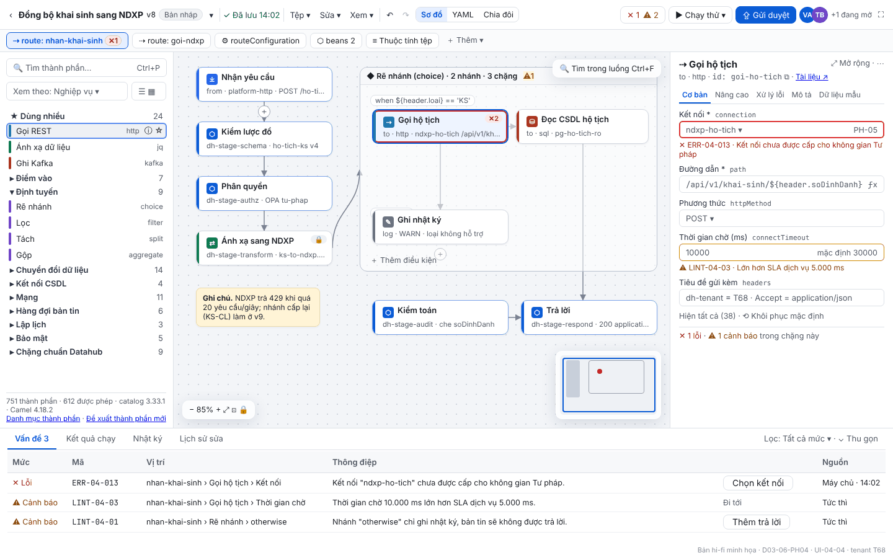

Ảnh dựng đủ sáu vùng của mục 10.2: ① thanh công cụ có chỉ báo lưu, bộ đếm vấn đề, Chạy thử, Gửi duyệt và người đang mở; ② thanh thực thể với huy hiệu lỗi trên route; ③ bảng thành phần theo nhóm nghiệp vụ, mục "Gọi REST" đang focus; ④ canvas với chuỗi chặng chuẩn, nhóm Rẽ nhánh có nhãn `when`, chặng "Gọi hộ tịch" vừa chọn vừa lỗi (viền chọn ngoài, viền lỗi trong), ghi chú dán, điều khiển thu phóng và minimap; ⑤ Inspector tab Cơ bản có lỗi ERR-04-013 tại trường Kết nối và cảnh báo LINT-04-03; ⑥ bảng Vấn đề có nút sửa nhanh.

## 11. UI-04-05 Cấu hình chặng mở rộng

Cửa sổ cấu hình mở rộng là lớp nổi của UI-04-04 dành cho chặng nhiều tham số, đặt dữ liệu vào và ra ngay cạnh biểu mẫu.

::: dac-ta
**Mục đích.** Inspector 360 px đủ cho chỉnh nhanh nhưng chật khi chặng có 60–150 tham số hoặc khi cần nhìn dữ liệu vào, ra để cấu hình đúng. Cửa sổ mở rộng chiếm 75 % màn (theo SRS-PH-04 D-03 của repo), ba cột VÀO · THAM SỐ · RA.

**Người dùng chính.** IE.

**FR hiện thực.** FR-04-014, 016, 022.

**Thay hệ cũ.** Thanh Properties của Tooling (LGC-TOOL-019, 020).

**Đường dẫn.** Không có đường dẫn riêng; URL của UI-04-04 thêm `lop=cau-hinh` và `chang={id}`.

**Mở bằng.** Nhấp đúp chặng, `Ctrl+Enter`, nút ⤢ ở Inspector.

**Mẫu, vật liệu.** Lớp nổi `CMP-Modal`. Khung `glass-modal`, nội dung đặc. Canvas phía sau vẫn thấy mờ để giữ ngữ cảnh; không thao tác được.

**Quyền.** Mở xem với `PERM-04-read`; sửa với `PERM-04-update` + mức `EDIT`, nếu không mọi trường `readOnly`.

**API.** API-04-071 (lược đồ thuộc tính), 042 (dữ liệu lần chạy), 022 (lưu kèm bản tin mẫu); PH-05 (kết nối), PH-06 (lược đồ).

**Trạng thái màn.** Đang tải, chưa có dữ liệu mẫu, lần chạy không đi qua, chỉ đọc, thành phần không còn trong catalog (mục 11.5).

**Thông báo.** ERR-04-010 (bí mật), 013 (kết nối), 021 (bản tin mẫu quá lớn), 031 (SQL), 037 (biểu thức); LINT-04-06 (dữ liệu thật).
:::

### 11.1. Wireframe (75 % × 85 % khung nhìn)

```
┌ glass-modal ─────────────────────────────────────────────────────────────────────────────────────┐
│ ⇢ Gọi hộ tịch   to · http            ‹ Kiểm lược đồ   Ghi nhật ký ›        [Tài liệu ↗]   ✕ Esc │
├──────────────────────────┬────────────────────────────────────────────┬──────────────────────────┤
│ VÀO                      │ THAM SỐ                                    │ RA                       │
│ Nguồn: lần chạy #41 ▾    │ [🔍 Tìm tham số…]  [☐ Chỉ trường đã đặt]   │ Nguồn: lần chạy #41 ▾    │
│ ▸ headers (12)           │ ┌ Cơ bản ─────────────────────────────────┐│ ▸ headers (14)           │
│   dh-tenant  "T68"       │ │ Kết nối *  [ndxp-ho-tich ▾] ✓ 2 giờ trước││   CamelHttpResponseCode │
│   loai       "KS"        │ │ Đường dẫn * [/api/v1/khai-sinh/${…}] ƒx ││     200                  │
│ ▾ body (JSON)            │ │ Phương thức [POST ▾]                    ││ ▾ body (JSON)            │
│   { "soDinhDanh": "0…",  │ └─────────────────────────────────────────┘│   { "maGiayTo": "…",     │
│     "hoTen": "Nguyễn…" } │ ▸ Kết nối và thời gian chờ (6 · 2 đã đặt)   │     "trangThai": "OK" }  │
│ ▸ exchange properties (3)│ ▸ Bảo mật (4)                               │                          │
│ ▸ variables (1)          │ ▸ Proxy (5)                                 │ Lược đồ ra dự kiến:      │
│                          │ ▸ Nâng cao (38)                             │ ndxp-khai-sinh-resp v3   │
│ [kéo trường vào ô tham số│ ▸ Xử lý lỗi                                 │ ✓ khớp lần chạy #41      │
│  để chèn ${…}]           │ ▸ Mô tả                                     │                          │
├──────────────────────────┴────────────────────────────────────────────┴──────────────────────────┤
│ ✕ 1 lỗi  ⚠ 1 cảnh báo · 2 tham số đã đổi trong phiên này          [⟲ Hoàn tác phiên] [Xong Enter] │
└──────────────────────────────────────────────────────────────────────────────────────────────────┘
```

### 11.2. Cột VÀO và RA

- Nguồn dữ liệu: `Select` "Bản tin mẫu ghim của chặng", "Lần chạy thử #{n} ({giờ}, {kết quả})", "Lược đồ {tên} v{n}", "Không có". Mặc định bản tin mẫu ghim của chặng; chặng chưa ghim dùng bản tin mẫu của chặng trước gần nhất trên đường đi (FR-04-022), ghi rõ "Thừa hưởng từ {chặng}". Nút "Ghim bản tin mẫu…" mở hộp nhập thân (JSON, XML, văn bản ≤ 256 KiB), tiêu đề, thuộc tính exchange; bản tin mẫu lưu cùng phiên bản ở cột riêng, không vào YAML (BR-04-007). Có dấu hiệu dữ liệu cá nhân thật (số định danh 12 chữ số, số điện thoại, thư điện tử) thì cảnh báo LINT-04-06 và gợi ý "Thay bằng dữ liệu giả"; chỉ người có `PERM-04-sample-data` bỏ qua được cảnh báo.
- Cây `CMP-JsonViewer` hiện headers, body (JSON, XML hiện dạng cây, văn bản hiện dạng thô có cắt 64 KB), exchange properties, variables. Giá trị đã che (BR-04-013) hiện "•••• (đã che)".
- Kéo một nút ở cột VÀO thả vào ô tham số hỗ trợ biểu thức: chèn `${header.loai}`, `${body.soDinhDanh}` (simple) hoặc `.soDinhDanh` (jq) theo ngôn ngữ của ô. Bàn phím: focus nút, `Ctrl+C` sao chép biểu thức đường dẫn, dán vào ô.
- Cột RA với lược đồ dự kiến hiện ✓ khớp hoặc ⚠ lệch kèm danh sách trường thiếu, thừa.
- Hai cột thu gọn được (nút ‹ ›) để cột THAM SỐ rộng ra; thu gọn còn 32 px có nhãn dọc.

### 11.3. Cột THAM SỐ

Cùng bộ trường và quy tắc với Inspector (mục 10.11.2) nhưng: hiện mọi nhóm cùng lúc dạng `Collapse` với số "(tổng · đã đặt)"; trường biểu thức mở rộng thành ô nhiều dòng; trường SQL, JQ cao 240 px; ô tìm lọc theo tên gốc, nhãn tiếng Việt và mô tả, tô từ khớp. Nhóm chứa lỗi tự mở và có huy hiệu.

### 11.4. Điều hướng và đóng

`‹ ›` ở đầu (hoặc `Alt+←`, `Alt+→`) chuyển sang chặng trước, sau theo dòng chảy mà không đóng cửa sổ. Thay đổi áp ngay vào mô hình như Inspector; "⟲ Hoàn tác phiên" hoàn tác mọi bước kể từ khi mở cửa sổ (một bước gộp). "Xong" hoặc `Esc` đóng, focus trở lại chặng trên canvas. Không có "Hủy" riêng để tránh hiểu lầm thay đổi chưa áp.

### 11.5. Trạng thái

| Trạng thái | Hiển thị |
|---|---|
| Đang tải `properties` của thành phần | Skeleton trong cột giữa; hai cột bên hiện ngay nếu có dữ liệu |
| Chưa có dữ liệu chạy thử, không có lược đồ | Cột VÀO: "Chưa có dữ liệu mẫu. Chạy thử luồng hoặc chọn lược đồ để thấy dữ liệu vào chặng này." nút "Chạy thử đến chặng này" |
| Lần chạy không đi qua chặng | "Lần chạy #{n} không đi qua chặng này (rẽ nhánh khác)." |
| Chỉ đọc | Mọi trường `readOnly`; nút "Hoàn tác phiên" ẩn |
| Thành phần không còn trong catalog | Cột giữa hiện YAML thô của chặng trong `CMP-CodeEditor`, lỗi VR-02 |

: UI-04-05 · Trạng thái màn

### 11.6. Bản hi-fi

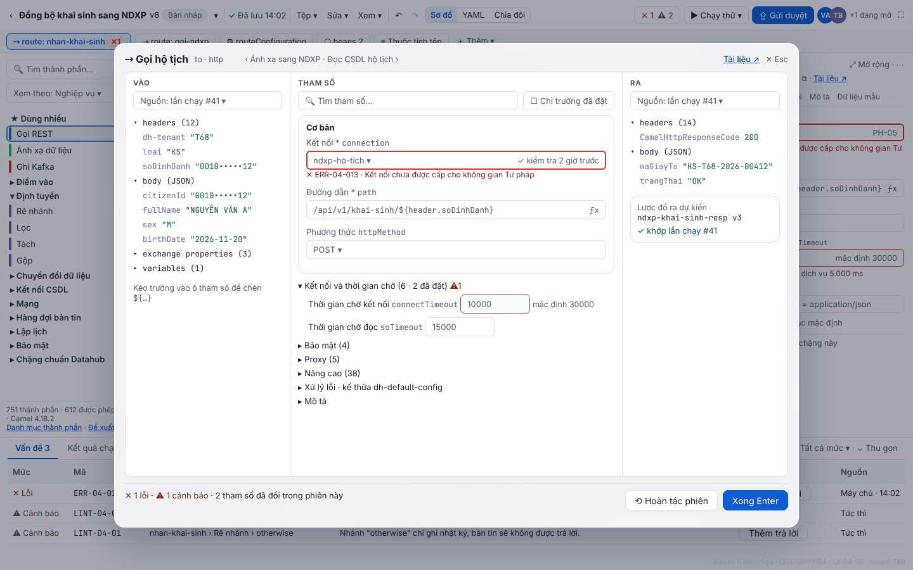

Cửa sổ ba cột VÀO, THAM SỐ, RA trên nền trình thiết kế làm mờ; cột VÀO và RA lấy dữ liệu lần chạy #41 với giá trị đã che, cột giữa nhóm tham số có số "(tổng · đã đặt)", nhóm có cảnh báo tự mở; chân cửa sổ đếm lỗi và có "Hoàn tác phiên".

## 12. UI-04-06 Trình soạn biểu thức

Trình soạn biểu thức là lớp nổi nhỏ neo vào trường, cho viết, kiểm tra và xem trước biểu thức mà không rời ngữ cảnh chặng.

::: dac-ta
**Mục đích.** Viết, kiểm tra biểu thức `simple`, `constant`, `header`, `exchangeProperty`, `jq`, `jsonpath`, `xpath`, `xquery` (và `groovy`, `js`, `python` chỉ khi PA cho phép trong chính sách thành phần của tenant) với gợi ý và xem trước trên bản tin mẫu.

**Người dùng chính.** IE.

**FR hiện thực.** FR-04-015.

**Thay hệ cũ.** Không có (màn mới).

**Đường dẫn.** Không có; URL của UI-04-04 thêm `lop=bieu-thuc`.

**Mở bằng.** Nút ƒx trên trường biểu thức, nhấp đúp nhãn `when`, `Ctrl+E` khi focus trong trường biểu thức.

**Mẫu, vật liệu.** `CMP-Popover` neo vào trường khi đủ chỗ (640 × 420, khung `glass-overlay`, vùng soạn đặc); tự chuyển thành `CMP-Modal` 960 × 640 khi bấm ⤢ hoặc màn hẹp.

**Quyền.** `PERM-04-update` (gọi API-04-032); người chỉ đọc mở được ở chế độ xem, nút "Áp dụng" ẩn.

**API.** API-04-032.

**Trạng thái màn.** Đang kiểm tra, biên dịch được, lỗi tại vị trí, xem trước mô phỏng, chưa xem trước được (mục 12.2).

**Thông báo.** ERR-04-037 (lỗi biểu thức), 019 (sandbox bận), 021 (dữ liệu thử quá lớn).
:::

### 12.1. Wireframe

```
┌ Biểu thức · Điều kiện nhánh 1 của Rẽ nhánh ──────────────────────────── ⤢ ✕ ┐
│ Ngôn ngữ [simple ▾]   Kiểu kết quả cần: boolean                               │
│ ┌ đặc ──────────────────────────────────────────────────────────────────────┐ │
│ │ ${header.loai} == 'KS' && ${body[namSinh]} >= 1900                        │ │
│ └───────────────────────────────────────────────────────────────────────────┘ │
│ ✓ Biên dịch được (Camel 4.18 · máy chủ)                                       │
│ ┌ Biến khả dụng ───────────┐ ┌ Xem trước ────────────────────────────────────┐│
│ │ 🔍                        │ │ Bản tin [Bản tin mẫu của chặng ▾]             ││
│ │ ${body}                   │ │ Kết quả: true  (boolean) · 0,4 ms             ││
│ │ ${header.*} (12)          │ │ ─────────────────────────────────────────────  ││
│ │ ${exchangeProperty.*} (3) │ │ Thử với dữ liệu khác: [ { "namSinh": 1850 } ] ││
│ │ Tiêu đề chuẩn dh-*        │ │ Kết quả: false                                ││
│ │ Biến môi trường {{dh.env.*}}│                                               ││
│ │ Hàm: date:now, random(…)  │ │                                               ││
│ └───────────────────────────┘ └───────────────────────────────────────────────┘│
│                                                       [Hủy] [Áp dụng Ctrl+Enter]│
└────────────────────────────────────────────────────────────────────────────────┘
```

### 12.2. Hành vi

- Gợi ý `Ctrl+Space` theo ngôn ngữ (FR-04-015 mục 1): `simple` gợi ý `${body}`, `${header.*}`, `${exchangeProperty.*}`, hàm có sẵn; `jq`, `jsonpath` gợi ý đường dẫn trường lấy từ bản tin mẫu, hàm jq chuẩn và hàm `dh_map` (ADR-066); `xpath`, `xquery` gợi ý namespace từ bản tin mẫu; mọi ngôn ngữ gợi ý biến môi trường `{{dh.env.*}}` và tiêu đề chuẩn `dh-*`.
- Kiểm tra cú pháp chạy ở máy chủ (API-04-032) bằng engine Camel đúng phiên bản runtime, sau 400 ms kể từ lần gõ cuối; lỗi trả dòng, cột, hiện gạch sóng tại vị trí và dòng "✕ {thông điệp ERR-04-037}". Trong lúc chờ, dòng trạng thái là "Đang kiểm tra…".
- Xem trước chạy trên sandbox với bản tin mẫu đã chọn hoặc dữ liệu nhập tay (≤ 256 KiB, ERR-04-021). Sandbox không sẵn sàng (ERR-04-019): giao diện đánh giá cục bộ cho `simple` cơ bản, `jsonpath`, `jq`, và **bắt buộc** gắn nhãn cảnh báo "Xem trước mô phỏng trên trình duyệt, kết quả có thể khác runtime" (GAP-04-09); các ngôn ngữ khác hiện "Chưa xem trước được".
- Kiểu kết quả cần suy từ ngữ cảnh: `when`, `filter` cần boolean; `split` cần danh sách hoặc iterator; `setHeader` bất kỳ. Lệch kiểu hiện ⚠.
- "Áp dụng" ghi vào trường và tạo một bước hoàn tác; "Hủy", `Esc` bỏ.
- Ngôn ngữ kịch bản (`groovy`, `js`, `python`) không có trong danh sách khi chưa được phép (ADR-062). Khi PA cho phép, mục ngôn ngữ có nhãn "Kịch bản" và dải cảnh báo cố định "Biểu thức kịch bản chạy mã tùy ý. Người duyệt sẽ thấy mục này trong phần bằng chứng."

### 12.3. Bản hi-fi

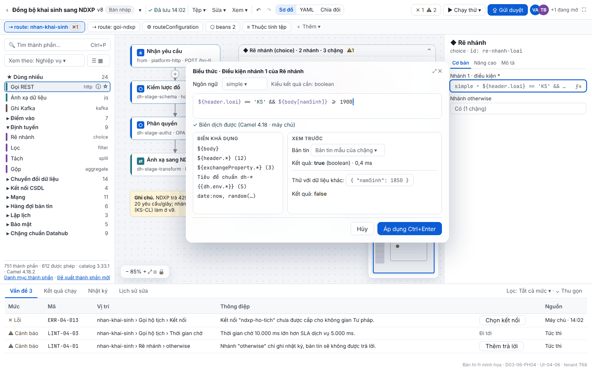

Popover neo vào trường điều kiện nhánh ở Inspector: chọn ngôn ngữ `simple`, ô soạn tô cú pháp, dòng biên dịch được trên máy chủ, danh sách biến khả dụng và vùng xem trước cho kết quả `true` với bản tin mẫu, `false` với dữ liệu thử.

## 13. UI-04-07 Trình ánh xạ dữ liệu

Trình ánh xạ là lớp nổi toàn màn ba cột, nơi kỹ sư nối trường nguồn sang trường đích, thêm hàm và chuyển mã mà không viết JQ tay.

::: dac-ta
**Mục đích.** Ánh xạ trực quan từ cấu trúc nguồn sang cấu trúc đích, sinh JQ (ADR-066), lưu thành tệp `*.dhmap.json` cạnh YAML, dùng trong chặng `dh-stage-transform` hoặc `setBody`. Hỗ trợ chuyển mã qua bảng ánh xạ mã PH-07 bằng hàm `dh_map`.

**Người dùng chính.** IE.

**FR hiện thực.** FR-04-020.

**Thay hệ cũ.** Màn Data mapping của Tooling (LGC-TOOL-007, 028; LGC-BUS-036).

**Đường dẫn.** Không có; URL của UI-04-04 thêm `lop=anh-xa`.

**Mở bằng.** Nút "Mở trình ánh xạ" ở Inspector của chặng ánh xạ, `Ctrl+M`, nhấp đúp chặng ánh xạ.

**Mẫu, vật liệu.** `CMP-Modal` toàn màn (96 % × 94 %), khung `glass-modal`, nội dung đặc.

**Quyền.** `PERM-04-update` + mức `EDIT` để sửa; người chỉ đọc xem ánh xạ và JQ.

**API.** API-04-033 (xem trước JQ trên sandbox); PH-06 (lược đồ), PH-07 (bảng ánh xạ mã).

**Trạng thái màn.** Chưa chọn nguồn, đích; lược đồ có phiên bản mới; bảng mã PH-07 không truy cập được; cây quá lớn (mục 13.6).

**Thông báo.** ERR-04-038 (ánh xạ không hợp lệ), 021 (tài liệu mẫu quá 1 MiB), 019 (sandbox); LINT-04-05 (trường bắt buộc chưa ánh xạ).
:::

### 13.1. Wireframe

```
┌ Ánh xạ dữ liệu · Chuyển hồ sơ khai sinh sang NDXP ──────────────── [Trực quan|JQ|Chia đôi]  ✕ ┐
│ Nguồn: [JSON Schema ho-tich-ks v4 ▾]            Đích: [CDM ndxp-khai-sinh-req v3 ▾]              │
├ NGUỒN (360) ──────────────┬ ÁNH XẠ (linh hoạt) ─────────────────────┬ ĐÍCH (360) ──────────────────┤
│ 🔍 Tìm trường             │                                          │ 🔍 Tìm trường  ☐ Chỉ chưa ánh xạ│
│ ▾ hoSo {object}           │   hoSo.soDinhDanh ─────────────────────▶ │ ▾ request {object}            │
│   ● soDinhDanh string     │   hoSo.hoTen ──[ƒ upper]───────────────▶ │   ● citizenId string *    ✓   │
│   ● hoTen string          │   hoSo.gioiTinh ──[⇄ PH-07 gioi-tinh]──▶ │   ● fullName string *     ✓   │
│   ● gioiTinh string       │   hoSo.ngaySinh ──[ƒ date dd/MM→ISO]───▶ │   ● sex enum[M,F,O] *     ✓   │
│   ● ngaySinh string       │                                          │   ● birthDate date *      ✓   │
│   ▾ cha {object}          │   [ƒ concat] ◀ hoSo.cha.ho, hoSo.cha.ten │   ▾ father {object}          │
│     ● ho, ● ten           │              └──────────────────────────▶│     ● name string             │
│ ▾ giayTo [array]          │   [⟳ lặp giayTo → documents]             │   ▾ documents [array]         │
│   ● loai, ● so            │      loai ──[⇄ PH-07 loai-giay-to]─────▶ │     ● type *  ● number        │
│                           │                                          │   ● requestedAt  = now() ✓    │
│                           │                                          │   ● province  = $tenant ✓     │
├───────────────────────────┴──────────────────────────────────────────┴───────────────────────────────┤
│ Thử: [Lần chạy #41 ▾] → Kết quả hợp lệ theo ndxp-khai-sinh-req v3 ✓   ✕ 0  ⚠ 1 (father.name rỗng) │
│ 9/10 trường bắt buộc đã ánh xạ                                      [Hủy thay đổi] [Lưu ánh xạ]  │
└─────────────────────────────────────────────────────────────────────────────────────────────────────┘
```

### 13.2. Cột nguồn, đích

`CMP-SchemaTree`: nút cây có biểu tượng kiểu (`{}` object, `[]` array, `Aa` string, `#` number, `📅` date, `✓` boolean, `≡` enum), tên, kiểu, dấu * bắt buộc (đích), ✓ đã ánh xạ (đích), số lần dùng (nguồn). Cấu trúc lấy từ (FR-04-020): JSON Schema, XSD (chuyển sang cây trường), OpenAPI của API PH-02, lược đồ topic Apicurio, lược đồ CDM, hoặc suy ra từ tài liệu mẫu JSON, XML ≤ 1 MiB (dán hoặc tải tệp; ERR-04-021 khi vượt). Nguồn hoặc đích XML thì chặng ánh xạ tự thêm `unmarshal` XML sang JSON trước và `marshal` sau, hiện thành hai chặng con có nhãn "Tự thêm". Cây dài: ảo hóa, tìm kiếm lọc và tự mở nhánh chứa kết quả.

### 13.3. Vùng ánh xạ

| Thao tác | Chuột | Bàn phím |
|---|---|---|
| Ánh xạ trực tiếp | Kéo trường nguồn thả vào trường đích | Chọn nguồn, `Space` đánh dấu; chọn đích, `Enter` |
| Ánh xạ nhiều nguồn vào một đích | Kéo thêm nguồn vào cùng đích → tạo nút hàm `concat` mặc định, đổi hàm được | Như trên, đích đã có ánh xạ thì hỏi "Thay" hay "Thêm vào hàm" |
| Thêm hàm biến đổi | Bấm vào đường ánh xạ → menu hàm | Chọn đường ánh xạ (`↑`/`↓` trong danh sách ánh xạ), `F` |
| Giá trị mặc định khi nguồn rỗng | Menu đường ánh xạ → "Mặc định khi rỗng…" | `D` |
| Giá trị cố định, biểu thức | Bấm "=" ở trường đích | Focus trường đích, `=` |
| Lặp mảng | Kéo mảng nguồn vào mảng đích → khối "⟳ lặp" chứa ánh xạ con | |
| Điều kiện | Menu đường ánh xạ → "Chỉ khi…" (biểu thức JQ boolean) | |
| Xóa ánh xạ | Chọn đường, `Delete` | |
| Tự ánh xạ theo tên | Nút "Gợi ý ánh xạ" | Khớp tên chính xác, không dấu, đồng nghĩa trong từ điển PH-06; hiện danh sách đề xuất có ô chọn, không tự áp |

: UI-04-07 · Vùng ánh xạ

Thư viện hàm (nhóm, FR-04-020 mục 3): Chuỗi (cắt, hoa, thường, nối, tách, thay thế, chuẩn hóa không dấu), Số (làm tròn, định dạng), Ngày giờ (đổi `dd/MM/yyyy` sang ISO, đổi múi giờ), Logic (nếu–thì, kiểm tra rỗng, mặc định), Mảng (lặp phần tử), **Chuyển mã PH-07**: chọn bảng ánh xạ mã của PH-07 (ví dụ mã dân tộc của HTTT A sang mã chuẩn); giao diện sinh lời gọi `dh_map("<bảng>"; .<trường>)` do runtime cung cấp, tra từ ảnh chụp trong bộ nhớ của PH-07. Mỗi nút hàm hiện tham số dạng biểu mẫu nhỏ, không bắt viết JQ. Ánh xạ một–nhiều (tách một nguồn ra nhiều đích khác cấu trúc) chưa có ở MVP: menu hiện mục mờ "Một–nhiều: viết JQ tay" mở UI-04-06.

### 13.4. Chế độ JQ và Chia đôi

JQ sinh từ ánh xạ hiện trong `CMP-CodeEditor` (chỉ đọc trong chế độ Trực quan + Chia đôi). Người dùng có thể "Chuyển sang soạn JQ tay": cảnh báo "Sau khi sửa JQ tay, trình ánh xạ trực quan chỉ hiện được các ánh xạ nhận dạng được; phần còn lại hiện dạng khối JQ." Khối JQ không nhận dạng được hiện trong vùng ánh xạ là nút "{} JQ tùy biến" nối tới các trường đích nó ghi (phân tích tĩnh). Tệp `*.dhmap.json` luôn là nguồn chuẩn; JQ là sản phẩm sinh ra (ADR-066). Không nhúng AtlasMap hay DataMapper XSLT của Kaoto.

### 13.5. Thử và kiểm tra

Thanh dưới chạy JQ thật trên sandbox (API-04-033, có hàm `dh_map`) với dữ liệu chọn và kiểm kết quả theo lược đồ đích; sandbox không sẵn sàng thì theo quy tắc nhãn mô phỏng của mục 12.2. Lỗi lược đồ hiện trên cây đích (✕ tại trường). Ánh xạ tới trường không tồn tại hoặc vòng tham chiếu báo ERR-04-038. "Lưu ánh xạ" vô hiệu khi JQ không biên dịch được; vẫn lưu được khi còn trường bắt buộc chưa ánh xạ (gợi ý LINT-04-05; tham số đề xuất `04.mapping.require-all-required` chuyển thành lỗi ở mức gửi duyệt, mục 25). Thanh dưới còn có "Xuất ánh xạ" (tải `*.dhmap.json` và `*.jq`) và "Đặt lại ánh xạ" (xóa mọi ánh xạ, hoàn tác được).

### 13.6. Trạng thái

| Trạng thái | Hiển thị |
|---|---|
| Chưa chọn nguồn hoặc đích | Cột tương ứng hiện ba nút: "Chọn lược đồ", "Dán tài liệu mẫu", "Lấy từ bản tin mẫu của chặng" |
| Lược đồ có phiên bản mới | Dải thông tin "Lược đồ {tên} có v{n+1}. [Xem khác biệt] [Nâng lên]"; nâng lên thì trường bị xóa trong lược đồ mới hiện ánh xạ "mồ côi" màu cảnh báo |
| Bảng ánh xạ mã PH-07 không truy cập được | Nút `dh_map` hiện ⚠ "Không tải được bảng {mã}. Ánh xạ vẫn lưu, nhưng chưa xem trước được." |
| Cây quá lớn (> 5.000 nút) | Hiện cảnh báo hiệu năng, mặc định thu gọn mọi nhánh |

: UI-04-07 · Trạng thái màn

### 13.7. Bản hi-fi

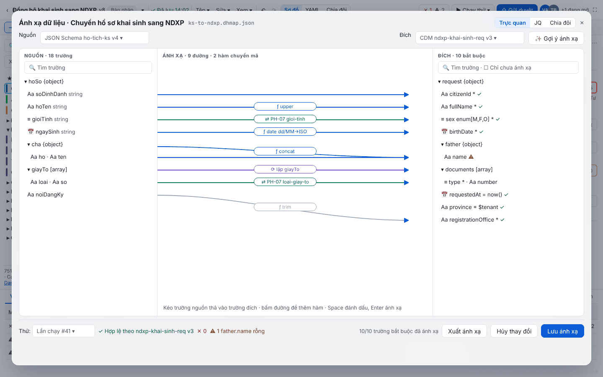

Ba cột nguồn, ánh xạ, đích; mỗi đường ánh xạ có nút hàm (ƒ upper, ƒ date, ƒ concat), hàm chuyển mã PH-07 màu xanh lục và khối lặp mảng màu tím; cây đích đánh dấu ✓ trường đã ánh xạ, ⚠ trường có cảnh báo; thanh dưới chạy thử trên lần chạy #41 và kiểm kết quả theo lược đồ đích.

## 14. UI-04-08 Trình soạn Kamelet

Trình soạn Kamelet là một chế độ của UI-04-04 cho tài nguyên loại `KAMELET`, có ba tab cố định thay cho canvas route.

::: dac-ta
**Mục đích.** Soạn Kamelet tự viết của tỉnh (`source`, `sink`, `action`) để đóng gói một cách kết nối dùng lại.

**Người dùng chính.** IE; PA, SO duyệt khi đề nghị dùng chung toàn quốc.

**FR hiện thực.** FR-04-018 (mức S).

**Thay hệ cũ.** Thay việc nhập JAR component của Tooling (LGC-TOOL-027 bị loại vì ATTT).

**Đường dẫn.** `/tich-hop/luong/:ma/thiet-ke` của luồng loại `KAMELET`.

**Mở bằng.** Tạo luồng loại `KAMELET` (UI-04-03) hoặc mở luồng loại đó. Cùng khung UI-04-04; thanh thực thể có ba tab cố định: **Đặc tả**, **Mẫu (template)**, **Phụ thuộc**.

**Mẫu.** PTN-07, chế độ Kamelet.

**Quyền.** IE (`PERM-04-update`). Kamelet phát hành trong tenant xuất hiện ở đầu cách xem Kamelet của bảng thành phần với huy hiệu "Của tỉnh". Dùng chung toàn quốc phải qua quy trình đăng ký Kamelet của PH-05 (PA và SO duyệt); nút "Đề nghị dùng chung toàn quốc" mở quy trình đó.

**API.** API-04-011, 020, 022 với `resourceKind = KAMELET`; 030 (kiểm tra), 040 (chạy thử bọc).

**Trạng thái màn.** Như UI-04-04 (ST-01, 07, 08, 09); tab Phụ thuộc rỗng khi Kamelet chưa phát hành.

**Thông báo.** ERR-04-036 (trùng tên), 029 (không hồ sơ runtime đủ thành phần); VR-02, VR-15; LINT-04-04.
:::

### 14.1. Tab Đặc tả

Biểu mẫu hai cột:

| Trường | Kiểu | Kiểm tra |
|---|---|---|
| Tên (`metadata.name`) | `Input` | `^[a-z][a-z0-9-]{2,62}-(source|sink|action)$`; trùng Kamelet nền hoặc Kamelet khác trong tenant: ERR-04-036 |
| Loại (nhãn `camel.apache.org/kamelet.type`) | `Radio` source / sink / action | Tự đặt theo hậu tố tên, không sửa riêng |
| Tiêu đề, mô tả | `Input`, `TextArea` (Markdown) | Bắt buộc |
| Biểu tượng | Tải SVG ≤ 16 KB (lọc, bỏ script) hoặc chọn từ bộ Lucide | |
| Nhóm hiển thị trên bảng thành phần | `Select` nhóm nghiệp vụ mục 5.2 | |
| Kiểu dữ liệu vào, ra (`spec.dataTypes`) | `Select` + lược đồ | |
| Tham số (`spec.definition.properties`) | `CMP-EditableTable`: tên (`camelCase`), tiêu đề tiếng Việt, mô tả, kiểu (`string`, `boolean`, `integer`, `binary`, `long`; không có `number`, FR-04-018 mục 1), bắt buộc, mặc định, ví dụ, `enum`, ô "Nhạy cảm" | Không trùng tên. Tham số "Nhạy cảm" được đánh dấu `x-descriptors: urn:camel:group:credentials`, không có mặc định, khi dùng chỉ nhận tham chiếu kết nối (VR-15) |

: UI-04-08 · Tab Đặc tả

Bên phải là **xem trước**: Inspector giả lập đúng như người dùng thấy khi thả Kamelet này vào một luồng, cập nhật trực tiếp.

### 14.2. Tab Mẫu

Canvas soạn `spec.template` như một route bắt đầu bằng `kamelet:source` (kết thúc bằng `kamelet:sink` với loại `source`, `action`). Tham số `{{tênThamSố}}` gợi ý trong mọi trường (ƒx). Dùng tham số chưa khai báo là lỗi VR-02; khai báo mà không dùng là gợi ý LINT-04-04.

### 14.3. Tab Phụ thuộc

Thành phần Camel mà mẫu dùng, mức native và hồ sơ runtime tương thích suy ra (ERR-04-029 nếu không hồ sơ nào đủ), các luồng đang dùng Kamelet này (khi đã phát hành), phiên bản Kamelet theo phiên bản luồng chứa nó.

### 14.4. Chạy thử Kamelet

Chạy thử bọc Kamelet trong route thử sinh tự động (`from: direct:test` → Kamelet với tham số người dùng nhập → `log`), dùng cùng UI-04-11.

### 14.5. Bản hi-fi

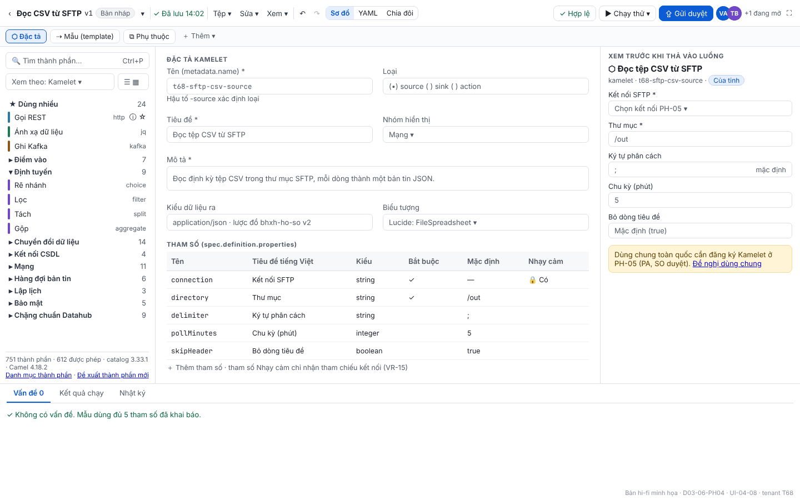

Biểu mẫu đặc tả Kamelet `t68-sftp-csv-source` với bảng tham số, tham số `connection` đánh dấu nhạy cảm; cột phải là Inspector giả lập đúng như khi thả Kamelet vào luồng, kèm lối đề nghị dùng chung toàn quốc qua PH-05.

## 15. UI-04-09 Trình soạn Pipe

Trình soạn Pipe là chế độ của UI-04-04 cho tài nguyên loại `PIPE`: một dải ô tuyến tính thay cho canvas tự do, để tích hợp một chiều không cần hiểu route Camel.

::: dac-ta
**Mục đích.** Nối nhanh source → các action → sink bằng Kamelet, không cần viết route, cho tích hợp một chiều đơn giản (ví dụ đọc tệp SFTP định kỳ rồi đẩy lên Kafka).

**Người dùng chính.** IE; TO xem tình trạng như luồng thường.

**FR hiện thực.** FR-04-019 (mức S).

**Thay hệ cũ.** Không có (màn mới); thay một phần routing đơn giản của Bus (LGC-BUS-035).

**Đường dẫn.** `/tich-hop/luong/:ma/thiet-ke` của luồng loại `PIPE`; `chang` nhận `source`, `step-{n}`, `sink`.

**Mẫu.** PTN-07, chế độ Pipe.

**Quyền.** Xem `PERM-04-read`; sửa `PERM-04-update` + mức `EDIT`; gửi duyệt `PERM-04-submit`.

**API.** API-04-011, 020, 022 với `resourceKind = PIPE`; 030 (kiểm tra), 040…043 (chạy thử), 050 (gửi duyệt), 070 (Kamelet được phép); PH-10 (topic).

**Trạng thái đối tượng.** Như phiên bản luồng (mục 5.1).

**Trạng thái màn.** ST-01 (skeleton ba ô), ô rỗng, ô lỗi, ST-05, ST-07 chỉ đọc, ST-08, ST-09 (mục 15.5).

**Thông báo.** VR-15 (Kamelet sai loại), ERR-04-009, 011, 013, 014; câu chặn thả thành phần thô (mục 15.6).
:::

**Bố cục.** Cùng khung UI-04-04, canvas tuyến tính cố định trái sang phải: Nguồn (một ô: Kamelet `source` hoặc tham chiếu topic), Bước xử lý (danh sách ô Kamelet `action`, kéo đổi thứ tự), Đích (một ô: Kamelet `sink` hoặc topic); dưới là ô `errorHandler` (ghi nhật ký, DLQ tới PH-18, không). Thao tác rẽ nhánh bị khóa.
**Thả từ bảng thành phần.** Bảng ③ chỉ hiện Kamelet đúng loại cho ô đang chèn. Thả thành phần Camel thô không được: chú thích "Pipe chỉ dùng Kamelet. Muốn dùng thành phần {x}, tạo luồng loại route." Pipe dùng Kamelet sai loại là lỗi VR-15.
**Inspector.** Tham số Kamelet của ô chọn, sinh từ `spec.definition`, như mục 10.11.

### 15.1. Wireframe

```
┌① ‹ sftp-bhxh-to-kafka  v3 [Bản nháp] ▾  ✓ Đã lưu 09:41 │ ↶ ↷ │ [Sơ đồ|YAML] │ ✓ Hợp lệ │ ▶ Chạy thử ▾ │ ⇪ Gửi duyệt ┐
├② [⇄ pipe: sftp-bhxh-to-kafka]                                                                         ┤
├③ Kamelet (280) ─────┬④ Dải Pipe (đặc solid-2) ───────────────────────────────────┬⑤ Inspector (360) ──┤
│ 🔍 Tìm Kamelet…     │ ┌ NGUỒN ──────────┐   ┌ BƯỚC 1 ────────┐   ┌ ĐÍCH ─────────┐ │ ⬡ Đọc SFTP định kỳ │
│ Đang hiện: source   │ │⬡ dh-sftp-source │ → │⬡ dh-csv-to-json│ → │⬡ dh-kafka-sink│ │ Kết nối *          │
│ ⬡ dh-sftp-source    │ │ bhxh-sftp · 5 ph│   │ phân cách ";"  │   │ t68.bhxh.hs.v1│ │ [bhxh-sftp ▾] PH-05│
│ ⬡ dh-sql-ro-source  │ └─────────────────┘   └────────────────┘ ⊕ └───────────────┘ │ Thư mục *          │
│ ⬡ dh-rest-poll-src  │ ┌ Xử lý lỗi (errorHandler) ─────────────────────────────┐  │ [/out/ho-so    ]   │
│ ⬡ Của tỉnh: …       │ │ (•) DLQ tới PH-18   ( ) Ghi nhật ký   ( ) Không        │  │ Chu kỳ  [5 phút ▾] │
├⑥ [Vấn đề 0] [Kết quả chạy] [Nhật ký]                                         ⌄ Thu gọn ┤
└──────────────────────────────────────────────────────────────────────────────────────────┘
```

### 15.2. Thành phần

| # | Thành phần | `CMP-*` | Nội dung, kiểm tra | Nguồn |
|---|---|---|---|---|
| 1 | Thanh công cụ ① | `CMP-DesignerToolbar` | Như mục 10.4; menu Xem không có "Hướng sơ đồ", "Tự sắp xếp" | API-04-020 |
| 2 | Bảng Kamelet ③ | `CMP-NodePalette` | Chỉ Kamelet đúng loại của ô đang chọn (source, action, sink); Kamelet "Của tỉnh" ở đầu | API-04-070 |
| 3 | Ô Nguồn | `CMP-FlowNode` biến thể `slot` | Đúng một Kamelet `source` hoặc tham chiếu topic PH-10 | `spec.source` |
| 4 | Ô Bước xử lý | `CMP-FlowNode` biến thể `slot`, kéo đổi thứ tự | 0…20 Kamelet `action` | `spec.steps[]` |
| 5 | Ô Đích | `CMP-FlowNode` biến thể `slot` | Đúng một Kamelet `sink` hoặc topic | `spec.sink` |
| 6 | Nút ⊕ giữa các ô | `CMP-QuickInsert` | Chèn Kamelet `action` tại vị trí | API-04-070 |
| 7 | Khối xử lý lỗi | `CMP-Radio` | DLQ tới PH-18 (mặc định), Ghi nhật ký, Không (cảnh báo VR-11 ở mức gửi duyệt) | `spec.errorHandler` |
| 8 | Inspector ⑤ | `CMP-Inspector` | Tham số Kamelet của ô chọn (mục 10.11.2) | API-04-071 |
| 9 | Bảng dưới ⑥ | `CMP-BottomPanel` | Vấn đề, Kết quả chạy, Nhật ký (không có Lịch sử sửa riêng) | API-04-030, 042 |

: UI-04-09 · Thành phần

### 15.3. Trường của ô

| Ô | Nhận | Bắt buộc | Kiểm tra | Ghi vào YAML |
|---|---|---|---|---|
| Nguồn | Kamelet `source` hoặc topic `t68.*` | Có | Đúng loại (VR-15); topic tồn tại ở PH-10 | `spec.source.ref` |
| Bước {n} | Kamelet `action` | Không | Đúng loại; tối đa 20 bước | `spec.steps[n].ref` |
| Đích | Kamelet `sink` hoặc topic | Có | Đúng loại; topic cho phép ghi | `spec.sink.ref` |
| Tham số ô | Theo `spec.definition` của Kamelet | Theo Kamelet | Như Inspector; tham số "Nhạy cảm" chỉ nhận tham chiếu kết nối | `…properties` |
| Xử lý lỗi | Một trong ba giá trị | Có | Không chọn "Không" cho luồng đối ngoại (VR-11) | `spec.errorHandler` |

: UI-04-09 · Trường của ô Pipe

### 15.4. Hành động

| Hành động | Cách làm | Kết quả |
|---|---|---|
| Đặt Kamelet vào ô | Kéo từ ③ thả vào ô, hoặc chọn ô rồi `Enter` trên mục ③ | Ô nhận Kamelet, Inspector mở tham số, focus trường bắt buộc đầu |
| Thêm bước | ⊕ giữa hai ô, hoặc `A` khi chọn ô | Bảng chọn nhanh chỉ có Kamelet `action` |
| Đổi thứ tự bước | Kéo ô bước, hoặc `Alt+←`, `Alt+→` | Thứ tự `spec.steps` đổi, hoàn tác được |
| Xóa bước | `Delete` hoặc ⋯ › Xóa | Ô Nguồn, Đích không xóa được, chỉ "Thay bằng…" |
| Chạy thử | `F5` hoặc "Chạy thử" | Như UI-04-11; nguồn được thay bằng bản tin mẫu |
| Chuyển thành route | Menu Tệp › "Chuyển thành luồng route…" | Tạo luồng loại `ROUTE` mới tương đương, không sửa Pipe cũ |

: UI-04-09 · Hành động

### 15.5. Trạng thái màn

| Trạng thái | Hiển thị |
|---|---|
| Đang tải | Skeleton ba ô nối nhau, ③ 8 dòng |
| Pipe mới | Ba ô rỗng nét đứt: "Chọn nguồn", "Thêm bước (tùy chọn)", "Chọn đích" |
| Ô lỗi | Viền 2 px `color-error-text`, huy hiệu ✕{n} như mục 10.7.3 |
| Lỗi tải | ST-05 với ERR-04-001 hoặc 004 |
| Không có quyền sửa, phiên bản không phải nháp | ST-07, ③ ẩn |
| Kamelet của ô bị cấm sau đó | Huy hiệu "Không còn được phép", ERR-04-011 |

: UI-04-09 · Trạng thái màn

### 15.6. Thông điệp

- Thả thành phần Camel thô: "Pipe chỉ dùng Kamelet. Muốn dùng thành phần {x}, tạo luồng loại route."
- Thả Kamelet sai loại: "Ô {Nguồn, Đích} chỉ nhận Kamelet loại {source, sink}." (VR-15).
- Thêm bước thứ 21: "Pipe có tối đa 20 bước. Tách thành hai Pipe nối qua topic."
- Chọn "Không" ở xử lý lỗi: cảnh báo "Bản tin lỗi sẽ bị bỏ. Luồng đối ngoại phải có DLQ khi gửi duyệt."

### 15.7. Bàn phím và trợ năng

`←`, `→` chuyển ô; `Enter` mở Inspector ô; `A` thêm bước sau; `Alt+←`, `Alt+→` đổi chỗ bước; `Delete` xóa bước; các phím chung ở mục 10.13. Dải Pipe có `role="list"`, mỗi ô `role="listitem"` với `aria-label` "Bước 1 trên 3, dh-csv-to-json, hợp lệ"; mỗi thay đổi thứ tự đọc qua vùng `aria-live`.

### 15.8. Bản hi-fi

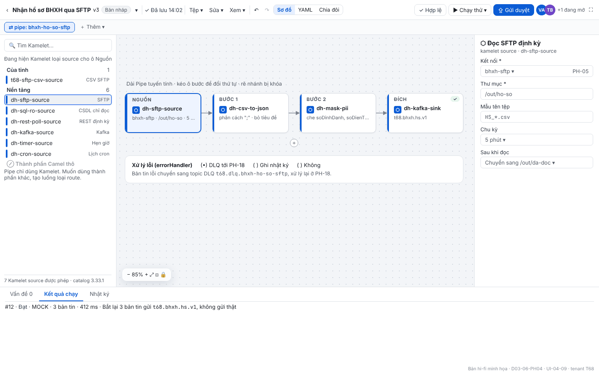

Dải Pipe tuyến tính Nguồn, Bước 1, Bước 2, Đích với ô Nguồn đang chọn; bảng trái chỉ hiện Kamelet loại source và câu chặn thành phần Camel thô; khối xử lý lỗi chọn DLQ tới PH-18; bảng dưới cho thấy lần chạy MOCK bắt lại bản tin gửi topic `t68.bhxh.hs.v1`.

## 16. UI-04-10 Cấu hình cấp tệp và bean

Màn này gom các phần của tệp luồng không vẽ được trên canvas: bean, `routeConfiguration`, metadata và biến môi trường.

::: dac-ta
**Mục đích.** Bean, `routeConfiguration`, metadata cấp tệp và biến môi trường.

**Người dùng chính.** IE; TA khai báo giá trị biến môi trường ở UI-04-20.

**FR hiện thực.** FR-04-021 (mức S), FR-04-084 (biến môi trường).

**Thay hệ cũ.** Error handling của Bus (LGC-BUS-037) qua `routeConfiguration`.

**Đường dẫn.** Không có; URL của UI-04-04 thêm `lop=cap-tep` khi mở dạng drawer, `thuc-the` khi mở dạng tab.

**Mở bằng.** Tab "beans", "routeConfiguration", "Thuộc tính tệp" trên thanh thực thể hoặc "Tệp › Thuộc tính tệp". Mở như tab trên vùng canvas, hoặc `CMP-Drawer` phải 640 px khi gọi từ Inspector.

**Mẫu.** Tab trên PTN-07 hoặc drawer.

**Quyền.** `PERM-04-update` + mức `EDIT` để sửa; `dh-default-config` luôn chỉ xem.

**API.** API-04-020, 022 (cùng định nghĩa), 090 (giá trị biến môi trường), 030 (kiểm tra).

**Trạng thái màn.** Rỗng: "Luồng chưa khai bean nào." kèm "Thêm bean"; đang tải và lỗi theo UI-04-04; chỉ đọc theo mục 10.15.

**Thông báo.** ERR-04-010 (bí mật), 011 (lớp bean không được phép); VR-11 (thiếu xử lý lỗi nền); biến chưa khai báo cho môi trường đích ở mức `PUBLISH`.
:::

### 16.1. Thuộc tính tệp và biến môi trường

Hai bảng:

- **Metadata** (cho Kamelet, Pipe): `name`, `labels`, `annotations` dạng `CMP-KeyValueEditor`.
- **Biến môi trường dùng trong luồng** `{{dh.env.<tên>}}`: bảng chỉ đọc liệt kê biến luồng đang dùng, giá trị theo TEST, STAGING, PROD lấy từ khai báo của TA ở màn tham số (UI-04-20). Biến luồng dùng mà chưa khai báo cho môi trường đích là lỗi ở mức `PUBLISH`. Nút "Tìm chỗ dùng" liệt kê chặng dùng biến. TA thấy thêm nút "Khai báo ở màn tham số".

Không có ô nhập giá trị bí mật ở đây; bí mật chỉ qua `{{conn:…}}`, `{{vault:…}}` (BR-04-003).

### 16.2. Bean

Bảng bean: tên, kiểu, thuộc tính (biểu mẫu theo kiểu), nơi dùng. Kiểu chỉ chọn từ danh sách lớp được phép trong hồ sơ runtime (thư viện nền `vn.datahub.runtime.*` và lớp chuẩn của Camel, Quarkus được PA duyệt); không nhập tên lớp tự do (FR-04-021). Trường của thành phần nhận bean hiện hộp chọn các bean đã khai. Bean không chứa bí mật.

### 16.3. routeConfiguration

`routeConfiguration` nền `dh-default-config` (chỉ xem, có liên kết tài liệu) hiện các `onException` chuẩn của FR-04-070 và `errorHandler` có DLQ tới PH-18. Người dùng tạo `routeConfiguration` riêng để thêm `errorHandler`, `onException`, `intercept`, `onCompletion` cục bộ. Luồng không có xử lý lỗi nền hoặc `errorHandler` có DLQ là lỗi VR-11 ở mức gửi duyệt (BR-04-008).

### 16.4. Bản hi-fi

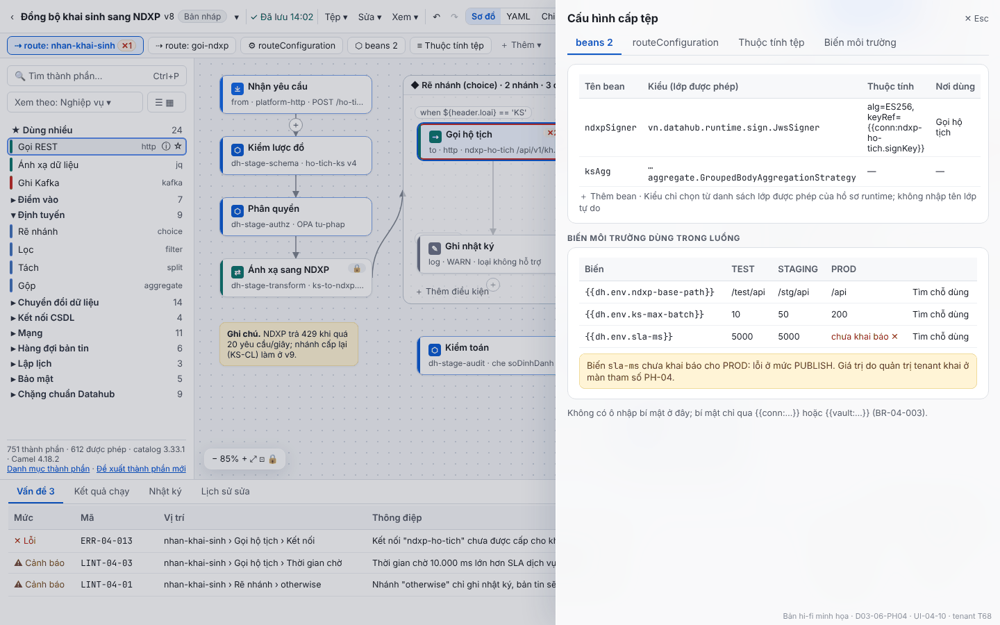

Drawer 640 px trên trình thiết kế với tab beans: lớp bean chỉ chọn từ danh sách được phép; bảng biến môi trường cho thấy `sla-ms` chưa khai báo cho PROD và cảnh báo lỗi ở mức PUBLISH.

## 17. UI-04-11 Chạy thử

Chạy thử là cổng bắt buộc trước khi gửi duyệt; màn được viết siêu chi tiết vì kết quả phải đọc được tới từng chặng.

::: dac-ta
**Mục đích.** Chạy phiên bản đang soạn trên Camel thật trong `dh-runtime-sandbox` (ADR-064) với bản tin mẫu, đích mô phỏng hoặc hệ thống TEST thật, xem từng chặng đã đi qua, dữ liệu vào ra tại mỗi chặng, log. Lần chạy `PASSED` không mô phỏng gắn với băm định nghĩa để mở khóa gửi duyệt (BR-04-004).

**Người dùng chính.** IE.

**FR hiện thực.** FR-04-030, 033.

**Thay hệ cũ.** Thay chạy thử giả của repo (GAP-04-04: `RoutesService.testRun` tính từ `hashCode`) và "kiểm tra kết nối khi thêm chương trình" của Bus (LGC-BUS-013).

**Đường dẫn.** Drawer: URL của UI-04-04 thêm `lop=chay-thu`; trang riêng `/tich-hop/luong/:ma/chay-thu`.

**Mẫu, vật liệu.** `CMP-Drawer` dưới cao 50 % (mặc định, để thấy canvas phủ kết quả cùng lúc) hoặc trang `/tich-hop/luong/:ma/chay-thu`. Khung `glass-modal`, vùng nội dung đặc.

**Quyền.** IE (`PERM-04-update`); dùng dữ liệu thật cần `PERM-04-sample-data`.

**API.** API-04-040 (bắt đầu, trả `202` với `runId`), 042 (kết quả, SSE), 043 (hủy), 044 (ca kiểm thử).

**Trạng thái đối tượng.** Lần chạy `QUEUED`, `RUNNING`, `PASSED`, `FAILED`, `TIMED_OUT`, `CANCELLED`; chặng `SKIPPED`, `SIMULATED` (mục 5.1).

**Trạng thái màn.** Mục 17.4; đang tải theo ST-01, lỗi tải ST-05, không có quyền thì nút "Chạy thử" ẩn.

**Thông báo.** ERR-04-009, 013, 019 (429, 503), 020, 021; thành công "Chạy thử đạt".
:::

### 17.1. Wireframe

```
┌ Chạy thử · v8 (đang soạn) ───────────────── [Thiết lập | Kết quả #42 | Lịch sử] ── ⤢ trang riêng ✕ ┐
│ THIẾT LẬP                                                                                         │
│ Chế độ  (•) Mô phỏng đích (MOCK)   ( ) Gọi hệ thống TEST thật (SANDBOX_LIVE)                       │
│ Route vào [nhan-khai-sinh ▾]  Điểm vào: platform-http POST /ho-tich/khai-sinh                     │
│ Bản tin  (•) Bản tin mẫu của chặng đầu  ( ) Nhập tay  ( ) Tải tệp  ( ) Từ lần chạy #41            │
│          ( ) Theo ca kiểm thử [chọn ▾]                                                             │
│ ┌ Headers (≤ 50) ─────────────────────┐ ┌ Body (JSON) ──────────────────────────── 2,1 KB / 256 KB┐│
│ │ Content-Type  application/json  ✕   │ │ { "soDinhDanh": "001…", "hoTen": "Nguyễn Văn A", … }   ││
│ │ dh-tenant     T68 (cố định)     🔒  │ │                                                        ││
│ │ ＋ Thêm header                       │ └────────────────────────────────────────────────────────┘│
│ └─────────────────────────────────────┘                                                           │
│ Mô phỏng đích (MOCK)                                                                              │
│ │ Chặng           │ Mẫu điểm cuối          │ Trả về                     │ Trễ   │ Lỗi giả lập │     │
│ │ Gọi hộ tịch     │ http:ndxp-*            │ 200 · mẫu [ks-ok ▾]        │ 40 ms │ —           │     │
│ │ Đọc CSDL hộ tịch│ sql:*                  │ 3 dòng [mau-3-dong ▾]      │ 0     │ —           │     │
│ │ Ghi Kafka       │ kafka:dh.ho-tich.ks.v1 │ Bắt lại, không gửi         │ 0     │ —           │     │
│ │ (mặc định)      │ mọi đích khác          │ 200, thân rỗng             │       │             │     │
│ Thời gian tối đa [30 ▾] giây (1–120)   ☑ Lưu thân bản tin từng chặng   ☐ Lưu thành ca kiểm thử   │
│                                                                [Chạy thử F5]                      │
└───────────────────────────────────────────────────────────────────────────────────────────────────┘
```

### 17.2. Thiết lập

| Trường | Quy tắc (FR-04-030) |
|---|---|
| Chế độ | `MOCK`: mọi đích ngoài bị thay bằng mô phỏng (mặc định). `SANDBOX_LIVE`: gọi hệ thống thật ở môi trường TEST bằng giá trị TEST của kết nối; kết nối thiếu giá trị TEST báo ERR-04-013 ngay khi chọn chế độ, liệt kê kết nối thiếu. Chọn `SANDBOX_LIVE` hiện dải cảnh báo "Lần chạy sẽ gửi dữ liệu tới hệ thống TEST thật." |
| Route vào | Mặc định route đầu tiên; route `direct:` chọn được để thử riêng |
| Bản tin | Thân ≤ 256 KiB (ERR-04-021), tiêu đề ≤ 50, `contentType`. Nguồn: bản tin mẫu ghim (FR-04-022), nhập tay, tải tệp, lấy lại từ lần chạy trước, hoặc chạy theo ca kiểm thử (khi đó các ô bản tin và mô phỏng lấy từ ca, chỉ đọc). Bản tin có dấu hiệu dữ liệu cá nhân thật: LINT-04-06; người có `PERM-04-sample-data` xác nhận "Dùng dữ liệu thật" thì lần chạy ghi cờ `realData` |
| Tiêu đề `dh-tenant` | Cố định bằng tenant hiện tại, không sửa (BR-04-010) |
| Mô phỏng đích | Bảng tự liệt kê mọi producer gọi ra ngoài. Mỗi dòng là một phần tử `mocks`: mẫu điểm cuối, trả về (mã trạng thái, tiêu đề, thân từ mẫu hoặc nhập tay), độ trễ `delayMs`, lỗi giả lập `failWith` (để thử nhánh lỗi, ví dụ hết thời gian chờ, 503). Dòng "(mặc định)": mọi đích khác trả `200` thân rỗng. Với Kafka, tệp, email, "Bắt lại" ghi nhận nội dung mà không gửi |
| Thời gian tối đa | 1–120 giây, mặc định 30 |
| Lưu thân bản tin từng chặng | `captureBodies`: mặc định bật với `MOCK`, tắt với `SANDBOX_LIVE`; tắt thì không lưu thân, tiêu đề, tham số kết nối |
| Lưu thành ca kiểm thử | Mở thêm phần khẳng định (mục 18.2) |

: UI-04-11 · Thiết lập

### 17.3. Kết quả

```
┌ Kết quả #42 · [Đạt] · MOCK · 184 ms · 14:10:22 · Lê V. C · băm a3f9… (khớp nội dung hiện tại ✓) ───┐
│ ┌ DÒNG CHẢY (320) ─────────────────┐ ┌ CHI TIẾT CHẶNG: Gọi hộ tịch ────────────────────────────────┐│
│ │ ✓ 1 Nhận yêu cầu          2 ms   │ │ [Vào | Ra | Khác biệt | Log 3]                               ││
│ │ ✓ 2 Kiểm lược đồ          5 ms   │ │ headers (12)  body (JSON)                                    ││
│ │ ✓ 3 Phân quyền            8 ms   │ │ { "citizenId": "001…", "fullName": "NGUYỄN VĂN A", … }       ││
│ │ ✓ 4 Ánh xạ               11 ms   │ │                                                              ││
│ │ ✓ 5 Rẽ nhánh → when 1     0 ms   │ │ Điểm cuối: ndxp-ho-tich · Mô phỏng "ks-ok" · 200 · 40 ms     ││
│ │ ✓ 6   Gọi hộ tịch        40 ms ◀ │ │                                                              ││
│ │ ⊘     Ghi nhật ký (Bỏ qua)       │ │                                                              ││
│ │ ✓ 7 Kiểm toán             3 ms   │ │                                                              ││
│ │ ✓ 8 Trả lời             115 ms   │ │                                                              ││
│ └──────────────────────────────────┘ └──────────────────────────────────────────────────────────────┘│
│ Trả về: HTTP 200 · application/json · 312 B  [Xem]   traceId 4bf9… ↗ PH-13                         │
│                                           [Chạy lại] [Lưu thành ca kiểm thử] [So sánh với lần khác…]│
└─────────────────────────────────────────────────────────────────────────────────────────────────────┘
```

- Dòng chảy: chặng theo thứ tự thực thi có số thứ tự (FR-04-033), đi qua nhánh nào hiện rõ, `split` hiện từng phần tử thu gọn "×12", chặng không đi qua có trạng thái `SKIPPED` "Bỏ qua". Thanh thời lượng dạng waterfall bên phải mỗi dòng. Chọn dòng thì chặng trên canvas được chọn và ngược lại.
- Chi tiết chặng: tab Vào, Ra (headers, body, properties, variables), Khác biệt (vào ↔ ra, `CMP-DiffViewer` JSON), Log (log Camel trong chặng). Dữ liệu được che theo BR-04-013 trước khi lưu và trước khi hiển thị; trường che hiện "•••• (đã che)". Không bật lưu thân thì tab Vào, Ra hiện "Lần chạy không lưu thân bản tin."
- Lỗi: chặng ✕ mở sẵn, có khối "Ngoại lệ": lớp, thông điệp, mã ERR-04-1xx nếu có, vết ngăn xếp thu gọn (chỉ khung `org.apache.camel` và `vn.datahub`), gợi ý hành động.
- Đầu kết quả ghi băm định nghĩa; nếu nội dung đã đổi từ lần chạy: nhãn cảnh báo "Nội dung đã đổi sau lần chạy này · Chạy lại để dùng cho gửi duyệt".

### 17.4. Tiến trình và trạng thái

| Trạng thái | Hiển thị |
|---|---|
| `QUEUED` | "Đang chờ môi trường chạy thử"; nút "Hủy" (API-04-043) |
| `RUNNING` | Dòng chảy điền dần theo sự kiện SSE; chặng đang chạy có vòng xoay (tắt khi giảm chuyển động, thay bằng chữ "đang chạy"); đồng hồ đếm; nút "Hủy" |
| `PASSED` | Thông báo nhỏ "Chạy thử đạt" + vùng `aria-live`; nút "Gửi duyệt" trên ① bật nếu đủ điều kiện khác |
| `FAILED` | Thông báo lỗi; ⑥ chuyển tab Kết quả chạy; chặng lỗi được chọn |
| `TIMED_OUT` | "Quá {n} giây (ERR-04-020). Chặng đang chạy khi dừng được đánh dấu là chặng treo." |
| `CANCELLED` | "Đã hủy lúc {giờ}" |
| Định nghĩa còn lỗi `ERROR` | ERR-04-009, nút "Mở bảng Vấn đề"; không chạy |
| Vượt hạn mức đồng thời (`04.test.max-concurrent`) | ERR-04-019 (429): "Tỉnh đang có {n} lần chạy thử. Chờ hoặc hủy một lần chạy." |
| Sandbox không sẵn sàng | ERR-04-019 (503) với "Thử lại". Nếu `04.test.allow-simulation` bật (chỉ môi trường phát triển), máy chủ chạy mô phỏng tĩnh và kết quả có nhãn `SIMULATED` "Mô phỏng, không chạy Camel thật, không tính là chạy thử đạt" |
| Rời trình thiết kế khi đang chạy | Tác vụ vào khay nền; xong thì thông báo có liên kết |

: UI-04-11 · Tiến trình và trạng thái

### 17.5. Bản hi-fi

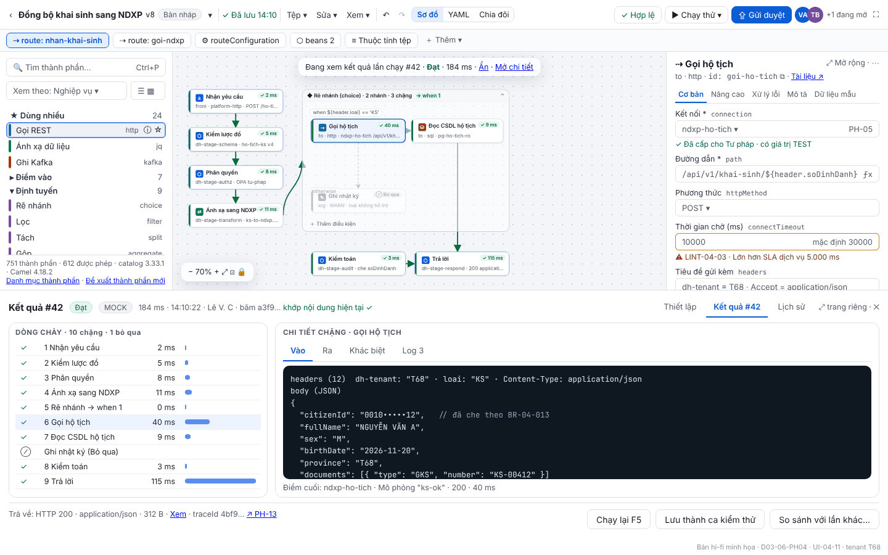

Canvas phía trên phủ kết quả lần chạy #42: chặng đạt có huy hiệu thời lượng, cạnh đã đi qua đậm màu xanh, nhánh otherwise mờ "Bỏ qua"; drawer dưới có dòng chảy kèm thanh waterfall, chi tiết chặng "Gọi hộ tịch" tab Vào với dữ liệu đã che, băm khớp nội dung hiện tại và nút "Lưu thành ca kiểm thử".

## 18. UI-04-12 Nhật ký chạy thử và UI-04-13 Ca kiểm thử

Hai màn của chương này cùng phục vụ bằng chứng chạy thử: UI-04-12 xem lại các lần đã chạy, UI-04-13 soạn bộ ca kiểm thử chạy lặp lại được.

### 18.1. UI-04-12 Nhật ký chạy thử

::: dac-ta
**Mục đích.** Xem lại, lọc, so sánh các lần chạy thử của một luồng và mở chi tiết từng lần làm bằng chứng duyệt.

**Người dùng chính.** IE, IA.

**FR hiện thực.** FR-04-032.

**Thay hệ cũ.** Không có; thay `RunLogPage` của repo.

**Đường dẫn.** `/tich-hop/luong/:ma/nhat-ky-chay-thu` với `ket-qua`, `nguoi-chay`, `phien-ban`, `tu`, `den`, `so-sanh`.

**Mẫu.** PTN-01 + trang chi tiết kết quả (mục 17.3).

**Quyền.** `PERM-04-read`; xem thân bản tin `SANDBOX_LIVE` cần `PERM-04-sample-data` (ghi kiểm toán).

**API.** API-04-041 (danh sách), 042 (chi tiết, thân chặng).

**Trạng thái màn.** Đang tải skeleton 8 dòng; rỗng "Luồng chưa có lần chạy thử nào." kèm "Chạy thử"; lọc rỗng ST-04; lỗi ST-05; không có quyền ST-06.

**Thông báo.** ERR-04-030 (lần chạy không tồn tại); "Thân bản tin đã xóa theo thời hạn lưu".
:::

FR-04-032. PTN-01: bảng các lần chạy của luồng: số, thời điểm, người chạy, phiên bản, băm rút gọn, chế độ (`MOCK`, `SANDBOX_LIVE`, `SIMULATED`), nguồn bản tin (mẫu, nhập tay, ca kiểm thử), kết quả, thời lượng, chặng lỗi, cờ "Dữ liệu thật". Lọc theo phiên bản, kết quả, người chạy, chế độ, khoảng thời gian. Chi tiết một lần chạy là trang kết quả của mục 17.3 với sơ đồ thời gian từng chặng (waterfall) và `traceId` liên kết sang PH-13. Chọn hai dòng → "So sánh" hiện hai dòng chảy cạnh nhau, so thời lượng từng chặng, tô chặng khác kết quả. Xem thân bản tin của lần chạy `SANDBOX_LIVE` cần `PERM-04-sample-data` và được ghi kiểm toán. Metadata giữ `04.test.retention-days` (mặc định 90 ngày), thân giữ `04.test.body-retention-days` (mặc định 7 ngày); quá hạn thì dòng vẫn còn nhưng chi tiết hiện "Thân bản tin đã xóa theo thời hạn lưu". Lần chạy đã được viện dẫn trong một lần duyệt có nhãn "Bằng chứng duyệt v{n}" và được giữ lâu hơn. Thay `RunLogPage` của repo.

#### 18.1.1. Bản hi-fi UI-04-12

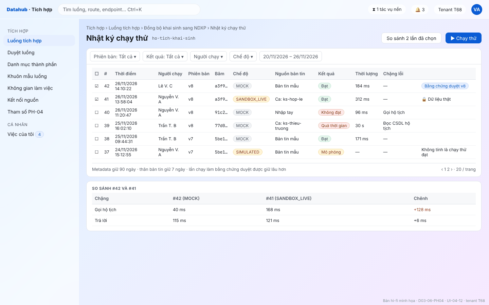

Bảng các lần chạy với chế độ MOCK, SANDBOX_LIVE, SIMULATED, cờ dữ liệu thật, nhãn "Bằng chứng duyệt v8"; hai lần được chọn so sánh thời lượng theo chặng ở khối dưới.

### 18.2. UI-04-13 Ca kiểm thử

::: dac-ta
**Mục đích.** Soạn, lưu, chạy bộ ca kiểm thử có khẳng định để mọi phiên bản sau được kiểm lại cùng một cách.

**Người dùng chính.** IE; IA chạy lại ca khi duyệt (cần `PERM-04-update`).

**FR hiện thực.** FR-04-031.

**Thay hệ cũ.** Không có (màn mới).

**Đường dẫn.** Không có; URL của UI-04-04 thêm `lop=ca-kiem-thu`.

**Mẫu.** `CMP-Drawer` phải 720 px.

**Quyền.** Xem `PERM-04-read`; soạn, chạy `PERM-04-update` + mức `EDIT`.

**API.** API-04-044 (danh sách, tạo, sửa, xóa), 040 (chạy ca).

**Trạng thái màn.** Rỗng "Chưa có ca kiểm thử. Lưu một lần chạy đạt thành ca để bắt đầu."; đang tải skeleton 4 dòng; lỗi ST-05; chỉ đọc khi không có quyền.

**Thông báo.** VR-20 (ca chưa có khẳng định), ERR-04-014 (còn ca chưa đạt khi gửi duyệt), 021.
:::

FR-04-031. Drawer phải 720 px từ "Chạy thử ▾ › Ca kiểm thử…" hoặc tab Chạy thử của UI-04-02.

| Phần | Nội dung |
|---|---|
| Danh sách ca | Tên, route vào, số khẳng định, kết quả lần chạy cuối trên băm hiện tại, nút ▶ chạy một ca, "Chạy tất cả" |
| Soạn ca | Tên, mô tả, route vào, bản tin vào, mô phỏng đích (như 17.2), **khẳng định**: mỗi dòng gồm Loại (`STATUS` mã trạng thái, `BODY_JQ` biểu thức JQ trên thân trả về, `HEADER`, `STEP_VISITED`, `STEP_NOT_VISITED`, `ENDPOINT_CALLED`, `DURATION_LT`, `ERROR_CODE`, `DLQ_SENT`) và Giá trị mong đợi; ô chọn chặng, điểm cuối khi loại cần |
| Tạo khẳng định nhanh | Từ kết quả một lần chạy: nhấp phải một giá trị trong tab Ra → "Khẳng định giá trị này" (sinh `BODY_JQ`); nhấp phải chặng trong dòng chảy → "Khẳng định đi qua chặng này" |
| Lưu trữ | Bộ ca lưu thành luồng loại `TEST` gắn với luồng đích, hoặc kèm phiên bản; xuất cùng gói luồng để chạy trong CI của kho cấu hình (cổng CI-5, D04-02) |
| Quy tắc | Mỗi ca phải có ít nhất một khẳng định (VR-20); "Lưu" vô hiệu khi chưa có. Khi gửi duyệt, mọi ca gắn với luồng phải đạt trên đúng băm (BR-04-004) |

: UI-04-13 · Các phần của drawer ca kiểm thử

#### 18.2.1. Bản hi-fi UI-04-13

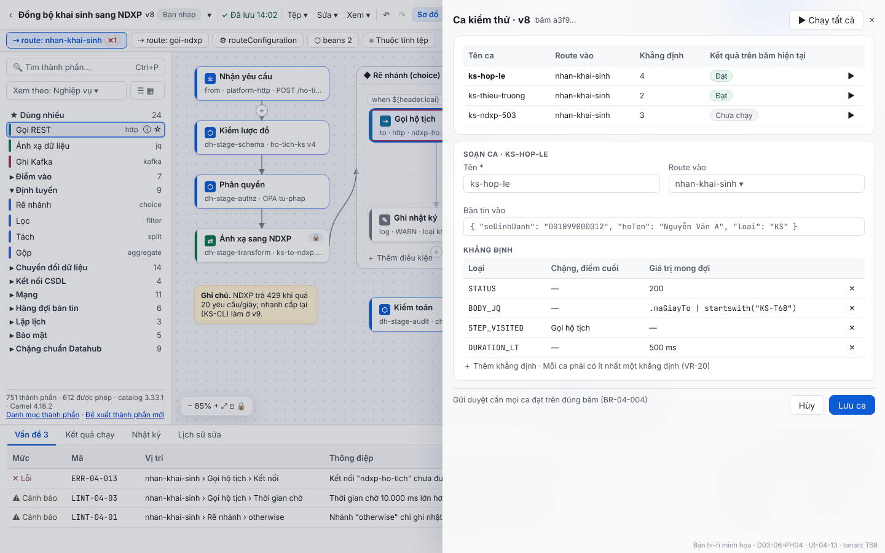

Drawer 720 px liệt kê ca và kết quả trên băm hiện tại; vùng soạn ca có bản tin vào và bảng khẳng định STATUS, BODY_JQ, STEP_VISITED, DURATION_LT.

## 19. UI-04-14 Hàng đợi duyệt và màn duyệt

Màn duyệt là nơi áp nguyên tắc bốn mắt; giao diện chỉ bật nút duyệt khi người duyệt đã xem khác biệt và đủ checklist.

::: dac-ta
**Mục đích.** Người duyệt xem đủ bằng chứng để quyết định, theo bốn mắt (BR-04-005, ADR-069).

**Người dùng chính.** IA.

**FR hiện thực.** FR-04-041, 043.

**Thay hệ cũ.** Không có ở Bus; thay `ReviewPage` của repo, nơi bốn mắt chỉ so `created_by` (GAP-04-07).

**Đường dẫn.** Hàng đợi `/tich-hop/duyet-luong?trang-thai=&khong-gian=&cua-toi=`; màn duyệt `/tich-hop/duyet-luong/:ma/:phienBan?tab=`.

**Mẫu.** PTN-10 Hộp việc và duyệt.

**Quyền.** IA (`PERM-04-publish`, mức `MAINTAIN` khi giới hạn không gian); lên PROD thêm `PERM-04-promote` khi `04.env.prod-requires-promote` bật.

**API.** API-04-053 (hàng đợi), 052 (quyết định), 025 (ghi nhận đã xem so sánh), 030 (kiểm tra mức `PUBLISH`), 043, 041 (bằng chứng chạy thử).

**Trạng thái đối tượng.** Phiên bản `PENDING_REVIEW` → `APPROVED` hoặc `CHANGES_REQUESTED`.

**Trạng thái màn.** Hàng đợi rỗng "Không có phiên bản nào chờ bạn duyệt."; đang tải skeleton; lỗi ST-05; không có quyền ST-06; đã có người duyệt, đã rút lại, ETag đổi (cuối mục 19.2).

**Thông báo.** ERR-04-005, 015, 025, 041, 042; thành công "Đã duyệt v{n}. Đang phát hành lên {env}."
:::

### 19.1. Hàng đợi `/tich-hop/duyet-luong`

Bảng: luồng, phiên bản, không gian, người gửi, thời điểm gửi và thời gian chờ (màu cảnh báo khi quá tham số đề xuất `04.review.sla-hours`, mặc định 24 giờ, mục 25), thay đổi so với bản đang chạy ở môi trường đích (+ ~ −), môi trường đích, huy hiệu bằng chứng cần chú ý ("CSDL trực tiếp", "Kịch bản", "Thành phần mới", "Kết nối mới", "Topic mới"). Bộ lọc nhanh: "Đề xuất cho tôi", "Tôi duyệt được", "Tôi đã gửi". Dòng mà người dùng không được duyệt vì đã tạo, đóng góp hoặc gửi hiện mờ với nhãn "Bạn đã tham gia soạn". Việc "Duyệt luồng" cũng có trong hộp "Việc của tôi" chung của console.

### 19.2. Màn duyệt `/tich-hop/duyet-luong/:ma/:phienBan`

```
  Tích hợp › Duyệt luồng › Đồng bộ khai sinh sang NDXP v8
  ┌──────────────────────────────────────────────────────────────────────────────────────────┐
  │ v8 [Chờ duyệt] · Gửi bởi Nguyễn V. A 14:12 · Người đóng góp: Trần T. B                   │
  │ Ghi chú: "Thêm nhánh xử lý giấy khai sinh cấp lại; tăng thời gian chờ NDXP…"             │
  │ Môi trường đích: STAGING     [Yêu cầu sửa] [Duyệt, phát hành sau] [Duyệt và phát hành lên STAGING]│
  └──────────────────────────────────────────────────────────────────────────────────────────┘
  Tóm tắt │ So sánh sơ đồ │ So sánh YAML │ Bằng chứng │ Bình luận 3 │ Checklist 0/4
```

| Tab | Nội dung |
|---|---|
| Tóm tắt | Ghi chú thay đổi, tóm tắt so sánh (FR-04-043): số chặng thêm, xóa, đổi, di chuyển; thành phần mới, kết nối mới, topic mới, điểm vào mới; hồ sơ runtime dự kiến |
| So sánh sơ đồ | So với phiên bản đang chạy ở môi trường đích (hoặc phiên bản gốc nếu chưa chạy): hai canvas chỉ đọc cạnh nhau đồng bộ thu phóng, cuộn, hoặc một canvas phủ khác biệt (mục 10.7.3, ba màu có nhãn chữ); chọn chặng đổi thì Inspector so sánh hiện từng tham số cũ → mới |
| So sánh YAML | `CMP-DiffViewer` theo dòng, gộp đoạn không đổi, cạnh nhau hoặc gộp; cây tệp trái gồm YAML, ánh xạ `*.dhmap.json`, ca kiểm thử |
| Bằng chứng | Kết quả kiểm tra mức `PUBLISH` cho môi trường đích (chạy lại lúc mở màn); lần chạy thử đạt và ca kiểm thử trên đúng băm; thành phần mới so với phiên bản trước; kết nối mới; topic mới; thay đổi truy cập CSDL (Q359: kết nối chỉ đọc, câu lệnh, có đặt `app.tenant_id`); biểu thức kịch bản nếu có. Người duyệt có `PERM-04-update` chạy lại được ca kiểm thử |
| Bình luận | Bình luận gắn với chặng hoặc dòng YAML (`CMP-CommentThread`); bình luận mở có huy hiệu trên chặng ở tab sơ đồ; khi phiên bản `CHANGES_REQUESTED`, tác giả thấy bình luận trong tab "Bình luận duyệt" của bảng dưới trình thiết kế |
| Checklist | Các mục của `04.review.checklist` (mặc định bốn mục FR-04-041: "Đã xem toàn bộ khác biệt", "Không có dữ liệu cá nhân đi ra ngoài mục đích", "Xử lý lỗi và DLQ phù hợp", "Đã kiểm tra kết nối và quyền CSDL mới"); mỗi mục một ô chọn bắt buộc |

: UI-04-14 · Các tab của màn duyệt

Hành động:

| Nút | Điều kiện bật | Hộp |
|---|---|---|
| Duyệt và phát hành lên {env} | Người dùng không thuộc người tạo, người đóng góp, người gửi (nút ẩn với họ; máy chủ vẫn chặn ERR-04-015); đã mở tab So sánh sơ đồ hoặc So sánh YAML ít nhất một lần (ghi nhận qua API-04-025, nếu chưa: tooltip "Mở tab so sánh trước khi duyệt"); đủ checklist; kiểm tra mức `PUBLISH` không có `ERROR`; với PROD khi `04.env.prod-requires-promote` bật cần thêm `PERM-04-promote` | Ý kiến bắt buộc; xác nhận gộp hộp phát hành (mục 20.1). Xác thực lại khi tham số đề xuất `04.review.require-reauth` bật |
| Duyệt, phát hành sau | Như trên trừ quyền phát hành | Ý kiến bắt buộc; phiên bản `APPROVED`, chưa triển khai |
| Yêu cầu sửa | `PERM-04-publish` | Ý kiến bắt buộc ≥ 10 ký tự; phiên bản sang `CHANGES_REQUESTED`, bình luận mở chuyển tới tác giả (EVT-04-05) |

: UI-04-14 · Hành động duyệt và điều kiện bật

Trạng thái: người khác đã duyệt khi đang xem → banner "Phiên bản đã được {user} duyệt lúc {giờ}" và nút ẩn; người gửi rút lại → banner và nút ẩn; ETag đổi → ERR-04-005 kèm "Tải lại". Người duyệt không có quyền xem chi tiết kết nối ở PH-05 vẫn thấy tên kết nối.

### 19.3. Bản hi-fi

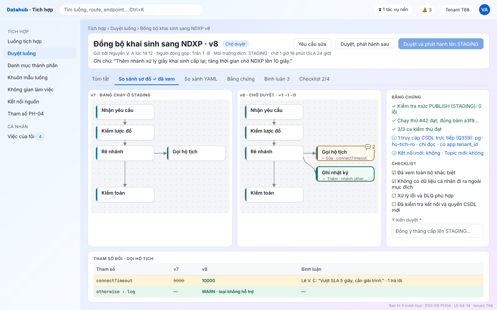

Hai canvas chỉ đọc v7 và v8 cạnh nhau, chặng sửa viền vàng "~ Sửa", chặng thêm viền xanh "＋ Thêm", bình luận gắn chặng; cột phải gom bằng chứng và checklist; nút "Duyệt và phát hành" còn mờ vì checklist mới đạt 2/4.

## 20. UI-04-15 Phát hành, triển khai, quay lui

Nhóm hộp và drawer của màn này đưa phiên bản vào vận hành thật, nên mọi hành động đều có kiểm tra trước, lý do và theo dõi tới khi runtime xác nhận.

::: dac-ta
**Mục đích.** Đưa phiên bản đã duyệt lên môi trường qua GitOps (ADR-063, 068), theo dõi đồng bộ tới khi runtime xác nhận băm, điều khiển chạy bằng lệnh có ký (ADR-065), thăng cấp, quay lui.

**Người dùng chính.** IA, TA; TO, SO cho tạm dừng, tiếp tục; TA, SO cho dừng khẩn.

**FR hiện thực.** FR-04-042, 044, 045, 050, 051.

**Thay hệ cũ.** Thay publish của repo vốn cho phép từ `DRAFT` và không nạp vào runtime (GAP-04-02, 03), lưu context XML của Bus (LGC-BUS-033) và Start/Stop qua JMX (LGC-BUS-009, 012, 026).

**Đường dẫn.** Không có; mở từ UI-04-02 (`tab=trien-khai`) và UI-04-14.

**Mẫu.** `CMP-Modal` 720 px cho hộp phát hành, `CMP-Drawer` phải cho theo dõi, tab Triển khai của UI-04-02.

**Quyền.** Theo mục 20.3 và chương 28 (`publish`, `promote`, `operate`, `emergency-stop`, `delete`).

**API.** API-04-054 (triển khai, SSE tiến trình), 055 (quay lui), 056 (thăng cấp), 060 (tình trạng runtime), 061 (lệnh điều khiển).

**Trạng thái đối tượng.** Triển khai `PENDING`, `SYNCING`, `SYNCED`, `OUT_OF_SYNC`, `FAILED`; lệnh `ISSUED`…`RECONCILED`, `PARTIAL`, `REJECTED` (mục 5.1).

**Trạng thái màn.** Đang kiểm tra trước (skeleton danh sách kiểm), một dòng ✕ thì nút chính vô hiệu, mất SSE thì tự nối lại và hiện "Đang nối lại…"; không có quyền thì nút ẩn.

**Thông báo.** ERR-04-017, 022, 023, 024, 025, 029, 040, 041, 042.
:::

### 20.1. Hộp phát hành, thăng cấp

```
┌ Thăng cấp v8 lên STAGING ────────────────────────────────────────────────────┐
│ Đang chạy ở STAGING: v7 (từ 21/11/2026)       Kiểm tra trước:                 │
│ Thay đổi: +2 ~3 −0 [Xem khác biệt]             ✓ v8 đã duyệt bởi Lê V. C       │
│ Biến môi trường STAGING: ✓ đủ 14/14            ✓ Đang SYNCED, khỏe ở TEST      │
│ Kết nối có giá trị STAGING: ✓ 2/2              ✓ Kiểm tra mức PUBLISH không lỗi│
│ Hồ sơ runtime: core-native (không đổi)         ✓ Không trong khoảng đóng băng  │
│ Cách áp dụng  (•) Thay ngay (REPLACE)  ( ) Theo lịch [dd/MM/yyyy HH:mm]        │
│               ( ) Canary (đợt 2, mờ)                                           │
│ Lý do, số phiếu thay đổi [YC-2026-1142 Bổ sung cấp lại khai sinh            ]  │
│                                                   [Hủy] [Thăng cấp]            │
└───────────────────────────────────────────────────────────────────────────────┘
```

Điều kiện theo FR-04-042, 045 và BR-04-019: phiên bản `APPROVED`, kiểm tra mức `PUBLISH` cho môi trường đích không có `ERROR`; lên môi trường cao hơn phải đang `SYNCED` và khỏe ở môi trường trước, đã chạy ổn định ít nhất `04.env.soak-minutes` (mặc định 30 phút ở STAGING, 0 ở TEST), thiếu thì ERR-04-023 kèm thời gian còn lại; không trong `04.freeze.windows` khi đích là PROD (ERR-04-041). Lên PROD cần `PERM-04-promote` khi `04.env.prod-requires-promote` bật; lên PROD ngoài giờ hành chính hiện cảnh báo, không chặn. Theo lịch: trong 30 ngày tới.

### 20.2. Theo dõi triển khai

Sau khi gửi, drawer theo dõi hiện các bước dạng `CMP-Steps` dọc, cập nhật qua SSE của API-04-054:

| Bước | Nội dung hiển thị | Lỗi |
|---|---|---|
| 1. Ghi kho cấu hình (`PENDING`) | Commit có ký `a1b2c3d` vào `dh-flows-{tenant}` nhánh `env/{môi trường}`, thông điệp `flow({mã}): v{n} → {env}`; với PROD hiện yêu cầu gộp tự động và trạng thái CI kho cấu hình | ERR-04-022, triển khai không được tạo, nút "Thử lại" |
| 2. Đồng bộ Argo CD (`SYNCING`) | "Đang đồng bộ…", tên ứng dụng ApplicationSet, trạng thái Argo | Quá `04.deploy.timeout-minutes` (mặc định 10) → `FAILED` với lý do từ Argo CD |
| 3. Runtime nạp | "{k}/{n} bản sao đã nạp v{n} (băm khớp)" theo nhịp tim 30 giây | Bản sao báo lỗi nạp route: log lỗi, nút "Quay lui về v{n-1}" |
| 4. `SYNCED` và sức khỏe | Sức khỏe `HEALTHY`, `DEGRADED`, `DOWN`, `UNKNOWN`; lượng bản tin, tỷ lệ lỗi 5 phút đầu so với phiên bản trước | Tỷ lệ lỗi tăng vượt tham số đề xuất `04.deploy.rollback-suggest-error-ratio` → dải "Tỷ lệ lỗi tăng so với v{n-1}. Cân nhắc quay lui." và nút "Quay lui"; không tự quay lui |

: UI-04-15 · Theo dõi triển khai

Khi PROD `SYNCED`: phiên bản trước chuyển `SUPERSEDED`, luồng `ACTIVE`. Đóng drawer được; tiến trình vẫn ở thẻ môi trường của UI-04-02 và khay tác vụ nền.

### 20.3. Điều khiển chạy và quay lui

| Hành động | Hộp | Quyền, điều kiện |
|---|---|---|
| Tạm dừng ở {env} | Phạm vi: cả luồng hoặc chọn route; lý do 10–1.000 ký tự; "Chờ bản tin đang xử lý xong (tối đa 60 giây)" bật sẵn; nếu route bị luồng khác gọi qua `direct:`, danh sách luồng bị ảnh hưởng hiện trước khi gửi | `PERM-04-operate`; có triển khai `SYNCED` ở môi trường (ERR-04-023) |
| Tiếp tục ở {env} | Phạm vi, lý do | `PERM-04-operate` |
| Dừng khẩn ở {env} | Hộp nguy hiểm: gõ lại mã luồng, lý do; giải thích "Dừng ngay mọi route, không chờ bản tin đang xử lý. Bản tin dở được đưa sang DLQ với lý do dừng khẩn. Lệnh có hiệu lực trước, ghi Git sau." | `PERM-04-emergency-stop`; dùng được cả trong khoảng đóng băng (BR-04-022) |
| Quay lui | Chọn phiên bản đích (`APPROVED` hoặc `SUPERSEDED`, mặc định bản ngay trước), xem khác biệt, lý do bắt buộc; kiểm tra mức `PUBLISH` hiện tại chạy lại (thành phần có thể đã bị cấm: ERR-04-040) | `PERM-04-publish`; không cần duyệt lại; phiên bản đang chạy chuyển `ROLLED_BACK` |
| Gỡ luồng | Danh sách phụ thuộc (ERR-04-017 nếu còn), gõ lại mã, lý do; gỡ khỏi mọi môi trường | `PERM-04-delete` |

: UI-04-15 · Điều khiển chạy và quay lui

Sau mỗi lệnh, hàng lệnh trong tab Triển khai hiện trạng thái lệnh (mục 5.1): `ISSUED` → `DELIVERED` → "{k}/{n} bản sao đã xác nhận" → `ACKNOWLEDGED` → `RECONCILED` khi Git đã ghi trạng thái mong muốn (BR-04-018, trong 5 phút). Hết 30 giây chưa đủ xác nhận: `PARTIAL` với danh sách bản sao chưa xác nhận và nút "Gửi lại lệnh"; runtime từ chối (chữ ký sai, hết hạn 60 giây): `REJECTED` với ERR-04-024.

### 20.4. Bản hi-fi

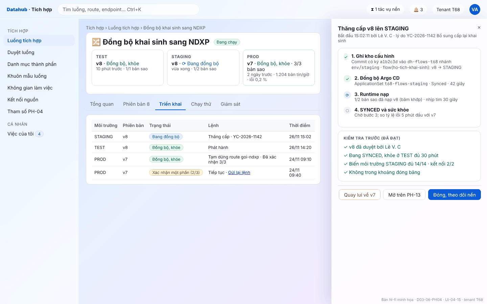

Drawer theo dõi bốn bước GitOps: ghi kho cấu hình có ký, đồng bộ Argo CD, runtime nạp 1/2 bản sao, chờ SYNCED và sức khỏe; tab Triển khai phía sau có lệnh tạm dừng đã xác nhận và một lệnh xác nhận một phần kèm "Gửi lại lệnh".

## 21. UI-04-16 So sánh phiên bản

Màn so sánh trả lời câu hỏi "phiên bản này khác phiên bản kia ở đâu" cho người soạn, người duyệt và người vận hành, theo ba cách nhìn.

::: dac-ta
**Mục đích.** So sánh hai phiên bản bất kỳ của một luồng trên sơ đồ, YAML và bảng tóm tắt; liên kết sâu tới từng thay đổi.

**Người dùng chính.** Mọi vai trò có `PERM-04-read`; IA dùng nhiều nhất trước khi duyệt.

**FR hiện thực.** FR-04-043.

**Thay hệ cũ.** Tab Source của Bus (LGC-BUS-023).

**Đường dẫn.** `/tich-hop/luong/:ma/so-sanh?tu=&den=&che-do=` (`so-do`, `yaml`, `tom-tat`).

**Mẫu.** Trang riêng dùng `CMP-DiffViewer` và hai `CMP-FlowCanvas` chỉ đọc.

**Quyền.** `PERM-04-read` + quyền xem không gian.

**API.** API-04-025 (so sánh), 024 (danh sách phiên bản), 020 (định nghĩa hai phía).

**Trạng thái màn.** Mục 21.4.

**Thông báo.** ERR-04-001, 004; "Hai phiên bản giống hệt nhau."
:::

FR-04-043. Trang riêng, chọn "Từ" và "Đến" (phiên bản bất kỳ, hoặc "đang chạy ở {env}"). Ba chế độ: Sơ đồ (phủ khác biệt thêm, xóa, đổi, di chuyển; ghép chặng theo `id`, chặng không có `id` ổn định ghép theo vị trí và loại), YAML (`CMP-DiffViewer` unified hoặc hai cột), Tóm tắt (số chặng đổi, thành phần mới, kết nối mới, topic mới, điểm vào mới, bảng tham số đổi theo chặng). Liên kết sâu tới từng thay đổi; nút "Mở trên sơ đồ" từ YAML. Thay tab Source của Bus (LGC-BUS-023) khi cần đối chiếu.

### 21.1. Wireframe

```
  Tích hợp › Luồng tích hợp › Đồng bộ khai sinh sang NDXP › So sánh
  Từ [v7 · đang chạy ở PROD ▾]  ⇄  Đến [v8 · Chờ duyệt ▾]      [Sơ đồ | YAML | Tóm tắt]  [⧉ Sao chép liên kết]
  +2 chặng · ~3 chặng · −0 · ↕1 · 1 kết nối mới · 0 topic mới                   ‹ Thay đổi trước  Thay đổi sau ›
  ┌ v7 (chỉ đọc) ───────────────────────────┐ ┌ v8 (chỉ đọc) ──────────────────────────────┐
  │ Nhận yêu cầu → Kiểm lược đồ → Rẽ nhánh   │ │ Nhận yêu cầu → Kiểm lược đồ → Rẽ nhánh      │
  │                                         │ │   ~ Gọi hộ tịch (timeout)  + Ghi nhật ký    │
  └─────────────────────────────────────────┘ └────────────────────────────────────────────┘
  Tham số đổi của chặng chọn: Gọi hộ tịch · connectTimeout 5000 → 10000
```

### 21.2. Thành phần và trường

| # | Thành phần | `CMP-*` | Nội dung, kiểm tra | Nguồn |
|---|---|---|---|---|
| 1 | Chọn "Từ", "Đến" | `CMP-Select` | Phiên bản bất kỳ hoặc "đang chạy ở {env}"; "Đến" mặc định phiên bản mới nhất; hai phía trùng thì báo "Hai phiên bản giống hệt nhau." | API-04-024 |
| 2 | Nút ⇄ | `CMP-Button` icon | Đổi chiều so sánh | |
| 3 | Chế độ | `CMP-SegmentedControl` | Sơ đồ, YAML, Tóm tắt; lưu vào `che-do` | |
| 4 | Dải tổng | `CMP-StatusTag` | Đếm thêm, sửa, xóa, di chuyển, thành phần, kết nối, topic, điểm vào mới | API-04-025 `summary` |
| 5 | Hai canvas | `CMP-FlowCanvas` readOnly | Đồng bộ thu phóng, cuộn; trạng thái khác biệt mục 10.7.3 | API-04-020 |
| 6 | Bảng tham số đổi | `CMP-DataTable` | Chặng, tham số, cũ, mới | API-04-025 `params[]` |
| 7 | Khung YAML | `CMP-DiffViewer` | Unified hoặc hai cột, gộp đoạn không đổi, nút "Mở trên sơ đồ" ở mỗi khối | API-04-025 `yamlDiff` |

: UI-04-16 · Thành phần và trường

### 21.3. Hành động

| Hành động | Kết quả |
|---|---|
| "Thay đổi trước", "Thay đổi sau" | Cuộn và chọn thay đổi kế tiếp ở chế độ đang mở |
| "Mở trên sơ đồ" | Chuyển chế độ Sơ đồ, chọn chặng của khối YAML |
| "Sao chép liên kết" | Liên kết sâu gồm `tu`, `den`, `che-do` và mã thay đổi |
| "Mở trình thiết kế" | Mở UI-04-04 ở phiên bản "Đến" với lớp phủ khác biệt |

: UI-04-16 · Hành động

### 21.4. Trạng thái màn

| Trạng thái | Hiển thị |
|---|---|
| Đang tải | Skeleton hai canvas và dải tổng "—" |
| Không có khác biệt | `CMP-EmptyState` "Hai phiên bản giống hệt nhau." |
| Phiên bản không tồn tại | ST-05 với ERR-04-004 |
| Không có quyền | ST-05 với ERR-04-001 (không phân biệt) |
| Khác biệt lớn (> 500 dòng YAML) | Mặc định chế độ Tóm tắt, cảnh báo hiệu năng |

: UI-04-16 · Trạng thái màn

### 21.5. Bàn phím

`N`, `P` sang thay đổi sau, trước; `Ctrl+1`, `Ctrl+2`, `Ctrl+3` đổi chế độ; `S` đổi chiều; `Enter` trên khối YAML mở trên sơ đồ. Mỗi thay đổi có `aria-label` "Sửa, chặng Gọi hộ tịch, tham số connectTimeout".

### 21.6. Bản hi-fi

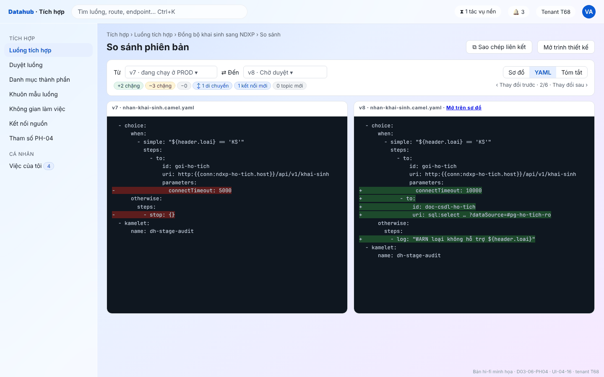

Dải tổng đếm thêm, sửa, xóa, di chuyển, kết nối mới; hai khung YAML tô dòng xóa đỏ, dòng thêm xanh, có liên kết "Mở trên sơ đồ" và nút chuyển thay đổi trước, sau.

## 22. UI-04-17 Danh mục thành phần

Danh mục thành phần cho mọi người thấy tỉnh được dùng thành phần Camel nào, và là nơi PA quản lý chính sách cho phép.

::: dac-ta
**Mục đích.** Duyệt, tìm, xem chi tiết thành phần của catalog đúng phiên bản runtime; quản lý chính sách được phép, bản dịch, nhóm nghiệp vụ, hồ sơ runtime.

**Người dùng chính.** Mọi vai trò; PA quản lý chính sách, SO duyệt.

**FR hiện thực.** FR-04-080, 081.

**Thay hệ cũ.** Quản lý dependency, builder của Bus (LGC-BUS-034); danh mục connector (LGC-BUS-040).

**Đường dẫn.** `/tich-hop/thanh-phan?loai=&nhan=&q=&chinh-sach=&chon=`.

**Mẫu.** PTN-08 Cây + bảng, chi tiết dạng drawer.

**Quyền.** Xem `PERM-04-read`; đổi chính sách, bản dịch, nhóm, hồ sơ `PERM-04-catalog-admin`.

**API.** API-04-070, 071, 072, 073, 074.

**Trạng thái màn.** Mục 22.5.

**Thông báo.** ERR-04-035, 025 (thiếu lý do), 045.
:::

FR-04-080, 081. PTN-08: cây trái là nhóm nghiệp vụ hoặc loại (component, EIP, Kamelet, dataformat, language, entity, load balancer); bảng phải: tên, tiêu đề, loại, mức hỗ trợ (`stable`, `preview`, `deprecated`), mức native, giấy phép, **được phép ở tỉnh** (Có, Không), số luồng dùng. Chi tiết (drawer): mô tả, tham số (bảng đầy đủ), ví dụ YAML, luồng đang dùng. PA (`PERM-04-catalog-admin`) đổi cờ được phép (lý do bắt buộc; SO duyệt), sửa bản dịch tiếng Việt, sửa ánh xạ nhóm nghiệp vụ, quản lý hồ sơ runtime, xem lịch sử. Người khác có nút "Đề xuất thành phần mới", "Đề xuất cho phép" tạo yêu cầu tới PA. Chân trang: "Catalog Camel {ver} · khớp runtime {ver} ✓" hoặc cảnh báo lệch (ADR-061). Thay `ComponentCatalogPage` của repo và việc quản lý dependency, builder của Bus (LGC-BUS-034).

### 22.1. Wireframe

```
  Tích hợp › Danh mục thành phần                       [Đề xuất thành phần mới]  [Hồ sơ runtime] (PA)
  [🔍 Tìm tên, tiêu đề, mô tả…]  [Loại ▾] [Mức hỗ trợ ▾] [Native ▾] [Được phép ở tỉnh ▾]
  ┌ Nhóm ──────────────┐ ┌───────────────────────────────────────────────────────────────────────┐
  │ Tất cả        751  │ │ Tên        │ Tiêu đề       │ Loại      │ Hỗ trợ │ Native │ Được phép │ Dùng │
  │ ▸ Điểm vào      42 │ │ http       │ Gọi HTTP      │ component │ stable │ ✓      │ Có        │ 61   │
  │ ▾ Mạng          88 │ │ sftp       │ SFTP          │ component │ stable │ ✓      │ Có        │ 9    │
  │   Kamelet của tỉnh │ │ exec       │ Chạy lệnh     │ component │ stable │ ✕ JVM  │ Không     │ 0    │
  └────────────────────┘ └───────────────────────────────────────────────────────────────────────┘
  Catalog Camel 4.18.2 · @kaoto/camel-catalog 3.33.1 · khớp runtime ✓
```

### 22.2. Thành phần và cột

| Cột, thành phần | `CMP-*` | Nội dung | Ghi chú |
|---|---|---|---|
| Cây nhóm | `CMP-Tree` | Nhóm nghiệp vụ (mục 5.2) hoặc loại; số lượng | Chuyển bằng "Xem theo" |
| Tên | `CMP-CodeText` | `name` catalog, liên kết mở drawer | Ghim trái |
| Tiêu đề | Chữ | Tiếng Việt, hoặc tiếng Anh kèm nhãn "EN" | |
| Loại | `CMP-StatusTag` neutral | component, EIP, Kamelet, dataformat, language | |
| Mức hỗ trợ | `CMP-StatusTag` | Ổn định, Thử nghiệm (warning), Lỗi thời (error) | |
| Native | Biểu tượng + chữ | ✓ hoặc "JVM" | |
| Được phép ở tỉnh | `CMP-Switch` (PA) hoặc chữ | Có, Không | Đổi cần lý do, SO duyệt |
| Số luồng dùng | Số | Liên kết lọc UI-04-01 | |
| Drawer chi tiết | `CMP-Drawer` 640 px | Mô tả, bảng tham số đầy đủ, ví dụ YAML, luồng đang dùng, lịch sử chính sách | API-04-071 |

: UI-04-17 · Thành phần và cột

### 22.3. Hành động

| Hành động | Ai | Kết quả |
|---|---|---|
| Đổi "Được phép" | PA | Hộp lý do ≥ 10 ký tự; tạo yêu cầu SO duyệt; luồng đang dùng thành phần bị cấm nhận ERR-04-011 ở lần kiểm tra sau |
| Sửa bản dịch, nhóm nghiệp vụ | PA | Ghi `palette-groups.json`, bản dịch; áp ở lần tải catalog sau |
| "Đề xuất thành phần mới", "Đề xuất cho phép" | Mọi người | Hộp tên, lý do, luồng cần dùng; tạo đề xuất (API-04-074) |
| Quyết định đề xuất | PA | Chấp nhận hoặc từ chối kèm ý kiến |

: UI-04-17 · Hành động

### 22.4. Thông điệp

- Lệch phiên bản: "Catalog trình thiết kế {ver} khác runtime {ver}. Liên hệ quản trị nền tảng." (dải cảnh báo chân trang, ADR-061).
- Gửi đề xuất: "Đã gửi đề xuất {tên}. Quản trị nền tảng sẽ phản hồi trong hộp việc của bạn."

### 22.5. Trạng thái màn và bàn phím

Đang tải: skeleton cây 10 dòng, bảng 8 dòng. Lọc rỗng: ST-04. Lỗi tải: ST-05. Không có quyền quản lý: cột "Được phép" là chữ, nút quản lý ẩn. Phím: `/` tìm; `↑`, `↓` chọn dòng; `Enter` mở drawer; `Esc` đóng; `F6` chuyển giữa cây và bảng.

### 22.6. Bản hi-fi

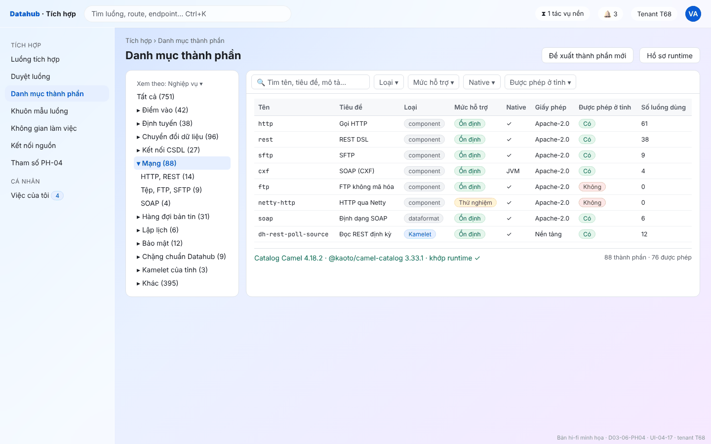

Cây nhóm nghiệp vụ bên trái, bảng thành phần nhóm Mạng bên phải với mức hỗ trợ, native, cờ "Được phép ở tỉnh" (`ftp` và `netty-http` không được phép); chân bảng xác nhận catalog khớp runtime.

## 23. UI-04-18 Nhập luồng hệ cũ

Màn nhập phục vụ di trú từ LGSP cũ: chuyển XML Camel của Bus, Tooling thành bản nháp luồng mà không mang theo bí mật.

::: dac-ta
**Mục đích.** Chuyển route Camel XML của hệ cũ thành luồng nháp v1 trên Datahub, có báo cáo điểm cần chỉnh.

**Người dùng chính.** IE, đội di trú.

**FR hiện thực.** FR-04-082.

**Thay hệ cũ.** Lưu context XML của Bus (LGC-BUS-033); tải XML của Tooling (LGC-TOOL-015).

**Đường dẫn.** `/tich-hop/luong/nhap-he-cu?buoc=&tac-vu=`.

**Mẫu.** PTN-09 Nhập dữ liệu có xem trước, bốn bước.

**Quyền.** `PERM-04-create` + mức `EDIT` ở không gian đích.

**API.** API-04-028 (tạo tác vụ, đọc kết quả), 011 (tạo luồng), PH-05 (chọn kết nối).

**Trạng thái màn.** Mục 23.4.

**Thông báo.** ERR-04-032, 002, 011, 027; kết quả "Đã tạo {n} luồng nháp. {m} route cần chỉnh."
:::

FR-04-082. PTN-09, bốn bước: ① Tải tệp (XML Camel Spring, Blueprint xuất từ Tooling cũ, hoặc gói `.zip` nhiều tệp); ② Phân tích: mỗi route một dòng với trạng thái chuyển đổi (Tự động hoàn toàn, Cần chỉnh {n} điểm, Không chuyển được) và danh sách điểm cần chỉnh (thành phần không được phép, bí mật nhúng trong URI được tách ra thành chỗ cần chọn kết nối, bean lớp tùy biến, phụ thuộc `pom`); ③ Ánh xạ: chọn không gian, mã luồng, kết nối PH-05 cho mỗi bí mật được tách, bọc khung chín chặng cho luồng đối ngoại (tùy chọn); ④ Xem trước và tạo: mỗi luồng thành một bản nháp v1, có liên kết mở trình thiết kế. Bí mật tìm thấy trong tệp hệ cũ không bao giờ được lưu; báo cáo nhập liệt kê vị trí để đổi mật khẩu ở hệ nguồn. Tác vụ nền (ST-11). Phục vụ di trú và chạy song song strangler (Q12).

### 23.1. Wireframe bước ②

```
  Nhập luồng hệ cũ   ① Tải tệp ── ② Phân tích ── ③ Ánh xạ ── ④ Xem trước và tạo            ✕ Hủy
  Tệp: bus-export-2026-11.zip · 14 route · phân tích xong 09:12
  [Tất cả 14] [Tự động 9] [Cần chỉnh 4] [Không chuyển được 1]
  │ Route              │ Tệp                │ Trạng thái            │ Điểm cần chỉnh                     │
  │ hotich-ks-sync     │ hotich.xml         │ ✓ Tự động hoàn toàn   │ —                                  │
  │ dkkd-tra-cuu       │ dkkd.xml           │ ⚠ Cần chỉnh 2 điểm    │ Bí mật trong URI · bean tùy biến   │
  │ thue-ftp-legacy    │ thue.xml           │ ✕ Không chuyển được   │ Thành phần ftp không được phép     │
                                                             [‹ Quay lại]  [Tiếp tục →]
```

### 23.2. Trường từng bước

| Bước | Trường | Kiểm tra |
|---|---|---|
| ① Tải tệp | `CMP-Upload` dropzone: `.xml`, `.zip` | ≤ 2 MiB; XML Camel Spring hoặc Blueprint hợp lệ (ERR-04-032) |
| ② Phân tích | Bảng route: tên, tệp, trạng thái, điểm cần chỉnh; lọc theo trạng thái | Chỉ đọc; bỏ chọn route không muốn nhập |
| ③ Ánh xạ | Không gian, mã luồng (mặc định từ `routeId`), kết nối PH-05 cho mỗi bí mật được tách, ô "Bọc khung chín chặng" | Mã theo mẫu của mục 9.2, không trùng (ERR-04-002); mọi bí mật phải có kết nối |
| ④ Xem trước | Mỗi luồng: sơ đồ thu nhỏ, YAML, kết quả kiểm tra `DESIGN` | Nút "Tạo {n} luồng nháp" |

: UI-04-18 · Trường từng bước

### 23.3. Hành động và thông điệp

"Tạo" chạy tác vụ nền (ST-11), xong thì báo cáo nhập liệt kê luồng tạo được (liên kết mở UI-04-04), route bỏ qua và **vị trí bí mật đã thấy** kèm câu "Bí mật tìm thấy trong tệp không được lưu. Đổi mật khẩu ở hệ nguồn tại các vị trí sau." Nút "Tải báo cáo" xuất CSV. Route "Không chuyển được" có nút "Xem lý do".

### 23.4. Trạng thái màn và bàn phím

Đang phân tích: `CMP-JobProgress` "Đang phân tích {k}/{n} route". Rỗng: dropzone "Kéo tệp XML hoặc ZIP vào đây". Lỗi: ST-05. Không có quyền: ST-06. Rời giữa chừng: ST-10, tác vụ đã chạy vẫn giữ trong khay nền. Phím: `Enter` tiếp tục, `Alt+←` quay lại, `↑`, `↓` duyệt route, `Space` chọn hoặc bỏ route.

### 23.5. Bản hi-fi

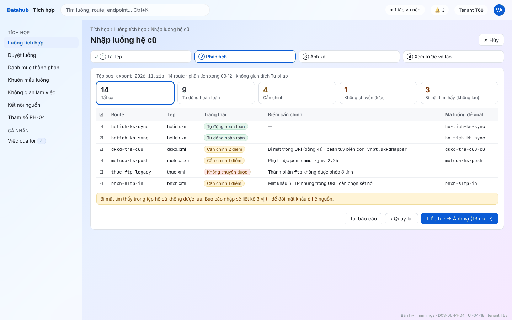

Kết quả phân tích tệp ZIP của Bus: đếm theo trạng thái chuyển đổi, bảng route với điểm cần chỉnh (bí mật trong URI, bean tùy biến, thành phần không được phép) và cảnh báo bí mật không được lưu.

## 24. UI-04-19 Thư viện khuôn mẫu

Thư viện khuôn mẫu giúp mọi luồng mới bắt đầu từ một khung đã chuẩn hóa thay vì từ trang trắng.

::: dac-ta
**Mục đích.** Duyệt, xem trước và dùng khuôn mẫu luồng; TA, PA quản lý khuôn của tỉnh và khuôn nền.

**Người dùng chính.** IE; PA, TA quản lý.

**FR hiện thực.** FR-04-025.

**Thay hệ cũ.** Không có (màn mới).

**Đường dẫn.** `/tich-hop/khuon-mau?nhom=&loai=&q=`.

**Mẫu.** PTN-01 dạng lưới thẻ, chi tiết dạng drawer.

**Quyền.** Xem `PERM-04-create` hoặc `PERM-04-catalog-admin` (mục 4.3); khuôn nền `PERM-04-catalog-admin`; khuôn tỉnh `PERM-04-admin`.

**API.** API-04-080, 081, 082.

**Trạng thái màn.** Mục 24.3.

**Thông báo.** ERR-04-039, 045; "Đã lưu khuôn {mã}."
:::

FR-04-025. Lưới thẻ: mã, tên, sơ đồ thu nhỏ (ảnh minh họa của khuôn), mô tả, loại tài nguyên, nhóm, số lần dùng, phạm vi (Nền tảng, Tỉnh). Bộ lọc theo nhóm và loại. Chi tiết khuôn: sơ đồ, lược đồ tham số `${tpl.*}`, YAML, "Dùng khuôn này" (mở UI-04-03 bước 2). Khuôn nền do PA quản lý (`PERM-04-catalog-admin`); khuôn của tenant do TA quản lý, tạo từ một luồng đã duyệt bằng "Lưu làm khuôn mẫu" ở UI-04-02. Tám khuôn nền tối thiểu ở MVP theo FR-04-025: `tpl-standard-9`, `tpl-sync-lookup`, `tpl-soap-to-rest`, `tpl-db-poll-to-kafka`, `tpl-kafka-to-rest`, `tpl-sftp-to-kafka`, `tpl-ndxp-proxy`, `tpl-cdm-normalize`. Khuôn cho các dịch vụ NGSP (Tư pháp, BHXH, ĐKKD, mã ĐVQHNS, DMDC quốc gia, VBQPPL) và PayGov (PH-19) bổ sung ở đợt sau, dùng `tpl-ndxp-proxy` làm gốc.

### 24.1. Wireframe

```
  Tích hợp › Khuôn mẫu luồng                                              [＋ Khuôn của tỉnh] (TA)
  [🔍 Tìm khuôn…]  [Tất cả] [Tra cứu đồng bộ] [Đồng bộ định kỳ] [Nhận sự kiện] [Tệp] [Quốc gia]
  ┌ tpl-standard-9 ──────────┐ ┌ tpl-sync-lookup ─────────┐ ┌ tpl-ndxp-proxy ──────────┐
  │ Khung chín chặng chuẩn   │ │ Tra cứu đồng bộ REST     │ │ Ủy quyền NDXP            │
  │ [sơ đồ thu nhỏ]          │ │ [sơ đồ thu nhỏ]          │ │ [sơ đồ thu nhỏ]          │
  │ Nền tảng · Dùng 58 lần   │ │ Nền tảng · Dùng 34 lần   │ │ Nền tảng · Dùng 21 lần   │
  └──────────────────────────┘ └──────────────────────────┘ └──────────────────────────┘
```

### 24.2. Thẻ, chi tiết và hành động

| Phần | Nội dung | Ghi chú |
|---|---|---|
| Thẻ khuôn (`CMP-Card`) | Mã `CMP-CodeText`, tên, sơ đồ thu nhỏ, mô tả 2 dòng, loại tài nguyên, nhóm, phạm vi (Nền tảng, Tỉnh), số lần dùng | Thẻ có `role="link"`; khuôn ngừng dùng mờ kèm nhãn |
| Bộ lọc | Nhóm (`CMP-SegmentedControl`), loại (`ROUTE`, `KAMELET`, `PIPE`), phạm vi, ô tìm | Ghi URL |
| Drawer chi tiết | Sơ đồ chỉ đọc, bảng tham số `${tpl.*}` (tên, kiểu, bắt buộc, mô tả), YAML, lịch sử phiên bản khuôn | API-04-081 |
| "Dùng khuôn này" | Mở UI-04-03 bước 2 với `khuon={mã}` | Nút chính |
| "Ngừng dùng" | TA với khuôn tỉnh; PA với khuôn nền; lý do bắt buộc | API-04-082 `:deprecate` |
| "Khuôn của tỉnh" | Chọn một phiên bản `APPROVED`, đặt mã `tpl-…`, khai tham số | Hoặc "Lưu làm khuôn mẫu" ở UI-04-02 |

: UI-04-19 · Thẻ, chi tiết và hành động

### 24.3. Trạng thái màn và bàn phím

Đang tải: lưới 6 thẻ skeleton. Không có khuôn của tỉnh: vẫn hiện tám khuôn nền. Lọc rỗng: ST-04. Lỗi: ST-05. Không có quyền: mục menu ẩn, vào bằng URL nhận ST-06. Phím: `/` tìm; mũi tên chuyển thẻ theo lưới; `Enter` mở chi tiết; `U` dùng khuôn đang chọn.

### 24.4. Bản hi-fi

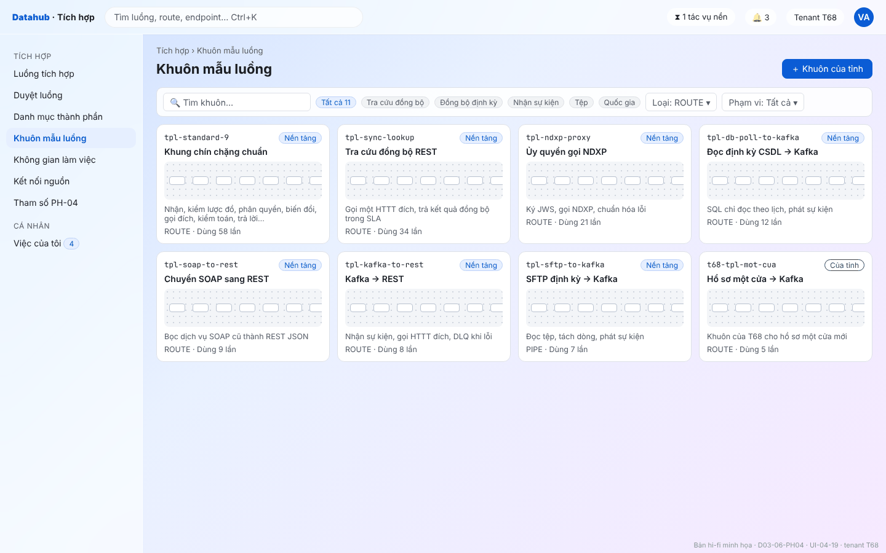

Lưới thẻ tám khuôn: bảy khuôn nền tảng và một khuôn của tỉnh T68, mỗi thẻ có sơ đồ thu nhỏ, loại tài nguyên và số lần dùng; bộ lọc nhóm ở đầu.

## 25. UI-04-20 Tham số PH-04

::: dac-ta
**Mục đích.** Đặt tham số `04.*`, biến môi trường và khoảng đóng băng của PH-04 cho tỉnh.

**Người dùng chính.** TA; SO đặt khoảng đóng băng.

**FR hiện thực.** FR-04-084.

**Thay hệ cũ.** Màn cấu hình hệ thống của Bus (LGC-BUS-031).

**Đường dẫn.** `/quan-tri/tham-so?nhom=04`.

**Mẫu.** Màn tham số chung của PH-18.

**Quyền.** Xem `PERM-04-read`; sửa `PERM-04-admin`.

**API.** API-04-090.

**Trạng thái màn.** Theo màn tham số PH-18; giá trị ngoài miền báo tại ô.

**Thông báo.** ERR-04-049 (giá trị sai lược đồ), 025 (thiếu lý do khi đổi khoảng đóng băng).
:::

FR-04-084. Không có màn riêng: nhóm "04 · Tích hợp" trong màn tham số chung của PH-18 (`/quan-tri/tham-so?nhom=04`), hiện các tham số `04.*` của FRS §7.1 với miền giá trị, mặc định, giá trị tỉnh, người sửa cuối; khai báo biến môi trường `{{dh.env.<tên>}}` với giá trị theo TEST, STAGING, PROD; đặt khoảng đóng băng `04.freeze.windows` (TA, SO). Thay màn cấu hình hệ thống của Bus (LGC-BUS-031).

Thiết kế giao diện cần thêm năm tham số; đề nghị bổ sung vào FRS §7.1 (đã thêm ở bản này của FRS):

| Tham số đề xuất | Kiểu | Mặc định | Miền | Dùng ở |
|---|---|---|---|---|
| `04.flow.require-legal-basis` | boolean | `false` | — | UI-04-03: bắt buộc căn cứ pháp lý với luồng đối ngoại |
| `04.review.sla-hours` | số | 24 | 1…168 | UI-04-14: tô thời gian chờ duyệt quá hạn |
| `04.review.require-reauth` | boolean | `false` | Luôn `true` khi đích là PROD | UI-04-14, 15: xác thực lại khi duyệt, phát hành |
| `04.deploy.rollback-suggest-error-ratio` | số | 2,0 | 1,1…10 | UI-04-15: gợi ý quay lui khi tỷ lệ lỗi 5 phút đầu gấp n lần phiên bản trước |
| `04.mapping.require-all-required` | boolean | `false` | — | UI-04-07: trường bắt buộc chưa ánh xạ thành lỗi ở mức gửi duyệt |

: UI-04-20 · Tham số giao diện đề xuất bổ sung FRS §7.1

### 25.1. Bản hi-fi

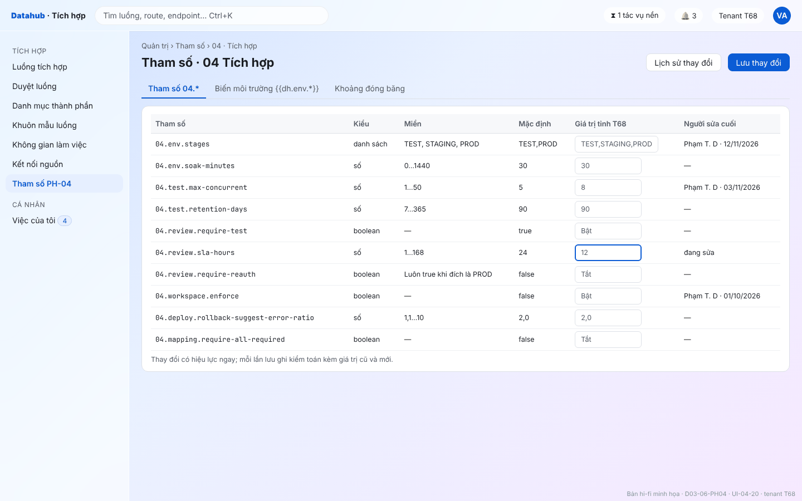

Nhóm "04 · Tích hợp" trong màn tham số chung với miền, mặc định, giá trị của tỉnh T68 và người sửa cuối; ô `04.review.sla-hours` đang sửa.

## 26. UI-04-21 Không gian làm việc

Không gian làm việc khoanh vùng ai được sửa, duyệt luồng nào trong cùng một tỉnh, như project và group của Bus cũ.

::: dac-ta
**Mục đích.** Tạo, sửa, lưu trữ không gian làm việc; quản lý thành viên và mức truy cập; xem kết nối được cấp và luồng.

**Người dùng chính.** TA, PA.

**FR hiện thực.** FR-04-007.

**Thay hệ cũ.** Quản lý project, group của Bus (LGC-BUS-032).

**Đường dẫn.** `/tich-hop/khong-gian`; chi tiết `/tich-hop/khong-gian/:ma?tab=`.

**Mẫu.** PTN-01 + PTN-04.

**Quyền.** `PERM-04-admin`; thành viên mức `MAINTAIN` sửa thành viên của không gian mình.

**API.** API-04-001, 002, 003, 004; PH-05 (kết nối được cấp), PH-12 (người dùng, nhóm).

**Trạng thái màn.** Mục 26.4.

**Thông báo.** ERR-04-027, 028, 017 (lưu trữ khi còn luồng), 025, 045.
:::

FR-04-007. PTN-01 + PTN-04. Quyền: TA, PA (`PERM-04-admin`). Danh sách không gian: tên, mã, đơn vị chủ quản, số thành viên, số luồng. Chi tiết: thông tin; tab **Thành viên** (người dùng hoặc nhóm PH-12, mức `VIEW`, `EDIT`, `MAINTAIN`, hạn hiệu lực); tab **Kết nối được cấp** (đọc từ PH-05, cấp ở PH-05); tab **Luồng**. Dải thông tin đầu trang nói rõ hiệu lực: "Giới hạn theo không gian làm việc đang {bật, tắt} (`04.workspace.enforce`). Khi bật, chỉ thành viên mức EDIT sửa được luồng, mức MAINTAIN duyệt được luồng của không gian; TA, PA không bị giới hạn." Xóa không gian chỉ khi không còn luồng. Thay quản lý project, group của Bus (LGC-BUS-032).

### 26.1. Wireframe

```
  Tích hợp › Không gian làm việc                                         [＋ Tạo không gian]
  ⓘ Giới hạn theo không gian làm việc đang bật (04.workspace.enforce).
  │ Tên            │ Mã          │ Đơn vị chủ quản      │ Thành viên │ Luồng │ Cập nhật    │ ⋯ │
  │ Tư pháp        │ tu-phap     │ Sở Tư pháp T68       │ 12         │ 31    │ hôm qua     │ ⋯ │
  │ Kế hoạch ĐT    │ ke-hoach-dt │ Sở KH-ĐT T68         │ 7          │ 18    │ 3 ngày trước│ ⋯ │
  Chi tiết › [Thông tin | Thành viên 12 | Kết nối được cấp 6 | Luồng 31]
```

### 26.2. Trường

| Trường | Kiểu | Bắt buộc | Kiểm tra |
|---|---|---|---|
| Tên | `Input` | Có | 3–200 ký tự |
| Mã | `Input` | Có | `^[a-z][a-z0-9-]{2,62}$`, duy nhất trong tenant (ERR-04-028), không đổi sau khi tạo |
| Đơn vị chủ quản | `Select` từ PH-12 | Có | |
| Mô tả | `TextArea` | Không | ≤ 2.000 ký tự |
| Thành viên | `CMP-EditableTable`: người dùng hoặc nhóm PH-12, mức `VIEW`, `EDIT`, `MAINTAIN`, hạn hiệu lực | Không | Không trùng; hạn ≥ hôm nay; ít nhất một `MAINTAIN` |

: UI-04-21 · Trường không gian làm việc

### 26.3. Hành động và thông điệp

| Hành động | Điều kiện | Kết quả, thông điệp |
|---|---|---|
| Tạo, sửa | `PERM-04-admin` | "Đã lưu không gian {tên}." |
| Lưu thành viên | `PERM-04-admin` hoặc `MAINTAIN` | Thay cả danh sách (API-04-004 `PUT`), ghi kiểm toán |
| Lưu trữ | Không còn luồng | Hộp xác nhận gõ lại mã; còn luồng thì ERR-04-017 kèm danh sách |
| Cấp kết nối | Ở PH-05 | Tab chỉ đọc, nút "Mở PH-05" |

: UI-04-21 · Hành động và thông điệp

### 26.4. Trạng thái màn và bàn phím

Đang tải: skeleton 6 dòng. Rỗng: "Tỉnh chưa có không gian làm việc nào. Tạo không gian để giới hạn ai sửa luồng nào." kèm "Tạo không gian". Lỗi: ST-05. Không có quyền: mục menu ẩn, URL nhận ST-06. Phím: `N` tạo; `↑`, `↓`, `Enter` mở chi tiết; trong bảng thành viên `Ctrl+Enter` lưu.

### 26.5. Bản hi-fi

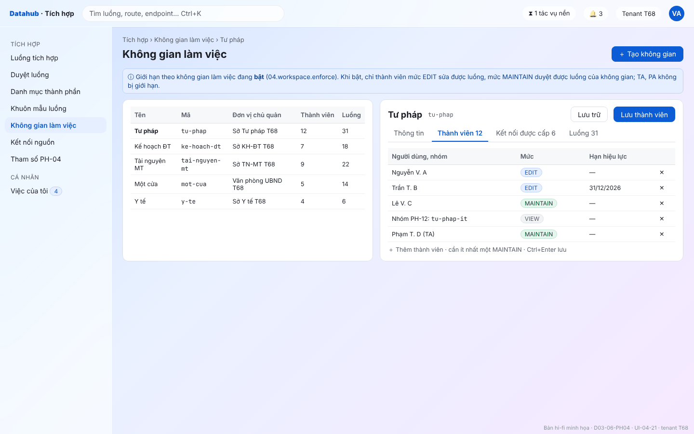

Dải thông tin nói rõ giới hạn đang bật; bảng không gian bên trái, chi tiết "Tư pháp" tab Thành viên bên phải với mức EDIT, MAINTAIN, VIEW và hạn hiệu lực.

## 27. Kiến trúc mã giao diện

### 27.1. Cấu trúc thư mục `apps/console/src/features/integration/`

| Thư mục | Nội dung | Nguồn hiện có trong repo (`apps/console/src/flows/`) |
|---|---|---|
| `pages/` | `FlowListPage`, `FlowDetailPage`, `FlowCreateWizard`, `ReviewQueuePage`, `ReviewPage`, `RunLogPage`, `ComparePage`, `ComponentCatalogPage`, `TemplateLibraryPage`, `LegacyImportPage`, `WorkspacePage` | `EntityList`, `ReviewPage`, `RunLogPage`, `ComponentCatalogPage` (viết lại theo design system) |
| `designer/model/` | Mô hình Camel (đọc, ghi YAML, giữ chú thích), cây chặng, `id` ổn định, lệnh sửa (command pattern cho hoàn tác) | Một phần trong `DesignerPage`; bỏ cơ chế `# @lgsp-canvas-v1:` |
| `designer/catalog/` | Nạp `@kaoto/camel-catalog` 3.33.1 theo hồ sơ, chỉ mục tìm kiếm, ánh xạ nhóm nghiệp vụ, bản dịch | `catalog-index` (751 nút) |
| `designer/canvas/` | `FlowCanvas` (XYFlow), `FlowNode`, `GroupNode`, `EdgeWithInsert`, `StickyNote`, bố cục dagre trong worker, ghim vị trí, lớp phủ | `DesignerPage` |
| `designer/palette/` | `NodePalette`, `QuickInsert` | `Palette` |
| `designer/inspector/` | `Inspector`, `StepConfigModal`, bộ sinh biểu mẫu từ catalog, các trường đặc thù (biểu thức, bí mật, kết nối, SQL) | `NodeConfig` |
| `designer/yaml/` | `YamlEditor` (Monaco + lược đồ Camel), đồng bộ hai chiều | `YamlEditor` |
| `designer/mapper/` | `DataMapper`, bộ sinh JQ, đọc/ghi `*.dhmap.json` | `DataMapper` |
| `designer/kamelet/`, `designer/pipe/`, `designer/beans/` | Các chế độ đặc thù | `KameletSpec`, `BeanRegistry` |
| `designer/validation/` | Quy tắc VR-01…09, 15, 18, 20 và LINT-04-01…06 phía trình duyệt (worker), gộp kết quả máy chủ | `CamelYamlValidator` phía máy chủ là đối chiếu |
| `testrun/` | Drawer chạy thử, SSE, ca kiểm thử | `TestRunPage` |
| `deploy/` | Hộp phát hành, theo dõi, điều khiển | — |
| `api/` | Client sinh từ `api/ph04/openapi-integration.yaml` (TanStack Query) | Gọi trực tiếp `/api/admin/v1/routes` → thay bằng `/api/integration/v1/...` |
| `a11y/` | Chế độ danh sách, thông báo trực tiếp, bảng phím tắt | — |

: Cấu trúc thư mục apps/console/src/features/integration/

### 27.2. Trạng thái và dữ liệu

- Trạng thái máy chủ: TanStack Query, khóa `['int', tenant, 'flow', code, 'version', n]`; ETag giữ trong cache cùng dữ liệu.
- Bố cục sơ đồ (`canvasLayout`) và bản tin mẫu (`samples`) đi cùng phiên bản nhưng tách khỏi YAML trong mô hình, đúng ba trường của API-04-022.
- Trạng thái mô hình soạn: kho Zustand riêng cho mỗi phiên bản đang mở (mô hình, vùng chọn, ngăn hoàn tác, trạng thái lưu); không đặt mô hình vào TanStack Query để tránh vẽ lại toàn cục.
- Trạng thái giao diện cục bộ (kích thước ngăn, thu gọn, thu phóng): `localStorage` có tiền tố `dh.int.`, bọc try/catch.
- Bản nháp cục bộ: IndexedDB (mục 10.16.2).
- Sự kiện trực tiếp: SSE của API-04-042 (một lần chạy thử) và API-04-054 (một lần triển khai), mở khi cần, đóng khi xong, tự nối lại có lùi dần; người đang mở và `catalogVersion` lấy qua nhịp API-04-034.

### 27.3. Thành phần design system mới cần bổ sung vào D03-05-04

> **Đã xử lý (26/11/2026).** Mọi thành phần dưới đây đã được đặc tả: canvas, Inspector, thanh công cụ ở D03-05-04 §11; ô biểu thức, ô tham chiếu bí mật, bộ chọn lịch, thẻ radio, bộ chọn tài nguyên ở D03-05-03 §7.14–7.18; bảng sửa trực tiếp, biểu mẫu động, đồ thị phụ thuộc, bảng khác biệt, ngăn quyết định ở D03-05-04 §13. Tên cũ dùng ở bản 0.1 (`Segmented`, `SearchInput`, `FileDropzone`, `Descriptions`, `JsonTree`, `AuditTimeline`, `SelectionBar`, `FilterChips`, `FilterDrawer`) đã đổi sang tên chuẩn theo bảng bí danh D03-05-04 §14.2; token màu đã đổi sang tên chuẩn D03-05-02.

`CMP-DesignerToolbar`, `CMP-EntityRail`, `CMP-NodePalette`, `CMP-FlowCanvas`, `CMP-FlowNode`, `CMP-GroupNode`, `CMP-StickyNote`, `CMP-CanvasControls`, `CMP-Minimap`, `CMP-QuickInsert`, `CMP-Inspector`, `CMP-ExpressionField`, `CMP-SecretRefField`, `CMP-ConnectionSelect`, `CMP-SchemaTree`, `CMP-SaveIndicator`, `CMP-EnvCard`, `CMP-BottomPanel`, `CMP-ShortcutSheet`, `CMP-TreeGrid` (chế độ danh sách). Mỗi thành phần cần story Storybook đủ các trạng thái ở mục 10.7.3 và bài kiểm tra axe.

## 28. Ma trận vai trò × hành động trên giao diện

Vai trò theo FRS §3.1; quyền đề xuất bổ sung theo FRS §3.3. Bảng cho thấy giao diện ẩn, hiện gì với mỗi vai trò mặc định; ánh xạ vai trò → quyền chính thức ở D02-08.

| Hành động | IE | IA | TO | TA | SO | PA | VW, AU |
|---|---|---|---|---|---|---|---|
| Xem danh sách, chi tiết, sơ đồ, mã nguồn (`read`) | ✓ | ✓ | ✓ | ✓ | ✓ | ✓ | ✓ |
| Tạo, thiết kế, chạy thử (`create`, `update`) | ✓ (mức EDIT) | | | | | | |
| Gửi duyệt, rút lại (`submit`) | ✓ | | | | | | |
| Duyệt, yêu cầu sửa, phát hành, quay lui (`publish`) | | ✓ (mức MAINTAIN; không tự duyệt) | | | | | |
| Thăng cấp lên môi trường cao hơn, lên PROD (`promote`) | | ✓ | | ✓ | | | |
| Tạm dừng, tiếp tục (`operate`) | | ✓ | ✓ | ✓ | ✓ | | |
| Dừng khẩn (`emergency-stop`) | | | | ✓ | ✓ | | |
| Gỡ luồng, hủy nháp (`delete`) | Bản nháp của mình | | | ✓ | | | |
| Không gian làm việc, tham số PH-04 (`admin`) | | | | ✓ | | ✓ | |
| Danh mục thành phần, khuôn nền, hồ sơ runtime (`catalog-admin`) | | | | | Duyệt | ✓ | |
| Dữ liệu thật làm bản tin mẫu (`sample-data`) | Khi TA cấp theo luồng | | | | | | |
| Lịch sử, nhật ký kiểm toán | ✓ | ✓ | ✓ | ✓ | ✓ | ✓ | ✓ |

: Ma trận vai trò × hành động trên giao diện

## 29. Kế hoạch kiểm thử giao diện

| Loại | Công cụ | Phạm vi |
|---|---|---|
| Đơn vị | Vitest | Mô hình (YAML ↔ mô hình ↔ YAML khứ hồi trên 300 tệp mẫu, gồm mọi ví dụ YAML trong catalog; băm YAML chuẩn hóa không đổi, BR-04-006), bộ sinh JQ, quy tắc VR và LINT phía trình duyệt, gộp ba bên |
| Thành phần | Storybook + test-runner + axe | Mọi `CMP-*` mục 27.3 ở mọi trạng thái, sáng, tối, glass bật, tắt, giảm chuyển động |
| Đầu cuối | Playwright (`--trace off` trừ khi gỡ lỗi) | Kịch bản TS-04-xx giao diện ở D05-02-PH04: tạo từ khuôn, kéo thả, bàn phím, YAML hai chiều, xung đột, mất mạng, chạy thử (sandbox thật trong CI), gửi duyệt, duyệt bốn mắt, phát hành TEST |
| Hồi quy hình ảnh | Playwright screenshot, `deviceScaleFactor` 1 | 21 màn × sáng/tối; ngưỡng lệch 0,1 % |
| Hiệu năng | Playwright + trace, luồng mẫu 50, 200, 500 chặng | Ngân sách 10.22 |
| Khả năng truy cập thủ công | NVDA + Chrome, VoiceOver + Safari | AC-UI-04-04-06, mỗi đợt phát hành |
| Khả dụng | 5 kỹ sư tích hợp (trong đó 2 người từng dùng Tooling cũ) | Ba nhiệm vụ: tạo luồng tra cứu đối ngoại, sửa ánh xạ có chuyển mã, quay lui; đo thời gian và lỗi |

: Kế hoạch kiểm thử giao diện

## 30. Hiện trạng mã và việc phải đổi

| Mã hiện có | Hiện trạng | Đổi theo thiết kế | GAP |
|---|---|---|---|
| `DesignerPage` lưu tọa độ vào chú thích `# @lgsp-canvas-v1:` | Có | Bỏ; bố cục tự động; chú thích người dùng được giữ | GAP-04-06 |
| Catalog `@kaoto/camel-catalog` | Đã khớp 3.33.1 / Camel 4.18.2 (PR #5) | Giữ, thêm tải theo hồ sơ và chính sách tỉnh | GAP-04-01 (xong phần phiên bản) |
| `TestRunPage` + `RoutesService.testRun` tính kết quả từ `hashCode` | Giả | Sandbox thật, SSE, gắn `contentHash` | GAP-04-04 |
| `ReviewPage` bốn mắt so `created_by` | Thiếu người đóng góp, người gửi | Theo BR-04-005 | GAP-04-07 |
| Publish cho phép từ `DRAFT`, ghi YAML vào chính repo mã, không nạp runtime | Sai trạng thái, thiếu kho cấu hình theo tenant và Argo CD | Hộp phát hành, theo dõi bốn bước | GAP-04-02, 03 |
| Trạng thái `TESTING` của phiên bản | Có | Bỏ; chạy thử đạt là điều kiện, không phải trạng thái | — |
| Kiểm tra chín chặng tìm chuỗi con trong YAML | Có | Đánh dấu bằng `id` `dh-stage-{mã}`, giao diện nhóm thành khối | GAP-04-08 |
| Đường dẫn `/flows/*`, API `/api/admin/v1/routes` | Có | `/tich-hop/luong/*`, `/api/integration/v1/*`, chuyển hướng một đợt | GAP-04-13 |
| Giao diện theo antd mặc định | Chưa theo Liquid Glass | Theo D03-05 | — |

: Hiện trạng mã và việc phải đổi

## 31. Câu hỏi mở và giả định

Theo chỉ đạo của người dùng (25/11/2026), các điểm dưới đây được chốt bằng giả định hợp lý để làm tiếp; mỗi giả định có thể đổi khi rà soát tổng thể.

| Mã | Câu hỏi | Giả định đang dùng |
|---|---|---|
| Q04-30 | Hướng sơ đồ mặc định? | Trái sang phải theo FR-04-013; người dùng đổi sang trên xuống dưới, lưu theo người dùng |
| Q04-31 | Có cho đặt chặng ở vị trí tùy ý như Tooling cũ? | Có, trong lớp bố cục (`canvas_layout`), có ghim; cấu trúc vẫn chỉ đổi qua thao tác hợp lệ (mục 10.7.1) |
| Q04-32 | Có đồng soạn thời gian thực? | Không trong bản 1.0; cảnh báo người khác đang mở và gộp ba bên khi xung đột ETag (FR-04-010, 024) |
| Q04-33 | Thanh thực thể đặt ngang hay dọc? | Ngang trên canvas (mục 10.5); nội dung theo FR-04-013 |
| Q04-34 | Ngôn ngữ biểu thức mặc định? | `simple` cho điều kiện, `jq` cho biến đổi JSON |
| Q04-35 | Có thêm cách xem bảng thành phần ngoài sáu tab của FR-04-012? | Có cách xem "Nghiệp vụ" làm mặc định để giữ thói quen Tooling cũ |
| Q04-36 | Ba nhóm bổ sung "Điểm vào", "Chặng chuẩn Datahub", "Khác" có làm lệch bảy nhóm cũ? | Không: bảy nhóm cũ giữ nguyên, ba nhóm là phần thêm của giao diện |
| Q04-37 | Năm tham số giao diện mới (mục 25)? | Thêm vào FRS §7.1 với mặc định an toàn |
| Q04-38 | Bản dịch tiếng Việt của khoảng 750 thành phần? | Dịch tiêu đề, mô tả của khoảng 120 thành phần hay dùng ở bản 1.0; còn lại hiện tiếng Anh có nhãn "EN" |
| Q04-39 | Có gợi ý quay lui tự động khi tỷ lệ lỗi tăng? | Chỉ gợi ý, không tự quay lui |

: Câu hỏi mở và giả định

## Đề nghị đồng bộ

> **Đợt đồng bộ chéo cuối (27/11/2026).** Các đề nghị dưới đây đã được xét; kết luận từng dòng (đã sửa, đã khớp sẵn, câu hỏi mở, không làm) ghi ở [D00-03-01 Sổ đồng bộ chéo cuối](../../00-chung/D00-03-01-so-dong-bo-cuoi.md).

Bản 0.2 không đổi mã đã có và không tạo mã mới ngoài các mục con của từng màn. Các điểm dưới đây cần tập khác cập nhật trong đợt gom cuối.

| Tập | Đề nghị | Trạng thái |
|---|---|---|
| D02-03-PH04 §12 | Cột FR của UI-04-03 thêm 005 (nhân bản), UI-04-10 thêm 084 (biến môi trường), UI-04-15 thêm 050, 051, như bảng mục 1.2 | Đã hấp thụ (0.2): FRS §10 có các FR này |
| D02-04-PH04 §8.4 | Mười hai câu đề nghị đã đưa vào §5.3 nguyên văn; riêng ERR-04-043 dùng câu của D02-03-PH04 §9.2 để hai tập thống nhất | Đã hấp thụ (0.2): UC §8.4 đánh dấu đã hấp thụ; câu đã đồng bộ theo FRS §9.2 (nguồn chuẩn) |
| D03-05-04 | Biến thể `slot` của `CMP-FlowNode` cho ô Pipe (mục 15.2) | Chờ đợt đồng bộ cuối (tập ngoài PH-04) |
| D05-02-PH04 | Ca giao diện cho trạng thái của UI-04-09, 16, 17, 18, 19, 21 (mục trạng thái màn của từng chương) và so khớp ảnh hi-fi `ph04/hifi/ui-04-nn.png` | Đã hấp thụ (0.2) phần ca trạng thái: TC-04-187, 188, 191, 194, 200, 201; so khớp ảnh hi-fi còn mở |

: Đề nghị đồng bộ cho tập khác

## Lịch sử phiên bản

| Phiên bản | Ngày | Người | Nội dung |
|---|---|---|---|
| 0.1 | 2026-11-25 | Nhóm phân hệ PH-04 | Bản đầu: 21 màn, UI-04-04 siêu chi tiết |
| 0.2 | 2026-11-26 | Nhóm phân hệ PH-04 | Chuẩn kết hợp: thêm Giới thiệu đủ mục (người đọc, thuật ngữ, cấu trúc); khối đặc tả đầu mỗi màn; viết đủ UI-04-09, 16, 17, 18, 19, 21; §5.3 thêm câu cho 16 mã lỗi; ảnh hi-fi cho cả 21 màn (`ph04/hifi`); giữ nguyên mọi nội dung của bản 0.1, nhất là UI-04-04 |
