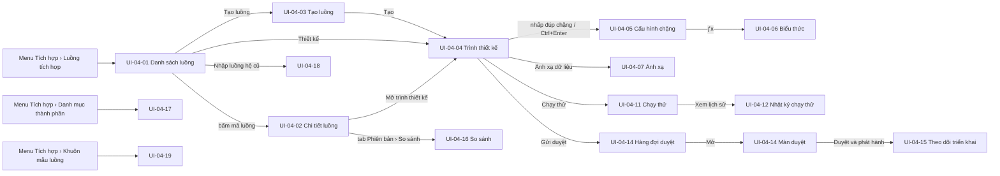

# D03-06-PH04 · Thiết kế giao diện màn hình phân hệ PH-04 Lõi tích hợp và trình thiết kế luồng

## Tóm tắt cho hội đồng thẩm định

Tài liệu đặc tả 21 màn hình của PH-04 trên ứng dụng quản trị `dh-console`. Trọng tâm là **trình thiết kế luồng** (UI-04-04) và các lớp nổi gắn với nó: cấu hình chặng, trình soạn biểu thức, trình ánh xạ dữ liệu, Kamelet, Pipe, chạy thử, gửi duyệt. Đây là các màn thay cho "Productivity Tooling" của hệ cũ, nơi kỹ sư tích hợp làm việc nhiều giờ mỗi ngày, nên được đặc tả tới từng vùng, từng nút, từng trạng thái, từng thao tác chuột và bàn phím. Giao diện theo design system Liquid Glass trên antd v6 (D03-05): kính mờ chỉ dùng cho lớp điều hướng và lớp nổi; canvas, bảng, biểu mẫu, khung mã dùng nền đặc để đạt WCAG 2.2 AA. Mục 3 liệt kê từng màn của Bus và Tooling cũ được giữ lại thành màn nào trong Datahub.

## 1. Mục đích, phạm vi và tài liệu liên quan

### 1.1. Mục đích

Đặc tả đủ để đội giao diện lập trình ngay mà không phải đoán: mỗi màn có đường dẫn, mẫu bố cục, wireframe, danh sách thành phần với nhãn tiếng Việt, kiểu, kiểm tra hợp lệ và nguồn dữ liệu (API), hành động gắn với quyền và trạng thái, các trạng thái màn (đang tải, rỗng, lỗi, không có quyền, chỉ đọc, xung đột, mất kết nối), thông điệp, phím tắt, yêu cầu khả năng truy cập và tiêu chí nghiệm thu. Tài liệu không lặp lại nghiệp vụ của FRS; khi cần thì dẫn mã `FR-04-nnn`, `BR-04-nnn`, `API-04-nnn`, `ERR-04-nnn`.

Thứ tự ưu tiên khi mâu thuẫn: D02-08 (phân quyền), D03-05 (design system), D03-06-00 (kiến trúc thông tin, mẫu màn), D02-03-PH04 (FRS), rồi tài liệu này.

### 1.2. Phạm vi và mức chi tiết

| Mã | Màn hình | Mẫu bố cục (D03-06-00 §4) | Mức chi tiết |
|---|---|---|---|
| UI-04-01 | Danh sách luồng | PTN-01 Danh sách | Đầy đủ |
| UI-04-02 | Chi tiết luồng (11 tab) | PTN-02 Chi tiết | Đầy đủ |
| UI-04-03 | Tạo luồng (trình hướng dẫn) | PTN-05 Wizard | Đầy đủ |
| UI-04-04 | **Trình thiết kế luồng** | PTN-07 Designer (canvas) | **Siêu chi tiết** |
| UI-04-05 | **Cấu hình chặng mở rộng** | Lớp nổi trên UI-04-04 | **Siêu chi tiết** |
| UI-04-06 | **Trình soạn biểu thức** | Lớp nổi trên UI-04-04, 05 | **Siêu chi tiết** |
| UI-04-07 | **Trình ánh xạ dữ liệu** | Lớp nổi toàn màn trên UI-04-04 | **Siêu chi tiết** |
| UI-04-08 | **Trình soạn Kamelet** | Chế độ của UI-04-04 | **Siêu chi tiết** |
| UI-04-09 | **Trình soạn Pipe** | Chế độ của UI-04-04 | Rất chi tiết |
| UI-04-10 | Cấu hình cấp tệp và bean | Drawer trên UI-04-04 | Rất chi tiết |
| UI-04-11 | **Chạy thử** | Drawer trên UI-04-04 và trang riêng | **Siêu chi tiết** |
| UI-04-12 | Nhật ký chạy thử | PTN-01 + chi tiết | Đầy đủ |
| UI-04-13 | Ca kiểm thử | Drawer trên UI-04-04 | Rất chi tiết |
| UI-04-14 | **Hàng đợi duyệt và màn duyệt** | PTN-10 Hộp việc và duyệt | **Siêu chi tiết** |
| UI-04-15 | **Phát hành, triển khai, quay lui** | Drawer + tab của UI-04-02 | **Siêu chi tiết** |
| UI-04-16 | So sánh phiên bản | Trang riêng (dùng `CMP-DiffViewer`) | Đầy đủ |
| UI-04-17 | Danh mục thành phần | PTN-08 Cây + bảng | Đầy đủ |
| UI-04-18 | Nhập luồng hệ cũ | PTN-09 Nhập dữ liệu có xem trước | Đầy đủ |
| UI-04-19 | Thư viện khuôn mẫu | PTN-01 dạng lưới thẻ | Đầy đủ |
| UI-04-20 | Tham số PH-04 | Màn tham số chung PH-18 | Mô tả cách nhúng |
| UI-04-21 | Không gian làm việc | PTN-01 + PTN-04 | Đầy đủ |

### 1.3. Tài liệu liên quan

| Mã | Tài liệu | Dùng để |
|---|---|---|
| D02-03-PH04 | FRS PH-04 | Nghiệp vụ, quy tắc, mã lỗi |
| D02-04-PH04 | Use case PH-04 | Luồng người dùng |
| D03-04-PH04 | API và sự kiện PH-04 | Hợp đồng `openapi-integration.yaml` |
| D03-05-01 | Vật liệu Liquid Glass | Bản đồ vật liệu, chế độ giảm trong suốt |
| D03-05-02 | Design token | Màu, khoảng cách, bo góc, lớp chồng |
| D03-05-03, 04 | Thành phần nguyên tử, phức hợp | `CMP-*` |
| D03-06-00 | Kiến trúc thông tin, mẫu màn | Menu, URL, PTN-01…11 |
| `docs/ui_ux_rule.md`, `docs/07-srs/SRS-PH-04-designer.md` | Quy tắc UX và SRS trình thiết kế của repo | Nguồn tham khảo, số liệu catalog |
| `apps/console/src/flows/**` | Mã trình thiết kế hiện có | Hiện trạng; mục 30 ghi ánh xạ mã hiện có sang thiết kế |

## 2. Nguyên tắc thiết kế áp dụng cho PH-04

### 2.1. Bản đồ vật liệu của PH-04

PH-04 có màn nhiều lớp chồng nhất của console (canvas, ngăn trái, ngăn phải, bảng dưới, Inspector, popover biểu thức, drawer chạy thử, modal ánh xạ). Nếu mọi lớp đều là kính mờ, chữ trên lớp trên cùng sẽ phụ thuộc vào màu của ba lớp bên dưới và không còn đảm bảo tương phản; đồng thời `backdrop-filter` trên nhiều lớp làm kéo thả trên canvas giật dưới 30 khung hình/giây ở máy văn phòng. Vì vậy PH-04 áp đúng bản đồ vật liệu của D03-05-01 §3.1 như sau.

| Vùng | Thành phần | Vật liệu | Token nền | Lý do |
|---|---|---|---|---|
| Thanh trên của khung ứng dụng (màn PTN-01, 02, 05, 10) | `CMP-AppShell` topbar | `glass-chrome` → `glass-chrome-scrolled` khi cuộn | theo D03-05-02 §5 | Lớp điều hướng |
| Sidebar của khung ứng dụng | `CMP-AppShell` sidebar nổi | `glass-chrome` | | Lớp điều hướng |
| Thanh công cụ trình thiết kế ① | `CMP-DesignerToolbar` | **Đặc** `color-surface-solid` có viền dưới `color-border-subtle` | | Chứa nhiều nút, chỉ báo trạng thái lưu; phải đọc chắc chắn |
| Thanh thực thể ②, bảng thành phần ③, Inspector ⑤, bảng dưới ⑥ | `CMP-EntityRail`, `CMP-NodePalette`, `CMP-Inspector`, `CMP-BottomPanel` | **Đặc** `color-surface-solid` | | Nội dung dày, chữ 13 px |
| Canvas ④ | `CMP-FlowCanvas` | **Đặc** `color-surface-solid-2` với lưới chấm `color-border-subtle` | | Chặng và cạnh cần tương phản ổn định (PTN-07) |
| Chặng trên canvas | `CMP-FlowNode` | **Đặc** `color-surface-solid`, viền 1 px, đổ bóng `shadow-1` | | |
| Điều khiển nổi trên canvas (thu phóng, minimap, chú giải, thanh chọn nhiều) | `CMP-CanvasControls`, `CMP-Minimap`, `CMP-SelectionBar` | `glass-overlay` | | Lớp nổi; `glass-overlay` đạt ngưỡng cho mọi nấc chữ |
| Menu ngữ cảnh, popover gợi ý, tooltip mô tả thành phần | `CMP-DropdownMenu`, `CMP-Popover` | `glass-overlay` | | Lớp nổi |
| Cửa sổ cấu hình chặng mở rộng, trình ánh xạ, hộp gửi duyệt, hộp xung đột | `CMP-Modal` | Khung `glass-modal`; **vùng nội dung đặc** `color-surface-solid` | | Liên kết, chữ nhỏ trong modal phải nằm trên nền đặc (D03-05-02 §5) |
| Drawer chạy thử, ca kiểm thử, cấu hình cấp tệp | `CMP-Drawer` | Khung `glass-modal`; vùng nội dung đặc | | |
| Khung mã YAML, JQ, JSON | `CMP-CodeEditor`, `CMP-JsonViewer` | **Đặc** `color-surface-solid-2` | | Mã cần tương phản cao |
| Thanh toàn màn hình nổi (chế độ F) | `CMP-FullscreenBar` | `glass-overlay` | | D03-06-00 §3.9 |

Khi người dùng bật "Giảm trong suốt" hoặc hệ điều hành báo `prefers-reduced-transparency`, hoặc cơ chế tự hạ cấp trên máy yếu kích hoạt (D03-05-01 §7), mọi lớp glass chuyển sang `glass-lite-tint` hoặc `glass-off-tint`. Không màn nào của PH-04 dựa vào hiệu ứng trong suốt để truyền thông tin.

### 2.2. Mật độ và kích thước

Trình thiết kế dùng mật độ gọn (`size="small"` của antd: điều khiển cao 24 px ở thanh công cụ và bảng thành phần, 28 px trong Inspector; dòng bảng 32 px). Các màn danh sách, chi tiết, duyệt dùng mật độ thường (điều khiển 32 px, dòng 40 px). Người dùng đổi mật độ bảng bằng "Mật độ hiển thị"; lựa chọn lưu trong `localStorage` khóa `dh.int.density.{tableId}`. Vùng chạm tối thiểu 24 × 24 px (WCAG 2.5.8), kể cả cổng nối trên chặng (vùng nhận rộng hơn hình vẽ, mục 10.6).

### 2.3. Ngôn ngữ và thuật ngữ

Nhãn, thông điệp tiếng Việt có dấu, viết hoa chữ đầu câu. Thuật ngữ thống nhất trong PH-04: "luồng" (flow), "route" (giữ nguyên tiếng Anh vì là khái niệm Camel người dùng tra cứu tài liệu), "chặng" (step, node), "thành phần" (component), "mẫu tích hợp" (EIP), "Kamelet", "Pipe", "biểu thức" (expression), "ánh xạ" (mapping), "kết nối" (connection PH-05), "phiên bản", "bản nháp", "gửi duyệt", "duyệt", "yêu cầu sửa", "phát hành", "triển khai", "môi trường", "tạm dừng", "tiếp tục", "dừng khẩn", "gỡ", "quay lui", "chạy thử", "ca kiểm thử", "khẳng định" (assertion), "bản tin mẫu", "ghim". Tên thành phần Camel, tên tham số, mã lỗi hiển thị nguyên dạng bằng phông đơn cách (`CMP-CodeText`). Ngày giờ `dd/MM/yyyy HH:mm:ss` theo giờ Việt Nam; thời lượng hiển thị `ms` dưới 1 giây, `1,2 s` từ 1 giây, `2 phút 05 giây` từ 1 phút; số theo `vi-VN`.

### 2.4. Hành động theo quyền và trạng thái

API trả `allowedActions` và `disabledReasons` trên `Flow`, `FlowVersion`, `Deployment`, `TestRun` (D03-04-PH04). Giao diện dùng `allowedActions` làm nguồn quyết định chính. Quy ước: không có quyền thì **ẩn**; có quyền nhưng trạng thái chưa cho phép thì **hiện vô hiệu kèm tooltip lý do** lấy từ `disabledReasons` (ví dụ "Chưa có lần chạy thử đạt cho phiên bản này. Chạy thử trước khi gửi duyệt"). Lý do: người có quyền cần biết phải làm gì tiếp.

### 2.5. Không chỉ dùng màu

Trạng thái chặng (lỗi, cảnh báo, đạt, lỗi khi chạy, bỏ qua), loại khác biệt (thêm, xóa, sửa) và mức phát hiện đều có biểu tượng và chữ đi kèm màu (WCAG 1.4.1). Ví dụ chặng lỗi có viền `color-error-text` 2 px, huy hiệu tròn chứa dấu "!" và số lỗi, và `aria-label` "Chặng Gọi hộ tịch, 2 lỗi".

### 2.6. Giữ trạng thái trên URL

Tab đang mở, phiên bản đang xem, route đang mở trong tệp, chặng đang chọn, chế độ Sơ đồ/YAML/Chia đôi, lần chạy thử đang phủ được phản ánh vào URL (mục 4.2). Mức thu phóng, vị trí cuộn canvas và trạng thái thu gọn ngăn không vào URL mà lưu cục bộ theo người dùng.

### 2.7. Tác vụ dài chạy nền

Chạy thử, kiểm tra mức gửi duyệt, phát hành (chờ đồng bộ), nhập XML hệ cũ có thể vượt 3 giây. Giao diện hiện tiến độ, cho rời màn, đưa tác vụ vào `CMP-BackgroundTaskTray` và báo khi xong qua trung tâm thông báo (FR-00-054, FR-00-060). Kết quả chạy thử cập nhật trực tiếp qua luồng sự kiện máy chủ (SSE, API-04-042 `Accept: text/event-stream`).

### 2.8. Bàn phím trước, chuột sau

Mọi thao tác của trình thiết kế làm được bằng bàn phím (NFR-04-015, WCAG 2.1.1, 2.5.7). Kéo thả là cách nhanh cho người dùng chuột, không phải cách duy nhất. Mỗi thao tác kéo thả có tương đương bàn phím ở bảng phím tắt mục 10.13.

## 3. Màn hệ cũ được giữ lại thành gì

Theo Q4, các màn có giá trị vận hành của hệ cũ được giữ chức năng, thiết kế lại theo design system. Bảng dưới liệt kê từng màn, tab hoặc thanh của Bus và Tooling, kết luận và màn Datahub tương ứng.

| Màn, vùng hệ cũ | Khối | LGC | Kết luận | Màn Datahub | Thay đổi chính |
|---|---|---|---|---|---|
| Danh sách chương trình tích hợp (agent), phân trang, bốn ô tìm | Bus | 001–005 | Giữ, thiết kế lại | UI-04-01 | Một ô tìm chung và bộ lọc theo endpoint, nguồn, môi trường thay ô host; đếm theo trạng thái; cột tình trạng theo môi trường |
| Màn tổng quan hệ thống (số agent hoạt động) | Bus | 014 | Chuyển | Bảng điều khiển PH-13; thẻ "Luồng" trên trang chủ | Thẻ số luồng đang chạy, suy giảm, tạm dừng |
| Màn số liệu từng agent (route, endpoint, thành công, thất bại, thời gian trung bình) | Bus | 015 | Gộp | UI-04-02 tab Tổng quan, Giám sát | Số liệu theo luồng và route, không theo máy chủ |
| Đồ thị CPU, bộ nhớ agent | Bus | 016 | Gộp | UI-04-02 tab Giám sát (nhúng PH-13) | Theo bản sao pod |
| Chi tiết agent: metadata, agent URL | Bus | 006, 017 | Giữ, mở rộng | UI-04-02 tab Tổng quan | Bỏ agent URL; thêm chủ sở hữu, HTTT, phiên bản, namespace |
| Danh sách route của agent | Bus | 008, 018 | Giữ | UI-04-02 tab Route | Có trạng thái từng route theo nhịp tim, tạm dừng từng route |
| Tab Endpoint | Bus | 020, 027 | Giữ, mở rộng | UI-04-02 tab Điểm kết nối | Thêm số liệu theo điểm kết nối từ PH-13 |
| Tab Properties của route | Bus | 021 | Giữ | UI-04-02 tab Thuộc tính | Lấy từ định nghĩa, không từ JMX |
| Tab Graph của route | Bus | 022 | Nâng cấp | UI-04-02 tab Sơ đồ; UI-04-04 chỉ đọc | Sơ đồ của trình thiết kế, phủ số liệu chạy thật |
| Tab Source của route | Bus | 023 | Nâng cấp | UI-04-02 tab Mã nguồn; UI-04-16 | YAML theo phiên bản, so sánh khác biệt |
| Tab Extra data | Bus | 024 | Giữ | UI-04-02 tab Tổng quan (khối "Thông tin thêm") | Nhãn, liên kết tài liệu |
| Nút Start/Stop agent, route | Bus | 009, 012, 026 | Nâng cấp | UI-04-02 tab Triển khai, tab Route | Hộp lý do bắt buộc; dừng khẩn tách riêng; hiện bản sao đã xác nhận |
| Hộp sửa host, port, method | Bus | 011 | Thay thế | UI-04-04 Inspector; màn kết nối PH-05 | Không sửa trên runtime; tạo phiên bản mới |
| Hộp thêm chương trình có kiểm tra kết nối | Bus | 013 | Thay thế | UI-04-03 + UI-04-11 | Tạo từ khuôn mẫu, chạy thử cả luồng |
| Nút xóa agent | Bus | 010 | Nâng cấp | UI-04-02 hành động "Gỡ luồng" | Hiện danh sách phụ thuộc trước khi gỡ |
| Màn log agent | Bus | 029 | Chuyển | PH-13 tra log, lọc sẵn theo luồng | Liên kết từ UI-04-02 |
| Màn cấu hình hệ thống | Bus | 031 | Thay thế | UI-04-20 (màn tham số PH-18) | Có miền giá trị, theo tenant |
| Màn quản lý project, group | Bus | 032 | Thay thế | UI-04-21 | Không gian làm việc và thành viên |
| Thanh Project (danh sách project) | Tooling | 001 | Giữ, gộp | UI-04-01 và nút "Mở luồng khác" trên UI-04-04 | |
| Hộp thêm mới project | Tooling | 002 | Nâng cấp | UI-04-03 | Bốn điểm xuất phát |
| Thanh Component thu gọn, mở rộng, tìm kiếm, bảy nhóm | Tooling | 003–012 | Giữ, thiết kế lại | UI-04-04 vùng ③ | Hai chế độ hiển thị (danh sách, lưới biểu tượng); nhóm nghiệp vụ như cũ và tab theo loại Camel; chỉ thành phần được phép |
| Vùng thiết kế kéo thả, đường kết nối | Tooling | 013, 023–025 | Giữ, thiết kế lại | UI-04-04 vùng ④ | Nối theo ngữ nghĩa Camel; thêm chặng không cần kéo |
| Nút lưu | Tooling | 014 | Nâng cấp | UI-04-04 ① | Tự lưu 30 giây, chỉ báo trạng thái, xung đột ba bên |
| Nút tải XML | Tooling | 015 | Thay thế | UI-04-04 menu "Tệp" | Tải YAML, gói luồng |
| Nút xóa project | Tooling | 016 | Giữ | UI-04-02 "Gỡ luồng" | |
| Nút Clear Page | Tooling | 017 | Giữ | UI-04-04 menu "Sửa" → "Xóa nội dung route" | Có hoàn tác |
| Nút thu, phóng | Tooling | 018 | Giữ | UI-04-04 `CMP-CanvasControls` | Thêm vừa khung, minimap |
| Thanh Properties | Tooling | 019, 020 | Nâng cấp | UI-04-04 vùng ⑤ Inspector và UI-04-05 | Biểu mẫu sinh từ catalog; khôi phục giá trị gốc |
| Tab Source | Tooling | 021, 026 | Giữ | UI-04-04 chế độ YAML, Chia đôi | YAML thay XML |
| Màn Data mapping | Tooling | 028 | Nâng cấp | UI-04-07 | Sinh JQ; chuyển mã PH-07 |
| Hộp sửa pom | Tooling | 022 | Loại bỏ | — | Lý do ATTT (D00-03 §6) |
| Hộp nhập component JAR | Tooling | 027 | Loại bỏ | UI-04-17 nút "Đề xuất thành phần mới" | Lý do ATTT; thay bằng quy trình đăng ký Kamelet |

Tổng cộng: 33 màn và vùng của hệ cũ; 22 giữ hoặc nâng cấp, 7 chuyển hoặc thay thế, 2 gộp vào PH-13, 2 loại bỏ.

## 4. Điều hướng

### 4.1. Sơ đồ điều hướng

### 4.2. Bảng đường dẫn React Router

Đường dẫn theo quy tắc URL tiếng Việt không dấu của D03-06-00 §2.4. Đường dẫn cũ `/flows/...` của repo được chuyển hướng 301 phía client sang đường dẫn mới trong một đợt phát hành (GAP-04-13).

| Đường dẫn | Màn | Tham số truy vấn giữ trên URL | Đường dẫn cũ của repo |
|---|---|---|---|
| `/tich-hop/luong` | UI-04-01 | `q`, `trang-thai`, `loai`, `van-chuyen`, `khong-gian`, `nguon`, `dich`, `endpoint`, `moi-truong`, `trang`, `co`, `sap-xep` | `/flows` |
| `/tich-hop/luong/tao-moi` | UI-04-03 | `buoc`, `loai`, `xuat-phat`, `khuon` | — |
| `/tich-hop/luong/:ma` | UI-04-02 | `tab`, `phien-ban`, `moi-truong` | — |
| `/tich-hop/luong/:ma/thiet-ke` | UI-04-04 | `phien-ban` (mặc định phiên bản mở), `thuc-the` (route đang mở), `chang` (chặng chọn), `che-do` (`so-do`, `yaml`, `chia-doi`), `lan-chay` (phủ kết quả) | `/flows/:code/design` |
| `/tich-hop/luong/:ma/chay-thu` | UI-04-11 (trang) | `phien-ban`, `lan-chay` | `/flows/:code/test` |
| `/tich-hop/luong/:ma/nhat-ky-chay-thu` | UI-04-12 | `ket-qua`, `nguoi-chay`, `phien-ban`, `tu`, `den`, `so-sanh` (hai mã lần chạy) | `/flows/:code/runs` |
| `/tich-hop/luong/:ma/so-sanh` | UI-04-16 | `tu`, `den`, `che-do` | — |
| `/tich-hop/duyet-luong` | UI-04-14 hàng đợi | `trang-thai`, `khong-gian`, `cua-toi` | `/flows/review` |
| `/tich-hop/duyet-luong/:ma/:phienBan` | UI-04-14 màn duyệt | `tab` | — |
| `/tich-hop/thanh-phan` | UI-04-17 | `loai`, `nhan`, `q`, `chinh-sach`, `chon` | `/components` |
| `/tich-hop/khuon-mau` | UI-04-19 | `nhom`, `loai`, `q` | — |
| `/tich-hop/luong/nhap-he-cu` | UI-04-18 | `buoc`, `tac-vu` | — |
| `/tich-hop/khong-gian` | UI-04-21 | | — |
| `/quan-tri/tham-so?nhom=04` | UI-04-20 | | — |

Lớp nổi (UI-04-05, 06, 07, 10, 11 drawer, 13) không có đường dẫn riêng; chúng được mở lại khi tải lại trang nhờ tham số `chang` và tham số `lop` (`cau-hinh`, `bieu-thuc`, `anh-xa`, `cap-tep`, `chay-thu`, `ca-kiem-thu`) trên URL của UI-04-04.

### 4.3. Menu và phân quyền hiển thị

| Mục menu (nhóm Tích hợp) | Quyền để hiện | Huy hiệu số |
|---|---|---|
| Luồng tích hợp | `PERM-04-read` | Số luồng `DEGRADED` (màu cảnh báo) |
| Duyệt luồng | `PERM-04-publish` | Số phiên bản `PENDING_REVIEW` người dùng được duyệt |
| Danh mục thành phần | `PERM-04-read` | — |
| Khuôn mẫu luồng | `PERM-04-create` hoặc `PERM-04-catalog-admin` | — |
| Không gian làm việc | `PERM-04-admin` | — |

Trình thiết kế không có mục menu riêng (D03-06-00 §2.3.2): người dùng luôn vào từ danh sách hoặc chi tiết luồng để có ngữ cảnh.

### 4.4. Breadcrumb và tiêu đề tab trình duyệt

| Màn | Breadcrumb | Tiêu đề tab |
|---|---|---|
| UI-04-01 | Tích hợp › Luồng tích hợp | Luồng tích hợp · Datahub |
| UI-04-02 | Tích hợp › Luồng tích hợp › {tên luồng} | {tên luồng} · Luồng · Datahub |
| UI-04-04 | (không có breadcrumb; thanh công cụ có nút ‹ quay lại và tên luồng) | ✎ {tên luồng} v{n} · Thiết kế · Datahub (dấu ● trước tên khi chưa lưu) |
| UI-04-14 màn duyệt | Tích hợp › Duyệt luồng › {tên luồng} v{n} | Duyệt {tên luồng} v{n} · Datahub |

## 5. Quy ước hiển thị dùng chung trong PH-04

### 5.1. Nhãn trạng thái

Mọi nhãn dùng `CMP-StatusTag` với sắc thái của D03-05-02 §4.4, luôn có biểu tượng Lucide và chữ.

| Đối tượng | Trạng thái | Nhãn | Sắc thái | Biểu tượng |
|---|---|---|---|---|
| Luồng | `DRAFT` | Nháp | neutral | `PencilLine` |
| | `IN_REVIEW` | Chờ duyệt | info | `Hourglass` |
| | `APPROVED` | Đã duyệt | info | `BadgeCheck` |
| | `ACTIVE` | Đang chạy | success | `Play` |
| | `PAUSED` | Tạm dừng | warning | `Pause` |
| | `DEGRADED` | Suy giảm | error | `TriangleAlert` |
| | `RETIRED` | Đã gỡ | neutral | `Archive` |
| Phiên bản | `DRAFT` | Bản nháp | neutral | `PencilLine` |
| | `PENDING_REVIEW` | Chờ duyệt | info | `Hourglass` |
| | `CHANGES_REQUESTED` | Cần sửa | warning | `MessageSquareWarning` |
| | `APPROVED` | Đã duyệt | success | `BadgeCheck` |
| | `SUPERSEDED` | Đã thay | neutral | `History` |
| | `ROLLED_BACK` | Đã quay lui | warning | `Undo2` |
| | `DISCARDED` | Đã hủy | neutral | `Trash2` |
| Triển khai | `PENDING`, `SYNCING` | Đang đồng bộ | info | `RefreshCw` (xoay, tắt khi giảm chuyển động) |
| | `SYNCED` + `HEALTHY` | Đồng bộ, khỏe | success | `CircleCheck` |
| | `SYNCED` + `DEGRADED` | Đồng bộ, suy giảm | warning | `CircleAlert` |
| | `OUT_OF_SYNC` | Lệch cấu hình | warning | `GitCompare` |
| | `FAILED` | Triển khai lỗi | error | `CircleX` |
| | sức khỏe `UNKNOWN` | Không rõ | neutral | `CircleHelp` |
| Lần chạy thử | `QUEUED` | Đang chờ | neutral | `Clock` |
| | `RUNNING` | Đang chạy | info | `Loader` |
| | `PASSED` | Đạt | success | `CircleCheck` |
| | `FAILED` | Không đạt | error | `CircleX` |
| | `TIMED_OUT` | Quá thời gian | error | `TimerOff` |
| | `CANCELLED` | Đã hủy | neutral | `Ban` |
| | `SIMULATED` | Mô phỏng | warning | `FlaskConical` (luôn kèm tooltip "Không chạy Camel thật, không tính là chạy thử đạt") |
| Lệnh điều khiển | `ISSUED`, `DELIVERED` | Đang gửi | info | `Send` |
| | `ACKNOWLEDGED`, `RECONCILED` | Đã xác nhận | success | `CircleCheck` |
| | `PARTIAL` | Xác nhận một phần ({k}/{n}) | warning | `CircleDashed` |
| | `REJECTED` | Bị từ chối | error | `ShieldX` |

### 5.2. Biểu tượng và màu nhóm thành phần

Chặng trên canvas và mục trong bảng thành phần có dải màu nhóm 4 px ở cạnh trái và biểu tượng nhóm. Màu nhóm lấy từ bảng màu biểu đồ của D03-05-02 §4.5 (`color-chart-1…8`), không dùng màu trạng thái để tránh nhầm với lỗi, cảnh báo.

| Nhóm nghiệp vụ | Nhãn gốc catalog ánh xạ vào | Biểu tượng | Màu |
|---|---|---|---|
| Điểm vào | consumer của `platform-http`, `rest`, `kafka`, `timer`, `cron`, Kamelet `source` | `LogIn` | `color-chart-1` |
| Định tuyến | eip routing: `choice`, `filter`, `split`, `aggregate`, `multicast`, `recipientList`, `loadBalance` | `GitBranch` | `color-chart-2` |
| Chuyển đổi dữ liệu | `transformation`, `dataformat`, `language`, `jq`, `setBody`, `marshal`, `unmarshal` | `Shuffle` | `color-chart-3` |
| Kết nối CSDL | `database`, `SQL` | `Database` | `color-chart-4` |
| Mạng | `http`, `rest`, `file`, `ftp`, `sftp`, `soap`, `cxf` | `Globe` | `color-chart-5` |
| Hàng đợi bản tin | `messaging`, `Kafka`, `JMS`, `amqp`, `mqtt` | `Mail` | `color-chart-6` |
| Lập lịch | `scheduling`, `timer`, `quartz`, `cron` | `CalendarClock` | `color-chart-7` |
| Bảo mật | `security`, `crypto`, `jasypt`, Kamelet che dữ liệu | `ShieldCheck` | `color-chart-8` |
| Chặng chuẩn Datahub | Kamelet nền `dh-*` | `Hexagon` | `color-accent` |
| Khác | còn lại | `Box` | `color-neutral-solid` |

### 5.3. Thông điệp lỗi ERR-04 sang câu hiển thị

Giao diện không hiện `detail` thô của máy chủ khi đã có câu dưới đây; câu có tham số trong `{}` lấy từ trường mở rộng của lỗi RFC 9457. Mọi thông điệp lỗi kèm "Mã lỗi {code} · Mã truy vết {traceId}" và nút "Sao chép" (FR-00-080).

| Mã | Câu hiển thị | Gợi ý hành động |
|---|---|---|
| ERR-04-001 | Không tìm thấy luồng, hoặc bạn không có quyền xem luồng này. | Nút "Về danh sách luồng" |
| ERR-04-002 | Mã luồng "{code}" đã được dùng trong tỉnh. | Gợi ý mã khác: "{code}-2" |
| ERR-04-003 | Bạn chưa có quyền sửa trong không gian làm việc "{workspace}". | "Liên hệ quản trị không gian làm việc: {owner}" |
| ERR-04-005 | Phiên bản đang ở trạng thái "{status}" nên không thể {action}. | Theo trạng thái |
| ERR-04-006 | {user} đã lưu phiên bản này lúc {time}. Thay đổi của bạn chưa được lưu. | Mở hộp xung đột (mục 10.16.3) |
| ERR-04-008 | YAML có lỗi cú pháp ở dòng {line}, cột {column}: {message} | Nhảy tới dòng |
| ERR-04-009 | Luồng còn {n} lỗi cần sửa trước khi {action}. | Mở bảng Vấn đề |
| ERR-04-010 | Phát hiện giá trị giống bí mật ở chặng "{node}", trường "{field}". Không được ghi bí mật vào luồng. | "Chọn kết nối" |
| ERR-04-011 | Thành phần "{component}" không được phép dùng trong tỉnh. | "Xem chính sách thành phần" |
| ERR-04-012 | Luồng đối ngoại phải có đủ chín chặng chuẩn. Đang thiếu: {stages}. | "Thêm chặng chuẩn còn thiếu" |
| ERR-04-013 | Kết nối "{connection}" không tồn tại, sai loại hoặc chưa được cấp cho không gian làm việc. | "Chọn kết nối khác", "Mở PH-05" |
| ERR-04-014 | Chưa có lần chạy thử đạt cho đúng nội dung đang gửi. Nội dung đã đổi sau lần chạy thử gần nhất. | "Chạy thử ngay" |
| ERR-04-015 | Bạn đã tham gia soạn phiên bản này nên không thể tự duyệt. Cần một người duyệt khác. | — |
| ERR-04-016 | Luồng đã có bản nháp v{n} do {user} tạo. | "Mở bản nháp" |
| ERR-04-017 | Luồng đang được dùng bởi {n} đối tượng. Gỡ các phụ thuộc trước. | Danh sách phụ thuộc |
| ERR-04-019 | Môi trường chạy thử đang bận hoặc chưa sẵn sàng. Thử lại sau ít phút. | "Thử lại" |
| ERR-04-021 | Bản tin mẫu vượt {limit}. | — |
| ERR-04-022 | Không ghi được vào kho cấu hình. Luồng chưa được phát hành. | "Thử lại"; mã truy vết để báo hỗ trợ |
| ERR-04-023 | Phiên bản phải chạy ổn định ở {previousEnv} trước khi lên {env}. | — |
| ERR-04-025 | Vui lòng nhập lý do (ít nhất {min} ký tự). | Focus ô lý do |
| ERR-04-029 | Không hồ sơ runtime nào có đủ thành phần: {components}. | "Đề xuất thành phần" |
| ERR-04-031 | Câu lệnh SQL ở chặng "{node}" không được phép: {reason}. Luồng chỉ được đọc dữ liệu. | Liên kết quy định Q359 |
| ERR-04-033 | Định nghĩa luồng vượt {limit}. Tách thành nhiều luồng hoặc luồng con. | — |
| ERR-04-036 | Đã có Kamelet tên "{name}". | — |
| ERR-04-037 | Biểu thức {language} có lỗi ở vị trí {pos}: {message} | Tô vị trí |
| ERR-04-038 | Ánh xạ tới trường "{target}" không hợp lệ: {reason} | — |
| ERR-04-041 | Đang trong khoảng đóng băng thay đổi tới {until}. Chỉ được quay lui hoặc tạm dừng khẩn. | — |

Danh sách đầy đủ ở D03-04-PH04 §6; mã không có trong bảng hiển thị `title` của lỗi.

## 6. Trạng thái màn hình dùng chung

| Mã | Trạng thái | Cách hiển thị trong PH-04 |
|---|---|---|
| ST-01 | Đang tải lần đầu | `CMP-Skeleton` theo hình dạng màn: bảng 8 dòng; trình thiết kế dùng skeleton ba chặng nối nhau trên canvas, bảng thành phần 12 dòng, Inspector 6 trường |
| ST-02 | Đang tải lại nền | Giữ dữ liệu cũ, thanh tiến độ mảnh 2 px dưới thanh công cụ |
| ST-03 | Rỗng lần đầu | `CMP-EmptyState` có minh họa, câu giải thích và nút hành động chính |
| ST-04 | Không có kết quả lọc | `CMP-EmptyState` "Không có luồng khớp bộ lọc" và nút "Xóa bộ lọc" |
| ST-05 | Lỗi tải | `CMP-ResultPage` hoặc `CMP-Alert` lỗi với câu ở mục 5.3, nút "Thử lại", mã truy vết |
| ST-06 | Không có quyền | `CMP-ResultPage` 403 "Bạn không có quyền xem nội dung này" (chỉ dùng khi URL hợp lệ nhưng thiếu quyền chức năng; thiếu quyền đối tượng hiện như 404) |
| ST-07 | Chỉ đọc | `CMP-Banner` thông tin dính dưới thanh công cụ nói rõ lý do và lối thoát (mục 10.15) |
| ST-08 | Xung đột ETag | Hộp xung đột ba bên (mục 10.16.3) |
| ST-09 | Mất kết nối | `CMP-Banner` cảnh báo "Mất kết nối máy chủ. Thay đổi đang được giữ trên máy này và sẽ tự lưu khi có kết nối"; chỉ báo lưu "Chưa lưu lên máy chủ" |
| ST-10 | Rời trang khi chưa lưu | `CMP-ConfirmDialog` "Bạn có thay đổi chưa lưu. Rời trang sẽ mất các thay đổi này." nút "Lưu rồi rời", "Rời không lưu", "Ở lại" |
| ST-11 | Tác vụ nền | `CMP-JobProgress` trong drawer; khay tác vụ nền trên thanh trên |
| ST-12 | Phiên sắp hết hạn | `CMP-SessionTimeoutDialog`; trình thiết kế tự lưu trước khi đăng xuất |
