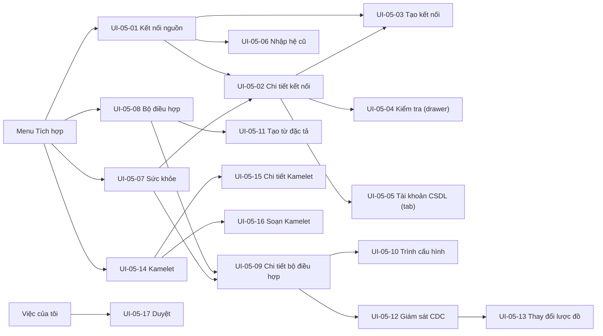

# D03-06-PH05 · Thiết kế giao diện màn hình Bộ điều hợp và kết nối

Tập màn không tự đặt token, `CMP-*` hay `PTN-*`; dùng tên chuẩn ở D03-05 và D03-06-00. Thành phần còn thiếu ghi ở Phụ lục A.

## Tóm tắt cho hội đồng thẩm định

PH-05 có 17 màn (UI-05-01…17) chia bốn nhóm: kết nối nguồn và bí mật (01–07), bộ điều hợp (08–11), CDC (12–13), Kamelet (14–16), cộng màn duyệt dùng chung (17). Ba quyết định giao diện chính:

1. **Bí mật không bao giờ hiện lại.** Trường bí mật chỉ cho nhập (`CMP-SecretField` chế độ chỉ ghi), sau khi lưu chỉ hiện "Đã khai, phiên bản n, ghi bởi …, lúc …". Không có nút "hiện", không có sao chép.
2. **Kiểm tra trước, bật sau.** Mọi nút bật môi trường, gửi duyệt phiên bản, chạy CDC vô hiệu kèm lý do cho tới khi có kiểm tra đạt trong 24 giờ; kết quả kiểm tra hiện theo bước kèm hướng dẫn khắc phục tiếng Việt, sao chép được để gửi đơn vị chủ quản HTTT.
3. **Trình cấu hình bộ điều hợp (UI-05-10) là màn được viết siêu chi tiết** vì đây là nơi kỹ sư tích hợp làm việc lâu nhất: ba cột thao tác, đặc tả, xem trước; đổi biểu mẫu theo giao thức; xem trước chuyển đổi định dạng trên dữ liệu mẫu ngay khi gõ; kiểm thử tại chỗ trên TEST.

## 1. Mục đích, phạm vi và tài liệu liên quan

### 1.1. Mục đích

Đặc tả đủ để kỹ sư giao diện dựng màn bằng React + antd v6 với design system D03-05 mà không phải hỏi lại, và để kiểm thử viên viết ca kiểm thử giao diện (D05-02-PH05).

### 1.2. Danh sách màn và mức chi tiết

| Mã | Tên | PTN | Mức chi tiết | FR |
|---|---|---|---|---|
| UI-05-01 | Danh sách kết nối nguồn | PTN-01 | Đầy đủ | 002, 017 |
| UI-05-02 | Chi tiết kết nối nguồn | PTN-02 | Đầy đủ | 003, 005…009, 012, 013, 016 |
| UI-05-03 | Tạo, sửa kết nối | PTN-05 | Đầy đủ | 001, 004…006, 009 |
| UI-05-04 | Kiểm tra, chẩn đoán kết nối | PTN-11 (biến thể drawer) | Đầy đủ | 010 |
| UI-05-05 | Tài khoản CSDL cho luồng | PTN-02 (tab) + PTN-04 | Đầy đủ | 023…028 |
| UI-05-06 | Nhập kết nối từ hệ cũ | PTN-09 | Đầy đủ | 018 |
| UI-05-07 | Tổng quan sức khỏe | PTN-06 | Đầy đủ | 019…022 |
| UI-05-08 | Danh sách bộ điều hợp | PTN-01 | Đầy đủ | 029 |
| UI-05-09 | Chi tiết bộ điều hợp | PTN-02 | Đầy đủ | 030, 041, 043…045, 047 |
| UI-05-10 | Trình cấu hình bộ điều hợp | PTN-07 | **Siêu chi tiết** | 032…042 |
| UI-05-11 | Tạo bộ điều hợp từ đặc tả | PTN-09 | Đầy đủ | 046 |
| UI-05-12 | Giám sát CDC | PTN-11 | Đầy đủ | 048…050, 052, 053 |
| UI-05-13 | Thay đổi lược đồ chờ xử lý | PTN-10 | Đầy đủ | 051 |
| UI-05-14 | Danh mục Kamelet | PTN-01 | Đầy đủ | 054 |
| UI-05-15 | Chi tiết Kamelet | PTN-02 | Đầy đủ | 055, 058, 060 |
| UI-05-16 | Soạn và gửi đăng ký Kamelet | PTN-03 | Đầy đủ | 056 |
| UI-05-17 | Duyệt yêu cầu của phân hệ | PTN-10 | Đầy đủ | 007, 026, 044, 057 |

### 1.3. Tài liệu liên quan

| Tài liệu | Dùng cho |
|---|---|
| [D02-03-PH05](../../02-yeu-cau/frs/D02-03-PH05-frs-bo-dieu-hop.md) | FR, BR, quy tắc; §5.2.1 bảng nguyên nhân kiểm tra |
| [D02-04-PH05](../../02-yeu-cau/use-case/D02-04-PH05-use-case-bo-dieu-hop.md) | Luồng người dùng |
| [D03-04-PH05](../api/D03-04-PH05-api-bo-dieu-hop.md) | API, `allowedActions`, mã lỗi |
| [D03-05](D03-05-design-system.md), [D03-05-01](D03-05-01-vat-lieu-liquid-glass.md), [D03-05-03](D03-05-03-thanh-phan-nguyen-tu.md), [D03-05-04](D03-05-04-thanh-phan-phuc-hop.md) | Vật liệu, token, thành phần |
| [D03-06-00](D03-06-00-ia-layout-mau-man-hinh.md) | Cây menu, route, PTN, ST |
| [D03-06-PH04](D03-06-PH04-man-hinh-tich-hop.md) | Trình thiết kế luồng dùng kết nối, Kamelet của PH-05 |

## 2. Nguyên tắc thiết kế áp dụng cho PH-05

### 2.1. Bản đồ vật liệu

| Vùng | Thành phần | Vật liệu | Lý do |
|---|---|---|---|
| Thanh trên, sidebar khung ứng dụng | `CMP-AppShell` | `glass-chrome` | Lớp điều hướng |
| Bảng, biểu mẫu, tab nội dung | `CMP-DataTable`, `CMP-Form`, `CMP-Tabs` | Đặc `color-surface-solid` | Nội dung dày |
| Ba cột của UI-05-10, khung mã, khung xem trước | `CMP-Splitter`, `CMP-CodeEditor`, `CMP-JsonViewer` | Đặc `color-surface-solid`, `color-surface-solid-2` cho mã | Chữ nhỏ, mã cần tương phản cao |
| Drawer kiểm tra (UI-05-04), drawer tài khoản CSDL | `CMP-Drawer` | Khung `glass-modal`, nội dung đặc | Lớp nổi chứa nội dung dày |
| Modal lý do, xác nhận, xung đột | `CMP-ReasonDialog`, `CMP-ConfirmDialog`, `CMP-ConflictDialog` | Khung `glass-modal`, nội dung đặc | |
| Menu, popover, tooltip | `CMP-DropdownMenu`, `CMP-Popover`, `CMP-Tooltip` | `glass-overlay` | Lớp nổi |
| Thẻ chỉ số ở UI-05-07, UI-05-12 | `CMP-KpiCard` | Đặc | Số liệu phải đọc chắc |

Khi bật giảm trong suốt hoặc tự hạ cấp (D03-05-01 §7), lớp glass chuyển `glass-lite-tint` hoặc `glass-off-tint`. Không màn nào dựa vào trong suốt để truyền thông tin.

### 2.2. Mật độ

Danh sách và chi tiết dùng mật độ thường (điều khiển 32 px, dòng 40 px). UI-05-10 dùng mật độ gọn (28 px, dòng 32 px) như trình thiết kế PH-04, vì một thao tác có thể có vài chục trường. Vùng chạm tối thiểu 24 × 24 px.

### 2.3. Ngôn ngữ và thuật ngữ

"Kết nối nguồn" (connection), "giá trị môi trường", "bí mật", "kiểm tra kết nối", "bộ điều hợp" (adapter), "thao tác" (operation), "phiên bản", "kiểm thử bộ điều hợp", "xem trước chuyển đổi", "chuẩn hóa", "giá trị thiếu", "phân trang", "giới hạn đồng thời", "CDC", "chụp ảnh ban đầu" (snapshot), "vị trí đọc", "thay đổi lược đồ", "Kamelet", "kiểm tra tĩnh", "tài khoản CSDL cho luồng", "đồng ý mục đích ghi". Mã, tên tham số, đường dẫn hiển thị phông đơn cách (`CMP-CodeText`). Ngày giờ `dd/MM/yyyy HH:mm:ss` giờ Việt Nam; độ trễ `ms` dưới 1 giây, `1,2 s` từ 1 giây.

### 2.4. Hành động theo quyền và trạng thái

Như PH-04: không có quyền thì ẩn; có quyền nhưng trạng thái chưa cho phép thì hiện vô hiệu kèm tooltip lấy từ `disabledReasons` của API (ví dụ "Chưa có kiểm tra đạt trong 24 giờ trên đúng tham số và bí mật hiện tại. Chạy kiểm tra trước."). Bốn mắt: người vừa ghi bí mật mở hộp duyệt của chính yêu cầu đó thấy nút "Duyệt" vô hiệu với lý do "Bạn đã ghi bí mật cho môi trường này; cần người khác duyệt".

### 2.5. Bí mật trên giao diện

| Quy tắc | Hiện thực |
|---|---|
| Không hiện lại | `CMP-SecretField` chế độ chỉ ghi: sau lưu, ô trống với nhãn phụ "Đã khai · phiên bản 2 · An (IE) · 26/11/2026 10:12"; nhập lại là ghi phiên bản mới |
| Không lưu ở trình duyệt | Ô bí mật `autocomplete="off"`, không vào bản nháp cục bộ, không vào `sessionStorage`; rời trang khi đã gõ bí mật thì hỏi "Bỏ bí mật chưa lưu?" |
| Không lộ qua sao chép | Ô bí mật chặn sao chép ra (`copy` bị hủy), không có nút hiện |
| Gửi ngay | Bí mật gửi bằng API-05-012 riêng, không gộp vào biểu mẫu tham số; biểu mẫu trạng thái giữ trong bộ nhớ bị xóa sau gửi |
| Che khi chia sẻ màn hình | Không áp dụng vì không có giá trị nào để che |

### 2.6. Giữ trạng thái trên URL

Tab, môi trường đang xem, bộ lọc, thao tác đang chọn ở UI-05-10, lần kiểm tra đang mở đều phản ánh vào URL (§4.2), để chia sẻ liên kết khi phối hợp xử lý sự cố.

### 2.7. Tác vụ dài

Kiểm tra kết nối, kiểm thử bộ điều hợp, nhập hệ cũ, chụp ảnh lại CDC trả 202. Giao diện hiện tiến độ theo SSE (kiểm tra) hoặc hỏi lại mỗi 2 giây, cho rời màn và đưa tác vụ vào `CMP-BackgroundTaskTray`; xong thì báo qua trung tâm thông báo.

## 3. Màn hệ cũ được giữ lại thành gì

| Hệ cũ | Màn cũ | Màn mới | Giữ, thay |
|---|---|---|---|
| LGC-BUS-011 | Sửa host, port, method của chương trình | UI-05-03 (giá trị môi trường), UI-05-02 tab Môi trường | Thay: tách tham số và bí mật, có kiểm tra, duyệt PROD |
| LGC-BUS-013 | Thêm chương trình có kiểm tra kết nối | UI-05-03 bước Kiểm tra, UI-05-04 | Nâng cấp: kiểm tra theo bước, nguyên nhân, hướng dẫn |
| LGC-BUS-040 | Connector đa loại trong Bus | UI-05-03 bước Chọn loại; UI-05-08…10 | Nâng cấp: loại kết nối và bộ điều hợp có phiên bản |
| LGC-BUS-041 | Cấu hình bảo mật endpoint (Basic, SSL, WS-Security) | UI-05-03 bước Xác thực; UI-05-10 nhóm Bảo mật | Nâng cấp: OAuth2, mTLS |
| LGC-TOOL-008 | Nhóm Database Connection của Productivity Tooling | UI-05-05 | Nâng cấp: tài khoản động theo luồng |
| LGC-TOOL-009, 010 | Nhóm Network, Message Broker | UI-05-14 (Kamelet giao thức nhóm `http`, `file`, `messaging`) | Giữ dưới dạng Kamelet |
| LGC-TOOL-011 | Nhóm Scheduling | UI-05-10 trường Lịch quét | Giữ |
| LGC-TOOL-012 | Nhóm bảo mật gói tin | UI-05-10 nhóm Bảo mật | Nâng cấp |
| LGC-TOOL-027 | Nhập component từ JAR | UI-05-16 | Loại bỏ, thay bằng đăng ký Kamelet có kiểm tra tĩnh |

## 4. Điều hướng

### 4.1. Sơ đồ điều hướng



### 4.2. Bảng đường dẫn React Router

Gốc `/tich-hop/ket-noi-nguon` và `/tich-hop/bo-dieu-hop` theo D03-06-00 §2.3 (mục 13, 14). Các đường dẫn con:

| Đường dẫn | Màn | Tham số URL giữ trạng thái |
|---|---|---|
| `/tich-hop/ket-noi-nguon` | UI-05-01 | `q`, `status`, `type`, `system`, `health`, `env`, `sort`, `cursor` |
| `/tich-hop/ket-noi-nguon/tao` | UI-05-03 | `buoc` (1…5), `type` |
| `/tich-hop/ket-noi-nguon/nhap-he-cu` | UI-05-06 | `job` |
| `/tich-hop/ket-noi-nguon/:ma` | UI-05-02 | `tab` (`tong-quan`, `moi-truong`, `cap`, `kiem-tra`, `tai-khoan-csdl`, `suc-khoe`, `noi-dung`, `lich-su`), `env` |
| `/tich-hop/ket-noi-nguon/:ma/sua` | UI-05-03 chế độ sửa | `buoc` |
| `/tich-hop/ket-noi-nguon/:ma?kiem-tra=:testId` | UI-05-04 drawer trên UI-05-02 | `env` |
| `/tich-hop/suc-khoe` | UI-05-07 | `env`, `kind` |
| `/tich-hop/bo-dieu-hop` | UI-05-08 | `q`, `protocol`, `group`, `status`, `health`, `pending`, `sort` |
| `/tich-hop/bo-dieu-hop/tu-dac-ta` | UI-05-11 | `buoc` |
| `/tich-hop/bo-dieu-hop/:ma` | UI-05-09 | `tab` (`tong-quan`, `thao-tac`, `kiem-thu`, `phien-ban`, `suc-khoe`, `noi-dung`, `lich-su`), `v` |
| `/tich-hop/bo-dieu-hop/:ma/cau-hinh/:phienBan` | UI-05-10 | `op` (mã thao tác), `nhom` (nhóm trường), `xem-truoc` (`phan-hoi`, `yeu-cau`) |
| `/tich-hop/bo-dieu-hop/:ma/cdc` | UI-05-12 | `env` |
| `/tich-hop/bo-dieu-hop/thay-doi-luoc-do` | UI-05-13 | `adapter`, `status`, `id` |
| `/tich-hop/bo-dieu-hop/kamelet` | UI-05-14 | `q`, `scope`, `type`, `group`, `status` |
| `/tich-hop/bo-dieu-hop/kamelet/moi` | UI-05-16 | `tu` (tên Kamelet khi tạo phiên bản mới) |
| `/tich-hop/bo-dieu-hop/kamelet/:ten` | UI-05-15 | `tab` (`tham-so`, `yaml`, `phien-ban`, `noi-dung`), `v` |
| `/viec-cua-toi?loai=ph05.*` | UI-05-17 | `loai`, `id` |

### 4.3. Menu và phân quyền hiển thị

| Mục menu | Hiện khi | Huy hiệu |
|---|---|---|
| Kết nối nguồn | `PERM-05-read` | Số kết nối `UNHEALTHY` ở PROD (đỏ) |
| Bộ điều hợp | `PERM-05-read` | Số thay đổi lược đồ chờ (cam) |
| Sức khỏe kết nối | `PERM-05-read` | |
| Kamelet | `PERM-05-read` | Số Kamelet chờ duyệt với người có `PERM-05-kamelet-approve` |

### 4.4. Breadcrumb và tiêu đề tab

Breadcrumb `Tích hợp › Kết nối nguồn › {tên}` và `Tích hợp › Bộ điều hợp › {tên} › Cấu hình v{phiên bản}`. Tiêu đề tab trình duyệt `{tên} · Kết nối nguồn · Datahub`; UI-05-10 thêm dấu `•` đầu tiêu đề khi có thay đổi chưa lưu.

## 5. Quy ước hiển thị dùng chung

### 5.1. Nhãn trạng thái

Dùng `CMP-StatusTag` (chữ + biểu tượng + màu), không dùng màu đơn thuần.

| Đối tượng | Giá trị | Nhãn | Sắc thái |
|---|---|---|---|
| Kết nối | `DRAFT`, `ACTIVE`, `SUSPENDED`, `RETIRED` | Nháp, Đang dùng, Tạm ngừng, Ngừng dùng | trung tính, thành công, cảnh báo, trung tính mờ |
| Giá trị môi trường | `CONFIGURED`, `PENDING_APPROVAL`, `ENABLED`, `DISABLED` | Đã khai báo, Chờ duyệt, Đã bật, Đã tắt | thông tin, cảnh báo, thành công, trung tính |
| Sức khỏe | `HEALTHY`, `DEGRADED`, `UNHEALTHY`, `UNKNOWN` | Tốt, Suy giảm, Mất kết nối, Chưa rõ | thành công, cảnh báo, lỗi, trung tính (dùng `CMP-StatusDot` trong bảng) |
| Phiên bản bộ điều hợp | `DRAFT`, `SUBMITTED`, `APPROVED`, `SUPERSEDED` | Nháp, Chờ duyệt, Hiệu lực, Đã thay | |
| CDC | `STOPPED`, `SNAPSHOTTING`, `STREAMING`, `PAUSED`, `PAUSED_SCHEMA`, `FAILED` | Dừng, Đang chụp ảnh, Đang đọc, Tạm dừng, Dừng do lược đồ, Lỗi | trung tính, thông tin, thành công, cảnh báo, lỗi, lỗi |
| Kamelet | `DRAFT`, `SUBMITTED`, `APPROVED`, `DEPRECATED`, `WITHDRAWN` | Nháp, Chờ duyệt, Đã duyệt, Ngừng khuyến nghị, Đã thu hồi | |
| Tài khoản CSDL | `REQUESTED`, `CONSENTED`, `ISSUED`, `REJECTED`, `REVOKED`, `EXPIRED` | Đã yêu cầu, ATTT đã đồng ý, Đã cấp, Bị từ chối, Đã thu hồi, Hết hạn | |
| Bước kiểm tra | `PASSED`, `FAILED`, `SKIPPED`, `TIMEOUT` | Đạt, Không đạt, Bỏ qua, Quá thời gian | |

Môi trường hiển thị bằng `CMP-Tag` cố định màu theo D03-06-00 (TEST, STAGING, PROD); PROD luôn có viền đậm để không nhầm.

### 5.2. Thông điệp lỗi ERR-05 sang câu hiển thị

| Mã | Câu hiển thị | Vị trí |
|---|---|---|
| ERR-05-002 | "Mã {mã} đã được dùng (kể cả đối tượng đã ngừng dùng). Chọn mã khác." | Dưới trường mã |
| ERR-05-004 | "Loại kết nối này chưa được bật cho tỉnh. Liên hệ quản trị tenant." | `CMP-Alert` đầu bước 1 |
| ERR-05-005 | "HTTT {mã} không tồn tại hoặc chưa ở trạng thái hoạt động trong danh mục HTTT." | Dưới trường HTTT |
| ERR-05-006 | "Trường {tên} là bí mật. Khai ở mục Bí mật bên dưới." | Dưới trường; tự chuyển con trỏ tới ô bí mật |
| ERR-05-009 | "Chưa có kiểm tra đạt trong 24 giờ trên đúng tham số và bí mật hiện tại." kèm nút "Chạy kiểm tra" | `CMP-Alert` trong hộp bật |
| ERR-05-010 | "Còn {n} nơi đang dùng." kèm danh sách liên kết | `CMP-Modal` |
| ERR-05-011 | Câu nêu vai trò trùng (xem D03-04-PH05 §3.1) | `CMP-Alert` trong hộp duyệt |
| ERR-05-015 | "Tài khoản khai là chỉ đọc nhưng có quyền ghi trên {bảng}. Đề nghị đơn vị chủ quản thu hồi quyền trước khi bật." | Kết quả kiểm tra quyền |
| ERR-05-017 | "Kết nối chỉ đọc không cho thao tác ghi. Đổi mục đích kết nối hoặc yêu cầu tài khoản ghi." | Dưới trường Tác dụng phụ |
| ERR-05-018 | "Đang có lần kiểm tra chạy cho môi trường này." kèm liên kết mở lần đó | Toast |
| ERR-05-019 | "Đã chạy quá số lần kiểm tra cho phép. Thử lại sau {n} phút." | Toast, nút kiểm tra đếm ngược |
| ERR-05-020…022 | Danh sách phát hiện KR-nn theo dòng | Bảng phát hiện ở UI-05-16 |
| ERR-05-026 | "Còn {n} thay đổi lược đồ chưa xử lý." kèm liên kết UI-05-13 | `CMP-Alert` ở UI-05-12 |
| ERR-05-028 | "Kho bí mật tạm thời không khả dụng; bí mật chưa được ghi. Thử lại sau." | `CMP-Alert` lỗi, giữ nguyên dữ liệu đã nhập trừ ô bí mật |
| ERR-05-031 | "Đang trong khoảng đóng băng thay đổi PROD tới {thời điểm}." | `CMP-Banner` |
| ERR-05-036 | "Đang có lần xoay bí mật trong thời gian chuyển tiếp tới {thời điểm}." | Hộp xoay |
| Khác | Theo FR-00-080: câu tiếng Việt từ `detail`, kèm mã và nút "Sao chép mã truy vết" | |

## 6. Trạng thái màn hình dùng chung

Mọi màn áp ST-01 (đang tải lần đầu), ST-02 (đang tải lại), ST-03 (rỗng), ST-04 (không có kết quả), ST-05 (lỗi tải), ST-06 (mất kết nối), ST-07 (không có quyền), ST-08 (không tồn tại), ST-09…ST-13 (lưu, thành công, lỗi hợp lệ, lỗi nghiệp vụ, xung đột), ST-14 (hết phiên), ST-15 (chỉ đọc) của D03-06-00 §4.2. Mục từng màn chỉ ghi phần khác hoặc nội dung cụ thể (câu rỗng, skeleton). Hết phiên ở biểu mẫu có bí mật: ô bí mật bị xóa, không khôi phục.

## 7. UI-05-01 Danh sách kết nối nguồn

**Mục đích.** Tìm kết nối, thấy ngay kết nối nào đang hỏng hoặc bí mật quá hạn xoay, mở chi tiết, tạo mới. **Đường dẫn.** `/tich-hop/ket-noi-nguon`. **Mẫu.** PTN-01. **Quyền.** `PERM-05-read`; nút tạo, nhập cần `PERM-05-connection`. **API.** API-05-003, 027.

### 7.1. Wireframe

```text
┌ Kết nối nguồn ─────────────────────────────── [Nhập từ hệ cũ] [+ Tạo kết nối] ┐
│ [Tìm mã, tên, HTTT…      ] [Loại ▾] [HTTT ▾] [Trạng thái ▾] [Sức khỏe ▾] [Môi trường: PROD ▾]  [Xuất CSV] │
│ Bộ lọc nhanh: (Mất kết nối 3) (Bí mật quá hạn 2) (Chờ duyệt 1)                                │
├──┬──────────────────────┬────────────┬───────────┬──────────┬──────────────┬─────┬──────────┬───┤
│● │ Mã · Tên             │ Loại       │ HTTT      │ Trạng thái│ TEST STG PROD│ Dùng│ Bí mật   │ ⋯ │
├──┼──────────────────────┼────────────┼───────────┼──────────┼──────────────┼─────┼──────────┼───┤
│● │ ndxp-ho-tich         │ REST/HTTP  │ NDXP      │ Đang dùng │ ● ● ●        │ 4   │ 32 ngày  │ ⋯ │
│  │ NDXP tra cứu hộ tịch │            │           │          │              │     │          │   │
│● │ dkkd-db              │ CSDL luồng │ Sở KH-ĐT  │ Đang dùng │ ● — ◐        │ 2   │ 95 ngày ⚠│ ⋯ │
└──┴──────────────────────┴────────────┴───────────┴──────────┴──────────────┴─────┴──────────┴───┘
  25 / trang                                                              ‹ Trước  Sau ›
```

### 7.2. Thành phần

| # | Thành phần | `CMP-*` | Nội dung, kiểm tra | Nguồn | Ghi chú |
|---|---|---|---|---|---|
| 1 | Tiêu đề, nút | `CMP-PageHeader`, `CMP-Button` | "Tạo kết nối" primary; "Nhập từ hệ cũ" mặc định | — | Ẩn khi thiếu `PERM-05-connection` |
| 2 | Thanh lọc | `CMP-FilterBar`, `CMP-SearchInput`, `CMP-Select` | Tìm ≥ 2 ký tự, trễ 300 ms; lọc nhiều giá trị | API-05-003 `q`, `typeCode`, `systemCode`, `status`, `health`, `env` | Ghi URL |
| 3 | Bộ lọc nhanh | `CMP-FilterChips` | Đếm từ `facets` | `facets.health`, `secretOverdue` | Bấm là bật lọc |
| 4 | Bảng | `CMP-DataTable` | Cột §7.3 | `items` | Mặc định UNHEALTHY đầu (BR-05-014) |
| 5 | Xuất | `CMP-Button` | CSV không bí mật | API-05-027 | Cùng bộ lọc |
| 6 | Phân trang | `CMP-Pagination` | Con trỏ | `page` | |

### 7.3. Cột bảng

| Cột | Nội dung | Sắp xếp | Ghi chú |
|---|---|---|---|
| Sức khỏe | `CMP-StatusDot` của môi trường đang chọn ở bộ lọc (mặc định PROD) | Có | `aria-label` "Sức khỏe PROD: Mất kết nối" |
| Mã · Tên | Mã `CMP-CodeText` dòng 1, tên dòng 2 | Có | Liên kết tới UI-05-02 |
| Loại | Tên loại + biểu tượng nhóm giao thức | | |
| HTTT | Tên HTTT (mã trong tooltip) | | |
| Trạng thái | `CMP-StatusTag` | | |
| TEST, STG, PROD | Ba chấm trạng thái giá trị môi trường: ● bật, ◐ chờ duyệt, ○ đã khai, — chưa có | | Tooltip trạng thái và lần kiểm tra đạt cuối |
| Dùng | `usageCount` | Có | Liên kết tab Nơi dùng |
| Bí mật | Tuổi bí mật PROD (`secretAgeDays`); ≥ `05.secret.max-age-days` có biểu tượng cảnh báo | Có | |
| ⋯ | Menu: Kiểm tra, Sửa, Tạm ngừng, Ngừng dùng | | Theo `allowedActions` |

### 7.4. Trạng thái màn

| Trạng thái | Hiển thị |
|---|---|
| Đang tải | Skeleton 8 dòng |
| Rỗng lần đầu | "Chưa có kết nối nguồn nào. Kết nối là nơi khai báo địa chỉ, tài khoản tới HTTT để luồng tích hợp dùng." kèm "Tạo kết nối" và "Nhập từ hệ cũ" |
| Không có kết quả | ST-04 kèm "Xóa bộ lọc" |
| Không có quyền | ST-07 |

### 7.5. Tương tác và phím tắt

`/` vào ô tìm; `N` mở UI-05-03 (khi có quyền); `↑`, `↓` chọn dòng, `Enter` mở chi tiết; `T` chạy kiểm tra dòng đang chọn ở môi trường của bộ lọc.

## 8. UI-05-02 Chi tiết kết nối nguồn

**Mục đích.** Xem và quản lý toàn bộ vòng đời một kết nối theo môi trường. **Đường dẫn.** `/tich-hop/ket-noi-nguon/:ma`. **Mẫu.** PTN-02. **Quyền.** `PERM-05-read`; hành động theo §8.2. **API.** API-05-005, 010…026, 034, 035.

### 8.1. Wireframe

```text
┌ Tích hợp › Kết nối nguồn › NDXP tra cứu hộ tịch ─────────────────────────────────────────────┐
│ NDXP tra cứu hộ tịch  [Đang dùng]  ndxp-ho-tich ⧉     [Kiểm tra ▾] [Sửa] [⋯ Tạm ngừng, Xoay bí mật, Ngừng dùng] │
│ REST/HTTP · HTTT NDXP · Chỉ đọc · Chủ sở hữu An (IE) · cấu hình v418                            │
├ Tổng quan │ Môi trường │ Cấp sử dụng │ Kiểm tra │ Tài khoản CSDL │ Sức khỏe │ Nơi dùng │ Lịch sử ┤
│ ┌ TEST ─────────────┐ ┌ STAGING ──────────┐ ┌ PROD ─────────────────────────┐               │
│ │ Đã bật ●          │ │ Đã khai báo ○     │ │ Đã bật ●  Bí mật v2 (chuyển tiếp v1 tới 27/11 10:15) │
│ │ Kiểm tra đạt 09:02│ │ Chưa kiểm tra     │ │ Kiểm tra đạt 26/11 10:14 · 412 ms             │
│ │ Sức khỏe: Tốt     │ │ —                 │ │ Sức khỏe: Suy giảm (p95 gấp 2,4 lần nền)      │
│ └───────────────────┘ └───────────────────┘ └───────────────────────────────────────────────┘
└──────────────────────────────────────────────────────────────────────────────────────────────┘
```

### 8.2. Thanh hành động tiêu đề

| Nút | Hiện khi | Vô hiệu khi (lý do từ `disabledReasons`) | Hành động |
|---|---|---|---|
| Kiểm tra ▾ (chọn môi trường) | `PERM-05-test` | Môi trường chưa khai tham số hoặc bí mật | Mở UI-05-04 |
| Sửa | `PERM-05-connection` | `RETIRED` | UI-05-03 chế độ sửa |
| Tạm ngừng | `PERM-05-operate` | Không ở `ACTIVE` | `CMP-ReasonDialog` (lý do ≥ 10 ký tự, mã sự cố tùy chọn) → API-05-007 |
| Tiếp tục | `PERM-05-operate` | SO tạm ngừng mà người hiện tại không phải SO | API-05-008 |
| Xoay bí mật | `PERM-05-operate` | Môi trường chưa bật; đang có lần xoay mở | Hộp xoay §8.4 |
| Ngừng dùng | `PERM-05-connection` | Còn nơi dùng (hiện số nơi) | `CMP-ReasonDialog` cảnh báo đỏ, gõ lại mã kết nối để xác nhận → API-05-009 |

### 8.3. Các tab

| Tab | Nội dung | Thành phần | API |
|---|---|---|---|
| Tổng quan | Ba `CMP-EnvCard` như wireframe; mô tả, nhãn, HTTT (liên kết PH-01), nguồn hệ cũ nếu có | `CMP-EnvCard`, `CMP-Descriptions` | 005, 010 |
| Môi trường | Chọn môi trường bằng `CMP-SegmentedControl`; biểu mẫu tham số động theo `paramsSchema` (`CMP-DynamicForm`), mục Bí mật (`CMP-SecretField` mỗi khóa), khối "Bản chờ duyệt" khi PROD có `pendingParams` (`CMP-DiffViewer` giữa đang chạy và chờ); nút "Lưu tham số", "Ghi bí mật", "Bật", "Tắt" | `CMP-DynamicForm`, `CMP-SecretField`, `CMP-DiffViewer` | 010…016 |
| Cấp sử dụng | Bảng cấp (phạm vi, mã, môi trường, hạn, người cấp); nút "Cấp" mở `CMP-Drawer` chọn không gian hoặc luồng (`CMP-ResourceSelect` tìm ở PH-04), môi trường, hạn | `CMP-DataTable`, `CMP-Drawer` | 022…024 |
| Kiểm tra | Lịch sử lần kiểm tra (thời điểm, môi trường, loại, kết quả, nguyên nhân, người chạy); bấm dòng mở UI-05-04 chế độ xem | `CMP-DataTable` | 018, 019 |
| Tài khoản CSDL | Chỉ hiện với loại `db-flow`; nội dung UI-05-05 | | 035…041 |
| Sức khỏe | Biểu đồ lượt gọi, lỗi, p95, chờ nhóm kết nối 1 giờ, 24 giờ, 7 ngày; dải màu mức sức khỏe theo thời gian; danh sách lần đổi mức | `CMP-Chart`, `CMP-Timeline` | 034 |
| Nơi dùng | Bảng phiên bản luồng, bộ điều hợp dùng kết nối; cột môi trường, đã triển khai, khóa dùng | `CMP-DataTable` | 025 |
| Lịch sử | Dòng thời gian kiểm toán (người, hành động, môi trường, lý do; khác biệt tham số, không có bí mật) | `CMP-AuditTimeline` | 026 |

### 8.4. Hộp xoay bí mật

`CMP-Modal` gồm: chọn môi trường; các ô `CMP-SecretField` theo `secretKeys`; thời gian chuyển tiếp (`CMP-Select`: 1 giờ, 24 giờ mặc định, 7 ngày); lý do. Giải thích cố định: "Bí mật mới được kiểm tra trước. Trong thời gian chuyển tiếp, luồng vẫn dùng được bí mật cũ nếu HTTT chưa nhận bí mật mới." Gửi → API-05-020; drawer UI-05-04 mở theo lần kiểm tra `ROTATION`; thất bại thì hộp hiện nguyên nhân và nói rõ "Bí mật cũ vẫn đang dùng, không có gì thay đổi".

### 8.5. Trạng thái màn

| Trạng thái | Hiển thị |
|---|---|
| Đang tải | Skeleton tiêu đề + ba thẻ |
| Không tồn tại | ST-08 "Không tìm thấy kết nối {mã} hoặc kết nối thuộc tỉnh khác." |
| Ngừng dùng | ST-15 chỉ đọc; `CMP-Banner` "Kết nối đã ngừng dùng ngày {…}. Bí mật sẽ bị hủy ngày {…}." |
| Tạm ngừng | `CMP-Banner` cảnh báo "Kết nối đang tạm ngừng từ {…} bởi {…}: {lý do}." |
| Đóng băng PROD | `CMP-Banner` theo ERR-05-031; nút ghi ở PROD vô hiệu |

## 9. UI-05-03 Tạo, sửa kết nối

**Mục đích.** Dẫn kỹ sư từ chọn loại tới kiểm tra đạt và cấp sử dụng trong một mạch. **Đường dẫn.** `/tich-hop/ket-noi-nguon/tao`, `/:ma/sua`. **Mẫu.** PTN-05. **Quyền.** `PERM-05-connection`; bước 4 cần `PERM-05-test`. **API.** API-05-001, 002, 004, 006, 011, 012, 017, 023.

### 9.1. Các bước

| Bước | Tiêu đề | Nội dung | Điều kiện sang bước sau |
|---|---|---|---|
| 1 | Chọn loại | Lưới `CMP-RadioCard` nhóm theo giao thức (HTTP, SOAP, CSDL, Tệp, Hàng đợi, Thư, Thư mục, CDC); mỗi thẻ: tên, mô tả một dòng, mức hỗ trợ (`PREVIEW` có nhãn), hồ sơ runtime | Chọn một loại không bị tắt |
| 2 | Thông tin chung | Mã (gợi ý từ tên, kiểm trùng khi rời ô qua API-05-005 trả 404), tên, HTTT (`CMP-ResourceSelect` PH-01 chỉ HTTT `ACTIVE`), mục đích (`CMP-RadioCard` Chỉ đọc / Đọc ghi; Đọc ghi có cảnh báo cần SO đồng ý ở tài khoản CSDL), mô tả, chủ sở hữu, nhãn | Hợp lệ; bấm "Tạo" gọi API-05-004 (kết nối `DRAFT`) |
| 3 | Giá trị theo môi trường | `CMP-Tabs` TEST, STAGING, PROD; mỗi tab: `CMP-DynamicForm` theo `paramsSchema`, mục Bí mật; nút "Sao chép từ TEST" cho tham số (không sao chép bí mật) | Ít nhất một môi trường có tham số và bí mật |
| 4 | Kiểm tra | Chạy kiểm tra cho từng môi trường đã khai (UI-05-04 nhúng); kết quả theo bước | Không bắt buộc đạt để sang bước 5, nhưng bật môi trường cần đạt |
| 5 | Cấp sử dụng và bật | Cấp cho không gian hoặc luồng; nút "Bật TEST", "Bật STAGING", "Xin bật PROD" theo `allowedActions` | Kết thúc → UI-05-02 |

Bước 2 lưu kết nối ngay để bí mật ở bước 3 có chỗ ghi; rời trình hướng dẫn sau bước 2 để lại kết nối `DRAFT` có thể tiếp tục từ UI-05-02. Chế độ sửa bỏ bước 1, mã, loại, HTTT chỉ đọc.

### 9.2. Trường bước 3 cho loại `http-rest` (ví dụ)

| Nhãn | Trường | Kiểu | Bắt buộc | Kiểm tra | Bí mật |
|---|---|---|---|---|---|
| Địa chỉ gốc | `baseUrl` | URL | Có | `https://`; máy chủ không thuộc dải nội bộ cấm (SSRF); có trong danh sách egress của tenant, nếu không hiện cảnh báo "Cần mở egress cho {máy chủ}" | |
| Kiểu xác thực | `auth` | Chọn | Có | `NONE`, `BASIC`, `API_KEY`, `OAUTH2_CLIENT_CREDENTIALS`, `MTLS` | |
| Địa chỉ cấp token | `tokenUrl` | URL | Khi OAuth2 | `https://` | |
| Phạm vi | `scope` | Chuỗi | | | |
| Tên tiêu đề khóa API | `apiKeyHeader` | Chuỗi | Khi API_KEY | Mặc định `X-API-Key` | |
| Đường dẫn thăm dò | `probe` | Đường dẫn | Có | Bắt đầu `/`; chỉ GET, HEAD, OPTIONS | |
| Thời gian chờ | `timeoutMs` | Số | | 1.000…60.000, trần tenant | |
| TLS tối thiểu | `tlsMin` | Chọn | | `TLSv1.2` (mặc định), `TLSv1.3` | |
| Mã khách, khóa bí mật | `clientId`, `clientSecret` | Bí mật | Khi OAuth2 | | Có |
| Tên, mật khẩu | `username`, `password` | Bí mật | Khi BASIC | | Có |
| Khóa API | `apiKey` | Bí mật | Khi API_KEY | | Có |
| Chứng thư, khóa riêng máy khách | `clientCert`, `clientKey` | Bí mật (tải tệp PEM) | Khi MTLS | PEM hợp lệ, khóa khớp chứng thư; kiểm ở máy chủ | Có |

Trường hiện, ẩn theo `auth` dựa trên `if/then` của JSON Schema; giao diện không giữ quy tắc riêng.

### 9.3. Trạng thái

ST-11 lỗi hợp lệ theo trường; ERR-05-006 tự chuyển con trỏ sang ô bí mật tương ứng. Rời trang ở bước 3 khi có ô bí mật đã gõ: `CMP-ConfirmDialog` "Bỏ bí mật chưa lưu?".

## 10. UI-05-04 Kiểm tra, chẩn đoán kết nối

**Mục đích.** Cho biết kết nối có dùng được không, nếu không thì hỏng ở đâu và làm gì. **Đường dẫn.** Drawer trên UI-05-02 hoặc nhúng ở UI-05-03 bước 4. **Mẫu.** PTN-11 biến thể drawer. **Quyền.** `PERM-05-test` để chạy, `PERM-05-read` để xem. **API.** API-05-017, 019 (SSE).

### 10.1. Wireframe

```text
┌ Kiểm tra kết nối · ndxp-ho-tich · PROD ───────────────────────────── ✕ ┐
│ Bí mật v2 · Tham số #a41f… · Chạy bởi An lúc 10:14:02                  │
│ ✓ Phân giải tên miền          3 ms   ndxp.example.gov.vn → 10.20.1.15  │
│ ✓ Kết nối TCP                18 ms   cổng 443                          │
│ ✕ Bắt tay TLS               391 ms   Chứng thư không tin cậy           │
│   ┌ Cách khắc phục ─────────────────────────────────────────────────┐ │
│   │ Chứng thư của ndxp.example.gov.vn do "CA Nội bộ X" cấp, chưa có │ │
│   │ trong kho tin cậy của tenant. Tải chuỗi chứng thư CA lên mục     │ │
│   │ Chứng thư tin cậy hoặc đề nghị đơn vị chủ quản dùng chứng thư    │ │
│   │ công khai.                                     [Sao chép để gửi] │ │
│   └─────────────────────────────────────────────────────────────────┘ │
│ – Xác thực                    bỏ qua                                   │
│ – Gọi thăm dò                 bỏ qua                                   │
│                                              [Chạy lại] [Đóng]          │
└────────────────────────────────────────────────────────────────────────┘
```

### 10.2. Hành vi

| Pha | Hiển thị |
|---|---|
| Đang chạy | Mỗi bước nhận sự kiện `step` qua SSE: biểu tượng vòng quay → ✓ hoặc ✕, thời lượng; bước chưa tới mờ |
| Đạt | `CMP-Alert` thành công "Kết nối dùng được. Kết quả có hiệu lực tới {thời điểm + 24 giờ} để bật môi trường." |
| Không đạt | Bước lỗi mở rộng khối "Cách khắc phục" từ `hint`; các bước sau "bỏ qua" |
| Quá thời gian | Bước đang chạy chuyển "Quá thời gian"; gợi ý kiểm tra tường lửa, egress |
| SSE mất | Chuyển sang hỏi API-05-019 mỗi 2 giây, không báo lỗi cho người dùng |

"Sao chép để gửi" chép văn bản thuần gồm: kết nối, môi trường, thời điểm, bước lỗi, nguyên nhân, hướng dẫn, mã truy vết; không có tham số bí mật. Các bước theo nhóm giao thức như SDD §4.4.

### 10.3. Trạng thái

Không có quyền chạy: nút "Chạy lại" ẩn, xem lịch sử vẫn được. ERR-05-018: mở lần đang chạy thay vì lỗi. ERR-05-019: nút đếm ngược.

## 11. UI-05-05 Tài khoản CSDL cho luồng

**Mục đích.** Cấp tài khoản CSDL theo luồng chỉ đọc ngay, tài khoản ghi qua đồng ý của ATTT và duyệt; kiểm tra quyền thực tế; tra nhật ký truy cập. **Đường dẫn.** Tab `tai-khoan-csdl` của UI-05-02. **Mẫu.** PTN-02 tab + PTN-04 (drawer yêu cầu). **Quyền.** Xem `PERM-05-read`; yêu cầu `PERM-05-connection`; đồng ý `PERM-05-db-write-consent`; duyệt `PERM-05-approve`; nhật ký `PERM-05-audit-read`. **API.** API-05-035…041.

### 11.1. Bố cục

```text
┌ Tài khoản CSDL cho luồng ──────────────────────── [Kiểm tra quyền ▾] [+ Yêu cầu tài khoản] ┐
│ Cơ chế: Tài khoản động (OpenBao, sống 1 giờ) · Phạm vi cho phép: dkkd, dm                   │
├──────────────┬─────┬──────┬────────────────────────┬──────────────┬──────────┬─────────────┤
│ Luồng        │ MT  │ Quyền│ Phạm vi                │ Trạng thái    │ Hạn      │ ⋯           │
│ dkkd-dong-bo │ PROD│ Đọc  │ dkkd.doanh_nghiep, +1  │ Đã cấp        │ —        │ Thu hồi     │
│ ghi-ket-qua  │ PROD│ Ghi  │ dkkd.ket_qua (INSERT)  │ ATTT đã đồng ý│ 24/02/27 │ Duyệt       │
└──────────────┴─────┴──────┴────────────────────────┴──────────────┴──────────┴─────────────┘
┌ Nhật ký truy cập (7 ngày) ─── [Luồng ▾] [Kết quả ▾] [Khoảng thời gian] ────────────────────┐
│ 26/11 10:15:02  dkkd-dong-bo v3  SELECT  842 dòng  37 ms  OK   băm 9f2c…  [vết]            │
└────────────────────────────────────────────────────────────────────────────────────────────┘
```

### 11.2. Drawer "Yêu cầu tài khoản"

| Trường | Thành phần | Kiểm tra |
|---|---|---|
| Luồng | `CMP-ResourceSelect` (PH-04, luồng của các không gian đã được cấp kết nối) | Có tồn tại (ERR-05-033) |
| Môi trường | `CMP-Checkbox` TEST, STAGING, PROD | ≥ 1 |
| Quyền | `CMP-RadioCard` "Chỉ đọc (cấp ngay)" / "Ghi (cần ATTT đồng ý và duyệt)" | Ghi chỉ khi kết nối Đọc ghi (ERR-05-017) |
| Schema, bảng | `CMP-TreeSelect` nạp từ kiểm tra quyền gần nhất hoặc gõ tay | Trong `allowedSchemas`; không phải CSDL control plane (ERR-05-016) |
| Thao tác ghi | `CMP-Checkbox` INSERT, UPDATE, DELETE | Khi Ghi; DELETE có cảnh báo đỏ |
| Hạn | `CMP-DatePicker` | Khi Ghi; ≤ 90 ngày (ERR-05-037) |
| Lý do | `CMP-TextArea` | ≥ 30 ký tự |
| Văn bản đồng ý của đơn vị chủ quản | `CMP-Input` số hiệu | Khi Ghi, tùy chọn |

Khối xem trước câu lệnh cấp quyền (chỉ đọc, `CMP-CodeBlock`) sinh từ lựa chọn để người yêu cầu và SO thấy chính xác quyền sẽ cấp.

### 11.3. Kết quả kiểm tra quyền

`CMP-Drawer` bảng quyền thực tế (schema, bảng, quyền, có trong yêu cầu hay không) và thuộc tính role; kết luận `OK` (xanh), `EXCESSIVE` (đỏ, "Tài khoản có quyền vượt khai báo", kèm danh sách quyền thừa), `INSUFFICIENT` (cam). Nút "Sao chép để gửi đơn vị chủ quản".

## 12. UI-05-06 Nhập kết nối từ hệ cũ

**Mục đích.** Đọc gói Context XML của Bus cũ, đề xuất kết nối, tạo bản nháp có duyệt. **Đường dẫn.** `/tich-hop/ket-noi-nguon/nhap-he-cu`. **Mẫu.** PTN-09. **Quyền.** `PERM-05-connection`. **API.** API-05-028…030.

### 12.1. Ba bước

| Bước | Nội dung |
|---|---|
| Tải lên | `CMP-FileDropzone` nhận `.xml`, `.zip`, `.properties` ≤ 10 MiB. Dòng giải thích: "Tệp chỉ được đọc để tìm thông tin kết nối, không được lưu và không chạy. Mật khẩu trong tệp bị bỏ, bạn sẽ khai lại." |
| Xem đề xuất | Bảng đề xuất: loại, mã gợi ý (sửa được tại chỗ), tham số tìm được, số lần xuất hiện, vị trí trong tệp, HTTT (bắt buộc chọn), môi trường đích; bảng phát hiện riêng (bí mật đã bỏ, URI có mật khẩu nhúng, scheme không hỗ trợ) với `CMP-Tag` mức |
| Xác nhận | Tóm tắt số kết nối sẽ tạo; nút "Tạo kết nối nháp" → API-05-030; kết quả liệt kê kết nối kèm liên kết, nút "Tải bảng ánh xạ kết nối" (JSON `connectionMap` dùng cho FR-04-082 của PH-04) |

### 12.2. Trạng thái

Đang phân tích: `CMP-JobProgress`. Tệp sai định dạng: ERR-05-024 tại vùng thả. Không tìm thấy kết nối nào: ST-03 "Không tìm thấy thông tin kết nối trong tệp."

## 13. UI-05-07 Tổng quan sức khỏe

**Mục đích.** Cho TO một màn trực để thấy kết nối, bộ điều hợp nào đang hỏng và việc ATTT tới hạn. **Đường dẫn.** `/tich-hop/suc-khoe`. **Mẫu.** PTN-06. **Quyền.** `PERM-05-read`. **API.** API-05-033, 093.

### 13.1. Bố cục

```text
┌ Sức khỏe kết nối ─────────────── Môi trường [PROD ▾]  Tự làm mới 60 s ⟳ ┐
│ [Kết nối 118: 112 tốt · 4 suy giảm · 2 mất] [Bộ điều hợp 80: …] [CDC trễ 1] [Lược đồ chờ 2] │
│ [Bí mật quá hạn 2 · tới hạn 14 ngày 5] [Tài khoản ghi đang hiệu lực 3] [Chờ duyệt 1]        │
├ Lưới nhiệt theo HTTT (cột: giờ trong 24 giờ; ô: mức xấu nhất) ─────────────────────────────┤
│ NDXP        ■■■■■■■■■■■■■■■■■■■■□□□□                                                      │
│ Sở KH-ĐT    ■■■■■■■■■■■■■■■■■■■■■■■■                                                      │
├ Cần chú ý ───────────────────────────────────────────────────────────────────────────────┤
│ ● Mất kết nối  dkkd-db  PROD  từ 10:02  TCP bị từ chối 3 lần liên tiếp   [Mở] [Kiểm tra] │
│ ◐ Suy giảm     ndxp-rest PROD từ 09:40  p95 1,9 s gấp 2,4 lần nền        [Mở]            │
└──────────────────────────────────────────────────────────────────────────────────────────┘
```

### 13.2. Thành phần

| # | Thành phần | `CMP-*` | Nguồn | Ghi chú |
|---|---|---|---|---|
| 1 | Thẻ chỉ số | `CMP-KpiCard` | `totals`, `secretsOverdue`, `cdcLagging`, `pendingSchemaChanges`, `pendingApprovals` | Bấm mở danh sách đã lọc |
| 2 | Lưới nhiệt | `CMP-Chart` dạng heatmap | `health_sample` gộp giờ qua API-05-033 | Ô có `aria-label` "NDXP, 14 giờ: Suy giảm"; bảng thay thế cho trình đọc màn hình |
| 3 | Danh sách chú ý | `CMP-DataTable` gọn | `attention` | UNHEALTHY trước, rồi thời gian |
| 4 | Tự làm mới | `CMP-Switch` + chỉ báo | — | 60 giây; tạm dừng khi tab ẩn |

Trạng thái rỗng (mọi thứ tốt): "Mọi kết nối và bộ điều hợp ở {môi trường} đang tốt." kèm thời điểm đánh giá.

## 14. UI-05-08 Danh sách bộ điều hợp

**Mục đích.** Tìm bộ điều hợp theo HTTT, giao thức, nhóm HTTT; thấy ngay bộ nào có bản nháp chờ duyệt hoặc đang hỏng. **Đường dẫn.** `/tich-hop/bo-dieu-hop`. **Mẫu.** PTN-01. **Quyền.** `PERM-05-read`; tạo cần `PERM-05-adapter`. **API.** API-05-043, 044.

### 14.1. Wireframe

```text
┌ Bộ điều hợp ─────────────────────────────── [Tạo từ đặc tả] [+ Tạo bộ điều hợp] ┐
│ [Tìm mã, tên, HTTT…] [Giao thức ▾] [Nhóm HTTT ▾] [Trạng thái ▾] [Sức khỏe ▾] [☐ Có bản chờ duyệt] │
├──┬─────────────────────┬─────────┬───────────┬──────┬───────────┬───────────┬──────┬────┬───┤
│● │ Mã · Tên            │Giao thức│ HTTT      │ Nhóm │ Hiệu lực  │ Bản nháp  │ Thao │Dùng│ ⋯ │
│● │ qlvb-soap           │ SOAP    │ QLVB      │ 2    │ v3        │ v4 chờ    │ 6    │ 9  │ ⋯ │
│◐ │ dvc-rest            │ REST    │ DVC       │ 1    │ v7        │ —         │ 12   │ 21 │ ⋯ │
│○ │ dkkd-cdc            │ CDC     │ Sở KH-ĐT  │ 3    │ v1        │ —         │ 1    │ 2  │ ⋯ │
└──┴─────────────────────┴─────────┴───────────┴──────┴───────────┴───────────┴──────┴────┴───┘
```

### 14.2. Thành phần, cột

| # | Thành phần | `CMP-*` | Nguồn | Ghi chú |
|---|---|---|---|---|
| 1 | Tiêu đề, nút | `CMP-PageHeader`, `CMP-Button` | — | "Tạo bộ điều hợp" mở `CMP-Modal` thông tin chung (§14.3) |
| 2 | Lọc | `CMP-FilterBar` | API-05-043 `q`, `protocol`, `systemGroup`, `status`, `health`, `hasPendingVersion` | Ghi URL |
| 3 | Bảng | `CMP-DataTable` | `items` | Cột Sức khỏe (`CMP-StatusDot` PROD), Mã · Tên, Giao thức (biểu tượng + chữ), HTTT, Nhóm HTTT (1…4, tooltip tên nhóm), Hiệu lực (phiên bản `APPROVED`), Bản nháp (phiên bản `DRAFT` hoặc `SUBMITTED` kèm `CMP-StatusTag`), Số thao tác, Số nơi dùng, menu ⋯ |
| 4 | Menu dòng | `CMP-DropdownMenu` | `allowedActions` | Mở cấu hình bản nháp, Tạo bản nháp mới, Kiểm thử, Tạm dừng, Ngừng dùng |

### 14.3. Hộp "Tạo bộ điều hợp"

| Trường | Thành phần | Kiểm tra |
|---|---|---|
| HTTT | `CMP-ResourceSelect` PH-01 (`ACTIVE`) | ERR-05-005; tự điền nhóm HTTT |
| Giao thức | `CMP-RadioCard` REST, SOAP, MESSAGING, FILE, DATABASE, MAIL, DIRECTORY, CDC | |
| Kết nối | `CMP-ConnectionSelect` lọc theo HTTT và nhóm giao thức; CDC lọc loại `cdc-debezium` | ERR-05-003 giao thức không khớp |
| Mã, tên | `CMP-Input` | Mã `^[a-z][a-z0-9-]{2,50}$`, gợi ý `{httt}-{giao thức}` |
| Giới hạn đồng thời | `CMP-NumberInput` | 1…trần tenant, mặc định 20; trợ giúp "Tổng trên mọi bản sao runtime tới HTTT này" |

"Tạo" gọi API-05-044, chuyển thẳng tới UI-05-10 phiên bản 1.

Rỗng lần đầu: "Chưa có bộ điều hợp. Bộ điều hợp đóng gói cách gọi một HTTT thành các thao tác có tên để luồng tích hợp dùng như một khối kéo thả." kèm hai nút tạo.

## 15. UI-05-09 Chi tiết bộ điều hợp

**Mục đích.** Xem thao tác, phiên bản, kiểm thử, sức khỏe, nơi dùng; điều khiển vòng đời. **Đường dẫn.** `/tich-hop/bo-dieu-hop/:ma`. **Mẫu.** PTN-02. **Quyền.** `PERM-05-read`; hành động theo §15.2. **API.** API-05-045…049, 053, 055…064, 066, 067.

### 15.1. Wireframe

```text
┌ Tích hợp › Bộ điều hợp › Bộ điều hợp QLVB ──────────────────────────────────────────────────┐
│ Bộ điều hợp QLVB [Đang dùng] qlvb-soap ⧉  SOAP · HTTT QLVB (nhóm 2) · kết nối qlvb-soap       │
│ Hiệu lực v3 (26/10/2026)  ·  Bản nháp v4 [Chờ duyệt]       [Mở cấu hình v4] [Kiểm thử] [⋯]   │
├ Tổng quan │ Thao tác (6) │ Kiểm thử │ Phiên bản │ Sức khỏe │ Nơi dùng (9) │ Lịch sử ─────────┤
│ Mã thao tác       Hướng    Định dạng gốc  Tác dụng phụ  Kamelet sinh                         │
│ lay-van-ban-den   Gọi ra   SOAP           Không         qlvb-soap-lay-van-ban-den-v1-action  │
│ gui-van-ban       Gọi ra   SOAP           Ghi           qlvb-soap-gui-van-ban-v1-sink        │
└──────────────────────────────────────────────────────────────────────────────────────────────┘
```

### 15.2. Hành động

| Nút | Hiện khi | Vô hiệu khi | Hành động |
|---|---|---|---|
| Mở cấu hình | `PERM-05-read` | — | UI-05-10 bản nháp; không có nháp thì phiên bản hiệu lực ở chế độ chỉ đọc |
| Tạo bản nháp mới | `PERM-05-adapter` | Đã có bản nháp (ERR-05-008) | API-05-048 → UI-05-10 |
| Kiểm thử | `PERM-05-test` | Bản nháp rỗng thao tác | Chạy API-05-052 trên TEST; tiến độ ở tab Kiểm thử |
| Gửi duyệt | `PERM-05-adapter` | Chưa có kiểm thử đạt sau lần sửa cuối | API-05-055 |
| So sánh trên lưu lượng thật | `PERM-05-test` | Không có bản hiệu lực; thao tác có `sideEffect = WRITE` | API-05-063, kết quả ở tab Phiên bản |
| Tạm dừng, tiếp tục | `PERM-05-operate` | Theo trạng thái | `CMP-ReasonDialog` → API-05-058, 059 |
| Ngừng dùng | `PERM-05-adapter` | Còn nơi dùng | `CMP-ReasonDialog` gõ lại mã → API-05-060 |
| Giám sát CDC | `PERM-05-read` | Không phải CDC | UI-05-12 |

### 15.3. Các tab

| Tab | Nội dung | API |
|---|---|---|
| Tổng quan | Thông tin chung, kết nối (liên kết UI-05-02), giới hạn đồng thời, chủ sở hữu, phiên bản hiệu lực và nháp | 045 |
| Thao tác | Bảng thao tác của phiên bản đang xem (`v` trên URL); bấm dòng mở UI-05-10 tại thao tác đó | 049 |
| Kiểm thử | Lịch sử lần kiểm thử; mỗi lần mở rộng thành bảng theo thao tác (đạt, không đạt, thời lượng, số bản ghi, cảnh báo chuẩn hóa, lỗi `ERR-05-1xx`) | 053 |
| Phiên bản | `CMP-VersionTimeline`; mỗi phiên bản: trạng thái, người gửi, người duyệt, ghi chú; nút "So sánh" mở `CMP-DiffViewer` giữa hai phiên bản (đặc tả JSON, bỏ trường thời gian); kết quả so sánh trên lưu lượng thật (số yêu cầu, tỷ lệ khác, mẫu khác đã che dữ liệu cá nhân) | 047, 064 |
| Sức khỏe | Như UI-05-02 tab Sức khỏe, thêm theo thao tác và chỉ số nhóm kết nối (đang dùng, chờ, cạn) | 061 |
| Nơi dùng | Phiên bản luồng dùng Kamelet sinh của bộ điều hợp, theo thao tác | 062 |
| Lịch sử | `CMP-AuditTimeline` | 066 |

## 16. UI-05-10 Trình cấu hình bộ điều hợp (siêu chi tiết)

### 16.1. Mục đích, người dùng, bối cảnh

Kỹ sư tích hợp (IE) khai báo mọi thao tác của một phiên bản bộ điều hợp: đặc tả giao thức, định dạng, chuẩn hóa, phân trang, giới hạn, dữ liệu mẫu; xem ngay kết quả chuyển đổi trên dữ liệu mẫu; kiểm thử thật trên TEST; gửi duyệt. Một phiên làm việc thường 30 phút đến vài giờ, trên màn 1920 × 1080 hoặc 1440 × 900. Màn phải giữ người dùng trong một chỗ: không mở trang mới để xem lược đồ, mẫu hay lỗi.

**Đường dẫn.** `/tich-hop/bo-dieu-hop/:ma/cau-hinh/:phienBan?op=&nhom=&xem-truoc=`. **Mẫu.** PTN-07 (trình soạn ba cột). **Quyền.** Xem: `PERM-05-read`. Sửa: `PERM-05-adapter` và phiên bản `DRAFT`. Xem trước: `PERM-05-test`. Kiểm thử: `PERM-05-test`. Gửi duyệt: `PERM-05-adapter`. **API.** API-05-045, 049, 050, 051, 052, 053, 054, 055, 002 (lược đồ tham số loại kết nối), API-05-089 (Kamelet giao thức), dịch vụ lược đồ Apicurio qua PH-05 (đọc), API-05-012 không dùng ở màn này.

### 16.2. Lưới bố cục

Khung ứng dụng `CMP-AppShell` thu sidebar về dạng biểu tượng (56 px) khi vào màn này, khôi phục khi rời.

| Vùng | Mã vùng | Rộng mặc định | Co giãn | Vật liệu |
|---|---|---|---|---|
| Thanh công cụ trình cấu hình | R1 | 100 %, cao 48 px | Cố định | `glass-chrome` (thuộc khung) |
| Cột thao tác | R2 | 264 px | 200…400 px, kéo `CMP-Splitter`; thu gọn còn 40 px (`[`) | Đặc `color-surface-solid` |
| Cột đặc tả | R3 | Phần còn lại, tối thiểu 520 px | | Đặc `color-surface-solid` |
| Cột xem trước | R4 | 440 px | 320…720 px; ẩn (`]`) | Đặc `color-surface-solid-2` |
| Bảng dưới | R5 | 100 % trừ R2, cao 220 px | 120…60 % chiều cao; ẩn (`` ` ``) | Đặc `color-surface-solid` |
| Thanh trạng thái | R6 | 100 %, cao 24 px | Cố định | Đặc |

Màn 1280…1439 px: R4 mặc định ẩn, mở thành ngăn kéo phủ trên R3 (`CMP-Drawer` 440 px). Dưới 1280 px: hiện `CMP-Banner` "Trình cấu hình cần màn từ 1280 px. Bạn vẫn xem được ở chế độ chỉ đọc." và chuyển ST-15. Kích thước cột lưu theo người dùng (cài đặt cá nhân PH-15), không theo bộ điều hợp.

### 16.3. Wireframe tổng thể

```text
┌R1─────────────────────────────────────────────────────────────────────────────────────────────────┐
│ ← qlvb-soap · v4 [Nháp]  Đã lưu 10:41 ✓ │ [Hoàn tác][Làm lại] │ [Kiểm thử TEST ▾] [Gửi duyệt] [⋯] │
├R2──────────────┬R3──────────────────────────────────────────────────────┬R4──────────────────────────┤
│ Thao tác (6) + │ lay-van-ban-den · Lấy văn bản đến            [Xóa ⋯] │ Xem trước  [Phản hồi|Yêu cầu]│
│ [Lọc…       ]  │ ┌ Nhóm ─────────────────────────────────────────────┐ │ Mẫu: [mẫu-1 ▾] [Chạy ⟳]     │
│ ▸ Gọi ra       │ │ Chung │ Giao thức │ Định dạng │ Chuẩn hóa │ Phân   │ │ ┌ Gốc (SOAP) ┬ JSON chuẩn ┐│
│  ● lay-van-…  ✓│ │ trang │ Giới hạn, thử lại │ Bảo mật │ Mẫu       │ │ │ <soap:Env… │ {           ││
│  ○ gui-van-ban⚠│ └────────────────────────────────────────────────────┘ │ │  <VanBan>  │  "vanBan":[ ││
│  ○ tra-cuu-…   │ ── Giao thức (SOAP) ─────────────────────────────────  │ │   <So>12/… │   {"so":…   ││
│ ▸ Nhận vào     │ WSDL       qlvb.wsdl · băm 7a1c… · 26/11 [Tải lại]    │ │            │             ││
│  ○ nhan-ket-…  │ Dịch vụ    [VanBanService ▾]  Cổng [VanBanPort ▾]     │ └────────────┴─────────────┘│
│                │ Thao tác   [LayVanBanDen ▾]   SOAPAction  urn:…⧉      │ Cảnh báo (2)                │
│                │ Thân       (•) Từ JSON  ( ) Mẫu XML                    │ ⚠ $.vanBan[0].ngayKy "01/01/1900" → null │
│                │ Lỗi SOAP   [+ Ánh xạ faultcode]                        │ ⚠ phần tử <GhiChu> không có trong XSD    │
├R5──────────────┴───────────────────────────────────────────────────────┴────────────────────────────┤
│ Vấn đề (3) │ Kết quả kiểm thử │ Lược đồ phản hồi │ Kamelet sẽ sinh │ Nhật ký                         │
│ ✕ gui-van-ban · Giao thức · Thiếu `soapAction`                                         [Đi tới]    │
├R6───────────────────────────────────────────────────────────────────────────────────────────────────┤
│ SOAP · kết nối qlvb-soap (TEST bật, kiểm tra đạt 09:02) · 6 thao tác · 1 lỗi · 2 cảnh báo · v4 sửa bởi An │
└─────────────────────────────────────────────────────────────────────────────────────────────────────┘
```

### 16.4. Vùng R1: thanh công cụ

| # | Phần tử | `CMP-*` | Hành vi | Vô hiệu, ẩn |
|---|---|---|---|---|
| 1.1 | Quay lại | `CMP-Button` biểu tượng | Về UI-05-09; có thay đổi chưa lưu thì lưu trước (tự lưu) | — |
| 1.2 | Tên, phiên bản | `CMP-Identifier`, `CMP-StatusTag` | Bấm mã sao chép | — |
| 1.3 | Chỉ báo lưu | `CMP-SaveIndicator` | "Đang lưu…", "Đã lưu 10:41 ✓", "Chưa lưu được, thử lại" (đỏ, kèm nút) | — |
| 1.4 | Hoàn tác, làm lại | `CMP-Button` | Ngăn xếp 100 bước của phiên, theo thao tác đang mở; không hoàn tác qua lần tải lại | Không có bước |
| 1.5 | Kiểm thử | `CMP-Button` tách `CMP-DropdownMenu` | Mặc định "Kiểm thử thao tác đang mở trên TEST"; menu: "Tất cả thao tác", "Trên STAGING" | Ẩn thiếu `PERM-05-test`; vô hiệu khi TEST của kết nối chưa bật ("Kết nối qlvb-soap chưa bật ở TEST") hoặc thao tác có lỗi chặn |
| 1.6 | Gửi duyệt | `CMP-Button` primary | Mở hộp gửi §16.12 | Ẩn thiếu quyền; vô hiệu khi còn lỗi (R5) hoặc chưa có kiểm thử đạt sau lần sửa cuối (`disabledReasons.submit`) |
| 1.7 | Thêm | `CMP-DropdownMenu` | Xem dạng JSON toàn phiên bản (chỉ đọc), So sánh với hiệu lực, Phím tắt (`?`), Hủy bản nháp | Hủy bản nháp chỉ khi `DRAFT` |

### 16.5. Vùng R2: cột thao tác

| # | Phần tử | `CMP-*` | Hành vi |
|---|---|---|---|
| 2.1 | Tiêu đề, nút thêm | `CMP-Button` "+" | Mở `CMP-Popover` nhập mã thao tác (`^[a-z][a-z0-9-]{1,40}$`), tiêu đề, hướng (Gọi ra, Nhận vào; chỉ hướng giao thức hỗ trợ); tạo xong chọn ngay thao tác mới, nhóm Chung |
| 2.2 | Lọc | `CMP-SearchInput` | Lọc theo mã, tiêu đề, cục bộ |
| 2.3 | Nhóm theo hướng | Danh sách nhóm thu gọn được | "Gọi ra" (`OUTBOUND`), "Nhận vào" (`INBOUND`) |
| 2.4 | Mục thao tác | Dòng danh sách | Chấm tròn đặc là đang mở; biểu tượng cuối: ✓ kiểm thử đạt sau lần sửa cuối, ⚠ có cảnh báo, ✕ có lỗi, ● chưa lưu; nhãn phụ "Ghi" khi `sideEffect = WRITE`; `aria-label` đầy đủ "lay-van-ban-den, gọi ra, kiểm thử đạt" |
| 2.5 | Menu mục | `CMP-DropdownMenu` (chuột phải hoặc `Shift+F10`) | Nhân bản, Đổi tên (chỉ tiêu đề; mã cố định sau khi có kiểm thử), Xóa (API-05-051, `CMP-ConfirmDialog`) |
| 2.6 | Sắp xếp | Kéo thả trong nhóm; `Alt+↑/↓` | Chỉ thứ tự hiển thị, lưu trong đặc tả |

### 16.6. Vùng R3: cột đặc tả

Đầu cột: mã, tiêu đề (sửa tại chỗ), nút Xóa. Dưới là `CMP-Tabs` dạng thanh nhóm (`nhom` trên URL): **Chung, Giao thức, Định dạng, Chuẩn hóa, Phân trang, Giới hạn và thử lại, Bảo mật, Mẫu**. Nhóm không áp dụng cho giao thức bị ẩn (ví dụ Phân trang chỉ hiện với REST và DATABASE `pagingKey`). Mỗi nhóm có chấm đỏ khi chứa lỗi. Toàn bộ biểu mẫu sinh từ lược đồ `protocolSpec` theo giao thức (`CMP-DynamicForm`) cộng các trường cố định dưới đây; giao diện không giữ quy tắc kiểm tra riêng ngoài lược đồ, trừ kiểm tra cú pháp tức thời.

#### 16.6.1. Nhóm Chung

| Nhãn | Trường | `CMP-*` | Ràng buộc | Mặc định |
|---|---|---|---|---|
| Tiêu đề | `title` | `CMP-Input` | 3…120 ký tự | |
| Hướng | `direction` | `CMP-SegmentedControl` | Đổi hướng xóa `protocolSpec` sau xác nhận | Theo lúc tạo |
| Tác dụng phụ | `sideEffect` | `CMP-RadioCard` "Không (chỉ đọc)", "Ghi dữ liệu ở HTTT" | Ghi chỉ khi kết nối Đọc ghi (ERR-05-017 ngay khi chọn) | `NONE` |
| An toàn khi thử lại | `idempotent` | `CMP-Switch` | Bật mặc định với `NONE`; với `WRITE` phải tự bật và có trợ giúp "Chỉ bật khi HTTT chống trùng theo khóa nghiệp vụ" | |
| Thời gian chờ | `timeoutMs` | `CMP-NumberInput` đơn vị ms | 100…trần tenant; hiện trần cạnh ô | 10.000 |
| Lược đồ yêu cầu, phản hồi | `requestSchemaRef`, `responseSchemaRef` | `CMP-SchemaSelect` (Apicurio) | Tùy chọn; thiếu lược đồ phản hồi hiện cảnh báo trong R5 | |
| Mô tả | `description` | `CMP-TextArea` | ≤ 2.000 ký tự, Markdown | |

#### 16.6.2. Nhóm Giao thức

Theo `protocol` của bộ điều hợp:

| Giao thức | Trường chính hiển thị | Hỗ trợ đặc biệt trên giao diện |
|---|---|---|
| REST | `method` (`CMP-Select`), `pathTemplate` (`CMP-ExpressionField` với gợi ý `${param.x}`), `query` và `headers` (`CMP-KeyValueEditor`; tên tiêu đề `Authorization`, `Cookie`, `X-API-Key` bị chặn với lý do "Xác thực lấy từ kết nối"), `bodyTemplate` (`CMP-CodeEditor` JSON), `successStatuses`, `rateLimit` | Dòng xem trước URL đầy đủ từ `baseUrl` TEST + `pathTemplate` + `query` với giá trị mẫu, giá trị đã mã hóa URL; tham số `${param.x}` tự thành danh sách tham số Kamelet ở R5 |
| SOAP | `wsdlRef` (tải lại qua kết nối), `service`, `port`, `operation` (`CMP-Select` nạp từ WSDL đã phân tích), `soapAction` (tự điền, chỉ đọc), `bodyTemplate` hoặc `jsonToXml`, `faultMapping` (`CMP-EditableTable`: faultcode hoặc XPath chi tiết, lớp lỗi `BUSINESS`, `TRANSIENT`, `DATA`) | Cây thao tác WSDL ở `CMP-SchemaTree` trong R5 tab Lược đồ phản hồi; WSDL không phân tích được: ERR-05-023 trong khối trường |
| MESSAGING | `destination`, `destinationType`, `role` (tự theo hướng), `ackMode`, `concurrentConsumers` (≤ `maxConcurrency`), `messageFormat`, `propertiesMap` | Gợi ý QoS ≥ 1 với MQTT |
| FILE | `directory`, `includePattern`, `schedule` (`CMP-CronPicker`, tối thiểu mỗi phút) hoặc `pollIntervalSeconds`, `readyStrategy` (+ `stableSeconds`), `archiveDirectory`, `errorDirectory`, `recordMode`, `maxFileSizeMb` | Hiện lịch quét 5 lần tới theo giờ Việt Nam |
| DATABASE | `statement` (`CMP-CodeEditor` SQL), `parameters` (`CMP-EditableTable` tự lấy từ `:#ten`), `maxRows`, `fetchSize`, `pagingKey`, `schedule`, `watermarkStore` | Kiểm cú pháp tức thời; khi lưu máy chủ phân tích và trả lỗi theo vị trí (dòng, cột) gắn vào khung mã; câu ghi với kết nối chỉ đọc gạch đỏ ngay |
| MAIL | Gửi: mẫu tiêu đề, thân, miền nhận cho phép; Nhận: thư mục, bộ lọc, đánh dấu đã đọc | Danh sách miền cho phép bắt buộc khi gửi |
| DIRECTORY | `baseDn`, `filterTemplate`, `attributes`, `scope`, `sizeLimit` | Ghi chú "Giá trị được thoát theo RFC 4515" |
| CDC | Không có nhóm này; cấu hình CDC ở UI-05-12 | R3 hiện hướng dẫn và liên kết |

#### 16.6.3. Nhóm Định dạng

| Nhãn | Trường | Ràng buộc |
|---|---|---|
| Định dạng yêu cầu, phản hồi | `requestFormat`, `responseFormat` | `JSON`, `XML`, `SOAP`, `CSV`, `FIXED_WIDTH`, `TEXT`, `BINARY`; SOAP bắt buộc với giao thức SOAP |
| Mã hóa ký tự | `encoding` | `UTF-8`, `windows-1258`, `TCVN3`; chọn `VNI` không có trong danh sách, có ghi chú "VNI không hỗ trợ" |
| CSV | `delimiter`, `quote`, `header` | `CMP-Select` có xem ký tự hiển thị (`\t` hiện là "Tab") |
| Cố định độ rộng | Bảng cột | `CMP-EditableTable` tên, vị trí, độ dài, kiểu; cột chồng nhau báo lỗi tại dòng |
| XML | `namespaceMap`, `arrayPaths` | Bảng tiền tố → bỏ; danh sách đường dẫn phần tử lặp; khi có XSD tự điền `arrayPaths`, nhãn "theo XSD" |
| Kiểu ngày giờ | `dateFormats` theo trường | Chuyển về ISO 8601 giờ Việt Nam |

#### 16.6.4. Nhóm Chuẩn hóa

`CMP-EditableTable` một dòng mỗi quy tắc:

| Cột | Nội dung |
|---|---|
| Đường dẫn trường | `CMP-ExpressionField` JSONPath, gợi ý từ JSON chuẩn của mẫu hiện tại |
| Giá trị coi là thiếu | `CMP-Select` nhiều giá trị (`missingValues`), có sẵn danh sách chung `""`, `"null"`, `"NULL"`, `"N/A"`, `"-"`; thêm tự do `0`, `01/01/1900` |
| Khi thiếu | `CMP-Select` `DEFAULT`, `REJECT`, `PASS_NULL` |
| Giá trị mặc định | `CMP-Input`, hiện khi `DEFAULT` |
| Áp dụng trên mẫu | Số bản ghi trong mẫu bị quy tắc tác động (tính ở R4) |

Dòng đầu bảng là quy tắc chung "Mọi trường" không xóa được. `REJECT` có ghi chú "Bản ghi bị từ chối đi vào hàng lỗi (ERR-05-109)".

#### 16.6.5. Nhóm Phân trang

Chỉ với REST và DATABASE. `mode` (`CMP-RadioCard` NONE, PAGE_NUMBER, OFFSET_LIMIT, CURSOR, LINK_HEADER, mỗi thẻ có sơ đồ nhỏ). Trường theo chế độ: `pageParam`, `startAt`, `sizeParam`, `offsetParam`, `limitParam`, `cursorParam`, `cursorPath`, `itemsPath`, `hasMorePath`, `maxPages` (`CMP-NumberInput` 1…500, mặc định 50). Câu cố định dưới ô `maxPages`: "Vượt số trang tối đa sẽ báo lỗi ERR-05-110, không trả kết quả thiếu."

#### 16.6.6. Nhóm Giới hạn và thử lại

Giới hạn đồng thời là của phiên bản, không của thao tác; nhóm này hiện cùng nội dung cho mọi thao tác với nhãn "Áp dụng cho cả bộ điều hợp".

| Nhãn | Trường | Mặc định | Ràng buộc |
|---|---|---|---|
| Giới hạn đồng thời (tổng) | `maxConcurrency` | 20 | 1…trần tenant |
| Kết nối rảnh tối thiểu | `poolMinIdle` | 1 | 0…`maxConcurrency` |
| Chờ lấy kết nối | `acquireTimeoutMs` | 3.000 | 100…30.000 |
| Đóng kết nối rảnh sau | `idleTimeoutSeconds` | 300 | 30…3.600 |
| Số yêu cầu mỗi giây phía Datahub | `rateLimit.maxRps` (REST) | — | |
| Tôn trọng tiêu đề hạn mức đối tác | `rateLimit.respectRemoteHeaders` | Bật | |

Khối thông tin chỉ đọc: số bản sao runtime hiện tại của hồ sơ và hạn mức mỗi bản sao `ceil(maxConcurrency / n)`.

#### 16.6.7. Nhóm Bảo mật

Chỉ đọc phần lớn: kiểu xác thực lấy từ kết nối (liên kết UI-05-02 tab Môi trường), TLS tối thiểu. Với SOAP: WS-Security (`NONE`, `USERNAME_TOKEN`, `SIGNATURE`) và phần tử cần ký; khóa lấy từ bí mật kết nối, không nhập ở đây. Với MAIL: miền cho phép. Câu cố định: "Bộ điều hợp không chứa bí mật. Mọi bí mật lấy từ kết nối ở thời điểm chạy."

#### 16.6.8. Nhóm Mẫu

| Phần tử | Hành vi |
|---|---|
| Danh sách mẫu | Tối đa 5 mẫu mỗi thao tác, mỗi mẫu ≤ 256 KiB (ERR-05-035); tên mẫu |
| Mẫu yêu cầu | `CMP-CodeEditor` theo `requestFormat`, hoặc biểu mẫu tham số Kamelet |
| Mẫu phản hồi | `CMP-CodeEditor` theo `responseFormat`; nút "Lấy từ lần kiểm thử gần nhất" (dữ liệu đã che theo phân loại) |
| Cảnh báo dữ liệu cá nhân | Khi máy chủ phát hiện mẫu chứa số định danh, số điện thoại: `CMP-Alert` "Mẫu có vẻ chứa dữ liệu cá nhân thật. Dùng dữ liệu giả." Mẫu vẫn lưu được nhưng ghi kiểm toán |
| Quét mã độc | Tệp tải lên bị quét; nhiễm thì ERR-05-034 |

### 16.7. Vùng R4: xem trước chuyển đổi

| # | Phần tử | `CMP-*` | Hành vi |
|---|---|---|---|
| 4.1 | Chọn hướng | `CMP-SegmentedControl` Phản hồi, Yêu cầu | `xem-truoc` trên URL |
| 4.2 | Chọn mẫu | `CMP-Select` | Mẫu của thao tác đang mở |
| 4.3 | Chạy | `CMP-Button` + tự chạy | Tự gọi API-05-054 sau 800 ms ngừng gõ ở nhóm Định dạng, Chuẩn hóa, Mẫu; hủy yêu cầu cũ khi có yêu cầu mới; nút chạy tay luôn có |
| 4.4 | Hai khung | `CMP-Splitter` dọc: `CMP-CodeEditor` chỉ đọc (gốc) và `CMP-JsonTree` (JSON chuẩn) | Chọn nút trong JSON tô sáng đoạn gốc tương ứng (bản đồ vị trí trả về từ máy chủ) và ngược lại |
| 4.5 | Cảnh báo | Danh sách | Mỗi cảnh báo: đường dẫn, giá trị gốc, giá trị sau, quy tắc gây ra; bấm nhảy tới dòng quy tắc ở R3 |
| 4.6 | Số liệu | Dòng nhỏ | "38 bản ghi · 2 bị từ chối · 14 ms" |

Xem trước chạy hoàn toàn ở máy chủ với cùng bộ chuyển đổi của runtime (không mô phỏng ở trình duyệt), nên kết quả xem trước bằng kết quả chạy thật. Thiếu `PERM-05-test`: R4 hiện "Cần quyền kiểm thử để xem trước" và nút yêu cầu quyền.

### 16.8. Vùng R5: bảng dưới

| Tab | Nội dung | Thành phần |
|---|---|---|
| Vấn đề | Lỗi và cảnh báo của cả phiên bản: thao tác, nhóm, trường, câu, mã `ERR-05-0xx` hoặc `KR-nn`; "Đi tới" chọn thao tác, nhóm, đặt con trỏ vào trường | `CMP-DataTable` gọn |
| Kết quả kiểm thử | Lần kiểm thử gần nhất theo thao tác: các bước (kết nối, gọi, chuyển đổi, chuẩn hóa, so lược đồ), thời lượng, số trang, phản hồi đã che (`CMP-JsonViewer`), lỗi `ERR-05-1xx` với hướng dẫn | `CMP-JobProgress`, `CMP-Timeline` |
| Lược đồ phản hồi | `CMP-SchemaTree` của lược đồ đã chọn; đối chiếu với JSON chuẩn của mẫu: trường thiếu, thừa, sai kiểu tô màu và có ký hiệu (+, −, ≠) | `CMP-SchemaTree` |
| Kamelet sẽ sinh | Tên Kamelet (`{adapterCode}-{operationCode}-v{major}-{sink\|source\|action}`), tham số Kamelet (từ `${param.x}`), YAML xem trước chỉ đọc; nhãn "Thay đổi không tương thích → v{major+1}" khi phát hiện | `CMP-CodeBlock` |
| Nhật ký | Nhật ký phiên làm việc: lưu, xem trước, kiểm thử, lỗi mạng | `CMP-LogViewer` |

### 16.9. Vùng R6: thanh trạng thái

Giao thức, kết nối và trạng thái TEST của kết nối (bấm mở UI-05-02), số thao tác, lỗi, cảnh báo (bấm mở R5 Vấn đề), người sửa cuối. Có người khác đang mở cùng bản nháp: "Bình cũng đang mở bản nháp này" (thông tin hiện diện qua kênh SSE của PH-04 dùng chung).

### 16.10. Lưu, đồng thời, xung đột

| Tình huống | Hành vi |
|---|---|
| Tự lưu | 1,5 giây sau thay đổi cuối của thao tác đang mở, gọi API-05-050 với `If-Match` ETag của thao tác; lỗi kiểm tra trả 422 vẫn lưu được ở trạng thái nháp nếu máy chủ nhận bản có lỗi (`allowInvalid=true`), lỗi hiện ở R5 |
| Chuyển thao tác | Lưu ngay thao tác cũ trước khi mở thao tác mới |
| Xung đột 412 | `CMP-ConflictDialog` ba lựa chọn: "Xem khác biệt" (`CMP-DiffViewer` bản của tôi và bản trên máy chủ), "Lấy bản máy chủ", "Ghi đè bằng bản của tôi" (cần xác nhận lại) |
| Mất mạng | Thay đổi giữ trong bộ nhớ (không có bí mật ở màn này nên có thể lưu nháp cục bộ IndexedDB theo phiên bản); R1 hiện "Mất kết nối, đã giữ thay đổi"; có mạng lại tự gửi theo thứ tự |
| Phiên bản không còn `DRAFT` (người khác gửi duyệt) | ST-15 chỉ đọc, `CMP-Banner` "Phiên bản đã được gửi duyệt lúc {…} bởi {…}" |
| Hết phiên | ST-14; thay đổi chưa lưu giữ trong IndexedDB, đăng nhập lại khôi phục |

### 16.11. Kiểm thử tại chỗ

Bấm "Kiểm thử" (R1.5) gọi API-05-052, R5 chuyển tab Kết quả kiểm thử, tiến độ hỏi API-05-053 mỗi 2 giây. Thao tác `sideEffect = WRITE`: trước khi chạy hiện `CMP-ConfirmDialog` với ô tích bắt buộc "Tôi xác nhận môi trường TEST của HTTT cho phép ghi thử" (BR-05-030); STAGING không cho chạy thao tác ghi. Cho tham số tùy biến: `CMP-Popover` biểu mẫu tham số Kamelet điền sẵn từ mẫu yêu cầu. Kết quả đạt gắn ✓ vào mục R2; mọi sửa đổi sau đó xóa ✓ (máy chủ xóa kết quả kiểm thử, FR-05-032 bước 4).

### 16.12. Gửi duyệt

`CMP-Modal` gồm: tóm tắt thay đổi so với phiên bản hiệu lực (thao tác thêm, sửa, xóa; nhãn "Không tương thích" kèm lý do), kết quả kiểm thử từng thao tác, ghi chú phát hành (bắt buộc ≥ 20 ký tự), danh sách nơi đang dùng phiên bản hiệu lực sẽ bị ảnh hưởng (với thay đổi không tương thích: luồng phải chủ động nâng, không tự đổi). "Gửi" gọi API-05-055; xong chuyển UI-05-09 tab Phiên bản.

### 16.13. Trạng thái màn

| Mã | Khi | Hiển thị |
|---|---|---|
| ST-01 | Lần đầu | Skeleton ba cột: 6 dòng R2, khối biểu mẫu R3, khung R4 |
| ST-03 | Phiên bản chưa có thao tác | R3: "Chưa có thao tác. Thêm thao tác đầu tiên hoặc tạo từ đặc tả OpenAPI, WSDL." kèm nút "+ Thêm thao tác", "Tạo từ đặc tả" (UI-05-11 ở chế độ thêm vào bản nháp) |
| ST-05 | Không tải được phiên bản | Toàn màn, nút thử lại |
| ST-06 | Mất mạng | §16.10 |
| ST-07 | Không có `PERM-05-read` | Toàn màn |
| ST-08 | Phiên bản không tồn tại | "Không có phiên bản v{n} của {mã}." kèm liên kết phiên bản hiệu lực |
| ST-11 | Lỗi kiểm tra trường | Viền lỗi, câu dưới trường, chấm đỏ ở nhóm và mục R2, dòng ở R5 |
| ST-12 | Lỗi nghiệp vụ khi lưu (ERR-05-017, 032) | Câu dưới trường liên quan, không chặn lưu các trường khác |
| ST-13 | Xung đột | §16.10 |
| ST-15 | Không phải `DRAFT` hoặc thiếu `PERM-05-adapter` | Mọi trường chỉ đọc, R1 ẩn nút sửa; vẫn xem trước và kiểm thử nếu có `PERM-05-test` |
| Riêng | Kết nối của bộ điều hợp tạm ngừng | `CMP-Banner` cảnh báo; kiểm thử vô hiệu với lý do |
| Riêng | WSDL hoặc lược đồ không tải được | Khối trường hiện lỗi cục bộ, phần còn lại dùng được |

### 16.14. Bàn phím

| Phím | Hành động |
|---|---|
| `Ctrl+S` | Lưu ngay (không chờ tự lưu) |
| `Ctrl+Z`, `Ctrl+Shift+Z` | Hoàn tác, làm lại (ngoài khung mã; trong khung mã là hoàn tác của trình soạn) |
| `Ctrl+Enter` | Chạy xem trước |
| `Ctrl+Shift+Enter` | Kiểm thử thao tác đang mở |
| `Alt+1`…`Alt+4` | Đặt tiêu điểm R2, R3, R4, R5 |
| `Alt+↑`, `Alt+↓` | Trong R2: chọn thao tác trước, sau; kèm `Shift` là đổi thứ tự |
| `Ctrl+1`…`Ctrl+8` | Chuyển nhóm R3 (Chung…Mẫu) |
| `[`, `]`, `` ` `` | Thu gọn R2, ẩn R4, ẩn R5 (khi tiêu điểm không ở ô nhập) |
| `F8`, `Shift+F8` | Vấn đề kế tiếp, trước đó (đi tới trường) |
| `Ctrl+K` | Bảng lệnh: tìm thao tác, trường, hành động |
| `?` | `CMP-ShortcutSheet` |
| `Esc` | Đóng popover, drawer; không đóng màn |

Không dùng phím đơn khi tiêu điểm trong ô nhập. Phím tắt không đè phím của trình đọc màn hình (NVDA, JAWS) và trình duyệt (`Ctrl+L`, `Ctrl+T`, `Ctrl+W`).

### 16.15. Chuột

Kéo `CMP-Splitter` giữa các vùng (con trỏ đổi, có tay nắm 8 px, nhấp đúp về kích thước mặc định); kéo mục R2 để sắp xếp; chuột phải mục R2 mở menu; rê nút JSON ở R4 tô sáng đoạn gốc; bấm cảnh báo R4 hoặc dòng R5 nhảy tới trường.

### 16.16. Trợ năng

| Yêu cầu | Hiện thực |
|---|---|
| Vùng mốc | R1 `role="toolbar"` có nhãn; R2 `navigation` "Thao tác"; R3 `main` "Đặc tả thao tác"; R4 `complementary` "Xem trước chuyển đổi"; R5 `region` "Bảng dưới"; R6 `status` |
| Thứ tự tiêu điểm | R1 → R2 → R3 → R4 → R5; vòng tiêu điểm trong popover, modal |
| Danh sách R2 | `role="listbox"`, mục `option` có `aria-selected`, trạng thái trong `aria-label` không chỉ bằng biểu tượng |
| Thông báo | Lưu, kết quả xem trước, kết quả kiểm thử, số vấn đề đổi báo qua `aria-live="polite"`; lỗi chặn qua `assertive` |
| Splitter | `role="separator"` có `aria-valuenow`, đổi kích thước bằng phím mũi tên 16 px, `Shift` 64 px |
| Khung mã | Thoát khung bằng `Esc` rồi `Tab` (không bẫy tiêu điểm); lỗi trong khung có chú thích đọc được |
| Tương phản | Chữ ≥ 4,5:1, mã trên `color-surface-solid-2` ≥ 7:1; tô sáng khác biệt có ký hiệu, không chỉ màu |
| Thu phóng | Dùng được ở 200 %: R4 và R5 chuyển thành tab trong R3 |
| Giảm chuyển động | Bỏ hiệu ứng trượt panel, tô sáng không nhấp nháy |

### 16.17. Hiệu năng

Mở màn với 50 thao tác dưới 1,5 giây ở p95 (tải phiên bản một lần, biểu mẫu dựng lười theo thao tác). Xem trước mẫu 256 KiB trả dưới 1 giây ở p95. Danh sách R2 ảo hóa khi > 100 thao tác. Khung mã nạp lười (Monaco) chỉ khi mở nhóm có mã.

## 17. UI-05-11 Tạo bộ điều hợp từ đặc tả

**Mục đích.** Sinh nhanh bản nháp thao tác từ OpenAPI hoặc WSDL. **Đường dẫn.** `/tich-hop/bo-dieu-hop/tu-dac-ta`. **Mẫu.** PTN-09. **Quyền.** `PERM-05-adapter`. **API.** API-05-065, 044, 050.

| Bước | Nội dung |
|---|---|
| 1. Nguồn | `CMP-RadioCard` "Tải tệp" (`CMP-FileDropzone` OpenAPI 3.0, 3.1 JSON, YAML ≤ 5 MiB; WSDL 1.1 + XSD ZIP ≤ 10 MiB) hoặc "Tải qua kết nối" (`CMP-ConnectionSelect` + đường dẫn); HTTT; bộ điều hợp đích (mới hoặc bản nháp có sẵn) |
| 2. Chọn thao tác | `CMP-Transfer` hoặc bảng có ô tích: đường dẫn, phương thức (hoặc thao tác SOAP), mã thao tác gợi ý (sửa được), tác dụng phụ suy ra (GET → Không; POST, PUT, DELETE → Ghi, có thể đổi), phân trang phát hiện; cảnh báo: lược đồ phức tạp, `oneOf` không hỗ trợ đầy đủ, xác thực khai trong đặc tả khác kết nối |
| 3. Xác nhận | Tóm tắt; "Tạo bản nháp" → UI-05-10 với các thao tác đã sinh, mỗi mục chưa có ✓ kiểm thử |

Lỗi cú pháp đặc tả: ERR-05-023 kèm dòng, cột. Đặc tả lớn đang phân tích: `CMP-JobProgress`.
