# D03-06-PH06 · Thiết kế giao diện màn hình Dữ liệu chủ

Tập màn **không tự đặt** token, `CMP-*` hay `PTN-*`; mọi tên dùng ở đây có trong D03-05-02, D03-05-03, D03-05-04 và D03-06-00. Thành phần hoặc token còn thiếu ghi ở Phụ lục A. Enum, trường, mã lỗi, quyền, route lấy đúng Phụ lục A và các mục 3, 9, 10 của [D02-03-PH06](../../02-yeu-cau/frs/D02-03-PH06-frs-du-lieu-chu.md); chỗ FRS chưa có ghi ở Phụ lục C.

## Tóm tắt cho hội đồng thẩm định

PH-06 xây "một bản ghi đúng" cho công dân, tổ chức và địa chỉ từ nhiều hệ thống thông tin (HTTT) của tỉnh. Hệ cũ (Viettel 2021) không có chức năng này; bản mockup `mdm.html` của repo mới có sáu màn. Tập này đặc tả 18 màn (UI-06-01…18) trên `dh-console` theo năm nhóm: tổng quan và bản ghi vàng (01–03, 06), hàng đợi người quản lý dữ liệu (04, 05, 16), cấu hình mô hình, nguồn, quy tắc (07–10, 17), nạp liệu, job, độ chính xác (11–13), đồng bộ quốc gia, cung cấp, nhật ký (14, 15, 18).

Bốn quyết định giao diện chính:

1. **Màn so sánh và quyết định (UI-06-05) là màn quan trọng nhất và được thiết kế để quyết một mục trong vài chục giây.** Hai cột bản ghi cạnh nhau, mỗi thuộc tính một dòng có điểm riêng và mức so sánh viết bằng chữ (màu nền chỉ là phụ), thanh điểm tổng nổi ở đầu, ngữ cảnh bên phải, ba nút quyết định cố định ở chân cùng ô lý do có mẫu câu. Khi hai số định danh khác nhau, nút "Cùng một thực thể" bị vô hiệu kèm lý do (BR-06-006). Sau quyết định màn tự chuyển mục kế tiếp.
2. **Màn bản ghi vàng (UI-06-03) trả lời "giá trị này đến từ đâu".** Mỗi thuộc tính hiển thị nhãn nguồn, chiến lược đã thắng, độ tin cậy (chấm kèm số), ngày cập nhật ở nguồn; bấm vào một thuộc tính mở lịch sử giá trị và giá trị hiện tại của từng nguồn. Giá trị Nhạy cảm luôn che, bỏ che có lý do và ghi nhật ký riêng.
3. **Mọi thay đổi có hệ quả rộng đều đi qua duyệt bốn mắt và có xem trước.** Mô hình, quy tắc, thứ tự ưu tiên nguồn, sống sót, hợp nhất rủi ro cao, xuất dữ liệu: nút duyệt vô hiệu kèm lý do cho người đề nghị (ERR-06-005); mọi thao tác thủ công buộc lý do từ 20 ký tự.
4. **Màn không tiết lộ dữ liệu cá nhân ngoài nhu cầu.** Số định danh, điện thoại, mã BHXH hiển thị dạng che; không đưa lên URL; kết quả tìm kiếm cần tiêu chí đủ hẹp (ERR-06-040) và bị chặn khi truy cập hàng loạt (ERR-06-038); không ghi được nhật ký thì không hiện dữ liệu (ERR-06-039).

Kính Liquid Glass chỉ dùng cho lớp điều hướng và lớp nổi; bảng, biểu mẫu, biểu đồ, hai cột so sánh là nền đặc để đạt WCAG 2.2 AA (ADR-020). Ảnh hi-fi của 18 màn kèm bốn biến thể (bản ghi vàng tab Nguồn gốc, so sánh khi định danh khác nhau, tách bản ghi, nhập tệp lô) nằm ở `ph06/hifi/`; dữ liệu trên ảnh là giả định của tỉnh thí điểm T68.

## 1. Mục đích, phạm vi và tài liệu liên quan

Chương này nêu tài liệu đặc tả gì, cho ai, dựa trên tài liệu nào, rồi liệt kê 18 màn của PH-06 trước khi vào chi tiết.

### 1.1. Mục đích

Tập màn là nguồn chuẩn để kỹ sư `dh-console` dựng giao diện PH-06, để kiểm thử viên viết ca kiểm thử giao diện (D05-02-PH06) và để hội đồng thẩm định thấy mỗi chức năng của FRS có chỗ thể hiện, đúng quyền, đúng thông báo. Mỗi màn có khối đặc tả (mục đích, đường dẫn, mẫu, quyền, API, FR), wireframe chữ, bảng thành phần `CMP-*`, trường, hành động, trạng thái và ảnh hi-fi.

### 1.2. Phạm vi

Trong phạm vi: 18 màn của FRS §10.1 trong ứng dụng `dh-console`, gồm Drawer, hộp thoại và trình hướng dẫn thuộc màn. Ngoài phạm vi: API nạp, tra cứu, giải quyết (resolve), tìm theo thuộc tính của HTTT (FR-06-010…012, 046…048: không có màn); nhập liệu của người dân (không có màn công dân ở PH-06; yêu cầu của chủ thể do cán bộ tiếp nhận ở UI-06-16); chi tiết thiết kế token và thành phần (D03-05); cổng `dh-portal`.

### 1.3. Tài liệu liên quan

Tài liệu này bám theo FRS, khung giao diện chung và các tập thiết kế khác; bảng dưới ghi từng tài liệu và nội dung màn hình lấy từ đó.

| Tài liệu | Dùng để |
|---|---|
| D02-03-PH06 FRS | Chức năng, mã lỗi, thông báo (§9.2), danh sách màn (§10), enum (Phụ lục A) |
| D03-06-00 | Khung bố cục, mẫu `PTN-01…14`, route (§2.3, §2.4), trạng thái `ST-*` (§4.2) |
| D03-05-02, 03, 04 | Token, thành phần nguyên tử và phức hợp `CMP-*` |
| D03-04-PH06 (viết song song) | API-06-001…096 chi tiết; tập này dùng mã theo FRS §9.4 |
| D02-08 | Vai trò `ROLE-*`, `PERM-06-*`, `PERM-09-unmask` |
| D03-06-PH10 | Mẫu trình bày và bộ công cụ hi-fi |

: Tài liệu liên quan của tập màn PH-06

### 1.4. Thuật ngữ và viết tắt

Bảng dưới giải thích các thuật ngữ và viết tắt theo nghĩa người dùng thấy trên giao diện, để nhãn hiển thị ở mọi màn dùng thống nhất.

| Thuật ngữ | Nghĩa trên giao diện |
|---|---|
| Bản ghi vàng (golden record) | Bản ghi hợp nhất tốt nhất của một thực thể, giá trị từng thuộc tính chọn theo quy tắc sống sót |
| Ứng viên (candidate) | Bản ghi nguồn vừa nạp, chưa liên kết vào bản ghi vàng |
| Liên kết chéo nguồn (xref) | Liên kết giữa một bản ghi nguồn `(mã nguồn, khóa nguồn)` và một bản ghi vàng |
| Sống sót (survivorship) | Cách chọn giá trị thuộc tính khi các nguồn khác nhau |
| Đối sánh (matching) | Tìm các bản ghi cùng một thực thể; xác định theo số định danh, xác suất theo điểm |
| Người quản lý dữ liệu (DS), Người duyệt dữ liệu (DA) | Hai vai trò chính của hàng đợi; DS và DA là cặp loại trừ trong cùng tenant |
| Bốn mắt | Người đề nghị khác người duyệt (FR-00-071) |

: Thuật ngữ và viết tắt dùng trong tập màn

### 1.5. Danh sách màn hình

Bảng dưới là 18 màn theo FRS §10.1 kèm mẫu bố cục, mức chi tiết, FR và quyền vào. "Rất chi tiết" thêm giải phẫu vùng, ca biên và trạng thái từng nhánh; "Đầy đủ" có đủ các mục theo khuôn K-MH.

| Mã | Tên | PTN | Mức chi tiết | FR | Quyền vào |
|---|---|---|---|---|---|
| UI-06-01 | Tổng quan dữ liệu chủ | PTN-06 | Đầy đủ | 032, 055 | `PERM-06-read` |
| UI-06-02 | Tìm kiếm bản ghi vàng | PTN-01 | Đầy đủ | 045, 046, 048 | `PERM-06-read` |
| UI-06-03 | Chi tiết bản ghi vàng | PTN-02 | **Rất chi tiết** | 035, 036, 039…041, 043, 044 | `PERM-06-read` |
| UI-06-04 | Hàng đợi người quản lý | PTN-10 | Đầy đủ | 027, 028, 032 | `PERM-06-steward` |
| UI-06-05 | So sánh và quyết định | PTN-10 | **Rất chi tiết** | 029, 030, 031 | `PERM-06-steward` |
| UI-06-06 | Hợp nhất, tách thủ công | PTN-05 | Rất chi tiết | 037, 038, 039 | `PERM-06-merge` |
| UI-06-07 | Mô hình domain | PTN-08 | Đầy đủ | 001…007 | `PERM-06-read` (sửa: `config`) |
| UI-06-08 | Nguồn và ưu tiên nguồn | PTN-01 | Đầy đủ | 008, 009, 012 | `PERM-06-read` (sửa: `config`) |
| UI-06-09 | Quy tắc đối sánh | PTN-03 | Rất chi tiết | 018, 019, 023, 024, 026 | `PERM-06-read` (sửa: `config`) |
| UI-06-10 | Quy tắc sống sót | PTN-03 | Đầy đủ | 033, 042 | `PERM-06-read` (sửa: `config`) |
| UI-06-11 | Ứng viên và nạp tệp | PTN-01, PTN-09 | Đầy đủ | 013…015, 017 | `PERM-06-read`; nạp: `PERM-06-ingest` |
| UI-06-12 | Job và lịch | PTN-11 | Đầy đủ | 022, 056, 059 | `PERM-06-read`; chạy: `PERM-06-operate` |
| UI-06-13 | Độ chính xác và tập nhãn | PTN-06 | Đầy đủ | 025, 026 | `PERM-06-read`; gán nhãn: `steward` |
| UI-06-14 | Đồng bộ quốc gia | PTN-11 | Đầy đủ | 053, 054 | `PERM-06-read`; xử lý: `PERM-06-sync` |
| UI-06-15 | Xuất và đăng ký nhận | PTN-01 | Đầy đủ | 049, 051 | `PERM-06-export` |
| UI-06-16 | Yêu cầu của chủ thể | PTN-10 | Đầy đủ | 058 | `PERM-06-dsr` |
| UI-06-17 | Cài đặt và lưu giữ | PTN-12 | Đầy đủ | 059, 060 | `PERM-06-read` (sửa: TA) |
| UI-06-18 | Nhật ký | PTN-11 | Đầy đủ | 057 | `PERM-06-audit-read`; nhật ký xử lý: `read` |

: Danh sách 18 màn hình PH-06 với mẫu bố cục, mức chi tiết, FR và quyền vào

Ảnh hi-fi của mọi màn được sinh từ HTML tĩnh bằng bộ công cụ ở `ph06/hifi/` (`gen_hifi.py` sinh HTML, `shot.js` chụp bằng Playwright khung rộng 1440, `nen.py` nén mỗi ảnh dưới 400 KB). Ảnh minh họa bố cục, vật liệu, mật độ; đặc tả chữ là nguồn chuẩn.

### 1.6. Người đọc

Kỹ sư giao diện `dh-console` đọc chương 4 đến 6 để nắm điều hướng, quy ước hiển thị và trạng thái chung, rồi mỗi chương màn khi dựng màn tương ứng. Thiết kế UX/UI đọc chương 2, 5 và các wireframe. Người quản lý dữ liệu và kiểm thử viên đọc mục thành phần, hành động, trạng thái và ma trận vai trò (chương 26). Hội đồng thẩm định đọc phần Tóm tắt, chương 3 và chương 27.

### 1.7. Cấu trúc tài liệu

Chương 2 đến 6 nêu nguyên tắc, màn hệ cũ được giữ lại, điều hướng, quy ước hiển thị và trạng thái dùng chung. Chương 7 đến 24 đặc tả 18 màn UI-06-01 đến UI-06-18, mỗi chương gồm khối đặc tả, wireframe, thành phần, trường, hành động và trạng thái. Chương 25 đến 27 trình bày mẫu truy cập, ma trận vai trò và kiểm thử. Ba phụ lục ghi đề nghị đồng bộ cho D03-05, API và FRS.

## 2. Nguyên tắc thiết kế áp dụng cho PH-06

Chương này nêu các lựa chọn thiết kế riêng cho nghiệp vụ dữ liệu chủ: màn đông chữ và số, người dùng là cán bộ dữ liệu làm việc cả ngày, dữ liệu cá nhân hiện khắp nơi.

### 2.1. Bản đồ vật liệu

Bảng dưới cho biết mỗi vùng giao diện của PH-06 dùng vật liệu nào, kính mờ cho điều hướng hay nền đặc cho nội dung, và lý do chọn.

| Vùng | Thành phần | Vật liệu | Lý do |
|---|---|---|---|
| Thanh trên, sidebar | `CMP-AppShell`, `CMP-Topbar`, `CMP-Sidebar` | `glass-chrome` | Lớp điều hướng |
| Tiêu đề trang, hàng tab phụ | `CMP-PageHeader`, `CMP-Tabs` | Đặc trên `color-canvas` | Nội dung |
| Bảng, hai cột so sánh, bảng thuộc tính | `CMP-DataTable`, `CMP-DiffTable`, `CMP-DescriptionList` | Đặc `color-surface-solid` | Nội dung dày, chữ nhỏ, màu so sánh phải ổn định |
| Thẻ chỉ số, biểu đồ, biểu đồ phân bố điểm | `CMP-KpiCard`, `CMP-StatCard`, `CMP-Chart` | Đặc `color-surface-solid` | Số liệu phải đọc chắc |
| Thanh quyết định ở chân UI-06-05 | `CMP-DecisionPanel` | `glass-overlay` cố định, nội dung đặc | Lớp nổi luôn thấy khi cuộn |
| Drawer chi tiết ứng viên, nguồn gốc | `CMP-Drawer` | Khung `glass-modal`, giếng nội dung đặc | Lớp nổi chứa nội dung dày |
| Hộp lý do, xác nhận, hoàn tác chuỗi | `CMP-ReasonDialog`, `CMP-ConfirmDialog`, `CMP-ConflictDialog` | Khung `glass-modal` | Lớp nổi |
| Băng cảnh báo nghiêm trọng đầu trang | `CMP-Banner` | Đặc `color-error` | Không dựa vào độ trong |

: Bản đồ vật liệu Liquid Glass theo vùng màn PH-06

Khi người dùng bật giảm trong suốt hoặc trình duyệt tự hạ cấp (D03-05-01), lớp kính chuyển `glass-lite-tint` hoặc `glass-off-tint`. Không màn nào dựa vào độ trong để truyền thông tin.

### 2.2. Mật độ

Danh sách, chi tiết và biểu mẫu dùng mật độ thường (`size-control-md`, hàng bảng `size-table-row`). UI-06-04, UI-06-05, UI-06-11, UI-06-14, UI-06-18 dùng mật độ gọn (`data-density="compact"`) vì người quản lý dữ liệu xử lý hàng trăm mục mỗi ngày (giả định T01: ~1,2 triệu dân, hàng đợi 100–500 mục mở). Vùng chạm tối thiểu 24 × 24 px (WCAG 2.5.8).

### 2.3. Ngôn ngữ và thuật ngữ

Nhãn tiếng Việt; mã enum, mã nguồn, mã domain, tên thuộc tính hiển thị nguyên văn trong `CMP-CodeText` (không dịch, không viết hoa lại). Ba nút quyết định dùng đúng ba cụm "Cùng một thực thể", "Khác nhau", "Hoãn" (FRS §10.2). "Bản ghi vàng" giữ nguyên, tooltip lần đầu "bản ghi hợp nhất tốt nhất của một đối tượng". Câu lỗi lấy ở FRS §9.2, lỗi ngoài bảng theo FR-00-080.

### 2.4. Hành động theo quyền và trạng thái

Nút chỉ hiện khi người dùng có quyền và trạng thái đối tượng cho phép (FR-00-053). Nút có quyền nhưng bị chặn bởi quy tắc (tự duyệt, định danh khác nhau, bản ghi `LOCKED`) vẫn hiện, vô hiệu, kèm lý do bằng chữ cạnh nút (không chỉ tooltip). Đối tượng ngoài phạm vi tổ chức (ERR-06-028) hiện `ST-07`.

### 2.5. Dữ liệu cá nhân trên giao diện

Vì màn hình hiển thị dữ liệu cá nhân, các quy tắc dưới đây quy định việc che giá trị nhạy cảm, nội dung URL, khóa nguồn và dấu vết khi chụp hoặc in màn hình.

1. Giá trị `SENSITIVE` hiển thị `CMP-MaskedValue`; nút "Hiện…" chỉ có khi người dùng có `PERM-09-unmask`, mở `CMP-ReasonDialog` (lý do từ 20 ký tự), giá trị rõ chỉ tồn tại trong phiên và tự che lại sau 60 giây hoặc khi rời màn.
2. Không đưa số định danh, họ tên, ngày sinh, điện thoại lên URL; URL chỉ chứa `goldenId`, `itemId` (mã không mang nghĩa).
3. Khóa nguồn (`sourceKey`) che một phần theo FRS (hai ký tự cuối). Số định danh trên ô tìm kiếm là trường mật khẩu dạng văn bản che, không lưu trong bộ nhớ trình duyệt, không ghi vào lịch sử gợi ý.
4. Ảnh chụp màn hình và in: trang chi tiết có chữ thủy vân "Người xem: {tên}, {thời điểm}" khi có giá trị đã bỏ che.

### 2.6. Màu không phải kênh duy nhất

Mức so sánh dùng `color-diff-*` (trùng: `color-diff-added`, khác: `color-diff-removed`, gần giống thấp: `color-diff-changed`) nhưng mỗi ô luôn có chữ ("Trùng", "Khác", "Gần giống cao", "Gần giống thấp", "Thiếu") và dòng khác biệt có biểu tượng. Độ tin cậy: chấm kèm số và chữ "cao", "TB", "thấp". Nhãn nguồn dùng `color-source-*` kèm mã nguồn bằng chữ.

### 2.7. Giữ trạng thái trên URL và tác vụ dài

Bộ lọc, trang, sắp xếp, tab con giữ trên query theo D03-06-00 §2.4 (`q` không dùng cho dữ liệu cá nhân, xem 2.5). Job dài (`BATCH_MATCH`, nhập tệp, xuất) chạy nền, hiện ở `CMP-BackgroundTaskTray`; màn chỉ thăm dò trạng thái 5 giây một lần khi tab đang hiện và job `RUNNING`.

### 2.8. Định dạng số và thời gian

Số theo `vi-VN` (dấu chấm ngăn nghìn, dấu phẩy thập phân): điểm "0,91", tỷ lệ "88%", "1.186.420". Thời điểm `dd/MM/yyyy HH:mm` múi giờ +07; tuổi mục hàng đợi tính bằng ngày; hạn SLA hiện "còn n ngày" hoặc "Quá hạn n ngày" (chữ, không chỉ màu).

## 3. Màn hệ cũ được giữ lại thành gì

Hệ cũ (Viettel 2021) không có MDM nên không có màn `LGC` nào của PH-06 (D02-02 ghi "—"). Căn cứ duy nhất là sáu màn mockup `mdm.html` của SRS cũ trong repo (`docs/07-srs/SRS-PH-06-mdm.md` §6). Bảng dưới nêu từng màn cũ đi đâu.

### 3.1. Màn mockup cũ và màn mới

Bảng dưới đối chiếu từng màn của bản mockup cũ với màn mới và nêu quyết định giữ, tách hay thiết kế lại cùng lý do.

| Màn cũ (SRS repo) | Màn mới | Quyết định | Ghi chú |
|---|---|---|---|
| UI-06-01 Tra cứu bản ghi vàng | UI-06-02, UI-06-03 | Tách đôi | Danh sách tìm kiếm và chi tiết; thêm tìm theo ID nguồn |
| UI-06-02 Hàng đợi đối sánh thủ công | UI-06-04 | Thiết kế lại | Thêm mức ưu tiên, SLA, nhận việc, phân công |
| UI-06-03 So sánh và quyết định hợp nhất | UI-06-05 | Giữ ý, thiết kế lại | Thêm điểm từng thuộc tính, ngữ cảnh, bốn mắt, lý do bắt buộc |
| UI-06-04 Truy vết nguồn gốc thuộc tính | UI-06-03 tab "Nguồn gốc" | Gộp | Trở thành một tab của chi tiết bản ghi |
| UI-06-05 Cấu hình ưu tiên nguồn | UI-06-08 | Thiết kế lại | Thêm căn cứ văn bản, xem trước tác động, duyệt |
| UI-06-06 Đồng bộ quốc gia và danh sách lệch | UI-06-14 | Giữ, mở rộng | Thêm biểu đồ lệch theo thời gian, tạm dừng tự động |

: Ánh xạ sáu màn mockup cũ sang màn mới

### 3.2. Màn mới không có ở bản cũ

UI-06-01 (tổng quan), UI-06-06 (hợp nhất, tách), UI-06-07 (mô hình domain), UI-06-09 và UI-06-10 (quy tắc), UI-06-11 (ứng viên, nạp tệp), UI-06-12 (job), UI-06-13 (độ chính xác), UI-06-15 (xuất, đăng ký nhận), UI-06-16 (yêu cầu chủ thể), UI-06-17 (cài đặt), UI-06-18 (nhật ký). Lý do: SRS cũ chỉ có sáu màn cho 13 FR; FRS mới có 60 FR, trong đó cấu hình, vận hành, bảo vệ dữ liệu cá nhân cần màn riêng.

### 3.3. Hệ cũ liên quan gián tiếp

LGC-NGSP-003 (BHXH hộ gia đình), LGC-NGSP-005 (ĐKKD), LGC-DMDC-015, LGC-DMDC-019 chỉ cung cấp dữ liệu hoặc mã danh mục cho PH-06 qua PH-14 và PH-07; không có màn nào của PH-06 thay chức năng của chúng ("Phân hệ dùng dữ liệu, không thay chức năng", FRS §11.1). Giao diện PH-06 chỉ hiện chúng như tên nguồn (`QG-DANCU`, `HT-BHXH`, `HT-DKKD`).

## 4. Điều hướng

PH-06 chiếm mục menu số 21 "Dữ liệu chủ" (nhóm "Dữ liệu dùng chung") của D03-06-00 §2.3.2, route gốc `/du-lieu/du-lieu-chu`. Các màn con vào từ hàng tab phụ của trang, không có mục menu riêng.

### 4.1. Sơ đồ điều hướng

Sơ đồ dưới cho thấy từ menu Dữ liệu chủ người dùng đi tới 18 màn PH-06 theo những đường nào, ví dụ từ Tổng quan sang Hàng đợi hay từ Tìm kiếm sang Chi tiết.

```{.mermaid caption="Sơ đồ điều hướng từ menu Dữ liệu chủ tới 18 màn PH-06"}
flowchart TB
  M["Menu Dữ liệu dùng chung › Dữ liệu chủ"] --> U01["UI-06-01 Tổng quan"]
  U01 --> U04["UI-06-04 Hàng đợi"]
  U01 --> U14["UI-06-14 Đồng bộ quốc gia"]
  U01 --> U13["UI-06-13 Độ chính xác"]
  M --> U02["UI-06-02 Tìm bản ghi vàng"]
  U02 --> U03["UI-06-03 Chi tiết bản ghi vàng"]
  U02 --> U06["UI-06-06 Hợp nhất, tách"]
  U03 --> U06
  U04 --> U05["UI-06-05 So sánh và quyết định"]
  U05 --> U03
  M --> U11["UI-06-11 Ứng viên, nạp tệp"]
  M --> U12["UI-06-12 Job và lịch"]
  M --> U15["UI-06-15 Cung cấp"]
  M --> U16["UI-06-16 Yêu cầu chủ thể"]
  M --> U18["UI-06-18 Nhật ký"]
  M --> C["Tab Cấu hình"]
  C --> U07["UI-06-07 Mô hình domain"]
  C --> U08["UI-06-08 Nguồn, ưu tiên"]
  C --> U09["UI-06-09 Quy tắc đối sánh"]
  C --> U10["UI-06-10 Quy tắc sống sót"]
  C --> U17["UI-06-17 Cài đặt"]
```

Sơ đồ cho thấy hai luồng chính: từ tổng quan xuống hàng đợi rồi so sánh để quyết định (luồng của người quản lý dữ liệu), và từ tìm kiếm tới chi tiết rồi hợp nhất, tách (luồng giải quyết khiếu nại). Cấu hình gom dưới một tab với năm màn con.

### 4.2. Bảng đường dẫn React Router

Route chính lấy đúng FRS §10.1. Đoạn tab con và query là quy ước của tài liệu này theo D03-06-00 §2.4 (đề nghị đưa vào FRS ở Phụ lục C).

| Route | Màn | Tab con, query | Quyền vào |
|---|---|---|---|
| `/du-lieu/du-lieu-chu` | UI-06-01 | `domain`, `khoang` | `PERM-06-read` |
| `/du-lieu/du-lieu-chu/{ma-domain}/ban-ghi` | UI-06-02 | `che-do` (`khoa`, `ten`, `id-vang`, `id-nguon`), `trang-thai`, `trang`, `co`, `sap-xep`; tiêu chí cá nhân gửi bằng `POST`, không lên URL | `PERM-06-read` |
| `/du-lieu/du-lieu-chu/{ma-domain}/ban-ghi/{id}` | UI-06-03 | `/nguon-lien-ket`, `/nguon-goc`, `/lich-su`, `/thao-tac`; `thuoc-tinh`, `phien-ban`, `so-sanh=a,b` | `PERM-06-read` |
| `/du-lieu/du-lieu-chu/{ma-domain}/ban-ghi/{id}/hop-nhat` | UI-06-06 (hợp nhất) | `?buoc=`, `?cung=id1,id2` | `PERM-06-merge` |
| `/du-lieu/du-lieu-chu/{ma-domain}/ban-ghi/{id}/tach` | UI-06-06 (tách) | `?buoc=` | `PERM-06-merge` |
| `/du-lieu/du-lieu-chu/hang-doi` | UI-06-04 | `domain`, `ly-do`, `rui-ro`, `trang-thai`, `phan-vung` (`cua-toi`, `chua-nhan`, `qua-han`, `cho-duyet`), `sap-xep` | `PERM-06-steward` |
| `/du-lieu/du-lieu-chu/hang-doi/{id}` | UI-06-05 | `?tiep=1` (nhận mục kế tiếp) | `PERM-06-steward` |
| `/du-lieu/du-lieu-chu/cau-hinh/domain` | UI-06-07 | `domain`, `/thuoc-tinh`, `/khoa`, `/phien-ban`, `/so-sanh`; `phien-ban=` | `PERM-06-read`; sửa `PERM-06-config` |
| `/du-lieu/du-lieu-chu/cau-hinh/nguon` | UI-06-08 | `domain`, `/uu-tien`; `chon=` | `PERM-06-read`; sửa `PERM-06-config` |
| `/du-lieu/du-lieu-chu/cau-hinh/quy-tac` | UI-06-09 | `domain`, `phien-ban`, `/khoa-gom-nhom`, `/nguong` | `PERM-06-read`; sửa `PERM-06-config` |
| `/du-lieu/du-lieu-chu/cau-hinh/song-sot` | UI-06-10 | `domain`, `phien-ban` | `PERM-06-read`; sửa `PERM-06-config` |
| `/du-lieu/du-lieu-chu/cau-hinh/cai-dat` | UI-06-17 | `/hang-doi`, `/doi-sanh`, `/truy-cap`, `/dong-bo`, `/chu-the`, `/luu-giu` | `PERM-06-read`; sửa TA |
| `/du-lieu/du-lieu-chu/{ma-domain}/ung-vien` | UI-06-11 | `trang-thai`, `nguon`, `kenh`, `tu`, `den`; `chon=` | `PERM-06-read` |
| `/du-lieu/du-lieu-chu/{ma-domain}/ung-vien/nhap` | UI-06-11 (nhập tệp) | `?buoc=`, `?tep=` | `PERM-06-ingest` |
| `/du-lieu/du-lieu-chu/job` | UI-06-12 | `loai`, `trang-thai`, `domain`, `/lich`; `chon=` | `PERM-06-read`; chạy `PERM-06-operate` |
| `/du-lieu/du-lieu-chu/do-chinh-xac` | UI-06-13 | `domain`, `phien-ban`, `/tap-nhan`, `/gan-nhan` | `PERM-06-read` |
| `/du-lieu/du-lieu-chu/dong-bo-quoc-gia` | UI-06-14 | `muc-do`, `thuoc-tinh`, `luot`, `trang-thai` | `PERM-06-read`; xử lý `PERM-06-sync` |
| `/du-lieu/du-lieu-chu/cung-cap` | UI-06-15 | `/xuat`, `/dang-ky-nhan`; `trang-thai`; `chon=` | `PERM-06-export` (xem đăng ký: `read`) |
| `/du-lieu/du-lieu-chu/yeu-cau-chu-the` | UI-06-16 | `loai`, `trang-thai`, `phan-vung`; `chon=` | `PERM-06-dsr` |
| `/du-lieu/du-lieu-chu/nhat-ky` | UI-06-18 | `/truy-cap`, `/xu-ly`, `/bat-thuong`; `tu`, `den`, `hanh-dong` | `PERM-06-audit-read` (nhật ký xử lý: `read`) |

: Route, tab con, query và quyền vào của 18 màn

Đoạn `{ma-domain}` là mã domain chữ thường (`citizen`, `organization`, `address`) theo D03-06-00 §2.4; domain tỉnh tự tạo dùng mã `kebab-case`. Đoạn `hop-nhat`, `tach`, `nhap` không trùng `{id}` vì `{id}` luôn là UUID.

### 4.3. Menu và phân quyền hiển thị

Bảng dưới ghi điều kiện quyền để mỗi mục menu và huy hiệu số xuất hiện, nên người thiếu quyền không thấy mục mình không dùng được.

| Phần tử | Điều kiện hiện |
|---|---|
| Mục menu "Dữ liệu chủ" | `PERM-06-read` |
| Huy hiệu số trên mục menu | `PERM-06-steward`: số mục hàng đợi của tôi và quá hạn |
| Tab phụ "Hàng đợi" | `PERM-06-steward` |
| Tab phụ "Ứng viên" | `PERM-06-read` (nạp tệp: `PERM-06-ingest`) |
| Tab phụ "Cấu hình" | `PERM-06-read`; nút sửa, gửi duyệt: `PERM-06-config`; nút duyệt: `PERM-06-approve` và khác người đề nghị |
| Tab phụ "Job" | `PERM-06-read` (chạy, hủy: `PERM-06-operate`) |
| Tab phụ "Đồng bộ QG" | `PERM-06-read` (tạm dừng, tiếp tục, xử lý lệch: `PERM-06-sync`) |
| Tab phụ "Cung cấp" | `PERM-06-export` hoặc `PERM-06-read` (tab "Đăng ký nhận") |
| Tab phụ "Yêu cầu chủ thể" | `PERM-06-dsr` |
| Tab phụ "Nhật ký" | `PERM-06-audit-read` hoặc `PERM-06-read` (chỉ tab "Nhật ký xử lý") |
| Việc chờ duyệt PH-06 trong "Việc của tôi" | `PERM-06-approve` |

: Điều kiện hiện mục menu và tab phụ

DO chỉ thấy đối tượng thuộc tổ chức của mình (`○`); máy chủ lọc, giao diện không lọc lại. Đối tượng ngoài phạm vi trả ERR-06-028, hiện `ST-07`.

### 4.4. Breadcrumb và tiêu đề tab

Bảng dưới ghi breadcrumb và tiêu đề tab trình duyệt của từng màn, trong đó không chứa dữ liệu cá nhân.

| Màn | Breadcrumb | `document.title` |
|---|---|---|
| UI-06-01 | Dữ liệu dùng chung › Dữ liệu chủ › Tổng quan | Tổng quan dữ liệu chủ · Datahub |
| UI-06-03 | … › Dữ liệu chủ › {domain} › {tên hiển thị rút gọn} | {mã domain} {8 ký tự đầu goldenId} · Bản ghi vàng · Datahub |
| UI-06-05 | … › Hàng đợi › Mục {mã mục} | So sánh mục {mã mục} · Datahub |
| UI-06-06 | … › {domain} › {tên rút gọn} › Hợp nhất (hoặc Tách) | Hợp nhất bản ghi vàng · Datahub |
| UI-06-09 | … › Cấu hình › Quy tắc đối sánh | Quy tắc đối sánh {domain} · Datahub |

: Breadcrumb và tiêu đề tab trình duyệt

Tiêu đề tab và breadcrumb của chi tiết bản ghi vàng **không** chứa họ tên hay số định danh (lịch sử trình duyệt và ảnh chụp màn hình); chỉ mã domain và 8 ký tự đầu của ID. Tên hiển thị rút gọn trong thân trang là họ tên đã qua quy tắc che của PH-09.

## 5. Quy ước hiển thị dùng chung

Chương này gom nhãn trạng thái, nhãn enum và câu thông báo theo mã lỗi để các màn dùng thống nhất.

### 5.1. Nhãn trạng thái

Mọi trạng thái hiển thị bằng `CMP-StatusTag` có biểu tượng và chữ; màu theo ngữ nghĩa (`color-success`, `color-warning`, `color-error`, `color-info`, `color-neutral`).

| Enum | Giá trị | Nhãn hiển thị | Sắc thái |
|---|---|---|---|
| `GoldenStatus` | `ACTIVE`, `LOCKED`, `MERGED`, `RETIRED` | ● Hoạt động, ◐ Khóa chờ duyệt, ○ Đã hợp nhất, ○ Đã ngừng | success, warning, neutral, neutral |
| `QueueItemStatus` | `OPEN`, `ASSIGNED`, `DEFERRED`, `PENDING_APPROVAL`, `RESOLVED`, `CANCELLED` | Chưa nhận, Đã nhận, Hoãn, Chờ duyệt, Đã giải quyết, Đã hủy | info, info, neutral, warning, success, neutral |
| `CandidateStatus` | `RECEIVED`, `REJECTED`, `DUPLICATE`, `SUPERSEDED`, `NORMALIZATION_PENDING`, `NORMALIZED`, `QUEUED`, `LINKED`, `DISCARDED` | Đã nhận, Bị từ chối, Trùng, Bị thay thế, Chờ chuẩn hóa, Đã chuẩn hóa, Trong hàng đợi, Đã liên kết, Đã loại bỏ | info, error, neutral, neutral, info, warning, info, success, neutral |
| `JobStatus` | `QUEUED`, `PREPARING`, `RUNNING`, `AWAITING_CONFIRMATION`, `APPLYING`, `SUCCEEDED`, `PARTIALLY_SUCCEEDED`, `FAILED`, `CANCELLED` | Chờ chạy, Chuẩn bị, Đang chạy, Chờ xác nhận, Đang áp dụng, Thành công, Thành công một phần, Lỗi, Đã hủy | info, info, info, warning, info, success, warning, error, neutral |
| `VersionStatus` | `DRAFT`, `TESTING`, `PENDING_APPROVAL`, `ACTIVE`, `SUPERSEDED`, `REJECTED` | Nháp, Đang thử, Chờ duyệt, Hiệu lực, Đã thay, Bị từ chối | neutral, info, warning, success, neutral, error |
| `OperationStatus` | `PENDING_APPROVAL`, `APPLIED`, `REJECTED`, `UNDONE` | Chờ duyệt, Đã áp dụng, Bị từ chối, Đã hoàn tác | warning, success, error, neutral |
| `SyncState` | `RUNNING`, `PAUSED` | Đang chạy, Tạm dừng | success, error |
| `DiscrepancySeverity` | `CRITICAL`, `MAJOR`, `MINOR` | Nghiêm trọng, Đáng kể, Nhẹ | error, warning, neutral |
| `DsrStatus` | `RECEIVED`, `IN_PROGRESS`, `FORWARDED_TO_SOURCE`, `COMPLETED`, `REJECTED` | Đã nhận, Đang xử lý, Đã chuyển nguồn, Hoàn thành, Từ chối | info, info, warning, success, neutral |
| `ExportStatus` | `PENDING_APPROVAL`, `APPROVED`, `REJECTED`, `GENERATING`, `READY`, `EXPIRED` | Chờ chấp thuận, Đã chấp thuận, Bị từ chối, Đang tạo, Sẵn sàng, Hết hạn | warning, info, error, info, success, neutral |

: Nhãn trạng thái dùng chung của PH-06

### 5.2. Nhãn enum khác

Ngoài trạng thái bản ghi vàng, giao diện còn hiển thị nhãn cho mức so sánh, lý do vào hàng đợi và nhiều enum khác; bảng dưới ghi nhãn tiếng Việt của từng giá trị để mọi màn dùng thống nhất.

| Enum | Hiển thị |
|---|---|
| `ComparisonLevel` | `EXACT` Trùng, `FUZZY_HIGH` Gần giống cao, `FUZZY_LOW` Gần giống thấp, `DIFFERENT` Khác, `MISSING` Thiếu |
| `QueueReason` | Có thể khớp, Nhiều ứng viên, Thiếu thuộc tính, Xung đột nghiêm trọng, Mâu thuẫn định danh, Mồ côi, Quá thời gian |
| `DataClass` | `PUBLIC` Công khai, `INTERNAL` Nội bộ, `RESTRICTED` Hạn chế, `SENSITIVE` Nhạy cảm (nhãn kèm mã trong `CMP-CodeText`) |
| `SourceKind` | `NATIONAL_DB` CSDL quốc gia, `SECTOR_AUTHORITATIVE` Nguồn có thẩm quyền ngành, `SECTOR_RELATED` Nguồn ngành liên quan, `SECTOR_OTHER` Nguồn ngành khác, `MANUAL_ENTRY` Nhập tay, `FILE_BATCH` Tệp lô |
| `SurvivorshipStrategy` | `NATIONAL_AUTHORITY` Thẩm quyền quốc gia, `MANUAL_OVERRIDE` Ghi đè tay, `SOURCE_PRIORITY` Theo ưu tiên nguồn, `MOST_RECENT` Mới nhất, `MOST_COMPLETE` Đầy đủ nhất, `MOST_FREQUENT` Phổ biến nhất, `FIRST_VALUE` Giá trị đầu |
| `GoldenChangeType` | Tạo, Cập nhật, Sửa tay, Hợp nhất, Tách, Hoàn tác, Ngừng, Khôi phục, Đồng bộ quốc gia, Áp lại sống sót, Sửa theo yêu cầu chủ thể, Gỡ liên kết |
| `DiscrepancyResolution` | Chấp nhận quốc gia, Giữ địa phương, Báo quốc gia, Bỏ qua |
| `NormalizationWarning` | Số định danh không hợp lệ, Ngày giả định, Không rõ ĐVHC, ĐVHC bị tách, ĐVHC đã chuyển đổi, Mã chưa ánh xạ, Địa chỉ chưa tách được |

: Nhãn enum khác của PH-06

Màu nhãn nguồn dùng lại `color-source-*` với ánh xạ đề nghị: `NATIONAL_DB` → `color-source-national`; `SECTOR_AUTHORITATIVE` → `color-source-common`; `SECTOR_RELATED` → `color-source-hybrid`; `SECTOR_OTHER`, `FILE_BATCH` → `color-source-local`; nhãn luôn kèm mã nguồn bằng chữ (Phụ lục A).

### 5.3. Thông điệp lỗi ERR-06 sang câu hiển thị

Bảng dưới lấy nguyên câu của FRS §9.2 (bản 0.2 đã đủ câu cho mọi mã trả cho người dùng, kể cả ERR-06-051…053). Vị trí là nơi câu xuất hiện; mọi lỗi kèm mã và nút "Sao chép mã truy vết" (FR-00-080). Lỗi `ERR-06-101…114` không trả cho người dùng; chúng hiện ở UI-06-12, 14, 18 và Thông báo của người vận hành.

| Mã | Câu hiển thị | Vị trí |
|---|---|---|
| ERR-06-001 | "Không tìm thấy bản ghi vàng {id}." (410: "Bản ghi vàng {id} đã ngừng: {lý do}.") | `ST-08` UI-06-03 |
| ERR-06-004 | "Dữ liệu đã được người khác thay đổi. Tải lại để xem bản mới." | `CMP-ConflictDialog` (`ST-13`) |
| ERR-06-005 | "Anh/chị là người đề nghị nên không được tự duyệt." | Hộp cảnh báo trên nút Duyệt |
| ERR-06-006 | "Bản ghi {id} đang ở trạng thái {trạng thái}." | Băng cảnh báo trên màn |
| ERR-06-007 | "Nhập lý do (tối thiểu 20 ký tự)." | Dưới ô lý do |
| ERR-06-009 | "Mô hình cần ít nhất một khóa định danh và một tổ hợp đối sánh." | Băng đầu UI-06-07 |
| ERR-06-010 | "Thuộc tính {tên} là dữ liệu cá nhân nhưng chưa có phân loại được PH-09 xác nhận." | Dòng thuộc tính, UI-06-07 |
| ERR-06-011 | "Domain còn {n} bản ghi vàng hoạt động nên chưa ngừng được." | Hộp thoại ngừng domain |
| ERR-06-013 | "Nhập số, ngày văn bản phê duyệt thứ tự ưu tiên nguồn." | Dưới ô căn cứ, UI-06-08 |
| ERR-06-014 | "Hệ thống {mã} chưa được đăng ký làm nguồn cho domain {domain}." | Phản hồi API; UI-06-08 hiển thị khi đăng ký |
| ERR-06-017 | "Bản ghi không đúng mô hình {domain} phiên bản {n}: {danh sách trường}." | Báo cáo lỗi, UI-06-11 |
| ERR-06-018 | "Tệp vượt {n} dòng hoặc {m} MB." | Vùng thả tệp, UI-06-11 |
| ERR-06-019 | "Tệp có công thức hoặc macro nên không nhập được." | Báo cáo lỗi nhập tệp |
| ERR-06-023 | "Ngưỡng tự hợp nhất phải từ 0,90 trở lên và cao hơn ngưỡng xem xét ít nhất 0,10." | Dưới thanh trượt, UI-06-09 |
| ERR-06-024 | "Phiên bản {n} chưa đạt: precision {p}%, recall {r}%." | Hộp cảnh báo đầu UI-06-09 |
| ERR-06-025 | "Đã có job {loại} đang chạy cho {domain}." | Thông báo nổi, UI-06-12 |
| ERR-06-026 | "Tập nhãn còn {n} cặp, cần ít nhất {m} để đánh giá." | Dưới nút Đánh giá, UI-06-13 |
| ERR-06-027 | "Mục này vừa được {người} nhận. Hệ thống chuyển anh/chị sang mục kế tiếp." | Thông báo nổi, UI-06-05 |
| ERR-06-029 | "Hai bản ghi có số định danh khác nhau nên không được hợp nhất. Kiểm tra lại dữ liệu nguồn." | Chú thích cạnh nút bị vô hiệu |
| ERR-06-030 | "Dữ liệu của cặp đã thay đổi. Xem lại trước khi quyết định." | Băng cảnh báo, UI-06-05 |
| ERR-06-031 | "Bản ghi vàng {id} đang có thao tác chờ duyệt." | Băng cảnh báo, UI-06-03 |
| ERR-06-032 | "Mỗi bản ghi nguồn phải thuộc đúng một nhóm sau khi tách." | Đầu bước phân bổ, UI-06-06 |
| ERR-06-033 | "Có {n} thao tác sau phụ thuộc vào thao tác này. Xem danh sách và xác nhận để hoàn tác cả chuỗi." | Hộp thoại hoàn tác |
| ERR-06-034 | "Đã quá {n} ngày, thao tác hoàn tác cần người duyệt dữ liệu chấp thuận." | Hộp thoại hoàn tác |
| ERR-06-035 | "Thuộc tính {tên} chỉ được sửa tại CSDL quốc gia. Hướng dẫn công dân liên hệ cơ quan đăng ký." | Hộp thoại sửa; UI-06-14 |
| ERR-06-036 | "Bản ghi còn {n} liên kết hiệu lực nên chưa ngừng được." | Hộp thoại ngừng |
| ERR-06-037 | "Anh/chị chưa có mục đích khai thác được chấp thuận cho thao tác này." | `ST-07` / băng đầu trang |
| ERR-06-038 | "Anh/chị đã xem quá {n} bản ghi trong {phút} phút. Truy cập hàng loạt cần phê duyệt." | Trang kết quả tìm kiếm |
| ERR-06-039 | "Chưa ghi được nhật ký truy cập nên không hiển thị dữ liệu. Thử lại sau ít phút." | Thay nội dung chi tiết |
| ERR-06-040 | "Nhập thêm tiêu chí: họ tên cần đi kèm ngày sinh, năm sinh hoặc xã." | Dưới ô tìm, UI-06-02 |
| ERR-06-041 | "Số bản ghi {n} vượt giới hạn {m} một lần xuất. Thu hẹp bộ lọc." | Dưới ô bộ lọc, UI-06-15 |
| ERR-06-042 | "Tệp xuất đã hết hạn tải. Gửi đề nghị mới." | Dòng đề nghị, UI-06-15 |
| ERR-06-043 | "Hệ thống {mã} chưa có mục đích khai thác được chấp thuận nên chưa đăng ký nhận cập nhật được." | Dưới ô mục đích, UI-06-15 |
| ERR-06-044 | "Đồng bộ quốc gia đang tạm dừng do lệch vượt ngưỡng." | Băng đỏ, UI-06-14 |
| ERR-06-046 | "Chưa xác minh danh tính chủ thể nên chưa tiếp nhận được yêu cầu." | Dưới ô xác minh, UI-06-16 |
| ERR-06-047 | "Giá trị ngoài miền cho phép {min}…{max}." | Dưới ô tham số, UI-06-17 |
| ERR-06-049 | "Thời hạn lưu giữ thấp hơn mức tối thiểu {n} ngày." | Dưới ô lưu giữ, UI-06-17 |
| ERR-06-051 | "Cặp nhãn thứ {n} không hợp lệ: {lý do}." | Báo cáo nhập cặp, UI-06-13 |
| ERR-06-052 | "Số CMND 9 chữ số chỉ dùng để so sánh, không dùng làm khóa xác định." | Dòng khóa, UI-06-07 |
| ERR-06-053 | "Quyết định đã quá {n} giờ hoặc đã có thao tác phụ thuộc nên không mở lại được. Dùng hoàn tác." | Hộp thoại sửa quyết định, UI-06-05 |
| ERR-06-107 | "Đồng bộ tự động đã tạm dừng: tỷ lệ lệch {x}% vượt 5%. Điều tra trước khi tiếp tục." | Băng đỏ, UI-06-14, UI-06-01 |
| ERR-06-112 | "Phát hiện {n} bản ghi vàng cùng số định danh. Cần xử lý ngay." | Băng đỏ, UI-06-01 |

: Thông điệp hiển thị theo mã lỗi của PH-06

### 5.4. Dải thông báo dùng chung

Bảng dưới ghi các dải thông báo dùng chung, gồm tình huống kích hoạt, màu dải và nội dung, để cảnh báo nghiêm trọng hiện giống nhau ở mọi màn.

| Tình huống | Dải | Nội dung |
|---|---|---|
| Cảnh báo nghiêm trọng (ERR-06-107, ERR-06-112) | `CMP-Banner` đỏ đầu trang, không đóng được tới khi hết điều kiện | Câu ở 5.3 kèm nút "Xem" |
| PH-07 hoặc PH-09 không khả dụng (ERR-06-021) | `CMP-Banner` cảnh báo | "Chưa lấy được danh mục dùng chung hoặc chính sách che. Một số màn hiển thị giới hạn." |
| Số liệu tổng hợp cũ hơn 30 phút | Nhãn nhỏ cạnh tiêu đề | "Số liệu cập nhật lúc {thời điểm}" |
| Có giá trị đã bỏ che trên màn | Dải thông tin | "Đang hiển thị giá trị đầy đủ của {n} thuộc tính. Tự che lại sau {s} giây." |

: Dải thông báo dùng chung

## 6. Trạng thái màn hình dùng chung

Mọi màn xử lý bộ `ST-01…ST-15` của D03-06-00 §4.2; từng màn chỉ nêu phần khác biệt. Ba quy tắc riêng PH-06:

1. **`ST-07` luôn thay cả nội dung** khi 403 do thiếu quyền hoặc ngoài phạm vi (ERR-06-028). Không hiện dữ liệu một phần.
2. **Dữ liệu cá nhân không giữ ở bộ nhớ đệm giữa các lần mở**: `staleTime` 0 và `gcTime` 0 cho truy vấn bản ghi vàng, so sánh, ứng viên (TanStack Query); đóng tab là mất.
3. **`ST-13` (xung đột phiên bản, 412)** dùng `CMP-ConflictDialog` cho mọi thao tác ghi dùng `If-Match`: sửa tay, đổi cấu hình, quy tắc, tham số. Mục hàng đợi lỗi thời dùng ERR-06-030, không dùng `ST-13`.

| Mã | Dùng ở PH-06 khi |
|---|---|
| `ST-01`, `ST-02` | Tải danh sách, chuyển mục hàng đợi (giữ khung, chỉ đổi nội dung) |
| `ST-03`, `ST-04` | Domain mới chưa có bản ghi; tìm kiếm không có kết quả (kèm gợi ý "tra theo ID nguồn") |
| `ST-05`, `ST-06` | Lỗi tải theo khối ở UI-06-01, UI-06-14; mất kết nối khi đang soạn quyết định (giữ lý do đã gõ trong bộ nhớ trang) |
| `ST-09`…`ST-12` | Lưu, thành công, kiểm tra hợp lệ, lỗi nghiệp vụ |
| `ST-14` | Hết phiên: giữ lý do đã gõ ở UI-06-05, không lưu dữ liệu cá nhân |
| `ST-15` | Chỉ đọc: VW, AU, SO ở màn cấu hình |

: Trạng thái `ST-*` và cách PH-06 dùng

## 7. UI-06-01 Tổng quan dữ liệu chủ

::: dac-ta
**Mục đích.** Cho lãnh đạo và người quản lý thấy trong một màn tình trạng dữ liệu chủ: quy mô, tỷ lệ tự động, hàng đợi, độ chính xác, đồng bộ quốc gia và chất lượng từng nguồn, để biết hôm nay cần xử lý gì trước.

**Tác nhân, quyền.** DS, DA, TA, SO, VW, AU (`PERM-06-read`); VW chỉ thấy số tổng hợp, không có liên kết tới bản ghi (FR-06-055 luồng thay thế); DO chỉ thấy số liệu thuộc nguồn của tổ chức mình.

**FR, UC.** FR-06-032, 055.

**Truy vết hệ cũ.** Không có màn hệ cũ; mockup cũ không có tổng quan.

**Đường dẫn, mẫu.** `/du-lieu/du-lieu-chu` (`domain`, `khoang`); PTN-06 Dashboard.

**API.** API-06-085 (`GET /dashboard/metrics`); API-06-050 (`GET /stewardship/stats`); API-06-001 (danh sách domain cho bộ lọc).

**Điều hướng vào.** Mục menu "Dữ liệu chủ"; liên kết trong thông báo cảnh báo.

**Thành phần chính.** Hai băng cảnh báo, hàng 5 thẻ chỉ số, biểu đồ xu hướng, khối hàng đợi theo lý do, bảng chất lượng theo nguồn (mục 7.2).

**Hành động.** Chỉ xem và điều hướng: bấm thẻ mở danh sách đã lọc (bản ghi vàng theo domain, hàng đợi, độ chính xác, đồng bộ); bấm dòng nguồn mở UI-06-08 đã chọn nguồn; đổi domain, khoảng thời gian; làm mới tay.

**Trạng thái.** Số liệu thống kê cập nhật mỗi 5 phút; đang tải; rỗng lần đầu; lỗi từng khối (`ST-05`); không quyền (`ST-07`); số liệu cũ hơn 30 phút (5.4).

**Thông báo.** "Phát hiện {n} bản ghi vàng cùng số định danh. Cần xử lý ngay."; "Đồng bộ tự động đã tạm dừng: tỷ lệ lệch {x}% vượt 5%. Điều tra trước khi tiếp tục."; "Số liệu cập nhật lúc {thời điểm}".

**Đợt, mức chi tiết.** Đợt 3; đầy đủ.
:::

### 7.1. Wireframe

Hình dưới là bố cục màn Tổng quan: hai băng cảnh báo ở đầu, thẻ chỉ số, biểu đồ xu hướng, hàng đợi theo lý do và chất lượng theo nguồn.

```text
| Dữ liệu chủ -------------------------------------------------------------------------------|
| [Tổng quan][Bản ghi][Ứng viên][Hàng đợi][Cấu hình][Job][Độ chính xác][Đồng bộ QG]…         |
| ✕ ① Phát hiện 2 bản ghi vàng cùng số định danh. Cần xử lý ngay.            [Xem 2 bản ghi] |
| ⚠ ② Đồng bộ quốc gia đang chạy, lệch 0,4% (ngưỡng tạm dừng 5%).                            |
| Tổng quan dữ liệu chủ     Domain: Tất cả ▾  (24 giờ)(7 ngày)(●30 ngày)(90 ngày)  Cập nhật 14:02|
|------------|------------|------------|----------------|----------------|
|③ Bản ghi   |④ Tỷ lệ tự  |⑤ Hàng đợi  |⑥ Precision ·   |⑦ Đồng bộ       |
| vàng       | động 30 ng | mở         | Recall         | quốc gia       |
| 1.623.590  | 88% ● Đạt  | 142        | 99,93% · 98,4% | Đang chạy      |
| theo domain|            | ⚠ 3 quá hạn| lần 01/11      | lệch 0,4%      |
|------------|------------|------------|-|--------------|----------------|
| ⑧ Xu hướng 12 tuần: tự động, trùng     | ⑨ Hàng đợi theo lý do         |
|  ----- tự động   - - - trùng còn lại   |  Có thể khớp ████████ 71      |
|                                        |  Nhiều ứng viên ████ 37 …     |
|----------------------------------------|-------------------------------|
| ⑩ Chất lượng theo nguồn: nguồn · loại · nhận · từ chối · định danh sai |
|    · trùng · đóng góp · việc cần làm                                    |
|-------------------------------------------------------------------------|
```

### 7.2. Thành phần

Bảng dưới đánh số các thành phần trong bố cục trên, kèm thành phần giao diện, điều kiện hiển thị và nguồn dữ liệu của từng phần.

| # | Thành phần | `CMP-*` | Nội dung, kiểm tra | Nguồn | Ghi chú |
|---|---|---|---|---|---|
| 1 | Băng nghiêm trọng "cùng số định danh" | `CMP-Banner` đỏ | Hiện khi `duplicateIdentifierGoldens > 0`; nút "Xem" mở UI-06-02 lọc `che-do=khoa-trung` | `metrics.criticalAlerts` | Không đóng được |
| 2 | Băng đồng bộ | `CMP-Banner` | `PAUSED`: đỏ ERR-06-107; `RUNNING`: nền thông tin, chỉ hiện khi lệch ≥ 1% | `metrics.sync` | |
| 3 | Thẻ "Bản ghi vàng" | `CMP-KpiCard` | Tổng và phân rã theo domain, bấm mở UI-06-02 | `metrics.golden.byDomain` | |
| 4 | Thẻ "Tỷ lệ tự động 30 ngày" | `CMP-KpiCard` biến thể `status` | Xanh khi ≥ 85%, vàng 80–85%, đỏ dưới 80% (FRS §10.2), luôn kèm chữ "Đạt", "Cần chú ý", "Thấp" | `metrics.autoRate` | NFR-06-019 |
| 5 | Thẻ "Hàng đợi mở" | `CMP-KpiCard` | Số mở, số quá hạn kèm biểu tượng ⚠; bấm mở UI-06-04 lọc `phan-vung=qua-han` | `stewardship/stats` | |
| 6 | Thẻ "Precision · Recall" | `CMP-KpiCard` | Lần đánh giá gần nhất, bộ quy tắc; bấm mở UI-06-13 | `metrics.accuracy` | |
| 7 | Thẻ "Đồng bộ quốc gia" | `CMP-KpiCard` | Trạng thái `SyncState`, tỷ lệ lệch; bấm mở UI-06-14 | `metrics.sync` | |
| 8 | Xu hướng | `CMP-Chart` đường hai chuỗi `color-chart-1` (tự động), `color-chart-5` (trùng, nét đứt) | Theo `khoang`; nút "Xem dạng bảng" | `series[]` | Hai chuỗi dùng trục riêng, ghi chú dưới biểu đồ |
| 9 | Hàng đợi theo lý do | `CMP-Chart` cột ngang | Theo `QueueReason`; bấm mở UI-06-04 lọc `ly-do` | `metrics.queueByReason` | |
| 10 | Chất lượng theo nguồn | `CMP-DataTable` gọn | Tỷ lệ từ chối, định danh sai, trùng; ô vượt ngưỡng có nhãn "Nguồn cần xử lý" | `bySource[]` | Bấm dòng mở UI-06-08 |
| 11 | Bộ lọc | `CMP-Select`, `CMP-SegmentedControl` | Ghi `domain`, `khoang` lên URL | API-06-001 | |

: UI-06-01 Tổng quan dữ liệu chủ, thành phần

### 7.3. Trạng thái màn

Bảng dưới ghi màn Tổng quan hiển thị ra sao khi đang tải, khi chưa có domain nào, khi lỗi và các tình huống khác.

| Trạng thái | Hiển thị |
|---|---|
| Đang tải | Skeleton đúng hình hai băng, 5 thẻ, hai biểu đồ, bảng 5 dòng |
| Rỗng lần đầu (tenant chưa kích hoạt domain nào) | `CMP-EmptyState` "Chưa có domain dữ liệu chủ nào. Nạp gói domain nền CITIZEN, ORGANIZATION, ADDRESS để bắt đầu." kèm "Nạp gói domain nền" (`PERM-06-config`) |
| Lỗi tải một khối | Chỉ khối đó hiện `ST-05`; các khối khác vẫn hiện |
| Không có quyền | `ST-07` |

: UI-06-01 Tổng quan dữ liệu chủ, trạng thái màn

### 7.4. Bàn phím, truy cập, responsive

Thứ tự focus: băng cảnh báo, bộ lọc, thẻ trái sang phải, biểu đồ, bảng. Băng đỏ có `role="alert"`; thẻ là `role="region"` có `aria-labelledby`, số đọc kèm đơn vị ("1 triệu 623 nghìn bản ghi vàng"). Biểu đồ có bảng thay thế. Làm mới 5 phút không đổi focus. Dưới `bp-md` các khối xếp một cột theo thứ tự: băng, 4, 5, 7, 6, 3, 9, 8, 10.

### 7.5. Bản hi-fi

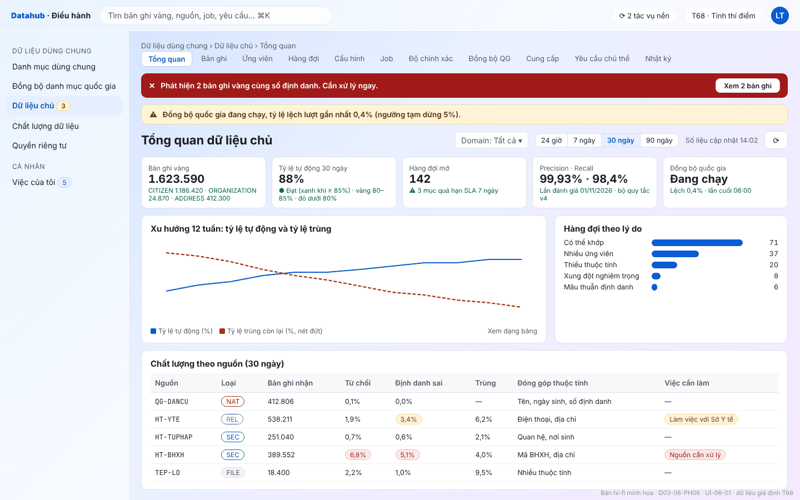

Ảnh cho thấy hai băng cảnh báo ở đầu (băng đỏ nghiêm trọng đứng trước băng vàng thông tin), năm thẻ chỉ số có chữ nêu mức đạt, biểu đồ xu hướng hai chuỗi (chuỗi trùng nét đứt), hàng đợi theo lý do và bảng chất lượng theo nguồn có nhãn "Nguồn cần xử lý" cho HT-BHXH (tỷ lệ từ chối 6,8%). Nền trang `color-canvas`; thẻ `color-surface-solid`, bo `radius-lg`, bóng `shadow-1`; số lớn `font-display` với `font-feature-tabular`.

## 8. UI-06-02 Tìm kiếm bản ghi vàng

::: dac-ta
**Mục đích.** Cho người quản lý tìm một bản ghi vàng theo số định danh, họ tên cộng thông tin phụ, ID vàng hoặc ID nguồn để giải quyết khiếu nại, rà soát trùng, chọn hai bản ghi để hợp nhất.

**Tác nhân, quyền.** DS, DA, SO (`PERM-06-read`); tìm theo thuộc tính cần mục đích đã được PH-09 chấp thuận (BR-06-026); chọn để hợp nhất cần `PERM-06-merge`.

**FR, UC.** FR-06-045, 046, 048.

**Truy vết hệ cũ.** Thay UI-06-01 mockup cũ (Tra cứu bản ghi vàng); thêm tìm theo ID nguồn.

**Đường dẫn, mẫu.** `/du-lieu/du-lieu-chu/{ma-domain}/ban-ghi` (`che-do`, `trang-thai`, `trang`, `co`, `sap-xep`); PTN-01 Danh sách (không có ô tìm rộng: tiêu chí cá nhân là biểu mẫu).

**API.** API-06-072 (`POST …/golden-records:search`); API-06-070 (`POST …:lookup`, tra theo khóa); API-06-068 (`GET …/xrefs/{sourceCode}/{sourceKey}`); API-06-069 (tra lô).

**Điều hướng vào.** Mục menu, tab "Bản ghi", liên kết từ UI-06-01, UI-06-05, UI-06-14.

**Thành phần chính.** Chọn domain, chọn chế độ tìm, biểu mẫu tiêu chí, kết quả, thanh hành động đã chọn (mục 8.2).

**Hành động.** Tìm; mở chi tiết; chọn 2 đến 10 bản ghi để "Hợp nhất…" (sang UI-06-06); "Tra theo ID nguồn".

**Trạng thái.** Chưa tìm (hướng dẫn); đang tìm; không có kết quả (`ST-04`); tiêu chí quá rộng; vượt ngưỡng truy cập hàng loạt; không ghi được nhật ký; không quyền.

**Thông báo.** "Nhập thêm tiêu chí: họ tên cần đi kèm ngày sinh, năm sinh hoặc xã."; "Anh/chị đã xem quá {n} bản ghi trong {phút} phút. Truy cập hàng loạt cần phê duyệt."; "Chưa ghi được nhật ký truy cập nên không hiển thị dữ liệu. Thử lại sau ít phút."

**Đợt, mức chi tiết.** Đợt 3; đầy đủ.
:::

### 8.1. Wireframe

Hình dưới là bố cục màn Tìm kiếm: chọn domain và cách tìm, nhập tiêu chí, bảng kết quả có chọn dòng để hợp nhất và cảnh báo khi xem quá nhiều bản ghi.

```text
| Bản ghi vàng ----------------------------------------- [Tra theo ID nguồn][Hợp nhất 2 đã chọn]|
| Domain: (●CITIZEN)(ORGANIZATION)(ADDRESS)                                                      |
|------------------------------------------------------------------------------------------------|
| Tìm theo: (●Họ tên)(Số định danh)(ID vàng)(ID nguồn)   Mục đích: [Giải quyết khiếu nại ▾]      |
| [Nguyễn Văn An   ] [Ngày/năm sinh: 1985] [Xã, phường ▾] [Trạng thái ▾]            [Tìm]       |
| ⓘ Họ tên cần đi kèm ngày sinh, năm sinh hoặc xã. Giá trị nhạy cảm luôn che.                     |
|---|--------------|--------------|-------------|----------|----------|-----|--------|-----------|
|☑ | ID vàng      | Họ tên       | Số định danh| Ngày sinh| Địa chỉ  |Nguồn|Tin cậy | Trạng thái|
|☑ | 0193a0c2…    | Nguyễn Văn An| *********345| 12/03/85 | …        | 3   |● 0,96  | ● Hoạt động|
|… |              |              |             |          |          |     |        |            |
|---|--------------|--------------|-------------|----------|----------|-----|--------|-----------|
| ⚠ Anh/chị đã xem 74 bản ghi trong 10 phút. Ngưỡng 100.            5 kết quả · đã chọn 2        |
|------------------------------------------------------------------------------------------------|
```

### 8.2. Thành phần, trường và cột

Bảng dưới đánh số các ô chọn, trường nhập và cột của màn Tìm kiếm, kèm kiểm tra và API tương ứng.

| # | Thành phần | `CMP-*` | Nội dung, kiểm tra | Nguồn |
|---|---|---|---|---|
| 1 | Chọn domain | `CMP-SegmentedControl` | Domain `ACTIVE`; đổi domain xóa tiêu chí | API-06-001 |
| 2 | Chọn chế độ tìm | `CMP-SegmentedControl` | `khoa`, `ten`, `id-vang`, `id-nguon` | — |
| 3 | Biểu mẫu tiêu chí | `CMP-Form`, `CMP-Input`, `CMP-DatePicker`, `CMP-ResourceSelect` | Xem bảng trường | — |
| 4 | Chọn mục đích | `CMP-Select` | Mục đích PH-09 đã chấp thuận cho người dùng; bắt buộc khi `ten`, `khoa` | PH-09 |
| 5 | Kết quả | `CMP-DataTable` | Cột dưới; chọn nhiều bằng hộp chọn | API-06-072 |
| 6 | Thanh đã chọn | `CMP-BulkActionBar` | "Hợp nhất {n} bản ghi" (n từ 2 đến 10, cùng domain, đều `ACTIVE`) | — |
| 7 | Chế độ tra theo ID nguồn | `CMP-Form` | Mã nguồn + khóa nguồn (không phải DLCN) | API-06-068 |

: UI-06-02 Tìm kiếm bản ghi vàng, thành phần

| Trường tìm | Kiểu | Bắt buộc | Kiểm tra | Ánh xạ API |
|---|---|---|---|---|
| Họ tên | T-TEXT ≤ 200 | Với `ten` | Phải đi kèm một trong: ngày sinh, năm sinh, xã (ERR-06-040) | `criteria.fullName` |
| Ngày hoặc năm sinh | T-DATE hoặc năm | Có điều kiện | Ngày hợp lệ hoặc năm 1900…hiện tại | `criteria.birthDate` |
| Xã, phường | `CMP-CodeListSelect` theo ĐVHC PH-07 | Có điều kiện | Mã hiện hành | `criteria.adminUnitCode` |
| Số định danh | Chuỗi che, `autocomplete=off` | Với `khoa` | Đúng `IdentifierType` của domain; không lưu lịch sử | Thân `POST`, không lên URL |
| ID vàng | UUID | Với `id-vang` | UUID v7 | `goldenId` |
| Mã nguồn, khóa nguồn | `CMP-Select`, T-TEXT | Với `id-nguon` | Nguồn đã đăng ký | Đường dẫn API-06-068 |
| Mục đích | Chọn | Với `ten`, `khoa` | Thuộc danh sách chấp thuận | `purposeCode` |

: UI-06-02 Trường tiêu chí tìm kiếm

| Cột kết quả | Nội dung | Ghi chú |
|---|---|---|
| ID vàng | `CMP-Identifier` rút gọn, sao chép được | Đầy đủ ở tooltip |
| Họ tên | Theo quy tắc che của PH-09 | |
| Số định danh | `CMP-MaskedValue` | Che theo `SENSITIVE` |
| Ngày sinh, Địa chỉ | Theo phân loại | |
| Nguồn | Số liên kết hiệu lực | Bấm mở tab "Nguồn liên kết" |
| Tin cậy | Chấm màu kèm số | Cao ≥ 0,9; TB 0,7–0,9; thấp dưới 0,7 |
| Trạng thái | `CMP-StatusTag` `GoldenStatus` | `MERGED` có liên kết "Mở bản sống sót" |

: UI-06-02 Cột kết quả

### 8.3. Hành động và trạng thái

Bảng dưới ghi điều gì xảy ra khi người dùng tìm, chưa tìm, không có kết quả hay bị chặn, và màn hiển thị gì trong từng trường hợp.

| Hành động, trạng thái | Hiển thị |
|---|---|
| Tìm | Gửi `POST` (tiêu chí không lên URL); ghi `che-do`, `trang-thai`, `trang` lên URL; mỗi lần tìm ghi nhật ký truy cập |
| Chưa tìm | `CMP-EmptyState` "Nhập tiêu chí để tìm bản ghi vàng." kèm giải thích tiêu chí tối thiểu |
| Không có kết quả (`ST-04`) | "Không tìm thấy bản ghi vàng phù hợp." kèm điều kiện và gợi ý "Thử tra theo ID nguồn" |
| Tiêu chí quá rộng | Lỗi dưới ô: "Nhập thêm tiêu chí: họ tên cần đi kèm ngày sinh, năm sinh hoặc xã." (ERR-06-040) |
| Vượt ngưỡng hàng loạt | `CMP-Alert` lỗi trên bảng: câu ERR-06-038, nút "Đề nghị phê duyệt truy cập" |
| Không ghi được nhật ký | Thay nội dung kết quả: câu ERR-06-039, nút "Thử lại" |
| Chọn 1 hoặc quá 10 | Nút "Hợp nhất" vô hiệu kèm chữ "Chọn từ 2 đến 10 bản ghi cùng domain" |

: UI-06-02 Hành động và trạng thái màn

### 8.4. Bản hi-fi

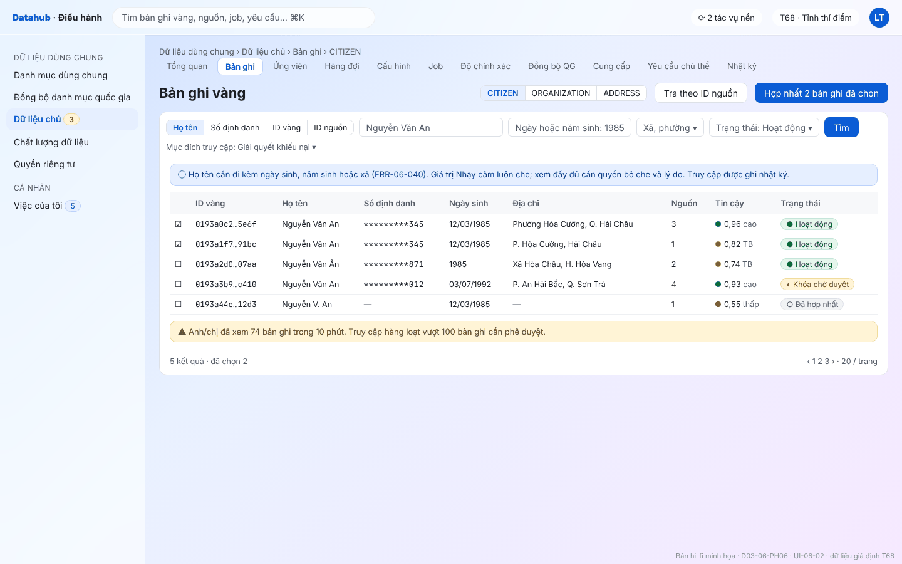

Ảnh cho thấy biểu mẫu tiêu chí phía trên bảng (không có ô tìm tự do), dải ghi chú về giá trị che, năm kết quả trong đó một bản ghi đã hợp nhất và một bản ghi khóa chờ duyệt, hai dòng đã chọn và cảnh báo truy cập hàng loạt ở chân.

## 9. UI-06-03 Chi tiết bản ghi vàng

::: dac-ta
**Mục đích.** Cho người quản lý thấy toàn bộ một bản ghi vàng: từng thuộc tính kèm nhãn nguồn, chiến lược sống sót đã thắng, độ tin cậy và ngày cập nhật ở nguồn; các bản ghi nguồn liên kết; lịch sử phiên bản; thao tác chờ duyệt. Màn trả lời câu hỏi "giá trị này đến từ đâu" khi khiếu nại, kiểm toán, giải trình.

**Tác nhân, quyền.** DS, DA, TA, SO, AU (`PERM-06-read`); sửa tay, gỡ liên kết `PERM-06-update`; hợp nhất, tách, hoàn tác, ngừng, khôi phục `PERM-06-merge`; bỏ che `PERM-09-unmask`.

**FR, UC.** FR-06-035, 036, 039, 040, 041, 043, 044; FR-06-046 (mở bằng khóa).

**Truy vết hệ cũ.** Gộp UI-06-01 (chi tiết) và UI-06-04 (Truy vết nguồn gốc) của mockup cũ; tab "Nguồn gốc" thay UI-06-04.

**Đường dẫn, mẫu.** `/du-lieu/du-lieu-chu/{ma-domain}/ban-ghi/{id}` (tab con `/nguon-lien-ket`, `/nguon-goc`, `/lich-su`, `/thao-tac`; `thuoc-tinh`, `phien-ban`, `so-sanh`); PTN-02 Chi tiết.

**API.** API-06-056 (`GET …/golden-records/{goldenId}`, `ETag`); API-06-065 (lineage); API-06-066, 067 (xref, gỡ); API-06-063, 064 (lịch sử); API-06-057 (sửa tay); API-06-060, 061 (hoàn tác, duyệt); API-06-062 (ngừng, khôi phục); API-06-122 (`GET …/golden-records/{goldenId}/operations`, danh sách tab Thao tác).

**Điều hướng vào.** Từ UI-06-02, UI-06-05, UI-06-06, UI-06-14, UI-06-16; liên kết "Mở bản ghi sống sót" khi `MERGED`.

**Thành phần chính.** Đầu trang bản ghi, bốn tab, bảng thuộc tính, bảng điều khiển nguồn gốc, hộp thoại thao tác (mục 9.2 đến 9.6).

**Hành động.** Xem; bỏ che có lý do; sửa tay; hợp nhất; tách; gỡ liên kết; hoàn tác; ngừng; khôi phục; so sánh hai phiên bản; đề nghị sửa tại nguồn. Chỉ hiện hành động hợp lệ ở trạng thái hiện tại (FR-00-053).

**Trạng thái.** `ACTIVE`, `LOCKED`, `MERGED`, `RETIRED` (mục 9.7); đang tải; lỗi; không quyền; không ghi được nhật ký.

**Thông báo.** "Không tìm thấy bản ghi vàng {id}."; "Bản ghi vàng {id} đang có thao tác chờ duyệt."; "Thuộc tính {tên} chỉ được sửa tại CSDL quốc gia. Hướng dẫn công dân liên hệ cơ quan đăng ký."; "Có {n} thao tác sau phụ thuộc vào thao tác này…"; "Chưa ghi được nhật ký truy cập nên không hiển thị dữ liệu."

**Đợt, mức chi tiết.** Đợt 3; rất chi tiết.
:::

### 9.1. Wireframe tab "Thuộc tính"

Hình dưới là bố cục tab Thuộc tính của bản ghi vàng: đầu trang có trạng thái và các nút thao tác, bảng thuộc tính che giá trị nhạy cảm, và khung truy nguồn gốc của thuộc tính đang chọn.

```text
| Dữ liệu chủ › CITIZEN › 0193a0c2 -----------------------------------------------------------|
| ① Nguyễn Văn An  [● Hoạt động]  CITIZEN · v7 · tin cậy 0,96   [Sửa tay][Hợp nhất…][Tách…]… |
|    ID vàng 0193a0c2-…  [Sao chép] · Đồng bộ QG 25/11 06:00 · 3 nguồn liên kết               |
| ② [Thuộc tính][Nguồn liên kết 3][Nguồn gốc][Lịch sử 7][Thao tác 0]                          |
|------------------------------------------------------------|--------------------------------|
| ③ Thuộc tính | Giá trị | Phân loại | Nguồn | Chiến lược |  | ④ Nguồn gốc · Ngày sinh        |
|   Tin cậy | Cập nhật nguồn |                               | Giá trị hiện tại 12/03/1985 từ  |
|  Số định danh  *********345 [Hiện…] SENSITIVE QG-DANCU    | QG-DANCU theo NATIONAL_AUTHORITY|
|   NATIONAL_AUTHORITY  ● 1,0  26/06/2026                    | Giá trị theo từng nguồn:        |
|  Họ tên        Nguyễn Văn An  INTERNAL QG-DANCU …          |  QG-DANCU 12/03/1985 ✓ đang dùng|
|  Ngày sinh     12/03/1985 … < đang chọn                    |  HT-YTE   12/03/1986 ≠ khác     |
|  Điện thoại    091*****78  HT-YTE MOST_RECENT ● 0,75       |  HT-BHXH  12/03/1985 ✓ trùng    |
|  …                                                         | Lịch sử giá trị (dòng thời gian)|
| Chú giải: ● cao ≥ 0,9 · TB 0,7–0,9 · thấp < 0,7            | [Đề nghị sửa tại nguồn HT-YTE]  |
|------------------------------------------------------------|--------------------------------|
```

### 9.2. Giải phẫu đầu trang và tab

Bảng dưới đánh số các phần của đầu trang và hàng tab chi tiết, kèm thành phần giao diện và kiểm tra.

| # | Thành phần | `CMP-*` | Nội dung, kiểm tra | Ghi chú |
|---|---|---|---|---|
| 1 | Tiêu đề bản ghi | `CMP-PageHeader` | Tên hiển thị (theo quy tắc che), `GoldenStatus`, domain, phiên bản, độ tin cậy tổng | Không chứa số định danh |
| 2 | ID vàng | `CMP-Identifier` + `CMP-CopyButton` | Đầy đủ, sao chép | Tooltip "ID vàng có thể dùng làm khóa liên kết (Q06-08)" |
| 3 | Thanh thao tác | `CMP-Button`, `CMP-DropdownMenu` | "Sửa tay" (`update`), "Hợp nhất…", "Tách…", "Hoàn tác", "Ngừng…" (`merge`); mục ít dùng vào menu "⋯" | Điều kiện theo mục 9.7 |
| 4 | Băng khóa | `CMP-Banner` | Khi `LOCKED`: "Bản ghi vàng {id} đang có thao tác chờ duyệt." kèm liên kết tab "Thao tác" | |
| 5 | Hàng tab | `CMP-Tabs` | Năm tab với số đếm; mỗi tab là route con | Tab "Thao tác" có huy hiệu khi có thao tác chờ |

: UI-06-03 Chi tiết bản ghi vàng, đầu trang

### 9.3. Tab "Thuộc tính"

Bảng một dòng mỗi thuộc tính của mô hình `ACTIVE` (không hiện thuộc tính chưa có giá trị trừ khi bật "Hiện cả thuộc tính trống"). Bấm một dòng chọn thuộc tính và mở bảng điều khiển nguồn gốc (vùng ④) bên phải; mũi tên lên xuống đổi dòng chọn, `Enter` mở tab "Nguồn gốc" tại thuộc tính đó. Nguồn được lưu ở cấp thuộc tính, không ở cấp bản ghi (BR-06-009).

| Cột | Nội dung | `CMP-*` | Ghi chú |
|---|---|---|---|
| Thuộc tính | Nhãn thuộc tính, mã trong `CMP-CodeText` khi bật "Hiện mã" | `CMP-Text` | Khóa định danh có biểu tượng khóa |
| Giá trị | Giá trị theo quy tắc che; `SENSITIVE` là dạng che kèm nút "Hiện…" | `CMP-MaskedValue` | Nút chỉ khi có `PERM-09-unmask` |
| Phân loại | `DataClass` | `CMP-Tag` | Nhạy cảm tô nền đậm hơn, vẫn có chữ |
| Nguồn | Mã nguồn của giá trị đang thắng | `CMP-Tag` `color-source-*` | Bấm mở tab "Nguồn liên kết" tại nguồn |
| Chiến lược thắng | `SurvivorshipStrategy` | `CMP-Text` | `MANUAL_OVERRIDE` có biểu tượng bút và lý do ở tooltip |
| Tin cậy | Chấm kèm số và chữ cao, TB, thấp | `CMP-StatusDot` | Ngưỡng 0,9 và 0,7 |
| Cập nhật nguồn | `sourceUpdatedAt` | `CMP-Timestamp` | |
| ⋯ | Menu dòng | `CMP-DropdownMenu` | "Xem nguồn gốc", "Sửa tay…", "Đề nghị sửa tại nguồn" |

: UI-06-03 Cột bảng thuộc tính

Thuộc tính thẩm quyền quốc gia hiện biểu tượng "quốc gia" cạnh nhãn nguồn và mục "Sửa tay…" bị vô hiệu kèm lý do: "Thuộc tính {tên} chỉ được sửa tại CSDL quốc gia. Hướng dẫn công dân liên hệ cơ quan đăng ký." (ERR-06-035, BR-06-025).

### 9.4. Tab "Nguồn gốc" (truy xuất nguồn gốc từng thuộc tính)

Đây là phần trả lời trực tiếp FR-06-043. Bố cục hai vùng: cột trái liệt kê thuộc tính (mỗi dòng kèm số giá trị khác nhau từng thấy), vùng phải gồm hai khối.

1. **Lịch sử giá trị** (`CMP-LineageTimeline`): theo thời gian giảm dần; mỗi mục có thời điểm đưa vào, giá trị trước, giá trị sau (che theo phân loại), nguồn và khóa nguồn che một phần, `sourceUpdatedAt`, chiến lược đã thắng, ghi chú dạng "Nguồn mức 1 ghi đè giá trị từ HT-YTE mức 3", mã thao tác `operationId` (bấm mở tab "Lịch sử"). Lọc theo khoảng `tu`, `den`.
2. **Giá trị hiện tại của từng nguồn đang liên kết** (`CMP-DataTable` gọn): nguồn, giá trị, cập nhật, so với giá trị vàng (✓ trùng hoặc ≠ khác). Nguồn nào khác được tô `color-diff-removed` kèm chữ "khác" và nút "Đề nghị sửa tại nguồn" (tạo yêu cầu như FR-06-036 bước 3, không sửa bản ghi vàng).

| Phần tử | Quy tắc |
|---|---|
| Giá trị che | Cả giá trị trước và sau đều che theo phân loại; bỏ che từng dòng cần lý do và ghi nhật ký |
| Nhãn nguồn | Mã nguồn bằng chữ; tô `color-source-*` theo `SourceKind` |
| Dòng mới nhất | Có nhãn "đang dùng" |
| Rỗng | "Thuộc tính này chưa có lịch sử." |
| Lỗi thuộc tính không có trong mô hình | "Domain {mã} không có thuộc tính {tên}." (ERR-06-003) |

: UI-06-03 Tab Nguồn gốc, quy tắc hiển thị

### 9.5. Các tab còn lại

Ngoài tab Thuộc tính, bản ghi vàng còn các tab Nguồn liên kết, Nguồn gốc, Lịch sử và Thao tác; bảng dưới ghi nội dung và hành động của từng tab.

| Tab | Nội dung | Hành động |
|---|---|---|
| Nguồn liên kết | Bảng xref: nguồn, khóa nguồn che một phần, `XrefStatus`, cách khớp (`MatchMethod`), điểm, ngày liên kết, người xác nhận | "Gỡ liên kết…" (`PERM-06-update`): hộp thoại chọn `RelinkMode` (`NEW_GOLDEN` tạo bản ghi vàng mới, `REMATCH` đối sánh lại) và lý do ≥ 20 ký tự; liên kết do người xác nhận hiện nhãn "đã xác nhận bởi người" (BR-06-023) |
| Lịch sử | `CMP-VersionTimeline` phiên bản, loại thay đổi `GoldenChangeType`, người, thời điểm, tóm tắt thuộc tính đổi | Chọn hai phiên bản để "So sánh" (`CMP-DiffViewer`, ô đổi dùng `color-diff-changed`, thêm `color-diff-added`, bớt `color-diff-removed`); không có nút xóa phiên bản |
| Thao tác | Thao tác `golden_operation` chờ duyệt và hoàn tác được, lấy từ API-06-122 (lọc `status`, `changeType`, `undoable`): loại, người đề nghị, trạng thái `OperationStatus`, hạn hoàn tác | "Hoàn tác", "Duyệt", "Từ chối" (DA khác người đề nghị) bằng `CMP-ApprovalPanel` |

: UI-06-03 Các tab Nguồn liên kết, Lịch sử, Thao tác

### 9.6. Hộp thoại thao tác

Bảng dưới ghi các hộp thoại thao tác trên bản ghi vàng như bỏ che, sửa tay, ngừng và gỡ liên kết, cùng trường nhập, kiểm tra và thông điệp.

| Hộp thoại | `CMP-*` | Trường | Kiểm tra | Thông điệp |
|---|---|---|---|---|
| Bỏ che giá trị | `CMP-ReasonDialog` | Lý do, phạm vi (một thuộc tính hoặc cả bản ghi) | Lý do ≥ 20 ký tự; cần `PERM-09-unmask`; PH-09 trả lời | "Nhập lý do (tối thiểu 20 ký tự)."; giá trị rõ tự che lại sau 60 giây |
| Sửa tay | `CMP-Modal` + `CMP-FormField` | Thuộc tính, giá trị mới, hạn hiệu lực, lý do | Đúng kiểu; không phải thuộc tính thẩm quyền quốc gia; lý do ≥ 20 ký tự; tự tạo yêu cầu sửa tại nguồn (BR-06-014) | ERR-06-035, ERR-06-007; xung đột phiên bản `ST-13` |
| Hoàn tác | `CMP-ConfirmDialog` | Lý do; danh sách thao tác phụ thuộc | Quá `06.undo.window-days` (90 ngày) cần DA duyệt (ERR-06-034); có thao tác phụ thuộc thì liệt kê và xin xác nhận cả chuỗi | ERR-06-033, ERR-06-034 |
| Ngừng | `CMP-ReasonDialog` | `RetireReason`, lý do | Không còn liên kết hiệu lực (ERR-06-036) | ERR-06-036 |
| Khôi phục | `CMP-ConfirmDialog` | Lý do | Bản ghi `RETIRED` | "Bản ghi {id} đang ở trạng thái {trạng thái}." |
| Gỡ liên kết | `CMP-ReasonDialog` | `RelinkMode`, lý do | Liên kết `ACTIVE` | ERR-06-007 |

: UI-06-03 Hộp thoại thao tác

### 9.7. Trạng thái bản ghi và hành động hiện

Hành động hiện ra phụ thuộc vào trạng thái bản ghi; bảng dưới ghi với mỗi `GoldenStatus` giao diện trông thế nào và những nút nào được hiện.

| `GoldenStatus` | Giao diện | Hành động hiện |
|---|---|---|
| `ACTIVE` | Bình thường | Sửa tay, Hợp nhất, Tách (≥ 2 liên kết), Hoàn tác (có thao tác hoàn tác được), Ngừng, Gỡ liên kết |
| `LOCKED` | Băng "đang có thao tác chờ duyệt" (ERR-06-031) hoặc "đang bị hạn chế xử lý theo yêu cầu của chủ thể" | Chỉ xem; DA thấy "Duyệt" ở tab Thao tác |
| `MERGED` | Băng "Bản ghi đã hợp nhất vào {id}" kèm nút "Mở bản ghi sống sót" | Chỉ xem; "Hoàn tác hợp nhất" nếu còn hạn |
| `RETIRED` | Băng "Bản ghi đã ngừng: {lý do}" (API trả 410 biến thể "đã ngừng") | Khôi phục (`merge`) |

: UI-06-03 Hành động theo trạng thái bản ghi

### 9.8. Trạng thái màn

Bảng dưới ghi màn chi tiết khi đang tải, khi không ghi được nhật ký truy cập, và các tình huống lỗi khác, kèm nội dung thông báo.

| Trạng thái | Hiển thị |
|---|---|
| Đang tải | Skeleton đầu trang và 9 dòng bảng; không hiện giá trị tới khi nhật ký truy cập ghi xong |
| Không ghi được nhật ký | Thay toàn bộ nội dung chi tiết: "Chưa ghi được nhật ký truy cập nên không hiển thị dữ liệu. Thử lại sau ít phút." kèm nút "Thử lại" (ERR-06-039, BR-06-010) |
| Không tìm thấy, đã ngừng | `ST-08` với câu ERR-06-001; bản ghi `RETIRED` vẫn xem được lịch sử qua tab |
| Không có quyền, ngoài phạm vi | `ST-07` |
| Xung đột phiên bản khi sửa | `ST-13` |
| PH-09 không khả dụng | Mọi giá trị DLCN hiện dạng che, nút "Hiện…" vô hiệu, dải 5.4 (ERR-06-021) |

: UI-06-03 Trạng thái màn

### 9.9. Bàn phím, truy cập

Bảng thuộc tính là `role="grid"`: mũi tên di chuyển giữa ô, `Enter` mở nguồn gốc, `Shift+F10` mở menu dòng, `Esc` đóng bảng điều khiển. Nút "Hiện…" có tên truy cập "Hiện giá trị đầy đủ của {thuộc tính}, cần nhập lý do". Giá trị đã bỏ che được thông báo bằng `aria-live="polite"` một lần ("Đã hiển thị giá trị đầy đủ của Điện thoại, tự che lại sau 60 giây"). Chấm tin cậy có chữ; chiến lược và nguồn không chỉ bằng màu. Dưới `bp-lg` vùng ④ chuyển thành `CMP-Drawer` mở từ bên phải.

### 9.10. Bản hi-fi

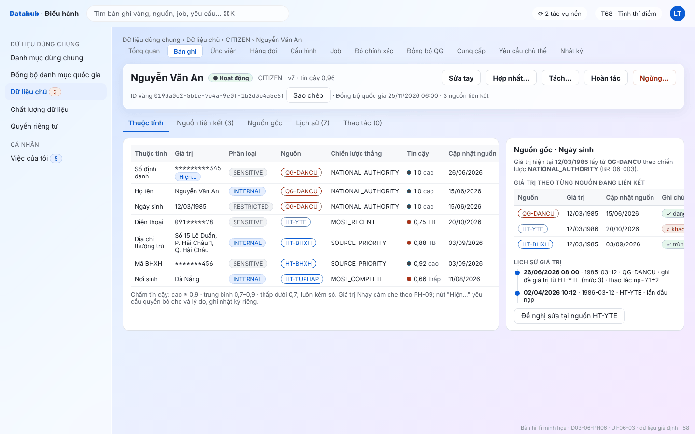

Ảnh cho thấy đầu trang bản ghi với năm nút thao tác, bảng thuộc tính có đủ bảy cột (phân loại, nhãn nguồn, chiến lược, tin cậy có chữ), giá trị Nhạy cảm che kèm nút "Hiện…", và bảng điều khiển nguồn gốc của thuộc tính "Ngày sinh": giá trị hiện tại lấy từ QG-DANCU, HT-YTE đang có giá trị khác (≠ khác, màu và chữ), dòng thời gian hai lần ghi và nút "Đề nghị sửa tại nguồn HT-YTE".

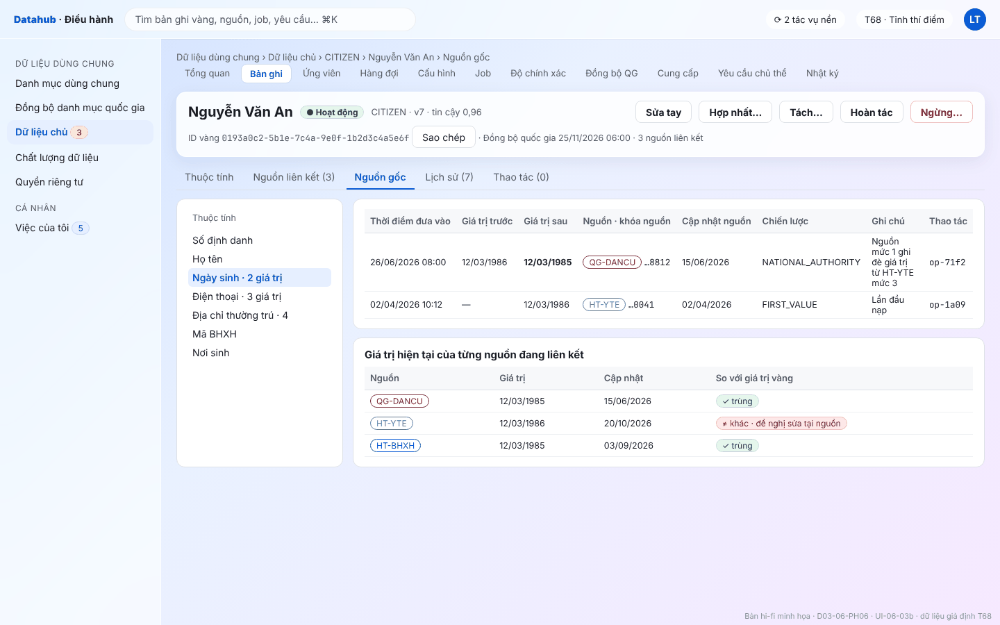

Biến thể thứ hai là tab "Nguồn gốc" mở rộng: danh sách thuộc tính bên trái, bảng lịch sử giá trị đầy đủ cột (thời điểm đưa vào, giá trị trước và sau, nguồn và khóa nguồn che một phần, chiến lược, ghi chú "Nguồn mức 1 ghi đè giá trị từ HT-YTE mức 3", mã thao tác) và bảng giá trị hiện tại của từng nguồn.

## 10. UI-06-04 Hàng đợi người quản lý dữ liệu

::: dac-ta
**Mục đích.** Cho DS thấy và nhận việc mục hàng đợi (cặp bản ghi cần người quyết), DA theo dõi quá hạn, chờ duyệt và phân công lại.

**Tác nhân, quyền.** DS, DA (`PERM-06-steward`); chỉ thấy mục thuộc tổ chức của mình khi `○` (ERR-06-028).

**FR, UC.** FR-06-027, 028, 032.

**Truy vết hệ cũ.** Thay UI-06-02 mockup cũ (Hàng đợi đối sánh thủ công); thêm mức ưu tiên, SLA, nhận việc, phân công.

**Đường dẫn, mẫu.** `/du-lieu/du-lieu-chu/hang-doi` (`domain`, `ly-do`, `rui-ro`, `trang-thai`, `phan-vung`, `sap-xep`); PTN-10 Hộp việc và duyệt (mật độ gọn).

**API.** API-06-045 (`GET /stewardship/items`, lọc `partition`); API-06-047 (`:claim`, `:release`, `:assign`); API-06-124 (`POST /stewardship/items:claim-next`, "Nhận việc tiếp theo"); API-06-050 (thống kê).

**Điều hướng vào.** Tab "Hàng đợi", thẻ ở UI-06-01, thông báo "Việc của tôi".

**Thành phần chính.** Bốn thẻ chỉ số, phân vùng, bộ lọc, bảng mục, thao tác nhận và phân công (mục 10.1).

**Hành động.** "Nhận việc tiếp theo" (API-06-124: mục ưu tiên cao nhất chưa nhận, một lệnh nguyên tử; hết mục thì `204` và màn hiện trạng thái rỗng); nhận mục đã chọn; "Mở lại" mục `RESOLVED` trong hạn (API-06-121); trả lại; phân công (DA); mở so sánh; lọc, sắp xếp.

**Trạng thái.** Đang tải; rỗng "Không còn mục nào cần xử lý"; không kết quả; mục vừa bị người khác nhận; quá tải; không quyền.

**Thông báo.** "Mục này vừa được {người} nhận. Hệ thống chuyển anh/chị sang mục kế tiếp."; "Hàng đợi vượt {n} mục. Giao thêm người xử lý."

**Đợt, mức chi tiết.** Đợt 3; đầy đủ.
:::

```text
| Hàng đợi người quản lý dữ liệu ------------------------ [Nhận việc tiếp theo ⏎][Phân công…] |
| Đang mở 142 | Của tôi 9 (1 chờ duyệt) | Quá hạn 3 ⚠ | Hôm nay xử lý 37 (TB 44 giây/mục)     |
| (●Của tôi 9)(Chưa nhận 118)(Quá hạn 3)(Chờ duyệt 4)(Tất cả 142)   Domain▾ Lý do▾ Rủi ro▾     |
| ☐ Ưu tiên  Domain  Lý do  Điểm  Cặp bản ghi  Tuổi  SLA  Người nhận  Trạng thái               |
| ☐ Cao 92   CITIZEN Mâu thuẫn định danh 0,93 Nguyễn Văn An · Nguyễn V. An  9 ng  Quá hạn 2 ng |
|--------------------------------------------------------------------------------------------|
```

### 10.1. Thành phần, cột và hành động

Bảng dưới đánh số các thành phần của màn Hàng đợi, gồm thẻ chỉ số, phân vùng, bảng mục, cột và các hành động nhận việc, phân công.

| # | Thành phần | `CMP-*` | Nội dung, kiểm tra |
|---|---|---|---|
| 1 | Thẻ chỉ số | `CMP-StatCard` ×4 | Đang mở, của tôi, quá hạn (chữ "Quá hạn n ngày"), xử lý hôm nay; bấm lọc bảng |
| 2 | Phân vùng | `CMP-FilterChips` | `cua-toi`, `chua-nhan`, `qua-han`, `cho-duyet`, tất cả, kèm số |
| 3 | Bộ lọc | `CMP-FilterBar` | Domain, `QueueReason`, `RiskLevel`, khoảng ngày, người nhận (DA) |
| 4 | Bảng mục | `CMP-DataTable` gọn | Cột dưới; phím `J`, `K` đổi dòng, `Enter` mở UI-06-05, `N` nhận mục tiếp theo |
| 5 | Thanh hàng loạt | `CMP-BulkActionBar` | "Nhận" (DS), "Phân công…" (DA, `CMP-Select` người xử lý), "Trả lại" |
| 6 | Nút "Nhận việc tiếp theo" | `CMP-Button` chính | Gọi API-06-124 theo bộ lọc đang chọn; trả `204` thì hiện "Không còn mục nào cần xử lý"; hai người bấm cùng lúc nhận hai mục khác nhau |
| 7 | Nút "Mở lại" | `CMP-Button` phụ ở dòng `RESOLVED` | Chỉ hiện cho người đã quyết hoặc DA trong `06.queue.reopen-hours` (24 giờ); mở hộp thoại ở UI-06-05 |

: UI-06-04 Hàng đợi, thành phần

| Cột | Nội dung | Ghi chú |
|---|---|---|
| Ưu tiên | Nhãn Cao, TB, Thấp kèm điểm 0 đến 100 | Công thức ở FR-06-027; chữ kèm số |
| Domain, Lý do | Tên domain, `QueueReason` | |
| Điểm | Điểm đối sánh 0 đến 1 | Định dạng `vi-VN` |
| Cặp bản ghi | Hai tên hiển thị rút gọn theo quy tắc che | Không hiện số định danh |
| Tuổi, SLA | Tuổi bằng ngày; "còn n ngày" hoặc "Quá hạn n ngày" | `06.queue.sla-days` |
| Người nhận | Tên hoặc "—"; mục của tôi có "(tôi)" | |
| Trạng thái | `QueueItemStatus` | `PENDING_APPROVAL` chỉ DA duyệt |

: UI-06-04 Cột bảng mục

Mục đã nhận được giữ `06.queue.hold-minutes` (30 phút) rồi tự trả về `OPEN`; đồng hồ giữ hiện ở UI-06-05. Mục `PENDING_APPROVAL` mà DS là người đã quyết hiện mờ, không có hành động (bốn mắt). Khi vượt `06.queue.max-open` thẻ "Đang mở" đổi `warning` kèm chữ "Quá tải"; cặp vùng xem xét vẫn bắt buộc chuyển người (BR-06-002).

| Trạng thái | Hiển thị |
|---|---|
| Đang tải | 12 hàng skeleton |
| Rỗng | `CMP-EmptyState` "Không còn mục nào cần xử lý. Hệ thống tạo mục mới khi đối sánh có cặp cần người quyết." |
| Không kết quả | `ST-04` kèm "Xóa bộ lọc" |
| Nhận trùng | Thông báo nổi ERR-06-027 và tự mở mục kế tiếp |
| Ngoài phạm vi | ERR-06-028, `ST-07` |

: UI-06-04 Trạng thái màn

Bàn phím: `J`, `K`, `Enter`, `N`, `Space` chọn dòng, `?` mở `CMP-ShortcutSheet`. Truy cập: bảng `role="grid"`; số "quá hạn" đọc "3 mục quá hạn". Hi-fi:

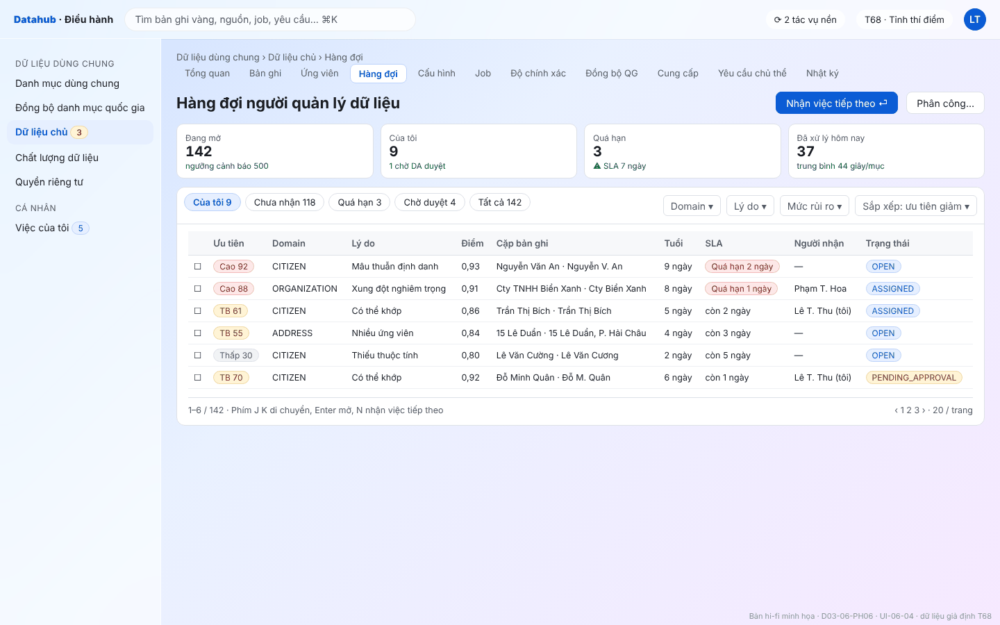

## 11. UI-06-05 So sánh và quyết định

::: dac-ta
**Mục đích.** Cho DS quyết định hai bản ghi có phải cùng một thực thể trong vài chục giây, trong một màn: hai bản ghi theo từng thuộc tính kèm điểm và mức so sánh, nguồn, thời điểm, các bản ghi nguồn đã đóng góp và quyết định tương tự trước đây. Đây là màn quan trọng nhất của phân hệ (FRS §10.2).

**Tác nhân, quyền.** Người đang nhận mục và DA (`PERM-06-steward`); duyệt bốn mắt `PERM-06-approve` (DA khác người quyết); bỏ che `PERM-09-unmask`.

**FR, UC.** FR-06-029, 030, 031.

**Truy vết hệ cũ.** Thay UI-06-03 mockup cũ (So sánh và quyết định hợp nhất); thêm điểm từng thuộc tính, ngữ cảnh, lý do bắt buộc, bốn mắt.

**Đường dẫn, mẫu.** `/du-lieu/du-lieu-chu/hang-doi/{id}` (`?tiep=1`); PTN-10, vùng chi tiết toàn trang.

**API.** API-06-046 (`GET /stewardship/items/{itemId}`); API-06-047 (`:claim`, `:release`); API-06-048 (`:decide`); API-06-049 (`:approve`, `:reject`); API-06-121 (`:reopen`, sửa quyết định); API-06-124 (`?tiep=1` nhận mục kế tiếp).

**Điều hướng vào.** Từ UI-06-04 (Enter hoặc "Nhận việc tiếp theo"); liên kết "Mở bản ghi" sang UI-06-03.

**Thành phần chính.** Thanh điểm tổng, bảng so sánh hai cột, cột ngữ cảnh, thanh quyết định cố định (mục 11.2 đến 11.4).

**Hành động.** "Cùng một thực thể", "Khác nhau", "Hoãn"; chọn mẫu lý do; bỏ che có lý do; "Trả lại hàng đợi"; mục trước, mục sau; DA: "Duyệt", "Từ chối" (khi `PENDING_APPROVAL`).

**Trạng thái.** `ASSIGNED` (đang giữ); `PENDING_APPROVAL` (chế độ duyệt, DA); mục lỗi thời; mục vừa bị người khác nhận; hết giờ giữ; định danh khác nhau; không ghi được nhật ký.

**Thông báo.** "Nhập lý do (tối thiểu 20 ký tự)."; "Hai bản ghi có số định danh khác nhau nên không được hợp nhất. Kiểm tra lại dữ liệu nguồn."; "Dữ liệu của cặp đã thay đổi. Xem lại trước khi quyết định."; "Mục này vừa được {người} nhận…"; "Anh/chị là người đề nghị nên không được tự duyệt."

**Đợt, mức chi tiết.** Đợt 3; rất chi tiết.
:::

### 11.1. Lưới bố cục và nguyên tắc

Màn dùng khung toàn trang (không Drawer), ba vùng: thanh điểm tổng (cao 72 px, cố định dưới thanh tab), vùng giữa gồm bảng so sánh (cột rộng) và cột ngữ cảnh (rộng 330 px), thanh quyết định cố định ở chân (`glass-overlay`, cao 96 px). Thứ tự thị giác: điểm tổng, các dòng khác nhau, quyết định. Bảng so sánh sắp theo trọng số thuộc tính giảm dần (khóa định danh, họ tên, ngày sinh, rồi các thuộc tính còn lại); dòng `DIFFERENT` và `FUZZY_LOW` không bị ẩn khi bật "Chỉ hiện dòng khác" nhưng dòng `EXACT` có thể thu gọn.

```text
| So sánh và quyết định  [Đã nhận · giữ còn 24 phút]        Mục 3/9 của tôi · còn 142   [‹][›] |
| ① Điểm tổng 0,91 ▕░░░░░░░░░░░░░░░░░░░░░▏ vùng xem xét 0,80–0,95 · Có thể khớp · Rủi ro: Cao    |
|--------------------------------------------------------------|---------------------------------|
| ② Thuộc tính | Bản ghi A | Bản ghi B | Mức so sánh | Điểm   | ③ Ngữ cảnh                      |
| Số định danh | ****345   | — (thiếu) | Thiếu       | —      | Bản ghi nguồn của A:            |
| Họ tên       | Nguyễn Văn An | Nguyễn V. An | Gần giống cao | 0,94 |  QG-DANCU …8812 · 15/06/2026 |
| Ngày sinh    | 12/03/1985| 12/03/1985| Trùng       | 1,00   |  HT-BHXH …3390 · 03/09/2026     |
| Địa chỉ      | Số 15 …   | 15 …      | Gần giống thấp| 0,72 | Bản ghi nguồn của B: HT-YTE …0041|
| Nơi sinh     | Đà Nẵng   | Quảng Nam | Khác        | 0,00   | Cảnh báo chuẩn hóa: ĐVHC chuyển đổi|
|--------------------------------------------------------------|---------------------------------|
| ④ Lý do * [____________________________________] 0/500    [Cùng một thực thể] [Khác nhau] [Hoãn]|
|    Mẫu: (Trùng ngày sinh, điện thoại)(Cùng người, viết tắt tên)(Khác nơi sinh…)(Cần xác minh)   |
|------------------------------------------------------------------------------------------------|
```

### 11.2. Giải phẫu từng vùng

Bảng dưới đánh số các vùng của màn So sánh và quyết định, từ thanh điểm tổng, bảng so sánh thuộc tính, ngữ cảnh nguồn đến ô lý do, kèm kiểm tra và nguồn dữ liệu.

| # | Vùng, thành phần | `CMP-*` | Nội dung, kiểm tra | Nguồn |
|---|---|---|---|---|
| 1 | Thanh điểm tổng | `CMP-ProgressBar` biến thể thang chia vùng + `CMP-Text` số lớn | Điểm 0 đến 1, vạch ngưỡng xem xét và tự hợp nhất của bộ quy tắc, mũi tên vị trí; dải chữ "Có thể khớp"; nhãn rủi ro `RiskLevel` | `item.score`, `thresholds` |
| 2 | Trạng thái giữ | `CMP-StatusTag` + `CMP-Duration` | "Đã nhận · giữ còn {phút} phút"; còn 5 phút hiện `warning` và nút "Gia hạn" | `item.holdUntil` |
| 3 | Bảng so sánh | `CMP-DiffTable` (`CMP-DataTable` gọn, hai cột giá trị) | Cột: Thuộc tính, A, B, Mức so sánh (chữ), Điểm. Ô giá trị tô `color-diff-added` (`EXACT`), `color-diff-changed` (`FUZZY_*`), `color-diff-removed` (`DIFFERENT`), trung tính (`MISSING`) | `attributes[]` |
| 4 | Giá trị che | `CMP-MaskedValue` | Cột giá trị `SENSITIVE` che; nút "Hiện…" từng dòng (`PERM-09-unmask`); bỏ che cho cả hai cột cùng lúc | `unmask[]`, `reason` |
| 5 | Bộ lọc dòng | `CMP-Switch` | "Chỉ hiện dòng khác", "Hiện cả thuộc tính thiếu cả hai bên" | — |
| 6 | Cột ngữ cảnh | `CMP-Card` ×3, `CMP-DescriptionList` | (a) Bản ghi nguồn mỗi bên: mã nguồn, khóa nguồn che một phần, ngày cập nhật, bấm mở UI-06-03; (b) cảnh báo chuẩn hóa `NormalizationWarning`; (c) quyết định tương tự trước đây "12 cặp họ tên, ngày sinh giống: 11 Khớp, 1 Khác" | `context` |
| 7 | Thanh quyết định | `CMP-DecisionPanel` | Ô lý do, mẫu câu, ba nút (mục 11.3) | — |
| 8 | Điều hướng mục | `CMP-IconButton` | Mục trước, sau trong danh sách "của tôi"; số còn lại `queueRemaining` | API-06-046 |
| 9 | Băng lỗi thời | `CMP-Banner` cảnh báo | "Dữ liệu của cặp đã thay đổi. Xem lại trước khi quyết định." khi ERR-06-030; bảng tự tải lại | — |

: UI-06-05 So sánh và quyết định, giải phẫu vùng

### 11.3. Thanh quyết định

Bảng dưới ghi hành vi của thanh quyết định, gồm ô lý do bắt buộc, mẫu câu lý do và ba nút Cùng một thực thể, Khác nhau, Hoãn.

| Phần tử | Hành vi |
|---|---|
| Ô lý do | `CMP-TextArea` 20 đến 500 ký tự, bắt buộc với cả ba quyết định (BR-06-008); đếm ký tự; lỗi "Nhập lý do (tối thiểu 20 ký tự)." (ERR-06-007) |
| Mẫu câu lý do | `CMP-Tag` bấm được; bấm chèn câu vào ô (không ghi đè nội dung đã gõ); bốn mẫu mặc định, TA đổi được ở UI-06-17 |
| "Cùng một thực thể" (`MATCH`) | Nút xanh `color-success`. Vô hiệu khi số định danh hai bên khác nhau: chú thích bằng chữ cạnh nút "Hai bản ghi có số định danh khác nhau nên không được hợp nhất. Kiểm tra lại dữ liệu nguồn." (ERR-06-029, BR-06-006). Rủi ro cao (BR-06-019): sau bấm, hộp xác nhận "Hợp nhất này cần người duyệt dữ liệu chấp thuận" rồi mục chuyển `PENDING_APPROVAL` |
| "Khác nhau" (`NO_MATCH`) | Ghi `negativeLink` để cặp không bị đề xuất lại (BR-06-023); hộp xác nhận một dòng |
| "Hoãn" (`DEFER`) | Chọn lý do hoãn và số ngày giữ (mặc định 3); mục sang `DEFERRED` |
| Sau quyết định | Thông báo `ST-10` rồi tự chuyển mục kế tiếp của tôi (API-06-124); hết mục thì về UI-06-04 |
| "Sửa quyết định" (mục `RESOLVED`) | Hộp thoại `CMP-ReasonDialog` gọi API-06-121 `:reopen` kèm lý do ≥ 20 ký tự và `If-Match`; thành công đưa mục về `ASSIGNED` để quyết định lại. Quá hạn hoặc đã có thao tác phụ thuộc: "Quyết định đã quá {n} giờ hoặc đã có thao tác phụ thuộc nên không mở lại được. Dùng hoàn tác." (ERR-06-053) kèm liên kết tab Thao tác |
| Chế độ duyệt (DA) | Khi `PENDING_APPROVAL`, thanh quyết định đổi thành "Duyệt", "Từ chối" kèm ô lý do; nút "Duyệt" vô hiệu cho người đã quyết: "Anh/chị là người đề nghị nên không được tự duyệt." (ERR-06-005) |

: UI-06-05 Hành vi thanh quyết định

### 11.4. Bàn phím

Người xử lý hàng đợi có thể dùng phím tắt thay chuột; bảng dưới ghi từng phím và tác dụng.

| Phím | Tác dụng |
|---|---|
| `M` | Chọn "Cùng một thực thể" (khi không bị vô hiệu): focus vào ô lý do nếu còn trống |
| `K` | Chọn "Khác nhau" |
| `H` | Chọn "Hoãn" |
| `Ctrl+Enter` | Gửi quyết định đã chọn khi lý do hợp lệ |
| `←` `→` hoặc `[` `]` | Mục trước, sau |
| `D` | Bật, tắt "Chỉ hiện dòng khác" |
| `U` | Mở hộp bỏ che giá trị (nếu có quyền) |
| `?` | Bảng phím tắt |

: UI-06-05 Phím tắt

Phím chữ chỉ hoạt động khi focus không ở ô nhập; hiển thị trong tooltip nút bằng `CMP-Kbd`. Phím tắt chỉ chọn, không tự gửi, tránh quyết định nhầm.

### 11.5. Trạng thái màn

Bảng dưới ghi màn So sánh khi đang tải, khi mục đã lỗi thời hoặc hết hạn giữ, kèm cách hệ thống xử lý và giữ lại lý do đã gõ.

| Trạng thái | Hiển thị |
|---|---|
| Đang tải | Skeleton thanh điểm, 8 dòng bảng, cột ngữ cảnh |
| Mục lỗi thời (ERR-06-030) | Băng cảnh báo, hệ thống đã đối sánh lại; bảng cập nhật; lý do đã gõ được giữ |
| Mục vừa bị người khác nhận (ERR-06-027) | Thông báo nổi, tự chuyển mục kế tiếp sau 3 giây (có nút "Ở lại") |
| Hết giờ giữ | Băng "Mục đã trả về hàng đợi" kèm "Nhận lại" |
| Định danh khác nhau | Nút "Cùng một thực thể" vô hiệu kèm chú thích (biến thể 11.6) |
| Không ghi được nhật ký | Thay nội dung bảng và ngữ cảnh: "Chưa ghi được nhật ký truy cập nên không hiển thị dữ liệu. Thử lại sau ít phút." (ERR-06-039) |
| Mất kết nối (`ST-06`) | Giữ lý do trong bộ nhớ trang; nút quyết định vô hiệu tới khi có mạng |
| Hết hàng đợi | `CMP-EmptyState` "Anh/chị đã xử lý hết mục được giao." kèm "Về hàng đợi" |

: UI-06-05 Trạng thái màn

### 11.6. Bản hi-fi

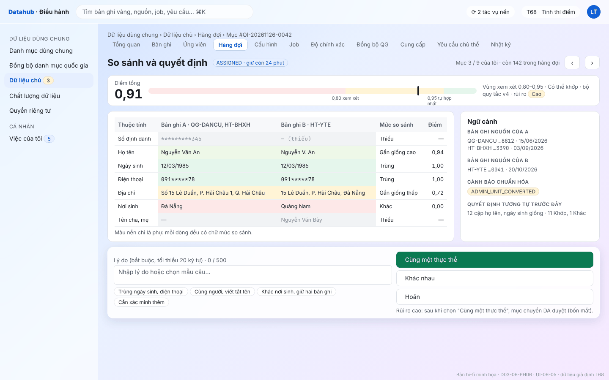

Ảnh cho thấy thanh điểm 0,91 nằm trong vùng xem xét với hai vạch ngưỡng có chữ, bảng so sánh bảy dòng mỗi dòng có chữ mức so sánh và điểm (màu nền chỉ hỗ trợ), cột ngữ cảnh bên phải và thanh quyết định cố định ở chân với ô lý do, bốn mẫu câu và ba nút; nút "Cùng một thực thể" nổi bật vì cặp này thiếu số định danh một bên nên chưa có xung đột.

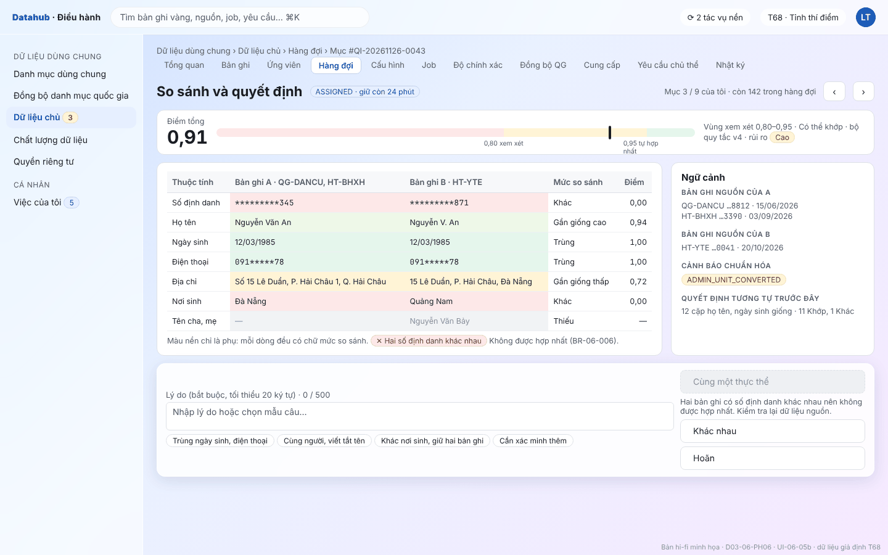

Biến thể thứ hai thể hiện ca định danh khác nhau: dòng "Số định danh" tô `color-diff-removed` kèm chữ "Khác", nút "Cùng một thực thể" vô hiệu nét đứt cùng câu giải thích ERR-06-029 ngay cạnh nút, hai nút còn lại vẫn dùng được.

## 12. UI-06-06 Hợp nhất, tách thủ công

::: dac-ta
**Mục đích.** Cho DS và TA gộp hai đến mười bản ghi vàng thành một khi phát hiện trùng ngoài hàng đợi, hoặc tách một bản ghi bị hợp nhất nhầm; có xem trước đủ tác động trước khi gửi.

**Tác nhân, quyền.** DS, TA (`PERM-06-merge`); DA duyệt khi rủi ro cao (BR-06-019).

**FR, UC.** FR-06-037, 038, 039.

**Truy vết hệ cũ.** Không có ở mockup cũ (UI-06-03 cũ chỉ quyết định từ hàng đợi).

**Đường dẫn, mẫu.** `/du-lieu/du-lieu-chu/{ma-domain}/ban-ghi/{id}/hop-nhat` và `…/tach` (`?buoc=`); PTN-05 Wizard.

**API.** API-06-058 (`POST …/golden-records:merge`); API-06-059 (`POST …/{goldenId}:split`); API-06-061 (duyệt); API-06-060 (hoàn tác).

**Điều hướng vào.** Nút "Hợp nhất…" ở UI-06-02 (đã chọn) và UI-06-03; nút "Tách…" ở UI-06-03.

**Thành phần chính.** `CMP-Wizard` bốn bước hợp nhất, ba bước tách; bảng giá trị sống sót, bảng phân bổ liên kết, khung xem trước (mục 12.1, 12.2).

**Hành động.** Hợp nhất: chọn bản sống sót, chọn giá trị thuộc tính xung đột, xem trước, gửi. Tách: tạo nhóm, kéo liên kết, xem trước, gửi. Hoàn tác thao tác vừa làm.

**Trạng thái.** Mỗi bước hợp lệ hay chưa; bản ghi không còn `ACTIVE`; khóa định danh khác nhau; đang chờ duyệt; không quyền.

**Thông báo.** "Hai bản ghi có số định danh khác nhau nên không được hợp nhất. Kiểm tra lại dữ liệu nguồn."; "Chỉ hợp nhất được bản ghi cùng domain."; "Mỗi bản ghi nguồn phải thuộc đúng một nhóm sau khi tách."; "Bản ghi chỉ có một nguồn liên kết, không có gì để tách."; "Bản ghi vàng {id} đang có thao tác chờ duyệt."

**Đợt, mức chi tiết.** Đợt 3; rất chi tiết.
:::

### 12.1. Hợp nhất (bốn bước)

Hợp nhất thủ công đi qua bốn bước; bảng dưới ghi nội dung, kiểm tra và thông điệp của từng bước, từ chọn bản ghi đến gửi duyệt hoặc thực hiện.

| Bước | Nội dung | Kiểm tra | Thông điệp |
|---|---|---|---|
| 1. Chọn bản ghi | Danh sách hai đến mười bản ghi đã chọn từ UI-06-02 (có thể thêm bằng ID vàng); mỗi dòng ID, tên rút gọn, số liên kết | Cùng domain, đều `ACTIVE`; không cặp nào có khóa định danh xác định khác nhau | ERR-06-003 "Chỉ hợp nhất được bản ghi cùng domain."; ERR-06-006; ERR-06-029 |
| 2. Chọn bản sống sót | `CMP-RadioCard` mỗi bản ghi: số liên kết, tin cậy, ngày tạo; mặc định bản nhiều liên kết nhất | Chọn đúng một | — |
| 3. Giá trị từng thuộc tính | Bảng: thuộc tính, giá trị từng bản, giá trị sau hợp nhất (mặc định theo quy tắc sống sót), lý do chọn; thuộc tính xung đột có `CMP-Radio` chọn bản nào hoặc nhập giá trị | Ghi đè tay được ghi như sửa tay (FR-06-036), kèm lý do chung; thuộc tính thẩm quyền quốc gia khóa theo quy tắc | ERR-06-035 |
| 4. Xem trước và lý do | Khung tóm tắt: số liên kết chuyển, số thuộc tính đổi, rủi ro `RiskLevel` kèm căn cứ BR-06-019, có cần DA duyệt không, HTTT sẽ nhận sự kiện; ô lý do bắt buộc | Lý do ≥ 20 ký tự | ERR-06-007; ERR-06-031 khi có thao tác khác |

: UI-06-06 Các bước hợp nhất

Rủi ro cao khi: hai bản ghi cùng có ≥ 3 liên kết, có thuộc tính quan trọng khác nhau, điểm < 0,95 (BR-06-019). Rủi ro cao hiện nút "Gửi duyệt" (thao tác `PENDING_APPROVAL`, các bản ghi chuyển `LOCKED`); rủi ro thấp hiện "Hợp nhất ngay". Thành công thì `ST-10` "Đã hợp nhất {n} bản ghi vào {id}." kèm nút "Hoàn tác" 30 giây.

### 12.2. Tách (ba bước)

Tách bản ghi đi qua ba bước; bảng dưới ghi nội dung và kiểm tra của từng bước, từ chọn bản ghi, phân bổ liên kết cho các nhóm đến xác nhận.

| Bước | Nội dung | Kiểm tra |
|---|---|---|
| 1. Chọn bản ghi | Bản ghi hiện tại và danh sách liên kết hiệu lực (có ít nhất 2) | "Bản ghi chỉ có một nguồn liên kết, không có gì để tách." (ERR-06-032) |
| 2. Phân bổ liên kết | Hai nhóm trở lên dạng hộp (nhóm 1 ở lại bản gốc); kéo thả hoặc nút "Chuyển sang nhóm" (bàn phím); khi bản ghi từng là kết quả hợp nhất, gợi ý phân bổ theo bản ghi vàng cũ và hiện "khôi phục {id cũ}" | Mỗi liên kết đúng một nhóm (ERR-06-032) |
| 3. Xem trước, lý do | Số nhóm, bản ghi sẽ khôi phục hoặc tạo mới, ghi `negativeLink` giữa các nhóm, duyệt khi ≥ 3 liên kết | Lý do ≥ 20 ký tự |

: UI-06-06 Các bước tách

Kéo thả luôn có phương án bàn phím tương đương (WCAG 2.5.7): chọn liên kết bằng `Space`, nút "Chuyển sang nhóm {n}" hoặc `Alt+1`, `Alt+2`.

### 12.3. Trạng thái màn

Bảng dưới ghi màn Hợp nhất và Tách khi bản ghi bị khóa, khi thao tác chờ duyệt và các tình huống khác.

| Trạng thái | Hiển thị |
|---|---|
| Bản ghi bị khóa | Băng "Bản ghi vàng {id} đang có thao tác chờ duyệt." (ERR-06-031); không vào được bước 2 |
| Thao tác chờ duyệt | Sau gửi: trang kết quả `CMP-ResultPage` "Đã gửi duyệt" kèm mã thao tác và liên kết tab "Thao tác" |
| Xung đột phiên bản | `ST-13` ở bước 4 |
| Rời trang khi chưa gửi | `CMP-ConfirmDialog` "Bỏ thay đổi chưa gửi?"; lý do đã gõ không lưu |

: UI-06-06 Trạng thái màn

### 12.4. Bản hi-fi

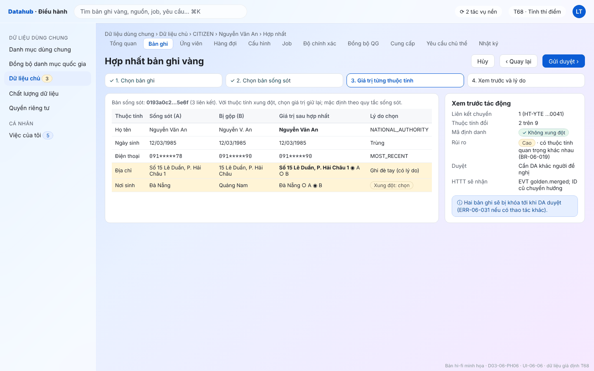

Ảnh cho thấy bước 3 của hợp nhất: bảng giá trị bản sống sót, bản bị gộp và giá trị sau hợp nhất (dòng đổi tô `color-diff-changed`, có lựa chọn ◉ A ○ B), và khung "Xem trước tác động" nêu liên kết chuyển, thuộc tính đổi, rủi ro cao theo BR-06-019 và yêu cầu DA duyệt.

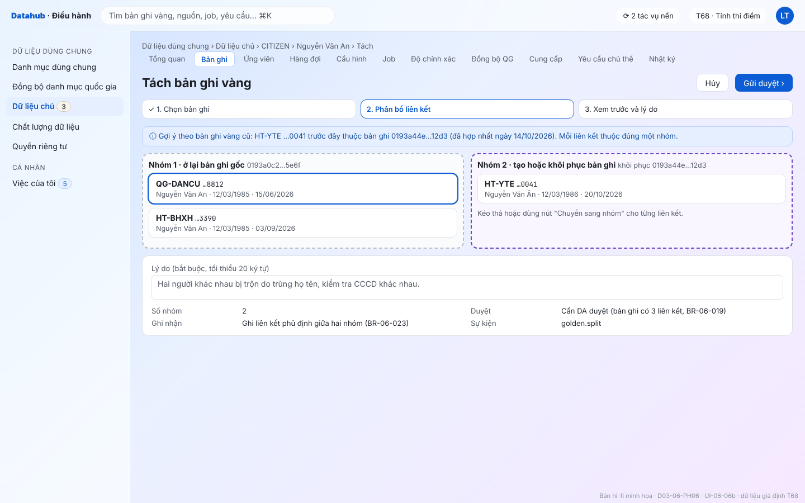

Biến thể thứ hai là bước phân bổ của tách: nhóm 1 ở lại bản gốc, nhóm 2 khôi phục bản ghi đã hợp nhất ngày 14/10/2026 theo gợi ý, ô lý do và dải tóm tắt (số nhóm, duyệt, ghi liên kết phủ định, sự kiện).

## 13. UI-06-07 Mô hình domain

::: dac-ta
**Mục đích.** Cho TA, DS soạn mô hình domain (thuộc tính có kiểu, khóa định danh, phân loại PH-09, chuẩn hóa), quản lý phiên bản và gửi duyệt; DA duyệt. Gói domain nền CITIZEN, ORGANIZATION, ADDRESS nạp từ đây.

**Tác nhân, quyền.** TA, DS, DA (`PERM-06-read`); soạn, gửi duyệt `PERM-06-config`; duyệt `PERM-06-approve` (khác người gửi); nạp gói nền: PA, TA.

**FR, UC.** FR-06-001…007.

**Truy vết hệ cũ.** Không có ở hệ cũ và mockup cũ.

**Đường dẫn, mẫu.** `/du-lieu/du-lieu-chu/cau-hinh/domain` (`domain`, `phien-ban`, tab `/thuoc-tinh`, `/khoa`, `/phien-ban`, `/so-sanh`); PTN-08 Cây + bảng.

**API.** API-06-001, 002, 003 (domain); API-06-004…007 (phiên bản, so sánh); API-06-008…011 (gửi, duyệt, từ chối, tạm ngừng); API-06-012 (nạp gói nền); API-06-013 (thử quy tắc định danh).

**Điều hướng vào.** Tab "Cấu hình" → "Domain".

**Thành phần chính.** Cây domain và phiên bản, bảng thuộc tính, tab khóa định danh, tab phiên bản, tab so sánh, băng chờ duyệt (mục 13.1).

**Hành động.** Thêm, sửa, xóa thuộc tính trong bản nháp; khai báo khóa; gán phân loại; tạo phiên bản mới; so sánh; gửi duyệt; duyệt, từ chối; tạm ngừng, tiếp tục, ngừng domain; nạp gói nền.

**Trạng thái.** `DomainStatus`, `VersionStatus`; thay đổi phá vỡ `BREAKING`; thiếu phân loại; chờ duyệt.

**Thông báo.** "Thuộc tính {tên} là dữ liệu cá nhân nhưng chưa có phân loại được PH-09 xác nhận."; "Anh/chị là người đề nghị nên không được tự duyệt."; "Domain còn {n} bản ghi vàng hoạt động nên chưa ngừng được."

**Đợt, mức chi tiết.** Đợt 3; đầy đủ.
:::

```text
| Mô hình domain --------------------------------- [Nạp gói domain nền][+ Tạo domain][Gửi duyệt] |
| ⚠ Phiên bản 4 đang chờ duyệt (người gửi: Lê Thị Thu).                                          |
|-------------------|----------------------------------------------------------------------------|
| ① CITIZEN ACTIVE  | [Thuộc tính][Khóa định danh][Phiên bản][So sánh v3→v4]                      |
|    v3 · v4 chờ    | Mã | Nhãn | Kiểu | Bắt buộc | Khóa | Phân loại PH-09 | Chuẩn hóa | Đổi v4  |
|   ORGANIZATION    | nationalId  IDENTIFIER  Có  CCCD_12 xác định  SENSITIVE ✓  …               |
|   ADDRESS         | ethnicity   CODE_REF    Không  —   SENSITIVE PROPOSED   + Mới               |
|   CAN-BO (nháp)   | ✕ Thuộc tính Dân tộc chưa có phân loại PH-09 xác nhận (ERR-06-010)          |
|-------------------|----------------------------------------------------------------------------|
```

### 13.1. Thành phần và trường

Bảng dưới đánh số các thành phần của màn Mô hình domain, gồm cây domain và phiên bản, bảng thuộc tính, khóa định danh và so sánh phiên bản, kèm kiểm tra.

| # | Thành phần | `CMP-*` | Nội dung, kiểm tra |
|---|---|---|---|
| 1 | Cây domain, phiên bản | `CMP-TreeView` | Domain với `DomainStatus`; con là phiên bản với `VersionStatus` |
| 2 | Bảng thuộc tính | `CMP-EditableTable` (chỉ bản nháp) | Mã, nhãn, kiểu, bắt buộc, khóa, phân loại, chuẩn hóa; thuộc tính thêm, đổi, bỏ so với phiên bản `ACTIVE` có nhãn "+ Mới", "~ Đổi", "− Bỏ" |
| 3 | Tab khóa định danh | `CMP-Form` | `IdentifierType`, thuộc tính khóa, `deterministic`, kiểm tra định dạng; "Thử" gọi API-06-013 với chuỗi mẫu; chọn `CMND_9` thì khóa `deterministic` bị vô hiệu kèm câu ERR-06-052 "Số CMND 9 chữ số chỉ dùng để so sánh, không dùng làm khóa xác định." |
| 4 | Tab phiên bản | `CMP-VersionTimeline` | Danh sách phiên bản, người gửi, người duyệt, `CompatLevel` |
| 5 | Tab so sánh | `CMP-DiffViewer` | Thêm `color-diff-added`, đổi `color-diff-changed`, bỏ `color-diff-removed`; chữ + / ~ / − |
| 6 | Băng chờ duyệt | `CMP-ApprovalPanel` | Người gửi, nút "Duyệt", "Từ chối" (DA); vô hiệu cho người gửi kèm câu ERR-06-005 |
| 7 | Nạp gói nền | `CMP-Modal` | Chọn gói CITIZEN, ORGANIZATION, ADDRESS; xem trước thuộc tính; chỉ PA, TA |

: UI-06-07 Mô hình domain, thành phần

| Trường thuộc tính | Kiểu | Bắt buộc | Kiểm tra |
|---|---|---|---|
| Mã | T-CODE `^[a-z][A-Za-z0-9]{1,62}$` | Có | Duy nhất trong domain (ERR-06-002) |
| Nhãn | T-TEXT ≤ 100 | Có | |
| Kiểu | `AttributeType` | Có | Khóa định danh phải `IDENTIFIER` (ERR-06-009) |
| Phân loại | `DataClass` + `ClassificationStatus` | Có với DLCN | DLCN chưa `CONFIRMED` không kích hoạt được (ERR-06-010, BR-06-016) |
| Chuẩn hóa | Chọn bộ chuẩn hóa | Không | Họ tên, ngày, số định danh, địa chỉ ĐVHC (FR-06-014, 015) |

: UI-06-07 Trường thuộc tính

Bản `ACTIVE` chỉ đọc (BR-06-017); sửa tạo phiên bản nháp mới. Thay đổi `BREAKING` (đổi kiểu, bỏ khóa) hiện hộp "Cần kế hoạch áp lại dữ liệu" và bắt buộc phiên bản mới. Trạng thái: rỗng (chưa có domain) kèm "Nạp gói domain nền"; ngừng domain còn bản ghi (ERR-06-011); `ST-13`. Bàn phím: bảng thuộc tính `role="grid"` có `Enter` sửa ô, `Ctrl+Z` hoàn tác trong bản nháp. Hi-fi:

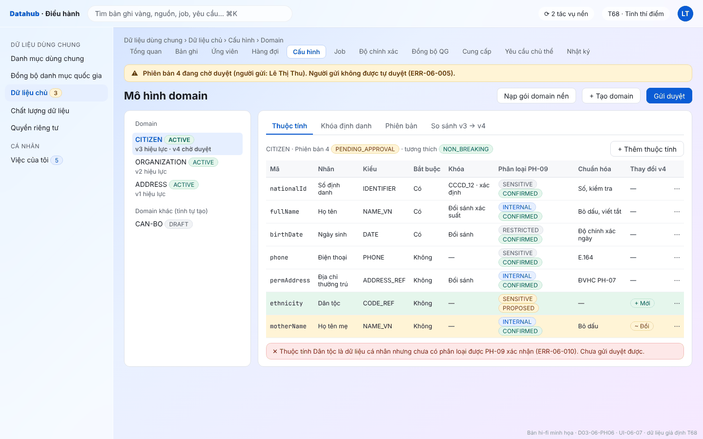

## 14. UI-06-08 Nguồn và ưu tiên nguồn

::: dac-ta
**Mục đích.** Cho TA, DS đăng ký nguồn dữ liệu chủ gắn HTTT, khai báo kênh nạp, và đề nghị thứ tự ưu tiên nguồn theo thuộc tính kèm căn cứ văn bản để DA phê duyệt.

**Tác nhân, quyền.** TA, DS, DA (`PERM-06-read`); đăng ký, đề nghị `PERM-06-config`; duyệt `PERM-06-approve`.

**FR, UC.** FR-06-008, 009, 012.

**Truy vết hệ cũ.** Thay UI-06-05 mockup cũ (Cấu hình ưu tiên nguồn); thêm căn cứ văn bản, xem trước tác động, duyệt.

**Đường dẫn, mẫu.** `/du-lieu/du-lieu-chu/cau-hinh/nguon` (`domain`, `/uu-tien`, `chon`); PTN-01 Danh sách kèm khối ưu tiên.

**API.** API-06-014…017 (nguồn); API-06-018, 019, 020 (ưu tiên, đề nghị, duyệt).

**Điều hướng vào.** Tab "Cấu hình" → "Nguồn"; dòng ở UI-06-01.

**Thành phần chính.** Bảng nguồn, Drawer "Đăng ký nguồn", bảng ưu tiên kéo thả, biểu mẫu căn cứ, khung xem trước tác động (mục 14.1).

**Hành động.** Đăng ký, sửa, tạm ngừng, tiếp tục, ngừng nguồn; kéo thả hoặc ▲ ▼ để đổi mức; nhập căn cứ; xem trước; gửi duyệt; duyệt, từ chối.

**Trạng thái.** `SourceStatus`; bản nháp ưu tiên; chờ duyệt; HTTT chưa `ACTIVE` ở PH-01.

**Thông báo.** "Nhập số, ngày văn bản phê duyệt thứ tự ưu tiên nguồn."; "Hệ thống {mã} chưa được đăng ký làm nguồn cho domain {domain}."; "HTTT chưa hoạt động ở PH-01 nên chưa đăng ký làm nguồn được." (ERR-06-012, mới)

**Đợt, mức chi tiết.** Đợt 3; đầy đủ.
:::

### 14.1. Thành phần và trường

Bảng dưới đánh số các thành phần của màn Nguồn và ưu tiên nguồn, gồm bảng nguồn, drawer đăng ký và bảng thứ tự ưu tiên, kèm trường và kiểm tra.

| # | Thành phần | `CMP-*` | Nội dung, kiểm tra |
|---|---|---|---|
| 1 | Bảng nguồn | `CMP-DataTable` | Mã nguồn, HTTT, `SourceKind`, `IngestChannel`, domain, `SourceStatus`, nạp 24 giờ, tỷ lệ từ chối |
| 2 | Drawer đăng ký | `CMP-Drawer` + `CMP-Form` | Mã nguồn, HTTT (`CMP-ResourceSelect` từ PH-01), loại nguồn, kênh, domain, mức tin cậy ban đầu |
| 3 | Bảng ưu tiên | `CMP-DataTable` + kéo thả | Hàng là nhóm thuộc tính, cột là mức 1 đến 4; ô nguồn có tay cầm ⠿ và nút ▲ ▼ |
| 4 | Nguồn quốc gia khóa | `CMP-Icon` khóa + chú thích | `NATIONAL_DB` luôn mức 1 cho thuộc tính thẩm quyền quốc gia (BR-06-003), không kéo được |
| 5 | Căn cứ phê duyệt | `CMP-FormField` | Số văn bản (bắt buộc), ngày văn bản (bắt buộc), giải trình |
| 6 | Xem trước tác động | `CMP-Card` | Số bản ghi dự kiến đổi giá trị theo thuộc tính (mẫu 10.000 bản ghi vàng); > 1.000 thì nêu "sẽ tạo job áp lại chờ xác nhận" |

: UI-06-08 Nguồn và ưu tiên nguồn, thành phần

| Trường | Kiểu | Bắt buộc | Kiểm tra |
|---|---|---|---|
| Mã nguồn | T-CODE | Có | Duy nhất (ERR-06-002) |
| HTTT | Chọn | Có | `ACTIVE` ở PH-01 (ERR-06-012) |
| Số văn bản phê duyệt | T-TEXT ≤ 100 | Có khi gửi | Trống: ERR-06-013 |
| Ngày văn bản | T-DATE | Có khi gửi | Không ở tương lai |
| Mỗi cặp (nguồn, thuộc tính) | Số 1 đến 99 | Có | Một mức duy nhất |

: UI-06-08 Trường

Người đề nghị không tự duyệt (ERR-06-005). Nguồn `TEP-LO` (tệp lô) có thể tạm ngừng mà không đổi ưu tiên. Trạng thái: rỗng "Chưa đăng ký nguồn nào cho domain này."; bản nháp chưa gửi có nhãn "Bản nháp"; `ST-13`. Hi-fi:

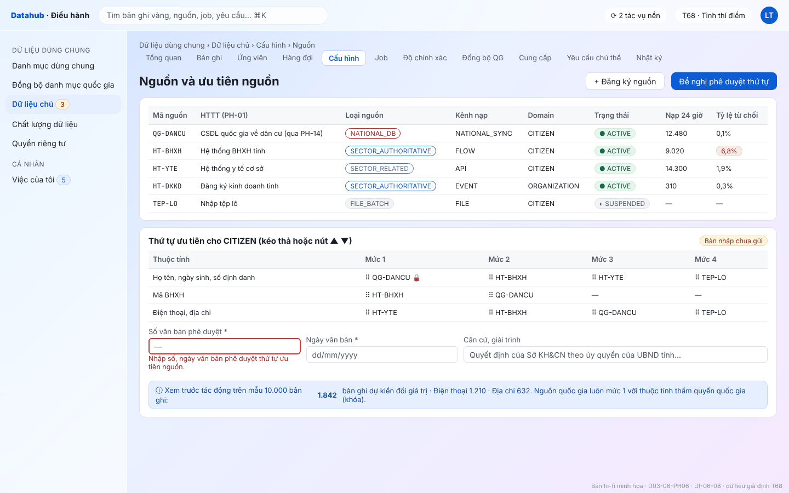

## 15. UI-06-09 Quy tắc đối sánh

::: dac-ta
**Mục đích.** Cho TA, DS soạn bộ quy tắc đối sánh có phiên bản (xác định, xác suất, loại trừ), khóa gom nhóm, ngưỡng tự hợp nhất và xem xét; chạy thử và đánh giá precision, recall trước khi gửi DA duyệt.

**Tác nhân, quyền.** TA, DS, DA (`PERM-06-read`); soạn `PERM-06-config`; duyệt `PERM-06-approve`.

**FR, UC.** FR-06-018, 019, 023, 024, 026.

**Truy vết hệ cũ.** Không có ở hệ cũ và mockup cũ.

**Đường dẫn, mẫu.** `/du-lieu/du-lieu-chu/cau-hinh/quy-tac` (`domain`, `phien-ban`, `/khoa-gom-nhom`, `/nguong`); PTN-03 Biểu mẫu trang.

**API.** API-06-030, 031, 032 (bộ quy tắc); API-06-033 (chạy thử); API-06-034 (đánh giá); API-06-035 (gửi, duyệt); API-06-036 (thống kê gom nhóm); API-06-040 (báo cáo).

**Điều hướng vào.** Tab "Cấu hình" → "Quy tắc đối sánh"; thẻ ở UI-06-13.

**Thành phần chính.** Chọn phiên bản, bảng quy tắc, khóa gom nhóm, biểu đồ phân bố điểm với hai thanh trượt ngưỡng, khối đánh giá, khối chạy thử (mục 15.1).

**Hành động.** Thêm, sửa quy tắc; kéo ngưỡng; chạy thử; đánh giá; gửi duyệt; duyệt. Nút "Gửi duyệt" vô hiệu khi chưa có đánh giá đạt.

**Trạng thái.** `VersionStatus` gồm `TESTING`; chưa đạt; đang chạy thử.

**Thông báo.** "Ngưỡng tự hợp nhất phải từ 0,90 trở lên và cao hơn ngưỡng xem xét ít nhất 0,10."; "Phiên bản {n} chưa đạt: precision {p}%, recall {r}%."; "Tập nhãn còn {n} cặp, cần ít nhất {m} để đánh giá."

**Đợt, mức chi tiết.** Đợt 3; rất chi tiết.
:::

### 15.1. Thành phần và trường

Bảng dưới đánh số các thành phần của màn Quy tắc đối sánh, gồm chọn phiên bản, bảng quy tắc, hai ngưỡng và chạy thử, kèm trường và kiểm tra.

| # | Thành phần | `CMP-*` | Nội dung, kiểm tra |
|---|---|---|---|
| 1 | Chọn phiên bản | `CMP-SegmentedControl` | Phiên bản và `VersionStatus`; chỉ `DRAFT`, `TESTING` sửa được |
| 2 | Bảng quy tắc | `CMP-EditableTable` | Số thứ tự, `MatchRuleType`, thuộc tính, `Comparator`, trọng số (m, u) hoặc "tuyệt đối", bật; quy tắc loại trừ khác số định danh khóa, không tắt được (BR-06-006) |
| 3 | Khóa gom nhóm | `CMP-Tag` có thể sửa + `CMP-DataTable` | Biểu thức khóa, số nhóm, nhóm lớn nhất; cảnh báo khi nhóm lớn nhất > 5.000 |
| 4 | Phân bố điểm | `CMP-Chart` cột 100 khoảng + vạch ngưỡng | Ba vùng: khác biệt, xem xét, tự hợp nhất; mỗi vùng có chữ chú giải |
| 5 | Thanh trượt ngưỡng | thanh trượt hai đầu (chưa có `CMP-*`, xem Phụ lục A, đề nghị A2) + `CMP-NumberInput` | Ngưỡng xem xét, tự hợp nhất, hai chữ số thập phân; kiểm tra ERR-06-023; ước tính hàng đợi mỗi ngày, cảnh báo khi > 15% số ứng viên |
| 6 | Khối đánh giá | `CMP-StatCard`, `CMP-DataTable` | Precision, recall, ma trận nhầm lẫn, dấu đạt hoặc chưa đạt kèm ngưỡng (≥ 99,9%, ≥ 98%; BR-06-021) |
| 7 | Khối chạy thử | `CMP-DescriptionList` | Mẫu 20.000 bản ghi: số tự hợp nhất, xem xét, khác biệt, số cặp đổi kết luận so với bản `ACTIVE`; liên kết xem cặp đổi |
| 8 | Băng chưa đạt | `CMP-Banner` | "Phiên bản {n} chưa đạt: precision {p}%, recall {r}%." (ERR-06-024); nút "Gửi duyệt" vô hiệu |

: UI-06-09 Quy tắc đối sánh, thành phần

| Trường | Kiểu | Bắt buộc | Kiểm tra |
|---|---|---|---|
| `autoMergeThreshold` | Số 2 chữ số | Có | ≥ 0,90 và ≥ `reviewThreshold` + 0,10 (ERR-06-023) |
| `reviewThreshold` | Số 2 chữ số | Có | 0 đến 1 |
| `autoMergeEnabled` | T-BOOL | Có | Tắt được ở giai đoạn đầu |
| Trọng số m, u | Số | Có với xác suất | 0 đến 1 |

: UI-06-09 Trường ngưỡng và trọng số

Tập nhãn và đánh giá chi tiết ở UI-06-13. Biểu đồ phân bố có bảng thay thế (`Xem dạng bảng`). Thanh trượt điều khiển được bằng mũi tên (bước 0,01) và nhập số. Hi-fi:

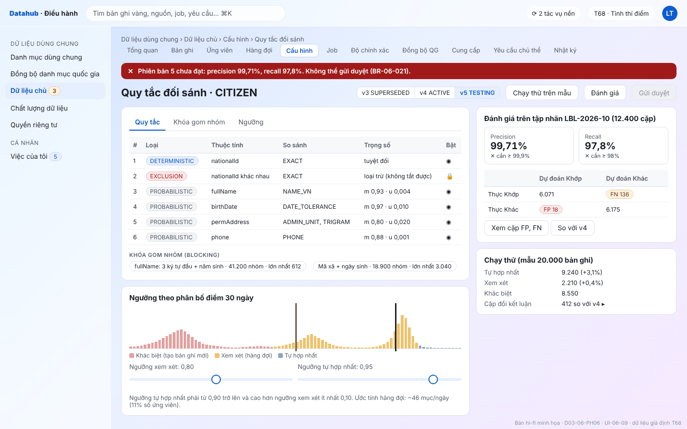

Ảnh cho thấy băng đỏ "chưa đạt" ở đầu, nút "Gửi duyệt" vô hiệu nét đứt, bảng sáu quy tắc có quy tắc loại trừ khóa, biểu đồ phân bố điểm ba vùng với hai vạch ngưỡng, khối đánh giá (precision 99,71% chưa đạt) và khối chạy thử.

## 16. UI-06-10 Quy tắc sống sót

::: dac-ta
**Mục đích.** Cho TA, DS chọn chiến lược chọn giá trị cho từng thuộc tính khi các nguồn khác nhau, xem trước tác động trên mẫu và áp lại hàng loạt sau khi DA duyệt.

**Tác nhân, quyền.** TA, DS, DA (`PERM-06-read`); soạn `PERM-06-config`; duyệt `PERM-06-approve`; áp lại hàng loạt cần bốn mắt.

**FR, UC.** FR-06-033, 042.

**Truy vết hệ cũ.** Không có.

**Đường dẫn, mẫu.** `/du-lieu/du-lieu-chu/cau-hinh/song-sot` (`domain`, `phien-ban`); PTN-03.

**API.** API-06-051, 052, 053 (quy tắc, gửi, duyệt); API-06-054 (xem trước tác động); API-06-055 (áp lại).

**Điều hướng vào.** Tab "Cấu hình" → "Sống sót".

**Thành phần chính.** Bảng chiến lược theo thuộc tính, khung xem trước tác động, bảng phiên bản (mục 16.1).

**Hành động.** Chọn chiến lược và tham số; xem trước; gửi duyệt; duyệt; áp lại hàng loạt.

**Trạng thái.** Bản nháp; chờ duyệt; áp lại đang chạy (theo dõi ở UI-06-12).

**Thông báo.** "Quy tắc sống sót không hợp lệ: {lý do}." (ERR-06-022); "Thuộc tính {tên} chỉ được sửa tại CSDL quốc gia…" khi chọn ghi đè cho thuộc tính thẩm quyền quốc gia.

**Đợt, mức chi tiết.** Đợt 3; đầy đủ.
:::

### 16.1. Thành phần và trường

Bảng dưới đánh số các thành phần của màn Quy tắc sống sót, gồm bảng chiến lược theo thuộc tính và tham số của từng chiến lược.

| # | Thành phần | `CMP-*` | Nội dung, kiểm tra |
|---|---|---|---|
| 1 | Bảng chiến lược | `CMP-EditableTable` | Thuộc tính, `SurvivorshipStrategy` (`CMP-Select`), tham số, thẩm quyền quốc gia, thay đổi, tác động ước tính; thuộc tính thẩm quyền quốc gia khóa `NATIONAL_AUTHORITY` (BR-06-025) |
| 2 | Tham số chiến lược | `CMP-FormField` | `SOURCE_PRIORITY`: dùng bảng ưu tiên ở UI-06-08; `MOST_RECENT`: bỏ giá trị rỗng; `MOST_FREQUENT`: hòa thì theo ưu tiên nguồn |
| 3 | Xem trước tác động | `CMP-Card` | Số bản ghi đổi giá trị, thuộc tính đổi, ví dụ trước → sau (che); > 1.000 bản ghi thì nêu job áp lại chờ xác nhận |
| 4 | Phiên bản | `CMP-DataTable` | Phiên bản, `VersionStatus`, hiệu lực, người duyệt |
| 5 | Áp lại hàng loạt | `CMP-Button` + `CMP-ConfirmDialog` | Chỉ khi phiên bản `ACTIVE` và tác động > 0; tạo job `SURVIVORSHIP_REAPPLY` chờ xác nhận DA khác người đề nghị |

: UI-06-10 Quy tắc sống sót, thành phần

Trạng thái: rỗng dùng mặc định gói nền; xem trước đang tính (`CMP-JobProgress`); `ST-13`. Hi-fi:

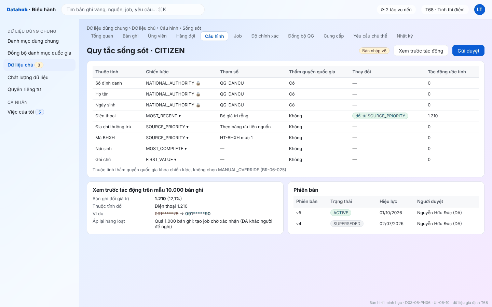

## 17. UI-06-11 Ứng viên và nạp tệp

::: dac-ta
**Mục đích.** Cho DS, TO xem bản ghi ứng viên (đã nhận, lỗi, cảnh báo chuẩn hóa), so giá trị gốc với giá trị đã chuẩn hóa, xử lý lại hoặc loại bỏ; và nhập tệp lô có xem trước trước khi nạp.

**Tác nhân, quyền.** DS, TO, TA (`PERM-06-read`); nhập tệp, xử lý lại `PERM-06-ingest`; loại bỏ ứng viên `PERM-06-update`.

**FR, UC.** FR-06-013, 014, 015, 017.

**Truy vết hệ cũ.** Không có.

**Đường dẫn, mẫu.** `/du-lieu/du-lieu-chu/{ma-domain}/ung-vien` (PTN-01); `…/ung-vien/nhap` (PTN-09).

**API.** API-06-026, 027, 028 (ứng viên, xử lý lại, loại bỏ); API-06-023, 024, 025 (tệp: tải, xác nhận, xem); API-06-029 (xem trước chuẩn hóa).

**Điều hướng vào.** Tab "Ứng viên"; nút "Nhập tệp lô…".

**Thành phần chính.** Bảng ứng viên, Drawer chuẩn hóa, trình nhập tệp bốn bước (mục 17.1, 17.2).

**Hành động.** Lọc; mở chuẩn hóa; xử lý lại; loại bỏ (lý do ≥ 20 ký tự); nhập tệp; tải báo cáo lỗi.

**Trạng thái.** `CandidateStatus`; tệp đang kiểm tra; tệp quá giới hạn; có công thức; không quyền.

**Thông báo.** "Bản ghi không đúng mô hình {domain} phiên bản {n}: {danh sách trường}."; "Tệp vượt {n} dòng hoặc {m} MB."; "Tệp có công thức hoặc macro nên không nhập được."

**Đợt, mức chi tiết.** Đợt 3; đầy đủ.
:::

### 17.1. Danh sách ứng viên

Bảng dưới đánh số các thành phần của danh sách ứng viên, gồm phân vùng, bộ lọc và bảng, kèm cột hiển thị.

| # | Thành phần | `CMP-*` | Nội dung |
|---|---|---|---|
| 1 | Phân vùng, bộ lọc | `CMP-FilterChips`, `CMP-FilterBar` | Tất cả, Lỗi, Cảnh báo chuẩn hóa, Đang chờ; nguồn, kênh `IngestChannel`, ngày nhận |
| 2 | Bảng | `CMP-DataTable` gọn | Khóa nguồn (che một phần), `CandidateOperation`, kênh, `CandidateStatus`, `IdentifierStatus`, `NormalizationWarning`, họ tên đã chuẩn hóa, thời điểm |
| 3 | Drawer chuẩn hóa | `CMP-Drawer` | Bảng trường: giá trị gốc, sau chuẩn hóa (DLCN che); độ chính xác ngày `DatePrecision`; địa chỉ tách theo ĐVHC hiện hành và mã cũ (`legacyAdminUnitCode`); nút "Xử lý lại", "Loại bỏ…" |
| 4 | Báo cáo lỗi | `CMP-Alert` | Câu ERR-06-017 kèm danh sách trường sai |

: UI-06-11 Ứng viên, thành phần

Ứng viên `REJECTED` có lý do bằng chữ; "Xử lý lại" chỉ cho ứng viên lỗi có thể sửa sau khi đổi cấu hình (ví dụ mô hình mới). Giá trị DLCN trong Drawer dùng `CMP-MaskedValue`.

### 17.2. Nhập tệp lô (PTN-09)

Nhập tệp lô đi qua nhiều bước từ chọn tệp, ánh xạ cột đến gửi; bảng dưới ghi nội dung và kiểm tra của từng bước.

| Bước | Nội dung | Kiểm tra |
|---|---|---|
| 1. Chọn tệp | `CMP-FileDropzone` CSV hoặc XLSX, nguồn `FILE_BATCH` chọn sẵn | Kích thước, số dòng tối đa (ERR-06-018); không công thức, macro (ERR-06-019) |
| 2. Ánh xạ cột | Cột tệp sang thuộc tính domain, lưu mẫu ánh xạ | Thuộc tính bắt buộc phải có cột |
| 3. Xem trước | Bốn thẻ tổng dòng, hợp lệ, cảnh báo, lỗi; bảng 100 dòng đầu có `IdentifierStatus`, cảnh báo ĐVHC; "Tải báo cáo lỗi (CSV)" | Dòng lỗi bỏ qua khi nhập, không dừng cả lô |
| 4. Xác nhận | "Xác nhận nhập {n} dòng hợp lệ" tạo job `FILE_INGEST` | Cần `PERM-06-ingest`; theo dõi ở UI-06-12 |

: UI-06-11 Nhập tệp lô, bốn bước

Trạng thái: rỗng "Chưa có ứng viên nào. Ứng viên xuất hiện khi HTTT gửi dữ liệu hoặc khi nhập tệp."; tệp đang kiểm tra (`CMP-JobProgress`); `ST-12` cho lỗi tệp. Hi-fi:

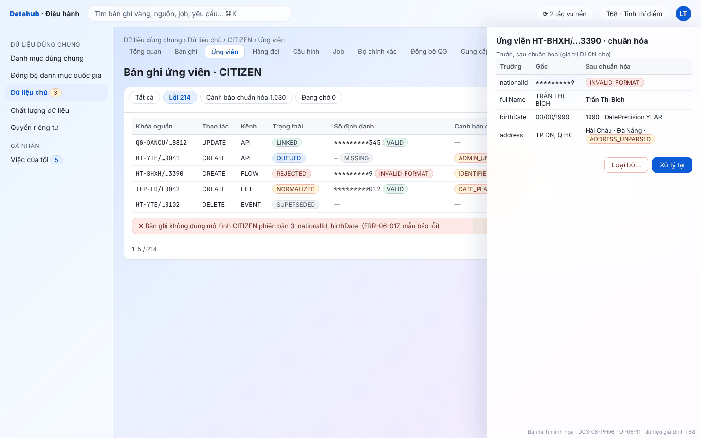

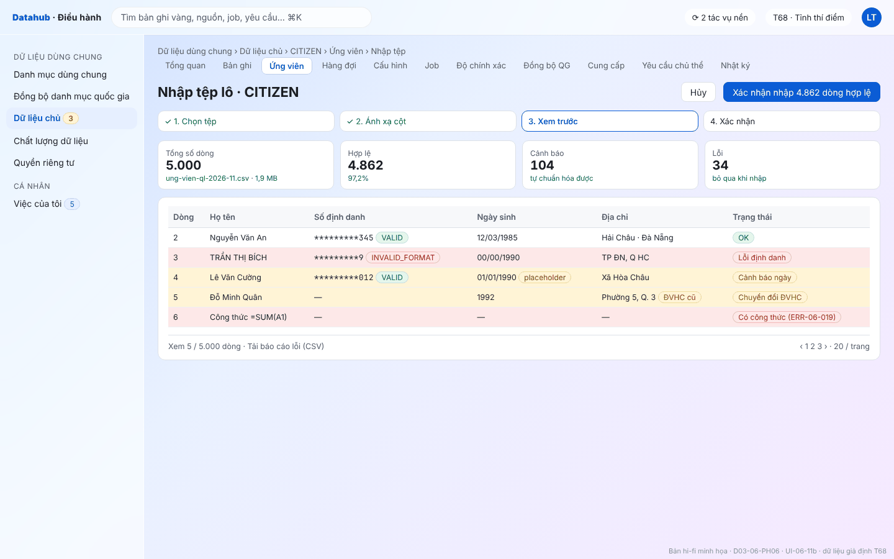

Ảnh thứ nhất cho thấy bảng ứng viên lọc theo lỗi và Drawer so sánh giá trị gốc với giá trị chuẩn hóa (số định danh sai khuôn, ngày chỉ có năm, địa chỉ chưa tách được). Ảnh thứ hai là bước xem trước của nhập tệp: bốn thẻ tổng, dòng lỗi định danh, ngày giả định, địa chỉ cũ và dòng có công thức bị từ chối.

## 18. UI-06-12 Job và lịch

::: dac-ta
**Mục đích.** Cho TA, TO theo dõi job nền (đối sánh lô Splink, đánh giá, đối chiếu quốc gia, dọn lưu giữ, nhập tệp, xuất), xác nhận job vượt ngưỡng an toàn, chạy lại, hủy, và lập lịch.

**Tác nhân, quyền.** TA, TO (`PERM-06-read`); chạy, chạy lại, hủy, lập lịch `PERM-06-operate`; xác nhận job vượt ngưỡng cần DA hoặc TA khác người khởi chạy.

**FR, UC.** FR-06-022, 056, 059.

**Truy vết hệ cũ.** Không có.

**Đường dẫn, mẫu.** `/du-lieu/du-lieu-chu/job` (`loai`, `trang-thai`, `domain`, `/lich`, `chon`); PTN-11.

**API.** API-06-041 (danh sách); API-06-042 (tạo job lô); API-06-043 (chi tiết); API-06-044 (`:cancel`), API-06-105 (`:rerun`), API-06-106 (`:confirm` với `decision` `APPROVE` hoặc `REJECT`; `REJECT` đưa job `AWAITING_CONFIRMATION` sang `CANCELLED`); API-06-086, 087 (lịch).

**Điều hướng vào.** Tab "Job"; thông báo job lỗi; thẻ ở UI-06-01.

**Thành phần chính.** Băng chờ xác nhận, bảng job, khối lịch, khối chi tiết job đang chạy (mục 18.1).

**Hành động.** Lọc; tạo job lô; hủy; chạy lại; xác nhận áp dụng; sửa lịch.

**Trạng thái.** `JobStatus`; đã có job cùng loại; job vượt ngưỡng; lỗi tài nguyên.

**Thông báo.** "Đã có job {loại} đang chạy cho {domain}." (ERR-06-025); "Job vượt ngưỡng an toàn: {x}% số bản ghi vào là Khớp (ngưỡng 5%). Chờ xác nhận, chưa áp dụng." (ERR-06-105); lỗi job 101 đến 104 hiển thị ở cột Kết quả và nhật ký.

**Đợt, mức chi tiết.** Đợt 3; đầy đủ.
:::

### 18.1. Thành phần và cột

Bảng dưới đánh số các thành phần của màn Job và lịch, gồm băng chờ xác nhận, bảng job với tiến độ và các hành động trên job.

| # | Thành phần | `CMP-*` | Nội dung, kiểm tra |
|---|---|---|---|
| 1 | Băng chờ xác nhận | `CMP-Banner` cảnh báo | Job `AWAITING_CONFIRMATION`; nút "Xem kết quả", "Xác nhận áp dụng" (BR-06-022) |
| 2 | Bảng job | `CMP-DataTable` gọn | Mã job, `JobType`, domain, `JobStatus`, tiến độ (`CMP-JobProgress` kèm phần trăm bằng chữ), bắt đầu, thời gian, kết quả, thao tác |
| 3 | Khối lịch | `CMP-DataTable` + `CMP-CronPicker` | Loại job, lịch, lần chạy sau; sửa cần `PERM-06-operate` |
| 4 | Chi tiết job đang chạy | `CMP-DescriptionList` | `BatchScope`, giai đoạn (chuẩn bị, đối sánh, áp dụng), tài nguyên Job K8s, dự kiến xong |
| 5 | Hộp tạo job lô | `CMP-Modal` | Domain, `BatchScope` (`GOLDEN_VS_GOLDEN`, `CANDIDATES_SINCE`, `FULL_INITIAL`), bộ quy tắc `ACTIVE`; `FULL_INITIAL` cảnh báo thời gian |

: UI-06-12 Job và lịch, thành phần

Cột "Kết quả" của job lỗi hiện câu theo mã: 101 "Job đọc dữ liệu trung gian lỗi", 102 "Job quá thời gian tối đa", 103 "Job hết tài nguyên", kèm nút "Chạy lại" và liên kết nhật ký. Đồng hồ thăm dò 5 giây khi có job `RUNNING`. Trạng thái: rỗng "Chưa có job nào."; `ST-04`. Hi-fi:

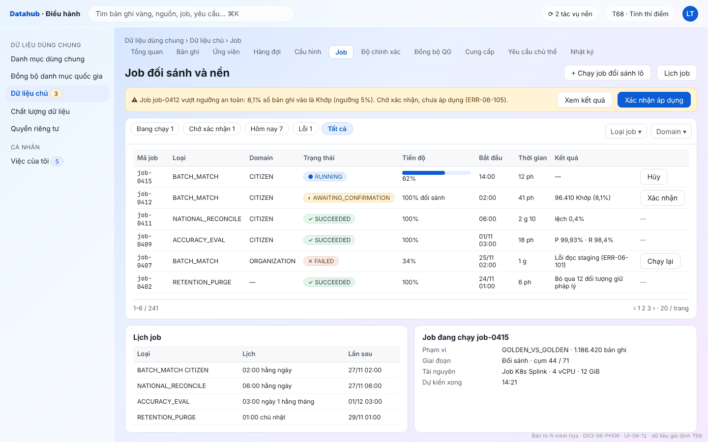

## 19. UI-06-13 Độ chính xác và tập nhãn

::: dac-ta
**Mục đích.** Cho DS, DA xem precision, recall của bộ quy tắc trên tập nhãn kiểm chứng, xem cặp nhầm (FP, FN) và gán nhãn thêm để tăng độ tin cậy của đánh giá.

**Tác nhân, quyền.** DS, DA (`PERM-06-read`); quản lý tập nhãn, gán nhãn `PERM-06-steward`; chạy đánh giá `PERM-06-config`.

**FR, UC.** FR-06-025, 026.

**Truy vết hệ cũ.** Không có.

**Đường dẫn, mẫu.** `/du-lieu/du-lieu-chu/do-chinh-xac` (`domain`, `phien-ban`, `/tap-nhan`, `/gan-nhan`); PTN-06.

**API.** API-06-037, 038, 039 (tập nhãn, thêm cặp); API-06-123 (`:lock`, khóa tập); API-06-034 (đánh giá); API-06-040 (báo cáo).

**Điều hướng vào.** Tab "Độ chính xác"; thẻ ở UI-06-01; liên kết "Xem cặp FP, FN" ở UI-06-09.

**Thành phần chính.** Bốn thẻ, biểu đồ theo tháng, bảng cặp nhầm, danh sách tập nhãn, khối gán nhãn (mục 19.1).

**Hành động.** Chạy đánh giá; tạo tập nhãn; gán nhãn Khớp, Khác nhau, Bỏ qua; xem so sánh cặp; xuất báo cáo.

**Trạng thái.** `EvaluationVerdict`; tập nhãn quá nhỏ; đang đánh giá.

**Thông báo.** "Tập nhãn còn {n} cặp, cần ít nhất {m} để đánh giá."; "Phiên bản {n} chưa đạt: precision {p}%, recall {r}%."

**Đợt, mức chi tiết.** Đợt 3; đầy đủ.
:::

### 19.1. Thành phần

Bảng dưới đánh số các thành phần của màn Độ chính xác, gồm thẻ precision và recall so với ngưỡng, biểu đồ theo tháng và bảng tập nhãn.

| # | Thành phần | `CMP-*` | Nội dung |
|---|---|---|---|
| 1 | Thẻ chỉ số | `CMP-KpiCard` ×4 | Precision, recall (kèm "đạt" hoặc "chưa đạt" và ngưỡng 99,9%, 98%), tập nhãn, kết luận `EvaluationVerdict` |
| 2 | Biểu đồ theo tháng | `CMP-Chart` đường | Precision `color-chart-1`, recall `color-chart-3` nét đứt; bảng thay thế |
| 3 | Bảng cặp nhầm | `CMP-DataTable` | Loại FP hoặc FN, tên rút gọn hai bên, điểm, nhãn thật; "Xem so sánh" mở khung so sánh chỉ đọc giống UI-06-05 |
| 4 | Danh sách tập nhãn | `CMP-DataTable` | Mã, `LabelSetPurpose`, số cặp, trạng thái; tạo mới cần ≥ 1.000 cặp để đánh giá (BR-06-021); nút "Khóa tập" (API-06-123, `PERM-06-steward`, hộp xác nhận "khóa rồi không mở lại"); tập khóa vô hiệu nút thêm cặp, báo "Cặp nhãn thứ {n} không hợp lệ: {lý do}." (ERR-06-051) ở báo cáo nhập cặp |
| 5 | Khối gán nhãn | `CMP-DecisionPanel` | Cặp tiếp theo; ba nút Khớp, Khác nhau, Bỏ qua; phím `M`, `K`, `B`; tiến độ "3.200/10.000" |

: UI-06-13 Độ chính xác, thành phần

Tập `EVALUATION` và `TRAINING` tách bạch; một cặp không nằm ở cả hai. Gán nhãn không cần lý do nhưng ghi người gán, thời điểm. Trạng thái: rỗng "Chưa có tập nhãn. Tạo tập nhãn để đánh giá bộ quy tắc."; đánh giá đang chạy theo dõi ở UI-06-12. Hi-fi:

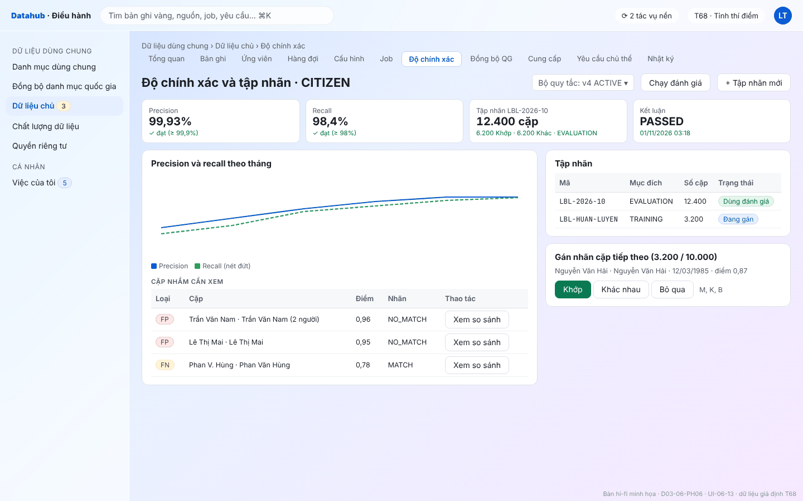

## 20. UI-06-14 Đồng bộ quốc gia

::: dac-ta
**Mục đích.** Cho DS, DA, TA theo dõi đồng bộ với CSDL tổng hợp quốc gia qua PH-14 (không gọi thẳng), thấy tỷ lệ lệch theo thời gian, xử lý danh sách lệch, tạm dừng và tiếp tục đồng bộ.

**Tác nhân, quyền.** DS, DA, TA (`PERM-06-read`); chạy đối chiếu, tạm dừng, tiếp tục, xử lý lệch `PERM-06-sync`; tiếp tục sau khi tự tạm dừng cần DA.

**FR, UC.** FR-06-053, 054.

**Truy vết hệ cũ.** Thay UI-06-06 mockup cũ (Đồng bộ quốc gia và danh sách lệch).

**Đường dẫn, mẫu.** `/du-lieu/du-lieu-chu/dong-bo-quoc-gia` (`muc-do`, `thuoc-tinh`, `luot`, `trang-thai`); PTN-11 giám sát.

**API.** API-06-080 (trạng thái); API-06-081 (chạy); API-06-082 (`:pause`), API-06-118 (`:resume` kèm `cause`); API-06-083 (danh sách lệch); API-06-084 (xử lý lệch).

**Điều hướng vào.** Tab "Đồng bộ QG"; băng đỏ ở UI-06-01.

**Thành phần chính.** Băng đỏ tạm dừng, bốn thẻ, biểu đồ lệch theo lượt, bảng chiều đồng bộ, bảng lệch (mục 20.1).

**Hành động.** Chạy đối chiếu; tạm dừng; tiếp tục (xác nhận nguyên nhân); chọn lệch và xử lý theo bốn cách; lọc.

**Trạng thái.** `SyncState`; đang tạm dừng do lệch; PH-14 không khả dụng; dữ liệu quốc gia mâu thuẫn.

**Thông báo.** "Đồng bộ tự động đã tạm dừng: tỷ lệ lệch {x}% vượt 5%. Điều tra trước khi tiếp tục."; "Đồng bộ quốc gia đang tạm dừng do lệch vượt ngưỡng."; "Thuộc tính {tên} chỉ được sửa tại CSDL quốc gia…"

**Đợt, mức chi tiết.** Đợt 3; đầy đủ.
:::

### 20.1. Thành phần

Bảng dưới đánh số các thành phần của màn Đồng bộ quốc gia, gồm băng đỏ khi tạm dừng, thẻ chỉ số về tỷ lệ lệch và danh sách các điểm lệch.

| # | Thành phần | `CMP-*` | Nội dung, kiểm tra |
|---|---|---|---|
| 1 | Băng đỏ | `CMP-Banner` | Khi `PAUSED` do lệch > `06.sync.pause-ratio`: câu ERR-06-107, nút "Tiếp tục đồng bộ…" |
| 2 | Thẻ chỉ số | `CMP-KpiCard` ×4 | `SyncState` và thời điểm, tỷ lệ lệch lượt gần nhất (kèm "vượt 5%"), số lệch mở theo `DiscrepancySeverity`, lần đối chiếu cuối |
| 3 | Biểu đồ lệch | `CMP-Chart` đường + vạch ngưỡng 5% nét đứt `color-error` | 12 lượt gần nhất; bảng thay thế |
| 4 | Bảng chiều đồng bộ | `CMP-DataTable` | `SyncDirection` (`DOWN`, `RECONCILE`, `UP`), trạng thái, lần gần nhất; chiều lên tắt khi `06.sync.up-attributes` rỗng (Q06-02) |
| 5 | Bảng lệch | `CMP-DataTable` + `CMP-BulkActionBar` | Bản ghi vàng, thuộc tính, giá trị địa phương và quốc gia (che), nguồn địa phương, mức, đề xuất, `DiscrepancyStatus` |
| 6 | Hộp xử lý lệch | `CMP-ReasonDialog` | `DiscrepancyResolution`; tối đa 1.000 lệch một lần; "Bỏ qua" cần lý do; "Giữ địa phương" vô hiệu cho thuộc tính thẩm quyền quốc gia (ERR-06-035) |
| 7 | Hộp tiếp tục | `CMP-ConfirmDialog` | Người dùng ghi nguyên nhân đã điều tra (`cause`, ≥ 20 ký tự, thiếu thì ERR-06-007) và xác nhận qua API-06-118; DA duyệt |

: UI-06-14 Đồng bộ quốc gia, thành phần

Khi tạm dừng, nút "Tiếp tục" vô hiệu cho tới khi người có `PERM-06-sync` ghi nguyên nhân; chữ cạnh nút nêu "Đồng bộ quốc gia đang tạm dừng do lệch vượt ngưỡng." Giá trị DLCN trong bảng lệch che theo phân loại. Trạng thái: rỗng "Chưa có lượt đối chiếu nào."; PH-14 không khả dụng (ERR-06-106) hiện băng "Chưa kết nối được dịch vụ quốc gia qua PH-14. Thử lại sau." Hi-fi:

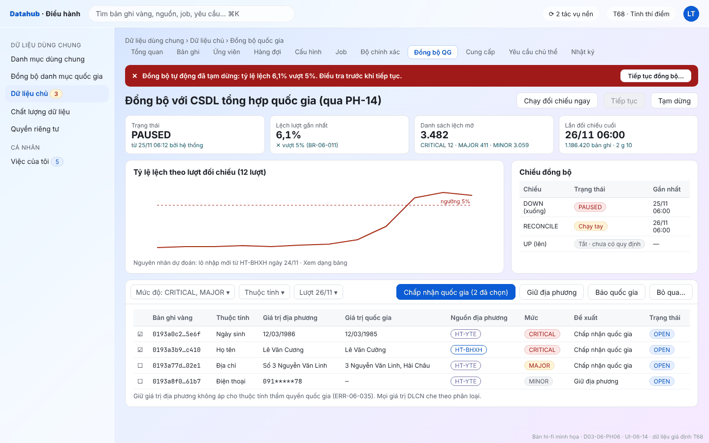

## 21. UI-06-15 Xuất và đăng ký nhận cập nhật

::: dac-ta
**Mục đích.** Cho DS, DA, DO đề nghị và chấp thuận xuất dữ liệu chủ có kiểm soát, và đăng ký để HTTT nhận cập nhật bản ghi vàng theo mục đích đã được PH-09 chấp thuận.

**Tác nhân, quyền.** DS, TA, DA, DO (`PERM-06-export`); DO chỉ đối tượng thuộc nguồn của tổ chức mình; xem đăng ký nhận `PERM-06-read`; chấp thuận cần DO của các nguồn liên quan và DA khác người đề nghị.

**FR, UC.** FR-06-049, 051.

**Truy vết hệ cũ.** Không có.

**Đường dẫn, mẫu.** `/du-lieu/du-lieu-chu/cung-cap` (`/xuat`, `/dang-ky-nhan`; `trang-thai`; `chon`); PTN-01 hai tab.

**API.** API-06-073…076 (xuất); API-06-077…079 (đăng ký nhận).

**Điều hướng vào.** Tab "Cung cấp".

**Thành phần chính.** Hai tab, bảng đề nghị, Drawer đề nghị xuất, bảng đăng ký, hộp chấp thuận (mục 21.1).

**Hành động.** Đề nghị xuất; chấp thuận, từ chối; tải tệp (24 giờ); đề nghị đăng ký nhận; duyệt, tạm ngừng, tiếp tục, thu hồi.

**Trạng thái.** `ExportStatus`, `SubscriptionStatus`; vượt giới hạn; chưa có mục đích; tệp hết hạn.

**Thông báo.** "Số bản ghi {n} vượt giới hạn {m} một lần xuất. Thu hẹp bộ lọc."; "Tệp xuất đã hết hạn tải. Gửi đề nghị mới."; "Hệ thống {mã} chưa có mục đích khai thác được chấp thuận nên chưa đăng ký nhận cập nhật được."

**Đợt, mức chi tiết.** Đợt 3; đầy đủ.
:::

### 21.1. Thành phần và trường

Bảng dưới đánh số các thành phần của màn Xuất và đăng ký nhận cập nhật, gồm bảng đề nghị xuất và drawer đề nghị, kèm trường và kiểm tra.

| # | Thành phần | `CMP-*` | Nội dung, kiểm tra |
|---|---|---|---|
| 1 | Bảng đề nghị xuất | `CMP-DataTable` | Mã, domain, bộ lọc và trường, số bản ghi, `ExportFormat`, mục đích và căn cứ, người nhận, người đề nghị, `ExportStatus` |
| 2 | Drawer đề nghị xuất | `CMP-Drawer` + `CMP-Form` | Xem bảng trường; hiện ước tính số bản ghi theo bộ lọc |
| 3 | Hộp chấp thuận | `CMP-ApprovalPanel` | Danh sách trường sẽ xuất, trường `SENSITIVE`, người nhận; DO chấp thuận phần của mình, DA chấp thuận cuối; người đề nghị không duyệt (ERR-06-005) |
| 4 | Tải tệp | `CMP-Button` | Khi `READY`; hiện "còn {giờ} giờ"; mật khẩu gửi riêng qua thông báo trong ứng dụng, không hiện trên màn |
| 5 | Bảng đăng ký nhận | `CMP-DataTable` | HTTT, domain, `SubscriptionScope`, mục đích PH-09, topic nhận (`t68.mdm.golden.*.v1`), `SubscriptionStatus` |
| 6 | Biểu mẫu đăng ký | `CMP-Drawer` | HTTT, domain, phạm vi, mục đích (bắt buộc từ PH-09, ERR-06-043) |

: UI-06-15 Xuất và đăng ký nhận, thành phần

| Trường đề nghị xuất | Kiểu | Bắt buộc | Kiểm tra |
|---|---|---|---|
| Domain | Chọn | Có | `ACTIVE` |
| Bộ lọc | `CMP-FilterBar` | Có | Số bản ghi ≤ `06.export.max-rows` (ERR-06-041) |
| Trường xuất | Chọn nhiều | Có | Tối thiểu hóa; trường `SENSITIVE` cần chấp thuận rõ |
| `ExportFormat` | CSV, XLSX, JSONL | Có | |
| Mục đích, căn cứ pháp lý | Chọn, T-TEXT | Có | Mục đích đã chấp thuận ở PH-09 |
| Người nhận | T-TEXT | Có | |
| Mã giả hóa `goldenId` | T-BOOL | Không | |

: UI-06-15 Trường đề nghị xuất

Trạng thái: rỗng "Chưa có đề nghị xuất nào."; tệp `EXPIRED` ẩn nút tải, hiện ERR-06-042. Hi-fi:

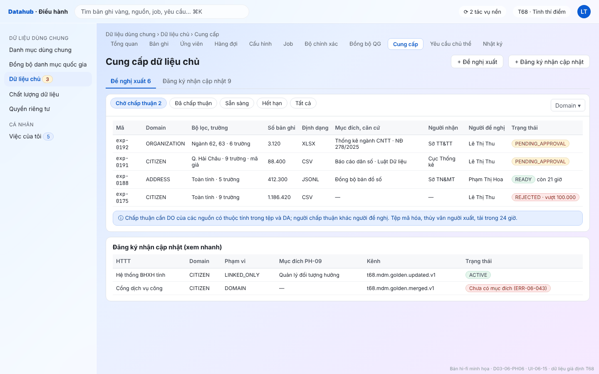

## 22. UI-06-16 Yêu cầu của chủ thể dữ liệu

::: dac-ta
**Mục đích.** Cho DS và SO tiếp nhận và xử lý yêu cầu của chủ thể dữ liệu (biết, sửa, hạn chế xử lý) theo Luật BVDLCN 91/2025 và NĐ 356/2025: xác minh danh tính, tìm bản ghi, lập báo cáo, chuyển nguồn, theo hạn.

**Tác nhân, quyền.** TA, SO, DS (`PERM-06-dsr`); bỏ che dữ liệu của chính chủ thể trong báo cáo theo quy tắc PH-09.

**FR, UC.** FR-06-058.

**Truy vết hệ cũ.** Không có.

**Đường dẫn, mẫu.** `/du-lieu/du-lieu-chu/yeu-cau-chu-the` (`loai`, `trang-thai`, `phan-vung`, `chon`); PTN-10.

**API.** API-06-090 (tiếp nhận); API-06-091 (chi tiết); API-06-092 (`:complete`), API-06-119 (`:forward`), API-06-120 (`:reject`); API-06-125 (`:lift-restriction`, gỡ hạn chế).

**Điều hướng vào.** Tab "Yêu cầu chủ thể"; "Việc của tôi".

**Thành phần chính.** Thẻ hạn, bảng yêu cầu, khung chi tiết, hộp tiếp nhận (mục 22.1).

**Hành động.** Tiếp nhận; xác nhận đúng người; lập báo cáo truy cập; chuyển nguồn; hoàn thành; từ chối (lý do).

**Trạng thái.** `DsrStatus`; sắp đến hạn; chưa xác minh danh tính.

**Thông báo.** "Chưa xác minh danh tính chủ thể nên chưa tiếp nhận được yêu cầu."; "Yêu cầu còn {n} ngày làm việc tới hạn."

**Đợt, mức chi tiết.** Đợt 3; đầy đủ.
:::

### 22.1. Thành phần và trường

Bảng dưới đánh số các thành phần của màn Yêu cầu của chủ thể dữ liệu, gồm thẻ số lượng, bảng yêu cầu với hạn xử lý và các hành động xử lý.

| # | Thành phần | `CMP-*` | Nội dung, kiểm tra |
|---|---|---|---|
| 1 | Thẻ | `CMP-StatCard` ×3 | Đang xử lý, sắp đến hạn (≤ 2 ngày, kèm biểu tượng), hoàn thành trong tháng theo `DsrType` |
| 2 | Bảng yêu cầu | `CMP-DataTable` | Mã, `DsrType`, chủ thể (tên rút gọn, định danh che), ngày nhận, hạn (chữ "còn n ngày"), `DsrStatus` |
| 3 | Khung chi tiết | `CMP-DescriptionList`, `CMP-AuditTimeline` | Xác minh danh tính, bản ghi vàng liên quan (liên kết UI-06-03), báo cáo, dòng thời gian xử lý |
| 4 | Báo cáo truy cập | `CMP-DataTable` | Thuộc tính đang giữ, nguồn từng thuộc tính, HTTT và mục đích đã truy cập 12 tháng |
| 5 | Hộp tiếp nhận | `CMP-Modal` + `CMP-Form` | Xem bảng trường |
| 6 | Nút "Gỡ hạn chế" | `CMP-ReasonDialog` | Hiện ở yêu cầu `RESTRICTION` đã `COMPLETED` (DS, SO, TA, `PERM-06-dsr`); gọi API-06-125 kèm căn cứ ≥ 20 ký tự; bản ghi về `ACTIVE`; lỗi "Bản ghi {id} không ở trạng thái hạn chế xử lý." (ERR-06-006) |

: UI-06-16 Yêu cầu của chủ thể, thành phần

| Trường tiếp nhận | Kiểu | Bắt buộc | Kiểm tra |
|---|---|---|---|
| `DsrType` | Chọn | Có | `ACCESS`, `RECTIFICATION`, `RESTRICTION` |
| Số định danh chủ thể | Trường che | Có | Đúng định dạng; không lên URL |
| Mã tham chiếu xác minh | T-TEXT | Có | Trống: ERR-06-046 |
| Nội dung | T-TEXTAREA ≤ 2.000 | Có với `RECTIFICATION` | |
| Kênh, ngày nhận | Chọn, T-DATE | Có | |

: UI-06-16 Trường tiếp nhận

`RECTIFICATION` với thuộc tính thẩm quyền quốc gia hiện hướng dẫn công dân liên hệ cơ quan đăng ký (ERR-06-035) và nút "Chuyển nguồn" thay vì "Sửa tay"; `RESTRICTION` khóa bản ghi (`LOCKED` kèm cờ hạn chế). Hạn mặc định `06.dsr.sla-days` (giả định 10 ngày làm việc, Q06-01); còn 2 ngày thì cảnh báo SO. Trạng thái: rỗng "Chưa có yêu cầu nào." Hi-fi:

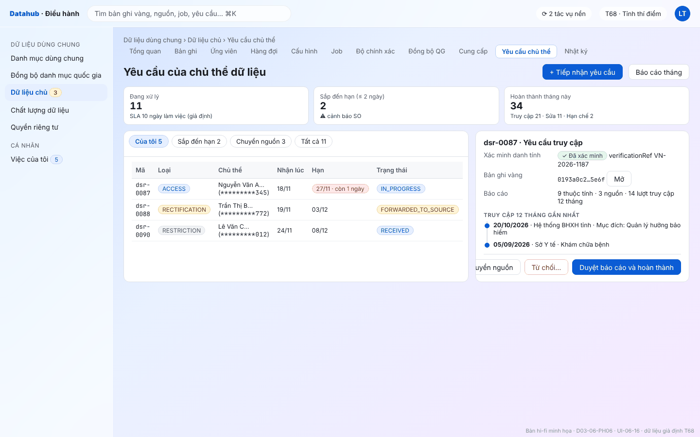

## 23. UI-06-17 Cài đặt và lưu giữ

::: dac-ta
**Mục đích.** Cho TA đặt tham số phân hệ theo tenant và chính sách lưu giữ dữ liệu trung gian chứa dữ liệu cá nhân, đặt giữ pháp lý.

**Tác nhân, quyền.** TA sửa (`PERM-06-config`); mọi vai trò có `PERM-06-read` xem (chỉ đọc, `ST-15`); đổi lưu giữ cần bốn mắt khi rút ngắn dưới giá trị đang dùng.

**FR, UC.** FR-06-059, 060.

**Truy vết hệ cũ.** Không có.

**Đường dẫn, mẫu.** `/du-lieu/du-lieu-chu/cau-hinh/cai-dat` (tab `/hang-doi`, `/doi-sanh`, `/hoan-tac`, `/truy-cap`, `/dong-bo`, `/chu-the`, `/luu-giu`); PTN-12.

**API.** API-06-095, 096 (tham số); API-06-093, 094 (lưu giữ).

**Điều hướng vào.** Tab "Cấu hình" → "Cài đặt".

**Thành phần chính.** Điều hướng nhóm, bảng tham số có miền, bảng lưu giữ (mục 23.1).

**Hành động.** Sửa, lưu, hoàn nguyên về mặc định; đặt giữ pháp lý.

**Trạng thái.** Có thay đổi chưa lưu; ngoài miền; dưới mức tối thiểu; chỉ đọc.

**Thông báo.** "Giá trị ngoài miền cho phép {min}…{max}."; "Thời hạn lưu giữ thấp hơn mức tối thiểu {n} ngày."

**Đợt, mức chi tiết.** Đợt 3; đầy đủ.
:::

### 23.1. Thành phần

Bảng dưới đánh số các thành phần của màn Cài đặt và lưu giữ, gồm cây nhóm tham số và bảng tham số với miền giá trị và mặc định.

| # | Thành phần | `CMP-*` | Nội dung, kiểm tra |
|---|---|---|---|
| 1 | Điều hướng nhóm | `CMP-Tree` | Hàng đợi, Đối sánh, Hoàn tác, Truy cập và xuất, Đồng bộ quốc gia, Yêu cầu chủ thể, Lưu giữ |
| 2 | Bảng tham số | `CMP-DataTable` + `CMP-NumberInput`, `CMP-Switch` | Tên, khóa `06.*` trong `CMP-CodeText`, giá trị, miền, mặc định; mười ba tham số theo FRS §8.2; vượt trần PA hiện câu ERR-06-047 |
| 3 | Bảng lưu giữ | `CMP-DataTable` | Loại đối tượng, `RetentionAction`, thời hạn, tối thiểu, giữ pháp lý; nhật ký truy cập khóa 12 tháng trực tuyến, 5 năm WORM (BR-06-031) |
| 4 | Thanh lưu | `CMP-SaveIndicator`, `CMP-Button` | "Lưu thay đổi" gửi `If-Match` (`ST-13` khi xung đột); "Hoàn nguyên" |
| 5 | Mẫu câu lý do | `CMP-KeyValueEditor` | Danh sách bốn mẫu câu lý do ở UI-06-05 |

: UI-06-17 Cài đặt và lưu giữ, thành phần

Trạng thái: có thay đổi chưa lưu hiện chấm cạnh tên nhóm và hộp hỏi khi rời trang; dưới mức tối thiểu hiện lỗi dưới ô kèm ERR-06-049 và chặn lưu. Hi-fi:

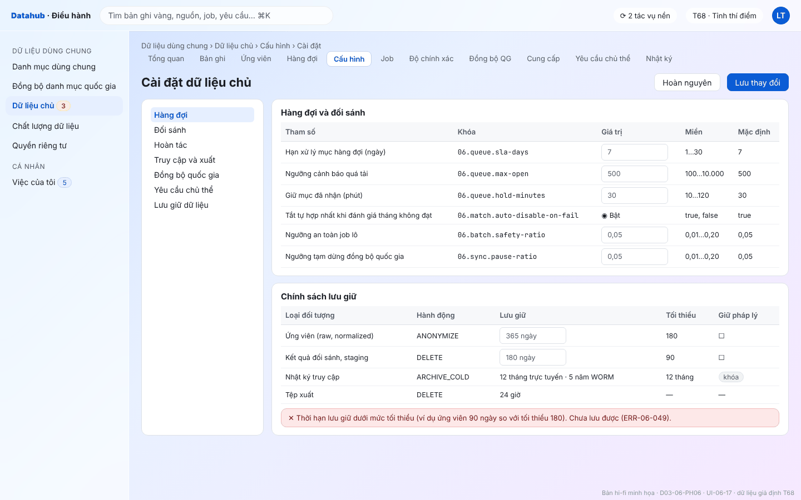

## 24. UI-06-18 Nhật ký

::: dac-ta
**Mục đích.** Cho SO, AU xem nhật ký truy cập dữ liệu chủ (ai xem gì, mục đích, có bỏ che không) và cảnh báo bất thường; cho TO, DS xem nhật ký xử lý (nạp, đối sánh, thao tác).

**Tác nhân, quyền.** SO, AU (`PERM-06-audit-read`); nhật ký xử lý `PERM-06-read`; xem nhật ký cũng bị ghi nhật ký.

**FR, UC.** FR-06-057.

**Truy vết hệ cũ.** Không có.

**Đường dẫn, mẫu.** `/du-lieu/du-lieu-chu/nhat-ky` (`/truy-cap`, `/xu-ly`, `/bat-thuong`; `tu`, `den`, `hanh-dong`); PTN-11 tra log.

**API.** API-06-089 (`GET /access-logs`); API-06-088 (`GET /processing-logs`).

**Điều hướng vào.** Tab "Nhật ký"; liên kết từ cảnh báo bất thường.

**Thành phần chính.** Ba tab, băng cảnh báo, bộ lọc, bảng log (mục 24.1).

**Hành động.** Lọc; mở chi tiết dòng; xuất nhật ký (ghi vết); chuyển cảnh báo cho SO.

**Trạng thái.** Đang tải; rỗng; khoảng quá lớn; không quyền.

**Thông báo.** "Anh/chị đã xem quá {n} bản ghi trong {phút} phút. Truy cập hàng loạt cần phê duyệt." (hiện cho người bị chặn); băng cho SO nêu người dùng, số bản ghi, ngưỡng.

**Đợt, mức chi tiết.** Đợt 3; đầy đủ.
:::

### 24.1. Thành phần và cột

Bảng dưới đánh số các thành phần của màn Nhật ký, gồm ba tab nhật ký truy cập, nhật ký xử lý, cảnh báo bất thường và băng cảnh báo truy cập quá nhiều.

| # | Thành phần | `CMP-*` | Nội dung |
|---|---|---|---|
| 1 | Hàng tab | `CMP-Tabs` | Nhật ký truy cập, Nhật ký xử lý, Cảnh báo bất thường (huy hiệu số) |
| 2 | Băng bất thường | `CMP-Banner` cảnh báo | Truy cập > 100 bản ghi trong 10 phút (BR-06-013) kèm nút "Mở" |
| 3 | Bộ lọc | `CMP-FilterBar`, `CMP-DateRangePicker` | Người dùng hoặc HTTT, hành động, domain, khoảng thời gian (tối đa 31 ngày một lần) |
| 4 | Bảng log | `CMP-LogViewer` hoặc `CMP-DataTable` gọn | Cột dưới; sắp theo thời điểm giảm dần |

: UI-06-18 Nhật ký, thành phần

| Cột nhật ký truy cập | Nội dung |
|---|---|
| Thời điểm | Đến giây |
| Người, hệ thống | Tên đăng nhập và vai trò; HTTT kèm scope `mdm:*` |
| Hành động | Xem bản ghi vàng, Bỏ che giá trị, Tìm kiếm, Tra cứu ID vàng, Xuất, Quyết định |
| Đối tượng | ID vàng rút gọn hoặc mô tả tiêu chí (không chứa giá trị cá nhân) |
| Thuộc tính xem, Mục đích, Bỏ che | Số thuộc tính hoặc tên; mục đích PH-09; có hoặc không và quyền dùng |
| Mã truy vết | `CMP-CopyButton` |

: UI-06-18 Cột nhật ký truy cập

Nhật ký giữ 12 tháng trực tuyến và 5 năm WORM (BR-06-031). Nhật ký không chứa giá trị cá nhân dạng rõ. Nhật ký xử lý hiện job, ứng viên, quyết định, thao tác với mã lỗi ERR-06-101…114. Trạng thái: khoảng lớn hơn 31 ngày hiện hướng dẫn xuất; rỗng "Không có nhật ký trong khoảng này." Hi-fi:

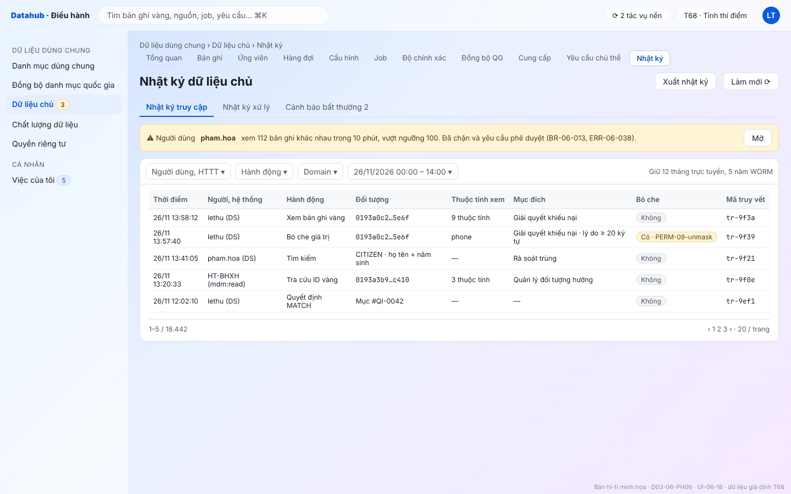

## 25. Mẫu truy cập, kiến trúc mã giao diện, luồng người dùng chính

Chương này mô tả cách các màn phối hợp trong ba luồng chính, và cách mã giao diện tổ chức để thực hiện các quy ước ở chương 2.

### 25.1. Mẫu truy cập dữ liệu

Bảng dưới ghi cách giao diện truy cập dữ liệu, từ gọi API, bộ nhớ đệm đến xử lý lỗi, trong đó dữ liệu bản ghi vàng không được lưu đệm.

| Việc | Cách làm |
|---|---|
| Gọi API | Tầng `mdmApi` sinh từ OpenAPI D03-04-PH06; mọi lỗi theo RFC 9457 sang `ST-11`, `ST-12`, `ST-13` |
| Bộ nhớ đệm | TanStack Query; truy vấn bản ghi vàng, so sánh, ứng viên, nhật ký `staleTime: 0`, `gcTime: 0` |
| Tiêu chí nhạy cảm | Gửi bằng `POST`; không ghi vào URL, `localStorage`, lịch sử gợi ý |
| Ghi | `Idempotency-Key` và `If-Match` ở mọi thao tác nghiệp vụ; nút gửi vô hiệu tới khi có phản hồi (`ST-09`) |
| Làm mới | Thăm dò 5 giây cho job `RUNNING`; 5 phút cho tổng quan; không dùng WebSocket ở Đợt 3 |
| Mã thuộc `dh-console` | Thư mục `features/mdm/` gồm `golden`, `stewardship`, `config`, `jobs`, `sync`, `provision`, `dsr`, `logs`; thành phần dùng chung từ `@datahub/ui` |

: Mẫu truy cập dữ liệu và tổ chức mã giao diện

### 25.2. Luồng chính: xử lý hàng đợi

Sơ đồ dưới cho thấy luồng chính xử lý một mục hàng đợi: DS nhận việc, so sánh và quyết định, rủi ro cao thì chờ DA duyệt còn rủi ro thấp thì hoàn tất ngay.

```{.mermaid caption="Luồng xử lý một mục hàng đợi và duyệt bốn mắt"}
sequenceDiagram
  actor DS as Người quản lý dữ liệu
  actor DA as Người duyệt dữ liệu
  participant UI as dh-console
  participant API as mdm-stewardship
  DS->>UI: Bấm Nhận việc tiếp theo ở UI-06-04
  UI->>API: claim mục ưu tiên cao nhất
  API-->>UI: Mục ASSIGNED và dữ liệu cặp
  DS->>UI: Xem so sánh UI-06-05, chọn quyết định, nhập lý do
  UI->>API: decide MATCH kèm lý do
  alt Rủi ro cao
    API-->>UI: Mục PENDING_APPROVAL
    DA->>UI: Mở mục ở chế độ duyệt, nhập lý do
    UI->>API: approve hoặc reject
  else Rủi ro thấp hoặc Khác nhau
    API-->>UI: Mục RESOLVED
  end
  UI-->>DS: Chuyển mục kế tiếp
```

Hình cho thấy DS không bao giờ tự hoàn tất hợp nhất rủi ro cao: mục dừng ở chờ duyệt, DA khác người quyết mở lại đúng màn UI-06-05 ở chế độ duyệt. Sau quyết định màn tự chuyển mục kế tiếp để giữ nhịp làm việc.

### 25.3. Luồng chính: giải quyết khiếu nại

DS tìm ở UI-06-02 bằng họ tên cộng ngày sinh hoặc số định danh; mở UI-06-03; xem tab "Nguồn gốc" để thấy giá trị sai đến từ nguồn nào; chọn "Đề nghị sửa tại nguồn" (BR-06-014); nếu bản ghi bị trộn nhầm thì "Tách…" sang UI-06-06; nếu có hai bản ghi cùng người thì "Hợp nhất…". Mọi bước ghi nhật ký truy cập và có lý do.

### 25.4. Luồng chính: phát hành cấu hình mới

TA soạn mô hình ở UI-06-07, bộ quy tắc ở UI-06-09 (chạy thử, đánh giá ở UI-06-13), quy tắc sống sót ở UI-06-10, ưu tiên nguồn ở UI-06-08; mỗi cấu hình gửi duyệt, DA khác người gửi duyệt; sau kích hoạt, áp lại hàng loạt (nếu > 1.000 bản ghi) chạy như job chờ xác nhận ở UI-06-12.

## 26. Ma trận màn hình theo vai trò

Ký hiệu: ● xem và thao tác đầy đủ theo quyền, ○ xem hoặc thao tác giới hạn (xem ghi chú), — không có. Vai trò theo FRS §3.1; quyền theo FRS §3.2.

| Màn | PA | TA | TO | SO | DS | DA | DO | VW | AU |
|---|---|---|---|---|---|---|---|---|---|
| UI-06-01 Tổng quan | ● | ● | ● | ● | ● | ● | ○ | ○ | ● |
| UI-06-02 Tìm kiếm | ● | ● | ● | ● | ● | ● | ○ | ● | ● |
| UI-06-03 Chi tiết bản ghi vàng | ● | ● | ● | ● | ● | ● | ○ | ● | ● |
| UI-06-04 Hàng đợi | — | ● | — | — | ● | ● | — | — | — |
| UI-06-05 So sánh và quyết định | — | ● | — | — | ● | ● | — | — | — |
| UI-06-06 Hợp nhất, tách | — | ● | — | — | ○ | ● | — | — | — |
| UI-06-07 Mô hình domain | ● | ● | — | — | ○ | ● | — | — | — |
| UI-06-08 Nguồn, ưu tiên | — | ● | — | — | ○ | ● | — | — | — |
| UI-06-09 Quy tắc đối sánh | — | ● | — | — | ○ | ● | — | — | — |
| UI-06-10 Quy tắc sống sót | — | ● | — | — | ○ | ● | — | — | — |
| UI-06-11 Ứng viên, nạp tệp | — | ● | ○ | — | ○ | — | — | — | — |
| UI-06-12 Job và lịch | — | ● | ● | — | ○ | — | — | — | — |
| UI-06-13 Độ chính xác | — | ● | — | — | ● | ● | — | — | — |
| UI-06-14 Đồng bộ quốc gia | — | ● | — | — | ● | ● | — | — | — |
| UI-06-15 Xuất, đăng ký nhận | — | ● | — | — | ○ | ● | ○ | — | — |
| UI-06-16 Yêu cầu chủ thể | — | ● | — | ● | ● | — | — | — | — |
| UI-06-17 Cài đặt | — | ● | — | — | ○ | ○ | — | — | — |
| UI-06-18 Nhật ký | — | — | ○ | ● | ○ | — | — | — | ● |

: Ma trận màn hình theo vai trò PH-06

Ghi chú: VW chỉ thấy số tổng hợp ở UI-06-01, không thấy liên kết tới bản ghi; DO chỉ thấy đối tượng thuộc nguồn của tổ chức mình; DS ở màn cấu hình (○) đề nghị được nhưng không duyệt; DA ở UI-06-17 chỉ đọc; TO ở UI-06-18 chỉ xem nhật ký xử lý. Ma trận này là suy ra từ FRS §3.2, ô nào lệch phải sửa ở FRS (Phụ lục C).

## 27. Kiểm thử giao diện và bản hi-fi

### 27.1. Kiểm thử giao diện

Bảng dưới ghi các nhóm kiểm thử giao diện, nội dung kiểm tra và công cụ, chẳng hạn hiển thị theo quyền và không để dữ liệu cá nhân lộ ra URL.

| Nhóm kiểm thử | Nội dung | Công cụ |
|---|---|---|
| Hiển thị theo quyền | Mỗi tổ hợp vai trò trong ma trận mục 26 mở màn: có hoặc không thấy nút; mở route trực tiếp khi thiếu quyền hiện `ST-07` | Playwright, tài khoản kiểm thử `T90…T99` |
| Dữ liệu cá nhân | Không có số định danh, họ tên, điện thoại trong URL, tiêu đề tab, `localStorage`; giá trị Nhạy cảm che đến khi bỏ che; tự che sau 60 giây | Playwright, kiểm tra DOM |
| So sánh và quyết định | Định danh khác nhau vô hiệu nút "Cùng một thực thể" kèm chữ; lý do < 20 ký tự báo ERR-06-007; mục lỗi thời; nhận trùng; bốn mắt: người quyết không duyệt được | Playwright, API giả |
| Bản ghi vàng | Bốn trạng thái `GoldenStatus`; tab Nguồn gốc đủ cột; bỏ che ghi nhật ký; không ghi được nhật ký thì không hiện dữ liệu | Playwright |
| Tiếp cận | Axe không lỗi nghiêm trọng; bảng so sánh đọc đúng bằng NVDA; màu không là kênh duy nhất (chụp ảnh thang xám) | axe-core, kiểm tra tay |
| Bàn phím | Mọi hành động có phím; kéo thả ở UI-06-06, UI-06-08 có phương án bàn phím | Playwright |
| Hiệu năng | Mở UI-06-05 ≤ 1 giây với P95 trên dữ liệu T01; bảng 20 dòng cuộn mượt; Lighthouse tiếp cận ≥ 95 | Lighthouse, đo thật |

: Nhóm kiểm thử giao diện PH-06

Ca kiểm thử chi tiết ở D05-02-PH06 (TC-06-xxx), ánh xạ màn sang ca theo bảng truy vết của tập đó.

### 27.2. Danh sách ảnh hi-fi

Bảng dưới liệt kê ảnh hi-fi của từng màn và điểm nổi bật cần kiểm tra trên mỗi ảnh.

| Ảnh | Màn | Nội dung nổi bật |
|---|---|---|
| `ph06/hifi/ui-06-01.png` | UI-06-01 | Tổng quan, băng đỏ nghiêm trọng, năm thẻ |
| `ph06/hifi/ui-06-02.png` | UI-06-02 | Tìm kiếm có biểu mẫu tiêu chí, chặn truy cập hàng loạt |
| `ph06/hifi/ui-06-03.png`, `ui-06-03b.png` | UI-06-03 | Thuộc tính có nguồn gốc; tab Nguồn gốc |
| `ph06/hifi/ui-06-04.png` | UI-06-04 | Hàng đợi, SLA, ưu tiên |
| `ph06/hifi/ui-06-05.png`, `ui-06-05b.png` | UI-06-05 | So sánh; định danh khác nhau |
| `ph06/hifi/ui-06-06.png`, `ui-06-06b.png` | UI-06-06 | Hợp nhất bước 3; tách bước phân bổ |
| `ph06/hifi/ui-06-07.png` … `ui-06-10.png` | UI-06-07…10 | Mô hình, nguồn, quy tắc, sống sót |
| `ph06/hifi/ui-06-11.png`, `ui-06-11b.png` | UI-06-11 | Ứng viên; nhập tệp |
| `ph06/hifi/ui-06-12.png` … `ui-06-18.png` | UI-06-12…18 | Job, độ chính xác, đồng bộ, cung cấp, yêu cầu, cài đặt, nhật ký |

: Danh sách ảnh hi-fi PH-06

Ảnh dựng bằng `ph06/hifi/gen_hifi.py` (HTML tĩnh theo token D03-05) và `shot.js` (Playwright, 1440 rộng, `deviceScaleFactor` 1), rồi `nen.py` nén dưới 400 KB mỗi ảnh. Chạy lại: `python3 gen_hifi.py && node shot.js && python3 nen.py`. Dữ liệu là giả định của tỉnh thí điểm T68: người, số định danh, tổ chức đều là dữ liệu giả, số định danh luôn che.

## Phụ lục A. Đề nghị bổ sung cho D03-05

Bảng dưới ghi các thành phần giao diện mới mà PH-06 đề nghị bổ sung vào bộ chung D03-05, kèm lý do và nơi dùng.

| # | Đề nghị | Lý do, nơi dùng |
|---|---|---|
| A1 | Thành phần thang điểm có vùng và vạch ngưỡng (tên đề nghị: ScoreMeter) | UI-06-05 thanh điểm tổng; hiện dùng `CMP-ProgressBar` biến thể, chưa có biến thể "chia vùng" |
| A2 | Thành phần thanh trượt hai đầu (tên đề nghị: RangeSlider) kèm ô số | UI-06-09 hai ngưỡng với ràng buộc cách nhau 0,10; chưa có trong D03-05-03 |
| A3 | Thành phần cặp bản ghi so sánh (tên đề nghị: PairCompare) | UI-06-05, UI-06-13: hiện ghép `CMP-DiffTable` hai cột; cần chuẩn hóa thứ tự, ô giá trị che, cột điểm |
| A4 | Biến thể `status` của `CMP-StatusDot` cho độ tin cậy (cao, TB, thấp) kèm chữ | UI-06-03; hiện hiển thị bằng chấm + chữ ghép tay |
| A5 | Ghi chú ánh xạ `color-source-*` cho `SourceKind` (mục 5.2) | Tránh mỗi phân hệ tự gán nghĩa |
| A6 | Biến thể `CMP-Banner` "nghiêm trọng, không đóng được" | UI-06-01, UI-06-14 (ERR-06-107, ERR-06-112) |
| A7 | Token cho ba mức độ tin cậy (`color-confidence-high`, `-medium`, `-low`) hoặc ghi rõ dùng `color-success`, `color-warning`, `color-error` | UI-06-03; hiện dùng ba màu ngữ nghĩa có sẵn |

: Đề nghị bổ sung cho D03-05

Tài liệu này dùng tạm các tổ hợp có sẵn cho A1 đến A4 để không tự đặt thành phần mới; khi D03-05 bổ sung sẽ thay.

## Phụ lục B. Đề nghị bổ sung API

FRS 0.2 (§15) đã xử lý từng đề nghị; cột cuối ghi kết quả.

| # | Đề nghị | Cho màn | Xử lý ở FRS 0.2 |
|---|---|---|---|
| B1 | `GET /stewardship/items` hỗ trợ `partition=mine,unclaimed,overdue,pending-approval` và trả số đếm từng phân vùng | UI-06-04 | Đã áp: lọc `partition` ở API-06-045; số đếm từng phân vùng ở D03-04 |
| B2 | `POST /stewardship/items:claim-next` trả mục ưu tiên cao nhất chưa nhận (một lệnh, tránh tranh chấp) | UI-06-04, UI-06-05 phím `N` | Đã áp: API-06-124 |
| B3 | `GET /stewardship/items/{itemId}` trả sẵn `thresholds`, `holdUntil`, `similarDecisions`, `mergeAllowed`, `riskLevel` và danh sách mục kế tiếp của tôi | UI-06-05 | Không áp vào FRS: trường phản hồi do D03-04 định nghĩa |
| B4 | `GET /domains/{domainCode}/golden-records/{goldenId}` trả `lineageHint` (số giá trị khác nhau từng thuộc tính) để hiện chỉ báo "có khác nhau" ở bảng thuộc tính | UI-06-03 | Không áp vào FRS: trường phản hồi do D03-04 định nghĩa |
| B5 | `GET /dashboard/metrics` trả `criticalAlerts`, `queueByReason`, `bySource[]` có tỷ lệ định danh sai, trùng | UI-06-01 | Không áp vào FRS: trường phản hồi do D03-04 định nghĩa |
| B6 | `POST …:evaluate` và `:dry-run` trả phân bố điểm 100 khoảng | UI-06-09 | Không áp vào FRS: trường phản hồi do D03-04 định nghĩa |
| B7 | API đề nghị truy cập hàng loạt có phê duyệt (cho ERR-06-038) | UI-06-02 | Chuyển câu hỏi mở Q06-10 |
| B8 | `POST /national-sync:resume` nhận `cause` (nguyên nhân đã điều tra) | UI-06-14 | Đã áp: API-06-118 nhận `cause` |
| B9 | Danh sách mẫu câu lý do cấu hình được (`reason-templates`) | UI-06-05, UI-06-17 | Chuyển câu hỏi mở Q06-11; tạm dùng `06.queue.reason-templates` |

: Đề nghị bổ sung API cho D03-04-PH06

## Phụ lục C. Đề nghị đồng bộ cho FRS D02-03-PH06

FRS 0.2 đã áp toàn bộ chín đề nghị; bảng giữ để truy vết.

| # | Đề nghị | Cơ sở | Xử lý ở FRS 0.2 |
|---|---|---|---|
| C1 | Bổ sung câu hiển thị vào §9.2 cho các mã: ERR-06-001, 004, 009, 011, 012, 018, 019, 025, 026, 034, 036, 037, 041, 042, 043, 046, 047, 049 theo câu ở mục 5.3 | FRS §9.2 mới có 19 mã | Đã áp: §9.2, thêm câu cho ERR-06-051…053 |
| C2 | Ghi quy ước tab con và query của route (mục 4.2) vào §10 hoặc Phụ lục A | D03-06-00 §2.4 | Đã áp: §10.3 |
| C3 | Thêm vào FR-06-029 mẫu câu lý do nhanh và phím tắt (mục 11.3, 11.4), cùng thời gian giữ mục hiển thị | FRS §10.2 nêu mẫu câu nhưng FR chưa có | Đã áp: FR-06-029, 030; `06.queue.reason-templates` |
| C4 | FR-06-027 hoặc FR-06-028: định nghĩa "Nhận việc tiếp theo" (mục ưu tiên cao nhất chưa nhận trong phạm vi) | UI-06-04 | Đã áp: FR-06-028 bước 2, API-06-124 |
| C5 | FR-06-035: nêu bỏ che tự che lại sau 60 giây (tham số, đề nghị thêm `06.mask.reveal-seconds`, mặc định 60, miền 15…300) | Mục 2.5 | Đã áp: `06.mask.reveal-seconds` |
| C6 | FRS §3.2: `PERM-06-read` cho VW chỉ số tổng hợp và AU xem nhật ký truy cập: làm rõ AU thuộc `PERM-06-audit-read` | Ma trận mục 26 | Đã áp: ghi chú dưới ma trận §3.2 |
| C7 | UI-06-11 gồm hai mẫu (PTN-01, PTN-09) và hai route: tách thành UI-06-11 và UI-06-11b hoặc ghi rõ trong §10.1 | Mục 17 | Đã áp: §10.1 ghi hai route, không thêm UI-06-11b |
| C8 | Ghi giới hạn kích thước, số dòng tệp nhập vào tham số `06.ingest.max-file-mb`, `06.ingest.max-rows` | ERR-06-018 | Đã áp: `06.ingest.max-file-mb`, `06.ingest.max-rows` |
| C9 | FR-06-053: thêm yêu cầu ghi nguyên nhân đã điều tra khi tiếp tục đồng bộ sau tạm dừng | UI-06-14 hộp tiếp tục | Đã áp: FR-06-053, API-06-118 nhận `cause` |

: Đề nghị đồng bộ cho FRS và tài liệu liên quan

## Câu hỏi mở

> **Câu hỏi mở Q06-30:** Có cho phép bỏ che giá trị `SENSITIVE` đồng thời ở nhiều thuộc tính cùng một lần nhập lý do (như bản thiết kế này) hay buộc nhập lý do riêng từng thuộc tính; đề xuất một lý do cho cả bản ghi, ghi nhật ký từng thuộc tính. Cần ý kiến SO và PH-09.

> **Câu hỏi mở Q06-31:** Thời gian giữ mục hàng đợi đã nhận (30 phút) và thời gian giữ giá trị bỏ che (60 giây) có phù hợp công việc thực tế không; đề xuất đo ở nghiệm thu T01 rồi chỉnh.

> **Câu hỏi mở Q06-32:** DA có được xem chế độ duyệt hợp nhất rủi ro cao mà không bỏ che giá trị Nhạy cảm không; đề xuất DA chỉ thấy dạng che, trừ khi có `PERM-09-unmask`.

> **Câu hỏi mở Q06-33:** Phím tắt `M`, `K`, `H` ở UI-06-05 có xung đột với phần mềm đọc màn hình hoặc bàn phím tiếng Việt không; đề xuất thử với NVDA, JAWS và Unikey ở bản thử nghiệm.

> **Câu hỏi mở Q06-34:** Ngưỡng "vùng xem xét" hiển thị trên thanh điểm có hiện cho DS không (có thể khiến DS bị dẫn dắt theo điểm); đề xuất hiện điểm nhưng ẩn nhãn "tự hợp nhất" khi đánh giá chất lượng quyết định.

> **Câu hỏi mở Q06-35:** Biểu đồ phân bố điểm ở UI-06-09 dùng điểm xác suất (0 đến 1) hay trọng số khớp; đề xuất điểm xác suất để dễ hiểu cho người duyệt.

> **Câu hỏi mở Q06-36:** Giao diện cho người dân kiểm tra dữ liệu của mình (`dh-portal`) có thuộc Đợt 3 không; hiện UI-06-16 do cán bộ tiếp nhận; đề xuất để sau Đợt 3.

> **Câu hỏi mở Q06-37:** Mục đích khai thác ở màn tìm kiếm lấy từ danh sách PH-09 theo người dùng hay theo vai trò; cần API PH-09 trả danh sách theo người dùng.

> **Câu hỏi mở Q06-38:** Màn hình rất nhiều dữ liệu cá nhân có cần chế độ làm mờ khi chia sẻ màn hình, hay thủy vân đủ; đề xuất làm mờ tự động khi tab mất focus quá 2 phút.

> **Câu hỏi mở Q06-39:** Có hỗ trợ giao diện tiếng Anh cho UI-06-01 đến 18 không (đoàn công tác nước ngoài, dự án mẫu); đề xuất chỉ tiếng Việt ở Đợt 3, khung i18n có sẵn.

## Lịch sử phiên bản

| Phiên bản | Ngày | Người | Nội dung |
|---|---|---|---|
| 0.1 | 26/11/2026 | Nhóm phân hệ PH-06 | Bản đầu: 18 màn UI-06-01…18 kèm 22 ảnh hi-fi (18 màn và 4 biến thể), ma trận vai trò, kiểm thử, phụ lục đề nghị |
| 0.2 | 26/11/2026 | Nhóm phân hệ PH-06 | Đồng bộ FRS 0.2: Phụ lục B, C đánh dấu đã áp; dùng API-06-121…125 (Nhận việc tiếp theo, Mở lại, tab Thao tác, khóa tập nhãn, gỡ hạn chế), `decision` ở API-06-106, `cause` ở API-06-118, `partition` ở API-06-045; thêm câu ERR-06-051…053 ở mục 5.3 |

: Lịch sử phiên bản D03-06-PH06
