# D03-06-PH07 · Thiết kế giao diện màn hình phân hệ Danh mục dùng chung

## Tóm tắt cho hội đồng thẩm định

**Mục tiêu.** Đặc tả đủ chi tiết giao diện quản trị của phân hệ Danh mục dùng chung để đội phát triển lập trình ngay, người dùng nghiệp vụ hiểu được cách làm việc, và hội đồng kiểm tra được yêu cầu khả năng truy cập, an toàn thông tin ở lớp giao diện.

**Phạm vi.** Mười ba màn hình UI-07-01…13 phủ toàn bộ chức năng FR-07 có giao diện: quản lý danh mục và lược đồ thuộc tính, soạn và nhập dữ liệu theo phiên bản, so sánh và duyệt bốn mắt trước khi phát hành, đồng bộ danh mục quốc gia, ánh xạ mã, tra cứu đơn vị hành chính sau sắp xếp và chuyển mã, thử API truy vấn. Ba màn vận hành của hệ cũ Aita (danh sách danh mục, xem dạng cây, chi tiết danh mục) được giữ cách dùng (mục 23.2), theo quyết định giữ màn có giá trị vận hành.

**Căn cứ.** Yêu cầu chức năng D02-03-PH07, ca sử dụng D02-04-PH07, phân quyền D02-08, hợp đồng API D03-04-PH07, nguyên tắc giao diện Liquid Glass trên Ant Design v6 (quyết định Q8: vật liệu trong suốt chỉ cho lớp điều hướng và lớp nổi, nội dung dày dùng nền đặc). Khả năng truy cập theo WCAG 2.2 mức AA (NFR-00-040…045). Toàn bộ nhãn, thông điệp bằng tiếng Việt, định dạng ngày, số theo quy ước Việt Nam.

**Điểm cần hội đồng lưu ý.** Giao diện không bao giờ ghi thẳng vào danh mục đang hiệu lực: mọi thay đổi đi qua bản nháp, so sánh khác biệt và người duyệt thứ hai (mục 13). Dữ liệu cá nhân bị cảnh báo ngay khi khai báo thuộc tính (mục 10). Các đề nghị bổ sung API và design system còn mở được gom ở Phụ lục A, B.

## 1. Mục đích, phạm vi và tài liệu liên quan

### 1.1. Mục đích

Tài liệu này đặc tả toàn bộ giao diện người dùng của phân hệ PH-07 Danh mục dùng chung (Reference Data Management, viết tắt RDM) trong ứng dụng quản trị `dh-console`. Mục tiêu là để đội phát triển giao diện có thể bắt tay lập trình ngay mà không phải đoán: mỗi màn hình có đường dẫn (route), bố cục, danh sách thành phần với nhãn tiếng Việt và quy tắc kiểm tra hợp lệ, danh sách hành động gắn với quyền và trạng thái, API được gọi, các trạng thái màn hình, thông điệp lỗi và yêu cầu khả năng truy cập. Phần cuối mô tả kiến trúc mã nguồn phía giao diện (thư mục, component, hook, khóa bộ đệm truy vấn), luồng người dùng, ma trận màn hình theo vai trò và kế hoạch kiểm thử giao diện.

Tài liệu không lặp lại nghiệp vụ đã có ở FRS và không lặp lại hợp đồng API; khi cần, tài liệu dẫn chiếu mã `FR-07-nnn`, `BR-07-nnn`, `API-07-nnn`, `ERR-07-nnn`. Khi tài liệu này và các tài liệu nguồn mâu thuẫn, thứ tự ưu tiên là D02-08 (phân quyền), D02-07 (từ điển dữ liệu), rồi đến khung chung PH-07 và FRS PH-07.

### 1.2. Phạm vi

Phạm vi gồm mười ba màn hình chính thức `UI-07-01` đến `UI-07-13` cùng các hộp thoại, ngăn kéo (drawer) và thành phần dùng riêng của PH-07. Bảng sau liệt kê các màn hình và mức độ chi tiết của đặc tả, để người đọc biết màn nào là trọng tâm.

| Mã | Màn hình | Mức chi tiết |
|---|---|---|
| UI-07-01 | Danh sách danh mục (cây nhóm, bảng, bộ lọc, đếm) | Đầy đủ |
| UI-07-02 | Chi tiết danh mục (tám tab) | Đầy đủ |
| UI-07-03 | Tạo, sửa thông tin danh mục (trình hướng dẫn ba bước) | Đầy đủ |
| UI-07-04 | Trình sửa lược đồ thuộc tính của bản nháp | Đầy đủ |
| UI-07-05 | Trình sửa bản ghi bản nháp | Rất chi tiết, trọng tâm |
| UI-07-06 | Trình hướng dẫn nhập tệp bốn bước | Rất chi tiết, trọng tâm |
| UI-07-07 | So sánh phiên bản, trình duyệt, duyệt, phát hành | Rất chi tiết, trọng tâm |
| UI-07-08 | Tác vụ nhập xuất | Đầy đủ |
| UI-07-09 | Nguồn đồng bộ quốc gia và lần đồng bộ | Đầy đủ |
| UI-07-10 | Hệ thống mã, bảng ánh xạ, độ phủ | Đầy đủ |
| UI-07-11 | Tra cứu ĐVHC, dòng thời gian sắp xếp, công cụ chuyển mã | Rất chi tiết, trọng tâm |
| UI-07-12 | Trình thử API truy vấn | Rất chi tiết, trọng tâm |
| UI-07-13 | Tham số PH-07 của tenant (dùng màn tham số chung PH-18) | Mô tả tham số và cách nhúng |

: Phạm vi

Ngoài phạm vi là cổng nhà phát triển `dh-portal` (tài liệu tra cứu API danh mục cho nhà phát triển do PH-11 đặc tả) và giao diện ánh xạ trường dữ liệu với Từ điển dữ liệu quốc gia. SRS cũ có màn "Trình ánh xạ từ điển quốc gia" ánh xạ trường của mô hình dữ liệu chung (CDM) với từ điển quốc gia; trong mô hình mới, PH-07 chỉ quản lý ánh xạ **mã** giữa danh mục và hệ thống mã ngoài (FR-07-040…043), còn ánh xạ **trường** thuộc phân hệ dữ liệu chủ hoặc kết nối quốc gia.

> **Câu hỏi mở Q07-65:** Màn "Trình ánh xạ từ điển quốc gia" và "Báo cáo độ phủ ánh xạ trường" của SRS cũ (UI-07-05, UI-07-06 cũ) được chuyển sang phân hệ nào (PH-08 Dữ liệu chủ hay PH-14 Kết nối quốc gia)? Tài liệu này giả định chúng không còn thuộc PH-07 và chỉ giữ báo cáo độ phủ ánh xạ mã (FR-07-043).

### 1.3. Tài liệu liên quan

Các tài liệu dưới đây là nguồn của những mã được dẫn chiếu trong tài liệu này; đường dẫn là tương đối từ thư mục của tài liệu này.

| Tài liệu | Đường dẫn | Dùng để |
|---|---|---|
| D00-01 Thuật ngữ và quy ước | `../../00-chung/D00-01-thuat-ngu-quy-uoc.md` | Mã truy vết UI, CMP, TKN, PTN; kiểu dữ liệu T-*; định dạng ngày giờ |
| D02-02 SRS | `../../02-yeu-cau/D02-02-srs.md` | FR-00 (danh sách, nhập xuất, duyệt, lỗi), NFR-00-040…045 (truy cập, glass) |
| D02-07 Từ điển dữ liệu | `../../02-yeu-cau/D02-07-tu-dien-du-lieu.md` | DD-07 đơn vị hành chính, DD-12 tệp, DD-14 tham số |
| D02-08 Ma trận phân quyền | `../../02-yeu-cau/D02-08-ma-tran-phan-quyen.md` | Vai trò và quyền PERM-07 |
| D02-03-PH07 FRS | `../../02-yeu-cau/frs/D02-03-PH07-frs-danh-muc.md` | Đặc tả FR-07, BR-07 |
| D02-04-PH07 Use case | `../../02-yeu-cau/use-case/D02-04-PH07-use-case-danh-muc.md` | UC-07 |
| D03-02-PH07 SDD | `../sdd/D03-02-PH07-sdd-danh-muc.md` | Máy trạng thái, tác vụ nền |
| D03-04-PH07 API | `../api/D03-04-PH07-api-danh-muc.md` và `../api/ph07/openapi-rdm.yaml` | Hợp đồng API, nguồn sinh client |
| D03-05 Design system | `./D03-05-design-system.md` (dự kiến) | Thành phần CMP, token TKN, vật liệu Liquid Glass |
| D05-02-PH07 Test | `../../05-kiem-thu/test-case/D05-02-PH07-test-case.md` | Ca kiểm thử truy vết tới UI-07 |
| Quy tắc UI CRUD hiện có | `../../../docs/ui_ux_rule.md` | Chuẩn CRUD-UI, CRUD-FLT, CRUD-TBL… đang áp dụng |
| Mockup hiện có | `../../../mockup/pages/reference.html` | Bản phác cũ của màn danh mục |

: Tài liệu liên quan

Bản 0.1 viết khi D03-05 chưa có nên dùng tên `CMP-` và token `TKN-` giả định. Bản 0.3 (26/11/2026) đã đối chiếu với D03-05-01…04 và D03-06-00: token dùng tên chuẩn của D03-05-02 (bỏ tiền tố `TKN-`), thành phần dùng tên chuẩn của D03-05-03/04 (bảng bí danh ở D03-05-04 §14.2), mẫu bố cục dùng PTN-01…14 của D03-06-00, route và tham số URL theo D03-06-00 §2.4. Phụ lục A ghi cách xử lý từng đề nghị. Khi có khác biệt về giá trị thị giác, D03-05-02 thắng; về cách dùng trong màn, D03-06-00 thắng.

### 1.4. Người đọc và thuật ngữ

| Người đọc | Phần cần đọc |
|---|---|
| Đội phát triển giao diện | Chương 2 đến 6, chương của từng màn, chương 20, 21 |
| Thiết kế UX/UI | Chương 2, 3, 5, chương của từng màn, chương 24 |
| Phân tích nghiệp vụ | Tóm tắt, chương 4, khối đặc tả đầu mỗi màn, chương 22, 23 |
| Kiểm thử | Chương 5, 6, chương của từng màn, chương 24 |
| ATTT, hội đồng thẩm định | Tóm tắt, chương 2.4, 2.5, 4.3, 23 |

: Người đọc và phần cần đọc

Mỗi màn mở đầu bằng một khối đặc tả sáu mục (mục đích, người dùng và quyền, FR và UC, đường dẫn, mẫu bố cục, API), tiếp theo là ảnh hi-fi nếu có, rồi mới đến bố cục và chi tiết. Thuật ngữ dùng chung với D02-03-PH07 §1.4 và D00-01: UI là mã màn hình, PTN là mẫu bố cục, CMP là thành phần giao diện, TKN là token thiết kế.

## 2. Nguyên tắc thiết kế áp dụng cho PH-07

Phần này nêu các nguyên tắc chung mà mọi màn PH-07 tuân theo. Mỗi nguyên tắc có lý do, để khi gặp trường hợp chưa được đặc tả, đội phát triển có thể tự suy ra cách làm nhất quán.

### 2.1. Vật liệu Liquid Glass chỉ cho lớp điều hướng và lớp nổi

Design system của Datahub dùng vật liệu kính mờ (Liquid Glass) với `backdrop-filter`. Vật liệu này đẹp nhưng làm giảm tương phản khi nội dung phía sau thay đổi, và tốn tài nguyên khi có nhiều lớp chồng nhau (rủi ro RSK-A05 ở SAD). PH-07 là phân hệ có nội dung dày đặc: bảng hàng nghìn bản ghi, trình sửa ô, bảng khác biệt nhiều màu. Vì vậy PH-07 áp dụng quy tắc phân lớp sau.

| Lớp | Thành phần | Vật liệu | Token nền |
|---|---|---|---|
| Lớp điều hướng | `CMP-Topbar`, `CMP-Sidebar` của `CMP-AppShell` (breadcrumb nằm trong Topbar) | Glass chrome | `glass-chrome`, khi cuộn `glass-chrome-scrolled` |
| Lớp nổi | `CMP-Popover`, `CMP-Dropdown`, `CMP-Tooltip`, khay tác vụ nền `CMP-BackgroundTaskTray` | Glass overlay | `glass-overlay` |
| Hộp thoại | `CMP-Modal`, `CMP-Drawer`, `CMP-CommandPalette` | Glass modal: viền và đầu hộp là kính, **giếng nội dung đặc** | `glass-modal` + giếng `color-surface-solid` |
| Thanh công cụ dính (sticky) | Thanh công cụ trên bảng, thanh thao tác hàng loạt của bảng, chân trình hướng dẫn | **Nền đặc** (bản 0.1 đề xuất kính mỏng phủ 88%; D03-05-01 §3.1 không chấp nhận vì nằm trong lớp nội dung) | `color-surface-solid`, viền trên `color-border-subtle` |
| Lớp nội dung | Bảng bản ghi, trình sửa ô, biểu mẫu, bảng khác biệt, cây, khung mã JSON | **Nền đặc** | `color-surface-solid`, `color-surface-solid-2` |

: Vật liệu Liquid Glass chỉ cho lớp điều hướng và lớp nổi

Lý do chọn nền đặc cho lớp nội dung: văn bản trong bảng có cỡ chữ nhỏ (13–14 px) nên cần tương phản ổn định 4,5:1 theo NFR-00-041; màu nền của dòng khác biệt (xanh, vàng, đỏ nhạt) phải đọc chính xác, không bị pha bởi hình nền phía sau; và việc cuộn bảng ảo hóa với hàng nghìn dòng trên nền `backdrop-filter` gây giật trên máy văn phòng cấu hình trung bình (NFR-00-005, INP ≤ 200 ms). Khi người dùng bật "Giảm trong suốt" (`prefers-reduced-transparency` hoặc công tắc trong cài đặt, NFR-00-043), mọi lớp glass chuyển sang nền đặc tương ứng `color-surface-solid-*`; giao diện PH-07 không được có chỗ nào phụ thuộc vào hiệu ứng trong suốt để truyền đạt thông tin.

### 2.2. Mật độ thông tin

Người dùng PH-07 là cán bộ quản lý danh mục làm việc nhiều giờ với bảng dữ liệu. PH-07 dùng mật độ "gọn" (thuộc tính `data-density="compact"` của D03-05-02 §12.4, tương ứng `size="small"` của antd: dòng bảng cao 32 px, ô nhập cao 28 px) cho bảng bản ghi, bảng khác biệt, bảng lỗi nhập; dùng mật độ "thường" (`data-density="default"`, dòng 40 px) cho danh sách danh mục, biểu mẫu thông tin và các hộp thoại. Người dùng có thể đổi mật độ bảng bằng nút "Mật độ hiển thị" trên thanh công cụ bảng (Gọn, Thường, Thoáng); lựa chọn được lưu theo người dùng trong `localStorage` với khóa `dh.rdm.density.{tableId}`. Lý do: một màn hình 1366×768 với mật độ gọn hiển thị được khoảng 16 dòng bản ghi cùng thanh công cụ, đủ để rà soát mà không cuộn liên tục.

### 2.3. Ngôn ngữ, định dạng ngày giờ và số

Toàn bộ nhãn, thông điệp, chú giải bằng tiếng Việt chuẩn, có dấu, viết hoa chữ đầu câu, không viết hoa mọi chữ trong tiêu đề (viết "Tạo danh mục", không viết "Tạo Danh Mục"). Thuật ngữ thống nhất trong PH-07 như sau: "danh mục" (catalog), "bản ghi" (item, không dùng "mục" để tránh nhầm với "danh mục"), "thuộc tính" (attribute), "phiên bản" (version), "bản nháp" (draft), "phát hành" (publish), "ngừng dùng" (deprecate, cho bản ghi), "ngừng hiệu lực" (retire, cho danh mục), "mã thay thế" (replaced by), "hệ thống mã" (code system), "ánh xạ" (mapping), "đồng bộ" (sync).

Ngày hiển thị `dd/MM/yyyy` (ví dụ 01/07/2025); thời điểm hiển thị `dd/MM/yyyy HH:mm:ss` theo giờ Việt Nam (múi `Asia/Ho_Chi_Minh`, UTC+7) bất kể múi giờ máy người dùng, đúng kiểu `T-DATE`, `T-TS` của D00-01. Giá trị gửi lên API luôn là ISO 8601: ngày `yyyy-MM-dd`, thời điểm có độ lệch `+07:00` hoặc UTC `Z`. Thư viện ngày dùng `dayjs` (mặc định của antd v6) với plugin `utc`, `timezone`, `customParseFormat` và locale `vi`; hàm định dạng tập trung ở `src/shared/format/date.ts` để không màn nào tự định dạng. Số dùng dấu chấm phân cách nghìn và dấu phẩy thập phân (`Intl.NumberFormat('vi-VN')`), ví dụ 24.816 bản ghi, 10,5%. Ô trống hiển thị dấu "—" theo CRUD-R-05.

### 2.4. Hành động hiển thị theo quyền và trạng thái

Mọi nút hành động chỉ hiện khi người dùng có quyền và đối tượng ở trạng thái cho phép (FR-00-053, CRUD-U-01). Để giao diện không phải tự suy diễn quy tắc phức tạp (bốn mắt, ngưỡng, nguồn chỉ đọc, phạm vi tổ chức ○), tài liệu này đề nghị API trả kèm trường `allowedActions` trên tài nguyên danh mục, phiên bản, tác vụ và lần đồng bộ, đúng như khuyến nghị ở `docs/ui_ux_rule.md` §9. Giao diện dùng `allowedActions` làm nguồn quyết định chính; quyền `PERM-07-*` trong mã thông báo (token) chỉ dùng để ẩn mục menu và để dựng giao diện trước khi dữ liệu về.

Quy ước hiển thị khi hành động không khả dụng: nếu người dùng **không có quyền**, nút bị ẩn hoàn toàn (không gợi ý chức năng họ không dùng được). Nếu người dùng **có quyền nhưng trạng thái chưa cho phép** (ví dụ phát hành khi còn lỗi hợp lệ, hoặc tự duyệt bản do mình trình), nút hiện ở trạng thái vô hiệu kèm tooltip giải thích lý do, vì đây là thông tin giúp người dùng biết phải làm gì tiếp.

> **Câu hỏi mở Q07-66:** API PH-07 có trả `allowedActions` (mảng mã hành động như `EDIT`, `SUBMIT`, `APPROVE`, `PUBLISH`, `DISCARD`, `RETIRE`) kèm `disabledReasons` (ánh xạ hành động → mã lý do) trên `Catalog`, `CatalogVersion`, `ImportJob`, `SyncRun` không? Nếu không, giao diện phải tự tính theo bảng điều kiện ở từng màn, có nguy cơ lệch với phía máy chủ.

### 2.5. Danh mục chỉ đọc: COMMON và NATIONAL

Danh mục có `tenant_id = 'COMMON'` chỉ tenant `PLATFORM` được ghi; danh mục `source_type = NATIONAL` chỉ cập nhật qua đồng bộ (BR-07-009). Với người dùng tenant tỉnh, các danh mục này hiện ở chế độ chỉ đọc với ba dấu hiệu nhất quán: biểu tượng khóa cạnh tên kèm nhãn "Dùng chung toàn quốc" hoặc "Nguồn quốc gia"; một `Alert` loại thông tin ở đầu màn chi tiết giải thích vì sao không sửa được và chỉ cách mở rộng (tạo danh mục HYBRID); các nút sửa, nhập, tạo bản nháp bị ẩn. Danh mục HYBRID hiển thị bản ghi kế thừa từ danh mục gốc ở chế độ chỉ đọc (chữ màu `color-text-secondary`, biểu tượng mắt xích) và bản ghi bổ sung địa phương sửa được.

### 2.6. Không chỉ dùng màu

Mọi trạng thái, loại khác biệt và mức lỗi đều có chữ và biểu tượng đi kèm màu (CRUD-TBL-09, WCAG 1.4.1). Ví dụ dòng khác biệt "Thêm mới" có nền xanh nhạt, viền trái xanh, biểu tượng dấu cộng và nhãn chữ "Thêm mới"; ô lỗi trong bảng xem trước nhập có nền đỏ nhạt, viền đỏ, biểu tượng chấm than và mô tả lỗi trong tooltip lẫn trong cột "Lỗi".

### 2.7. Tác vụ dài chạy nền

Nhập tệp, xuất lớn, kiểm tra hợp lệ toàn bản nháp, phát hành và đồng bộ đều có thể vượt 3 giây, nên chạy nền theo FR-00-054. Giao diện hiển thị tiến độ, cho phép rời màn hình, đưa tác vụ vào "Khay tác vụ nền" (`CMP-BackgroundTaskTray`) trên thanh trên và thông báo khi xong qua trung tâm thông báo (FR-00-060).

### 2.8. Giữ trạng thái trên URL

Bộ lọc, sắp xếp, trang, tab đang mở, phiên bản đang xem, chế độ xem bảng hay cây và ngày xem đều được phản ánh vào URL (FR-00-022). Nhờ đó người dùng chia sẻ được đường dẫn cho đồng nghiệp, và nút quay lại của trình duyệt hoạt động đúng kỳ vọng. Quy ước tên tham số ở mục 4.4.

## 3. Mẫu bố cục màn hình (PTN) dùng trong PH-07

Mã `PTN-nn` là mẫu bố cục màn hình do D03-06-00 §4 quy định. Bản 0.1 dùng bảy mẫu đề xuất riêng của PH-07; bản 0.3 đổi sang mã chung theo bảng dưới đây; bảng mô tả cấu trúc vùng để đội phát triển dựng `layout` dùng lại được giữa các màn.

| Mã D03-06-00 | Tên mẫu chung | Mã PH-07 bản 0.1 | Cách PH-07 dùng | Màn PH-07 |
|---|---|---|---|---|
| PTN-08 | Cây + bảng | PTN-01 | Cây nhóm danh mục bên trái (rộng 280 px, thu gọn được), bảng danh mục bên phải gồm bộ lọc, thanh công cụ, bảng, phân trang; thẻ đếm `CMP-KpiCard` biến thể `filter` trên đầu | UI-07-01 |
| PTN-01 | Danh sách | PTN-02 | Tiêu đề trang, bộ lọc, thanh công cụ, bảng, phân trang | UI-07-08, UI-07-09 (tab), UI-07-10 (danh sách hệ thống mã) |
| PTN-02 | Chi tiết | PTN-03 | Tiêu đề đối tượng kèm nhãn trạng thái và nút hành động, dải thông tin tóm tắt, thanh tab, nội dung tab; biến thể công cụ chia khung dùng `CMP-Splitter` cho UI-07-11, UI-07-12 | UI-07-02, UI-07-11, UI-07-12 |
| PTN-03 | Biểu mẫu trang | PTN-04 (phần sửa) | Biểu mẫu một trang chia khu, chân dính | UI-07-03 (sửa) |
| PTN-05 | Wizard | PTN-04 | `CMP-Wizard`: tiêu đề, `Steps`, nội dung bước, chân dính với nút Quay lại, Tiếp tục, Hủy | UI-07-03 (tạo) |
| PTN-09 | Nhập có xem trước | PTN-04 | Bốn bước Chọn tệp, Ghép cột, Xem trước, Kết quả; khay tác vụ nền | UI-07-06 |
| PTN-07 | Designer, biến thể soạn thảo bảng | PTN-05 | Dải trạng thái bản nháp (`CMP-SaveIndicator`), thanh công cụ, vùng làm việc chiếm toàn chiều cao (bảng hoặc cây chia đôi với biểu mẫu), thanh trạng thái; không có canvas | UI-07-04, UI-07-05, UI-07-10 (bảng ánh xạ) |
| PTN-10 | Hộp việc và duyệt, biến thể so sánh | PTN-06 | Tiêu đề kèm bộ chọn hai phiên bản, thẻ tóm tắt, cảnh báo, `CMP-DiffTable`, `CMP-DecisionPanel` dính bên phải hoặc chân | UI-07-07, UI-07-09 (chi tiết lần chạy) |
| PTN-02 (biến thể chia khung) | Chi tiết | PTN-07 | Vùng tham số bên trái hoặc trên, vùng kết quả bên phải hoặc dưới, đổi kích thước bằng `CMP-Splitter` | UI-07-11 (tab chuyển mã), UI-07-12 |

: Mẫu bố cục màn hình (PTN) dùng trong PH-07

> **Câu hỏi mở Q07-67 (đã đóng ở bản 0.3):** D03-06-00 đã ban hành bộ mẫu chung PTN-01…14. Bảng trên đổi mã bảy mẫu đề xuất của bản 0.1 sang mã chung; mọi bảng "Mẫu bố cục" trong tài liệu đã dùng mã mới. Biến thể "soạn thảo bảng" và "so sánh" được D03-06-00 §4 chấp nhận là biến thể của PTN-07 và PTN-10.

## 4. Điều hướng

### 4.1. Sơ đồ điều hướng

Sơ đồ dưới đây thể hiện các trang của PH-07 trong `dh-console` và đường đi chính giữa chúng. Mỗi nút ghi mã màn hình và route.

```{.mermaid caption="Sơ đồ điều hướng"}
flowchart TB
    MENU["Menu: Danh mục dùng chung"] --> L["UI-07-01 Danh sách danh mục<br/>/du-lieu/danh-muc"]
    MENU --> J["UI-07-08 Tác vụ nhập xuất<br/>/du-lieu/danh-muc/tac-vu"]
    MENU --> S["UI-07-09 Đồng bộ quốc gia<br/>/du-lieu/dong-bo-quoc-gia"]
    MENU --> M["UI-07-10 Ánh xạ mã<br/>/du-lieu/danh-muc/anh-xa"]
    MENU --> A["UI-07-11 Đơn vị hành chính<br/>/du-lieu/danh-muc/don-vi-hanh-chinh"]
    MENU --> Q["UI-07-12 Thử truy vấn API<br/>/du-lieu/danh-muc/thu-truy-van"]
    MENU --> P["UI-07-13 Tham số PH-07<br/>/ops/parameters?ns=07.rdm"]

    L --> N["UI-07-03 Tạo danh mục<br/>/du-lieu/danh-muc/moi"]
    L --> NF["UI-07-06 Tạo danh mục từ tệp<br/>/du-lieu/danh-muc/nhap?che-do=tao-danh-muc"]
    L --> D["UI-07-02 Chi tiết danh mục<br/>/du-lieu/danh-muc/:ma/:tab"]
    N --> D
    D --> E3["UI-07-03 Sửa thông tin<br/>/du-lieu/danh-muc/:ma/sua"]
    D --> SC["UI-07-04 Sửa lược đồ<br/>/du-lieu/danh-muc/:ma/phien-ban/:v/luoc-do"]
    D --> ED["UI-07-05 Sửa bản ghi<br/>/du-lieu/danh-muc/:ma/phien-ban/:v/sua-ban-ghi"]
    D --> CP["UI-07-07 So sánh và duyệt<br/>/du-lieu/danh-muc/:ma/phien-ban/:v/so-sanh"]
    ED --> IM["UI-07-06 Nhập tệp<br/>/du-lieu/danh-muc/:ma/nhap"]
    IM --> IJ["UI-07-06 Theo dõi tác vụ nhập<br/>/du-lieu/danh-muc/nhap/:ma-tac-vu"]
    NF --> IJ
    J --> IJ
    ED --> CP
    SC --> ED
    S --> SR["UI-07-09 Chi tiết lần đồng bộ<br/>/du-lieu/dong-bo-quoc-gia/lan-chay/:ma-lan-chay"]
    SR --> CP
    M --> MC["UI-07-10 Bảng ánh xạ<br/>/du-lieu/danh-muc/anh-xa/:ma-he-ma?danh-muc=:ma"]
    D --> MC
    A --> D
```

Sơ đồ cho thấy UI-07-02 Chi tiết danh mục là trung tâm của phân hệ: từ đây người dùng đi tới sửa thông tin, sửa lược đồ, sửa bản ghi và so sánh, duyệt. Trình sửa bản ghi UI-07-05 nối trực tiếp tới trình nhập tệp và trình so sánh vì đây là chuỗi thao tác thường gặp nhất khi soạn một phiên bản (soạn, nhập bổ sung, rà khác biệt rồi trình). Các màn công cụ (tác vụ, đồng bộ, ánh xạ, ĐVHC, thử truy vấn) có mục menu riêng vì phục vụ những vai trò khác nhau và được dùng độc lập với một danh mục cụ thể. UI-07-13 không phải trang của PH-07 mà là trang tham số chung của PH-18 được mở với bộ lọc namespace `07.rdm`.

### 4.2. Bảng route React Router

Ứng dụng dùng React Router 7 ở chế độ dữ liệu (data router). Mọi route PH-07 được khai báo trong `src/features/rdm/routes.tsx` và nạp lười (`lazy`) theo từng màn để giảm kích thước gói tải ban đầu. Bảng sau liệt kê route, màn hình, tham số đường dẫn và tham số truy vấn được giữ trên URL.

| Route | Màn | Tham số đường dẫn | Tham số truy vấn (giữ trạng thái) | Quyền tối thiểu | Route cũ (chuyển hướng) |
|---|---|---|---|---|---|
| `/du-lieu/danh-muc` | UI-07-01 | — | `q`, `nhom`, `nguon`, `trang-thai`, `phan-loai`, `co-quan`, `pham-vi` (`tat-ca`/`tinh`/`dung-chung`), `trang`, `co`, `sap-xep`, `bo-loc` | `PERM-07-read` | `/rdm`, `/rdm/catalogs` |
| `/du-lieu/danh-muc/moi` | UI-07-03 (tạo) | — | `buoc` (1–3), `nhom` (nhóm định sẵn) | `PERM-07-create` | `/rdm/catalogs/new` |
| `/du-lieu/danh-muc/:ma` | Chuyển hướng tới `/du-lieu/danh-muc/:ma/tong-quan` | `ma` | — | `PERM-07-read` | `/rdm/catalogs/:code` |
| `/du-lieu/danh-muc/:ma/:tab` | UI-07-02 | `ma`, `tab` ∈ `tong-quan`, `ban-ghi`, `thuoc-tinh`, `phien-ban`, `anh-xa`, `dong-bo`, `quyen-truy-cap`, `lich-su` | Tab `ban-ghi`: `phien-ban`, `kieu-xem` (`bang`/`cay`), `q`, `trang-thai`, `cha`, `trang`, `co`, `sap-xep`, `nut`; tab `phien-ban`: `trang-thai`; tab `lich-su`: `tu`, `den`, `hanh-dong`, `trang` | `PERM-07-read` | `/rdm/catalogs/:code/:tab` (tab cũ `overview`, `items`, `attributes`, `versions`, `mappings`, `sync`, `access`, `history` ánh xạ theo thứ tự) |
| `/du-lieu/danh-muc/:ma/sua` | UI-07-03 (sửa) | `ma` | `muc` (nhóm trường đang mở) | `PERM-07-update` | `/rdm/catalogs/:code/settings` |
| `/du-lieu/danh-muc/:ma/phien-ban/:v/luoc-do` | UI-07-04 | `ma`, `v` (số phiên bản hoặc `nhap`) | `thuoc-tinh` (thuộc tính đang mở) | `PERM-07-read` (chỉ đọc), `PERM-07-update` (sửa) | `/rdm/catalogs/:code/versions/:v/schema` |
| `/du-lieu/danh-muc/:ma/phien-ban/:v/sua-ban-ghi` | UI-07-05 | `ma`, `v` | `kieu-xem`, `q`, `trang-thai`, `chua-luu` (`1` lọc dòng chưa lưu), `loi` (`1`), `chon`, `nut`, `trang`, `co`, `sap-xep` | `PERM-07-update` | `/rdm/catalogs/:code/versions/:v/edit` |
| `/du-lieu/danh-muc/:ma/phien-ban/:v/so-sanh` | UI-07-07 | `ma`, `v` | `so-voi` (số phiên bản hoặc `hien-hanh`), `loai` (`them`/`sua`/`ngung`/`pha-vo`), `q`, `trang` | `PERM-07-read` | `/rdm/catalogs/:code/versions/:v/compare` |
| `/du-lieu/danh-muc/:ma/nhap` | UI-07-06 bước 1–2 | `ma` | `che-do` | `PERM-07-update` | `/rdm/catalogs/:code/import/new` |
| `/du-lieu/danh-muc/nhap` | UI-07-06 bước 1–2, tạo danh mục từ tệp | — | `che-do=tao-danh-muc`, `nhom` | `PERM-07-create` | `/rdm/import/new` |
| `/du-lieu/danh-muc/nhap/:ma-tac-vu` | UI-07-06 bước 3–4 | `ma-tac-vu` | `loc` (`tat-ca`/`loi`/`them`/`sua`/`ngung`), `trang`, `co` | `PERM-07-update` | `/rdm/import/:jobId` |
| `/du-lieu/danh-muc/tac-vu` | UI-07-08 | — | `loai`, `trang-thai`, `danh-muc`, `cua-toi`, `tu`, `den`, `trang`, `co` | `PERM-07-read` | `/rdm/jobs` |
| `/du-lieu/dong-bo-quoc-gia` | UI-07-09 | — | `tab` (`nguon`/`lan-chay`/`kham-pha`), `trang-thai`, `trang` | `PERM-07-read` | `/rdm/sync` |
| `/du-lieu/dong-bo-quoc-gia/lan-chay/:ma-lan-chay` | UI-07-09 chi tiết lần chạy | `ma-lan-chay` | `loai`, `pha-vo`, `trang` | `PERM-07-read` | `/rdm/sync/runs/:runId` |
| `/du-lieu/danh-muc/anh-xa` | UI-07-10 danh sách hệ thống mã | — | `q`, `trang-thai`, `trang` | `PERM-07-read` | `/rdm/mappings` |
| `/du-lieu/danh-muc/anh-xa/:ma-he-ma` | UI-07-10 bảng ánh xạ | `ma-he-ma` | `danh-muc` (bắt buộc), `q`, `quan-he`, `tam-thoi`, `chua-anh-xa`, `trang` | `PERM-07-read` | `/rdm/mappings/:csCode` |
| `/du-lieu/danh-muc/don-vi-hanh-chinh` | UI-07-11 | — | `tab` (`cay`/`dong-thoi-gian`/`quy-doi`), `tai-ngay`, `nut`, `su-kien`, `tu`, `den`, `tinh` | `PERM-07-read` | `/rdm/admin-units` |
| `/du-lieu/danh-muc/thu-truy-van` | UI-07-12 | — | `danh-muc`, `truy-van` (DSL nén base64url, tùy chọn) | `PERM-07-read` | `/rdm/query-playground` |

: Bảng route React Router

**Quy ước tham số và chuyển hướng (bản 0.3).** Đường dẫn và tham số theo quy tắc URL của D03-06-00 §2.4: đoạn tiếng Việt không dấu `kebab-case`, `trang` bắt đầu từ 1, `co` thuộc 10/20/50/100, `sap-xep=truong:tang|giam`, giá trị lọc là mã giá trị `kebab-case` (ví dụ `trang-thai=phat-hanh`). Tham số API giữ nguyên tên tiếng Anh của D03-03-PH07 (`page`, `size`, `sort`, `status`…); hook `useDhListParams` ánh xạ hai chiều (D03-05-04 §8.1). Các route `/rdm/...` của bản 0.1 và 0.2 được chuyển hướng phía client (`replace`) sang route mới trong hai đợt phát hành, đổi cả tên tham số, để liên kết đã chia sẻ không hỏng. Mục 5.1 và các mục màn hình bên dưới dùng route mới; tên tham số tiếng Anh còn xuất hiện ở ví dụ gọi API là tham số API, không phải tham số URL. Thư mục mã `src/features/rdm/` giữ nguyên tên vì là không gian tên mã nguồn.

Mọi route nằm dưới `CMP-AppShell` và được bọc bởi `RequirePermission`. Người dùng không đủ quyền tối thiểu nhận trang 403 của `CMP-AppShell` (mục 6.4) thay vì bị chuyển về trang chủ, để họ biết đường dẫn đúng nhưng thiếu quyền. Tham số `code` trong URL được chuẩn hóa chữ hoa (T-CODE); nếu người dùng gõ chữ thường, router thay thế URL bằng bản chữ hoa mà không thêm mục lịch sử.

### 4.3. Menu và phân quyền hiển thị

Thanh bên của `dh-console` có nhóm "Danh mục dùng chung" với biểu tượng `DatabaseOutlined`. Bảng sau quy định mục con, thứ tự, biểu tượng và điều kiện hiển thị. Điều kiện xét trên tập quyền trong token của tenant đang làm việc.

| Thứ tự | Nhãn menu | Route | Biểu tượng (`@ant-design/icons`) | Hiển thị khi |
|---|---|---|---|---|
| 1 | Danh mục | `/du-lieu/danh-muc` | `UnorderedListOutlined` | Có `PERM-07-read` |
| 2 | Tác vụ nhập xuất | `/du-lieu/danh-muc/tac-vu` | `CloudSyncOutlined` | Có `PERM-07-create`, `PERM-07-update` hoặc `PERM-07-export` |
| 3 | Đồng bộ quốc gia | `/du-lieu/dong-bo-quoc-gia` | `SyncOutlined` | Có `PERM-07-sync`, hoặc có `PERM-07-read` và vai trò `ROLE-DATA_STEWARD` (xem chỉ đọc) |
| 4 | Ánh xạ mã | `/du-lieu/danh-muc/anh-xa` | `NodeIndexOutlined` | Có `PERM-07-read` |
| 5 | Đơn vị hành chính | `/du-lieu/danh-muc/don-vi-hanh-chinh` | `ApartmentOutlined` | Có `PERM-07-read` |
| 6 | Thử truy vấn API | `/du-lieu/danh-muc/thu-truy-van` | `ExperimentOutlined` | Có `PERM-07-read` và vai trò `ROLE-INTEGRATION_ENGINEER`, `ROLE-DEVELOPER`, `ROLE-DATA_STEWARD`, `ROLE-TENANT_ADMIN` hoặc `ROLE-PLATFORM_ADMIN` |
| 7 | Tham số phân hệ | `/ops/parameters?ns=07.rdm` | `SettingOutlined` | Có `PERM-07-configure` |

: Menu và phân quyền hiển thị

Mục menu đang chọn được xác định theo tiền tố route dài nhất khớp; ví dụ `/du-lieu/danh-muc/DM_DAN_TOC/ban-ghi` làm sáng mục "Danh mục". Nhóm menu hiện huy hiệu số (badge) cạnh mục "Đồng bộ quốc gia" bằng số lần đồng bộ ở trạng thái `PENDING_CONFIRMATION`, lấy từ API-07-059 với `status=PENDING_CONFIRMATION&size=0` (chỉ đọc tổng), làm mới 5 phút một lần; huy hiệu chỉ hiện với người có `PERM-07-sync`. Mục "Thử truy vấn API" bị giới hạn theo vai trò vì đây là công cụ kỹ thuật, hiện với cán bộ nghiệp vụ thuần túy chỉ gây rối menu; người dùng khác vẫn mở được bằng đường dẫn trực tiếp nếu có `PERM-07-read`.

> **Câu hỏi mở Q07-68:** D02-08 chỉ cấp `PERM-07-sync` cho PLATFORM_ADMIN, TENANT_ADMIN và DATA_APPROVER, trong khi khung chung PH-07 §4 ghi DATA_STEWARD có quyền đồng bộ. Tài liệu này theo D02-08 (cán bộ quản lý danh mục chỉ xem trang đồng bộ, không chạy, không xác nhận). Cần nhóm lõi xác nhận có bổ sung `PERM-07-sync` cho DATA_STEWARD không.

### 4.4. Breadcrumb

Breadcrumb là thành phần của `CMP-PageHeader`, luôn bắt đầu bằng "Trang chủ" và "Danh mục dùng chung" (CRUD-UI-01). Phần tử cuối không là liên kết. Tên danh mục trong breadcrumb lấy từ dữ liệu đã nạp của API-07-003; khi chưa nạp, hiện mã danh mục. Bảng sau liệt kê breadcrumb của từng route.

| Route | Breadcrumb |
|---|---|
| `/du-lieu/danh-muc` | Trang chủ › Danh mục dùng chung › Danh mục |
| `/du-lieu/danh-muc/moi` | Trang chủ › Danh mục dùng chung › Danh mục › Tạo danh mục |
| `/du-lieu/danh-muc/:ma/:tab` | Trang chủ › Danh mục dùng chung › Danh mục › {Tên danh mục} |
| `/du-lieu/danh-muc/:ma/sua` | … › {Tên danh mục} › Sửa thông tin |
| `/du-lieu/danh-muc/:ma/phien-ban/:v/luoc-do` | … › {Tên danh mục} › Phiên bản {v} › Lược đồ thuộc tính |
| `/du-lieu/danh-muc/:ma/phien-ban/:v/sua-ban-ghi` | … › {Tên danh mục} › Phiên bản {v} › Sửa bản ghi |
| `/du-lieu/danh-muc/:ma/phien-ban/:v/so-sanh` | … › {Tên danh mục} › Phiên bản {v} › So sánh với {against} |
| `/du-lieu/danh-muc/:ma/nhap`, `/du-lieu/danh-muc/nhap/:ma-tac-vu` | … › {Tên danh mục} › Nhập tệp (khi tạo từ tệp: … › Danh mục › Tạo danh mục từ tệp) |
| `/du-lieu/danh-muc/tac-vu` | Trang chủ › Danh mục dùng chung › Tác vụ nhập xuất |
| `/du-lieu/dong-bo-quoc-gia`, `/du-lieu/dong-bo-quoc-gia/lan-chay/:ma-lan-chay` | … › Đồng bộ quốc gia (› Lần đồng bộ {thời điểm bắt đầu}) |
| `/du-lieu/danh-muc/anh-xa`, `/du-lieu/danh-muc/anh-xa/:ma-he-ma` | … › Ánh xạ mã (› {Tên hệ thống mã}) |
| `/du-lieu/danh-muc/don-vi-hanh-chinh` | … › Đơn vị hành chính |
| `/du-lieu/danh-muc/thu-truy-van` | … › Thử truy vấn API |

: Breadcrumb

Phiên bản trong breadcrumb hiển thị dạng "v3" với phiên bản số, "Bản nháp" với `draft`. Khi người dùng bấm "Danh mục" trong breadcrumb từ một trang con, router khôi phục bộ lọc UI-07-01 gần nhất đã lưu trong `sessionStorage` (khóa `dh.rdm.catalogs.lastSearch`), đáp ứng CRUD-FLT-07 và CRUD-C-07.

## 5. Quy ước hiển thị dùng chung trong PH-07

### 5.1. Nhãn trạng thái

Mọi trạng thái được hiển thị bằng `CMP-StatusTag`, một thành phần bọc `Tag` của antd với biểu tượng và màu lấy từ token trạng thái. Bảng sau là ánh xạ chính thức giữa giá trị lưu và nhãn tiếng Việt; mọi màn PH-07 dùng đúng bảng này để người dùng không gặp hai cách gọi cho cùng một trạng thái.

| Đối tượng | Giá trị | Nhãn | Token màu | Biểu tượng |
|---|---|---|---|---|
| Danh mục | `DRAFT` | Chưa phát hành | `color-neutral` | `EditOutlined` |
| Danh mục | `ACTIVE` | Đang hoạt động | `color-success` | `CheckCircleOutlined` |
| Danh mục | `RETIRED` | Ngừng hiệu lực | `color-neutral` | `StopOutlined` |
| Phiên bản | `DRAFT` | Bản nháp | `color-info` | `EditOutlined` |
| Phiên bản | `IN_REVIEW` | Chờ duyệt | `color-warning` | `ClockCircleOutlined` |
| Phiên bản | `APPROVED` | Đã duyệt, chờ phát hành | `color-info` | `SafetyCertificateOutlined` |
| Phiên bản | `PUBLISHED` | Đã phát hành | `color-success` | `CheckCircleOutlined` |
| Phiên bản | `DISCARDED` | Đã hủy | `color-neutral` | `DeleteOutlined` |
| Hiệu lực (tính) | khoảng chứa hôm nay | Đang hiệu lực | `color-success` (viền) | `FieldTimeOutlined` |
| Hiệu lực (tính) | `effective_from` > hôm nay | Sắp hiệu lực | `color-info` (viền) | `FieldTimeOutlined` |
| Hiệu lực (tính) | `effective_to` ≤ hôm nay | Hết hiệu lực | `color-neutral` (viền) | `FieldTimeOutlined` |
| Bản ghi | `ACTIVE` | Đang dùng | `color-success` | không biểu tượng (giảm nhiễu trong bảng dày) |
| Bản ghi | `DEPRECATED` | Ngừng dùng | `color-error` | `MinusCircleOutlined` |
| Nguồn | `LOCAL` | Địa phương | `color-source-local` | `HomeOutlined` |
| Nguồn | `NATIONAL` | Quốc gia | `color-source-national` | `LockOutlined` |
| Nguồn | `HYBRID` | Mở rộng | `color-source-hybrid` | `BranchesOutlined` |
| Phạm vi | `tenant_id = COMMON` | Dùng chung toàn quốc | `color-source-common` | `GlobalOutlined` |
| Phân loại | `PUBLIC` | Công khai | `color-neutral` | không |
| Phân loại | `INTERNAL` | Nội bộ | `color-info` | `EyeInvisibleOutlined` |
| Phân loại | `RESTRICTED` | Hạn chế | `color-warning` | `SafetyOutlined` |
| Tác vụ | `UPLOADED`, `QUEUED`, `SCANNING`, `PARSING`, `VALIDATING`, `COMMITTING`, `RUNNING` | Đã tải lên, Đang chờ, Đang quét an toàn, Đang đọc tệp, Đang kiểm tra, Đang ghi, Đang chạy | `color-info` | `LoadingOutlined` (dừng xoay khi giảm chuyển động) |
| Tác vụ | `VALIDATED` | Chờ xác nhận ghi | `color-warning` | `ExclamationCircleOutlined` |
| Tác vụ | `COMMITTED`, `COMPLETED` | Đã ghi, Hoàn thành | `color-success` | `CheckCircleOutlined` |
| Tác vụ | `FAILED` | Lỗi | `color-error` | `CloseCircleOutlined` |
| Tác vụ | `CANCELLED`, `EXPIRED` | Đã hủy, Hết hạn | `color-neutral` | `StopOutlined` |
| Lần đồng bộ | `RUNNING` | Đang chạy | `color-info` | `LoadingOutlined` |
| Lần đồng bộ | `NO_CHANGE` | Không thay đổi | `color-neutral` | `MinusOutlined` |
| Lần đồng bộ | `APPLIED` | Đã áp dụng | `color-success` | `CheckCircleOutlined` |
| Lần đồng bộ | `PENDING_CONFIRMATION` | Chờ xác nhận | `color-warning` | `WarningOutlined` |
| Lần đồng bộ | `REJECTED` | Đã từ chối | `color-neutral` | `CloseOutlined` |
| Lần đồng bộ | `FAILED` | Lỗi | `color-error` | `CloseCircleOutlined` |

: Nhãn trạng thái

> **Câu hỏi mở Q07-69 (đã đóng 25/11/2026):** Tập trạng thái tác vụ được chốt theo FRS §4.14: nhập gồm `UPLOADED`, `SCANNING`, `PARSING`, `VALIDATING`, `VALIDATED`, `COMMITTING`, `COMMITTED`, `FAILED`, `CANCELLED`, `EXPIRED`; xuất gồm `QUEUED`, `RUNNING`, `COMPLETED`, `FAILED`, `EXPIRED`. D03-03-PH07 (`ck_import_job_status`) và OpenAPI (`ImportJobStatus`, `ExportJobStatus`) dùng đúng tập này.

### 5.2. Ba màu khác biệt

Bảng khác biệt (UI-07-07, chi tiết lần đồng bộ UI-07-09, xem trước nhập UI-07-06) dùng chung bộ token sau. Mỗi loại có nền dòng, viền trái 3 px, biểu tượng và nhãn chữ.

| Loại | Nhãn | Nền dòng | Viền trái, chữ nhãn | Biểu tượng |
|---|---|---|---|---|
| Thêm mới (`ADDED`, `INSERT`) | Thêm mới | `color-diff-added-bg` | `color-diff-added-text` | `PlusOutlined` |
| Sửa đổi (`CHANGED`, `UPDATE`) | Sửa đổi | `color-diff-changed-bg` | `color-diff-changed-text` | `EditOutlined` |
| Ngừng dùng (`DEPRECATED`, `REMOVED`, `DEPRECATE`) | Ngừng dùng | `color-diff-removed-bg` | `color-diff-removed-text` | `MinusOutlined` |
| Không đổi (`UNCHANGED`) | Không đổi | nền đặc thường | `color-text-secondary` | không |
| Phá vỡ (cờ bổ sung) | Phá vỡ | giữ nền theo loại | `Tag` màu `color-error` đặc | `ThunderboltOutlined` |

: Ba màu khác biệt

Trong ô bị sửa, giá trị cũ hiển thị gạch ngang với `<del>` và giá trị mới với `<ins>`, kèm văn bản ẩn cho trình đọc màn hình "Giá trị cũ:", "Giá trị mới:". Tương phản giữa chữ `color-diff-*-text` và nền `color-diff-*-bg` phải đạt 4,5:1 ở cả chế độ sáng và tối (kiểm tra ở mục 13.3).

### 5.3. Bảng thông điệp lỗi chính thức ERR-07 sang câu hiển thị

Giao diện không bao giờ hiển thị `detail` thô của máy chủ. Hàm `toUserMessage(problem)` ở `src/shared/api/problem.ts` tra mã lỗi trong tệp i18n và trả câu hiển thị kèm gợi ý; mọi thông báo lỗi hiển thị thêm dòng phụ "Mã lỗi: ERR-07-nnn · Mã truy vết: {traceId}" kèm nút "Sao chép" để người dùng gửi hỗ trợ (FR-00-080). Bảng sau là bộ câu chính thức; một số màn có câu riêng theo ngữ cảnh và được ghi tại màn đó. Cột "Cách hiển thị" quy định thành phần dùng: `message` là thông báo nổi ngắn ở đầu trang, `notification` là thông báo nổi có nút hành động, `inline` là lỗi tại trường, `alert` là khối cảnh báo trong trang, `modal` là hộp thoại chặn.

| Mã | Khóa i18n | Câu hiển thị | Gợi ý khắc phục | Cách hiển thị |
|---|---|---|---|---|
| ERR-07-001 | `rdm.err.001` | Không tìm thấy danh mục "{code}". | Danh mục có thể đã bị xóa hoặc bạn gõ sai mã. Quay lại danh sách để tìm lại. | Trang lỗi 404 trong vùng nội dung |
| ERR-07-002 | `rdm.err.002` | Mã danh mục "{code}" đã được dùng. | Chọn mã khác; mã không được trùng danh mục trong tỉnh và danh mục dùng chung toàn quốc đang hoạt động. | `inline` tại trường Mã |
| ERR-07-003 | `rdm.err.003` | Danh mục này chỉ đọc với tỉnh của bạn. | Danh mục quốc gia chỉ cập nhật qua đồng bộ; danh mục dùng chung chỉ quản trị nền tảng sửa. Muốn bổ sung bản ghi địa phương, hãy tạo danh mục mở rộng. | `alert` kèm nút "Tạo danh mục mở rộng" |
| ERR-07-004 | `rdm.err.004` | Phiên bản đang ở trạng thái "{status}" nên không thực hiện được thao tác này. | Tải lại trang để xem trạng thái mới nhất. | `notification` kèm nút "Tải lại" |
| ERR-07-005 | `rdm.err.005` | Danh mục đã có một phiên bản đang soạn hoặc chờ duyệt (phiên bản {versionNo}). | Mở phiên bản đó để tiếp tục, hoặc hủy nó trước khi tạo bản nháp mới. | `notification` kèm nút "Mở phiên bản {versionNo}" |
| ERR-07-006 | `rdm.err.006` | Không tìm thấy phiên bản {v} của danh mục. | Phiên bản có thể đã bị hủy. Mở tab Phiên bản để chọn lại. | Trang lỗi 404 trong vùng nội dung |
| ERR-07-007 | `rdm.err.007` | Không có mã "{itemCode}" tại ngày {at}. | Kiểm tra lại mã hoặc chọn ngày tra cứu khác. | `inline` hoặc dòng kết quả |
| ERR-07-008 | `rdm.err.008` | Mã bản ghi "{itemCode}" đã tồn tại trong phiên bản này. | Mã không phân biệt hoa thường; chọn mã khác hoặc sửa bản ghi đã có. | `inline` tại ô Mã |
| ERR-07-009 | `rdm.err.009` | Có {count} giá trị không hợp lệ. | Xem lỗi tại từng trường được tô đỏ. | `inline` theo từng phần tử `errors[]` |
| ERR-07-010 | `rdm.err.010` | Mã cha "{parentCode}" không tồn tại hoặc tạo thành vòng lặp. | Chọn mã cha có trong phiên bản và không phải là con cháu của chính bản ghi này. | `inline` tại ô Mã cha |
| ERR-07-011 | `rdm.err.011` | Bản ghi vượt quá số cấp tối đa ({maxDepth} cấp). | Chọn mã cha ở cấp cao hơn, hoặc tăng số cấp tối đa ở thông tin danh mục. | `inline` tại ô Mã cha |
| ERR-07-012 | `rdm.err.012` | Mã "{itemCode}" nằm ngoài dải mã địa phương ({pattern}). | Bản ghi bổ sung của danh mục mở rộng phải có mã theo dải đã khai báo. | `inline` tại ô Mã, kèm ví dụ mã hợp lệ |
| ERR-07-013 | `rdm.err.013` | Không xóa được bản ghi đã từng phát hành. | Dùng "Ngừng dùng" và khai báo mã thay thế nếu có. | `notification` kèm nút "Ngừng dùng" |
| ERR-07-014 | `rdm.err.014` | Thay đổi thuộc tính "{attrCode}" không tương thích với {count} giá trị hiện có. | Sửa các giá trị không chuyển đổi được trước, hoặc giữ kiểu cũ. Bấm "Xem giá trị lỗi" để lọc bản ghi. | `modal` kèm danh sách mẫu tối đa 20 giá trị |
| ERR-07-015 | `rdm.err.015` | Bạn không được duyệt hoặc phát hành phiên bản do chính mình trình hoặc sửa lần cuối. | Nhờ một người duyệt khác thực hiện (nguyên tắc bốn mắt). | `alert` trong ngăn quyết định |
| ERR-07-016 | `rdm.err.016` | Phiên bản có thay đổi lớn ({percent}% bản ghi) hoặc thay đổi phá vỡ nên phải qua duyệt. | Bấm "Trình duyệt" thay cho "Phát hành". | `alert` trong ngăn quyết định |
| ERR-07-017 | `rdm.err.017` | Ngày hiệu lực không hợp lệ. | Ngày hiệu lực phải sau ngày hiệu lực của phiên bản trước ({prevFrom}) và không sớm hơn hôm nay, trừ phiên bản đồng bộ quốc gia hoặc di trú có lý do. | `inline` tại trường Ngày hiệu lực |
| ERR-07-018 | `rdm.err.018` | Dữ liệu đã được người khác cập nhật trong lúc bạn đang sửa. | Xem khác biệt rồi chọn "Ghi đè" hoặc "Tải lại". | `modal` `CMP-DiffViewer` (mục 6.5) |
| ERR-07-019 | `rdm.err.019` | Tệp không hợp lệ: {reason}. | Kiểm tra định dạng (xlsx, csv), mã hóa (UTF-8, UTF-16), kích thước (≤ 50 MB), số dòng (≤ 200.000) và các cột bắt buộc, hoặc tải tệp mẫu. | `alert` trong bước 1 nhập tệp |
| ERR-07-020 | `rdm.err.020` | Tác vụ nhập không còn ghi được ({reason}). | Kết quả xem trước chỉ giữ 24 giờ và bản nháp không được sửa trong lúc chờ. Hãy nhập lại tệp. | `alert` kèm nút "Nhập lại tệp này" |
| ERR-07-021 | `rdm.err.021` | Tệp còn {errorRows} dòng lỗi. | Sửa tệp và nhập lại, hoặc chọn "Bỏ qua dòng lỗi" để chỉ ghi {validRows} dòng hợp lệ. | `alert` tại bước 4 |
| ERR-07-022 | `rdm.err.022` | Yêu cầu này đã được gửi trước đó với nội dung khác. | Tải lại trang rồi thực hiện lại. | `notification` |
| ERR-07-023 | `rdm.err.023` | Biểu thức truy vấn sai cú pháp tại {pointer}. | Sửa JSON theo vị trí được tô đỏ, hoặc dựng lại bằng trình dựng điều kiện. | `inline` trong khung JSON |
| ERR-07-024 | `rdm.err.024` | Truy vấn vượt giới hạn: {reason}. | Tối đa 20 điều kiện, lồng 3 cấp, 500 giá trị cho "thuộc danh sách", thời gian chạy 2 giây. Hãy thu hẹp điều kiện. | `alert` trong vùng kết quả |
| ERR-07-025 | `rdm.err.025` | Thuộc tính "{field}" không cho phép truy vấn. | Chỉ thuộc tính được đánh dấu "Cho phép truy vấn" mới lọc được. | `inline` tại dòng điều kiện |
| ERR-07-026 | `rdm.err.026` | Số lượng vượt mức tối đa cho một lần ({max}). | Chia nhỏ danh sách rồi thực hiện lại. | `alert` |
| ERR-07-027 | `rdm.err.027` | Không tìm thấy ánh xạ. | Ánh xạ có thể đã bị người khác xóa. Tải lại bảng ánh xạ. | `notification` kèm nút "Tải lại" |
| ERR-07-028 | `rdm.err.028` | Nguồn danh mục quốc gia chưa phản hồi. | Hệ thống sẽ thử lại theo lịch. Nếu kéo dài, kiểm tra kết nối NDXP ở phân hệ Kết nối quốc gia. | `alert` kèm liên kết PH-14 |
| ERR-07-029 | `rdm.err.029` | Lần đồng bộ này không còn chờ xác nhận. | Có thể người khác đã xác nhận hoặc từ chối. Tải lại để xem kết quả. | `notification` kèm nút "Tải lại" |
| ERR-07-030 | `rdm.err.030` | Hệ thống thông tin chưa được cấp quyền khai thác danh mục hạn chế này. | Cấp quyền ở tab "Quyền khai thác" của danh mục. | `alert` (chủ yếu ở UI-07-12) |
| ERR-07-031 | `rdm.err.031` | Danh mục đã ngừng hiệu lực. | Danh mục chỉ còn xem được lịch sử; không tạo phiên bản mới. | `alert` đầu trang chi tiết |
| ERR-07-032 | `rdm.err.032` | Danh mục đang được {count} danh mục khác tham chiếu nên không ngừng hiệu lực được. | Gỡ tham chiếu ở các danh mục: {catalogs}. | `modal` kèm danh sách liên kết |
| ERR-07-033 | `rdm.err.033` | Mã ngoài "{externalCode}" đã được ánh xạ tới mã khác trong cùng khoảng hiệu lực. | Mỗi mã ngoài chỉ trỏ tới một mã danh mục trong một khoảng thời gian. Sửa khoảng hiệu lực hoặc bỏ ánh xạ cũ. | `inline` tại dòng ánh xạ |
| ERR-07-034 | `rdm.err.034` | Ánh xạ tạm thời phải có lý do. | Nhập lý do (ví dụ: chờ ban hành danh mục chính thức). | `inline` tại ô Lý do |
| ERR-07-035 | `rdm.err.035` | Sự kiện sắp xếp không hợp lệ: {reason}. | Kiểm tra mã đơn vị, căn cứ pháp lý và ngày hiệu lực nằm trong phiên bản. | `inline` trong biểu mẫu sự kiện |
| ERR-07-036 | `rdm.err.036` | Thuộc tính "{attrCode}" có dấu hiệu chứa dữ liệu cá nhân nên không được khai báo trong danh mục. | Danh mục dùng chung không lưu dữ liệu cá nhân. Đổi tên thuộc tính nếu hiểu nhầm, hoặc quản lý dữ liệu này ở phân hệ khác. | `inline` tại trường Mã, Nhãn |
| ERR-07-037 | `rdm.err.037` | Nhóm "{name}" còn {count} danh mục nên không xóa được. | Chuyển các danh mục sang nhóm khác trước. | `modal` |

: Bảng thông điệp lỗi chính thức ERR-07 sang câu hiển thị: Mã, Khóa i18n

Ngoài các mã PH-07, giao diện xử lý các lỗi chung theo bảng dưới đây; mã `ERR-00-*` cụ thể do D02-02 và D03-04 quy định, ở đây chỉ nêu theo mã HTTP.

| Tình huống | Câu hiển thị | Cách hiển thị |
|---|---|---|
| Mất kết nối mạng, hết thời gian chờ | Không kết nối được tới máy chủ. Kiểm tra mạng rồi bấm Thử lại. | `alert` tại vùng dữ liệu kèm nút "Thử lại"; biểu mẫu giữ nguyên dữ liệu đã nhập |
| 401 hết phiên | Phiên làm việc đã hết hạn. Hệ thống sẽ đưa bạn tới trang đăng nhập và quay lại đúng trang này. | `modal` không đóng được, tự chuyển sau 5 giây |
| 403 không có quyền (không phải ERR-07-003, 015, 030) | Bạn không có quyền thực hiện thao tác này. Liên hệ quản trị tỉnh nếu cần được cấp quyền. | `notification`; nếu ở cấp trang thì trang 403 |
| 429 quá tải | Bạn thao tác quá nhanh. Vui lòng thử lại sau {retryAfter} giây. | `message` |
| 500, 502, 503 không mã cụ thể | Hệ thống đang gặp sự cố. Vui lòng thử lại sau ít phút; nếu vẫn lỗi, gửi mã truy vết cho bộ phận hỗ trợ. | `notification` kèm mã truy vết |

: Bảng thông điệp lỗi chính thức ERR-07 sang câu hiển thị: Tình huống, Câu hiển thị

### 5.4. Thông báo thành công

Thông báo thành công dùng `message.success` (tự ẩn sau 3 giây) cho thao tác nhỏ và `notification.success` (tự ẩn sau 6 giây, có liên kết) cho thao tác có kết quả cần mở. Câu theo mẫu "Đã {động từ} {đối tượng} "{tên}"." Ví dụ: "Đã lưu bản ghi "68"." , "Đã trình duyệt phiên bản 4 của danh mục "Dân tộc"." Thông báo thành công luôn được đọc bởi vùng thông báo `role="status"` của `CMP-AppShell` để người dùng trình đọc màn hình biết thao tác đã xong.

## 6. Trạng thái màn hình dùng chung

Mười ba màn PH-07 chia sẻ một bộ trạng thái màn hình. Mục này đặc tả một lần; mục "Trạng thái màn" ở từng màn chỉ nêu điểm riêng. Các trạng thái đáp ứng mục 5 của `docs/ui_ux_rule.md`.

### 6.1. Đang tải

Lần tải đầu của một vùng dữ liệu hiển thị khung xương (skeleton) có hình dạng gần đúng nội dung thật: bảng hiện 8 dòng khung xương với số cột bằng số cột thật, thẻ đếm hiện khối chữ nhật, cây hiện 6 nút thụt lề. Lý do dùng khung xương thay cho vòng xoay: người dùng thấy ngay bố cục và không bị nhảy giao diện khi dữ liệu về (giảm Cumulative Layout Shift). Khi tải lại do đổi bộ lọc hoặc trang, bảng giữ dữ liệu cũ và hiện thanh tiến độ mảnh 2 px ở đỉnh bảng (`placeholderData: keepPreviousData` của TanStack Query) cùng thuộc tính `aria-busy="true"` trên bảng. Nếu tải quá 10 giây, vùng dữ liệu hiện thêm câu "Đang tải lâu hơn bình thường…" kèm nút "Hủy".

### 6.2. Rỗng và không có kết quả

`CMP-EmptyState` có hai biến thể. Biến thể "chưa có dữ liệu" hiện hình minh họa, một câu giải thích và nút hành động chính nếu người dùng có quyền (ví dụ "Chưa có danh mục nào. Tạo danh mục đầu tiên hoặc nhập từ tệp."). Biến thể "không có kết quả" hiện khi có bộ lọc mà kết quả rỗng: "Không tìm thấy dữ liệu phù hợp. Thử đổi từ khóa hoặc đặt lại bộ lọc." kèm nút "Đặt lại bộ lọc". Hai biến thể được phân biệt bằng việc URL có tham số lọc hay không.

### 6.3. Lỗi tải

Khi truy vấn tải dữ liệu thất bại, vùng dữ liệu thay bằng `Result` trạng thái lỗi có câu theo bảng 5.3, mã truy vết và nút "Thử lại". Thanh công cụ và bộ lọc vẫn giữ để người dùng đổi điều kiện. TanStack Query tự thử lại một lần với lỗi mạng và 5xx, không thử lại với 4xx.

### 6.4. Không có quyền

Có hai mức. Mức trang: route yêu cầu quyền người dùng không có, hoặc API trả 403 ở truy vấn chính của trang, thì vùng nội dung thay bằng trang 403 "Bạn không có quyền xem trang này" kèm tên quyền cần có (ví dụ "Cần quyền: Soạn, nhập danh mục") và nút "Về danh sách danh mục". Mức thao tác: nút bị ẩn theo mục 2.4; nếu máy chủ vẫn trả 403 (quyền bị thu hồi giữa chừng), hiển thị `notification` và làm mới tập quyền bằng cách gọi lại thông tin người dùng.

### 6.5. Xung đột ETag (FR-00-052)

Mọi thao tác sửa gửi `If-Match` với ETag đã nhận. Khi máy chủ trả 412 với `ERR-07-018`, giao diện mở `CMP-DiffViewer` gồm: câu giải thích "Dữ liệu đã được {updatedBy} cập nhật lúc {updatedAt} trong lúc bạn đang sửa."; bảng ba cột "Trường", "Giá trị của bạn", "Giá trị hiện tại trên máy chủ" chỉ liệt kê các trường khác nhau (dùng `CMP-DiffViewer` chế độ trường); và ba nút. Nút "Tải lại" (mặc định, có focus) bỏ thay đổi của người dùng, nạp bản mới. Nút "Ghi đè" gửi lại thay đổi với ETag mới vừa đọc, yêu cầu xác nhận lần hai bằng câu "Thay đổi của {updatedBy} sẽ bị thay thế. Tiếp tục?". Nút "Sao chép thay đổi của tôi" lưu giá trị của người dùng vào bộ nhớ tạm dạng JSON để không mất công sức. Hộp thoại không tự đóng khi bấm ngoài. Lý do chọn "Tải lại" làm mặc định: ghi đè có thể xóa mất công việc của đồng nghiệp, nên phải là lựa chọn chủ động.

Riêng trình sửa bản ghi UI-07-05, xung đột xử lý theo từng dòng (mục 11.7) để một xung đột không chặn việc lưu các dòng khác.

### 6.6. Chỉ đọc

Khi đối tượng không sửa được (danh mục COMMON với tenant tỉnh, danh mục NATIONAL, phiên bản đã phát hành, danh mục ngừng hiệu lực, hoặc người dùng chỉ có quyền đọc), màn hình vẫn hiển thị đầy đủ dữ liệu, các điều khiển sửa chuyển thành dạng hiển thị (`Descriptions`, chữ thường) chứ không phải ô nhập bị vô hiệu, theo CRUD-U-03 "chỉ đọc, không chỉ bị ẩn". Một `Alert` loại `info` ở đầu vùng nội dung nêu lý do chỉ đọc bằng một câu.

### 6.7. Tác vụ nền đang chạy

Khi đối tượng đang có tác vụ nền liên quan (bản nháp đang được ghi từ tác vụ nhập, phiên bản đang phát hành, danh mục đang đồng bộ), màn hình hiện `Alert` loại `info` có thanh tiến độ: "Đang ghi 12.500/40.000 dòng từ tệp danh-muc.xlsx vào bản nháp. Bạn có thể rời trang; hệ thống sẽ thông báo khi xong." Trong thời gian này các thao tác sửa bản nháp bị khóa (máy chủ cũng từ chối bằng ERR-07-004 hoặc ERR-07-020) và nút hiện tooltip "Đang có tác vụ ghi vào bản nháp".

### 6.8. Rời trang khi chưa lưu

Màn có biểu mẫu hoặc trình sửa (UI-07-03, 04, 05, 10) dùng `useBlocker` của React Router và sự kiện `beforeunload` để cảnh báo "Bạn có thay đổi chưa lưu. Rời trang sẽ mất các thay đổi này." với hai nút "Ở lại" (mặc định) và "Rời trang" (CRUD-U-04).

## 7. Đặc tả UI-07-01 · Danh sách danh mục

### 7.1. Thông tin chung

::: dac-ta
**Mục đích.** Cho người dùng tìm, lọc, đếm và mở danh mục; điểm khởi đầu tạo danh mục mới bằng tay hoặc từ tệp.

**Người dùng, quyền.** Mọi vai trò có `PERM-07-read`; thao tác tạo cho người có `PERM-07-create`.

**FR, UC hiện thực.** FR-07-001, FR-07-003, FR-07-009, FR-07-010, FR-07-022, FR-07-024, FR-07-048; UC-07-01, UC-07-04, UC-07-14.

**Đường dẫn.** `/du-lieu/danh-muc`.

**Mẫu bố cục.** PTN-08 Cây + bảng (D03-06-00 §4.11).

**API.** API-07-001, API-07-005, API-07-006, API-07-007…010, API-07-038.
:::

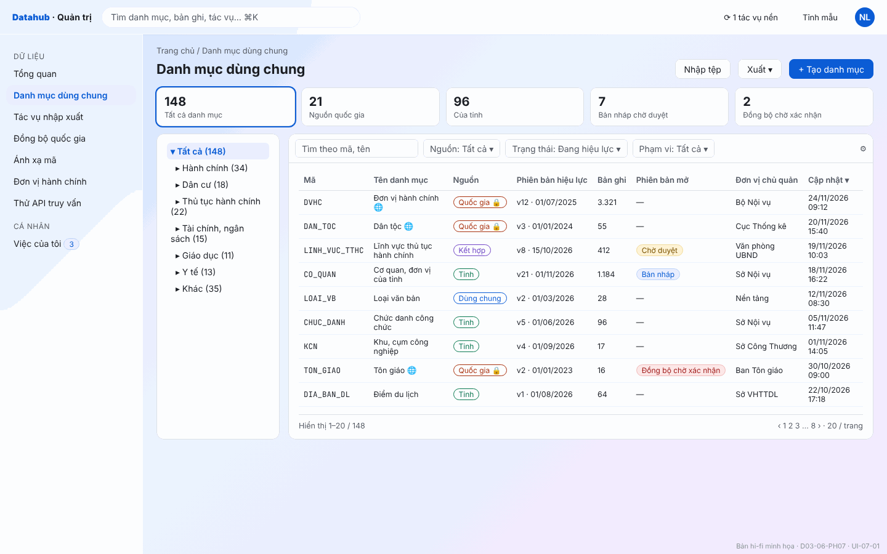

### 7.2. Bố cục

Khung dưới đây thể hiện bố cục ở độ rộng 1440 px. Cây nhóm bên trái thu gọn được thành dải 48 px; khi độ rộng nhỏ hơn 1200 px, cây tự thu gọn và mở dạng ngăn kéo khi bấm nút "Nhóm danh mục".

```text
┌──────────────────────────────────────────────────────────────────────────────────────────┐
│ [AppShell: thanh trên glass — Tenant: T68 Lâm Đồng · Tìm nhanh · Khay tác vụ · Thông báo]│
├────────┬─────────────────────────────────────────────────────────────────────────────────┤
│        │ Trang chủ › Danh mục dùng chung › Danh mục                                      │
│ Thanh  │ Danh mục                                   [⤓ Xuất ▾] [Tạo từ tệp] [+ Tạo danh mục]│
│ bên    │ ┌────────────┐┌────────────┐┌────────────┐┌────────────┐┌────────────┐            │
│ glass  │ │Tổng 38     ││Địa phương14││Quốc gia 21 ││Mở rộng 3   ││Chờ duyệt 2 │ (thẻ lọc)  │
│        │ └────────────┘└────────────┘└────────────┘└────────────┘└────────────┘            │
│        │ ┌───────────────┐ ┌─────────────────────────────────────────────────────────────┐ │
│        │ │Nhóm danh mục ⟨│ │[🔍 Tìm theo mã, tên…      ] [Nguồn ▾][Trạng thái ▾][Phạm vi ▾]│ │
│        │ │[🔍 lọc nhóm ] │ │[Bộ lọc nâng cao ⌄]                    [Đặt lại] [Tìm kiếm]   │ │
│        │ │▸ Tất cả (38)  │ ├─────────────────────────────────────────────────────────────┤ │
│        │ │▾ Hành chính   │ │ Đã chọn 2 · [Xuất] [Ngừng hiệu lực] [Bỏ chọn]  (khi có chọn)│ │
│        │ │   Địa giới (4)│ ├──┬──────────────┬───────────────┬──────┬────┬────┬────┬────┬─┤ │
│        │ │   Tổ chức (9) │ │☐ │Mã            │Tên            │Nguồn │Số  │PB  │Hiệu│Trạng│⋯│ │
│        │ │▸ Dân cư (6)   │ │  │              │               │      │bản │hiện│lực │thái │ │ │
│        │ │▸ Y tế (5)     │ │  │              │               │      │ghi │hành│từ  │     │ │ │
│        │ │▸ Giáo dục (3) │ ├──┼──────────────┼───────────────┼──────┼────┼────┼────┼────┼─┤ │
│        │ │  Chưa phân    │ │☐ │DVHC 🌐        │Đơn vị hành    │🔒QG  │3.355│v12│01/07│Đang │⋯│ │
│        │ │  nhóm (2)     │ │  │              │chính          │      │    │    │/2025│h.động│ │ │
│        │ │               │ │☐ │DM_LOAI_HO_SO │Loại hồ sơ TTHC│Đ.ph. │1.842│v3 ●│20/06│Đang │⋯│ │
│        │ │[+ Nhóm][⚙]    │ │  │ ⚠ chờ duyệt  │               │      │    │    │/2026│h.động│ │ │
│        │ └───────────────┘ ├──┴──────────────┴───────────────┴──────┴────┴────┴────┴────┴─┤ │
│        │                   │ Tổng 38 danh mục        ‹ 1 2 › [20 / trang ▾] Đến trang [ ]│ │
│        │                   └─────────────────────────────────────────────────────────────┘ │
└────────┴─────────────────────────────────────────────────────────────────────────────────┘
```

Bố cục đặt thẻ đếm ngay dưới tiêu đề vì FR-07-001 yêu cầu đếm số lượng, và thẻ đếm đồng thời là bộ lọc nhanh: bấm thẻ "Quốc gia 21" tương đương chọn bộ lọc Nguồn = Quốc gia. Cây nhóm đặt bên trái vì nhóm là chiều phân loại ổn định, ít đổi, phù hợp để duyệt; còn các bộ lọc thuộc tính đặt trên bảng để kết hợp tự do.

### 7.3. Thành phần

Bảng sau liệt kê thành phần của màn, nhãn, kiểu dữ liệu, quy tắc và nguồn dữ liệu. Cột "Nguồn" ghi API và trường trả về hoặc tham số gửi đi.

| STT | Tên | Loại (CMP / antd) | Nhãn tiếng Việt | Kiểu dữ liệu | Bắt buộc | Kiểm tra hợp lệ | Mặc định | Nguồn |
|---|---|---|---|---|---|---|---|---|
| 1 | Tiêu đề trang | `CMP-PageHeader` | Danh mục | — | — | — | — | — |
| 2 | Thẻ đếm | `CMP-KpiCard` × 5, dạng nút bật tắt | Tổng · Địa phương · Quốc gia · Mở rộng · Chờ duyệt | số nguyên | — | — | — | API-07-001 `facets.sourceType`, `facets.openVersionStatus.IN_REVIEW`, `total` |
| 3 | Cây nhóm danh mục | `CMP-Tree` trên `Tree` antd, có ô lọc | Nhóm danh mục | cây `CatalogGroup` | — | — | "Tất cả" | API-07-007 `items[].{id,code,name,parentId,catalogCount}` |
| 4 | Ô tìm kiếm | `Input.Search` trong `CMP-FilterBar` | Tìm theo mã, tên | chuỗi | Không | Cắt khoảng trắng; tối đa 100 ký tự; không phân biệt hoa thường, dấu (FR-00-020) | rỗng | tham số `q` |
| 5 | Lọc nguồn | `Select mode="multiple"` | Nguồn | `LOCAL`/`NATIONAL`/`HYBRID` | Không | — | tất cả | `sourceType` |
| 6 | Lọc trạng thái | `Select mode="multiple"` | Trạng thái | `DRAFT`/`ACTIVE`/`RETIRED` | Không | — | `DRAFT`, `ACTIVE` (ẩn ngừng hiệu lực) | `status` |
| 7 | Lọc phạm vi | `Segmented` | Phạm vi | Tất cả / Của tỉnh / Dùng chung toàn quốc | Không | — | Tất cả | `scope` (đề xuất tham số, Q07-70) |
| 8 | Lọc phân loại (nâng cao) | `Select mode="multiple"` | Phân loại dữ liệu | `PUBLIC`/`INTERNAL`/`RESTRICTED` | Không | — | tất cả | `classification` |
| 9 | Lọc đơn vị chủ quản (nâng cao) | `Select showSearch` tìm từ xa | Đơn vị chủ quản | T-ID tổ chức | Không | — | rỗng | API tổ chức PH-20; tham số `ownerOrgId` |
| 10 | Lọc có phiên bản mở (nâng cao) | `Select` | Phiên bản đang soạn | Có bản nháp / Chờ duyệt / Đã duyệt / Không có | Không | — | rỗng | `openVersionStatus` (đề xuất, Q07-70) |
| 11 | Lọc ngày cập nhật (nâng cao) | `DatePicker.RangePicker` định dạng `DD/MM/YYYY` | Cập nhật từ ngày – đến ngày | T-DATE | Không | Ngày bắt đầu ≤ ngày kết thúc; tối đa 366 ngày | rỗng | `updatedFrom`, `updatedTo` |
| 12 | Nút Đặt lại | `Button` | Đặt lại | — | — | — | — | — |
| 13 | Nút Tìm kiếm | `Button type="primary"` | Tìm kiếm | — | — | — | — | — |
| 14 | Thanh thao tác hàng loạt | `CMP-BulkActionBar` | Đã chọn {n} | — | — | — | ẩn | — |
| 15 | Bảng danh mục | `CMP-DataTable` | — | `CatalogSummary[]` | — | — | — | API-07-001 `items[]` |
| 16 | Phân trang | `Pagination` trong `CMP-DataTable` | Tổng {total} danh mục | — | — | Trang 1…ceil(total/size) | 20 / trang | `page`, `size` |
| 17 | Nút Xuất | `Dropdown.Button` | Xuất ▾ (Excel danh sách, CSV danh sách) | — | — | — | — | Xuất danh sách danh mục theo bộ lọc phía máy chủ (Q07-70) |
| 18 | Nút Tạo từ tệp | `Button` | Tạo từ tệp | — | — | — | — | điều hướng `/du-lieu/danh-muc/nhap?che-do=tao-danh-muc` |
| 19 | Nút Tạo danh mục | `Button type="primary"` | Tạo danh mục | — | — | — | — | điều hướng `/du-lieu/danh-muc/moi?nhom={mã nhóm đang chọn}` |

: Thành phần: STT, Tên

Cột của bảng danh mục được đặc tả riêng vì đây là nơi người dùng nhìn nhiều nhất.

| Cột | Trường | Hiển thị | Sắp xếp | Rộng | Ghi chú |
|---|---|---|---|---|---|
| Chọn | — | `Checkbox` | — | 40 px | Chỉ hiện khi người dùng có quyền thao tác hàng loạt |
| Mã | `code` | Chữ đơn cách `font-mono`, là liên kết mở chi tiết; biểu tượng 🌐 nếu COMMON, 🔒 nếu NATIONAL; dòng phụ cảnh báo "Chờ duyệt", "Chờ xác nhận đồng bộ" nếu có | Có | 200 px, cố định trái | Liên kết dạng `<a href>` để mở tab mới bằng Ctrl+bấm |
| Tên | `name` | Chữ thường, cắt `…` kèm tooltip (CRUD-TBL-07); dòng phụ nhóm | Có | linh hoạt, tối thiểu 220 px | |
| Đơn vị chủ quản | `ownerOrgName` | Chữ | Có | 180 px | API trả tên đã phân giải (Q07-70) |
| Nguồn | `sourceType` | `CMP-StatusTag` | Không | 110 px | |
| Phân loại | `classification` | `CMP-StatusTag` | Không | 100 px | Ẩn mặc định, bật ở "Cấu hình cột" |
| Số bản ghi | `currentItemCount` | Số căn phải | Có | 100 px | Số bản ghi của phiên bản hiện hành |
| Phiên bản hiện hành | `currentVersionNo` | "v{n}"; chấm màu cạnh số nếu có phiên bản mở, tooltip "Có bản nháp v{n+1}" | Không | 100 px | |
| Hiệu lực từ | `currentEffectiveFrom` | `dd/MM/yyyy` | Có | 110 px | |
| Trạng thái | `status` | `CMP-StatusTag` | Có | 130 px | |
| Cập nhật | `updatedAt` | `dd/MM/yyyy HH:mm` | Có (mặc định giảm dần) | 140 px | Ẩn mặc định |
| Thao tác | — | Nút biểu tượng "Xem", menu "⋯" | — | 88 px, cố định phải (CRUD-TBL-11) | |

: Thành phần: Cột, Trường

> **Câu hỏi mở Q07-70:** Giao diện PH-07 cần một số tham số và trường API chưa có trong danh sách API-07 của khung chung. Toàn bộ đề nghị được gom ở Phụ lục B (mã B-01, B-02…) để luồng API xử lý một lần; riêng màn này cần B-01 (tham số lọc `scope`, `ownerOrgId`, `openVersionStatus`, `updatedFrom/To` của API-07-001), B-02 (trường tóm tắt `ownerOrgName`, `currentItemCount`, `currentVersionNo`, `currentEffectiveFrom`, `openVersion`, `pendingSyncRun`, khối `facets`) và B-03 (xuất danh sách danh mục ra xlsx, csv).

### 7.4. Hành động

Bảng hành động liệt kê từng nút, điều kiện hiển thị, API, yêu cầu xác nhận và kết quả. Điều kiện "nguồn ghi được" nghĩa là danh mục không phải COMMON (trừ khi tenant hiện tại là PLATFORM) và không phải NATIONAL.

| Hành động | Vị trí | Hiện khi (quyền, trạng thái) | API | Xác nhận, lý do | Kết quả | Thông báo |
|---|---|---|---|---|---|---|
| Xem | Cột thao tác, bấm mã | `PERM-07-read` | — | Không | Mở UI-07-02 tab Tổng quan | — |
| Tạo danh mục | Đầu trang | `PERM-07-create` | — | Không | Mở UI-07-03 | — |
| Tạo từ tệp | Đầu trang | `PERM-07-create` | — | Không | Mở UI-07-06 chế độ tạo danh mục | — |
| Xuất danh sách | Đầu trang | `PERM-07-export` | API-07-001 với `Accept` xlsx/csv | Không | Tải tệp theo bộ lọc hiện tại (FR-00-030) | "Đã xuất {n} danh mục." |
| Sửa bản ghi | Menu "⋯" | `PERM-07-update`, nguồn ghi được, có phiên bản `DRAFT` (`allowedActions` có `EDIT_ITEMS`) | — | Không | Mở UI-07-05 | — |
| Tạo bản nháp | Menu "⋯" | `PERM-07-update`, nguồn ghi được, `status = ACTIVE`, không có phiên bản mở | API-07-012 | Không | Tạo bản nháp, mở UI-07-05 | "Đã tạo bản nháp phiên bản {n}." |
| Xuất dữ liệu danh mục | Menu "⋯" | `PERM-07-export`, có phiên bản phát hành | API-07-038 | Hộp chọn định dạng (Excel, CSV, JSON) | Tải trực tiếp hoặc chạy nền | Theo mục 14 UI-07-08 |
| Xóa | Menu "⋯", màu đỏ | `PERM-07-update`, nguồn ghi được, `status = DRAFT` | API-07-005 | `CMP-ConfirmDialog` nguy hiểm: "Xóa danh mục "{name}" ({code})? Danh mục chưa từng phát hành nên sẽ được xóa mềm và quản trị có thể khôi phục." | Dòng biến mất; nếu trang rỗng thì lùi một trang (CRUD-D-08) | "Đã xóa danh mục "{name}"." |
| Ngừng hiệu lực | Menu "⋯", màu đỏ; thanh hàng loạt | `PERM-07-retire` (đề xuất D02-08), `status = ACTIVE`, nguồn ghi được | API-07-006 | `CMP-ConfirmDialog` có ô "Lý do" bắt buộc 10–500 ký tự và ô "Ngày ngừng hiệu lực" (mặc định hôm nay) | Trạng thái đổi `RETIRED` | "Đã ngừng hiệu lực danh mục "{name}"." Lỗi ERR-07-032 mở hộp danh sách tham chiếu |
| Thêm nhóm | Chân cây | `PERM-07-create` | API-07-008 | Hộp thoại: Mã (T-CODE), Tên (≤ 255), Nhóm cha, Thứ tự, Mô tả | Cây làm mới | "Đã thêm nhóm "{name}"." |
| Sửa nhóm | Menu chuột phải hoặc nút "⋯" trên nút cây | `PERM-07-update` | API-07-009 | Hộp thoại như trên, có `If-Match` | Cây làm mới | "Đã lưu nhóm." |
| Xóa nhóm | Như trên | `PERM-07-update`, `catalogCount = 0` | API-07-010 | Xác nhận | Cây làm mới | ERR-07-037 nếu còn danh mục |
| Kéo danh mục vào nhóm | Kéo dòng bảng thả vào nút cây | `PERM-07-update`, nguồn ghi được | API-07-004 `groupId` | Không (có Hoàn tác 5 giây) | Danh mục chuyển nhóm | "Đã chuyển "{name}" sang nhóm "{group}". [Hoàn tác]" |

: Hành động

Thao tác hàng loạt chỉ gồm Xuất và Ngừng hiệu lực; hệ thống gọi API tuần tự từng danh mục và trả kết quả theo từng dòng (CRUD-SEL-08, CRUD-D-09) trong một hộp thoại tổng hợp "Thành công {a}, thất bại {b}" kèm lý do từng dòng thất bại. Lựa chọn bị xóa khi đổi bộ lọc và giữ khi đổi trang (khuyến nghị CRUD-SEL-06).

### 7.5. Hành vi bảng

Bảng phân trang phía máy chủ, mặc định 20 dòng, chọn 10/20/50/100 (FR-00-021). Sắp xếp một cột tại một thời điểm, mặc định "Cập nhật giảm dần" (CRUD-TBL-03); chiều sắp xếp gửi dạng `sort=updatedAt,desc`. Mọi điều kiện lọc, sắp xếp, trang được ghi vào URL bằng `useSearchParams` thông qua hook `useUrlState` (mục 21.5); đổi bộ lọc đưa về trang 1 (CRUD-FLT-06). Bấm nút cây nhóm đặt `group={id}` và cũng đưa về trang 1; chọn "Tất cả" xóa tham số. Ô tìm kiếm gửi khi bấm Enter hoặc nút Tìm kiếm, không gửi theo từng phím, để tránh tải liên tục với 1.000 danh mục (CRUD-FLT-03). Nút "Cấu hình cột" cho ẩn hiện, đổi thứ tự cột, lưu trong `localStorage`. Dòng không có ảo hóa vì tối đa 100 dòng một trang.

Phím tắt trên màn: `/` đưa focus vào ô tìm kiếm; `N` mở "Tạo danh mục" (khi có quyền); `[` thu gọn hoặc mở cây nhóm. Phím tắt chỉ hoạt động khi focus không nằm trong ô nhập và được liệt kê trong hộp "Phím tắt" (bấm `?`).

### 7.6. Trạng thái màn

Ngoài các trạng thái chung ở mục 6, màn có hai điểm riêng. Thứ nhất, tenant chưa có danh mục riêng nào nhưng vẫn thấy danh mục dùng chung toàn quốc, nên trạng thái rỗng chỉ xuất hiện khi lọc phạm vi "Của tỉnh"; khi đó câu rỗng là "Tỉnh chưa có danh mục riêng. Các danh mục dùng chung toàn quốc vẫn sẵn sàng sử dụng." kèm nút "Xem danh mục dùng chung" và nút "Tạo danh mục". Thứ hai, nếu có nguồn đồng bộ quốc gia quá 7 ngày không thành công (tham số `07.rdm.sync-stale-alert-days`), người có `PERM-07-sync` thấy `Alert` cảnh báo đỏ ở đầu trang "Danh mục "{name}" chưa đồng bộ được với nguồn quốc gia {days} ngày." kèm liên kết tới UI-07-09, như mockup hiện có.

### 7.7. Thông điệp riêng

| Tình huống | Mã | Câu |
|---|---|---|
| Xóa danh mục đã phát hành (danh sách cũ) | ERR-07-004 | "Danh mục đã phát hành không xóa được. Dùng "Ngừng hiệu lực"." |
| Ngừng hiệu lực danh mục đang bị tham chiếu | ERR-07-032 | Theo bảng 5.3, hộp thoại liệt kê danh mục tham chiếu có liên kết |
| Xóa nhóm còn danh mục | ERR-07-037 | Theo bảng 5.3 |
| Tạo bản nháp khi đã có phiên bản mở | ERR-07-005 | Theo bảng 5.3, nút mở phiên bản đang mở |
| Thao tác trên danh mục chỉ đọc | ERR-07-003 | Theo bảng 5.3 |

: Thông điệp riêng

### 7.8. Khả năng truy cập

Thứ tự focus: liên kết "Bỏ qua tới nội dung" của `CMP-AppShell` → nút hành động đầu trang → thẻ đếm → cây nhóm → ô tìm kiếm và bộ lọc → bảng → phân trang. Thẻ đếm là `button` có `aria-pressed` phản ánh trạng thái lọc và nhãn đầy đủ "Lọc danh mục nguồn quốc gia, 21 danh mục". Cây nhóm theo mẫu `tree` của WAI-ARIA (mục 20.2), có `aria-label="Nhóm danh mục"`. Bảng có `aria-label="Danh sách danh mục"` và `aria-rowcount` bằng tổng số danh mục; tiêu đề cột sắp xếp được có `aria-sort`. Kết quả tìm kiếm được thông báo qua vùng `role="status"`: "Tìm thấy 12 danh mục." Biểu tượng 🌐 và 🔒 có văn bản thay thế "Dùng chung toàn quốc", "Nguồn quốc gia, chỉ đọc". Kéo thả danh mục vào nhóm có phương án bàn phím: menu "⋯" có mục "Chuyển nhóm…" mở hộp chọn nhóm.

## 8. Đặc tả UI-07-02 · Chi tiết danh mục

### 8.1. Thông tin chung

::: dac-ta
**Mục đích.** Xem toàn bộ thông tin một danh mục: thông tin chung, bản ghi (bảng, cây), thuộc tính, phiên bản, ánh xạ, đồng bộ, quyền khai thác, lịch sử; điểm xuất phát mọi thao tác soạn thảo.

**Người dùng, quyền.** Mọi vai trò có `PERM-07-read`; tab "Quyền khai thác" với người có `PERM-07-grant`; tab "Lịch sử" với mọi người có quyền đọc (FR-00-043), đặc biệt `ROLE-AUDITOR`.

**FR, UC hiện thực.** FR-07-002, 004, 009, 011, 017, 018, 019, 024, 029, 035, 041, 047, 048, 050, 052; UC-07-02, 06, 07, 08, 14, 17.

**Đường dẫn.** `/du-lieu/danh-muc/:ma/:tab`.

**Mẫu bố cục.** PTN-02 Chi tiết (D03-06-00 §4.5).

**API.** API-07-003, 004, 006, 011, 012, 013, 015, 022, 026, 038, 044, 045, 050, 055, 058, 067, 071, 072, 075.
:::

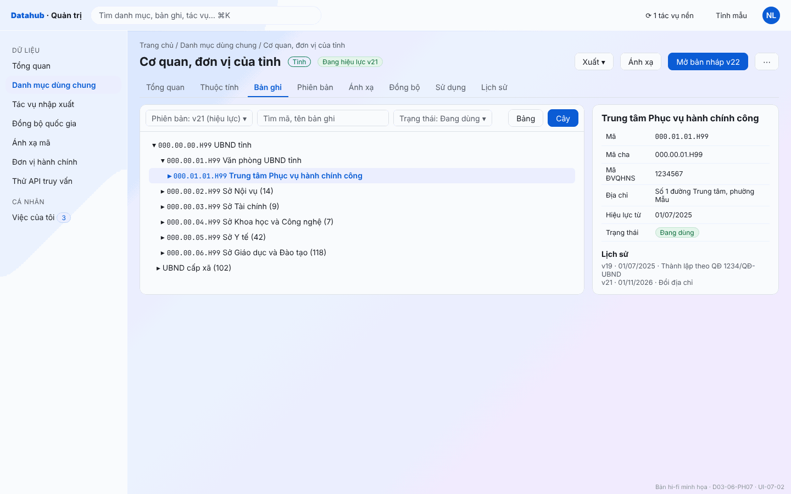

### 8.2. Bố cục

```text
┌──────────────────────────────────────────────────────────────────────────────────────────┐
│ Trang chủ › Danh mục dùng chung › Danh mục › Loại hồ sơ thủ tục hành chính                 │
│ [←] Loại hồ sơ thủ tục hành chính  DM_LOAI_HO_SO  [Đang hoạt động][Địa phương][Công khai] │
│                         [Xuất ▾] [Nhập tệp] [Sửa bản ghi (v4 nháp)] [⋯ Sửa thông tin,     │
│                                                        Sửa lược đồ, Ngừng hiệu lực]     │
│ ┌────────────────────────────────────────────────────────────────────────────────────────┐│
│ │ Hiện hành: v3 · hiệu lực từ 20/06/2026 · 1.842 bản ghi · Chủ quản: Văn phòng UBND tỉnh ││
│ │ Phiên bản mở: v4 [Bản nháp] sửa lần cuối 21/11/2026 10:12 bởi Nguyễn Văn A [Mở] [So sánh]││
│ └────────────────────────────────────────────────────────────────────────────────────────┘│
│ [Tổng quan][Bản ghi][Thuộc tính][Phiên bản 4][Ánh xạ 2][Đồng bộ][Quyền khai thác][Lịch sử]│
│ ┌────────────────────────────────────────────────────────────────────────────────────────┐│
│ │ Tab Bản ghi: Phiên bản [v3 đang hiệu lực ▾]  [Bảng | Cây]  [🔍 Tìm mã, tên…] [Trạng thái▾]││
│ │ ┌────────────────────────┬─────────────────────────────────────────────────────────────┐││
│ │ │ (chế độ Cây)           │ Chi tiết bản ghi đang chọn                                   │││
│ │ │ ▾ 01 Cấp tỉnh          │ Mã: 01.02   Tên: Hồ sơ cấp phép xây dựng                     │││
│ │ │   ▸ 01.01 …            │ Mã cha: 01  Cấp: Nhóm  Trạng thái: Đang dùng                 │││
│ │ │   ▸ 01.02 … ◀ chọn     │ Thuộc tính: linh_vuc = XAY_DUNG; thoi_han_xu_ly = 15         │││
│ │ │ ▸ 02 Cấp xã            │ Dòng lịch sử: v1 tạo → v2 đổi tên → v3 không đổi [Xem đầy đủ]│││
│ │ └────────────────────────┴─────────────────────────────────────────────────────────────┘││
│ └────────────────────────────────────────────────────────────────────────────────────────┘│
└──────────────────────────────────────────────────────────────────────────────────────────┘
```

Dải thông tin tóm tắt luôn hiện ở mọi tab vì hai câu hỏi người dùng hay hỏi nhất là "phiên bản nào đang hiệu lực" và "có ai đang soạn phiên bản mới không". Nút hành động chính trên đầu thay đổi theo ngữ cảnh: nếu có bản nháp thì là "Sửa bản ghi (v{n} nháp)"; nếu không có phiên bản mở thì là "Tạo bản nháp"; nếu phiên bản mở đang chờ duyệt và người dùng có quyền duyệt thì là "Xem và duyệt".

### 8.3. Đầu trang và dải tóm tắt

| STT | Tên | Loại | Nhãn | Kiểu | Nguồn |
|---|---|---|---|---|---|
| 1 | Tên và mã | `CMP-PageHeader` `title`, `subTitle` | {name}, {code} | T-NAME, T-CODE | API-07-003 `name`, `code` |
| 2 | Nhãn trạng thái | `CMP-StatusTag` × 3–4 | Trạng thái, nguồn, phân loại, phạm vi | enum | `status`, `sourceType`, `classification`, `tenantId` |
| 3 | Phiên bản hiện hành | `Descriptions` | Hiện hành | "v{n} · hiệu lực từ {dd/MM/yyyy} · {count} bản ghi" | `currentVersion.{versionNo,effectiveFrom,itemCount}` |
| 4 | Chủ quản | `Descriptions` | Chủ quản | tên tổ chức | `ownerOrgName` |
| 5 | Phiên bản mở | `Descriptions` + `CMP-StatusTag` + nút | Phiên bản mở | "v{n} [trạng thái] sửa lần cuối {ts} bởi {user}" | `openVersion.{versionNo,status,updatedAt,updatedByName}` |
| 6 | Danh mục gốc (HYBRID) | liên kết | Mở rộng từ | "{code} · {name}" (dùng chung toàn quốc) | `extendsCatalog.{code,name}` |
| 7 | Thông báo chỉ đọc | `Alert type="info"` | — | câu theo mục 2.5 | tính từ `tenantId`, `sourceType` |

: Đầu trang và dải tóm tắt

### 8.4. Hành động đầu trang

| Hành động | Hiện khi | API | Xác nhận | Kết quả, thông báo |
|---|---|---|---|---|
| Tạo bản nháp | `PERM-07-update`, nguồn ghi được, `ACTIVE`, không có phiên bản mở | API-07-012 (`Idempotency-Key`) | Không | Mở UI-07-05 bản nháp mới; "Đã tạo bản nháp phiên bản {n} từ phiên bản {n-1}." |
| Sửa bản ghi (v{n} nháp) | `PERM-07-update`, nguồn ghi được, phiên bản mở là `DRAFT` | — | Không | Mở UI-07-05 |
| Sửa lược đồ | Như trên | — | Không | Mở UI-07-04 |
| Nhập tệp | `PERM-07-update`, nguồn ghi được, phiên bản mở `DRAFT` | — | Không | Mở UI-07-06 |
| Xem và duyệt | `PERM-07-publish`, phiên bản mở `IN_REVIEW` hoặc `APPROVED` | — | Không | Mở UI-07-07 với `against=current` |
| So sánh | Có phiên bản mở | — | Không | Mở UI-07-07 |
| Hủy bản nháp | `PERM-07-update`, phiên bản mở `DRAFT` | API-07-015 với `If-Match` | `CMP-ConfirmDialog` nguy hiểm: "Hủy bản nháp phiên bản {n}? Toàn bộ thay đổi trong bản nháp sẽ bị bỏ, không khôi phục được." Ô lý do tùy chọn | "Đã hủy bản nháp phiên bản {n}." |
| Sửa thông tin | `PERM-07-update`, nguồn ghi được, không `RETIRED` | — | Không | Mở UI-07-03 chế độ sửa |
| Xuất | `PERM-07-export`, có phiên bản phát hành | API-07-038 | Hộp chọn: phiên bản, định dạng (Excel, CSV, JSON), gồm bản ghi ngừng dùng | Trực tiếp hoặc chạy nền |
| Tải ảnh chụp | `PERM-07-export`, phiên bản phát hành | API-07-049 | Không | Trình duyệt tải theo URL ký sẵn |
| Ngừng hiệu lực | `PERM-07-retire`, `ACTIVE` | API-07-006 | Như UI-07-01 | |
| Tạo danh mục mở rộng | Danh mục COMMON hoặc NATIONAL, người dùng có `PERM-07-create` | — | Không | Mở UI-07-03 với `source=HYBRID&extends={code}` |

: Hành động đầu trang

### 8.5. Tab Tổng quan

Tab hiển thị `Descriptions` hai cột các trường của API-07-003: Mã, Tên, Mô tả, Nhóm, Đơn vị chủ quản, Nguồn, Phân loại dữ liệu, Phân cấp (Có/Không, số cấp tối đa, tên cấp), Dải mã địa phương (HYBRID), Danh mục gốc (HYBRID), Yêu cầu duyệt khi phát hành, Mã hệ cũ (`legacyRef`, chỉ hiện khi có), và nhóm "Thông tin hệ thống": Người tạo, Ngày tạo, Người cập nhật, Ngày cập nhật (CRUD-R-03, R-04). Dưới cùng là thẻ "Tình hình sử dụng" gồm: số phiên bản đã phát hành, ngày phát hành gần nhất, số hệ thống mã có ánh xạ, tỷ lệ phủ ánh xạ thấp nhất, và với danh mục NATIONAL là lần đồng bộ cuối.

> **Câu hỏi mở Q07-71:** SRS cũ yêu cầu bảng "đánh giá tác động" (hệ thống nào đang dùng danh mục, số lượt tra cứu 30 ngày). Số liệu này có ở chỉ số `rdm_lookup_total{catalog}` (NFR-07-014) nhưng chưa có API trả theo danh mục và theo HTTT. Đề nghị luồng API bổ sung `GET /catalogs/{c}/usage?days=30` (hoặc PH-16 cung cấp) để thẻ "Tình hình sử dụng" và màn so sánh UI-07-07 hiển thị tác động.

### 8.6. Tab Bản ghi

Tab bản ghi phục vụ xem và tìm, không sửa (sửa ở UI-07-05). Thành phần như sau.

| STT | Tên | Loại | Nhãn | Kiểu | Mặc định | Nguồn |
|---|---|---|---|---|---|---|
| 1 | Chọn phiên bản | `Select` | Phiên bản | số phiên bản | phiên bản hiện hành; tham số `v` | API-07-011 `items[]` gồm nhãn "v3 · Đang hiệu lực", "v4 · Bản nháp" |
| 2 | Chế độ xem | `Segmented` | Bảng / Cây | `table`/`tree` | `tree` nếu `isHierarchical`, ngược lại `table` | — |
| 3 | Tìm | `Input.Search` | Tìm mã, tên | chuỗi ≤ 100 | rỗng | API-07-026 `q` (không dấu) |
| 4 | Lọc trạng thái | `Select multiple` | Trạng thái bản ghi | `ACTIVE`/`DEPRECATED` | `ACTIVE` | `status` |
| 5 | Lọc cấp | `Select` | Cấp | tên cấp từ `levelNames` | tất cả | `depth` |
| 6 | Bảng bản ghi | `CMP-DataTable` ảo hóa | — | `CatalogItem[]` | — | API-07-026 |
| 7 | Cây bản ghi | `CMP-Tree` nạp lười | — | nút cây | mở cấp 1 | API-07-044 (phiên bản phát hành) hoặc API-07-026 `parentCode` (bản nháp) |
| 8 | Ngăn chi tiết bản ghi | `CMP-Drawer` (chế độ bảng) hoặc khung phải (chế độ cây) | Chi tiết bản ghi | — | — | dòng đã chọn + API-07-050 |

: Tab Bản ghi

Cột bảng: Mã (đơn cách, cố định trái), Tên, Mã cha, Cấp (`levelName`), Thứ tự, Trạng thái, Mã thay thế (danh sách liên kết, chỉ với `DEPRECATED`), Hiệu lực từ, Hiệu lực đến, sau đó một cột cho mỗi thuộc tính `ACTIVE` theo `sortOrder` (thuộc tính `HIDDEN` không hiện), giá trị hiển thị theo kiểu (BOOLEAN thành "Có"/"Không", DATE theo `dd/MM/yyyy`, CATALOG_REF thành "{mã} · {tên}" nếu API trả nhãn). Phân trang máy chủ, mặc định 50 dòng, chọn 20/50/100/200 (giới hạn `size` ≤ 200 của API quản trị). Khi người dùng chọn 200 dòng hoặc khi số cột thuộc tính lớn hơn 12, bảng bật ảo hóa cột ngang. Bản ghi kế thừa trong danh mục HYBRID có biểu tượng mắt xích và chữ màu phụ, bộ lọc thêm "Nguồn bản ghi: Tất cả / Kế thừa / Bổ sung địa phương".

Chế độ cây dùng `CMP-Tree` với nạp lười từng nhánh: mở một nút gọi API-07-044 `root={code}&depth=1&at` với phiên bản phát hành, hoặc API-07-026 `parentCode={code}&size=200` với bản nháp. Nút có hơn 200 con hiện nút "Tải thêm {n} bản ghi" ở cuối nhánh. Ô tìm kiếm ở chế độ cây gọi API-07-045 rồi mở đường dẫn tới bản ghi tìm được bằng `path` (danh sách mã tổ tiên), cuộn tới và đánh dấu.

Ngăn chi tiết bản ghi hiện toàn bộ trường, thuộc tính, và khối "Dòng lịch sử" (FR-07-047) từ API-07-050 dạng `Timeline` dọc: mỗi mục là một phiên bản có thay đổi, ghi loại thay đổi, ngày hiệu lực và liên kết tới bản ghi kế thừa hoặc thay thế.

Màn này cần đề nghị B-04 ở Phụ lục B: API-07-026 hỗ trợ lọc `parentCode`, `depth`, `isLocalExtension` và trả `childCount`, để dựng cây trên bản nháp (API-07-044 chỉ phục vụ phiên bản hiệu lực theo `at`).

### 8.7. Tab Thuộc tính

Bảng chỉ đọc các thuộc tính của phiên bản đang chọn (API-07-022): Thứ tự, Mã, Nhãn, Kiểu dữ liệu (nhãn tiếng Việt theo bảng ở mục 11.5), Bắt buộc, Duy nhất, Cho phép truy vấn, Cho phép tìm kiếm, Ràng buộc (tóm tắt "≤ 255 ký tự", "0–100", "Danh sách 5 giá trị", "Tham chiếu DM_DAN_TOC"), Trạng thái (Hiển thị/Ẩn). Có nút "Sửa lược đồ" dẫn tới UI-07-04 khi có bản nháp và đủ quyền, và nút "Tải JSON Schema" gọi API-07-048 để kỹ sư tích hợp lấy lược đồ.

### 8.8. Tab Phiên bản

Tab liệt kê phiên bản (API-07-011) theo thứ tự số phiên bản giảm dần, dưới dạng bảng kèm dải thời gian hiệu lực trực quan phía trên. Dải thời gian (`CMP-VersionTimeline`) là một trục ngang theo ngày, mỗi phiên bản đã phát hành là một đoạn `[effectiveFrom, effectiveTo)`, đoạn đang hiệu lực tô đậm; bấm vào đoạn chọn dòng tương ứng trong bảng. Cột bảng: Phiên bản, Trạng thái, Hiệu lực (nhãn tính), Hiệu lực từ, Hiệu lực đến, Nguồn tạo (`origin`: Thủ công, Nhập tệp, API, Đồng bộ, Di trú), Số bản ghi, Thay đổi (+thêm / ~sửa / −ngừng, cờ phá vỡ), Căn cứ pháp lý, Người phát hành, Ngày phát hành, Thao tác (Xem bản ghi, So sánh với phiên bản trước, Xuất, Tải ảnh chụp). Hai phiên bản bất kỳ có thể chọn bằng ô chọn rồi bấm "So sánh hai phiên bản đã chọn" để mở UI-07-07 với `v` và `against`.

### 8.9. Tab Ánh xạ

Tab tóm tắt ánh xạ của danh mục với từng hệ thống mã (API-07-067 nhóm theo `codeSystem`, API-07-071 độ phủ): bảng gồm Hệ thống mã, Chủ sở hữu, Số ánh xạ, Số ánh xạ tạm thời, Độ phủ (thanh `Progress` kèm phần trăm), Cập nhật cuối, và nút "Mở bảng ánh xạ" dẫn tới UI-07-10 `/du-lieu/danh-muc/anh-xa/{csCode}?catalog={code}`. Nút "Thêm ánh xạ với hệ thống mã khác" hiện với `PERM-07-mapping`.

### 8.10. Tab Đồng bộ

Tab chỉ hiện với danh mục `NATIONAL` hoặc `HYBRID` mở rộng từ danh mục quốc gia. Nội dung: thẻ cấu hình nguồn (API-07-055 lọc theo danh mục: nhà cung cấp, mã danh mục phía quốc gia, lịch chạy hiển thị bằng câu tiếng Việt như "Hằng ngày lúc 01:00", tự áp dụng thay đổi không phá vỡ, bật/tắt, phiên bản quốc gia gần nhất, lần thành công gần nhất), và bảng 10 lần đồng bộ gần nhất (API-07-059). Nút "Đồng bộ ngay" (API-07-058) và "Sửa cấu hình nguồn" hiện với `PERM-07-sync`; mọi chi tiết khác mở ở UI-07-09.

### 8.11. Tab Quyền khai thác

Tab chỉ hiện khi `classification = RESTRICTED` (FR-07-052). Bảng liệt kê HTTT được cấp quyền (API-07-075 GET): Hệ thống thông tin (tên, mã từ PH-01), Phạm vi (`rdm.read`, `rdm.query`), Người cấp, Ngày cấp, Hết hạn. Người có `PERM-07-grant` (đề xuất bổ sung D02-08) thấy nút "Cấp quyền" mở `CMP-Drawer` với: chọn HTTT (`Select` tìm từ xa danh sách HTTT thành viên PH-01, bắt buộc), phạm vi (`Checkbox.Group`, ít nhất một), ngày hết hạn (`DatePicker`, tùy chọn, phải sau hôm nay), lý do (bắt buộc, 10–500 ký tự). Lưu bằng API-07-075 PUT toàn bộ danh sách với `If-Match`. Thu hồi một quyền là xóa khỏi danh sách và PUT lại, có xác nhận "Thu hồi quyền khai thác của {HTTT}? Các lượt gọi tiếp theo của hệ thống này sẽ bị từ chối (ERR-07-030)."

### 8.12. Tab Lịch sử

Tab đáp ứng FR-00-043 và FR-07-050, đọc API-07-072. Bộ lọc: khoảng thời gian (mặc định 90 ngày), loại hành động (tạo, sửa, trình, duyệt, từ chối, phát hành, hủy, nhập, xuất, ngừng hiệu lực), người thực hiện. Bảng: Thời điểm (`dd/MM/yyyy HH:mm:ss`), Người thực hiện, Hành động, Đối tượng (danh mục, phiên bản v{n}, bản ghi {mã}, thuộc tính {mã}), Kết quả, Lý do, Mã truy vết. Bấm dòng mở ngăn kéo với `CMP-DiffViewer` hiển thị giá trị trước và sau (đã che theo FR-00-041). Tab chỉ đọc với mọi vai trò, không có nút xóa hay sửa (FR-00-042).

### 8.13. Trạng thái màn và thông điệp riêng

Khi mã danh mục trong URL không tồn tại, vùng nội dung hiện trang 404 với ERR-07-001. Khi danh mục `RETIRED`, `Alert` loại cảnh báo ở đầu trang: "Danh mục đã ngừng hiệu lực từ {dd/MM/yyyy}. Dữ liệu chỉ còn để tra cứu lịch sử." và ẩn mọi hành động sửa. Tab không áp dụng (ví dụ "Đồng bộ" với danh mục LOCAL) không được hiển thị; truy cập trực tiếp URL của tab đó chuyển hướng về tab Tổng quan. Số đếm trên tab ("Phiên bản 4", "Ánh xạ 2") lấy từ API-07-003 (`versionCount`, `mappingSystemCount`) để không phải gọi API của mọi tab khi mở trang.

### 8.14. Khả năng truy cập

Thanh tab dùng `Tabs` của antd với vai trò `tablist`; phím mũi tên trái, phải chuyển tab, tab được kích hoạt thủ công (Enter) để không gọi API khi người dùng chỉ lướt qua. Mỗi tab đổi URL nên trình đọc màn hình nhận thông báo đổi tiêu đề trang `document.title = "{tab} · {tên danh mục} · Datahub"`. Cây bản ghi theo mẫu tree WAI-ARIA (mục 20.2). Dải thời gian phiên bản có bảng thay thế (chính bảng phiên bản bên dưới) nên đoạn trên trục chỉ là `aria-hidden` cho trình đọc màn hình, tránh lặp thông tin.

## 9. Đặc tả UI-07-03 · Tạo, sửa thông tin danh mục

### 9.1. Thông tin chung

::: dac-ta
**Mục đích.** Tạo danh mục mới cùng bản nháp phiên bản 1 và các thuộc tính ban đầu (chế độ tạo); sửa thông tin danh mục (chế độ sửa).

**Người dùng, quyền.** `ROLE-DATA_STEWARD` (○ tổ chức mình), `ROLE-TENANT_ADMIN`, `ROLE-PLATFORM_ADMIN` (COMMON).

**FR, UC hiện thực.** FR-07-003, 004, 005, 007, 008, 010; UC-07-01, UC-07-17.

**Đường dẫn.** `/du-lieu/danh-muc/moi` (tạo), `/du-lieu/danh-muc/:ma/sua` (sửa).

**Mẫu bố cục.** PTN-05 Wizard (tạo); PTN-03 Biểu mẫu trang (sửa).

**API.** API-07-002, 003, 004, 007, API-07-001 (chọn danh mục gốc, danh mục tham chiếu), API tổ chức PH-20.
:::

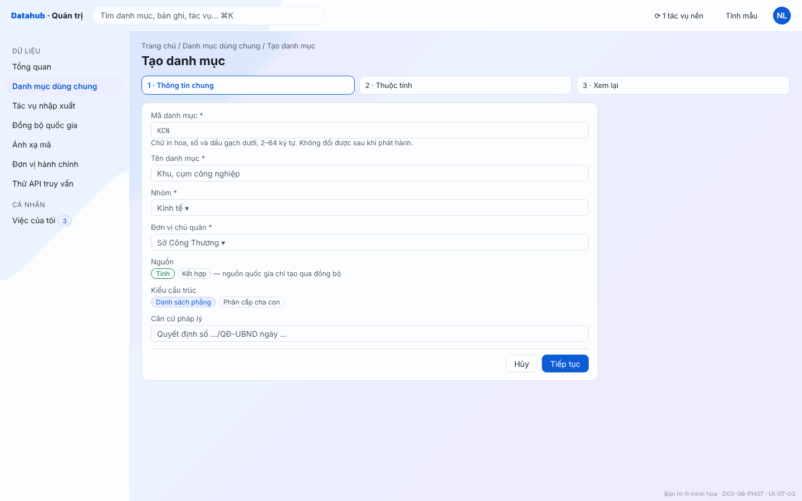

Chế độ tạo dùng trình hướng dẫn ba bước vì việc tạo một danh mục gồm ba nhóm quyết định có thứ tự phụ thuộc: thông tin chung, rồi nguồn và cấu trúc phân cấp (quyết định cột `MA_CHA` và dải mã), rồi lược đồ thuộc tính (phụ thuộc phân cấp). Chế độ sửa không dùng trình hướng dẫn vì người sửa thường chỉ đổi một trường; biểu mẫu một trang với các khu tương ứng ba bước giúp sửa nhanh hơn. Hệ cũ Aita chỉ có tên danh mục và tên thuộc tính; các trường mới (nguồn, phân loại, phân cấp, chính sách duyệt) đều có giá trị mặc định hợp lý để người dùng quen hệ cũ vẫn tạo được nhanh.

### 9.2. Bố cục chế độ tạo

```text
┌──────────────────────────────────────────────────────────────────────────────────────┐
│ Trang chủ › Danh mục dùng chung › Danh mục › Tạo danh mục                               │
│ [←] Tạo danh mục                                                                      │
│ ( 1 Thông tin chung ) ─── ( 2 Nguồn và phân cấp ) ─── ( 3 Thuộc tính và xác nhận )    │
│ ┌──────────────────────────────────────────────────────────────┐┌───────────────────┐│
│ │ Mã danh mục *        [DM_LINH_VUC_TTHC        ] ✓ chưa dùng  ││ Gợi ý              ││
│ │ Tên danh mục *       [Lĩnh vực thủ tục hành chính       ] 31/255││ Mã chỉ gồm chữ hoa,││
│ │ Mô tả                [                                   ]   ││ số, _ . - ; không  ││
│ │ Nhóm danh mục *      [Hành chính › Thủ tục           ▾]      ││ đổi được sau khi   ││
│ │ Đơn vị chủ quản *    [Văn phòng UBND tỉnh            ▾]      ││ phát hành.         ││
│ │ Phân loại dữ liệu *  (•) Công khai ( ) Nội bộ ( ) Hạn chế    ││                    ││
│ │ Yêu cầu duyệt khi phát hành  [● Bật]                         ││                    ││
│ └──────────────────────────────────────────────────────────────┘└───────────────────┘│
│ ════════════════════ chân dính (glass toolbar) ═════════════════════════════════════ │
│ [Hủy]                                               [Quay lại] [Tiếp tục →]           │
└──────────────────────────────────────────────────────────────────────────────────────┘
```

Khung "Gợi ý" bên phải thay đổi theo trường đang có focus, giải thích ý nghĩa và hệ quả của trường. Lý do: các trường như "Phân loại dữ liệu" và "Dải mã địa phương" có hệ quả pháp lý và kỹ thuật mà người dùng nghiệp vụ không tự biết. Ở độ rộng nhỏ hơn 1200 px, khung gợi ý chuyển thành `Tooltip` biểu tượng dấu hỏi cạnh nhãn.

### 9.3. Thành phần bước 1: Thông tin chung

| STT | Tên | Loại | Nhãn | Kiểu | Bắt buộc | Kiểm tra hợp lệ | Mặc định | Nguồn, đích |
|---|---|---|---|---|---|---|---|---|
| 1 | Mã danh mục | `Input`, tự chuyển chữ hoa khi gõ | Mã danh mục | T-CODE | Có | Mẫu `^[A-Z0-9][A-Z0-9_.-]{0,63}$`; kiểm tra trùng khi rời ô (gọi API-07-003, 404 là hợp lệ) và hiện "✓ Mã chưa được dùng" hoặc lỗi ERR-07-002; tiền tố gợi ý `DM_` | rỗng | `code` |
| 2 | Tên danh mục | `Input` `showCount` | Tên danh mục | T-NAME | Có | 2–255 ký tự, cắt khoảng trắng, chuẩn hóa NFC | rỗng | `name` |
| 3 | Mô tả | `TextArea` `showCount` `autoSize` 3–8 dòng | Mô tả | T-TEXT | Không | ≤ 4.000 ký tự | rỗng | `description` |
| 4 | Nhóm danh mục | `TreeSelect` | Nhóm danh mục | T-ID | Có | Phải là nhóm lá hoặc nhóm bất kỳ (cho phép) | nhóm đang chọn ở UI-07-01 (`group`) | API-07-007; `groupId` |
| 5 | Đơn vị chủ quản | `Select showSearch` tìm từ xa | Đơn vị chủ quản | T-ID | Có | Với `ROLE-DATA_STEWARD` phạm vi tổ chức: chỉ chọn được tổ chức của mình (danh sách giới hạn, mặc định chọn sẵn) | tổ chức của người dùng | API tổ chức PH-20; `ownerOrgId` |
| 6 | Phân loại dữ liệu | `Radio.Group` có mô tả mỗi lựa chọn | Phân loại dữ liệu | `PUBLIC`/`INTERNAL`/`RESTRICTED` | Có | — | `PUBLIC` | `classification` |
| 7 | Yêu cầu duyệt khi phát hành | `Switch` kèm câu giải thích | Yêu cầu duyệt khi phát hành | T-BOOL | Có | — | Bật | `requireApproval` |

: Thành phần bước 1: Thông tin chung

Khi chọn "Hạn chế", một `Alert` cảnh báo xuất hiện: "Danh mục hạn chế chỉ hệ thống thông tin được cấp quyền mới khai thác được. Sau khi tạo, hãy cấp quyền ở tab Quyền khai thác." Khi tắt "Yêu cầu duyệt", câu giải thích đổi thành "Phiên bản được phát hành thẳng nếu thay đổi nhỏ hơn {ngưỡng}% và không phá vỡ; ngược lại vẫn phải duyệt (BR-07-012)." với `{ngưỡng}` lấy từ tham số `07.rdm.large-change-threshold-percent`.

### 9.4. Thành phần bước 2: Nguồn và phân cấp

| STT | Tên | Loại | Nhãn | Kiểu | Bắt buộc | Kiểm tra hợp lệ | Mặc định | Đích |
|---|---|---|---|---|---|---|---|---|
| 1 | Nguồn | `Radio.Group` dạng thẻ | Nguồn danh mục | `LOCAL`/`HYBRID` | Có | `NATIONAL` không chọn được ở đây, thẻ hiện mờ kèm câu "Danh mục quốc gia được tạo khi đăng ký đồng bộ ở màn Đồng bộ quốc gia" và liên kết | `LOCAL` | `sourceType` |
| 2 | Danh mục gốc | `Select showSearch` | Mở rộng từ danh mục | T-CODE | Có khi HYBRID | Chỉ danh mục COMMON hoặc NATIONAL đang hoạt động | rỗng (hoặc `extends` trên URL) | API-07-001 `scope=common`; `extendsCatalogCode` |
| 3 | Dải mã địa phương | `Input` đơn cách + nút "Thử mẫu" | Dải mã địa phương (biểu thức chính quy) | chuỗi ≤ 255 | Có khi HYBRID | Biên dịch được bằng `new RegExp` với cờ `u`; không khớp chuỗi rỗng; gợi ý mẫu `^68[0-9]{3}$` | rỗng | `localCodePattern` |
| 4 | Ô thử mẫu | `Input` + kết quả | Thử với mã | chuỗi | Không | Hiện "Khớp", "Không khớp" trực tiếp | rỗng | — |
| 5 | Có phân cấp | `Switch` | Danh mục có phân cấp (cây) | T-BOOL | Có | Với HYBRID: kế thừa từ danh mục gốc, chỉ đọc | Tắt | `isHierarchical` |
| 6 | Số cấp tối đa | `InputNumber` | Số cấp tối đa | số nguyên | Có khi phân cấp | 1–10 (BR-07-014) | 2 | `maxDepth` |
| 7 | Tên các cấp | danh sách `Input` động, số ô = số cấp | Tên cấp 1, Tên cấp 2… | chuỗi ≤ 50 | Không | Không trùng nhau | "Cấp 1", "Cấp 2"… | `levelNames` |

: Thành phần bước 2: Nguồn và phân cấp

Nút "Thử mẫu" là chi tiết nhỏ nhưng quan trọng: biểu thức chính quy là khái niệm kỹ thuật, cho người dùng thử ngay với vài mã giúp tránh lỗi ERR-07-012 hàng loạt khi nhập tệp sau này. Giao diện cũng hiện mẫu dựng sẵn để chọn nhanh: "Mã tỉnh + 3 chữ số", "Tiền tố chữ + số".

### 9.5. Thành phần bước 3: Thuộc tính và xác nhận

Bước 3 nhúng `AttributeSchemaEditor` của UI-07-04 ở chế độ gọn (không có so sánh với phiên bản trước vì chưa có). Người dùng có thể bỏ qua bước này và khai báo thuộc tính sau. Phía dưới là khối "Xác nhận" tóm tắt mọi lựa chọn dạng `Descriptions` với nút "Sửa" cạnh mỗi nhóm để quay về bước tương ứng. Cột hệ thống `MA`, `TEN`, `MA_CHA` (nếu phân cấp), `THU_TU`, `TRANG_THAI`, `MA_THAY_THE`, `HIEU_LUC_TU`, `HIEU_LUC_DEN` được hiển thị cố định đầu danh sách ở dạng chỉ đọc để người dùng hiểu không cần khai báo lại mã, tên.

### 9.6. Hành động

| Hành động | Hiện khi | API | Xác nhận | Kết quả | Thông báo |
|---|---|---|---|---|---|
| Tiếp tục | Bước 1, 2 | — | Không; chạy kiểm tra hợp lệ của bước, lỗi thì focus trường lỗi đầu tiên | Sang bước sau, ghi `step` vào URL | — |
| Quay lại | Bước 2, 3 | — | Không | Về bước trước, giữ dữ liệu | — |
| Tạo danh mục | Bước 3 | API-07-002 với `Idempotency-Key` sinh một lần cho phiên trình hướng dẫn | Không | Mở UI-07-05 bản nháp v1 (hoặc UI-07-04 nếu chưa có thuộc tính nào và danh mục cần thuộc tính) | "Đã tạo danh mục "{name}" và bản nháp phiên bản 1." |
| Tạo và nhập tệp | Bước 3 | API-07-002 rồi điều hướng | Không | Mở UI-07-06 cho bản nháp v1 | Như trên |
| Hủy | Mọi bước | — | Nếu đã nhập dữ liệu: "Hủy tạo danh mục? Thông tin đã nhập sẽ mất." | Về UI-07-01 với bộ lọc cũ | — |
| Lưu (chế độ sửa) | Có thay đổi | API-07-004 với `If-Match` | Nếu đổi `classification` sang mức cao hơn hoặc tắt "Yêu cầu duyệt": hộp xác nhận nêu hệ quả | Về UI-07-02 | "Đã lưu thông tin danh mục." |

: Hành động

Dữ liệu trình hướng dẫn được lưu nháp trong `sessionStorage` (khóa `dh.rdm.createWizard`) sau mỗi bước để không mất khi tải lại trang; dữ liệu bị xóa khi tạo thành công hoặc hủy.

### 9.7. Chế độ sửa

Chế độ sửa hiển thị một biểu mẫu chia bốn khu bằng `Card`: "Thông tin chung", "Nguồn và phân cấp", "Chính sách", "Thông tin hệ thống" (chỉ đọc). Trường không sửa được sau khi tạo: Mã danh mục (luôn chỉ đọc); Nguồn (chỉ đọc sau khi đã phát hành); Danh mục gốc (chỉ đọc). Trường "Có phân cấp", "Số cấp tối đa" sửa được nhưng hiện cảnh báo vì ảnh hưởng tới bản nháp: giảm số cấp tối đa nhỏ hơn độ sâu hiện có sẽ bị máy chủ từ chối với ERR-07-011. Khu "Chính sách" chỉ hiện "Yêu cầu duyệt khi phát hành" và đường dẫn tới tham số ngưỡng của tenant (UI-07-13) cho người có `PERM-07-configure`.

### 9.8. Thông điệp riêng và khả năng truy cập

| Tình huống | Mã | Câu |
|---|---|---|
| Mã trùng | ERR-07-002 | Theo bảng 5.3, tại trường Mã |
| Dải mã không biên dịch được | (phía client) | "Biểu thức chính quy không hợp lệ: {thông điệp trình duyệt rút gọn}." |
| Danh mục gốc không còn hoạt động | ERR-07-031 | "Danh mục gốc đã ngừng hiệu lực, không mở rộng được." |
| Thuộc tính có dấu hiệu dữ liệu cá nhân | ERR-07-036 | Theo bảng 5.3 |
| Xung đột khi lưu chế độ sửa | ERR-07-018 | `CMP-DiffViewer` |

: Thông điệp riêng và khả năng truy cập

`Steps` có `aria-current="step"` cho bước hiện tại; khi chuyển bước, focus chuyển tới tiêu đề bước (`h2` có `tabIndex=-1`) và vùng `role="status"` đọc "Bước 2 trên 3: Nguồn và phân cấp". Thẻ chọn nguồn là `radiogroup` đúng chuẩn, di chuyển bằng mũi tên. Thông điệp lỗi trường liên kết bằng `aria-describedby` và trường lỗi có `aria-invalid="true"` (FR-00-081).

## 10. Đặc tả UI-07-04 · Trình sửa lược đồ thuộc tính

### 10.1. Thông tin chung

::: dac-ta
**Mục đích.** Khai báo, sửa, ẩn, xóa, sắp thứ tự thuộc tính của bản nháp, có kiểm tra tương thích và đánh dấu thay đổi phá vỡ.

**Người dùng, quyền.** `ROLE-DATA_STEWARD` (○), `ROLE-TENANT_ADMIN`, `ROLE-PLATFORM_ADMIN` (COMMON); vai trò khác xem chỉ đọc.

**FR, UC, BR hiện thực.** FR-07-005, 006; UC-07-01; BR-07-013, BR-07-025.

**Đường dẫn.** `/du-lieu/danh-muc/:ma/phien-ban/:v/luoc-do`.

**Mẫu bố cục.** PTN-07 Designer, biến thể soạn thảo bảng (khung chia đôi, không có canvas).

**API.** API-07-022, 023, 024, 025, 048; API-07-022 của phiên bản hiện hành để so sánh.
:::

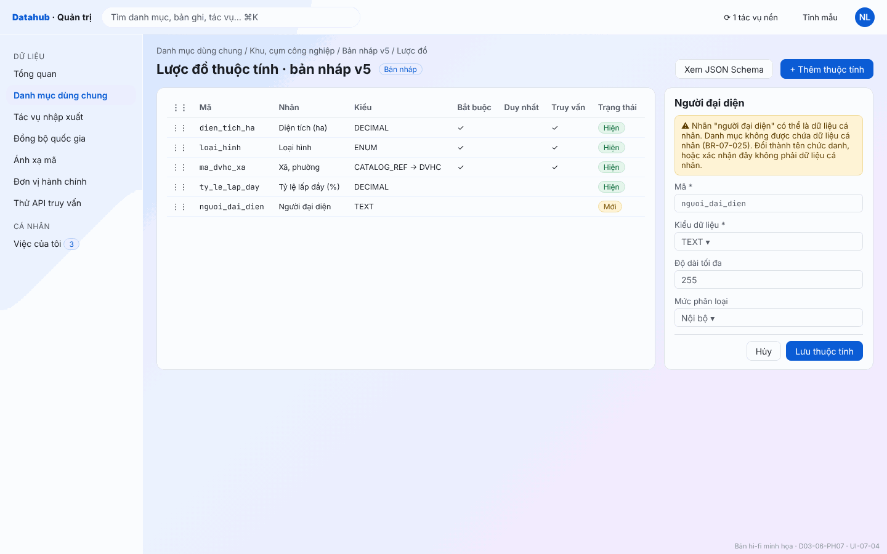

### 10.2. Bố cục

```text
┌──────────────────────────────────────────────────────────────────────────────────────┐
│ … › Loại hồ sơ TTHC › Phiên bản 4 › Lược đồ thuộc tính                                 │
│ Lược đồ thuộc tính · v4 [Bản nháp]           [Sửa bản ghi →] [+ Thêm thuộc tính]       │
│ ⓘ So với phiên bản hiện hành v3: +1 thuộc tính, 1 sửa, 0 xóa · 1 thay đổi phá vỡ       │
│ ┌──┬───┬──────────────┬──────────────────┬──────────┬────┬────┬────┬────────┬────────┬─┐│
│ │⠿ │STT│Mã            │Nhãn              │Kiểu      │Bắt │Duy │Truy│Ràng    │So với  │⋯││
│ │  │   │              │                  │          │buộc│nhất│vấn │buộc    │v3      │ ││
│ ├──┼───┼──────────────┼──────────────────┼──────────┼────┼────┼────┼────────┼────────┼─┤│
│ │⠿ │ 1 │linh_vuc      │Lĩnh vực          │Danh mục  │ ✓  │    │ ✓  │DM_LINH…│        │⋯││
│ │⠿ │ 2 │thoi_han_xu_ly│Thời hạn xử lý(ng)│Số nguyên │    │    │ ✓  │0–365   │~ Sửa ⚡│⋯││
│ │⠿ │ 3 │ghi_chu       │Ghi chú           │Văn bản dài│   │    │    │≤ 2000  │+ Thêm  │⋯││
│ └──┴───┴──────────────┴──────────────────┴──────────┴────┴────┴────┴────────┴────────┴─┘│
│                         ┌───────── Drawer glass: Sửa thuộc tính "thoi_han_xu_ly" ─────┐ │
│                         │ Mã * [thoi_han_xu_ly] (khóa sau phát hành)                  │ │
│                         │ Nhãn * [Thời hạn xử lý (ngày)]                              │ │
│                         │ Kiểu dữ liệu * [Số nguyên ▾]                                │ │
│                         │ ── Ràng buộc theo kiểu ──  Giá trị nhỏ nhất [0] Lớn nhất[365]│ │
│                         │ ⚡ Thu hẹp "lớn nhất" từ 999 xuống 365 là thay đổi phá vỡ;   │ │
│                         │    12 bản ghi hiện có giá trị > 365. [Xem bản ghi]          │ │
│                         │ [Hủy]                                      [Lưu thuộc tính] │ │
│                         └─────────────────────────────────────────────────────────────┘ │
└──────────────────────────────────────────────────────────────────────────────────────┘
```

Biểu mẫu sửa một thuộc tính đặt trong ngăn kéo thay vì sửa trực tiếp trong bảng, vì mỗi kiểu dữ liệu có bộ ràng buộc khác nhau và cần không gian giải thích hệ quả phá vỡ. Bảng chỉ cho sửa trực tiếp hai thứ đơn giản: thứ tự (kéo thả) và cờ Hiển thị/Ẩn.

### 10.3. Biểu mẫu thuộc tính

Bảng sau liệt kê trường của biểu mẫu thuộc tính. Các trường ràng buộc chỉ hiện khi kiểu dữ liệu tương ứng được chọn (cột "Áp dụng cho kiểu").

| STT | Trường | Loại | Nhãn | Áp dụng cho kiểu | Bắt buộc | Kiểm tra hợp lệ | Mặc định | Đích |
|---|---|---|---|---|---|---|---|---|
| 1 | Mã | `Input` đơn cách | Mã thuộc tính | mọi kiểu | Có | `^[a-z][a-z0-9_]{0,62}$` (snake) hoặc T-CODE; không trùng mã khác trong phiên bản; không trùng mã cột hệ thống (`code`, `name`, `parent_code`…); chỉ đọc nếu thuộc tính đã có trong phiên bản phát hành | sinh từ Nhãn (bỏ dấu, snake) | `code` |
| 2 | Nhãn | `Input` | Nhãn hiển thị | mọi kiểu | Có | 1–255 ký tự | rỗng | `label` |
| 3 | Mô tả | `TextArea` | Mô tả | mọi kiểu | Không | ≤ 4.000 | rỗng | `description` |
| 4 | Kiểu dữ liệu | `Select` có nhóm | Kiểu dữ liệu | — | Có | Đổi kiểu với thuộc tính đã phát hành: hiện cảnh báo BR-07-013 | Chuỗi ngắn | `dataType` |
| 5 | Bắt buộc | `Switch` | Bắt buộc nhập | mọi kiểu | Có | Bật với thuộc tính đã có dữ liệu rỗng: cảnh báo số bản ghi đang rỗng | Tắt | `required` |
| 6 | Duy nhất | `Switch` | Không trùng trong phiên bản | STRING, INTEGER, URI, EMAIL | Có | — | Tắt | `uniqueInVersion` |
| 7 | Độ dài tối đa | `InputNumber` | Độ dài tối đa (ký tự) | STRING (1–1.000), TEXT (1–4.000), URI (≤ 2.048), EMAIL (≤ 254) | Không | Trong khoảng ghi ở cột trước | 255 (STRING), 2.000 (TEXT) | `maxLength` |
| 8 | Mẫu | `Input` đơn cách + nút thử | Mẫu (biểu thức chính quy) | STRING | Không | Biên dịch được | rỗng | `pattern` |
| 9 | Giá trị nhỏ nhất, lớn nhất | `InputNumber` × 2 | Giá trị nhỏ nhất, Giá trị lớn nhất | INTEGER, DECIMAL, DATE (dạng `DatePicker`), DATETIME | Không | nhỏ nhất ≤ lớn nhất | rỗng | `minValue`, `maxValue` |
| 10 | Số chữ số thập phân | `InputNumber` | Số chữ số thập phân | DECIMAL | Không | 0–10 | 2 | lưu trong `pattern` hoặc trường mở rộng (Phụ lục B, B-05) |
| 11 | Danh sách giá trị | `CMP-EnumEditor` (bảng nhỏ: Giá trị, Nhãn, Thứ tự, kéo thả) | Danh sách giá trị | ENUM | Có khi ENUM | 1–200 giá trị; giá trị theo `^[A-Z0-9_]{1,64}$`, không trùng | rỗng | `enumValues` |
| 12 | Danh mục tham chiếu | `Select showSearch` | Danh mục tham chiếu | CATALOG_REF | Có khi CATALOG_REF | Danh mục đang hoạt động; không tự tham chiếu chính nó | rỗng | `refCatalogCode` |
| 13 | Giá trị mặc định | điều khiển động theo kiểu (mục 11.5) | Giá trị mặc định | mọi kiểu trừ TEXT | Không | Phải hợp lệ theo chính ràng buộc vừa khai | rỗng | `defaultValue` |
| 14 | Cho phép truy vấn | `Switch` | Cho phép lọc qua API truy vấn | mọi kiểu trừ TEXT | Có | Tối đa 10 thuộc tính `queryable` mỗi danh mục (tham số `07.rdm.max-queryable-attributes`, FRS §7.1) | Tắt | `queryable` |
| 15 | Cho phép tìm kiếm | `Switch` | Đưa vào tìm kiếm không dấu | STRING, TEXT | Có | — | Tắt | `searchable` |
| 16 | Trạng thái | `Segmented` | Hiển thị / Ẩn | mọi kiểu | Có | — | Hiển thị | `status` |

: Biểu mẫu thuộc tính

Nhãn tiếng Việt của kiểu dữ liệu trong `Select`: Chuỗi ngắn (STRING), Văn bản dài (TEXT), Số nguyên (INTEGER), Số thập phân (DECIMAL), Có/Không (BOOLEAN), Ngày (DATE), Ngày giờ (DATETIME), Danh sách giá trị (ENUM), Tham chiếu danh mục (CATALOG_REF), Địa chỉ web (URI), Thư điện tử (EMAIL).

### 10.4. Phát hiện thay đổi phá vỡ phía giao diện

Giao diện so sánh lược đồ bản nháp với lược đồ phiên bản hiện hành (API-07-022 hai lần) để đánh dấu cột "So với v{n}" và cảnh báo ngay khi người dùng sửa, trước khi gọi API. Quy tắc đánh dấu dựa trên khung chung §3 mục 18: xóa thuộc tính, đổi kiểu, giảm `maxLength`, tăng `minValue`, giảm `maxValue`, thêm `pattern` hoặc làm chặt `pattern`, bớt giá trị ENUM, đổi `refCatalogCode`, bật `required` với thuộc tính đã có, bật `uniqueInVersion` là **phá vỡ**; thêm thuộc tính không bắt buộc, sửa nhãn, mô tả, nới ràng buộc, thêm giá trị ENUM, đổi thứ tự, ẩn thuộc tính là **không phá vỡ**. Ẩn thuộc tính được xem là không phá vỡ vì dữ liệu vẫn còn và API vẫn trả; xóa mới là phá vỡ. Phía máy chủ là nơi quyết định cuối cùng; giao diện chỉ cảnh báo sớm. Nếu máy chủ trả ERR-07-014, hộp thoại liệt kê tối đa 20 giá trị không chuyển đổi được kèm nút "Mở bản ghi lỗi trong trình sửa" (điều hướng UI-07-05 với bộ lọc).

Kiểm tra dữ liệu cá nhân (BR-07-025): khi mã hoặc nhãn khớp danh sách từ khóa gợi ý dữ liệu cá nhân (ví dụ `cccd`, `cmnd`, `so_dinh_danh`, `ho_ten`, `ngay_sinh`, `dien_thoai`, `so_dien_thoai`, `dia_chi_thuong_tru`, "họ tên", "ngày sinh", "căn cước"), giao diện hiện cảnh báo vàng tại trường ngay khi gõ. Danh sách từ khóa không cứng trong mã mà lấy từ máy chủ (trường `personalDataHints` trong API-07-048 hoặc cấu hình, Phụ lục B, B-06) để hai phía khớp nhau.

### 10.5. Hành động

| Hành động | Hiện khi | API | Xác nhận | Kết quả, thông báo |
|---|---|---|---|---|
| Thêm thuộc tính | `PERM-07-update`, phiên bản `DRAFT`, nguồn ghi được | API-07-023 (`Idempotency-Key`) | Không | Dòng mới cuối bảng; "Đã thêm thuộc tính "{label}"." |
| Lưu thuộc tính | Như trên, biểu mẫu có thay đổi | API-07-024 (`If-Match` của thuộc tính) | Nếu thay đổi phá vỡ: `CMP-ConfirmDialog` "Thay đổi này là thay đổi phá vỡ: {lý do}. Phiên bản sẽ phải qua duyệt trước khi phát hành. Tiếp tục?" | "Đã lưu thuộc tính." |
| Ẩn, hiện | Như trên | API-07-024 `status` | Không | Cập nhật tại chỗ |
| Xóa thuộc tính | Như trên | API-07-025 | Nguy hiểm: "Xóa thuộc tính "{label}"? Giá trị của {n} bản ghi sẽ bị bỏ khỏi phiên bản này." kèm nhãn "Phá vỡ" nếu thuộc tính có trong phiên bản phát hành; gợi ý "Ẩn thay vì xóa" | "Đã xóa thuộc tính." |
| Sắp thứ tự | Kéo tay nắm ⠿ hoặc Alt+↑/Alt+↓ | API-07-024 `sortOrder` cho các thuộc tính đổi chỗ (tuần tự) | Không | Lưu ngay, hoàn tác bằng thông báo "Đã đổi thứ tự. [Hoàn tác]" |
| Xem JSON Schema | Luôn | API-07-048 `version={v}` | Không | Ngăn kéo `CMP-CodeEditor` JSON, nút Sao chép |
| Sửa bản ghi | Có quyền | — | Không | Mở UI-07-05 |

: Hành động

### 10.6. Trạng thái, thông điệp, khả năng truy cập

Phiên bản đã phát hành mở màn này ở chế độ chỉ đọc (không cột kéo thả, không nút thêm), tiêu đề đổi thành "Lược đồ thuộc tính · v{n} [Đã phát hành]". Danh mục chưa có thuộc tính nào hiện trạng thái rỗng "Danh mục chưa có thuộc tính bổ sung. Mã và tên luôn có sẵn; thêm thuộc tính khi cần lưu thêm thông tin cho mỗi bản ghi." Thông điệp riêng: ERR-07-014, ERR-07-036, ERR-07-004 (phiên bản không còn là bản nháp), ERR-07-018. Kéo thả dùng `@dnd-kit/sortable` với `KeyboardSensor`: focus tay nắm, Space để nhấc, mũi tên để di chuyển, Space để thả, Esc để hủy; vùng `role="status"` đọc "Đã nhấc thuộc tính Lĩnh vực, vị trí 1 trên 3", "Đã thả ở vị trí 2".

## 11. Đặc tả UI-07-05 · Trình sửa bản ghi bản nháp

### 11.1. Thông tin chung

::: dac-ta
**Mục đích.** Không gian làm việc chính để thêm, sửa, ngừng dùng, xóa (bản ghi mới trong nháp) bản ghi của bản nháp; xem dạng bảng sửa trực tiếp hoặc cây kết hợp biểu mẫu; kiểm tra hợp lệ toàn bản nháp; chuyển sang so sánh và trình duyệt.

**Người dùng, quyền.** `ROLE-DATA_STEWARD` (○), `ROLE-TENANT_ADMIN`, `ROLE-PLATFORM_ADMIN` (COMMON).

**FR, UC, BR hiện thực.** FR-07-012, 013, 018, 019, 017; UC-07-02; BR-07-002, 003, 004, 010, 014.

**Đường dẫn.** `/du-lieu/danh-muc/:ma/phien-ban/:v/sua-ban-ghi` (`v` là số phiên bản nháp hoặc `draft`).

**Mẫu bố cục.** PTN-07 Designer, biến thể soạn thảo bảng (khung chia đôi, không có canvas).

**API.** API-07-013, 014, 016, 022, 026, 027, 028, 029, 030, 031, 045, 048, 015.
:::

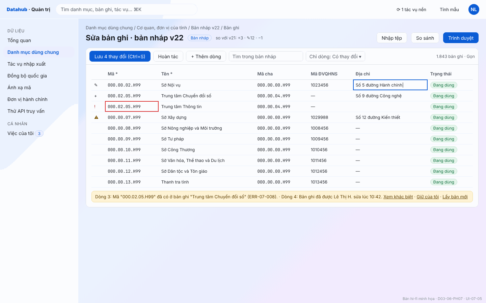

Màn này là nơi cán bộ quản lý danh mục ngồi lâu nhất, nên được thiết kế như một bảng tính (spreadsheet) có kiểm soát: thao tác bàn phím đầy đủ, sửa tại ô, lỗi hiện tại ô, nhưng mỗi dòng vẫn được kiểm tra theo lược đồ và lưu có kiểm soát phiên bản. Lý do không dùng mô hình "mở hộp thoại cho từng bản ghi" như hệ cũ Aita: với danh mục vài nghìn bản ghi, việc mở, sửa, đóng hộp thoại cho từng dòng chậm hơn nhiều lần so với sửa tại ô. Tuy vậy, biểu mẫu đầy đủ vẫn có (ngăn kéo bản ghi) cho bản ghi có nhiều thuộc tính hoặc giá trị văn bản dài.

### 11.2. Bố cục

Màn có hai chế độ xem dùng chung thanh công cụ và chân trạng thái. Chế độ bảng:

```text
┌──────────────────────────────────────────────────────────────────────────────────────────┐
│ … › Loại hồ sơ TTHC › Phiên bản 4 › Sửa bản ghi                                            │
│ Sửa bản ghi · v4 [Bản nháp]  Hiệu lực dự kiến 01/01/2027 [✎]   [Lược đồ] [Nhập tệp]        │
│                                                [Kiểm tra hợp lệ] [So sánh và trình duyệt →]│
│ ┌ thanh công cụ dính (glass toolbar) ────────────────────────────────────────────────────┐ │
│ │[Bảng|Cây] [+ Thêm bản ghi] [🔍 Tìm mã, tên…] [Trạng thái▾] [Chỉ dòng chưa lưu 3]       │ │
│ │[Chỉ dòng lỗi 2] [Cột▾] [Mật độ▾]                    [Hoàn tác] [Làm lại] [Lưu tất cả (3)]│ │
│ └────────────────────────────────────────────────────────────────────────────────────────┘ │
│ ┌──┬─┬────────┬─────────────────────┬────────┬────┬─────────┬──────────┬───────────┬──┐ │
│ │☐ │●│Mã *    │Tên *                │Mã cha  │Thứ │Trạng    │Lĩnh vực *│Thời hạn   │⋯ │ │
│ │  │ │        │                     │        │tự  │thái     │          │xử lý      │  │ │
│ ├──┼─┼────────┼─────────────────────┼────────┼────┼─────────┼──────────┼───────────┼──┤ │
│ │☐ │ │01      │Cấp tỉnh             │—       │ 1  │Đang dùng│HANH_CHINH│—          │⋯ │ │
│ │☐ │✎│01.02   │Hồ sơ cấp phép XD ▌  │01      │ 2  │Đang dùng│XAY_DUNG  │15         │⋯ │ │
│ │☐ │!│01.07   │                ⚠    │01      │ 7  │Đang dùng│[chọn ▾] ⚠│400 ⚠      │⋯ │ │
│ │☐ │+│68001   │Hồ sơ đặc thù tỉnh   │01      │ 8  │Đang dùng│XAY_DUNG  │30         │⋯ │ │
│ │☐ │ │02.01   │~~Hồ sơ cũ~~         │02      │ 1  │Ngừng→02.05│…      │…          │⋯ │ │
│ │  │ │ … ảo hóa, 1.842 dòng …                                                       │ │
│ └──┴─┴────────┴─────────────────────┴────────┴────┴─────────┴──────────┴───────────┴──┘ │
│ Chân: 1.843 bản ghi · +12 thêm · ~37 sửa · −4 ngừng · 2 lỗi · Lưu lần cuối 10:12:05 ✓     │
└──────────────────────────────────────────────────────────────────────────────────────────┘
```

Chế độ cây (dùng khi danh mục phân cấp):

```text
┌──────────────────────────────────────────────────────────────────────────────────────────┐
│ (đầu trang và thanh công cụ như trên)                                                    │
│ ┌──────────────────────────────┬───────────────────────────────────────────────────────┐ │
│ │ [🔍 tìm trong cây]           │ Bản ghi 01.02 · Hồ sơ cấp phép xây dựng  [Đang dùng]   │ │
│ │ ▾ 01 Cấp tỉnh            (12)│ ── Thông tin chính ──                                  │ │
│ │   ▸ 01.01 Hồ sơ đăng ký  (0) │ Mã *        [01.02        ] (khóa: đã phát hành)        │ │
│ │   ● 01.02 Hồ sơ cấp phép ✎   │ Tên *       [Hồ sơ cấp phép xây dựng            ]      │ │
│ │   ▸ 01.07 … ⚠                │ Mã cha      [01 · Cấp tỉnh                    ▾]       │ │
│ │ ▸ 02 Cấp xã              (8) │ Thứ tự      [2]                                        │ │
│ │ ▸ 68 Bổ sung địa phương  (3) │ Hiệu lực    [__/__/____] → [__/__/____]                │ │
│ │                              │ ── Thuộc tính ──                                       │ │
│ │ [+ Thêm con] [+ Thêm cùng cấp]│ Lĩnh vực *  [XAY_DUNG · Xây dựng               ▾]      │ │
│ │                              │ Thời hạn xử lý (ngày) [15   ]                          │ │
│ │                              │ Ghi chú     [                                   ]      │ │
│ │                              │ [Ngừng dùng…] [Xóa]            [Hủy thay đổi] [Lưu]    │ │
│ └──────────────────────────────┴───────────────────────────────────────────────────────┘ │
│ (chân trạng thái)                                                                        │
└──────────────────────────────────────────────────────────────────────────────────────────┘
```

Chế độ cây kết hợp cây bên trái với biểu mẫu động bên phải. Lý do kết hợp: trong danh mục phân cấp, quyết định quan trọng nhất là vị trí của bản ghi trong cây, nên cây phải luôn hiện; còn biểu mẫu đầy đủ giúp sửa bản ghi nhiều thuộc tính mà không phải cuộn ngang. Kéo một nút cây thả vào nút khác đổi mã cha (có xác nhận vì đổi mã cha là thay đổi phá vỡ với bản ghi đã phát hành).

### 11.3. Thành phần

| STT | Tên | Loại | Nhãn | Kiểu | Bắt buộc | Kiểm tra | Mặc định | Nguồn |
|---|---|---|---|---|---|---|---|---|
| 1 | Dải bản nháp | `CMP-PageHeader` + `CMP-StatusTag` + `Popover` sửa | Hiệu lực dự kiến | T-DATE | Không | ≥ hôm nay (BR-07-027) | rỗng | API-07-013 `effectiveFrom`; sửa bằng API-07-014 |
| 2 | Chế độ xem | `Segmented` | Bảng / Cây | enum | — | Cây chỉ khả dụng khi `isHierarchical` | theo danh mục | URL `view` |
| 3 | Thêm bản ghi | `Button` | Thêm bản ghi | — | — | — | — | — |
| 4 | Tìm | `Input.Search` | Tìm mã, tên | chuỗi ≤ 100 | — | — | rỗng | API-07-026 `q` |
| 5 | Lọc trạng thái | `Select multiple` | Trạng thái | enum | — | — | tất cả | `status` |
| 6 | Lọc dòng chưa lưu | `Button` bật tắt có đếm | Chỉ dòng chưa lưu ({n}) | — | — | — | tắt | trạng thái cục bộ |
| 7 | Lọc dòng lỗi | `Button` bật tắt có đếm | Chỉ dòng lỗi ({n}) | — | — | — | tắt | kết quả kiểm tra client + API-07-016 |
| 8 | Hoàn tác, Làm lại | `Button` | Hoàn tác (Ctrl+Z), Làm lại (Ctrl+Y) | — | — | Ngăn xếp 100 thao tác chưa lưu | — | cục bộ |
| 9 | Lưu tất cả | `Button type="primary"` có đếm | Lưu tất cả ({n}) | — | — | Vô hiệu khi còn dòng lỗi client trong số dòng chưa lưu; tooltip nêu số dòng lỗi | — | API-07-028, 027 |
| 10 | Lưới sửa | `CMP-EditableTable` | — | `CatalogItem[]` | — | Mục 11.6 | — | API-07-026 |
| 11 | Cây | `CMP-Tree` | Cây bản ghi | — | — | — | — | API-07-026 `parentCode` (Phụ lục B, B-04) |
| 12 | Biểu mẫu bản ghi | `CMP-DynamicForm` (trong ngăn kéo hoặc khung phải) | Bản ghi {mã} | `CatalogItem` | — | Mục 11.6 | — | API-07-048 JSON Schema + API-07-022 |
| 13 | Hộp ngừng dùng | `Modal` | Ngừng dùng bản ghi | — | — | Mục 11.8 | — | — |
| 14 | Chân trạng thái | `CMP-StatusBar` | — | — | — | — | — | API-07-013 `stats`, `itemCount`; trạng thái cục bộ |

: Thành phần: STT, Tên

Các trường cố định của bản ghi trong biểu mẫu và lưới như sau; chúng đứng trước thuộc tính động.

| Trường | Nhãn | Điều khiển | Bắt buộc | Kiểm tra | Ghi chú |
|---|---|---|---|---|---|
| `code` | Mã | `Input` đơn cách, tự chữ hoa | Có | T-CODE; không trùng trong phiên bản (không phân biệt hoa thường, BR-07-002); khớp `localCodePattern` với bản ghi bổ sung của HYBRID (BR-07-010) | Chỉ đọc nếu bản ghi đã có trong phiên bản phát hành; bản ghi mới trong nháp sửa được |
| `name` | Tên | `Input` | Có | 1–255, NFC | |
| `parentCode` | Mã cha | `Select showSearch` tìm từ xa trong bản nháp (API-07-026 `q`) hiển thị "{mã} · {tên}" | Không | Tồn tại trong phiên bản; không vòng (kiểm tra client bằng `path` đã nạp, máy chủ quyết định); độ sâu ≤ `maxDepth`; cha không `DEPRECATED` nếu bản ghi `ACTIVE` (BR-07-014) | Chỉ hiện khi danh mục phân cấp |
| `sortOrder` | Thứ tự | `InputNumber` số nguyên | Không | 0–999.999 | Mặc định = lớn nhất trong cùng cha + 1 |
| `status` | Trạng thái | Chỉ đọc trong lưới; đổi bằng hành động "Ngừng dùng", "Khôi phục" | — | — | |
| `replacedBy` | Mã thay thế | Chỉ đọc; sửa trong hộp ngừng dùng | — | — | Liên kết tới bản ghi |
| `validFrom`, `validTo` | Hiệu lực từ, Hiệu lực đến | `DatePicker` | Không | từ < đến | Hiệu lực riêng của bản ghi trong phiên bản |
| `levelName` | Cấp | Chỉ đọc, tính từ độ sâu | — | — | |

: Thành phần: Trường, Nhãn

### 11.4. Hành vi lưới

**Cột.** Cột cố định trái: ô chọn, cột trạng thái dòng (một ký hiệu: trống là không đổi, ✎ là đã sửa chưa lưu, + là bản ghi mới chưa lưu, ! là có lỗi, ⟳ là đang lưu, ⚠ là xung đột), Mã. Tiếp theo: Tên, Mã cha (khi phân cấp), Thứ tự, Trạng thái, Mã thay thế, rồi thuộc tính `ACTIVE` theo `sortOrder`. Cột Hiệu lực từ/đến và thuộc tính `HIDDEN` ẩn mặc định, bật ở "Cột". Cột thao tác "⋯" cố định phải. Tiêu đề cột bắt buộc có dấu `*`. Độ rộng cột tính theo kiểu: BOOLEAN 90 px, DATE 120 px, INTEGER 110 px, STRING 200 px, TEXT 280 px (cắt một dòng); người dùng kéo đổi độ rộng, lưu theo danh mục trong `localStorage`.

**Nạp dữ liệu và ảo hóa.** Lưới nạp dữ liệu theo trang máy chủ (API-07-026, `size` = 200). Khi tổng số bản ghi ≤ 1.000, lưới dùng phân trang thường (50/100/200 dòng). Khi tổng số bản ghi lớn hơn 1.000, lưới chuyển sang chế độ cuộn liên tục có ảo hóa dòng: chỉ dựng các dòng trong khung nhìn cộng 10 dòng đệm mỗi phía (`virtual` của antd Table v6 hoặc `@tanstack/react-virtual`), tự nạp trang kế khi cuộn tới cách cuối 100 dòng (`useInfiniteQuery`), thanh cuộn phản ánh tổng số thật bằng phần tử giữ chỗ. Ngưỡng 1.000 được chọn vì dưới mức này DOM vẫn nhẹ và phân trang thường giúp người dùng định vị theo số trang; trên mức này phân trang trở nên phiền và cuộn ảo cho trải nghiệm bảng tính. Chiều cao dòng cố định theo mật độ (32/40/48 px) để ảo hóa tính đúng vị trí.

**Sắp xếp và lọc.** Sắp xếp phía máy chủ theo Mã, Tên, Thứ tự, Trạng thái và thuộc tính `queryable`; mặc định theo `path` rồi `sortOrder` để cha đứng trước con. Bộ lọc gửi máy chủ, trừ "Chỉ dòng chưa lưu" và "Chỉ dòng lỗi" là lọc trên tập dòng đang có thay đổi cục bộ (không nhiều, giữ trong bộ nhớ). Bộ lọc, sắp xếp, chế độ xem, bản ghi đang chọn được giữ trên URL.

**Sửa trực tiếp ô.** Mô hình sửa theo kiểu bảng tính: một ô hoạt động (active cell) có viền focus `color-focus-ring`; bấm đúp, Enter hoặc F2 vào chế độ sửa; gõ ký tự in được cũng vào chế độ sửa và thay giá trị; Enter xác nhận và chuyển xuống ô dưới; Tab xác nhận và sang ô phải; Shift+Tab sang trái; Esc hủy sửa ô. Điều khiển trong ô là phiên bản gọn của điều khiển ở mục 11.5. Giá trị xác nhận được kiểm tra hợp lệ ngay (mục 11.6); ô lỗi có nền `color-error-bg`, viền đỏ, biểu tượng ⚠ và tooltip thông điệp. Ô TEXT dài mở `Popover` có `TextArea` thay vì sửa trong ô một dòng. Ô của bản ghi kế thừa (HYBRID) và ô Mã của bản ghi đã phát hành không vào được chế độ sửa; bấm Enter ở đó hiện tooltip giải thích.

**Dán từ bảng tính.** Ctrl+V tại một ô dán khối dữ liệu dạng TSV từ Excel: giao diện tách theo tab và xuống dòng, dán vào các ô bắt đầu từ ô hoạt động, tạo dòng mới nếu vượt cuối, chạy kiểm tra hợp lệ cho mọi ô bị dán. Dán hơn 500 ô hiện hộp xác nhận và gợi ý dùng "Nhập tệp" cho khối lớn. Ctrl+C sao chép vùng chọn ra TSV.

**Phím tắt của màn.** Bảng phím tắt hiện bằng phím `?`.

| Phím | Tác dụng |
|---|---|
| Mũi tên | Di chuyển ô hoạt động |
| Enter, F2 | Sửa ô; Enter lần nữa để xác nhận |
| Esc | Hủy sửa ô; nếu không ở chế độ sửa thì bỏ vùng chọn |
| Tab, Shift+Tab | Sang ô phải, trái |
| Ctrl+Enter | Mở biểu mẫu đầy đủ của dòng hiện tại trong ngăn kéo |
| Alt+Insert hoặc Ctrl+Shift+= | Thêm bản ghi mới dưới dòng hiện tại (cùng cha) |
| Ctrl+S | Lưu tất cả dòng chưa lưu |
| Ctrl+Z, Ctrl+Y | Hoàn tác, làm lại thay đổi chưa lưu |
| Ctrl+F hoặc `/` | Focus ô tìm kiếm |
| Ctrl+Shift+D | Ngừng dùng bản ghi hiện tại |
| Space (ở cột chọn) | Chọn hoặc bỏ chọn dòng |
| Home, End; Ctrl+Home, Ctrl+End | Đầu, cuối dòng; đầu, cuối bảng |
| Page Up, Page Down | Cuộn một khung nhìn |

: Hành vi lưới

Ctrl+S, Ctrl+Z, Ctrl+F được chặn hành vi mặc định của trình duyệt chỉ khi focus nằm trong vùng trình sửa, để không gây khó chịu ở phần khác của ứng dụng.

### 11.5. Ánh xạ kiểu dữ liệu sang điều khiển

Biểu mẫu động (`CMP-DynamicForm`) và ô sửa của lưới được sinh từ danh sách `attribute_def` (API-07-022) và JSON Schema (API-07-048). Bảng sau là ánh xạ chính thức từ `data_type` sang điều khiển antd, định dạng hiển thị, giá trị gửi API và quy tắc kiểm tra. Mọi màn PH-07 hiển thị hoặc nhập giá trị thuộc tính (UI-07-02, 05, 06, 07, 12) dùng chung ánh xạ này qua hàm `renderAttrValue` và `AttrInput` ở `src/features/rdm/schema/`.

| `data_type` | Điều khiển nhập (antd v6) | Hiển thị đọc | Giá trị JSON gửi đi | JSON Schema tương ứng | Kiểm tra phía client |
|---|---|---|---|---|---|
| STRING | `Input` với `maxLength`, `showCount` khi `maxLength` ≥ 100 | Chữ, cắt `…` + tooltip | `string` đã cắt khoảng trắng đầu cuối, NFC | `type: string`, `maxLength`, `pattern` | `required`, `max`, `pattern` (cờ `u`), duy nhất (máy chủ) |
| TEXT | `Input.TextArea` `autoSize={{minRows:2,maxRows:8}}`, `showCount` | Đoạn văn, giữ xuống dòng, cắt 2 dòng trong lưới | `string` | `type: string`, `maxLength` ≤ 4.000 | `required`, `max` |
| INTEGER | `InputNumber` `precision={0}`, `step={1}`, phân cách nghìn khi hiển thị | Số căn phải, định dạng `vi-VN` | `integer` | `type: integer`, `minimum`, `maximum` | Số nguyên, khoảng, không nhận "1,5" |
| DECIMAL | `InputNumber` `stringMode`, `precision` = số chữ số thập phân, `decimalSeparator=","` | Số căn phải, dấu phẩy thập phân | `string` số thập phân chuẩn "12.50" để không mất chính xác (hoặc `number` theo OpenAPI, Phụ lục B, B-05) | `type: number` hoặc `string` + `pattern`, `minimum`, `maximum` | Khoảng, số chữ số thập phân |
| BOOLEAN | `Switch` khi bắt buộc; `Select` ba lựa chọn "Có", "Không", "—" khi không bắt buộc | "Có" / "Không" / "—" | `true`/`false`/`null` | `type: boolean` (thêm `null` khi không bắt buộc) | — |
| DATE | `DatePicker` `format="DD/MM/YYYY"`, cho gõ tay `DDMMYYYY` | `dd/MM/yyyy` | `"yyyy-MM-dd"` | `type: string`, `format: date`, `formatMinimum/Maximum` | Ngày hợp lệ, khoảng |
| DATETIME | `DatePicker` `showTime={{format:'HH:mm:ss'}}` `format="DD/MM/YYYY HH:mm:ss"`, múi giờ cố định Việt Nam | `dd/MM/yyyy HH:mm:ss` (giờ Việt Nam) | ISO có độ lệch `"2026-11-21T08:30:00+07:00"` | `type: string`, `format: date-time` | Thời điểm hợp lệ, khoảng |
| ENUM | `Select` (`showSearch` khi > 7 giá trị); `Radio.Group` khi ≤ 4 giá trị và trong biểu mẫu đầy đủ | Nhãn của giá trị; giá trị mã trong tooltip | `string` mã giá trị | `enum` | Thuộc danh sách |
| CATALOG_REF | `Select` `showSearch` `filterOption={false}` tìm từ xa API-07-045 trên danh mục `refCatalogCode` (chờ 300 ms sau phím cuối, tối đa 20 kết quả, hiển thị "{mã} · {tên}", bản ghi ngừng dùng có nhãn "Ngừng dùng" và không chọn được) | "{mã} · {tên}"; mã đơn cách; liên kết mở bản ghi ở danh mục được tham chiếu | `string` mã bản ghi | `type: string` + `x-catalog-ref` | Định dạng T-CODE; tồn tại kiểm tra bằng API-07-042 (`at` = hiệu lực dự kiến của bản nháp) khi rời ô, có bộ đệm |
| URI | `Input` `type="url"` `inputMode="url"` biểu tượng `LinkOutlined` | Liên kết mở tab mới với `rel="noopener noreferrer"`, chỉ `http`/`https` | `string` | `type: string`, `format: uri`, `maxLength` ≤ 2.048 | URL tuyệt đối, giao thức `http` hoặc `https` |
| EMAIL | `Input` `type="email"` `inputMode="email"` | Chữ (không tạo liên kết `mailto` tự động) | `string` chữ thường phần miền | `type: string`, `format: email`, `maxLength` ≤ 254 | Định dạng thư điện tử |

: Ánh xạ kiểu dữ liệu sang điều khiển

Một số quyết định trong bảng cần giải thích. DECIMAL dùng `stringMode` vì `number` của JavaScript làm sai số thập phân (0,1 + 0,2), điều không chấp nhận được với các danh mục như hệ số, mức phí. BOOLEAN không bắt buộc dùng ba lựa chọn vì `Switch` không biểu diễn được "chưa có giá trị", và việc ép thành "Không" làm sai dữ liệu. CATALOG_REF kiểm tra tồn tại tại ngày hiệu lực dự kiến của bản nháp, vì bản ghi được tham chiếu có thể bị ngừng dùng trước ngày đó. EMAIL không tự tạo liên kết `mailto` để tránh vô tình gửi thư tới địa chỉ trong danh mục; và nhắc lại, danh mục chỉ được chứa thư điện tử của tổ chức, không phải của cá nhân (BR-07-025).

### 11.6. Kiểm tra hợp lệ phía client đồng bộ với JSON Schema

Nguyên tắc: máy chủ là nơi quyết định cuối cùng (CRUD-C-03); giao diện kiểm tra sớm để người dùng thấy lỗi ngay khi gõ, và **dùng đúng JSON Schema do máy chủ sinh** (API-07-048 `?version={v}`) thay vì tự viết lại quy tắc. Cách làm như sau.

1. Khi mở trình sửa, hook `useCatalogSchema(code, v)` tải JSON Schema của bản nháp cùng ETag. Schema được biên dịch một lần bằng Ajv 8 (`ajv` chế độ `strict: false`, `allErrors: true`, cùng `ajv-formats` cho `date`, `date-time`, `uri`, `email`, và `ajv-keywords` cho `formatMinimum`) trong một Web Worker để không chặn luồng giao diện với lược đồ lớn (100 thuộc tính theo NFR-07-011).
2. Mỗi lần một ô được xác nhận, giao diện dựng đối tượng bản ghi đầy đủ của dòng và gọi hàm kiểm tra đã biên dịch. Lỗi Ajv được chuyển thành thông điệp tiếng Việt bằng bảng ánh xạ từ khóa (`required` → "Bắt buộc nhập {nhãn}.", `maxLength` → "{nhãn} tối đa {limit} ký tự.", `pattern` → "{nhãn} không đúng mẫu quy định.", `minimum`/`maximum` → "{nhãn} phải từ {min} đến {max}.", `enum` → "{nhãn} phải là một trong các giá trị cho phép.", `format` → "{nhãn} không đúng định dạng {tên định dạng tiếng Việt}.", `type` → "{nhãn} phải là {tên kiểu}."). Vị trí lỗi `instancePath` như `/attrs/thoi_han_xu_ly` được ánh xạ sang ô hoặc trường `['attrs','thoi_han_xu_ly']`.
3. Các quy tắc cần dữ liệu ngoài dòng (mã trùng, mã cha tồn tại, vòng, độ sâu, tham chiếu danh mục) được kiểm tra nhẹ phía client với dữ liệu đã nạp và được khẳng định bởi máy chủ khi lưu.
4. Khi máy chủ trả ERR-07-009, ERR-07-010, ERR-07-011, ERR-07-012 hoặc ERR-07-008, mảng `errors[]` của ProblemDetails (mỗi phần tử có `pointer` dạng JSON Pointer, `code`, `message`) được ánh xạ về ô bằng đúng cơ chế ở bước 2, nên người dùng thấy lỗi máy chủ cùng chỗ với lỗi client.
5. Nếu ETag của schema đổi (người khác sửa lược đồ trong lúc đang sửa bản ghi, phát hiện khi lưu bị ERR-07-009 với lỗi lạ hoặc qua làm mới định kỳ 60 giây), giao diện hiện `Alert` "Lược đồ thuộc tính vừa được thay đổi. [Tải lại lược đồ]" và sau khi tải lại thì kiểm tra lại mọi dòng chưa lưu.

Lý do dùng JSON Schema làm nguồn chung: ADR-050 đã chọn JSON Schema để kiểm tra `attrs` phía máy chủ; dùng cùng tài liệu ở giao diện bảo đảm hai phía không bao giờ lệch quy tắc, và khi thêm kiểu ràng buộc mới chỉ phải sửa bộ sinh schema ở máy chủ.

### 11.7. Mô hình lưu và xung đột theo dòng

Thay đổi được giữ cục bộ theo dòng trong một kho trạng thái (Zustand, `useDraftEditorStore`) gồm: bản gốc của dòng kèm ETag (từ `version` của bản ghi), bản đang sửa, trạng thái dòng (`clean`, `dirty`, `new`, `saving`, `error`, `conflict`). Lý do giữ cục bộ thay vì lưu từng ô: một bản ghi phải hợp lệ trọn vẹn mới lưu được (ví dụ thuộc tính bắt buộc), và gửi mỗi ô một lượt gọi tạo nhiều bản ghi kiểm toán vô nghĩa.

Lưu xảy ra khi: người dùng rời một dòng đã sửa và dòng hợp lệ (tự lưu dòng, có thể tắt bằng công tắc "Tự lưu khi rời dòng" ở menu "⋯" của thanh công cụ, mặc định bật); bấm "Lưu tất cả" hoặc Ctrl+S; bấm "Lưu" trong biểu mẫu. Dòng mới gọi API-07-027 với `Idempotency-Key` gắn với dòng (tạo một lần, giữ khi thử lại); dòng sửa gọi API-07-028 với `If-Match` là ETag của dòng, chỉ gửi các trường thay đổi (JSON Merge Patch). "Lưu tất cả" gửi song song tối đa 4 yêu cầu một lúc; nếu số dòng chưa lưu lớn hơn 50, giao diện dùng API-07-031 (lô) chia thành các lô 500 thao tác để giảm số lượt gọi. Kết quả trả về theo từng dòng: dòng thành công về `clean` và nhận ETag mới; dòng lỗi về `error` với lỗi tại ô.

Xung đột ETag xử lý theo dòng: dòng nhận 412 (ERR-07-018) chuyển `conflict`, ô có ký hiệu ⚠ ở cột trạng thái, và thanh thông báo trên lưới ghi "{n} dòng bị xung đột do người khác vừa sửa. [Xem và xử lý]". Bấm xử lý mở `CMP-DiffViewer` cho từng dòng lần lượt, với ba cột "Trường", "Của bạn", "Hiện tại" và ba lựa chọn "Giữ của tôi (ghi đè)", "Lấy bản hiện tại", "Gộp" (gộp chỉ khả dụng khi hai bên sửa các trường khác nhau: lấy trường của bạn chồng lên bản hiện tại rồi lưu với ETag mới). Một xung đột không chặn việc lưu các dòng khác.

> **Câu hỏi mở Q07-72:** Khi giao diện dùng API-07-031 để lưu lô, mỗi thao tác trong lô có mang được ETag riêng (`ifMatch` trong phần tử) và lô có trả kết quả từng phần (thành công một phần) không? Nếu lô là "tất cả hoặc không", giao diện sẽ chỉ dùng lô khi không có dòng sửa (chỉ thêm mới) và lưu dòng sửa bằng API-07-028. Câu hỏi này cũng được ghi ở Phụ lục B (B-09).

### 11.8. Ngừng dùng bản ghi và mã thay thế

Bản ghi đã từng phát hành không xóa được (BR-07-003), chỉ ngừng dùng. Hộp "Ngừng dùng bản ghi" gồm các trường dưới đây.

| Trường | Loại | Nhãn | Bắt buộc | Kiểm tra | Mặc định |
|---|---|---|---|---|---|
| Bản ghi | Chỉ đọc | Bản ghi | — | — | "{mã} · {tên}" (hoặc "{n} bản ghi đã chọn") |
| Mã thay thế | `Select mode="multiple" showSearch` tìm từ xa trong bản nháp | Mã thay thế | Không (cảnh báo khi trống) | Mỗi mã tồn tại, `ACTIVE`, khác bản ghi bị ngừng; tối đa 20 mã | rỗng |
| Ngày ngừng dùng | `DatePicker` | Ngừng dùng từ ngày | Không | ≥ hiệu lực dự kiến của bản nháp | hiệu lực dự kiến của bản nháp |
| Lý do | `TextArea` | Lý do | Có | 10–500 ký tự | rỗng |
| Bản ghi con | `Radio.Group` | Các bản ghi con ({n}) | Có khi có con `ACTIVE` | — | "Ngừng dùng cả bản ghi con"; lựa chọn khác "Chuyển bản ghi con sang mã cha mới…" (mở chọn mã) |

: Ngừng dùng bản ghi và mã thay thế

Khi để trống mã thay thế, hộp hiện cảnh báo vàng "Bản ghi ngừng dùng không có mã thay thế. Các hệ thống đang dùng mã này sẽ không biết chuyển sang mã nào." nhưng vẫn cho tiếp tục, đúng quy tắc tương tác số 3 của SRS cũ. Hộp ghi rõ "Đây là thay đổi phá vỡ". API gọi: API-07-029 cho từng bản ghi (hoặc lô qua API-07-031 khi chọn nhiều). Bản ghi ngừng dùng hiển thị tên gạch ngang, trạng thái "Ngừng dùng" và mã thay thế dạng liên kết; có hành động "Khôi phục" (đưa về `ACTIVE`) nếu việc ngừng dùng mới xảy ra trong bản nháp này.

### 11.9. Hành động

| Hành động | Vị trí | Hiện khi | API | Xác nhận, lý do | Kết quả, thông báo |
|---|---|---|---|---|---|
| Thêm bản ghi | Thanh công cụ; nút cây "Thêm con", "Thêm cùng cấp" | `PERM-07-update`, `DRAFT`, nguồn ghi được, không có tác vụ ghi đang chạy | (lưu sau) API-07-027 | Không | Dòng mới trạng thái + ở đầu lưới hoặc dưới dòng hiện tại, focus ô Mã |
| Lưu dòng, Lưu tất cả | Thanh công cụ, biểu mẫu | Có dòng `dirty`/`new` | API-07-027, 028, 031 | Không | "Đã lưu {n} bản ghi." hoặc "Đã lưu {a} bản ghi, {b} bản ghi còn lỗi." |
| Hủy thay đổi dòng | Menu "⋯" dòng | Dòng `dirty` | — | Không | Dòng về bản gốc |
| Ngừng dùng | Menu "⋯", thanh hàng loạt | Bản ghi `ACTIVE` | API-07-029 / 031 | Hộp mục 11.8 | "Đã ngừng dùng bản ghi "{mã}"." |
| Khôi phục | Menu "⋯" | Bản ghi `DEPRECATED` trong nháp này | API-07-028 `status=ACTIVE` (Phụ lục B, B-08) | Không | "Đã khôi phục bản ghi." |
| Xóa | Menu "⋯", thanh hàng loạt | Bản ghi mới thêm trong nháp (`allowedActions` có `DELETE`, hoặc chưa từng phát hành) | API-07-030 | `CMP-ConfirmDialog`: "Xóa bản ghi "{mã}"? Bản ghi chưa từng phát hành nên sẽ bị xóa khỏi bản nháp." | "Đã xóa bản ghi." ERR-07-013 nếu đã phát hành |
| Đổi mã cha bằng kéo thả | Cây | Danh mục phân cấp | API-07-028 `parentCode` | "Chuyển "{mã}" và {n} bản ghi con sang dưới "{mã cha mới}"? Đây là thay đổi phá vỡ với bản ghi đã phát hành." | Cây cập nhật |
| Sửa hiệu lực dự kiến, căn cứ, ghi chú | `Popover` trên dải bản nháp | `DRAFT` | API-07-014 với `If-Match` của phiên bản | Không | "Đã lưu thông tin phiên bản." |
| Kiểm tra hợp lệ | Đầu trang | `DRAFT` | API-07-016 (có thể chạy nền, trả `202` + theo dõi) | Không | Kết quả: "Bản nháp hợp lệ." hoặc "Có {n} lỗi trên {m} bản ghi." và bật bộ lọc "Chỉ dòng lỗi" |
| Nhập tệp | Đầu trang | `PERM-07-update`, `DRAFT` | — | Nếu có dòng chưa lưu: "Lưu các thay đổi trước khi nhập?" [Lưu và tiếp tục] [Bỏ thay đổi] | Mở UI-07-06 |
| So sánh và trình duyệt | Đầu trang | Có phiên bản phát hành trước hoặc bản nháp v1 | — | Như trên nếu có dòng chưa lưu | Mở UI-07-07 |
| Hủy bản nháp | Menu "⋯" đầu trang | `DRAFT` | API-07-015 | Như UI-07-02 | Về UI-07-02 |
| Xuất bản nháp | Menu "⋯" đầu trang | `PERM-07-export` | API-07-038 với `version=draft` | Hộp chọn định dạng | Tải hoặc chạy nền |

: Hành động

### 11.10. Trạng thái màn

| Trạng thái | Biểu hiện |
|---|---|
| Đang tải | Khung xương lưới 12 dòng; thanh công cụ hiện nhưng vô hiệu |
| Phiên bản không phải bản nháp | Nếu `v` trỏ tới phiên bản `IN_REVIEW`/`APPROVED`/`PUBLISHED`: chuyển hướng tới UI-07-02 tab Bản ghi với `v`, kèm `message.info` "Phiên bản {v} không còn là bản nháp nên chỉ xem được." |
| Bản nháp rỗng | `CMP-EmptyState`: "Bản nháp chưa có bản ghi nào. Thêm bản ghi đầu tiên hoặc nhập từ tệp Excel, CSV." với nút "Thêm bản ghi", "Nhập tệp", "Tải tệp mẫu" (API-07-032) |
| Danh mục chỉ đọc | Không vào được màn (route kiểm tra), chuyển về UI-07-02 với thông báo ERR-07-003 |
| Có tác vụ nhập đang ghi vào bản nháp | Mục 6.7; lưới chỉ đọc, có nút "Theo dõi tác vụ" |
| Bản nháp vừa bị người khác trình duyệt hoặc hủy | Phát hiện khi lưu (ERR-07-004) hoặc qua làm mới định kỳ ETag phiên bản (60 giây): `Modal` "Bản nháp đã được {user} trình duyệt lúc {ts}. Các thay đổi chưa lưu của bạn ({n} dòng) không ghi được nữa. [Sao chép thay đổi] [Xem phiên bản]" |
| Mất kết nối | Dòng chưa lưu giữ nguyên trong kho cục bộ và được lưu tạm vào `sessionStorage`; thanh thông báo "Mất kết nối. {n} thay đổi chưa lưu được giữ lại trên trình duyệt này." |

: Trạng thái màn

### 11.11. Thông điệp riêng

| Mã | Ngữ cảnh | Câu |
|---|---|---|
| ERR-07-008 | Lưu dòng có mã trùng | Tại ô Mã: "Mã "{mã}" đã có ở bản ghi "{tên bản ghi kia}"." kèm liên kết "Đi tới" |
| ERR-07-009 | Lưu dòng | Lỗi tại từng ô theo `errors[]` |
| ERR-07-010, 011 | Đổi mã cha | Tại ô Mã cha, theo bảng 5.3 |
| ERR-07-012 | Bản ghi bổ sung HYBRID | Tại ô Mã, kèm "Ví dụ mã hợp lệ: {ví dụ sinh từ mẫu nếu được}" |
| ERR-07-013 | Xóa | Theo bảng 5.3, nút "Ngừng dùng" |
| ERR-07-018 | Lưu dòng | Mục 11.7 |
| ERR-07-004 | Bản nháp đổi trạng thái | Mục 11.10 |
| ERR-07-026 | Lô vượt mức | Không xảy ra vì giao diện tự chia lô; nếu xảy ra: "Số thay đổi vượt giới hạn một lần lưu; hệ thống sẽ chia nhỏ và lưu lại." rồi tự thử lại |

: Thông điệp riêng

### 11.12. Khả năng truy cập

Lưới dùng mẫu `grid` của WAI-ARIA (không phải `table`) vì có điều hướng ô và sửa tại chỗ: phần tử gốc `role="grid"` với `aria-rowcount` (tổng số bản ghi, kể cả dòng chưa dựng do ảo hóa), `aria-colcount`, `aria-multiselectable="true"`; mỗi dòng `role="row"` có `aria-rowindex` theo vị trí tuyệt đối (để trình đọc màn hình đọc đúng "dòng 1.205 trên 1.843" dù chỉ có 40 dòng trong DOM); mỗi ô `role="gridcell"` có `aria-colindex`, ô lỗi có `aria-invalid="true"` và `aria-describedby` trỏ tới thông điệp lỗi ẩn. Focus dùng kỹ thuật tabindex lưu động (roving tabindex): chỉ ô hoạt động có `tabIndex=0`, Tab đưa focus ra khỏi lưới tới phần tử tiếp theo của trang khi đang không ở chế độ sửa. Khi vào chế độ sửa, focus chuyển vào điều khiển trong ô; Esc trả focus về ô. Trạng thái dòng (✎, +, !, ⚠) có `aria-label` "Đã sửa, chưa lưu", "Bản ghi mới", "Có lỗi", "Xung đột". Kết quả lưu được đọc qua vùng `role="status"`: "Đã lưu 3 bản ghi." hoặc vùng `role="alert"` cho lỗi: "2 bản ghi lỗi chưa lưu được." Cây bản ghi theo mẫu tree (mục 20.2). Thứ tự focus của trang: đầu trang (tiêu đề, nút hành động) → thanh công cụ → lưới hoặc cây → biểu mẫu (chế độ cây) → chân trạng thái.

## 12. Đặc tả UI-07-06 · Trình hướng dẫn nhập tệp

### 12.1. Thông tin chung

::: dac-ta
**Mục đích.** Nhập hàng loạt bản ghi từ Excel hoặc CSV vào bản nháp, hoặc tạo danh mục mới từ tệp (kể cả tệp xuất từ Aita), có xem trước và báo lỗi theo dòng, cột trước khi ghi.

**Người dùng, quyền.** DS (○), TA, PA (`COMMON`) với `PERM-07-update`; chế độ tạo danh mục cần `PERM-07-create`.

**FR, UC hiện thực.** FR-07-020, FR-07-021, FR-07-022, FR-07-025; UC-07-03, UC-07-04.

**Đường dẫn.** `/du-lieu/danh-muc/:ma/nhap` (bước 1–2), `/du-lieu/danh-muc/nhap?che-do=tao-danh-muc` (bước 1–2), `/du-lieu/danh-muc/nhap/:ma-tac-vu` (bước 3–4).

**Mẫu bố cục.** PTN-09 Nhập có xem trước.

**API.** API-07-032 (tải khuôn), API-07-033 (tải tệp), API-07-034 (trạng thái, tóm tắt), API-07-035 (dòng xem trước, báo cáo lỗi), API-07-036 (ghi), API-07-037 (hủy).
:::

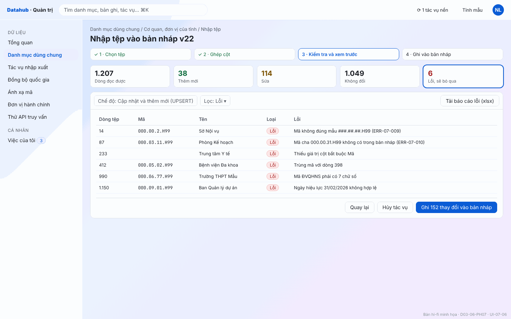

Trình hướng dẫn có bốn bước: **Chọn tệp**, **Ghép cột**, **Xem trước**, **Kết quả**. Bước 1 và 2 chạy trên trình duyệt trước khi tải lên toàn bộ; từ bước 3, tác vụ nhập đã có `jobId` nên URL đổi sang `/du-lieu/danh-muc/nhap/:ma-tac-vu`, người dùng có thể đóng trang và quay lại từ UI-07-08 hoặc từ thông báo.

### 12.2. Bố cục

```text
┌──────────────────────────────────────────────────────────────────────────────────────────┐
│ Trang chủ › Danh mục dùng chung › Danh mục › Loại hình doanh nghiệp › Nhập tệp             │
│ Nhập tệp vào bản nháp v4 · LOAI_HINH_DN                                    [Tải khuôn mẫu ⤓]│
│ ( 1 Chọn tệp )───( 2 Ghép cột )───( 3 Xem trước )───( 4 Kết quả )                         │
├──────────────────────────────────────────────────────────────────────────────────────────┤
│ BƯỚC 1                                                                                   │
│ ┌────────────────────────────────────────────────────────────┐ ┌───────────────────────┐ │
│ │        ⤒  Kéo thả tệp vào đây hoặc [Chọn tệp]               │ │ Lưu ý                 │ │
│ │        .xlsx, .csv · tối đa 50 MB · 200.000 dòng            │ │ • Dùng khuôn mẫu để   │ │
│ └────────────────────────────────────────────────────────────┘ │   tránh lỗi ghép cột  │ │
│ Tệp: loai_hinh_dn.xlsx · 48 KB · sheet [DuLieu ▾]               │ • Tệp xuất từ Aita    │ │
│ Khuôn tệp      (•) Tự nhận  ( ) Khuôn Datahub  ( ) Khuôn Aita    │   được tự nhận dạng   │ │
│ Chế độ nhập    (•) Thêm và cập nhật  ( ) Thay thế  ( ) Chỉ thêm  │ • Tệp được quét mã    │ │
│                └ giải thích chế độ đang chọn (Alert thông tin)   │   độc trước khi đọc   │ │
│ [⌄ Tùy chọn nâng cao] Ô rỗng là xóa giá trị ☐ · Tự đánh thứ tự ☑ │                       │ │
│                       Dòng tiêu đề [1] Dòng dữ liệu đầu [2]      │                       │ │
├──────────────────────────────────────────────────────────────────────────────────────────┤
│ [Hủy]                                                          [Quay lại] [Tiếp tục →]   │  ← chân dính glass
└──────────────────────────────────────────────────────────────────────────────────────────┘

BƯỚC 3 (sau khi tải lên)
│ ┌Tổng 1.204┐┌Hợp lệ 1.180┐┌Lỗi 24┐┌Thêm 36┐┌Cập nhật 102┐┌Ngừng dùng 0┐┌Giữ nguyên 1.042┐ │
│ ⚠ 24 dòng lỗi. Sửa tệp rồi tải lại, hoặc chọn "Bỏ qua dòng lỗi" khi ghi.  [Tải báo cáo lỗi]│
│ Lọc: [Tất cả ▾]  [🔍 mã, tên]                                                             │
│ ┌──────┬──────────┬────────────────┬──────────┬─────────┬────────────────────────────────┐│
│ │Dòng  │Hành động │Mã              │Tên       │…cột tệp │Lỗi                             ││
│ │  17  │➕ Thêm    │9001            │Hợp tác xã│         │                                ││
│ │  42  │⛔ Lỗi     │(trống)         │…         │         │Bắt buộc nhập Mã (cột A)         ││
│ └──────┴──────────┴────────────────┴──────────┴─────────┴────────────────────────────────┘│
│ ☐ Bỏ qua 24 dòng lỗi (và 2 dòng con của chúng)       Hết hạn xem trước: 26/11/2026 09:15 │
│ [Hủy tác vụ]                                       [Quay lại] [Ghi vào bản nháp]          │
```

Bước 3 đặt thẻ tóm tắt trên cùng vì quyết định "ghi hay sửa tệp" dựa vào số dòng lỗi và số bản ghi bị tác động; bảng xem trước chỉ để tra chi tiết. Nút "Ghi vào bản nháp" nằm ở chân dính để luôn thấy dù bảng dài.

### 12.3. Thành phần bước 1 · Chọn tệp

| STT | Tên | Loại | Nhãn | Kiểu | Bắt buộc | Kiểm tra hợp lệ | Mặc định | Nguồn |
|---|---|---|---|---|---|---|---|---|
| 1 | Vùng thả tệp | `Upload.Dragger` (`CMP-Upload`) | Kéo thả tệp vào đây hoặc Chọn tệp | T-FILE | Có | Phần mở rộng `.xlsx`, `.csv`; ≤ `07.rdm.import-max-mb` MB; một tệp | — | `file` của API-07-033 |
| 2 | Chọn sheet | `Select` | Sheet dữ liệu | chuỗi | Khi xlsx có nhiều sheet | Sheet tồn tại | `DuLieu`, không có thì sheet đầu | đọc phía client bằng SheetJS trong Web Worker (chỉ danh sách sheet và 20 dòng đầu) |
| 3 | Khuôn tệp | `Radio.Group` | Khuôn tệp: Tự nhận · Khuôn Datahub · Khuôn Aita | `AUTO`/`STANDARD`/`LEGACY_AITA` | Có | Khuôn Aita chỉ hiện khi cờ `07.rdm.feature.aita-template` bật | `AUTO` | `template` |
| 4 | Chế độ nhập | `Radio.Group` có mô tả | Thêm và cập nhật · Thay thế toàn bộ · Chỉ thêm mới | `UPSERT`/`REPLACE`/`APPEND` | Có | Ẩn khi tạo danh mục từ tệp | `UPSERT` | `mode` |
| 5 | Ô rỗng là xóa giá trị | `Checkbox` | Ô trống trong tệp nghĩa là xóa giá trị hiện có | bool | Không | Chỉ hiện với `UPSERT` | tắt | `options.emptyMeansNull` |
| 6 | Tự đánh thứ tự | `Checkbox` | Tự đánh số thứ tự theo thứ tự dòng cho bản ghi mới | bool | Không | — | bật | `options.autoSortOrder` |
| 7 | Dòng tiêu đề, dòng dữ liệu đầu | `InputNumber` × 2 | Dòng tiêu đề · Dòng dữ liệu đầu tiên | số nguyên | Không | 1…50; dòng dữ liệu > dòng tiêu đề | 1, 2 (khuôn Aita: 4, 5) | `headerRow`, `firstDataRow` |
| 8 | Tạo bản nháp nếu chưa có | `Checkbox` | Danh mục chưa có bản nháp. Tạo bản nháp v{n+1} từ phiên bản hiện hành | bool | Khi không có bản nháp | — | bật | `createDraft` |
| 9 | Thông tin danh mục mới | `CMP-DynamicForm` (mã, tên, nhóm, đơn vị chủ quản) | Chỉ ở chế độ tạo danh mục | như UI-07-03 bước 1 | Có | Như UI-07-03 | lấy từ ô A2 khi khuôn Aita | `newCatalog` |
| 10 | Tải khuôn mẫu | `Dropdown.Button` | Tải khuôn mẫu ▾ (Excel, CSV) | — | — | — | — | API-07-032 `?format=xlsx|csv` |

: Thành phần bước 1 · Chọn tệp

Mô tả chế độ hiển thị ngay dưới lựa chọn, lấy đúng bảng hành vi của FR-07-021: "Thêm và cập nhật: mã mới được thêm, mã đã có được cập nhật các cột có trong tệp, bản ghi không có trong tệp giữ nguyên." · "Thay thế toàn bộ: bản nháp sẽ giống hệt tệp. Bản ghi đã từng phát hành mà không có trong tệp sẽ bị ngừng dùng, bản ghi mới thêm trong nháp sẽ bị xóa." · "Chỉ thêm mới: mã đã có trong bản nháp bị báo lỗi." Chọn "Thay thế toàn bộ" hiện thêm `Alert` cảnh báo vàng.

Kiểm tra phía client trước khi cho sang bước 2: phần mở rộng, kích thước, và chữ ký tệp (4 byte đầu `50 4B 03 04` với xlsx) để báo sớm "Tệp không phải Excel hợp lệ." mà không phải tải lên. Máy chủ vẫn kiểm tra lại (ERR-07-019, ERR-07-043).

### 12.4. Thành phần bước 2 · Ghép cột

Bước 2 cho người dùng xác nhận cột nào trong tệp ứng với trường nào. Giao diện đọc dòng tiêu đề và 20 dòng đầu phía client, gọi API-07-048 lấy lược đồ bản nháp, rồi đề xuất ghép theo quy tắc của FRS mục 5.3.0 (khớp mã trường, khớp nhãn không dấu, khớp đồng nghĩa `MA`, `TEN`, `MA_CHA`, `THU_TU`, `TRANG_THAI`, `MA_THAY_THE`).

| STT | Tên | Loại | Nhãn | Ghi chú |
|---|---|---|---|---|
| 1 | Bảng ghép cột | `Table` mật độ gọn | Cột trong tệp · Ví dụ giá trị (3 dòng đầu) · Ghép vào trường · Kiểu trường · Trạng thái | Mỗi dòng là một cột của tệp |
| 2 | Ô ghép vào trường | `Select` `allowClear` | Ghép vào trường | Danh sách trường hệ thống (`code`, `name`, `parentCode`, `sortOrder`, `status`, `replacedBy`, `validFrom`, `validTo`) và thuộc tính của bản nháp; mục "— Bỏ qua cột này —" |
| 3 | Trạng thái ghép | `CMP-StatusTag` | Tự ghép · Đã chỉnh · Bỏ qua · Thiếu | "Thiếu" hiện ở dòng tổng hợp cho trường bắt buộc chưa ghép |
| 4 | Cảnh báo kiểu | biểu tượng ⚠ với tooltip | "3 trong 20 giá trị mẫu không phải ngày dd/MM/yyyy" | Kiểm tra trên 20 dòng mẫu, chỉ cảnh báo |
| 5 | Nút Đặt lại đề xuất | `Button` | Đặt lại theo đề xuất | |

: Thành phần bước 2 · Ghép cột

Hai trường `code` và `name` bắt buộc ghép; nút "Tiếp tục" vô hiệu kèm tooltip "Cần ghép cột Mã và cột Tên." cho tới khi đủ. Một trường chỉ được ghép với một cột; chọn trùng thì dòng cũ tự chuyển "Bỏ qua" kèm thông báo. Với chế độ tạo danh mục, bảng có thêm cột "Kiểu đề xuất" (suy kiểu theo FR-07-051 bước 6 trên 20 dòng mẫu) và người dùng chỉnh được kiểu; lược đồ cuối cùng do máy chủ suy trên toàn bộ tệp và hiển thị lại ở bước 3.

Bấm "Tiếp tục" tải tệp lên bằng API-07-033 (multipart, `Idempotency-Key` sinh một lần cho lượt chọn tệp, giữ khi thử lại), kèm `columnMapping` đã chỉnh. Thanh tiến độ tải lên hiển thị phần trăm byte; khi nhận `202`, router chuyển `/rdm/import/{jobId}`.

### 12.5. Bước 3 · Xem trước

Khi tác vụ chưa xong pha 1, bước 3 hiển thị tiến độ theo trạng thái thay vì bảng: `UPLOADED` "Đã tải lên, đang chờ xử lý", `SCANNING` "Đang quét an toàn tệp", `PARSING` "Đang đọc tệp ({progress}%)", `VALIDATING` "Đang kiểm tra dữ liệu". Giao diện thăm dò API-07-034 mỗi 2 giây trong 1 phút đầu, sau đó mỗi 5 giây, dừng khi tab ẩn (Page Visibility API) và tiếp tục khi hiện lại. Người dùng có nút "Chạy nền và quay lại sau", đưa tác vụ vào khay tác vụ nền.

Khi `VALIDATED`, bước 3 hiển thị:

| STT | Tên | Loại | Nhãn | Nguồn |
|---|---|---|---|---|
| 1 | Thẻ tóm tắt | `CMP-KpiCard` × 7, bấm để lọc | Tổng · Hợp lệ · Lỗi · Thêm · Cập nhật · Ngừng dùng · Giữ nguyên (và Xóa khỏi nháp với `REPLACE`) | API-07-034 `summary` |
| 2 | Cảnh báo thay đổi lớn | `Alert` vàng | "Lần nhập này thay đổi {r}% bản ghi, vượt ngưỡng {t}%. Phiên bản sẽ phải qua duyệt." | `summary` so với `07.rdm.large-change-threshold-percent` |
| 3 | Cảnh báo ngừng dùng hàng loạt | `Alert` đỏ | "{n} bản ghi đã từng phát hành sẽ bị ngừng dùng vì không có trong tệp." | `summary.deprecate` khi `REPLACE` |
| 4 | Bộ lọc hành động | `Select` | Hiển thị: Tất cả · Chỉ dòng lỗi · Thêm · Cập nhật · Ngừng dùng · Xóa khỏi nháp | `filter` → `action`, `valid` của API-07-035 |
| 5 | Ô tìm | `Input.Search` | Tìm theo mã, tên | `q` của API-07-035 |
| 6 | Bảng xem trước | `CMP-DataTable` ảo hóa, mật độ gọn | Dòng · Hành động · Mã · Tên · các cột đã ghép · Lỗi | API-07-035 phân trang máy chủ 100 dòng |
| 7 | Tải báo cáo lỗi | `Button` | Tải báo cáo lỗi (Excel) | API-07-035 `?format=xlsx` |
| 8 | Bỏ qua dòng lỗi | `Checkbox` | Bỏ qua {n} dòng lỗi khi ghi | `skipErrors` của API-07-036 |
| 9 | Hạn xem trước | chữ phụ | Hết hạn xem trước: {expiresAt} | `expiresAt` |

: Bước 3 · Xem trước

Với dòng `UPDATE`, ô có giá trị thay đổi hiển thị theo quy ước ba màu khác biệt (mục 5.2): giá trị cũ gạch ngang, giá trị mới in đậm; tooltip trên ô lỗi ghi đầy đủ thông điệp, cột Lỗi gộp mọi lỗi của dòng dạng "Cột C (Mã cha): Mã cha "99" không tồn tại." Dòng ảo `row_no = 0` (bản ghi bị ngừng dùng hoặc xóa vì không có trong tệp ở chế độ `REPLACE`) hiển thị "—" ở cột Dòng và nhãn "Không có trong tệp".

### 12.6. Bước 4 · Kết quả

Sau khi ghi thành công (`COMMITTED`), bước 4 hiển thị `Result` thành công "Đã ghi {inserted} bản ghi mới, cập nhật {updated}, ngừng dùng {deprecated} vào bản nháp v{n}." cùng ba nút: "Mở bản nháp" (UI-07-05), "So sánh với phiên bản hiện hành" (UI-07-07), "Nhập tệp khác". Khi tác vụ `FAILED`, bước 4 hiển thị `Result` lỗi với `errorMessage` đã che và nút "Thử lại với cùng tệp" (gọi lại API-07-033 với cùng `sha256`, máy chủ không bắt tải lại theo FR-07-021 pha 2 bước 2).

### 12.7. Hành động

| Hành động | Vị trí | Hiện khi | API | Xác nhận | Kết quả | Thông báo |
|---|---|---|---|---|---|---|
| Tải khuôn mẫu | Đầu trang | Luôn | API-07-032 | Không | Tải tệp | — |
| Tiếp tục (bước 1 → 2) | Chân | Đã chọn tệp hợp lệ | — | Không | Sang bước 2 | — |
| Tải lên (bước 2 → 3) | Chân, nhãn "Tải lên và kiểm tra" | Đủ cột bắt buộc | API-07-033 | Không | Tạo tác vụ, chuyển route | — |
| Ghi vào bản nháp | Chân bước 3 | `VALIDATED`, chưa hết hạn, `errorRows = 0` hoặc đã chọn bỏ qua | API-07-036 (`If-Match`) | Với `REPLACE` có ngừng dùng vượt ngưỡng: hộp xác nhận lần hai nhập lại số bản ghi bị ngừng dùng | Sang bước 4 | "Đã ghi kết quả nhập vào bản nháp." |
| Hủy tác vụ | Chân bước 3 | Trạng thái chưa kết thúc | API-07-037 | `CMP-ConfirmDialog` "Hủy tác vụ nhập? Dữ liệu xem trước sẽ bị xóa." | Về UI-07-02 | "Đã hủy tác vụ nhập." |
| Hủy (bước 1–2) | Chân | Chưa tải lên | — | Có nếu đã chọn tệp | Quay lại trang trước | — |
| Chạy nền | Bước 3 khi đang xử lý | Tác vụ đang chạy | — | Không | Đưa vào khay tác vụ, về trang trước | "Tác vụ nhập đang chạy nền. Bạn sẽ nhận thông báo khi xong." |

: Hành động

### 12.8. Thông điệp riêng

| Tình huống | Mã | Câu |
|---|---|---|
| Tệp nhiễm mã độc | ERR-07-038 | "Tệp không an toàn và đã bị cách ly. Liên hệ bộ phận an toàn thông tin nếu bạn tin đây là nhầm lẫn." |
| Tệp sai định dạng, quá lớn, quá nhiều dòng, thiếu cột | ERR-07-019 | Theo `detail` của máy chủ, ví dụ "Tệp có 214.003 dòng, vượt giới hạn 200.000 dòng." |
| Đã có tác vụ nhập khác đang chạy cho danh mục | ERR-07-020 | "Danh mục đang có một tác vụ nhập chưa xong. [Mở tác vụ đó]" |
| Bản nháp bị sửa sau khi kiểm tra | ERR-07-020 | "Bản nháp vừa được sửa sau khi kiểm tra tệp. Cần kiểm tra lại. [Kiểm tra lại với cùng tệp]" |
| Còn dòng lỗi mà không chọn bỏ qua | ERR-07-021 | "Còn {n} dòng lỗi. Sửa tệp hoặc chọn "Bỏ qua dòng lỗi"." |
| Xem trước hết hạn | ERR-07-020 (`EXPIRED`) | "Kết quả xem trước đã hết hạn sau 24 giờ. Tải tệp lên lại để kiểm tra." |

: Thông điệp riêng

### 12.9. Khả năng truy cập

`Steps` có `aria-current="step"` ở bước hiện tại; tiêu đề bước là `h2` nhận focus khi chuyển bước. Vùng thả tệp dùng được bằng bàn phím (Enter, Space mở hộp chọn tệp) và có mô tả giới hạn qua `aria-describedby`. Tiến độ pha 1 dùng `role="progressbar"` có `aria-valuenow`, và các mốc trạng thái được đọc qua vùng `role="status"` (không đọc mỗi lần phần trăm đổi, chỉ khi đổi trạng thái). Bảng xem trước là `table` chỉ đọc (không phải `grid`), ô lỗi có văn bản lỗi đầy đủ trong DOM cho trình đọc màn hình, không chỉ tooltip.

## 13. Đặc tả UI-07-07 · So sánh phiên bản, trình duyệt, duyệt và phát hành

### 13.1. Thông tin chung

::: dac-ta
**Mục đích.** Cho người soạn rà khác biệt trước khi trình, cho người duyệt xem đúng những gì thay đổi để quyết định, và cho người phát hành chọn ngày hiệu lực, căn cứ pháp lý.

**Người dùng, quyền.** Người soạn (`PERM-07-submit`), người duyệt và phát hành (`PERM-07-publish`, DA, PA với `COMMON`); mọi người có `PERM-07-read` xem so sánh.

**FR, UC hiện thực.** FR-07-014, FR-07-015, FR-07-016, FR-07-017; UC-07-06, UC-07-07.

**Đường dẫn.** `/du-lieu/danh-muc/:ma/phien-ban/:v/so-sanh?so-voi=hien-hanh`.

**Mẫu bố cục.** PTN-10 Hộp việc và duyệt, biến thể so sánh (ngăn quyết định `CMP-DecisionPanel`).

**API.** API-07-013 (chi tiết phiên bản, `allowedActions`), API-07-021 (khác biệt), API-07-016 (kiểm tra toàn bản nháp), API-07-017 (trình, rút lại), API-07-018 (duyệt, thu hồi duyệt), API-07-019 (từ chối), API-07-020 (phát hành), API-07-015 (hủy bản nháp).
:::

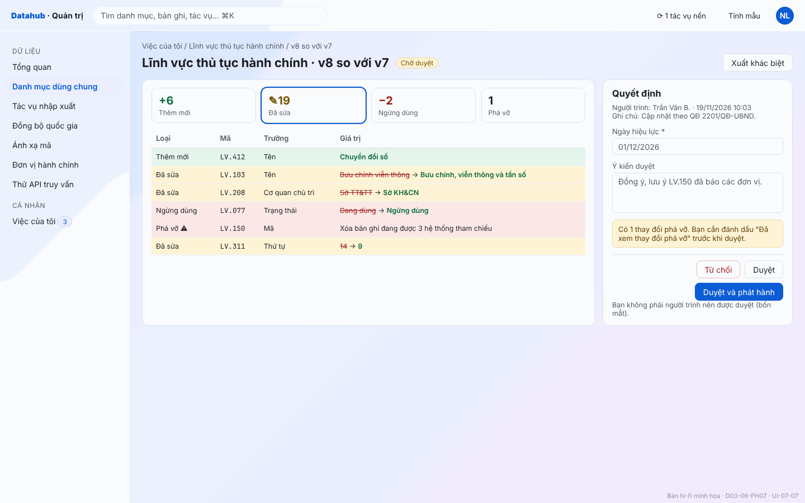

### 13.2. Bố cục

```text
┌──────────────────────────────────────────────────────────────────────────────────────────┐
│ … › Loại hình doanh nghiệp › Phiên bản v4 › So sánh với v3 (hiện hành)                     │
│ So sánh v4 [Chờ duyệt] với [v3 hiện hành ▾]                    [Rút lại] [Từ chối] [Duyệt] │
├──────────────────────────────────────────────────────────────────────────────────────────┤
│ ┌Thêm 36┐┌Sửa 102┐┌Ngừng dùng 4┐┌Phá vỡ 2 ⚠┐┌Lược đồ: +1 thuộc tính┐  Tỷ lệ thay đổi 11,8% │
│ ⚠ Có 2 thay đổi phá vỡ: ngừng dùng mã "3" không có mã thay thế; đổi kiểu "von_dieu_le".   │
│ ⓘ Vượt ngưỡng thay đổi lớn 10%: bắt buộc qua duyệt.                                       │
├──────────────────────────────────────────────────────┬───────────────────────────────────┤
│ [Bản ghi] [Thuộc tính] [Sự kiện sắp xếp]              │ Quyết định (ngăn dính, glass dày)  │
│ Lọc [Tất cả ▾] [☐ Chỉ phá vỡ] [🔍 mã, tên]            │ Trạng thái: Chờ duyệt              │
│ ┌────┬──────┬─────────────┬────────────┬───────────┐ │ Người trình: Nguyễn A · 21/11 08:30│
│ │Loại│Mã    │Trường       │v3          │v4         │ │ Ghi chú trình: "Bổ sung 2 loại…"   │
│ │➕  │9001  │Tên          │—           │Hợp tác xã │ │ Hiệu lực từ  [01/01/2027 📅]        │
│ │✎   │2     │Tên          │~~Công ty~~ │Công ty TNHH│ │ Căn cứ pháp lý [Quyết định 12/…  ]│
│ │⛔  │3     │Trạng thái   │Đang dùng   │Ngừng dùng │ │ Nhận xét  [                      ]│
│ │    │      │Mã thay thế  │—           │—  ⚠ phá vỡ│ │ [Từ chối]              [Duyệt]    │
│ └────┴──────┴─────────────┴────────────┴───────────┘ │ Lịch sử duyệt ▸                    │
└──────────────────────────────────────────────────────┴───────────────────────────────────┘
```

Bảng khác biệt nằm bên trái và chiếm phần lớn chiều rộng vì là nội dung chính; ngăn quyết định dính bên phải để người duyệt không phải cuộn lên khi quyết định. Ở độ rộng nhỏ hơn 1200 px, ngăn quyết định chuyển xuống chân dính.

### 13.3. Thành phần

| STT | Tên | Loại | Nhãn | Nguồn |
|---|---|---|---|---|
| 1 | Bộ chọn phiên bản đối chiếu | `Select` | So sánh với: v{n} (hiện hành) · v{n-1} · … · Phiên bản hiệu lực tại ngày… | API-07-011; tham số `against` |
| 2 | Thẻ tóm tắt khác biệt | `CMP-KpiCard` × 5, bấm để lọc | Thêm · Sửa · Ngừng dùng · Phá vỡ · Lược đồ | API-07-021 `stats` |
| 3 | Tỷ lệ thay đổi | chữ | Tỷ lệ thay đổi {r}% | `stats.changeRatio` |
| 4 | Cảnh báo phá vỡ | `Alert` vàng, liệt kê ≤ 5 mục kèm "Xem tất cả" | Có {n} thay đổi phá vỡ: … | `breaking[]` |
| 5 | Cảnh báo ngưỡng | `Alert` thông tin | Vượt ngưỡng thay đổi lớn {t}%: bắt buộc qua duyệt. | `approvalReasons` |
| 6 | Tab khác biệt | `Tabs` | Bản ghi · Thuộc tính · Sự kiện sắp xếp (chỉ ĐVHC) | — |
| 7 | Bảng khác biệt bản ghi | `CMP-DiffTable` ảo hóa | Loại · Mã · Trường · {phiên bản đối chiếu} · {phiên bản này} | API-07-021 `items[]` phân trang máy chủ |
| 8 | Bảng khác biệt thuộc tính | `CMP-DiffTable` | Loại · Mã thuộc tính · Thuộc tính thay đổi · Cũ · Mới · Phá vỡ | `attributes[]` |
| 9 | Ngăn quyết định | `CMP-DecisionPanel` | Theo trạng thái (bảng 13.4) | API-07-013 `allowedActions`, `reviews[]` |
| 10 | Ngày hiệu lực | `DatePicker` `DD/MM/YYYY` | Hiệu lực từ | `effectiveFrom`; kiểm tra phía client: ≥ hôm nay, > hiệu lực của phiên bản trước, ≤ hôm nay + `07.rdm.max-future-effective-days` |
| 11 | Căn cứ pháp lý | `Input.TextArea` | Căn cứ pháp lý (số hiệu, ngày, cơ quan ban hành) | `legalBasis`, ≤ 1.000; bắt buộc khi danh mục `require_approval` |
| 12 | Lý do hồi tố | `Input.TextArea` | Lý do áp dụng hồi tố | `retroactiveReason`, 10…1.000; chỉ hiện với `origin` SYNC, MIGRATION khi ngày < hôm nay |
| 13 | Nhận xét | `Input.TextArea` `showCount` | Nhận xét | `comment`; bắt buộc khi duyệt (1…4.000) và từ chối (10…4.000) |
| 14 | Lịch sử duyệt | `Timeline` thu gọn | Lịch sử duyệt | `reviews[]` |

: Thành phần

Một dòng của bảng khác biệt bản ghi là một trường thay đổi của một bản ghi; các dòng cùng mã được gộp nhóm (dòng đầu có mã, các dòng sau để trống) để đọc theo bản ghi. Bấm mã mở ngăn kéo "Chi tiết bản ghi" so sánh toàn bộ trường hai phiên bản cạnh nhau.

### 13.4. Ngăn quyết định theo trạng thái

| Trạng thái phiên bản | Người xem | Nội dung ngăn | Nút |
|---|---|---|---|
| `DRAFT` | Người soạn có `PERM-07-submit` | Kết quả kiểm tra toàn bản nháp (nút "Kiểm tra lại"), ngày hiệu lực dự kiến, căn cứ, ghi chú trình | **Trình duyệt**; **Phát hành ngay** khi danh mục không cần duyệt và không phá vỡ, không vượt ngưỡng (BR-07-012); **Hủy bản nháp** |
| `IN_REVIEW` | Người trình | Trạng thái chờ, người trình, thời điểm | **Rút lại** (API-07-017 `action = WITHDRAW`) |
| `IN_REVIEW` | Người duyệt khác người trình | Ô nhận xét | **Từ chối**, **Duyệt** |
| `IN_REVIEW` | Người duyệt đồng thời là người trình hoặc người sửa cuối | Nút vô hiệu, tooltip "Bạn đã trình hoặc sửa phiên bản này nên không được duyệt (nguyên tắc bốn mắt)." | — |
| `APPROVED` | Người có `PERM-07-publish` khác người trình | Ngày hiệu lực, căn cứ pháp lý, lý do hồi tố (nếu có), xem trước thông báo "Phiên bản sẽ có hiệu lực từ {ngày}" | **Phát hành**, **Từ chối**; người đã duyệt có thêm **Thu hồi duyệt** (API-07-018 `action = UNAPPROVE`) |
| `PUBLISHED` | Mọi người | Ngày hiệu lực, người phát hành, liên kết tải ảnh chụp | — |

: Ngăn quyết định theo trạng thái

Trước khi trình, giao diện gọi API-07-016 kiểm tra toàn bản nháp; còn lỗi thì nút "Trình duyệt" vô hiệu, ngăn quyết định liệt kê số lỗi và liên kết "Mở trình sửa, lọc dòng lỗi" (UI-07-05 với `invalid=1`).

### 13.5. Hành động

| Hành động | API | Xác nhận | Kết quả | Thông báo |
|---|---|---|---|---|
| Kiểm tra lại | API-07-016 | Không | Cập nhật kết quả kiểm tra | "Bản nháp hợp lệ." hoặc "Còn {n} lỗi." |
| Trình duyệt | API-07-017 (`If-Match`) | Không | `IN_REVIEW`; EVT-07-04 tạo việc cho người duyệt | "Đã trình duyệt phiên bản v{n}." |
| Rút lại | API-07-017 `action = WITHDRAW` | `CMP-ConfirmDialog` | `DRAFT` | "Đã rút lại, phiên bản trở về bản nháp." |
| Duyệt | API-07-018 | Không (nhận xét bắt buộc) | `APPROVED` | "Đã duyệt phiên bản v{n}." |
| Thu hồi duyệt | API-07-018 `action = UNAPPROVE` | Xác nhận | `IN_REVIEW` | "Đã thu hồi duyệt." |
| Từ chối | API-07-019 | Ô lý do bắt buộc | `DRAFT`; EVT-07-06 báo người trình | "Đã từ chối và trả về người soạn." |
| Phát hành | API-07-020 | `CMP-ConfirmDialog` tóm tắt: số thay đổi, ngày hiệu lực, căn cứ, "Phiên bản đã phát hành không sửa được." | `PUBLISHED`; hiện tiến độ sinh ảnh chụp | "Đã phát hành v{n}, hiệu lực từ {ngày}." |
| Phát hành ngay | API-07-020 từ `DRAFT` | Như trên | `PUBLISHED` | Như trên |
| Hủy bản nháp | API-07-015 | Xác nhận nguy hiểm | Về UI-07-02 | "Đã hủy bản nháp v{n}." |

: Hành động

### 13.6. Thông điệp riêng

| Tình huống | Mã | Câu |
|---|---|---|
| Vi phạm bốn mắt | ERR-07-015 | "Người trình hoặc người sửa cuối không được duyệt, phát hành phiên bản của chính mình." |
| Phát hành thẳng khi có thay đổi lớn, phá vỡ | ERR-07-016 | "Phiên bản có thay đổi lớn hoặc phá vỡ nên phải trình duyệt trước khi phát hành." |
| Ngày hiệu lực không hợp lệ | ERR-07-017 | Theo `detail`, ví dụ "Ngày hiệu lực phải sau 01/07/2025, ngày hiệu lực của phiên bản v3." |
| Phiên bản đã đổi trạng thái do người khác | ERR-07-004, ERR-07-018 | "Phiên bản vừa được người khác xử lý. [Tải lại]" |

: Thông điệp riêng

### 13.7. Khả năng truy cập

Bảng khác biệt theo mẫu bảng khác biệt ở mục 20.3: mỗi dòng có cột "Loại" bằng chữ, giá trị cũ, mới có tiền tố ẩn "Giá trị cũ:", "Giá trị mới:". Thẻ tóm tắt là nút bật tắt có `aria-pressed`. Ngăn quyết định là `complementary` có `aria-label="Quyết định phiên bản"`; nút bị vô hiệu dùng `aria-disabled="true"` (không dùng `disabled`) để vẫn nhận focus và đọc được lý do qua `aria-describedby`.


## 14. Đặc tả UI-07-08 · Tác vụ nhập xuất

### 14.1. Thông tin chung

::: dac-ta
**Mục đích.** Xem lịch sử và trạng thái mọi tác vụ nhập, xuất, di trú của tenant; tải tệp xuất, báo cáo lỗi; mở lại tác vụ dở dang.

**Người dùng, quyền.** Người có `PERM-07-create`, `PERM-07-update` hoặc `PERM-07-export`; TA, PA xem mọi tác vụ, người khác mặc định xem tác vụ của mình.

**FR, UC hiện thực.** FR-07-024, FR-07-025, FR-07-051 (báo cáo chạy thử di trú); UC-07-08, UC-07-16.

**Đường dẫn.** `/du-lieu/danh-muc/tac-vu`.

**Mẫu bố cục.** PTN-01 Danh sách.

**API.** API-07-040 (danh sách), API-07-034, API-07-039 (chi tiết), API-07-035 (báo cáo lỗi), API-07-037 (hủy).
:::

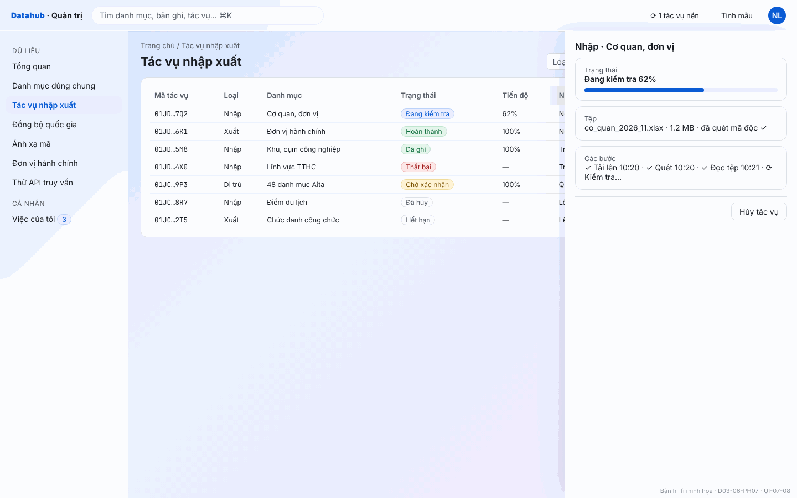

### 14.2. Bố cục

```text
┌──────────────────────────────────────────────────────────────────────────────────────────┐
│ Trang chủ › Danh mục dùng chung › Tác vụ nhập xuất                                         │
│ Tác vụ nhập xuất                                                                          │
│ [Loại ▾ Nhập, Xuất, Di trú] [Trạng thái ▾] [Danh mục ▾] [Từ ngày – đến ngày] [☑ Của tôi]   │
├────────┬───────┬───────────────┬────────────────┬──────────┬────────────┬────────┬────────┤
│Thời điểm│Loại  │Danh mục       │Tệp             │Trạng thái│Kết quả     │Người   │ ⋯      │
│21/11 08:30│Nhập │LOAI_HINH_DN v4│loai_hinh.xlsx  │Chờ xác   │1.180/1.204 │Nguyễn A│[Mở]    │
│         │      │               │                │nhận ghi  │24 lỗi      │        │        │
│21/11 07:02│Xuất │DVHC v12       │DVHC_v12.xlsx   │Hoàn thành│3.355 dòng  │Trần B  │[Tải ⤓] │
│20/11 16:40│Di trú│(32 danh mục) │aita_T68.dump   │Chờ xác   │29 tạo, 3 gộp│Lê C   │[Báo cáo]│
├────────┴───────┴───────────────┴────────────────┴──────────┴────────────┴────────┴────────┤
│ Tổng 57 tác vụ                                                  ‹ 1 2 3 › [20 / trang ▾]  │
```

### 14.3. Thành phần và hành động

| STT | Tên | Loại | Nhãn | Nguồn |
|---|---|---|---|---|
| 1 | Lọc loại | `Select mode="multiple"` | Loại: Nhập · Xuất · Di trú | `type` → `jobType` |
| 2 | Lọc trạng thái | `Select mode="multiple"` | Trạng thái | `status`; nhãn theo mục 5.1 |
| 3 | Lọc danh mục | `Select showSearch` tìm từ xa | Danh mục | `catalogCode` |
| 4 | Khoảng ngày | `DatePicker.RangePicker` | Từ ngày – đến ngày | `from`, `to`, tối đa 366 ngày |
| 5 | Của tôi | `Switch` | Chỉ tác vụ của tôi | `mine`; mặc định bật, trừ TA, PA |
| 6 | Bảng tác vụ | `CMP-DataTable` | Thời điểm · Loại · Danh mục · Tệp · Trạng thái · Kết quả · Người tạo · Thao tác | API-07-040 |

: Thành phần và hành động: STT, Tên

| Hành động | Hiện khi | API | Kết quả |
|---|---|---|---|
| Mở | Tác vụ nhập chưa kết thúc hoặc `VALIDATED` | — | Mở UI-07-06 bước 3 |
| Tải tệp | Tác vụ xuất `COMPLETED`, chưa hết hạn | API-07-039 lấy URL ký sẵn 15 phút, tải ngay | Trình duyệt tải tệp |
| Tải báo cáo lỗi | Tác vụ nhập có `errorRows > 0` | API-07-035 `?format=xlsx` | Tải tệp |
| Báo cáo di trú | Tác vụ `MIGRATION` | API-07-034 | Mở ngăn kéo báo cáo chạy thử: danh mục, quyết định đề xuất, vấn đề, nút "Chỉnh đề xuất" cho DS, "Chốt cấu hình" cho TA |
| Hủy | Tác vụ chưa kết thúc; người tạo hoặc TA | API-07-037 | Trạng thái `CANCELLED` |

: Thành phần và hành động: Hành động, Hiện khi

Danh sách tự làm mới mỗi 10 giây khi có dòng ở trạng thái đang xử lý, chỉ khi tab đang hiển thị. Tác vụ hết hạn hiển thị nút tải ở trạng thái vô hiệu kèm tooltip "Tệp đã hết hạn tải sau 24 giờ. Xuất lại để tải."

### 14.4. Khả năng truy cập

Bảng có `aria-label="Tác vụ nhập xuất"`; trạng thái đang xử lý đổi được đọc qua `role="status"` chỉ khi trạng thái của một dòng đổi ("Tác vụ xuất DVHC v12 đã hoàn thành."), không đọc mỗi lần làm mới.

## 15. Đặc tả UI-07-09 · Đồng bộ danh mục quốc gia

### 15.1. Thông tin chung

::: dac-ta
**Mục đích.** Cấu hình nguồn đồng bộ danh mục từ Nền tảng chia sẻ, điều phối dữ liệu quốc gia, xem lịch sử lần chạy, xác nhận hoặc từ chối thay đổi phá vỡ, khám phá danh mục quốc gia để đăng ký.

**Người dùng, quyền.** TA, DA, PA với `PERM-07-sync`; DS xem chỉ đọc (Q07-68).

**FR, UC hiện thực.** FR-07-035, FR-07-036, FR-07-037, FR-07-038; UC-07-11.

**Đường dẫn.** `/du-lieu/dong-bo-quoc-gia?tab=nguon.

**Mẫu bố cục.** PTN-01 (ba tab), PTN-10 biến thể so sánh (chi tiết lần chạy).

**API.** API-07-055…063.
:::

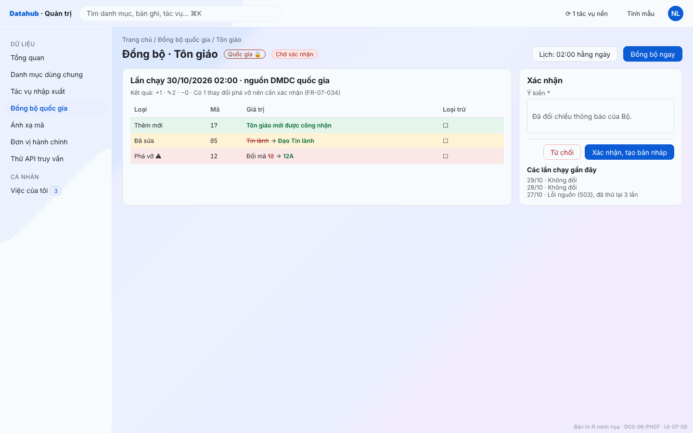

### 15.2. Bố cục

```text
┌──────────────────────────────────────────────────────────────────────────────────────────┐
│ Đồng bộ quốc gia                                              [+ Đăng ký danh mục quốc gia]│
│ [Nguồn đồng bộ] [Lần chạy (2 chờ xác nhận)] [Khám phá danh mục quốc gia]                 │
├──────────────────────────────────────────────────────────────────────────────────────────┤
│ Danh mục       │Mã nguồn     │Lịch            │Tự áp dụng│Lần chạy cuối  │Thành công cuối│⋯│
│ DM_DAN_TOC 🔒   │DANTOC       │Hằng ngày 01:00 │Có        │Không thay đổi │25/11 01:00    │⋯│
│ LOAI_HINH_QG 🔒 │LHTCKT       │Hằng ngày 01:00 │Không     │⚠ Chờ xác nhận │18/11 01:00 ⚠7n│⋯│
│ DM_TON_GIAO 🔒  │TONGIAO      │Thứ 2 hằng tuần │Có        │⛔ Lỗi          │10/11 01:00 ⚠15n│⋯│
└──────────────────────────────────────────────────────────────────────────────────────────┘

CHI TIẾT LẦN CHẠY (/du-lieu/dong-bo-quoc-gia/lan-chay/:ma-lan-chay)
│ Lần đồng bộ LOAI_HINH_QG · 25/11/2026 01:00 · [Chờ xác nhận]                              │
│ ┌Thêm 3┐┌Sửa 12┐┌Gỡ khỏi nguồn 1 ⚠┐┌Lỗi 0┐   Phiên bản nguồn: 2026-11-24T17:00Z          │
│ ⚠ 1 thay đổi phá vỡ: mã "55" không còn trên nguồn quốc gia.                              │
│ (bảng khác biệt như UI-07-07)                    │ ☐ Bỏ qua bản ghi lỗi                    │
│                                                 │ Loại trừ mã: [55 ×]                     │
│                                                 │ ☐ Phát hành ngay (cần quyền phát hành)  │
│                                                 │ [Từ chối]               [Xác nhận áp dụng]│
```

### 15.3. Thành phần

| STT | Tên | Loại | Nhãn | Kiểm tra | Nguồn |
|---|---|---|---|---|---|
| 1 | Bảng nguồn | `CMP-DataTable` | Danh mục · Mã nguồn · Lịch · Tự áp dụng · Lần chạy cuối · Thành công cuối · Bật | — | API-07-055 |
| 2 | Cảnh báo độ tươi | biểu tượng ⚠ và chữ "{n} ngày" | — | `lastSuccessAt` cũ hơn `07.rdm.sync-stale-alert-days` | API-07-055 |
| 3 | Biểu mẫu nguồn (ngăn kéo) | `CMP-Drawer` + `Form` | Sửa nguồn đồng bộ | | API-07-056, 057 |
| 3a | Lịch | `CMP-CronPicker` | Lịch chạy: Hằng ngày lúc · Hằng tuần vào · Tùy chỉnh (cron) | Không dày hơn một giờ; xem trước "Lần chạy kế tiếp: 26/11/2026 01:00" | `scheduleCron` |
| 3b | Tự áp dụng | `Switch` | Tự áp dụng thay đổi không phá vỡ | — | `autoApply` |
| 3c | Ghép trường | `Table` hai cột | Trường nguồn · Thuộc tính trong Datahub | Đủ `code`, `name` | `fieldMapping`; gợi ý tự động khi rỗng |
| 3d | Bật | `Switch` | Đang bật | — | `enabled` |
| 4 | Bảng lần chạy | `CMP-DataTable` | Bắt đầu · Danh mục · Kích hoạt (Lịch, Thủ công) · Trạng thái · Thay đổi · Phá vỡ · Người xác nhận | — | API-07-059 |
| 5 | Ngăn xác nhận | `CMP-DecisionPanel` | Bỏ qua bản ghi lỗi · Loại trừ mã · Phát hành ngay | Loại trừ mã thuộc danh sách thay đổi | API-07-061 |
| 6 | Khám phá | `CMP-DataTable` + tìm kiếm | Mã nguồn · Tên · Cơ quan ban hành · Tình trạng tại tỉnh (Chưa đăng ký, Đã đăng ký, Có trong danh mục dùng chung) | — | API-07-063 |
| 7 | Trình đăng ký | `CMP-Drawer` ba bước | Chọn danh mục → Xem lược đồ đề xuất, ghép trường → Xác nhận | Mã cục bộ T-CODE; lý do bắt buộc khi danh mục đã có trong dùng chung | API-07-056 |

: Thành phần

### 15.4. Hành động

| Hành động | Hiện khi | API | Xác nhận | Thông báo |
|---|---|---|---|---|
| Chạy ngay | `PERM-07-sync`, nguồn bật | API-07-058 | Không | "Đã bắt đầu đồng bộ. Kết quả sẽ có trong mục Lần chạy." ERR-07-005 (đang chạy) mở lần chạy hiện tại |
| Sửa nguồn | `PERM-07-sync` | API-07-057 | Không | "Đã lưu nguồn đồng bộ. Lịch mới áp dụng trong 1 phút." |
| Xác nhận áp dụng | Lần chạy `PENDING_CONFIRMATION` | API-07-061 | Tóm tắt số thay đổi sẽ áp dụng | "Đã áp dụng thay đổi, phiên bản v{n} {đã phát hành | đã trình duyệt}." |
| Từ chối | Như trên | API-07-062 | Ô lý do bắt buộc | "Đã từ chối thay đổi từ nguồn quốc gia." |
| Đăng ký danh mục | `PERM-07-sync` | API-07-056 | Bước 3 của trình | "Đã đăng ký đồng bộ. Lần chạy đầu đang chuẩn bị dữ liệu để bạn xác nhận." |

: Hành động

### 15.5. Thông điệp riêng

| Tình huống | Mã | Câu |
|---|---|---|
| Nguồn quốc gia không phản hồi | ERR-07-028 | "Không kết nối được nền tảng dữ liệu quốc gia. Hệ thống sẽ thử lại theo lịch; bạn có thể chạy lại sau ít phút." |
| Phiên bản gốc đã đổi khi xác nhận | ERR-07-029 | "Danh mục vừa thay đổi sau lần đồng bộ này. Chạy đồng bộ lại để có khác biệt mới nhất." |
| Danh mục địa phương không đồng bộ được | ERR-07-003 | "Chỉ danh mục nguồn quốc gia mới cấu hình đồng bộ được. Đổi nguồn danh mục trước." |

: Thông điệp riêng

## 16. Đặc tả UI-07-10 · Hệ thống mã ngoài, bảng ánh xạ và độ phủ

### 16.1. Thông tin chung

::: dac-ta
**Mục đích.** Khai báo hệ thống mã của HTTT ngoài, quản lý bảng ánh xạ mã danh mục ↔ mã ngoài theo thời gian hiệu lực, theo dõi độ phủ.

**Người dùng, quyền.** Người có `PERM-07-mapping` (sửa); mọi người có `PERM-07-read` (xem).

**FR, UC hiện thực.** FR-07-040, FR-07-041, FR-07-042, FR-07-043; UC-07-13.

**Đường dẫn.** `/du-lieu/danh-muc/anh-xa`, `/du-lieu/danh-muc/anh-xa/:ma-he-ma?danh-muc=:ma`.

**Mẫu bố cục.** PTN-01 (danh sách hệ thống mã), PTN-07 biến thể soạn thảo bảng (bảng ánh xạ).

**API.** API-07-064…071.
:::

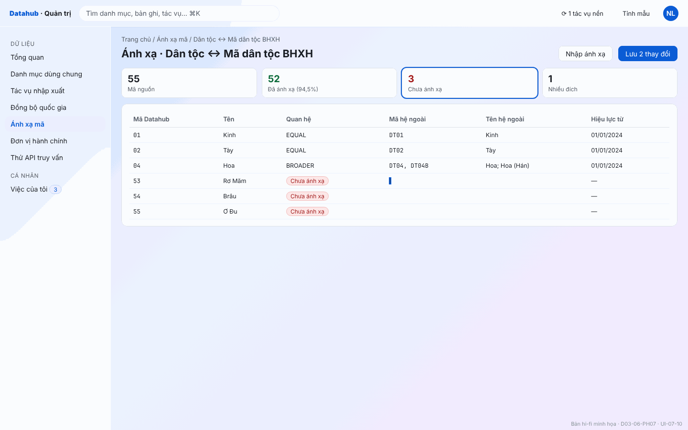

### 16.2. Bố cục bảng ánh xạ

```text
│ Ánh xạ mã · Hệ thống mã MOTCUA_68 (Một cửa tỉnh) ↔ Danh mục [LOAI_HINH_DN ▾]  tại [hôm nay]│
│ ┌Độ phủ 92,4% ▓▓▓▓▓▓▓▓▓░┐┌Chưa ánh xạ 14┐┌Tạm thời 6┐┌Trỏ tới mã ngừng dùng 3 ⚠┐          │
│ [🔍 mã] [Quan hệ ▾] [☐ Chỉ tạm thời] [☐ Chỉ mã chưa ánh xạ]  [Nhập từ tệp] [+ Thêm dòng] │
│ ┌──────────┬────────────────┬──────────┬────────────┬────────┬──────────┬──────────┬────┐ │
│ │Mã danh mục│Tên            │Mã ngoài  │Nhãn ngoài  │Quan hệ │Hiệu lực từ│đến      │Tạm │ │
│ │1         │Doanh nghiệp tư│DNTN      │DN tư nhân  │Tương   │01/01/2026│—         │    │ │
│ │          │nhân           │          │            │đương   │          │          │    │ │
│ │3 ⚠ngừng  │…              │CTCP_OLD  │            │        │          │          │ ☑  │ │
│ │  → gợi ý chuyển sang mã thay thế "2" [Chuyển]                                         │ │
│ └──────────┴────────────────┴──────────┴────────────┴────────┴──────────┴──────────┴────┘ │
│ 3 dòng chưa lưu                                         [Hủy thay đổi] [Lưu (Ctrl+S)]   │
```

### 16.3. Thành phần

| STT | Tên | Loại | Nhãn | Kiểm tra | Nguồn |
|---|---|---|---|---|---|
| 1 | Danh sách hệ thống mã | `CMP-DataTable` | Mã · Tên · HTTT sở hữu · Trạng thái · Số danh mục đã ánh xạ | — | API-07-064 |
| 2 | Biểu mẫu hệ thống mã | `Modal` + `Form` | Mã (T-CODE), Tên, HTTT sở hữu (chọn từ PH-01), Mô tả | Mã duy nhất (ERR-07-002) | API-07-065, 066 |
| 3 | Chọn danh mục | `Select showSearch` | Danh mục | Bắt buộc | `catalog` |
| 4 | Ngày xem | `DatePicker` | Tại ngày | — | `at` |
| 5 | Thẻ độ phủ | `CMP-KpiCard` có thanh tiến độ | Độ phủ · Chưa ánh xạ · Tạm thời · Trỏ tới mã ngừng dùng | — | API-07-071 |
| 6 | Bảng ánh xạ | `CMP-EditableTable` | Mã danh mục · Tên · Mã ngoài · Nhãn ngoài · Quan hệ · Hiệu lực từ · đến · Tạm thời · Lý do | Mã danh mục tồn tại tại ngày hiệu lực; mã ngoài không trùng trong khoảng giao nhau (BR-07-023); tạm thời thì lý do bắt buộc (BR-07-024) | API-07-067 |
| 7 | Quan hệ | `Select` trong ô | Tương đương · Rộng hơn · Hẹp hơn · Liên quan | — | `relation` ∈ `EQUAL`, `BROADER`, `NARROWER`, `RELATED` |
| 8 | Nhập từ tệp | `Button` | Nhập từ tệp | — | UI-07-06 với `mode = MAPPING` |

: Thành phần

Lưới ánh xạ dùng cùng `CMP-EditableTable` với UI-07-05 nhưng lưu theo lô: "Lưu" gửi API-07-068 `mode = MERGE` với các dòng đã đổi kèm `If-Match` của bảng; lỗi trả theo từng dòng được gắn về ô. Lý do lưu theo lô thay vì từng dòng: ràng buộc BR-07-023 xét trên nhiều dòng cùng lúc (đổi mã ngoài của hai dòng hoán đổi nhau chỉ hợp lệ khi lưu cùng nhau).

### 16.4. Thông điệp riêng

| Tình huống | Mã | Câu |
|---|---|---|
| Mã ngoài đã ánh xạ tới mã khác | ERR-07-033 | "Mã ngoài "{externalCode}" đã ánh xạ tới mã "{other}" trong cùng khoảng thời gian." |
| Ánh xạ tạm thời thiếu lý do | ERR-07-034 | "Ánh xạ tạm thời cần ghi lý do." |
| Bảng ánh xạ vừa được người khác sửa | ERR-07-018 | "Bảng ánh xạ vừa được người khác sửa. [Tải lại] (thay đổi chưa lưu của bạn được giữ để áp lại)" |

: Thông điệp riêng

## 17. Đặc tả UI-07-11 · Đơn vị hành chính, dòng thời gian sắp xếp và chuyển mã

### 17.1. Thông tin chung

::: dac-ta
**Mục đích.** Tra cứu ĐVHC theo ngày, xem dòng thời gian các đợt sắp xếp, chuyển mã cũ sang mới theo lô; với PA, soạn sự kiện sắp xếp trên bản nháp ĐVHC.

**Người dùng, quyền.** Mọi người có `PERM-07-read`; PA ghi sự kiện sắp xếp (`PERM-07-update` trên `COMMON`).

**FR, UC hiện thực.** FR-07-044, FR-07-045, FR-07-046, FR-07-047; UC-07-12.

**Đường dẫn.** `/du-lieu/danh-muc/don-vi-hanh-chinh?tab=cay.

**Mẫu bố cục.** PTN-02 Chi tiết, biến thể công cụ chia khung (`CMP-Splitter`).

**API.** API-07-041, 044 (cây tại ngày), API-07-050 (dòng lịch sử), API-07-051 (chuyển mã), API-07-052…054 (sự kiện sắp xếp).
:::

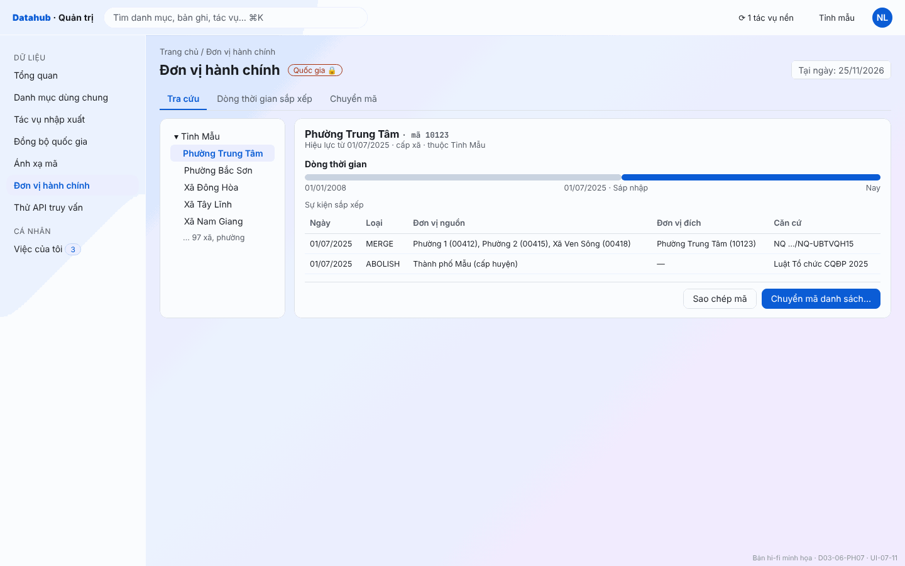

### 17.2. Bố cục

```text
│ Đơn vị hành chính            Xem tại ngày [01/12/2026 📅]  [Trước sắp xếp 2025] [Hiện tại]│
│ [Cây đơn vị] [Dòng thời gian sắp xếp] [Chuyển mã cũ sang mới]                            │
├──────────────────────────────┬───────────────────────────────────────────────────────────┤
│ 🔍 tên hoặc mã               │ Xã Đắk Mil (mã 24811)                    [Đang hiệu lực]    │
│ ▾ Tỉnh Lâm Đồng (68)         │ Cấp: Xã · Trực thuộc: Tỉnh Lâm Đồng · Hiệu lực từ 01/07/2025│
│   ▸ Phường Xuân Hương - Đà Lạt│ Hình thành từ: Thị trấn Đắk Mil (24811), Xã Đắk Lao (24814)│
│   ▾ Xã Đắk Mil               │ Căn cứ: Nghị quyết …/NQ-UBTVQH15                           │
│   …                          │ Dòng lịch sử ─●── 2019 ── ●── 01/07/2025 sáp nhập ──● nay  │
└──────────────────────────────┴───────────────────────────────────────────────────────────┘

TAB CHUYỂN MÃ
│ Dán danh sách mã (mỗi dòng một mã) hoặc [Tải tệp CSV]   Mã cũ tính tại [30/06/2025]       │
│ ┌──────────────┐  Chuyển sang ngày [01/12/2026]   Chiều (•) Cũ → mới ( ) Mới → cũ         │
│ │24811         │                                                  [Chuyển mã]             │
│ │24814         │  Kết quả: 2 đã chuyển · 0 không đổi · 1 nhiều khả năng · 0 không tìm thấy │
│ │24790         │  ┌───────┬──────────┬────────────┬──────────────────────────────────┐   │
│ └──────────────┘  │Mã cũ  │Kết quả   │Mã mới      │Ghi chú                           │   │
│                   │24814  │Đã chuyển │24811       │Sáp nhập vào Xã Đắk Mil 01/07/2025│   │
│                   │24790  │⚠ Nhiều   │24781, 24784│Chia tách; cần chọn theo địa chỉ  │   │
│                   └───────┴──────────┴────────────┴──────────────────────────────────┘   │
│                                                                  [Xuất kết quả CSV ⤓]     │
```

### 17.3. Thành phần

| STT | Tên | Loại | Nhãn | Kiểm tra | Nguồn |
|---|---|---|---|---|---|
| 1 | Ngày xem | `DatePicker` + hai nút nhanh | Xem tại ngày · Trước sắp xếp 2025 (30/06/2025) · Hiện tại | — | `at` |
| 2 | Cây đơn vị | `CMP-Tree` nạp lười theo nhánh | Cây đơn vị hành chính | — | API-07-044 `root`, `depth=1`, `at` |
| 3 | Thẻ chi tiết đơn vị | `Descriptions` | Cấp · Trực thuộc · Hiệu lực · Hình thành từ · Căn cứ | — | API-07-042, API-07-050 |
| 4 | Dòng lịch sử | `CMP-Timeline` | Dòng lịch sử | — | API-07-050 `depth=3` |
| 5 | Dòng thời gian sắp xếp | `Timeline` nhóm theo ngày hiệu lực, lọc theo tỉnh, loại | Dòng thời gian sắp xếp | — | API-07-052 các phiên bản đã phát hành |
| 6 | Ô mã cần chuyển | `Input.TextArea` | Danh sách mã (mỗi dòng một mã) | ≤ 1.000 mã; mỗi mã chỉ chữ số | `codes` |
| 7 | Tải tệp CSV | `Upload` | Tải tệp CSV | Cột đầu là mã | đọc phía client |
| 8 | Ngày mã cũ, ngày đích, chiều | `DatePicker` × 2, `Radio.Group` | Mã cũ tính tại · Chuyển sang ngày · Chiều | Ngày mã cũ < ngày đích (chiều cũ → mới) | `asOf`, `at`, `direction` |
| 9 | Bảng kết quả | `CMP-DataTable` | Mã cũ · Kết quả · Mã mới · Tên tại ngày đích · Ghi chú | — | API-07-051 |
| 10 | Xuất kết quả | `Button` | Xuất kết quả CSV | — | sinh phía client, qua `FormulaInjectionSanitizer` phía client |
| 11 | Soạn sự kiện sắp xếp (PA) | `CMP-Drawer` + `Form` | Loại (Sáp nhập, Chia tách, Đổi tên, Đổi mã, Giải thể, Thành lập) · Mã nguồn · Mã đích · Đơn vị mới · Ngày hiệu lực · Căn cứ · Ghi chú | Bản số theo loại (bảng hệ quả FR-07-045); ghi chú bắt buộc với chia tách | API-07-053 |

: Thành phần

Kết quả "Nhiều khả năng" (`AMBIGUOUS`) không bao giờ được giao diện tự chọn (BR-07-022): dòng hiện danh sách ứng viên kèm tên, và ghi chú "Cần chọn theo địa chỉ cụ thể". Bảng kết quả dùng nhãn chữ và biểu tượng cho bốn kết quả: Đã chuyển, Không đổi, Nhiều khả năng, Không tìm thấy.

### 17.4. Khả năng truy cập

Cây dùng mẫu tree ở mục 20.2. Dòng thời gian có bảng thay thế ẩn trực quan nhưng đọc được (`<table>` với ngày, loại, đơn vị nguồn, đích), vì biểu đồ dòng thời gian không đọc tuần tự được bằng trình đọc màn hình. Kết quả chuyển mã được tóm tắt qua `role="status"`.

## 18. Đặc tả UI-07-12 · Trình thử API truy vấn

### 18.1. Thông tin chung

::: dac-ta
**Mục đích.** Cho kỹ sư tích hợp, lập trình viên HTTT và cán bộ danh mục thử truy vấn danh mục bằng DSL JSON (ADR-054), xem kết quả, thời gian, và sao chép lệnh gọi API tương ứng.

**Người dùng, quyền.** Người có `PERM-07-read`; menu chỉ hiện với các vai trò ở mục 4.3.

**FR, UC hiện thực.** FR-07-026…033; UC-07-09, UC-07-10.

**Đường dẫn.** `/du-lieu/danh-muc/thu-truy-van?danh-muc=…&truy-van=…`.

**Mẫu bố cục.** PTN-02 Chi tiết, biến thể công cụ chia khung (`CMP-Splitter`).

**API.** API-07-048 (lược đồ, thuộc tính truy vấn được), API-07-047 (truy vấn), API-07-042, 043, 044, 045, 046 (các mẫu tra cứu khác).
:::

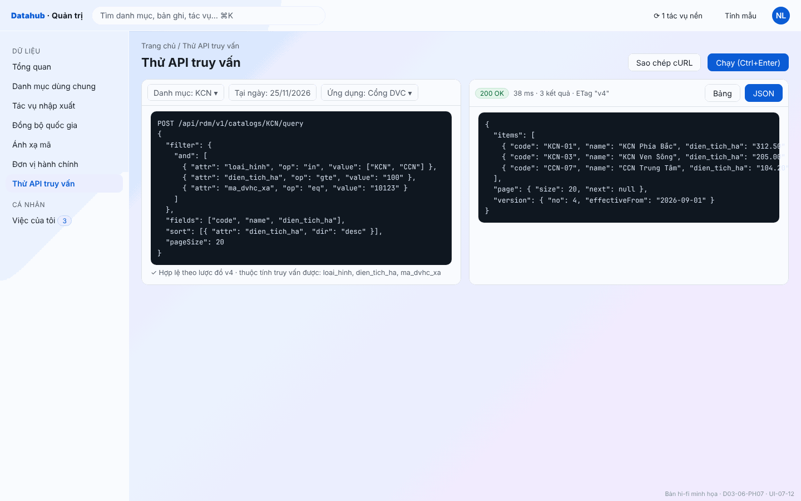

### 18.2. Bố cục

```text
│ Thử truy vấn API      Danh mục [LOAI_HINH_DN ▾]  Phiên bản hiệu lực tại [hôm nay]          │
│ Kiểu [Truy vấn DSL ▾ | Tra một mã | Tra lô | Cây | Tìm kiếm | Thay đổi]                   │
├─────────────────────────────────────────────┬────────────────────────────────────────────┤
│ Thuộc tính truy vấn được (10 tối đa):       │ ▶ Chạy (Ctrl+Enter)   200 OK · 41 ms · 12 bản│
│ von_dieu_le (DECIMAL), linh_vuc (CATALOG_REF)│ [Bảng] [JSON] [cURL]                       │
│ ┌─────────────────────────────────────────┐ │ ┌────────┬────────────────┬──────────────┐ │
│ │{                                        │ │ │Mã      │Tên             │von_dieu_le   │ │
│ │  "filter": {"and": [                    │ │ │1       │Doanh nghiệp tư │—             │ │
│ │    {"attr":"linh_vuc","op":"eq",        │ │ │…       │                │              │ │
│ │     "value":"CN"},                      │ │ └────────┴────────────────┴──────────────┘ │
│ │    {"field":"name","op":"contains",     │ │ Trang tiếp: cursor=eyJ2Ijo… [Tải thêm]     │
│ │     "value":"cong ty"}]},               │ │                                            │
│ │  "sort":[{"field":"code"}], "limit":50  │ │ ⓘ Giới hạn: độ sâu 8, 50 điều kiện, 2 giây │
│ │}                                        │ │                                            │
│ └─────────────────────────────────────────┘ │                                            │
│ [Mẫu truy vấn ▾] [Định dạng] [Chia sẻ liên kết]│                                         │
```

### 18.3. Thành phần

| STT | Tên | Loại | Nhãn | Ghi chú | Nguồn |
|---|---|---|---|---|---|
| 1 | Chọn danh mục | `Select showSearch` | Danh mục | Chỉ danh mục người dùng đọc được | API-07-001 |
| 2 | Ngày | `DatePicker` | Phiên bản hiệu lực tại | | `at` |
| 3 | Kiểu thử | `Segmented` | Truy vấn DSL · Tra một mã · Tra lô · Cây · Tìm kiếm · Thay đổi | Mỗi kiểu có biểu mẫu tham số riêng | — |
| 4 | Trình soạn DSL | `CMP-CodeEditor` (Monaco, nạp lười) | Truy vấn | Kiểm tra cú pháp và gợi ý theo JSON Schema của DSL, gợi ý tên thuộc tính từ lược đồ; nền đặc theo mục 2.1 | — |
| 5 | Danh sách thuộc tính truy vấn được | `Tag` | Thuộc tính truy vấn được | Tối đa `07.rdm.max-queryable-attributes` (mặc định 10) | API-07-048 |
| 6 | Mẫu truy vấn | `Dropdown` | Mẫu truy vấn | Lọc theo thuộc tính, tìm không dấu, lọc theo mã cha, sắp xếp, phân trang | tĩnh |
| 7 | Nút chạy | `Button type="primary"` | Chạy | Ctrl+Enter | API-07-047 |
| 8 | Kết quả | `Tabs`: Bảng · JSON · cURL | Kết quả | Thời gian đo phía trình duyệt từ lúc gửi tới lúc nhận đủ phản hồi; cURL dùng token giả `$TOKEN`, không bao giờ chép token thật | — |
| 9 | Tải thêm | `Button` | Tải thêm | Dùng `nextCursor` | — |
| 10 | Chia sẻ liên kết | `Button` | Chia sẻ liên kết | DSL nén base64url vào `q`, giới hạn 4 KB | URL |

: Thành phần

Lỗi truy vấn được gắn về vị trí trong trình soạn: ERR-07-023 (sai cú pháp) gạch chân đoạn lỗi theo `errors[].pointer`; ERR-07-024 (vượt giới hạn) và ERR-07-025 (thuộc tính không cho phép truy vấn) hiện dưới trình soạn kèm giới hạn hiện hành. Trình thử gọi API qua phiên của người dùng (BFF), không dùng client của HTTT, nên quyền khai thác danh mục `RESTRICTED` của HTTT không áp dụng ở đây; giao diện ghi rõ "Kết quả theo quyền của bạn, có thể khác với quyền của HTTT".

## 19. Đặc tả UI-07-13 · Tham số PH-07 của tenant

::: dac-ta
**Mục đích.** Cho quản trị tenant chỉnh tham số vận hành của PH-07 trên màn tham số chung của PH-18.

**Người dùng, quyền.** Quản trị tenant có quyền tham số của PH-18; khóa mức `PLATFORM` chỉ quản trị nền tảng sửa được.

**FR, UC hiện thực.** FR-07-053.

**Đường dẫn.** Màn tham số chung PH-18 với `ns=07.rdm`.

**Mẫu bố cục.** Theo màn tham số chung PH-18.

**API.** API tham số của PH-18; PH-07 chỉ cung cấp metadata hiển thị.
:::

UI-07-13 không phải màn riêng của PH-07: đó là màn tham số chung của PH-18 mở với `ns=07.rdm` (FR-07-053). PH-07 chỉ cung cấp metadata hiển thị cho từng khóa, để màn chung dựng biểu mẫu đúng. Bảng dưới đây là metadata đó; khóa, kiểu, mặc định, miền và mức đúng FRS §7.1.

| Khóa | Nhóm hiển thị | Nhãn | Điều khiển | Đơn vị | Gợi ý |
|---|---|---|---|---|---|
| `07.rdm.large-change-threshold-percent` | Duyệt và phát hành | Ngưỡng thay đổi lớn | `InputNumber` | % | Phiên bản thay đổi nhiều hơn ngưỡng phải qua duyệt |
| `07.rdm.max-future-effective-days` | Duyệt và phát hành | Số ngày tối đa đặt hiệu lực trước | `InputNumber` | ngày | |
| `07.rdm.batch-rate-per-minute` | Khai thác API | Số lô ghi mỗi phút của một HTTT | `InputNumber` | lô/phút | |
| `07.rdm.hybrid-default-pattern` | Danh mục mở rộng | Mẫu mã bổ sung mặc định | `Input` có kiểm tra regex | — | Ví dụ `^68\.[A-Z0-9_]{1,20}$` |
| `07.rdm.sync-default-cron` | Đồng bộ quốc gia | Lịch đồng bộ mặc định | `CMP-CronPicker` | — | Không dày hơn một giờ |
| `07.rdm.sync-stale-alert-days` | Đồng bộ quốc gia | Cảnh báo khi không đồng bộ được quá | `InputNumber` | ngày | |
| Các khóa mức `PLATFORM` (`batch-max-ops`, `lookup-batch-max`, `import-max-rows`, `import-max-mb`, `import-preview-ttl-hours`, `export-sync-max-rows`, `max-queryable-attributes`, `query-timeout-ms`, `pii-keywords`, `version-online-retention-years`, `feature.*`) | Giới hạn nền tảng | Theo FRS §7.1 | Chỉ đọc với TA; sửa được với PA | Theo khóa | Hiển thị "Do quản trị nền tảng đặt" |

: Đặc tả UI-07-13 · Tham số PH-07 của tenant


## 20. Mẫu khả năng truy cập dùng chung

Các màn PH-07 dùng lại năm mẫu tương tác. Mục này đặc tả mỗi mẫu một lần để các màn chỉ dẫn chiếu. Mọi mẫu phải đạt WCAG 2.2 mức AA (NFR-00-040…045) và được kiểm bằng axe-core trong kiểm thử tự động (mục 24.2).

### 20.1. Lưới sửa được (`grid`)

Dùng ở UI-07-05 và UI-07-10. Phần tử gốc `role="grid"` có `aria-rowcount`, `aria-colcount` theo tổng thật (không theo số dòng đang dựng của danh sách ảo). Mỗi ô `role="gridcell"` có `aria-rowindex`, `aria-colindex`. Điều hướng: mũi tên di chuyển ô, Home/End đầu và cuối dòng, Ctrl+Home/End đầu và cuối lưới, PageUp/PageDown cuộn một trang; Enter hoặc F2 vào chế độ sửa, Esc hủy sửa, Tab xác nhận và sang ô kế. Chỉ một ô có `tabindex="0"` tại một thời điểm (roving tabindex). Ô lỗi có `aria-invalid="true"` và `aria-describedby` trỏ tới văn bản lỗi.

### 20.2. Cây (`tree`)

Dùng ở cây nhóm (UI-07-01), cây bản ghi (UI-07-02, 05) và cây ĐVHC (UI-07-11). `role="tree"` có `aria-label`; mỗi nút `role="treeitem"` có `aria-level`, `aria-setsize`, `aria-posinset`, `aria-expanded` (nút có con). Mũi tên lên, xuống chuyển nút; phải mở hoặc vào con; trái đóng hoặc về cha; gõ ký tự nhảy tới nút kế tiếp bắt đầu bằng ký tự đó. Nút nạp lười hiển thị "Đang tải…" và `aria-busy="true"` trên nhóm con.

### 20.3. Bảng khác biệt

Dùng ở UI-07-07, chi tiết lần đồng bộ UI-07-09 và bước xem trước UI-07-06. Loại khác biệt luôn có cột chữ ("Thêm mới", "Đã sửa", "Ngừng dùng", "Phá vỡ") và biểu tượng, không chỉ màu nền (mục 2.6). Giá trị cũ dùng `<del>`, mới dùng `<ins>`, kèm văn bản ẩn "Giá trị cũ:", "Giá trị mới:" vì nhiều trình đọc màn hình không đọc ngữ nghĩa của `del`, `ins`.

### 20.4. Thông báo động

Kết quả tìm kiếm, lưu, tác vụ nền được đọc qua một vùng `role="status"` duy nhất của `CMP-AppShell` (`aria-live="polite"`); lỗi chặn thao tác dùng `role="alert"`. Một sự kiện chỉ được đọc một lần; tiến độ phần trăm không được đọc liên tục.

### 20.5. Giảm chuyển động và giảm trong suốt

Khi `prefers-reduced-motion: reduce`, biểu tượng xoay dừng, chuyển cảnh ngăn kéo thành hiện ngay, cuộn mượt tắt. Khi `prefers-reduced-transparency: reduce` hoặc người dùng bật công tắc trong cài đặt, mọi lớp glass chuyển nền đặc (mục 2.1). Hai chế độ này được kiểm thử bằng ảnh chụp ở mục 24.3.

## 21. Kiến trúc mã nguồn giao diện

### 21.1. Cây thư mục

```text
apps/console/src/features/rdm/
├── routes.tsx                      khai báo route nạp lười (mục 4.2)
├── api/
│   ├── generated/                  client sinh từ openapi-rdm.yaml (orval), không sửa tay
│   ├── queryKeys.ts                khóa TanStack Query (mục 21.3)
│   └── errors.ts                   ánh xạ ERR-07 sang khóa i18n (mục 5.3)
├── pages/                          một thư mục mỗi màn UI-07-01…12
│   ├── CatalogListPage/  CatalogDetailPage/  CatalogFormPage/  SchemaEditorPage/
│   ├── DraftEditorPage/  ImportWizardPage/  ComparePage/  JobsPage/
│   ├── SyncPage/  MappingPage/  AdminUnitPage/  QueryPlaygroundPage/
├── components/                     thành phần dùng riêng PH-07
│   ├── CatalogStatusTag.tsx  DiffTable.tsx  DecisionPanel.tsx  ItemTree.tsx
│   ├── AttributeForm.tsx  CronPicker.tsx  LineageTimeline.tsx  ImportPreviewTable.tsx
├── hooks/
│   ├── useCatalog.ts  useCatalogSchema.ts  useDraftItems.ts  useImportJob.ts
│   ├── useUrlState.ts              đồng bộ trạng thái với URL (mục 21.5)
│   └── useAllowedActions.ts        đọc allowedActions, disabledReasons (mục 2.4)
├── stores/
│   └── draftEditorStore.ts         Zustand, trạng thái dòng chưa lưu (mục 11.7)
├── workers/
│   ├── schemaValidator.worker.ts   Ajv biên dịch JSON Schema (mục 11.6)
│   └── sheetPeek.worker.ts         đọc 20 dòng đầu tệp xlsx, csv (mục 12.3)
└── i18n/vi.json, en.json
```

Mã của PH-07 chỉ import từ `src/shared/*` (thành phần `CMP-*` của design system, định dạng, `CMP-AppShell`) và từ chính `features/rdm`; luật ESLint `import/no-restricted-paths` chặn import chéo sang tính năng của phân hệ khác.

### 21.2. Client API

Client TypeScript và kiểu dữ liệu được sinh từ `openapi-rdm.yaml` bằng orval ở chế độ `react-query`, chạy trong bước build (`pnpm gen:api`); CI báo lỗi khi tệp sinh lệch hợp đồng. Mọi lời gọi đi qua BFF của console, nên token không nằm trong trình duyệt. Bộ chặn (interceptor) chung gắn `traceparent`, đọc `ETag` vào kết quả, gắn `If-Match` cho lệnh sửa, sinh `Idempotency-Key` (UUID v7) cho lệnh tạo và giữ khóa khi thử lại.

### 21.3. Khóa bộ đệm truy vấn

| Khóa | Dữ liệu | `staleTime` | Bị vô hiệu khi |
|---|---|---|---|
| `['rdm','catalogs',filters]` | API-07-001 | 30 giây | Tạo, sửa, xóa, ngừng hiệu lực danh mục |
| `['rdm','catalog',code]` | API-07-003 | 30 giây | Mọi lệnh ghi trên danh mục |
| `['rdm','versions',code]` | API-07-011 | 30 giây | Tạo nháp, trình, duyệt, phát hành, hủy |
| `['rdm','schema',code,v]` | API-07-048 | 5 phút (phiên bản đã phát hành: vô hạn) | Sửa thuộc tính bản nháp |
| `['rdm','items',code,v,params]` | API-07-026 | 0 với bản nháp, vô hạn với phiên bản đã phát hành | Lưu bản ghi, commit nhập |
| `['rdm','diff',code,v,against,params]` | API-07-021 | 0 với bản nháp, vô hạn giữa hai phiên bản đã phát hành | Như trên |
| `['rdm','job',jobId]` | API-07-034, 039 | thăm dò (mục 12.5) | Commit, hủy |
| `['rdm','syncRuns',filters]` | API-07-059 | 30 giây | Chạy, xác nhận, từ chối |
| `['rdm','mappings',cs,code,at]` | API-07-067 | 30 giây | Lưu ánh xạ |

: Khóa bộ đệm truy vấn

Phiên bản đã phát hành là bất biến (ADR-051), nên dữ liệu của nó được đệm vô hạn trong phiên làm việc; đây là cách giao diện tận dụng thiết kế phiên bản để giảm tải.

### 21.4. Thành phần dùng riêng

| Thành phần | Dùng ở | Trách nhiệm |
|---|---|---|
| `CMP-DiffTable` | UI-07-06, 07, 09 | Bảng khác biệt ảo hóa theo mục 20.3, gộp nhóm theo mã |
| `CMP-DecisionPanel` | UI-07-07, 09 | Ngăn quyết định theo trạng thái và `allowedActions` |
| `CMP-EditableTable` | UI-07-05, 10 | Lưới sửa được theo mục 20.1, ảo hóa dòng và cột |
| `CMP-CronPicker` | UI-07-09, 13 | Chọn lịch dạng thân thiện, sinh cron 6 trường, xem trước lần chạy kế tiếp |
| `CMP-Timeline` | UI-07-02, 11 | Dòng lịch sử bản ghi, có bảng thay thế |
| `CMP-CodeEditor` | UI-07-12 | Monaco nạp lười, nền đặc, kiểm tra theo JSON Schema |
| `CMP-BackgroundTaskTray` | Mọi màn | Khay tác vụ nền trên thanh trên |

: Thành phần dùng riêng

### 21.5. Hook `useUrlState`

`useUrlState(schema)` nhận một lược đồ zod mô tả tham số truy vấn của màn (tên, kiểu, mặc định) và trả về giá trị đã kiểm tra cùng hàm `set` một phần. Giá trị bằng mặc định không ghi lên URL để đường dẫn gọn; đổi bộ lọc dùng `replace` (không thêm lịch sử), đổi tab, trang, phiên bản dùng `push`. Tham số sai kiểu bị bỏ và thay bằng mặc định thay vì làm lỗi trang. Mọi màn PH-07 dùng hook này, không gọi `useSearchParams` trực tiếp.

## 22. Luồng người dùng chính

### 22.1. Cập nhật danh mục địa phương theo văn bản mới

```{.mermaid caption="Cập nhật danh mục địa phương theo văn bản mới"}
flowchart LR
    A["UI-07-01<br/>tìm danh mục"] --> B["UI-07-02<br/>Tạo bản nháp"]
    B --> C["UI-07-05<br/>sửa vài bản ghi"]
    C --> D["UI-07-06<br/>nhập bổ sung từ tệp"]
    D --> C
    C --> E["UI-07-07<br/>rà khác biệt, Trình duyệt"]
    E --> F["Hộp Việc của tôi<br/>người duyệt"]
    F --> G["UI-07-07<br/>Duyệt, Phát hành"]
    G --> H["UI-07-02<br/>phiên bản mới hiệu lực"]
```

Luồng này là luồng thường gặp nhất và chạm năm màn. Người soạn và người duyệt là hai người khác nhau (bốn mắt); người duyệt vào thẳng UI-07-07 từ việc chờ trong hộp "Việc của tôi" mà không cần đi qua danh sách.

### 22.2. Xác nhận thay đổi phá vỡ từ nguồn quốc gia

```{.mermaid caption="Xác nhận thay đổi phá vỡ từ nguồn quốc gia"}
flowchart LR
    A["Thông báo<br/>lần đồng bộ chờ xác nhận"] --> B["UI-07-09<br/>chi tiết lần chạy"]
    B --> C{"Thay đổi<br/>hợp lý?"}
    C -- "Có" --> D["Xác nhận, loại trừ mã nếu cần"]
    C -- "Không" --> E["Từ chối, ghi lý do"]
    D --> F["UI-07-07<br/>duyệt, phát hành"]
```

### 22.3. Chuyển dữ liệu cũ sang mã ĐVHC mới

```{.mermaid caption="Chuyển dữ liệu cũ sang mã ĐVHC mới"}
flowchart LR
    A["UI-07-11 tab Chuyển mã"] --> B["Dán hoặc tải danh sách mã cũ"]
    B --> C["Chọn ngày mã cũ, ngày đích"]
    C --> D["Chuyển mã"]
    D --> E{"Có kết quả<br/>Nhiều khả năng?"}
    E -- "Có" --> F["Người dùng tự chọn theo địa chỉ"]
    E -- "Không" --> G["Xuất CSV dùng cho hệ nghiệp vụ"]
    F --> G
```

### 22.4. Di trú danh mục từ Aita

TA chạy công cụ di trú (D03-02-PH07 §4.17); kết quả chạy thử hiện là tác vụ loại Di trú ở UI-07-08. DS mở báo cáo, chỉnh đề xuất cho danh mục của đơn vị mình; TA chốt cấu hình; công cụ chạy thật tạo các bản nháp; người duyệt duyệt và phát hành theo lô ở UI-07-07 (chọn nhiều phiên bản từ hộp "Việc của tôi").

## 23. Ma trận màn hình theo vai trò và màn hệ cũ được giữ

### 23.1. Ma trận màn hình theo vai trò

Ký hiệu: ● dùng đầy đủ, ○ trong phạm vi tổ chức của mình, 👁 chỉ xem, — không dùng. Vai trò theo D02-08.

| Màn | DS | DA | TA | PA | AU | Kỹ sư tích hợp |
|---|---|---|---|---|---|---|
| UI-07-01 Danh sách | ● | ● | ● | ● | 👁 | 👁 |
| UI-07-02 Chi tiết | ○ | ● | ● | ● | 👁 | 👁 |
| UI-07-03 Tạo, sửa | ○ | — | ● | ● (COMMON) | — | — |
| UI-07-04 Lược đồ | ○ | 👁 | ● | ● | 👁 | 👁 |
| UI-07-05 Sửa bản ghi | ○ | 👁 | ● | ● | — | — |
| UI-07-06 Nhập tệp | ○ | — | ● | ● | — | — |
| UI-07-07 So sánh, duyệt | ○ (trình) | ● (duyệt, phát hành) | ● (trình) | ● | 👁 | — |
| UI-07-08 Tác vụ | ○ | 👁 | ● | ● | 👁 | — |
| UI-07-09 Đồng bộ | 👁 | ● | ● | ● | 👁 | — |
| UI-07-10 Ánh xạ | 👁 | 👁 | ● | ● | 👁 | ● (theo `PERM-07-mapping`) |
| UI-07-11 ĐVHC | 👁 | 👁 | 👁 | ● | 👁 | 👁 |
| UI-07-12 Thử truy vấn | ● | — | ● | ● | — | ● |
| UI-07-13 Tham số | — | — | ● (mức TENANT) | ● | 👁 | — |

: Ma trận màn hình theo vai trò

### 23.2. Màn hệ cũ được giữ

Theo quyết định Q4 (giữ màn có giá trị vận hành), bảng dưới đây đối chiếu các màn của Aita với màn mới. Ba màn được D00-03 §4.5 đánh dấu "Màn hình vận hành: Có" được giữ nguyên cách dùng (người dùng hệ cũ nhận ra ngay), chỉ thay giao diện; các chức năng còn lại được nâng cấp và gộp vào màn mới.

| Màn Aita | LGC | Màn Datahub | Mức | Điều người dùng cũ cần biết |
|---|---|---|---|---|
| Danh sách danh mục kèm số lượng | LGC-DMDC-001 | UI-07-01 | **Giữ**, thêm cây nhóm, bộ lọc, thẻ đếm | Vẫn tìm theo tên, vẫn thấy tổng số danh mục |
| Xem dữ liệu danh mục dạng cây | LGC-DMDC-002 | UI-07-02 tab Bản ghi, chế độ Cây | **Giữ** | Nút chuyển Bảng, Cây ở cùng vị trí trên thanh công cụ |
| Chi tiết danh mục (tên, thuộc tính, bản ghi) | LGC-DMDC-003 | UI-07-02 | **Giữ**, thêm tab Phiên bản, Ánh xạ, Đồng bộ, Lịch sử | Tab Tổng quan, Thuộc tính, Bản ghi giữ nội dung như màn cũ |
| Tạo danh mục nhập tay | LGC-DMDC-004 | UI-07-03, UI-07-04 | Nâng cấp | Thuộc tính có kiểu dữ liệu và ràng buộc |
| Tạo danh mục từ tệp khuôn Aita | LGC-DMDC-005 | UI-07-06 chế độ tạo danh mục | Nâng cấp | Tệp khuôn cũ (A2 tên, dòng 4 thuộc tính) vẫn dùng được, tự nhận dạng |
| Nhập Excel, CSV | LGC-DMDC-006, 007 | UI-07-06 | Nâng cấp | Có bước xem trước, không ghi thẳng |
| Sửa tên, thuộc tính, bản ghi | LGC-DMDC-009…011 | UI-07-03, 04, 05 | Nâng cấp | Sửa trên bản nháp, phải phát hành mới có hiệu lực |
| Xóa danh mục | LGC-DMDC-012 | UI-07-01, 02 | Nâng cấp | Danh mục đã phát hành chỉ ngừng hiệu lực |
| Xuất Excel, CSV | LGC-DMDC-013, 014 | UI-07-02, UI-07-08 | Giữ | Chọn phiên bản khi xuất |
| Kết nối danh mục quốc gia NGSP | LGC-DMDC-019, LGC-NGSP-006 | UI-07-09 | Nâng cấp | Đồng bộ định kỳ, có bước xác nhận |

: Màn hệ cũ được giữ

Hướng dẫn sử dụng D06-04 có một mục "Dành cho người dùng Aita" dựa trên bảng này. Ảnh chụp màn hệ cũ không đưa vào tài liệu (không có bản quyền giao diện và có thể chứa dữ liệu thật).

## 24. Kiểm thử giao diện và bản thiết kế hi-fi

### 24.1. Bản thiết kế hi-fi

Bản hi-fi của từng màn nằm ở `ph07/hifi/`: mỗi màn một tệp HTML tĩnh dựng bằng token Liquid Glass đề xuất (Phụ lục A) và một ảnh PNG chụp ở 1440 × 900. Wireframe dạng khối chữ trong từng mục đặc tả là bố cục chuẩn; bản hi-fi minh họa vật liệu, màu, mật độ và nhãn thật. Các tệp HTML sinh bằng `ph07/hifi/gen_hifi.py` dùng chung `hifi.css` (token Phụ lục A); ảnh chụp bằng `node ph07/hifi/shot.js` (Playwright). Dữ liệu trên bản hi-fi là dữ liệu minh họa, không phải dữ liệu thật của tỉnh nào. Khi D03-05 ban hành, bản hi-fi được dựng lại bằng component thật trong Storybook (mục 24.3) và các tệp HTML này được bỏ.

| Màn | Tệp HTML | Ảnh |
|---|---|---|
| UI-07-01 Danh sách danh mục | [`ui-07-01.html`](ph07/hifi/ui-07-01.html) |  |
| UI-07-02 Chi tiết danh mục | [`ui-07-02.html`](ph07/hifi/ui-07-02.html) |  |
| UI-07-03 Tạo danh mục | [`ui-07-03.html`](ph07/hifi/ui-07-03.html) |  |
| UI-07-04 Lược đồ thuộc tính | [`ui-07-04.html`](ph07/hifi/ui-07-04.html) |  |
| UI-07-05 Sửa bản ghi | [`ui-07-05.html`](ph07/hifi/ui-07-05.html) |  |
| UI-07-06 Nhập tệp | [`ui-07-06.html`](ph07/hifi/ui-07-06.html) |  |
| UI-07-07 So sánh, duyệt | [`ui-07-07.html`](ph07/hifi/ui-07-07.html) |  |
| UI-07-08 Tác vụ | [`ui-07-08.html`](ph07/hifi/ui-07-08.html) |  |
| UI-07-09 Đồng bộ | [`ui-07-09.html`](ph07/hifi/ui-07-09.html) |  |
| UI-07-10 Ánh xạ mã | [`ui-07-10.html`](ph07/hifi/ui-07-10.html) |  |
| UI-07-11 ĐVHC | [`ui-07-11.html`](ph07/hifi/ui-07-11.html) |  |
| UI-07-12 Thử truy vấn | [`ui-07-12.html`](ph07/hifi/ui-07-12.html) |  |

: Bản thiết kế hi-fi

UI-07-13 dùng màn tham số chung của PH-18 nên không có bản hi-fi riêng.

### 24.2. Kiểm thử tự động

| Mức | Công cụ | Phạm vi | Ngưỡng |
|---|---|---|---|
| Đơn vị | Vitest, Testing Library | Hook (`useUrlState`, `useAllowedActions`), hàm định dạng, ánh xạ lỗi Ajv sang tiếng Việt, `draftEditorStore` | Bao phủ dòng ≥ 80% thư mục `features/rdm` |
| Thành phần | Storybook + test runner | Mỗi `CMP-*` riêng của PH-07 có câu chuyện cho mọi trạng thái ở mục 6 | Mọi câu chuyện qua axe-core không lỗi mức A, AA |
| Đầu cuối | Playwright, máy chủ giả lập từ ví dụ OpenAPI (Prism) và môi trường tích hợp | Các luồng mục 22; mỗi TS-07 có màn hình có ít nhất một kịch bản | Chạy ở CI trên Chromium, Firefox, WebKit |
| Truy cập | `@axe-core/playwright` trong kịch bản đầu cuối; kiểm tra tay với NVDA và VoiceOver mỗi đợt | Mọi route PH-07 | Không lỗi nghiêm trọng, nghiêm trọng vừa |
| Hiệu năng | Lighthouse CI, đo INP bằng web-vitals trong kịch bản sửa 1.000 dòng | UI-07-01, 05, 07 | LCP ≤ 2,5 giây, INP ≤ 200 ms (NFR-00-005) |

: Kiểm thử tự động

### 24.3. Kiểm thử hình ảnh

Chromatic (hoặc Playwright `toHaveScreenshot` khi chạy hoàn toàn trên hạ tầng tỉnh) chụp mỗi câu chuyện ở ba chế độ: mặc định, giảm trong suốt, tương phản cao, và ở hai độ rộng 1440 px, 1280 px. Sai khác hình ảnh phải được người phụ trách giao diện chấp nhận trong PR.

## Phụ lục A. Đề nghị bổ sung cho design system D03-05

> **Đợt đồng bộ chéo cuối (27/11/2026).** Các đề nghị dưới đây đã được xét; kết luận từng dòng (đã sửa, đã khớp sẵn, câu hỏi mở, không làm) ghi ở [D00-03-01 Sổ đồng bộ chéo cuối](../../00-chung/D00-03-01-so-dong-bo-cuoi.md).

| Mã | Đề nghị | Lý do | Xử lý ở bản 0.3 |
|---|---|---|---|
| A-01 | Token nền glass thường, dày, thanh công cụ; nền đặc và nền đặc nổi | Phân lớp vật liệu ở mục 2.1 | Đã xử lý: dùng `glass-chrome`, `glass-overlay`, `glass-modal` (D03-05-01 §2); thanh công cụ dính là nền đặc; `color-surface-solid`, `color-surface-solid-2` |
| A-02 | Token màu nguồn `color-source-local`, `-national`, `-hybrid`, `-common` | Nhãn nguồn ở mục 5.1 | Đã xử lý: D03-05-02 §4.6 thêm `color-source-local`, `-national`, `-hybrid`, `-common` |
| A-03 | Token ba màu khác biệt `color-diff-added`, `-changed`, `-removed` (nền, viền, chữ) đạt tương phản 4,5:1 trên nền đặc | Mục 5.2 | Đã xử lý: D03-05-02 §4.6 thêm `color-diff-added`, `-changed`, `-removed`, `-moved` (cặp `-bg`, `-text`) |
| A-04 | Token mật độ `compact`, `default`, `comfortable` | Mục 2.2 | Đã xử lý: thuộc tính `data-density` của D03-05-02 §12.4 |
| A-05 | Thành phần `CMP-EditableTable`, `CMP-DiffTable`, `CMP-DecisionPanel`, `CMP-CronPicker`, `CMP-Timeline`, `CMP-CodeEditor`, `CMP-BackgroundTaskTray`, `CMP-Upload` | Mục 21.4; nếu D03-05 không nhận, PH-07 giữ trong `features/rdm/components` | Đã xử lý: `CMP-EditableTable`, `CMP-DiffTable`, `CMP-DecisionPanel`, `CMP-BackgroundTaskTray` ở D03-05-04; `CMP-CronPicker` ở D03-05-03 §7.15; `CMP-Timeline`, `CMP-CodeEditor`, `CMP-Upload` biến thể `dropzone` đã có |
| A-06 | Mẫu bố cục PTN-01…07 | Mục 3, Q07-67 | Đã xử lý: PTN-01…14 của D03-06-00 §4 |
| A-07 | Hành vi chung khi `prefers-reduced-transparency` | Mục 20.5 | Đã xử lý: D03-05-01 §6 (nền đặc thay kính khi `prefers-reduced-transparency`) |

: Phụ lục A. Đề nghị bổ sung cho design system D03-05

## Phụ lục B. Đề nghị bổ sung API cho giao diện

> **Đợt đồng bộ chéo cuối (27/11/2026).** Các đề nghị dưới đây đã được xét; kết luận từng dòng (đã sửa, đã khớp sẵn, câu hỏi mở, không làm) ghi ở [D00-03-01 Sổ đồng bộ chéo cuối](../../00-chung/D00-03-01-so-dong-bo-cuoi.md).

Bảng dưới đây gom các đề nghị API đã nêu rải rác trong tài liệu, kèm tình trạng đối chiếu với `openapi-rdm.yaml` ngày 25/11/2026.

| Mã | Đề nghị | Màn | Tình trạng |
|---|---|---|---|
| B-01 | Tham số lọc `scope`, `ownerOrgId`, `openVersionStatus`, `updatedFrom`, `updatedTo` cho API-07-001 | UI-07-01 | Đã có `scope`; bốn tham số còn lại chưa có, đề nghị bổ sung |
| B-02 | Trường tóm tắt `ownerOrgName`, `currentItemCount`, `currentVersionNo`, `currentEffectiveFrom`, `openVersion`, `pendingSyncRun`, khối `facets` | UI-07-01 | Đã có `ownerOrgName`, `facets`; các trường còn lại đề nghị bổ sung |
| B-03 | Xuất danh sách danh mục ra xlsx, csv (API-07-001 với `Accept`) | UI-07-01 | Chưa có, đề nghị bổ sung |
| B-04 | API-07-026 lọc `parentCode`, `depth`, `isLocalExtension`, trả `childCount` | UI-07-02, 05 | Đã có `parentCode`, `depth`, `childCount`; `isLocalExtension` đề nghị bổ sung |
| B-05 | Số chữ số thập phân của thuộc tính `DECIMAL`; biểu diễn giá trị thập phân là chuỗi | UI-07-04, 05 | Chưa có, đề nghị thêm `precision` vào `AttributeDef` |
| B-06 | `personalDataHints` trong API-07-048 (danh sách từ khóa gợi ý dữ liệu cá nhân) | UI-07-04 | Chưa có; tạm đọc tham số `07.rdm.pii-keywords` qua PH-18 |
| B-07 | `allowedActions`, `disabledReasons` trên `Catalog`, `CatalogVersion`, `ImportJob`, `SyncRun` (Q07-66) | Mọi màn | Chưa có, đề nghị bổ sung; là đề nghị quan trọng nhất của giao diện |
| B-08 | Khôi phục bản ghi `DEPRECATED` trong bản nháp bằng API-07-028 `status = ACTIVE` | UI-07-05 | Cần xác nhận hợp đồng cho phép đổi trạng thái qua PATCH |
| B-09 | API-07-031 nhận `ifMatch` riêng cho từng phần tử lô và trả kết quả từng phần (Q07-72) | UI-07-05 | Chưa có; đến khi có, giao diện chỉ dùng lô cho bản ghi thêm mới |

: Phụ lục B. Đề nghị bổ sung API cho giao diện

Luồng API xử lý Phụ lục B trong một lần sửa `openapi-rdm.yaml`; khi xong, cột Tình trạng được cập nhật và câu hỏi Q07-66, Q07-70, Q07-72 được đóng.

## Lịch sử phiên bản

| Phiên bản | Ngày | Nội dung |
|---|---|---|
| 0.1 | 2026-11-25 | Bản đầu: 13 màn UI-07-01…13 |
| 0.3 | 2026-11-26 | Đối chiếu D03-05-01…04 và D03-06-00, dùng tên token và thành phần chuẩn |
| 0.4 | 2026-11-26 | Nâng theo chuẩn kết hợp: khối đặc tả đầu mỗi màn, ảnh hi-fi ngay dưới khối, mục người đọc, chú thích bảng và hình |

: Lịch sử phiên bản
