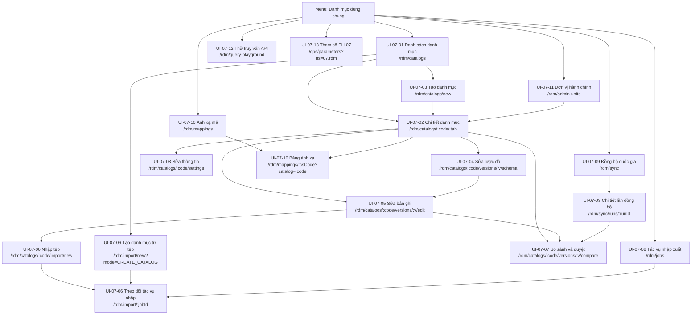

# D03-06-PH07 · Thiết kế giao diện màn hình phân hệ Danh mục dùng chung

## 1. Mục đích, phạm vi và tài liệu liên quan

### 1.1. Mục đích

Tài liệu này đặc tả toàn bộ giao diện người dùng của phân hệ PH-07 Danh mục dùng chung (Reference Data Management, viết tắt RDM) trong ứng dụng quản trị `dh-console`. Mục tiêu là để đội phát triển giao diện có thể bắt tay lập trình ngay mà không phải đoán: mỗi màn hình có đường dẫn (route), bố cục, danh sách thành phần với nhãn tiếng Việt và quy tắc kiểm tra hợp lệ, danh sách hành động gắn với quyền và trạng thái, API được gọi, các trạng thái màn hình, thông điệp lỗi và yêu cầu khả năng truy cập. Phần cuối mô tả kiến trúc mã nguồn phía giao diện (thư mục, component, hook, khóa bộ đệm truy vấn), luồng người dùng, ma trận màn hình theo vai trò và kế hoạch kiểm thử giao diện.

Tài liệu không lặp lại nghiệp vụ đã có ở FRS và không lặp lại hợp đồng API; khi cần, tài liệu dẫn chiếu mã `FR-07-nnn`, `BR-07-nnn`, `API-07-nnn`, `ERR-07-nnn`. Khi tài liệu này và các tài liệu nguồn mâu thuẫn, thứ tự ưu tiên là D02-08 (phân quyền), D02-07 (từ điển dữ liệu), rồi đến khung chung PH-07 và FRS PH-07.

### 1.2. Phạm vi

Phạm vi gồm mười ba màn hình chính thức `UI-07-01` đến `UI-07-13` cùng các hộp thoại, ngăn kéo (drawer) và thành phần dùng riêng của PH-07. Bảng sau liệt kê các màn hình và mức độ chi tiết của đặc tả, để người đọc biết màn nào là trọng tâm.

| Mã | Màn hình | Mức chi tiết |
|---|---|---|
| UI-07-01 | Danh sách danh mục (cây nhóm, bảng, bộ lọc, đếm) | Đầy đủ |
| UI-07-02 | Chi tiết danh mục (tám tab) | Đầy đủ |
| UI-07-03 | Tạo, sửa thông tin danh mục (trình hướng dẫn ba bước) | Đầy đủ |
| UI-07-04 | Trình sửa lược đồ thuộc tính của bản nháp | Đầy đủ |
| UI-07-05 | Trình sửa bản ghi bản nháp | Rất chi tiết, trọng tâm |
| UI-07-06 | Trình hướng dẫn nhập tệp bốn bước | Rất chi tiết, trọng tâm |
| UI-07-07 | So sánh phiên bản, trình duyệt, duyệt, phát hành | Rất chi tiết, trọng tâm |
| UI-07-08 | Tác vụ nhập xuất | Đầy đủ |
| UI-07-09 | Nguồn đồng bộ quốc gia và lần đồng bộ | Đầy đủ |
| UI-07-10 | Hệ thống mã, bảng ánh xạ, độ phủ | Đầy đủ |
| UI-07-11 | Tra cứu ĐVHC, dòng thời gian sắp xếp, công cụ chuyển mã | Rất chi tiết, trọng tâm |
| UI-07-12 | Trình thử API truy vấn | Rất chi tiết, trọng tâm |
| UI-07-13 | Tham số PH-07 của tenant (dùng màn tham số chung PH-18) | Mô tả tham số và cách nhúng |

Ngoài phạm vi là cổng nhà phát triển `dh-portal` (tài liệu tra cứu API danh mục cho nhà phát triển do PH-11 đặc tả) và giao diện ánh xạ trường dữ liệu với Từ điển dữ liệu quốc gia. SRS cũ có màn "Trình ánh xạ từ điển quốc gia" ánh xạ trường của mô hình dữ liệu chung (CDM) với từ điển quốc gia; trong mô hình mới, PH-07 chỉ quản lý ánh xạ **mã** giữa danh mục và hệ thống mã ngoài (FR-07-040…043), còn ánh xạ **trường** thuộc phân hệ dữ liệu chủ hoặc kết nối quốc gia.

> **Câu hỏi mở Q07-65:** Màn "Trình ánh xạ từ điển quốc gia" và "Báo cáo độ phủ ánh xạ trường" của SRS cũ (UI-07-05, UI-07-06 cũ) được chuyển sang phân hệ nào (PH-08 Dữ liệu chủ hay PH-14 Kết nối quốc gia)? Tài liệu này giả định chúng không còn thuộc PH-07 và chỉ giữ báo cáo độ phủ ánh xạ mã (FR-07-043).

### 1.3. Tài liệu liên quan

Các tài liệu dưới đây là nguồn của những mã được dẫn chiếu trong tài liệu này; đường dẫn là tương đối từ thư mục của tài liệu này.

| Tài liệu | Đường dẫn | Dùng để |
|---|---|---|
| D00-01 Thuật ngữ và quy ước | `../../00-chung/D00-01-thuat-ngu-quy-uoc.md` | Mã truy vết UI, CMP, TKN, PTN; kiểu dữ liệu T-*; định dạng ngày giờ |
| D02-02 SRS | `../../02-yeu-cau/D02-02-srs.md` | FR-00 (danh sách, nhập xuất, duyệt, lỗi), NFR-00-040…045 (truy cập, glass) |
| D02-07 Từ điển dữ liệu | `../../02-yeu-cau/D02-07-tu-dien-du-lieu.md` | DD-07 đơn vị hành chính, DD-12 tệp, DD-14 tham số |
| D02-08 Ma trận phân quyền | `../../02-yeu-cau/D02-08-ma-tran-phan-quyen.md` | Vai trò và quyền PERM-07 |
| D02-03-PH07 FRS | `../../02-yeu-cau/frs/D02-03-PH07-frs-danh-muc.md` | Đặc tả FR-07, BR-07 |
| D02-04-PH07 Use case | `../../02-yeu-cau/use-case/D02-04-PH07-use-case-danh-muc.md` | UC-07 |
| D03-02-PH07 SDD | `../sdd/D03-02-PH07-sdd-danh-muc.md` | Máy trạng thái, tác vụ nền |
| D03-04-PH07 API | `../api/D03-04-PH07-api-danh-muc.md` và `../api/ph07/openapi-rdm.yaml` | Hợp đồng API, nguồn sinh client |
| D03-05 Design system | `./D03-05-design-system.md` (dự kiến) | Thành phần CMP, token TKN, vật liệu Liquid Glass |
| D05-02-PH07 Test | `../../05-kiem-thu/test-case/D05-02-PH07-test-case.md` | Ca kiểm thử truy vết tới UI-07 |
| Quy tắc UI CRUD hiện có | `../../../docs/ui_ux_rule.md` | Chuẩn CRUD-UI, CRUD-FLT, CRUD-TBL… đang áp dụng |
| Mockup hiện có | `../../../mockup/pages/reference.html` | Bản phác cũ của màn danh mục |

Tại thời điểm viết, tài liệu D03-05 và ADR-020 (Liquid Glass trên antd v6) chưa có trong `datahub-docs/`. Tài liệu này dùng tên thành phần `CMP-` và token `TKN-` theo giả định hợp lý, và tổng hợp ở Phụ lục A danh sách đề nghị D03-05 bổ sung. Khi D03-05 ban hành, nhóm PH-07 đối chiếu và đổi tên nếu khác.

## 2. Nguyên tắc thiết kế áp dụng cho PH-07

Phần này nêu các nguyên tắc chung mà mọi màn PH-07 tuân theo. Mỗi nguyên tắc có lý do, để khi gặp trường hợp chưa được đặc tả, đội phát triển có thể tự suy ra cách làm nhất quán.

### 2.1. Vật liệu Liquid Glass chỉ cho lớp điều hướng và lớp nổi

Design system của Datahub dùng vật liệu kính mờ (Liquid Glass) với `backdrop-filter`. Vật liệu này đẹp nhưng làm giảm tương phản khi nội dung phía sau thay đổi, và tốn tài nguyên khi có nhiều lớp chồng nhau (rủi ro RSK-A05 ở SAD). PH-07 là phân hệ có nội dung dày đặc: bảng hàng nghìn bản ghi, trình sửa ô, bảng khác biệt nhiều màu. Vì vậy PH-07 áp dụng quy tắc phân lớp sau.

| Lớp | Thành phần | Vật liệu | Token nền |
|---|---|---|---|
| Lớp điều hướng | Thanh trên của `CMP-AppShell`, thanh bên, breadcrumb | Glass thường | `TKN-color-surface-glass-regular` |
| Lớp nổi | `CMP-Drawer`, `Modal`, `Popover`, `Dropdown`, thanh thao tác hàng loạt nổi, khay tác vụ nền | Glass dày (độ mờ cao hơn, nền gần đặc) | `TKN-color-surface-glass-thick` |
| Thanh công cụ dính (sticky) | Thanh công cụ trên bảng, chân trình hướng dẫn | Glass mỏng có lớp phủ đặc 88% | `TKN-color-surface-glass-toolbar` |
| Lớp nội dung | Bảng bản ghi, trình sửa ô, biểu mẫu, bảng khác biệt, cây, khung mã JSON | **Nền đặc** | `TKN-color-surface-solid`, `TKN-color-surface-solid-raised` |

Lý do chọn nền đặc cho lớp nội dung: văn bản trong bảng có cỡ chữ nhỏ (13–14 px) nên cần tương phản ổn định 4,5:1 theo NFR-00-041; màu nền của dòng khác biệt (xanh, vàng, đỏ nhạt) phải đọc chính xác, không bị pha bởi hình nền phía sau; và việc cuộn bảng ảo hóa với hàng nghìn dòng trên nền `backdrop-filter` gây giật trên máy văn phòng cấu hình trung bình (NFR-00-005, INP ≤ 200 ms). Khi người dùng bật "Giảm trong suốt" (`prefers-reduced-transparency` hoặc công tắc trong cài đặt, NFR-00-043), mọi lớp glass chuyển sang nền đặc tương ứng `TKN-color-surface-solid-*`; giao diện PH-07 không được có chỗ nào phụ thuộc vào hiệu ứng trong suốt để truyền đạt thông tin.

### 2.2. Mật độ thông tin

Người dùng PH-07 là cán bộ quản lý danh mục làm việc nhiều giờ với bảng dữ liệu. PH-07 dùng mật độ "gọn" (`TKN-density-compact`, tương ứng `size="small"` của antd: dòng bảng cao 32 px, ô nhập cao 28 px) cho bảng bản ghi, bảng khác biệt, bảng lỗi nhập; dùng mật độ "thường" (`TKN-density-default`, dòng 40 px) cho danh sách danh mục, biểu mẫu thông tin và các hộp thoại. Người dùng có thể đổi mật độ bảng bằng nút "Mật độ hiển thị" trên thanh công cụ bảng (Gọn, Thường, Thoáng); lựa chọn được lưu theo người dùng trong `localStorage` với khóa `dh.rdm.density.{tableId}`. Lý do: một màn hình 1366×768 với mật độ gọn hiển thị được khoảng 16 dòng bản ghi cùng thanh công cụ, đủ để rà soát mà không cuộn liên tục.

### 2.3. Ngôn ngữ, định dạng ngày giờ và số

Toàn bộ nhãn, thông điệp, chú giải bằng tiếng Việt chuẩn, có dấu, viết hoa chữ đầu câu, không viết hoa mọi chữ trong tiêu đề (viết "Tạo danh mục", không viết "Tạo Danh Mục"). Thuật ngữ thống nhất trong PH-07 như sau: "danh mục" (catalog), "bản ghi" (item, không dùng "mục" để tránh nhầm với "danh mục"), "thuộc tính" (attribute), "phiên bản" (version), "bản nháp" (draft), "phát hành" (publish), "ngừng dùng" (deprecate, cho bản ghi), "ngừng hiệu lực" (retire, cho danh mục), "mã thay thế" (replaced by), "hệ thống mã" (code system), "ánh xạ" (mapping), "đồng bộ" (sync).

Ngày hiển thị `dd/MM/yyyy` (ví dụ 01/07/2025); thời điểm hiển thị `dd/MM/yyyy HH:mm:ss` theo giờ Việt Nam (múi `Asia/Ho_Chi_Minh`, UTC+7) bất kể múi giờ máy người dùng, đúng kiểu `T-DATE`, `T-TS` của D00-01. Giá trị gửi lên API luôn là ISO 8601: ngày `yyyy-MM-dd`, thời điểm có độ lệch `+07:00` hoặc UTC `Z`. Thư viện ngày dùng `dayjs` (mặc định của antd v6) với plugin `utc`, `timezone`, `customParseFormat` và locale `vi`; hàm định dạng tập trung ở `src/shared/format/date.ts` để không màn nào tự định dạng. Số dùng dấu chấm phân cách nghìn và dấu phẩy thập phân (`Intl.NumberFormat('vi-VN')`), ví dụ 24.816 bản ghi, 10,5%. Ô trống hiển thị dấu "—" theo CRUD-R-05.

### 2.4. Hành động hiển thị theo quyền và trạng thái

Mọi nút hành động chỉ hiện khi người dùng có quyền và đối tượng ở trạng thái cho phép (FR-00-053, CRUD-U-01). Để giao diện không phải tự suy diễn quy tắc phức tạp (bốn mắt, ngưỡng, nguồn chỉ đọc, phạm vi tổ chức ○), tài liệu này đề nghị API trả kèm trường `allowedActions` trên tài nguyên danh mục, phiên bản, tác vụ và lần đồng bộ, đúng như khuyến nghị ở `docs/ui_ux_rule.md` §9. Giao diện dùng `allowedActions` làm nguồn quyết định chính; quyền `PERM-07-*` trong mã thông báo (token) chỉ dùng để ẩn mục menu và để dựng giao diện trước khi dữ liệu về.

Quy ước hiển thị khi hành động không khả dụng: nếu người dùng **không có quyền**, nút bị ẩn hoàn toàn (không gợi ý chức năng họ không dùng được). Nếu người dùng **có quyền nhưng trạng thái chưa cho phép** (ví dụ phát hành khi còn lỗi hợp lệ, hoặc tự duyệt bản do mình trình), nút hiện ở trạng thái vô hiệu kèm tooltip giải thích lý do, vì đây là thông tin giúp người dùng biết phải làm gì tiếp.

> **Câu hỏi mở Q07-66:** API PH-07 có trả `allowedActions` (mảng mã hành động như `EDIT`, `SUBMIT`, `APPROVE`, `PUBLISH`, `DISCARD`, `RETIRE`) kèm `disabledReasons` (ánh xạ hành động → mã lý do) trên `Catalog`, `CatalogVersion`, `ImportJob`, `SyncRun` không? Nếu không, giao diện phải tự tính theo bảng điều kiện ở từng màn, có nguy cơ lệch với phía máy chủ.

### 2.5. Danh mục chỉ đọc: COMMON và NATIONAL

Danh mục có `tenant_id = 'COMMON'` chỉ tenant `PLATFORM` được ghi; danh mục `source_type = NATIONAL` chỉ cập nhật qua đồng bộ (BR-07-009). Với người dùng tenant tỉnh, các danh mục này hiện ở chế độ chỉ đọc với ba dấu hiệu nhất quán: biểu tượng khóa cạnh tên kèm nhãn "Dùng chung toàn quốc" hoặc "Nguồn quốc gia"; một `Alert` loại thông tin ở đầu màn chi tiết giải thích vì sao không sửa được và chỉ cách mở rộng (tạo danh mục HYBRID); các nút sửa, nhập, tạo bản nháp bị ẩn. Danh mục HYBRID hiển thị bản ghi kế thừa từ danh mục gốc ở chế độ chỉ đọc (chữ màu `TKN-color-text-secondary`, biểu tượng mắt xích) và bản ghi bổ sung địa phương sửa được.

### 2.6. Không chỉ dùng màu

Mọi trạng thái, loại khác biệt và mức lỗi đều có chữ và biểu tượng đi kèm màu (CRUD-TBL-09, WCAG 1.4.1). Ví dụ dòng khác biệt "Thêm mới" có nền xanh nhạt, viền trái xanh, biểu tượng dấu cộng và nhãn chữ "Thêm mới"; ô lỗi trong bảng xem trước nhập có nền đỏ nhạt, viền đỏ, biểu tượng chấm than và mô tả lỗi trong tooltip lẫn trong cột "Lỗi".

### 2.7. Tác vụ dài chạy nền

Nhập tệp, xuất lớn, kiểm tra hợp lệ toàn bản nháp, phát hành và đồng bộ đều có thể vượt 3 giây, nên chạy nền theo FR-00-054. Giao diện hiển thị tiến độ, cho phép rời màn hình, đưa tác vụ vào "Khay tác vụ nền" (`CMP-BackgroundTaskTray`) trên thanh trên và thông báo khi xong qua trung tâm thông báo (FR-00-060).

### 2.8. Giữ trạng thái trên URL

Bộ lọc, sắp xếp, trang, tab đang mở, phiên bản đang xem, chế độ xem bảng hay cây và ngày xem đều được phản ánh vào URL (FR-00-022). Nhờ đó người dùng chia sẻ được đường dẫn cho đồng nghiệp, và nút quay lại của trình duyệt hoạt động đúng kỳ vọng. Quy ước tên tham số ở mục 4.4.

## 3. Mẫu bố cục màn hình (PTN) dùng trong PH-07

Mã `PTN-nn` là mẫu bố cục màn hình do bộ D03-06 quy định. Do tài liệu mẫu bố cục chung chưa ban hành, PH-07 dùng bảy mẫu dưới đây; bảng mô tả cấu trúc vùng để đội phát triển dựng `layout` dùng lại được giữa các màn.

| Mã | Tên mẫu | Cấu trúc | Màn PH-07 dùng |
|---|---|---|---|
| PTN-01 | Danh sách có cây phân loại | Tiêu đề trang, thẻ đếm, vùng hai cột: cây bên trái (rộng 280 px, thu gọn được), bảng bên phải gồm bộ lọc, thanh công cụ, bảng, phân trang | UI-07-01 |
| PTN-02 | Danh sách đơn | Tiêu đề trang, bộ lọc, thanh công cụ, bảng, phân trang | UI-07-08, UI-07-09 (tab), UI-07-10 (danh sách hệ thống mã) |
| PTN-03 | Chi tiết có tab | Tiêu đề đối tượng kèm nhãn trạng thái và nút hành động, dải thông tin tóm tắt, thanh tab, nội dung tab | UI-07-02 |
| PTN-04 | Trình hướng dẫn nhiều bước | Tiêu đề, `Steps`, nội dung bước, chân dính với nút Quay lại, Tiếp tục, Hủy | UI-07-03, UI-07-06 |
| PTN-05 | Không gian soạn thảo | Tiêu đề kèm dải trạng thái bản nháp, thanh công cụ, vùng làm việc chiếm toàn chiều cao (bảng hoặc cây chia đôi với biểu mẫu), chân trạng thái | UI-07-04, UI-07-05 |
| PTN-06 | So sánh và quyết định | Tiêu đề kèm bộ chọn hai phiên bản, thẻ tóm tắt, cảnh báo, bảng khác biệt, ngăn quyết định dính bên phải hoặc chân | UI-07-07, chi tiết lần đồng bộ ở UI-07-09 |
| PTN-07 | Công cụ chia khung | Tiêu đề, vùng tham số bên trái hoặc trên, vùng kết quả bên phải hoặc dưới, có thể đổi kích thước khung | UI-07-11 (tab chuyển mã), UI-07-12 |

> **Câu hỏi mở Q07-67:** Số hiệu `PTN-01…07` ở đây là đề xuất của PH-07. Khi tài liệu mẫu bố cục chung của bộ D03-06 ban hành với số hiệu khác, PH-07 sẽ đổi theo. Cần xác nhận ai giữ danh sách PTN chung.

## 4. Điều hướng

### 4.1. Sơ đồ điều hướng

Sơ đồ dưới đây thể hiện các trang của PH-07 trong `dh-console` và đường đi chính giữa chúng. Mỗi nút ghi mã màn hình và route.



Sơ đồ cho thấy UI-07-02 Chi tiết danh mục là trung tâm của phân hệ: từ đây người dùng đi tới sửa thông tin, sửa lược đồ, sửa bản ghi và so sánh, duyệt. Trình sửa bản ghi UI-07-05 nối trực tiếp tới trình nhập tệp và trình so sánh vì đây là chuỗi thao tác thường gặp nhất khi soạn một phiên bản (soạn, nhập bổ sung, rà khác biệt rồi trình). Các màn công cụ (tác vụ, đồng bộ, ánh xạ, ĐVHC, thử truy vấn) có mục menu riêng vì phục vụ những vai trò khác nhau và được dùng độc lập với một danh mục cụ thể. UI-07-13 không phải trang của PH-07 mà là trang tham số chung của PH-18 được mở với bộ lọc namespace `07.rdm`.

### 4.2. Bảng route React Router

Ứng dụng dùng React Router 7 ở chế độ dữ liệu (data router). Mọi route PH-07 được khai báo trong `src/features/rdm/routes.tsx` và nạp lười (`lazy`) theo từng màn để giảm kích thước gói tải ban đầu. Bảng sau liệt kê route, màn hình, tham số đường dẫn và tham số truy vấn được giữ trên URL.

| Route | Màn | Tham số đường dẫn | Tham số truy vấn (giữ trạng thái) | Quyền tối thiểu |
|---|---|---|---|---|
| `/rdm` | Chuyển hướng tới `/rdm/catalogs` | — | — | `PERM-07-read` |
| `/rdm/catalogs` | UI-07-01 | — | `q`, `group`, `source`, `status`, `cls`, `owner`, `scope` (`all`/`tenant`/`common`), `page`, `size`, `sort` | `PERM-07-read` |
| `/rdm/catalogs/new` | UI-07-03 (tạo) | — | `step` (1–3), `group` (nhóm định sẵn) | `PERM-07-create` |
| `/rdm/catalogs/:code` | Chuyển hướng tới `/rdm/catalogs/:code/overview` | `code` | — | `PERM-07-read` |
| `/rdm/catalogs/:code/:tab` | UI-07-02 | `code`, `tab` ∈ `overview`, `items`, `attributes`, `versions`, `mappings`, `sync`, `access`, `history` | Tab `items`: `v`, `view` (`table`/`tree`), `q`, `status`, `parent`, `page`, `size`, `sort`, `node`; tab `versions`: `status`; tab `history`: `from`, `to`, `action`, `page` | `PERM-07-read` |
| `/rdm/catalogs/:code/settings` | UI-07-03 (sửa) | `code` | `section` | `PERM-07-update` |
| `/rdm/catalogs/:code/versions/:v/schema` | UI-07-04 | `code`, `v` (số phiên bản hoặc `draft`) | `attr` (thuộc tính đang mở) | `PERM-07-read` (chỉ đọc), `PERM-07-update` (sửa) |
| `/rdm/catalogs/:code/versions/:v/edit` | UI-07-05 | `code`, `v` | `view`, `q`, `status`, `dirty` (`1` lọc dòng chưa lưu), `invalid` (`1`), `item`, `node`, `page`, `size`, `sort` | `PERM-07-update` |
| `/rdm/catalogs/:code/versions/:v/compare` | UI-07-07 | `code`, `v` | `against` (số phiên bản hoặc `current`), `type` (`added`/`changed`/`deprecated`/`breaking`), `q`, `page` | `PERM-07-read` |
| `/rdm/catalogs/:code/import/new` | UI-07-06 bước 1–2 | `code` | `mode` | `PERM-07-update` |
| `/rdm/import/new` | UI-07-06 bước 1–2, tạo danh mục từ tệp | — | `mode=CREATE_CATALOG`, `group` | `PERM-07-create` |
| `/rdm/import/:jobId` | UI-07-06 bước 3–4 | `jobId` | `filter` (`all`/`invalid`/`insert`/`update`/`deprecate`), `page`, `size` | `PERM-07-update` |
| `/rdm/jobs` | UI-07-08 | — | `type`, `status`, `catalog`, `mine`, `from`, `to`, `page`, `size` | `PERM-07-read` |
| `/rdm/sync` | UI-07-09 | — | `tab` (`sources`/`runs`/`discover`), `status`, `page` | `PERM-07-read` |
| `/rdm/sync/runs/:runId` | UI-07-09 chi tiết lần chạy | `runId` | `type`, `breaking`, `page` | `PERM-07-read` |
| `/rdm/mappings` | UI-07-10 danh sách hệ thống mã | — | `q`, `status`, `page` | `PERM-07-read` |
| `/rdm/mappings/:csCode` | UI-07-10 bảng ánh xạ | `csCode` | `catalog` (bắt buộc), `q`, `relation`, `provisional`, `unmapped`, `page` | `PERM-07-read` |
| `/rdm/admin-units` | UI-07-11 | — | `tab` (`tree`/`timeline`/`convert`), `at`, `node`, `event`, `from`, `to`, `province` | `PERM-07-read` |
| `/rdm/query-playground` | UI-07-12 | — | `catalog`, `q` (DSL nén base64url, tùy chọn) | `PERM-07-read` |
| `/ops/parameters` | UI-07-13 (route của PH-18) | — | `ns=07.rdm` | `PERM-07-configure` (đề xuất bổ sung D02-08) |

Mọi route nằm dưới `CMP-AppShell` và được bọc bởi `RequirePermission`. Người dùng không đủ quyền tối thiểu nhận trang 403 của `CMP-AppShell` (mục 6.4) thay vì bị chuyển về trang chủ, để họ biết đường dẫn đúng nhưng thiếu quyền. Tham số `code` trong URL được chuẩn hóa chữ hoa (T-CODE); nếu người dùng gõ chữ thường, router thay thế URL bằng bản chữ hoa mà không thêm mục lịch sử.

### 4.3. Menu và phân quyền hiển thị

Thanh bên của `dh-console` có nhóm "Danh mục dùng chung" với biểu tượng `DatabaseOutlined`. Bảng sau quy định mục con, thứ tự, biểu tượng và điều kiện hiển thị. Điều kiện xét trên tập quyền trong token của tenant đang làm việc.

| Thứ tự | Nhãn menu | Route | Biểu tượng (`@ant-design/icons`) | Hiển thị khi |
|---|---|---|---|---|
| 1 | Danh mục | `/rdm/catalogs` | `UnorderedListOutlined` | Có `PERM-07-read` |
| 2 | Tác vụ nhập xuất | `/rdm/jobs` | `CloudSyncOutlined` | Có `PERM-07-create`, `PERM-07-update` hoặc `PERM-07-export` |
| 3 | Đồng bộ quốc gia | `/rdm/sync` | `SyncOutlined` | Có `PERM-07-sync`, hoặc có `PERM-07-read` và vai trò `ROLE-DATA_STEWARD` (xem chỉ đọc) |
| 4 | Ánh xạ mã | `/rdm/mappings` | `NodeIndexOutlined` | Có `PERM-07-read` |
| 5 | Đơn vị hành chính | `/rdm/admin-units` | `ApartmentOutlined` | Có `PERM-07-read` |
| 6 | Thử truy vấn API | `/rdm/query-playground` | `ExperimentOutlined` | Có `PERM-07-read` và vai trò `ROLE-INTEGRATION_ENGINEER`, `ROLE-DEVELOPER`, `ROLE-DATA_STEWARD`, `ROLE-TENANT_ADMIN` hoặc `ROLE-PLATFORM_ADMIN` |
| 7 | Tham số phân hệ | `/ops/parameters?ns=07.rdm` | `SettingOutlined` | Có `PERM-07-configure` |

Mục menu đang chọn được xác định theo tiền tố route dài nhất khớp; ví dụ `/rdm/catalogs/DM_DAN_TOC/items` làm sáng mục "Danh mục". Nhóm menu hiện huy hiệu số (badge) cạnh mục "Đồng bộ quốc gia" bằng số lần đồng bộ ở trạng thái `PENDING_CONFIRMATION`, lấy từ API-07-059 với `status=PENDING_CONFIRMATION&size=0` (chỉ đọc tổng), làm mới 5 phút một lần; huy hiệu chỉ hiện với người có `PERM-07-sync`. Mục "Thử truy vấn API" bị giới hạn theo vai trò vì đây là công cụ kỹ thuật, hiện với cán bộ nghiệp vụ thuần túy chỉ gây rối menu; người dùng khác vẫn mở được bằng đường dẫn trực tiếp nếu có `PERM-07-read`.

> **Câu hỏi mở Q07-68:** D02-08 chỉ cấp `PERM-07-sync` cho PLATFORM_ADMIN, TENANT_ADMIN và DATA_APPROVER, trong khi khung chung PH-07 §4 ghi DATA_STEWARD có quyền đồng bộ. Tài liệu này theo D02-08 (cán bộ quản lý danh mục chỉ xem trang đồng bộ, không chạy, không xác nhận). Cần nhóm lõi xác nhận có bổ sung `PERM-07-sync` cho DATA_STEWARD không.

### 4.4. Breadcrumb

Breadcrumb là thành phần của `CMP-PageHeader`, luôn bắt đầu bằng "Trang chủ" và "Danh mục dùng chung" (CRUD-UI-01). Phần tử cuối không là liên kết. Tên danh mục trong breadcrumb lấy từ dữ liệu đã nạp của API-07-003; khi chưa nạp, hiện mã danh mục. Bảng sau liệt kê breadcrumb của từng route.

| Route | Breadcrumb |
|---|---|
| `/rdm/catalogs` | Trang chủ › Danh mục dùng chung › Danh mục |
| `/rdm/catalogs/new` | Trang chủ › Danh mục dùng chung › Danh mục › Tạo danh mục |
| `/rdm/catalogs/:code/:tab` | Trang chủ › Danh mục dùng chung › Danh mục › {Tên danh mục} |
| `/rdm/catalogs/:code/settings` | … › {Tên danh mục} › Sửa thông tin |
| `/rdm/catalogs/:code/versions/:v/schema` | … › {Tên danh mục} › Phiên bản {v} › Lược đồ thuộc tính |
| `/rdm/catalogs/:code/versions/:v/edit` | … › {Tên danh mục} › Phiên bản {v} › Sửa bản ghi |
| `/rdm/catalogs/:code/versions/:v/compare` | … › {Tên danh mục} › Phiên bản {v} › So sánh với {against} |
| `/rdm/catalogs/:code/import/new`, `/rdm/import/:jobId` | … › {Tên danh mục} › Nhập tệp (khi tạo từ tệp: … › Danh mục › Tạo danh mục từ tệp) |
| `/rdm/jobs` | Trang chủ › Danh mục dùng chung › Tác vụ nhập xuất |
| `/rdm/sync`, `/rdm/sync/runs/:runId` | … › Đồng bộ quốc gia (› Lần đồng bộ {thời điểm bắt đầu}) |
| `/rdm/mappings`, `/rdm/mappings/:csCode` | … › Ánh xạ mã (› {Tên hệ thống mã}) |
| `/rdm/admin-units` | … › Đơn vị hành chính |
| `/rdm/query-playground` | … › Thử truy vấn API |

Phiên bản trong breadcrumb hiển thị dạng "v3" với phiên bản số, "Bản nháp" với `draft`. Khi người dùng bấm "Danh mục" trong breadcrumb từ một trang con, router khôi phục bộ lọc UI-07-01 gần nhất đã lưu trong `sessionStorage` (khóa `dh.rdm.catalogs.lastSearch`), đáp ứng CRUD-FLT-07 và CRUD-C-07.

## 5. Quy ước hiển thị dùng chung trong PH-07

### 5.1. Nhãn trạng thái

Mọi trạng thái được hiển thị bằng `CMP-StatusTag`, một thành phần bọc `Tag` của antd với biểu tượng và màu lấy từ token trạng thái. Bảng sau là ánh xạ chính thức giữa giá trị lưu và nhãn tiếng Việt; mọi màn PH-07 dùng đúng bảng này để người dùng không gặp hai cách gọi cho cùng một trạng thái.

| Đối tượng | Giá trị | Nhãn | Token màu | Biểu tượng |
|---|---|---|---|---|
| Danh mục | `DRAFT` | Chưa phát hành | `TKN-color-status-neutral` | `EditOutlined` |
| Danh mục | `ACTIVE` | Đang hoạt động | `TKN-color-status-success` | `CheckCircleOutlined` |
| Danh mục | `RETIRED` | Ngừng hiệu lực | `TKN-color-status-inactive` | `StopOutlined` |
| Phiên bản | `DRAFT` | Bản nháp | `TKN-color-status-info` | `EditOutlined` |
| Phiên bản | `IN_REVIEW` | Chờ duyệt | `TKN-color-status-warning` | `ClockCircleOutlined` |
| Phiên bản | `APPROVED` | Đã duyệt, chờ phát hành | `TKN-color-status-processing` | `SafetyCertificateOutlined` |
| Phiên bản | `PUBLISHED` | Đã phát hành | `TKN-color-status-success` | `CheckCircleOutlined` |
| Phiên bản | `DISCARDED` | Đã hủy | `TKN-color-status-inactive` | `DeleteOutlined` |
| Hiệu lực (tính) | khoảng chứa hôm nay | Đang hiệu lực | `TKN-color-status-success` (viền) | `FieldTimeOutlined` |
| Hiệu lực (tính) | `effective_from` > hôm nay | Sắp hiệu lực | `TKN-color-status-info` (viền) | `FieldTimeOutlined` |
| Hiệu lực (tính) | `effective_to` ≤ hôm nay | Hết hiệu lực | `TKN-color-status-inactive` (viền) | `FieldTimeOutlined` |
| Bản ghi | `ACTIVE` | Đang dùng | `TKN-color-status-success` | không biểu tượng (giảm nhiễu trong bảng dày) |
| Bản ghi | `DEPRECATED` | Ngừng dùng | `TKN-color-status-danger` | `MinusCircleOutlined` |
| Nguồn | `LOCAL` | Địa phương | `TKN-color-source-local` | `HomeOutlined` |
| Nguồn | `NATIONAL` | Quốc gia | `TKN-color-source-national` | `LockOutlined` |
| Nguồn | `HYBRID` | Mở rộng | `TKN-color-source-hybrid` | `BranchesOutlined` |
| Phạm vi | `tenant_id = COMMON` | Dùng chung toàn quốc | `TKN-color-source-common` | `GlobalOutlined` |
| Phân loại | `PUBLIC` | Công khai | `TKN-color-status-neutral` | không |
| Phân loại | `INTERNAL` | Nội bộ | `TKN-color-status-info` | `EyeInvisibleOutlined` |
| Phân loại | `RESTRICTED` | Hạn chế | `TKN-color-status-warning` | `SafetyOutlined` |
| Tác vụ | `UPLOADED`, `SCANNING`, `PARSING`, `VALIDATING`, `COMMITTING`, `RUNNING` | Đang tải lên, Đang quét an toàn, Đang đọc tệp, Đang kiểm tra, Đang ghi, Đang chạy | `TKN-color-status-processing` | `LoadingOutlined` (dừng xoay khi giảm chuyển động) |
| Tác vụ | `VALIDATED` | Chờ xác nhận ghi | `TKN-color-status-warning` | `ExclamationCircleOutlined` |
| Tác vụ | `COMMITTED`, `SUCCEEDED` | Đã ghi, Hoàn thành | `TKN-color-status-success` | `CheckCircleOutlined` |
| Tác vụ | `FAILED` | Lỗi | `TKN-color-status-danger` | `CloseCircleOutlined` |
| Tác vụ | `CANCELLED`, `EXPIRED` | Đã hủy, Hết hạn | `TKN-color-status-inactive` | `StopOutlined` |
| Lần đồng bộ | `RUNNING` | Đang chạy | `TKN-color-status-processing` | `LoadingOutlined` |
| Lần đồng bộ | `NO_CHANGE` | Không thay đổi | `TKN-color-status-neutral` | `MinusOutlined` |
| Lần đồng bộ | `APPLIED` | Đã áp dụng | `TKN-color-status-success` | `CheckCircleOutlined` |
| Lần đồng bộ | `PENDING_CONFIRMATION` | Chờ xác nhận | `TKN-color-status-warning` | `WarningOutlined` |
| Lần đồng bộ | `REJECTED` | Đã từ chối | `TKN-color-status-inactive` | `CloseOutlined` |
| Lần đồng bộ | `FAILED` | Lỗi | `TKN-color-status-danger` | `CloseCircleOutlined` |

> **Câu hỏi mở Q07-69:** Khung chung PH-07 chỉ chốt trạng thái `SCANNING` trước `PARSING` cho tác vụ nhập. Danh sách đầy đủ `UPLOADED`, `SCANNING`, `PARSING`, `VALIDATING`, `VALIDATED`, `COMMITTING`, `COMMITTED`, `FAILED`, `CANCELLED`, `EXPIRED` (nhập) và `RUNNING`, `SUCCEEDED`, `FAILED`, `EXPIRED` (xuất) là giả định của tài liệu này, cần khớp với `import_job.status` ở D03-03-PH07 và lược đồ `ImportJobStatus` ở OpenAPI.

### 5.2. Ba màu khác biệt

Bảng khác biệt (UI-07-07, chi tiết lần đồng bộ UI-07-09, xem trước nhập UI-07-06) dùng chung bộ token sau. Mỗi loại có nền dòng, viền trái 3 px, biểu tượng và nhãn chữ.

| Loại | Nhãn | Nền dòng | Viền trái, chữ nhãn | Biểu tượng |
|---|---|---|---|---|
| Thêm mới (`ADDED`, `INSERT`) | Thêm mới | `TKN-color-diff-added-bg` | `TKN-color-diff-added-fg` | `PlusOutlined` |
| Sửa đổi (`CHANGED`, `UPDATE`) | Sửa đổi | `TKN-color-diff-changed-bg` | `TKN-color-diff-changed-fg` | `EditOutlined` |
| Ngừng dùng (`DEPRECATED`, `REMOVED`, `DEPRECATE`) | Ngừng dùng | `TKN-color-diff-removed-bg` | `TKN-color-diff-removed-fg` | `MinusOutlined` |
| Không đổi (`UNCHANGED`) | Không đổi | nền đặc thường | `TKN-color-text-secondary` | không |
| Phá vỡ (cờ bổ sung) | Phá vỡ | giữ nền theo loại | `Tag` màu `TKN-color-status-danger` đặc | `ThunderboltOutlined` |

Trong ô bị sửa, giá trị cũ hiển thị gạch ngang với `<del>` và giá trị mới với `<ins>`, kèm văn bản ẩn cho trình đọc màn hình "Giá trị cũ:", "Giá trị mới:". Tương phản giữa chữ `TKN-color-diff-*-fg` và nền `TKN-color-diff-*-bg` phải đạt 4,5:1 ở cả chế độ sáng và tối (kiểm tra ở mục 13.3).

### 5.3. Bảng thông điệp lỗi chính thức ERR-07 sang câu hiển thị

Giao diện không bao giờ hiển thị `detail` thô của máy chủ. Hàm `toUserMessage(problem)` ở `src/shared/api/problem.ts` tra mã lỗi trong tệp i18n và trả câu hiển thị kèm gợi ý; mọi thông báo lỗi hiển thị thêm dòng phụ "Mã lỗi: ERR-07-nnn · Mã truy vết: {traceId}" kèm nút "Sao chép" để người dùng gửi hỗ trợ (FR-00-080). Bảng sau là bộ câu chính thức; một số màn có câu riêng theo ngữ cảnh và được ghi tại màn đó. Cột "Cách hiển thị" quy định thành phần dùng: `message` là thông báo nổi ngắn ở đầu trang, `notification` là thông báo nổi có nút hành động, `inline` là lỗi tại trường, `alert` là khối cảnh báo trong trang, `modal` là hộp thoại chặn.

| Mã | Khóa i18n | Câu hiển thị | Gợi ý khắc phục | Cách hiển thị |
|---|---|---|---|---|
| ERR-07-001 | `rdm.err.001` | Không tìm thấy danh mục "{code}". | Danh mục có thể đã bị xóa hoặc bạn gõ sai mã. Quay lại danh sách để tìm lại. | Trang lỗi 404 trong vùng nội dung |
| ERR-07-002 | `rdm.err.002` | Mã danh mục "{code}" đã được dùng. | Chọn mã khác; mã không được trùng danh mục trong tỉnh và danh mục dùng chung toàn quốc đang hoạt động. | `inline` tại trường Mã |
| ERR-07-003 | `rdm.err.003` | Danh mục này chỉ đọc với tỉnh của bạn. | Danh mục quốc gia chỉ cập nhật qua đồng bộ; danh mục dùng chung chỉ quản trị nền tảng sửa. Muốn bổ sung bản ghi địa phương, hãy tạo danh mục mở rộng. | `alert` kèm nút "Tạo danh mục mở rộng" |
| ERR-07-004 | `rdm.err.004` | Phiên bản đang ở trạng thái "{status}" nên không thực hiện được thao tác này. | Tải lại trang để xem trạng thái mới nhất. | `notification` kèm nút "Tải lại" |
| ERR-07-005 | `rdm.err.005` | Danh mục đã có một phiên bản đang soạn hoặc chờ duyệt (phiên bản {versionNo}). | Mở phiên bản đó để tiếp tục, hoặc hủy nó trước khi tạo bản nháp mới. | `notification` kèm nút "Mở phiên bản {versionNo}" |
| ERR-07-006 | `rdm.err.006` | Không tìm thấy phiên bản {v} của danh mục. | Phiên bản có thể đã bị hủy. Mở tab Phiên bản để chọn lại. | Trang lỗi 404 trong vùng nội dung |
| ERR-07-007 | `rdm.err.007` | Không có mã "{itemCode}" tại ngày {at}. | Kiểm tra lại mã hoặc chọn ngày tra cứu khác. | `inline` hoặc dòng kết quả |
| ERR-07-008 | `rdm.err.008` | Mã bản ghi "{itemCode}" đã tồn tại trong phiên bản này. | Mã không phân biệt hoa thường; chọn mã khác hoặc sửa bản ghi đã có. | `inline` tại ô Mã |
| ERR-07-009 | `rdm.err.009` | Có {count} giá trị không hợp lệ. | Xem lỗi tại từng trường được tô đỏ. | `inline` theo từng phần tử `errors[]` |
| ERR-07-010 | `rdm.err.010` | Mã cha "{parentCode}" không tồn tại hoặc tạo thành vòng lặp. | Chọn mã cha có trong phiên bản và không phải là con cháu của chính bản ghi này. | `inline` tại ô Mã cha |
| ERR-07-011 | `rdm.err.011` | Bản ghi vượt quá số cấp tối đa ({maxDepth} cấp). | Chọn mã cha ở cấp cao hơn, hoặc tăng số cấp tối đa ở thông tin danh mục. | `inline` tại ô Mã cha |
| ERR-07-012 | `rdm.err.012` | Mã "{itemCode}" nằm ngoài dải mã địa phương ({pattern}). | Bản ghi bổ sung của danh mục mở rộng phải có mã theo dải đã khai báo. | `inline` tại ô Mã, kèm ví dụ mã hợp lệ |
| ERR-07-013 | `rdm.err.013` | Không xóa được bản ghi đã từng phát hành. | Dùng "Ngừng dùng" và khai báo mã thay thế nếu có. | `notification` kèm nút "Ngừng dùng" |
| ERR-07-014 | `rdm.err.014` | Thay đổi thuộc tính "{attrCode}" không tương thích với {count} giá trị hiện có. | Sửa các giá trị không chuyển đổi được trước, hoặc giữ kiểu cũ. Bấm "Xem giá trị lỗi" để lọc bản ghi. | `modal` kèm danh sách mẫu tối đa 20 giá trị |
| ERR-07-015 | `rdm.err.015` | Bạn không được duyệt hoặc phát hành phiên bản do chính mình trình hoặc sửa lần cuối. | Nhờ một người duyệt khác thực hiện (nguyên tắc bốn mắt). | `alert` trong ngăn quyết định |
| ERR-07-016 | `rdm.err.016` | Phiên bản có thay đổi lớn ({percent}% bản ghi) hoặc thay đổi phá vỡ nên phải qua duyệt. | Bấm "Trình duyệt" thay cho "Phát hành". | `alert` trong ngăn quyết định |
| ERR-07-017 | `rdm.err.017` | Ngày hiệu lực không hợp lệ. | Ngày hiệu lực phải sau ngày hiệu lực của phiên bản trước ({prevFrom}) và không sớm hơn hôm nay, trừ phiên bản đồng bộ quốc gia hoặc di trú có lý do. | `inline` tại trường Ngày hiệu lực |
| ERR-07-018 | `rdm.err.018` | Dữ liệu đã được người khác cập nhật trong lúc bạn đang sửa. | Xem khác biệt rồi chọn "Ghi đè" hoặc "Tải lại". | `modal` `CMP-ConflictDialog` (mục 6.5) |
| ERR-07-019 | `rdm.err.019` | Tệp không hợp lệ: {reason}. | Kiểm tra định dạng (xlsx, csv), mã hóa (UTF-8, UTF-16), kích thước (≤ 50 MB), số dòng (≤ 200.000) và các cột bắt buộc, hoặc tải tệp mẫu. | `alert` trong bước 1 nhập tệp |
| ERR-07-020 | `rdm.err.020` | Tác vụ nhập không còn ghi được ({reason}). | Kết quả xem trước chỉ giữ 24 giờ và bản nháp không được sửa trong lúc chờ. Hãy nhập lại tệp. | `alert` kèm nút "Nhập lại tệp này" |
| ERR-07-021 | `rdm.err.021` | Tệp còn {errorRows} dòng lỗi. | Sửa tệp và nhập lại, hoặc chọn "Bỏ qua dòng lỗi" để chỉ ghi {validRows} dòng hợp lệ. | `alert` tại bước 4 |
| ERR-07-022 | `rdm.err.022` | Yêu cầu này đã được gửi trước đó với nội dung khác. | Tải lại trang rồi thực hiện lại. | `notification` |
| ERR-07-023 | `rdm.err.023` | Biểu thức truy vấn sai cú pháp tại {pointer}. | Sửa JSON theo vị trí được tô đỏ, hoặc dựng lại bằng trình dựng điều kiện. | `inline` trong khung JSON |
| ERR-07-024 | `rdm.err.024` | Truy vấn vượt giới hạn: {reason}. | Tối đa 20 điều kiện, lồng 3 cấp, 500 giá trị cho "thuộc danh sách", thời gian chạy 2 giây. Hãy thu hẹp điều kiện. | `alert` trong vùng kết quả |
| ERR-07-025 | `rdm.err.025` | Thuộc tính "{field}" không cho phép truy vấn. | Chỉ thuộc tính được đánh dấu "Cho phép truy vấn" mới lọc được. | `inline` tại dòng điều kiện |
| ERR-07-026 | `rdm.err.026` | Số lượng vượt mức tối đa cho một lần ({max}). | Chia nhỏ danh sách rồi thực hiện lại. | `alert` |
| ERR-07-027 | `rdm.err.027` | Không tìm thấy ánh xạ. | Ánh xạ có thể đã bị người khác xóa. Tải lại bảng ánh xạ. | `notification` kèm nút "Tải lại" |
| ERR-07-028 | `rdm.err.028` | Nguồn danh mục quốc gia chưa phản hồi. | Hệ thống sẽ thử lại theo lịch. Nếu kéo dài, kiểm tra kết nối NDXP ở phân hệ Kết nối quốc gia. | `alert` kèm liên kết PH-14 |
| ERR-07-029 | `rdm.err.029` | Lần đồng bộ này không còn chờ xác nhận. | Có thể người khác đã xác nhận hoặc từ chối. Tải lại để xem kết quả. | `notification` kèm nút "Tải lại" |
| ERR-07-030 | `rdm.err.030` | Hệ thống thông tin chưa được cấp quyền khai thác danh mục hạn chế này. | Cấp quyền ở tab "Quyền khai thác" của danh mục. | `alert` (chủ yếu ở UI-07-12) |
| ERR-07-031 | `rdm.err.031` | Danh mục đã ngừng hiệu lực. | Danh mục chỉ còn xem được lịch sử; không tạo phiên bản mới. | `alert` đầu trang chi tiết |
| ERR-07-032 | `rdm.err.032` | Danh mục đang được {count} danh mục khác tham chiếu nên không ngừng hiệu lực được. | Gỡ tham chiếu ở các danh mục: {catalogs}. | `modal` kèm danh sách liên kết |
| ERR-07-033 | `rdm.err.033` | Mã ngoài "{externalCode}" đã được ánh xạ tới mã khác trong cùng khoảng hiệu lực. | Mỗi mã ngoài chỉ trỏ tới một mã danh mục trong một khoảng thời gian. Sửa khoảng hiệu lực hoặc bỏ ánh xạ cũ. | `inline` tại dòng ánh xạ |
| ERR-07-034 | `rdm.err.034` | Ánh xạ tạm thời phải có lý do. | Nhập lý do (ví dụ: chờ ban hành danh mục chính thức). | `inline` tại ô Lý do |
| ERR-07-035 | `rdm.err.035` | Sự kiện sắp xếp không hợp lệ: {reason}. | Kiểm tra mã đơn vị, căn cứ pháp lý và ngày hiệu lực nằm trong phiên bản. | `inline` trong biểu mẫu sự kiện |
| ERR-07-036 | `rdm.err.036` | Thuộc tính "{attrCode}" có dấu hiệu chứa dữ liệu cá nhân nên không được khai báo trong danh mục. | Danh mục dùng chung không lưu dữ liệu cá nhân. Đổi tên thuộc tính nếu hiểu nhầm, hoặc quản lý dữ liệu này ở phân hệ khác. | `inline` tại trường Mã, Nhãn |
| ERR-07-037 | `rdm.err.037` | Nhóm "{name}" còn {count} danh mục nên không xóa được. | Chuyển các danh mục sang nhóm khác trước. | `modal` |

Ngoài các mã PH-07, giao diện xử lý các lỗi chung theo bảng dưới đây; mã `ERR-00-*` cụ thể do D02-02 và D03-04 quy định, ở đây chỉ nêu theo mã HTTP.

| Tình huống | Câu hiển thị | Cách hiển thị |
|---|---|---|
| Mất kết nối mạng, hết thời gian chờ | Không kết nối được tới máy chủ. Kiểm tra mạng rồi bấm Thử lại. | `alert` tại vùng dữ liệu kèm nút "Thử lại"; biểu mẫu giữ nguyên dữ liệu đã nhập |
| 401 hết phiên | Phiên làm việc đã hết hạn. Hệ thống sẽ đưa bạn tới trang đăng nhập và quay lại đúng trang này. | `modal` không đóng được, tự chuyển sau 5 giây |
| 403 không có quyền (không phải ERR-07-003, 015, 030) | Bạn không có quyền thực hiện thao tác này. Liên hệ quản trị tỉnh nếu cần được cấp quyền. | `notification`; nếu ở cấp trang thì trang 403 |
| 429 quá tải | Bạn thao tác quá nhanh. Vui lòng thử lại sau {retryAfter} giây. | `message` |
| 500, 502, 503 không mã cụ thể | Hệ thống đang gặp sự cố. Vui lòng thử lại sau ít phút; nếu vẫn lỗi, gửi mã truy vết cho bộ phận hỗ trợ. | `notification` kèm mã truy vết |

### 5.4. Thông báo thành công

Thông báo thành công dùng `message.success` (tự ẩn sau 3 giây) cho thao tác nhỏ và `notification.success` (tự ẩn sau 6 giây, có liên kết) cho thao tác có kết quả cần mở. Câu theo mẫu "Đã {động từ} {đối tượng} "{tên}"." Ví dụ: "Đã lưu bản ghi "68"." , "Đã trình duyệt phiên bản 4 của danh mục "Dân tộc"." Thông báo thành công luôn được đọc bởi vùng thông báo `role="status"` của `CMP-AppShell` để người dùng trình đọc màn hình biết thao tác đã xong.

## 6. Trạng thái màn hình dùng chung

Mười ba màn PH-07 chia sẻ một bộ trạng thái màn hình. Mục này đặc tả một lần; mục "Trạng thái màn" ở từng màn chỉ nêu điểm riêng. Các trạng thái đáp ứng mục 5 của `docs/ui_ux_rule.md`.

### 6.1. Đang tải

Lần tải đầu của một vùng dữ liệu hiển thị khung xương (skeleton) có hình dạng gần đúng nội dung thật: bảng hiện 8 dòng khung xương với số cột bằng số cột thật, thẻ đếm hiện khối chữ nhật, cây hiện 6 nút thụt lề. Lý do dùng khung xương thay cho vòng xoay: người dùng thấy ngay bố cục và không bị nhảy giao diện khi dữ liệu về (giảm Cumulative Layout Shift). Khi tải lại do đổi bộ lọc hoặc trang, bảng giữ dữ liệu cũ và hiện thanh tiến độ mảnh 2 px ở đỉnh bảng (`placeholderData: keepPreviousData` của TanStack Query) cùng thuộc tính `aria-busy="true"` trên bảng. Nếu tải quá 10 giây, vùng dữ liệu hiện thêm câu "Đang tải lâu hơn bình thường…" kèm nút "Hủy".

### 6.2. Rỗng và không có kết quả

`CMP-EmptyState` có hai biến thể. Biến thể "chưa có dữ liệu" hiện hình minh họa, một câu giải thích và nút hành động chính nếu người dùng có quyền (ví dụ "Chưa có danh mục nào. Tạo danh mục đầu tiên hoặc nhập từ tệp."). Biến thể "không có kết quả" hiện khi có bộ lọc mà kết quả rỗng: "Không tìm thấy dữ liệu phù hợp. Thử đổi từ khóa hoặc đặt lại bộ lọc." kèm nút "Đặt lại bộ lọc". Hai biến thể được phân biệt bằng việc URL có tham số lọc hay không.

### 6.3. Lỗi tải

Khi truy vấn tải dữ liệu thất bại, vùng dữ liệu thay bằng `Result` trạng thái lỗi có câu theo bảng 5.3, mã truy vết và nút "Thử lại". Thanh công cụ và bộ lọc vẫn giữ để người dùng đổi điều kiện. TanStack Query tự thử lại một lần với lỗi mạng và 5xx, không thử lại với 4xx.

### 6.4. Không có quyền

Có hai mức. Mức trang: route yêu cầu quyền người dùng không có, hoặc API trả 403 ở truy vấn chính của trang, thì vùng nội dung thay bằng trang 403 "Bạn không có quyền xem trang này" kèm tên quyền cần có (ví dụ "Cần quyền: Soạn, nhập danh mục") và nút "Về danh sách danh mục". Mức thao tác: nút bị ẩn theo mục 2.4; nếu máy chủ vẫn trả 403 (quyền bị thu hồi giữa chừng), hiển thị `notification` và làm mới tập quyền bằng cách gọi lại thông tin người dùng.

### 6.5. Xung đột ETag (FR-00-052)

Mọi thao tác sửa gửi `If-Match` với ETag đã nhận. Khi máy chủ trả 412 với `ERR-07-018`, giao diện mở `CMP-ConflictDialog` gồm: câu giải thích "Dữ liệu đã được {updatedBy} cập nhật lúc {updatedAt} trong lúc bạn đang sửa."; bảng ba cột "Trường", "Giá trị của bạn", "Giá trị hiện tại trên máy chủ" chỉ liệt kê các trường khác nhau (dùng `CMP-DiffViewer` chế độ trường); và ba nút. Nút "Tải lại" (mặc định, có focus) bỏ thay đổi của người dùng, nạp bản mới. Nút "Ghi đè" gửi lại thay đổi với ETag mới vừa đọc, yêu cầu xác nhận lần hai bằng câu "Thay đổi của {updatedBy} sẽ bị thay thế. Tiếp tục?". Nút "Sao chép thay đổi của tôi" lưu giá trị của người dùng vào bộ nhớ tạm dạng JSON để không mất công sức. Hộp thoại không tự đóng khi bấm ngoài. Lý do chọn "Tải lại" làm mặc định: ghi đè có thể xóa mất công việc của đồng nghiệp, nên phải là lựa chọn chủ động.

Riêng trình sửa bản ghi UI-07-05, xung đột xử lý theo từng dòng (mục 9.3.6) để một xung đột không chặn việc lưu các dòng khác.

### 6.6. Chỉ đọc

Khi đối tượng không sửa được (danh mục COMMON với tenant tỉnh, danh mục NATIONAL, phiên bản đã phát hành, danh mục ngừng hiệu lực, hoặc người dùng chỉ có quyền đọc), màn hình vẫn hiển thị đầy đủ dữ liệu, các điều khiển sửa chuyển thành dạng hiển thị (`Descriptions`, chữ thường) chứ không phải ô nhập bị vô hiệu, theo CRUD-U-03 "chỉ đọc, không chỉ bị ẩn". Một `Alert` loại `info` ở đầu vùng nội dung nêu lý do chỉ đọc bằng một câu.

### 6.7. Tác vụ nền đang chạy

Khi đối tượng đang có tác vụ nền liên quan (bản nháp đang được ghi từ tác vụ nhập, phiên bản đang phát hành, danh mục đang đồng bộ), màn hình hiện `Alert` loại `info` có thanh tiến độ: "Đang ghi 12.500/40.000 dòng từ tệp danh-muc.xlsx vào bản nháp. Bạn có thể rời trang; hệ thống sẽ thông báo khi xong." Trong thời gian này các thao tác sửa bản nháp bị khóa (máy chủ cũng từ chối bằng ERR-07-004 hoặc ERR-07-020) và nút hiện tooltip "Đang có tác vụ ghi vào bản nháp".

### 6.8. Rời trang khi chưa lưu

Màn có biểu mẫu hoặc trình sửa (UI-07-03, 04, 05, 10) dùng `useBlocker` của React Router và sự kiện `beforeunload` để cảnh báo "Bạn có thay đổi chưa lưu. Rời trang sẽ mất các thay đổi này." với hai nút "Ở lại" (mặc định) và "Rời trang" (CRUD-U-04).

## 7. Đặc tả UI-07-01 · Danh sách danh mục

### 7.1. Thông tin chung

| Mục | Nội dung |
|---|---|
| Mục đích | Cho người dùng tìm, lọc, đếm và mở danh mục; điểm khởi đầu tạo danh mục mới bằng tay hoặc từ tệp |
| Người dùng | Mọi vai trò có `PERM-07-read`; thao tác tạo cho người có `PERM-07-create` |
| FR, UC | FR-07-001, FR-07-003, FR-07-009, FR-07-010, FR-07-022, FR-07-024, FR-07-048; UC-07-01, UC-07-04, UC-07-14 |
| Route | `/rdm/catalogs` |
| Mẫu bố cục | PTN-01 Danh sách có cây phân loại |
| API | API-07-001, API-07-005, API-07-006, API-07-007…010, API-07-038 |

### 7.2. Bố cục

Khung dưới đây thể hiện bố cục ở độ rộng 1440 px. Cây nhóm bên trái thu gọn được thành dải 48 px; khi độ rộng nhỏ hơn 1200 px, cây tự thu gọn và mở dạng ngăn kéo khi bấm nút "Nhóm danh mục".

```text
┌──────────────────────────────────────────────────────────────────────────────────────────┐
│ [AppShell: thanh trên glass — Tenant: T68 Lâm Đồng · Tìm nhanh · Khay tác vụ · Thông báo]│
├────────┬─────────────────────────────────────────────────────────────────────────────────┤
│        │ Trang chủ › Danh mục dùng chung › Danh mục                                      │
│ Thanh  │ Danh mục                                   [⤓ Xuất ▾] [Tạo từ tệp] [+ Tạo danh mục]│
│ bên    │ ┌────────────┐┌────────────┐┌────────────┐┌────────────┐┌────────────┐            │
│ glass  │ │Tổng 38     ││Địa phương14││Quốc gia 21 ││Mở rộng 3   ││Chờ duyệt 2 │ (thẻ lọc)  │
│        │ └────────────┘└────────────┘└────────────┘└────────────┘└────────────┘            │
│        │ ┌───────────────┐ ┌─────────────────────────────────────────────────────────────┐ │
│        │ │Nhóm danh mục ⟨│ │[🔍 Tìm theo mã, tên…      ] [Nguồn ▾][Trạng thái ▾][Phạm vi ▾]│ │
│        │ │[🔍 lọc nhóm ] │ │[Bộ lọc nâng cao ⌄]                    [Đặt lại] [Tìm kiếm]   │ │
│        │ │▸ Tất cả (38)  │ ├─────────────────────────────────────────────────────────────┤ │
│        │ │▾ Hành chính   │ │ Đã chọn 2 · [Xuất] [Ngừng hiệu lực] [Bỏ chọn]  (khi có chọn)│ │
│        │ │   Địa giới (4)│ ├──┬──────────────┬───────────────┬──────┬────┬────┬────┬────┬─┤ │
│        │ │   Tổ chức (9) │ │☐ │Mã            │Tên            │Nguồn │Số  │PB  │Hiệu│Trạng│⋯│ │
│        │ │▸ Dân cư (6)   │ │  │              │               │      │bản │hiện│lực │thái │ │ │
│        │ │▸ Y tế (5)     │ │  │              │               │      │ghi │hành│từ  │     │ │ │
│        │ │▸ Giáo dục (3) │ ├──┼──────────────┼───────────────┼──────┼────┼────┼────┼────┼─┤ │
│        │ │  Chưa phân    │ │☐ │DVHC 🌐        │Đơn vị hành    │🔒QG  │3.355│v12│01/07│Đang │⋯│ │
│        │ │  nhóm (2)     │ │  │              │chính          │      │    │    │/2025│h.động│ │ │
│        │ │               │ │☐ │DM_LOAI_HO_SO │Loại hồ sơ TTHC│Đ.ph. │1.842│v3 ●│20/06│Đang │⋯│ │
│        │ │[+ Nhóm][⚙]    │ │  │ ⚠ chờ duyệt  │               │      │    │    │/2026│h.động│ │ │
│        │ └───────────────┘ ├──┴──────────────┴───────────────┴──────┴────┴────┴────┴────┴─┤ │
│        │                   │ Tổng 38 danh mục        ‹ 1 2 › [20 / trang ▾] Đến trang [ ]│ │
│        │                   └─────────────────────────────────────────────────────────────┘ │
└────────┴─────────────────────────────────────────────────────────────────────────────────┘
```

Bố cục đặt thẻ đếm ngay dưới tiêu đề vì FR-07-001 yêu cầu đếm số lượng, và thẻ đếm đồng thời là bộ lọc nhanh: bấm thẻ "Quốc gia 21" tương đương chọn bộ lọc Nguồn = Quốc gia. Cây nhóm đặt bên trái vì nhóm là chiều phân loại ổn định, ít đổi, phù hợp để duyệt; còn các bộ lọc thuộc tính đặt trên bảng để kết hợp tự do.

### 7.3. Thành phần

Bảng sau liệt kê thành phần của màn, nhãn, kiểu dữ liệu, quy tắc và nguồn dữ liệu. Cột "Nguồn" ghi API và trường trả về hoặc tham số gửi đi.

| STT | Tên | Loại (CMP / antd) | Nhãn tiếng Việt | Kiểu dữ liệu | Bắt buộc | Kiểm tra hợp lệ | Mặc định | Nguồn |
|---|---|---|---|---|---|---|---|---|
| 1 | Tiêu đề trang | `CMP-PageHeader` | Danh mục | — | — | — | — | — |
| 2 | Thẻ đếm | `CMP-StatCard` × 5, dạng nút bật tắt | Tổng · Địa phương · Quốc gia · Mở rộng · Chờ duyệt | số nguyên | — | — | — | API-07-001 `facets.sourceType`, `facets.openVersionStatus.IN_REVIEW`, `total` |
| 3 | Cây nhóm danh mục | `CMP-TreeView` trên `Tree` antd, có ô lọc | Nhóm danh mục | cây `CatalogGroup` | — | — | "Tất cả" | API-07-007 `items[].{id,code,name,parentId,catalogCount}` |
| 4 | Ô tìm kiếm | `Input.Search` trong `CMP-FilterBar` | Tìm theo mã, tên | chuỗi | Không | Cắt khoảng trắng; tối đa 100 ký tự; không phân biệt hoa thường, dấu (FR-00-020) | rỗng | tham số `q` |
| 5 | Lọc nguồn | `Select mode="multiple"` | Nguồn | `LOCAL`/`NATIONAL`/`HYBRID` | Không | — | tất cả | `sourceType` |
| 6 | Lọc trạng thái | `Select mode="multiple"` | Trạng thái | `DRAFT`/`ACTIVE`/`RETIRED` | Không | — | `DRAFT`, `ACTIVE` (ẩn ngừng hiệu lực) | `status` |
| 7 | Lọc phạm vi | `Segmented` | Phạm vi | Tất cả / Của tỉnh / Dùng chung toàn quốc | Không | — | Tất cả | `scope` (đề xuất tham số, Q07-70) |
| 8 | Lọc phân loại (nâng cao) | `Select mode="multiple"` | Phân loại dữ liệu | `PUBLIC`/`INTERNAL`/`RESTRICTED` | Không | — | tất cả | `classification` |
| 9 | Lọc đơn vị chủ quản (nâng cao) | `Select showSearch` tìm từ xa | Đơn vị chủ quản | T-ID tổ chức | Không | — | rỗng | API tổ chức PH-20; tham số `ownerOrgId` |
| 10 | Lọc có phiên bản mở (nâng cao) | `Select` | Phiên bản đang soạn | Có bản nháp / Chờ duyệt / Đã duyệt / Không có | Không | — | rỗng | `openVersionStatus` (đề xuất, Q07-70) |
| 11 | Lọc ngày cập nhật (nâng cao) | `DatePicker.RangePicker` định dạng `DD/MM/YYYY` | Cập nhật từ ngày – đến ngày | T-DATE | Không | Ngày bắt đầu ≤ ngày kết thúc; tối đa 366 ngày | rỗng | `updatedFrom`, `updatedTo` |
| 12 | Nút Đặt lại | `Button` | Đặt lại | — | — | — | — | — |
| 13 | Nút Tìm kiếm | `Button type="primary"` | Tìm kiếm | — | — | — | — | — |
| 14 | Thanh thao tác hàng loạt | `CMP-BulkActionBar` | Đã chọn {n} | — | — | — | ẩn | — |
| 15 | Bảng danh mục | `CMP-DataTable` | — | `CatalogSummary[]` | — | — | — | API-07-001 `items[]` |
| 16 | Phân trang | `Pagination` trong `CMP-DataTable` | Tổng {total} danh mục | — | — | Trang 1…ceil(total/size) | 20 / trang | `page`, `size` |
| 17 | Nút Xuất | `Dropdown.Button` | Xuất ▾ (Excel danh sách, CSV danh sách) | — | — | — | — | Xuất danh sách danh mục theo bộ lọc phía máy chủ (Q07-70) |
| 18 | Nút Tạo từ tệp | `Button` | Tạo từ tệp | — | — | — | — | điều hướng `/rdm/import/new?mode=CREATE_CATALOG` |
| 19 | Nút Tạo danh mục | `Button type="primary"` | Tạo danh mục | — | — | — | — | điều hướng `/rdm/catalogs/new?group={nhóm đang chọn}` |

Cột của bảng danh mục được đặc tả riêng vì đây là nơi người dùng nhìn nhiều nhất.

| Cột | Trường | Hiển thị | Sắp xếp | Rộng | Ghi chú |
|---|---|---|---|---|---|
| Chọn | — | `Checkbox` | — | 40 px | Chỉ hiện khi người dùng có quyền thao tác hàng loạt |
| Mã | `code` | Chữ đơn cách `TKN-font-mono`, là liên kết mở chi tiết; biểu tượng 🌐 nếu COMMON, 🔒 nếu NATIONAL; dòng phụ cảnh báo "Chờ duyệt", "Chờ xác nhận đồng bộ" nếu có | Có | 200 px, cố định trái | Liên kết dạng `<a href>` để mở tab mới bằng Ctrl+bấm |
| Tên | `name` | Chữ thường, cắt `…` kèm tooltip (CRUD-TBL-07); dòng phụ nhóm | Có | linh hoạt, tối thiểu 220 px | |
| Đơn vị chủ quản | `ownerOrgName` | Chữ | Có | 180 px | API trả tên đã phân giải (Q07-70) |
| Nguồn | `sourceType` | `CMP-StatusTag` | Không | 110 px | |
| Phân loại | `classification` | `CMP-StatusTag` | Không | 100 px | Ẩn mặc định, bật ở "Cấu hình cột" |
| Số bản ghi | `currentItemCount` | Số căn phải | Có | 100 px | Số bản ghi của phiên bản hiện hành |
| Phiên bản hiện hành | `currentVersionNo` | "v{n}"; chấm màu cạnh số nếu có phiên bản mở, tooltip "Có bản nháp v{n+1}" | Không | 100 px | |
| Hiệu lực từ | `currentEffectiveFrom` | `dd/MM/yyyy` | Có | 110 px | |
| Trạng thái | `status` | `CMP-StatusTag` | Có | 130 px | |
| Cập nhật | `updatedAt` | `dd/MM/yyyy HH:mm` | Có (mặc định giảm dần) | 140 px | Ẩn mặc định |
| Thao tác | — | Nút biểu tượng "Xem", menu "⋯" | — | 88 px, cố định phải (CRUD-TBL-11) | |

> **Câu hỏi mở Q07-70:** Màn này cần API-07-001 hỗ trợ thêm: tham số `scope` (tenant/common), `ownerOrgId`, `openVersionStatus`, `updatedFrom/To`; trường trả về `ownerOrgName`, `currentItemCount`, `currentVersionNo`, `currentEffectiveFrom`, `openVersion {versionNo,status}`, `pendingSyncRun`; khối `facets` đếm theo nguồn và trạng thái; và xuất danh sách danh mục ra xlsx/csv (`Accept: text/csv`). Cần luồng API xác nhận để đưa vào OpenAPI.

### 7.4. Hành động

Bảng hành động liệt kê từng nút, điều kiện hiển thị, API, yêu cầu xác nhận và kết quả. Điều kiện "nguồn ghi được" nghĩa là danh mục không phải COMMON (trừ khi tenant hiện tại là PLATFORM) và không phải NATIONAL.

| Hành động | Vị trí | Hiện khi (quyền, trạng thái) | API | Xác nhận, lý do | Kết quả | Thông báo |
|---|---|---|---|---|---|---|
| Xem | Cột thao tác, bấm mã | `PERM-07-read` | — | Không | Mở UI-07-02 tab Tổng quan | — |
| Tạo danh mục | Đầu trang | `PERM-07-create` | — | Không | Mở UI-07-03 | — |
| Tạo từ tệp | Đầu trang | `PERM-07-create` | — | Không | Mở UI-07-06 chế độ tạo danh mục | — |
| Xuất danh sách | Đầu trang | `PERM-07-export` | API-07-001 với `Accept` xlsx/csv | Không | Tải tệp theo bộ lọc hiện tại (FR-00-030) | "Đã xuất {n} danh mục." |
| Sửa bản ghi | Menu "⋯" | `PERM-07-update`, nguồn ghi được, có phiên bản `DRAFT` (`allowedActions` có `EDIT_ITEMS`) | — | Không | Mở UI-07-05 | — |
| Tạo bản nháp | Menu "⋯" | `PERM-07-update`, nguồn ghi được, `status = ACTIVE`, không có phiên bản mở | API-07-012 | Không | Tạo bản nháp, mở UI-07-05 | "Đã tạo bản nháp phiên bản {n}." |
| Xuất dữ liệu danh mục | Menu "⋯" | `PERM-07-export`, có phiên bản phát hành | API-07-038 | Hộp chọn định dạng (Excel, CSV, JSON) | Tải trực tiếp hoặc chạy nền | Theo mục 12 UI-07-08 |
| Xóa | Menu "⋯", màu đỏ | `PERM-07-update`, nguồn ghi được, `status = DRAFT` | API-07-005 | `CMP-ConfirmDialog` nguy hiểm: "Xóa danh mục "{name}" ({code})? Danh mục chưa từng phát hành nên sẽ được xóa mềm và quản trị có thể khôi phục." | Dòng biến mất; nếu trang rỗng thì lùi một trang (CRUD-D-08) | "Đã xóa danh mục "{name}"." |
| Ngừng hiệu lực | Menu "⋯", màu đỏ; thanh hàng loạt | `PERM-07-retire` (đề xuất D02-08), `status = ACTIVE`, nguồn ghi được | API-07-006 | `CMP-ConfirmDialog` có ô "Lý do" bắt buộc 10–500 ký tự và ô "Ngày ngừng hiệu lực" (mặc định hôm nay) | Trạng thái đổi `RETIRED` | "Đã ngừng hiệu lực danh mục "{name}"." Lỗi ERR-07-032 mở hộp danh sách tham chiếu |
| Thêm nhóm | Chân cây | `PERM-07-create` | API-07-008 | Hộp thoại: Mã (T-CODE), Tên (≤ 255), Nhóm cha, Thứ tự, Mô tả | Cây làm mới | "Đã thêm nhóm "{name}"." |
| Sửa nhóm | Menu chuột phải hoặc nút "⋯" trên nút cây | `PERM-07-update` | API-07-009 | Hộp thoại như trên, có `If-Match` | Cây làm mới | "Đã lưu nhóm." |
| Xóa nhóm | Như trên | `PERM-07-update`, `catalogCount = 0` | API-07-010 | Xác nhận | Cây làm mới | ERR-07-037 nếu còn danh mục |
| Kéo danh mục vào nhóm | Kéo dòng bảng thả vào nút cây | `PERM-07-update`, nguồn ghi được | API-07-004 `groupId` | Không (có Hoàn tác 5 giây) | Danh mục chuyển nhóm | "Đã chuyển "{name}" sang nhóm "{group}". [Hoàn tác]" |

Thao tác hàng loạt chỉ gồm Xuất và Ngừng hiệu lực; hệ thống gọi API tuần tự từng danh mục và trả kết quả theo từng dòng (CRUD-SEL-08, CRUD-D-09) trong một hộp thoại tổng hợp "Thành công {a}, thất bại {b}" kèm lý do từng dòng thất bại. Lựa chọn bị xóa khi đổi bộ lọc và giữ khi đổi trang (khuyến nghị CRUD-SEL-06).

### 7.5. Hành vi bảng

Bảng phân trang phía máy chủ, mặc định 20 dòng, chọn 10/20/50/100 (FR-00-021). Sắp xếp một cột tại một thời điểm, mặc định "Cập nhật giảm dần" (CRUD-TBL-03); chiều sắp xếp gửi dạng `sort=updatedAt,desc`. Mọi điều kiện lọc, sắp xếp, trang được ghi vào URL bằng `useSearchParams` thông qua hook `useUrlState` (mục 15.5); đổi bộ lọc đưa về trang 1 (CRUD-FLT-06). Bấm nút cây nhóm đặt `group={id}` và cũng đưa về trang 1; chọn "Tất cả" xóa tham số. Ô tìm kiếm gửi khi bấm Enter hoặc nút Tìm kiếm, không gửi theo từng phím, để tránh tải liên tục với 1.000 danh mục (CRUD-FLT-03). Nút "Cấu hình cột" cho ẩn hiện, đổi thứ tự cột, lưu trong `localStorage`. Dòng không có ảo hóa vì tối đa 100 dòng một trang.

Phím tắt trên màn: `/` đưa focus vào ô tìm kiếm; `N` mở "Tạo danh mục" (khi có quyền); `[` thu gọn hoặc mở cây nhóm. Phím tắt chỉ hoạt động khi focus không nằm trong ô nhập và được liệt kê trong hộp "Phím tắt" (bấm `?`).

### 7.6. Trạng thái màn

Ngoài các trạng thái chung ở mục 6, màn có hai điểm riêng. Thứ nhất, tenant chưa có danh mục riêng nào nhưng vẫn thấy danh mục dùng chung toàn quốc, nên trạng thái rỗng chỉ xuất hiện khi lọc phạm vi "Của tỉnh"; khi đó câu rỗng là "Tỉnh chưa có danh mục riêng. Các danh mục dùng chung toàn quốc vẫn sẵn sàng sử dụng." kèm nút "Xem danh mục dùng chung" và nút "Tạo danh mục". Thứ hai, nếu có nguồn đồng bộ quốc gia quá 7 ngày không thành công (tham số `07.rdm.sync-stale-alert-days`), người có `PERM-07-sync` thấy `Alert` cảnh báo đỏ ở đầu trang "Danh mục "{name}" chưa đồng bộ được với nguồn quốc gia {days} ngày." kèm liên kết tới UI-07-09, như mockup hiện có.

### 7.7. Thông điệp riêng

| Tình huống | Mã | Câu |
|---|---|---|
| Xóa danh mục đã phát hành (danh sách cũ) | ERR-07-004 | "Danh mục đã phát hành không xóa được. Dùng "Ngừng hiệu lực"." |
| Ngừng hiệu lực danh mục đang bị tham chiếu | ERR-07-032 | Theo bảng 5.3, hộp thoại liệt kê danh mục tham chiếu có liên kết |
| Xóa nhóm còn danh mục | ERR-07-037 | Theo bảng 5.3 |
| Tạo bản nháp khi đã có phiên bản mở | ERR-07-005 | Theo bảng 5.3, nút mở phiên bản đang mở |
| Thao tác trên danh mục chỉ đọc | ERR-07-003 | Theo bảng 5.3 |

### 7.8. Khả năng truy cập

Thứ tự focus: liên kết "Bỏ qua tới nội dung" của `CMP-AppShell` → nút hành động đầu trang → thẻ đếm → cây nhóm → ô tìm kiếm và bộ lọc → bảng → phân trang. Thẻ đếm là `button` có `aria-pressed` phản ánh trạng thái lọc và nhãn đầy đủ "Lọc danh mục nguồn quốc gia, 21 danh mục". Cây nhóm theo mẫu `tree` của WAI-ARIA (mục 13.2), có `aria-label="Nhóm danh mục"`. Bảng có `aria-label="Danh sách danh mục"` và `aria-rowcount` bằng tổng số danh mục; tiêu đề cột sắp xếp được có `aria-sort`. Kết quả tìm kiếm được thông báo qua vùng `role="status"`: "Tìm thấy 12 danh mục." Biểu tượng 🌐 và 🔒 có văn bản thay thế "Dùng chung toàn quốc", "Nguồn quốc gia, chỉ đọc". Kéo thả danh mục vào nhóm có phương án bàn phím: menu "⋯" có mục "Chuyển nhóm…" mở hộp chọn nhóm.
