# D03-06-PH08 · Thiết kế giao diện màn hình Chất lượng dữ liệu

Tập màn **không tự đặt** token, `CMP-*` hay `PTN-*`; mọi tên dùng ở đây có trong D03-05-02, D03-05-03, D03-05-04 và D03-06-00. Thành phần hoặc token còn thiếu ghi ở Phụ lục A. Enum, trường, mã lỗi, quyền, route lấy đúng Phụ lục A và các mục 3, 9, 10 của [D02-03-PH08](../../02-yeu-cau/frs/D02-03-PH08-frs-chat-luong-du-lieu.md); chỗ FRS chưa có ghi ở Phụ lục C.

## Tóm tắt cho hội đồng thẩm định

PH-08 cho các sở, ngành tự đo và cải thiện chất lượng dữ liệu của mình theo sáu chiều (đầy đủ, chính xác, nhất quán, kịp thời, duy nhất, hợp lệ), báo cáo định kỳ cho lãnh đạo và chủ quản, đáp ứng hạn chuẩn hóa dữ liệu 31/12/2026 của Nghị định 278/2025. Hệ cũ (Viettel 2021) không có chức năng chất lượng dữ liệu; căn cứ duy nhất là mockup `dq.html` bảy tab, được thiết kế lại thành 20 màn (UI-08-01…20) trên `dh-console` theo năm nhóm: tổng quan và thẻ điểm (01, 04), đối tượng đo và hồ sơ (02, 03, 05), bộ quy tắc và trọng số (06 đến 10), lần đo và kiểm tra trực tuyến (11, 12, 20), lỗi và khắc phục (13 đến 17), báo cáo và cài đặt (18, 19).

Năm quyết định giao diện chính:

1. **Điểm luôn đi kèm kết luận bằng chữ, không chỉ bằng màu.** Mọi điểm hiển thị cùng nhãn "Đạt", "Cảnh báo", "Không đạt" (ngưỡng 80 và 70, cấu hình ở UI-08-10), mũi tên xu hướng và mức thay đổi so kỳ trước. Miền không đạt xếp lên đầu; điểm thiếu chiều mang huy hiệu "Thiếu chiều" và không dùng cho báo cáo năm (BR-08-010).
2. **Tổng quan (UI-08-01) trả lời "tỉnh đang ở đâu và cần làm gì trước".** Điểm toàn tỉnh, thẻ từng miền kèm radar sáu chiều, xu hướng 13 tháng, bảng đối tượng cần chú ý, băng đỏ cho lần đo lỗi và cảnh báo mức Cao; có chế độ so sánh ẩn danh với nhóm tỉnh tham gia (BR-08-030).
3. **Trình soạn bộ quy tắc (UI-08-07, 08) chặn sai sót trước khi gửi duyệt.** Bảng quy tắc theo chiều, ngăn kéo biểu mẫu và biểu thức CEL (Common Expression Language) kiểm tra cú pháp ngay khi gõ, chạy thử trên mẫu 10.000 bản ghi; sửa sau lần chạy thử thì nút "Gửi duyệt" bị khóa kèm lý do (ERR-08-053). Mọi thay đổi quy tắc, trọng số, ngoại lệ, báo cáo đi qua duyệt bốn mắt.
4. **Chi tiết lần đo (UI-08-12) cho thấy điểm hình thành từ đâu.** Tiến độ từng tác vụ, điểm sáu chiều có trọng số, kết quả từng quy tắc, so kỳ trước; chiều bị bỏ qua (ví dụ PH-07 gián đoạn) tô xám kèm lý do, không bao giờ để trống không giải thích.
5. **Không lộ dữ liệu nhạy cảm.** Bản ghi lỗi chỉ hiện giá trị đã che hoặc băm; khóa cá nhân khi tìm kiếm gửi bằng `POST`, không lên URL; DO chỉ thấy phần của tổ chức mình; không ghi được nhật ký kiểm toán thì thao tác bị từ chối (ERR-08-054).

Kính Liquid Glass chỉ dùng cho lớp điều hướng và lớp nổi (thanh trên, sidebar, ngăn kéo, thanh chọn dưới đáy, khung duyệt); bảng, biểu mẫu, biểu đồ, thẻ điểm là nền đặc để đạt WCAG 2.2 AA (ADR-020). Biểu đồ dùng Apache ECharts qua `CMP-Chart` (ADR-023); ảnh hi-fi vẽ SVG kiểu ECharts để minh họa. Ảnh hi-fi (20 màn, ba biến thể) nằm ở `ph08/hifi/`, dữ liệu giả định của tỉnh thí điểm T68.

## 1. Mục đích, phạm vi và tài liệu liên quan

Chương này nêu tài liệu đặc tả gì, cho ai, dựa trên tài liệu nào, rồi liệt kê 20 màn của PH-08 trước khi vào chi tiết.

### 1.1. Mục đích

Tập màn là nguồn chuẩn để kỹ sư `dh-console` dựng giao diện PH-08, để kiểm thử viên viết ca kiểm thử giao diện (D05-02-PH08) và để hội đồng thẩm định thấy mỗi chức năng của FRS có chỗ thể hiện, đúng quyền, đúng thông báo. Mỗi màn có khối đặc tả (mục đích, đường dẫn, mẫu, quyền, API, FR), wireframe chữ, bảng thành phần `CMP-*`, trường, hành động, trạng thái và ảnh hi-fi.

### 1.2. Phạm vi

Trong phạm vi: 20 màn của FRS §10.1 trong ứng dụng `dh-console`, gồm ngăn kéo, hộp thoại và trình hướng dẫn thuộc màn. Ngoài phạm vi: API kiểm tra trực tuyến cho máy gọi (FR-08-032…035: chỉ màn giám sát UI-08-20); tiêu thụ sự kiện EVT-06 và EVT-07 (FR-08-025: chỉ hiện kết quả ở UI-08-11); công cụ thực thi quy tắc, đối chiếu danh mục, tính điểm (FR-08-026 đến 028, 036: hiện kết quả ở UI-08-12, 13); đẩy KPI (FR-08-057: chỉ trạng thái ở UI-08-19); cổng công dân `dh-portal`; chi tiết token và thành phần (D03-05). PH-08 không sửa dữ liệu nguồn nên không có màn chỉnh sửa bản ghi dữ liệu; lỗi ở bản ghi vàng được chuyển sang hàng đợi người quản lý dữ liệu của PH-06.

### 1.3. Tài liệu liên quan

Tài liệu này bám theo FRS, khung giao diện chung và các tập thiết kế khác; bảng dưới ghi từng tài liệu và nội dung màn hình lấy từ đó.

| Tài liệu | Dùng để |
|---|---|
| D02-03-PH08 FRS | Chức năng, mã lỗi (§9.1), câu thông báo (§9.2), danh sách màn (§10.1), tham số (§8.2), enum (Phụ lục A) |
| D03-06-00 | Khung bố cục, mẫu `PTN-01…14`, route (§2.3, §2.4), trạng thái `ST-*` (§4.2) |
| D03-05-02, 03, 04 | Token, thành phần nguyên tử và phức hợp `CMP-*` |
| D03-04-PH08 (viết song song) | API-08-001…128 chi tiết; tập này dùng mã theo FRS §9.4 |
| D03-03-PH08 | Tên cột, enum lưu trong `ph08_dq` |
| D02-08 | Vai trò `ROLE-*`, 11 quyền `PERM-08-*` |
| D03-06-PH06, D03-06-PH07 | Mẫu trình bày, bộ công cụ hi-fi; màn bản ghi vàng và danh mục mà PH-08 liên kết tới |

: Tài liệu liên quan của tập màn PH-08

### 1.4. Thuật ngữ và viết tắt

Bảng dưới giải thích các thuật ngữ và viết tắt theo nghĩa người dùng thấy trên giao diện, để nhãn hiển thị ở mọi màn dùng thống nhất.

| Thuật ngữ | Nghĩa trên giao diện |
|---|---|
| Đối tượng đo (asset) | Thứ được đo chất lượng: bản ghi vàng của PH-06, danh mục của PH-07, bảng hoặc khung nhìn ở HTTT, bản tin đi qua luồng PH-04 |
| Miền chất lượng | Nhóm đối tượng đo theo lĩnh vực (Dân cư, Y tế, Đất đai…), có tổ chức chủ quản và cán bộ phụ trách |
| Sáu chiều | Đầy đủ (`COMPLETENESS`), Chính xác (`ACCURACY`), Nhất quán (`CONSISTENCY`), Kịp thời (`TIMELINESS`), Duy nhất (`UNIQUENESS`), Hợp lệ (`VALIDITY`) |
| Kết luận | Đạt (`PASS`, điểm từ ngưỡng Đạt, mặc định 80), Cảnh báo (`WARN`, từ 70), Không đạt (`FAIL`) |
| Bộ quy tắc, phiên bản | Tập quy tắc của một đối tượng; mỗi thay đổi là phiên bản mới, tối đa một bản `ACTIVE` và một bản nháp |
| Lần đo (scan) | Một lần chạy toàn bộ quy tắc của đối tượng, chia thành tác vụ; sinh ảnh chụp điểm bất biến |
| Bản ghi lỗi (finding) | Một bản ghi vi phạm một quy tắc, nhận diện bằng dấu vân tay để biết mới, còn, hết qua các kỳ |
| Phiếu khắc phục | Việc giao cho tổ chức chủ quản sửa lỗi ở nguồn, có hạn xử lý (SLA, Service Level Agreement) |
| Kiểm tra trực tuyến | Đánh giá một bản ghi ngay khi đi qua luồng PH-04 hoặc cổng nhập PH-06; chế độ `STRICT` hoặc `ADVISORY` |

: Thuật ngữ và viết tắt của tập màn PH-08

### 1.5. Danh sách màn hình

Bảng dưới là 20 màn theo FRS §10.1 kèm mẫu bố cục, mức chi tiết, FR và quyền vào. "Rất chi tiết" thêm giải phẫu vùng, ca biên, tương tác và trạng thái từng nhánh; "Đầy đủ" có đủ các mục theo khuôn K-MH.

| Mã | Tên | PTN | Mức chi tiết | FR | Quyền vào |
|---|---|---|---|---|---|
| UI-08-01 | Tổng quan chất lượng dữ liệu | PTN-06 | **Rất chi tiết** | 050, 051, 061 | `PERM-08-read` |
| UI-08-02 | Danh sách đối tượng đo | PTN-01 | Đầy đủ | 006 | `PERM-08-read` |
| UI-08-03 | Đăng ký đối tượng đo (wizard) | PTN-05 | Đầy đủ | 002, 003, 004, 005 | `PERM-08-asset` |
| UI-08-04 | Chi tiết đối tượng đo, thẻ điểm | PTN-02 | Đầy đủ | 005, 006, 007, 024, 028, 029, 051, 060 | `PERM-08-read` |
| UI-08-05 | Hồ sơ dữ liệu | PTN-02 (tab) | Đầy đủ | 008, 009, 010, 011 | `PERM-08-read`; chạy: `PERM-08-asset` |
| UI-08-06 | Danh sách bộ quy tắc | PTN-01 | Đầy đủ | 012, 015, 020, 022 | `PERM-08-read` |
| UI-08-07 | Trình soạn bộ quy tắc | PTN-03 | **Rất chi tiết** | 012, 013, 017 | `PERM-08-read`; soạn: `PERM-08-rule-admin` |
| UI-08-08 | Biểu mẫu quy tắc và chạy thử (ngăn kéo) | PTN-04 | Rất chi tiết | 013, 014, 015, 016 | `PERM-08-rule-admin` |
| UI-08-09 | Lịch sử, so sánh và duyệt phiên bản | PTN-10 | Đầy đủ | 017, 018, 019 | `PERM-08-read`; duyệt: `PERM-08-approve` |
| UI-08-10 | Trọng số và ngưỡng | PTN-12 | Đầy đủ | 021 | `PERM-08-read`; soạn: `PERM-08-rule-admin` |
| UI-08-11 | Lịch đo và danh sách lần đo | PTN-01 | Đầy đủ | 023, 024, 025, 030 | `PERM-08-read`; chạy: `PERM-08-run` |
| UI-08-12 | Chi tiết lần đo | PTN-11 | **Rất chi tiết** | 026, 027, 028, 029, 030, 031 | `PERM-08-read` |
| UI-08-13 | Bản ghi lỗi | PTN-01 | Đầy đủ | 036, 037, 039, 041 | `PERM-08-finding-read` |
| UI-08-14 | Chi tiết bản ghi lỗi, ngoại lệ (ngăn kéo) | PTN-02 | Đầy đủ | 038, 040 | `PERM-08-finding-read` |
| UI-08-15 | Hộp việc phiếu khắc phục | PTN-10 | Đầy đủ | 041, 042, 045 | `PERM-08-remediate` |
| UI-08-16 | Chi tiết phiếu khắc phục | PTN-02 | Đầy đủ | 042, 043, 044, 045, 046 | `PERM-08-remediate` |
| UI-08-17 | Cảnh báo chất lượng | PTN-01 | Đầy đủ | 047, 048, 049 | `PERM-08-read`; khai báo: `PERM-08-rule-admin` |
| UI-08-18 | Báo cáo chất lượng (danh sách, chi tiết, duyệt) | PTN-01, PTN-02 | Đầy đủ | 052, 053, 054, 055, 056 | `PERM-08-read`; soạn: `PERM-08-report` |
| UI-08-19 | Cài đặt chất lượng theo tenant | PTN-12 | Đầy đủ | 001, 057, 058, 059, 060 | `PERM-08-config`; nhật ký: `PERM-08-audit-read` |
| UI-08-20 | Giám sát kiểm tra trực tuyến | PTN-11 | Đầy đủ | 032, 033, 034, 035 | `PERM-08-read`; cấu hình: `PERM-08-rule-admin` |

: Danh sách 20 màn hình PH-08 với mẫu bố cục, mức chi tiết, FR và quyền vào


### 1.6. Người đọc

Kỹ sư giao diện `dh-console` đọc chương 4 đến 6 rồi chương của màn đang dựng. Thiết kế UX/UI đọc chương 2, 5 và các wireframe. Cán bộ dữ liệu, chủ quản và kiểm thử viên đọc phần thành phần, hành động, trạng thái và chương 28. Hội đồng thẩm định đọc phần Tóm tắt, chương 3 và chương 30.

### 1.7. Cấu trúc tài liệu

Chương 2 đến 6 nêu nguyên tắc, màn hệ cũ được giữ lại, điều hướng, quy ước hiển thị và trạng thái dùng chung. Chương 7 đến 26 đặc tả 20 màn UI-08-01 đến UI-08-20, mỗi chương gồm khối đặc tả, wireframe, thành phần, trường, hành động và trạng thái. Chương 27 trình bày mẫu truy cập dữ liệu và ba luồng người dùng chính; chương 28 ma trận vai trò; chương 29 ma trận UI và FR; chương 30 kiểm thử giao diện và danh sách ảnh hi-fi. Ba phụ lục ghi đề nghị đồng bộ cho D03-05, API và tài liệu khác.

## 2. Nguyên tắc thiết kế áp dụng cho PH-08

Chương này nêu các lựa chọn thiết kế riêng cho nghiệp vụ chất lượng dữ liệu: người dùng là cán bộ dữ liệu của sở làm việc theo tháng, lãnh đạo chỉ đọc con số và xu hướng, dữ liệu nguồn chứa nhiều thông tin cá nhân.

### 2.1. Bản đồ vật liệu

Bảng dưới cho biết mỗi vùng giao diện của PH-08 dùng vật liệu nào, kính mờ cho điều hướng hay nền đặc cho nội dung, và lý do chọn.

| Vùng | Thành phần | Vật liệu | Lý do |
|---|---|---|---|
| Thanh trên, sidebar | `CMP-AppShell`, `CMP-Topbar`, `CMP-Sidebar` | `glass-chrome` | Lớp điều hướng |
| Tiêu đề trang, hàng tab phụ | `CMP-PageHeader`, `CMP-Tabs` | Đặc trên `color-canvas` | Nội dung |
| Thẻ điểm, thẻ chỉ số, biểu đồ, radar | `CMP-KpiCard`, `CMP-StatCard`, `CMP-Chart` | Đặc `color-surface-solid` | Số liệu phải đọc chắc, màu kết luận ổn định |
| Thanh chọn hàng loạt ở chân UI-08-13 | `CMP-SelectionBar` | `glass-overlay` cố định, nội dung đặc | Lớp nổi luôn thấy khi cuộn |
| Ngăn kéo quy tắc, bản ghi lỗi | `CMP-Drawer` | Khung `glass-modal`, giếng nội dung đặc | Lớp nổi chứa nội dung dày |
| Băng lỗi lần đo, cảnh báo mức Cao | `CMP-Banner` | Đặc `color-error` | Không dựa vào độ trong |
| Trình soạn CEL | `CMP-CodeEditor` | Đặc tối `color-surface-inverse` | Mã nguồn cần tương phản cao |

: Bản đồ vật liệu Liquid Glass theo vùng màn PH-08

Khi người dùng bật giảm trong suốt hoặc trình duyệt tự hạ cấp (D03-05-01), lớp kính chuyển `glass-lite-tint` hoặc `glass-off-tint`. Không màn nào dựa vào độ trong để truyền thông tin.

### 2.2. Mật độ

Màn danh sách và bảng quy tắc dùng mật độ gọn (`size-table-row` 32 px) vì cán bộ dữ liệu quét hàng chục dòng; màn tổng quan dùng thẻ thoáng hơn vì lãnh đạo chỉ đọc vài con số. Số lớn dùng `font-display` với `font-feature-tabular` để cột số thẳng hàng. Dưới `bp-md` bảng thu về dạng thẻ, hai cột chính xếp một cột.

### 2.3. Ngôn ngữ và thuật ngữ

Nhãn dùng tiếng Việt thường ngày: "Đạt", "Cảnh báo", "Không đạt", "Lỗi Nghiêm trọng", "Hạn xử lý". Mã kỹ thuật (mã quy tắc, mã đối tượng, mã lần đo, toán tử) luôn hiển thị nguyên văn bằng `CMP-CodeText` không dịch; tên toán tử như `REGEX`, `IN_RDM` giữ nguyên vì kỹ sư và người soạn đối chiếu với tài liệu. Số theo định dạng Việt Nam (`2.481.300`, `77,9`).

### 2.4. Hành động theo quyền và trạng thái

Nút không có quyền thì ẩn; nút có quyền nhưng sai trạng thái thì vô hiệu kèm lý do bằng `CMP-Tooltip` và chữ dưới nút (ví dụ "Gửi duyệt" bị khóa khi chưa chạy thử lại, ERR-08-053). Nút duyệt của người soạn hoặc người gửi duyệt vô hiệu kèm ERR-08-005. Máy chủ luôn kiểm quyền; giao diện chỉ phản chiếu.

### 2.5. Dữ liệu nhạy cảm trên giao diện

PH-08 không lưu giá trị gốc của trường Nhạy cảm (BR-08-012). Cột "Giá trị" ở bản ghi lỗi hiện giá trị đã che một phần (`PARTIAL`) hoặc dấu chấm cho giá trị băm (`HASH`) bằng `CMP-MaskedValue`; không có nút "bỏ che" vì giá trị gốc không tồn tại ở PH-08. Muốn xem giá trị gốc, chủ quản tra trực tiếp trong HTTT của mình theo khóa bản ghi (Q08-07). Khóa bản ghi cá nhân dùng làm tiêu chí tìm gửi bằng `POST /findings:search`, không ghi vào URL, `localStorage` hay lịch sử gợi ý.

### 2.6. Màu không phải kênh duy nhất

Kết luận, mức nghiêm trọng, trạng thái, loại thay đổi (Thêm, Sửa, Bỏ) đều có chữ và biểu tượng đi kèm màu. Sáu chiều có sáu chấm màu lấy từ `color-chart-1…6` nhưng luôn kèm tên chiều; radar có bảng điểm thay thế; biểu đồ xu hướng phân biệt chuỗi bằng nét liền, nét đứt và ký hiệu hình dạng của `CMP-Chart` khi trên bốn chuỗi.

### 2.7. Giữ trạng thái trên URL và tác vụ dài

Bộ lọc, trang, sắp xếp, tab, kỳ báo cáo ghi lên URL theo quy ước D03-06-00 §2.4 để chia sẻ và quay lại. Lần đo, hồ sơ, sinh báo cáo là tác vụ dài: giao diện hiện tiến độ thăm dò mỗi 5 giây khi có lần đo `RUNNING`, đồng thời gom vào khay tác vụ nền `CMP-BackgroundTaskTray`; không dùng WebSocket ở Đợt 3 (Q08-36).

### 2.8. Định dạng số và thời gian

Điểm một chữ số thập phân (`78,6`), tỷ lệ lỗi hai chữ số khi dưới 1% (`0,02%`), số bản ghi có dấu chấm ngăn nghìn. Thời gian hiển thị theo múi giờ `Asia/Ho_Chi_Minh` (`08.scan.timezone`), dạng `dd/MM/yyyy HH:mm`; hạn xử lý phiếu hiển thị "Còn n ngày" hoặc "Quá n ngày" kèm ngày tuyệt đối.

## 3. Màn hệ cũ được giữ lại thành gì

Hệ cũ (Viettel 2021) **không có chức năng chất lượng dữ liệu** nên D00-03 không có `LGC` nào ghi PH-08 làm chính và không có màn hệ cũ nào để giữ. Căn cứ duy nhất là bản mockup `mockup/pages/dq.html` của repo với bảy tab, mô tả ở SRS cũ `docs/07-srs/SRS-PH-08-dq.md` §6 (mã UI-08-01…07 cũ, nay thay bằng mã UI-08-01…20 của FRS 0.1). Các mục dưới nêu từng tab cũ đi đâu và các màn hệ cũ chỉ liên quan gián tiếp.

### 3.1. Màn mockup cũ và màn mới

Bảng dưới đối chiếu từng tab của mockup cũ với màn mới và nêu quyết định giữ, tách hay thiết kế lại cùng lý do.

| Tab mockup cũ (mã SRS cũ) | Màn mới | Quyết định | Ghi chú |
|---|---|---|---|
| Tổng quan (UI-08-01 cũ) | UI-08-01 | Giữ ý, thiết kế lại | Giữ thẻ miền, radar, đèn xu hướng; thêm điểm tỉnh, mục tiêu đo đủ, xu hướng 13 tháng, so sánh ẩn danh |
| Luật (UI-08-02 cũ) | UI-08-06, 07, 08, 09 | Tách bốn | Danh sách bộ, trình soạn, ngăn kéo chạy thử, lịch sử và duyệt; thêm CEL, chạy thử, bốn mắt |
| Trọng số (UI-08-03 cũ) | UI-08-10 | Giữ, mở rộng | Thêm phạm vi miền, đối tượng, xem trước tác động, duyệt |
| Quét (UI-08-04 cũ) | UI-08-11, 12 | Tách đôi | Danh sách và lịch; chi tiết lần đo có tiến độ tác vụ, điểm chiều, cờ |
| Lỗi (UI-08-05 cũ) | UI-08-13, 14 | Tách đôi | Danh sách có nhóm, chọn hàng loạt; ngăn kéo chi tiết và ngoại lệ |
| Báo cáo (UI-08-06 cũ) | UI-08-18 | Giữ, mở rộng | Thêm khối sẵn sàng báo cáo năm, duyệt, ký số, đăng ký nhận |
| Khắc phục (UI-08-07 cũ) | UI-08-15, 16 | Tách đôi | Hộp việc theo phân vùng; chi tiết phiếu có dòng thời gian và đo kiểm chứng |

: Ánh xạ bảy tab mockup cũ sang màn mới

### 3.2. Màn mới không có ở mockup cũ

UI-08-02 (danh sách đối tượng đo), UI-08-03 (đăng ký đối tượng, wizard), UI-08-04 (chi tiết đối tượng, thẻ điểm), UI-08-05 (hồ sơ dữ liệu), UI-08-17 (cảnh báo), UI-08-19 (cài đặt, lưu giữ, đẩy KPI, nhật ký) và UI-08-20 (giám sát kiểm tra trực tuyến). Lý do: mockup cũ chỉ phủ 16 FR cũ ở mức chức năng; FRS mới có 61 FR trong đó khai báo đối tượng đo, hồ sơ dữ liệu, kiểm tra trực tuyến, cảnh báo và quản trị tham số cần màn riêng.

### 3.3. Hệ cũ liên quan gián tiếp

Sáu mục của hệ cũ chỉ cung cấp dữ liệu hoặc ý tưởng cho PH-08, không có màn nào của PH-08 thay chức năng của chúng; bảng dưới nêu từng mục và nơi giao diện PH-08 xuất hiện liên quan.

| Mã `LGC` | Chức năng hệ cũ | Liên quan ở giao diện PH-08 |
|---|---|---|
| LGC-DMDC-006, 007, 008 | Nhập danh mục từ Excel, CSV, API (kiểm tra khi nhập) | Danh mục `RDM_CATALOG` là đối tượng đo ở UI-08-02, 03; quy tắc `IN_RDM` ở UI-08-08 |
| LGC-BUS-027 | Thống kê lỗi theo endpoint | UI-08-20 thống kê kiểm tra trực tuyến theo luồng và quy tắc |
| LGC-NGSP-003, 005 | Dữ liệu BHXH, đăng ký kinh doanh | Nguồn đối chiếu của quy tắc nhất quán (`EQ_SOURCE`, `CROSS_ENTITY`) ở UI-08-08 |

: Hệ cũ liên quan gián tiếp tới giao diện PH-08

## 4. Điều hướng

PH-08 chiếm mục menu số 22 "Chất lượng dữ liệu" (nhóm "Dữ liệu dùng chung") của D03-06-00 §2.3.2, route gốc `/du-lieu/chat-luong`, mẫu trang đầu PTN-06. Các màn con vào từ hàng tab phụ của trang và từ liên kết trong màn, không có mục menu riêng.

### 4.1. Cây điều hướng

Sơ đồ dưới cho thấy từ menu Chất lượng dữ liệu người dùng đi tới 20 màn PH-08 theo cây route dưới `/du-lieu/chat-luong`; mỗi nút ghi đường dẫn tương đối.

```{.mermaid caption="Cây điều hướng dưới /du-lieu/chat-luong"}
flowchart TB
  M["Menu Dữ liệu dùng chung › Chất lượng dữ liệu<br/>/du-lieu/chat-luong"] --> U01["UI-08-01 Tổng quan<br/>/"]
  M --> OB["Đối tượng đo<br/>/doi-tuong"]
  OB --> U02["UI-08-02 Danh sách"]
  OB --> U03["UI-08-03 Đăng ký<br/>/moi"]
  OB --> U04["UI-08-04 Chi tiết, thẻ điểm<br/>/{ma}"]
  U04 --> U05["UI-08-05 Hồ sơ dữ liệu<br/>/{ma}/ho-so"]
  M --> QT["Bộ quy tắc<br/>/quy-tac"]
  QT --> U06["UI-08-06 Danh sách"]
  QT --> U07["UI-08-07 Trình soạn<br/>/{ma}/sua"]
  U07 --> U08["UI-08-08 Ngăn kéo quy tắc"]
  QT --> U09["UI-08-09 Lịch sử, duyệt<br/>/{ma}/lich-su"]
  M --> LD["Lần đo<br/>/lan-do"]
  LD --> U11["UI-08-11 Lịch và danh sách"]
  LD --> U12["UI-08-12 Chi tiết lần đo<br/>/{ma}"]
  M --> L13["UI-08-13 Bản ghi lỗi<br/>/loi"]
  L13 --> U14["UI-08-14 Ngăn kéo lỗi, ngoại lệ"]
  M --> KP["Khắc phục<br/>/khac-phuc"]
  KP --> U15["UI-08-15 Hộp việc"]
  KP --> U16["UI-08-16 Chi tiết phiếu<br/>/{ma}"]
  M --> U17["UI-08-17 Cảnh báo<br/>/canh-bao"]
  M --> U18["UI-08-18 Báo cáo<br/>/bao-cao"]
  M --> U20["UI-08-20 Trực tuyến<br/>/truc-tuyen"]
  M --> CD["Cài đặt<br/>/cai-dat"]
  CD --> U19["UI-08-19 Tham số, lưu giữ, KPI"]
  CD --> U10["UI-08-10 Trọng số, ngưỡng<br/>/trong-so"]
```

Cây cho thấy bốn nhánh lớn (đối tượng, quy tắc, lần đo, khắc phục) và ba trang đứng riêng (lỗi, cảnh báo, báo cáo); cài đặt gom hai màn cấu hình. UI-08-08 và UI-08-14 là ngăn kéo mở trên màn cha, không có route riêng mà dùng tham số truy vấn.

### 4.2. Sơ đồ luồng chuyển màn

Sơ đồ dưới nối các màn theo thứ tự người dùng thực sự đi trong một chu kỳ chất lượng: đăng ký, soạn quy tắc, đo, xem lỗi, khắc phục, báo cáo.

```{.mermaid caption="Luồng chuyển màn trong một chu kỳ chất lượng dữ liệu"}
flowchart TB
  A["UI-08-03 Đăng ký đối tượng đo"] --> B["UI-08-05 Hồ sơ dữ liệu, gợi ý quy tắc"]
  B --> C["UI-08-07 Soạn bộ quy tắc"]
  C --> D["UI-08-08 Chạy thử quy tắc"]
  D --> E["UI-08-09 Duyệt phiên bản"]
  E --> F["UI-08-11 Lịch đo, đo theo yêu cầu"]
  F --> G["UI-08-12 Chi tiết lần đo"]
  G --> H["UI-08-04 Thẻ điểm"]
  G --> I["UI-08-13 Bản ghi lỗi"]
  I --> J["UI-08-14 Ngoại lệ"]
  I --> K["UI-08-15 Hộp việc phiếu"]
  K --> L["UI-08-16 Chi tiết phiếu"]
  L --> F
  H --> M["UI-08-18 Báo cáo"]
  H --> N["UI-08-01 Tổng quan"]
  G --> O["UI-08-17 Cảnh báo"]
```

Sơ đồ có một vòng lặp: phiếu khắc phục khi báo đã sửa sinh lần đo kiểm chứng ở UI-08-11, rồi quay lại chi tiết lần đo. Hai đích cuối của luồng là báo cáo và tổng quan; cảnh báo rẽ ra từ lần đo lỗi hoặc điểm tụt.

### 4.3. Bảng đường dẫn React Router

Route chính lấy đúng FRS §10.1. Đoạn tab con và query là quy ước của tài liệu này theo D03-06-00 §2.4 (đề nghị đưa vào FRS ở Phụ lục C). Mọi route có tiền tố `/du-lieu/chat-luong`.

| Route (sau tiền tố) | Màn | Tab con, query | Quyền vào |
|---|---|---|---|
| `/` | UI-08-01 | `ky`, `mien`, `to-chuc`, `che-do` (`tinh`, `so-sanh`) | `PERM-08-read` |
| `/doi-tuong` | UI-08-02 | `loai`, `mien`, `chu-quan`, `trang-thai`, `ket-luan`, `thieu-chieu`, `q`, `trang`, `co`, `sap-xep` | `PERM-08-read` |
| `/doi-tuong/moi` | UI-08-03 | `buoc` (1…4), `loai` | `PERM-08-asset` |
| `/doi-tuong/{ma}` | UI-08-04 | `/truong`, `/xu-huong`, `/truc-tuyen`, `/lich-su`; `ky` | `PERM-08-read` |
| `/doi-tuong/{ma}/ho-so` | UI-08-05 | `lan`, `so-voi` | `PERM-08-read` |
| `/quy-tac` | UI-08-06 | `/danh-sach` (quy tắc), `/mau` (thư viện); `doi-tuong`, `trang-thai`, `q` | `PERM-08-read` |
| `/quy-tac/{ma}/sua` | UI-08-07 | `phien-ban`, `chieu`, `chi-cde`, `che-do` | `PERM-08-rule-admin` (xem: `read`) |
| `/quy-tac/{ma}/sua?quy-tac={maQuyTac}` | UI-08-08 | `tab` (`bieu-mau`, `cel`, `chay-thu`), `moi=1` | `PERM-08-rule-admin` |
| `/quy-tac/{ma}/lich-su` | UI-08-09 | `so-sanh=a,b`, `phien-ban` | `PERM-08-read`; duyệt `PERM-08-approve` |
| `/cai-dat/trong-so` | UI-08-10 | `pham-vi` (`tinh`, `mien`, `doi-tuong`), `ma` | `PERM-08-read`; soạn `PERM-08-rule-admin` |
| `/lan-do` | UI-08-11 | `/lich`; `kich-hoat`, `trang-thai`, `doi-tuong`, `tu`, `den` | `PERM-08-read`; chạy `PERM-08-run` |
| `/lan-do/{ma}` | UI-08-12 | `trang-thai-qt`, `chieu` | `PERM-08-read` |
| `/loi` | UI-08-13 | `trang-thai`, `doi-tuong`, `chieu`, `muc`, `quy-tac`, `nhom=quy-tac`; khóa cá nhân gửi `POST` | `PERM-08-finding-read` |
| `/loi?chon={findingId}` | UI-08-14 | `tab` (`chi-tiet`, `lich-su`, `nguon-goc`, `ngoai-le`) | `PERM-08-finding-read` |
| `/khac-phuc` | UI-08-15 | `phan-vung` (`cua-toi`, `chua-nhan`, `qua-han`, `sap-han`, `cho-kiem-chung`, `da-dong`), `to-chuc`, `muc`, `chon` | `PERM-08-remediate` |
| `/khac-phuc/{ma}` | UI-08-16 | — | `PERM-08-remediate` |
| `/canh-bao` | UI-08-17 | `/quy-tac` (quy tắc cảnh báo); `trang-thai`, `muc` | `PERM-08-read`; khai báo `PERM-08-rule-admin` |
| `/bao-cao`, `/bao-cao/{ma}` | UI-08-18 | `loai`, `trang-thai`, `nam` | `PERM-08-read`; soạn `PERM-08-report` |
| `/cai-dat` | UI-08-19 | `/mien`, `/tham-so`, `/luu-giu`, `/kpi`, `/nhat-ky` | `PERM-08-config`; nhật ký `PERM-08-audit-read` |
| `/truc-tuyen` | UI-08-20 | `doi-tuong`, `khoang` | `PERM-08-read`; cấu hình `PERM-08-rule-admin` |

: Route, tab con, query và quyền vào của 20 màn

Đoạn `{ma}` là mã đối tượng, bộ quy tắc, lần đo hoặc phiếu đúng mẫu FRS (`mdm-citizen`, `BQ-HO-TICH`, `SCN-20261101-0107`, `DQ-2026-000142`); đoạn `moi`, `sua`, `lich-su`, `ho-so` không trùng mã vì mã luôn có chữ số hoặc gạch ngang theo mẫu `T-CODE`.

### 4.4. Menu và phân quyền hiển thị

Bảng dưới ghi điều kiện quyền để mỗi mục menu và tab phụ xuất hiện, nên người thiếu quyền không thấy mục mình không dùng được.

| Phần tử | Điều kiện hiện |
|---|---|
| Mục menu "Chất lượng dữ liệu" | `PERM-08-read` |
| Tab phụ "Tổng quan", "Đối tượng đo", "Bộ quy tắc", "Lần đo", "Cảnh báo", "Báo cáo", "Trực tuyến" | `PERM-08-read` (VW chỉ thấy "Tổng quan" và "Báo cáo") |
| Tab phụ "Bản ghi lỗi" | `PERM-08-finding-read` |
| Tab phụ "Khắc phục" | `PERM-08-remediate` hoặc `PERM-08-read` (xem) |
| Tab phụ "Cài đặt" | `PERM-08-config`, `PERM-08-rule-admin` (trang Trọng số), `PERM-08-audit-read` (tab Nhật ký) |
| Nút "Duyệt", "Từ chối" | `PERM-08-approve` và khác người soạn |

: Điều kiện hiện mục menu và tab phụ

DO chỉ thấy đối tượng, lỗi, phiếu thuộc tổ chức của mình (`○`); máy chủ lọc, giao diện không lọc lại. Đối tượng ngoài phạm vi trả ERR-08-032 và hiện `ST-07`.

### 4.5. Breadcrumb và tiêu đề tab

Bảng dưới ghi breadcrumb và tiêu đề tab trình duyệt của một số màn tiêu biểu, trong đó không chứa khóa bản ghi lỗi hay giá trị dữ liệu.

| Màn | Breadcrumb | `document.title` |
|---|---|---|
| UI-08-01 | Dữ liệu dùng chung › Chất lượng dữ liệu › Tổng quan | Tổng quan chất lượng dữ liệu · Datahub |
| UI-08-04 | … › Đối tượng đo › {mã đối tượng} | {mã đối tượng} · Thẻ điểm · Datahub |
| UI-08-07 | … › Bộ quy tắc › {mã bộ} › Soạn phiên bản {n} | Soạn {mã bộ} v{n} · Datahub |
| UI-08-12 | … › Lần đo › {mã lần đo} | Lần đo {mã lần đo} · Datahub |
| UI-08-16 | … › Khắc phục › {mã phiếu} | Phiếu {mã phiếu} · Datahub |

: Breadcrumb và tiêu đề tab trình duyệt

Khóa bản ghi lỗi và giá trị dữ liệu không xuất hiện ở tiêu đề tab hay breadcrumb (lịch sử trình duyệt, ảnh chụp màn hình); ngăn kéo UI-08-14 dùng `findingId` ngẫu nhiên trong query.

## 5. Quy ước hiển thị dùng chung

Chương này gom nhãn trạng thái, nhãn enum và câu thông báo theo mã lỗi để các màn dùng thống nhất.

### 5.1. Nhãn trạng thái

Mọi trạng thái hiển thị bằng `CMP-StatusTag` có biểu tượng và chữ; màu theo ngữ nghĩa (`color-success`, `color-warning`, `color-error`, `color-info`, `color-neutral`). Nhãn bên dưới là nguồn chuẩn cho mọi màn.

| Enum | Giá trị | Nhãn hiển thị | Sắc thái |
|---|---|---|---|
| `asset_status` | `DRAFT`, `ACTIVE`, `SUSPENDED`, `RETIRED` | ○ Nháp, ● Đang đo, ◐ Tạm ngừng, ○ Đã ngừng | neutral, success, warning, neutral |
| `verdict` | `PASS`, `WARN`, `FAIL` (rỗng khi chưa có điểm) | ● Đạt, ▲ Cảnh báo, ✕ Không đạt, – Chưa có điểm | success, warning, error, neutral |
| `trend` | `BASELINE`, `IMPROVED`, `STABLE`, `DEGRADED` | ● Mốc đầu, ▲ Cải thiện, ▬ Ổn định, ▼ Giảm | neutral, success, neutral, error |
| `rule_set_version.status` | `DRAFT`, `PENDING_APPROVAL`, `APPROVED`, `ACTIVE`, `SUPERSEDED`, `RETIRED` | Nháp, Chờ duyệt, Đã duyệt, Hiệu lực, Đã thay, Đã ngừng | neutral, warning, info, success, neutral, neutral |
| `scan_status` | `QUEUED`, `RUNNING`, `SUCCEEDED`, `PARTIAL`, `FAILED`, `CANCELLED` | Chờ chạy, Đang chạy, Thành công, Một phần, Lỗi, Đã hủy | neutral, info, success, warning, error, neutral |
| `rule_result.status` | `PASSED`, `FAILED`, `SKIPPED`, `ERROR` | ✓ Đạt, ✕ Có vi phạm, ⊘ Bỏ qua, ⚠ Lỗi chạy | success, error, neutral, warning |
| `finding.status` | `OPEN`, `IN_REMEDIATION`, `RESOLVED`, `WAIVED` | ● Mở, ◐ Đang khắc phục, ✓ Đã hết, ◌ Ngoại lệ | error, info, success, neutral |
| `waiver.status` | `PENDING_APPROVAL`, `ACTIVE`, `EXPIRED`, `REVOKED`, `REJECTED` | Chờ duyệt, Hiệu lực, Hết hạn, Đã thu hồi, Bị từ chối | warning, success, neutral, neutral, error |
| `issue.status` | `OPEN`, `ASSIGNED`, `IN_PROGRESS`, `FIXED`, `VERIFIED`, `REOPENED`, `REJECTED`, `CANCELLED` | Mở, Đã giao, Đang xử lý, Đã báo sửa, Đã kiểm chứng, Mở lại, Bị từ chối, Đã hủy | info, info, info, success, success, warning, neutral, neutral |
| `alert.status` | `FIRING`, `ACKNOWLEDGED`, `RESOLVED`, `SILENCED` | ● Đang bật, ✓ Đã xác nhận, ✓ Đã hết, ◌ Tắt tiếng | error, info, success, neutral |
| `report.status` | `DRAFT`, `IN_REVIEW`, `PUBLISHED`, `WITHDRAWN` | Nháp, Chờ duyệt, Đã công bố, Đã thu hồi | neutral, warning, success, neutral |
| `export.status` | `PENDING_APPROVAL`, `APPROVED`, `READY`, `EXPIRED`, `REJECTED` | Chờ chấp thuận, Đã chấp thuận, Sẵn sàng, Hết hạn, Bị từ chối | warning, info, success, neutral, error |

: Nhãn trạng thái dùng chung của PH-08

### 5.2. Nhãn enum khác

Ngoài trạng thái, giao diện còn hiển thị nhãn cho chiều, mức nghiêm trọng, kích hoạt, chế độ và nhiều enum khác; bảng dưới ghi nhãn tiếng Việt của từng giá trị để mọi màn dùng thống nhất.

| Enum | Hiển thị |
|---|---|
| `dimension` | `COMPLETENESS` Đầy đủ, `ACCURACY` Chính xác, `CONSISTENCY` Nhất quán, `TIMELINESS` Kịp thời, `UNIQUENESS` Duy nhất, `VALIDITY` Hợp lệ (chấm màu `color-chart-1…6` theo thứ tự này) |
| `severity` | `CRITICAL` Nghiêm trọng, `MAJOR` Đáng kể, `MINOR` Nhẹ (error, warning, neutral) |
| `asset_type` | `MDM_DOMAIN` Bản ghi vàng, `RDM_CATALOG` Danh mục, `SOURCE_DATASET` Dataset nguồn, `FLOW_MESSAGE` Bản tin luồng |
| `scan_trigger` | `SCHEDULE` Theo lịch, `MANUAL` Theo yêu cầu, `EVENT` Theo sự kiện, `ANNUAL` Báo cáo năm, `VERIFY` Kiểm chứng |
| `alert.condition` | `SCORE_BELOW` Điểm dưới ngưỡng, `SCORE_DROP` Điểm giảm mạnh, `SCAN_FAILED` Lần đo lỗi, `INCOMPLETE_DIMENSIONS` Thiếu chiều, `ISSUE_OVERDUE` Phiếu quá hạn, `INLINE_FAIL_RATE` Tỷ lệ FAIL trực tuyến, `NEW_CRITICAL_FINDINGS` Lỗi Nghiêm trọng mới |
| `data_class` | `PUBLIC` Công khai, `INTERNAL` Nội bộ, `RESTRICTED` Hạn chế, `SENSITIVE` Nhạy cảm |
| Cờ ảnh chụp | `INCOMPLETE_DIMENSIONS` Thiếu chiều, `WEIGHTS_CHANGED` Trọng số đã đổi, `TRUNCATED` Đã cắt bớt lỗi lưu, `INCREMENTAL` Tăng dần |
| `finding.resolution_reason` | `CLEARED` Đã sửa ở nguồn, `RECORD_REMOVED` Bản ghi đã xóa, `RULE_RETIRED` Quy tắc đã ngừng, `MANUAL_CONFIRMED` DS xác nhận |
| `issue.reject_type` | `WRONG_OWNER` Giao nhầm đơn vị, `NOT_A_DEFECT` Không phải lỗi, `CANNOT_FIX` Không sửa được |

: Nhãn enum khác của PH-08

Mức kết luận dùng thêm huy hiệu `CMP-StatusTag` biến thể `verdict`; chiều dùng chip có chấm màu (đề nghị thành phần `DimensionChip` ở Phụ lục A).

### 5.3. Thông điệp lỗi ERR-08 sang câu hiển thị

Câu hiển thị dùng đúng nguyên văn FRS §9.2; `{…}` là biến điền lúc chạy. Bảng dưới chỉ ghi nhóm mã và nơi hiển thị theo thành phần; câu đầy đủ nằm ở mục "Thông báo" của từng màn. Lỗi `401`, `403` do thiếu quyền chức năng và `428` dùng mã nền ERR-00-401, ERR-00-403, ERR-00-428 theo D03-06-00 §4.

| Nhóm mã | Thành phần hiển thị | Ví dụ |
|---|---|---|
| Sai trường, kiểm tra hợp lệ: ERR-08-002, 003, 007, 013 đến 020, 023, 024, 029, 030, 033, 036, 042, 043 | Dưới trường (`ST-11`), tóm tắt `CMP-Alert` đầu biểu mẫu | ERR-08-023 "Tổng trọng số sáu chiều phải bằng 1 (hiện là {tổng})." |
| Xung đột: ERR-08-004 | `CMP-ConflictDialog` (`ST-13`) | "{Đối tượng} đã được người khác sửa. Tải lại để xem thay đổi." |
| Không có hoặc ngoài phạm vi: ERR-08-001, 032 | Trang lỗi `CMP-ResultPage` (`ST-07`, `ST-08`) | "Đối tượng {mã} không thuộc tổ chức của anh/chị." |
| Kiểm toán: ERR-08-054 | `CMP-Toast` lỗi | "Hệ thống tạm thời không ghi được nhật ký. Thao tác chưa được thực hiện." |

: Nhóm mã lỗi ERR-08 và nơi hiển thị

### 5.4. Dải thông báo dùng chung

Bảng dưới ghi các dải thông báo dùng chung, gồm tình huống kích hoạt, màu dải và nội dung, để cảnh báo nghiêm trọng hiện giống nhau ở mọi màn.

| Tình huống | Dải | Nội dung |
|---|---|---|
| Lần đo gần nhất của một đối tượng `FAILED` (ERR-08-105) | `CMP-Banner` đỏ đầu trang UI-08-01, không đóng được tới khi có lần đo thành công | "Không đọc được nguồn của đối tượng {mã}: {nguyên nhân}. Thử lại sau." kèm nút "Xem lần đo" |
| Có cảnh báo mức Cao đang bật | `CMP-Alert` vàng | "Cảnh báo mức Cao đang bật: {nội dung}" kèm nút "Xem cảnh báo" |
| PH-07 không khả dụng (ERR-08-108) | `CMP-Banner` cảnh báo ở UI-08-12 | "Không đối chiếu được danh mục {mã}. Chiều Hợp lệ bị bỏ qua ở lần đo này." |
| Không ghi được kiểm toán (ERR-08-054) | `CMP-Toast` lỗi | "Hệ thống tạm thời không ghi được nhật ký. Thao tác chưa được thực hiện." |
| Số liệu tổng hợp cũ hơn 30 phút | Nhãn nhỏ cạnh tiêu đề | "Số liệu cập nhật lúc {thời điểm}" |

: Dải thông báo dùng chung

## 6. Trạng thái màn hình dùng chung

Mọi màn xử lý bộ `ST-01…ST-15` của D03-06-00 §4.2; từng màn chỉ nêu phần khác biệt. Ba quy tắc riêng PH-08:

1. **`ST-07` luôn thay cả nội dung** khi 403 do thiếu quyền hoặc ngoài phạm vi tổ chức (ERR-08-032). Không hiện dữ liệu một phần. VW mở route danh sách lỗi hoặc đối tượng thì thấy `ST-07`, không thấy bảng rỗng.
2. **Điểm là số tổng hợp, không phải dữ liệu cá nhân** nên được lưu đệm 5 phút (`staleTime` 300 giây) ở tổng quan và thẻ điểm; bản ghi lỗi và chi tiết lỗi có `staleTime` 0, `gcTime` 0 (TanStack Query) vì chứa khóa bản ghi và giá trị che.
3. **`ST-13` (xung đột phiên bản, 412)** dùng `CMP-ConflictDialog` cho mọi thao tác ghi dùng `If-Match`: sửa quy tắc, trọng số, tham số, báo cáo. Thiếu `If-Match` trả `428` (ERR-00-428) và giao diện tự lấy `ETag` mới rồi thử lại một lần.

| Mã | Dùng ở PH-08 khi |
|---|---|
| `ST-01`, `ST-02` | Tải danh sách, đổi trang, lọc; làm mới tiến độ lần đo (giữ khung, chỉ đổi nội dung) |
| `ST-03`, `ST-04` | Tenant chưa có đối tượng đo; lọc không có kết quả (kèm nút "Xóa bộ lọc") |
| `ST-05`, `ST-06` | Lỗi tải theo khối ở UI-08-01, 12, 20; mất kết nối khi đang soạn quy tắc (giữ bản nháp trong bộ nhớ trang, tự lưu khi có mạng) |
| `ST-07`, `ST-08` | Ngoài phạm vi hoặc không quyền; mã đối tượng, lần đo, phiếu không tồn tại |
| `ST-09`…`ST-12` | Lưu, thành công, kiểm tra hợp lệ, lỗi nghiệp vụ |
| `ST-14` | Hết phiên: giữ bản nháp quy tắc và lý do đã gõ, không giữ khóa bản ghi lỗi |
| `ST-15` | Chỉ đọc: VW, AU, SO, DO ở màn cấu hình; phiên bản không phải bản nháp |

: Trạng thái `ST-*` và cách PH-08 dùng


## 7. UI-08-01 Tổng quan chất lượng dữ liệu

::: dac-ta
**Mục đích.** Cho lãnh đạo và cán bộ thấy trong một màn chất lượng dữ liệu của tỉnh: điểm toàn tỉnh, miền nào cần chỉ đạo, xu hướng 13 tháng, việc tồn đọng, để biết hôm nay xử lý gì trước. Chế độ so sánh cho PLATFORM và tỉnh tham gia xem vị trí của mình trong nhóm một cách ẩn danh.

**Tác nhân, quyền.** PA, TA, TO, SO, DS, DA, DO, VW, AU (`PERM-08-read`); VW chỉ thấy số tổng hợp, không có liên kết tới danh sách lỗi (BR-08-026); DO thấy phần của tổ chức mình nổi bật; chế độ so sánh cần `08.benchmark.opt-in` bật.

**FR, UC.** FR-08-050, 051, 061.

**Truy vết hệ cũ.** Không có màn hệ cũ; thiết kế lại từ tab "Tổng quan" của mockup `dq.html` (mục 3.1).

**Đường dẫn, mẫu.** `/du-lieu/chat-luong` (`ky`, `mien`, `to-chuc`, `che-do`); PTN-06 Dashboard.

**API.** API-08-104 (`GET /dashboard`); API-08-105 (`GET /scorecards`); API-08-128 (`GET /platform/benchmarks`); API-08-001 (miền, cho bộ lọc); API-08-101 (cảnh báo đang bật cho dải đầu trang).

**Điều hướng vào.** Mục menu "Chất lượng dữ liệu"; liên kết trong thông báo cảnh báo, báo cáo.

**Thành phần chính.** Hai dải cảnh báo, hàng 4 thẻ chỉ số, lưới thẻ miền có radar nhỏ, radar sáu chiều toàn tỉnh, biểu đồ xu hướng 13 tháng, bảng đối tượng cần chú ý (mục 7.2).

**Hành động.** Chỉ xem và điều hướng: bấm thẻ miền mở UI-08-02 đã lọc; bấm số lỗi mở UI-08-13; bấm dòng bảng mở UI-08-04; đổi kỳ, miền, tổ chức, chế độ; làm mới tay.

**Trạng thái.** Số liệu đọc từ bảng tổng hợp cập nhật sau mỗi lần đo, làm mới 5 phút; đang tải; rỗng lần đầu; lỗi từng khối (`ST-05`); không quyền (`ST-07`); số liệu cũ hơn 30 phút (mục 5.4).

**Thông báo.** "Không đọc được nguồn của đối tượng {mã}: {nguyên nhân}. Thử lại sau." (ERR-08-105); "Chưa đủ {n} tỉnh tham gia để so sánh ẩn danh." (ERR-08-044); "Đối tượng {mã} không thuộc tổ chức của anh/chị." (ERR-08-032).

**Đợt, mức chi tiết.** Đợt 3; rất chi tiết.
:::

### 7.1. Wireframe

Hình dưới là bố cục màn Tổng quan: hai dải cảnh báo, hàng thẻ chỉ số, lưới thẻ miền cạnh radar, xu hướng và bảng đối tượng cần chú ý.

```text
| Chất lượng dữ liệu --------------------------------------------------------------------------|
| [Tổng quan][Đối tượng đo][Bộ quy tắc][Lần đo][Bản ghi lỗi][Khắc phục][Cảnh báo][Báo cáo]…    |
| ✕ ① Không đọc được nguồn của đối tượng ast-thua-dat: hết thời gian kết nối. Thử lại sau. [Xem]|
| ⚠ ② Cảnh báo mức Cao đang bật: điểm miền Y tế dưới ngưỡng cảnh báo 70 (68,3).  [Xem 2 cảnh báo]|
| Tổng quan chất lượng dữ liệu  Kỳ ▾  Miền ▾  Tổ chức ▾  (Của tỉnh | So sánh ẩn danh)  14:02   |
|-----------------|------------------|------------------|------------------|
| ③ Điểm toàn tỉnh | ④ Đã đo trong    | ⑤ Lỗi Nghiêm      | ⑥ Phiếu quá hạn  |
|  78,6 ▲ Cảnh báo | tháng 41/46 89%  | trọng mở 3.917   | 7 (▲ 2)          |
|  ▲ +1,8 so T10   | mục tiêu 100%    | ▲ 212            | 3 leo thang      |
|-----------------------------------------------------|---------------------------|
| ⑦ Điểm theo miền (miền không đạt xếp trước)          | ⑨ Sáu chiều toàn tỉnh      |
|  [Đất đai 64,1 ✕][Y tế 68,3 ✕][Hộ tịch 77,9 ▲]       |   radar + kỳ trước (nét đứt)|
|  [Doanh nghiệp 84,5 ●][Giáo dục 83,0 ●][Dân cư 91,2 ●]| 6 điểm chiều bên dưới      |
|-----------------------------------------------------|---------------------------|
| ⑧ Xu hướng 13 tháng theo miền (+ vạch 80 và 70)      | ⑩ Đối tượng cần chú ý      |
|  ECharts line, chú giải ký hiệu                      |  đối tượng · điểm · lý do  |
|-----------------------------------------------------|---------------------------|
```

### 7.2. Thành phần

Bảng dưới đánh số các thành phần trong bố cục trên, kèm thành phần giao diện, điều kiện hiển thị và nguồn dữ liệu của từng phần.

| # | Thành phần | `CMP-*` | Nội dung, kiểm tra | Nguồn | Ghi chú |
|---|---|---|---|---|---|
| 1 | Dải lần đo lỗi | `CMP-Banner` đỏ | Hiện khi có lần đo `FAILED` trong 7 ngày chưa có lần thành công thay thế; nút "Xem lần đo" mở UI-08-12 | `counters.failedScans7d` | Không đóng được; ERR-08-105 |
| 2 | Dải cảnh báo Cao | `CMP-Alert` vàng | Hiện khi có cảnh báo `HIGH` `FIRING`; nút mở UI-08-17 | API-08-101 | Chỉ hiện cho `PERM-08-read` đầy đủ, không cho VW |
| 3 | Thẻ "Điểm toàn tỉnh" | `CMP-KpiCard` biến thể `status` | Điểm một số thập phân cỡ `font-display`, nhãn kết luận, `trend` và Δ so tháng trước | `tenantScore` | Màu theo kết luận, luôn kèm chữ |
| 4 | Thẻ "Đã đo trong tháng" | `CMP-KpiCard` | `41 / 46`, tỷ lệ, mục tiêu 100% (BR-08-001); bấm mở UI-08-02 lọc "chưa đo" | `coverage` | Chữ vàng khi dưới 100% |
| 5 | Thẻ "Lỗi Nghiêm trọng mở" | `CMP-KpiCard` | Tổng và chênh so tháng trước; bấm mở UI-08-13 lọc `muc=CRITICAL`; VW không có liên kết | `counters.criticalOpen` | |
| 6 | Thẻ "Phiếu quá hạn" | `CMP-KpiCard` | Số quá hạn, số đã leo thang; bấm mở UI-08-15 `phan-vung=qua-han` | `counters.overdueIssues` | |
| 7 | Thẻ miền | `CMP-StatCard` biến thể thẻ điểm | Tên miền, chủ quản, điểm, kết luận, Δ, ngày đo, radar nhỏ 70 px không nhãn, huy hiệu "Thiếu chiều Hợp lệ" khi có `INCOMPLETE_DIMENSIONS` | `domains[]` | Viền trái theo kết luận; sắp `FAIL`, `WARN`, `PASS`; miền chưa có đối tượng đo hiện nét đứt và câu rỗng |
| 8 | Xu hướng | `CMP-Chart` `line` | 13 điểm tháng, một đường mỗi miền được chọn (tối đa 5) và đường toàn tỉnh nét đứt, vạch ngưỡng 80 và 70 (`markLine`), nút "Xem dạng bảng" | `trend[]` | Tooltip nêu điểm, kết luận, số đối tượng |
| 9 | Radar sáu chiều | `CMP-Chart` `radar` (đề nghị, Phụ lục A) | Điểm tháng này (liền) và tháng trước (đứt), vòng 80 nét đứt; dưới radar sáu điểm chiều bằng chữ | `radar`, `radarPrev` | Có bảng thay thế |
| 10 | Đối tượng cần chú ý | `CMP-DataTable` gọn | Tối đa 5 dòng: `FAIL` hoặc cờ thiếu chiều hoặc tụt từ 5 điểm; cột Đối tượng, Điểm, Kết luận, Lý do | `attention[]` | Bấm dòng mở UI-08-04 |
| 11 | Bộ lọc | `CMP-Select`, `CMP-SegmentedControl` | Kỳ (tháng), miền, tổ chức, chế độ "Của tỉnh" hoặc "So sánh ẩn danh"; ghi lên URL | API-08-001 | Chế độ so sánh ẩn nếu chưa bật `08.benchmark.opt-in` |

: UI-08-01 Tổng quan chất lượng dữ liệu, thành phần

### 7.3. Lưới bố cục và giải phẫu thẻ

Trang dùng lưới 12 cột `size-page-max`, khoảng cách `space-4`. Hàng thẻ chỉ số chia 4 phần tỷ lệ 1,5 : 1 : 1 : 1 (thẻ điểm rộng hơn để chứa số lớn và nhãn). Vùng giữa chia 8 : 4 cột: lưới thẻ miền (3 thẻ mỗi hàng, cao 130 px) và radar; vùng cuối chia 8 : 4 cột: xu hướng và bảng. Dưới `bp-lg` thẻ miền còn 2 cột, dưới `bp-md` một cột theo thứ tự: dải, thẻ 3, 6, 5, 4, thẻ miền, radar, xu hướng, bảng.

Thẻ miền có năm phần: (1) tên miền và tên tổ chức chủ quản (`font-body-strong`, `font-caption`); (2) radar nhỏ ở góc phải (trang trí, `aria-hidden`; số liệu chiều đọc ở UI-08-04); (3) điểm `font-display` cùng nhãn kết luận; (4) dòng "Δ so T10 · đo dd/MM"; (5) huy hiệu cờ nếu có. Cả thẻ là một liên kết, vùng bấm đủ lớn `size-control-lg`, focus ring `color-focus-ring`.

### 7.4. Chế độ so sánh ẩn danh

Chế độ này dành cho tỉnh đã bật `08.benchmark.opt-in`; dữ liệu do PLATFORM gom, chỉ gồm số tổng hợp của nhóm từ `08.benchmark.min-group` (mặc định 5) tỉnh trở lên, không nêu tên tỉnh khác (BR-08-030). Ảnh `ui-08-01b.png` cho thấy dải thông tin giải thích chế độ, bốn thẻ (điểm T68, vị trí trong nhóm, chiều tụt xa nhất, số tỉnh tham gia), đường điểm tỉnh với trung vị và tứ phân vị trên của nhóm, và bảng sáu chiều với chênh lệch. Khi nhóm nhỏ hơn ngưỡng, vùng so sánh thay bằng câu "Chưa đủ {n} tỉnh tham gia để so sánh ẩn danh." (ERR-08-044) và không vẽ biểu đồ.

### 7.5. Ca biên và trạng thái màn

Bảng dưới ghi các tình huống biên của tổng quan và cách hiển thị, kèm trạng thái chung.

| Trạng thái | Hiển thị |
|---|---|
| Đang tải | Skeleton đúng hình hai dải, 4 thẻ, 6 thẻ miền, radar, đồ thị, bảng 4 dòng (`ST-01`) |
| Rỗng lần đầu | `CMP-EmptyState` "Chưa có số liệu. Đăng ký đối tượng đo và chạy lần đo đầu tiên." kèm nút "Đăng ký đối tượng đo" (`PERM-08-asset`) |
| Điểm rỗng (`score = null`) | Thẻ hiện "– Chưa có điểm" và dòng "Không đủ dữ liệu để tính điểm cho lần đo {mã}." |
| Miền chưa có đối tượng | Thẻ nét đứt "Chưa có đối tượng đo" |
| Lỗi một khối | Khối đó hiện `ST-05`, các khối khác vẫn hiện |
| DO | Thẻ và bảng chỉ gồm miền, đối tượng của tổ chức mình; điểm toàn tỉnh hiện nhưng không có liên kết ra ngoài phạm vi |
| VW | Thẻ 5, 6 và bảng không có liên kết; không có dải 2 |
| Không có quyền | `ST-07` |

: UI-08-01 Tổng quan chất lượng dữ liệu, trạng thái màn

### 7.6. Bàn phím, truy cập, responsive

Thứ tự focus: dải cảnh báo, bộ lọc, thẻ chỉ số trái sang phải, thẻ miền theo thứ tự hiển thị, radar, xu hướng, bảng. Dải đỏ có `role="alert"`; thẻ là `role="region"` có `aria-labelledby`, điểm đọc kèm đơn vị và kết luận ("Điểm 78 phẩy 6 trên 100, cảnh báo, tăng 1 phẩy 8"). Radar và biểu đồ có bảng thay thế mở bằng nút "Xem dạng bảng" (`CMP-Chart`). Làm mới 5 phút không đổi focus. Phím `G` rồi `L` đi tới danh sách lỗi (theo `CMP-ShortcutSheet`).

### 7.7. Bản hi-fi

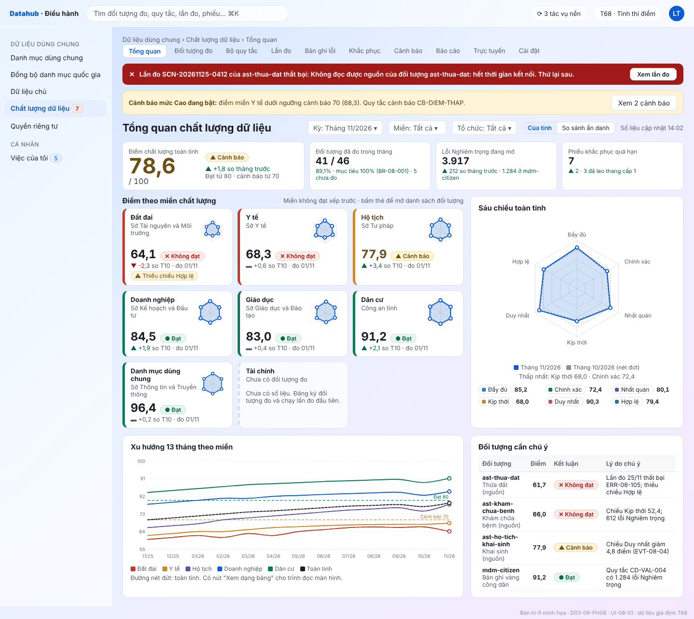

Ảnh cho thấy dải đỏ lần đo lỗi đứng trước dải vàng cảnh báo Cao, thẻ điểm toàn tỉnh 78,6 ở mức Cảnh báo với mũi tên xu hướng, bảy thẻ miền (miền Đất đai và Y tế không đạt xếp đầu, Đất đai có huy hiệu thiếu chiều; thẻ "Tài chính" nét đứt là miền chưa có đối tượng), radar sáu chiều với tháng trước nét đứt, biểu đồ 13 tháng có vạch 80 và 70, và bảng đối tượng cần chú ý. Nền trang `color-canvas`; thẻ `color-surface-solid`, bo `radius-lg`, bóng `shadow-1`; số lớn `font-display` với `font-feature-tabular`.

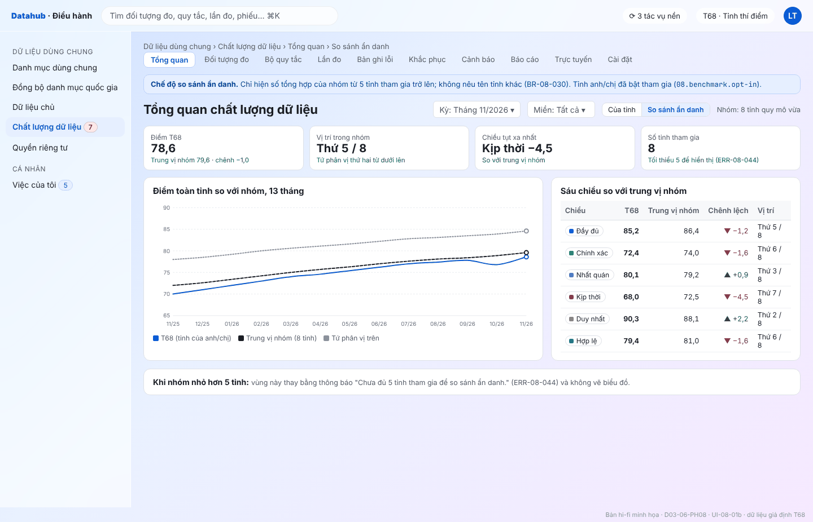

Ảnh biến thể cho thấy chế độ so sánh: tỉnh T68 xếp thứ 5 trong 8 tỉnh, thấp nhất ở chiều Kịp thời (−4,5 so trung vị nhóm).

## 8. UI-08-02 Danh sách đối tượng đo

::: dac-ta
**Mục đích.** Tìm đối tượng đo theo miền, loại, chủ quản, kết luận; thấy ngay đối tượng nào chưa đo, không đạt hoặc đang tạm ngừng; mở chi tiết hoặc đăng ký mới.

**Tác nhân, quyền.** DS, TA, TO, DA, SO, PA, AU, DO (○) với `PERM-08-read`; VW không có màn này.

**FR, UC.** FR-08-006.

**Truy vết hệ cũ.** Không có màn hệ cũ; mới so với mockup cũ.

**Đường dẫn, mẫu.** `/du-lieu/chat-luong/doi-tuong`; PTN-01 Danh sách.

**API.** API-08-005 (`GET /assets`); API-08-001 (bộ lọc miền).

**Điều hướng vào.** Tab "Đối tượng đo"; thẻ miền, thẻ "Đã đo trong tháng" ở UI-08-01.

**Thành phần chính.** Nút "Đăng ký đối tượng đo", chip loại, thanh lọc, bảng, phân trang.

**Hành động.** Lọc, sắp xếp, mở UI-08-04, bấm "Đăng ký đối tượng đo" (`PERM-08-asset`) mở UI-08-03; menu ⋯ mỗi dòng: Đo ngay (`PERM-08-run`), Tạm ngừng, Khôi phục, Ngừng hẳn.

**Trạng thái.** Đang tải, rỗng lần đầu, không có kết quả, lỗi, không quyền.

**Thông báo.** "Không tìm thấy {đối tượng} {mã} trong tỉnh đang làm việc." (ERR-08-001).

**Đợt, mức chi tiết.** Đợt 3; đầy đủ.
:::

### 8.1. Wireframe

Hình dưới là bố cục danh sách: tiêu đề và nút đăng ký, chip loại đối tượng, thanh lọc và bảng.

```text
| Danh sách đối tượng đo      [Tìm mã, tên ⌕]                  [+ Đăng ký đối tượng đo]      |
| (Tất cả 46)(Bản ghi vàng 3)(Danh mục 9)(Dataset nguồn 31)(Bản tin luồng 3)                 |
| Miền ▾  Chủ quản ▾  Trạng thái ▾  Kết luận ▾  [ ] Thiếu chiều        Sắp xếp: Điểm tăng    |
| Đối tượng | Loại | Miền | Chủ quản | Điểm | Kết luận | So kỳ trước | Lần đo | CDE | Trạng thái |
| mdm-citizen | Bản ghi vàng | Dân cư | Công an tỉnh | 91,2 | ● Đạt | ▲ +2,1 | 01/11 | 9/9 | ● Đang đo |
| ast-thua-dat | Dataset nguồn | Đất đai | Sở TN&MT | 61,7 | ✕ Không đạt | ▼ −2,3 | 25/11 (lỗi) | 3/7 | ● Đang đo |
| Hiển thị 1–11 trong 46                                        ‹ 1 2 3 4 › 20 / trang        |
```

### 8.2. Thành phần, trường và cột

Bảng dưới liệt kê cột của bảng và bộ lọc; cột "Ánh xạ API" là trường của `GET /assets`.

| # | Thành phần, cột | `CMP-*` | Nội dung, kiểm tra | Ánh xạ API |
|---|---|---|---|---|
| 1 | Chip loại | `CMP-FilterChips` | Số lượng mỗi `asset_type` | `facets.assetType` |
| 2 | Thanh lọc | `CMP-FilterBar` | Miền, chủ quản (DO bị khóa theo tổ chức), trạng thái `asset_status` (mặc định "Đang đo"), kết luận, "Thiếu chiều" | `domainCode`, `ownerOrgId`, `status`, `verdict`, `incomplete` |
| 3 | Cột "Đối tượng" | `CMP-Identifier` | Mã `assetCode` (mono) và tên; bấm mở UI-08-04 | `assetCode`, `name` |
| 4 | Cột "Loại" | `CMP-Tag` | Nhãn mục 5.2 | `assetType` |
| 5 | Cột "Điểm" | `CMP-ProgressBar` nhỏ + số | Thanh ngắn có vạch 80; "—" khi chưa có điểm | `latestScore` |
| 6 | Cột "Kết luận", "So kỳ trước" | `CMP-StatusTag` | Nhãn `verdict`, `trend` và Δ | `verdict`, `trend`, `delta` |
| 7 | Cột "CDE có quy tắc" | `CMP-Text` | `6/7`; vàng khi thiếu (BR-08-031) | `cdeCovered`, `cdeTotal` |
| 8 | Cột "Trạng thái" | `CMP-StatusTag` | Nhãn `asset_status` | `status` |
| 9 | Phân trang | `CMP-Pagination` | 20 mặc định, 10/20/50/100 | `page`, `size` |

: UI-08-02 Danh sách đối tượng đo, thành phần và cột

### 8.3. Hành động, trạng thái và thông báo

Bảng dưới ghi hành động theo quyền và trạng thái của màn danh sách.

| Hành động hoặc trạng thái | Quyền, điều kiện | Kết quả, thông báo |
|---|---|---|
| Đăng ký đối tượng đo | `PERM-08-asset` | Mở UI-08-03 |
| Đo ngay | `PERM-08-run`; đối tượng `ACTIVE` có bộ quy tắc hiệu lực | Hộp xác nhận chế độ; nếu chưa có bộ: "Đối tượng {mã} chưa có bộ quy tắc đang hiệu lực." (ERR-08-027) |
| Tạm ngừng, Khôi phục, Ngừng hẳn | `PERM-08-asset`; `CMP-ReasonDialog` | Trạng thái đổi; sai trạng thái: "Không thể {thao tác} khi {đối tượng} đang ở trạng thái {trạng thái}." (ERR-08-006) |
| Đang tải | Skeleton 8 dòng | `ST-01` |
| Rỗng lần đầu | `CMP-EmptyState` "Chưa có đối tượng đo nào. Đăng ký đối tượng đầu tiên để bắt đầu đo chất lượng." | Nút "Đăng ký đối tượng đo" nếu có quyền |
| Không có kết quả | "Không tìm thấy đối tượng đo phù hợp" kèm điều kiện lọc | Nút "Xóa bộ lọc" (`ST-04`) |
| Không có quyền | `ST-07`; DO mở đối tượng ngoài tổ chức: "Đối tượng {mã} không thuộc tổ chức của anh/chị." (ERR-08-032) | Trang lỗi 403 |

: UI-08-02 Danh sách đối tượng đo, hành động, trạng thái và thông báo

### 8.4. Bản hi-fi

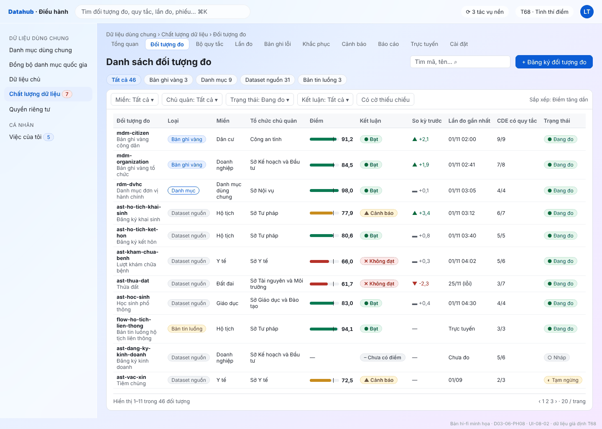

Ảnh cho thấy bốn loại đối tượng lẫn trong một bảng, thanh điểm có vạch 80, đối tượng `ast-thua-dat` lần đo lỗi và đối tượng nháp, tạm ngừng ở cuối danh sách.

## 9. UI-08-03 Đăng ký đối tượng đo

::: dac-ta
**Mục đích.** Dẫn người đăng ký qua bốn bước: chọn loại đối tượng, chọn nguồn, chọn trường và khóa bản ghi, rồi đánh dấu CDE và cách che giá trị lỗi; đối tượng chỉ kích hoạt được khi có ít nhất một CDE (BR-08-031).

**Tác nhân, quyền.** DS, TA (`PERM-08-asset`).

**FR, UC.** FR-08-002, 003, 004, 005 (miền chất lượng FR-08-001 chọn ở bước 1, tạo ở UI-08-19).

**Truy vết hệ cũ.** Không có màn hệ cũ.

**Đường dẫn, mẫu.** `/du-lieu/chat-luong/doi-tuong/moi` (`buoc`, `loai`); PTN-05 Wizard.

**API.** API-08-016 (`GET /sources/mdm-domains`); API-08-017 (`GET /sources/rdm-catalogs`); API-08-018 (`POST /sources/connections/{connectionCode}:discover`); API-08-006 (`POST /assets`); API-08-013, 014, 015 (trường, CDE, đồng bộ phân loại); API-08-009 (`:activate`).

**Điều hướng vào.** Nút "Đăng ký đối tượng đo" ở UI-08-02, UI-08-01 (trạng thái rỗng).

**Thành phần chính.** `CMP-Wizard` bốn bước, bảng trường có chọn CDE, khung tóm tắt bên phải.

**Hành động.** Quay lại, Lưu nháp, Tiếp tục, Hoàn tất và kích hoạt.

**Trạng thái.** Đang khám phá lược đồ nguồn, kiểm tra hợp lệ từng bước, thành công, không quyền.

**Thông báo.** "Miền {mã} cần tổ chức chủ quản và cán bộ phụ trách hợp lệ trước khi dùng." (ERR-08-008); "Trường {đường dẫn} chưa có phân loại xác nhận ở PH-09. Giá trị sẽ được che như dữ liệu Nhạy cảm." (ERR-08-047).

**Đợt, mức chi tiết.** Đợt 3; đầy đủ.
:::

### 9.1. Wireframe

Hình dưới là bước 4 "CDE" của wizard, bước cuối trước khi kích hoạt.

```text
| Đăng ký đối tượng đo                [Hủy] [‹ Quay lại] [Lưu nháp] [Hoàn tất và kích hoạt]  |
| ✓ 1 Loại   ✓ 2 Nguồn   ✓ 3 Trường và khóa   ④ CDE                                         |
| Chọn CDE, kiểm tra phân loại, cách che          | Tóm tắt đối tượng                          |
| ⚠ so_dien_thoai_me chưa có phân loại ở PH-09…   |  Mã · Loại · Kết nối · Bảng · Khóa · Miền  |
| [x] so_dinh_danh  SENSITIVE  HASH               |  Chủ quản · Lịch đo                        |
| [x] ho_ten        RESTRICTED PARTIAL            | Sau khi kích hoạt: tạo lịch, chạy hồ sơ,   |
| [ ] noi_sinh      INTERNAL   NONE               |  gợi ý quy tắc                             |
```

### 9.2. Bước và trường

Bảng dưới liệt kê bốn bước, trường nhập, kiểm tra và ánh xạ API.

| Bước | Trường | Kiểu | Bắt buộc | Kiểm tra | Ánh xạ API, lỗi |
|---|---|---|---|---|---|
| 1 Loại | Loại đối tượng (`CMP-RadioCard`) | `asset_type` | Có | Bốn lựa chọn; `FLOW_MESSAGE` không chạy hồ sơ, đo lô (ERR-08-050) | `assetType` |
| 1 | Mã đối tượng | T-CODE | Có | `^[a-z][a-z0-9-]{2,62}$`, duy nhất: "Mã {mã} đã được dùng. Chọn mã khác." (ERR-08-002) | `assetCode` |
| 1 | Miền, tổ chức chủ quản, cán bộ phụ trách | `CMP-Select`, `CMP-ResourceSelect` | Có | Phải hợp lệ (ERR-08-008) | `domainCode`, `ownerOrgId`, `stewardUserId` |
| 2 Nguồn | Domain PH-06 | `CMP-Select` | Khi `MDM_DOMAIN` | Domain `ACTIVE` có khung nhìn hợp đồng: "Domain {mã} chưa sẵn sàng cho đo chất lượng. Đề nghị PH-06 cấp khung nhìn hợp đồng." (ERR-08-009) | `sourceRef` |
| 2 | Danh mục PH-07 | `CMP-CodeListSelect` | Khi `RDM_CATALOG` | Đã phát hành: "Danh mục {mã} chưa phát hành ở PH-07." (ERR-08-010) | `sourceRef` |
| 2 | Kết nối PH-05, bảng | `CMP-ConnectionSelect`, `CMP-SchemaTree` | Khi `SOURCE_DATASET` | Chỉ đọc, đã cấp: "Kết nối {mã} không phải kết nối chỉ đọc được cấp cho chất lượng dữ liệu." (ERR-08-011); bảng tồn tại, không thuộc CSDL control: "Không đo được bảng {tên}. Bảng không tồn tại hoặc thuộc CSDL quản trị của Datahub." (ERR-08-012) | `connectionCode`, `tableName` |
| 3 Trường | Cột khóa bản ghi | `CMP-Select` | Có | "Khóa bản ghi {cột} không có trong bảng {tên}." (ERR-08-013) | `recordKey` |
| 3 | Trường đưa vào đo | `CMP-Transfer` hoặc bảng chọn | Có | Tối đa `08.profile.max-columns` cột | `fields[]` |
| 4 CDE | Chọn CDE, cách che | `CMP-Checkbox`, `CMP-Select` | Tối thiểu 1 CDE | Che không lỏng hơn phân loại PH-09: "{Trường} không hợp lệ: {chi tiết}." (ERR-08-003); chưa phân loại: ERR-08-047 (cảnh báo vàng, không chặn) | `PUT /assets/{assetCode}/fields/{fieldPath}` |

: UI-08-03 Đăng ký đối tượng đo, bước và trường

### 9.3. Hành động, trạng thái và thông báo

Bảng dưới ghi hành động theo quyền và các trạng thái của wizard.

| Hành động hoặc trạng thái | Quyền, điều kiện | Kết quả, thông báo |
|---|---|---|
| Tiếp tục | Bước hiện tại hợp lệ | Sang bước kế; lỗi hiện dưới trường (`ST-11`) |
| Lưu nháp | `PERM-08-asset` | Tạo đối tượng `DRAFT`; có thể quay lại bằng danh sách |
| Hoàn tất và kích hoạt | Có ít nhất một CDE | `:activate`; "Đã lưu đối tượng đo {mã}." kèm lịch đo mặc định `08.scan.default-cron` và chạy hồ sơ nếu `08.profile.on-activate` |
| Đang khám phá lược đồ | Spinner trong bước 2, 3 | Hết thời gian: ERR-08-105 "Không đọc được nguồn của đối tượng {mã}: {nguyên nhân}. Thử lại sau." |
| Rỗng | Kết nối chưa có bảng nào đọc được | `CMP-EmptyState` "Kết nối này chưa có bảng nào đo được" |
| Không có quyền | `ST-07` | Trang lỗi 403 |

: UI-08-03 Đăng ký đối tượng đo, hành động, trạng thái và thông báo

### 9.4. Bản hi-fi

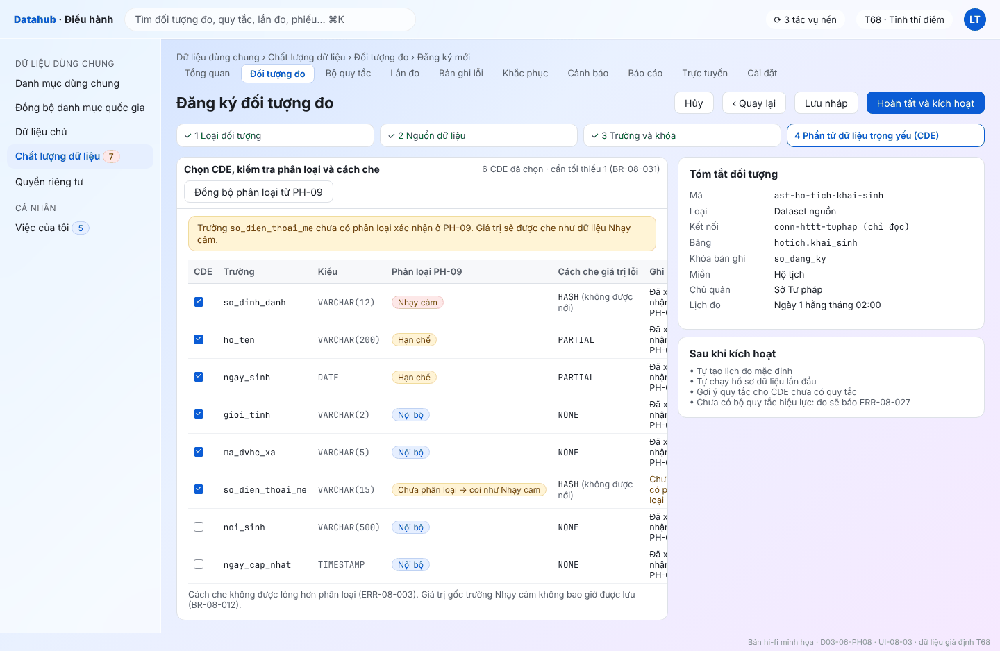

Ảnh cho thấy bước 4 với dải vàng cảnh báo trường chưa phân loại, cột "Cách che" không cho nới lỏng và khung tóm tắt bên phải.

## 10. UI-08-04 Chi tiết đối tượng đo, thẻ điểm

::: dac-ta
**Mục đích.** Cho chủ quản và cán bộ thấy điểm của một đối tượng: kết luận, sáu chiều có trọng số, quy tắc vi phạm nhiều nhất, độ phủ CDE, lỗi và phiếu đang mở; từ đó đo ngay, tạm ngừng hoặc đi tiếp tới hồ sơ, lỗi, quy tắc.

**Tác nhân, quyền.** DS, DO (○), DA, TA, TO, SO, PA, AU (`PERM-08-read`); VW thấy điểm và xu hướng tổng hợp, không thấy danh sách lỗi.

**FR, UC.** FR-08-005, 006, 007, 024, 028, 029, 051, 060.

**Truy vết hệ cũ.** Không có màn hệ cũ.

**Đường dẫn, mẫu.** `/du-lieu/chat-luong/doi-tuong/{ma}` (tab `/truong`, `/xu-huong`, `/truc-tuyen`, `/lich-su`; `ky`); PTN-02 Chi tiết.

**API.** API-08-007 (`GET /assets/{assetCode}`); API-08-106 (`GET /scorecards/assets/{assetCode}`); API-08-066 (`GET /assets/{assetCode}/score-history`); API-08-013 (trường); API-08-072 (cấu hình trực tuyến); API-08-010, 011, 012 (tạm ngừng, khôi phục, ngừng); API-08-059 (đo ngay).

**Điều hướng vào.** Bấm dòng ở UI-08-02, thẻ ở UI-08-01, liên kết từ báo cáo, lần đo, phiếu.

**Thành phần chính.** Đầu trang (mã, loại, trạng thái, nút), tab, vòng điểm, radar, bảng sáu chiều, năm quy tắc vi phạm, khối lỗi mở, khối phủ và xử lý.

**Hành động.** Đo ngay, Chạy hồ sơ (mở UI-08-05), Tạm ngừng, Khôi phục, Ngừng hẳn, mở lỗi, mở quy tắc.

**Trạng thái.** Đang tải, chưa có lần đo, lỗi, không quyền, đối tượng không tồn tại.

**Thông báo.** "Đối tượng {mã} chưa có lần đo nào thành công." (ERR-08-001); "Đối tượng {mã} chưa có bộ quy tắc đang hiệu lực." (ERR-08-027); "Đối tượng đang có lần chạy {mã}. Đợi lần này xong hoặc hủy." (ERR-08-028).

**Đợt, mức chi tiết.** Đợt 3; đầy đủ.
:::

### 10.1. Wireframe

Hình dưới là tab "Thẻ điểm" của một đối tượng nguồn.

```text
| ast-ho-tich-khai-sinh  [Dataset nguồn] [● Đang đo]        [Chạy hồ sơ][Tạm ngừng][Đo ngay]|
| Chủ quản Sở Tư pháp · Bộ quy tắc BQ-HO-TICH v6 · Trọng số mặc định v2                     |
| [Thẻ điểm][Trường và CDE][Xu hướng][Trực tuyến][Lịch sử đo]                                |
| Điểm lần đo 01/11            | Điểm sáu chiều: Chiều | w | Điểm | Đạt | Vi phạm | Bỏ qua |
|  (77,9) ▲ Cảnh báo  ▲ +3,4    |  Đầy đủ 0,20 82,3 …                                         |
|  radar + kỳ trước             | 5 quy tắc vi phạm nhiều nhất                                |
| Lỗi đang mở: 1.212 | 3.540 | 2.870   | Phủ và xử lý: CDE 6/7 · phiếu 2 · ngoại lệ 1 · đo 01/12 |
```

### 10.2. Thành phần

Bảng dưới liệt kê thành phần của thẻ điểm và nguồn số liệu.

| # | Thành phần | `CMP-*` | Nội dung, kiểm tra | Nguồn |
|---|---|---|---|---|
| 1 | Đầu trang | `CMP-PageHeader` | Mã, loại, trạng thái, nút theo quyền và trạng thái | `asset` |
| 2 | Tab | `CMP-EntityTab` | Thẻ điểm, Trường và CDE (bảng trường, phân loại, độ phủ), Xu hướng (13 tháng, `trend`, cờ), Trực tuyến (cấu hình, ẩn với đối tượng không hỗ trợ), Lịch sử đo | route |
| 3 | Vòng điểm, kết luận | `CMP-KpiCard` | Điểm, `verdict`, `trend`, Δ, mã lần đo; cờ `INCOMPLETE_DIMENSIONS`, `WEIGHTS_CHANGED` thành huy hiệu | `scorecard` |
| 4 | Radar sáu chiều | `CMP-Chart` `radar` | Điểm và kỳ trước | `dimensions[]` |
| 5 | Bảng sáu chiều | `CMP-DataTable` | Chiều, trọng số, điểm (thanh), đạt, vi phạm, bỏ qua, ngoại lệ; chiều không có điểm tô xám kèm lý do | `dimensions[]` |
| 6 | Năm quy tắc vi phạm | `CMP-DataTable` | Mã, tên, chiều, số vi phạm; bấm mở UI-08-13 lọc quy tắc | `topRules[]` |
| 7 | Lỗi đang mở | `CMP-Chart` cột ngang | Ba mức nghiêm trọng, mới, còn, hết | `findings` |
| 8 | Phủ và xử lý | `CMP-DescriptionList` | CDE có quy tắc, phiếu mở, ngoại lệ `ACTIVE`, lịch kế tiếp, trực tuyến | `coverage` |

: UI-08-04 Chi tiết đối tượng đo, thành phần

### 10.3. Hành động, trạng thái và thông báo

Bảng dưới ghi hành động theo quyền và các trạng thái của thẻ điểm.

| Hành động hoặc trạng thái | Quyền, điều kiện | Kết quả, thông báo |
|---|---|---|
| Đo ngay | `PERM-08-run`; đối tượng `ACTIVE`, không có lần `QUEUED` hay `RUNNING` | Hộp chọn chế độ `FULL` hoặc `SAMPLE` (cỡ 100…1.000.000, ERR-08-030); mở UI-08-12; hạn mức: "Đã đạt {n} lần đo theo yêu cầu trong một giờ. Thử lại sau {phút} phút." (ERR-08-052) |
| Tạm ngừng, Khôi phục, Ngừng hẳn | `PERM-08-asset`; `CMP-ReasonDialog` | Lịch bị hoãn; điểm lịch sử giữ nguyên |
| Chạy hồ sơ | `PERM-08-asset`; không dùng cho `FLOW_MESSAGE` | "Đối tượng loại bản tin trên luồng không chạy hồ sơ hoặc đo theo lô." (ERR-08-050) |
| Chưa có lần đo | `CMP-EmptyState` "Đối tượng chưa có lần đo nào thành công." kèm nút "Đo ngay" | ERR-08-001 khi gọi thẻ điểm không có ảnh chụp |
| Đang tải, lỗi | Skeleton thẻ; `ST-05` theo khối | |
| Không có quyền | `ST-07` | ERR-08-032 |

: UI-08-04 Chi tiết đối tượng đo, hành động, trạng thái và thông báo

### 10.4. Bản hi-fi

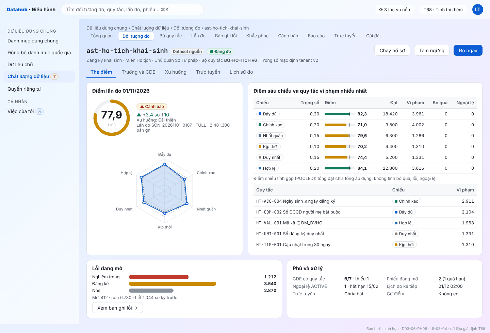

Ảnh cho thấy đối tượng nguồn khai sinh với điểm 77,9 mức Cảnh báo, radar có kỳ trước nét đứt, bảng sáu chiều đủ trọng số, đạt, vi phạm và năm quy tắc vi phạm nhiều nhất.

## 11. UI-08-05 Hồ sơ dữ liệu

::: dac-ta
**Mục đích.** Cho cán bộ hiểu dữ liệu thật trước khi viết quy tắc: tỷ lệ rỗng, số giá trị khác nhau, khoảng giá trị, phân bố từng cột, thay đổi so lần trước, và nhận gợi ý quy tắc.

**Tác nhân, quyền.** DS, TA chạy (`PERM-08-asset`); xem: `PERM-08-read`.

**FR, UC.** FR-08-008, 009, 010, 011.

**Truy vết hệ cũ.** Không có màn hệ cũ.

**Đường dẫn, mẫu.** `/du-lieu/chat-luong/doi-tuong/{ma}/ho-so` (`lan`, `so-voi`); PTN-02 tab.

**API.** API-08-019 (`POST /assets/{assetCode}/profile-runs`); API-08-020, 021, 022 (lần hồ sơ, cột); API-08-023 (`:suggest-rules`); API-08-031 (thêm quy tắc vào bản nháp).

**Điều hướng vào.** Nút "Chạy hồ sơ" ở UI-08-04; gợi ý "Từ gợi ý hồ sơ" ở UI-08-07.

**Thành phần chính.** Thanh thông tin lần hồ sơ, bảng cột có phân bố thu nhỏ, khung gợi ý quy tắc.

**Hành động.** Chạy hồ sơ mới, chọn lần so sánh, thêm gợi ý vào bản nháp, bỏ qua gợi ý.

**Trạng thái.** Đang chạy, thành công, lỗi, chưa có hồ sơ, không quyền.

**Thông báo.** "Lần hồ sơ {mã} thất bại: {nguyên nhân}." (ERR-08-111).

**Đợt, mức chi tiết.** Đợt 3; đầy đủ.
:::

### 11.1. Wireframe

Hình dưới là tab hồ sơ: thông tin lần chạy, bảng cột và cột gợi ý bên phải.

```text
| Hồ sơ dữ liệu · ast-ho-tich-khai-sinh                                  [Chạy hồ sơ mới]    |
| HS-20261126-0031 ● Thành công · SAMPLE 1.000.000 · 02:14 (7 phút 40 giây) · so với HS-…27 ▾  |
| Cột | Rỗng | Khác nhau (HLL) | Đầy đủ | min → max | Phân bố | So lần trước | Gợi ý   | Gợi ý quy tắc  |
| ngay_sinh | 0,1% | 7.310 | 99,9% | 01/01/2019 → 26/11/2026 | ▁▂▃▅▇ | ▲ ngày sau đăng ký | 2 | IN_RDM ma_dvhc_xa  |
| so_cccd_me | 8,4% | 2.019.884 | 91,6% | ●●●●●●●●●●●● | — | ▲ rỗng +1,1 | 3 | [Thêm][Bỏ qua]      |
```

### 11.2. Thành phần, trường và cột

Bảng dưới liệt kê thành phần của màn hồ sơ.

| # | Thành phần, cột | `CMP-*` | Nội dung, kiểm tra | Ghi chú |
|---|---|---|---|---|
| 1 | Thanh thông tin lần hồ sơ | `CMP-DescriptionList` | Mã, `profile_run.status`, chế độ (`FULL`, `SAMPLE`, `EXTERNAL`), thời điểm, thời lượng, chọn lần so sánh | `EXTERNAL`: chỉ số do PH-05 đẩy (FR-08-011) |
| 2 | Bảng cột | `CMP-DataTable` | Tên cột và kiểu, tỷ lệ rỗng, số giá trị khác nhau (xấp xỉ HyperLogLog, sai số ±1%), tỷ lệ đầy đủ, min, max, phân bố (`CMP-Chart` `spark`), thay đổi so lần trước | Tối đa `08.profile.max-columns` cột |
| 3 | Giá trị cột Nhạy cảm | `CMP-MaskedValue` | Min, max, giá trị phổ biến chỉ ở dạng che | BR-08-012 |
| 4 | Khung gợi ý quy tắc | `CMP-Card`, `CMP-Button` | Chiều, trường, toán tử, lý do từ số liệu; "Thêm vào bản nháp" gọi API-08-031 nguồn `SUGGESTED` | Chỉ là đề xuất (FR-08-010) |

: UI-08-05 Hồ sơ dữ liệu, thành phần và cột

### 11.3. Hành động, trạng thái và thông báo

Bảng dưới ghi hành động theo quyền và các trạng thái của màn hồ sơ.

| Hành động hoặc trạng thái | Quyền, điều kiện | Kết quả, thông báo |
|---|---|---|
| Chạy hồ sơ mới | `PERM-08-asset`; không có lần chạy khác | Tạo `QUEUED`; trùng: "Đối tượng đang có lần chạy {mã}. Đợi lần này xong hoặc hủy." (ERR-08-028) |
| Thêm gợi ý vào bản nháp | `PERM-08-rule-admin` | Quy tắc mới trong bản nháp; chưa có bản nháp thì hỏi tạo (ERR-08-022 nếu đã có bản nháp của người khác) |
| Đang chạy | `CMP-JobProgress` | Thăm dò 5 giây |
| Lỗi | Dải đỏ: "Lần hồ sơ {mã} thất bại: {nguyên nhân}." (ERR-08-111) | Nút "Chạy lại" |
| Chưa có hồ sơ | `CMP-EmptyState` "Chưa có hồ sơ dữ liệu. Chạy hồ sơ để xem thống kê từng cột và nhận gợi ý quy tắc." | Nút "Chạy hồ sơ" nếu có quyền |
| Không có quyền | `ST-07` | |

: UI-08-05 Hồ sơ dữ liệu, hành động, trạng thái và thông báo

### 11.4. Bản hi-fi

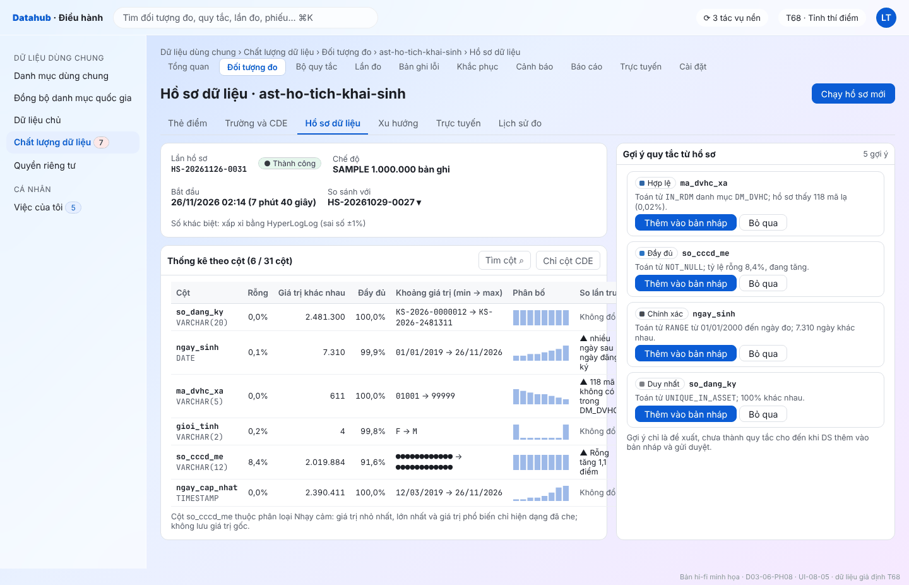

Ảnh cho thấy thống kê sáu cột (cột số CCCD che dạng chấm), phân bố thu nhỏ, cột "So lần trước" nêu thay đổi đáng chú ý và khung gợi ý bốn quy tắc.

## 12. UI-08-06 Danh sách bộ quy tắc

::: dac-ta
**Mục đích.** Thấy mọi bộ quy tắc của tỉnh theo đối tượng đo, phiên bản hiệu lực, bản nháp đang soạn và trạng thái duyệt; tạo, sao chép, nhập, xuất bộ quy tắc; chọn mẫu từ thư viện `COMMON`.

**Tác nhân, quyền.** DS, TA soạn (`PERM-08-rule-admin`); PA sửa mẫu `COMMON`; còn lại xem (`PERM-08-read`).

**FR, UC.** FR-08-012, 015, 020, 022.

**Truy vết hệ cũ.** Thiết kế lại từ tab "Luật" của mockup cũ (mục 3.1).

**Đường dẫn, mẫu.** `/du-lieu/chat-luong/quy-tac` (tab `/danh-sach`, `/mau`; `doi-tuong`, `trang-thai`, `q`); PTN-01.

**API.** API-08-025 (`GET /rule-sets`); API-08-053 (`GET /rules`); API-08-035 (`GET /rule-templates`); API-08-026 (`POST /rule-sets`); API-08-044, 045, 046 (sao chép, xuất, nhập).

**Điều hướng vào.** Tab "Bộ quy tắc"; liên kết từ UI-08-04, 12.

**Thành phần chính.** Ba tab (Bộ quy tắc, Quy tắc, Thư viện mẫu), bảng bộ quy tắc, khung thư viện mẫu.

**Hành động.** Tạo bộ, nhập YAML hoặc JSON, mở trình soạn, sao chép, xuất, xem lịch sử, ngừng bộ.

**Trạng thái.** Đang tải, rỗng, không kết quả, lỗi, không quyền.

**Thông báo.** "Bộ quy tắc {mã} đang có bản nháp phiên bản {n} do {người} tạo." (ERR-08-022); "Tệp không đúng định dạng bộ quy tắc ở {vị trí}: {chi tiết}." (ERR-08-025); "Đối tượng đích thiếu trường {danh sách}. Khai báo ánh xạ trường trước khi sao chép." (ERR-08-026).

**Đợt, mức chi tiết.** Đợt 3; đầy đủ.
:::

### 12.1. Wireframe

Hình dưới là tab "Bộ quy tắc" cạnh khung thư viện mẫu dùng chung.

```text
| Danh sách bộ quy tắc  [Tìm ⌕]              [Nhập YAML, JSON] [+ Tạo bộ quy tắc]            |
| (Bộ quy tắc 8)(Quy tắc 95)(Thư viện mẫu 24)                                                  |
| Bộ quy tắc | Đối tượng đo | Hiệu lực | Bản nháp | Quy tắc bật | Chiều phủ | Trạng thái | Thư viện mẫu COMMON |
| BQ-HO-TICH | ast-ho-tich… | v6 | v7 · Nguyễn Thị Lan | 12 | 6/6 | ◐ Chờ duyệt | CCCD 12 số  VALIDITY CEL |
| BQ-DVHC    | rdm-dvhc     | v2 | —                   |  7 | 5/6 | ● Hiệu lực  | Mã số thuế  VALIDITY CHECKSUM |
```

### 12.2. Thành phần, trường và cột

Bảng dưới liệt kê cột bảng, hộp thoại và nguồn số liệu.

| # | Thành phần, cột | `CMP-*` | Nội dung, kiểm tra | Ghi chú |
|---|---|---|---|---|
| 1 | Cột "Bộ quy tắc" | `CMP-Identifier` | Mã bộ (mono), tên; bấm mở UI-08-07 (bản nháp nếu có, không thì xem bản hiệu lực) | |
| 2 | Cột "Hiệu lực", "Bản nháp" | `CMP-Tag` | Số phiên bản `ACTIVE`; bản nháp kèm người soạn | Tối đa một mỗi loại (BR-08-006) |
| 3 | Cột "Chiều phủ" | `CMP-Text` | Số chiều có quy tắc bật trên 6; vàng khi dưới 6 | |
| 4 | Cột "Trạng thái" | `CMP-StatusTag` | Nhãn `rule_set_version.status` của bản mới nhất | |
| 5 | Hộp "Tạo bộ quy tắc" | `CMP-Form` trong `CMP-Modal` | Mã (`T-CODE`), tên, đối tượng đo (chỉ đối tượng chưa có bộ hoặc đã ngừng), mô tả; tùy chọn "Bắt đầu từ mẫu" | ERR-08-002 khi trùng mã |
| 6 | Hộp "Nhập" | `CMP-FileDropzone` | YAML, JSON; tệp ≤ giới hạn; xem trước số quy tắc, lỗi theo dòng | ERR-08-025, ERR-08-046 |
| 7 | Khung thư viện mẫu | `CMP-DataTable` | Mẫu, chiều, toán tử; "Thêm vào bản nháp"; PA có nút sửa mẫu | BR-08-032 |

: UI-08-06 Danh sách bộ quy tắc, thành phần và cột

### 12.3. Hành động, trạng thái và thông báo

Bảng dưới ghi hành động theo quyền và các trạng thái của danh sách.

| Hành động hoặc trạng thái | Quyền, điều kiện | Kết quả, thông báo |
|---|---|---|
| Tạo bộ, Sao chép bộ | `PERM-08-rule-admin` | Tạo bộ và bản nháp v1; sao chép sang đối tượng khác kiểm trường (ERR-08-026) |
| Nhập, Xuất | `PERM-08-rule-admin`; xuất cần `PERM-08-read` | Tệp YAML hoặc JSON; lỗi lược đồ: ERR-08-025 |
| Mở trình soạn khi có bản nháp của người khác | | "Bộ quy tắc {mã} đang có bản nháp phiên bản {n} do {người} tạo." (ERR-08-022) |
| Rỗng | `CMP-EmptyState` "Chưa có bộ quy tắc nào. Tạo bộ đầu tiên hoặc bắt đầu từ thư viện mẫu." | Nút "Tạo bộ quy tắc" |
| Không có quyền | `ST-07`; nút sửa ẩn với VW, DO, SO, AU (`ST-15`) | |

: UI-08-06 Danh sách bộ quy tắc, hành động, trạng thái và thông báo

### 12.4. Bản hi-fi

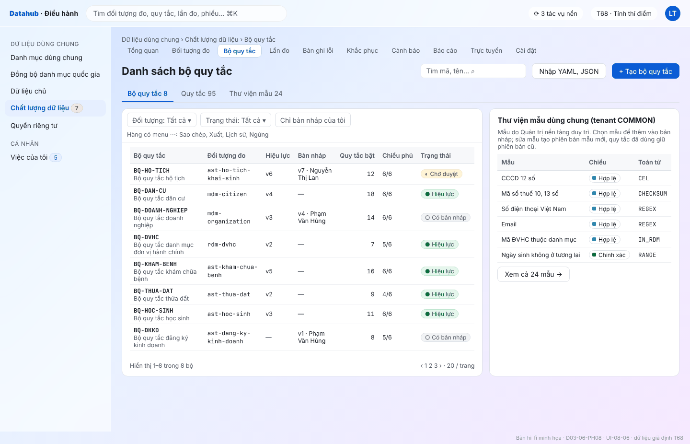

Ảnh cho thấy tám bộ quy tắc với ba trạng thái (hiệu lực, chờ duyệt, có bản nháp) và khung thư viện mẫu `COMMON`.

## 13. UI-08-07 Trình soạn bộ quy tắc

::: dac-ta
**Mục đích.** Cho cán bộ soạn một phiên bản bộ quy tắc: thêm, sửa, bật, tắt quy tắc theo sáu chiều, thấy độ phủ chiều và CDE, chạy thử, rồi gửi duyệt; chặn các sai sót phổ biến (thiếu danh mục, quy tắc lỗi, chạy thử cũ) trước khi gửi.

**Tác nhân, quyền.** DS, TA soạn (`PERM-08-rule-admin`); DA, PA, SO, AU, TO xem bản nháp ở chế độ chỉ đọc (`ST-15`).

**FR, UC.** FR-08-012, 013, 017.

**Truy vết hệ cũ.** Thiết kế lại từ bảng luật và bộ lọc sáu chip của mockup cũ (SRS cũ §6.3).

**Đường dẫn, mẫu.** `/du-lieu/chat-luong/quy-tac/{ma}/sua` (`phien-ban`, `chieu`, `chi-cde`, `che-do`); PTN-03 Biểu mẫu trang.

**API.** API-08-027, 030 (`GET` bộ, phiên bản); API-08-029 (`POST …/versions`); API-08-031, 032, 033 (thêm, sửa, xóa quy tắc); API-08-037 (`:dry-run`); API-08-038 (`:submit`); API-08-043 (`/diff`); API-08-013 (trường của đối tượng).

**Điều hướng vào.** UI-08-06; "Từ gợi ý hồ sơ" ở UI-08-05; liên kết cảnh báo ERR-08-116.

**Thành phần chính.** Thanh trên của trang (kính), dải thông báo, chip chiều, bảng quy tắc, cột tóm tắt phiên bản và kiểm tra trước khi gửi, ngăn kéo UI-08-08.

**Hành động.** Thêm quy tắc (trống, từ mẫu, từ gợi ý), bật hoặc tắt, sửa, xóa, chạy thử, so sánh với bản hiệu lực, gửi duyệt.

**Trạng thái.** Bản nháp, đã chạy thử hợp lệ, chạy thử đã cũ, có quy tắc lỗi, chờ duyệt (chỉ đọc), mất kết nối, xung đột phiên bản.

**Thông báo.** "Chạy thử phiên bản sau lần sửa cuối trước khi gửi duyệt." (ERR-08-053); "Phiên bản {n} chưa có quy tắc nào đang bật." (ERR-08-021); "Trường {đường dẫn} không còn ở nguồn. Quy tắc {mã} không chạy được." (ERR-08-116).

**Đợt, mức chi tiết.** Đợt 3; rất chi tiết.
:::

### 13.1. Wireframe

Hình dưới là bố cục trình soạn: thanh trên của trang, dải thông báo, chip lọc, bảng quy tắc và cột tóm tắt bên phải.

```text
| Bộ quy tắc › BQ-HO-TICH › ast-ho-tich-khai-sinh     (kính, dính khi cuộn)                    |
| Bộ quy tắc hộ tịch · phiên bản 7 [Nháp]   đã tự lưu 14:35  [So sánh v6][Chạy thử ▷][Gửi duyệt]|
| ⓘ ① Đã chạy thử lúc 14:35 trên mẫu 10.000: 11 quy tắc chạy được, 9 có vi phạm.  [Xem kết quả] |
| (Tất cả 12)(Đầy đủ 2)(Chính xác 2)(Nhất quán 2)(Kịp thời 1)(Duy nhất 2)(Hợp lệ 3)(Nghiêm trọng)|
| [Tìm ⌕] [+ Thêm quy tắc ▾] [Từ thư viện mẫu] [Từ gợi ý hồ sơ (5)]                            |
| ☐ Bật | Quy tắc, trường | Chiều | Toán tử | Mức | Chế độ | Chạy thử (tỷ lệ lỗi) | ② Tóm tắt  |
| ☐ ●- | HT-COM-001 [CDE]  | Đầy đủ | NOT_NULL | Nghiêm trọng | Cả hai | ✓ 0,0% | Độ phủ chiều   |
| ☐ ●- | HT-VAL-003 [CDE]  | Hợp lệ | CEL_EXPRESSION | Đáng kể | Cả hai | ✓ 1,1% | CDE 6/7        |
| ☐ -○ | HT-TIM-001        | Kịp thời| MAX_AGE_DAYS | Nhẹ | Lô | — tắt   | Kiểm tra trước khi gửi |
```

### 13.2. Lưới bố cục và vùng

Trang chia hai cột 3,2 : 1. Thanh trên của trang (vùng 1) dính ở đầu, vật liệu `glass-overlay`, cao `size-topbar`; cột phải (vùng 5) rộng 300 px và dính theo cuộn. Dưới `bp-lg` cột phải xuống dưới bảng. Bảng dùng mật độ gọn 32 px; mã quy tắc mono, tên và trường ở dòng thứ hai để cột tên không bị bóp.

Bảng dưới đánh số các vùng và thành phần của trình soạn.

| # | Vùng, thành phần | `CMP-*` | Nội dung, kiểm tra | Ghi chú |
|---|---|---|---|---|
| 1 | Thanh trên trang | `CMP-PageHeader`, `CMP-SaveIndicator` | Mã bộ, phiên bản, `rule_set_version.status`, trạng thái tự lưu ("Đang lưu…", "Đã tự lưu 14:35", "Lỗi lưu"); nút So sánh, Chạy thử, Gửi duyệt | Tự lưu mỗi 5 giây sau lần sửa cuối bằng `PUT` quy tắc |
| 2 | Dải thông báo | `CMP-Alert` | Một dải cho mỗi vấn đề: chạy thử cũ (đỏ), quy tắc lỗi (vàng), chạy thử hợp lệ (xanh thông tin) | Tối đa 3 dải, còn lại gộp "và n vấn đề khác" |
| 3 | Chip lọc | `CMP-FilterChips` | Sáu chip chiều có số quy tắc và chấm màu, chip "Nghiêm trọng", "Chỉ CDE", chip chế độ; ghi `chieu`, `chi-cde` lên URL | Chip có số 0 vẫn hiện để thấy chiều còn thiếu |
| 4 | Bảng quy tắc | `CMP-EditableTable` | Cột: chọn, bật (`CMP-Switch`), quy tắc (mã, tên, trường), chiều (`DimensionChip`), toán tử, mức, chế độ, kết quả chạy thử, huy hiệu CDE; bấm dòng mở UI-08-08 | Dòng lỗi nền `color-diff-removed` kèm mã lỗi bằng chữ |
| 5 | Cột tóm tắt phiên bản | `CMP-Card`, `CMP-ProgressBar` | Độ phủ chiều (số quy tắc bật mỗi chiều), cảnh báo thiếu chiều (`INCOMPLETE_DIMENSIONS`), độ phủ CDE, số quy tắc bật, tình trạng chạy thử, người soạn | Chiều không có quy tắc hiện thanh rỗng và câu cảnh báo vàng |
| 6 | Kiểm tra trước khi gửi | `CMP-Card` | Danh sách ✓ hoặc ✕: chạy thử hợp lệ và mới, có quy tắc bật, mọi quy tắc Hợp lệ có danh mục, mọi quy tắc chạy được; ⚠ CDE chưa có quy tắc (không chặn) | Nút "Gửi duyệt" khóa khi còn ✕ |
| 7 | Thanh chọn hàng loạt | `CMP-SelectionBar` | Khi chọn từ một dòng: Bật, Tắt, Đổi mức, Đổi chế độ, Xóa | `glass-overlay` dính đáy |

: UI-08-07 Trình soạn bộ quy tắc, vùng và thành phần

### 13.3. Quy tắc kiểm tra và tương tác

Tương tác chính của trình soạn nằm ở tám quy tắc dưới đây; mỗi quy tắc nêu điều kiện, kết quả và mã lỗi hiển thị.

| # | Điều kiện | Kết quả hiển thị |
|---|---|---|
| 1 | Sửa quy tắc (nội dung, bật, tắt, mức) sau lần chạy thử | Tình trạng chạy thử chuyển "đã cũ", dòng sửa có nhãn "sửa {giờ}, chưa chạy thử"; "Gửi duyệt" khóa kèm "Chạy thử phiên bản sau lần sửa cuối trước khi gửi duyệt." (ERR-08-053), BR-08-006 |
| 2 | Không có quy tắc nào bật | "Gửi duyệt" khóa; "Phiên bản {n} chưa có quy tắc nào đang bật." (ERR-08-021) |
| 3 | Quy tắc chiều Hợp lệ thiếu danh mục | Dòng đánh dấu lỗi; "Quy tắc chiều Hợp lệ phải chọn danh mục PH-07 để đối chiếu." (ERR-08-017) |
| 4 | Trường của quy tắc không còn ở nguồn sau khi lược đồ nguồn đổi | Dòng lỗi, kết quả chạy thử "ERR-08-116": "Trường {đường dẫn} không còn ở nguồn. Quy tắc {mã} không chạy được." |
| 5 | Bộ đã có bản nháp của người khác | Màn mở ở chế độ chỉ đọc: "Bộ quy tắc {mã} đang có bản nháp phiên bản {n} do {người} tạo." (ERR-08-022) |
| 6 | Hai người sửa cùng bản nháp | Lưu trả `412`; `CMP-ConflictDialog` so sánh bản của tôi với bản mới: "{Đối tượng} đã được người khác sửa. Tải lại để xem thay đổi." (ERR-08-004, `ST-13`) |
| 7 | Chiều Kịp thời không có quy tắc bật | Cảnh báo vàng ở cột tóm tắt, không chặn gửi; điểm sẽ có cờ `INCOMPLETE_DIMENSIONS` |
| 8 | Chạy thử | Mở UI-08-08 tab "Chạy thử" hoặc chạy toàn bộ phiên bản qua API-08-037 trên mẫu `08.dryrun.max-rows`; vượt: "Chạy thử tối đa {n} bản ghi. Giảm kích thước mẫu." (ERR-08-031) |

: UI-08-07 Trình soạn bộ quy tắc, quy tắc kiểm tra và tương tác

### 13.4. Hành động và quyền

Bảng dưới ghi hành động, quyền và kết quả ở trình soạn.

| Hành động | Quyền, điều kiện | Kết quả |
|---|---|---|
| Thêm quy tắc (trống, mẫu, gợi ý) | `PERM-08-rule-admin`; bản nháp của mình | Mở UI-08-08 tab Biểu mẫu với quy tắc mới |
| Bật, tắt, sửa, xóa | Như trên | Cập nhật bản nháp; xóa có `CMP-ConfirmDialog` |
| Gửi duyệt | `PERM-08-rule-admin`; chạy thử hợp lệ và mới (ERR-08-053) | `:submit`, trạng thái `PENDING_APPROVAL`, màn chuyển chỉ đọc, việc tới DA |
| So sánh với v{n} | `PERM-08-read` | Mở UI-08-09 |
| Hủy bản nháp | `PERM-08-rule-admin`; `CMP-ConfirmDialog` | Xóa bản nháp, quay về UI-08-06 |

: UI-08-07 Trình soạn bộ quy tắc, hành động và quyền

### 13.5. Trạng thái, bàn phím và truy cập

Trạng thái màn gồm: đang tải (skeleton bảng 8 dòng, `ST-01`); bản nháp rỗng (`CMP-EmptyState` "Bản nháp chưa có quy tắc. Thêm từ mẫu, gợi ý hồ sơ hoặc tạo mới."); lỗi tải (`ST-05`); mất kết nối khi soạn (`ST-06`, bản nháp giữ trong bộ nhớ trang, tự lưu khi có mạng); chờ duyệt, đã duyệt, hiệu lực (chỉ đọc `ST-15`, nút ẩn); không quyền (`ST-07`).

Bàn phím: `/` focus ô tìm; `N` thêm quy tắc; `↑ ↓` đi giữa dòng; `Enter` mở ngăn kéo; `Space` chọn dòng; `T` bật, tắt dòng; `Ctrl+Enter` chạy thử; `Esc` đóng ngăn kéo. Công tắc bật, tắt có `aria-label` nêu mã quy tắc; trạng thái lỗi dòng được đọc kèm mã lỗi; thứ tự focus: thanh trên, dải, chip, công cụ, bảng, cột phải.

### 13.6. Bản hi-fi

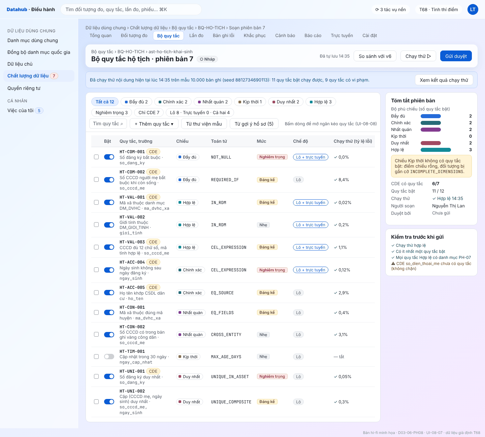

Ảnh cho thấy bản nháp v7 đã chạy thử hợp lệ: chip sáu chiều có số quy tắc, bảng 12 quy tắc với công tắc, chiều, toán tử, mức, chế độ, tỷ lệ lỗi chạy thử và huy hiệu CDE, cột tóm tắt có độ phủ chiều và cảnh báo chiều Kịp thời không có quy tắc bật.

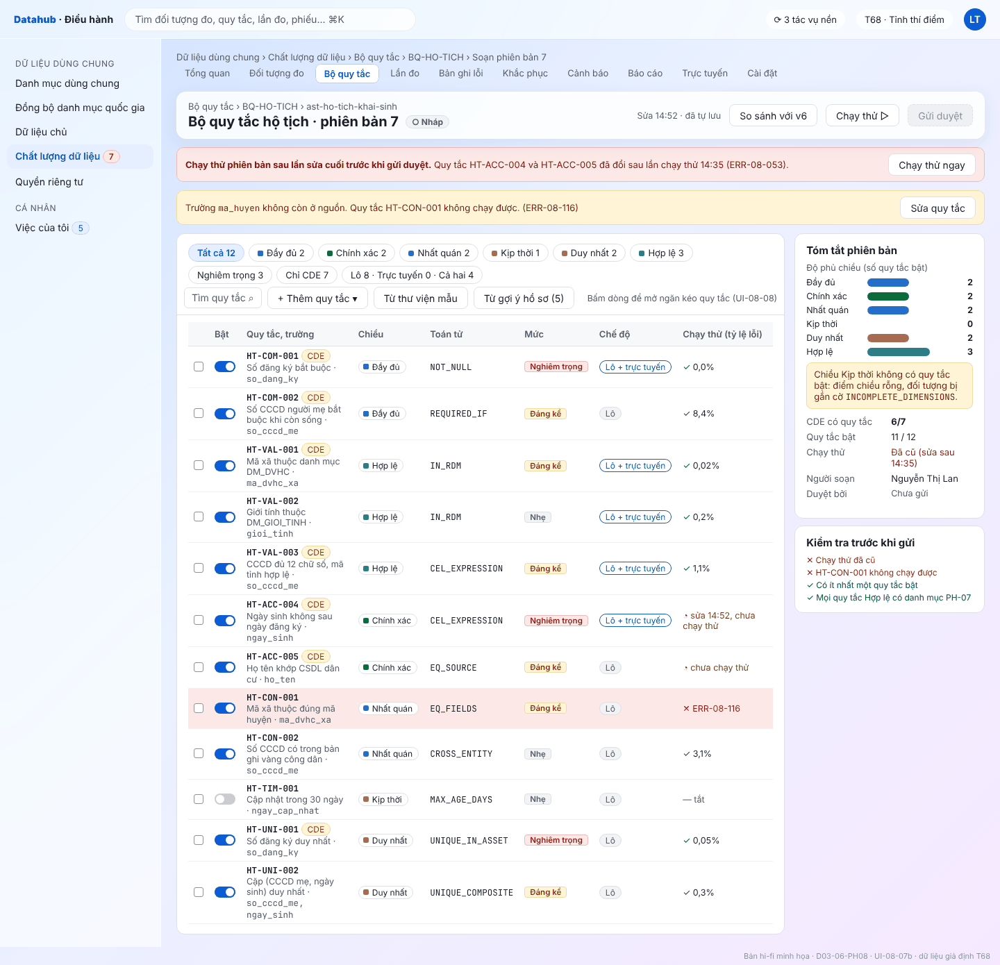

Ảnh biến thể cho thấy bản nháp sau khi sửa quy tắc HT-ACC-004 và HT-ACC-005: dải đỏ ERR-08-053, dải vàng ERR-08-116, dòng HT-CON-001 nền đỏ nhạt kèm mã lỗi, cột kiểm tra có hai dấu ✕ và nút "Gửi duyệt" bị khóa.

## 14. UI-08-08 Biểu mẫu quy tắc và chạy thử

::: dac-ta
**Mục đích.** Thêm hoặc sửa một quy tắc trong ngăn kéo ngay trên trình soạn: nhập theo biểu mẫu từng toán tử, viết biểu thức CEL hoặc vị từ SQL có kiểm soát, chạy thử trên mẫu và xem lỗi đã che.

**Tác nhân, quyền.** DS, TA (`PERM-08-rule-admin`); PA với mẫu `COMMON`.

**FR, UC.** FR-08-013, 014, 015, 016.

**Truy vết hệ cũ.** Thiết kế lại từ "Biểu mẫu luật" của mockup cũ (xem trước trên một `recordId`, nay là chạy thử trên mẫu).

**Đường dẫn, mẫu.** Trên UI-08-07: `?quy-tac={maQuyTac}&tab=bieu-mau|cel|chay-thu`, `?moi=1`; PTN-04 Biểu mẫu nhanh (ngăn kéo `size-drawer-lg`).

**API.** API-08-031, 032 (thêm, sửa quy tắc); API-08-034 (`POST /rules:validate-expression`); API-08-037 (`:dry-run`); API-08-035 (mẫu); API-08-013 (trường); API-08-017 (danh mục PH-07).

**Điều hướng vào.** Bấm dòng hoặc "+ Thêm quy tắc" ở UI-08-07.

**Thành phần chính.** Ba tab: Biểu mẫu, Biểu thức CEL, Chạy thử; chân ngăn kéo có Hủy, Chạy thử, Lưu quy tắc.

**Hành động.** Chọn chiều và toán tử, nhập tham số, kiểm tra biểu thức, chạy thử, lưu.

**Trạng thái.** Biểu thức hợp lệ, biểu thức lỗi, đang chạy thử, kết quả chạy thử cũ, lỗi tham số.

**Thông báo.** "Biểu thức không hợp lệ ở vị trí {dòng}:{cột}: {chi tiết}." (ERR-08-019); "Toán tử {toán tử} không dùng được cho chiều {chiều}." (ERR-08-015); "Chạy thử tối đa {n} bản ghi. Giảm kích thước mẫu." (ERR-08-031).

**Đợt, mức chi tiết.** Đợt 3; rất chi tiết.
:::

### 14.1. Wireframe

Hình dưới là ngăn kéo ở tab "Biểu thức CEL" đang báo lỗi cú pháp, đè lên trình soạn mờ.

```text
| (trình soạn mờ)                 | Quy tắc HT-VAL-003                       [Đóng]           |
|                                 | [Biểu mẫu][Biểu thức CEL][Chạy thử]                       |
|                                 | Mã [HT-VAL-003]            Mức nghiêm trọng [Đáng kể ▾]   |
|                                 | Tên [CCCD đủ 12 chữ số, mã tỉnh hợp lệ]                   |
|                                 | Chiều [Hợp lệ ▾] Toán tử [CEL_EXPRESSION ▾] Chế độ [Cả hai]|
|                                 | Trường [so_cccd_me]                                       |
|                                 | | has(record.so_cccd_me) &&  (nền tối, số dòng)           |
|                                 | ✕ Biểu thức không hợp lệ ở vị trí 2:21 … (ERR-08-019)     |
|                                 | Kết quả chạy thử 14:35 (nội dung cũ): 110 vi phạm (1,1%)   |
|                                 | [Hủy] [Chạy thử ▷] [Lưu quy tắc (khóa)]                    |
```

### 14.2. Trường của biểu mẫu

Bảng dưới liệt kê trường theo tab; trường tham số đổi theo toán tử (bảng toán tử ở FRS §4.1).

| Trường | `CMP-*` | Bắt buộc | Kiểm tra | Ánh xạ API, lỗi |
|---|---|---|---|---|
| Mã quy tắc | `CMP-Input` mono | Có | `^[A-Z0-9][A-Z0-9-]{2,63}$`, duy nhất trong bộ (ERR-08-002) | `ruleCode` |
| Tên, mô tả | `CMP-Input`, `CMP-TextArea` | Có, không | Tối đa 200, 1.000 ký tự | `name`, `description` |
| Chiều | `CMP-Select` | Có | Sáu chiều; đổi chiều lọc lại toán tử | `dimension` |
| Toán tử | `CMP-Select` | Có | Chỉ toán tử hợp lệ cho chiều (ERR-08-015); `SQL_PREDICATE` chỉ hiện khi `08.rule.sql-predicate-enabled` | `operator` |
| Trường áp dụng | `CMP-SchemaTree` | Có | Thuộc lược đồ đối tượng: "Trường {đường dẫn} không có trong đối tượng đo {mã}." (ERR-08-014) | `fieldPath` |
| Tham số toán tử | `CMP-DynamicForm` | Theo toán tử | Mẫu `REGEX`, khoảng `RANGE`, độ dài `LENGTH`, thuật toán `CHECKSUM`, số ngày `MAX_AGE_DAYS`…: "Tham số {tên} của quy tắc {mã} không hợp lệ: {chi tiết}." (ERR-08-016) | `params{}` |
| Danh mục PH-07 | `CMP-CodeListSelect` | Chiều Hợp lệ | "Quy tắc chiều Hợp lệ phải chọn danh mục PH-07 để đối chiếu." (ERR-08-017); chưa phát hành: ERR-08-010 | `catalogCode` |
| Đối tượng, trường đối chiếu | `CMP-ResourceSelect`, `CMP-SchemaTree` | Chiều Nhất quán | "Quy tắc chiều Nhất quán phải chọn đối tượng đo và trường để đối chiếu." (ERR-08-018) | `refAssetCode`, `refFieldPath` |
| Biểu thức CEL, vị từ SQL | `CMP-CodeEditor` | Khi `CEL_EXPRESSION`, `SQL_PREDICATE` | Kiểm tra khi gõ (trễ 600 ms) gọi API-08-034; CEL sai: ERR-08-019; SQL ngoài danh sách cho phép: "Vị từ SQL dùng {thành phần} không được phép. Chỉ được viết điều kiện trên cột của bảng đang đo." (ERR-08-020) | `expression` |
| Mức, chế độ chạy | `CMP-Select` | Có | `severity`; `exec_mode`; toán tử `UNIQUE_*`, `CROSS_ENTITY`, `EQ_SOURCE`, `SQL_PREDICATE` chỉ chọn "Lô" (BR-08-017) | `severity`, `execMode` |
| Thông điệp lỗi | `CMP-Input` | Không | Câu hiển thị cho người xem lỗi; tối đa 300 ký tự | `message` |

: UI-08-08 Biểu mẫu quy tắc và chạy thử, trường

### 14.3. Tab chạy thử, hành động và trạng thái

Tab "Chạy thử" chạy riêng quy tắc đang mở trên mẫu `SAMPLE` (mặc định 10.000, tối đa `08.dryrun.max-rows`, có seed để tái lập, BR-08-019) và hiện tỷ lệ vi phạm, thời gian, bảng tối đa 20 khóa bản ghi với giá trị đã che và lý do. Bảng dưới ghi hành động và trạng thái của ngăn kéo.

| Hành động hoặc trạng thái | Quyền, điều kiện | Kết quả, thông báo |
|---|---|---|
| Chạy thử | `PERM-08-rule-admin`; nội dung hợp lệ | Kết quả theo mẫu; vượt cỡ: ERR-08-031; nguồn lỗi: "Không đọc được nguồn của đối tượng {mã}: {nguyên nhân}. Thử lại sau." (ERR-08-105) |
| Lưu quy tắc | Biểu thức, tham số hợp lệ | Đóng ngăn kéo, dòng quy tắc "chưa chạy thử"; khóa khi còn lỗi hợp lệ hóa (`ST-11`) |
| Sửa nội dung sau lần chạy thử | | Kết quả cũ mờ kèm câu "Sửa biểu thức làm kết quả chạy thử mất hiệu lực." |
| Đang kiểm tra biểu thức | Spinner nhỏ cạnh trình soạn | Không chặn gõ |
| Mất kết nối, hết phiên | | Giữ nội dung đã gõ (`ST-06`, `ST-14`) |
| Không có quyền | `ST-07` hoặc `ST-15` (biểu mẫu chỉ đọc) | |

: UI-08-08 Biểu mẫu quy tắc và chạy thử, hành động và trạng thái

### 14.4. Bản hi-fi

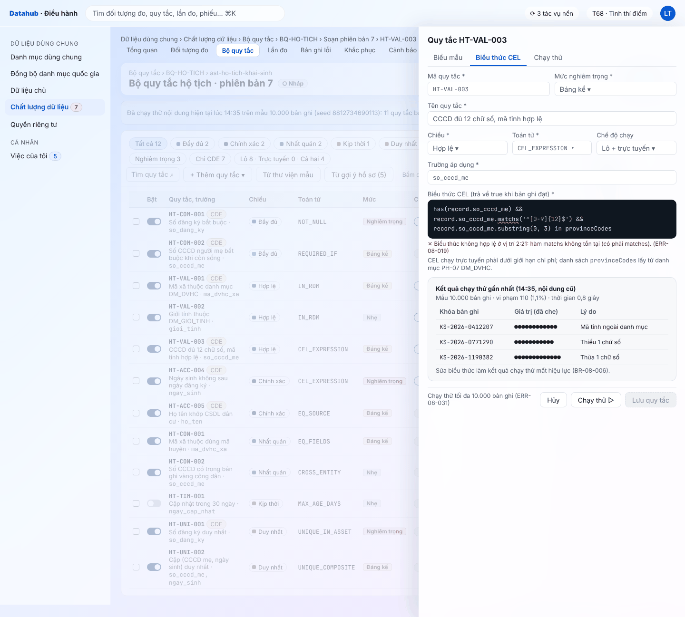

Ảnh cho thấy ngăn kéo (khung kính, giếng nội dung đặc) đè lên trình soạn mờ: trình soạn CEL nền tối gạch sóng đỏ ở hàm sai tên, câu ERR-08-019 ngay dưới và khối kết quả chạy thử cũ với giá trị che bằng chấm.

## 15. UI-08-09 Lịch sử, so sánh và duyệt phiên bản

::: dac-ta
**Mục đích.** Cho người duyệt thấy chính xác phiên bản chờ duyệt khác phiên bản hiệu lực ở đâu, tác động ước tính lên điểm, rồi duyệt hoặc từ chối; cho mọi người xem lịch sử phiên bản của một bộ.

**Tác nhân, quyền.** DA duyệt (`PERM-08-approve`, khác người soạn); DS, TA xem và kích hoạt (`PERM-08-rule-admin`); còn lại xem (`PERM-08-read`).

**FR, UC.** FR-08-017, 018, 019.

**Truy vết hệ cũ.** Thiết kế lại từ nút "Kích hoạt phiên bản" của mockup cũ, thêm so sánh và bốn mắt.

**Đường dẫn, mẫu.** `/du-lieu/chat-luong/quy-tac/{ma}/lich-su` (`so-sanh=a,b`, `phien-ban`); PTN-10 Hộp việc, duyệt.

**API.** API-08-028, 030, 043 (phiên bản, `/diff`); API-08-039, 040 (`:approve`, `:reject`); API-08-041 (`:activate`); API-08-042 (`:retire`); API-08-045 (xuất).

**Điều hướng vào.** "So sánh với v{n}" ở UI-08-07; việc chờ duyệt trong "Việc của tôi".

**Thành phần chính.** Dòng thời gian phiên bản, bảng so sánh, bảng tác động ước tính, khung duyệt.

**Hành động.** Chọn hai phiên bản so sánh, Duyệt, Từ chối, Kích hoạt, Ngừng bộ, Xuất.

**Trạng thái.** Chờ duyệt, đã duyệt chờ kích hoạt, hiệu lực, thay thế, không quyền duyệt.

**Thông báo.** "Anh/chị là người soạn hoặc gửi duyệt nên không được tự duyệt." (ERR-08-005); "Nhập lý do (tối thiểu {n} ký tự)." (ERR-08-007).

**Đợt, mức chi tiết.** Đợt 3; đầy đủ.
:::

### 15.1. Wireframe

Hình dưới là bố cục ba cột: phiên bản, so sánh và tác động, khung duyệt.

```text
| Lịch sử và duyệt · BQ-HO-TICH                                  [Xuất YAML] [Sao chép bộ]  |
| Phiên bản   | So sánh v6 (hiệu lực) với v7 (chờ duyệt): 2 thêm · 2 sửa · 1 bỏ | Duyệt phiên bản 7 |
| [v7 Chờ duyệt] | + Thêm  HT-VAL-003 …                                         | Người soạn, gửi    |
| v6 Hiệu lực    | ~ Sửa   HT-ACC-004  Mức Đáng kể → Nghiêm trọng                | Chạy thử ✓ khớp    |
| v5 Đã thay …   | − Bỏ    HT-TIM-002 …                                          | Lý do [………]       |
|                | Tác động ước tính: điểm 77,9 → 75,8 ▼ −2,1                    | [Duyệt] [Từ chối]  |
```

### 15.2. Thành phần, hành động và thông báo

Bảng dưới liệt kê thành phần và quy tắc duyệt.

| # | Thành phần | `CMP-*` | Nội dung, kiểm tra | Quyền, thông báo |
|---|---|---|---|---|
| 1 | Dòng thời gian phiên bản | `CMP-VersionTimeline` | Phiên bản, trạng thái, người, ngày; chọn hai phiên bản để so sánh | `PERM-08-read` |
| 2 | Bảng so sánh | `CMP-DiffTable` | Thêm, Sửa, Bỏ có nhãn chữ và nền `color-diff-added`, `-changed`, `-removed`; ô sửa gạch cũ, in đậm mới | |
| 3 | Tác động ước tính | `CMP-DataTable` | Điểm đối tượng, điểm chiều, lỗi Nghiêm trọng, kết luận: bản hiệu lực so bản chờ duyệt (chạy thử mẫu) | Có khi đã chạy thử |
| 4 | Khung duyệt | `CMP-ApprovalPanel` | Người soạn, người gửi, người duyệt, trạng thái chạy thử khớp nội dung, ô lý do (≥ 20 ký tự khi từ chối), nút Duyệt, Từ chối | `PERM-08-approve`; người soạn thấy nút Duyệt khóa: ERR-08-005 (403) |
| 5 | Kích hoạt | `CMP-Button`, `CMP-DatePicker` | Sau khi duyệt: "Kích hoạt ngay" hoặc ngày hiệu lực; bản cũ thành `SUPERSEDED` | `PERM-08-rule-admin`; sai trạng thái: ERR-08-006 |
| 6 | Trạng thái màn | | Đang tải (skeleton ba cột); không có phiên bản để so sánh: "Chưa có phiên bản hiệu lực để so sánh" (bản v1); bản v1 hiển thị toàn bộ quy tắc là "Thêm" | `ST-01`, `ST-07` |

: UI-08-09 Lịch sử, so sánh và duyệt phiên bản, thành phần, hành động và thông báo

### 15.3. Bản hi-fi

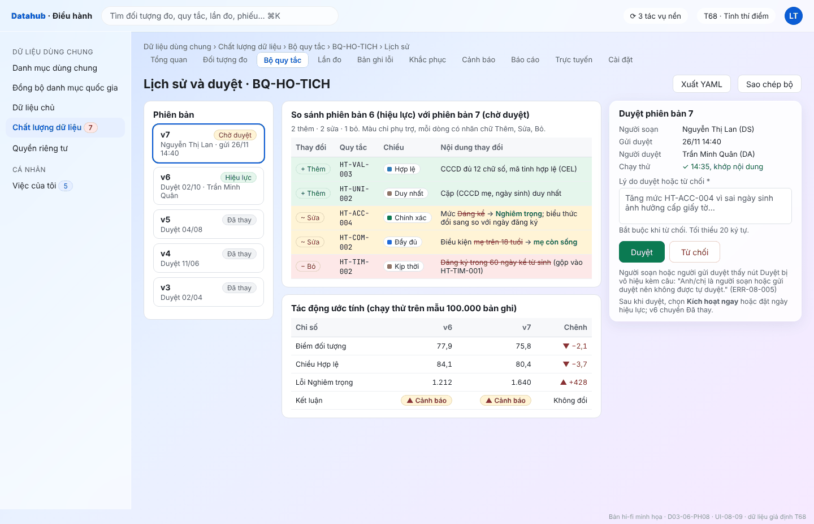

Ảnh cho thấy so sánh năm thay đổi với nhãn chữ, tác động ước tính giảm 2,1 điểm và khung duyệt có kèm câu nhắc quy tắc bốn mắt.

## 16. UI-08-10 Trọng số và ngưỡng

::: dac-ta
**Mục đích.** Cho tỉnh đặt chiều nào quan trọng hơn và bao nhiêu điểm là đạt, có xem trước tác động và duyệt để không ai hạ ngưỡng cho đẹp báo cáo (BR-08-002, 008).

**Tác nhân, quyền.** DS, TA soạn (`PERM-08-rule-admin`); DA duyệt (`PERM-08-approve`); còn lại xem (`PERM-08-read`).

**FR, UC.** FR-08-021.

**Truy vết hệ cũ.** Giữ và mở rộng tab "Trọng số" của mockup cũ.

**Đường dẫn, mẫu.** `/du-lieu/chat-luong/cai-dat/trong-so` (`pham-vi`, `ma`); PTN-12 Cài đặt.

**API.** API-08-047 (`GET /weight-configs`); API-08-048, 049 (tạo, sửa); API-08-050, 051, 052 (`:submit`, `:approve`, `:reject`).

**Điều hướng vào.** Tab "Cài đặt" › "Trọng số và ngưỡng"; liên kết từ UI-08-12 (cờ `WEIGHTS_CHANGED`).

**Thành phần chính.** Chọn phạm vi, sáu thanh trượt có ô số, tổng trọng số, hai ngưỡng, xem trước tác động, phiên bản và duyệt.

**Hành động.** Lưu nháp, Gửi duyệt, Duyệt, Từ chối, đặt ngày hiệu lực.

**Trạng thái.** Nháp, chờ duyệt, hiệu lực, tổng sai, ngưỡng sai.

**Thông báo.** "Tổng trọng số sáu chiều phải bằng 1 (hiện là {tổng})." (ERR-08-023); "Ngưỡng cảnh báo phải nhỏ hơn hoặc bằng ngưỡng đạt và trong khoảng 0 đến 100." (ERR-08-024).

**Đợt, mức chi tiết.** Đợt 3; đầy đủ.
:::

### 16.1. Wireframe

Hình dưới là bố cục hai cột: biểu mẫu trọng số và ngưỡng bên trái, xem trước và phiên bản bên phải.

```text
| Trọng số và ngưỡng        (Toàn tỉnh | Theo miền | Theo đối tượng)   [Lưu nháp] [Gửi duyệt] |
| Trọng số sáu chiều · bản nháp v3                    | Xem trước tác động (không hồi tố)     |
|  Đầy đủ   --●------ [0,20]  cũ 0,20                  | Toàn tỉnh 78,6 → 78,1  ▼ −0,5         |
|  Chính xác ---●---- [0,25]  cũ 0,20 [đổi]            | Y tế 68,3 → 67,4 …                    |
|  Tổng trọng số ✓ 1,00                                | Phiên bản: v3 nháp · v2 hiệu lực       |
| Ngưỡng: Đạt ≥ [80]  Cảnh báo ≥ [70]  vạch 70 | 80   | Hiệu lực từ [01/12/2026]               |
```

### 16.2. Trường và kiểm tra

Bảng dưới liệt kê trường, kiểm tra và hành vi.

| Trường, thành phần | `CMP-*` | Kiểm tra, hành vi | Lỗi |
|---|---|---|---|
| Phạm vi | `CMP-SegmentedControl` | Toàn tỉnh, miền, đối tượng; phạm vi hẹp ghi đè rộng; chọn miền hoặc đối tượng bằng `CMP-Select` | |
| Sáu trọng số | `CMP-NumberInput` + thanh trượt (đề nghị `RangeSlider`, Phụ lục A) | Bước 0,01; mỗi giá trị 0…1; tổng bằng 1 với dung sai 0,001; tổng hiện cạnh chân, đỏ khi sai | ERR-08-023 (422) |
| Cảnh báo trọng số 0 | `CMP-Alert` vàng | Trọng số một chiều bằng 0 mà đối tượng có quy tắc chiều đó: cảnh báo, không chặn | |
| Ngưỡng Đạt, Cảnh báo | `CMP-NumberInput` | `0 ≤ cảnh báo ≤ đạt ≤ 100`; thanh minh họa ba vùng | ERR-08-024 (422) |
| Lý do hạ ngưỡng | `CMP-TextArea` | Bắt buộc từ 20 ký tự khi hạ ngưỡng Đạt so cấu hình hiện hành | ERR-08-007: "Nhập lý do (tối thiểu {n} ký tự)." |
| Hiệu lực từ | `CMP-DatePicker` | Không quá khứ | ERR-08-003 |
| Xem trước tác động | `CMP-DataTable` | Điểm hiện tại và điểm với cấu hình mới trên ảnh chụp gần nhất, Δ, kết luận; không đổi điểm quá khứ | |
| Gửi duyệt, Duyệt | `CMP-ApprovalPanel` | Bốn mắt: "Anh/chị là người soạn hoặc gửi duyệt nên không được tự duyệt." (ERR-08-005) | |

: UI-08-10 Trọng số và ngưỡng, trường và kiểm tra

Trạng thái: đang tải (`ST-01`); chưa có cấu hình nào thì hiện mặc định hệ thống 0,20/0,20/0,15/0,10/0,15/0,20 và ngưỡng 80, 70 ở chế độ chỉ đọc kèm nút "Tạo bản nháp"; đã có bản nháp của người khác: ERR-08-022 dạng "đang có bản nháp"; xung đột: `ST-13`; không quyền sửa: `ST-15`. Bàn phím: thanh trượt dùng `←`, `→` bước 0,01 và `Shift` bước 0,05.

### 16.3. Bản hi-fi

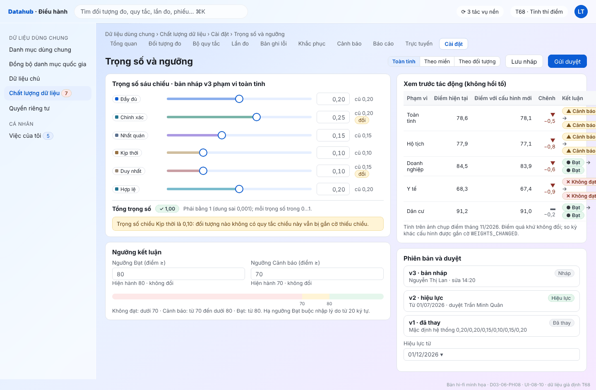

Ảnh cho thấy bản nháp tăng trọng số chiều Chính xác lên 0,25 và giảm Duy nhất xuống 0,10, tổng 1,00 hợp lệ, hai ngưỡng không đổi và bảng xem trước tác động từng miền.

## 17. UI-08-11 Lịch đo và danh sách lần đo

::: dac-ta
**Mục đích.** Xem mọi lần đo theo kích hoạt và trạng thái, đo theo yêu cầu, hủy hoặc chạy lại, và quản lý lịch đo của từng đối tượng; bảo đảm mỗi đối tượng được đo ít nhất mỗi tháng (BR-08-001).

**Tác nhân, quyền.** DS, TA, TO chạy, hủy, lập lịch (`PERM-08-run`); còn lại xem (`PERM-08-read`).

**FR, UC.** FR-08-023, 024, 025, 030; hệ cũ: tab "Quét" của mockup cũ (tách thành UI-08-11, 12).

**Đường dẫn, mẫu.** `/du-lieu/chat-luong/lan-do` (tab `/lich`; `kich-hoat`, `trang-thai`, `doi-tuong`, `tu`, `den`); PTN-01.

**API.** API-08-060 (`GET /scans`); API-08-059 (`POST /scans`); API-08-062, 063 (`:cancel`, `:rerun`); API-08-054…058 (lịch: danh sách, tạo, sửa, `:pause`, `:resume`).

**Hành động.** Đo theo yêu cầu, hủy, chạy lại, tạo hoặc sửa lịch, tạm dừng lịch, mở UI-08-12.

**Trạng thái.** Đang tải, rỗng, không kết quả, lỗi, không quyền; lần đo `RUNNING` tự làm mới 5 giây.

**Thông báo.** "Lịch {biểu thức} không hợp lệ hoặc dày hơn mức cho phép ({n} giờ một lần)." (ERR-08-029); "Lần đo {mã} chờ quá {n} giờ và đã bị hủy." (ERR-08-119).

**Đợt, mức chi tiết.** Đợt 3; đầy đủ.
:::

### 17.1. Wireframe

Hình dưới là tab "Lần đo" với chip kích hoạt, bảng và khung lịch sắp tới.

```text
| Lịch đo và lần đo                                   [Lịch đo]  [▷ Đo theo yêu cầu]       |
| (Lần đo 128)(Lịch đo 46)   (Tất cả)(Theo lịch)(Theo yêu cầu)(Theo sự kiện)(Báo cáo năm)(Kiểm chứng)|
| Lần đo | Đối tượng | Kích hoạt | Chế độ | Trạng thái | Bắt đầu | Thời lượng | Điểm | Kết luận | Ghi chú |
| SCN-…0412 | ast-thua-dat | Theo yêu cầu | FULL | ✕ Lỗi | 25/11 21:40 | 12 phút | — | — | ERR-08-105 |
| SCN-…0431 | ast-kham-chua-benh | Kiểm chứng | FULL | ◔ Đang chạy ▓▓░ | 26/11 13:55 | … |        | Lịch sắp tới |
```

### 17.2. Thành phần, trường và cột

Bảng dưới liệt kê cột, hộp thoại đo và hộp thoại lịch cùng kiểm tra.

| # | Thành phần, trường | `CMP-*` | Nội dung, kiểm tra | Lỗi |
|---|---|---|---|---|
| 1 | Chip kích hoạt | `CMP-FilterChips` | Năm giá trị `scan_trigger` kèm số lượng | |
| 2 | Cột trạng thái | `CMP-StatusTag`, `CMP-ProgressBar` | `scan_status`; `RUNNING` có thanh tiến độ theo tác vụ; mã lỗi ở cột ghi chú | |
| 3 | Hộp "Đo theo yêu cầu" | `CMP-Form` trong `CMP-Modal` | Đối tượng (nhiều), chế độ `FULL` hoặc `SAMPLE`; cỡ mẫu 100…1.000.000; lần đo cho báo cáo năm phải `FULL` | "Kích thước mẫu phải từ 100 đến 1.000.000 bản ghi; lần đo cho báo cáo năm phải đo toàn bộ." (ERR-08-030) |
| 4 | Tab "Lịch đo" | `CMP-DataTable` | Đối tượng, lịch, chế độ, cửa sổ giờ, lần chạy kế, trạng thái `schedule.status` | |
| 5 | Hộp lịch | `CMP-CronPicker` | Chọn tần suất hoặc cron Quartz (mặc định `0 0 2 1 * ?`), múi giờ, chế độ `FULL`, `INCREMENTAL`; kiểm tra tần suất tối thiểu | ERR-08-029; trùng: "Đối tượng {mã} đã có lịch {chế độ} {biểu thức}." (ERR-08-049) |
| 6 | Khung hạn mức | `CMP-DescriptionList` | Số lần đo theo yêu cầu trong giờ trên hạn mức `08.scan.manual-per-hour` | |

: UI-08-11 Lịch đo và danh sách lần đo, thành phần và trường

### 17.3. Hành động, trạng thái và thông báo

Bảng dưới ghi hành động theo quyền và trạng thái.

| Hành động hoặc trạng thái | Quyền, điều kiện | Kết quả, thông báo |
|---|---|---|
| Đo theo yêu cầu | `PERM-08-run`; có bộ quy tắc hiệu lực | Tạo lần `QUEUED`; đã có lần đang chạy: "Đối tượng đang có lần chạy {mã}. Đợi lần này xong hoặc hủy." (ERR-08-028) hoặc xếp hàng theo `08.scan.duplicate-policy`; quá hạn mức: ERR-08-052; chưa có bộ: ERR-08-027 |
| Hủy | `PERM-08-run`; `CMP-ReasonDialog`; lần `QUEUED`, `RUNNING` | Trạng thái `CANCELLED`; sai trạng thái: ERR-08-006 |
| Chạy lại | `PERM-08-run`; lần `FAILED`, `PARTIAL`, `CANCELLED` | Tạo lần mới cùng cấu hình |
| Rỗng | `CMP-EmptyState` "Chưa có lần đo nào. Đo theo yêu cầu hoặc đợi lịch ngày 1." | |
| Không có quyền chạy | Nút ẩn, danh sách vẫn xem được (`ST-15`) | |

: UI-08-11 Lịch đo và danh sách lần đo, hành động, trạng thái và thông báo

### 17.4. Bản hi-fi

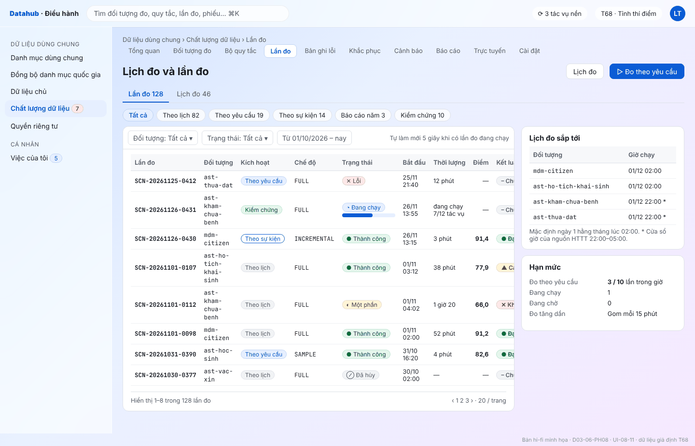

Ảnh cho thấy tám lần đo đủ trạng thái (lỗi, đang chạy có thanh tiến độ, thành công, một phần, đã hủy do chờ quá hạn) và khung lịch sắp tới kèm hạn mức.

## 18. UI-08-12 Chi tiết lần đo

::: dac-ta
**Mục đích.** Cho kỹ thuật viên và cán bộ thấy một lần đo diễn ra thế nào và điểm hình thành từ đâu: cấu hình đã dùng, tiến độ từng tác vụ, điểm sáu chiều có trọng số, kết quả từng quy tắc, so kỳ trước, và lý do mỗi chiều bị bỏ qua hoặc quy tắc lỗi.

**Tác nhân, quyền.** DS, TO, TA (`PERM-08-run` cho Hủy, Chạy lại); còn lại xem (`PERM-08-read`); DO xem lần đo của đối tượng thuộc tổ chức mình.

**FR, UC.** FR-08-026, 027, 028, 029, 030, 031.

**Truy vết hệ cũ.** Thiết kế lại từ tab "Quét" của mockup cũ (job và tiến độ).

**Đường dẫn, mẫu.** `/du-lieu/chat-luong/lan-do/{ma}` (`trang-thai-qt`, `chieu`); PTN-11 Giám sát, tra log.

**API.** API-08-061 (`GET /scans/{scanId}`); API-08-067 (tác vụ); API-08-064 (kết quả quy tắc); API-08-065 (điểm, so kỳ); API-08-062, 063 (`:cancel`, `:rerun`).

**Điều hướng vào.** Bấm dòng ở UI-08-11; liên kết "Xem lần đo" ở UI-08-01; dải lỗi ở UI-08-04.

**Thành phần chính.** Dải cảnh báo, đầu trang trạng thái, thẻ cấu hình, lưới tác vụ, khối điểm và sáu thẻ chiều, bảng kết quả quy tắc, cột so kỳ, phụ thuộc và sự kiện.

**Hành động.** Hủy (đang chạy), Chạy lại, mở UI-08-13 theo quy tắc, đo lại chiều bị bỏ qua.

**Trạng thái.** `QUEUED`, `RUNNING` (thăm dò 5 giây), `SUCCEEDED`, `PARTIAL`, `FAILED`, `CANCELLED`.

**Thông báo.** "Không đối chiếu được danh mục {mã}. Chiều Hợp lệ bị bỏ qua ở lần đo này." (ERR-08-108); "Quy tắc {mã} lỗi khi chạy: {chi tiết}." (ERR-08-107); "Lần đo {mã} vượt {n} giờ và đã dừng." (ERR-08-106).

**Đợt, mức chi tiết.** Đợt 3; rất chi tiết.
:::

### 18.1. Wireframe

Hình dưới là một lần đo `PARTIAL`: chiều Hợp lệ bị bỏ qua vì PH-07 gián đoạn.

```text
| ⚠ ① Không đối chiếu được danh mục DM_DVHC. Chiều Hợp lệ bị bỏ qua ở lần đo này.   [Đo lại chiều Hợp lệ]|
| SCN-20261101-0107 [◐ Một phần] [INCOMPLETE_DIMENSIONS]                           [Chạy lại] [Hủy]   |
| ② Đối tượng · Kích hoạt · Bộ quy tắc v6 · Trọng số v2 · Bắt đầu · Kết thúc · Seed · Bản ghi            |
| ③ Tiến độ theo tác vụ: [T1 ✓][T2 ✓] … [T12 ✓]            12/12 xong · 200.000 bản ghi/tác vụ           |
| ④ Điểm 77,9 / 100 [▲ Cảnh báo] ▲ +3,4 so lần trước       | ⑦ So kỳ trước: Δ, xu hướng, lỗi mới/còn/hết |
| ⑤ [Đầy đủ 82,3][Chính xác 71,0][Nhất quán 79,6][Kịp thời 70,2][Duy nhất 74,4][Hợp lệ — bỏ qua: PH-07] | ⑧ Phụ thuộc và cảnh báo   |
| ⑥ Kết quả từng quy tắc: mã · chiều · mức · kết quả · áp dụng · đạt · vi phạm · [Xem lỗi]  | ⑨ Sự kiện đã phát          |
```

### 18.2. Lưới bố cục và vùng

Trang chia hai cột 2,3 : 1 dưới các dải ngang. Vùng 1 là dải `CMP-Banner` vàng (một dải cho mỗi vấn đề, ưu tiên lỗi phụ thuộc), vùng 2 là thẻ thông tin lần đo dạng `CMP-DescriptionList` tám trường, vùng 3 là lưới tác vụ toàn bề rộng. Dưới `bp-lg` cột phải xuống dưới bảng.

Bảng dưới đánh số các vùng và giải phẫu từng vùng.

| # | Vùng | `CMP-*` | Nội dung, kiểm tra | Ghi chú |
|---|---|---|---|---|
| 1 | Dải phụ thuộc | `CMP-Banner` | ERR-08-108 (PH-07), ERR-08-105 (nguồn), ERR-08-106 (quá thời gian), ERR-08-116 (trường đổi); nút hành động theo lỗi | Một dải mỗi mã lỗi |
| 2 | Thông tin lần đo | `CMP-DescriptionList` | Đối tượng, kích hoạt, chế độ, bộ quy tắc và phiên bản, cấu hình trọng số, bắt đầu, kết thúc, seed 64 bit (BR-08-019), số bản ghi; cờ `INCOMPLETE_DIMENSIONS`, `WEIGHTS_CHANGED`, `TRUNCATED`, `INCREMENTAL` thành huy hiệu cạnh tiêu đề | |
| 3 | Lưới tác vụ | `CMP-JobProgress` | Mỗi tác vụ một ô (xong xanh, đang chạy xanh dương kèm %, lỗi đỏ kèm "thử lại n/3", chờ xám) và thanh tổng; ước tính còn lại; tác vụ lỗi mở chi tiết lỗi | `scan_task.status`, `rowCount` |
| 4 | Khối điểm | `CMP-KpiCard` | Điểm tổng cỡ `font-display`, kết luận, Δ, xu hướng; điểm rỗng hiện "Không đủ dữ liệu để tính điểm cho lần đo {mã}." | Chỉ có khi lần đo `SUCCEEDED` hoặc `PARTIAL` đủ độ phủ `08.scan.min-coverage` |
| 5 | Sáu thẻ chiều | `CMP-StatCard` | Tên chiều, điểm, trọng số, đạt, vi phạm, bỏ qua, ngoại lệ; chiều không có điểm nền xám, nét đứt, chữ "Bỏ qua" và lý do (ERR-08-108) | Không dùng màu xám làm kênh duy nhất: kèm chữ |
| 6 | Bảng kết quả quy tắc | `CMP-DataTable` | Mã, tên, chiều, mức, `rule_result.status`, áp dụng, đạt, vi phạm, liên kết "Xem lỗi" mở UI-08-13 đã lọc `quy-tac`, lần đo; dòng `ERROR` nền vàng kèm ERR-08-107 | Sắp theo vi phạm giảm dần; lọc trạng thái, chiều |
| 7 | So kỳ trước | `CMP-DescriptionList` | Δ điểm, xu hướng, lỗi mới, còn, hết, ngoại lệ; cờ `WEIGHTS_CHANGED` kèm câu giải thích khi trọng số khác lần trước | Chọn kỳ so sánh bằng `CMP-Select` |
| 8 | Phụ thuộc và cảnh báo | `CMP-Card` | Danh sách các sự cố: khoảng giờ PH-07 gián đoạn, ERR-08-109 (thiếu khóa), ERR-08-110 (cắt bớt lỗi lưu), ERR-08-107 | |
| 9 | Sự kiện đã phát | `CMP-CodeText` | `t68.dq.scan.completed.v1`, `t68.dq.finding.opened.v1`, `t68.dq.score.degraded.v1` nếu có | Cho vận hành đối chiếu |

: UI-08-12 Chi tiết lần đo, vùng và thành phần

### 18.3. Hành động và quyền

Bảng dưới ghi hành động, điều kiện theo trạng thái lần đo và kết quả.

| Hành động | Quyền, điều kiện | Kết quả, thông báo |
|---|---|---|
| Hủy | `PERM-08-run`; `QUEUED`, `RUNNING`; `CMP-ReasonDialog` | Các tác vụ dừng sau tác vụ hiện tại; `CANCELLED`; sai trạng thái: "Không thể {thao tác} khi {đối tượng} đang ở trạng thái {trạng thái}." (ERR-08-006) |
| Chạy lại | `PERM-08-run`; `FAILED`, `PARTIAL`, `CANCELLED` | Lần mới cùng cấu hình, mở lần mới; đã có lần đang chạy: ERR-08-028 |
| Đo lại chiều Hợp lệ | `PERM-08-run`; chỉ khi chiều bị bỏ qua do phụ thuộc | Lần mới `MANUAL` cùng phạm vi |
| Xem lỗi | `PERM-08-finding-read` | Mở UI-08-13 đã lọc; VW không có liên kết |
| Sao chép mã, seed | Mọi người xem | `CMP-CopyButton` |

: UI-08-12 Chi tiết lần đo, hành động và quyền

### 18.4. Trạng thái, tương tác và truy cập

Tình huống biên của lần đo và cách hiển thị được ghi ở bảng dưới.

| Trạng thái | Hiển thị |
|---|---|
| Đang tải | Skeleton đúng hình dải, thẻ thông tin, lưới 12 ô, khối điểm, bảng 8 dòng (`ST-01`) |
| `QUEUED` | Lưới tác vụ rỗng, câu "Đang chờ tới lượt. Vị trí {n} trong hàng đợi."; nút Hủy; quá `08.scan.queue-timeout-hours`: "Lần đo {mã} chờ quá {n} giờ và đã bị hủy." (ERR-08-119) |
| `RUNNING` | Thanh tổng và lưới tác vụ thăm dò 5 giây; bảng chỉ có kết quả tạm; điểm chưa hiện; tác vụ lỗi hiện "Không đọc được nguồn của đối tượng {mã}: {nguyên nhân}. Thử lại sau." (ERR-08-105) và tự thử lại tối đa 3 lần |
| `PARTIAL` | Dải vàng nêu phần thiếu; điểm có cờ `INCOMPLETE_DIMENSIONS` hoặc dựa trên độ phủ; không dùng cho báo cáo năm (BR-08-010) |
| `FAILED` | Không có điểm; dải đỏ kèm mã lỗi; nút "Chạy lại"; quá thời gian: "Lần đo {mã} vượt {n} giờ và đã dừng." (ERR-08-106) |
| Có `TRUNCATED` | Dòng trong cột phải: "Quy tắc {mã} có hơn {n} bản ghi lỗi. Chỉ lưu {n} bản ghi đầu, số đếm vẫn đủ." (ERR-08-110) |
| Không có quyền, không tồn tại | `ST-07`, `ST-08` |

: UI-08-12 Chi tiết lần đo, trạng thái màn

Tương tác: hover một ô tác vụ hiện `CMP-Tooltip` (phạm vi khóa, số bản ghi, thời gian, số lần thử); bấm chiều ở thẻ chiều lọc bảng quy tắc theo chiều đó (ghi `chieu` lên URL); bấm tiêu đề cột sắp xếp. Bàn phím: `Tab` qua dải, nút, ô tác vụ, thẻ chiều, bảng; `Enter` trên ô tác vụ mở chi tiết; `R` chạy lại, `Del` hủy (có hộp xác nhận). Truy cập: lưới tác vụ là danh sách `role="list"` mỗi ô có `aria-label` "Tác vụ 6, lỗi, thử lại 2 trên 3"; thanh tiến độ `role="progressbar"` có `aria-valuenow`; thẻ chiều bị bỏ qua đọc "Chiều Hợp lệ, bỏ qua, PH-07 gián đoạn 02:10 đến 02:40".

### 18.5. Bản hi-fi

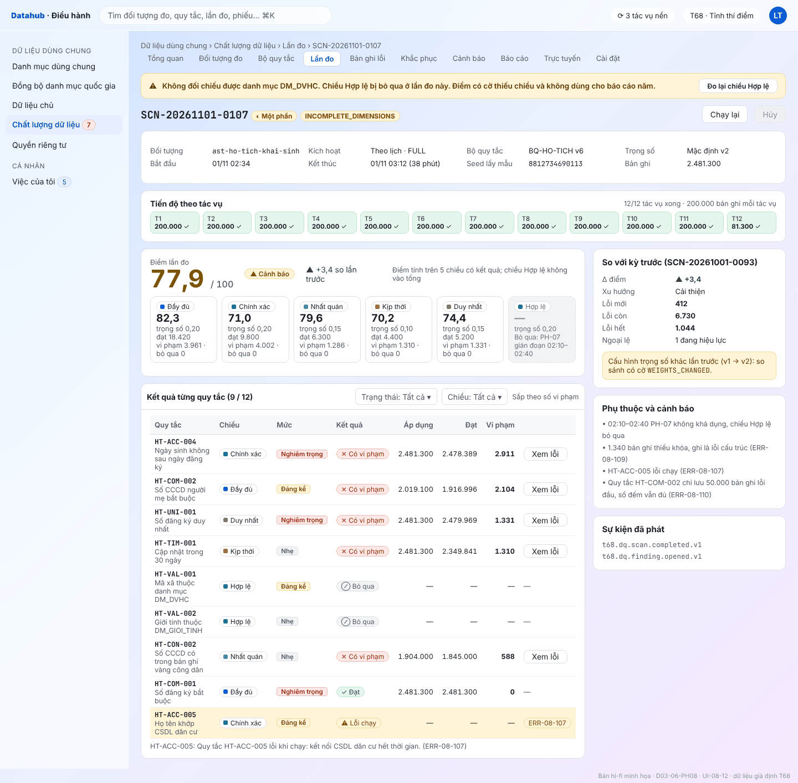

Ảnh cho thấy lần đo một phần của đối tượng khai sinh: lưới 12 tác vụ xong, điểm 77,9 trên năm chiều, thẻ chiều Hợp lệ xám kèm lý do PH-07 gián đoạn 02:10–02:40, bảng quy tắc có dòng `SKIPPED` và dòng `ERROR` nền vàng, cột phải so kỳ trước với cờ `WEIGHTS_CHANGED`.

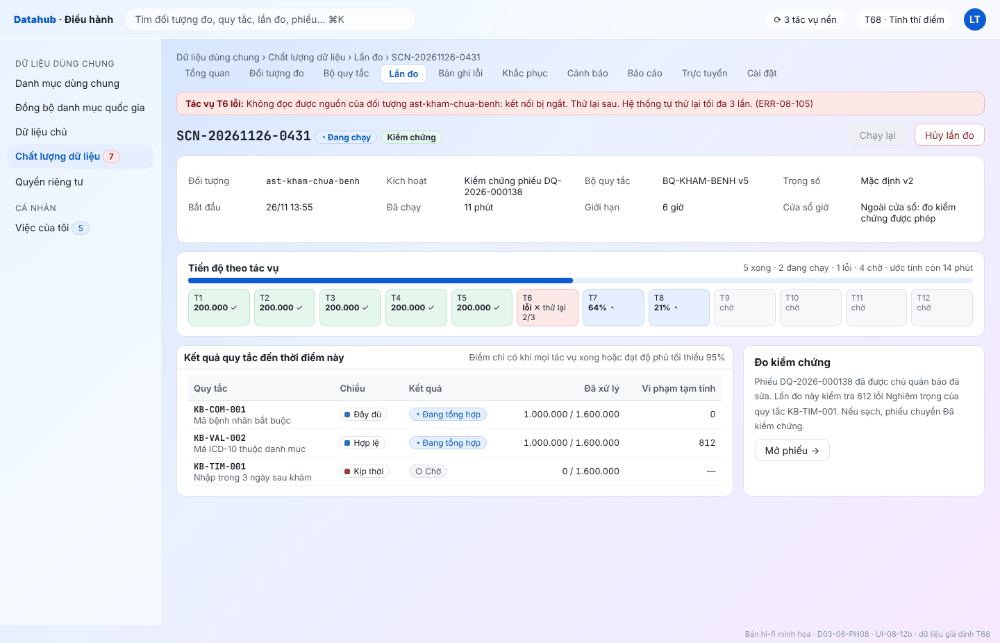

Ảnh biến thể cho thấy lần đo kiểm chứng đang chạy: 5 tác vụ xong, 2 đang chạy, 1 lỗi đang thử lại (dải ERR-08-105), 4 chờ, nút Hủy hiện còn nút Chạy lại khóa, và bảng kết quả tạm chưa có điểm.

## 19. UI-08-13 Bản ghi lỗi

::: dac-ta
**Mục đích.** Từ điểm xuống đúng bản ghi cần sửa: lọc, nhóm theo quy tắc, chọn nhiều bản ghi để mở phiếu khắc phục, đề nghị ngoại lệ hoặc xuất; không bao giờ lộ giá trị gốc trường Nhạy cảm.

**Tác nhân, quyền.** DS, DA, SO, DO (○, tổ chức mình) có `PERM-08-finding-read`; xuất: `PERM-08-export`; VW không có màn này.

**FR, UC.** FR-08-036, 037, 039, 041; hệ cũ: tab "Lỗi" của mockup cũ.

**Đường dẫn, mẫu.** `/du-lieu/chat-luong/loi` (`trang-thai`, `doi-tuong`, `chieu`, `muc`, `quy-tac`, `nhom=quy-tac`); khóa cá nhân gửi `POST`; PTN-01.

**API.** API-08-073 (`GET /findings`, `POST /findings:search`); API-08-078 (`GET /finding-groups`); API-08-075 (`POST /findings:export`); API-08-084 (`POST /issues`).

**Hành động.** Lọc, nhóm, chọn, mở phiếu, đề nghị ngoại lệ, xuất, mở UI-08-14.

**Trạng thái.** Đang tải, không có lỗi, không kết quả, lỗi tải, không quyền.

**Thông báo.** "Có {n} bản ghi lỗi đã thuộc phiếu {mã}. Bỏ chọn hoặc gắn vào phiếu đó." (ERR-08-034); "Tham số {tên} không hợp lệ: {chi tiết}." (ERR-08-045).

**Đợt, mức chi tiết.** Đợt 3; đầy đủ.
:::

### 19.1. Wireframe

Hình dưới là danh sách lỗi với thanh chọn hàng loạt ở đáy.

```text
| Bản ghi lỗi · ast-ho-tich-khai-sinh                     (Danh sách | Nhóm theo quy tắc) [Xuất…] |
| (Mở 6.730)(Đang khắc phục 412)(Đã hết 1.044)(Ngoại lệ 36)(Tất cả 8.222)                        |
| Đối tượng ▾ Chiều ▾ Mức ▾ Quy tắc ▾ Lần đầu thấy ▾ [Khóa bản ghi (POST) ⌕]                     |
| ⚠ Có 1 bản ghi lỗi đã thuộc phiếu DQ-2026-000142. Bỏ chọn hoặc gắn vào phiếu đó.               |
| ☐ | Khóa | Quy tắc | Chiều | Mức | Trường | Giá trị (che) | Trạng thái | Đầu | Cuối | Phiếu    |
| ☑ | SD-0412207 | HT-ACC-004 | Chính xác | Nghiêm trọng | ngay_sinh | 12/**/2026 | ● Mở | 01/11 | 01/11 | — |
| Đã chọn 3   [Mở phiếu khắc phục] [Đề nghị ngoại lệ] [Xuất…] [Bỏ chọn]                          |
```

### 19.2. Thành phần, trường và cột

Bảng dưới liệt kê cột, bộ lọc và thanh chọn của màn lỗi.

| # | Thành phần, cột | `CMP-*` | Nội dung, kiểm tra | Ghi chú |
|---|---|---|---|---|
| 1 | Chip trạng thái | `CMP-FilterChips` | Số lỗi theo `finding.status`; mặc định "Mở" | Lỗi `RESOLVED` mặc định ẩn |
| 2 | Thanh lọc | `CMP-FilterBar` | Đối tượng, chiều, mức, quy tắc, khoảng lần đầu thấy, ô khóa bản ghi gửi `POST` (không lên URL) | DO bị khóa theo tổ chức |
| 3 | Cột "Khóa bản ghi" | `CMP-Identifier` | Khóa đã chuẩn hóa; bấm mở UI-08-14 | Khóa không phải số định danh; trường cá nhân dùng băm |
| 4 | Cột "Giá trị" | `CMP-MaskedValue` | `HASH` hiện chấm, `PARTIAL` hiện một phần; chỉ đọc | BR-08-012 |
| 5 | Cột "Lần đầu, cuối thấy", "Phiếu" | `CMP-Timestamp`, `CMP-Link` | Từ dấu vân tay; phiếu bấm mở UI-08-16 | |
| 6 | Chế độ "Nhóm theo quy tắc" | `CMP-DataTable` nhóm | Mỗi nhóm một quy tắc: số lỗi, mức, số mới, còn; chọn nhóm để mở phiếu cho cả nhóm | API-08-078 |
| 7 | Thanh chọn | `CMP-SelectionBar` | Số đã chọn, phân rã theo mức, ba nút | `PERM-08-remediate` cho phiếu; `PERM-08-rule-admin` đề nghị ngoại lệ; `PERM-08-export` xuất |

: UI-08-13 Bản ghi lỗi, thành phần và cột

### 19.3. Hành động, trạng thái và thông báo

Bảng dưới ghi hành động theo quyền và trạng thái.

| Hành động hoặc trạng thái | Quyền, điều kiện | Kết quả, thông báo |
|---|---|---|
| Mở phiếu khắc phục | `PERM-08-remediate`; các lỗi chưa thuộc phiếu mở | `POST /issues`, mở UI-08-16; lỗi đã thuộc phiếu: ERR-08-034 |
| Đề nghị ngoại lệ | Chọn từ một lỗi | Mở UI-08-14 tab "Ngoại lệ" |
| Xuất | `PERM-08-export`; có trường Nhạy cảm cần DO chấp thuận (BR-08-027) | Hộp chọn định dạng; tệp chỉ có giá trị đã che, hạn tải `08.export.link-hours`: "Tệp xuất {mã} chưa được chấp thuận hoặc đã hết hạn tải." (ERR-08-041) |
| Rỗng | `CMP-EmptyState` "Chưa có bản ghi lỗi. Chạy lần đo hoặc kiểm tra bộ lọc." | |
| Không kết quả | "Không tìm thấy bản ghi lỗi phù hợp" kèm "Xóa bộ lọc" (`ST-04`) | |
| Không có quyền | `ST-07`; DO ngoài tổ chức: "Đối tượng {mã} không thuộc tổ chức của anh/chị." (ERR-08-032) | |

: UI-08-13 Bản ghi lỗi, hành động, trạng thái và thông báo

### 19.4. Bản hi-fi

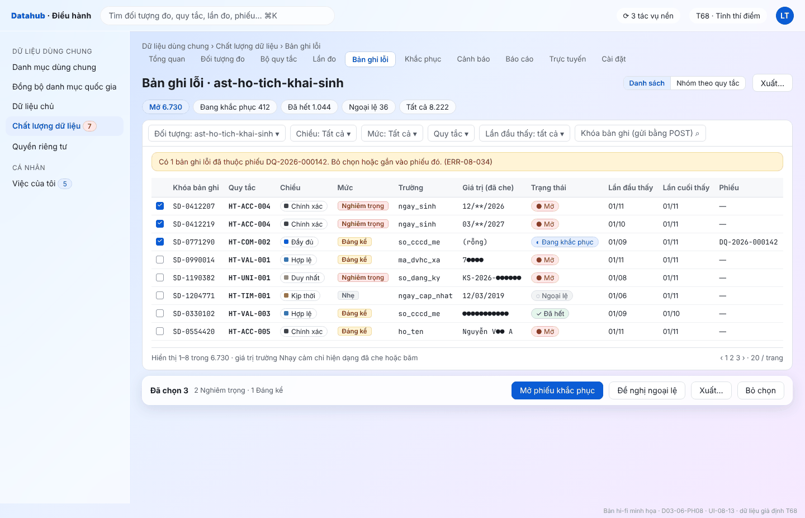

Ảnh cho thấy tám bản ghi lỗi ở đủ bốn trạng thái, giá trị che bằng dấu sao hoặc chấm, dải vàng ERR-08-034 và thanh chọn hàng loạt kính dính đáy.

## 20. UI-08-14 Chi tiết bản ghi lỗi, ngoại lệ

::: dac-ta
**Mục đích.** Xem một bản ghi lỗi (quy tắc, lịch sử qua các kỳ, nguồn gốc) và đề nghị, duyệt, thu hồi ngoại lệ chấp nhận có hạn cho nhóm lỗi có lý do chính đáng.

**Tác nhân, quyền.** DS, DA, SO, DO (○) xem (`PERM-08-finding-read`); DS đề nghị (`PERM-08-rule-admin`); DA duyệt, từ chối, thu hồi (`PERM-08-approve`).

**FR, UC.** FR-08-038, 040.

**Đường dẫn, mẫu.** Ngăn kéo trên UI-08-13: `?chon={findingId}&tab=chi-tiet|lich-su|nguon-goc|ngoai-le`; PTN-02 trong `CMP-Drawer` (`size-drawer-md`).

**API.** API-08-074 (`GET /findings/{findingId}`); API-08-079, 080 (`POST`, `GET /waivers`); API-08-081, 082, 083 (`:approve`, `:reject`, `:revoke`).

**Hành động.** Xem chi tiết, lịch sử, nguồn gốc; Gửi đề nghị ngoại lệ; Duyệt, Từ chối, Thu hồi.

**Trạng thái.** Đang tải, lỗi, không quyền, bản ghi đã hết.

**Thông báo.** "Ngoại lệ tối đa {n} ngày và phải có phạm vi lỗi cụ thể." (ERR-08-033); "Nhập lý do (tối thiểu {n} ký tự)." (ERR-08-007); "Anh/chị là người soạn hoặc gửi duyệt nên không được tự duyệt." (ERR-08-005).

**Đợt, mức chi tiết.** Đợt 3; đầy đủ.
:::

### 20.1. Wireframe

Hình dưới là ngăn kéo ở tab "Ngoại lệ" khi đề nghị mới.

```text
| (danh sách lỗi mờ)  | Bản ghi lỗi   SD-0412207 [Nghiêm trọng] [● Mở]            [Đóng] |
|                     | [Chi tiết][Lịch sử][Nguồn gốc][Ngoại lệ]                          |
|                     | Chính xác · HT-ACC-004 · ngay_sinh · 12/**/2026 (đã che)           |
|                     | Phạm vi (Các lỗi đã chọn 3 | Theo bộ lọc quy tắc)                  |
|                     | Hiệu lực đến [15/09/2027] ✕ Ngoại lệ tối đa 180 ngày… (ERR-08-033)  |
|                     | Lý do [………] tối thiểu 20 ký tự                                       |
|                     | [Hủy] [Gửi đề nghị ngoại lệ]                                       |
```

### 20.2. Thành phần, trường và hành động

Bảng dưới liệt kê tab, trường của đề nghị ngoại lệ và hành động theo quyền.

| Tab, trường | `CMP-*` | Kiểm tra, hành vi | Quyền, lỗi |
|---|---|---|---|
| Chi tiết | `CMP-DescriptionList` | Quy tắc, chiều, mức, trường, giá trị đã che, trạng thái, lý do `resolution_reason` khi `RESOLVED` | `PERM-08-finding-read` |
| Lịch sử | `CMP-Timeline` | Mới (lần đo nào), còn qua các kỳ, hết; dấu vân tay nối qua phiên bản quy tắc (BR-08-013) | |
| Nguồn gốc | `CMP-DescriptionList` | Đối tượng, khóa bản ghi, lần đo đầu và cuối thấy, quy tắc và phiên bản; liên kết UI-08-12 | |
| Phạm vi ngoại lệ | `CMP-SegmentedControl` | Các lỗi đã chọn (`FINDINGS`) hoặc bộ lọc quy tắc (`RULE_FILTER`); không để rỗng | ERR-08-033 |
| Hiệu lực đến | `CMP-DatePicker` | Tối đa `08.waiver.max-days` (mặc định 180) kể từ hôm nay | ERR-08-033 (422) |
| Lý do | `CMP-TextArea` | Bắt buộc từ 20 ký tự | ERR-08-007 |
| Duyệt, Từ chối | `CMP-ApprovalPanel` | DA khác người đề nghị; lý do khi từ chối; duyệt thì lỗi chuyển `WAIVED` khỏi mẫu số điểm | ERR-08-005 (403) |
| Thu hồi | `CMP-ConfirmDialog` | Ngoại lệ `ACTIVE`; lỗi quay lại `OPEN` ở lần đo kế | `PERM-08-approve` |

: UI-08-14 Chi tiết bản ghi lỗi, ngoại lệ, tab và trường

Trạng thái: đang tải (skeleton ngăn kéo, `ST-01`); lỗi tải (`ST-05` trong ngăn kéo); lỗi không còn (đã `RESOLVED`): tab Ngoại lệ ẩn, hiện lý do kết thúc; không quyền (`ST-07`); đối tượng ngoài tổ chức: "Đối tượng {mã} không thuộc tổ chức của anh/chị." (ERR-08-032). Đóng ngăn kéo bằng `Esc` trả focus về dòng đã mở. Ngoại lệ đang chờ duyệt hoặc hiệu lực của cùng quy tắc hiện ở cuối tab để tránh đề nghị trùng.

### 20.3. Bản hi-fi

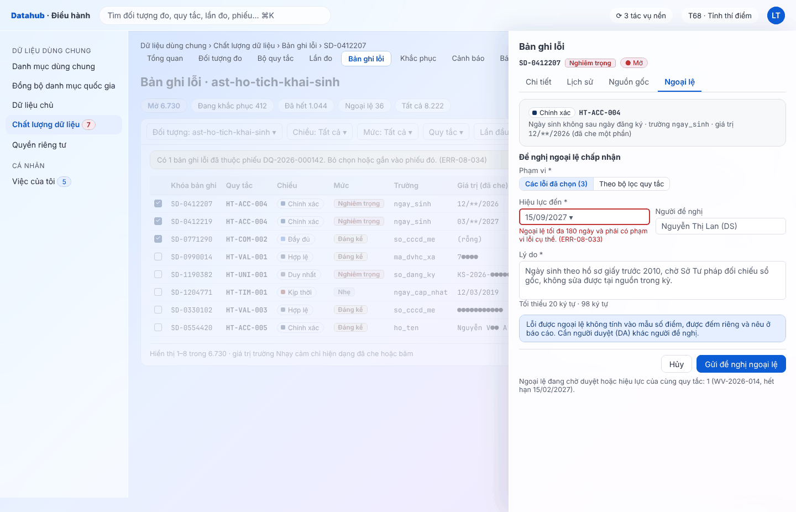

Ảnh cho thấy ngăn kéo kính với giếng nội dung đặc: biểu mẫu đề nghị ngoại lệ báo lỗi hạn quá 180 ngày, ô lý do đủ dài và câu giải thích tác động lên điểm.

## 21. UI-08-15 Hộp việc phiếu khắc phục

::: dac-ta
**Mục đích.** Cho chủ quản và cán bộ thấy việc khắc phục được giao theo phân vùng (của tôi, chưa nhận, quá hạn, sắp hạn, chờ kiểm chứng), hạn xử lý còn bao lâu, rồi nhận, giao, chuyển hoặc từ chối.

**Tác nhân, quyền.** DO (○, tổ chức mình), DS, TA (`PERM-08-remediate`).

**FR, UC.** FR-08-041, 042, 045; hệ cũ: tab "Khắc phục" của mockup cũ.

**Đường dẫn, mẫu.** `/du-lieu/chat-luong/khac-phuc` (`phan-vung`, `to-chuc`, `muc`, `chon`); PTN-10 Hộp việc.

**API.** API-08-085 (`GET /issues`); API-08-087 (`:assign`); API-08-092, 093, 094, 096 (`:reject`, `:transfer`, `:escalate`, `:cancel`); API-08-086 (xem nhanh).

**Hành động.** Chọn phân vùng, xem nhanh, giao việc, chuyển tổ chức, từ chối, mở UI-08-16.

**Trạng thái.** Đang tải, phân vùng rỗng, lỗi, không quyền.

**Thông báo.** "Có {n} bản ghi lỗi đã thuộc phiếu {mã}. Bỏ chọn hoặc gắn vào phiếu đó." (ERR-08-034); "Không thể {thao tác} khi {đối tượng} đang ở trạng thái {trạng thái}." (ERR-08-006).

**Đợt, mức chi tiết.** Đợt 3; đầy đủ.
:::

### 21.1. Wireframe

Hình dưới là ba cột: phân vùng, danh sách phiếu có thanh hạn xử lý, khung xem nhanh.

```text
| Hộp việc phiếu khắc phục     [Tìm mã phiếu ⌕]                    [Giao việc] [Chuyển tổ chức] |
| Của tôi 12 | Phiếu | Mức | Tổ chức | Số lỗi | Trạng thái | Hạn xử lý (SLA) | DQ-2026-000142     |
| Chưa nhận 5| 000142 | Đáng kể | Sở Tư pháp | 2.104 | Đã giao | ▓▓▓░ Còn 3 ngày | Đáng kể · Đã giao |
| Quá hạn 7  | 000131 | Nghiêm trọng | Sở TN&MT | 1.882 | Đang xử lý | ▓▓▓▓ Quá 4 ngày | Hoạt động gần nhất |
| Sắp hạn 9  | …                                                          | [Mở chi tiết][Chuyển][Từ chối]|
```

### 21.2. Thành phần, hành động và thông báo

Bảng dưới liệt kê thành phần, hành động theo quyền và trạng thái.

| Thành phần, hành động | `CMP-*` | Nội dung, kiểm tra | Quyền, thông báo |
|---|---|---|---|
| Danh sách phân vùng | `CMP-Tree` | Sáu phân vùng có số đếm; DO chỉ thấy phiếu của tổ chức mình | `PERM-08-remediate` |
| Bảng phiếu | `CMP-DataTable` | Mã, đối tượng và quy tắc, mức, tổ chức, số lỗi, `issue.status`, hạn xử lý (`CMP-ProgressBar` xanh, vàng khi còn ≤ 3 ngày, đỏ khi quá hạn, luôn kèm chữ "Còn n ngày" hoặc "Quá n ngày") | SLA ngày làm việc theo mức (giả định 5, 15, 30; BR-08-015) |
| Khung xem nhanh | `CMP-Card`, `CMP-Timeline` | Thông tin phiếu, hoạt động gần nhất, nút | |
| Giao việc | `CMP-ReasonDialog` | Chọn tổ chức, người nhận; ghi `issue_activity` loại `ASSIGNMENT` | `PERM-08-remediate`; sai trạng thái: ERR-08-006 |
| Chuyển tổ chức, Từ chối | `CMP-ReasonDialog` | Từ chối chọn `WRONG_OWNER`, `NOT_A_DEFECT`, `CANNOT_FIX` kèm lý do ≥ 20 ký tự | ERR-08-007 |
| Leo thang | Tự động | Quá `08.issue.escalate-after-overdue-days` thì leo cấp 1 (huy hiệu "Đã leo thang") | |
| Phân vùng rỗng | `CMP-EmptyState` | "Không có phiếu nào ở phân vùng này." | `ST-03` |
| Không quyền | `ST-07` | DO mở phiếu ngoài tổ chức: ERR-08-032 | |

: UI-08-15 Hộp việc phiếu khắc phục, thành phần, hành động và thông báo

### 21.3. Bản hi-fi

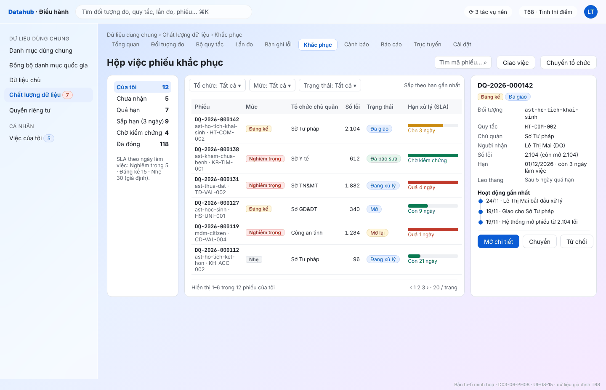

Ảnh cho thấy sáu phiếu với thanh hạn xử lý ba màu kèm chữ, phiếu quá hạn xếp theo hạn và khung xem nhanh phiếu DQ-2026-000142.

## 22. UI-08-16 Chi tiết phiếu khắc phục

::: dac-ta
**Mục đích.** Cho chủ quản xử lý một phiếu: xem lỗi còn mở, trao đổi, cập nhật tiến độ, báo đã sửa để hệ thống đo lại kiểm chứng; cho DS xác nhận, từ chối, chuyển lỗi bản ghi vàng sang hàng đợi người quản lý dữ liệu của PH-06.

**Tác nhân, quyền.** DO (○), DS, TA (`PERM-08-remediate`); chủ quản không tự xác nhận (BR-08-014).

**FR, UC.** FR-08-042, 043, 044, 045, 046.

**Đường dẫn, mẫu.** `/du-lieu/chat-luong/khac-phuc/{ma}`; PTN-02 Chi tiết.

**API.** API-08-086 (`GET /issues/{issueCode}`); API-08-089, 097 (trao đổi, hoạt động); API-08-088 (`:start`); API-08-090 (`:mark-fixed`); API-08-091 (`:verify`); API-08-092…096 (từ chối, chuyển, leo thang, hủy); API-08-095 (`:send-to-steward`).

**Hành động.** Bắt đầu xử lý, trao đổi, báo đã sửa, xác nhận (DS), từ chối, chuyển, chuyển PH-06, hủy.

**Trạng thái.** `OPEN`, `ASSIGNED`, `IN_PROGRESS`, `FIXED`, `VERIFIED`, `REOPENED`, `REJECTED`, `CANCELLED`.

**Thông báo.** "Chủ quản không tự xác nhận phiếu. Hệ thống sẽ đo lại để kiểm chứng." (ERR-08-035); "Mô tả việc đã sửa (tối thiểu 20 ký tự) trước khi báo đã sửa." (ERR-08-036); "Chỉ lỗi của bản ghi vàng mới chuyển được sang hàng đợi dữ liệu chủ." (ERR-08-051); "Đo kiểm chứng phiếu {mã} lỗi kỹ thuật. Hệ thống sẽ thử lại." (ERR-08-115).

**Đợt, mức chi tiết.** Đợt 3; đầy đủ.
:::

### 22.1. Wireframe

Hình dưới là phiếu đang xử lý với bước tiến trình, dòng thời gian và khung báo đã sửa.

```text
| ⚠ Chủ quản không tự xác nhận phiếu. Sau khi báo đã sửa, hệ thống sẽ đo lại. (ERR-08-035)         |
| DQ-2026-000138 [Nghiêm trọng] [Đang xử lý]            [Chuyển tổ chức] [Từ chối] [Báo đã sửa]  |
| ✓ Mở   ✓ Đã giao   ● Đang xử lý   Đã báo sửa   Đã kiểm chứng                                    |
| Dòng thời gian               | Lỗi thuộc phiếu: còn mở 232 | đã hết 380 | Báo đã sửa               |
|  24/11 Lê Thị Mai: đã chỉnh…  | SLA ▓▓▓▓░ còn 1 ngày         |            | Mô tả [………] ≥ 20 ký tự   |
|  [Thêm trao đổi, đính kèm]    |                              |            | Chuyển hàng đợi PH-06 (khóa)|
```

### 22.2. Thành phần, hành động và thông báo

Bảng dưới liệt kê thành phần, quy tắc hiển thị nút và thông báo.

| Thành phần, hành động | `CMP-*` | Nội dung, kiểm tra | Quyền, thông báo |
|---|---|---|---|
| Thanh bước | `CMP-Steps` | Mở, Đã giao, Đang xử lý, Đã báo sửa, Đã kiểm chứng; `REOPENED` quay về bước 3 kèm huy hiệu | |
| Dòng thời gian | `CMP-Timeline`, `CMP-CommentThread` | `issue_activity`: trao đổi, đính kèm, đổi trạng thái, giao, leo thang, kết quả kiểm chứng; ô trao đổi có đính kèm | `PERM-08-remediate` |
| Lỗi thuộc phiếu | `CMP-DataTable` mini, `CMP-Chart` | Còn mở, đã hết, quy tắc, đối tượng; bấm mở UI-08-13 lọc theo phiếu | `PERM-08-finding-read` |
| Hạn xử lý | `CMP-ProgressBar` | Ngày hạn, còn n ngày làm việc | |
| Báo đã sửa | `CMP-ReasonDialog` | Mô tả việc đã sửa ≥ 20 ký tự; sau đó lần đo `VERIFY` tự chạy (chờ tối đa `08.verify.wait-mdm-minutes` nếu nguồn là bản ghi vàng) | ERR-08-036 (422); chủ quản tự xác nhận: ERR-08-035 (403) |
| Xác nhận thủ công | `CMP-ReasonDialog` | DS xác nhận đã kiểm chứng có lý do khi đo kiểm chứng lỗi kỹ thuật (phiếu giữ `FIXED`: ERR-08-115) | `PERM-08-remediate`, DS |
| Chuyển hàng đợi PH-06 | `CMP-Button` | Chỉ hiện và dùng được khi đối tượng là `MDM_DOMAIN`; khác: nút khóa kèm câu ERR-08-051 | `PERM-08-remediate` |
| Từ chối, chuyển, hủy | `CMP-ReasonDialog` | Loại từ chối `issue.reject_type`, lý do ≥ 20 ký tự | ERR-08-006, ERR-08-007 |
| Trạng thái màn | `ST-01`, `ST-07`, `ST-08` | Phiếu đã `VERIFIED` hoặc `CANCELLED`: chỉ đọc (`ST-15`) | Phiếu không tồn tại: ERR-08-001 |

: UI-08-16 Chi tiết phiếu khắc phục, thành phần, hành động và thông báo

### 22.3. Bản hi-fi

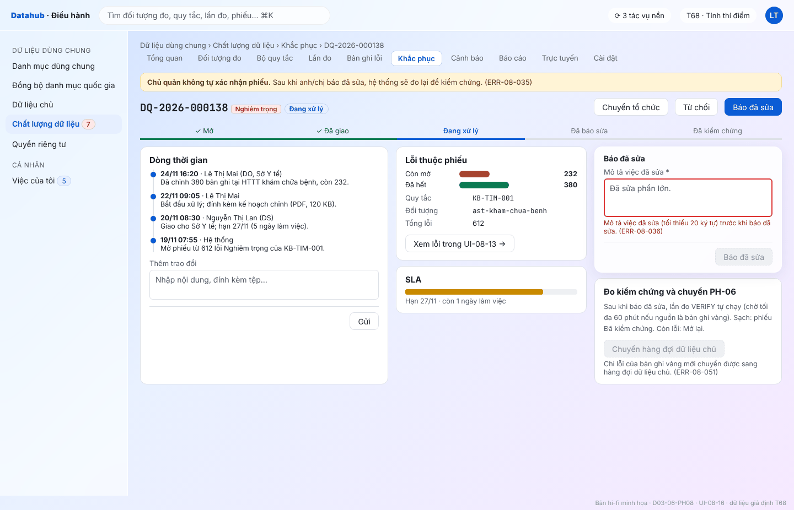

Ảnh cho thấy phiếu của Sở Y tế: dải vàng nhắc không tự xác nhận, dòng thời gian bốn hoạt động, hai thanh còn mở và đã hết, ô báo đã sửa báo lỗi ERR-08-036 và nút chuyển PH-06 bị khóa.

## 23. UI-08-17 Cảnh báo chất lượng

::: dac-ta
**Mục đích.** Xem cảnh báo đang bật, xác nhận hoặc tắt tiếng có thời hạn, và khai báo quy tắc cảnh báo (điểm dưới ngưỡng, lần đo lỗi, tỷ lệ FAIL trực tuyến…); cảnh báo gửi qua kênh thông báo PH-13.

**Tác nhân, quyền.** DS, TA khai báo (`PERM-08-rule-admin`); DS, TA, TO xác nhận, tắt tiếng (`PERM-08-run` hoặc `PERM-08-rule-admin`); còn lại xem.

**FR, UC.** FR-08-047, 048, 049.

**Đường dẫn, mẫu.** `/du-lieu/chat-luong/canh-bao` (tab `/quy-tac`; `trang-thai`, `muc`); PTN-01.

**API.** API-08-101 (`GET /alerts`); API-08-102, 103 (`:acknowledge`, `:silence`); API-08-098, 099, 100 (quy tắc cảnh báo).

**Hành động.** Xác nhận, tắt tiếng, thêm hoặc sửa quy tắc cảnh báo, bật hoặc tắt quy tắc.

**Trạng thái.** Đang tải, không có cảnh báo, lỗi, không quyền.

**Thông báo.** "Quy tắc cảnh báo {mã} không hợp lệ: {chi tiết}." (ERR-08-037); "Cảnh báo hoặc thông báo {mã} chưa gửi được tới kênh thông báo." (ERR-08-114).

**Đợt, mức chi tiết.** Đợt 3; đầy đủ.
:::

### 23.1. Wireframe

Hình dưới là tab "Cảnh báo" cạnh bảng quy tắc cảnh báo và khung tắt tiếng.

```text
| ✕ Cảnh báo AL-2026-0311 chưa gửi được tới kênh thông báo Email… (ERR-08-114)           [Xem]   |
| Cảnh báo chất lượng                                                    [+ Quy tắc cảnh báo]    |
| (Cảnh báo 5)(Quy tắc cảnh báo 5)                                                                |
| Cảnh báo | Nội dung | Mức | Trạng thái | Bắt đầu | Ghi chú | [Xác nhận][Tắt tiếng]            |
| AL-0312 CB-DIEM-THAP | Điểm miền Y tế 68,3 < 70 | Cao | ● Đang bật | 26/11 02:10 | Lần 3 …           |
| Quy quy tắc cảnh báo: mã · điều kiện · phạm vi · mức · kênh · bật   | Tắt tiếng đến [03/12] Lý do [] |
```

### 23.2. Thành phần, trường và hành động

Bảng dưới liệt kê thành phần, trường khai báo và kiểm tra.

| Thành phần, trường | `CMP-*` | Kiểm tra, hành vi | Quyền, lỗi |
|---|---|---|---|
| Bảng cảnh báo | `CMP-DataTable` | Mã, quy tắc, nội dung, mức `alert.severity`, `alert.status`, bắt đầu, ghi chú (nhắc lại theo `08.alert.repeat-hours`) | Một quy tắc, một đối tượng chỉ có một cảnh báo chưa hết (BR-08-029) |
| Xác nhận | `CMP-Button` | Người nhận báo "đã biết, đang xử lý", ghi nhận người, giờ | |
| Tắt tiếng | `CMP-ReasonDialog`, `CMP-DatePicker` | Đến ngày tối đa 7 ngày, lý do ≥ 20 ký tự; hết hạn tự bật lại | ERR-08-007; quá 7 ngày: ERR-08-045 |
| Quy tắc cảnh báo | `CMP-DataTable`, `CMP-Switch` | Mã, điều kiện `alert.condition` kèm ngưỡng, phạm vi, mức, kênh, bật | `PERM-08-rule-admin` |
| Hộp quy tắc | `CMP-Form` | Mã, điều kiện, ngưỡng, phạm vi (miền, đối tượng), mức, kênh (`IN_APP`, `EMAIL`), chu kỳ nhắc | ERR-08-037 |
| Dải gửi lỗi | `CMP-Banner` | ERR-08-114: cảnh báo vẫn hiện trong ứng dụng, hệ thống thử lại | |
| Rỗng, không quyền | `CMP-EmptyState` "Không có cảnh báo nào đang bật."; `ST-07` | |

: UI-08-17 Cảnh báo chất lượng, thành phần, trường và hành động

### 23.3. Bản hi-fi

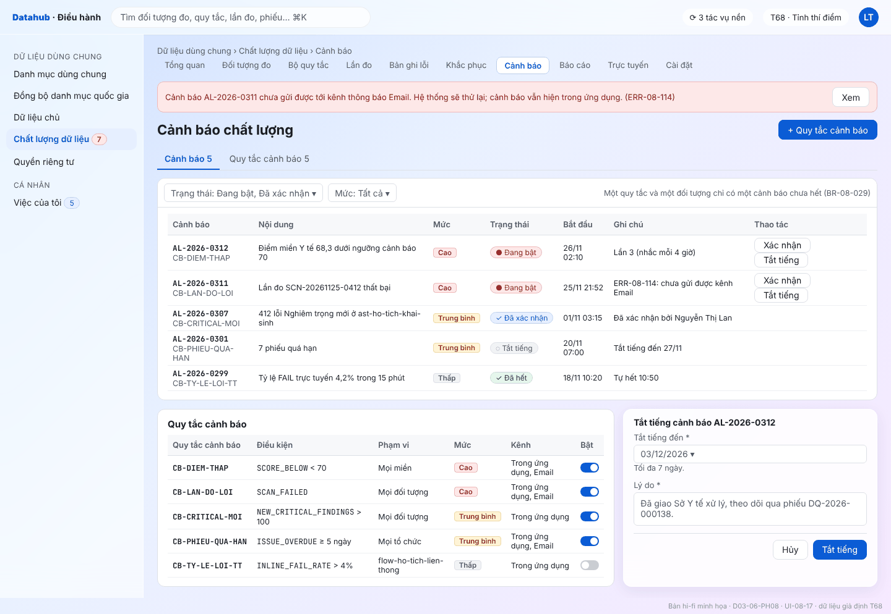

Ảnh cho thấy năm cảnh báo đủ bốn trạng thái, dải đỏ ERR-08-114, bảng quy tắc cảnh báo năm mức và khung tắt tiếng kèm lý do.

## 24. UI-08-18 Báo cáo chất lượng

::: dac-ta
**Mục đích.** Soạn, duyệt, công bố và phân phối báo cáo kỳ (tháng) và báo cáo chính thức năm; kiểm tra "sẵn sàng báo cáo năm" trước khi gửi duyệt; xuất PDF, XLSX, ký số; đăng ký người nhận.

**Tác nhân, quyền.** DS, TA soạn, xuất (`PERM-08-report`); DA duyệt, công bố (`PERM-08-approve`); VW, DO, SO, AU xem báo cáo đã công bố (`PERM-08-read`).

**FR, UC.** FR-08-052, 053, 054, 055, 056; hệ cũ: tab "Báo cáo" của mockup cũ.

**Đường dẫn, mẫu.** `/du-lieu/chat-luong/bao-cao`, `/bao-cao/{ma}` (`loai`, `trang-thai`, `nam`); PTN-01 và PTN-02.

**API.** API-08-107…110 (tạo, danh sách, chi tiết, sửa); API-08-111…114 (`:submit`, `:approve`, `:reject`, `:withdraw`); API-08-115 (`:check-annual-readiness`); API-08-116, 117, 118 (xuất, `:sign`); API-08-119, 120, 121 (đăng ký nhận).

**Hành động.** Tạo báo cáo kỳ hoặc năm, cập nhật số liệu, nhập khuyến nghị, gửi duyệt, duyệt, từ chối, thu hồi, xuất, ký số, đăng ký nhận.

**Trạng thái.** `DRAFT`, `IN_REVIEW`, `PUBLISHED`, `WITHDRAWN`; chưa đủ điều kiện năm.

**Thông báo.** "Chưa đủ điều kiện báo cáo chính thức năm {năm}: {n} đối tượng thiếu lần đo toàn bộ hoặc có điểm thiếu chiều." (ERR-08-038); "Báo cáo cần ít nhất một khuyến nghị trước khi gửi duyệt." (ERR-08-039); "Báo cáo {mã} đã công bố và không sửa được. Thu hồi và lập báo cáo thay thế." (ERR-08-040).

**Đợt, mức chi tiết.** Đợt 3; đầy đủ.
:::

### 24.1. Wireframe

Hình dưới là chi tiết báo cáo năm ở trạng thái nháp, có khối sẵn sàng và khung thao tác.

```text
| Báo cáo chất lượng dữ liệu                                    [+ Báo cáo kỳ] [+ Báo cáo năm]  |
| Danh sách  | ✕ Chưa đủ điều kiện báo cáo chính thức năm 2026: 3 đối tượng thiếu…  | Thao tác         |
| [BC-…NAM]  | Báo cáo chính thức năm 2026 [Nháp]                                    | [Cập nhật số liệu]|
| [BC-…10]   | Soạn > Chờ duyệt (bốn mắt) > Đã công bố > Xuất, ký số, phân phối       | [Gửi duyệt (khóa)]|
| [BC-…09]   | Sẵn sàng báo cáo năm: ✕ 43/46 · ✕ 2 thiếu chiều · ✓ không dùng mẫu · ✓ 3 khuyến nghị| [PDF][XLSX][Ký số]|
|            | Nội dung: tóm tắt · điểm miền, chiều · lỗi, khắc phục · khuyến nghị    | Đăng ký nhận      |
```

### 24.2. Thành phần, hành động và thông báo

Bảng dưới liệt kê thành phần, quy tắc nút theo trạng thái và thông báo.

| Thành phần, hành động | `CMP-*` | Nội dung, kiểm tra | Quyền, thông báo |
|---|---|---|---|
| Danh sách báo cáo | `CMP-DataTable`, `CMP-FilterBar` | Mã, loại `report_type`, kỳ, `report.status`, người soạn, ngày công bố | `PERM-08-read` |
| Thanh bước quy trình | `CMP-Steps` | Soạn, Chờ duyệt, Đã công bố, Xuất và phân phối | |
| Khối "Sẵn sàng báo cáo năm" | `CMP-DataTable` | Bốn điều kiện BR-08-010: mỗi đối tượng có lần đo `FULL` thành công trong năm, ảnh chụp đại diện không `INCOMPLETE_DIMENSIONS`, không từ `SAMPLE` hoặc `INCREMENTAL`, có khuyến nghị; điều kiện chưa đạt liệt kê đối tượng và nút "Tạo lần đo FULL còn thiếu" | ERR-08-038 (422); `PERM-08-run` cho nút |
| Nội dung báo cáo | `CMP-Form`, `CMP-TextArea` | Tóm tắt điều hành, điểm theo miền và chiều, lỗi và khắc phục, khuyến nghị (ít nhất một), khối tiến độ chuẩn hóa tùy chọn (Q08-17) | ERR-08-039; sửa báo cáo đã công bố: ERR-08-040 (409) |
| Gửi duyệt, Duyệt, Từ chối | `CMP-ApprovalPanel` | Bốn mắt: người soạn không duyệt; từ chối cần lý do | `PERM-08-approve`; ERR-08-005 |
| Thu hồi | `CMP-ReasonDialog` | Báo cáo `PUBLISHED` sang `WITHDRAWN`, lập báo cáo thay thế | `PERM-08-approve` |
| Xuất, Ký số | `CMP-Button`, `CMP-DropdownMenu` | PDF, XLSX; ký số chứng thư cơ quan (Q08-06); tệp hạn tải `08.export.link-hours` | ERR-08-041; ký lỗi: "Không ký số được báo cáo {mã}: {nguyên nhân}." (ERR-08-048); tạo lỗi: ERR-08-112 |
| Đăng ký nhận | `CMP-DataTable` | Người nhận, kênh `IN_APP`, `EMAIL`; thêm, xóa | `PERM-08-report`; gửi lỗi: ERR-08-114 |
| Trạng thái màn | `ST-01`, `ST-03`, `ST-07` | Chưa có báo cáo: "Chưa có báo cáo nào. Tạo báo cáo kỳ đầu tiên." | VW chỉ thấy bản `PUBLISHED` |

: UI-08-18 Báo cáo chất lượng, thành phần, hành động và thông báo

### 24.3. Bản hi-fi

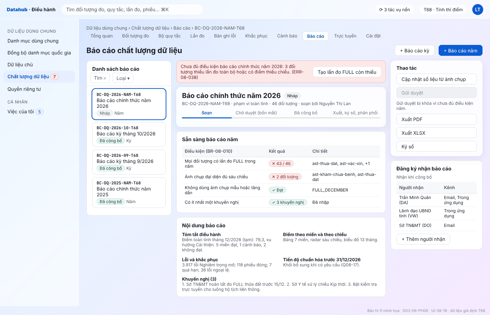

Ảnh cho thấy báo cáo năm 2026 ở trạng thái nháp: dải đỏ ERR-08-038, khối sẵn sàng với hai điều kiện chưa đạt, nút "Gửi duyệt" khóa và khung đăng ký nhận.

## 25. UI-08-19 Cài đặt chất lượng theo tenant

::: dac-ta
**Mục đích.** Quản trị tenant khai báo miền chất lượng, chỉnh tham số (lịch, giới hạn, SLA, trực tuyến, lưu giữ), theo dõi dọn dữ liệu và đẩy KPI sang PH-16; cán bộ ATTT, kiểm toán xem nhật ký kiểm toán PH-08.

**Tác nhân, quyền.** TA sửa (`PERM-08-config`); PA đặt trần; SO, AU xem nhật ký (`PERM-08-audit-read`); DS, DA xem tham số ở chế độ chỉ đọc.

**FR, UC.** FR-08-001, 057, 058, 059, 060.

**Đường dẫn, mẫu.** `/du-lieu/chat-luong/cai-dat` (tab `/mien`, `/tham-so`, `/luu-giu`, `/kpi`, `/nhat-ky`); PTN-12.

**API.** API-08-001…004 (miền); API-08-123, 124 (`GET`, `PUT /settings`); API-08-125, 126 (lần dọn, xem trước); API-08-122 (`GET /kpi/snapshots`); API-08-127 (`GET /audit-events`).

**Hành động.** Tạo, sửa miền; sửa tham số, lưu; xem trước dọn dữ liệu; xem trạng thái đẩy KPI; tra nhật ký.

**Trạng thái.** Đang tải, giá trị không hợp lệ, xung đột phiên bản, chỉ đọc, không quyền.

**Thông báo.** "Giá trị {giá trị} của {khóa} ngoài khoảng cho phép {miền}." (ERR-08-042); "Thời gian lưu {loại} không được dưới {n} {đơn vị}." (ERR-08-043); "Chưa đẩy được {n} bản tin KPI chất lượng dữ liệu sang PH-16." (ERR-08-113); "Lần dọn dữ liệu {ngày} chưa hoàn tất: {nguyên nhân}." (ERR-08-117).

**Đợt, mức chi tiết.** Đợt 3; đầy đủ.
:::

### 25.1. Wireframe

Hình dưới là tab "Tham số" với hai giá trị không hợp lệ.

```text
| ⚠ Chưa đẩy được 3 bản tin KPI chất lượng dữ liệu sang PH-16. (ERR-08-113)      [Xem tab Đẩy KPI]|
| Cài đặt chất lượng dữ liệu                              [Hoàn tác thay đổi] [Lưu tham số]       |
| Miền chất lượng | Tham số theo tenant T68 (40 khóa)  [Tìm khóa ⌕]  2 giá trị không hợp lệ           |
| > Tham số       | Khóa | Giá trị | Miền, trần | Ý nghĩa                                          |
| Lưu giữ, dọn    | 08.scan.manual-per-hour | [80] ✕ ngoài khoảng 1…60 (ERR-08-042) | 1…60             |
| Đẩy KPI PH-16   | 08.finding.retention-months | [9] ✕ dưới 13 tháng (ERR-08-043) | 13…60                |
| Nhật ký kiểm toán|                                                                                |
```

### 25.2. Thành phần, trường và hành động

Bảng dưới liệt kê tab, trường và kiểm tra.

| Tab, trường | `CMP-*` | Kiểm tra, hành vi | Quyền, lỗi |
|---|---|---|---|
| Miền chất lượng | `CMP-DataTable`, `CMP-Form` | Mã miền `^[A-Z][A-Z0-9_]{2,31}$`, tên, tổ chức chủ quản, cán bộ phụ trách, trạng thái `ACTIVE`, `INACTIVE` | `PERM-08-asset`, `PERM-08-config`; thiếu chủ quản: ERR-08-008; trùng: ERR-08-002 |
| Tham số | `CMP-DataTable` biên tập, `CMP-Input`, `CMP-Switch`, `CMP-Select` | 40 khóa theo FRS §8.2 gom nhóm (lịch đo, hồ sơ, quy tắc, điểm, lỗi, phiếu, trực tuyến, cảnh báo, xuất, so sánh); mỗi dòng nêu mặc định, miền, trần PA; sửa tô viền, lỗi dưới ô | `PERM-08-config`; ngoài miền: ERR-08-042 (422) |
| Lưu giữ và dọn dữ liệu | `CMP-DataTable`, `CMP-Button` | Thời gian lưu lỗi, kết quả quy tắc, ảnh chụp, báo cáo, phiếu, thống kê phút; không dưới sàn; "Xem trước dọn dữ liệu" nêu số bản ghi sẽ xóa; lịch sử các lần dọn | ERR-08-043 (422); dọn lỗi: ERR-08-117 |
| Đẩy KPI PH-16 | `CMP-DataTable` | Bản tin KPI gần nhất, trạng thái, số chưa đẩy; chậm quá 24 giờ hiện dải | ERR-08-113 |
| Nhật ký kiểm toán | `CMP-AuditTrail`, `CMP-LogViewer` | Sự kiện PH-08 (ai, làm gì, trên gì, kết quả, `traceId`); chỉ SO, AU | `PERM-08-audit-read`; DS, TA không thấy tab |
| Lưu | `CMP-Button` | `PUT /settings` với `If-Match`; xung đột `ST-13`; không ghi được nhật ký: "Hệ thống tạm thời không ghi được nhật ký. Thao tác chưa được thực hiện." (ERR-08-054) | |

: UI-08-19 Cài đặt chất lượng theo tenant, thành phần, trường và hành động

Trạng thái: đang tải (skeleton bảng, `ST-01`); chỉ đọc cho vai trò không có `PERM-08-config` (`ST-15`, ô thành văn bản); thay đổi chưa lưu hiện chấm cạnh tab và hộp xác nhận khi rời trang; không quyền (`ST-07`). Tham số `08.rule.sql-predicate-enabled` bật phải có lý do (ghi nhật ký).

### 25.3. Bản hi-fi

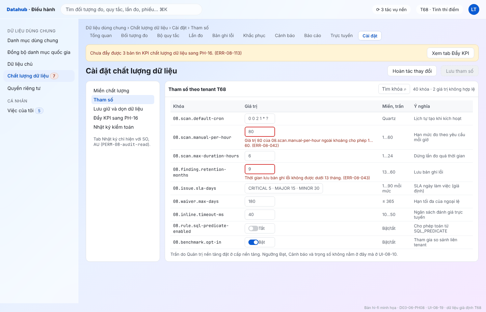

Ảnh cho thấy tab Tham số với hai ô viền đỏ kèm câu ERR-08-042, ERR-08-043, dải vàng ERR-08-113 và danh sách tab bên trái.

## 26. UI-08-20 Giám sát kiểm tra trực tuyến

::: dac-ta
**Mục đích.** Cho cán bộ và vận hành thấy tỷ lệ bản tin không đạt theo luồng, quy tắc, bên gọi và thời gian, độ trễ so ngân sách 50 ms, số kết quả suy giảm khi phụ thuộc lỗi; chỉnh chế độ `STRICT` hoặc `ADVISORY` và chính sách khi phụ thuộc lỗi.

**Tác nhân, quyền.** DS, TO xem (`PERM-08-read`); DS, TA cấu hình (`PERM-08-rule-admin`).

**FR, UC.** FR-08-032, 033, 034, 035; hệ cũ: LGC-BUS-027 (thống kê lỗi theo endpoint).

**Đường dẫn, mẫu.** `/du-lieu/chat-luong/truc-tuyen` (`doi-tuong`, `khoang`); PTN-11 Giám sát.

**API.** API-08-070 (`GET /inline-stats`); API-08-072, 071 (`GET`, `PUT /assets/{assetCode}/inline-config`); API-08-053 (quy tắc chạy trực tuyến).

**Hành động.** Chọn đối tượng, khoảng thời gian; sửa cấu hình (chế độ, chính sách phụ thuộc lỗi, ngân sách).

**Trạng thái.** Đang tải, chưa bật trực tuyến, phụ thuộc lỗi, lỗi, không quyền.

**Thông báo.** "Dịch vụ đối chiếu danh mục tạm thời không khả dụng." (ERR-08-104); "Kiểm tra chất lượng vượt {n} ms." (ERR-08-103); "Đối tượng {mã} chưa bật kiểm tra trực tuyến." (ERR-08-102).

**Đợt, mức chi tiết.** Đợt 3; đầy đủ.
:::

### 26.1. Wireframe

Hình dưới là bảng giám sát với thẻ chỉ số, đồ thị theo phút, cấu hình và hai bảng top.

```text
| ⚠ Dịch vụ đối chiếu danh mục tạm thời không khả dụng. 14 yêu cầu trả Đạt có cờ degraded (ERR-08-104)|
| Giám sát kiểm tra trực tuyến   [Đối tượng ▾] (15 phút|1 giờ|24 giờ)                  [Cấu hình]  |
| [152 yc/phút][p95 41 ms (≤ 50)][FAIL 4,2%][Degraded 14][Quá ngân sách 0]                         |
| Tỷ lệ FAIL theo phút (ECharts line, vạch 5%)       | Cấu hình: STRICT/ADVISORY · FAIL_OPEN/CLOSED · 40 ms |
| Quy tắc vi phạm nhiều nhất (1 giờ)                 | Bên gọi: PH-04 luồng · PH-06 cổng chất lượng          |
```

### 26.2. Thành phần, trường và hành động

Bảng dưới liệt kê thành phần, trường cấu hình và quyền.

| Thành phần, trường | `CMP-*` | Kiểm tra, hành vi | Quyền, thông báo |
|---|---|---|---|
| Năm thẻ chỉ số | `CMP-KpiCard` | Yêu cầu/phút, p95 so ngân sách (`08.inline.timeout-ms`), tỷ lệ FAIL, số kết quả degraded (phụ thuộc lỗi, `FAIL_OPEN`), số quá ngân sách | Số liệu gom theo phút, giữ 90 ngày; không có nội dung bản ghi |
| Đồ thị theo phút | `CMP-Chart` `line` | Tỷ lệ FAIL theo phút và vạch ngưỡng cảnh báo; nút "Xem dạng bảng" | Khoảng 15 phút, 1 giờ, 24 giờ |
| Cấu hình trực tuyến | `CMP-SegmentedControl`, `CMP-NumberInput` | `inline_mode` (`STRICT` chặn lỗi Nghiêm trọng, Đáng kể; `ADVISORY` không chặn), `on_dependency_failure`, ngân sách 10…50 ms, quy tắc chạy trực tuyến, hành vi Kamelet `dh-dq-check` (`STOP_TO_DLQ`, `CONTINUE_WITH_HEADER`, `ROUTE_TO`) | `PERM-08-rule-admin`; ngoài miền: ERR-08-042; đổi sang `FAIL_CLOSED` cần `CMP-ConfirmDialog` nêu hệ quả chặn luồng |
| Top quy tắc | `CMP-DataTable` | Quy tắc, chiều, số vi phạm, p95 | |
| Bên gọi | `CMP-DataTable` | PH-04 luồng, PH-06 cổng chất lượng, scope `dq.check`: yêu cầu, FAIL, lỗi 5xx | |
| Đối tượng chưa bật | `CMP-EmptyState` | "Đối tượng {mã} chưa bật kiểm tra trực tuyến." (ERR-08-102) kèm nút "Cấu hình" | `ST-03` |
| Không có quyền | `ST-07` | | |

: UI-08-20 Giám sát kiểm tra trực tuyến, thành phần, trường và hành động

### 26.3. Bản hi-fi

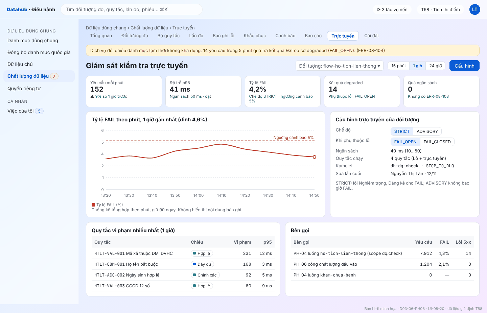

Ảnh cho thấy dải vàng ERR-08-104, năm thẻ chỉ số, đường tỷ lệ FAIL dưới vạch 5%, khung cấu hình `STRICT` và `FAIL_OPEN`, hai bảng top.

## 27. Mẫu truy cập dữ liệu và ba luồng chính

Chương này nêu cách mã giao diện gọi API PH-08 để các màn dùng chung một khuôn, rồi mô tả ba luồng người dùng đi qua nhiều màn.

### 27.1. Mẫu truy cập dữ liệu

Mọi màn đọc dữ liệu qua thư viện truy vấn dùng chung của `dh-console`, không tự gọi `fetch`. Bảng dưới nêu quy ước.

| Việc | Quy ước | Ghi chú |
|---|---|---|
| Đọc danh sách | Khóa truy vấn gồm tenant, tên tài nguyên và bộ lọc; phân trang `limit`, `cursor` | Bộ lọc nằm trên URL (mục 2.7); chuyển trang giữ vị trí cuộn |
| Ghi | Gửi `Idempotency-Key`; sửa gửi `If-Match` với `version` | Xung đột phiên bản hiện `ST-13`; thao tác dài trả `202` kèm mã lần đo |
| Tác vụ dài | Thăm dò chu kỳ 5 giây khi màn mở | Dừng khi tab ẩn; lần đo xong thì làm mới thẻ điểm |
| Lỗi | Đọc `code` trong thân lỗi, tra bảng mục 5.3, không hiện `message` thô | Luôn kèm `traceId` ở dòng phụ để người dùng báo cáo |
| Quyền | Nút hiện theo `PERM-08-*` từ phiên; máy chủ vẫn kiểm tra lại | Vai trò thiếu quyền thấy nút khóa kèm lý do, không ẩn trừ khi vai trò không bao giờ dùng |

: Quy ước truy cập dữ liệu của màn PH-08

### 27.2. Luồng 1: từ cảnh báo đến khắc phục

Luồng này là việc hằng ngày của cán bộ dữ liệu. Sơ đồ nêu các bước và màn tương ứng.

```{.mermaid caption="Luồng 1 từ cảnh báo đến phiếu khắc phục được xác nhận"}
flowchart LR
  A["UI-08-17 Cảnh báo điểm dưới ngưỡng"] --> B["UI-08-01 Tổng quan"]
  B --> C["UI-08-04 Thẻ điểm đối tượng"]
  C --> D["UI-08-12 Chi tiết lần đo"]
  D --> E["UI-08-13 Bản ghi lỗi"]
  E --> F["UI-08-15 Mở phiếu, giao việc"]
  F --> G["UI-08-16 Chủ quản báo đã sửa"]
  G --> H["Đo kiểm chứng, DS xác nhận"]
```

### 27.3. Luồng 2: soạn, duyệt và kích hoạt bộ quy tắc

Luồng này do quản trị quy tắc và người duyệt thực hiện, bốn mắt ở bước duyệt.

```{.mermaid caption="Luồng 2 soạn, duyệt và kích hoạt bộ quy tắc"}
flowchart LR
  A["UI-08-06 Danh sách bộ quy tắc"] --> B["UI-08-07 Soạn bản nháp"]
  B --> C["UI-08-08 Biểu mẫu, chạy thử"]
  C --> D["UI-08-09 Gửi duyệt"]
  D --> E{"Người duyệt khác người soạn"}
  E -->|Duyệt| F["Kích hoạt phiên bản"]
  E -->|Từ chối| B
```

### 27.4. Luồng 3: báo cáo chính thức năm

Luồng này do DS soạn và DA duyệt; điều kiện sẵn sàng chặn việc gửi duyệt.

```{.mermaid caption="Luồng 3 báo cáo chính thức năm"}
flowchart LR
  A["UI-08-18 Tạo báo cáo năm"] --> B{"Sẵn sàng báo cáo năm"}
  B -->|Chưa| C["UI-08-11 Tạo lần đo FULL còn thiếu"]
  C --> B
  B -->|Đạt| D["Nhập khuyến nghị, gửi duyệt"]
  D --> E["DA duyệt, công bố"]
  E --> F["Xuất, ký số, phân phối"]
```

## 28. Ma trận vai trò và màn hình

Chương này nêu vai trò nào vào được màn nào. Ký hiệu: ● dùng đầy đủ theo quyền, ○ chỉ xem hoặc bị giới hạn phạm vi (nêu trong chương màn), – không vào.

| Màn | PA | TA | TO | SO | DS | DA | DO | VW | AU |
|---|---|---|---|---|---|---|---|---|---|
| UI-08-01, 02 | ○ | ● | ● | ○ | ● | ● | ○ | ○ | ● |
| UI-08-03 | – | ● | – | – | ● | – | – | – | – |
| UI-08-04, 05 | – | ● | ○ | ○ | ● | ● | ○ | ○ | ○ |
| UI-08-06, 07, 08 | – | ● | – | – | ● | ○ | – | ○ | ○ |
| UI-08-09 | – | ● | – | – | ● | ● | – | ○ | ○ |
| UI-08-10 | – | ● | – | – | ● | ● | – | ○ | ○ |
| UI-08-11, 12 | – | ● | ● | ○ | ● | ○ | ○ | ○ | ○ |
| UI-08-13, 14 | – | ● | – | ● | ● | ● | ○ | – | ○ |
| UI-08-15, 16 | – | ● | – | – | ● | ○ | ● | – | ○ |
| UI-08-17 | – | ● | ● | ○ | ● | ○ | ○ | ○ | ○ |
| UI-08-18 | – | ● | – | ○ | ● | ● | ○ | ○ | ○ |
| UI-08-19 | ○ | ● | – | ○ | ○ | ○ | – | – | ○ |
| UI-08-20 | – | ● | ● | – | ● | – | – | – | – |

: Ma trận vai trò và màn hình PH-08

PA đặt trần tham số ở UI-08-19; SO và AU chỉ xem nhật ký và bản ghi lỗi đã che; DO chỉ thấy phiếu và đối tượng của tổ chức mình. 

## 29. Ma trận UI và FR

Chương này nối từng nhóm FR của FRS với màn thực hiện, để kiểm tra không sót chức năng.

| Nhóm FR | FR | Màn |
|---|---|---|
| A Đối tượng đo | FR-08-001…007 | UI-08-02, 03, 04, 19 |
| B Hồ sơ dữ liệu | FR-08-008…011 | UI-08-05 |
| C Quy tắc, điểm | FR-08-012…022 | UI-08-06, 07, 08, 09, 10 |
| D Lần đo | FR-08-023…031 | UI-08-04, 11, 12 |
| E Trực tuyến | FR-08-032…035 | UI-08-20 |
| F Bản ghi lỗi | FR-08-036…040 | UI-08-13, 14 |
| G Khắc phục | FR-08-041…046 | UI-08-13, 15, 16 |
| H Cảnh báo | FR-08-047…049 | UI-08-17 |
| I Tổng quan, báo cáo | FR-08-050…057 | UI-08-01, 04, 18, 19 |
| J Tham số, kiểm toán | FR-08-058…061 | UI-08-01, 04, 19 |

: Ma trận nhóm FR và màn PH-08

Cả 61 FR đều có ít nhất một màn; không có FR nào chỉ chạy nền không màn. Truy vết hệ cũ: LGC-DMDC-006, 007, 008 vào UI-08-04, 12, 13; LGC-BUS-027 vào UI-08-20; LGC-NGSP-003, 005 vào UI-08-17 (chi tiết ở mục 3.3).

## 30. Kiểm thử giao diện và danh sách ảnh hi-fi

Chương này nêu điểm kiểm thử giao diện riêng PH-08 và danh sách ảnh sinh kèm tài liệu.

| Mã | Kiểm tra | Màn |
|---|---|---|
| TC-UI-08-01 | Điểm, phán quyết và xu hướng đúng với API; thiếu chiều có cờ `INCOMPLETE_DIMENSIONS` | UI-08-01, 04, 12 |
| TC-UI-08-02 | Giá trị Nhạy cảm che theo quyền, DO không thấy giá trị gốc | UI-08-13, 14 |
| TC-UI-08-03 | Bốn mắt: người soạn không duyệt bộ quy tắc, báo cáo, ngoại lệ; chủ quản không tự xác nhận phiếu | UI-08-09, 14, 16, 18 |
| TC-UI-08-04 | Mọi ERR-08 trong chương màn hiện đúng câu, đúng vị trí, kèm `traceId` | Mọi màn |
| TC-UI-08-05 | Bàn phím, trình đọc màn hình, tương phản 4,5:1; biểu đồ có dạng bảng thay thế | UI-08-01, 12, 20 |
| TC-UI-08-06 | Hiệu năng: tổng quan hiển thị dưới 2 giây với 500 đối tượng; bảng lỗi cuộn mượt 100.000 dòng | UI-08-01, 13 |

: Điểm kiểm thử giao diện PH-08

Ảnh hi-fi nằm ở `ph08/hifi/`: `ui-08-01.png`, `ui-08-01b.png`, `ui-08-02.png` đến `ui-08-06.png`, `ui-08-07.png`, `ui-08-07b.png`, `ui-08-08.png` đến `ui-08-11.png`, `ui-08-12.png`, `ui-08-12b.png`, `ui-08-13.png` đến `ui-08-20.png` (23 ảnh, mỗi ảnh dưới 400 KB, rộng 1440 px). Sinh lại bằng `python3 gen_hifi.py && node shot.js && python3 nen.py` trong thư mục đó.

## Phụ lục A. Đề xuất đồng bộ D03-05 (thành phần, token)

PH-08 chỉ dùng `CMP-*` đã có; các mục dưới là đề xuất, chưa dùng như thành phần chính thức.

| Mã đề xuất | Nội dung | Dùng ở |
|---|---|---|
| A-01 | `CMP-Chart` thêm biến thể radar (hiện chỉ có line, bar, pie, gauge) cho sáu chiều | UI-08-01, 04, 12 |
| A-02 | Thẻ điểm có vòng tiến độ và nhãn phán quyết (`ScoreCard`) | UI-08-01, 04 |
| A-03 | Chip chiều chất lượng (`DimensionChip`) kèm màu và chữ viết tắt | UI-08-04, 07, 08, 13 |
| A-04 | Biến thể `StatusTag` cho phán quyết PASS, WARN, FAIL | Mọi màn |
| A-05 | Thanh trượt hai đầu (`RangeSlider`) cho ngưỡng 70 và 80 | UI-08-10 |
| A-06 | Thanh hạn xử lý SLA ba màu kèm chữ | UI-08-15, 16 |
| A-07 | Dải thông báo không đóng được (lỗi hệ thống bên phụ thuộc) | UI-08-12, 17, 20 |
| A-08 | Ánh xạ `color-chart-1…6` cho sáu chiều cố định theo thứ tự | Mọi biểu đồ |

: Đề xuất đồng bộ D03-05 từ PH-08

Ảnh hi-fi dùng giá trị hex tương đương token; khi D03-05 chốt các đề xuất trên thì sinh lại ảnh.

## Phụ lục B. Đề xuất bổ sung API và trường (đồng bộ D02-03)

Các mục dưới là nhu cầu giao diện chưa thấy trong FRS §9.4, trình chủ nhiệm đề tài quyết định.

| Mã đề xuất | Nội dung | Màn |
|---|---|---|
| B-01 | `GET /dashboard` thêm `radar` và `radarPrev` (sáu chiều kỳ này và kỳ trước) | UI-08-01 |
| B-02 | Lần đo trả thêm `etaSeconds` và `progressByStage` | UI-08-11, 12 |
| B-03 | `POST /weight-configs:preview` trả điểm giả định trước khi gửi duyệt | UI-08-10 |
| B-04 | `GET /inline-stats` thêm `p95Ms` và `degradedCount` theo phút | UI-08-20 |
| B-05 | `GET /issues` trả số đếm theo từng phân vùng hộp việc | UI-08-15 |
| B-06 | `GET /findings` hỗ trợ `groupBy=rule,fingerprint` kèm tổng | UI-08-13 |

: Đề xuất bổ sung API và trường PH-08

## Phụ lục C. Đồng bộ với D03-06-00 và tài liệu khác

Các điểm dưới cần chủ tài liệu tương ứng xác nhận; bộ này không sửa tài liệu ngoài phạm vi.

| Mã đề xuất | Nội dung | Tài liệu |
|---|---|---|
| C-01 | Cây menu `/du-lieu/chat-luong` có 11 mục con theo mục 4.1 (hiện D03-06-00 chỉ ghi một dòng #22) | D03-06-00 |
| C-02 | Thêm tab ngữ cảnh "Chất lượng" vào chi tiết miền PH-06 và danh mục PH-07 (liên kết sang UI-08-04) | D03-06-PH06, D03-06-PH07 |
| C-03 | FRS ghi 20 màn; xác nhận UI-08-18 gồm cả danh sách và chi tiết báo cáo | D02-03-PH08 |
| C-04 | Xác nhận mã `PERM-08-*` và `ERR-08-*` dùng ở chương 5 và 28 với D02-08 | D02-08 |

: Đề xuất đồng bộ tài liệu liên quan

## Câu hỏi mở

Các câu hỏi nối tiếp Q08-01…29 của FRS; chủ đề tài quyết định trước khi dựng màn.

| Mã | Câu hỏi | Màn |
|---|---|---|
| Q08-30 | Radar sáu chiều hay thanh ngang dễ đọc hơn với cán bộ sở; có cần cả hai không | UI-08-01 |
| Q08-31 | DO có được xem giá trị che một phần (ví dụ 4 ký tự cuối) của bản ghi lỗi tổ chức mình | UI-08-13, 14 |
| Q08-32 | Trình soạn CEL gợi ý đến mức nào (cột, hàm, tham số) | UI-08-08 |
| Q08-33 | Giới hạn phân trang sâu của bảng lỗi (nay 100.000 dòng) | UI-08-13 |
| Q08-34 | Thứ hạng so sánh liên tenant có hiển thị khi nhóm dưới 5 tenant | UI-08-01 |
| Q08-35 | Phím tắt có trùng với phím hệ thống của `dh-console` | UI-08-07, 13 |
| Q08-36 | Thăm dò 5 giây hay WebSocket cho tiến độ lần đo | UI-08-11, 12 |
| Q08-37 | Có cần xem trước PDF báo cáo năm ngay trong màn | UI-08-18 |
| Q08-38 | DO có xem được báo cáo chưa công bố của tổ chức mình | UI-08-18 |
| Q08-39 | Có nhúng thẻ điểm vào cổng `dh-portal` cho vai trò `dq.read` | UI-08-01, 04 |

: Câu hỏi mở của bộ màn hình PH-08

## Lịch sử phiên bản

Bảng dưới ghi các phiên bản của tài liệu.

| Phiên bản | Ngày | Nội dung |
|---|---|---|
| 0.1 | 2026-11-26 | Bản đầu: 20 màn, 23 ảnh hi-fi, ma trận, phụ lục đề xuất, câu hỏi Q08-30…39 |

: Lịch sử phiên bản D03-06-PH08
