# D03-06-PH09 · Thiết kế giao diện màn hình Quyền riêng tư

Tập màn **không tự đặt** token, `CMP-*` hay `PTN-*`; mọi tên dùng ở đây có trong D03-05-02, D03-05-03, D03-05-04 và D03-06-00. Thành phần hoặc token còn thiếu ghi ở Phụ lục A. Enum, trường, mã lỗi, quyền, route lấy đúng Phụ lục A và các mục 3, 9, 10 của [D02-03-PH09](../../02-yeu-cau/frs/D02-03-PH09-frs-quyen-rieng-tu.md); chỗ FRS chưa có ghi ở mục "Đề nghị đồng bộ".

## Tóm tắt cho hội đồng thẩm định

PH-09 là nơi tỉnh quản lý việc bảo vệ dữ liệu cá nhân (DLCN) theo Luật 91/2025 và Nghị định 356/2025: phân loại từng trường dữ liệu, ghi sổ hoạt động xử lý, cho phép khai thác theo mục đích, soạn chính sách che, giả danh hóa và ẩn danh hóa, lưu giữ và xóa, trả lời yêu cầu của chủ thể, đánh giá tác động và xử lý vi phạm trong 72 giờ. Hệ cũ (Viettel 2021) chỉ có một mockup `privacy.html` sáu tab; bản mới đặc tả 22 màn (UI-09-01…22) trong khu "Dữ liệu" của `dh-console`, route gốc `/du-lieu/quyen-rieng-tu`, kèm 13 ảnh hi-fi ở `ph09/hifi/`.

Năm quyết định giao diện chính:

1. **Che là mặc định, xem đầy đủ là ngoại lệ có đồng hồ.** Mọi màn hiển thị giá trị cá nhân dùng `CMP-MaskedValue`. Muốn xem giá trị rõ, người có `PERM-09-unmask` mở hộp thoại dùng chung UI-09-22: nhập lý do từ 20 ký tự, giá trị hiện 60 giây có đếm ngược rồi tự che, mỗi lần đều ghi nhật ký trước khi hiện (BR-09-026, BR-09-057). Không ghi được nhật ký thì không hiện (ERR-09-010).
2. **Thay đổi có hệ quả rộng đều đi qua bốn mắt, nút duyệt vô hiệu kèm lý do bằng chữ.** Chính sách che, lịch lưu giữ, cấu hình ẩn danh, hạ mức phân loại, xoay và hủy khóa, xóa mật mã tenant: người soạn không duyệt (ERR-09-005). Khôi phục giá trị gốc cần ba người khác nhau cộng MFA (UI-09-13).
3. **Người dùng thấy ngay việc đang quá hạn.** UI-09-01 đưa lên đầu năm chỉ số bấm được: trường chưa phân loại, hợp đồng bị chặn kích hoạt, yêu cầu chủ thể quá hạn, đồng hồ 72 giờ của vụ việc, tuổi gói chính sách. Đồng hồ và hạn luôn hiện bằng chữ kèm màu.
4. **Hộp việc của chủ quản dữ liệu (UI-09-09) là màn dùng hằng ngày.** Danh sách bên trái sắp theo hạn, chi tiết bên phải có bảng trường kèm mức và nhãn Nhạy cảm, ba nút quyết định cố định ở chân, điều kiện chấp thuận chọn bằng ô tick.
5. **Giao diện tự không trở thành nơi rò rỉ.** Không đưa số định danh, họ tên, điện thoại lên URL, tiêu đề tab hay bộ nhớ trình duyệt; truy vấn chứa DLCN gửi bằng `POST`; dữ liệu mẫu ở màn mô phỏng là dữ liệu giả; hồ sơ vi phạm chỉ ghi số lượng, loại, băm (BR-09-056).

Kính Liquid Glass chỉ dùng cho lớp điều hướng và lớp nổi (hộp thoại, Drawer, thanh quyết định); bảng, biểu mẫu, biểu đồ là nền đặc để đạt WCAG 2.2 AA (ADR-020). Dữ liệu trên ảnh là giả định của tỉnh thí điểm T68, số định danh luôn che.

## 1. Mục đích, phạm vi và tài liệu liên quan

Chương này nêu tập màn phục vụ ai, dựa trên tài liệu nào, rồi liệt kê 22 màn của PH-09 trước khi vào chi tiết.

### 1.1. Mục đích

Tập màn là nguồn chuẩn để kỹ sư `dh-console` dựng giao diện PH-09, để kiểm thử viên viết ca kiểm thử giao diện (D05-02-PH09) và để hội đồng thẩm định thấy mỗi chức năng trong 64 FR của FRS có chỗ thể hiện, đúng quyền, đúng thông báo. Mỗi màn có bảng đặc tả đầu màn (đường dẫn, mẫu, quyền, FR, API), bố cục, bảng trường, hành động, trạng thái, phím tắt, truy cập và cách che DLCN.

### 1.2. Phạm vi

Trong phạm vi: 22 màn của FRS §10.1, kể cả Drawer, hộp thoại, trình hướng dẫn thuộc màn. Ngoài phạm vi: API data plane `/privacy/v1` (API-09-227…237, không có màn; điểm thực thi gọi), cổng công dân `dh-portal` (chủ thể chưa đăng nhập Datahub, yêu cầu do cán bộ tiếp nhận ở UI-09-16; Q09-11), đặc tả token và thành phần (D03-05). Trực quan hóa luồng PH-04 áp che bản tin (FR-09-028) không có màn riêng: người vận hành xem ở PH-04 và PH-13.

### 1.3. Tài liệu liên quan

Bảng dưới ghi từng tài liệu và nội dung màn hình lấy từ đó.

| Tài liệu | Dùng để |
|---|---|
| D02-03-PH09 FRS | 64 FR, mã lỗi và thông báo (§9.1), tham số `09.*` (§8.2), danh sách màn (§10), enum (Phụ lục A) |
| D03-06-00 | Khung bố cục, mẫu `PTN-01…14`, route (§2.3, §2.4), trạng thái `ST-*` (§4.2) |
| D03-05-02, 03, 04 | Token, thành phần nguyên tử và phức hợp `CMP-*` |
| D03-04-PH09 (viết song song) | API-09-001…237 chi tiết; tập này dùng mã theo FRS §9.4 |
| D02-08 | Vai trò `ROLE-*`, `PERM-09-*` (đề nghị mở rộng ở FRS Phụ lục B) |
| D03-07 | Bốn mức phân loại (§3.2), che và xem đầy đủ (SEC-32), quyền chủ thể, vi phạm 72 giờ (§6) |
| D03-06-PH06 | Mẫu trình bày; UI-06-03 và UI-06-16 nhúng UI-09-22 và chuyển yêu cầu chủ thể sang UI-09-16 |

: Tài liệu liên quan của tập màn PH-09

### 1.4. Thuật ngữ và viết tắt

Bảng giải thích các thuật ngữ theo nghĩa người dùng thấy trên giao diện, để nhãn dùng thống nhất ở mọi màn.

| Thuật ngữ | Nghĩa trên giao diện |
|---|---|
| DLCN | Dữ liệu cá nhân; chia `BASIC` (cơ bản) và `SENSITIVE` (nhạy cảm theo luật) |
| Phần tử dữ liệu | Một trường của thực thể, lược đồ API hoặc topic đã đăng ký phân loại (EN-09) |
| Mục đích (`purpose`) | Lý do khai thác dữ liệu, có mã như `TTHC-HO-TICH`, `THONG-KE`; chấp thuận gắn bộ ba HTTT, mục đích, hợp đồng |
| Che (mask) | Làm mờ giá trị khi hiển thị: che một phần, thay thế, băm có khóa, token hóa, tổng quát hóa, bỏ trường |
| Giả danh hóa | Thay giá trị bằng bí danh: HMAC không đảo ngược hoặc token đảo ngược qua OpenBao |
| Ẩn danh hóa | Biến đổi tập dữ liệu để không còn nhận diện được (k-ẩn danh, k ≥ 10) |
| Phiếu xem đầy đủ | `RevealGrant`: quyền xem một giá trị rõ trong 60 giây, hết hạn không dùng lại |
| DSR | Yêu cầu của chủ thể dữ liệu: biết, truy cập, chỉnh sửa, xóa, hạn chế, phản đối, rút đồng ý |
| DPIA | Hồ sơ đánh giá tác động xử lý DLCN, gửi Cục A05 |
| PEP, PDP | Điểm thực thi (APISIX, PH-04, PH-06…) và điểm quyết định (OPA); PH-09 là nơi quản lý và nguồn chính sách |
| SO, TA, DA, DO, DS, TO, PA, OR, SV, VW, AU | Cán bộ ATTT (bộ phận bảo vệ DLCN, GĐ-09-01), Quản trị tỉnh, Người duyệt dữ liệu, Chủ quản dữ liệu, Cán bộ quản lý dữ liệu, Vận hành tỉnh, Quản trị nền tảng, Đầu mối tổ chức, Chủ dịch vụ, Người xem, Kiểm toán |

: Thuật ngữ và viết tắt của tập màn PH-09

### 1.5. Danh sách màn hình

Bảng liệt kê 22 màn theo FRS §10.1; cột "Hi-fi" cho biết màn có ảnh ở `ph09/hifi/`. Mức chi tiết "Đầy đủ" là khối đặc tả cộng bảng trường, hành động, trạng thái; màn có ảnh có thêm bản hi-fi.

| Mã | Tên | PTN | Mức chi tiết | Hi-fi | FR |
|---|---|---|---|---|---|
| UI-09-01 | Tổng quan tuân thủ | PTN-06 | Đầy đủ | Có | 020, 030, 049, 062, 063 |
| UI-09-02 | Danh mục phân loại trường | PTN-08 | Đầy đủ | Có | 001, 002, 003, 004, 006, 008, 022 |
| UI-09-03 | Chi tiết phần tử dữ liệu | PTN-02 | Đầy đủ | Không | 003, 004, 006, 007, 008 |
| UI-09-04 | Kết quả quét phát hiện | PTN-10 | Đầy đủ | Không | 005 |
| UI-09-05 | Sổ hoạt động xử lý | PTN-01 | Đầy đủ | Có | 009, 010, 011, 013 |
| UI-09-06 | Biểu mẫu hoạt động xử lý | PTN-05 | Đầy đủ | Có | 009, 010, 011 |
| UI-09-07 | Danh mục mục đích và cơ sở pháp lý | PTN-01 | Đầy đủ | Không | 012, 014 |
| UI-09-08 | Yêu cầu khai thác | PTN-01, PTN-02 | Đầy đủ | Không | 015, 017 |
| UI-09-09 | Hộp việc chấp thuận của chủ quản | PTN-10 | Siêu chi tiết | Có | 016, 017, 018, 020, 021, 022 |
| UI-09-10 | Chính sách che | PTN-03 | Siêu chi tiết | Có | 023, 024, 026, 030 |
| UI-09-11 | Mô phỏng che | PTN-03 | Đầy đủ | Có | 025 |
| UI-09-12 | Miền giả danh và khóa | PTN-01 | Đầy đủ | Không | 031, 034 |
| UI-09-13 | Khôi phục giá trị gốc | PTN-10 | Siêu chi tiết | Có | 033 |
| UI-09-14 | Ẩn danh hóa và đánh giá rủi ro | PTN-05 | Đầy đủ | Có | 035, 036, 037, 038, 039 |
| UI-09-15 | Lịch lưu giữ và tác vụ xóa | PTN-01 | Đầy đủ | Không | 040, 041, 042, 043, 044 |
| UI-09-16 | Yêu cầu của chủ thể | PTN-01, PTN-02 | Đầy đủ | Có | 045, 046, 047, 048, 049, 050, 051 |
| UI-09-17 | Sự đồng ý | PTN-01 | Đầy đủ | Không | 052, 053 |
| UI-09-18 | Hồ sơ đánh giá tác động | PTN-03 | Đầy đủ | Không | 055, 056, 057 |
| UI-09-19 | Vi phạm dữ liệu cá nhân | PTN-02 | Đầy đủ | Có | 058, 059, 060 |
| UI-09-20 | Nhật ký bảo vệ dữ liệu | PTN-11 | Đầy đủ | Không | 029, 061 |
| UI-09-21 | Cài đặt PH-09 | PTN-12 | Đầy đủ | Không | 063, 064 |
| UI-09-22 | Hộp thoại xem giá trị đầy đủ (dùng chung) | PTN-04 | Siêu chi tiết | Có (2 ảnh) | 029 |

: Danh sách 22 màn hình PH-09

### 1.6. Người đọc và cấu trúc tài liệu

Kỹ sư giao diện đọc chương 2 đến 6 một lần rồi đọc từng màn (chương 7 đến 28); kiểm thử viên đọc mục "Trạng thái, truy cập" của từng màn và chương 31; hội đồng thẩm định đọc phần tóm tắt, chương 2, UI-09-09, UI-09-13, UI-09-22. Mỗi màn gồm bảng đặc tả đầu màn, bố cục, bảng trường và hành động, bảng trạng thái và truy cập, và ảnh hi-fi nếu có. Phụ lục A, B và mục "Đề nghị đồng bộ" ghi việc cần sửa ở tài liệu khác.

## 2. Nguyên tắc thiết kế áp dụng cho PH-09

Người dùng PH-09 là cán bộ ATTT, chủ quản dữ liệu và cán bộ quản lý dữ liệu, làm việc với dữ liệu nhạy cảm nên giao diện ưu tiên rõ ràng, có dấu vết và khó thao tác nhầm hơn là nhanh.

### 2.1. Bản đồ vật liệu

Bảng ghi mỗi vùng giao diện dùng vật liệu nào, kính mờ cho điều hướng hay nền đặc cho nội dung.

| Vùng | Thành phần | Vật liệu | Lý do |
|---|---|---|---|
| Thanh trên, sidebar | `CMP-AppShell`, `CMP-Topbar`, `CMP-Sidebar` | `glass-chrome` | Lớp điều hướng |
| Tiêu đề trang, hàng tab phụ | `CMP-PageHeader`, `CMP-Tabs` | Đặc trên `color-canvas` | Nội dung |
| Bảng, bảng trường, so sánh phiên bản | `CMP-DataTable`, `CMP-DiffTable`, `CMP-DescriptionList` | Đặc `color-surface-solid` | Nội dung dày, chữ nhỏ |
| Thẻ chỉ số, biểu đồ | `CMP-KpiCard`, `CMP-StatCard`, `CMP-Chart` | Đặc `color-surface-solid` | Số liệu phải đọc chắc |
| Thanh quyết định UI-09-09, UI-09-13 | `CMP-DecisionPanel`, `CMP-ApprovalPanel` | `glass-overlay` cố định, nội dung đặc | Luôn thấy khi cuộn |
| Hộp thoại xem đầy đủ, lý do, xác nhận | `CMP-Modal`, `CMP-ReasonDialog`, `CMP-ConfirmDialog` | Khung `glass-modal`, giếng nội dung đặc, `color-scrim` phía sau | Lớp nổi; giá trị rõ nằm trên nền đặc để đủ tương phản |
| Drawer chi tiết (yêu cầu, kết quả quét, vụ việc) | `CMP-Drawer` | Khung `glass-modal`, giếng đặc | Lớp nổi chứa nội dung dày |
| Băng cảnh báo nghiêm trọng, đồng hồ 72 giờ | `CMP-Banner` | Đặc `color-error` | Không dựa vào độ trong |

: Bản đồ vật liệu Liquid Glass theo vùng màn PH-09

Khi người dùng bật giảm trong suốt hoặc trình duyệt hạ cấp (D03-05-01), kính chuyển `glass-lite-tint` hoặc `glass-off-tint`. Không màn nào dựa vào độ trong để truyền thông tin; giá trị xem đầy đủ luôn trên nền đặc.

### 2.2. Mật độ, ngôn ngữ, màu

Mật độ thường (`size-control-md`, hàng bảng `size-table-row`) cho mọi màn; UI-09-02, UI-09-04, UI-09-20 dùng mật độ gọn (`data-density="compact"`) vì phần tử và bản ghi nhật ký rất nhiều (giả định T01: 50.000 phần tử, 2 triệu bản ghi nhật ký mỗi tháng, NFR-09-020). Nhãn tiếng Việt; mã enum, mã mục đích, khóa tham số đặt trong `CMP-CodeText` không dịch. Màu không phải kênh duy nhất: mức phân loại, trạng thái, hạn đều có chữ; so sánh phiên bản có biểu tượng thêm, sửa, xóa kèm chữ.

### 2.3. Hành động theo quyền và trạng thái

Nút chỉ hiện khi người dùng có quyền và trạng thái đối tượng cho phép (FR-00-053). Nút có quyền nhưng bị chặn bởi quy tắc (tự duyệt, mô phỏng chưa đạt, còn tác vụ chưa xong) vẫn hiện, vô hiệu, kèm lý do bằng chữ cạnh nút, không chỉ tooltip. Đối tượng ngoài phạm vi tổ chức (quyền ○) trả ERR-09-008 và hiện `ST-07`.

### 2.4. Dữ liệu cá nhân trên giao diện

Phần lớn màn PH-09 chỉ hiển thị siêu dữ liệu (tên trường, mức, mã), nhưng có màn chạm giá trị cá nhân: UI-09-04 (mẫu khớp), UI-09-11 (dữ liệu mẫu), UI-09-13 (kết quả khôi phục), UI-09-16 và UI-09-17 (chủ thể), UI-09-19 (chủ thể ảnh hưởng), UI-09-20 (lịch sử xem), UI-09-22. Sáu quy tắc dưới đây bắt buộc cho mọi màn của tập (nguồn: BR-09-001, 025, 026, 042, 056, 058).

1. **Che mặc định.** Giá trị `SENSITIVE` và định danh trực tiếp luôn hiển thị bằng `CMP-MaskedValue` theo kế hoạch che của PH-09; giao diện không tự che, không tự bỏ che. Ví dụ mặc định của T68: số định danh `*********345` (giữ 3 ký tự cuối), điện thoại `*******688`, họ tên `Nguyễn **`, địa chỉ chỉ đến cấp phường, ngày sinh chỉ năm.
2. **Xem đầy đủ chỉ qua UI-09-22.** Không có nút "bỏ che" riêng của từng màn: mọi nơi dùng hộp thoại dùng chung (mục 28), vì vậy lý do, hạn mức mỗi giờ, đếm ngược 60 giây và ghi vết nằm ở một nơi.
3. **Không lên URL, tiêu đề, bộ nhớ trình duyệt.** URL chỉ chứa mã không mang nghĩa (`id`, `ma`); tra cứu theo cá nhân gửi bằng `POST` (API-09-168, 190); `document.title` và breadcrumb không chứa tên, số định danh. Truy vấn có DLCN dùng TanStack Query với `staleTime: 0`, `gcTime: 0`; không ghi `localStorage`, `sessionStorage`, lịch sử gợi ý.
4. **Ô nhập số định danh là trường che.** Nhập số định danh chủ thể ở UI-09-16 dùng `CMP-SecretField`, không tự điền, không dán vào lịch sử; sau khi gửi, trường xóa trắng và chỉ còn băm `hs:…` ở màn.
5. **Đóng an toàn khi thiếu chính sách che.** Nếu màn không lấy được kế hoạch che (ERR-09-009, hoặc phản hồi mang `X-Datahub-Masking: fallback`) thì mọi ô DLCN hiện `●●●●●●` kèm nhãn "Không hiển thị" và `CMP-Banner` cảnh báo "Chưa lấy được chính sách che. Dữ liệu cá nhân tạm thời không hiển thị."; chỉ trường `PUBLIC` hiện. Nút "Xem đầy đủ" bị vô hiệu.
6. **Thủy vân và log.** Khi có giá trị rõ trên màn, phủ chữ thủy vân "{tên người xem}, {thời điểm}" (`color-text-tertiary`, độ mờ 12%); log giao diện (nhật ký lỗi gửi về Loki) chỉ ghi tên trường, `[REDACTED]` hoặc băm (SEC-32).

: Sáu quy tắc DLCN trên giao diện

### 2.5. Giữ trạng thái trên URL, thời gian, số

Bộ lọc, trang, sắp xếp, tab con giữ trên query theo D03-06-00 §2.4 và FRS §10.3 (`muc`, `trang-thai`, `tu`, `den`, `trang`, `co`, `sap-xep`, `chon`); `q` chỉ cho tên phần tử, mã, không cho DLCN. Số theo `vi-VN` ("2.671", "0,07"); thời điểm `dd/MM/yyyy HH:mm` múi giờ +07; hạn hiện "còn n ngày" hoặc "Quá hạn n ngày"; đồng hồ 72 giờ hiện "41 giờ 33 phút". Tác vụ dài (xuất, quét, ẩn danh, tác vụ xóa) chạy nền, hiện ở `CMP-BackgroundTaskTray`; màn thăm dò 5 giây khi tab đang hiện và tác vụ `RUNNING`.

## 3. Màn hệ cũ được giữ lại thành gì

Hệ cũ (Viettel 2021) có nhóm công cụ bảo mật nhưng không có màn quyền riêng tư; căn cứ duy nhất là mockup `mockup/pages/privacy.html` của repo và SRS cũ `docs/07-srs/SRS-PH-09-privacy.md` §6 (sáu màn `UI-09-01…06` cũ). Mã `UI-09-nn` mới theo FRS §10.1 khác nghĩa mã cũ, dùng bảng dưới để đối chiếu.

### 3.1. Màn mockup cũ và màn mới

Bảng đối chiếu từng màn của mockup cũ với màn mới và quyết định giữ, tách hay thiết kế lại.

| Màn cũ (SRS cũ, `privacy.html`) | Màn mới | Quyết định | Ghi chú |
|---|---|---|---|
| UI-09-01 Phân loại mức độ nhạy cảm (bảng trường, 4 nhãn Công khai, Nội bộ, Nhạy cảm, Mật) | UI-09-02, UI-09-03, UI-09-04 | Tách ba, thiết kế lại | Bốn mức theo DD-08 (`PUBLIC` đến `SENSITIVE`), nhãn chặn `STATE_SECRET` tách riêng; thêm trạng thái đề xuất, xác nhận, bốn mắt, quét phát hiện |
| UI-09-02 Cấu hình ẩn danh hóa (k ≥ 5 nội bộ) | UI-09-14 | Giữ ý, nâng cấp | k tối thiểu 10 (SEC-38), thêm l-đa dạng, job, tập đã ẩn danh |
| UI-09-03 Đánh giá rủi ro tái định danh | UI-09-14 (tab "Báo cáo rủi ro") | Gộp | Thang `LOW`, `MEDIUM`, `HIGH`, `HIGH` chặn phát hành |
| UI-09-04 Quản lý miền và khóa giả danh | UI-09-12 | Giữ, mở rộng | Thêm xoay, ngừng, hủy khóa có duyệt |
| UI-09-05 Nhật ký khôi phục danh tính | UI-09-13, UI-09-20 | Tách đôi | Đề nghị, duyệt ba người, thực hiện MFA ở UI-09-13; tra nhật ký chung ở UI-09-20 |
| UI-09-06 Báo cáo tuân thủ | UI-09-01 (khối báo cáo) | Thiết kế lại | Bảng điều khiển bấm được, báo cáo định kỳ theo lịch ở UI-09-21 |

: Ánh xạ sáu màn mockup cũ sang màn mới

Chức năng hệ cũ LGC-TOOL-012 (Nhóm bảo mật: bước mã hóa, che dữ liệu nhạy cảm) nâng cấp thành UI-09-10, UI-09-11, UI-09-12; LGC-NGSP-003 (BHXH tra cứu hộ gia đình) chỉ xuất hiện như ví dụ mục đích khai thác `TTHC-BHXH` ở UI-09-08, UI-09-09, không có màn riêng.

### 3.2. Màn mới không có ở bản cũ

UI-09-05, 06 (sổ hoạt động xử lý), 07 đến 09 (mục đích, yêu cầu, chấp thuận), 10 đến 11 (chính sách che, mô phỏng), 15 (lưu giữ), 16 đến 17 (chủ thể, đồng ý), 18 (DPIA), 19 (vi phạm), 20 đến 22 (nhật ký, cài đặt, xem đầy đủ) hoàn toàn mới theo Luật 91/2025 và Nghị định 356/2025; mockup cũ chưa có.

## 4. Điều hướng

PH-09 chiếm mục menu số 23 "Quyền riêng tư" (nhóm "Dữ liệu dùng chung") của D03-06-00 §2.3.2, route gốc `/du-lieu/quyen-rieng-tu`, mẫu PTN-01, Đợt 2. Các màn con vào từ hàng tab phụ của trang, không có mục menu riêng; UI-09-22 nhúng, không có route.

### 4.1. Sơ đồ điều hướng

Sơ đồ cho thấy từ menu người dùng đi tới 21 màn có route và nơi UI-09-22 được nhúng.

```{.mermaid caption="Sơ đồ điều hướng từ menu Quyền riêng tư tới 22 màn PH-09"}
flowchart TB
  M["Menu Dữ liệu dùng chung › Quyền riêng tư"] --> U01["UI-09-01 Tổng quan"]
  M --> T1["Tab Phân loại"]
  T1 --> U02["UI-09-02 Danh mục"] --> U03["UI-09-03 Chi tiết"]
  T1 --> U04["UI-09-04 Kết quả quét"]
  M --> T2["Tab Hoạt động xử lý"]
  T2 --> U05["UI-09-05 Sổ"] --> U06["UI-09-06 Biểu mẫu"]
  M --> U07["UI-09-07 Mục đích, cơ sở"]
  M --> U08["UI-09-08 Yêu cầu khai thác"] --> U09["UI-09-09 Hộp việc chấp thuận"]
  M --> T3["Tab Chính sách che"]
  T3 --> U10["UI-09-10 Chính sách"] --> U11["UI-09-11 Mô phỏng"]
  M --> T4["Tab Giả danh"]
  T4 --> U12["UI-09-12 Miền, khóa"] --> U13["UI-09-13 Khôi phục"]
  M --> U14["UI-09-14 Ẩn danh"]
  M --> U15["UI-09-15 Lưu giữ"]
  M --> U16["UI-09-16 Yêu cầu chủ thể"]
  M --> U17["UI-09-17 Đồng ý"]
  M --> U18["UI-09-18 DPIA"]
  M --> U19["UI-09-19 Vi phạm"]
  M --> U20["UI-09-20 Nhật ký"]
  M --> U21["UI-09-21 Cài đặt"]
  H["Màn PH-06, PH-19, UI-09-20"] -.nhúng.-> U22["UI-09-22 Xem đầy đủ"]
```

Hai cụm quan trọng: chuỗi "phân loại, hoạt động xử lý, mục đích, chấp thuận, chính sách che" (cụm quản trị chính sách, chương 5.4) và chuỗi "chủ thể, vi phạm" (cụm xử lý sự việc có hạn). UI-09-22 chỉ được mở từ ô DLCN che của màn khác.

### 4.2. Bản đồ luồng giữa các màn

Sơ đồ dưới ghi luồng nghiệp vụ liên màn theo thứ tự thực hiện, từ khi phân loại một trường cho tới khi khai thác được dữ liệu Nhạy cảm.

```{.mermaid caption="Luồng nghiệp vụ liên màn từ phân loại tới khai thác dữ liệu Nhạy cảm"}
flowchart TB
  A["UI-09-04 Quét phát hiện trường nghi DLCN"] --> B["UI-09-02 và 03 Đề xuất, xác nhận phân loại"]
  B --> C["UI-09-05 và 06 Gắn trường vào hoạt động xử lý"]
  C --> D["UI-09-07 Mục đích và cơ sở pháp lý"]
  D --> E["UI-09-08 HTTT lập yêu cầu khai thác"]
  E --> F["UI-09-09 Chủ quản thẩm định, chấp thuận"]
  F --> G["UI-09-09 tab Bundle: phát hành gói ký cho OPA"]
  B --> H["UI-09-10 và 11 Soạn, mô phỏng, duyệt chính sách che"]
  H --> G
  G --> I["Điểm thực thi PEP áp dụng, UI-09-01 theo dõi tuổi gói"]
  I --> J["UI-09-20 Nhật ký, UI-09-09 cảnh báo khai thác"]
  J --> K["UI-09-19 Vi phạm khi có lộ lọt"]
```

Sơ đồ cho thấy hai nhánh cùng đổ vào gói chính sách: nhánh mục đích và chấp thuận (UI-09-07 đến 09) và nhánh chính sách che (UI-09-10, 11). Khi một trong hai chưa duyệt, hợp đồng mức Nhạy cảm bị chặn kích hoạt (FR-09-022, ERR-09-035) và UI-09-01 hiện thẻ "Hợp đồng bị chặn".

### 4.3. Bảng đường dẫn React Router

Route chính lấy đúng FRS §10.1; đoạn tab con và query theo FRS §10.3 và D03-06-00 §2.4, FRS 0.2 đã nêu đủ tab con ở §10.3 nên không còn phần đề nghị.

| Route | Màn | Tab con, query | Quyền vào |
|---|---|---|---|
| `/du-lieu/quyen-rieng-tu` | UI-09-01 | `khoang` | `PERM-09-read` |
| `/du-lieu/quyen-rieng-tu/phan-loai` | UI-09-02 | `he-thong`, `hop-dong`, `muc`, `loai`, `trang-thai`, `trang`, `co`, `sap-xep`, `q` | `PERM-09-read`; ghi `PERM-09-classify` |
| `/du-lieu/quyen-rieng-tu/phan-loai/{id}` | UI-09-03 | `/phan-loai`, `/lich-su`, `/hoat-dong`, `/hop-dong` | `PERM-09-read` |
| `/du-lieu/quyen-rieng-tu/phan-loai/quet` | UI-09-04 | `trang-thai`, `muc-tin-cay`, `chon` | `PERM-09-classify` |
| `/du-lieu/quyen-rieng-tu/hoat-dong-xu-ly` | UI-09-05 | `trang-thai`, `co-so`, `vai-tro`, `chon` | `PERM-09-read` |
| `/du-lieu/quyen-rieng-tu/hoat-dong-xu-ly/{id}/soan` | UI-09-06 | `?buoc=1…6` | `PERM-09-ropa` |
| `/du-lieu/quyen-rieng-tu/muc-dich` | UI-09-07 | `/muc-dich`, `/co-so`, `/van-ban`; `trang-thai` | `PERM-09-read`; ghi `PERM-09-ropa`, `PERM-09-policy`, `PERM-09-purpose-approve` |
| `/du-lieu/quyen-rieng-tu/yeu-cau-khai-thac` | UI-09-08 | `trang-thai`, `muc-dich`, `chon`; `/{id}` | `PERM-09-purpose-request` hoặc `PERM-09-purpose-approve` |
| `/du-lieu/quyen-rieng-tu/chap-thuan` | UI-09-09 | `/hop-viec`, `/hieu-luc`, `/canh-bao`, `/bundle`, `/bao-cao`, `/bi-chan`; `chon` | `PERM-09-purpose-approve`; xem `PERM-09-read` |
| `/du-lieu/quyen-rieng-tu/chinh-sach-che` | UI-09-10 | `/quy-tac`, `/kieu-che`, `/log`; `phien-ban`, `so-sanh=a,b` | `PERM-09-read`; sửa `PERM-09-policy` |
| `/du-lieu/quyen-rieng-tu/chinh-sach-che/mo-phong` | UI-09-11 | `chinh-sach`, `phien-ban` | `PERM-09-policy` |
| `/du-lieu/quyen-rieng-tu/gia-danh` | UI-09-12 | `/mien`, `/khoa`; `trang-thai` | `PERM-09-read`; sửa `PERM-09-policy` |
| `/du-lieu/quyen-rieng-tu/gia-danh/khoi-phuc` | UI-09-13 | `trang-thai`, `chon` | `PERM-09-reidentify`, `PERM-09-purpose-approve`, `PERM-09-policy-approve`, `PERM-09-audit-read` |
| `/du-lieu/quyen-rieng-tu/an-danh` | UI-09-14 | `/cau-hinh`, `/job`, `/rui-ro`, `/tap`, `/chuan-bi`; `chon` | `PERM-09-read`; ghi `PERM-09-anonymize` |
| `/du-lieu/quyen-rieng-tu/luu-giu` | UI-09-15 | `/lich`, `/tac-vu`, `/giu-phap-ly`, `/xoa-mat-ma`, `/bao-cao` | `PERM-09-read`; ghi `PERM-09-retention` |
| `/du-lieu/quyen-rieng-tu/yeu-cau-chu-the` | UI-09-16 | `loai`, `trang-thai`, `phan-vung` (`cua-toi`, `sap-den-han`, `qua-han`), `chon` | `PERM-09-dsr` |
| `/du-lieu/quyen-rieng-tu/dong-y` | UI-09-17 | `/mau`, `/ban-ghi`; `trang-thai` | `PERM-09-consent` |
| `/du-lieu/quyen-rieng-tu/dpia` | UI-09-18 | `/{id}`, `/den-han`; `trang-thai` | `PERM-09-ropa` |
| `/du-lieu/quyen-rieng-tu/vi-pham` | UI-09-19 | `/{id}`; `muc-do`, `trang-thai` | `PERM-09-breach` |
| `/du-lieu/quyen-rieng-tu/nhat-ky` | UI-09-20 | `/thao-tac`, `/xem-day-du`; `tu`, `den`, `nguoi`, `loai` | `PERM-09-audit-read` |
| `/du-lieu/quyen-rieng-tu/cai-dat` | UI-09-21 | `/khu-vuc`, `/bao-cao`, `/log`, `/canh-bao` | `PERM-09-config` |
| (nhúng, không có route) | UI-09-22 | thuộc tính `targetRef`, `fields` | `PERM-09-unmask` |

: Route, tab con, query và quyền vào của 22 màn

Đoạn `{id}` là UUID hoặc mã nghiệp vụ bất biến của đối tượng (`ropa-014`, `ar-0208`); đoạn `quet`, `soan`, `mo-phong`, `khoi-phuc` không trùng `{id}` vì `{id}` không bao giờ là từ khóa tiếng Việt. Không route nào chứa số định danh, họ tên hay điện thoại.

### 4.4. Menu và phân quyền hiển thị

Mục menu và từng tab chỉ hiện khi người dùng có quyền tương ứng; bảng ghi điều kiện hiện của từng phần tử.

| Phần tử | Điều kiện hiện |
|---|---|
| Mục menu "Quyền riêng tư" | Có ít nhất một quyền `PERM-09-*` (đầu mối OR, SV chỉ có `PERM-09-purpose-request` hoặc đề xuất phân loại) |
| Huy hiệu số trên mục menu | `PERM-09-dsr`: số yêu cầu sắp đến hạn và quá hạn; `PERM-09-purpose-approve`: số yêu cầu chờ thẩm định |
| Tab "Tổng quan" | `PERM-09-read` (VW chỉ thấy số tổng hợp) |
| Tab "Phân loại" | `PERM-09-read`; nút xác nhận, quét: `PERM-09-classify` |
| Tab "Hoạt động xử lý", "Mục đích" | `PERM-09-read`; soạn, duyệt: `PERM-09-ropa` |
| Tab "Yêu cầu khai thác" | `PERM-09-purpose-request` hoặc `PERM-09-purpose-approve` |
| Tab "Chấp thuận" | `PERM-09-purpose-approve` (xem: `PERM-09-read`) |
| Tab "Chính sách che", "Giả danh" | `PERM-09-read`; soạn: `PERM-09-policy`; duyệt: `PERM-09-policy-approve` và khác người soạn |
| Tab "Ẩn danh", "Lưu giữ" | `PERM-09-read`; ghi: `PERM-09-anonymize`, `PERM-09-retention` |
| Tab "Yêu cầu chủ thể" | `PERM-09-dsr` |
| Tab "Đồng ý", "DPIA", "Vi phạm" | `PERM-09-consent`, `PERM-09-ropa`, `PERM-09-breach` |
| Tab "Nhật ký" | `PERM-09-audit-read` |
| Tab "Cài đặt" | `PERM-09-config` |
| Việc chờ duyệt PH-09 trong "Việc của tôi" | `PERM-09-policy-approve`, `PERM-09-purpose-approve` |

: Điều kiện hiện mục menu và tab phụ

DO chỉ thấy đối tượng thuộc tổ chức của mình (quyền ○); máy chủ lọc, giao diện không lọc lại.

### 4.5. Breadcrumb và tiêu đề tab

Bảng ghi breadcrumb và `document.title` của các màn chi tiết; tiêu đề không chứa DLCN.

| Màn | Breadcrumb | `document.title` |
|---|---|---|
| UI-09-01 | Dữ liệu dùng chung › Quyền riêng tư › Tổng quan | Tổng quan tuân thủ · Datahub |
| UI-09-03 | … › Phân loại › {tên trường} | {tên trường} · Phân loại · Datahub |
| UI-09-06 | … › Hoạt động xử lý › {mã} › Soạn | Soạn hoạt động {mã} · Datahub |
| UI-09-09 | … › Chấp thuận › {mã yêu cầu} | Chấp thuận {mã yêu cầu} · Datahub |
| UI-09-13 | … › Giả danh › Khôi phục › {mã đề nghị} | Khôi phục {mã đề nghị} · Datahub |
| UI-09-16 | … › Yêu cầu chủ thể › {mã yêu cầu} | Yêu cầu chủ thể {mã yêu cầu} · Datahub |
| UI-09-19 | … › Vi phạm › {mã vụ việc} | Vụ việc {mã vụ việc} · Datahub |

: Breadcrumb và tiêu đề tab trình duyệt

Tên chủ thể không bao giờ đưa vào breadcrumb hay tiêu đề; thân trang hiện tên đã che theo kế hoạch che.

## 5. Quy ước hiển thị dùng chung

Chương này gom nhãn trạng thái, thông điệp lỗi chung và các hộp thoại dùng chung để mọi màn thống nhất.

### 5.1. Nhãn trạng thái

Mọi trạng thái hiển thị bằng `CMP-StatusTag` có biểu tượng và chữ; màu theo ngữ nghĩa (`color-success`, `color-warning`, `color-error`, `color-info`, `color-neutral`).

| Enum | Giá trị | Nhãn hiển thị | Sắc thái |
|---|---|---|---|
| `DataClass` | `PUBLIC`, `INTERNAL`, `RESTRICTED`, `SENSITIVE` | Công khai, Nội bộ, Hạn chế, Nhạy cảm (kèm mã) | neutral, info, warning, error |
| `ClassificationStatus` | `PROPOSED`, `CONFIRMED`, `REJECTED`, `SUPERSEDED` | Đề xuất, Đã xác nhận, Bị từ chối, Đã thay | info, success, error, neutral |
| `VersionStatus` | `DRAFT`, `PENDING_APPROVAL`, `ACTIVE`, `SUPERSEDED`, `REJECTED`, `RETIRED` | Nháp, Chờ duyệt, Hiệu lực, Đã thay, Bị từ chối, Đã ngừng | neutral, warning, success, neutral, error, neutral |
| `AccessRequestStatus` | `DRAFT`, `SUBMITTED`, `UNDER_REVIEW`, `NEEDS_INFO`, `APPROVED`, `REJECTED`, `WITHDRAWN` | Nháp, Đã gửi, Đang thẩm định, Cần bổ sung, Đã chấp thuận, Từ chối, Đã rút | neutral, info, info, warning, success, error, neutral |
| `GrantStatus` | `SCHEDULED`, `ACTIVE`, `SUSPENDED`, `REVOKED`, `EXPIRED` | Chờ hiệu lực, Hiệu lực, Tạm dừng, Thu hồi, Hết hạn | info, success, warning, error, neutral |
| `AnomalyStatus` | `OPEN`, `ACKNOWLEDGED`, `DISMISSED`, `ESCALATED` | Mới, Đã xem, Đã loại trừ, Đã chuyển vụ việc | info, neutral, neutral, error |
| `ReidStatus` | `PENDING_L1`, `PENDING_L2`, `APPROVED`, `EXECUTED`, `REJECTED`, `EXPIRED` | Chờ duyệt cấp 1, Chờ duyệt cấp 2, Đã duyệt, Đã thực hiện, Từ chối, Hết hiệu lực | info, warning, success, neutral, error, neutral |
| `AnonJobStatus` | `QUEUED`, `RUNNING`, `AWAITING_RISK_REVIEW`, `COMPLETED`, `REJECTED_RISK`, `FAILED`, `CANCELLED` | Chờ chạy, Đang chạy, Chờ duyệt rủi ro, Hoàn tất, Bị chặn do rủi ro, Lỗi, Đã hủy | info, info, warning, success, error, error, neutral |
| `DatasetStatus` | `READY`, `PUBLISHED`, `WITHDRAWN`, `EXPIRED` | Sẵn sàng, Đã phát hành, Đã rút, Hết hạn | info, success, neutral, neutral |
| `DsrStatus` | `RECEIVED`, `VERIFYING`, `IN_PROGRESS`, `RESPONDED`, `CLOSED`, `REJECTED`, `WITHDRAWN` (cờ `overdue`) | Đã nhận, Đang xác minh, Đang xử lý, Đã trả lời, Đã đóng, Từ chối, Đã rút; thêm nhãn đỏ "Quá hạn" | info, info, info, success, neutral, error, neutral |
| `ConsentStatus` | `GIVEN`, `WITHDRAWN`, `EXPIRED` | Đã đồng ý, Đã rút, Hết hạn | success, neutral, neutral |
| `DpiaStatus` | `VersionStatus` thêm `SUBMITTED_A05` | như trên, thêm "Đã gửi Cục A05" | success cho `SUBMITTED_A05` |
| `BreachStatus` | `REPORTED`, `ASSESSING`, `NOT_A_BREACH`, `NOTIFYING`, `NOTIFIED`, `REMEDIATING`, `CLOSED` | Đã ghi nhận, Đang đánh giá, Không phải vi phạm, Đang thông báo, Đã thông báo, Đang khắc phục, Đã đóng | info, info, neutral, warning, info, warning, success |
| `RetentionTaskStatus`, `ScanStatus` | `QUEUED`, `RUNNING`, `COMPLETED`, `FAILED`, `CANCELLED` | Chờ chạy, Đang chạy, Hoàn tất, Lỗi, Đã hủy | info, info, success, error, neutral |

: Nhãn trạng thái dùng chung của PH-09

### 5.2. Thông điệp lỗi dùng chung

Các mã dưới đây xuất hiện ở nhiều màn; câu hiển thị lấy đúng FRS §9.1. Lỗi theo trường hiện dưới ô nhập kèm biểu tượng và chữ; lỗi theo thao tác hiện ở `CMP-Alert` đầu trang hoặc trong hộp thoại đang mở, không tự tắt trước 8 giây (FRS §9.2). Mã lỗi hiện ở dòng phụ kèm nút sao chép mã truy vết.

| Mã | HTTP | Câu hiển thị, vị trí |
|---|---|---|
| ERR-00-401 | 401 | Chuyển trang đăng nhập, giữ URL (`ST-14`). Câu của khung lỗi chung |
| ERR-00-403 | 403 | `ST-07` thay nội dung, nêu tên quyền thiếu. Câu của khung lỗi chung |
| ERR-00-428 | 428 | Giao diện luôn gửi `If-Match`; nếu gặp, tải lại đối tượng rồi thử lại. Câu của khung lỗi chung |
| ERR-09-001 | 404, 410 | "Không tìm thấy {đối tượng} {mã}." (`ST-08`) |
| ERR-09-003 | 400 | "Dữ liệu không hợp lệ: {chi tiết}." (dưới ô sai, kèm chi tiết theo trường)  |
| ERR-09-004 | 409 | "Dữ liệu đã được người khác thay đổi. Tải lại để xem bản mới." (`ST-13`, `CMP-ConflictDialog`) |
| ERR-09-005 | 403 | "Bạn là người đề nghị hoặc đã quyết định ở bước trước nên không được duyệt bước này." (cạnh nút duyệt vô hiệu) |
| ERR-09-006 | 409 | "Đối tượng đang ở trạng thái {trạng thái}, không thực hiện được thao tác này." |
| ERR-09-007 | 422 | "Nhập lý do tối thiểu 20 ký tự." (dưới ô lý do) |
| ERR-09-008 | 403 | "Bạn chỉ thao tác được trên dữ liệu thuộc tổ chức của mình." (`ST-07`) |
| ERR-09-009 | 503 | "Chưa kết nối được {tên dịch vụ}. Thử lại sau ít phút." |
| ERR-09-010 | 503 | "Chưa ghi được nhật ký kiểm toán nên thao tác bị từ chối. Thử lại sau." |
| ERR-09-081 | 409 | "Idempotency-Key đã dùng với thân khác. Dùng khóa mới." (giao diện sinh khóa mới cho mỗi lần bấm nên người dùng không gặp; hiện ở `CMP-Alert` nếu có) |

: Thông điệp lỗi dùng chung và vị trí hiển thị

Mã riêng của từng màn nằm ở bảng trường của màn đó. Lỗi data plane (ERR-09-101…113) không hiện cho người dùng cuối; chỉ UI-09-20 và UI-09-09 hiện ở dạng cảnh báo cho người vận hành.

### 5.3. Hộp thoại dùng chung

Bốn hộp thoại dùng ở nhiều màn, cấu hình thống nhất.

| Hộp thoại | Thành phần | Dùng ở | Quy tắc |
|---|---|---|---|
| Lý do | `CMP-ReasonDialog` | Từ chối, thu hồi, tạm dừng, gỡ giữ pháp lý, loại trừ cảnh báo | Ô lý do tối thiểu 20 ký tự (ERR-09-007), đếm ký tự, mẫu câu nhanh theo ngữ cảnh, giữ chữ đã gõ khi lỗi |
| Xác nhận nguy hiểm | `CMP-ConfirmDialog` | Hủy khóa, xóa mật mã tenant, ngừng miền | Gõ lại mã đối tượng để bật nút; nêu hậu quả bằng câu thường ("Không hoàn tác được") |
| Xung đột phiên bản | `CMP-ConflictDialog` | Mọi thao tác sửa có `If-Match` | Hai bản cạnh nhau, ba lựa chọn: tải lại, giữ bản của tôi để sửa tiếp, hủy |
| Xem giá trị đầy đủ | UI-09-22 | Mọi ô DLCN che | Mục 28 |

: Hộp thoại dùng chung của PH-09

### 5.4. Cụm màn theo việc

Để người dùng biết bắt đầu từ đâu, bảng nhóm 22 màn thành bốn cụm việc.

| Cụm | Màn | Người dùng chính | Việc điển hình |
|---|---|---|---|
| Quản trị chính sách | 02 đến 12, 14, 15, 17, 18 | SO, TA, DS, DA | Phân loại, ghi sổ, soạn chính sách, ẩn danh, lưu giữ |
| Khai thác theo mục đích | 07 đến 09 | DO, OR, SV, TA | Lập yêu cầu, thẩm định, chấp thuận, theo dõi cảnh báo |
| Xử lý sự việc có hạn | 13, 16, 19 | SO, DO, TA | Trả lời chủ thể, khôi phục, vi phạm 72 giờ |
| Giám sát | 01, 20, 21, 22 | SO, AU, TA, PA | Bảng điều khiển, nhật ký, tham số, xem đầy đủ |

: Bốn cụm màn theo việc

## 6. Trạng thái màn hình dùng chung

Mọi màn xử lý bộ `ST-01…ST-15` của D03-06-00 §4.2; từng màn chỉ nêu phần khác biệt. Ba quy tắc riêng PH-09 áp cho mọi màn:

1. **`ST-07` thay cả nội dung** khi 403 do thiếu quyền chức năng hoặc ngoài phạm vi tổ chức (ERR-09-008), không hiện dữ liệu một phần.
2. **`ST-13` (xung đột phiên bản, 412)** dùng `CMP-ConflictDialog` cho mọi thao tác ghi có `If-Match`: sửa bản nháp, đổi tham số, sửa mẫu. Duyệt đối tượng đã đổi trạng thái dùng ERR-09-006, không dùng `ST-13`.
3. **Mất kết nối khi đang ở hộp thoại lý do hoặc UI-09-22 (`ST-06`)** giữ chữ đã gõ trong bộ nhớ trang, không gửi lại tự động thao tác đặc quyền; phiếu xem đầy đủ đang đếm vẫn hết hạn đúng giờ.

| Mã | Dùng ở PH-09 khi |
|---|---|
| `ST-01`, `ST-02` | Tải danh sách, đổi tab; giữ khung, đổi nội dung |
| `ST-03`, `ST-04` | Tenant chưa có dữ liệu (ví dụ chưa có hoạt động xử lý); lọc không ra kết quả |
| `ST-05`, `ST-06` | Lỗi tải theo khối ở UI-09-01; mất kết nối khi soạn |
| `ST-07`, `ST-08` | Không quyền; đối tượng đã ngừng hoặc không tồn tại (ERR-09-001) |
| `ST-09`…`ST-12` | Lưu, thành công, kiểm tra hợp lệ, lỗi nghiệp vụ (mọi mã ERR-09 422, 409) |
| `ST-13`, `ST-14` | Xung đột phiên bản; hết phiên (giữ lý do đã gõ, không giữ DLCN) |
| `ST-15` | Chỉ đọc: VW, AU, PA ở màn cấu hình, SO ở màn tham số |

: Trạng thái `ST-*` và cách PH-09 dùng

## 7. UI-09-01 Tổng quan tuân thủ

::: dac-ta
**Mục đích.** Cho cán bộ ATTT và lãnh đạo thấy trong một màn việc nào đang quá hạn hoặc sắp quá hạn: trường chưa phân loại, hợp đồng bị chặn, yêu cầu chủ thể, đồng hồ vi phạm, tuổi gói chính sách.

**Đường dẫn, mẫu.** `/du-lieu/quyen-rieng-tu` (`khoang`); PTN-06 Dashboard.

**Vai trò, quyền.** SO, TA, DA, DS, AU, VW, TO, PA, DO (`PERM-09-read`; DO chỉ thấy số liệu của tổ chức mình, quyền ○); VW chỉ thấy số tổng hợp, không có liên kết sâu. Lập báo cáo: `PERM-09-read`; lịch báo cáo ở UI-09-21.

**FR.** 020, 030, 049, 062, 063.

**API.** API-09-218, 219 (chỉ số), API-09-079 (cảnh báo khai thác), API-09-174 (yêu cầu sắp đến hạn), API-09-207 (đồng hồ vi phạm), API-09-078 (độ trễ bundle), API-09-106 (rò rỉ log), API-09-220, 221, 222 (báo cáo).

**Che DLCN.** Không hiển thị giá trị cá nhân, chỉ mã, số lượng, tên trường.

**Đợt.** Đợt 2; đầy đủ, có ảnh hi-fi.
:::

### 7.1. Bố cục và thành phần

Bố cục từ trên xuống: hai băng cảnh báo, hàng năm thẻ chỉ số, hai biểu đồ, bảng cảnh báo khai thác, khối báo cáo. Mỗi thẻ bấm được và mở màn liên quan đã lọc sẵn.

| # | Thành phần | `CMP-*` | Nội dung, ngưỡng | Đi tới |
|---|---|---|---|---|
| 1 | Băng đồng hồ vi phạm | `CMP-Banner` đỏ, `role="alert"` | Hiện khi có vụ việc `NOTIFYING` còn dưới 72 giờ; không đóng được | UI-09-19 |
| 2 | Băng gói chính sách trễ | `CMP-Banner` vàng | Hiện khi có điểm thực thi chậm hơn 60 giây (NFR-09-005) hoặc tuổi bundle vượt `09.bundle.valid-minutes` | UI-09-09 `/bundle` |
| 3 | Thẻ "Trường chưa phân loại" | `CMP-KpiCard` | Vàng khi lớn hơn 0 (xử lý như Nhạy cảm, BR-09-001) | UI-09-02 `trang-thai=chua-xac-nhan` |
| 4 | Thẻ "Hợp đồng bị chặn kích hoạt" | `CMP-KpiCard` | Vàng khi lớn hơn 0 (ERR-09-035) | UI-09-09 `/bi-chan` |
| 5 | Thẻ "Yêu cầu chủ thể quá hạn" | `CMP-KpiCard` | Đỏ khi lớn hơn 0; kèm số đang xử lý | UI-09-16 `phan-vung=qua-han` |
| 6 | Thẻ "Đồng hồ vi phạm" | `CMP-KpiCard` | Vàng sau mốc 24 giờ, đỏ sau 48 giờ (`09.breach.alert-hours`) | UI-09-19 |
| 7 | Thẻ "Tuổi gói chính sách" | `CMP-KpiCard` | Xanh "Đạt" nếu không quá 60 phút | UI-09-09 `/bundle` |
| 8 | Xu hướng 12 tuần | `CMP-Chart` đường (`color-chart-1`, `color-chart-5` nét đứt) | Trường chưa phân loại, cảnh báo khai thác mở; nút "Xem dạng bảng" | — |
| 9 | Phần tử theo mức | `CMP-Chart` cột ngang | Bốn mức `DataClass` và "Chưa xác nhận" | UI-09-02 `muc=` |
| 10 | Cảnh báo khai thác đang mở | `CMP-DataTable` gọn | Mã, HTTT, mục đích, `AnomalyType`, mức, giờ, trạng thái | UI-09-09 `/canh-bao` |
| 11 | Báo cáo tuân thủ | `CMP-DataTable` + `CMP-Button` | Danh sách báo cáo đã lập, nút "Lập báo cáo" | Drawer kỳ báo cáo |

: UI-09-01, thành phần

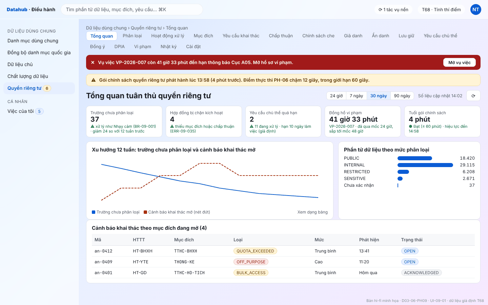

Ảnh cho thấy băng đỏ đồng hồ vi phạm đứng trước băng vàng gói chính sách, năm thẻ có chữ nêu mức ("Đạt", mũi tên ⚠), xu hướng hai chuỗi với chuỗi cảnh báo nét đứt, phần tử theo mức và bảng cảnh báo khai thác. Số liệu giả định T68.

### 7.2. Trường, hành động

Bảng liệt kê trường nhập của UI-09-01 kèm kiểu, tính bắt buộc, mã lỗi và câu hiển thị lấy từ FRS §9.1.

Màn gần như chỉ đọc; hai ô nhập là khoảng thời gian và kỳ báo cáo.

| Nhãn | Kiểu | Bắt buộc | Kiểm tra, mã lỗi, câu |
|---|---|---|---|
| Khoảng thời gian | `CMP-SegmentedControl`: `24h`, `7d`, `30d`, `90d`, tùy chọn `tu`, `den` | Có (mặc định 30d) | Tùy chọn quá 12 tháng: ERR-09-036 "Chọn khoảng thời gian tối đa 12 tháng." |
| Kỳ báo cáo | `CMP-DateRangePicker` (Drawer "Lập báo cáo") | Có | ERR-09-036 như trên |
| Loại báo cáo | `CMP-Select` (tuân thủ chung, lưu giữ, chủ thể) | Có | ERR-09-003 theo lược đồ |

: UI-09-01, trường nhập

Hành động: bấm thẻ hoặc dòng để đi tới màn đã lọc; "Lập báo cáo" (API-09-221, chạy nền, báo ở `CMP-BackgroundTaskTray`); "Tải" báo cáo (API-09-222); làm mới tay. Số liệu tự làm mới 5 phút.

### 7.3. Trạng thái, phím tắt, truy cập

Bảng ghi cách UI-09-01 hiện khi đang tải, rỗng, lỗi, không quyền và khi mất kế hoạch che; phím tắt và truy cập ở ngay sau.

Bảng ghi các trạng thái của màn; phím tắt và truy cập ở đoạn sau.

| Trạng thái | Hiển thị |
|---|---|
| Đang tải | Skeleton đúng hình hai băng, 5 thẻ, hai biểu đồ, bảng 3 dòng (`ST-01`) |
| Rỗng lần đầu | `CMP-EmptyState` "Chưa có dữ liệu tuân thủ. Đăng ký phần tử dữ liệu ở tab Phân loại để bắt đầu." kèm nút "Đăng ký phần tử" (`PERM-09-classify`) |
| Lỗi | Chỉ khối lỗi hiện `ST-05`, khối khác vẫn hiện; số liệu cũ hơn 30 phút có dòng "Số liệu cập nhật lúc {giờ}" |
| Không quyền | `ST-07`; VW thấy thẻ không bấm được |
| Fallback che | Không áp dụng (màn không có DLCN) |

: UI-09-01, trạng thái màn

Phím tắt: `G` rồi `P` đi tới màn tổng quan (toàn khu), `R` làm mới, `?` mở bảng phím tắt. Truy cập: thứ tự focus băng, bộ lọc, thẻ trái sang phải, biểu đồ, bảng; thẻ là `role="region"` có `aria-labelledby`, số đọc kèm đơn vị ("41 giờ 33 phút còn lại"); đồng hồ không đọc từng giây, chỉ đọc khi qua mốc 24, 48, 60 giờ (`aria-live="polite"`); biểu đồ có bảng thay thế; dưới `bp-md` các khối xếp một cột theo thứ tự băng, 6, 5, 4, 3, 7, 8, 9, 10, 11.

## 8. UI-09-02 Danh mục phân loại trường

::: dac-ta
**Mục đích.** Xem và quản lý mức phân loại của mọi phần tử dữ liệu theo hệ thống và hợp đồng; đề xuất, xác nhận hàng loạt; quản lý danh mục mức và loại DLCN.

**Đường dẫn, mẫu.** `/du-lieu/quyen-rieng-tu/phan-loai`; PTN-08 Cây + bảng (cây hệ thống, hợp đồng bên trái).

**Vai trò, quyền.** TA, SO (xác nhận), DS, SV (đề xuất), DO (phần tử thuộc tổ chức mình), AU (xem); `PERM-09-read`, `PERM-09-classify`.

**FR.** 001, 002, 003, 004, 006, 008, 022.

**API.** API-09-010, 012, 013, 014 (phần tử), 015, 016, 017, 018 (phân loại), 001, 002, 007, 008, 009 (danh mục), 027, 028, 029, 089 (mức hợp đồng), 030, 031 (xuất).

**Che DLCN.** Chỉ tên trường, không có giá trị; không có dữ liệu mẫu.

**Đợt.** Đợt 2; đầy đủ, có ảnh hi-fi.
:::

### 8.1. Bố cục và thành phần

Cột trái là cây "hệ thống › hợp đồng API, topic, luồng" kèm số phần tử; cột phải là bảng phần tử với hàng thao tác hàng loạt ở chân. Tab phụ trong màn: "Phần tử", "Mức phân loại", "Loại DLCN", "Hợp đồng".

| # | Thành phần | `CMP-*` | Nội dung | Ghi chú |
|---|---|---|---|---|
| 1 | Cây hệ thống, hợp đồng | `CMP-TreeView` | Hệ thống › hợp đồng; huy hiệu số phần tử chưa xác nhận | Chọn nút ghi `he-thong`, `hop-dong` lên URL |
| 2 | Thanh lọc | `CMP-FilterBar`, `CMP-FilterChips` | Mức, loại DLCN, nhận dạng, trạng thái, nguồn, "Chặn kích hoạt" | `q` chỉ tìm tên trường |
| 3 | Bảng phần tử | `CMP-DataTable` gọn | Tên, phạm vi, loại DLCN, mức, nhận dạng, trạng thái, nguồn; phần tử chưa xác nhận hiện "coi như SENSITIVE" | Bấm dòng mở UI-09-03 |
| 4 | Thanh hàng loạt | `CMP-BulkActionBar` | "Xác nhận n phần tử", "Từ chối đề xuất" | Chỉ phần tử `PROPOSED` không hạ mức |
| 5 | Tab "Mức phân loại" | `CMP-DataTable` | Bốn mức DD-08, chính sách log và hiển thị; nhãn chặn `STATE_SECRET` | Sửa theo API-09-002 (`PERM-09-policy`) |
| 6 | Tab "Hợp đồng" | `CMP-DataTable` | Mức hợp đồng, cờ `provisional`, lý do chặn (API-09-027, 089) | Nút "Tính lại" (API-09-029) |

: UI-09-02, thành phần

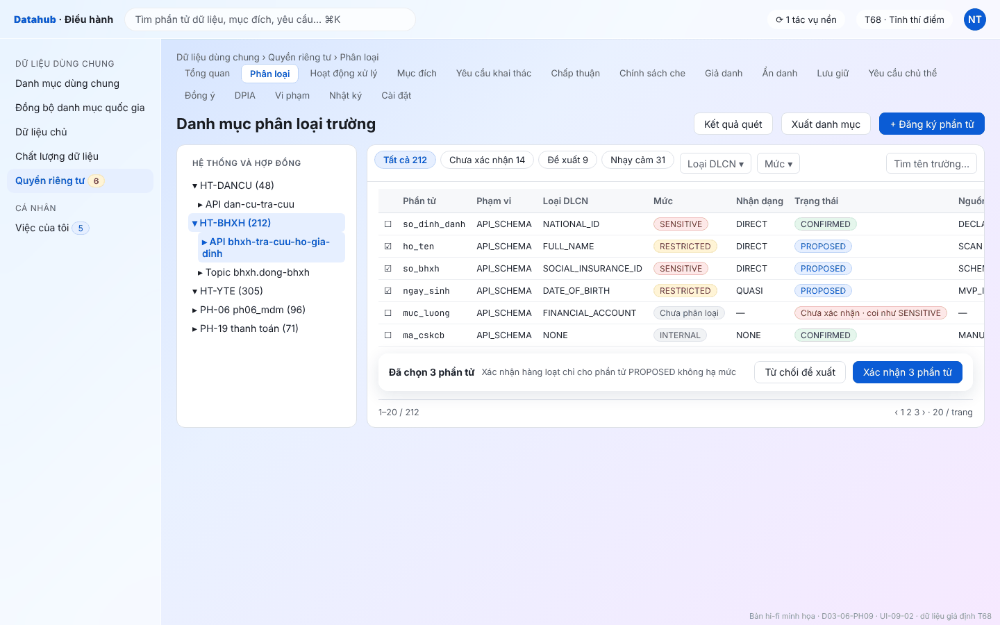

Ảnh cho thấy cây hệ thống bên trái, bảng với ba dòng đã chọn, trường `muc_luong` chưa phân loại hiện chữ "coi như SENSITIVE" (không chỉ màu) và thanh hàng loạt ở chân.

### 8.2. Trường, hành động

Bảng liệt kê trường nhập của UI-09-02 kèm kiểu, tính bắt buộc, mã lỗi và câu hiển thị lấy từ FRS §9.1.

Trường của Drawer "Đề xuất phân loại" (nhập tay) và các thao tác của màn.

| Nhãn | Kiểu | Bắt buộc | Kiểm tra, mã lỗi, câu |
|---|---|---|---|
| Mức phân loại | `CMP-RadioCard` `DataClass` | Có | Hạ mức: ERR-09-013 "Hạ mức phân loại cần nêu số văn bản căn cứ và lý do." |
| Loại dữ liệu cá nhân | `CMP-Select` `PersonalDataCategory` | Có khi `BASIC` hoặc `SENSITIVE` | ERR-09-012 "Trường {tên} là dữ liệu cá nhân, cần chọn loại dữ liệu cá nhân phù hợp." |
| Nhận dạng | `CMP-Select` `IdentifiabilityType` | Có | ERR-09-003 theo lược đồ |
| Cấm gửi ra ngoài tỉnh (`noEgress`) | `CMP-Switch` | Không, mặc định tắt | Tắt một trường đang bật là hạ mức: ERR-09-013 và người xác nhận thứ hai (BR-09-063) |
| Số văn bản căn cứ, lý do | `CMP-Input`, `CMP-TextArea` | Có khi hạ mức | ERR-09-013; lý do dưới 20 ký tự: ERR-09-007 "Nhập lý do tối thiểu 20 ký tự." |
| Tệp lược đồ (OpenAPI, JSON Schema, Avro) | `CMP-FileDropzone` | Có (nhập lược đồ) | ERR-09-015 "Không đọc được lược đồ: {lý do}." |
| Phần tử trùng | — | — | ERR-09-014 "Phần tử {đích} đã được đăng ký." |
| Trường mang nhãn bí mật | — | — | ERR-09-018 "Dữ liệu mang nhãn bí mật nhà nước không được đưa vào Datahub." |
| Người xác nhận | — | — | Người đề xuất tự xác nhận: ERR-09-005 "Bạn là người đề nghị hoặc đã quyết định ở bước trước nên không được duyệt bước này." |
| Ngừng loại DLCN | `CMP-ConfirmDialog` | — | ERR-09-011 "Mục {mã} đang được {n} trường sử dụng nên không ngừng được." |

: UI-09-02, trường và mã lỗi

Hành động: "+ Đăng ký phần tử" (API-09-012), "Nhập lược đồ", "Nhập khai báo MVP" (API-09-013, 014, phần tử vào ở `PROPOSED`, BR-09-007), "Đề xuất", "Xác nhận hàng loạt" (API-09-018), "Xuất danh mục" (nền, API-09-030, 031), "Kết quả quét" (đi UI-09-04). Mọi POST có `Idempotency-Key`.

### 8.3. Trạng thái, phím tắt, truy cập

Bảng ghi cách UI-09-02 hiện khi đang tải, rỗng, lỗi, không quyền và khi mất kế hoạch che; phím tắt và truy cập ở ngay sau.

| Trạng thái | Hiển thị |
|---|---|
| Đang tải | Skeleton cây 8 nút và 8 hàng bảng (`ST-01`); đổi nút cây dùng `ST-02` giữ khung |
| Rỗng | `ST-03` "Chưa có phần tử dữ liệu nào. Đăng ký phần tử hoặc nhập lược đồ." kèm hai nút |
| Lọc không ra | `ST-04` kèm điều kiện lọc và "Xóa bộ lọc" |
| Lỗi, không quyền | `ST-05` theo khối; `ST-07`; DO mở phần tử ngoài tổ chức: ERR-09-008 |
| Fallback che | Không áp dụng |

: UI-09-02, trạng thái màn

Phím tắt: `/` tìm, `↑ ↓` chọn dòng, `Space` chọn, `Shift+X` xác nhận các dòng đã chọn (hiện hộp xác nhận). Truy cập: cây là `role="tree"` có `aria-expanded`, bảng có `aria-sort`; số phần tử đã chọn đọc qua vùng `aria-live`; chọn nhiều bằng bàn phím được; mật độ gọn vẫn giữ vùng chạm 24 × 24 px (WCAG 2.5.8).

## 9. UI-09-03 Chi tiết phần tử dữ liệu

::: dac-ta
**Mục đích.** Xem đầy đủ một phần tử: phân loại hiện hành và đề xuất đang chờ, lịch sử, hoạt động xử lý liên kết, hợp đồng dùng nó; đề xuất, xác nhận, hạ mức bốn mắt, gán và gỡ nhãn chặn.

**Đường dẫn, mẫu.** `/du-lieu/quyen-rieng-tu/phan-loai/{id}` (`/phan-loai`, `/lich-su`, `/hoat-dong`, `/hop-dong`); PTN-02 Chi tiết.

**Vai trò, quyền.** TA, SO, DS, DO, AU, SV (đề xuất); `PERM-09-read`, `PERM-09-classify` (DS, SV chỉ đề xuất).

**FR.** 003, 004, 006, 007, 008.

**API.** API-09-011, 015, 016, 017, 019, API-09-028 (mức hợp đồng), API-09-003, 004, 005, 006 (nhãn chặn), API-09-243 (ngừng phần tử).

**Che DLCN.** Chỉ siêu dữ liệu; không giá trị mẫu. Lý do xem lịch sử không chứa DLCN.

**Đợt.** Đợt 2; đầy đủ.
:::

### 9.1. Bố cục và thành phần

Đầu trang hiện tên phần tử, mức hiện hành và trạng thái; bốn tab bên dưới. Các thao tác ghi nằm ở thanh hành động bên phải đầu trang.

| # | Thành phần | `CMP-*` | Nội dung |
|---|---|---|---|
| 1 | Đầu trang | `CMP-PageHeader`, `CMP-StatusTag` | Tên, phạm vi, `DataClass`, `ClassificationStatus`; thẻ "Tạm thời SENSITIVE" nếu chưa xác nhận |
| 2 | Tab "Phân loại" | `CMP-DescriptionList`, `CMP-ApprovalPanel` | Mức, loại DLCN, nhận dạng, nguồn; đề xuất chờ (người đề xuất, ngày); hạ mức hiện hai ô văn bản căn cứ, lý do |
| 3 | Tab "Lịch sử" | `CMP-VersionTimeline` | Từng lần đổi: người, mức cũ và mới, văn bản căn cứ, `ClassificationSource` (API-09-019) |
| 4 | Tab "Hoạt động" | `CMP-DataTable` | Hoạt động xử lý `ACTIVE` chứa phần tử (BR-09-008); cảnh báo "Chưa thuộc hoạt động nào" |
| 5 | Tab "Hợp đồng" | `CMP-DataTable` | Hợp đồng dùng phần tử và mức hợp đồng tính lại (BR-09-004) |
| 6 | Hộp "Nhãn bí mật nhà nước" | `CMP-Alert`, `CMP-ReasonDialog` | Gán nhãn `STATE_SECRET`, gỡ nhãn (hai người) |

: UI-09-03, thành phần

### 9.2. Trường, hành động

Bảng liệt kê trường nhập của UI-09-03 kèm kiểu, tính bắt buộc, mã lỗi và câu hiển thị lấy từ FRS §9.1.

Hạ mức và gỡ nhãn là hai thao tác nhạy nhất của màn nên có kiểm tra riêng.

| Nhãn | Kiểu | Bắt buộc | Kiểm tra, mã lỗi, câu |
|---|---|---|---|
| Mức đề xuất | `CMP-RadioCard` | Có | Hạ mức thiếu căn cứ: ERR-09-013 "Hạ mức phân loại cần nêu số văn bản căn cứ và lý do." |
| Số và ngày văn bản giải mật | `CMP-Input`, `CMP-DatePicker` | Có khi gỡ nhãn | ERR-09-019 "Gỡ nhãn bí mật nhà nước cần số và ngày văn bản giải mật." |
| Xác nhận bởi người thứ hai | — | — | ERR-09-005 như UI-09-02 |
| Đối tượng đã đổi trạng thái | — | — | ERR-09-006 "Đối tượng đang ở trạng thái {trạng thái}, không thực hiện được thao tác này." |

: UI-09-03, trường và mã lỗi

Hành động và điều kiện hiện: "Đề xuất" (`PERM-09-classify`), "Xác nhận" và "Từ chối" (TA, SO, DO tổ chức sở hữu; khác người đề xuất, BR-09-003), "Hạ mức" (cần người thứ hai xác nhận, BR-09-002), "Gán nhãn", "Đề nghị gỡ nhãn" và "Duyệt gỡ" (API-09-004, 005, 006), "Ngừng phần tử" kèm lý do (API-09-243; TA, SO, DO của tổ chức sở hữu, chỉ khi phần tử không còn trong hoạt động `ACTIVE` hay chấp thuận hiệu lực, nếu còn thì ERR-09-006). Nút bị chặn bởi bốn mắt vẫn hiện, vô hiệu, kèm chữ "Chờ người thứ hai xác nhận".

### 9.3. Trạng thái, phím tắt, truy cập

Bảng ghi cách UI-09-03 hiện khi đang tải, rỗng, lỗi, không quyền và khi mất kế hoạch che; phím tắt và truy cập ở ngay sau.

| Trạng thái | Hiển thị |
|---|---|
| Đang tải | Skeleton đầu trang và hai khối mô tả (`ST-01`) |
| Rỗng | Tab "Hoạt động" rỗng: `CMP-Alert` vàng "Phần tử chưa thuộc hoạt động xử lý nào" kèm nút "Gắn vào hoạt động" (UI-09-06) |
| Lỗi, không tồn tại | `ST-05`; phần tử đã ngừng: `ST-08` kèm tên loại đối tượng và mã (ERR-09-001) |
| Không quyền | `ST-07`; chỉ đọc cho AU (`ST-15`) |
| Fallback che | Không áp dụng |

: UI-09-03, trạng thái màn

Phím tắt: `1`…`4` chuyển tab, `E` đề xuất, `Ctrl+Enter` gửi hộp lý do. Truy cập: tab đúng mẫu WAI-ARIA, lịch sử là danh sách có thứ tự đọc từ mới đến cũ, thay đổi mức đọc bằng chữ "từ Hạn chế lên Nhạy cảm".

## 10. UI-09-04 Kết quả quét phát hiện

::: dac-ta
**Mục đích.** Xử lý hộp việc các cột, trường nghi là DLCN mà bộ quét tìm thấy nhưng chưa được phân loại: xác nhận, loại trừ hoặc đề xuất phân loại; chạy quét và chỉnh mẫu phát hiện.

**Đường dẫn, mẫu.** `/du-lieu/quyen-rieng-tu/phan-loai/quet` (`trang-thai`, `muc-tin-cay`, `chon`); PTN-10 Hộp việc và duyệt.

**Vai trò, quyền.** TA, SO (xác nhận), DS (đề xuất); `PERM-09-classify`.

**FR.** 005.

**API.** API-09-020, 021, 022, 023, 024, 025, 026.

**Che DLCN.** Không lưu và không hiện giá trị khớp (BR-09-006, BR-09-025); chỉ tên cột, loại mẫu `DetectorType`, độ tin cậy, tỷ lệ khớp, ký tự mẫu `#########`.

**Đợt.** Đợt 2; đầy đủ.
:::

### 10.1. Bố cục và thành phần

Bên trái danh sách kết quả sắp theo độ tin cậy giảm dần (ngưỡng đưa vào hộp việc `09.scan.confidence`, mặc định 0,8); bên phải Drawer chi tiết một kết quả.

```text
| Kết quả quét [Chạy quét…] [Mẫu phát hiện]  Lượt: scan-0063 COMPLETED 02:00      |
| (Mới 21)(Đã xác nhận 9)(Loại trừ 14)   Tin cậy ≥ 0,8 ▾                          |
|---------------------------------------------|----------------------------------|
| ☐ so_cmnd       NATIONAL_ID_12  0,97  OPEN  | Chi tiết: so_cmnd                |
| ☐ sdt_lien_he   PHONE_VN        0,93  OPEN  | Hệ thống HT-YTE · bảng ho_so     |
| ☐ ghi_chu       FIELD_NAME_HINT 0,81  OPEN  | Mẫu khớp 9.812 / 10.000 dòng     |
|                                             | Giá trị mẫu: ########## (không lưu)|
|                                             | [Loại trừ…] [Xác nhận là DLCN ›] |
```

| # | Thành phần | `CMP-*` | Ghi chú |
|---|---|---|---|
| 1 | Thanh lượt quét | `CMP-PageHeader`, `CMP-StatusTag` | Lượt gần nhất, `ScanStatus`, nút "Chạy quét" |
| 2 | Danh sách kết quả | `CMP-DataTable` gọn | Cột, hệ thống, `DetectorType`, tin cậy, `FindingStatus`; chọn nhiều |
| 3 | Drawer chi tiết | `CMP-Drawer` | Tỷ lệ khớp, chữ ký mẫu, gợi ý mức và loại DLCN |
| 4 | Bộ mẫu phát hiện | `CMP-DataTable` + `CMP-Drawer` | Sửa mẫu, ngưỡng (API-09-025, 026), thử trên chuỗi giả |

: UI-09-04, thành phần

### 10.2. Trường, hành động

Bảng liệt kê trường nhập của UI-09-04 kèm kiểu, tính bắt buộc, mã lỗi và câu hiển thị lấy từ FRS §9.1.

| Nhãn | Kiểu | Bắt buộc | Kiểm tra, mã lỗi, câu |
|---|---|---|---|
| Phạm vi quét | `CMP-TreeSelect` (hệ thống, bảng) | Có | Đang có lượt cùng phạm vi: ERR-09-017 "Đang có lượt quét cho phạm vi này. Chờ lượt quét xong." |
| Biểu thức mẫu | `CMP-CodeEditor` | Có | Sai cú pháp hoặc nguy cơ chậm: ERR-09-016 "Mẫu phát hiện không hợp lệ hoặc có thể làm chậm hệ thống." |
| Lý do loại trừ | `CMP-TextArea` | Có | ERR-09-007 "Nhập lý do tối thiểu 20 ký tự." |
| Loại DLCN khi xác nhận | `CMP-Select` | Có | ERR-09-012 như UI-09-02 |

: UI-09-04, trường và mã lỗi

Hành động: "Chạy quét" (API-09-020), "Xác nhận là DLCN" (API-09-024 rồi mở Drawer đề xuất phân loại, kết quả chỉ là gợi ý, BR-09-006), "Loại trừ", "Sửa mẫu". Quét định kỳ theo `09.scan.schedule-cron`.

### 10.3. Trạng thái, phím tắt, truy cập

Bảng ghi cách UI-09-04 hiện khi đang tải, rỗng, lỗi, không quyền và khi mất kế hoạch che; phím tắt và truy cập ở ngay sau.

| Trạng thái | Hiển thị |
|---|---|
| Đang tải, đang quét | Skeleton; lượt `RUNNING` hiện `CMP-JobProgress` và thăm dò 5 giây |
| Rỗng | `ST-03` "Chưa có kết quả quét. Chạy quét để tìm trường nghi dữ liệu cá nhân." |
| Lỗi, không quyền | `ST-05`; lượt `FAILED` hiện lý do kèm "Chạy lại"; `ST-07` |
| Fallback che | Không áp dụng |

: UI-09-04, trạng thái màn

Phím tắt: `J`, `K` lên xuống, `C` xác nhận, `X` loại trừ. Truy cập: danh sách có `aria-selected`; độ tin cậy hiển thị "0,97 cao" bằng chữ; Drawer giữ focus và trả focus về dòng khi đóng.

## 11. UI-09-05 Sổ hoạt động xử lý

::: dac-ta
**Mục đích.** Xem và quản lý sổ hoạt động xử lý DLCN của tỉnh theo trạng thái và phiên bản; thấy ngay số trường DLCN chưa thuộc hoạt động nào; xuất sổ theo mẫu.

**Đường dẫn, mẫu.** `/du-lieu/quyen-rieng-tu/hoat-dong-xu-ly` (`trang-thai`, `co-so`, `vai-tro`, `chon`); PTN-01 Danh sách.

**Vai trò, quyền.** TA, SO, DS, DA (duyệt), DO, AU; `PERM-09-read`, `PERM-09-ropa`.

**FR.** 009, 010, 011, 013.

**API.** API-09-032, 034, 036, 037, 038, 039, 040, 041, 043, 044, 051, 052, 053.

**Che DLCN.** Không có giá trị; chỉ loại dữ liệu và mã.

**Đợt.** Đợt 2; đầy đủ, có ảnh hi-fi.
:::

### 11.1. Bố cục và thành phần

Đầu trang có nút "Xuất sổ" và "Lập hoạt động"; dưới là băng cảnh báo trường chưa thuộc hoạt động, thanh lọc, bảng. Bấm dòng mở Drawer chi tiết (tab Nội dung, Phiên bản, Liên kết).

| # | Thành phần | `CMP-*` | Nội dung |
|---|---|---|---|
| 1 | Băng "n trường DLCN chưa thuộc hoạt động" | `CMP-Banner` vàng | Số từ API-09-044; "Xem n trường" mở danh sách và chọn gắn vào hoạt động |
| 2 | Bộ lọc | `CMP-FilterBar`, `CMP-FilterChips` | Trạng thái, cơ sở pháp lý, vai trò kiểm soát, mục đích |
| 3 | Bảng hoạt động | `CMP-DataTable` | Mã, tên, mục đích, `LegalBasisType`, `ControllerRole`, loại dữ liệu, thời hạn lưu, phiên bản, `VersionStatus` |
| 4 | Drawer chi tiết | `CMP-Drawer`, `CMP-Tabs`, `CMP-VersionTimeline`, `CMP-DiffTable` | So sánh hai phiên bản (API-09-040), liên kết trường, API, topic, luồng (API-09-041…043) |
| 5 | Hộp "Xuất sổ" | `CMP-Modal` | Chọn mẫu xuất (`ROPA_A05` giả định, Q09-03), định dạng; chạy nền |

: UI-09-05, thành phần

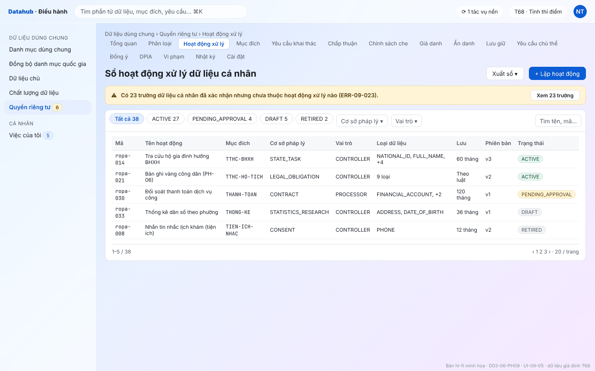

Ảnh cho thấy băng cảnh báo 23 trường, bảng năm hoạt động với đủ năm trạng thái `VersionStatus` bằng chữ và thanh lọc theo trạng thái ở trên.

### 11.2. Trường, hành động

Bảng liệt kê trường nhập của UI-09-05 kèm kiểu, tính bắt buộc, mã lỗi và câu hiển thị lấy từ FRS §9.1.

| Nhãn | Kiểu | Bắt buộc | Kiểm tra, mã lỗi, câu |
|---|---|---|---|
| Mẫu xuất | `CMP-Select` | Có | Mẫu không tồn tại: ERR-09-025 "Mẫu xuất {mã} không tồn tại." |
| Lý do từ chối | `CMP-TextArea` | Có | ERR-09-007 |
| Ngừng hoạt động | `CMP-ConfirmDialog` | — | Còn liên kết: ERR-09-022 "Hoạt động còn {n} liên kết đang hiệu lực. Gỡ liên kết trước khi ngừng." |
| Gửi duyệt hoạt động thiếu mục | — | — | ERR-09-020 "Hoạt động xử lý còn thiếu: {danh sách mục}." |
| Kích hoạt khi còn trường DLCN chưa thuộc hoạt động | — | — | ERR-09-023 "Có {n} trường dữ liệu cá nhân chưa thuộc hoạt động xử lý nào." |
| Duyệt bởi người soạn | — | — | ERR-09-005 |

: UI-09-05, trường và mã lỗi

Hành động: "Lập hoạt động" (đi UI-09-06), "Sửa" (bản `ACTIVE` không sửa tại chỗ, tạo phiên bản mới, BR-09-011), "Gửi duyệt", "Duyệt" và "Từ chối" (DA, TA, SO khác người soạn), "Ngừng", "Xuất sổ".

### 11.3. Trạng thái, phím tắt, truy cập

Bảng ghi cách UI-09-05 hiện khi đang tải, rỗng, lỗi, không quyền và khi mất kế hoạch che; phím tắt và truy cập ở ngay sau.

| Trạng thái | Hiển thị |
|---|---|
| Đang tải | Skeleton 8 hàng (`ST-01`) |
| Rỗng | `ST-03` "Chưa có hoạt động xử lý nào. Lập hoạt động đầu tiên để ghi sổ theo Luật BVDLCN." |
| Lọc không ra, lỗi, không quyền | `ST-04`, `ST-05`, `ST-07` |
| Fallback che | Không áp dụng |

: UI-09-05, trạng thái màn

Phím tắt: `N` lập mới, `/` tìm, `Enter` mở Drawer, `Esc` đóng. Truy cập: bảng có `aria-sort`, trạng thái đọc bằng chữ, Drawer `role="dialog"` không chặn nền (không modal).

## 12. UI-09-06 Biểu mẫu hoạt động xử lý

::: dac-ta
**Mục đích.** Soạn hoạt động xử lý theo sáu bước để không bỏ sót mục bắt buộc của sổ: mục đích, cơ sở pháp lý, dữ liệu và chủ thể, bên nhận, thời hạn lưu, liên kết; rồi gửi duyệt.

**Đường dẫn, mẫu.** `/du-lieu/quyen-rieng-tu/hoat-dong-xu-ly/{id}/soan` (`?buoc=1…6`); PTN-05 Wizard.

**Vai trò, quyền.** TA, SO, DS (soạn); `PERM-09-ropa`.

**FR.** 009, 010, 011.

**API.** API-09-033, 035, 036, API-09-041, 042, 043, API-09-045, 048, API-09-054.

**Che DLCN.** Không có giá trị cá nhân.

**Đợt.** Đợt 2; đầy đủ, có ảnh hi-fi.
:::

### 12.1. Bố cục và thành phần

Thanh bước sáu ô ở đầu, vùng nội dung bước hiện tại bên trái, tóm tắt hoạt động và danh sách mục còn thiếu bên phải; chân có "Quay lại", "Tiếp tục", "Lưu nháp".

| Bước | Nội dung | `CMP-*` |
|---|---|---|
| 1 Mục đích | Chọn `purpose` từ danh mục | `CMP-ResourceSelect` |
| 2 Cơ sở pháp lý | `LegalBasisType`, văn bản căn cứ | `CMP-Select`, `CMP-CodeListSelect` |
| 3 Dữ liệu và chủ thể | Loại DLCN, nhóm chủ thể, vai trò `ControllerRole`, biện pháp bảo vệ | `CMP-Transfer`, `CMP-Select` |
| 4 Bên nhận | Bên nhận trong nước, chuyển ra nước ngoài | `CMP-EditableTable` |
| 5 Thời hạn lưu | Số tháng hoặc điều kiện kết thúc, `RetentionAction` | `CMP-NumberInput`, `CMP-Select` |
| 6 Liên kết và gửi duyệt | Gắn trường, API, topic, luồng; kiểm tra toàn bộ | `CMP-Transfer`, `CMP-Alert` |

: UI-09-06, sáu bước

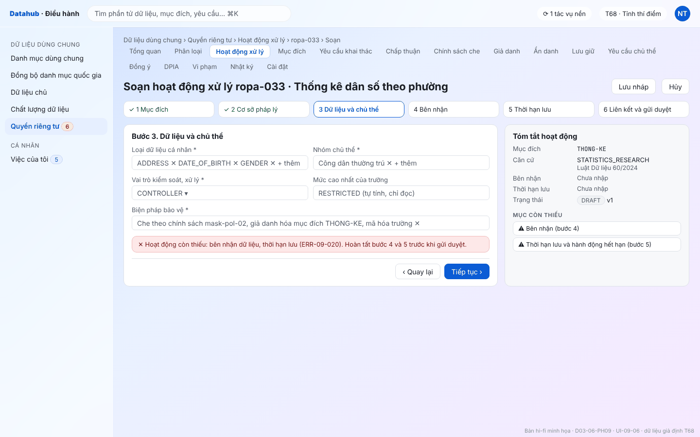

Ảnh là bước 3: hai bước đầu có dấu ✓, `CMP-Alert` đỏ liệt kê mục còn thiếu, cột phải tóm tắt hoạt động và hai mục chưa nhập; mức cao nhất của trường là ô chỉ đọc tự tính.

### 12.2. Trường, hành động

Bảng liệt kê trường nhập của UI-09-06 kèm kiểu, tính bắt buộc, mã lỗi và câu hiển thị lấy từ FRS §9.1.

| Nhãn | Kiểu | Bắt buộc | Kiểm tra, mã lỗi, câu |
|---|---|---|---|
| Mục đích | `CMP-ResourceSelect` | Có | Mục đích đã ngừng: ERR-09-026 "Mục đích {mã} không còn hiệu lực." |
| Cơ sở pháp lý chính | `CMP-Select` | Có (đúng một, BR-09-009) | `CONSENT` cho hoạt động bắt buộc: ERR-09-024 "Hoạt động bắt buộc theo luật không dùng sự đồng ý làm cơ sở pháp lý." |
| Văn bản căn cứ | `CMP-CodeListSelect` | Có | Hết hiệu lực: ERR-09-021 "Văn bản căn cứ {mã} không còn hiệu lực. Chọn căn cứ khác." |
| Loại DLCN, nhóm chủ thể | `CMP-Transfer` | Có | ERR-09-003 theo lược đồ |
| Thời hạn lưu, hành động hết hạn | `CMP-NumberInput`, `CMP-Select` | Có (BR-09-012) | Thiếu: ERR-09-020 "Hoạt động xử lý còn thiếu: {danh sách mục}." |
| Mã hoạt động | `CMP-Input` | Có | Trùng: ERR-09-002 "Mã {mã} đã được dùng. Chọn mã khác." |

: UI-09-06, trường và mã lỗi

Hành động: "Tiếp tục" kiểm tra bước hiện tại, "Lưu nháp" (API-09-035 kèm `If-Match`), "Gửi duyệt" ở bước 6 (API-09-036). Rời trang khi có thay đổi chưa lưu hiện hộp xác nhận theo D03-06-00 §4.

### 12.3. Trạng thái, phím tắt, truy cập

Bảng ghi cách UI-09-06 hiện khi đang tải, rỗng, lỗi, không quyền và khi mất kế hoạch che; phím tắt và truy cập ở ngay sau.

| Trạng thái | Hiển thị |
|---|---|
| Đang tải | Skeleton khối trường bước hiện tại (`ST-01`) |
| Rỗng | Mới tạo: bước 1 trống, các bước sau khóa tới khi bước trước hợp lệ |
| Lỗi, không quyền | `ST-11` tại trường, `CMP-Alert` tóm tắt số lỗi có liên kết nhảy tới trường; bản nháp đã gửi duyệt bởi người khác: `ST-13` biến thể "Bản nháp này đã được gửi duyệt bởi {người}" |
| Fallback che | Không áp dụng |

: UI-09-06, trạng thái màn

Phím tắt: `Alt+←`, `Alt+→` bước trước, sau; `Ctrl+S` lưu nháp. Truy cập: thanh bước là danh sách có `aria-current="step"`; lỗi đưa focus tới trường lỗi đầu tiên; nhãn bắt buộc có chữ "bắt buộc", không chỉ dấu sao.

## 13. UI-09-07 Danh mục mục đích và cơ sở pháp lý

::: dac-ta
**Mục đích.** Quản lý danh mục mục đích khai thác (`TTHC-HO-TICH`, `THONG-KE`…), cơ sở pháp lý và văn bản căn cứ mà sổ hoạt động xử lý và yêu cầu khai thác dựa vào.

**Đường dẫn, mẫu.** `/du-lieu/quyen-rieng-tu/muc-dich` (`/muc-dich`, `/co-so`, `/van-ban`; `trang-thai`); PTN-01 Danh sách, thêm sửa bằng Drawer (PTN-04).

**Vai trò, quyền.** TA, SO, DS (soạn), DO (mục đích của tổ chức mình); `PERM-09-read`, `PERM-09-ropa`, `PERM-09-policy`, `PERM-09-purpose-approve`.

**FR.** 012, 014.

**API.** API-09-054, 055, 056, 057; API-09-045, 046, 047; API-09-048, 049, 050.

**Che DLCN.** Không có giá trị cá nhân.

**Đợt.** Đợt 2; đầy đủ.
:::

### 13.1. Bố cục và trường

Ba tab cùng một bảng và Drawer. Cột chính của tab "Mục đích": mã, tên, cơ sở pháp lý mặc định, mức cao nhất cho phép, cờ "bắt buộc theo luật" (BR-09-047), `PurposeStatus`, số hoạt động và chấp thuận đang dùng; tab "Cơ sở": `LegalBasisType`, mô tả, văn bản căn cứ; tab "Văn bản": số, ngày ban hành, hiệu lực từ và đến.

| Nhãn | Kiểu | Bắt buộc | Kiểm tra, mã lỗi, câu |
|---|---|---|---|
| Mã mục đích | `CMP-Input` mã (chữ hoa, số, gạch ngang) | Có | Trùng: ERR-09-002 "Mã {mã} đã được dùng. Chọn mã khác." |
| Tên, mô tả | `CMP-Input`, `CMP-TextArea` | Có | ERR-09-003 theo lược đồ |
| Cơ sở pháp lý mặc định | `CMP-Select` `LegalBasisType` | Có | Văn bản hết hiệu lực: ERR-09-021 "Văn bản căn cứ {mã} không còn hiệu lực. Chọn căn cứ khác." |
| Cho phép trường Nhạy cảm | `CMP-Switch` | Không | — |
| Ngừng mục đích | `CMP-ConfirmDialog` | — | Còn dùng: ERR-09-011 "Mục {mã} đang được {n} trường sử dụng nên không ngừng được." |

: UI-09-07, trường và mã lỗi

Hành động: "+ Thêm", "Sửa" (kèm `If-Match`), "Ngừng" (API-09-057). Mã đã dùng ở chấp thuận không đổi được, chỉ ngừng.

### 13.2. Trạng thái, phím tắt, truy cập

Bảng ghi cách UI-09-07 hiện khi đang tải, rỗng, lỗi, không quyền và khi mất kế hoạch che; phím tắt và truy cập ở ngay sau.

| Trạng thái | Hiển thị |
|---|---|
| Đang tải, rỗng | Skeleton 8 hàng; `ST-03` "Chưa có mục đích nào. Thêm mục đích để HTTT lập yêu cầu khai thác." |
| Lỗi, không quyền | `ST-05`; `ST-07`; người chỉ có quyền đọc thấy `ST-15` |
| Fallback che | Không áp dụng |

: UI-09-07, trạng thái màn

Phím tắt `N` thêm, `/` tìm. Truy cập: ba tab theo mẫu WAI-ARIA; Drawer trả focus về dòng khi đóng; mã đặt trong `CMP-CodeText` có nhãn đọc "mã mục đích".

## 14. UI-09-08 Yêu cầu khai thác

::: dac-ta
**Mục đích.** Cho đầu mối tổ chức và chủ dịch vụ lập, gửi, rút yêu cầu khai thác dữ liệu theo mục đích, xem chấp thuận hiện có và đề nghị gia hạn.

**Đường dẫn, mẫu.** `/du-lieu/quyen-rieng-tu/yeu-cau-khai-thac` (`trang-thai`, `muc-dich`, `chon`; `/{id}`); PTN-01 Danh sách và PTN-02 Chi tiết.

**Vai trò, quyền.** OR, SV (đơn vị mình), TA, DO (xem); `PERM-09-purpose-request`, `PERM-09-purpose-approve`.

**FR.** 015, 017.

**API.** API-09-058, 059, 060, 061, 062, 063; API-09-067, 068.

**Che DLCN.** Không có giá trị cá nhân; chỉ tên trường và mức.

**Đợt.** Đợt 2; đầy đủ.
:::

### 14.1. Bố cục và thành phần

Danh sách yêu cầu có tab "Yêu cầu của tôi" và "Chấp thuận hiện có"; "+ Lập yêu cầu" mở trang biểu mẫu bốn nhóm: đối tượng khai thác, mục đích và căn cứ, trường cần, khối lượng và thời hạn. Chi tiết hiện dòng thời gian trạng thái (`CMP-Timeline`) và bảng trường kèm mức.

| Nhãn | Kiểu | Bắt buộc | Kiểm tra, mã lỗi, câu |
|---|---|---|---|
| HTTT khai thác | `CMP-ResourceSelect` | Có | Chưa hoạt động hoặc chưa đăng ký sử dụng: ERR-09-027 "HTTT {mã} chưa hoạt động hoặc chưa có đăng ký sử dụng hợp lệ." |
| Mục đích | `CMP-ResourceSelect` | Có | ERR-09-026 "Mục đích {mã} không còn hiệu lực." |
| Loại yêu cầu | `CMP-RadioCard` `AccessRequestKind` | Có (mặc định `NEW`) | `RENEWAL` chỉ chọn được khi tổ chức có chấp thuận `ACTIVE`; ERR-09-003 nếu thiếu chấp thuận gia hạn |
| Chấp thuận cần gia hạn | `CMP-Select` (`renewsGrantId`) | Có khi `RENEWAL` | Chỉ liệt kê chấp thuận `ACTIVE` cùng HTTT và mục đích; gia hạn quá số lần: ERR-09-031 |
| Hợp đồng, trường cần | `CMP-Transfer` | Có | Trường ngoài mục đích: ERR-09-028 "Trường {tên} nằm ngoài phạm vi của mục đích {mã}." |
| Khối lượng dự kiến (lượt mỗi ngày) | `CMP-NumberInput` | Có | ERR-09-003 theo lược đồ |
| Thời hạn đề nghị (ngày) | `CMP-NumberInput` | Có | Vượt trần: ERR-09-030 "Thời hạn chấp thuận tối đa {n} ngày." (`09.grant.max-days`) |
| Trùng chấp thuận hiện có | — | — | ERR-09-029 "Đã có chấp thuận còn hiệu lực cho HTTT, mục đích và hợp đồng này." |
| Gia hạn quá số lần | — | — | ERR-09-031 "Chấp thuận đã gia hạn tối đa {n} lần. Lập yêu cầu mới." |

: UI-09-08, trường và mã lỗi

Hành động: "Lưu nháp" (API-09-059, 061), "Gửi thẩm định" (API-09-062, chuyển `SUBMITTED`), "Rút" (API-09-063, trước khi DO quyết), "Đề nghị gia hạn" trên chấp thuận sắp hết hạn (báo trước `09.grant.expiring-notice-days`) mở biểu mẫu với loại `RENEWAL` và chấp thuận đã chọn, gửi qua API-09-061, 062; DO duyệt như mọi yêu cầu khác và hệ thống áp gia hạn (FR-09-015, 016, 017). Khi `NEEDS_INFO`, câu hỏi của DO hiện đầu chi tiết kèm ô trả lời.

### 14.2. Trạng thái, phím tắt, truy cập

Bảng ghi cách UI-09-08 hiện khi đang tải, rỗng, lỗi, không quyền và khi mất kế hoạch che; phím tắt và truy cập ở ngay sau.

| Trạng thái | Hiển thị |
|---|---|
| Đang tải, rỗng | Skeleton; `ST-03` "Tổ chức chưa có yêu cầu khai thác nào." kèm "+ Lập yêu cầu" (`PERM-09-purpose-request`) |
| Lỗi, không quyền | `ST-05`; yêu cầu của tổ chức khác: ERR-09-008, `ST-07` |
| Fallback che | Không áp dụng |

: UI-09-08, trạng thái màn

Phím tắt `N` lập mới, `Ctrl+Enter` gửi. Truy cập: dòng thời gian là danh sách có thứ tự, trạng thái đọc bằng chữ; hạn đọc "còn 3 ngày", không chỉ màu.

## 15. UI-09-09 Hộp việc chấp thuận của chủ quản

::: dac-ta
**Mục đích.** Màn dùng hằng ngày của chủ quản dữ liệu: thẩm định yêu cầu khai thác, chấp thuận có điều kiện hoặc từ chối, quản lý chấp thuận đang hiệu lực, xem cảnh báo khai thác, gói chính sách, báo cáo và hợp đồng bị chặn.

**Đường dẫn, mẫu.** `/du-lieu/quyen-rieng-tu/chap-thuan` (`/hop-viec`, `/hieu-luc`, `/canh-bao`, `/bundle`, `/bao-cao`, `/bi-chan`; `chon`); PTN-10 Hộp việc và duyệt.

**Vai trò, quyền.** DO (tổ chức mình), TA (xem, phát hành bundle theo `PERM-09-policy-approve`); `PERM-09-purpose-approve`, `PERM-09-read`.

**FR.** 016, 017, 018, 020, 021, 022.

**API.** API-09-064, 065, 066 (hộp việc); 067…073 (chấp thuận); 074…078 (bundle); 079…085 (cảnh báo); 086, 087 (báo cáo); 089 (bị chặn).

**Che DLCN.** Không có giá trị cá nhân; cột "Hiển thị" ở bảng trường là ví dụ giả của kiểu che sẽ áp dụng.

**Đợt.** Đợt 2; siêu chi tiết, có ảnh hi-fi.
:::

### 15.1. Lưới bố cục và nguyên tắc

Tab "Hộp việc" chia hai cột: trái 400 px danh sách yêu cầu chờ thẩm định sắp theo hạn (`09.request.sla-days`, mặc định 10 ngày làm việc), phải chi tiết yêu cầu đang chọn. Chân cột phải là `CMP-DecisionPanel` cố định (`glass-overlay`) với ba nút quyết định, nút phụ "Yêu cầu bổ sung" bên trái. Nguyên tắc: mọi thông tin DO cần để quyết (tổ chức, mục đích, căn cứ, trường, mức, khối lượng, chấp thuận sẵn có, cảnh báo trước đó) nằm trên một màn, không phải mở màn khác.

| # | Vùng | `CMP-*` | Nội dung |
|---|---|---|---|
| 1 | Thanh tab | `CMP-Tabs` | Hộp việc (số chờ), Hiệu lực, Cảnh báo, Bundle, Báo cáo, Bị chặn |
| 2 | Danh sách | `CMP-DataTable` dạng thẻ | Mã, HTTT, hợp đồng, mức cao nhất, mục đích, số trường, hạn; quá hạn đỏ kèm chữ "quá hạn n ngày" |
| 3 | Băng cảnh báo vàng | `CMP-Banner` | Hiện khi yêu cầu vượt mức đã duyệt của tổ chức hoặc có cảnh báo khai thác trong 90 ngày |
| 4 | Khối mô tả | `CMP-DescriptionList` | Mục đích, căn cứ pháp lý, đăng ký sử dụng PH-02, thời hạn đề nghị |
| 5 | Bảng trường | `CMP-DataTable` | Trường, `PersonalDataCategory`, mức, hiển thị mẫu, chấp thuận có sẵn; hàng Nhạy cảm có nhãn |
| 6 | Điều kiện | `CMP-Checkbox` + `CMP-Input` | Năm `ConditionType` (mục 15.2) |
| 7 | Thanh quyết định | `CMP-DecisionPanel` | "Chấp thuận", "Chấp thuận có điều kiện", "Từ chối…", "Yêu cầu bổ sung" |

: UI-09-09, thành phần

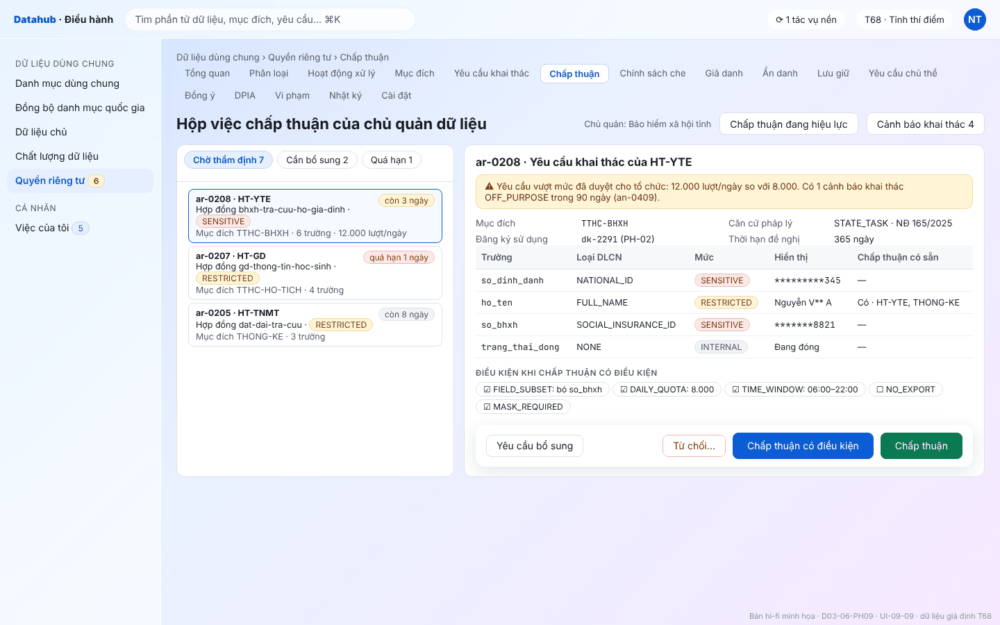

Ảnh cho thấy danh sách ba yêu cầu (ar-0208 chọn, ar-0207 quá hạn kèm chữ), băng vàng về vượt mức, bảng bốn trường với hai trường `SENSITIVE`, năm ô điều kiện và ba nút quyết định. Giá trị ở cột "Hiển thị" là ví dụ giả của kiểu che.

### 15.2. Trường quyết định và điều kiện

Bảng liệt kê trường nhập của UI-09-09 kèm kiểu, tính bắt buộc, mã lỗi và câu hiển thị lấy từ FRS §9.1.

Biểu mẫu quyết định nằm ngay trong chi tiết, không mở hộp thoại, trừ lý do từ chối.

| Nhãn | Kiểu | Bắt buộc | Kiểm tra, mã lỗi, câu |
|---|---|---|---|
| Quyết định | Ba nút (`AccessDecision`) | Có | Người lập tự duyệt hoặc đã quyết ở bước trước: ERR-09-005 "Bạn là người đề nghị hoặc đã quyết định ở bước trước nên không được duyệt bước này." |
| `FIELD_SUBSET`: trường được phép | `CMP-Transfer` | Không | Trường ngoài phạm vi mục đích: ERR-09-028 "Trường {tên} nằm ngoài phạm vi của mục đích {mã}." |
| `DAILY_QUOTA`: hạn ngạch mỗi ngày | `CMP-NumberInput` | Không | ERR-09-003 theo lược đồ |
| `TIME_WINDOW`: khung giờ | `CMP-Input` hai ô giờ | Không | ERR-09-003 |
| `NO_EXPORT`, `MASK_REQUIRED` | `CMP-Checkbox` | Không | — |
| Thời hạn chấp thuận (ngày) | `CMP-NumberInput` | Có | ERR-09-030 "Thời hạn chấp thuận tối đa {n} ngày." |
| Lý do từ chối | `CMP-ReasonDialog` | Có khi từ chối | ERR-09-007 "Nhập lý do tối thiểu 20 ký tự." |
| Câu hỏi bổ sung | `CMP-TextArea` | Có khi yêu cầu bổ sung | ERR-09-007 |
| Yêu cầu đã đổi trạng thái | — | — | ERR-09-006 "Đối tượng đang ở trạng thái {trạng thái}, không thực hiện được thao tác này." |
| Yêu cầu ngoài tổ chức | — | — | ERR-09-008 "Bạn chỉ thao tác được trên dữ liệu thuộc tổ chức của mình." |

: UI-09-09, trường quyết định và mã lỗi

### 15.3. Các tab còn lại

Bảng ghi nội dung, hành động và mã lỗi của năm tab ngoài hộp việc.

| Tab | Nội dung | Hành động (API) | Mã lỗi, câu |
|---|---|---|---|
| Hiệu lực | Chấp thuận `GrantStatus`, hạn, hạn ngạch dùng, báo trước hết hạn | Gia hạn (069), sửa trường và điều kiện (070), tạm dừng (071), tiếp tục (072), thu hồi (073, hộp lý do) | ERR-09-031 "Chấp thuận đã gia hạn tối đa {n} lần. Lập yêu cầu mới."; ERR-09-006 |
| Cảnh báo | `AnomalyType`, mức, lượt, HTTT, mục đích | Ghi nhận đã xem (081), loại trừ có lý do (082), chuyển vụ việc (083, đi UI-09-19), tạm dừng chấp thuận liên quan | ERR-09-034 "Ngưỡng cảnh báo không hợp lệ." (ngưỡng sửa ở UI-09-21) |
| Bundle | Lịch sử gói ký, tuổi, kết quả kiểm thử, độ trễ từng điểm thực thi (078) | Phát hành thủ công (076), quay lại gói trước (077) cần `PERM-09-policy-approve` | ERR-09-032 "Chưa ký được gói chính sách vì OpenBao không khả dụng. Gói cũ vẫn có hiệu lực."; ERR-09-033 "Gói chính sách không qua kiểm thử: {lỗi}. Không phát hành." |
| Báo cáo | Khai thác theo mục đích, HTTT, kỳ | Tải, xuất nền (087) | ERR-09-036 "Chọn khoảng thời gian tối đa 12 tháng." |
| Bị chặn | Hợp đồng mức Nhạy cảm thiếu mục đích hoặc chấp thuận | Liên kết sang yêu cầu khai thác liên quan | ERR-09-035 "Hợp đồng {mã} chứa dữ liệu Nhạy cảm, cần mục đích và chấp thuận của chủ quản trước khi kích hoạt." |

: UI-09-09, năm tab còn lại

### 15.4. Trạng thái, phím tắt, truy cập

Bảng ghi cách UI-09-09 hiện khi đang tải, rỗng, lỗi, không quyền và khi mất kế hoạch che; phím tắt và truy cập ở ngay sau.

| Trạng thái | Hiển thị |
|---|---|
| Đang tải | Skeleton danh sách 6 thẻ và chi tiết; chuyển mục dùng `ST-02` giữ khung |
| Rỗng | Hộp việc trống: `CMP-EmptyState` "Không có yêu cầu nào chờ thẩm định." kèm số chấp thuận sắp hết hạn |
| Lỗi | Lỗi tải từng khối `ST-05`; mất kết nối khi đang soạn: `ST-06`, giữ lý do và điều kiện đã chọn trong bộ nhớ trang |
| Không quyền | `ST-07`; TA chỉ xem: nút quyết định ẩn, ghi chú "Chỉ chủ quản dữ liệu mới quyết định" (`ST-15`) |
| Fallback che | Cột "Hiển thị" hiện `●●●●` và nhãn "Không hiển thị" khi không lấy được kế hoạch che |

: UI-09-09, trạng thái màn

Phím tắt chỉ hoạt động khi focus ở danh sách: `J`, `K` mục sau, trước; `A` chấp thuận, `C` chấp thuận có điều kiện, `R` từ chối, `I` yêu cầu bổ sung; mọi phím quyết định đều mở hộp xác nhận trước khi gửi. Người dùng có thể tắt phím đơn trong cài đặt cá nhân (WCAG 2.1.4). Truy cập: danh sách `role="listbox"`, chi tiết `role="region"`; thanh quyết định có `aria-label`, nút vô hiệu giữ lý do bằng chữ liền kề (`aria-describedby`); hạn "còn 3 ngày", "quá hạn 1 ngày" bằng chữ; sau quyết định, focus chuyển sang mục kế tiếp và thông báo "Đã chấp thuận ar-0208. Mục kế tiếp: ar-0207" qua `aria-live="polite"`.

## 16. UI-09-10 Chính sách che

::: dac-ta
**Mục đích.** Soạn quy tắc che theo mức, loại DLCN, vai trò, mục đích và kênh; sửa mẫu che của từng kiểu; cấu hình che log; xem phiên bản, so sánh, gửi duyệt, duyệt, quay lại.

**Đường dẫn, mẫu.** `/du-lieu/quyen-rieng-tu/chinh-sach-che` (`/quy-tac`, `/kieu-che`, `/log`; `phien-ban`, `so-sanh=a,b`); PTN-03 Biểu mẫu trang.

**Vai trò, quyền.** TA, SO (soạn, duyệt), DS (soạn), DA (duyệt); `PERM-09-policy`, `PERM-09-policy-approve`, `PERM-09-read`; người soạn không duyệt bản của mình.

**FR.** 023, 024, 026, 030.

**API.** API-09-090, 091 (kiểu che); 092…095 (chính sách); 096…100 (duyệt, so sánh); 104…108 (log, rò rỉ).

**Che DLCN.** Ví dụ trước và sau luôn là ký tự mẫu giả (`012345678901` giả), không dữ liệu thật.

**Đợt.** Đợt 2; siêu chi tiết, có ảnh hi-fi.
:::

### 16.1. Bố cục và thành phần

Trục trên là ba tab. Tab "Quy tắc" chia hai cột: bảng quy tắc bên trái, cột phải 380 px so sánh với phiên bản `ACTIVE` và danh sách phiên bản. Chân trang có "Mô phỏng" (mở UI-09-11), "Gửi duyệt" chỉ sáng khi mô phỏng đạt, và nhãn `VersionStatus`.

| # | Thành phần | `CMP-*` | Nội dung |
|---|---|---|---|
| 1 | Đầu trang chính sách | `CMP-PageHeader`, `CMP-StatusTag` | Tên, phiên bản nháp, bản `ACTIVE` hiện hành |
| 2 | Bảng quy tắc | `CMP-EditableTable` | Thứ tự ưu tiên, mức, loại DLCN, vai trò, mục đích, kênh, kiểu che, ví dụ trước và sau |
| 3 | Drawer sửa quy tắc | `CMP-Drawer`, `CMP-Form` | Các trường mục 16.2 |
| 4 | Cột so sánh | `CMP-DiffTable`, `CMP-VersionTimeline` | Dòng thêm (xanh), sửa (vàng), xóa (đỏ) đều kèm chữ "Thêm", "Sửa", "Xóa" và biểu tượng |
| 5 | Tab "Kiểu che" | `CMP-DataTable` | Bảy `MaskType`, mẫu `MaskPatternKind` và tham số, ví dụ trước sau |
| 6 | Tab "Log" | `CMP-Form`, `CMP-DataTable` | Cấu hình che log và kết quả quét rò rỉ (mục 16.3) |
| 7 | Chân trang | `CMP-Button`, `CMP-ApprovalPanel` | Mô phỏng, Gửi duyệt, Duyệt, Từ chối, Quay lại phiên bản trước |

: UI-09-10, thành phần

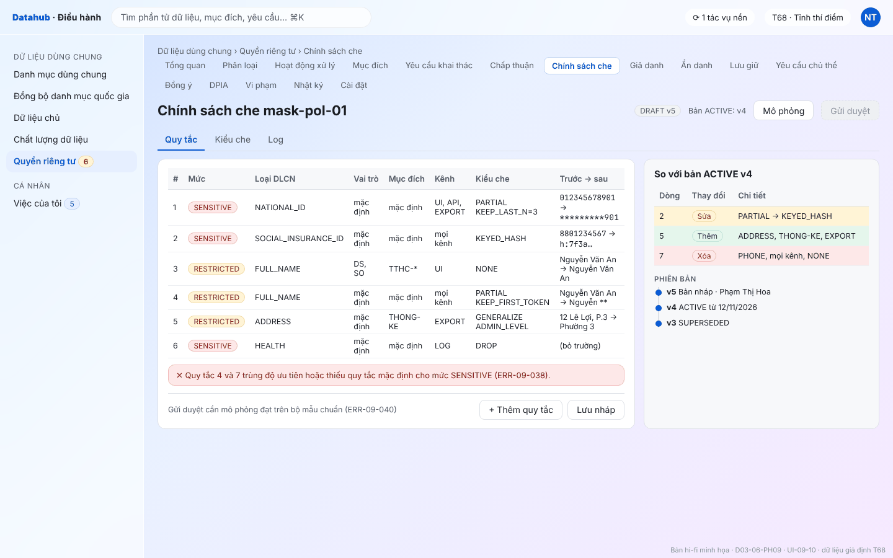

Ảnh cho thấy sáu quy tắc kèm ví dụ trước và sau bằng ký tự giả, `CMP-Alert` đỏ về trùng ưu tiên (ERR-09-038), cột so sánh với ba dòng thêm, sửa, xóa và nút "Gửi duyệt" vô hiệu kèm dòng chữ "Gửi duyệt cần mô phỏng đạt".

### 16.2. Trường quy tắc và mã lỗi

Bảng liệt kê trường nhập của UI-09-10 kèm kiểu, tính bắt buộc, mã lỗi và câu hiển thị lấy từ FRS §9.1.

| Nhãn | Kiểu | Bắt buộc | Kiểm tra, mã lỗi, câu |
|---|---|---|---|
| Mức | `CMP-Select` `DataClass` | Có | Thiếu quy tắc mặc định mức `SENSITIVE`: ERR-09-038 "Chính sách có quy tắc trùng ưu tiên hoặc thiếu quy tắc mặc định cho mức Nhạy cảm." |
| Loại DLCN, vai trò, mục đích | `CMP-Select` nhiều giá trị hoặc "mặc định" | Không | ERR-09-003 theo lược đồ |
| Kênh | `CMP-Checkbox` `MaskChannel` | Có (ít nhất một) | ERR-09-003 |
| Kiểu che | `CMP-Select` `MaskType` | Có | Không hợp kiểu dữ liệu: ERR-09-037 "Kiểu che {kiểu} không áp dụng được cho trường kiểu {kiểu dữ liệu}." |
| Mẫu che và tham số N | `CMP-Select` `MaskPatternKind`, `CMP-NumberInput` | Có khi `PARTIAL`, `GENERALIZE` | ERR-09-037 |
| Độ ưu tiên | `CMP-NumberInput` | Có | Trùng: ERR-09-038 |
| Gửi duyệt khi chưa mô phỏng đạt | — | — | ERR-09-040 "Cần mô phỏng đạt trên bộ dữ liệu mẫu trước khi gửi duyệt." |
| Duyệt bởi người soạn | — | — | ERR-09-005 |
| Gói không qua kiểm thử khi duyệt | — | — | ERR-09-033 "Gói chính sách không qua kiểm thử: {lỗi}. Không phát hành." |
| Chưa ký được gói | — | — | ERR-09-032 "Chưa ký được gói chính sách vì OpenBao không khả dụng. Gói cũ vẫn có hiệu lực." |

: UI-09-10, trường quy tắc và mã lỗi

### 16.3. Tab "Log"

Tab này cấu hình che trong log, trace và xem kết quả quét rò rỉ (SEC-32, NFR-00-029). Trường: danh sách thuộc tính cho phép ghi (`allowAttributes[]`), mẫu phát hiện (`patterns[]`: số định danh 12 chữ số, điện thoại, thẻ, thư điện tử), cửa sổ quét giờ (`scanWindowHours`); sai: ERR-09-044 "Cấu hình che log không hợp lệ: {lý do}." Bảng kết quả rò rỉ (API-09-106) chỉ có dịch vụ nguồn, loại mẫu, số lần, lần cuối; không bao giờ hiện giá trị khớp. Hành động: "Quét ngay" (API-09-108), "Xử lý kết quả" (API-09-107, bắt buộc lý do), "Lưu" (API-09-105). Mục tiêu 0 giá trị Nhạy cảm trong log hiện thành chỉ số xanh khi bằng 0.

### 16.4. Trạng thái, phím tắt, truy cập

Bảng ghi cách UI-09-10 hiện khi đang tải, rỗng, lỗi, không quyền và khi mất kế hoạch che; phím tắt và truy cập ở ngay sau.

| Trạng thái | Hiển thị |
|---|---|
| Đang tải | Skeleton bảng 8 quy tắc và cột so sánh (`ST-01`) |
| Rỗng | Chính sách mới: `ST-03` "Chưa có quy tắc nào. Thêm quy tắc mặc định cho mức Nhạy cảm trước." kèm "+ Thêm quy tắc" |
| Lỗi | `ST-11` tại dòng quy tắc, `CMP-Alert` tóm tắt số lỗi; 412: `ST-13` hai bản cạnh nhau |
| Không quyền | `ST-07`; chỉ đọc `ST-15` (DA thấy "Duyệt", không thấy "Sửa") |
| Fallback che | Không áp dụng (màn chỉ dùng ví dụ giả) |

: UI-09-10, trạng thái màn

Phím tắt: `N` thêm quy tắc, `Ctrl+S` lưu nháp, `Alt+↑`, `Alt+↓` đổi thứ tự quy tắc (thay kéo thả). Truy cập: bảng quy tắc có `aria-sort` và vùng `aria-live` đọc "Dòng 4 chuyển lên vị trí 3"; so sánh đọc "Dòng 5 thêm: ADDRESS, kênh EXPORT, tổng quát hóa cấp hành chính"; ví dụ trước và sau là hai ô có nhãn riêng để trình đọc màn hình không đọc nhầm.

## 17. UI-09-11 Mô phỏng che

::: dac-ta
**Mục đích.** Thử một phiên bản chính sách che trên dữ liệu mẫu (tối đa 1.000 dòng) với vai trò, mục đích, kênh chọn trước để thấy kết quả sau che và phát hiện rò rỉ trước khi gửi duyệt.

**Đường dẫn, mẫu.** `/du-lieu/quyen-rieng-tu/chinh-sach-che/mo-phong` (`chinh-sach`, `phien-ban`); PTN-03 Biểu mẫu trang.

**Vai trò, quyền.** TA, SO, DS; `PERM-09-policy`.

**FR.** 025.

**API.** API-09-101.

**Che DLCN.** Dữ liệu mẫu bắt buộc là dữ liệu giả; màn cảnh báo và không lưu dữ liệu dán; kết quả chỉ ở bộ nhớ trang, xóa khi rời màn.

**Đợt.** Đợt 2; đầy đủ, có ảnh hi-fi.
:::

### 17.1. Bố cục và trường

Hàng đầu là bốn ô tham số; bên dưới bảng kết quả theo từng trường với cột giá trị mẫu, sau che, quy tắc áp dụng, kiểu che, kết quả; chân có thời gian chạy và số ca bộ mẫu chuẩn.

| Nhãn | Kiểu | Bắt buộc | Kiểm tra, mã lỗi, câu |
|---|---|---|---|
| Chính sách, phiên bản | `CMP-Select` | Có | ERR-09-001 "Không tìm thấy {đối tượng} {mã}." |
| Vai trò, mục đích, kênh | `CMP-Select` | Có | ERR-09-003 theo lược đồ |
| Dữ liệu mẫu | `CMP-TextArea` hoặc `CMP-Upload` CSV | Có | Quá 1.000 dòng: ERR-09-039 "Dữ liệu mẫu tối đa 1.000 dòng." (413) |
| Dữ liệu mẫu giống dữ liệu thật | — | — | ERR-09-080 "Dữ liệu mẫu có dấu hiệu là dữ liệu cá nhân thật. Chỉ dùng dữ liệu giả." (máy chủ quét mẫu bằng bộ mẫu của FR-09-005, 422) |
| Kiểu che không hợp | — | — | ERR-09-037 "Kiểu che {kiểu} không áp dụng được cho trường kiểu {kiểu dữ liệu}." |

: UI-09-11, trường và mã lỗi

Hành động: "Chạy mô phỏng" (API-09-101, mục tiêu 1.000 dòng trong 5 giây, NFR-09-023), "Tải kết quả CSV" (chỉ gồm cột sau che), "Quay lại chính sách". Mô phỏng đạt khi không dòng nào lộ giá trị Nhạy cảm và các ca chuẩn trùng; kết quả đạt được ghi vào phiên bản để mở nút "Gửi duyệt" ở UI-09-10.

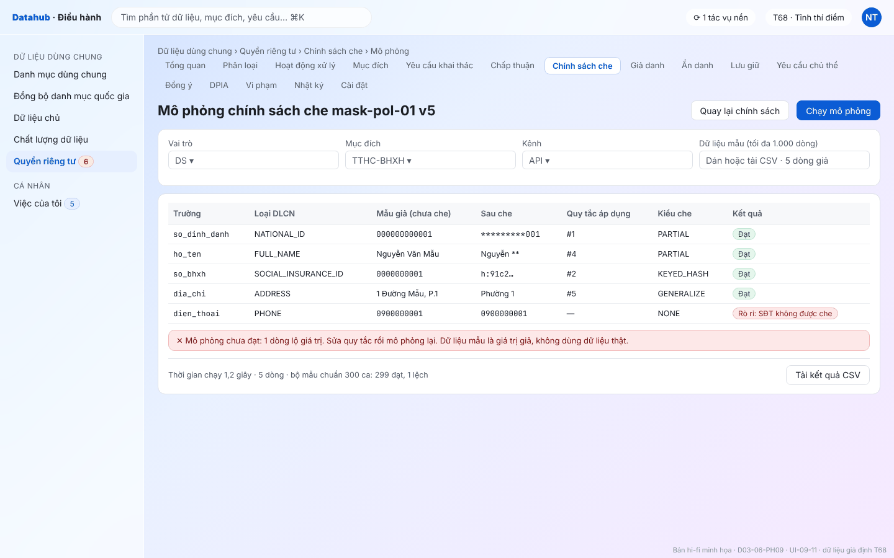

Ảnh cho thấy năm dòng kết quả, dòng số điện thoại không được che được tô lỗi kèm chữ "Rò rỉ: SĐT không được che", `CMP-Alert` đỏ nhắc dữ liệu mẫu là giá trị giả.

### 17.2. Trạng thái, phím tắt, truy cập

Bảng ghi cách UI-09-11 hiện khi đang tải, rỗng, lỗi, không quyền và khi mất kế hoạch che; phím tắt và truy cập ở ngay sau.

| Trạng thái | Hiển thị |
|---|---|
| Đang tải, đang chạy | Ô tham số tải skeleton; khi chạy nút "Chạy mô phỏng" ở `ST-09`, hiện `CMP-JobProgress` |
| Rỗng | Chưa chạy: `CMP-EmptyState` "Dán hoặc tải dữ liệu mẫu giả rồi bấm Chạy mô phỏng." |
| Lỗi, không quyền | `ST-11`, `ST-12`; `ST-07` |
| Fallback che | Không áp dụng |

: UI-09-11, trạng thái màn

Phím tắt `Ctrl+Enter` chạy. Truy cập: kết quả là bảng có tiêu đề cột, ô lỗi có biểu tượng và chữ, tóm tắt "1 dòng lộ giá trị" ở vùng `aria-live="assertive"`; trường dán dữ liệu có nhãn "dữ liệu giả, không dán dữ liệu thật".

## 18. UI-09-12 Miền giả danh và khóa

::: dac-ta
**Mục đích.** Quản lý miền giả danh hóa theo tenant và mục đích, phiên bản khóa, xoay, ngừng, hủy khóa; chuyển sang UI-09-13 để đề nghị khôi phục.

**Đường dẫn, mẫu.** `/du-lieu/quyen-rieng-tu/gia-danh` (`/mien`, `/khoa`; `trang-thai`); PTN-01 Danh sách.

**Vai trò, quyền.** TA, SO (soạn), DA (duyệt xoay, hủy); `PERM-09-read`, `PERM-09-policy`, `PERM-09-policy-approve`.

**FR.** 031, 034.

**API.** API-09-109…114 (miền); API-09-115…118 (khóa).

**Che DLCN.** Không bao giờ hiện giá trị khóa (khóa ở OpenBao, không về trình duyệt); chỉ mã miền, phiên bản khóa, ngày, trạng thái.

**Đợt.** Đợt 2; đầy đủ.
:::

### 18.1. Bố cục và trường

Tab "Miền": mã, mục đích, `PseudonymMethod`, `PseudonymDomainStatus`, khóa hiện hành, ngày xoay kế. Tab "Khóa": phiên bản khóa theo miền với `KeyVersionStatus` (`ACTIVE`, `DECRYPT_ONLY`, `DISABLED`, `DESTROYED`), ngày tạo, lần dùng cuối. Hàng nút ở chi tiết miền: "Xoay khóa", "Tạm dừng", "Ngừng".

| Nhãn | Kiểu | Bắt buộc | Kiểm tra, mã lỗi, câu |
|---|---|---|---|
| Mục đích của miền | `CMP-ResourceSelect` | Có | Đã có miền: ERR-09-045 "Đã có miền giả danh cho mục đích này." |
| Phương pháp | `CMP-RadioCard` `HMAC_SHA256`, `TOKEN_TRANSIT` | Có | Chọn `HMAC_SHA256` thì ghi chú "Không khôi phục được giá trị gốc" (ERR-09-048 ở UI-09-13) |
| Chu kỳ xoay (ngày) | `CMP-NumberInput` | Có | Ngoài miền: ERR-09-078 "Giá trị của {khóa} ngoài miền cho phép {miền}." (`09.pseudo.key-rotate-days`) |
| Xoay khóa | `CMP-ConfirmDialog` | — | Quá gần lần xoay trước: ERR-09-047 "Vừa xoay khóa gần đây. Chờ tối thiểu {n} ngày."; hộp nêu "Xoay khóa phá tính nhất quán bí danh" (BR-09-029) |
| Hủy khóa | `CMP-ConfirmDialog` + gõ lại mã khóa | — | Khóa còn dùng: ERR-09-046 "Khóa còn được sử dụng, chưa hủy được."; hai người, chờ `09.pseudo.destroy-delay-days` |
| Duyệt bởi người đề nghị | — | — | ERR-09-005 |

: UI-09-12, trường và mã lỗi

Hành động: "+ Tạo miền" (API-09-110, kèm khóa đầu), "Sửa" mô tả và chu kỳ (API-09-112), "Tạm dừng" (113), "Ngừng" (114, `PERM-09-policy-approve`), "Xoay khóa" (116), "Ngừng khóa" chuyển chỉ giải (117), "Hủy khóa" (118). Liên kết "Khôi phục giá trị gốc" chỉ hiện cho miền `TOKEN_TRANSIT` và người có `PERM-09-reidentify`.

### 18.2. Trạng thái, phím tắt, truy cập

Bảng ghi cách UI-09-12 hiện khi đang tải, rỗng, lỗi, không quyền và khi mất kế hoạch che; phím tắt và truy cập ở ngay sau.

| Trạng thái | Hiển thị |
|---|---|
| Đang tải, rỗng | Skeleton; `ST-03` "Chưa có miền giả danh nào. Tạo miền để giả danh hóa dữ liệu theo mục đích." |
| Lỗi | OpenBao không khả dụng khi xoay: ERR-09-009 "Chưa kết nối được OpenBao. Thử lại sau ít phút." |
| Không quyền | `ST-07`; DA thấy duyệt không thấy tạo (`ST-15`) |
| Fallback che | Không áp dụng |

: UI-09-12, trạng thái màn

Phím tắt `N` tạo miền. Truy cập: thao tác nguy hiểm có chữ "Không hoàn tác được" ngay đầu hộp, nút xác nhận vô hiệu tới khi gõ đúng mã, mã đặt trong `CMP-CodeText` có nhãn đọc.

## 19. UI-09-13 Khôi phục giá trị gốc

::: dac-ta
**Mục đích.** Đề nghị, duyệt hai cấp và thực hiện khôi phục giá trị gốc từ token của miền `TOKEN_TRANSIT`; đây là thao tác vô hiệu hóa mục đích bảo vệ nên cần ba người khác nhau, MFA và nhật ký vĩnh viễn (BR-09-032).

**Đường dẫn, mẫu.** `/du-lieu/quyen-rieng-tu/gia-danh/khoi-phuc` (`trang-thai`, `chon`); PTN-10 Hộp việc và duyệt.

**Vai trò, quyền.** SO (đề nghị, thực hiện, `PERM-09-reidentify`), DO (duyệt cấp 1, `PERM-09-purpose-approve`), TA hoặc DA (duyệt cấp 2, `PERM-09-policy-approve`); AU xem nhật ký (`PERM-09-audit-read`).

**FR.** 033.

**API.** API-09-119, 120, 121, 122, 123, 124.

**Che DLCN.** Danh sách chỉ hiện số token, miền, mục đích, căn cứ; kết quả khôi phục chỉ hiện 60 giây trong hộp kết quả (cùng cơ chế UI-09-22), không lưu, không tải xuống.

**Đợt.** Đợt 2; siêu chi tiết, có ảnh hi-fi.
:::

### 19.1. Bố cục và thành phần

Cột trái danh sách đề nghị theo `ReidStatus`, cột phải chi tiết với chuỗi duyệt ba ô. Chuỗi duyệt cho thấy ai đã làm gì, ai đang chờ, và thời hạn còn lại của cửa sổ thực hiện (`09.reid.approval-ttl-hours` 24 giờ, `09.reid.exec-window-minutes` 30 phút).

| # | Thành phần | `CMP-*` | Nội dung |
|---|---|---|---|
| 1 | Băng cảnh báo đặc quyền | `CMP-Alert` vàng | Nêu ba người, MFA, 60 giây, nhật ký vĩnh viễn; không đóng được |
| 2 | Danh sách đề nghị | `CMP-DataTable` | Mã, miền, số token, mục đích, căn cứ, người đề nghị, `ReidStatus`, hạn |
| 3 | Chuỗi duyệt | `CMP-ApprovalPanel`, `CMP-Steps` | Đề nghị, cấp 1 (DO), cấp 2 (TA hoặc DA); mỗi ô: tên, thời điểm, dấu ✓ |
| 4 | Khối thông tin | `CMP-DescriptionList` | Miền, phiên bản khóa và trạng thái, số token, căn cứ, cửa sổ thực hiện còn lại |
| 5 | Thanh hành động | `CMP-DecisionPanel` | "Duyệt", "Từ chối…", "Thực hiện khôi phục (MFA)" |
| 6 | Hộp MFA | `CMP-Modal` | Xác thực lại bước cao trước khi giải mã |
| 7 | Hộp kết quả | `CMP-Modal`, `CMP-MaskedValue` | Bảng giá trị gốc theo token, đếm ngược 60 giây, tự đóng và xóa |

: UI-09-13, thành phần

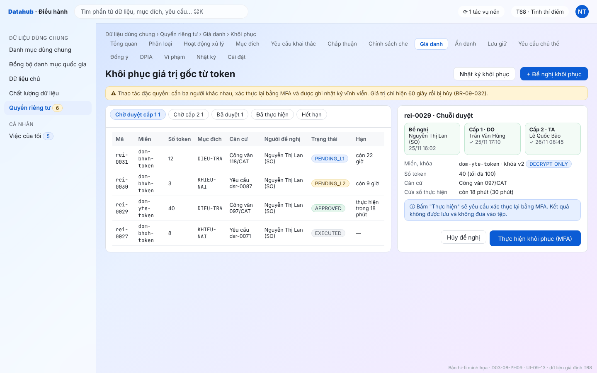

Ảnh cho thấy bốn đề nghị ở bốn trạng thái, chuỗi duyệt rei-0029 đã đủ hai cấp (✓ kèm tên và giờ), cửa sổ thực hiện còn 18 phút và nút "Thực hiện khôi phục (MFA)" nổi bật; không có giá trị cá nhân nào trên màn.

### 19.2. Trường và mã lỗi

Bảng liệt kê trường nhập của UI-09-13 kèm kiểu, tính bắt buộc, mã lỗi và câu hiển thị lấy từ FRS §9.1.

| Nhãn | Kiểu | Bắt buộc | Kiểm tra, mã lỗi, câu |
|---|---|---|---|
| Miền | `CMP-ResourceSelect` | Có | Miền HMAC: ERR-09-048 "Miền {mã} dùng HMAC không đảo ngược, không khôi phục được giá trị gốc." |
| Danh sách token | `CMP-TextArea` hoặc `CMP-Upload` (mỗi dòng một token) | Có, tối đa 100 | Quá số lượng: ERR-09-049 "Mỗi đề nghị khôi phục tối đa {n} giá trị." |
| Mục đích, căn cứ | `CMP-Select`, `CMP-Input` | Có | ERR-09-003 theo lược đồ |
| Lý do | `CMP-TextArea` | Có | ERR-09-007 "Nhập lý do tối thiểu 20 ký tự." |
| Duyệt, thực hiện | — | — | Trùng người: ERR-09-005 "Bạn là người đề nghị hoặc đã quyết định ở bước trước nên không được duyệt bước này." |
| Đề nghị quá hạn | — | — | ERR-09-050 "Đề nghị khôi phục đã hết hiệu lực. Lập đề nghị mới." |
| Không ghi được vết | — | — | ERR-09-010 "Chưa ghi được nhật ký kiểm toán nên thao tác bị từ chối. Thử lại sau." |

: UI-09-13, trường và mã lỗi

Hành động: "+ Đề nghị khôi phục" (API-09-119, `Idempotency-Key`), "Duyệt" (API-09-122; nút ẩn với người không đúng cấp, vô hiệu kèm chữ cho người đề nghị hoặc người đã duyệt cấp trước), "Từ chối" (API-09-123, hộp lý do), "Thực hiện" (API-09-124 sau MFA). Sau khi thực hiện, thông báo SO và TA; đề nghị thành `EXECUTED`.

### 19.3. Trạng thái, phím tắt, truy cập

Bảng ghi cách UI-09-13 hiện khi đang tải, rỗng, lỗi, không quyền và khi mất kế hoạch che; phím tắt và truy cập ở ngay sau.

| Trạng thái | Hiển thị |
|---|---|
| Đang tải, rỗng | Skeleton; `ST-03` "Chưa có đề nghị khôi phục nào." |
| Lỗi | Không ghi được vết: ERR-09-010; MFA thất bại: hộp báo "Xác thực không thành công" và không giải mã; mất kết nối khi thực hiện: không tự gửi lại, người dùng bấm lại có `Idempotency-Key` mới sau khi kiểm tra trạng thái |
| Không quyền | `ST-07`; người không có `PERM-09-reidentify` không thấy nút đề nghị |
| Fallback che | Hộp kết quả không bao giờ hiện khi không xác thực được phiếu (ERR-09-112) |

: UI-09-13, trạng thái màn

Phím tắt: `N` đề nghị mới; nút "Thực hiện" không có phím tắt để tránh bấm nhầm. Truy cập: chuỗi duyệt là danh sách có thứ tự, trạng thái từng bước đọc bằng chữ ("Cấp 1, Trần Văn Hùng, đã duyệt"); hộp kết quả theo cơ chế mục 28.4 (đếm ngược đọc ở mốc 30 và 10 giây, ngắt `aria-live` khi tự che).

## 20. UI-09-14 Ẩn danh hóa và đánh giá rủi ro

::: dac-ta
**Mục đích.** Cấu hình, chạy ẩn danh hóa tập dữ liệu (k ≥ 10), xem báo cáo rủi ro tái định danh, phát hành tập, chuẩn bị dữ liệu cho AI và môi trường không phải PROD.

**Đường dẫn, mẫu.** `/du-lieu/quyen-rieng-tu/an-danh` (`/cau-hinh`, `/job`, `/rui-ro`, `/tap`, `/chuan-bi`; `chon`); PTN-05 Wizard (bốn bước: cấu hình, chạy job, báo cáo rủi ro, phát hành).

**Vai trò, quyền.** TA, SO, DS (`PERM-09-anonymize`); duyệt cấu hình và rủi ro `MEDIUM` cần `PERM-09-policy-approve` (SO, TA, DA).

**FR.** 035, 036, 037, 038, 039.

**API.** API-09-125…129 (cấu hình), 130…134 (job, báo cáo), 135, 136 (rủi ro), 137…139 (chuẩn bị), 140…144 (tập).

**Che DLCN.** Không hiện bản ghi; chỉ cấu hình, phân bố nhóm tương đương, chỉ số rủi ro; không có xem trước dòng dữ liệu.

**Đợt.** Đợt 2; đầy đủ, có ảnh hi-fi.
:::

### 20.1. Bố cục và trường

Thanh bước bốn ô; bước 3 là báo cáo: bốn thẻ chỉ số (k thực tế nhỏ nhất, bản ghi còn lại, rủi ro tái định danh, rủi ro tối đa theo nhóm), bảng biến đổi theo thuộc tính, biểu đồ phân bố kích thước nhóm tương đương và cột phải thang `RiskLevel` kèm khuyến nghị. Ngưỡng `LOW` dưới 0,05, `MEDIUM` từ 0,05, `HIGH` từ 0,10 (`09.anon.risk-medium-above`, `09.anon.risk-high-above`).

| Nhãn | Kiểu | Bắt buộc | Kiểm tra, mã lỗi, câu |
|---|---|---|---|
| Ngưỡng k | `CMP-NumberInput` | Có | Dưới tối thiểu: ERR-09-051 "Ngưỡng k phải từ {n} trở lên." (`09.anon.k-min`) |
| Biến đổi từng thuộc tính | `CMP-Select` `AnonTransform` | Có | Còn định danh trực tiếp: ERR-09-052 "Còn trường định danh trực tiếp {tên} chưa được loại bỏ hoặc xử lý." |
| Mô hình rủi ro, l-đa dạng | `CMP-Select` `RiskModel`, `PrivacyModel` | Có, Không | ERR-09-003 |
| Duyệt rủi ro `MEDIUM` | `CMP-ApprovalPanel` | — | Người chạy tự duyệt: ERR-09-005 |
| Phát hành khi rủi ro cao | — | — | ERR-09-053 "Rủi ro tái định danh cao, không phát hành. Xem khuyến nghị của báo cáo." |
| Bản ghi còn quá ít | — | — | ERR-09-054 "Sau xử lý chỉ còn {x}% bản ghi, dữ liệu không còn giá trị thống kê." |
| Mục đích chuẩn bị dữ liệu | `CMP-Select` `DataPrepTarget` | Có | Trường Nhạy cảm ở mục đích không cho phép: ERR-09-055 "Mục đích {mã} không cho phép dùng dữ liệu có trường Nhạy cảm." |
| Dữ liệu `RESTRICTED` cho AI khi cờ tắt | — | — | ERR-09-082 "Dữ liệu Hạn chế chưa được phép dùng cho AI. Đề nghị TA bật tham số 09.ai.allow-restricted." |
| Sửa tập đã phát hành | — | — | ERR-09-056 "Tập dữ liệu đã phát hành, không sửa được. Rút lại để tạo tập mới." |

: UI-09-14, trường và mã lỗi

Hành động: "Lưu cấu hình" (API-09-126, 128), "Duyệt cấu hình" (129), "Chạy job" (130), "Hủy job" (133), "Duyệt rủi ro" (135) hoặc "Từ chối rủi ro", "Phát hành tập" (142), "Rút lại" (143), "Điều kiện sử dụng" (144), "Chuẩn bị dữ liệu" (137).

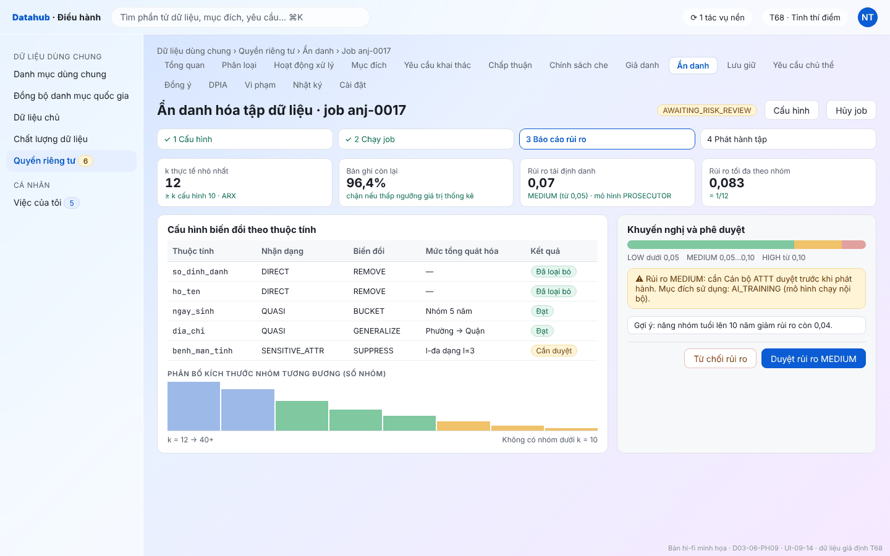

Ảnh là bước 3 của job anj-0017: k thực tế 12, rủi ro 0,07 ở mức `MEDIUM` (chữ và thang ba màu), `CMP-Alert` vàng nêu cần SO duyệt, biểu đồ phân bố không có nhóm dưới k = 10.

### 20.2. Trạng thái, phím tắt, truy cập

Bảng ghi cách UI-09-14 hiện khi đang tải, rỗng, lỗi, không quyền và khi mất kế hoạch che; phím tắt và truy cập ở ngay sau.

| Trạng thái | Hiển thị |
|---|---|
| Đang tải, đang chạy | Skeleton; job `RUNNING` hiện `CMP-JobProgress`, thăm dò 5 giây |
| Rỗng | `ST-03` "Chưa có cấu hình ẩn danh hóa. Tạo cấu hình đầu tiên." |
| Lỗi, không quyền | Job `FAILED`: lý do và "Chạy lại"; `REJECTED_RISK` chặn bước 4; `ST-07` |
| Fallback che | Không áp dụng |

: UI-09-14, trạng thái màn

Truy cập: thang rủi ro có chữ "LOW dưới 0,05" ở chú giải, không chỉ màu; biểu đồ phân bố có bảng thay thế; kết quả job thông báo qua `aria-live="polite"`. Phím tắt: `Alt+←`, `Alt+→` đổi bước.

## 21. UI-09-15 Lịch lưu giữ và tác vụ xóa

::: dac-ta
**Mục đích.** Lập lịch lưu giữ theo bảng và loại dữ liệu, theo dõi tác vụ xóa hoặc giả danh hóa, đặt giữ pháp lý, đề nghị xóa mật mã tenant và xem báo cáo tuân thủ thời hạn lưu.

**Đường dẫn, mẫu.** `/du-lieu/quyen-rieng-tu/luu-giu` (`/lich`, `/tac-vu`, `/giu-phap-ly`, `/bao-cao`, `/xoa-mat-ma`); PTN-01 Danh sách.

**Vai trò, quyền.** TA, SO (soạn, `PERM-09-retention`), DS (một phần), DA (duyệt, `PERM-09-policy-approve`).

**FR.** 040, 041, 042, 043, 044.

**API.** API-09-145…151 (lịch); 152…155 (tác vụ); 156…158 (giữ pháp lý); 159…162 (xóa mật mã); 163 (báo cáo).

**Che DLCN.** Không có giá trị cá nhân; tác vụ chỉ hiện bảng, số bản ghi.

**Đợt.** Đợt 2; đầy đủ.
:::

### 21.1. Bố cục và trường

Mỗi tab là một bảng: lịch (bảng hoặc loại dữ liệu, thời hạn, `RetentionAction`, `VersionStatus`), tác vụ (`RetentionTaskStatus`, số bản ghi, lần chạy), giữ pháp lý (số văn bản, cơ quan, hạn rà soát, `LegalHoldStatus`), xóa mật mã (`CryptoShredStatus`), báo cáo (tỷ lệ xử lý đúng hạn, quá `09.retention.overdue-days`).

| Nhãn | Kiểu | Bắt buộc | Kiểm tra, mã lỗi, câu |
|---|---|---|---|
| Bảng chứa DLCN, thời hạn lưu | `CMP-Select`, `CMP-NumberInput` | Có | Thiếu thời hạn: ERR-09-057 "Bảng {tên} chứa dữ liệu cá nhân nhưng chưa có thời hạn lưu." |
| Chạy tác vụ ngay, chạy thử | `CMP-Button` | — | Đang chạy: ERR-09-061 "Tác vụ xóa đang chạy, không chạy chồng."; đang giữ: ERR-09-058 "Dữ liệu đang bị giữ pháp lý, không xóa được cho đến khi gỡ giữ." |
| Số văn bản, cơ quan yêu cầu | `CMP-Input` | Có | Thiếu: ERR-09-059 "Giữ pháp lý cần số văn bản và cơ quan yêu cầu." |
| Đề nghị xóa mật mã tenant | `CMP-ConfirmDialog` + gõ lại mã tenant | — | ERR-09-060 "Chưa đủ điều kiện xóa mật mã tenant: {lý do}."; hai người, chờ `09.shred.delay-days`, không hoàn tác |
| Duyệt bởi người soạn | — | — | ERR-09-005 |

: UI-09-15, trường và mã lỗi

Hành động: "Lập lịch", "Gửi duyệt", "Duyệt" (DA), "Chạy ngay" và "Chạy thử (dry-run)" (API-09-154), "Hủy tác vụ" (155), "Đặt giữ pháp lý" (157), "Gỡ giữ" (158, hộp lý do), "Đề nghị xóa mật mã" (159), "Hủy trước khi thực hiện" (162).

### 21.2. Trạng thái, phím tắt, truy cập

Bảng ghi cách UI-09-15 hiện khi đang tải, rỗng, lỗi, không quyền và khi mất kế hoạch che; phím tắt và truy cập ở ngay sau.

| Trạng thái | Hiển thị |
|---|---|
| Đang tải, rỗng | Skeleton; `ST-03` "Chưa có lịch lưu giữ. Lập lịch cho các bảng chứa dữ liệu cá nhân." |
| Lỗi, không quyền | `ST-05`; tác vụ `FAILED` kèm lý do; `ST-07` |
| Fallback che | Không áp dụng |

: UI-09-15, trạng thái màn

Truy cập: tab đúng mẫu; hộp xóa mật mã có đoạn "Không hoàn tác được" là nội dung đầu tiên đọc, nút xác nhận vô hiệu tới khi gõ đúng; trạng thái tác vụ đọc bằng chữ.

## 22. UI-09-16 Yêu cầu của chủ thể

::: dac-ta
**Mục đích.** Tiếp nhận và xử lý yêu cầu của chủ thể dữ liệu (biết, truy cập, chỉnh sửa, xóa, hạn chế, phản đối, rút đồng ý) từ xác minh danh tính, tra cứu, phân công, theo dõi hạn đến trả lời và đóng; lập báo cáo "ai đã truy cập dữ liệu của tôi".

**Đường dẫn, mẫu.** `/du-lieu/quyen-rieng-tu/yeu-cau-chu-the` (`loai`, `trang-thai`, `phan-vung`, `chon`); PTN-01 Danh sách và PTN-02 Chi tiết (Drawer 470 px).

**Vai trò, quyền.** SO, TA, DS; `PERM-09-dsr`.

**FR.** 045, 046, 047, 048, 049, 050, 051.

**API.** API-09-164…181, 242, 244.

**Che DLCN.** Họ tên che theo kế hoạch che (`Nguyễn V** A`), định danh `*********345`, băm `hs:…`; xem đầy đủ chỉ qua UI-09-22; số định danh nhập ở `CMP-SecretField`, không vào URL.

**Đợt.** Đợt 2; đầy đủ, có ảnh hi-fi.
:::

### 22.1. Bố cục và thành phần

Hàng đầu bốn thẻ chỉ số (đang xử lý, sắp đến hạn, quá hạn, tỷ lệ đóng trong hạn quý). Hai cột: danh sách (lọc theo phân vùng) và chi tiết yêu cầu gồm xác minh, băm chủ thể, kết quả tra cứu theo phân hệ (PH-06, PH-19, PH-13), danh sách tác vụ, báo cáo truy cập, thanh hành động.

| # | Thành phần | `CMP-*` | Nội dung |
|---|---|---|---|
| 1 | Thẻ chỉ số | `CMP-KpiCard` | Quá hạn đỏ; mục tiêu đóng trong hạn ≥ 98% (NFR-09-016) |
| 2 | Danh sách | `CMP-DataTable` | Mã, `DsrType`, chủ thể (đã che), `DsrChannel`, nhận lúc, hạn ("Quá hạn 1 ngày"), `DsrStatus` |
| 3 | Khối xác minh | `CMP-DescriptionList`, `CMP-StatusTag` | `VerificationMethod`, kết quả, mã tham chiếu |
| 4 | Kết quả tra cứu | `CMP-DataTable` | Theo đích: số bản ghi, liên kết sang màn của phân hệ đó |
| 5 | Tác vụ | `CMP-DataTable` | `DsrTarget`, `DsrTaskStatus`, người, hạn |
| 6 | Thanh hành động | `CMP-DecisionPanel` | "Chuyển nguồn", "Từ chối có căn cứ…", "Soạn câu trả lời", "Đóng yêu cầu" |

: UI-09-16, thành phần

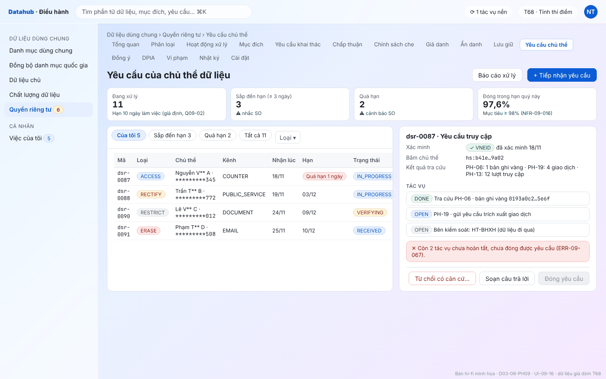

Ảnh cho thấy bốn thẻ, danh sách với chủ thể đã che, chi tiết dsr-0087 đã xác minh, ba tác vụ và `CMP-Alert` đỏ "Còn 2 tác vụ chưa hoàn tất, chưa đóng được yêu cầu" kèm nút "Đóng yêu cầu" vô hiệu.

### 22.2. Trường và mã lỗi

Bảng liệt kê trường nhập của UI-09-16 kèm kiểu, tính bắt buộc, mã lỗi và câu hiển thị lấy từ FRS §9.1.

| Nhãn | Kiểu | Bắt buộc | Kiểm tra, mã lỗi, câu |
|---|---|---|---|
| Loại yêu cầu | `CMP-Select` `DsrType` | Có | Thiếu loại hoặc định danh: ERR-09-062 "Yêu cầu thiếu loại yêu cầu hoặc thông tin định danh chủ thể." |
| Loại, giá trị định danh | `CMP-Select`, `CMP-SecretField` | Có | ERR-09-062 |
| Kênh tiếp nhận | `CMP-Select` `DsrChannel` | Có | ERR-09-003 theo lược đồ |
| Người đại diện | `CMP-Input`, `CMP-Upload` giấy tờ | Có khi nộp thay | ERR-09-065 "Người gửi chưa chứng minh là chủ thể hoặc người đại diện hợp pháp." |
| Yêu cầu trùng | — | — | ERR-09-064 "Chủ thể đã có yêu cầu cùng loại đang xử lý." |
| Phương thức xác minh | `CMP-Select` `VerificationMethod` | Có | Tra cứu khi chưa xác minh: ERR-09-063 "Chưa xác minh danh tính chủ thể. Hoàn tất xác minh trước khi xử lý." |
| Chuyển tác vụ | `CMP-Select` `DsrTarget` | Có | Chuyển lỗi: ERR-09-066 "Chưa chuyển được yêu cầu tới {đích}. Hệ thống sẽ thử lại." |
| Câu trả lời, kết quả `DsrOutcome`, bằng chứng | `CMP-TextArea`, `CMP-Select`, `CMP-Upload` | Có | Thiếu: ERR-09-068 "Câu trả lời thiếu kết quả hoặc bằng chứng đính kèm." |
| Đóng khi còn tác vụ | — | — | ERR-09-067 "Còn {n} tác vụ chưa hoàn tất, chưa đóng được yêu cầu." |

: UI-09-16, trường và mã lỗi

Hành động: "+ Tiếp nhận" (API-09-165), "Xác minh" (167), "Tra cứu" (168, `POST`, định danh trong thân), "Phân công" (173), "Chuyển" và "Báo hoàn tất tác vụ" (170, 172), "Gỡ hạn chế" (178), "Trả lời" (175), "Đóng" (176), "Từ chối" (177, căn cứ BR-09-046), "Gia hạn hạn trả lời" (242, một lần, kèm lý do), "Rút yêu cầu" (244, kèm lý do, trước khi `RESPONDED`), "Lập báo cáo truy cập" (179, 180). Yêu cầu quá `09.dsr.sla-days` hiện nhãn "Quá hạn"; nhắc trước `09.dsr.remind-days`.

### 22.3. Trạng thái, phím tắt, truy cập

Bảng ghi cách UI-09-16 hiện khi đang tải, rỗng, lỗi, không quyền và khi mất kế hoạch che; phím tắt và truy cập ở ngay sau.

| Trạng thái | Hiển thị |
|---|---|
| Đang tải, rỗng | Skeleton; `ST-03` "Chưa có yêu cầu của chủ thể nào. Tiếp nhận yêu cầu khi công dân đến quầy hoặc gửi văn bản." |
| Lỗi, không quyền | `ST-05`; `ST-07`; chuyển lỗi: nhãn "Sẽ thử lại" kèm giờ thử kế |
| Fallback che | Tên và định danh hiện `●●●●`, nút "Xem đầy đủ" vô hiệu, băng "Chưa lấy được chính sách che" |

: UI-09-16, trạng thái màn

Phím tắt: `N` tiếp nhận, `J`, `K` chọn dòng. Truy cập: ô số định danh là `CMP-SecretField` có nhãn "Số định danh của chủ thể", không tự điền (`autocomplete="off"`); hạn "quá hạn 1 ngày" bằng chữ; `document.title` chỉ có mã yêu cầu.

## 23. UI-09-17 Sự đồng ý

::: dac-ta
**Mục đích.** Quản lý mẫu sự đồng ý theo phiên bản (chỉ cho tiện ích không bắt buộc, BR-09-049) và tra cứu bản ghi đồng ý, rút đồng ý, bằng chứng.

**Đường dẫn, mẫu.** `/du-lieu/quyen-rieng-tu/dong-y` (`/mau`, `/ban-ghi`; `trang-thai`); PTN-01 Danh sách.

**Vai trò, quyền.** SO, TA (soạn), DS (soạn một phần); duyệt mẫu `PERM-09-policy-approve` (DA, TA, SO); `PERM-09-consent`.

**FR.** 052, 053.

**API.** API-09-182…187 và 238 (mẫu, chi tiết mẫu); API-09-188…191 và 245 (bản ghi, bằng chứng, tra theo định danh).

**Che DLCN.** Bản ghi chỉ hiện băm chủ thể `hs:…`, mẫu, phiên bản, kênh, thời điểm; định danh rõ không hiện.

**Đợt.** Đợt 2; đầy đủ.
:::

### 23.1. Bố cục và trường

Tab "Mẫu": mẫu theo mã và `VersionStatus` (nháp, chờ duyệt, hiệu lực). Tab "Bản ghi": `ConsentStatus`, băm chủ thể, mẫu và phiên bản, `ConsentChannel`, thời điểm; Drawer bằng chứng (API-09-191) gồm băm nội dung đã hiển thị cho chủ thể.

| Nhãn | Kiểu | Bắt buộc | Kiểm tra, mã lỗi, câu |
|---|---|---|---|
| Mục đích cụ thể, dữ liệu xử lý, cách rút lại | `CMP-TextArea` | Có | ERR-09-069 "Mẫu đồng ý cần nêu mục đích cụ thể, dữ liệu xử lý và cách rút lại." |
| Sửa mẫu đã có người đồng ý | — | — | ERR-09-070 "Mẫu đã có người đồng ý. Tạo phiên bản mới thay vì sửa." |
| Ghi nhận đồng ý: kênh, thời điểm, phiên bản mẫu | `CMP-Select`, `CMP-DatePicker` | Có | ERR-09-071 "Thiếu bằng chứng đồng ý: kênh, thời điểm, phiên bản mẫu." |
| Rút đồng ý đã rút | — | — | ERR-09-072 "Sự đồng ý đã được rút hoặc hết hiệu lực." |
| Tra cứu theo chủ thể | `CMP-SecretField` | Không | Gửi bằng `POST` API-09-245 (loại và giá trị định danh trong thân); màn chỉ giữ băm, không lưu giá trị đã nhập |

: UI-09-17, trường và mã lỗi

Hành động: "+ Tạo mẫu", "Sửa bản nháp", "Gửi duyệt", "Duyệt", "Ngừng mẫu", "Ghi nhận đồng ý" và "Rút đồng ý" (API-09-188, 189), "Xem bằng chứng". Rút đồng ý có hiệu lực tại tra cứu trong 60 giây (BR-09-051).

### 23.2. Trạng thái, phím tắt, truy cập

Bảng ghi cách UI-09-17 hiện khi đang tải, rỗng, lỗi, không quyền và khi mất kế hoạch che; phím tắt và truy cập ở ngay sau.

| Trạng thái | Hiển thị |
|---|---|
| Đang tải, rỗng | Skeleton; `ST-03` "Chưa có mẫu đồng ý. Tạo mẫu cho tiện ích không bắt buộc." |
| Lỗi, không quyền | `ST-11`, `ST-12`; `ST-07` |
| Fallback che | Băm vẫn hiện (không phải DLCN rõ); không có giá trị cần che |

: UI-09-17, trạng thái màn

Phím tắt `N` tạo mẫu. Truy cập: tab đúng mẫu; trạng thái "Đã rút" có biểu tượng và chữ, không chỉ màu xám.

## 24. UI-09-18 Hồ sơ đánh giá tác động

::: dac-ta
**Mục đích.** Soạn hồ sơ đánh giá tác động xử lý DLCN (DPIA) cho hoạt động Datahub là bên kiểm soát hoặc bên xử lý, duyệt, phiên bản hóa, nhắc rà soát hằng năm và xuất hồ sơ gửi Cục A05.

**Đường dẫn, mẫu.** `/du-lieu/quyen-rieng-tu/dpia` (`/{id}`, `/den-han`; `trang-thai`); PTN-03 Biểu mẫu trang.

**Vai trò, quyền.** SO, TA (soạn), DS (một phần), DA (duyệt); `PERM-09-ropa`.

**FR.** 055, 056, 057.

**API.** API-09-192…195 (hồ sơ), 196…199 (duyệt, hạn rà soát), 200, 201 (A05).

**Che DLCN.** Không có giá trị cá nhân; hồ sơ mô tả loại và quy mô.

**Đợt.** Đợt 2; đầy đủ.
:::

### 24.1. Bố cục và trường

Danh sách hồ sơ kèm thẻ "Đến hạn rà soát" (API-09-199, nhắc trước 30 ngày, BR-09-053). Biểu mẫu chia nhóm: thông tin chung (`DpiaKind`: `PROCESSING`, `CROSS_BORDER`; vai trò bên kiểm soát hoặc xử lý), hoạt động xử lý liên quan (chọn từ UI-09-05), mô tả xử lý và nhu cầu, rủi ro với chủ thể và biện pháp giảm thiểu, bên nhận và chuyển ra nước ngoài, ý kiến người duyệt.

| Nhãn | Kiểu | Bắt buộc | Kiểm tra, mã lỗi, câu |
|---|---|---|---|
| Loại hồ sơ | `CMP-RadioCard` `DpiaKind` | Có | ERR-09-003 theo lược đồ |
| Hoạt động xử lý liên quan | `CMP-Transfer` | Có | Thiếu mục khi gửi duyệt: ERR-09-073 "Hồ sơ đánh giá tác động còn thiếu: {mục}." |
| Rủi ro và biện pháp | `CMP-EditableTable` | Có | ERR-09-073 |
| Xuất gửi Cục A05 khi chưa duyệt | `CMP-Button` | — | ERR-09-074 "Hồ sơ chưa được duyệt, chưa xuất gửi Cục A05 được." |
| Số công văn khi ghi nhận đã gửi | `CMP-Input` | Có | ERR-09-003 |
| Duyệt bởi người soạn | — | — | ERR-09-005 |

: UI-09-18, trường và mã lỗi

Hành động: "+ Lập hồ sơ", "Lưu nháp", "Gửi duyệt", "Duyệt" hoặc "Từ chối" (DA, khác người soạn), "Xuất gửi Cục A05" (nền, API-09-200), "Ghi nhận đã gửi" (API-09-201, `SUBMITTED_A05`), "Tạo phiên bản mới" khi đến hạn rà soát.

### 24.2. Trạng thái, phím tắt, truy cập

Bảng ghi cách UI-09-18 hiện khi đang tải, rỗng, lỗi, không quyền và khi mất kế hoạch che; phím tắt và truy cập ở ngay sau.

| Trạng thái | Hiển thị |
|---|---|
| Đang tải, rỗng | Skeleton; `ST-03` "Chưa có hồ sơ đánh giá tác động. Lập hồ sơ cho hoạt động Datahub là bên kiểm soát." |
| Lỗi, không quyền | `ST-11` theo nhóm; `ST-13` khi người khác sửa; `ST-07` |
| Fallback che | Không áp dụng |

: UI-09-18, trạng thái màn

Phím tắt `Ctrl+S` lưu nháp. Truy cập: mỗi nhóm là `fieldset` có `legend`, mục thiếu liệt kê trong `CMP-Alert` có liên kết nhảy tới trường; tải tệp xuất báo trạng thái ở `CMP-BackgroundTaskTray`.

## 25. UI-09-19 Vi phạm dữ liệu cá nhân

::: dac-ta
**Mục đích.** Ghi nhận và xử lý vụ việc vi phạm DLCN với đồng hồ 72 giờ chỉ dừng khi đã thông báo Cục A05: đánh giá ảnh hưởng, thông báo Cục A05 và chủ thể, khắc phục, bài học, đóng hồ sơ.

**Đường dẫn, mẫu.** `/du-lieu/quyen-rieng-tu/vi-pham` (`/{id}`; `muc-do`, `trang-thai`); PTN-02 Chi tiết (danh sách ở trang gốc, chi tiết ở `/{id}`).

**Vai trò, quyền.** SO, TA (đầy đủ), TO (ghi nhận ban đầu, không đóng hồ sơ); `PERM-09-breach`.

**FR.** 058, 059, 060.

**API.** API-09-202…206 (vụ việc), 207…210 và 239 (đồng hồ, thông báo, chủ thể), 211…214 và 240 (khắc phục, đóng, hồ sơ); API-09-083 (chuyển từ cảnh báo).

**Che DLCN.** Hồ sơ không chứa giá trị DLCN rõ, chỉ số lượng, loại, băm (BR-09-056); danh sách chủ thể ảnh hưởng nhập là băm.

**Đợt.** Đợt 2; đầy đủ, có ảnh hi-fi.
:::

### 25.1. Bố cục và thành phần

Đầu trang hiện mã, tiêu đề, `BreachStatus`, `BreachSeverity`. Dưới là thẻ đồng hồ 72 giờ chiếm toàn chiều rộng: số còn lại lớn (chữ "41 giờ 33 phút"), thanh ba đoạn đánh dấu mốc 24, 48, 60 và 72 giờ, dòng "Hiện tại: giờ thứ 30,5". Ba tab chi tiết cùng cột tóm tắt vụ việc và dòng thời gian bên phải.

| # | Thành phần | `CMP-*` | Nội dung |
|---|---|---|---|
| 1 | Thẻ đồng hồ | `CMP-Banner`, `CMP-ProgressBar`, `CMP-Duration` | Tính từ `detectedAt`, không tạm dừng, không đặt lại, chỉ dừng khi thông báo Cục A05 đã gửi (BR-09-054); màu vàng sau 24 giờ, cam sau 48, đỏ sau 60, kèm chữ |
| 2 | Tab "Chi tiết" | `CMP-DescriptionList`, `CMP-Form` | Mô tả, phạm vi, loại dữ liệu, nguồn `BreachSource`, đánh giá mức |
| 3 | Tab "Thông báo" | `CMP-DataTable` | Người nhận `NotificationRecipient`, hạn, `NotificationStatus`, bằng chứng gửi |
| 4 | Tab "Chủ thể ảnh hưởng" | `CMP-Upload`, `CMP-DataTable` | Nhập danh sách băm, số lượng; không hiện danh tính |
| 5 | Tab "Khắc phục", "Bài học" | `CMP-Timeline`, `CMP-TextArea` | Biện pháp, người, ngày; bài học |
| 6 | Dòng thời gian | `CMP-AuditTimeline` | Phát hiện, báo bên kiểm soát, đánh giá, soạn thông báo |

: UI-09-19, thành phần

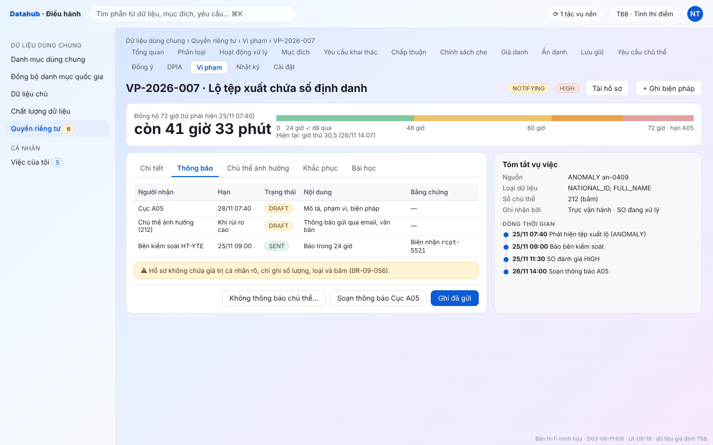

Ảnh cho thấy vụ việc VP-2026-007 đang `NOTIFYING`, đồng hồ "còn 41 giờ 33 phút" với mốc 24 giờ đã qua, tab "Thông báo" có ba người nhận (một đã `SENT` kèm biên nhận), dòng nhắc hồ sơ không chứa DLCN rõ và dòng thời gian bên phải.

### 25.2. Trường và mã lỗi

Bảng liệt kê trường nhập của UI-09-19 kèm kiểu, tính bắt buộc, mã lỗi và câu hiển thị lấy từ FRS §9.1.

| Nhãn | Kiểu | Bắt buộc | Kiểm tra, mã lỗi, câu |
|---|---|---|---|
| Thời điểm phát hiện | `CMP-DatePicker` kèm giờ | Có | Thiếu: ERR-09-075 "Vụ việc cần có thời điểm phát hiện và mô tả." |
| Mô tả | `CMP-TextArea` | Có | ERR-09-075 |
| Mức nghiêm trọng | `CMP-Select` `BreachSeverity` | Có khi đánh giá | ERR-09-003 theo lược đồ |
| Căn cứ miễn trừ khi không thông báo chủ thể | `CMP-TextArea` | Có khi chọn "Không thông báo" | ERR-09-077 "Không thông báo chủ thể cần nêu căn cứ miễn trừ và lý do." |
| Đóng hồ sơ khi còn nghĩa vụ | — | — | ERR-09-076 "Còn nghĩa vụ thông báo chưa hoàn tất, chưa đóng được hồ sơ." |
| Danh sách băm chủ thể | `CMP-Upload` CSV | Không | ERR-09-003 theo lược đồ |

: UI-09-19, trường và mã lỗi

Hành động: "+ Ghi nhận vi phạm" (API-09-203; TO cũng ghi được), "Đánh giá" (206), "Soạn thông báo", "Ghi đã gửi" (208, 209), "Nhập chủ thể ảnh hưởng" (210), "Ghi biện pháp", "Ghi bài học" (211, 212), "Đóng hồ sơ" (213, chỉ SO, TA), "Tải hồ sơ" (214). Cảnh báo khai thác được "Chuyển thành vụ việc" từ UI-09-09 mở sẵn bản ghi `REPORTED` có nguồn `ANOMALY`.

### 25.3. Trạng thái, phím tắt, truy cập

Bảng ghi cách UI-09-19 hiện khi đang tải, rỗng, lỗi, không quyền và khi mất kế hoạch che; phím tắt và truy cập ở ngay sau.

| Trạng thái | Hiển thị |
|---|---|
| Đang tải, rỗng | Skeleton; `ST-03` "Chưa có vụ việc vi phạm nào." |
| Lỗi, không quyền | `ST-05`; `ST-07`; TO thấy "Đóng hồ sơ" ẩn (`ST-15`) |
| Quá 72 giờ chưa thông báo | Băng đỏ "Đã quá hạn thông báo Cục A05 {n} giờ" kèm "Ghi căn cứ" |
| Fallback che | Không áp dụng |

: UI-09-19, trạng thái màn

Truy cập: đồng hồ đọc khi mở trang và khi qua mốc 24, 48, 60 giờ (`aria-live="assertive"` cho mốc 60), không đọc từng giây; thanh ba đoạn có chú giải bằng chữ; hạn thông báo viết "28/11/2026 07:40, còn 41 giờ".

## 26. UI-09-20 Nhật ký bảo vệ dữ liệu

::: dac-ta
**Mục đích.** Tra bản ghi kiểm toán thao tác bảo vệ dữ liệu theo thời gian, người, đối tượng, loại thao tác; xem lịch sử xem đầy đủ; xuất.

**Đường dẫn, mẫu.** `/du-lieu/quyen-rieng-tu/nhat-ky` (`/thao-tac`, `/xem-day-du`; `tu`, `den`, `nguoi`, `loai`); PTN-11 Tra log.

**Vai trò, quyền.** SO, AU, PA (`PERM-09-audit-read`); TO không có quyền này nên không thấy màn (FRS 0.2 đã bỏ TO khỏi UI-09-20).

**FR.** 029, 061.

**API.** API-09-215, 216, 217 (nhật ký); API-09-103, 241 (lịch sử xem đầy đủ, chi tiết một phiếu không kèm giá trị).

**Che DLCN.** Nhật ký không ghi giá trị `SENSITIVE`; chỉ tên trường, băm có khóa, số lượng (BR-09-058). Màn không bao giờ hiện giá trị đã được xem.

**Đợt.** Đợt 2; đầy đủ.
:::

### 26.1. Bố cục và trường

Thanh lọc cố định (thời gian, người, loại thao tác, đối tượng), bảng bản ghi mật độ gọn có cuộn vô hạn, Drawer chi tiết một bản ghi (JSON đã che bằng `CMP-JsonViewer`). Tab "Xem đầy đủ" hiện mỗi phiếu: người, đối tượng, trường, lý do, thời điểm, hết hạn, `RevealStatus`.

| Nhãn | Kiểu | Bắt buộc | Kiểm tra, mã lỗi, câu |
|---|---|---|---|
| Khoảng thời gian | `CMP-DateRangePicker` | Có | Quá `09.audit.query-max-days` (90): ERR-09-079 "Chọn khoảng thời gian tối đa {n} ngày." với `{n}` là giá trị tham số |
| Người, loại thao tác, đối tượng | `CMP-FilterBar` | Không | ERR-09-003 theo lược đồ |
| Xuất | `CMP-Button` | — | Không ghi được vết xuất: ERR-09-010 |

: UI-09-20, trường và mã lỗi

Hành động: lọc, mở Drawer, "Xuất nhật ký" (nền, API-09-217, có kiểm toán), sao chép mã truy vết. Không có nút sửa hay xóa.

### 26.2. Trạng thái, phím tắt, truy cập

Bảng ghi cách UI-09-20 hiện khi đang tải, rỗng, lỗi, không quyền và khi mất kế hoạch che; phím tắt và truy cập ở ngay sau.

| Trạng thái | Hiển thị |
|---|---|
| Đang tải, rỗng | `ST-01`; `ST-04` "Không có bản ghi trong khoảng đã chọn." |
| Lỗi, không quyền | `ST-05`; `ST-07` (người không có `PERM-09-audit-read` mở `ST-07` kèm tên quyền thiếu) |
| Fallback che | Không áp dụng |

: UI-09-20, trạng thái màn

Phím tắt: `/` lọc, `J`, `K` dòng sau, trước, `Enter` mở Drawer. Truy cập: bảng cuộn vô hiệu `aria-busy` khi tải thêm, có nút "Tải thêm" thay cho cuộn vô hạn cho người dùng bàn phím; thời điểm đọc đầy đủ "26/11/2026 13:57".

## 27. UI-09-21 Cài đặt PH-09

::: dac-ta
**Mục đích.** Chỉnh các tham số `09.*` của tenant theo khu vực, lịch lập báo cáo, ngưỡng cảnh báo khai thác; xem lịch sử sửa. Giá trị không vượt trần hoặc sàn do PA đặt (BR-09-059).

**Đường dẫn, mẫu.** `/du-lieu/quyen-rieng-tu/cai-dat` (`/khu-vuc`, `/bao-cao`, `/log`, `/canh-bao`); PTN-12 Cài đặt.

**Vai trò, quyền.** TA (sửa), PA (đặt trần, sàn); `PERM-09-config`.

**FR.** 064.

**API.** API-09-224, 225, 226; API-09-084, 085 (ngưỡng cảnh báo); API-09-223 (lịch báo cáo).

**Che DLCN.** Không có.

**Đợt.** Đợt 2; đầy đủ.
:::

### 27.1. Bố cục và trường

Cột trái nhóm khu vực theo tiền tố tham số: Phát hiện (`09.scan.*`), Chấp thuận (`09.request.*`, `09.grant.*`), Gói chính sách (`09.bundle.*`, `09.plan.*`, `09.consent.*`), Cảnh báo (`09.anomaly.*`), Che và xem đầy đủ (`09.mask.*`, `09.log.*`), Khóa và khôi phục (`09.pseudo.*`, `09.reid.*`), Ẩn danh và AI (`09.anon.*`, `09.ai.*`), Lưu giữ (`09.retention.*`, `09.shred.*`), Chủ thể, vi phạm, DPIA (`09.dsr.*`, `09.breach.*`, `09.dpia.*`), Nhật ký và báo cáo (`09.audit.*`, `09.report.*`). Mỗi dòng: tên, khóa, giá trị, mặc định, miền, nút "Hoàn nguyên". Tham số có trần hoặc sàn (ví dụ `09.mask.reveal-seconds` trần 60, `09.anon.k-min` sàn 10) hiện nhãn "Trần do PA" hoặc "Sàn do PA".

| Nhãn | Kiểu | Bắt buộc | Kiểm tra, mã lỗi, câu |
|---|---|---|---|
| Giá trị tham số | `CMP-NumberInput`, `CMP-Switch`, `CMP-CronPicker` theo kiểu | Có | Ngoài miền: ERR-09-078 "Giá trị của {khóa} ngoài miền cho phép {miền}." |
| Ngưỡng cảnh báo khai thác | `CMP-NumberInput` | Có | ERR-09-034 "Ngưỡng cảnh báo không hợp lệ." |
| Lịch lập báo cáo | `CMP-CronPicker` | Có | ERR-09-078 |
| Lưu khi người khác đã sửa | — | — | ERR-09-004 "Dữ liệu đã được người khác thay đổi. Tải lại để xem bản mới." (`ST-13`) |

: UI-09-21, trường và mã lỗi

Hành động: "Lưu thay đổi" (API-09-225 kèm `If-Match`, áp dụng không cần khởi động lại), "Hoàn nguyên" từng dòng, "Lịch sử" (API-09-226). Thay đổi chưa lưu hiện chấm cạnh khu vực và cảnh báo rời trang.

### 27.2. Trạng thái, phím tắt, truy cập

Bảng ghi cách UI-09-21 hiện khi đang tải, rỗng, lỗi, không quyền và khi mất kế hoạch che; phím tắt và truy cập ở ngay sau.

| Trạng thái | Hiển thị |
|---|---|
| Đang tải | Skeleton khối tham số (`ST-01`) |
| Rỗng | Không áp dụng (luôn có giá trị mặc định) |
| Lỗi, không quyền | `ST-11` tại từng dòng; `ST-07`; PA thấy thêm ô trần, sàn |
| Chỉ đọc | `ST-15` cho vai trò chỉ có xem lịch sử |

: UI-09-21, trạng thái màn

Phím tắt `Ctrl+S` lưu. Truy cập: nhóm tham số là `fieldset`; miền cho phép nằm trong `aria-describedby` của ô, không chỉ ở tooltip; lỗi đưa focus tới dòng lỗi đầu.

## 28. UI-09-22 Hộp thoại xem giá trị đầy đủ (dùng chung)

::: dac-ta
**Mục đích.** Thành phần dùng chung cho mọi màn của PH-09 và phân hệ khác (PH-06 UI-06-03, PH-19, UI-09-16, UI-09-20) để người có quyền xem giá trị đầy đủ của trường Nhạy cảm trong 60 giây: nhập lý do, hệ thống ghi vết rồi cấp phiếu, giá trị hiện có đồng hồ đếm ngược và tự che lại.

**Đường dẫn, mẫu.** Nhúng, không có route; PTN-04 Biểu mẫu nhanh dạng hộp thoại.

**Vai trò, quyền.** SO, DO (`PERM-09-unmask`, cấp riêng từng người, D02-08 §3.2); phạm vi đối tượng theo quyền ○.

**FR.** 029 (BR-09-026, BR-09-057, NFR-09-015).

**API.** API-09-102 (xin phiếu); API-09-236 (DU xác thực phiếu, data plane); API-09-103, 241 (lịch sử và chi tiết phiếu ở UI-09-20).

**Giao diện nhúng.** Thuộc tính `targetRef` (đối tượng chứa dữ liệu), `fields[]` (tên trường, tối đa 10), `onRevealed(grantId, expiresAt)`, `fetchValue(grantId)` do màn chủ cung cấp (gọi DU chứa dữ liệu kèm phiếu); hộp thoại không tự lấy giá trị.

**Che DLCN.** Giá trị rõ chỉ tồn tại trong biến của hộp thoại, không vào state toàn cục, bộ nhớ đệm truy vấn, `localStorage`, log, `title`, URL, thuộc tính `data-*`; không in; thủy vân người xem.

**Đợt.** Đợt 2; siêu chi tiết, có hai ảnh hi-fi.
:::

### 28.1. Bố cục và thành phần

Hộp thoại rộng `size-modal-sm` mở trên `color-scrim`, khung `glass-modal`, giếng nội dung nền đặc `color-surface-solid`. Ba trạng thái hiển thị: nhập lý do, đang đếm ngược, hết hạn.

| # | Thành phần | `CMP-*` | Nội dung |
|---|---|---|---|
| 1 | Tiêu đề, ngữ cảnh | `CMP-Modal`, `CMP-Heading` | "Xem giá trị đầy đủ: {tên trường}", dòng phụ: đối tượng (đã che), mức `SENSITIVE`, "mọi lần xem được ghi nhật ký" |
| 2 | Ô lý do | `CMP-ReasonDialog` (nội dung), `CMP-TextArea` | Tối thiểu 20 ký tự, đếm ký tự, mẫu câu nhanh theo ngữ cảnh |
| 3 | Dòng hạn mức | `CMP-Text` | "Còn được xem {n} lần trong giờ này" (`09.mask.reveal-max-per-hour`; `{n}` lấy từ `remainingThisHour` của API-09-102) |
| 4 | Cảnh báo thủy vân | `CMP-Alert` vàng | "Ảnh chụp màn hình sẽ có thủy vân tên bạn và thời điểm xem" |
| 5 | Đồng hồ | `CMP-Duration` đếm bằng chữ theo `expiresAt` của `CMP-MaskedValue` (D03-05-03 §8.5; `CountdownRing` không được nhận, Phụ lục A) | Số giây còn lại bằng chữ "Còn 47 giây, sau đó tự che lại" |
| 6 | Giá trị rõ | `CMP-MaskedValue` chế độ `revealed`, `font-mono` | Nền đặc, viền `color-accent`, không chọn được chữ |
| 7 | Chân | `CMP-Button` | Nhập lý do: "Hủy", "Xem trong 60 giây"; đếm ngược: "Che lại ngay" |

: UI-09-22, thành phần

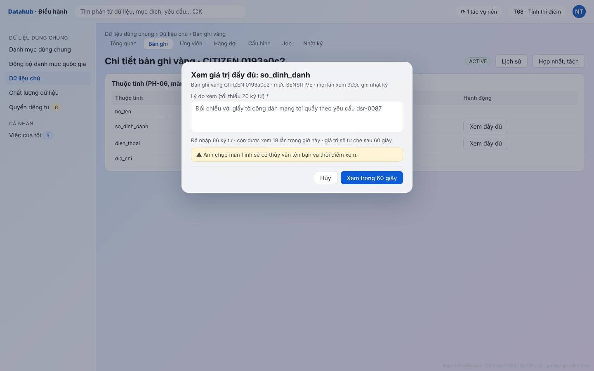

Ảnh 22b là bước nhập lý do trên màn chi tiết bản ghi vàng của PH-06 (làm mờ phía sau): ô lý do đã nhập 66 ký tự, dòng "còn được xem 19 lần trong giờ này" và cảnh báo thủy vân; nút "Xem trong 60 giây" chỉ sáng khi đủ 20 ký tự.

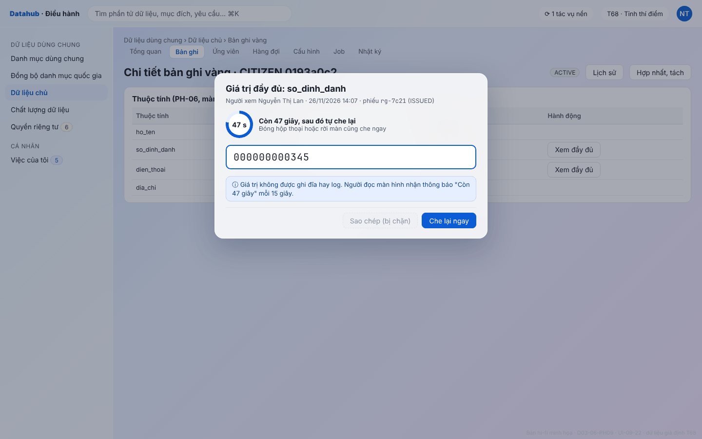

Ảnh 22 là trạng thái đang đếm ngược: vòng và chữ "47 s", dòng "Còn 47 giây, sau đó tự che lại", giá trị giả `000000000345` trong ô đặc viền xanh, nút "Sao chép" vô hiệu và nút "Che lại ngay".

### 28.2. Trường và mã lỗi

Bảng liệt kê trường nhập của UI-09-22 kèm kiểu, tính bắt buộc, mã lỗi và câu hiển thị lấy từ FRS §9.1.

| Nhãn | Kiểu | Bắt buộc | Kiểm tra, mã lỗi, câu |
|---|---|---|---|
| Lý do xem | `CMP-TextArea` | Có | Dưới 20 ký tự: ERR-09-007 "Nhập lý do tối thiểu 20 ký tự." |
| Quyền | — | — | ERR-09-041 "Bạn chưa được cấp quyền xem giá trị đầy đủ." (nút "Xem đầy đủ" cũng ẩn với người không có quyền) |
| Trường cấm xem | — | — | `neverReveal`: ERR-09-042 "Trường {tên} không cho phép xem giá trị đầy đủ." (nút vô hiệu kèm câu này) |
| Hạn mức mỗi giờ | — | — | ERR-09-043 "Đã vượt số lần xem giá trị đầy đủ trong giờ. Thử lại sau." |
| Không ghi được vết | — | — | ERR-09-010 "Chưa ghi được nhật ký kiểm toán nên thao tác bị từ chối. Thử lại sau." |
| Phiếu hết hạn khi DU xác thực | — | — | ERR-09-112 "Phiếu xem giá trị đầy đủ không hợp lệ hoặc đã hết hạn." (người dùng bấm "Xin phiếu mới") |
| PH-09 không phản hồi | — | — | ERR-09-009 "Chưa kết nối được PH-09. Thử lại sau ít phút." |

: UI-09-22, trường và mã lỗi

### 28.3. Luồng xin phiếu và hiển thị

Sơ đồ dưới cho thấy PH-09 không bao giờ thấy giá trị: PH-09 chỉ cấp phiếu sau khi ghi nhật ký, còn giá trị đi từ DU chứa dữ liệu thẳng tới trình duyệt.

```{.mermaid caption="Luồng xin phiếu và xem giá trị đầy đủ trong 60 giây"}
sequenceDiagram
  actor U as Người dùng (SO hoặc DO)
  participant D as UI-09-22 trong màn chủ
  participant P as PH-09 control plane
  participant H as DU chứa dữ liệu (ví dụ PH-06)
  U->>D: Bấm Xem đầy đủ ở ô che
  D->>U: Hiện ô nhập lý do
  U->>D: Nhập lý do 20 ký tự trở lên
  D->>P: POST reveal-grants với targetRef, fields, reason
  P->>P: Kiểm quyền, lý do, neverReveal, hạn mức mỗi giờ
  P->>P: Ghi kiểm toán trước rồi cấp phiếu hết hạn sau 60 giây
  P-->>D: 201 grantId và expiresAt
  D->>H: Lấy giá trị kèm grantId
  H->>P: reveal-grants verify grantId
  P-->>H: Phiếu hợp lệ
  H-->>D: Giá trị đã giải mã
  D->>U: Hiện giá trị, đếm ngược theo expiresAt
  D->>D: Hết 60 giây thì xóa giá trị và che lại
```

Sơ đồ cho thấy ba điểm giao diện phải giữ: không hiện giá trị nếu bước ghi nhật ký thất bại (ERR-09-010), không gọi DU nếu chưa có phiếu, và đồng hồ đếm theo `expiresAt` của máy chủ chứ không theo đồng hồ máy người dùng.

### 28.4. Đếm ngược và tự che

Bảng ghi các quy tắc đồng hồ và che lại; đây là phần nhạy nhất của tập màn.

| Quy tắc | Nội dung |
|---|---|
| Nguồn thời gian | `expiresAt` trừ `serverTime`, cả hai do API-09-102 trả cùng phiếu, nên không phụ thuộc đồng hồ trình duyệt; hiển thị làm tròn xuống giây; sai số cho phép ±1 giây (NFR-09-015) |
| Tự che | Khi còn 0 giây: xóa giá trị khỏi bộ nhớ và DOM, thay bằng `CMP-MaskedValue`, `aria-live` đọc "Đã che lại"; không dùng lại phiếu, muốn xem tiếp phải xin phiếu mới có lý do mới |
| Che sớm | Bấm "Che lại ngay", phím `Esc`, đóng hộp thoại, rời màn, đổi route, hết phiên (`ST-14`) đều che ngay |
| Tab bị ẩn | Đồng hồ vẫn chạy theo `expiresAt`; quay lại sau khi hết hạn thì thấy giá trị đã che |
| Giới hạn thời gian và WCAG 2.2.1 | Giới hạn 60 giây là ngoại lệ "cần thiết vì an ninh" của tiêu chí 2.2.1; thay vào đó người dùng xin phiếu mới (tính vào hạn mức mỗi giờ) nếu chưa đọc xong, và người dùng trình đọc màn hình được nhắc bằng chữ khi bắt đầu ("Giá trị hiện 60 giây") |
| Sao chép, in | Không chọn được chữ, bỏ qua sự kiện `copy`, `@media print` ẩn giá trị; đây là biện pháp giảm rủi ro, không ngăn được chụp màn hình nên có thủy vân |
| Bộ nhớ | Giá trị chỉ giữ ở biến cục bộ của hộp thoại; truy vấn dùng `gcTime: 0`; không ghi vào `console`, Sentry hoặc phân tích hành vi |
| Hàng loạt | UI-09-13 dùng biến thể bảng (tối đa 100 dòng) cùng quy tắc, một phiếu cho cả lô |

: UI-09-22, quy tắc đếm ngược và tự che

### 28.5. Trạng thái, phím tắt, truy cập

Bảng ghi cách UI-09-22 hiện khi đang tải, rỗng, lỗi, không quyền và khi mất kế hoạch che; phím tắt và truy cập ở ngay sau.

| Trạng thái | Hiển thị |
|---|---|
| Đang tải | Khi xin phiếu: nút ở `ST-09`, ô lý do khóa; khi lấy giá trị: skeleton ô giá trị |
| Rỗng | Không áp dụng; `fields[]` rỗng thì không mở hộp thoại |
| Lỗi | Lỗi theo mục 28.2 hiện `CMP-Alert` trong hộp, giữ lý do đã gõ; ERR-09-010 và ERR-09-043 không có nút thử lại tức thì |
| Không quyền | Người không có `PERM-09-unmask` không thấy nút "Xem đầy đủ"; mở trực tiếp bằng thuộc tính: ERR-09-041 |
| Fallback che | Không lấy được kế hoạch che hoặc phiếu: nút "Xem đầy đủ" vô hiệu, ô giá trị `●●●●` và nhãn "Không hiển thị" |

: UI-09-22, trạng thái màn

Phím tắt: `Enter` trong ô lý do không gửi (xuống dòng), `Ctrl+Enter` gửi; `Esc` che và đóng. Truy cập: `role="dialog"` và `aria-modal="true"`, focus ban đầu ở ô lý do, giữ focus trong hộp, trả về nút "Xem đầy đủ" khi đóng; khi giá trị hiện, focus chuyển tới ô giá trị (`tabindex="-1"`) để trình đọc màn hình đọc ngay, sau đó tới nút "Che lại ngay"; đồng hồ thông báo ở mốc 60, 30, 10 giây qua `aria-live="polite"` (không đọc từng giây); khi bật giảm chuyển động chỉ hiện số, không hoạt ảnh vòng; tương tác với giá trị rõ đạt tương phản 7:1 (nền đặc, chữ `color-text-primary`); vùng chạm nút 44 × 44 px.

## 29. Mẫu truy cập, kiến trúc mã giao diện, luồng người dùng chính

Chương này mô tả cách giao diện truy cập dữ liệu và tổ chức mã để thực hiện các quy ước ở chương 2, rồi nêu ba luồng người dùng chính.

### 29.1. Mẫu truy cập dữ liệu

Bảng ghi cách giao diện gọi API, lưu đệm, ghi và xử lý dữ liệu cá nhân.

| Việc | Cách làm |
|---|---|
| Gọi API | Tầng `privacyApi` sinh từ OpenAPI D03-04-PH09 (`/api/privacy/v1`); lỗi theo RFC 9457 chuyển sang `ST-11`, `ST-12`, `ST-13` |
| Bộ nhớ đệm | TanStack Query; danh mục, sổ, chính sách `staleTime` 30 giây; màn có DLCN (UI-09-13, 16, 17, 19, 22) `staleTime: 0`, `gcTime: 0` |
| Tiêu chí cá nhân | Gửi bằng `POST` (API-09-168, 190, 165); không vào URL, `localStorage`, lịch sử gợi ý |
| Ghi | `Idempotency-Key` ở mọi POST (BR-09-061) và `If-Match` ở mọi sửa; nút gửi vô hiệu tới khi có phản hồi (`ST-09`) |
| Làm mới | Tổng quan 5 phút; tác vụ nền `RUNNING` thăm dò 5 giây khi tab hiện; không dùng WebSocket ở Đợt 2 |
| Quét lỗi | Nhật ký lỗi giao diện gửi Loki chỉ gồm mã lỗi, mã truy vết, tên trường; kiểm tra bằng bộ quét hằng ngày (NFR-09-014) |
| Mã thuộc `dh-console` | Thư mục `features/privacy/` gồm `classification`, `ropa`, `purposes`, `masking`, `pseudonym`, `anonymization`, `retention`, `dsr`, `consent`, `dpia`, `breach`, `audit`, `settings`, `reveal` (UI-09-22, xuất ra `@datahub/ui` cho PH-06 và PH-19) |

: Mẫu truy cập dữ liệu và tổ chức mã giao diện PH-09

### 29.2. Luồng chính: từ yêu cầu khai thác đến chính sách có hiệu lực

Sơ đồ cho thấy một yêu cầu khai thác dữ liệu Nhạy cảm đi qua những màn nào và khi nào điểm thực thi bắt đầu cho qua.

```{.mermaid caption="Luồng lập yêu cầu, chấp thuận và phát hành gói chính sách"}
sequenceDiagram
  actor OR as Đầu mối tổ chức
  actor DO as Chủ quản dữ liệu
  participant UI as dh-console
  participant P as PH-09
  participant O as OPA và PEP
  OR->>UI: Lập yêu cầu ở UI-09-08 và gửi thẩm định
  UI->>P: submit access-request
  P-->>UI: Trạng thái SUBMITTED, vào hộp việc của DO
  DO->>UI: Mở UI-09-09, xem trường, mức, cảnh báo
  DO->>UI: Chọn Chấp thuận có điều kiện
  UI->>P: decide với điều kiện và thời hạn
  P->>P: Dựng và ký gói chính sách
  P-->>O: Đẩy gói và sự kiện chấp thuận
  O-->>UI: Điểm thực thi áp dụng trong 60 giây
  UI-->>DO: UI-09-09 tab Bundle hiện gói mới và độ trễ
```

Hình cho thấy người lập yêu cầu không duyệt (BR-09-014) và hiệu lực xuất hiện ở điểm thực thi chậm nhất 60 giây sau quyết định (NFR-09-005); DO theo dõi độ trễ ở tab "Bundle" thay vì phải hỏi vận hành.

### 29.3. Luồng chính: trả lời yêu cầu của chủ thể

SO tiếp nhận ở UI-09-16 (nhập loại yêu cầu, định danh vào trường che), xác minh danh tính, bấm "Tra cứu" để PH-09 tìm theo băm ở PH-06, PH-19 và nhật ký; tạo tác vụ chuyển cho PH-06, PH-19 hoặc bên kiểm soát khi là dữ liệu đi qua; theo dõi hạn; soạn trả lời kèm bằng chứng; chỉ đóng được khi hết tác vụ mở (ERR-09-067). Cần xem giá trị rõ thì mở UI-09-22, mỗi lần đều có lý do.

### 29.4. Luồng chính: xử lý vi phạm trong 72 giờ

Cảnh báo khai thác ở UI-09-09 hoặc người trực ghi nhận ban đầu; SO mở UI-09-19, đánh giá mức, nhập số chủ thể bị ảnh hưởng (băm), soạn thông báo Cục A05 trước mốc 60 giờ, thông báo chủ thể nếu rủi ro cao hoặc ghi căn cứ miễn trừ (ERR-09-077), ghi biện pháp khắc phục và bài học, đóng hồ sơ khi hết nghĩa vụ thông báo (ERR-09-076). UI-09-01 giữ băng đỏ cho tới khi vụ việc không còn trong hạn.

## 30. Ma trận màn hình theo vai trò

Ký hiệu: ● xem và thao tác đầy đủ theo quyền, ◐ giới hạn (chỉ đề xuất, trong phạm vi tổ chức, chỉ một bước duyệt hoặc ghi nhận ban đầu), ○ chỉ xem, — không có. Vai trò theo FRS §3.1; quyền theo FRS §3.2.

| Màn | PA | TA | TO | SO | DS | DA | DO | OR | SV | VW | AU |
|---|---|---|---|---|---|---|---|---|---|---|---|
| UI-09-01 Tổng quan | ○ | ● | ○ | ● | ● | ● | ◐ | — | — | ○ | ● |
| UI-09-02 Danh mục phân loại | ○ | ● | ○ | ● | ◐ | ○ | ◐ | — | ◐ | — | ○ |
| UI-09-03 Chi tiết phần tử | ○ | ● | ○ | ● | ◐ | ○ | ◐ | — | ◐ | — | ○ |
| UI-09-04 Kết quả quét | — | ● | — | ● | ◐ | — | — | — | — | — | — |
| UI-09-05 Sổ hoạt động xử lý | ○ | ● | ○ | ● | ◐ | ● | ◐ | — | — | — | ○ |
| UI-09-06 Biểu mẫu hoạt động | — | ● | — | ● | ◐ | — | — | — | — | — | — |
| UI-09-07 Mục đích, cơ sở | ○ | ● | — | ● | ◐ | ○ | ◐ | — | — | — | — |
| UI-09-08 Yêu cầu khai thác | — | ● | — | — | — | — | ○ | ◐ | ◐ | — | — |
| UI-09-09 Hộp việc chấp thuận | — | ○ | — | — | — | — | ◐ | — | — | — | — |
| UI-09-10 Chính sách che | ○ | ● | ○ | ● | ◐ | ◐ | — | — | — | — | ○ |
| UI-09-11 Mô phỏng che | — | ● | — | ● | ◐ | — | — | — | — | — | — |
| UI-09-12 Miền giả danh, khóa | ○ | ● | — | ● | — | ◐ | — | — | — | — | ○ |
| UI-09-13 Khôi phục giá trị gốc | — | ◐ | — | ● | — | ◐ | ◐ | — | — | — | ○ |
| UI-09-14 Ẩn danh hóa | ○ | ● | — | ● | ◐ | ◐ | — | — | — | — | ○ |
| UI-09-15 Lưu giữ, xóa | ○ | ● | — | ● | ◐ | ◐ | — | — | — | — | ○ |
| UI-09-16 Yêu cầu chủ thể | — | ● | — | ● | ● | — | — | — | — | — | — |
| UI-09-17 Sự đồng ý | — | ● | — | ● | ◐ | ◐ | — | — | — | — | — |
| UI-09-18 DPIA | — | ● | — | ● | ◐ | ● | — | — | — | — | — |
| UI-09-19 Vi phạm | — | ● | ◐ | ● | — | — | — | — | — | — | — |
| UI-09-20 Nhật ký | ○ | — | — | ○ | — | — | — | — | — | — | ○ |
| UI-09-21 Cài đặt | ◐ | ● | — | — | — | — | — | — | — | — | — |
| UI-09-22 Xem đầy đủ (nhúng) | — | — | — | ◐ | — | — | ◐ | — | — | — | — |

: Ma trận màn hình theo vai trò PH-09

Ghi chú: ma trận suy ra từ FRS §3.2 và §10.1, ô lệch FRS ghi ở mục "Đề nghị cho FRS". VW chỉ thấy số tổng hợp ở UI-09-01, không có liên kết sâu. DO chỉ thấy đối tượng thuộc tổ chức mình (quyền ○ của D02-08). TO ở UI-09-19 ghi nhận ban đầu, không đóng hồ sơ. Ở UI-09-13 SO đề nghị và thực hiện (●), DO duyệt cấp 1, TA hoặc DA duyệt cấp 2 (◐); AU xem nhật ký khôi phục (○). UI-09-22 chỉ SO, DO được cấp `PERM-09-unmask` riêng từng người.

## 31. Kiểm thử giao diện và bản hi-fi

Chương này liệt kê các nhóm kiểm thử giao diện dành riêng cho PH-09 và danh sách ảnh hi-fi để người kiểm thử đối chiếu.

### 31.1. Kiểm thử giao diện

Bảng ghi nhóm kiểm thử, nội dung và công cụ; ca chi tiết ở D05-02-PH09 (TC-09-xxx).

| Nhóm | Nội dung | Công cụ |
|---|---|---|
| Hiển thị theo quyền | Mỗi tổ hợp vai trò ở chương 30 mở màn: thấy hoặc không thấy nút; mở route trực tiếp thiếu quyền hiện `ST-07`; TO ở UI-09-20 | Playwright, tài khoản kiểm thử `T90…T99` |
| Che DLCN | Không có số định danh, họ tên, điện thoại trong URL, `document.title`, `localStorage`, nhật ký lỗi; giá trị che đến khi mở UI-09-22; mất kế hoạch che thì `●●●●` và nút vô hiệu | Playwright, quét DOM và `performance` |
| UI-09-22 | Lý do dưới 20 ký tự (ERR-09-007); hết hạn đúng 60 giây ±1 giây; `Esc`, đổi route che ngay; tab ẩn không kéo dài; hạn mức 20 lần mỗi giờ (ERR-09-043); không ghi được vết thì không hiện (ERR-09-010) | Playwright với đồng hồ giả, API giả |
| Bốn mắt | Nút duyệt vô hiệu kèm chữ cho người soạn (ERR-09-005) ở UI-09-02, 05, 10, 12, 14, 15, 18; khôi phục cần ba người khác nhau | Playwright, ba tài khoản |
| Đồng hồ và hạn | Đồng hồ 72 giờ đúng mốc 24, 48, 60 giờ (±1 phút); hạn yêu cầu chủ thể "Quá hạn" đúng ngày | Đồng hồ giả |
| Tiếp cận | Axe không lỗi nghiêm trọng; kiểm tra đếm ngược với NVDA và JAWS; màu không là kênh duy nhất (ảnh thang xám); thang rủi ro và so sánh phiên bản đọc đúng | axe-core, kiểm tra tay |
| Hiệu năng | Danh sách UI-09-02 ≤ 1 giây p95 với 50.000 phần tử; mô phỏng 1.000 dòng ≤ 5 giây (NFR-09-023); Lighthouse tiếp cận ≥ 95 | k6, Lighthouse |

: Nhóm kiểm thử giao diện PH-09

### 31.2. Danh sách ảnh hi-fi

Bảng liệt kê 13 ảnh PNG ở `ph09/hifi/` và điểm cần kiểm tra trên mỗi ảnh; kích thước mỗi ảnh dưới 100 KB.

| Ảnh | Màn | Nội dung nổi bật |
|---|---|---|
| `ph09/hifi/ui-09-01.png` | UI-09-01 | Hai băng cảnh báo, năm thẻ, xu hướng |
| `ph09/hifi/ui-09-02.png` | UI-09-02 | Cây hệ thống, chọn hàng loạt, "coi như SENSITIVE" |
| `ph09/hifi/ui-09-05.png` | UI-09-05 | Sổ năm trạng thái, băng 23 trường chưa thuộc hoạt động |
| `ph09/hifi/ui-09-06.png` | UI-09-06 | Wizard bước 3, mục còn thiếu |
| `ph09/hifi/ui-09-09.png` | UI-09-09 | Hộp việc, điều kiện, ba nút quyết định |
| `ph09/hifi/ui-09-10.png` | UI-09-10 | Quy tắc che, so sánh phiên bản, lỗi ưu tiên |
| `ph09/hifi/ui-09-11.png` | UI-09-11 | Mô phỏng có dòng rò rỉ |
| `ph09/hifi/ui-09-13.png` | UI-09-13 | Chuỗi duyệt ba người, cửa sổ thực hiện |
| `ph09/hifi/ui-09-14.png` | UI-09-14 | Báo cáo rủi ro `MEDIUM`, k = 12 |
| `ph09/hifi/ui-09-16.png` | UI-09-16 | Yêu cầu chủ thể đã che, đóng bị chặn |
| `ph09/hifi/ui-09-19.png` | UI-09-19 | Đồng hồ 72 giờ, thông báo |
| `ph09/hifi/ui-09-22b.png`, `ui-09-22.png` | UI-09-22 | Nhập lý do; đang đếm ngược 47 giây |

: Danh sách ảnh hi-fi PH-09

Ảnh dựng bằng `ph09/hifi/gen_hifi.py` (HTML tĩnh theo token D03-05, dùng chung `hifi.css` với PH-06) và `shot.js` (Playwright, 1440 rộng, `deviceScaleFactor` 1), rồi `nen.py` nén tới khoảng 150 KB mỗi ảnh. Chạy lại: `python3 gen_hifi.py && node shot.js && python3 nen.py`. Dữ liệu là giả định của tỉnh thí điểm T68; mọi giá trị cá nhân trên ảnh là dữ liệu giả, số định danh luôn che.

## Phụ lục A. Đề nghị bổ sung cho D03-05

> **Đợt đồng bộ chéo cuối (27/11/2026).** Các đề nghị dưới đây đã được xét; kết luận từng dòng (đã sửa, đã khớp sẵn, câu hỏi mở, không làm) ghi ở [D00-03-01 Sổ đồng bộ chéo cuối](../../00-chung/D00-03-01-so-dong-bo-cuoi.md).

Bảng ghi các thành phần và token mới PH-09 đã đề nghị bổ sung vào bộ chung. Sau đợt đồng bộ chéo cuối, cột cuối ghi thành phần chuẩn của D03-05-03, D03-05-04 (§14.2 ánh xạ tên) mà tập này dùng; không còn thành phần tự dựng.

| # | Đề nghị | Nơi dùng | Thành phần chuẩn |
|---|---|---|---|
| A1 | `RevealDialog`: hộp thoại xem giá trị đầy đủ có lý do, đếm ngược theo `expiresAt`, tự che, biến thể bảng | UI-09-22, UI-09-13; PH-06, PH-19 | `CMP-MaskedValue` `revealable` cộng `CMP-ReasonDialog` (D03-05-03 §8.5); không có thành phần `RevealDialog` riêng |
| A2 | `CountdownRing`: vòng đếm ngược kèm chữ, `aria-live` theo mốc, tắt hoạt ảnh khi giảm chuyển động | UI-09-22 | Không nhận vòng tròn (D03-05-03 §6.3 không dùng `Progress` kiểu `circle`): đếm ngược bằng chữ `CMP-Duration` theo `expiresAt` của `CMP-MaskedValue`, cập nhật cho trình đọc màn hình theo mốc |
| A3 | `DeadlineClock`: đồng hồ có mốc (24, 48, 60, 72 giờ), màu và chữ theo mốc | UI-09-19, UI-09-01 | `CMP-ProgressBar` biến thể `milestone` cộng `CMP-Duration` (D03-05-03 §6.3, mốc 24, 48, 60, 72 giờ) |
| A4 | `ApprovalChain`: chuỗi duyệt nhiều cấp, mỗi cấp có người, thời điểm, trạng thái | UI-09-13 | `CMP-ApprovalPanel` với trường `levels` (D03-05-04 §10.2) |
| A5 | `RiskMeter`: thang `LOW`, `MEDIUM`, `HIGH` có vạch ngưỡng (chung với ScoreMeter đề nghị ở PH-06) | UI-09-14 | `CMP-ScoreMeter` biến thể `risk` (D03-05-04 §13.18) |
| A6 | Biến thể `CMP-MaskedValue` `revealed` và `fallback` ("Không hiển thị"); `Watermark` cho thủy vân người xem | Mọi màn có DLCN | `CMP-MaskedValue` có `expiresAt`, `fallbackText` và thủy vân người xem `watermark` (D03-05-03 §8.5) |
| A7 | `RuleTable`: bảng quy tắc có đổi thứ tự bằng bàn phím (`Alt+↑`, `Alt+↓`) và thông báo `aria-live` | UI-09-10 | `CMP-EditableTable` có `reorderable` (kéo hoặc `Alt+↑/↓`, D03-05-04 §13.1) |
| A8 | Ghi chú ánh xạ `DataClass` sang sắc thái (Công khai neutral, Nội bộ info, Hạn chế warning, Nhạy cảm error) | Mọi màn PH-09, PH-06 | Mục 5.1 |

: Đề nghị bổ sung cho D03-05

## Phụ lục B. Đề nghị bổ sung API

> **Đợt đồng bộ chéo cuối (27/11/2026).** Các đề nghị dưới đây đã được xét; kết luận từng dòng (đã sửa, đã khớp sẵn, câu hỏi mở, không làm) ghi ở [D00-03-01 Sổ đồng bộ chéo cuối](../../00-chung/D00-03-01-so-dong-bo-cuoi.md).

Các trường phản hồi và API dưới đây giúp màn hiển thị đủ mà không phải gọi nhiều lần; việc định nghĩa chi tiết thuộc D03-04-PH09. Cột "Trạng thái" ghi kết quả sau khi FRS 0.2 và D03-04-PH09 bản 0.2 đã đồng bộ.

| # | Đề nghị | Màn | Trạng thái |
|---|---|---|---|
| B1 | API-09-218 trả `unclassifiedCount`, `blockedContracts`, `dsrOverdue`, `breachClocks[]`, `bundleAgeSeconds`, `staleEnforcementPoints` | UI-09-01 | Còn mở: OpenAPI trả danh sách chỉ số chung `metrics[]` (mã, giá trị, xu hướng, liên kết); cần chốt mã chỉ số với tập API |
| B2 | API-09-064 trả mỗi mục kèm `similarGrants`, `anomalies90d`, `orgQuotaUsed`, `overQuota` | UI-09-09 | Còn mở: chưa có trong OpenAPI; giao diện tạm gọi API-09-060, 080 để ghép |
| B3 | API-09-101 trả mỗi ô `ruleId`, `maskType`, cờ `leak`; phản hồi tổng `passed`, `goldenSetResult` | UI-09-11 | Một phần: OpenAPI trả `passed`, `issues[]`, `sampleResult[]`; `goldenSetResult` còn mở |
| B4 | API-09-102 trả thêm `serverTime`, `remainingThisHour` | UI-09-22 | Đã có ở FRS 0.2 (FR-09-029) và OpenAPI |
| B5 | API-09-010 lọc theo `contractId`, `status`, `provisional`, `blocked` | UI-09-02 | Một phần: có `contractId`, `status`; `provisional`, `blocked` còn mở |
| B6 | API-09-164 trả `overdue`, `dueAt`, đếm theo phân vùng | UI-09-16 | Đã có: `overdue`, `dueAt` trong `SubjectRequest`, lọc `overdue`; đếm theo phân vùng còn mở |
| B7 | `POST /consents:search` nhận định danh trong thân, trả danh sách theo băm (control plane) | UI-09-17 | Đã có: API-09-245 |
| B8 | API-09-224 trả mỗi tham số `default`, `floor`, `ceiling`, `source` | UI-09-21 | Đã có: `Setting` thêm `defaultValue` và `source` ở OpenAPI 0.2 |

: Đề nghị bổ sung API và trạng thái

## Đề nghị đồng bộ

> **Đợt đồng bộ chéo cuối (27/11/2026).** Các đề nghị dưới đây đã được xét; kết luận từng dòng (đã sửa, đã khớp sẵn, câu hỏi mở, không làm) ghi ở [D00-03-01 Sổ đồng bộ chéo cuối](../../00-chung/D00-03-01-so-dong-bo-cuoi.md).

Phần này gom việc cần sửa ở FRS và tài liệu chung; tập màn không tự sửa các tài liệu đó.

### Kết quả đồng bộ với FRS D02-03-PH09 bản 0.2

Mười hai đề nghị C1 đến C12 của bản 0.1 đã được FRS 0.2 xử lý (Phụ lục C của FRS, các dòng "MH C1" đến "MH C12"); bảng ghi kết quả và chỗ tập màn đã sửa theo.

| # | Đề nghị bản 0.1 | Kết quả ở FRS 0.2 | Đã sửa trong tập |
|---|---|---|---|
| C1 | UI-09-09 liệt kê TA không có quyền duyệt | §10.1 ghi DO duyệt, TA xem và phát hành bundle | Khối UI-09-09 giữ nguyên |
| C2 | UI-09-20 liệt kê TO không có `PERM-09-audit-read` | Bỏ TO, thêm PA | UI-09-20: vai trò, trạng thái không quyền |
| C3 | UI-09-12 trùng UI-09-13 | UI-09-12 chỉ liên kết sang UI-09-13 | Giữ nguyên |
| C4 | Thêm DO, TO, PA vào UI-09-01, SV vào UI-09-02, 03 | Đã thêm | UI-09-01, UI-09-03 |
| C5 | Thêm FR-09-063 vào UI-09-21 | Đã thêm | Bảng 1.5 |
| C6 | Tab con ở 10.3 | Đã bổ sung | Bảng đường dẫn mục 4.3 đã khớp |
| C7 | OR cần đề nghị gia hạn | Loại yêu cầu `RENEWAL` và `renewsGrantId` | UI-09-08: hai trường và nút "Đề nghị gia hạn" |
| C8 | Tra đồng ý theo định danh | API-09-245 | UI-09-17 |
| C9 | ERR-09-079, 080 | Có ở §9.1, câu đúng như đề nghị | UI-09-20, UI-09-11 |
| C10 | Đồng hồ theo `expiresAt` và `serverTime`, 60 giây cho kết quả khôi phục | FR-09-029, 033 | UI-09-22 mục 28.4, UI-09-13 |
| C11 | Ghi rõ chức năng data plane không có màn | §10.1 | Không cần sửa |
| C12 | `RESTRICT` và `RESTRICTION` | Giữ `RESTRICT`, ánh xạ ở Phụ lục B của FRS | Không cần sửa |

: Kết quả đồng bộ đề nghị của tập màn với FRS 0.2

### Đề nghị cho tài liệu chung

Bảng ghi tài liệu chung cần sửa theo kết quả thiết kế màn và nội dung đề nghị cho từng tài liệu.

| Tài liệu | Đề nghị |
|---|---|
| D03-05-03, 04 | Phụ lục A của tập này (A1 đến A8) |
| D03-06-00 §2.3.2 | Menu số 23 đã đúng; thêm quy ước "thành phần nhúng không có route" cho UI-09-22 và danh sách màn chủ (UI-06-03, PH-19) |
| D03-06-PH06 | UI-06-03 và UI-06-16 gọi UI-09-22 và UI-09-16; thay mô tả nút "Hiện…" bằng "Xem đầy đủ" mở hộp thoại dùng chung |
| D02-08 §3.2, §4 | Thêm 13 quyền `PERM-09-*` theo FRS Phụ lục B; cặp loại trừ SO với `PERM-09-purpose-approve`, DS với DA |
| D00-02 | ADR đề xuất 090 (điểm quyết định chính sách tập trung: PH-09 là PAP và PIP, OPA là PDP), 091 (giả danh hóa HMAC và token), 092 (ẩn danh hóa ARX), 093 (phát hiện DLCN bằng mẫu và kiểm tổng); giao diện UI-09-22, UI-09-10 dựa trên 090, UI-09-12 trên 091, UI-09-14 trên 092, UI-09-04 trên 093 |
| D00-04 | Chạy lại `kiem_tra_ma.py --cap-nhat-so-tra-cuu` khi nhận tập này |

: Đề nghị đồng bộ cho tài liệu chung

## Câu hỏi mở

> **Câu hỏi mở Q09-30:** Đã chốt ở FRS 0.2: UI-09-20 dành cho SO, AU, PA; TO không được cấp `PERM-09-audit-read` để giữ nguyên tắc tối thiểu quyền. Vẫn mở: có nên cho TO xem riêng nhật ký thao tác của vụ việc mình ghi nhận; đề xuất chưa làm ở Đợt 2.

> **Câu hỏi mở Q09-31:** Giới hạn 60 giây ở UI-09-22 có đủ cho người dùng trình đọc màn hình; đề xuất thử với NVDA, JAWS và cho phép xin phiếu mới tính vào hạn mức mỗi giờ thay vì kéo dài thời gian.

> **Câu hỏi mở Q09-32:** Chặn sao chép và in giá trị đầy đủ chỉ giảm rủi ro, không ngăn được chụp màn hình; đề xuất giữ thủy vân tên và thời điểm, không dùng biện pháp mạnh hơn (làm mờ khi chụp) vì ảnh hưởng truy cập.

> **Câu hỏi mở Q09-33:** Màn chứa DLCN có cần tự làm mờ khi tab mất focus quá 2 phút (đồng bộ Q06-38); đề xuất làm mờ ở UI-09-13, 16, 19 và UI-09-22.

> **Câu hỏi mở Q09-34:** Ở UI-09-11, người dùng có thể dán dữ liệu thật vào ô dữ liệu mẫu; đề xuất quét mẫu DLCN thật (số định danh đúng kiểm tổng) ở phía máy khách trước khi gửi và từ chối bằng ERR-09-080; máy chủ cũng quét mẫu và trả ERR-09-080 (FR-09-025), nên quét ở máy khách chỉ để báo sớm.

> **Câu hỏi mở Q09-35:** Nhập số định danh chủ thể ở UI-09-16 bằng tay hay hỗ trợ quét mã từ VNeID; đề xuất chỉ nhập tay ở Đợt 2, cân nhắc quét mã ở Đợt 3 (Q09-11).

> **Câu hỏi mở Q09-36:** Phím đơn `A`, `C`, `R`, `I` ở UI-09-09 có xung đột với phần mềm đọc màn hình hoặc bộ gõ tiếng Việt không; đề xuất thử với NVDA, JAWS, Unikey, và cho tắt trong cài đặt cá nhân.

> **Câu hỏi mở Q09-37:** Đồng hồ 72 giờ ở UI-09-19 chạy liên tục đến khi thông báo Cục A05 đã gửi (BR-09-054); cần kênh nhắc ngoài giờ (tin nhắn, thư điện tử) khi qua mốc 48 và 60 giờ; đề xuất SMS và thư điện tử tới SO trực.

> **Câu hỏi mở Q09-38:** Hồ sơ DPIA và sổ hoạt động có cần xem trước dạng in (mẫu `ROPA_A05`, Q09-03) ngay trong màn; đề xuất xuất tệp và xem ở ngoài, không dựng trình xem in ở Đợt 2.

> **Câu hỏi mở Q09-39:** DO có cần duyệt chấp thuận trên điện thoại khi đi công tác; đề xuất UI-09-09 và UI-09-13 dùng được ở `bp-sm` (đọc và quyết), các màn khác từ `bp-md` trở lên.

## Lịch sử phiên bản

| Phiên bản | Ngày | Người | Nội dung |
|---|---|---|---|
| 0.1 | 26/11/2026 | Nhóm phân hệ PH-09 | Bản đầu: 22 màn UI-09-01…22 theo FRS 0.1 §10.1, 13 ảnh hi-fi, ma trận vai trò, kiểm thử, phụ lục A, B, đề nghị đồng bộ, câu hỏi mở Q09-30…39 |

: Lịch sử phiên bản D03-06-PH09
| 0.2 | 26/11/2026 | Nhóm phân hệ PH-09 | Đồng bộ FRS 0.2: vai trò UI-09-01, 03, 20 (bỏ TO ở UI-09-20), FR-09-063 ở UI-09-21, loại yêu cầu `RENEWAL`, API-09-238, 241 đến 245 vào các màn, ERR-09-003, 079, 080, 081, 082 theo câu của §9.1, `serverTime` và `remainingThisHour` ở UI-09-22, đồng hồ vi phạm dừng khi đã thông báo, Phụ lục B có trạng thái, đề nghị cho FRS thành bảng kết quả |
| 0.3 | 27/11/2026 | Nhóm phân hệ PH-09 | Đồng bộ chéo cuối: Phụ lục A ghi thành phần chuẩn của D03-05 thay cho phần dùng tạm (RevealDialog, DeadlineClock, ApprovalChain, RiskMeter, RuleTable, MaskedValue); không nhận CountdownRing; chốt câu hỏi mở đợt đồng bộ: Q393 |
