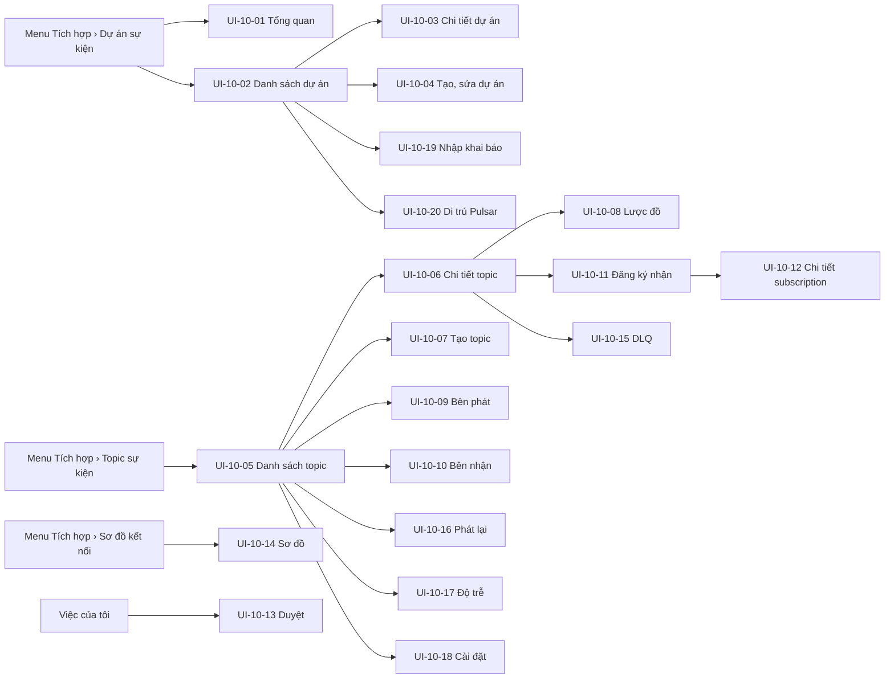

# D03-06-PH10 · Thiết kế giao diện màn hình Sự kiện

Tập màn **không tự đặt** token, `CMP-*` hay `PTN-*`; mọi tên dùng ở đây có trong D03-05-02, D03-05-03, D03-05-04 và D03-06-00. Thành phần hoặc token còn thiếu ghi ở Phụ lục A. Enum, trường, mã lỗi, quyền, route lấy đúng Phụ lục A của [D02-03-PH10](../../02-yeu-cau/frs/D02-03-PH10-frs-su-kien.md); chỗ FRS chưa có ghi ở Phụ lục C.

## Tóm tắt cho hội đồng thẩm định

PH-10 thay Hub Apache Pulsar của hệ cũ bằng trục sự kiện Kafka có đăng ký lược đồ bắt buộc. Tài liệu đặc tả 20 màn (UI-10-01…20) trên `dh-console`, chia năm nhóm: tổng quan và dự án (01–04), topic và lược đồ (05–08), bên tham gia và đăng ký nhận (09–12), duyệt và sơ đồ (13–14), vận hành, cài đặt, di trú (15–20).

Bốn quyết định giao diện chính:

1. **Giữ đủ màn có giá trị của Hub cũ, đặt lại theo nghiệp vụ.** Bốn thẻ đếm (publisher, subscriber, project, topic), sơ đồ kết nối, quản lý project, topic, publisher, subscriber, publication, subscription và hai danh mục `type_of_comm`, `routing_mode` đều còn (mục 3). Biểu đồ CPU, bộ nhớ cụm chuyển sang PH-13, màn tổng quan chỉ còn liên kết.
2. **Sơ đồ kết nối (UI-10-14) là màn siêu chi tiết.** Đồ thị ba lớp bên phát, topic, bên nhận ở chế độ chỉ xem của `CMP-FlowCanvas`; lọc theo dự án; bốn lớp phủ đúng enum `overlay` (`NONE`, `LAG`, `TRAFFIC`, `DLQ`); mọi thông tin màu đều có chữ hoặc hình đi kèm; có chế độ danh sách thay thế cho người dùng bàn phím và trình đọc màn hình.
3. **Đăng ký nhận (UI-10-11) và chi tiết subscription (UI-10-12) là màn rất chi tiết.** Bốn chế độ giao nhận `PUSH`, `PULL_API`, `PULL_KAFKA`, `INTERNAL` có biểu mẫu riêng; webhook phải xác minh endpoint trước khi gửi duyệt; lịch thử lại vẽ trước bằng biểu đồ; khóa ký chỉ hiện một lần; mỗi trường kiểm tra đúng ràng buộc FR-10-035 và ERR-10.
4. **Không có thao tác nào làm thay đổi cụm mà không qua duyệt bốn mắt.** Nút duyệt vô hiệu kèm lý do khi người xem là người tạo hoặc người gửi (BR-10-010); giao diện chỉ hiện nút theo `PERM-10-*` và trạng thái đối tượng.

Kính Liquid Glass chỉ dùng cho lớp điều hướng và lớp nổi; bảng, biểu mẫu, canvas, biểu đồ là nền đặc để đạt WCAG 2.2 AA (ADR-020).

## 1. Mục đích, phạm vi và tài liệu liên quan

### 1.1. Mục đích

Đặc tả đủ để đội giao diện dựng ngay, kiểm thử viên viết ca kiểm thử và hội đồng thẩm định thấy rõ chức năng hệ cũ được giữ: mỗi màn có đường dẫn, mẫu bố cục, quyền, API gọi, wireframe, thành phần, trường với kiểm tra hợp lệ, hành động, trạng thái, phím tắt, khả năng truy cập và bản hi-fi ở mức token.

Thứ tự ưu tiên khi mâu thuẫn: D02-08 (phân quyền), D03-05 (design system), D03-06-00 (kiến trúc thông tin, mẫu màn), D02-03-PH10 (FRS, Phụ lục A là nguồn chuẩn mã), rồi tài liệu này.

### 1.2. Danh sách màn và mức chi tiết

| Mã | Tên | PTN | Mức chi tiết | FR |
|---|---|---|---|---|
| UI-10-01 | Tổng quan sự kiện | PTN-06 | Đầy đủ | FR-10-016, 057, 062 |
| UI-10-02 | Danh sách dự án | PTN-01 | Đầy đủ | FR-10-001, 003, 005, 070 |
| UI-10-03 | Chi tiết dự án | PTN-02 | Đầy đủ | FR-10-002, 004, 005, 008 |
| UI-10-04 | Tạo, sửa dự án | PTN-04 | Đầy đủ | FR-10-003, 004 |
| UI-10-05 | Danh sách topic | PTN-01 | Đầy đủ | FR-10-006 |
| UI-10-06 | Chi tiết topic | PTN-02 | Rất chi tiết | FR-10-007, 010…016, 024 |
| UI-10-07 | Tạo topic | PTN-05 (Drawer nhanh PTN-04) | Rất chi tiết | FR-10-008, 017 |
| UI-10-08 | Soạn và so sánh lược đồ | PTN-03 | Rất chi tiết | FR-10-017…022 |
| UI-10-09 | Bên phát | PTN-01, PTN-02 | Đầy đủ | FR-10-025, 026, 028, 030, 032 |
| UI-10-10 | Bên nhận | PTN-01, PTN-02 | Đầy đủ | FR-10-025, 027, 028 |
| UI-10-11 | Đăng ký nhận sự kiện | PTN-05 | **Rất chi tiết** | FR-10-035, 036, 040 |
| UI-10-12 | Chi tiết subscription | PTN-02 | **Rất chi tiết** | FR-10-041, 042, 046, 047, 054…056 |
| UI-10-13 | Duyệt yêu cầu sự kiện | PTN-10 | Rất chi tiết | FR-10-009, 011, 019, 031, 037, 051, 073 |
| UI-10-14 | Sơ đồ kết nối | PTN-07 (chỉ xem) | **Siêu chi tiết** | FR-10-058 |
| UI-10-15 | DLQ tầng sự kiện | PTN-11 | Đầy đủ | FR-10-049, 050, 053 |
| UI-10-16 | Phát lại sự kiện | PTN-01, PTN-05 | Đầy đủ | FR-10-051, 052 |
| UI-10-17 | Theo dõi độ trễ tiêu thụ | PTN-11 | Đầy đủ | FR-10-054, 055 |
| UI-10-18 | Cài đặt sự kiện | PTN-12 | Đầy đủ | FR-10-060…063 |
| UI-10-19 | Nhập khai báo | PTN-09 | Rút gọn (Đợt sau) | FR-10-071 |
| UI-10-20 | Di trú từ Pulsar | PTN-01 | Đầy đủ | FR-10-072…076 |

"Đầy đủ" là có đủ các mục theo khuôn K-MH; "Rất chi tiết" thêm giải phẫu vùng, trường theo từng nhánh và ca biên; "Siêu chi tiết" thêm lưới bố cục, kích thước, giải phẫu từng phần tử, mọi trạng thái, chuột, bàn phím và hiệu năng như UI-04-04.

### 1.3. Tài liệu liên quan

| Tài liệu | Dùng để |
|---|---|
| [D02-03-PH10](../../02-yeu-cau/frs/D02-03-PH10-frs-su-kien.md) | FR, BR, ERR-10, PERM-10, Phụ lục A (enum, trường, tham số `10.*`, route UI) |
| [D02-04-PH10](../../02-yeu-cau/use-case/D02-04-PH10-use-case-su-kien.md) | Kịch bản người dùng, dữ liệu ví dụ |
| [D03-02-PH10](../sdd/D03-02-PH10-sdd-su-kien.md) | Thành phần `dh-integration`, `dh-runtime`, cách tính lag, cách dựng đồ thị |
| D03-04-PH10 (đang viết song song) | Định nghĩa đầy đủ API-10-001…091; tài liệu này dẫn chiếu theo số API ở FRS §8.3 |
| [D03-05-02](D03-05-02-design-token.md), [D03-05-03](D03-05-03-thanh-phan-nguyen-tu.md), [D03-05-04](D03-05-04-thanh-phan-phuc-hop.md) | Token, thành phần nguyên tử, phức hợp |
| [D03-06-00](D03-06-00-ia-layout-mau-man-hinh.md) | Cây menu, quy tắc URL, PTN-01…14, ST-01…15 |
| [D03-06-PH04](D03-06-PH04-man-hinh-tich-hop.md), [D03-06-PH05](D03-06-PH05-man-hinh-bo-dieu-hop.md) | Màn chọn topic trong trình thiết kế luồng, màn CDC đăng ký topic |

## 2. Nguyên tắc thiết kế áp dụng cho PH-10

### 2.1. Bản đồ vật liệu

| Vùng | Thành phần | Vật liệu | Lý do |
|---|---|---|---|
| Thanh trên, sidebar | `CMP-AppShell`, `CMP-Topbar`, `CMP-Sidebar` | `glass-chrome` (cuộn: `glass-chrome-scrolled`) | Lớp điều hướng |
| Tiêu đề trang, hàng tab trang | `CMP-PageHeader`, `CMP-Tabs` | Đặc trên `color-canvas` | Nội dung |
| Bảng, biểu mẫu, mô tả, thẻ chỉ số | `CMP-DataTable`, `CMP-Form`, `CMP-DescriptionList`, `CMP-KpiCard`, `CMP-StatCard` | Đặc `color-surface-solid` | Nội dung dày, chữ nhỏ |
| Trình soạn lược đồ, khối mã mẫu, nội dung DLQ | `CMP-CodeEditor`, `CMP-CodeBlock`, `CMP-JsonViewer` | Đặc `color-surface-solid-2` | Mã cần tương phản cao |
| Biểu đồ lưu lượng, lag, thống kê giao nhận | `CMP-Chart` | Đặc `color-surface-solid` | Số liệu phải đọc chắc |
| Canvas sơ đồ kết nối | `CMP-FlowCanvas` biến thể `readonly` | Đặc `color-surface-solid-2`, lưới chấm `color-border-subtle` | Nút và cạnh cần tương phản ổn định (PTN-07) |
| Điều khiển nổi trên canvas | `CMP-CanvasControls`, `CMP-Minimap`, thanh lớp phủ | `glass-overlay` | Lớp nổi |
| Drawer tạo nhanh, chi tiết nút, sửa tham số | `CMP-Drawer` | Khung `glass-modal`, giếng nội dung đặc | Lớp nổi chứa nội dung dày |
| Hộp lý do, xác nhận, xung đột, bí mật | `CMP-ReasonDialog`, `CMP-ConfirmDialog`, `CMP-ConflictDialog`, `CMP-Modal` | Khung `glass-modal`, nội dung đặc | Lớp nổi |
| Menu, popover, tooltip, gợi ý chọn | `CMP-DropdownMenu`, `CMP-Popover`, `CMP-Tooltip`, popup `CMP-ResourceSelect` | `glass-overlay` | Lớp nổi |

Khi người dùng bật giảm trong suốt hoặc trình duyệt tự hạ cấp (D03-05-01), lớp kính chuyển `glass-lite-tint` hoặc `glass-off-tint`. Không màn nào dựa vào độ trong để truyền thông tin.

### 2.2. Mật độ

Danh sách, chi tiết và biểu mẫu dùng mật độ thường (điều khiển `size-control-md` 32 px, hàng bảng `size-table-row` 40 px). Sơ đồ kết nối và bảng độ trễ dùng mật độ gọn (`data-density="compact"`) vì một tenant tỉnh có thể có vài trăm nút và vài trăm subscription (giả định GĐ-01: 200 HTTT). Vùng chạm tối thiểu 24 × 24 px (WCAG 2.5.8).

### 2.3. Ngôn ngữ và thuật ngữ

Giao diện dùng thuật ngữ tiếng Việt, giữ thuật ngữ gốc khi người dùng hệ cũ đã quen. Thuật ngữ gốc tiếng Anh hiện ở tooltip lần đầu xuất hiện trên mỗi màn.

| Khái niệm (tên trường, thực thể) | Nhãn giao diện | Ghi chú |
|---|---|---|
| `EventProject` | Dự án sự kiện | Hệ cũ: project |
| `Topic` | Topic | Giữ nguyên, người dùng Hub đã quen |
| `Publisher` | Bên phát | Tooltip "publisher" |
| `Subscriber` | Bên nhận | Tooltip "subscriber" |
| `Publication` | Quyền phát | Tooltip "publication: bên phát được phép phát lên topic" |
| `Subscription` | Đăng ký nhận | Tooltip "subscription"; trong bảng kỹ thuật giữ "subscription" |
| `EventSchema`, `SchemaVersion` | Lược đồ, phiên bản lược đồ | |
| `consumerGroup` | Nhóm tiêu thụ | |
| `lagSeconds`, `lagRecords` | Độ trễ (giây), số bản tin tồn | |
| `DlqEntry` | Mục DLQ | "Hàng đợi lỗi" ở tooltip |
| `ReplayRequest` | Lượt phát lại | |
| `MigrationBridge` | Cầu nối di trú | |

### 2.4. Hành động theo quyền và trạng thái

Mỗi đối tượng trả về từ API có `allowedActions` tính ở máy chủ theo quyền, trạng thái và bốn mắt (theo cách PH-04, PH-05). Giao diện chỉ dùng mảng này để hiện, ẩn hay vô hiệu nút, không tự suy luận lại; nếu API chưa trả `allowedActions` cho một đối tượng, ghi ở Phụ lục B. Quy tắc hiển thị theo D03-06-00 §2.6: thiếu quyền thì **ẩn** nút; có quyền nhưng trạng thái không cho thì **vô hiệu** kèm `CMP-Tooltip` nêu lý do (ví dụ "Topic đang chờ duyệt, không sửa được cấu hình."). Nút duyệt khi người xem là người tạo hoặc người gửi hiện vô hiệu với lý do "Bạn đã gửi yêu cầu này, cần người khác duyệt (bốn mắt)." để người dùng hiểu vì sao.

### 2.5. Bí mật trên giao diện

Chỉ có một loại bí mật hiện trên giao diện PH-10: khóa ký webhook (tiền tố `whsec_`). Khóa hiện đúng một lần bằng `CMP-SecretField` chế độ `issue` sau khi subscription `PUSH` được duyệt hoặc sau khi xoay, thu hồi khẩn (FR-10-037, FR-10-042, BR-10-027). Không có nút "hiện lại"; khóa không bao giờ có trong URL, bộ đệm truy vấn, tệp xuất hay thông báo. Danh sách khóa chỉ hiện `keyId`, `status`, `activatedAt`, `previousUntil`, `revokedAt`.

### 2.6. Giữ trạng thái trên URL

Bộ lọc, sắp xếp, trang, tab, lớp phủ sơ đồ, khoảng thời gian biểu đồ và nút đang chọn trên sơ đồ ghi lên query theo D03-06-00 §2.4 (`q`, `trang`, `co`, `sap-xep`, `khoang`, `chon`, tên trường). Giá trị enum trên URL viết chữ thường gạch nối từ mã enum (ví dụ `trang-thai=pending-approval,active`, `lop-phu=lag`), bộ chuyển đổi đặt chung trong `features/event/url.ts`. `topicName` có dấu chấm, dùng nguyên văn trong path sau khi `encodeURIComponent`.

### 2.7. Dữ liệu sống và tác vụ dài

Số đếm, lag, lưu lượng làm mới theo chu kỳ: tổng quan và sơ đồ 30 giây (FR-10-057), bảng độ trễ 30 giây theo `10.lag.collect-interval-seconds`, tiến độ phát lại 5 giây (FR-10-052), trạng thái cấp phát topic, subscription 5 giây khi đang `PROVISIONING`. Làm mới dừng khi tab trình duyệt ẩn (`document.visibilityState`) và chạy lại ngay khi hiện. Mỗi khối có `CMP-Timestamp` "Cập nhật lúc hh:mm:ss" và nút làm mới tay. Xuất khai báo, loại bỏ DLQ theo bộ lọc, nhập kiểm kê Pulsar chạy nền với `CMP-JobProgress` và `CMP-BackgroundTaskTray` (FR-00-054).

### 2.8. Định dạng số và thời gian

| Loại | Hiển thị | Thành phần |
|---|---|---|
| Độ trễ giây | Dạng thời lượng ngắn: "45 giây", "12 phút 30 giây", "3 giờ 5 phút"; trong ô bảng dạng gọn "12 ph 30 g" | `CMP-Duration` |
| Số bản tin | Phân cách nghìn bằng dấu chấm, rút gọn từ một triệu "1,2 triệu" kèm tooltip số đầy đủ | `CMP-Text` với `font-feature-tabular` |
| Byte | KiB, MiB theo cơ số 1024 ("256 KiB", "10 MiB/giây") | `CMP-Text` |
| Thời điểm | Tương đối khi dưới 24 giờ ("5 phút trước"), tuyệt đối `dd/MM/yyyy HH:mm` khi lâu hơn; tooltip luôn có giờ đầy đủ múi +07:00 | `CMP-Timestamp` |
| Tên topic, mã | Phông đơn cách `font-mono-sm`, có nút sao chép khi rê | `CMP-Identifier`, `CMP-CodeText`, `CMP-CopyButton` |

## 3. Màn hệ cũ được giữ lại thành gì

Theo quyết định phạm vi Q4 (giữ toàn bộ nghiệp vụ hệ cũ và màn có giá trị vận hành, D00-04 §5), mọi màn của Hub Pulsar được ánh xạ sang màn mới. Bảng dưới là ma trận truy vết `LGC` sang `UI`; ma trận `LGC` sang FR đầy đủ ở FRS §9.1.

### 3.1. Danh sách màn hệ cũ và màn mới

| LGC | Màn hoặc chức năng hệ cũ | Màn mới | Cách giữ | Ghi chú |
|---|---|---|---|---|
| LGC-HUB-001 | Dashboard: thẻ tổng số publisher | UI-10-01 thẻ "Bên phát" | Giữ nguyên, thêm phân rã trạng thái | Bấm thẻ mở UI-10-09 đã lọc |
| LGC-HUB-002 | Dashboard: thẻ tổng số subscriber | UI-10-01 thẻ "Bên nhận" | Giữ nguyên, thêm phân rã | Mở UI-10-10 |
| LGC-HUB-003 | Dashboard: thẻ tổng số project | UI-10-01 thẻ "Dự án" | Giữ nguyên | Mở UI-10-02 |
| LGC-HUB-004 | Dashboard: thẻ tổng số topic | UI-10-01 thẻ "Topic" | Giữ nguyên, thêm phân rã | Mở UI-10-05 |
| LGC-HUB-005 | Biểu đồ % Memory theo giây | Không có ở PH-10 | Thay thế bằng PH-13 | UI-10-01 có liên kết "Tài nguyên cụm Kafka (PH-13)" |
| LGC-HUB-006 | Biểu đồ % CPU theo giây | Không có ở PH-10 | Thay thế bằng PH-13 | Cùng liên kết trên |
| LGC-HUB-007 | Integration Project Connections (sơ đồ publisher, topic, subscriber) | UI-10-14 | Thiết kế lại | Tương tác, lọc dự án, phủ lag, lưu lượng, DLQ, xuất ảnh; bản thu gọn ở tab Sơ đồ của UI-10-03 |
| LGC-HUB-008 | Quản lý project | UI-10-02, 03, 04 | Giữ, thêm lưu trữ thay xóa | Hệ cũ xóa project kéo theo topic; Datahub chỉ lưu trữ (BR-10-003) |
| LGC-HUB-009 | Quản lý topic: tên, mô tả, phân vùng, cấu trúc, chế độ định tuyến | UI-10-05, 06, 07, 08 | Thiết kế lại | "Cấu trúc" thành lược đồ bắt buộc có kiểm tra tương thích; thêm lưu giữ, phân loại, vòng đời |
| LGC-HUB-010 | Quản lý publisher: tên, kiểu giao tiếp, khóa tham chiếu | UI-10-09 | Giữ, ràng buộc HTTT | Bên phát gắn HTTT PH-01, luồng PH-04 hoặc DU |
| LGC-HUB-011 | Quản lý subscriber, đánh dấu là luồng tích hợp | UI-10-10 | Giữ | "Là luồng" thành `partyType = FLOW`, cột "Loại" hiện nhãn "Luồng tích hợp" |
| LGC-HUB-012 | Quản lý publication | Tab Quyền phát ở UI-10-06, UI-10-09; duyệt ở UI-10-13 | Giữ, thêm duyệt | |
| LGC-HUB-013 | Quản lý subscription: URI nhận, số worker, số lần thử lại, thời điểm bắt đầu | UI-10-11, UI-10-12 | Thiết kế lại | Giữ bốn tham số; thêm chế độ kéo, ký HMAC, xác minh endpoint, ngưỡng lag |
| LGC-HUB-014 | Danh mục `type_of_comm`, `routing_mode` | UI-10-18 tab Kiểu giao tiếp, Chế độ định tuyến | Giữ | Cột "Mã hệ cũ" hiện `legacyCode` |
| LGC-TOOL-010 | Nhóm Message Broker của Tooling | Tab Cách kết nối ở UI-10-06, bước chế độ ở UI-10-11 | Nâng cấp | Kafka nội bộ và Kafka ngoài qua topic đã đăng ký |
| LGC-BUS-039 | Event message | UI-10-06 tab Cách kết nối (API phát) | Giữ | Bản tin sự kiện theo CloudEvents 1.0 |

### 3.2. Màn mới không có ở hệ cũ

UI-10-08 (soạn lược đồ, tương thích), UI-10-13 (duyệt), UI-10-15 (DLQ), UI-10-16 (phát lại), UI-10-17 (độ trễ), UI-10-19 (nhập khai báo), UI-10-20 (di trú). Chúng sinh ra từ yêu cầu nâng cấp: lược đồ bắt buộc, bốn mắt, giao ít nhất một lần có DLQ, quan sát lag, và di trú song song khỏi Pulsar (ADR-073).

### 3.3. Ánh xạ nhãn hệ cũ

Màn UI-10-20 và tooltip trên UI-10-09, 10, 18 hiện nhãn hệ cũ để người dùng Hub nhận ra đối tượng của mình.

| Hệ cũ | Nhãn mới | Giá trị mới |
|---|---|---|
| `type_of_comm` = `REST` | Phát qua API HTTP | `HTTP_PUBLISH` |
| `type_of_comm` = `PULSAR_CLIENT` | Kafka trực tiếp | `KAFKA_NATIVE` |
| `type_of_comm` = `ROUTE` | Kafka nội bộ | `INTERNAL_KAFKA` |
| `type_of_comm` = `HTTP_PUSH` | Nhận đẩy webhook | `WEBHOOK_PUSH` |
| `routing_mode` = `CustomPartition` | Theo khóa (băm) | `KEY_HASH` |
| `routing_mode` = `RoundRobinPartition` | Chia đều | `ROUND_ROBIN` |
| `routing_mode` = `SinglePartition` | Một phân vùng | `SINGLE_PARTITION` |
| Subscription `Exclusive`, `Failover` | Một worker, giữ thứ tự | `workerCount = 1` |
| Subscription `Shared` | Nhiều worker, không giữ thứ tự | `workerCount` bằng số consumer cũ, `failurePolicy = DEAD_LETTER` |
| Subscription `Key_Shared` | Nhiều worker, giữ thứ tự theo khóa | `workerCount` bằng số consumer cũ, topic `KEY_HASH` |

Giá trị `legacyCode` của `type_of_comm` là giả định của FRS (Q10-01); giao diện đọc từ API-10-067 nên đổi giá trị không cần sửa mã.

## 4. Điều hướng

### 4.1. Sơ đồ điều hướng

Ba mục menu cấp 2 lấy đúng D03-06-00 §2.3.2 dòng 15–17. Các màn con không có mục menu riêng mà vào từ hàng tab phụ của trang danh sách: danh sách dự án có tab phụ "Tổng quan · Dự án · Nhập khai báo · Di trú"; danh sách topic có tab phụ "Topic · Bên phát · Bên nhận · Phát lại · Độ trễ · Cài đặt". Tab phụ dùng `CMP-Tabs` cấp trang trong `CMP-PageHeader`, mỗi tab là một route. UI-10-13 nằm ở "Việc của tôi" chung (FR-00-070) với bộ lọc phân hệ 10.

### 4.2. Bảng đường dẫn React Router

Route chính lấy đúng FRS Phụ lục A.6. Đoạn tab con của trang chi tiết là quy ước của tài liệu này theo D03-06-00 §2.4 (đề nghị đưa vào A.6 ở Phụ lục C).

| Route | Màn | Tab con, query | Quyền vào |
|---|---|---|---|
| `/tich-hop/du-an/tong-quan` | UI-10-01 | `du-an`, `khoang` | `PERM-10-read` |
| `/tich-hop/du-an` | UI-10-02 | `q`, `trang-thai`, `to-chuc`, `nhan`, `trang`, `co`, `sap-xep` | `PERM-10-read` |
| `/tich-hop/du-an/moi` | UI-10-04 tạo (Drawer trên UI-10-02) | | `PERM-10-create` |
| `/tich-hop/du-an/{ma-du-an}` | UI-10-03 | `/topic`, `/ben-tham-gia`, `/so-do`, `/lich-su` | `PERM-10-read` |
| `/tich-hop/du-an/{ma-du-an}/sua` | UI-10-04 sửa (Drawer trên UI-10-03) | | `PERM-10-update` |
| `/tich-hop/du-an/nhap` | UI-10-19 | `?tac-vu={jobCode}` | `PERM-10-create` |
| `/tich-hop/du-an/di-tru` | UI-10-20 | `/anh-xa`, `/cau-noi`, `/doi-chieu`, `/tien-do` | `PERM-10-admin` (xem tiến độ: `PERM-10-read`) |
| `/tich-hop/topic` | UI-10-05 | `q`, `du-an`, `trang-thai`, `loai`, `phan-loai`, `dinh-tuyen`, `canh-bao-lag`, `ben-phat`, `ben-nhan` | `PERM-10-read` |
| `/tich-hop/topic/moi` | UI-10-07 | `?du-an=`, `?buoc=` | `PERM-10-create` |
| `/tich-hop/topic/{ten-topic}` | UI-10-06 | `/cau-hinh`, `/quyen-phat`, `/dang-ky-nhan-ds`, `/ket-noi`, `/chuyen-doi`, `/lich-su`; `chon` mở Drawer | `PERM-10-read` |
| `/tich-hop/topic/{ten-topic}/luoc-do` | UI-10-08 (trong khung topic) | `?phien-ban=`, `?so-sanh=a,b`, `?che-do=soan\|so-sanh` | `PERM-10-read`; soạn cần `PERM-10-create` hoặc `PERM-10-update` |
| `/tich-hop/topic/{ten-topic}/dlq` | UI-10-15 (trong khung topic) | `trang-thai`, `ma-loi`, `dang-ky`, `tu`, `den` | `PERM-10-read` |
| `/tich-hop/topic/{ten-topic}/dang-ky-nhan` | UI-10-11 | `?ben-nhan=`, `?buoc=` | `PERM-10-subscribe` |
| `/tich-hop/topic/ben-phat` · `/ben-phat/{ma}` | UI-10-09 | `/quyen-phat`, `/lich-su` | `PERM-10-read` |
| `/tich-hop/topic/ben-nhan` · `/ben-nhan/{ma}` | UI-10-10 | `/dang-ky-nhan-ds`, `/lich-su` | `PERM-10-read` |
| `/tich-hop/topic/dang-ky/{ma-subscription}` | UI-10-12 | `/giao-nhan`, `/do-tre`, `/luot-loi`, `/worker`, `/khoa-ky`, `/cau-hinh`, `/phat-lai`, `/lich-su`; `khoang` | `PERM-10-read` |
| `/tich-hop/topic/phat-lai` · `/phat-lai/moi` | UI-10-16 | `?dang-ky=`, `?muc-dlq=` (chỉ khi mở từ UI-10-15, danh sách mã trong trạng thái phiên) | `PERM-10-read`; tạo cần `PERM-10-operate` |
| `/tich-hop/topic/do-tre` | UI-10-17 | `muc`, `che-do`, `du-an` | `PERM-10-read` |
| `/tich-hop/topic/cai-dat` | UI-10-18 | `/kieu-giao-tiep`, `/dinh-tuyen`, `/han-muc`, `/tham-so` | `PERM-10-read` (sửa: `PERM-10-admin`) |
| `/tich-hop/so-do` | UI-10-14 | `du-an`, `topic`, `httt`, `lop-phu`, `ca-ngung`, `chon`, `che-do=do-thi\|danh-sach` | `PERM-10-read` |
| `/viec-cua-toi?phan-he=10` | UI-10-13 | `loai`, `chon` | `PERM-10-approve` (xem yêu cầu mình gửi: `PERM-10-read`) |

Tab con `/dang-ky-nhan-ds` (danh sách subscription của topic hoặc bên nhận) khác route `/dang-ky-nhan` (UI-10-11) để không trùng. Đoạn `luoc-do`, `dlq`, `dang-ky-nhan` không thể trùng tên topic vì tên topic luôn có dấu chấm (FRS A.6).

### 4.3. Menu và phân quyền hiển thị

| Phần tử | Điều kiện hiện |
|---|---|
| Mục menu "Dự án sự kiện", "Topic sự kiện", "Sơ đồ kết nối" | `PERM-10-read` |
| Tab phụ "Nhập khai báo" | `PERM-10-create` |
| Tab phụ "Di trú" | `PERM-10-admin`, hoặc `PERM-10-read` với vai trò PA, TA (chỉ xem tiến độ, FR-10-076) |
| Tab phụ "Phát lại", "Độ trễ" | `PERM-10-read` |
| Tab phụ "Cài đặt" | `PERM-10-read`; mọi nút sửa cần `PERM-10-admin` |
| Huy hiệu số việc chờ trên "Việc của tôi" | `PERM-10-approve`, đếm yêu cầu `PENDING` phân hệ 10 mà người xem được duyệt |

OR chỉ thấy dự án, bên tham gia và subscription có HTTT thuộc tổ chức mình; máy chủ lọc, giao diện không lọc lại. Đối tượng ngoài phạm vi trả ERR-10-044 hiện ST-07.

### 4.4. Breadcrumb và tiêu đề tab

| Màn | Breadcrumb | `document.title` |
|---|---|---|
| UI-10-01 | Tích hợp › Dự án sự kiện › Tổng quan | Tổng quan sự kiện · Datahub |
| UI-10-03 | Tích hợp › Dự án sự kiện › {tên dự án} | {tên dự án} · Dự án sự kiện · Datahub |
| UI-10-06 | Tích hợp › Topic sự kiện › {topicName rút gọn} | {topicName} · Topic · Datahub |
| UI-10-08 | Tích hợp › Topic sự kiện › {topicName} › Lược đồ | Lược đồ · {topicName} · Datahub |
| UI-10-11 | Tích hợp › Topic sự kiện › {topicName} › Đăng ký nhận | Đăng ký nhận · {topicName} · Datahub |
| UI-10-12 | Tích hợp › Topic sự kiện › {topicName} › {subscriptionCode} | {subscriptionCode} · Đăng ký nhận · Datahub |
| UI-10-14 | Tích hợp › Sơ đồ kết nối | Sơ đồ kết nối · {tên dự án hoặc "Toàn tenant"} · Datahub |

Tên topic dài (tới 200 ký tự) trên breadcrumb cắt giữa, giữ tiền tố tenant và hậu tố phiên bản ("t68.dkkd…da-cap-phep.v1"), tooltip hiện đủ.

## 5. Quy ước hiển thị dùng chung

### 5.1. Nhãn trạng thái

Mọi trạng thái hiện bằng `CMP-StatusTag` (chữ, hình chỉ báo, màu theo năm sắc thái của D03-05-03 §5.1); trong ô chật và trên nút sơ đồ dùng `CMP-StatusDot` cùng bảng ánh xạ, luôn kèm `aria-label`. Bảng dưới đăng ký vào `@datahub/ui/status/registry.ts` với tiền tố `event.`.

| Đối tượng | Giá trị | Nhãn | Sắc thái |
|---|---|---|---|
| Dự án `EventProject.status` | `ACTIVE`, `ARCHIVED` | Đang hoạt động, Đã lưu trữ | success, neutral |
| Topic `Topic.status` | `DRAFT`, `PENDING_APPROVAL`, `PROVISIONING`, `FAILED`, `ACTIVE`, `DEPRECATED`, `RETIRED` | Nháp, Chờ duyệt, Đang cấp phát, Cấp phát lỗi, Đang hoạt động, Ngừng khuyến nghị, Ngừng dùng | neutral, warning, info, error, success, warning, neutral |
| Phiên bản lược đồ `SchemaVersion.status` | `DRAFT`, `PENDING_APPROVAL`, `REJECTED`, `ENABLED`, `DEPRECATED`, `DISABLED` | Nháp, Chờ duyệt, Bị từ chối, Đang dùng, Ngừng khuyến nghị, Đã vô hiệu | neutral, warning, error, success, warning, neutral |
| Bên phát, bên nhận `status` | `ACTIVE`, `SUSPENDED`, `RETIRED` | Đang hoạt động, Tạm ngừng, Ngừng dùng | success, warning, neutral |
| Quyền phát `Publication.status` | `PENDING_APPROVAL`, `REJECTED`, `ACTIVE`, `SUSPENDED`, `REVOKED` | Chờ duyệt, Bị từ chối, Đang hiệu lực, Tạm ngừng, Đã thu hồi | warning, error, success, warning, neutral |
| Đăng ký nhận `Subscription.status` | `PENDING_APPROVAL`, `REJECTED`, `PROVISIONING`, `FAILED`, `ACTIVE`, `PAUSED`, `SUSPENDED`, `REVOKED` | Chờ duyệt, Bị từ chối, Đang cấp phát, Cấp phát lỗi, Đang nhận, Tạm dừng, Tạm ngừng, Đã thu hồi | warning, error, info, error, success, neutral, warning, neutral |
| Cảnh báo lag `alertState` | `OK`, `WARNING`, `CRITICAL`, `STALLED` | Bình thường, Cảnh báo, Nghiêm trọng, Ngừng tiến | success, warning, error, error (hình ⏸ khác `CRITICAL` để phân biệt không cần màu) |
| Khóa ký `SigningKey.status` | `ACTIVE`, `PREVIOUS`, `REVOKED` | Đang dùng, Khóa cũ (chồng lấn), Đã thu hồi | success, info, neutral |
| Xác minh endpoint `result` | `PASSED`, `FAILED`, `WAIVED` | Đạt, Không đạt, Miễn xác minh có thời hạn | success, error, warning |
| Yêu cầu duyệt `ApprovalRequest.status` | `PENDING`, `APPROVED`, `REJECTED`, `WITHDRAWN`, `EXPIRED` | Chờ duyệt, Đã duyệt, Bị từ chối, Đã rút, Hết hạn | warning, success, error, neutral, neutral |
| Mục DLQ `DlqEntry.status` | `NEW`, `REPLAY_PENDING`, `REPLAYED`, `DISCARDED`, `PURGED` | Mới, Đang phát lại, Đã phát lại, Đã loại bỏ, Đã xóa nội dung | error, info, success, neutral, neutral |
| Lượt phát lại `ReplayRequest.status` | `PENDING_APPROVAL`, `REJECTED`, `APPROVED`, `RUNNING`, `COMPLETED`, `FAILED`, `CANCELLED` | Chờ duyệt, Bị từ chối, Đã duyệt, Đang chạy, Hoàn tất, Lỗi, Đã hủy | warning, error, info, info, success, error, neutral |
| Tác vụ nhập `ManifestImportJob.status` | `VALIDATING`, `PREVIEW`, `APPLYING`, `APPLIED`, `FAILED`, `CANCELLED` | Đang kiểm tra, Chờ xác nhận, Đang áp dụng, Đã áp dụng, Lỗi, Đã hủy | info, warning, info, success, error, neutral |
| Ánh xạ di trú `LegacyMapping.status` | `PROPOSED`, `PLANNED`, `BRIDGING`, `CUT_OVER`, `ROLLED_BACK`, `CLOSED`, `SKIPPED` | Đề xuất, Đã lên kế hoạch, Đang chạy song song, Đã chuyển hẳn, Đã quay lui, Đã đóng, Bỏ qua | neutral, info, info, success, warning, neutral, neutral |
| Cầu nối `MigrationBridge.status` | `PENDING_APPROVAL`, `REJECTED`, `RUNNING`, `STOPPED`, `ERROR`, `EXPIRED` | Chờ duyệt, Bị từ chối, Đang chạy, Đã dừng, Lỗi, Hết hạn | warning, error, success, neutral, error, neutral |

Trạng thái `SUSPENDED` luôn kèm dòng phụ nguồn tạm ngừng `suspendSource`: `MANUAL` "Do người vận hành", `SECURITY` "Do sự cố ATTT", `PH01` "Theo trạng thái HTTT ở PH-01", `CIRCUIT_BREAKER` "Ngắt mạch tự động, tự tiếp tục khi đầu nhận hồi phục", `DELIVERY_BLOCKED` "Dừng do chính sách chặn, cần tiếp tục bằng tay".

### 5.2. Nhãn enum khác

| Trường | Giá trị và nhãn |
|---|---|
| `topicKind` | `BUSINESS` Nghiệp vụ, `CDC` CDC từ CSDL, `SYSTEM` Hệ thống, `DLQ` Hàng đợi lỗi (ẩn khỏi danh sách mặc định) |
| `dataClass` | `PUBLIC` Công khai, `INTERNAL` Nội bộ, `RESTRICTED` Hạn chế, `SENSITIVE` Nhạy cảm; hiện bằng `CMP-Tag` có biểu tượng khóa với hai mức sau |
| `cleanupPolicy` | `DELETE` Xóa theo thời gian, `COMPACT` Nén theo khóa, `COMPACT_DELETE` Nén theo khóa và xóa theo thời gian |
| `routingMode` | `KEY_HASH` Theo khóa (băm), `ROUND_ROBIN` Chia đều, `SINGLE_PARTITION` Một phân vùng |
| `RoutingMode.ordering` | `PER_KEY` Giữ thứ tự trong cùng khóa, `NONE` Không bảo đảm thứ tự, `TOTAL` Giữ thứ tự toàn topic |
| `schemaFormat` | `AVRO` Avro, `JSON_SCHEMA` JSON Schema |
| `compatibility` | `BACKWARD` Tương thích lùi, `BACKWARD_TRANSITIVE` Tương thích lùi với mọi phiên bản, `FORWARD` Tương thích tiến, `FORWARD_TRANSITIVE` Tương thích tiến với mọi phiên bản, `FULL` Tương thích hai chiều, `FULL_TRANSITIVE` Tương thích hai chiều với mọi phiên bản, `NONE` Không kiểm tra |
| `partyType` | `SYSTEM` HTTT, `FLOW` Luồng tích hợp, `INTERNAL_SERVICE` Dịch vụ nội bộ, `LEGACY_BRIDGE` Cầu nối hệ cũ |
| `commType` | Theo A.2.8: `HTTP_PUBLISH` Phát qua API HTTP, `KAFKA_NATIVE` Kafka trực tiếp, `INTERNAL_KAFKA` Kafka nội bộ, `OUTBOX_CDC` Outbox của DU, `DB_CDC` CDC CSDL (PH-05), `WEBHOOK_PUSH` Nhận đẩy webhook, `HTTP_PULL` Kéo qua API HTTP, `PULSAR_BRIDGE` Cầu nối Pulsar |
| `deliveryMode` | `PUSH` Đẩy webhook, `PULL_API` Kéo qua API, `PULL_KAFKA` Kéo qua Kafka, `INTERNAL` Nội bộ |
| `startPosition` | `LATEST` Từ bây giờ, `EARLIEST` Từ dữ liệu cũ nhất còn giữ, `TIMESTAMP` Từ một thời điểm |
| `failurePolicy` | `DEAD_LETTER` Chuyển vào DLQ và giao tiếp, `BLOCK` Dừng lại chờ khắc phục |
| `payloadFormat` | `CLOUDEVENTS_STRUCTURED` CloudEvents có cấu trúc, `CLOUDEVENTS_BINARY` CloudEvents nhị phân (tiêu đề `ce-*`) |
| `requestType` | `TOPIC_CREATE` Tạo topic, `TOPIC_CHANGE` Đổi cấu hình topic, `TOPIC_RETIRE` Ngừng dùng topic, `SCHEMA_VERSION` Phiên bản lược đồ, `PUBLICATION` Quyền phát, `SUBSCRIPTION` Đăng ký nhận, `REPLAY` Phát lại, `BRIDGE` Cầu nối di trú, `CUTOVER` Chuyển hẳn |
| `DlqEntry.origin` | `PUSH` Giao đẩy, `PULL_NACK` Bên nhận kéo báo lỗi, `EXTERNAL_REPORT` Bên nhận Kafka tự báo, `REPLAY` Phát lại, `BRIDGE` Cầu nối |
| `replayMode` | `REDELIVER_RANGE` Giao lại một khoảng, `RESET_OFFSET` Đặt lại vị trí đọc, `DLQ_ENTRIES` Phát lại mục DLQ |
| `failureClass` | `TRANSIENT` Tạm thời, `PERMANENT` Vĩnh viễn, `DESERIALIZATION` Không giải được bản tin, `SECURITY` An ninh |
| `piiFindings[].severity` | `INFO` Thông tin, `WARNING` Cảnh báo, `BLOCKING` Chặn |
| `changeKind` | `CREATE` Thêm, `UPDATE` Sửa, `UNCHANGED` Không đổi, `CONFLICT` Xung đột, `SKIP` Bỏ qua (màu theo `color-diff-added`, `color-diff-changed`, chữ trung tính, `color-error`, chữ mờ) |
| `LegacyMapping.confidence` | `HIGH` Cao, `MEDIUM` Trung bình, `LOW` Thấp |
| `MigrationBridge.direction` | `PULSAR_TO_KAFKA` Pulsar sang Kafka, `KAFKA_TO_PULSAR` Kafka sang Pulsar |

### 5.3. Thông điệp lỗi ERR-10 sang câu hiển thị

Thân lỗi RFC 9457 có `code`, `detail`, `errors[]` theo trường và `traceId`. Câu dưới đây là câu mặc định; `detail` của máy chủ thay thế khi có tham số cụ thể. Mã lỗi luôn hiện ở dòng phụ kèm `CMP-CopyButton` sao chép mã truy vết (FR-00-080).

| Mã | Câu hiển thị | Vị trí |
|---|---|---|
| ERR-10-001 | "Không tìm thấy {loại đối tượng} {mã}. Đối tượng có thể đã bị xóa hoặc thuộc tenant khác." | ST-08 |
| ERR-10-002 | "Mã {mã} đã được dùng, kể cả cho đối tượng đã lưu trữ hoặc ngừng dùng. Chọn mã khác." | Dưới trường mã |
| ERR-10-003 | Câu theo `errors[]`, ví dụ "Mã chỉ gồm chữ thường, số và dấu gạch ngang, bắt đầu bằng chữ, 3 đến 63 ký tự." hoặc "'{mã}' là từ dành riêng của đường dẫn." | Dưới trường |
| ERR-10-004 | "Tên topic không đúng quy ước hoặc dùng miền dành riêng ({miền}). Miền này chỉ do hệ thống đăng ký." | Dưới trường Miền ở UI-10-07 |
| ERR-10-005 | "Tiền tố tenant của topic không khớp tenant đang làm việc." | `CMP-Alert` đầu biểu mẫu |
| ERR-10-006 | "Không thực hiện được khi {đối tượng} đang ở trạng thái {nhãn trạng thái}." kèm nút "Tải lại" | `CMP-Alert` trong hộp thao tác |
| ERR-10-007 | ST-13 xung đột phiên bản | `CMP-ConflictDialog` |
| ERR-10-008 | "Bạn đã tạo hoặc gửi yêu cầu này nên không được duyệt. Cần người duyệt khác." | `CMP-Alert` trong `CMP-ApprovalPanel` |
| ERR-10-009 | "Cần nhập lý do hoặc xác nhận trước khi tiếp tục." | Dưới ô lý do, ô xác nhận |
| ERR-10-010 | "Còn {n} đối tượng phụ thuộc." kèm danh sách liên kết (topic của dự án, subscription của topic) | `CMP-Modal` |
| ERR-10-011 | "Vượt hạn mức của tenant: {tên hạn mức} đang dùng {đã dùng}/{trần}." kèm liên kết UI-10-18 tab Hạn mức | `CMP-Alert` |
| ERR-10-012 | "Giá trị ngoài miền cho phép ({min} đến {max})." | Dưới trường |
| ERR-10-013 | "Không giảm được số phân vùng. Chỉ được tăng." | Dưới trường Phân vùng |
| ERR-10-014 | "Tăng phân vùng làm đổi phân vùng của khóa; thứ tự giữa sự kiện cũ và mới của cùng khóa không còn bảo đảm. Đánh dấu xác nhận để tiếp tục." | Ô xác nhận được đánh dấu lỗi |
| ERR-10-015 | "Lược đồ sai cú pháp ở dòng {d}, cột {c}: {thông điệp}." | Gạch chân trong `CMP-CodeEditor` và bảng Vấn đề |
| ERR-10-016 | "Lược đồ không tương thích theo mức {mức}." kèm bảng vi phạm theo đường dẫn trường và nút "Tạo phiên bản topic mới" | Khối kết quả kiểm tra |
| ERR-10-017 | "Lược đồ thiếu trường khóa phân vùng '{trường}' hoặc trường này không phải chuỗi, số, hoặc cho phép null." | Bảng Vấn đề |
| ERR-10-018 | "Lược đồ có trường nghi dữ liệu cá nhân ({trường}) trên topic {phân loại}; chính sách của tenant đang chặn." | Bảng Vấn đề |
| ERR-10-019 | "Mức 'Không kiểm tra' chỉ dùng cho topic chưa từng hoạt động." | Dưới trường Mức tương thích |
| ERR-10-020 | "Định dạng {định dạng} không được phép hoặc khác định dạng đã có của topic." | Dưới trường Định dạng |
| ERR-10-021 | "HTTT {mã} không tồn tại hoặc chưa ở trạng thái hoạt động ở PH-01." | Dưới trường HTTT |
| ERR-10-022 | "Luồng {mã} không tồn tại hoặc đã ngừng ở PH-04." | Dưới trường Luồng |
| ERR-10-023 | "Dịch vụ nội bộ {mã} không có trong danh sách." | Dưới trường Dịch vụ |
| ERR-10-024 | "Đã có quan hệ cho cặp này: {mô tả}." kèm liên kết mở quan hệ đã có | `CMP-Alert` |
| ERR-10-025 | "Topic hoặc bên tham gia không ở trạng thái nhận quan hệ mới (topic cần Đang hoạt động, bên tham gia cần Đang hoạt động)." | `CMP-Alert` |
| ERR-10-026 | "Địa chỉ nhận không hợp lệ: chỉ nhận HTTPS, tên miền trong danh sách egress, không trỏ địa chỉ nội bộ." | Dưới trường URL nhận |
| ERR-10-027 | "Xác minh địa chỉ nhận chưa đạt hoặc đã quá 24 giờ." kèm bảng bước xác minh và hướng dẫn | Khối xác minh |
| ERR-10-028 | "Tenant chưa bật Kafka ngoài. Đề nghị quản trị nền tảng bật trước khi dùng chế độ này." | Thẻ chế độ bị vô hiệu |
| ERR-10-029 | "Dịch vụ {tên} tạm thời không khả dụng; thay đổi chưa được ghi. Thử lại sau." | `CMP-Alert` lỗi, giữ dữ liệu đã nhập |
| ERR-10-030 | "Số worker tối đa {n} (bằng số phân vùng của topic hoặc trần của tenant)." | Dưới trường Số worker |
| ERR-10-031 | "Thời điểm bắt đầu phải trong khoảng lưu giữ của topic: từ {thời điểm sớm nhất}." | Dưới trường Thời điểm |
| ERR-10-032 | "Cần tạm dừng đăng ký nhận trước khi đặt lại vị trí đọc." kèm nút "Tạm dừng" | `CMP-Alert` ở UI-10-16 |
| ERR-10-033 | "Khoảng phát lại ngoài dữ liệu còn giữ. Khoảng còn dữ liệu: {từ} đến {đến}." kèm nút "Dùng khoảng này" | Dưới khoảng |
| ERR-10-034 | "Khoảng phát lại có khoảng {n} bản tin, vượt trần {trần}. Thu hẹp khoảng." | Dưới khoảng |
| ERR-10-035 | "Đang có lượt phát lại {mã} cho đăng ký nhận này." kèm liên kết | `CMP-Alert` |
| ERR-10-036 | "Mục DLQ đã được xử lý bởi {người} lúc {giờ}." | `CMP-Toast` |
| ERR-10-037 | "Yêu cầu trùng khóa chống gửi lặp nhưng nội dung khác. Tải lại trang rồi thử lại." | `CMP-Alert` |
| ERR-10-038 | "Đối tượng đang cấp phát hoặc cấp phát lỗi." kèm liên kết trạng thái cấp phát | `CMP-Alert` |
| ERR-10-039 | "Tenant đang tạm ngừng hoặc đóng băng thay đổi tới {thời điểm}." | `CMP-Banner` |
| ERR-10-040 | "Tệp sai cấu trúc hoặc phiên bản định dạng." kèm danh sách lỗi dòng | Bước tải tệp UI-10-19, 20 |
| ERR-10-041 | "Ánh xạ không hợp lệ: {lý do}." | Ô của dòng ánh xạ |
| ERR-10-042 | "Đã có cầu nối cho topic này hoặc cầu nối ngược chiều đang chạy." | `CMP-Alert` |
| ERR-10-043 | "Không tắt được mục đang có {n} bên tham gia hoặc topic dùng." | `CMP-Toast` lỗi, công tắc trả về |
| ERR-10-044 | ST-07 biến thể "Đối tượng ngoài phạm vi tổ chức của bạn." | Trang hoặc `CMP-Alert` |
| ERR-10-045 | "Topic CDC, hệ thống chỉ do dịch vụ chủ quản ({dịch vụ}) sửa." | `CMP-Alert` thông tin cố định trên tab Cấu hình |
| ERR-10-046 | "Chế độ định tuyến này cần trường khóa phân vùng, hoặc không giữ được thứ tự." | Dưới trường |
| ERR-10-047 | "Thay đổi này phá vỡ bên nhận hiện có; cần tạo phiên bản topic mới, hoặc topic kế nhiệm đã tồn tại." | `CMP-Alert` có nút "Tạo phiên bản mới" |
| ERR-10-048 | "Nén theo khóa cần topic có khóa (chế độ Theo khóa)." | Dưới trường Chính sách dọn |
| ERR-10-049 | "Điều kiện truy vấn không hợp lệ." Với sơ đồ: "Sơ đồ có hơn {n} nút. Chọn một dự án, một topic hoặc một HTTT để thu hẹp." | ST-05 hoặc thông điệp giữa canvas |
| ERR-10-050 | "Đối tượng tham chiếu {mã} không có ở tenant đích." | Dòng xem trước |
| ERR-10-051 | "Bên {mã} chưa đạt cấp độ ATTT yêu cầu cho topic {phân loại}." | `CMP-Alert` |
| ERR-10-052 | "Thao tác không áp dụng cho đăng ký nhận nội bộ; điều khiển ở luồng PH-04." kèm liên kết luồng | `CMP-Alert` |
| ERR-10-111…120 | Nhãn lỗi giao nhận ở bảng lượt lỗi và DLQ (mục 18.4) | Cột "Mã lỗi" |

### 5.4. Dải thông báo dùng chung

| Điều kiện | Dải | Thành phần |
|---|---|---|
| Tenant tạm ngừng, đóng băng (ERR-10-039) | "Tenant đang đóng băng thay đổi tới {thời điểm}; chỉ xem được." | `CMP-Banner` cảnh báo |
| PH-13 không khả dụng | Khối lưu lượng, lưu lượng sơ đồ ẩn kèm câu "Chưa lấy được số liệu lưu lượng từ PH-13." | `CMP-Alert` thông tin trong khối |
| Apicurio không khả dụng (ERR-10-029) trên màn lược đồ | "Kho lược đồ tạm thời không khả dụng; xem được nội dung đã lưu, chưa kiểm tra, gửi duyệt được." | `CMP-Banner` cảnh báo trên UI-10-08 |
| Bộ thu lag ngừng quá 3 chu kỳ | "Số liệu độ trễ đã cũ {n} phút." | `CMP-Banner` trên UI-10-14, UI-10-17 |

## 6. Trạng thái màn hình dùng chung

Mọi màn áp đủ ST-01…ST-15 của D03-06-00 §4.2. Mục từng màn chỉ ghi phần cụ thể: hình skeleton, câu rỗng, nút trong trạng thái rỗng, nội dung khi không có quyền. Ba điểm riêng của PH-10:

1. **Đang cấp phát.** Đối tượng `PROVISIONING` hiện `CMP-ProgressBar` không xác định dưới tiêu đề trang kèm câu "Đang tạo trên cụm Kafka, thường dưới 3 phút." (NFR-10-008), giao diện hỏi lại API 5 giây một lần; quá `10.provisioning.timeout-minutes` mà chưa xong thì máy chủ đổi sang `FAILED`, giao diện hiện `CMP-Alert` lỗi với `provisioningError` và nút "Thử lại", "Hủy" theo `allowedActions`.
2. **Số liệu từ nguồn ngoài.** Lưu lượng từ PH-13 có thể trống (`inRatePerMinute` rỗng); ô hiện "Chưa có số liệu" màu `color-text-tertiary`, không hiện 0, để người dùng không hiểu nhầm là không có sự kiện.
3. **Hết phiên ở biểu mẫu đăng ký nhận.** Bản nháp cục bộ giữ mọi trường trừ kết quả xác minh endpoint (phải xác minh lại) theo ST-14.
