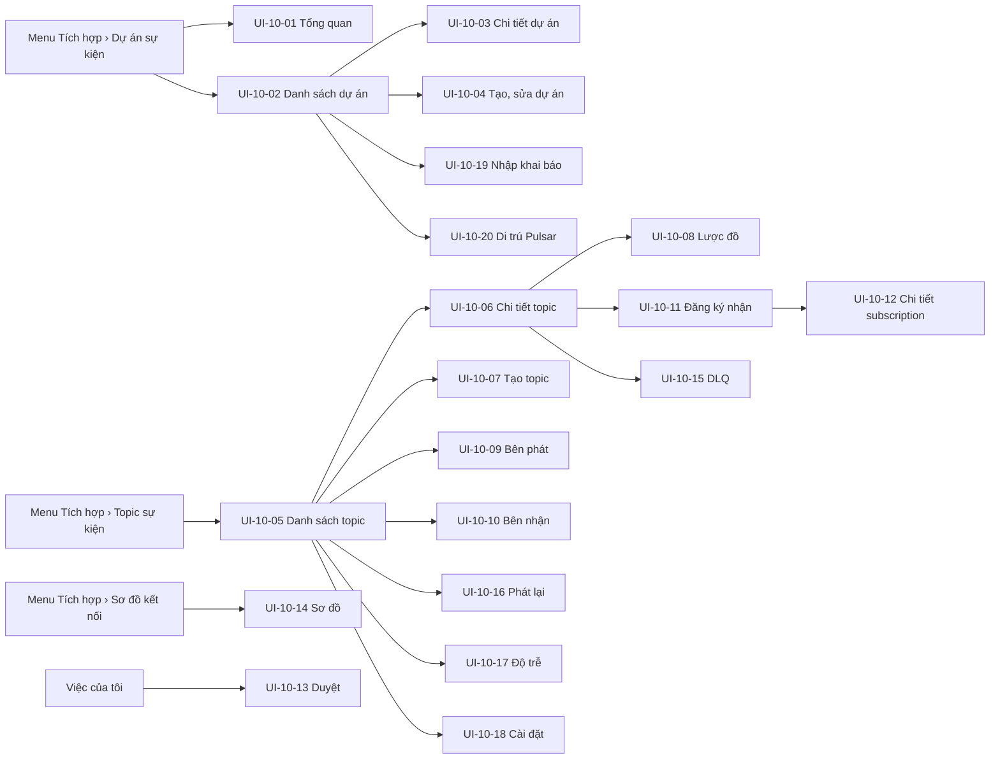

# D03-06-PH10 · Thiết kế giao diện màn hình Sự kiện

Tập màn **không tự đặt** token, `CMP-*` hay `PTN-*`; mọi tên dùng ở đây có trong D03-05-02, D03-05-03, D03-05-04 và D03-06-00. Thành phần hoặc token còn thiếu ghi ở Phụ lục A. Enum, trường, mã lỗi, quyền, route lấy đúng Phụ lục A của [D02-03-PH10](../../02-yeu-cau/frs/D02-03-PH10-frs-su-kien.md); chỗ FRS chưa có ghi ở Phụ lục C.

## Tóm tắt cho hội đồng thẩm định

PH-10 thay Hub Apache Pulsar của hệ cũ bằng trục sự kiện Kafka có đăng ký lược đồ bắt buộc. Tài liệu đặc tả 20 màn (UI-10-01…20) trên `dh-console`, chia năm nhóm: tổng quan và dự án (01–04), topic và lược đồ (05–08), bên tham gia và đăng ký nhận (09–12), duyệt và sơ đồ (13–14), vận hành, cài đặt, di trú (15–20).

Bốn quyết định giao diện chính:

1. **Giữ đủ màn có giá trị của Hub cũ, đặt lại theo nghiệp vụ.** Bốn thẻ đếm (publisher, subscriber, project, topic), sơ đồ kết nối, quản lý project, topic, publisher, subscriber, publication, subscription và hai danh mục `type_of_comm`, `routing_mode` đều còn (mục 3). Biểu đồ CPU, bộ nhớ cụm chuyển sang PH-13, màn tổng quan chỉ còn liên kết.
2. **Sơ đồ kết nối (UI-10-14) là màn siêu chi tiết.** Đồ thị ba lớp bên phát, topic, bên nhận ở chế độ chỉ xem của `CMP-FlowCanvas`; lọc theo dự án; bốn lớp phủ đúng enum `overlay` (`NONE`, `LAG`, `TRAFFIC`, `DLQ`); mọi thông tin màu đều có chữ hoặc hình đi kèm; có chế độ danh sách thay thế cho người dùng bàn phím và trình đọc màn hình.
3. **Đăng ký nhận (UI-10-11) và chi tiết subscription (UI-10-12) là màn rất chi tiết.** Bốn chế độ giao nhận `PUSH`, `PULL_API`, `PULL_KAFKA`, `INTERNAL` có biểu mẫu riêng; webhook phải xác minh endpoint trước khi gửi duyệt; lịch thử lại vẽ trước bằng biểu đồ; khóa ký chỉ hiện một lần; mỗi trường kiểm tra đúng ràng buộc FR-10-035 và ERR-10.
4. **Không có thao tác nào làm thay đổi cụm mà không qua duyệt bốn mắt.** Nút duyệt vô hiệu kèm lý do khi người xem là người tạo hoặc người gửi (BR-10-010); giao diện chỉ hiện nút theo `PERM-10-*` và trạng thái đối tượng.

Kính Liquid Glass chỉ dùng cho lớp điều hướng và lớp nổi; bảng, biểu mẫu, canvas, biểu đồ là nền đặc để đạt WCAG 2.2 AA (ADR-020).

## 1. Mục đích, phạm vi và tài liệu liên quan

### 1.1. Mục đích

Đặc tả đủ để đội giao diện dựng ngay, kiểm thử viên viết ca kiểm thử và hội đồng thẩm định thấy rõ chức năng hệ cũ được giữ: mỗi màn có đường dẫn, mẫu bố cục, quyền, API gọi, wireframe, thành phần, trường với kiểm tra hợp lệ, hành động, trạng thái, phím tắt, khả năng truy cập và bản hi-fi ở mức token.

Thứ tự ưu tiên khi mâu thuẫn: D02-08 (phân quyền), D03-05 (design system), D03-06-00 (kiến trúc thông tin, mẫu màn), D02-03-PH10 (FRS, Phụ lục A là nguồn chuẩn mã), rồi tài liệu này.

### 1.2. Danh sách màn và mức chi tiết

| Mã | Tên | PTN | Mức chi tiết | FR |
|---|---|---|---|---|
| UI-10-01 | Tổng quan sự kiện | PTN-06 | Đầy đủ | FR-10-016, 057, 062 |
| UI-10-02 | Danh sách dự án | PTN-01 | Đầy đủ | FR-10-001, 003, 005, 070 |
| UI-10-03 | Chi tiết dự án | PTN-02 | Đầy đủ | FR-10-002, 004, 005, 008 |
| UI-10-04 | Tạo, sửa dự án | PTN-04 | Đầy đủ | FR-10-003, 004 |
| UI-10-05 | Danh sách topic | PTN-01 | Đầy đủ | FR-10-006 |
| UI-10-06 | Chi tiết topic | PTN-02 | Rất chi tiết | FR-10-007, 010…016, 024 |
| UI-10-07 | Tạo topic | PTN-05 (Drawer nhanh PTN-04) | Rất chi tiết | FR-10-008, 017 |
| UI-10-08 | Soạn và so sánh lược đồ | PTN-03 | Rất chi tiết | FR-10-017…022 |
| UI-10-09 | Bên phát | PTN-01, PTN-02 | Đầy đủ | FR-10-025, 026, 028, 030, 032 |
| UI-10-10 | Bên nhận | PTN-01, PTN-02 | Đầy đủ | FR-10-025, 027, 028 |
| UI-10-11 | Đăng ký nhận sự kiện | PTN-05 | **Rất chi tiết** | FR-10-035, 036, 040 |
| UI-10-12 | Chi tiết subscription | PTN-02 | **Rất chi tiết** | FR-10-041, 042, 046, 047, 054…056 |
| UI-10-13 | Duyệt yêu cầu sự kiện | PTN-10 | Rất chi tiết | FR-10-009, 011, 019, 031, 037, 051, 073 |
| UI-10-14 | Sơ đồ kết nối | PTN-07 (chỉ xem) | **Siêu chi tiết** | FR-10-058 |
| UI-10-15 | DLQ tầng sự kiện | PTN-11 | Đầy đủ | FR-10-049, 050, 053 |
| UI-10-16 | Phát lại sự kiện | PTN-01, PTN-05 | Đầy đủ | FR-10-051, 052 |
| UI-10-17 | Theo dõi độ trễ tiêu thụ | PTN-11 | Đầy đủ | FR-10-054, 055 |
| UI-10-18 | Cài đặt sự kiện | PTN-12 | Đầy đủ | FR-10-060…063 |
| UI-10-19 | Nhập khai báo | PTN-09 | Rút gọn (Đợt sau) | FR-10-071 |
| UI-10-20 | Di trú từ Pulsar | PTN-01 | Đầy đủ | FR-10-072…076 |

"Đầy đủ" là có đủ các mục theo khuôn K-MH; "Rất chi tiết" thêm giải phẫu vùng, trường theo từng nhánh và ca biên; "Siêu chi tiết" thêm lưới bố cục, kích thước, giải phẫu từng phần tử, mọi trạng thái, chuột, bàn phím và hiệu năng như UI-04-04.

### 1.3. Tài liệu liên quan

| Tài liệu | Dùng để |
|---|---|
| [D02-03-PH10](../../02-yeu-cau/frs/D02-03-PH10-frs-su-kien.md) | FR, BR, ERR-10, PERM-10, Phụ lục A (enum, trường, tham số `10.*`, route UI) |
| [D02-04-PH10](../../02-yeu-cau/use-case/D02-04-PH10-use-case-su-kien.md) | Kịch bản người dùng, dữ liệu ví dụ |
| [D03-02-PH10](../sdd/D03-02-PH10-sdd-su-kien.md) | Thành phần `dh-integration`, `dh-runtime`, cách tính lag, cách dựng đồ thị |
| D03-04-PH10 (đang viết song song) | Định nghĩa đầy đủ API-10-001…091; tài liệu này dẫn chiếu theo số API ở FRS §8.3 |
| [D03-05-02](D03-05-02-design-token.md), [D03-05-03](D03-05-03-thanh-phan-nguyen-tu.md), [D03-05-04](D03-05-04-thanh-phan-phuc-hop.md) | Token, thành phần nguyên tử, phức hợp |
| [D03-06-00](D03-06-00-ia-layout-mau-man-hinh.md) | Cây menu, quy tắc URL, PTN-01…14, ST-01…15 |
| [D03-06-PH04](D03-06-PH04-man-hinh-tich-hop.md), [D03-06-PH05](D03-06-PH05-man-hinh-bo-dieu-hop.md) | Màn chọn topic trong trình thiết kế luồng, màn CDC đăng ký topic |

## 2. Nguyên tắc thiết kế áp dụng cho PH-10

### 2.1. Bản đồ vật liệu

| Vùng | Thành phần | Vật liệu | Lý do |
|---|---|---|---|
| Thanh trên, sidebar | `CMP-AppShell`, `CMP-Topbar`, `CMP-Sidebar` | `glass-chrome` (cuộn: `glass-chrome-scrolled`) | Lớp điều hướng |
| Tiêu đề trang, hàng tab trang | `CMP-PageHeader`, `CMP-Tabs` | Đặc trên `color-canvas` | Nội dung |
| Bảng, biểu mẫu, mô tả, thẻ chỉ số | `CMP-DataTable`, `CMP-Form`, `CMP-DescriptionList`, `CMP-KpiCard`, `CMP-StatCard` | Đặc `color-surface-solid` | Nội dung dày, chữ nhỏ |
| Trình soạn lược đồ, khối mã mẫu, nội dung DLQ | `CMP-CodeEditor`, `CMP-CodeBlock`, `CMP-JsonViewer` | Đặc `color-surface-solid-2` | Mã cần tương phản cao |
| Biểu đồ lưu lượng, lag, thống kê giao nhận | `CMP-Chart` | Đặc `color-surface-solid` | Số liệu phải đọc chắc |
| Canvas sơ đồ kết nối | `CMP-FlowCanvas` biến thể `readonly` | Đặc `color-surface-solid-2`, lưới chấm `color-border-subtle` | Nút và cạnh cần tương phản ổn định (PTN-07) |
| Điều khiển nổi trên canvas | `CMP-CanvasControls`, `CMP-Minimap`, thanh lớp phủ | `glass-overlay` | Lớp nổi |
| Drawer tạo nhanh, chi tiết nút, sửa tham số | `CMP-Drawer` | Khung `glass-modal`, giếng nội dung đặc | Lớp nổi chứa nội dung dày |
| Hộp lý do, xác nhận, xung đột, bí mật | `CMP-ReasonDialog`, `CMP-ConfirmDialog`, `CMP-ConflictDialog`, `CMP-Modal` | Khung `glass-modal`, nội dung đặc | Lớp nổi |
| Menu, popover, tooltip, gợi ý chọn | `CMP-DropdownMenu`, `CMP-Popover`, `CMP-Tooltip`, popup `CMP-ResourceSelect` | `glass-overlay` | Lớp nổi |

Khi người dùng bật giảm trong suốt hoặc trình duyệt tự hạ cấp (D03-05-01), lớp kính chuyển `glass-lite-tint` hoặc `glass-off-tint`. Không màn nào dựa vào độ trong để truyền thông tin.

### 2.2. Mật độ

Danh sách, chi tiết và biểu mẫu dùng mật độ thường (điều khiển `size-control-md` 32 px, hàng bảng `size-table-row` 40 px). Sơ đồ kết nối và bảng độ trễ dùng mật độ gọn (`data-density="compact"`) vì một tenant tỉnh có thể có vài trăm nút và vài trăm subscription (giả định GĐ-01: 200 HTTT). Vùng chạm tối thiểu 24 × 24 px (WCAG 2.5.8).

### 2.3. Ngôn ngữ và thuật ngữ

Giao diện dùng thuật ngữ tiếng Việt, giữ thuật ngữ gốc khi người dùng hệ cũ đã quen. Thuật ngữ gốc tiếng Anh hiện ở tooltip lần đầu xuất hiện trên mỗi màn.

| Khái niệm (tên trường, thực thể) | Nhãn giao diện | Ghi chú |
|---|---|---|
| `EventProject` | Dự án sự kiện | Hệ cũ: project |
| `Topic` | Topic | Giữ nguyên, người dùng Hub đã quen |
| `Publisher` | Bên phát | Tooltip "publisher" |
| `Subscriber` | Bên nhận | Tooltip "subscriber" |
| `Publication` | Quyền phát | Tooltip "publication: bên phát được phép phát lên topic" |
| `Subscription` | Đăng ký nhận | Tooltip "subscription"; trong bảng kỹ thuật giữ "subscription" |
| `EventSchema`, `SchemaVersion` | Lược đồ, phiên bản lược đồ | |
| `consumerGroup` | Nhóm tiêu thụ | |
| `lagSeconds`, `lagRecords` | Độ trễ (giây), số bản tin tồn | |
| `DlqEntry` | Mục DLQ | "Hàng đợi lỗi" ở tooltip |
| `ReplayRequest` | Lượt phát lại | |
| `MigrationBridge` | Cầu nối di trú | |

### 2.4. Hành động theo quyền và trạng thái

Mỗi đối tượng trả về từ API có `allowedActions` tính ở máy chủ theo quyền, trạng thái và bốn mắt (theo cách PH-04, PH-05). Giao diện chỉ dùng mảng này để hiện, ẩn hay vô hiệu nút, không tự suy luận lại; nếu API chưa trả `allowedActions` cho một đối tượng, ghi ở Phụ lục B. Quy tắc hiển thị theo D03-06-00 §2.6: thiếu quyền thì **ẩn** nút; có quyền nhưng trạng thái không cho thì **vô hiệu** kèm `CMP-Tooltip` nêu lý do (ví dụ "Topic đang chờ duyệt, không sửa được cấu hình."). Nút duyệt khi người xem là người tạo hoặc người gửi hiện vô hiệu với lý do "Bạn đã gửi yêu cầu này, cần người khác duyệt (bốn mắt)." để người dùng hiểu vì sao.

### 2.5. Bí mật trên giao diện

Chỉ có một loại bí mật hiện trên giao diện PH-10: khóa ký webhook (tiền tố `whsec_`). Khóa hiện đúng một lần bằng `CMP-SecretField` chế độ `issue` sau khi subscription `PUSH` được duyệt hoặc sau khi xoay, thu hồi khẩn (FR-10-037, FR-10-042, BR-10-027). Không có nút "hiện lại"; khóa không bao giờ có trong URL, bộ đệm truy vấn, tệp xuất hay thông báo. Danh sách khóa chỉ hiện `keyId`, `status`, `activatedAt`, `previousUntil`, `revokedAt`.

### 2.6. Giữ trạng thái trên URL

Bộ lọc, sắp xếp, trang, tab, lớp phủ sơ đồ, khoảng thời gian biểu đồ và nút đang chọn trên sơ đồ ghi lên query theo D03-06-00 §2.4 (`q`, `trang`, `co`, `sap-xep`, `khoang`, `chon`, tên trường). Giá trị enum trên URL viết chữ thường gạch nối từ mã enum (ví dụ `trang-thai=pending-approval,active`, `lop-phu=lag`), bộ chuyển đổi đặt chung trong `features/event/url.ts`. `topicName` có dấu chấm, dùng nguyên văn trong path sau khi `encodeURIComponent`.

### 2.7. Dữ liệu sống và tác vụ dài

Số đếm, lag, lưu lượng làm mới theo chu kỳ: tổng quan và sơ đồ 30 giây (FR-10-057), bảng độ trễ 30 giây theo `10.lag.collect-interval-seconds`, tiến độ phát lại 5 giây (FR-10-052), trạng thái cấp phát topic, subscription 5 giây khi đang `PROVISIONING`. Làm mới dừng khi tab trình duyệt ẩn (`document.visibilityState`) và chạy lại ngay khi hiện. Mỗi khối có `CMP-Timestamp` "Cập nhật lúc hh:mm:ss" và nút làm mới tay. Xuất khai báo, loại bỏ DLQ theo bộ lọc, nhập kiểm kê Pulsar chạy nền với `CMP-JobProgress` và `CMP-BackgroundTaskTray` (FR-00-054).

### 2.8. Định dạng số và thời gian

| Loại | Hiển thị | Thành phần |
|---|---|---|
| Độ trễ giây | Dạng thời lượng ngắn: "45 giây", "12 phút 30 giây", "3 giờ 5 phút"; trong ô bảng dạng gọn "12 ph 30 g" | `CMP-Duration` |
| Số bản tin | Phân cách nghìn bằng dấu chấm, rút gọn từ một triệu "1,2 triệu" kèm tooltip số đầy đủ | `CMP-Text` với `font-feature-tabular` |
| Byte | KiB, MiB theo cơ số 1024 ("256 KiB", "10 MiB/giây") | `CMP-Text` |
| Thời điểm | Tương đối khi dưới 24 giờ ("5 phút trước"), tuyệt đối `dd/MM/yyyy HH:mm` khi lâu hơn; tooltip luôn có giờ đầy đủ múi +07:00 | `CMP-Timestamp` |
| Tên topic, mã | Phông đơn cách `font-mono-sm`, có nút sao chép khi rê | `CMP-Identifier`, `CMP-CodeText`, `CMP-CopyButton` |

## 3. Màn hệ cũ được giữ lại thành gì

Theo quyết định phạm vi Q4 (giữ toàn bộ nghiệp vụ hệ cũ và màn có giá trị vận hành, D00-04 §5), mọi màn của Hub Pulsar được ánh xạ sang màn mới. Bảng dưới là ma trận truy vết `LGC` sang `UI`; ma trận `LGC` sang FR đầy đủ ở FRS §9.1.

### 3.1. Danh sách màn hệ cũ và màn mới

| LGC | Màn hoặc chức năng hệ cũ | Màn mới | Cách giữ | Ghi chú |
|---|---|---|---|---|
| LGC-HUB-001 | Dashboard: thẻ tổng số publisher | UI-10-01 thẻ "Bên phát" | Giữ nguyên, thêm phân rã trạng thái | Bấm thẻ mở UI-10-09 đã lọc |
| LGC-HUB-002 | Dashboard: thẻ tổng số subscriber | UI-10-01 thẻ "Bên nhận" | Giữ nguyên, thêm phân rã | Mở UI-10-10 |
| LGC-HUB-003 | Dashboard: thẻ tổng số project | UI-10-01 thẻ "Dự án" | Giữ nguyên | Mở UI-10-02 |
| LGC-HUB-004 | Dashboard: thẻ tổng số topic | UI-10-01 thẻ "Topic" | Giữ nguyên, thêm phân rã | Mở UI-10-05 |
| LGC-HUB-005 | Biểu đồ % Memory theo giây | Không có ở PH-10 | Thay thế bằng PH-13 | UI-10-01 có liên kết "Tài nguyên cụm Kafka (PH-13)" |
| LGC-HUB-006 | Biểu đồ % CPU theo giây | Không có ở PH-10 | Thay thế bằng PH-13 | Cùng liên kết trên |
| LGC-HUB-007 | Integration Project Connections (sơ đồ publisher, topic, subscriber) | UI-10-14 | Thiết kế lại | Tương tác, lọc dự án, phủ lag, lưu lượng, DLQ, xuất ảnh; bản thu gọn ở tab Sơ đồ của UI-10-03 |
| LGC-HUB-008 | Quản lý project | UI-10-02, 03, 04 | Giữ, thêm lưu trữ thay xóa | Hệ cũ xóa project kéo theo topic; Datahub chỉ lưu trữ (BR-10-003) |
| LGC-HUB-009 | Quản lý topic: tên, mô tả, phân vùng, cấu trúc, chế độ định tuyến | UI-10-05, 06, 07, 08 | Thiết kế lại | "Cấu trúc" thành lược đồ bắt buộc có kiểm tra tương thích; thêm lưu giữ, phân loại, vòng đời |
| LGC-HUB-010 | Quản lý publisher: tên, kiểu giao tiếp, khóa tham chiếu | UI-10-09 | Giữ, ràng buộc HTTT | Bên phát gắn HTTT PH-01, luồng PH-04 hoặc DU |
| LGC-HUB-011 | Quản lý subscriber, đánh dấu là luồng tích hợp | UI-10-10 | Giữ | "Là luồng" thành `partyType = FLOW`, cột "Loại" hiện nhãn "Luồng tích hợp" |
| LGC-HUB-012 | Quản lý publication | Tab Quyền phát ở UI-10-06, UI-10-09; duyệt ở UI-10-13 | Giữ, thêm duyệt | |
| LGC-HUB-013 | Quản lý subscription: URI nhận, số worker, số lần thử lại, thời điểm bắt đầu | UI-10-11, UI-10-12 | Thiết kế lại | Giữ bốn tham số; thêm chế độ kéo, ký HMAC, xác minh endpoint, ngưỡng lag |
| LGC-HUB-014 | Danh mục `type_of_comm`, `routing_mode` | UI-10-18 tab Kiểu giao tiếp, Chế độ định tuyến | Giữ | Cột "Mã hệ cũ" hiện `legacyCode` |
| LGC-TOOL-010 | Nhóm Message Broker của Tooling | Tab Cách kết nối ở UI-10-06, bước chế độ ở UI-10-11 | Nâng cấp | Kafka nội bộ và Kafka ngoài qua topic đã đăng ký |
| LGC-BUS-039 | Event message | UI-10-06 tab Cách kết nối (API phát) | Giữ | Bản tin sự kiện theo CloudEvents 1.0 |

### 3.2. Màn mới không có ở hệ cũ

UI-10-08 (soạn lược đồ, tương thích), UI-10-13 (duyệt), UI-10-15 (DLQ), UI-10-16 (phát lại), UI-10-17 (độ trễ), UI-10-19 (nhập khai báo), UI-10-20 (di trú). Chúng sinh ra từ yêu cầu nâng cấp: lược đồ bắt buộc, bốn mắt, giao ít nhất một lần có DLQ, quan sát lag, và di trú song song khỏi Pulsar (ADR-073).

### 3.3. Ánh xạ nhãn hệ cũ

Màn UI-10-20 và tooltip trên UI-10-09, 10, 18 hiện nhãn hệ cũ để người dùng Hub nhận ra đối tượng của mình.

| Hệ cũ | Nhãn mới | Giá trị mới |
|---|---|---|
| `type_of_comm` = `REST` | Phát qua API HTTP | `HTTP_PUBLISH` |
| `type_of_comm` = `PULSAR_CLIENT` | Kafka trực tiếp | `KAFKA_NATIVE` |
| `type_of_comm` = `ROUTE` | Kafka nội bộ | `INTERNAL_KAFKA` |
| `type_of_comm` = `HTTP_PUSH` | Nhận đẩy webhook | `WEBHOOK_PUSH` |
| `routing_mode` = `CustomPartition` | Theo khóa (băm) | `KEY_HASH` |
| `routing_mode` = `RoundRobinPartition` | Chia đều | `ROUND_ROBIN` |
| `routing_mode` = `SinglePartition` | Một phân vùng | `SINGLE_PARTITION` |
| Subscription `Exclusive`, `Failover` | Một worker, giữ thứ tự | `workerCount = 1` |
| Subscription `Shared` | Nhiều worker, không giữ thứ tự | `workerCount` bằng số consumer cũ, `failurePolicy = DEAD_LETTER` |
| Subscription `Key_Shared` | Nhiều worker, giữ thứ tự theo khóa | `workerCount` bằng số consumer cũ, topic `KEY_HASH` |

Giá trị `legacyCode` của `type_of_comm` là giả định của FRS (Q10-01); giao diện đọc từ API-10-067 nên đổi giá trị không cần sửa mã.

## 4. Điều hướng

### 4.1. Sơ đồ điều hướng



Ba mục menu cấp 2 lấy đúng D03-06-00 §2.3.2 dòng 15–17. Các màn con không có mục menu riêng mà vào từ hàng tab phụ của trang danh sách: danh sách dự án có tab phụ "Tổng quan · Dự án · Nhập khai báo · Di trú"; danh sách topic có tab phụ "Topic · Bên phát · Bên nhận · Phát lại · Độ trễ · Cài đặt". Tab phụ dùng `CMP-Tabs` cấp trang trong `CMP-PageHeader`, mỗi tab là một route. UI-10-13 nằm ở "Việc của tôi" chung (FR-00-070) với bộ lọc phân hệ 10.

### 4.2. Bảng đường dẫn React Router

Route chính lấy đúng FRS Phụ lục A.6. Đoạn tab con của trang chi tiết là quy ước của tài liệu này theo D03-06-00 §2.4 (đề nghị đưa vào A.6 ở Phụ lục C).

| Route | Màn | Tab con, query | Quyền vào |
|---|---|---|---|
| `/tich-hop/du-an/tong-quan` | UI-10-01 | `du-an`, `khoang` | `PERM-10-read` |
| `/tich-hop/du-an` | UI-10-02 | `q`, `trang-thai`, `to-chuc`, `nhan`, `trang`, `co`, `sap-xep` | `PERM-10-read` |
| `/tich-hop/du-an/moi` | UI-10-04 tạo (Drawer trên UI-10-02) | | `PERM-10-create` |
| `/tich-hop/du-an/{ma-du-an}` | UI-10-03 | `/topic`, `/ben-tham-gia`, `/so-do`, `/lich-su` | `PERM-10-read` |
| `/tich-hop/du-an/{ma-du-an}/sua` | UI-10-04 sửa (Drawer trên UI-10-03) | | `PERM-10-update` |
| `/tich-hop/du-an/nhap` | UI-10-19 | `?tac-vu={jobCode}` | `PERM-10-create` |
| `/tich-hop/du-an/di-tru` | UI-10-20 | `/anh-xa`, `/cau-noi`, `/doi-chieu`, `/tien-do` | `PERM-10-admin` (xem tiến độ: `PERM-10-read`) |
| `/tich-hop/topic` | UI-10-05 | `q`, `du-an`, `trang-thai`, `loai`, `phan-loai`, `dinh-tuyen`, `canh-bao-lag`, `ben-phat`, `ben-nhan` | `PERM-10-read` |
| `/tich-hop/topic/moi` | UI-10-07 | `?du-an=`, `?buoc=` | `PERM-10-create` |
| `/tich-hop/topic/{ten-topic}` | UI-10-06 | `/cau-hinh`, `/quyen-phat`, `/dang-ky-nhan-ds`, `/ket-noi`, `/chuyen-doi`, `/lich-su`; `chon` mở Drawer | `PERM-10-read` |
| `/tich-hop/topic/{ten-topic}/luoc-do` | UI-10-08 (trong khung topic) | `?phien-ban=`, `?so-sanh=a,b`, `?che-do=soan\|so-sanh` | `PERM-10-read`; soạn cần `PERM-10-create` hoặc `PERM-10-update` |
| `/tich-hop/topic/{ten-topic}/dlq` | UI-10-15 (trong khung topic) | `trang-thai`, `ma-loi`, `dang-ky`, `tu`, `den` | `PERM-10-read` |
| `/tich-hop/topic/{ten-topic}/dang-ky-nhan` | UI-10-11 | `?ben-nhan=`, `?buoc=` | `PERM-10-subscribe` |
| `/tich-hop/topic/ben-phat` · `/ben-phat/{ma}` | UI-10-09 | `/quyen-phat`, `/lich-su` | `PERM-10-read` |
| `/tich-hop/topic/ben-nhan` · `/ben-nhan/{ma}` | UI-10-10 | `/dang-ky-nhan-ds`, `/lich-su` | `PERM-10-read` |
| `/tich-hop/topic/dang-ky/{ma-subscription}` | UI-10-12 | `/giao-nhan`, `/do-tre`, `/luot-loi`, `/worker`, `/khoa-ky`, `/cau-hinh`, `/phat-lai`, `/lich-su`; `khoang` | `PERM-10-read` |
| `/tich-hop/topic/phat-lai` · `/phat-lai/moi` | UI-10-16 | `?dang-ky=`, `?muc-dlq=` (chỉ khi mở từ UI-10-15, danh sách mã trong trạng thái phiên) | `PERM-10-read`; tạo cần `PERM-10-operate` |
| `/tich-hop/topic/do-tre` | UI-10-17 | `muc`, `che-do`, `du-an` | `PERM-10-read` |
| `/tich-hop/topic/cai-dat` | UI-10-18 | `/kieu-giao-tiep`, `/dinh-tuyen`, `/han-muc`, `/tham-so` | `PERM-10-read` (sửa: `PERM-10-admin`) |
| `/tich-hop/so-do` | UI-10-14 | `du-an`, `topic`, `httt`, `lop-phu`, `ca-ngung`, `chon`, `che-do=do-thi\|danh-sach` | `PERM-10-read` |
| `/viec-cua-toi?phan-he=10` | UI-10-13 | `loai`, `chon` | `PERM-10-approve` (xem yêu cầu mình gửi: `PERM-10-read`) |

Tab con `/dang-ky-nhan-ds` (danh sách subscription của topic hoặc bên nhận) khác route `/dang-ky-nhan` (UI-10-11) để không trùng. Đoạn `luoc-do`, `dlq`, `dang-ky-nhan` không thể trùng tên topic vì tên topic luôn có dấu chấm (FRS A.6).

### 4.3. Menu và phân quyền hiển thị

| Phần tử | Điều kiện hiện |
|---|---|
| Mục menu "Dự án sự kiện", "Topic sự kiện", "Sơ đồ kết nối" | `PERM-10-read` |
| Tab phụ "Nhập khai báo" | `PERM-10-create` |
| Tab phụ "Di trú" | `PERM-10-admin`, hoặc `PERM-10-read` với vai trò PA, TA (chỉ xem tiến độ, FR-10-076) |
| Tab phụ "Phát lại", "Độ trễ" | `PERM-10-read` |
| Tab phụ "Cài đặt" | `PERM-10-read`; mọi nút sửa cần `PERM-10-admin` |
| Huy hiệu số việc chờ trên "Việc của tôi" | `PERM-10-approve`, đếm yêu cầu `PENDING` phân hệ 10 mà người xem được duyệt |

OR chỉ thấy dự án, bên tham gia và subscription có HTTT thuộc tổ chức mình; máy chủ lọc, giao diện không lọc lại. Đối tượng ngoài phạm vi trả ERR-10-044 hiện ST-07.

### 4.4. Breadcrumb và tiêu đề tab

| Màn | Breadcrumb | `document.title` |
|---|---|---|
| UI-10-01 | Tích hợp › Dự án sự kiện › Tổng quan | Tổng quan sự kiện · Datahub |
| UI-10-03 | Tích hợp › Dự án sự kiện › {tên dự án} | {tên dự án} · Dự án sự kiện · Datahub |
| UI-10-06 | Tích hợp › Topic sự kiện › {topicName rút gọn} | {topicName} · Topic · Datahub |
| UI-10-08 | Tích hợp › Topic sự kiện › {topicName} › Lược đồ | Lược đồ · {topicName} · Datahub |
| UI-10-11 | Tích hợp › Topic sự kiện › {topicName} › Đăng ký nhận | Đăng ký nhận · {topicName} · Datahub |
| UI-10-12 | Tích hợp › Topic sự kiện › {topicName} › {subscriptionCode} | {subscriptionCode} · Đăng ký nhận · Datahub |
| UI-10-14 | Tích hợp › Sơ đồ kết nối | Sơ đồ kết nối · {tên dự án hoặc "Toàn tenant"} · Datahub |

Tên topic dài (tới 200 ký tự) trên breadcrumb cắt giữa, giữ tiền tố tenant và hậu tố phiên bản ("t68.dkkd…da-cap-phep.v1"), tooltip hiện đủ.

## 5. Quy ước hiển thị dùng chung

### 5.1. Nhãn trạng thái

Mọi trạng thái hiện bằng `CMP-StatusTag` (chữ, hình chỉ báo, màu theo năm sắc thái của D03-05-03 §5.1); trong ô chật và trên nút sơ đồ dùng `CMP-StatusDot` cùng bảng ánh xạ, luôn kèm `aria-label`. Bảng dưới đăng ký vào `@datahub/ui/status/registry.ts` với tiền tố `event.`.

| Đối tượng | Giá trị | Nhãn | Sắc thái |
|---|---|---|---|
| Dự án `EventProject.status` | `ACTIVE`, `ARCHIVED` | Đang hoạt động, Đã lưu trữ | success, neutral |
| Topic `Topic.status` | `DRAFT`, `PENDING_APPROVAL`, `PROVISIONING`, `FAILED`, `ACTIVE`, `DEPRECATED`, `RETIRED` | Nháp, Chờ duyệt, Đang cấp phát, Cấp phát lỗi, Đang hoạt động, Ngừng khuyến nghị, Ngừng dùng | neutral, warning, info, error, success, warning, neutral |
| Phiên bản lược đồ `SchemaVersion.status` | `DRAFT`, `PENDING_APPROVAL`, `REJECTED`, `ENABLED`, `DEPRECATED`, `DISABLED` | Nháp, Chờ duyệt, Bị từ chối, Đang dùng, Ngừng khuyến nghị, Đã vô hiệu | neutral, warning, error, success, warning, neutral |
| Bên phát, bên nhận `status` | `ACTIVE`, `SUSPENDED`, `RETIRED` | Đang hoạt động, Tạm ngừng, Ngừng dùng | success, warning, neutral |
| Quyền phát `Publication.status` | `PENDING_APPROVAL`, `REJECTED`, `ACTIVE`, `SUSPENDED`, `REVOKED` | Chờ duyệt, Bị từ chối, Đang hiệu lực, Tạm ngừng, Đã thu hồi | warning, error, success, warning, neutral |
| Đăng ký nhận `Subscription.status` | `PENDING_APPROVAL`, `REJECTED`, `PROVISIONING`, `FAILED`, `ACTIVE`, `PAUSED`, `SUSPENDED`, `REVOKED` | Chờ duyệt, Bị từ chối, Đang cấp phát, Cấp phát lỗi, Đang nhận, Tạm dừng, Tạm ngừng, Đã thu hồi | warning, error, info, error, success, neutral, warning, neutral |
| Cảnh báo lag `alertState` | `OK`, `WARNING`, `CRITICAL`, `STALLED` | Bình thường, Cảnh báo, Nghiêm trọng, Ngừng tiến | success, warning, error, error (hình ⏸ khác `CRITICAL` để phân biệt không cần màu) |
| Khóa ký `SigningKey.status` | `ACTIVE`, `PREVIOUS`, `REVOKED` | Đang dùng, Khóa cũ (chồng lấn), Đã thu hồi | success, info, neutral |
| Xác minh endpoint `result` | `PASSED`, `FAILED`, `WAIVED` | Đạt, Không đạt, Miễn xác minh có thời hạn | success, error, warning |
| Yêu cầu duyệt `ApprovalRequest.status` | `PENDING`, `APPROVED`, `REJECTED`, `WITHDRAWN`, `EXPIRED` | Chờ duyệt, Đã duyệt, Bị từ chối, Đã rút, Hết hạn | warning, success, error, neutral, neutral |
| Mục DLQ `DlqEntry.status` | `NEW`, `REPLAY_PENDING`, `REPLAYED`, `DISCARDED`, `PURGED` | Mới, Đang phát lại, Đã phát lại, Đã loại bỏ, Đã xóa nội dung | error, info, success, neutral, neutral |
| Lượt phát lại `ReplayRequest.status` | `PENDING_APPROVAL`, `REJECTED`, `APPROVED`, `RUNNING`, `COMPLETED`, `FAILED`, `CANCELLED` | Chờ duyệt, Bị từ chối, Đã duyệt, Đang chạy, Hoàn tất, Lỗi, Đã hủy | warning, error, info, info, success, error, neutral |
| Tác vụ nhập `ManifestImportJob.status` | `VALIDATING`, `PREVIEW`, `APPLYING`, `APPLIED`, `FAILED`, `CANCELLED` | Đang kiểm tra, Chờ xác nhận, Đang áp dụng, Đã áp dụng, Lỗi, Đã hủy | info, warning, info, success, error, neutral |
| Ánh xạ di trú `LegacyMapping.status` | `PROPOSED`, `PLANNED`, `BRIDGING`, `CUT_OVER`, `ROLLED_BACK`, `CLOSED`, `SKIPPED` | Đề xuất, Đã lên kế hoạch, Đang chạy song song, Đã chuyển hẳn, Đã quay lui, Đã đóng, Bỏ qua | neutral, info, info, success, warning, neutral, neutral |
| Cầu nối `MigrationBridge.status` | `PENDING_APPROVAL`, `REJECTED`, `RUNNING`, `STOPPED`, `ERROR`, `EXPIRED` | Chờ duyệt, Bị từ chối, Đang chạy, Đã dừng, Lỗi, Hết hạn | warning, error, success, neutral, error, neutral |

Trạng thái `SUSPENDED` luôn kèm dòng phụ nguồn tạm ngừng `suspendSource`: `MANUAL` "Do người vận hành", `SECURITY` "Do sự cố ATTT", `PH01` "Theo trạng thái HTTT ở PH-01", `CIRCUIT_BREAKER` "Ngắt mạch tự động, tự tiếp tục khi đầu nhận hồi phục", `DELIVERY_BLOCKED` "Dừng do chính sách chặn, cần tiếp tục bằng tay".

### 5.2. Nhãn enum khác

| Trường | Giá trị và nhãn |
|---|---|
| `topicKind` | `BUSINESS` Nghiệp vụ, `CDC` CDC từ CSDL, `SYSTEM` Hệ thống, `DLQ` Hàng đợi lỗi (ẩn khỏi danh sách mặc định) |
| `dataClass` | `PUBLIC` Công khai, `INTERNAL` Nội bộ, `RESTRICTED` Hạn chế, `SENSITIVE` Nhạy cảm; hiện bằng `CMP-Tag` có biểu tượng khóa với hai mức sau |
| `cleanupPolicy` | `DELETE` Xóa theo thời gian, `COMPACT` Nén theo khóa, `COMPACT_DELETE` Nén theo khóa và xóa theo thời gian |
| `routingMode` | `KEY_HASH` Theo khóa (băm), `ROUND_ROBIN` Chia đều, `SINGLE_PARTITION` Một phân vùng |
| `RoutingMode.ordering` | `PER_KEY` Giữ thứ tự trong cùng khóa, `NONE` Không bảo đảm thứ tự, `TOTAL` Giữ thứ tự toàn topic |
| `schemaFormat` | `AVRO` Avro, `JSON_SCHEMA` JSON Schema |
| `compatibility` | `BACKWARD` Tương thích lùi, `BACKWARD_TRANSITIVE` Tương thích lùi với mọi phiên bản, `FORWARD` Tương thích tiến, `FORWARD_TRANSITIVE` Tương thích tiến với mọi phiên bản, `FULL` Tương thích hai chiều, `FULL_TRANSITIVE` Tương thích hai chiều với mọi phiên bản, `NONE` Không kiểm tra |
| `partyType` | `SYSTEM` HTTT, `FLOW` Luồng tích hợp, `INTERNAL_SERVICE` Dịch vụ nội bộ, `LEGACY_BRIDGE` Cầu nối hệ cũ |
| `commType` | Theo A.2.8: `HTTP_PUBLISH` Phát qua API HTTP, `KAFKA_NATIVE` Kafka trực tiếp, `INTERNAL_KAFKA` Kafka nội bộ, `OUTBOX_CDC` Outbox của DU, `DB_CDC` CDC CSDL (PH-05), `WEBHOOK_PUSH` Nhận đẩy webhook, `HTTP_PULL` Kéo qua API HTTP, `PULSAR_BRIDGE` Cầu nối Pulsar |
| `deliveryMode` | `PUSH` Đẩy webhook, `PULL_API` Kéo qua API, `PULL_KAFKA` Kéo qua Kafka, `INTERNAL` Nội bộ |
| `startPosition` | `LATEST` Từ bây giờ, `EARLIEST` Từ dữ liệu cũ nhất còn giữ, `TIMESTAMP` Từ một thời điểm |
| `failurePolicy` | `DEAD_LETTER` Chuyển vào DLQ và giao tiếp, `BLOCK` Dừng lại chờ khắc phục |
| `payloadFormat` | `CLOUDEVENTS_STRUCTURED` CloudEvents có cấu trúc, `CLOUDEVENTS_BINARY` CloudEvents nhị phân (tiêu đề `ce-*`) |
| `requestType` | `TOPIC_CREATE` Tạo topic, `TOPIC_CHANGE` Đổi cấu hình topic, `TOPIC_RETIRE` Ngừng dùng topic, `SCHEMA_VERSION` Phiên bản lược đồ, `PUBLICATION` Quyền phát, `SUBSCRIPTION` Đăng ký nhận, `REPLAY` Phát lại, `BRIDGE` Cầu nối di trú, `CUTOVER` Chuyển hẳn |
| `DlqEntry.origin` | `PUSH` Giao đẩy, `PULL_NACK` Bên nhận kéo báo lỗi, `EXTERNAL_REPORT` Bên nhận Kafka tự báo, `REPLAY` Phát lại, `BRIDGE` Cầu nối |
| `replayMode` | `REDELIVER_RANGE` Giao lại một khoảng, `RESET_OFFSET` Đặt lại vị trí đọc, `DLQ_ENTRIES` Phát lại mục DLQ |
| `failureClass` | `TRANSIENT` Tạm thời, `PERMANENT` Vĩnh viễn, `DESERIALIZATION` Không giải được bản tin, `SECURITY` An ninh |
| `piiFindings[].severity` | `INFO` Thông tin, `WARNING` Cảnh báo, `BLOCKING` Chặn |
| `changeKind` | `CREATE` Thêm, `UPDATE` Sửa, `UNCHANGED` Không đổi, `CONFLICT` Xung đột, `SKIP` Bỏ qua (màu theo `color-diff-added`, `color-diff-changed`, chữ trung tính, `color-error`, chữ mờ) |
| `LegacyMapping.confidence` | `HIGH` Cao, `MEDIUM` Trung bình, `LOW` Thấp |
| `MigrationBridge.direction` | `PULSAR_TO_KAFKA` Pulsar sang Kafka, `KAFKA_TO_PULSAR` Kafka sang Pulsar |

### 5.3. Thông điệp lỗi ERR-10 sang câu hiển thị

Thân lỗi RFC 9457 có `code`, `detail`, `errors[]` theo trường và `traceId`. Câu dưới đây là câu mặc định; `detail` của máy chủ thay thế khi có tham số cụ thể. Mã lỗi luôn hiện ở dòng phụ kèm `CMP-CopyButton` sao chép mã truy vết (FR-00-080).

| Mã | Câu hiển thị | Vị trí |
|---|---|---|
| ERR-10-001 | "Không tìm thấy {loại đối tượng} {mã}. Đối tượng có thể đã bị xóa hoặc thuộc tenant khác." | ST-08 |
| ERR-10-002 | "Mã {mã} đã được dùng, kể cả cho đối tượng đã lưu trữ hoặc ngừng dùng. Chọn mã khác." | Dưới trường mã |
| ERR-10-003 | Câu theo `errors[]`, ví dụ "Mã chỉ gồm chữ thường, số và dấu gạch ngang, bắt đầu bằng chữ, 3 đến 63 ký tự." hoặc "'{mã}' là từ dành riêng của đường dẫn." | Dưới trường |
| ERR-10-004 | "Tên topic không đúng quy ước hoặc dùng miền dành riêng ({miền}). Miền này chỉ do hệ thống đăng ký." | Dưới trường Miền ở UI-10-07 |
| ERR-10-005 | "Tiền tố tenant của topic không khớp tenant đang làm việc." | `CMP-Alert` đầu biểu mẫu |
| ERR-10-006 | "Không thực hiện được khi {đối tượng} đang ở trạng thái {nhãn trạng thái}." kèm nút "Tải lại" | `CMP-Alert` trong hộp thao tác |
| ERR-10-007 | ST-13 xung đột phiên bản | `CMP-ConflictDialog` |
| ERR-10-008 | "Bạn đã tạo hoặc gửi yêu cầu này nên không được duyệt. Cần người duyệt khác." | `CMP-Alert` trong `CMP-ApprovalPanel` |
| ERR-10-009 | "Cần nhập lý do hoặc xác nhận trước khi tiếp tục." | Dưới ô lý do, ô xác nhận |
| ERR-10-010 | "Còn {n} đối tượng phụ thuộc." kèm danh sách liên kết (topic của dự án, subscription của topic) | `CMP-Modal` |
| ERR-10-011 | "Vượt hạn mức của tenant: {tên hạn mức} đang dùng {đã dùng}/{trần}." kèm liên kết UI-10-18 tab Hạn mức | `CMP-Alert` |
| ERR-10-012 | "Giá trị ngoài miền cho phép ({min} đến {max})." | Dưới trường |
| ERR-10-013 | "Không giảm được số phân vùng. Chỉ được tăng." | Dưới trường Phân vùng |
| ERR-10-014 | "Tăng phân vùng làm đổi phân vùng của khóa; thứ tự giữa sự kiện cũ và mới của cùng khóa không còn bảo đảm. Đánh dấu xác nhận để tiếp tục." | Ô xác nhận được đánh dấu lỗi |
| ERR-10-015 | "Lược đồ sai cú pháp ở dòng {d}, cột {c}: {thông điệp}." | Gạch chân trong `CMP-CodeEditor` và bảng Vấn đề |
| ERR-10-016 | "Lược đồ không tương thích theo mức {mức}." kèm bảng vi phạm theo đường dẫn trường và nút "Tạo phiên bản topic mới" | Khối kết quả kiểm tra |
| ERR-10-017 | "Lược đồ thiếu trường khóa phân vùng '{trường}' hoặc trường này không phải chuỗi, số, hoặc cho phép null." | Bảng Vấn đề |
| ERR-10-018 | "Lược đồ có trường nghi dữ liệu cá nhân ({trường}) trên topic {phân loại}; chính sách của tenant đang chặn." | Bảng Vấn đề |
| ERR-10-019 | "Mức 'Không kiểm tra' chỉ dùng cho topic chưa từng hoạt động." | Dưới trường Mức tương thích |
| ERR-10-020 | "Định dạng {định dạng} không được phép hoặc khác định dạng đã có của topic." | Dưới trường Định dạng |
| ERR-10-021 | "HTTT {mã} không tồn tại hoặc chưa ở trạng thái hoạt động ở PH-01." | Dưới trường HTTT |
| ERR-10-022 | "Luồng {mã} không tồn tại hoặc đã ngừng ở PH-04." | Dưới trường Luồng |
| ERR-10-023 | "Dịch vụ nội bộ {mã} không có trong danh sách." | Dưới trường Dịch vụ |
| ERR-10-024 | "Đã có quan hệ cho cặp này: {mô tả}." kèm liên kết mở quan hệ đã có | `CMP-Alert` |
| ERR-10-025 | "Topic hoặc bên tham gia không ở trạng thái nhận quan hệ mới (topic cần Đang hoạt động, bên tham gia cần Đang hoạt động)." | `CMP-Alert` |
| ERR-10-026 | "Địa chỉ nhận không hợp lệ: chỉ nhận HTTPS, tên miền trong danh sách egress, không trỏ địa chỉ nội bộ." | Dưới trường URL nhận |
| ERR-10-027 | "Xác minh địa chỉ nhận chưa đạt hoặc đã quá 24 giờ." kèm bảng bước xác minh và hướng dẫn | Khối xác minh |
| ERR-10-028 | "Tenant chưa bật Kafka ngoài. Đề nghị quản trị nền tảng bật trước khi dùng chế độ này." | Thẻ chế độ bị vô hiệu |
| ERR-10-029 | "Dịch vụ {tên} tạm thời không khả dụng; thay đổi chưa được ghi. Thử lại sau." | `CMP-Alert` lỗi, giữ dữ liệu đã nhập |
| ERR-10-030 | "Số worker tối đa {n} (bằng số phân vùng của topic hoặc trần của tenant)." | Dưới trường Số worker |
| ERR-10-031 | "Thời điểm bắt đầu phải trong khoảng lưu giữ của topic: từ {thời điểm sớm nhất}." | Dưới trường Thời điểm |
| ERR-10-032 | "Cần tạm dừng đăng ký nhận trước khi đặt lại vị trí đọc." kèm nút "Tạm dừng" | `CMP-Alert` ở UI-10-16 |
| ERR-10-033 | "Khoảng phát lại ngoài dữ liệu còn giữ. Khoảng còn dữ liệu: {từ} đến {đến}." kèm nút "Dùng khoảng này" | Dưới khoảng |
| ERR-10-034 | "Khoảng phát lại có khoảng {n} bản tin, vượt trần {trần}. Thu hẹp khoảng." | Dưới khoảng |
| ERR-10-035 | "Đang có lượt phát lại {mã} cho đăng ký nhận này." kèm liên kết | `CMP-Alert` |
| ERR-10-036 | "Mục DLQ đã được xử lý bởi {người} lúc {giờ}." | `CMP-Toast` |
| ERR-10-037 | "Yêu cầu trùng khóa chống gửi lặp nhưng nội dung khác. Tải lại trang rồi thử lại." | `CMP-Alert` |
| ERR-10-038 | "Đối tượng đang cấp phát hoặc cấp phát lỗi." kèm liên kết trạng thái cấp phát | `CMP-Alert` |
| ERR-10-039 | "Tenant đang tạm ngừng hoặc đóng băng thay đổi tới {thời điểm}." | `CMP-Banner` |
| ERR-10-040 | "Tệp sai cấu trúc hoặc phiên bản định dạng." kèm danh sách lỗi dòng | Bước tải tệp UI-10-19, 20 |
| ERR-10-041 | "Ánh xạ không hợp lệ: {lý do}." | Ô của dòng ánh xạ |
| ERR-10-042 | "Đã có cầu nối cho topic này hoặc cầu nối ngược chiều đang chạy." | `CMP-Alert` |
| ERR-10-043 | "Không tắt được mục đang có {n} bên tham gia hoặc topic dùng." | `CMP-Toast` lỗi, công tắc trả về |
| ERR-10-044 | ST-07 biến thể "Đối tượng ngoài phạm vi tổ chức của bạn." | Trang hoặc `CMP-Alert` |
| ERR-10-045 | "Topic CDC, hệ thống chỉ do dịch vụ chủ quản ({dịch vụ}) sửa." | `CMP-Alert` thông tin cố định trên tab Cấu hình |
| ERR-10-046 | "Chế độ định tuyến này cần trường khóa phân vùng, hoặc không giữ được thứ tự." | Dưới trường |
| ERR-10-047 | "Thay đổi này phá vỡ bên nhận hiện có; cần tạo phiên bản topic mới, hoặc topic kế nhiệm đã tồn tại." | `CMP-Alert` có nút "Tạo phiên bản mới" |
| ERR-10-048 | "Nén theo khóa cần topic có khóa (chế độ Theo khóa)." | Dưới trường Chính sách dọn |
| ERR-10-049 | "Điều kiện truy vấn không hợp lệ." Với sơ đồ: "Sơ đồ có hơn {n} nút. Chọn một dự án, một topic hoặc một HTTT để thu hẹp." | ST-05 hoặc thông điệp giữa canvas |
| ERR-10-050 | "Đối tượng tham chiếu {mã} không có ở tenant đích." | Dòng xem trước |
| ERR-10-051 | "Bên {mã} chưa đạt cấp độ ATTT yêu cầu cho topic {phân loại}." | `CMP-Alert` |
| ERR-10-052 | "Thao tác không áp dụng cho đăng ký nhận nội bộ; điều khiển ở luồng PH-04." kèm liên kết luồng | `CMP-Alert` |
| ERR-10-111…120 | Nhãn lỗi giao nhận ở bảng lượt lỗi và DLQ (mục 18.4) | Cột "Mã lỗi" |

### 5.4. Dải thông báo dùng chung

| Điều kiện | Dải | Thành phần |
|---|---|---|
| Tenant tạm ngừng, đóng băng (ERR-10-039) | "Tenant đang đóng băng thay đổi tới {thời điểm}; chỉ xem được." | `CMP-Banner` cảnh báo |
| PH-13 không khả dụng | Khối lưu lượng, lưu lượng sơ đồ ẩn kèm câu "Chưa lấy được số liệu lưu lượng từ PH-13." | `CMP-Alert` thông tin trong khối |
| Apicurio không khả dụng (ERR-10-029) trên màn lược đồ | "Kho lược đồ tạm thời không khả dụng; xem được nội dung đã lưu, chưa kiểm tra, gửi duyệt được." | `CMP-Banner` cảnh báo trên UI-10-08 |
| Bộ thu lag ngừng quá 3 chu kỳ | "Số liệu độ trễ đã cũ {n} phút." | `CMP-Banner` trên UI-10-14, UI-10-17 |

## 6. Trạng thái màn hình dùng chung

Mọi màn áp đủ ST-01…ST-15 của D03-06-00 §4.2. Mục từng màn chỉ ghi phần cụ thể: hình skeleton, câu rỗng, nút trong trạng thái rỗng, nội dung khi không có quyền. Ba điểm riêng của PH-10:

1. **Đang cấp phát.** Đối tượng `PROVISIONING` hiện `CMP-ProgressBar` không xác định dưới tiêu đề trang kèm câu "Đang tạo trên cụm Kafka, thường dưới 3 phút." (NFR-10-008), giao diện hỏi lại API 5 giây một lần; quá `10.provisioning.timeout-minutes` mà chưa xong thì máy chủ đổi sang `FAILED`, giao diện hiện `CMP-Alert` lỗi với `provisioningError` và nút "Thử lại", "Hủy" theo `allowedActions`.
2. **Số liệu từ nguồn ngoài.** Lưu lượng từ PH-13 có thể trống (`inRatePerMinute` rỗng); ô hiện "Chưa có số liệu" màu `color-text-tertiary`, không hiện 0, để người dùng không hiểu nhầm là không có sự kiện.
3. **Hết phiên ở biểu mẫu đăng ký nhận.** Bản nháp cục bộ giữ mọi trường trừ kết quả xác minh endpoint (phải xác minh lại) theo ST-14.

## 7. UI-10-01 Tổng quan sự kiện

**Mục đích.** Cho kỹ sư tích hợp, vận hành và quản trị tỉnh thấy ngay quy mô trục sự kiện (bốn thẻ đếm kế thừa Hub), lưu lượng, độ trễ, DLQ, việc chờ duyệt, topic sắp hết hạn và mức dùng hạn mức. Thay LGC-HUB-001…004; LGC-HUB-005, 006 chuyển PH-13. **Đường dẫn.** `/tich-hop/du-an/tong-quan`. **Mẫu.** PTN-06. **Quyền.** `PERM-10-read`. **API.** API-10-066 (`GET /dashboard`, tham số `projectCode`), API-10-001 (danh sách dự án cho bộ lọc), API-10-057 (đếm việc chờ theo `requestType`, chỉ khi có `PERM-10-approve`).

### 7.1. Wireframe

```text
┌ Dự án sự kiện ─────────────────────────────────────────────────────────────────────────────┐
│ [Tổng quan] [Dự án] [Nhập khai báo] [Di trú]                                                │
│ Dự án: [Tất cả dự án ▾]   Khoảng: (1 giờ)(24 giờ)(7 ngày)   Cập nhật 14:02:31 [⟳]           │
├──────────────────────┬──────────────────────┬──────────────────────┬────────────────────────┤
│ ① Bên phát      42   │ ② Bên nhận      67   │ ③ Dự án         12   │ ④ Topic         138    │
│ ● 40 hoạt động       │ ● 63 hoạt động       │ ● 11 hoạt động       │ ● 121 hoạt động        │
│ ◐ 2 tạm ngừng        │ ◐ 3 tạm ngừng ○ 1 ngừ│ ○ 1 lưu trữ          │ ◐ 9 chờ duyệt ✕ 1 lỗi  │
├──────────────────────┴──────────────────────┴──────────────────────┴────────────────────────┤
│ ⑤ Lưu lượng sự kiện (vào, ra mỗi phút)                       │ ⑥ Độ trễ tiêu thụ            │
│  ▁▂▃▅▇▆▅▃▂▂▃▅▆▇█▇▆▅▄▃  vào 1.240/ph  ra 3.105/ph            │ OK 58 · Cảnh báo 4 ·         │
│  10 topic nhiều nhất ▸ bảng                                   │ Nghiêm trọng 1 · Ngừng tiến 1│
│                                                               │ 10 đăng ký nhận trễ nhất ▸   │
├───────────────────────────────┬───────────────────────────────┼──────────────────────────────┤
│ ⑦ DLQ: 212 mục mới            │ ⑧ Việc chờ duyệt: 7           │ ⑨ Cần chú ý                  │
│ theo topic ▸ · xu hướng 7 ngày│ Tạo topic 3 · Quyền phát 2 ·  │ 2 topic sắp hết hạn (≤14 ng) │
│ ▁▁▂▂▃▅▇                       │ Đăng ký nhận 2                │ 1 topic cấp phát lỗi         │
├───────────────────────────────┴───────────────────────────────┴──────────────────────────────┤
│ ⑩ Hạn mức tenant: Topic 138/500 ▓▓░░░ · Phân vùng 812/3.000 · Subscription 67/2.000 ·        │
│    Worker đẩy 96/400 · Phát 3,1/10 MiB/giây · Nhận 6,8/20 MiB/giây                          │
│ Tài nguyên cụm Kafka (CPU, bộ nhớ) xem ở Giám sát (PH-13) ↗                                  │
└─────────────────────────────────────────────────────────────────────────────────────────────┘
```

Số liệu trong wireframe là giả định minh họa theo GĐ-01 (tỉnh T01 quy mô vừa, 200 HTTT, khoảng 20% HTTT tham gia trục sự kiện ở năm đầu).

### 7.2. Thành phần

| # | Thành phần | `CMP-*` | Nội dung, kiểm tra | Nguồn | Ghi chú |
|---|---|---|---|---|---|
| 1–4 | Bốn thẻ đếm | `CMP-KpiCard` biến thể `status` | Tổng và phân rã theo trạng thái, mỗi dòng phân rã là liên kết tới danh sách đã lọc | `dashboard.counts` theo bên phát, bên nhận, dự án, topic | Lưới 4 cột ở `bp-xl`, 2 cột ở `bp-lg`, 1 cột dưới `bp-md` |
| 5 | Lưu lượng | `CMP-Chart` đường hai chuỗi `color-chart-1` (vào), `color-chart-2` (ra) + `CMP-DataTable` gọn 10 dòng | Theo `khoang` | `dashboard.traffic` (từ PH-13) | PH-13 không khả dụng: ẩn biểu đồ, hiện `CMP-Alert` thông tin |
| 6 | Độ trễ | `CMP-StatCard` bốn số theo `alertState` + `CMP-DataTable` 10 dòng | Bấm số mở UI-10-17 lọc `muc` | `dashboard.lag` | |
| 7 | DLQ | `CMP-StatCard` + `CMP-Chart` cột 7 ngày `color-chart-5` | Liên kết UI-10-15 của topic nhiều nhất | `dashboard.dlq` | |
| 8 | Việc chờ | `CMP-DescriptionList` | Số `PENDING` theo `requestType` | API-10-057 `status=PENDING` | Ẩn khi thiếu `PERM-10-approve`; liên kết UI-10-13 lọc `loai` |
| 9 | Cần chú ý | `CMP-Alert` cảnh báo xếp chồng | Topic `DEPRECATED` có `sunsetAt` ≤ 14 ngày, topic `FAILED` | `dashboard.attention` | Rỗng thì hiện "Không có việc cần chú ý" `color-text-secondary` |
| 10 | Hạn mức | `CMP-ProgressBar` xác định cho từng hạn mức | Mức dùng ≥ 80% đổi sắc thái `warning`, ≥ 100% `error`, kèm chữ phần trăm | `dashboard.quota` (A.3 `TenantEventQuota`) | Liên kết UI-10-18 tab Hạn mức |
| 11 | Liên kết PH-13 | `CMP-Link` ngoài | Mở bảng giám sát cụm Kafka | | Thay LGC-HUB-005, 006 |
| 12 | Bộ lọc dự án, khoảng | `CMP-Select`, `CMP-SegmentedControl` | Ghi `du-an`, `khoang` lên URL | API-10-001 | |

Tên khối con trong phản hồi API-10-066 (`counts`, `traffic`, `lag`, `dlq`, `attention`, `quota`) là đề nghị của tài liệu này cho tập API theo bảy khối (a)…(g) của FR-10-057 (Phụ lục B).

### 7.3. Trạng thái màn

| Trạng thái | Hiển thị |
|---|---|
| Đang tải | Skeleton đúng hình bốn thẻ, hai biểu đồ, ba khối |
| Rỗng lần đầu (tenant chưa có dự án) | `CMP-EmptyState` "Chưa có dự án sự kiện nào. Dự án gom các topic cùng một nghiệp vụ liên thông." kèm "Tạo dự án" (`PERM-10-create`) và "Nhập từ Hub cũ" (`PERM-10-admin`) |
| Lỗi tải một khối | Chỉ khối đó hiện ST-05, các khối khác vẫn hiện |
| Không có quyền | ST-07 |

### 7.4. Bàn phím, truy cập, responsive

Thứ tự focus theo thứ tự đọc trái sang phải, trên xuống dưới. Mỗi thẻ là một vùng `role="region"` có `aria-labelledby` tiêu đề thẻ; số lớn đọc kèm đơn vị ("42 bên phát, 40 đang hoạt động, 2 tạm ngừng"). Biểu đồ có bảng thay thế bằng nút "Xem dạng bảng" (`CMP-Chart`, D03-05-04). Làm mới 30 giây không di chuyển focus và không đọc lại qua `aria-live` để tránh nhiễu; chỉ khối "Cần chú ý" có `aria-live="polite"` khi xuất hiện mục mới. Dưới `bp-md` các khối xếp một cột theo thứ tự 1–4, 9, 8, 6, 7, 5, 10 (việc cần làm lên trước biểu đồ).

### 7.5. Bản hi-fi

Nền trang `color-canvas`; thẻ `color-surface-solid`, bo `radius-lg`, bóng `shadow-1`, đệm `space-5`. Số lớn `font-display` với `font-feature-tabular`; tiêu đề thẻ `font-callout` `color-text-secondary`. Dòng phân rã dùng `CMP-StatusDot` cộng chữ `font-footnote`. Khoảng cách giữa thẻ `space-5` ở `bp-xl`, `space-4` ở `bp-lg`.

## 8. UI-10-02 Danh sách dự án

**Mục đích.** Tìm dự án, thấy số topic, bên tham gia, độ trễ lớn nhất; tạo, lưu trữ, khôi phục, xuất khai báo. Thay LGC-HUB-008. **Đường dẫn.** `/tich-hop/du-an` (tab phụ "Dự án"). **Mẫu.** PTN-01. **Quyền.** `PERM-10-read`; "Tạo dự án" cần `PERM-10-create`; lưu trữ, khôi phục cần `PERM-10-update`; xuất cần `PERM-10-read`. **API.** API-10-001, API-10-005, API-10-006, API-10-074.

### 8.1. Wireframe

```text
┌ Dự án sự kiện ──────────────────────────────────────────── [Xuất khai báo] [+ Tạo dự án] ┐
│ [Tổng quan] [Dự án] [Nhập khai báo] [Di trú]                                             │
│ [Tìm mã, tên, mô tả…        ] [Trạng thái: Đang hoạt động ▾] [Tổ chức ▾] [Nhãn ▾]        │
├──┬────────────────────────────────┬─────────────┬──────────┬───────┬──────┬──────┬──────┬─┤
│☐ │ Mã · Tên                       │ Tổ chức     │Trạng thái│ Topic │ Phát │ Nhận │Trễ max│⋯│
├──┼────────────────────────────────┼─────────────┼──────────┼───────┼──────┼──────┼──────┼─┤
│☐ │ dang-ky-kinh-doanh             │ SO-KHDT     │● Hoạt động│14 (2◐)│ 3    │ 9    │ 45 g │⋯│
│  │ Liên thông đăng ký kinh doanh  │             │          │       │      │      │      │ │
│☐ │ ho-tich-dien-tu                │ SO-TP       │● Hoạt động│ 6     │ 2    │ 5    │12 ph⚠│⋯│
└──┴────────────────────────────────┴─────────────┴──────────┴───────┴──────┴──────┴──────┴─┘
  Đã chọn 2  [Xuất khai báo]                               20 / trang   ‹ Trước  1 2  Sau ›
```

### 8.2. Thành phần và cột

| # | Thành phần | `CMP-*` | Nội dung, kiểm tra | Nguồn |
|---|---|---|---|---|
| 1 | Tiêu đề, nút | `CMP-PageHeader`, `CMP-Button` | "Tạo dự án" primary mở UI-10-04 (Drawer); "Xuất khai báo" mặc định | |
| 2 | Thanh lọc | `CMP-FilterBar`, `CMP-SearchInput`, `CMP-Select` | `q` 1…100 ký tự, trễ 300 ms; `status` nhiều giá trị, mặc định `ACTIVE`; `ownerOrgCode`; `label` | API-10-001 |
| 3 | Bảng | `CMP-DataTable` chọn nhiều | Cột dưới | `items[]` |
| 4 | Thanh chọn | `CMP-SelectionBar` | "Xuất khai báo" cho dự án đã chọn | API-10-074 |
| 5 | Phân trang | `CMP-Pagination` | `page`, `size` 10/20/50/100 | `totalElements` |

| Cột | Trường | Sắp xếp | Ghi chú |
|---|---|---|---|
| Mã · Tên | `projectCode` (`CMP-CodeText`), `name` | `projectCode`, `name` | Liên kết UI-10-03 |
| Tổ chức | `ownerOrgCode` (tên tổ chức trong tooltip) | | |
| Trạng thái | `status` | | `CMP-StatusTag` |
| Topic | `topicCount` | `topicCount` | Số trong ngoặc là topic chờ duyệt hoặc lỗi, tooltip phân rã |
| Bên phát, Bên nhận | `publisherCount`, `subscriberCount` | | |
| Trễ lớn nhất | `maxLagSeconds` | | `CMP-Duration`; biểu tượng cảnh báo khi vượt `10.lag.warn-seconds` |
| Cập nhật | `updatedAt` | `updatedAt` (mặc định giảm) | `CMP-Timestamp` |
| ⋯ | | | Menu: Sửa, Lưu trữ hoặc Khôi phục, Xuất khai báo, Xem sơ đồ (UI-10-14 `du-an`) |

### 8.3. Hành động

| Hành động | Điều kiện | Hộp | Kết quả, lỗi |
|---|---|---|---|
| Lưu trữ | `ACTIVE`, `PERM-10-update` | `CMP-ReasonDialog` lý do bắt buộc 10…500 ký tự | ERR-10-010 hiện `CMP-Modal` danh sách topic còn `PENDING_APPROVAL`, `PROVISIONING`, `ACTIVE`, `DEPRECATED`; thành công Toast "Đã lưu trữ dự án {tên}." |
| Khôi phục | `ARCHIVED`, `PERM-10-update` | `CMP-ConfirmDialog` | Về `ACTIVE` |
| Xuất khai báo | `PERM-10-read` | `CMP-Modal` chọn phạm vi (dự án đã chọn, toàn tenant) | Tệp YAML `EventManifest`; trên 10.000 đối tượng chạy nền |

Độ dài lý do 10…500 ký tự là quy ước giao diện chung cho mọi hộp lý do của PH-10, lấy theo `reason` của FR-10-051; FRS chưa ghi độ dài cho lý do lưu trữ, tạm ngừng (Phụ lục C).

### 8.4. Trạng thái màn

| Trạng thái | Hiển thị |
|---|---|
| Đang tải | Skeleton 8 dòng hai tầng chữ |
| Rỗng lần đầu | "Chưa có dự án sự kiện nào. Dự án gom các topic phục vụ một nghiệp vụ liên thông để dễ quản lý và xem sơ đồ." kèm "Tạo dự án", "Nhập từ Hub cũ" |
| Không có kết quả | ST-04 kèm "Xóa bộ lọc"; nếu đang lọc `ACTIVE` mà có dự án lưu trữ khớp thì thêm "Có {n} dự án đã lưu trữ khớp. Xem." |
| Không có quyền | ST-07 |

### 8.5. Bàn phím, responsive

`/` vào ô tìm; `N` mở tạo dự án khi có quyền; `↑`, `↓` chọn dòng, `Enter` mở chi tiết, `Space` đánh dấu chọn. Dưới `bp-md` bảng chuyển dạng thẻ, mỗi thẻ hiện mã, tên, trạng thái, số topic và độ trễ.

## 9. UI-10-03 Chi tiết dự án

**Mục đích.** Xem thông tin chung, topic, bên tham gia và sơ đồ thu gọn của một dự án; tạo topic nhanh. Thay LGC-HUB-008. **Đường dẫn.** `/tich-hop/du-an/{ma-du-an}` và tab con. **Mẫu.** PTN-02. **Quyền.** `PERM-10-read`; Sửa, Lưu trữ cần `PERM-10-update`; "Tạo topic" cần `PERM-10-create`. **API.** API-10-003, API-10-004, API-10-005, API-10-006, API-10-008 (`projectCode`), API-10-032, API-10-037 (`projectCode`), API-10-007 (`projectCode`, `overlay=LAG`), API-10-009 (Drawer tạo nhanh), lịch sử theo FR-00-043.

### 9.1. Wireframe

```text
┌ Tích hợp › Dự án sự kiện › Liên thông đăng ký kinh doanh ───────────────────────────────────┐
│ [‹] Liên thông đăng ký kinh doanh  ● Đang hoạt động  dang-ky-kinh-doanh ⧉                    │
│     Sở KH-ĐT · Phụ trách: Nguyễn An · Nhãn: doanh-nghiep   [+ Tạo topic ▾] [Sửa] [⋯]         │
│ [Tổng quan] [Topic 14] [Bên tham gia 12] [Sơ đồ] [Lịch sử]                                  │
├─────────────────────────────────────────────────────────────────────────────────────────────┤
│ Mô tả …                                                                                      │
│ ┌ Sự kiện vào 24 giờ ┐ ┌ Đăng ký nhận cảnh báo ┐ ┌ Mục DLQ mới ┐ ┌ Topic chờ duyệt ┐          │
│ │ 18.420             │ │ 1 (Nghiêm trọng)      │ │ 37          │ │ 2               │          │
│ └────────────────────┘ └───────────────────────┘ └─────────────┘ └─────────────────┘          │
│ Sơ đồ thu gọn: [HT-DKKD]──▶(t68.dkkd.doanh-nghiep.da-cap-phep.v1)──▶[HT-THUE] [HT-BHXH] …   │
│                                                         [Mở sơ đồ đầy đủ ↗]                  │
└─────────────────────────────────────────────────────────────────────────────────────────────┘
```

### 9.2. Các tab

| Tab | Đoạn route | Nội dung | Thành phần | API |
|---|---|---|---|---|
| Tổng quan | (mặc định) | Mô tả, bốn `CMP-StatCard` (sự kiện 24 giờ, subscription cảnh báo lag, mục DLQ `NEW`, topic chờ duyệt), sơ đồ thu gọn | `CMP-DescriptionList`, `CMP-StatCard`, `CMP-DependencyGraph` biến thể `compact` | API-10-003, API-10-007 |
| Topic | `/topic` | Bảng topic của dự án, cột như UI-10-05 bỏ cột Dự án; lọc trạng thái, loại | `CMP-DataTable`, `CMP-FilterBar` | API-10-008 `projectCode` |
| Bên tham gia | `/ben-tham-gia` | Hai bảng xếp dọc: bên phát, bên nhận có quan hệ với topic của dự án | `CMP-DataTable` | API-10-032, API-10-037 `projectCode` |
| Sơ đồ | `/so-do` | `CMP-DependencyGraph` biến thể `full` lọc theo dự án, nút "Mở trong Sơ đồ kết nối" | `CMP-DependencyGraph` | API-10-007 |
| Lịch sử | `/lich-su` | Dòng thời gian kiểm toán | `CMP-AuditTimeline` | FR-00-043 |

Sơ đồ thu gọn chỉ hiện một tầng quanh tối đa năm topic có lưu lượng lớn nhất; đồ thị đầy đủ có tương tác ở UI-10-14.

### 9.3. Thanh hành động

| Nút | Điều kiện | Hành vi |
|---|---|---|
| "Tạo topic" (nút tách) | `PERM-10-create`, dự án `ACTIVE` | Bấm chính mở Drawer tạo nhanh (mục 13.6); mũi tên mở menu "Trình hướng dẫn đầy đủ" (UI-10-07 với `?du-an=`) |
| Sửa | `PERM-10-update`, `ACTIVE` | Drawer UI-10-04 |
| ⋯ Lưu trữ, Khôi phục | Như UI-10-02 | |
| ⋯ Xuất khai báo | `PERM-10-read` | API-10-074 với dự án này |
| ⋯ Xem sơ đồ | | UI-10-14 `?du-an={ma}` |

Dự án `ARCHIVED`: `CMP-Banner` thông tin "Dự án đã lưu trữ ngày {archivedAt}: {archiveReason}. Không tạo topic mới được." và mọi nút ghi trừ Khôi phục bị ẩn.

### 9.4. Trạng thái màn

Đang tải: skeleton tiêu đề, bốn thẻ, khối sơ đồ. Tab Topic rỗng: "Dự án chưa có topic. Topic là kênh sự kiện có lược đồ, ví dụ 'doanh nghiệp đã cấp phép'." kèm "Tạo topic". Tab Bên tham gia rỗng: "Chưa có bên phát hoặc bên nhận nào trên topic của dự án." Không tồn tại: ST-08 "Không tìm thấy dự án {mã}". Ngoài phạm vi tổ chức: ST-07 với ERR-10-044.

### 9.5. Bàn phím, truy cập

`1`…`5` chuyển tab khi focus không ở ô nhập; `E` sửa; `T` tạo topic nhanh. Hàng tab theo mẫu WAI-ARIA Tabs (mũi tên trái, phải). Sơ đồ thu gọn `role="img"` có `aria-label` tóm tắt ("3 bên phát, 14 topic, 9 bên nhận; 1 đăng ký nhận nghiêm trọng") kèm nút "Xem dạng danh sách".

## 10. UI-10-04 Tạo, sửa dự án

**Mục đích.** Tạo hoặc sửa dự án bằng biểu mẫu nhanh. **Đường dẫn.** `/tich-hop/du-an/moi` (Drawer trên UI-10-02), `/tich-hop/du-an/{ma-du-an}/sua` (Drawer trên UI-10-03). **Mẫu.** PTN-04. **Quyền.** Tạo `PERM-10-create`; sửa `PERM-10-update`. **API.** API-10-002, API-10-003 (kiểm tra mã còn trống), API-10-004 (`If-Match`).

### 10.1. Wireframe

```text
┌ Tạo dự án sự kiện ─────────────────────────────── ✕ ┐
│ Tên dự án *        [Liên thông đăng ký kinh doanh  ] │
│ Mã dự án *         [dang-ky-kinh-doanh         ] ✓   │
│                    Dùng trong đường dẫn, không đổi được│
│ Tổ chức chủ quản * [Sở Kế hoạch và Đầu tư ▾]         │
│ Người phụ trách    [Nguyễn An ▾] (mặc định: bạn)     │
│ Nhãn               [doanh-nghiep ×] [+ thêm]         │
│ Mô tả              [                              ]  │
│                    0 / 2.000                          │
├──────────────────────────────────────────────────────┤
│                               [Hủy]  [Tạo dự án]     │
└──────────────────────────────────────────────────────┘
```

### 10.2. Trường

| Nhãn | Trường | Kiểu, thành phần | Bắt buộc | Kiểm tra phía giao diện | Lỗi máy chủ |
|---|---|---|---|---|---|
| Tên dự án | `name` | `CMP-Input` | Có | 3…255 ký tự | |
| Mã dự án | `projectCode` | `CMP-Input` `font-mono` | Có (tạo); chỉ đọc khi sửa | `^[a-z][a-z0-9-]{2,62}$`; không thuộc `moi`, `tong-quan`, `nhap`, `di-tru`, `ben-phat`, `ben-nhan`; tự gợi ý từ tên (bỏ dấu, chữ thường, gạch nối) cho tới khi người dùng sửa tay | ERR-10-003, ERR-10-002 |
| Tổ chức chủ quản | `ownerOrgCode` | `CMP-ResourceSelect` (tổ chức của tenant từ PH-12) | Có | SV chỉ thấy tổ chức của mình | ERR-10-044 |
| Người phụ trách | `ownerUser` | `CMP-ResourceSelect` người dùng | Không | Mặc định người tạo | |
| Nhãn | `labels` | `CMP-Select` chế độ thẻ | Không | ≤ 10 nhãn, mỗi nhãn T-CODE | |
| Mô tả | `description` | `CMP-TextArea` đếm ký tự | Không | ≤ 2.000 ký tự | |

Kiểm tra trùng mã chạy khi rời ô (không theo từng phím) bằng API-10-003: `404` là còn trống (dấu ✓ kèm chữ "Mã còn trống"), `200` là đã dùng. Vượt hạn mức `10.quota.max-projects` (ERR-10-011) hiện `CMP-Alert` đầu Drawer.

### 10.3. Trạng thái và hành vi

Gửi: ST-09; thành công đóng Drawer, Toast "Đã tạo dự án {tên}." có nút "Xem", điều hướng UI-10-03. Sửa dùng `If-Match`; 412 hiện ST-13. Dự án `ARCHIVED` mở route sửa: Drawer hiện `CMP-Alert` "Dự án đã lưu trữ, không sửa được." (ERR-10-006) và không có nút lưu. `Esc` đóng Drawer, hỏi xác nhận khi có thay đổi; `Ctrl+Enter` gửi. Drawer rộng `size-drawer-md`, dưới `bp-md` chiếm toàn màn.

## 11. UI-10-05 Danh sách topic

**Mục đích.** Tìm topic theo dự án, trạng thái, loại, phân loại, chế độ định tuyến, bên phát, bên nhận; thấy ngay topic có cảnh báo lag. Thay LGC-HUB-009. **Đường dẫn.** `/tich-hop/topic`. **Mẫu.** PTN-01. **Quyền.** `PERM-10-read`; "Tạo topic" cần `PERM-10-create`. **API.** API-10-008.

### 11.1. Wireframe

```text
┌ Topic sự kiện ────────────────────────────────────────────────────────── [+ Tạo topic] ┐
│ [Topic] [Bên phát] [Bên nhận] [Phát lại] [Độ trễ] [Cài đặt]                              │
│ [Tìm tên topic, mô tả, loại sự kiện…  ] [Dự án ▾] [Trạng thái ▾] [Loại ▾] [Phân loại ▾]  │
│ [Định tuyến ▾] [Bên phát ▾] [Bên nhận ▾]                                                 │
│ Lọc nhanh: (Có cảnh báo lag 3) (Chờ duyệt 9) (Cấp phát lỗi 1) (Ngừng khuyến nghị 4)       │
├────────────────────────────────────────────┬────────┬──────────┬────┬──────┬────┬────┬──────┬─┤
│ Tên topic · Dự án                          │ Loại   │Trạng thái│P.v.│Lưu giữ│Phát│Nhận│Vào/ph│⋯│
├────────────────────────────────────────────┼────────┼──────────┼────┼──────┼────┼────┼──────┼─┤
│ t68.dkkd.doanh-nghiep.da-cap-phep.v1 ⧉     │Nghiệp vụ│● Hoạt động│ 6 │ 7 ng │ 1  │ 4  │ 320  │⋯│
│ dang-ky-kinh-doanh · Nội bộ · lược đồ v3   │        │trễ 12 ph ⚠│   │      │    │    │      │ │
│ t68.cdc.dkkd.public.doanh_nghiep.v1        │ CDC    │● Hoạt động│ 3 │ 7 ng │ 1  │ 1  │  14  │⋯│
└────────────────────────────────────────────┴────────┴──────────┴────┴──────┴────┴────┴──────┴─┘
```

### 11.2. Thành phần, cột

| # | Thành phần | `CMP-*` | Nội dung | Nguồn |
|---|---|---|---|---|
| 1 | Thanh lọc | `CMP-FilterBar`, `CMP-SearchInput`, `CMP-Select`, `CMP-FilterDrawer` (dưới `bp-lg`) | `q`, `projectCode`, `status` (mặc định mọi trạng thái trừ `RETIRED`), `topicKind` (mặc định trừ `DLQ`), `dataClass`, `routingMode`, `publisherCode`, `subscriberCode` | API-10-008 |
| 2 | Lọc nhanh | `CMP-FilterChips` | `hasLagAlert=true`, `status=PENDING_APPROVAL`, `status=FAILED`, `status=DEPRECATED`; số lấy từ `facets` | `facets.status` |
| 3 | Bảng | `CMP-DataTable` | Cột dưới | `items[]` |

| Cột | Trường | Sắp xếp | Ghi chú |
|---|---|---|---|
| Tên topic · Dự án | `topicName` (`CMP-Identifier` cắt giữa), dòng 2 `projectCode`, `dataClass`, `latestSchemaVersion` | `topicName` | Liên kết UI-10-06; có `successorTopic` thì thêm `CMP-Tag` "Có bản mới" |
| Loại | `topicKind` | | `CMP-Tag` |
| Trạng thái | `status`; dòng 2 `maxLagSeconds` khi vượt ngưỡng | `maxLagSeconds` | `CMP-StatusTag` cộng `CMP-Duration` |
| Phân vùng | `partitions` | `partitions` | |
| Lưu giữ | `retentionHours`, hiển thị theo ngày khi chia hết 24 | | Tooltip `cleanupPolicy` |
| Định tuyến | `routingMode` | | Ẩn mặc định, bật ở menu cột |
| Phát, Nhận | `publicationCount`, `subscriptionCount` | | Liên kết tab tương ứng UI-10-06 |
| Vào mỗi phút | `inRatePerMinute` | `inRatePerMinute` | Trống thì "Chưa có số liệu" |
| ⋯ | | | Xem, Đăng ký nhận (topic `ACTIVE`, `PERM-10-subscribe`), Đề nghị quyền phát (`ACTIVE`, `PERM-10-create`), Xem sơ đồ, Sao chép tên |

### 11.3. Trạng thái màn

| Trạng thái | Hiển thị |
|---|---|
| Đang tải | Skeleton 10 dòng hai tầng |
| Rỗng lần đầu | "Chưa có topic nào. Topic là kênh để HTTT phát và nhận sự kiện có lược đồ." kèm "Tạo topic" và liên kết HDSD "Đặt tên topic" |
| Không có kết quả | ST-04 |
| Không có quyền | ST-07 |

Topic `CDC`, `SYSTEM` hiện biểu tượng máy cạnh tên với tooltip "Do {ownerServiceCode} đăng ký; chỉ dịch vụ chủ quản sửa cấu hình." để người dùng không bấm Sửa rồi gặp ERR-10-045.

### 11.4. Bàn phím

`/` tìm; `N` tạo topic; `↑`, `↓`, `Enter`; `C` sao chép tên topic dòng đang chọn (thông báo `aria-live` "Đã sao chép tên topic").

## 12. UI-10-06 Chi tiết topic

**Mục đích.** Một nơi để xem và vận hành một topic: cấu hình, lược đồ, quyền phát, đăng ký nhận kèm lag, DLQ, cách kết nối, chuyển đổi phiên bản, lịch sử; đề nghị thay đổi cấu hình, ngừng, tạo phiên bản mới. Thay LGC-HUB-009, 012. **Đường dẫn.** `/tich-hop/topic/{ten-topic}` và tab con. **Mẫu.** PTN-02. **Quyền.** `PERM-10-read`; thao tác theo bảng 12.3. **API.** API-10-010, 011, 012, 013, 014, 015, 016, 017, 018, 019, 020, 021, 022, 024, 042, 043, 046, 060 (đếm DLQ theo subscription), lịch sử theo FR-00-043.

### 12.1. Wireframe

```text
┌ Tích hợp › Topic sự kiện › t68.dkkd.doanh-nghiep.da-cap-phep.v1 ────────────────────────────┐
│ [‹] t68.dkkd.doanh-nghiep.da-cap-phep.v1 ⧉   ● Đang hoạt động  Nghiệp vụ  🔒 Nội bộ          │
│     Dự án: Liên thông đăng ký kinh doanh · Lược đồ v3 (Avro, Tương thích lùi)                 │
│     [Đăng ký nhận] [Đề nghị quyền phát] [Đổi cấu hình ▾] [⋯]                                 │
│ [Tổng quan][Cấu hình][Lược đồ][Quyền phát 1][Đăng ký nhận 4][DLQ 37][Cách kết nối]           │
│ [Chuyển đổi phiên bản][Lịch sử]                                                              │
├──────────────────────────────────────────────────────────────────────────────────────────────┤
│ Mô tả: Phát khi Sở KH-ĐT cấp giấy chứng nhận đăng ký doanh nghiệp.                           │
│ ┌ Vào 24 giờ ┐ ┌ Byte vào 24 giờ ┐ ┌ Đăng ký nhận ┐ ┌ Trễ lớn nhất ┐                        │
│ │ 7.680      │ │ 21 MiB          │ │ 4 (1 cảnh báo)│ │ 12 ph 30 g ⚠ │                        │
│ Lưu lượng theo phân vùng (24 giờ): p0 ▇▇▇ p1 ▇▇ p2 ▇▇▇ p3 ▇ p4 ▇▇ p5 ▇▇                       │
│ Bên phát: HT-DKKD (API HTTP) ● · Bên nhận: HT-THUE (Đẩy) ⚠, HT-BHXH (Kéo API) ●, …          │
└──────────────────────────────────────────────────────────────────────────────────────────────┘
```

### 12.2. Các tab

| Tab | Đoạn route | Nội dung | Thành phần | API |
|---|---|---|---|---|
| Tổng quan | (mặc định) | Mô tả, bốn thẻ số 24 giờ, biểu đồ theo phân vùng, tóm tắt bên phát, bên nhận, trạng thái cấp phát và `provisioningError` nếu có | `CMP-StatCard`, `CMP-Chart` cột, `CMP-DescriptionList`, `CMP-Alert` | API-10-010 |
| Cấu hình | `/cau-hinh` | `partitions`, `replicationFactor` (3, khóa), `minInsyncReplicas` (2, khóa), `retentionHours`, `cleanupPolicy`, `maxMessageBytes`, `routingMode`, `partitionKeyField`, `orderingRequired`, `dataClass`, `provisioningCommit`, `activatedAt`; topic `CDC`, `SYSTEM` thêm `ownerServiceCode`, `sourceRef` | `CMP-DescriptionList` có biểu tượng khóa cho trường nền tảng | API-10-010 |
| Lược đồ | `/luoc-do` | UI-10-08 hiển thị trong khung topic | Mục 14 | API-10-021, 022 |
| Quyền phát | `/quyen-phat` | Bảng publication: bên phát, `commType`, `status`, `purpose`, `expectedRatePerMinute`, `quotaBytesPerSecond`, `approvedAt`; nút "Đề nghị quyền phát" | `CMP-DataTable`, `CMP-Drawer` | API-10-042 `topicName` |
| Đăng ký nhận | `/dang-ky-nhan-ds` | Bảng subscription: mã, bên nhận, `deliveryMode`, `status`, `alertState`, `lagSeconds`, thời gian còn lại, mục DLQ mới; nút "Đăng ký nhận" | `CMP-DataTable` | API-10-046 `topicName`, API-10-060 |
| DLQ | `/dlq` | UI-10-15 trong khung topic | Mục 21 | API-10-060 |
| Cách kết nối | `/ket-noi` | Đường dẫn API phát, API kéo, URI lược đồ ở Apicurio, địa chỉ listener Kafka ngoài (khi tenant bật), đoạn mã mẫu Java, .NET, Python, Node.js; tải lược đồ | `CMP-DescriptionList`, `CMP-CodeBlock` trong `CMP-Tabs` theo ngôn ngữ, `CMP-CopyButton` | API-10-020 |
| Chuyển đổi phiên bản | `/chuyen-doi` | Chỉ hiện khi có `predecessorTopic` hoặc `successorTopic`: bảng bên nhận cũ đã có subscription trên topic mới chưa, trạng thái, lag hai bên, số ngày tới `sunsetAt`; bảng bên phát đã phát lên topic mới chưa | `CMP-DataTable`, `CMP-ProgressBar` | API-10-019 |
| Lịch sử | `/lich-su` | Kiểm toán | `CMP-AuditTimeline` | FR-00-043 |

Tab "Lược đồ" và "DLQ" là route con có PTN riêng nhưng dùng chung `CMP-PageHeader` và hàng tab của topic, để người dùng không mất ngữ cảnh. Cột "Thời gian còn lại" của bảng đăng ký nhận bằng `retentionHours` trừ `lagSeconds`; dưới 24 giờ thì sắc thái `error` kèm chữ "dưới 24 giờ" (FR-10-041).

### 12.3. Thanh hành động và điều kiện

| Nút | Quyền | Trạng thái topic | Hộp | API |
|---|---|---|---|---|
| Đăng ký nhận | `PERM-10-subscribe` | `ACTIVE` | Mở UI-10-11 | |
| Đề nghị quyền phát | `PERM-10-create` | `ACTIVE` | Drawer mục 12.4 | API-10-043 |
| Gửi duyệt | `PERM-10-create` | `DRAFT` | `CMP-ConfirmDialog` | API-10-012 |
| Sửa nháp | `PERM-10-update` | `DRAFT` | Mở UI-10-07 ở chế độ sửa | API-10-011 |
| Đổi cấu hình › Tăng phân vùng | `PERM-10-update` | `ACTIVE`, khác `SINGLE_PARTITION` | Drawer mục 12.5 | API-10-015 |
| Đổi cấu hình › Lưu giữ, chính sách dọn, kích thước bản tin | `PERM-10-update` | `ACTIVE`, `DEPRECATED` | Drawer mục 12.5 | API-10-015 |
| Đổi cấu hình › Định tuyến, khóa | `PERM-10-update` | `ACTIVE` | Drawer mục 12.5 | API-10-015 |
| Đổi cấu hình › Mức tương thích | `PERM-10-update` | Không `RETIRED` | Drawer mục 12.5 | API-10-015 |
| Thử lại cấp phát, Hủy cấp phát | `PERM-10-update` | `FAILED` | `CMP-ConfirmDialog` | API-10-013, API-10-014 |
| ⋯ Tạo phiên bản mới | `PERM-10-create` | `ACTIVE`, chưa có kế nhiệm | UI-10-07 chế độ phiên bản mới (mục 13.7) | API-10-018 |
| ⋯ Ngừng khuyến nghị | `PERM-10-update` | `ACTIVE` | `CMP-ReasonDialog` có `CMP-TopicSelect` chọn kế nhiệm, `CMP-DatePicker` cho `sunsetAt` | API-10-016 |
| ⋯ Ngừng dùng | `PERM-10-update` | `ACTIVE`, `DEPRECATED` | `CMP-ReasonDialog` liệt kê quan hệ sẽ thu hồi; còn subscription chưa thu hồi thì nói rõ "Sẽ tạo yêu cầu duyệt" | API-10-017 |
| ⋯ Xem sơ đồ | `PERM-10-read` | | UI-10-14 `?topic=` | |
| ⋯ Tải lược đồ | `PERM-10-read` | Có phiên bản `ENABLED` | Tải `.avsc` hoặc `.json` | API-10-024 |

Topic `CDC`, `SYSTEM` không hiện nhóm "Đổi cấu hình" và hiện `CMP-Alert` thông tin cố định ở tab Cấu hình (ERR-10-045). Mọi nút ghi ẩn khi `status = RETIRED`; trang hiện `CMP-Banner` "Topic đã ngừng dùng ngày {retiredAt}."

### 12.4. Drawer "Đề nghị quyền phát"

| Nhãn | Trường | Thành phần | Bắt buộc | Kiểm tra |
|---|---|---|---|---|
| Bên phát | `publisherCode` | `CMP-ResourceSelect` bên phát `ACTIVE` (tìm mã, tên, HTTT) | Có | Chỉ bên có `commType` chiều phát; ERR-10-024 nếu cặp đã có |
| Mục đích | `purpose` | `CMP-TextArea` | Có | 10…500 ký tự |
| Lưu lượng dự kiến (sự kiện/phút) | `expectedRatePerMinute` | `CMP-NumberInput` | Không | Số nguyên ≥ 0 |
| Hạn mức byte/giây | `quotaBytesPerSecond` | `CMP-NumberInput` có hậu tố KiB/giây | Không | ≤ phần còn lại của hạn mức tenant, hiện "Còn {x} MiB/giây" dưới ô |

Topic `RESTRICTED`, `SENSITIVE` hiện `CMP-Alert` "Bên phát phải là HTTT đạt cấp độ ATTT yêu cầu." (ERR-10-051 khi không đạt). Gửi thành công: Toast "Đã gửi đề nghị quyền phát, chờ duyệt." kèm mã yêu cầu.

### 12.5. Drawer "Đổi cấu hình"

Một Drawer `size-drawer-lg` chung cho bốn loại thay đổi, mở đúng nhóm theo mục menu đã chọn; mọi thay đổi gửi API-10-015 kèm `reason`.

| Nhóm | Trường | Kiểm tra | Ghi chú |
|---|---|---|---|
| Phân vùng | `partitions` mới (`CMP-NumberInput`, nhỏ nhất bằng hiện tại cộng một, lớn nhất `10.topic.max-partitions`), `plannedAt` (`CMP-DatePicker` có giờ, tùy chọn), `acknowledgeOrderingImpact` (`CMP-Checkbox`) | ERR-10-013 khi nhỏ hơn hiện tại; ô xác nhận bắt buộc khi `KEY_HASH` hoặc `orderingRequired` (ERR-10-014); ERR-10-012, 011 | `CMP-Alert` cảnh báo nêu khóa sẽ đổi phân vùng và gợi ý "Tạo phiên bản topic mới" |
| Lưu giữ, dọn, kích thước | `retentionHours` (1…`maxRetentionHours`), `cleanupPolicy`, `maxMessageBytes` (1.024…`10.topic.max-message-bytes`), `acknowledgeDataLoss` | Tăng lưu giữ, tăng kích thước: nhãn "Áp dụng ngay, không cần duyệt"; giảm lưu giữ, đổi dọn, giảm kích thước: nhãn "Cần duyệt" và bảng subscription có `lagSeconds` lớn hơn lưu giữ mới; ERR-10-048 khi chọn nén với chế độ không khóa | Bảng tính trước do máy chủ trả (Phụ lục B) |
| Định tuyến | `routingMode` (chỉ mục được bật ở API-10-068), `partitionKeyField`, `orderingRequired` | ERR-10-046, ERR-10-047 (đổi chiều phá vỡ), ERR-10-043 | Đổi phá vỡ hiện nút "Tạo phiên bản topic mới" |
| Mức tương thích | `compatibility` (A.2.4) | `NONE` vô hiệu khi topic đã từng `ACTIVE` (ERR-10-019); siết chặt chạy kiểm tra trước, ERR-10-016 kèm cặp phiên bản vi phạm | Nới lỏng hiện câu "Bên phát, bên nhận sẽ được thông báo." |
| Chung | `reason` | 10…500 ký tự | |

Chân Drawer hiện tóm tắt khác biệt cũ và mới bằng `CMP-DiffTable` trước nút "Gửi đề nghị".

### 12.6. Trạng thái màn

| Trạng thái | Hiển thị |
|---|---|
| Đang tải | Skeleton tiêu đề hai dòng, hàng tab, bốn thẻ |
| `PROVISIONING` | Mục 6 điểm 1 |
| `FAILED` | `CMP-Alert` lỗi dưới tiêu đề với `provisioningError` và nút "Thử lại cấp phát", "Hủy" |
| `PENDING_APPROVAL` | `CMP-Banner` thông tin "Đang chờ duyệt tạo topic, yêu cầu {requestCode}." kèm liên kết UI-10-13 |
| `DEPRECATED` | `CMP-Banner` cảnh báo "Ngừng khuyến nghị; hết hạn {sunsetAt}. Topic kế nhiệm: {successorTopic}." |
| Không tồn tại | ST-08 "Không tìm thấy topic {tên}" |
| Không có quyền | ST-07 |

### 12.7. Bàn phím, truy cập

`1`…`9` chuyển tab; `S` đăng ký nhận; `P` đề nghị quyền phát; `C` sao chép tên topic. Biểu đồ phân vùng có bảng thay thế. Khối mã mẫu trong tab Cách kết nối là vùng cuộn có `tabindex="0"` và nhãn ngôn ngữ; nút sao chép ghi rõ "Sao chép mã Java". Dưới `bp-lg` hàng tab cuộn ngang có nút mũi tên hai đầu; thanh hành động gom vào "Thao tác".

## 13. UI-10-07 Tạo topic

**Mục đích.** Tạo topic với tên theo quy ước, cấu hình, định tuyến và lược đồ bắt buộc; kiểm tra trước khi gửi duyệt. **Đường dẫn.** `/tich-hop/topic/moi` (trình hướng dẫn); Drawer tạo nhanh từ UI-10-03. **Mẫu.** PTN-05; Drawer PTN-04. **Quyền.** `PERM-10-create`. **API.** API-10-001 (chọn dự án), API-10-010 (kiểm tra tên còn trống), API-10-068 (chế độ định tuyến được bật), API-10-070 (tham số mặc định), API-10-069 (hạn mức còn lại), API-10-009 (tạo nháp), API-10-011, API-10-025 (cập nhật nháp), API-10-026 (kiểm tra lược đồ), API-10-012 (gửi duyệt), API-10-018 (phiên bản mới).

### 13.1. Các bước

| Bước | Tên | Nội dung chính | Kiểm tra khi "Tiếp tục" |
|---|---|---|---|
| 1 | Dự án và tên | Dự án, miền, thực thể, sự kiện, mô tả; xem trước tên đầy đủ | Mẫu từng đoạn, miền dành riêng, độ dài, tên còn trống |
| 2 | Cấu hình | Phân vùng, lưu giữ, chính sách dọn, kích thước bản tin, phân loại | Miền tham số, hạn mức còn lại |
| 3 | Định tuyến và thứ tự | Chế độ định tuyến, yêu cầu thứ tự, trường khóa | Tổ hợp hợp lệ (ERR-10-046, 048) |
| 4 | Lược đồ | Định dạng, nội dung, mức tương thích | Cú pháp cục bộ (phân tích nhanh phía trình duyệt) |
| 5 | Kiểm tra | Tạo hoặc cập nhật nháp, chạy kiểm tra máy chủ: cú pháp, quy ước, trường khóa, dữ liệu cá nhân | Không còn lỗi chặn |
| 6 | Rà soát và gửi | `CMP-DescriptionList` mọi giá trị, liên kết "Sửa" về bước | Gửi duyệt hoặc lưu nháp |

### 13.2. Wireframe bước 1

```text
┌ Tạo topic ───────────────────────────────────────────────────────────────────────────────────┐
│ (1 Dự án và tên)──(2 Cấu hình)──(3 Định tuyến)──(4 Lược đồ)──(5 Kiểm tra)──(6 Rà soát)         │
├──────────────────────────────────────────────────────────────────────────────────────────────┤
│ Dự án *          [Liên thông đăng ký kinh doanh ▾]                                             │
│ Miền *           [dkkd        ]  Nhóm nghiệp vụ, ví dụ dkkd, hotich                            │
│ Thực thể *       [doanh-nghiep]  Đối tượng thay đổi                                            │
│ Sự kiện *        [da-cap-phep ]  Động từ quá khứ: da-cap-phep, da-cap-nhat                     │
│ Tên topic        t68.dkkd.doanh-nghiep.da-cap-phep.v1  ⧉   ✓ Còn trống · 37/200 ký tự          │
│ Mô tả *          [Phát khi Sở KH-ĐT cấp giấy chứng nhận đăng ký doanh nghiệp…]  64/2.000       │
├──────────────────────────────────────────────────────────────────────────────────────────────┤
│ [Hủy]                                                  [Lưu nháp] [Tiếp tục ›]                │
└──────────────────────────────────────────────────────────────────────────────────────────────┘
```

### 13.3. Trường

| Bước | Nhãn | Trường | Thành phần | Bắt buộc | Kiểm tra | Lỗi máy chủ |
|---|---|---|---|---|---|---|
| 1 | Dự án | `projectCode` | `CMP-ResourceSelect` dự án `ACTIVE` | Có | | ERR-10-001, ERR-10-006 |
| 1 | Miền | `domain` | `CMP-Input` `font-mono` | Có | `^[a-z][a-z0-9-]{1,30}$`; không thuộc `event`, `cdc`, `audit`, `obs`, `integration`, `adapter`, `rdm` (thông điệp nêu "miền dành riêng cho hệ thống") | ERR-10-004 |
| 1 | Thực thể | `entity` | `CMP-Input` | Có | `^[a-z][a-z0-9-]{1,40}$` | ERR-10-004 |
| 1 | Sự kiện | `eventName` | `CMP-Input` | Có | `^[a-z][a-z0-9-]{1,40}$`; gợi ý mềm khi không bắt đầu bằng `da-` ("Nên dùng động từ quá khứ") | ERR-10-004 |
| 1 | Tên topic | (ghép) | `CMP-Identifier` chỉ đọc | | `{tenant}.{domain}.{entity}.{eventName}.v1` chữ thường, ≤ 200 ký tự; kiểm tra còn trống bằng API-10-010 sau 400 ms ngừng gõ | ERR-10-002, ERR-10-005 |
| 1 | Mô tả | `description` | `CMP-TextArea` | Có | 10…2.000 ký tự | |
| 2 | Số phân vùng | `partitions` | `CMP-NumberInput` | Không | 1…`10.topic.max-partitions`, mặc định `10.topic.default-partitions`; khóa 1 khi `SINGLE_PARTITION` | ERR-10-012, ERR-10-011 |
| 2 | Lưu giữ (giờ) | `retentionHours` | `CMP-NumberInput` có gợi ý nhanh 24 giờ, 7 ngày, 30 ngày | Không | 1…`maxRetentionHours`, mặc định `10.topic.default-retention-hours` | ERR-10-012 |
| 2 | Chính sách dọn | `cleanupPolicy` | `CMP-Radio` | Không | `DELETE` mặc định | ERR-10-048 |
| 2 | Kích thước bản tin tối đa | `maxMessageBytes` | `CMP-NumberInput` hậu tố KiB | Không | 1.024…`10.topic.max-message-bytes` | ERR-10-012 |
| 2 | Phân loại dữ liệu | `dataClass` | `CMP-RadioCard` 4 thẻ có mô tả | Có | | |
| 2 | Hệ số nhân bản, min ISR | (nền tảng) | `CMP-DescriptionList` khóa "3", "2" | | Không sửa được (BR-10-004) | |
| 3 | Chế độ định tuyến | `routingMode` | `CMP-RadioCard` 3 thẻ (mô tả, bảo đảm thứ tự, mã hệ cũ) | Không | Chỉ mục được bật; mặc định `KEY_HASH` | ERR-10-043 |
| 3 | Yêu cầu giữ thứ tự | `orderingRequired` | `CMP-Switch` | Không | `true` thì vô hiệu `ROUND_ROBIN` kèm lý do | ERR-10-046 |
| 3 | Trường khóa phân vùng | `partitionKeyField` | `CMP-Input` có gợi ý từ lược đồ (nếu đã có ở bước 4) và lựa chọn `$subject` | Có khi `KEY_HASH` | Dạng `ten` hoặc `cha.con`, hoặc `$subject` | ERR-10-046, ERR-10-017 |
| 4 | Định dạng | `schema.schemaFormat` | `CMP-SegmentedControl` Avro, JSON Schema | Có | Chỉ định dạng trong `10.schema.allowed-formats` | ERR-10-020 |
| 4 | Nội dung | `schema.content` | `CMP-CodeEditor` có khuôn mẫu theo định dạng, ≤ 256 KiB | Có | Phân tích cú pháp cục bộ, gạch chân lỗi | ERR-10-015 |
| 4 | Mức tương thích | `schema.compatibility` | `CMP-Select` | Không | Mặc định `10.schema.default-compatibility`; `NONE` chọn được vì topic chưa từng hoạt động, kèm cảnh báo | ERR-10-019 |
| 6 | Gửi duyệt ngay | `submit` | Nút "Gửi duyệt" (true) hoặc "Lưu nháp" (false) | | | |

Khuôn mẫu Avro sinh sẵn `namespace` `vn.datahub.{tenant}.{domain}`, `type: record`, tên bản ghi từ thực thể và sự kiện, một trường khóa theo `partitionKeyField` nếu đã nhập; khuôn JSON Schema có `$schema` draft 2020-12, `type: object`, `additionalProperties: false`.

### 13.4. Bước 5 Kiểm tra

Khi vào bước 5, giao diện tạo nháp bằng API-10-009 (`submit=false`) nếu chưa có, hoặc cập nhật nháp bằng API-10-011 và API-10-025; rồi gọi API-10-026 cho phiên bản 1. Kết quả hiện theo bốn nhóm bằng `CMP-DataTable` gọn: cú pháp (ERR-10-015), quy ước (cảnh báo không chặn: `namespace`, camelCase, `doc`, trường phong bì lặp), trường khóa (ERR-10-017), dữ liệu cá nhân (`piiFindings[]` với `severity` `INFO`, `WARNING`, `BLOCKING`). Mỗi dòng có đường dẫn trường; bấm dòng quay về bước 4 và đặt con trỏ đúng vị trí. Có `BLOCKING` thì nút "Tiếp tục" vô hiệu với lý do; `WARNING` cho đi tiếp nhưng bước 6 nhắc "Người duyệt sẽ phải xác nhận các cảnh báo dữ liệu cá nhân."

### 13.5. Trạng thái và hành vi

Bước hiện tại ghi `?buoc=`. "Lưu nháp" từ bước 2 trở đi gọi API-10-009 hoặc API-10-011; sau khi có nháp, trình hướng dẫn mở lại được từ UI-10-06 nút "Sửa nháp". Rời trang có dữ liệu chưa lưu thì hỏi. Gửi thành công: Toast "Đã gửi duyệt tạo topic {tên}." và điều hướng UI-10-06 (trạng thái `PENDING_APPROVAL`). Lỗi hạn mức ERR-10-011 khi gửi: `CMP-Alert` ở bước 6 có liên kết UI-10-18. Apicurio không khả dụng ở bước 5 (ERR-10-029): khối kiểm tra hiện ST-05 kèm "Thử lại", vẫn cho lưu nháp.

### 13.6. Drawer tạo nhanh (PTN-04)

Từ UI-10-03, Drawer `size-drawer-lg` chỉ hỏi miền, thực thể, sự kiện, mô tả, phân loại và lược đồ (FR-10-008); dự án lấy từ trang, phần còn lại dùng mặc định tham số và hiện một dòng "Dùng mặc định: 6 phân vùng, lưu 7 ngày, theo khóa ({partitionKeyField}), tương thích lùi. Đổi ở trình hướng dẫn đầy đủ." Vì mặc định là `KEY_HASH`, Drawer có thêm ô trường khóa (bắt buộc) hoặc lựa chọn `$subject`. Nút "Kiểm tra và gửi duyệt" chạy tuần tự tạo nháp, kiểm tra, gửi; lỗi kiểm tra hiện trong Drawer với nút "Mở trình hướng dẫn" giữ nguyên dữ liệu.

### 13.7. Chế độ phiên bản mới

Mở từ UI-10-06 "Tạo phiên bản mới": bước 1 khóa miền, thực thể, sự kiện, tên hiện `…v{n+1}`; thêm trường `migrationNote` (`CMP-TextArea`, ≥ 20 ký tự, gửi bên nhận) và `sunsetDays` (`CMP-NumberInput`, mặc định `10.topic.deprecation-days`). Bước 2, 3 sao cấu hình nguồn làm mặc định. Bước 4 mở lược đồ nguồn làm điểm xuất phát; bước 5 thêm khối "Khác biệt với lược đồ của topic cũ" bằng `CMP-DiffViewer`. Gửi bằng API-10-018. Đã có kế nhiệm: ERR-10-047 hiện ngay khi mở, kèm liên kết topic kế nhiệm.

### 13.8. Bàn phím, truy cập, responsive

`Ctrl+Enter` tiếp tục; `Alt+←` quay lại bước. Khi chuyển bước focus tới tiêu đề bước, vùng `polite` đọc "Bước 3 trên 6, Định tuyến và thứ tự". Thẻ `CMP-RadioCard` vô hiệu luôn hiện lý do bằng chữ trong thẻ. Dưới `bp-md` Steps chuyển dạng "Bước 3/6" kèm tên, trình soạn lược đồ cao tối thiểu 320 px.

## 14. UI-10-08 Soạn và so sánh lược đồ

**Mục đích.** Soạn phiên bản lược đồ mới, kiểm tra cú pháp, quy ước, tương thích, dữ liệu cá nhân; so sánh hai phiên bản; gửi duyệt; ngừng khuyến nghị, vô hiệu phiên bản cũ. **Đường dẫn.** `/tich-hop/topic/{ten-topic}/luoc-do` (trong khung topic). **Mẫu.** PTN-03. **Quyền.** Xem, chạy kiểm tra: `PERM-10-read`; tạo phiên bản, gửi duyệt: `PERM-10-create`; sửa nháp, ngừng khuyến nghị: `PERM-10-update`. **API.** API-10-021, 022, 023, 024, 025, 026, 027, 028, 029, 030, API-10-015 (đổi mức tương thích).

### 14.1. Wireframe

```text
┌ … › t68.dkkd.doanh-nghiep.da-cap-phep.v1 › Lược đồ ───────────────────────────────────────────┐
│ [Tổng quan][Cấu hình][Lược đồ][Quyền phát][Đăng ký nhận][DLQ][Cách kết nối][Lịch sử]            │
│ Avro · Tương thích lùi [Đổi]       Chế độ: (Soạn)(So sánh)          [+ Phiên bản mới]           │
├ Phiên bản ─────────────┬ Nội dung v4 (Nháp) ──────────────────────────────┬ Kiểm tra ─────────────┤
│ v4 ○ Nháp      An      │  1 {                                             │ [Chạy kiểm tra]       │
│ v3 ● Đang dùng 12/11   │  2   "type": "record",                           │ ✓ Cú pháp             │
│ v2 ◐ Ngừng k.ng 02/10  │  3   "name": "DoanhNghiepDaCapPhep",             │ ⚠ Quy ước (1)         │
│ v1 ○ Đã vô hiệu 01/09  │  4   "namespace": "vn.datahub.t68.dkkd",         │ ✓ Trường khóa         │
│                        │  5   "fields": [                                 │ ✕ Tương thích lùi     │
│ Bên nhận đang đọc:     │  6     {"name":"maDoanhNghiep","type":"string"…  │   xóa trường          │
│ v3: 3 · v2: 1          │ …                                                │   'diaChi' không có   │
│                        │                                                  │   mặc định            │
│                        │                                                  │ ⚠ Dữ liệu cá nhân (1) │
├────────────────────────┴──────────────────────────────────────────────────┴───────────────────────┤
│ Ghi chú thay đổi * [Thêm trường vonDieuLe                             ]   [Lưu nháp] [Gửi duyệt]    │
└──────────────────────────────────────────────────────────────────────────────────────────────────┘
```

### 14.2. Vùng và thành phần

| Vùng | Thành phần | Nội dung | Kích thước |
|---|---|---|---|
| Danh sách phiên bản | `CMP-VersionTimeline` | `versionNo`, `status`, người duyệt, ngày, `changeNote`; khối "Bên nhận đang đọc phiên bản nào" (FR-10-020) | Rộng 280 px, thu gọn được |
| Trình soạn | `CMP-CodeEditor` (Monaco, chế độ JSON) | `content`; chỉ sửa được khi phiên bản `DRAFT` và có `PERM-10-update` | Phần còn lại, tối thiểu 480 px |
| Kiểm tra | `CMP-Card` chứa `CMP-StatusTag` theo nhóm và `CMP-DataTable` vi phạm | `compatibilityReport`, `piiFindings` | Rộng 320 px |
| Chế độ so sánh | `CMP-DiffViewer` (văn bản) và `CMP-DiffTable` (cấu trúc: trường thêm, bớt, đổi kiểu, đổi mặc định) | API-10-030 `from`, `to` | Thay vùng trình soạn |
| Chân | `CMP-TextArea` cho `changeNote`, `CMP-Button` | `changeNote` ≥ 10 ký tự từ phiên bản 2 | Dính đáy |
| Thao tác phiên bản | `CMP-DropdownMenu` trên mỗi dòng | Tải, Xem ví dụ sự kiện, So sánh với bản đang dùng, Ngừng khuyến nghị (`ENABLED` không phải mới nhất), Vô hiệu (`DEPRECATED`, cần duyệt) | |

### 14.3. Hành vi

1. **Phiên bản mới.** "+ Phiên bản mới" sao nội dung phiên bản mới nhất làm điểm xuất phát, gọi API-10-023; có phiên bản khác đang `PENDING_APPROVAL` thì nút vô hiệu với lý do (ERR-10-006).
2. **Kiểm tra.** "Chạy kiểm tra" gọi API-10-026 (`PERM-10-read` đủ). Kết quả gắn băm nội dung; sửa nội dung sau khi kiểm tra làm khối Kiểm tra mờ đi kèm dải "Nội dung đã đổi sau lần kiểm tra" và nút "Gửi duyệt" vô hiệu cho tới khi kiểm tra lại (FR-10-019 đòi kiểm tra đạt trong 24 giờ trên đúng băm).
3. **Gửi duyệt.** API-10-027; ERR-10-016 hiện bảng vi phạm và câu "Thay đổi này phá vỡ bên nhận theo mức {mức}. Sửa lược đồ hoặc tạo phiên bản topic mới." kèm nút mở UI-10-07 chế độ phiên bản mới.
4. **Ví dụ sự kiện.** Drawer hiện một sự kiện CloudEvents sinh từ lược đồ với giá trị giả lập (không lấy dữ liệu thật), có `CMP-CopyButton`.
5. **Đổi mức tương thích.** Nút "Đổi" mở Drawer mục 12.5 nhóm Mức tương thích.
6. **Vô hiệu.** `CMP-ReasonDialog` nêu điều kiện "Chỉ vô hiệu khi không còn bản tin dùng phiên bản này trong lưu giữ" và thời điểm sớm nhất có thể (từ API-10-022); không cho vô hiệu phiên bản mới nhất (BR-10-015).

### 14.4. Trạng thái màn

| Trạng thái | Hiển thị |
|---|---|
| Đang tải | Skeleton danh sách 4 dòng, khung soạn 12 dòng |
| Chỉ đọc | Không có `PERM-10-update` hoặc phiên bản không `DRAFT`: trình soạn `readOnly`, dải "Chỉ xem phiên bản {n} ({trạng thái})" |
| Apicurio không khả dụng | `CMP-Banner` mục 5.4; nút kiểm tra, gửi vô hiệu kèm lý do |
| Lỗi cú pháp cục bộ | Gạch chân `color-error`, số dòng lỗi ở rãnh trái, bảng vấn đề bấm được |
| Xung đột | Hai người sửa cùng nháp: ST-13 với `CMP-DiffViewer` |

### 14.5. Bàn phím, truy cập

`Ctrl+S` lưu nháp; `Ctrl+Shift+K` chạy kiểm tra; `F8` nhảy tới vấn đề kế tiếp; `Ctrl+\` chuyển chế độ so sánh. Trình soạn có nhãn "Nội dung lược đồ, Avro"; `Esc` rồi `Tab` thoát khỏi trình soạn (Monaco giữ phím `Tab`). Kết quả kiểm tra mới thông báo qua `aria-live="polite"` ("Kiểm tra xong: 1 lỗi tương thích, 1 cảnh báo dữ liệu cá nhân"). Dưới `bp-lg` ba cột chuyển thành tab "Phiên bản · Nội dung · Kiểm tra".

### 14.6. Bản hi-fi

Ba cột trên `color-surface-solid`, ngăn bằng `CMP-Splitter` 1 px `color-border-subtle`; trình soạn nền `color-surface-solid-2`, chữ `font-mono-sm`. Dòng thêm, bớt trong so sánh dùng `color-diff-added`, `color-diff-removed` kèm ký hiệu `+`, `−` ở rãnh. Nhóm kiểm tra dùng `CMP-StatusTag` (✓ success, ⚠ warning, ✕ error) để không chỉ dựa vào màu.
