# D03-06-PH10 · Thiết kế giao diện màn hình Sự kiện

Tập màn **không tự đặt** token, `CMP-*` hay `PTN-*`; mọi tên dùng ở đây có trong D03-05-02, D03-05-03, D03-05-04 và D03-06-00. Thành phần hoặc token còn thiếu ghi ở Phụ lục A. Enum, trường, mã lỗi, quyền, route lấy đúng Phụ lục A của [D02-03-PH10](../../02-yeu-cau/frs/D02-03-PH10-frs-su-kien.md); chỗ FRS chưa có ghi ở Phụ lục C.

## Tóm tắt cho hội đồng thẩm định

PH-10 thay Hub Apache Pulsar của hệ cũ bằng trục sự kiện Kafka có đăng ký lược đồ bắt buộc. Tài liệu đặc tả 20 màn (UI-10-01…20) trên `dh-console`, chia năm nhóm: tổng quan và dự án (01–04), topic và lược đồ (05–08), bên tham gia và đăng ký nhận (09–12), duyệt và sơ đồ (13–14), vận hành, cài đặt, di trú (15–20).

Bốn quyết định giao diện chính:

1. **Giữ đủ màn có giá trị của Hub cũ, đặt lại theo nghiệp vụ.** Bốn thẻ đếm (publisher, subscriber, project, topic), sơ đồ kết nối, quản lý project, topic, publisher, subscriber, publication, subscription và hai danh mục `type_of_comm`, `routing_mode` đều còn (mục 3). Biểu đồ CPU, bộ nhớ cụm chuyển sang PH-13, màn tổng quan chỉ còn liên kết.
2. **Sơ đồ kết nối (UI-10-14) là màn siêu chi tiết.** Đồ thị ba lớp bên phát, topic, bên nhận ở chế độ chỉ xem của `CMP-FlowCanvas`; lọc theo dự án; bốn lớp phủ đúng enum `overlay` (`NONE`, `LAG`, `TRAFFIC`, `DLQ`); mọi thông tin màu đều có chữ hoặc hình đi kèm; có chế độ danh sách thay thế cho người dùng bàn phím và trình đọc màn hình.
3. **Đăng ký nhận (UI-10-11) và chi tiết subscription (UI-10-12) là màn rất chi tiết.** Bốn chế độ giao nhận `PUSH`, `PULL_API`, `PULL_KAFKA`, `INTERNAL` có biểu mẫu riêng; webhook phải xác minh endpoint trước khi gửi duyệt; lịch thử lại vẽ trước bằng biểu đồ; khóa ký chỉ hiện một lần; mỗi trường kiểm tra đúng ràng buộc FR-10-035 và ERR-10.
4. **Không có thao tác nào làm thay đổi cụm mà không qua duyệt bốn mắt.** Nút duyệt vô hiệu kèm lý do khi người xem là người tạo hoặc người gửi (BR-10-010); giao diện chỉ hiện nút theo `PERM-10-*` và trạng thái đối tượng.

Kính Liquid Glass chỉ dùng cho lớp điều hướng và lớp nổi; bảng, biểu mẫu, canvas, biểu đồ là nền đặc để đạt WCAG 2.2 AA (ADR-020).

## 1. Mục đích, phạm vi và tài liệu liên quan

Chương này nêu tài liệu đặc tả gì, cho ai, trong phạm vi nào và dựa trên tài liệu nào, rồi liệt kê 20 màn của PH-10 trước khi vào chi tiết.

### 1.1. Mục đích

Đặc tả đủ để đội giao diện dựng ngay, kiểm thử viên viết ca kiểm thử và hội đồng thẩm định thấy rõ chức năng hệ cũ được giữ: mỗi màn có đường dẫn, mẫu bố cục, quyền, API gọi, wireframe, thành phần, trường với kiểm tra hợp lệ, hành động, trạng thái, phím tắt, khả năng truy cập và bản hi-fi ở mức token. Tài liệu không lặp lại nghiệp vụ của FRS; khi cần thì dẫn mã `FR-10-nnn`, `BR-10-nnn`, `API-10-nnn`, `ERR-10-nnn`, `PERM-10-*`.

Thứ tự ưu tiên khi mâu thuẫn: D02-08 (phân quyền), D03-05 (design system), D03-06-00 (kiến trúc thông tin, mẫu màn), D02-03-PH10 (FRS, Phụ lục A là nguồn chuẩn mã), rồi tài liệu này.

### 1.2. Phạm vi

Tài liệu bao gồm 20 màn UI-10-01…20 của ứng dụng điều hành `dh-console` (gói `features/event`), nằm dưới ba mục menu "Dự án sự kiện", "Topic sự kiện", "Sơ đồ kết nối" của nhóm Tích hợp và hộp "Việc của tôi" (mục 4). UI-10-19 thuộc Đợt sau như FR-10-071; mọi màn còn lại thuộc MVP.

Ngoài phạm vi: tài nguyên cụm Kafka và nhật ký cổng sự kiện (PH-13); màn xử lý lỗi gom mọi DLQ (PH-18, dùng chung API với UI-10-15); giao tiếp máy với máy FR-10-064…069 không có màn, kết quả hiện gián tiếp ở UI-10-05, UI-10-06; lọc và gộp lô FR-10-048 (Đợt sau, chưa có màn).

### 1.3. Tài liệu liên quan

| Tài liệu | Dùng để |
|---|---|
| [D02-03-PH10](../../02-yeu-cau/frs/D02-03-PH10-frs-su-kien.md) | FR, BR, ERR-10, PERM-10, Phụ lục A (enum, trường, tham số `10.*`, route UI) |
| [D02-04-PH10](../../02-yeu-cau/use-case/D02-04-PH10-use-case-su-kien.md) | Kịch bản người dùng, dữ liệu ví dụ |
| [D03-02-PH10](../sdd/D03-02-PH10-sdd-su-kien.md) | Thành phần `dh-integration`, `dh-runtime`, cách tính lag, cách dựng đồ thị |
| [D03-04-PH10](../api/D03-04-PH10-api-su-kien.md) | Định nghĩa đầy đủ API-10-001…121 (OpenAPI, AsyncAPI); tài liệu này dẫn chiếu theo số API ở FRS §9.4, kể cả các hành động tách API-10-092…121 |
| [D03-03-PH10](../csdl/D03-03-PH10-csdl-su-kien.md) | Bảng, cột, ràng buộc của các trường hiện trên màn |
| [D05-02-PH10](../../05-kiem-thu/test-case/D05-02-PH10-test-case.md) | Ca kiểm thử giao diện TC-10 dẫn chiếu UI-10 và câu thông báo mục 5.3 |
| [D03-05-02](D03-05-02-design-token.md), [D03-05-03](D03-05-03-thanh-phan-nguyen-tu.md), [D03-05-04](D03-05-04-thanh-phan-phuc-hop.md) | Token, thành phần nguyên tử, phức hợp |
| [D03-06-00](D03-06-00-ia-layout-mau-man-hinh.md) | Cây menu, quy tắc URL, PTN-01…14, ST-01…15 |
| [D03-06-PH04](D03-06-PH04-man-hinh-tich-hop.md), [D03-06-PH05](D03-06-PH05-man-hinh-bo-dieu-hop.md) | Màn chọn topic trong trình thiết kế luồng, màn CDC đăng ký topic |

: Tài liệu tham chiếu và mục đích dùng

### 1.4. Người đọc

Tài liệu phục vụ năm nhóm người đọc. Bảng dưới chỉ phần mỗi nhóm nên đọc trước, để người đọc không phải đi hết 20 màn khi chỉ cần một khía cạnh.

| Người đọc | Đọc phần | Mục đích |
|---|---|---|
| Hội đồng thẩm định | Tóm tắt, chương 1, 3, khối đặc tả và ảnh hi-fi đầu mỗi màn, chương 29 | Đánh giá phạm vi, mức kế thừa Hub cũ, tính khả thi |
| Kỹ sư giao diện `dh-console` | Chương 2 đến 6, 7 đến 26, 28 | Lập trình route, thành phần, hành động theo quyền, trạng thái |
| Thiết kế UX/UI | Chương 2, 5, 6, wireframe và ảnh hi-fi từng màn, Phụ lục A | Hoàn thiện hi-fi, giữ nhất quán với design system |
| Kỹ sư tích hợp, vận hành, ATTT của tỉnh | Tóm tắt, chương 3, 4, khối đặc tả đầu mỗi màn, mục 5.3, chương 27 | Đối chiếu màn với quy trình liên thông và vận hành |
| Kiểm thử viên | Chương 5, 6, chương từng màn, chương 29 đến 31 | Viết ca kiểm thử giao diện, kiểm câu thông báo theo mã lỗi |

: Người đọc, phần cần đọc và mục đích đọc

### 1.5. Thuật ngữ và viết tắt

Nhãn giao diện của các thực thể ở mục 2.3; bảng dưới giải thích viết tắt và mã dùng trong tài liệu. Định nghĩa đầy đủ ở D00-01 và FRS PH-10.

| Viết tắt, mã | Nghĩa |
|---|---|
| HTTT | Hệ thống thông tin thành viên phát hoặc nhận sự kiện |
| Topic | Kênh sự kiện có lược đồ, tên `{tenant}.{miền}.{thực thể}.{sự kiện}.v{n}` (FR-10-008) |
| Bên phát, bên nhận | Publisher, subscriber: HTTT, luồng PH-04, dịch vụ nội bộ hoặc cầu nối hệ cũ |
| Quyền phát, đăng ký nhận | Publication, subscription: quan hệ đã duyệt giữa một bên và một topic |
| Độ trễ tiêu thụ (lag) | Khoảng cách giữa sự kiện mới nhất và vị trí bên nhận đã xử lý, tính bằng giây và số bản tin |
| DLQ | Dead letter queue, hàng đợi lỗi chứa sự kiện giao thất bại sau mọi lần thử |
| Webhook, khóa ký | Chế độ đẩy HTTP tới HTTT; khóa HMAC tiền tố `whsec_` để HTTT kiểm chữ ký |
| CloudEvents | Chuẩn phong bì sự kiện 1.0 dùng cho mọi sự kiện PH-10 |
| Apicurio | Kho lược đồ (schema registry) kiểm tra tương thích Avro, JSON Schema |
| Cầu nối di trú | Luồng chạy song song chuyển bản tin giữa Pulsar của Hub cũ và Kafka |
| UI-10-nn, PTN-nn, ST-nn | Mã màn PH-10; mẫu bố cục và trạng thái màn dùng chung của D03-06-00 |
| `CMP-*`, `PERM-10-*` | Thành phần của design system D03-05; quyền của PH-10 (FRS §3.2) |
| IE, IA, TA, TO, SO, SV, OR | Kỹ sư tích hợp, người duyệt tích hợp, quản trị tỉnh, vận hành tỉnh, an toàn thông tin, chủ quản dịch vụ, đầu mối tổ chức (FRS §3.1) |
| PA, PO, VW, AU | Quản trị nền tảng, vận hành nền tảng, người xem, kiểm toán |
| `allowedActions` | Danh sách hành động máy chủ cho phép trên một đối tượng, quyết định nút nào hiện (mục 2.4) |
| Liquid Glass, hi-fi | Vật liệu kính mờ của design system, chỉ ở lớp điều hướng và lớp nổi; bản thiết kế độ trung thực cao, ở đây là ảnh chụp trang HTML tĩnh |
| MVP, Đợt sau | Đợt phát hành đầu và đợt tiếp theo theo FRS |
| T68 | Mã tenant (tỉnh thí điểm) dùng trong dữ liệu giả định |

: Thuật ngữ và viết tắt

### 1.6. Cấu trúc tài liệu

Chương 1 nêu mục đích, phạm vi, người đọc và danh sách màn. Chương 2 đến 6 là quy ước chung: nguyên tắc thiết kế, màn hệ cũ được giữ thành gì, điều hướng, nhãn trạng thái và bảng thông báo theo mã lỗi ERR-10 (mục 5.3), trạng thái màn dùng chung. Chương 7 đến 26 đặc tả 20 màn theo thứ tự mã; mỗi màn mở bằng khối đặc tả (mục đích, tác nhân và quyền, FR và UC, truy vết hệ cũ, đường dẫn và mẫu, API, điều hướng vào, thành phần chính, hành động, trạng thái, thông báo, đợt), tiếp theo là wireframe, bảng thành phần, trường, hành động, trạng thái, bàn phím và mục "Bản hi-fi" có ảnh kèm thuyết minh. Chương 27 đến 31 là luồng người dùng, kiến trúc mã, ma trận vai trò, truy vết FR và kiểm thử; các phụ lục ghi đề nghị cho tập khác.

### 1.7. Danh sách màn hình

Bảng dưới là danh mục 20 màn theo FRS §10.1 kèm mẫu bố cục, mức chi tiết, FR được hiện thực và UC liên quan (UC lấy từ bảng truy vết UC sang màn của D02-04-PH10).

| Mã | Tên | PTN | Mức chi tiết | FR | UC |
|---|---|---|---|---|---|
| UI-10-01 | Tổng quan sự kiện | PTN-06 | Đầy đủ | FR-10-016, 057, 062 | UC-10-21, 05 |
| UI-10-02 | Danh sách dự án | PTN-01 | Đầy đủ | FR-10-001, 003, 005, 070 | UC-10-01, 28 |
| UI-10-03 | Chi tiết dự án | PTN-02 | Đầy đủ | FR-10-002, 004, 005, 008 | UC-10-01, 02 |
| UI-10-04 | Tạo, sửa dự án | PTN-04 | Đầy đủ | FR-10-003, 004 | UC-10-01 |
| UI-10-05 | Danh sách topic | PTN-01 | Đầy đủ | FR-10-006 | UC-10-02 |
| UI-10-06 | Chi tiết topic | PTN-02 | Rất chi tiết | FR-10-007, 010…016, 024 | UC-10-02, 03, 04, 05, 09, 10, 11, 23 |
| UI-10-07 | Tạo topic | PTN-05 (Drawer nhanh PTN-04) | Rất chi tiết | FR-10-008, 017 | UC-10-02, 05 |
| UI-10-08 | Soạn và so sánh lược đồ | PTN-03 | Rất chi tiết | FR-10-017…022 | UC-10-06 |
| UI-10-09 | Bên phát | PTN-01, PTN-02 | Đầy đủ | FR-10-025, 026, 028, 030, 032 | UC-10-07, 08, 09, 11 |
| UI-10-10 | Bên nhận | PTN-01, PTN-02 | Đầy đủ | FR-10-025, 027, 028 | UC-10-07, 08 |
| UI-10-11 | Đăng ký nhận sự kiện | PTN-05 | **Rất chi tiết** | FR-10-035, 036, 040 | UC-10-12 |
| UI-10-12 | Chi tiết subscription | PTN-02 | **Rất chi tiết** | FR-10-041, 042, 046, 047, 054…056 | UC-10-13…17, 20 |
| UI-10-13 | Duyệt yêu cầu sự kiện | PTN-10 | Rất chi tiết | FR-10-009, 011, 019, 031, 037, 051, 073 | UC-10-03, 04, 06, 09, 13, 19, 27 |
| UI-10-14 | Sơ đồ kết nối | PTN-07 (chỉ xem) | **Siêu chi tiết** | FR-10-058 | UC-10-21 |
| UI-10-15 | DLQ tầng sự kiện | PTN-11 | Đầy đủ | FR-10-049, 050, 053 | UC-10-18 |
| UI-10-16 | Phát lại sự kiện | PTN-01, PTN-05 | Đầy đủ | FR-10-051, 052 | UC-10-18, 19 |
| UI-10-17 | Theo dõi độ trễ tiêu thụ | PTN-11 | Đầy đủ | FR-10-054, 055 | UC-10-20 |
| UI-10-18 | Cài đặt sự kiện | PTN-12 | Đầy đủ | FR-10-060…063 | UC-10-22 |
| UI-10-19 | Nhập khai báo | PTN-09 | Rút gọn (Đợt sau) | FR-10-071 | UC-10-28 |
| UI-10-20 | Di trú từ Pulsar | PTN-01 | Đầy đủ | FR-10-072…076 | UC-10-26, 27 |

: Danh sách 20 màn hình PH-10 với mẫu bố cục, mức chi tiết, FR và UC

"Đầy đủ" là có đủ các mục theo khuôn K-MH; "Rất chi tiết" thêm giải phẫu vùng, trường theo từng nhánh và ca biên; "Siêu chi tiết" thêm lưới bố cục, kích thước, giải phẫu từng phần tử, mọi trạng thái, chuột, bàn phím và hiệu năng như UI-04-04.

Ảnh hi-fi của mọi màn được sinh từ trang HTML tĩnh bằng bộ công cụ ở `ph10/hifi/` (`gen_hifi.py` sinh HTML theo phong cách Liquid Glass, `shot.js` chụp bằng Playwright khung 1440 × 900, chụp cả trang khi cao hơn). Dữ liệu trên ảnh là giả định của tỉnh thí điểm T68; topic nghiệp vụ theo quy ước tên ở FR-10-008, topic hệ thống của chính PH-10 có dạng `t68.event.*.v1` (FRS A.7). Ảnh minh họa bố cục, vật liệu, mật độ; đặc tả chữ của từng màn vẫn là nguồn chuẩn.

## 2. Nguyên tắc thiết kế áp dụng cho PH-10

### 2.1. Bản đồ vật liệu

| Vùng | Thành phần | Vật liệu | Lý do |
|---|---|---|---|
| Thanh trên, sidebar | `CMP-AppShell`, `CMP-Topbar`, `CMP-Sidebar` | `glass-chrome` (cuộn: `glass-chrome-scrolled`) | Lớp điều hướng |
| Tiêu đề trang, hàng tab trang | `CMP-PageHeader`, `CMP-Tabs` | Đặc trên `color-canvas` | Nội dung |
| Bảng, biểu mẫu, mô tả, thẻ chỉ số | `CMP-DataTable`, `CMP-Form`, `CMP-DescriptionList`, `CMP-KpiCard`, `CMP-StatCard` | Đặc `color-surface-solid` | Nội dung dày, chữ nhỏ |
| Trình soạn lược đồ, khối mã mẫu, nội dung DLQ | `CMP-CodeEditor`, `CMP-CodeBlock`, `CMP-JsonViewer` | Đặc `color-surface-solid-2` | Mã cần tương phản cao |
| Biểu đồ lưu lượng, lag, thống kê giao nhận | `CMP-Chart` | Đặc `color-surface-solid` | Số liệu phải đọc chắc |
| Canvas sơ đồ kết nối | `CMP-FlowCanvas` biến thể `readonly` | Đặc `color-surface-solid-2`, lưới chấm `color-border-subtle` | Nút và cạnh cần tương phản ổn định (PTN-07) |
| Điều khiển nổi trên canvas | `CMP-CanvasControls`, `CMP-Minimap`, thanh lớp phủ | `glass-overlay` | Lớp nổi |
| Drawer tạo nhanh, chi tiết nút, sửa tham số | `CMP-Drawer` | Khung `glass-modal`, giếng nội dung đặc | Lớp nổi chứa nội dung dày |
| Hộp lý do, xác nhận, xung đột, bí mật | `CMP-ReasonDialog`, `CMP-ConfirmDialog`, `CMP-ConflictDialog`, `CMP-Modal` | Khung `glass-modal`, nội dung đặc | Lớp nổi |
| Menu, popover, tooltip, gợi ý chọn | `CMP-DropdownMenu`, `CMP-Popover`, `CMP-Tooltip`, popup `CMP-ResourceSelect` | `glass-overlay` | Lớp nổi |

: Bản đồ vật liệu Liquid Glass theo vùng màn PH-10

Khi người dùng bật giảm trong suốt hoặc trình duyệt tự hạ cấp (D03-05-01), lớp kính chuyển `glass-lite-tint` hoặc `glass-off-tint`. Không màn nào dựa vào độ trong để truyền thông tin.

### 2.2. Mật độ

Danh sách, chi tiết và biểu mẫu dùng mật độ thường (điều khiển `size-control-md` 32 px, hàng bảng `size-table-row` 40 px). Sơ đồ kết nối và bảng độ trễ dùng mật độ gọn (`data-density="compact"`) vì một tenant tỉnh có thể có vài trăm nút và vài trăm subscription (giả định GĐ-01: 200 HTTT). Vùng chạm tối thiểu 24 × 24 px (WCAG 2.5.8).

### 2.3. Ngôn ngữ và thuật ngữ

Giao diện dùng thuật ngữ tiếng Việt, giữ thuật ngữ gốc khi người dùng hệ cũ đã quen. Thuật ngữ gốc tiếng Anh hiện ở tooltip lần đầu xuất hiện trên mỗi màn.

| Khái niệm (tên trường, thực thể) | Nhãn giao diện | Ghi chú |
|---|---|---|
| `EventProject` | Dự án sự kiện | Hệ cũ: project |
| `Topic` | Topic | Giữ nguyên, người dùng Hub đã quen |
| `Publisher` | Bên phát | Tooltip "publisher" |
| `Subscriber` | Bên nhận | Tooltip "subscriber" |
| `Publication` | Quyền phát | Tooltip "publication: bên phát được phép phát lên topic" |
| `Subscription` | Đăng ký nhận | Tooltip "subscription"; trong bảng kỹ thuật giữ "subscription" |
| `EventSchema`, `SchemaVersion` | Lược đồ, phiên bản lược đồ | |
| `consumerGroup` | Nhóm tiêu thụ | |
| `lagSeconds`, `lagRecords` | Độ trễ (giây), số bản tin tồn | |
| `DlqEntry` | Mục DLQ | "Hàng đợi lỗi" ở tooltip |
| `ReplayRequest` | Lượt phát lại | |
| `MigrationBridge` | Cầu nối di trú | |

: Nhãn giao diện của thực thể PH-10

### 2.4. Hành động theo quyền và trạng thái

Mỗi đối tượng trả về từ API có `allowedActions` tính ở máy chủ theo quyền, trạng thái và bốn mắt (theo cách PH-04, PH-05). Giao diện chỉ dùng mảng này để hiện, ẩn hay vô hiệu nút, không tự suy luận lại; nếu API chưa trả `allowedActions` cho một đối tượng, ghi ở Phụ lục B. Quy tắc hiển thị theo D03-06-00 §2.6: thiếu quyền thì **ẩn** nút; có quyền nhưng trạng thái không cho thì **vô hiệu** kèm `CMP-Tooltip` nêu lý do (ví dụ "Topic đang chờ duyệt, không sửa được cấu hình."). Nút duyệt khi người xem là người tạo hoặc người gửi hiện vô hiệu với lý do "Bạn đã gửi yêu cầu này, cần người khác duyệt (bốn mắt)." để người dùng hiểu vì sao.

### 2.5. Bí mật trên giao diện

Chỉ có một loại bí mật hiện trên giao diện PH-10: khóa ký webhook (tiền tố `whsec_`). Khóa hiện đúng một lần bằng `CMP-SecretField` chế độ `issue` sau khi subscription `PUSH` được duyệt hoặc sau khi xoay, thu hồi khẩn (FR-10-037, FR-10-042, BR-10-027). Không có nút "hiện lại"; khóa không bao giờ có trong URL, bộ đệm truy vấn, tệp xuất hay thông báo. Danh sách khóa chỉ hiện `keyId`, `status`, `activatedAt`, `previousUntil`, `revokedAt`.

### 2.6. Giữ trạng thái trên URL

Bộ lọc, sắp xếp, trang, tab, lớp phủ sơ đồ, khoảng thời gian biểu đồ và nút đang chọn trên sơ đồ ghi lên query theo D03-06-00 §2.4 (`q`, `trang`, `co`, `sap-xep`, `khoang`, `chon`, tên trường). Giá trị enum trên URL viết chữ thường gạch nối từ mã enum (ví dụ `trang-thai=pending-approval,active`, `lop-phu=lag`), bộ chuyển đổi đặt chung trong `features/event/url.ts`. `topicName` có dấu chấm, dùng nguyên văn trong path sau khi `encodeURIComponent`.

### 2.7. Dữ liệu sống và tác vụ dài

Số đếm, lag, lưu lượng làm mới theo chu kỳ: tổng quan và sơ đồ 30 giây (FR-10-057), bảng độ trễ 30 giây theo `10.lag.collect-interval-seconds`, tiến độ phát lại 5 giây (FR-10-052), trạng thái cấp phát topic, subscription 5 giây khi đang `PROVISIONING`. Làm mới dừng khi tab trình duyệt ẩn (`document.visibilityState`) và chạy lại ngay khi hiện. Mỗi khối có `CMP-Timestamp` "Cập nhật lúc hh:mm:ss" và nút làm mới tay. Xuất khai báo, loại bỏ DLQ theo bộ lọc, nhập kiểm kê Pulsar chạy nền với `CMP-JobProgress` và `CMP-BackgroundTaskTray` (FR-00-054).

### 2.8. Định dạng số và thời gian

| Loại | Hiển thị | Thành phần |
|---|---|---|
| Độ trễ giây | Dạng thời lượng ngắn: "45 giây", "12 phút 30 giây", "3 giờ 5 phút"; trong ô bảng dạng gọn "12 ph 30 g" | `CMP-Duration` |
| Số bản tin | Phân cách nghìn bằng dấu chấm, rút gọn từ một triệu "1,2 triệu" kèm tooltip số đầy đủ | `CMP-Text` với `font-feature-tabular` |
| Byte | KiB, MiB theo cơ số 1024 ("256 KiB", "10 MiB/giây") | `CMP-Text` |
| Thời điểm | Tương đối khi dưới 24 giờ ("5 phút trước"), tuyệt đối `dd/MM/yyyy HH:mm` khi lâu hơn; tooltip luôn có giờ đầy đủ múi +07:00 | `CMP-Timestamp` |
| Tên topic, mã | Phông đơn cách `font-mono-sm`, có nút sao chép khi rê | `CMP-Identifier`, `CMP-CodeText`, `CMP-CopyButton` |

: Định dạng số, byte, thời lượng và thời điểm

## 3. Màn hệ cũ được giữ lại thành gì

Theo quyết định phạm vi Q4 (giữ toàn bộ nghiệp vụ hệ cũ và màn có giá trị vận hành, D00-04 §5), mọi màn của Hub Pulsar được ánh xạ sang màn mới. Bảng dưới là ma trận truy vết `LGC` sang `UI`; ma trận `LGC` sang FR đầy đủ ở FRS §11.1.

### 3.1. Danh sách màn hệ cũ và màn mới

| LGC | Màn hoặc chức năng hệ cũ | Màn mới | Cách giữ | Ghi chú |
|---|---|---|---|---|
| LGC-HUB-001 | Dashboard: thẻ tổng số publisher | UI-10-01 thẻ "Bên phát" | Giữ nguyên, thêm phân rã trạng thái | Bấm thẻ mở UI-10-09 đã lọc |
| LGC-HUB-002 | Dashboard: thẻ tổng số subscriber | UI-10-01 thẻ "Bên nhận" | Giữ nguyên, thêm phân rã | Mở UI-10-10 |
| LGC-HUB-003 | Dashboard: thẻ tổng số project | UI-10-01 thẻ "Dự án" | Giữ nguyên | Mở UI-10-02 |
| LGC-HUB-004 | Dashboard: thẻ tổng số topic | UI-10-01 thẻ "Topic" | Giữ nguyên, thêm phân rã | Mở UI-10-05 |
| LGC-HUB-005 | Biểu đồ % Memory theo giây | Không có ở PH-10 | Thay thế bằng PH-13 | UI-10-01 có liên kết "Tài nguyên cụm Kafka (PH-13)" |
| LGC-HUB-006 | Biểu đồ % CPU theo giây | Không có ở PH-10 | Thay thế bằng PH-13 | Cùng liên kết trên |
| LGC-HUB-007 | Integration Project Connections (sơ đồ publisher, topic, subscriber) | UI-10-14 | Thiết kế lại | Tương tác, lọc dự án, phủ lag, lưu lượng, DLQ, xuất ảnh; bản thu gọn ở tab Sơ đồ của UI-10-03 |
| LGC-HUB-008 | Quản lý project | UI-10-02, 03, 04 | Giữ, thêm lưu trữ thay xóa | Hệ cũ xóa project kéo theo topic; Datahub chỉ lưu trữ (BR-10-003) |
| LGC-HUB-009 | Quản lý topic: tên, mô tả, phân vùng, cấu trúc, chế độ định tuyến | UI-10-05, 06, 07, 08 | Thiết kế lại | "Cấu trúc" thành lược đồ bắt buộc có kiểm tra tương thích; thêm lưu giữ, phân loại, vòng đời |
| LGC-HUB-010 | Quản lý publisher: tên, kiểu giao tiếp, khóa tham chiếu | UI-10-09 | Giữ, ràng buộc HTTT | Bên phát gắn HTTT PH-01, luồng PH-04 hoặc DU |
| LGC-HUB-011 | Quản lý subscriber, đánh dấu là luồng tích hợp | UI-10-10 | Giữ | "Là luồng" thành `partyType = FLOW`, cột "Loại" hiện nhãn "Luồng tích hợp" |
| LGC-HUB-012 | Quản lý publication | Tab Quyền phát ở UI-10-06, UI-10-09; duyệt ở UI-10-13 | Giữ, thêm duyệt | |
| LGC-HUB-013 | Quản lý subscription: URI nhận, số worker, số lần thử lại, thời điểm bắt đầu | UI-10-11, UI-10-12 | Thiết kế lại | Giữ bốn tham số; thêm chế độ kéo, ký HMAC, xác minh endpoint, ngưỡng lag |
| LGC-HUB-014 | Danh mục `type_of_comm`, `routing_mode` | UI-10-18 tab Kiểu giao tiếp, Chế độ định tuyến | Giữ | Cột "Mã hệ cũ" hiện `legacyCode` |
| LGC-TOOL-010 | Nhóm Message Broker của Tooling | Tab Cách kết nối ở UI-10-06, bước chế độ ở UI-10-11 | Nâng cấp | Kafka nội bộ và Kafka ngoài qua topic đã đăng ký |
| LGC-BUS-039 | Event message | UI-10-06 tab Cách kết nối (API phát) | Giữ | Bản tin sự kiện theo CloudEvents 1.0 |

: Ánh xạ màn Hub cũ LGC sang màn UI-10

### 3.2. Màn mới không có ở hệ cũ

UI-10-08 (soạn lược đồ, tương thích), UI-10-13 (duyệt), UI-10-15 (DLQ), UI-10-16 (phát lại), UI-10-17 (độ trễ), UI-10-19 (nhập khai báo), UI-10-20 (di trú). Chúng sinh ra từ yêu cầu nâng cấp: lược đồ bắt buộc, bốn mắt, giao ít nhất một lần có DLQ, quan sát lag, và di trú song song khỏi Pulsar (ADR-073).

### 3.3. Ánh xạ nhãn hệ cũ

Màn UI-10-20 và tooltip trên UI-10-09, 10, 18 hiện nhãn hệ cũ để người dùng Hub nhận ra đối tượng của mình.

| Hệ cũ | Nhãn mới | Giá trị mới |
|---|---|---|
| `type_of_comm` = `REST` | Phát qua API HTTP | `HTTP_PUBLISH` |
| `type_of_comm` = `PULSAR_CLIENT` | Kafka trực tiếp | `KAFKA_NATIVE` |
| `type_of_comm` = `ROUTE` | Kafka nội bộ | `INTERNAL_KAFKA` |
| `type_of_comm` = `HTTP_PUSH` | Nhận đẩy webhook | `WEBHOOK_PUSH` |
| `routing_mode` = `CustomPartition` | Theo khóa (băm) | `KEY_HASH` |
| `routing_mode` = `RoundRobinPartition` | Chia đều | `ROUND_ROBIN` |
| `routing_mode` = `SinglePartition` | Một phân vùng | `SINGLE_PARTITION` |
| Subscription `Exclusive`, `Failover` | Một worker, giữ thứ tự | `workerCount = 1` |
| Subscription `Shared` | Nhiều worker, không giữ thứ tự | `workerCount` bằng số consumer cũ, `failurePolicy = DEAD_LETTER` |
| Subscription `Key_Shared` | Nhiều worker, giữ thứ tự theo khóa | `workerCount` bằng số consumer cũ, topic `KEY_HASH` |

: Ánh xạ nhãn type_of_comm, routing_mode, subscription Pulsar sang giá trị mới

Giá trị `legacyCode` của `type_of_comm` là giả định của FRS (Q10-01); giao diện đọc từ API-10-067 nên đổi giá trị không cần sửa mã.

## 4. Điều hướng

### 4.1. Sơ đồ điều hướng

```{.mermaid caption="Sơ đồ điều hướng từ menu tới 20 màn PH-10"}
flowchart TB
  M1["Menu Tích hợp › Dự án sự kiện"] --> D01["UI-10-01 Tổng quan"]
  M1 --> D02["UI-10-02 Danh sách dự án"]
  D02 --> D03["UI-10-03 Chi tiết dự án"]
  D02 --> D04["UI-10-04 Tạo, sửa dự án"]
  D02 --> D19["UI-10-19 Nhập khai báo"]
  D02 --> D20["UI-10-20 Di trú Pulsar"]
  M2["Menu Tích hợp › Topic sự kiện"] --> D05["UI-10-05 Danh sách topic"]
  D05 --> D06["UI-10-06 Chi tiết topic"]
  D05 --> D07["UI-10-07 Tạo topic"]
  D06 --> D08["UI-10-08 Lược đồ"]
  D06 --> D11["UI-10-11 Đăng ký nhận"]
  D06 --> D15["UI-10-15 DLQ"]
  D11 --> D12["UI-10-12 Chi tiết subscription"]
  D05 --> D09["UI-10-09 Bên phát"]
  D05 --> D10["UI-10-10 Bên nhận"]
  D05 --> D16["UI-10-16 Phát lại"]
  D05 --> D17["UI-10-17 Độ trễ"]
  D05 --> D18["UI-10-18 Cài đặt"]
  M3["Menu Tích hợp › Sơ đồ kết nối"] --> D14["UI-10-14 Sơ đồ"]
  M4["Việc của tôi"] --> D13["UI-10-13 Duyệt"]
```

Ba mục menu cấp 2 lấy đúng D03-06-00 §2.3.2 dòng 15–17. Các màn con không có mục menu riêng mà vào từ hàng tab phụ của trang danh sách: danh sách dự án có tab phụ "Tổng quan · Dự án · Nhập khai báo · Di trú"; danh sách topic có tab phụ "Topic · Bên phát · Bên nhận · Phát lại · Độ trễ · Cài đặt". Tab phụ dùng `CMP-Tabs` cấp trang trong `CMP-PageHeader`, mỗi tab là một route. UI-10-13 nằm ở "Việc của tôi" chung (FR-00-070) với bộ lọc phân hệ 10.

### 4.2. Bảng đường dẫn React Router

Route chính lấy đúng FRS Phụ lục A.6. Đoạn tab con của trang chi tiết là quy ước của tài liệu này theo D03-06-00 §2.4 (đề nghị đưa vào A.6 ở Phụ lục C).

| Route | Màn | Tab con, query | Quyền vào |
|---|---|---|---|
| `/tich-hop/du-an/tong-quan` | UI-10-01 | `du-an`, `khoang` | `PERM-10-read` |
| `/tich-hop/du-an` | UI-10-02 | `q`, `trang-thai`, `to-chuc`, `nhan`, `trang`, `co`, `sap-xep` | `PERM-10-read` |
| `/tich-hop/du-an/moi` | UI-10-04 tạo (Drawer trên UI-10-02) | | `PERM-10-create` |
| `/tich-hop/du-an/{ma-du-an}` | UI-10-03 | `/topic`, `/ben-tham-gia`, `/so-do`, `/lich-su` | `PERM-10-read` |
| `/tich-hop/du-an/{ma-du-an}/sua` | UI-10-04 sửa (Drawer trên UI-10-03) | | `PERM-10-update` |
| `/tich-hop/du-an/nhap` | UI-10-19 | `?tac-vu={jobCode}` | `PERM-10-create` |
| `/tich-hop/du-an/di-tru` | UI-10-20 | `/anh-xa`, `/cau-noi`, `/doi-chieu`, `/tien-do` | `PERM-10-admin` (xem tiến độ: `PERM-10-read`) |
| `/tich-hop/topic` | UI-10-05 | `q`, `du-an`, `trang-thai`, `loai`, `phan-loai`, `dinh-tuyen`, `canh-bao-lag`, `ben-phat`, `ben-nhan` | `PERM-10-read` |
| `/tich-hop/topic/moi` | UI-10-07 | `?du-an=`, `?buoc=` | `PERM-10-create` |
| `/tich-hop/topic/{ten-topic}` | UI-10-06 | `/cau-hinh`, `/quyen-phat`, `/dang-ky-nhan-ds`, `/ket-noi`, `/chuyen-doi`, `/lich-su`; `chon` mở Drawer | `PERM-10-read` |
| `/tich-hop/topic/{ten-topic}/luoc-do` | UI-10-08 (trong khung topic) | `?phien-ban=`, `?so-sanh=a,b`, `?che-do=soan\|so-sanh` | `PERM-10-read`; soạn cần `PERM-10-create` hoặc `PERM-10-update` |
| `/tich-hop/topic/{ten-topic}/dlq` | UI-10-15 (trong khung topic) | `trang-thai`, `ma-loi`, `dang-ky`, `tu`, `den` | `PERM-10-read` |
| `/tich-hop/topic/{ten-topic}/dang-ky-nhan` | UI-10-11 | `?ben-nhan=`, `?buoc=` | `PERM-10-subscribe` |
| `/tich-hop/topic/ben-phat` · `/ben-phat/{ma}` | UI-10-09 | `/quyen-phat`, `/lich-su` | `PERM-10-read` |
| `/tich-hop/topic/ben-nhan` · `/ben-nhan/{ma}` | UI-10-10 | `/dang-ky-nhan-ds`, `/lich-su` | `PERM-10-read` |
| `/tich-hop/topic/dang-ky/{ma-subscription}` | UI-10-12 | `/giao-nhan`, `/do-tre`, `/luot-loi`, `/worker`, `/khoa-ky`, `/cau-hinh`, `/phat-lai`, `/lich-su`; `khoang` | `PERM-10-read` |
| `/tich-hop/topic/phat-lai` · `/phat-lai/moi` | UI-10-16 | `?dang-ky=`, `?muc-dlq=` (chỉ khi mở từ UI-10-15, danh sách mã trong trạng thái phiên) | `PERM-10-read`; tạo cần `PERM-10-operate` |
| `/tich-hop/topic/do-tre` | UI-10-17 | `muc`, `che-do`, `du-an` | `PERM-10-read` |
| `/tich-hop/topic/cai-dat` | UI-10-18 | `/kieu-giao-tiep`, `/dinh-tuyen`, `/han-muc`, `/tham-so` | `PERM-10-read` (sửa: `PERM-10-admin`) |
| `/tich-hop/so-do` | UI-10-14 | `du-an`, `topic`, `httt`, `lop-phu`, `ca-ngung`, `chon`, `che-do=do-thi\|danh-sach` | `PERM-10-read` |
| `/viec-cua-toi?phan-he=10` | UI-10-13 | `loai`, `chon` | `PERM-10-approve` (xem yêu cầu mình gửi: `PERM-10-read`) |

: Route, tab con, query và quyền vào của 20 màn

Tab con `/dang-ky-nhan-ds` (danh sách subscription của topic hoặc bên nhận) khác route `/dang-ky-nhan` (UI-10-11) để không trùng. Đoạn `luoc-do`, `dlq`, `dang-ky-nhan` không thể trùng tên topic vì tên topic luôn có dấu chấm (FRS A.6).

### 4.3. Menu và phân quyền hiển thị

| Phần tử | Điều kiện hiện |
|---|---|
| Mục menu "Dự án sự kiện", "Topic sự kiện", "Sơ đồ kết nối" | `PERM-10-read` |
| Tab phụ "Nhập khai báo" | `PERM-10-create` |
| Tab phụ "Di trú" | `PERM-10-admin`, hoặc `PERM-10-read` với vai trò PA, TA (chỉ xem tiến độ, FR-10-076) |
| Tab phụ "Phát lại", "Độ trễ" | `PERM-10-read` |
| Tab phụ "Cài đặt" | `PERM-10-read`; mọi nút sửa cần `PERM-10-admin` |
| Huy hiệu số việc chờ trên "Việc của tôi" | `PERM-10-approve`, đếm yêu cầu `PENDING` phân hệ 10 mà người xem được duyệt |

: Điều kiện hiện mục menu, tab phụ và huy hiệu

OR chỉ thấy dự án, bên tham gia và subscription có HTTT thuộc tổ chức mình; máy chủ lọc, giao diện không lọc lại. Đối tượng ngoài phạm vi trả ERR-10-044 hiện ST-07.

### 4.4. Breadcrumb và tiêu đề tab

| Màn | Breadcrumb | `document.title` |
|---|---|---|
| UI-10-01 | Tích hợp › Dự án sự kiện › Tổng quan | Tổng quan sự kiện · Datahub |
| UI-10-03 | Tích hợp › Dự án sự kiện › {tên dự án} | {tên dự án} · Dự án sự kiện · Datahub |
| UI-10-06 | Tích hợp › Topic sự kiện › {topicName rút gọn} | {topicName} · Topic · Datahub |
| UI-10-08 | Tích hợp › Topic sự kiện › {topicName} › Lược đồ | Lược đồ · {topicName} · Datahub |
| UI-10-11 | Tích hợp › Topic sự kiện › {topicName} › Đăng ký nhận | Đăng ký nhận · {topicName} · Datahub |
| UI-10-12 | Tích hợp › Topic sự kiện › {topicName} › {subscriptionCode} | {subscriptionCode} · Đăng ký nhận · Datahub |
| UI-10-14 | Tích hợp › Sơ đồ kết nối | Sơ đồ kết nối · {tên dự án hoặc "Toàn tenant"} · Datahub |

: Breadcrumb và tiêu đề tab trình duyệt

Tên topic dài (tới 200 ký tự) trên breadcrumb cắt giữa, giữ tiền tố tenant và hậu tố phiên bản ("t68.dkkd…da-cap-phep.v1"), tooltip hiện đủ.

## 5. Quy ước hiển thị dùng chung

### 5.1. Nhãn trạng thái

Mọi trạng thái hiện bằng `CMP-StatusTag` (chữ, hình chỉ báo, màu theo năm sắc thái của D03-05-03 §5.1); trong ô chật và trên nút sơ đồ dùng `CMP-StatusDot` cùng bảng ánh xạ, luôn kèm `aria-label`. Bảng dưới đăng ký vào `@datahub/ui/status/registry.ts` với tiền tố `event.`.

| Đối tượng | Giá trị | Nhãn | Sắc thái |
|---|---|---|---|
| Dự án `EventProject.status` | `ACTIVE`, `ARCHIVED` | Đang hoạt động, Đã lưu trữ | success, neutral |
| Topic `Topic.status` | `DRAFT`, `PENDING_APPROVAL`, `PROVISIONING`, `FAILED`, `ACTIVE`, `DEPRECATED`, `RETIRED` | Nháp, Chờ duyệt, Đang cấp phát, Cấp phát lỗi, Đang hoạt động, Ngừng khuyến nghị, Ngừng dùng | neutral, warning, info, error, success, warning, neutral |
| Phiên bản lược đồ `SchemaVersion.status` | `DRAFT`, `PENDING_APPROVAL`, `REJECTED`, `ENABLED`, `DEPRECATED`, `DISABLED` | Nháp, Chờ duyệt, Bị từ chối, Đang dùng, Ngừng khuyến nghị, Đã vô hiệu | neutral, warning, error, success, warning, neutral |
| Bên phát, bên nhận `status` | `ACTIVE`, `SUSPENDED`, `RETIRED` | Đang hoạt động, Tạm ngừng, Ngừng dùng | success, warning, neutral |
| Quyền phát `Publication.status` | `PENDING_APPROVAL`, `REJECTED`, `ACTIVE`, `SUSPENDED`, `REVOKED` | Chờ duyệt, Bị từ chối, Đang hiệu lực, Tạm ngừng, Đã thu hồi | warning, error, success, warning, neutral |
| Đăng ký nhận `Subscription.status` | `PENDING_APPROVAL`, `REJECTED`, `PROVISIONING`, `FAILED`, `ACTIVE`, `PAUSED`, `SUSPENDED`, `REVOKED` | Chờ duyệt, Bị từ chối, Đang cấp phát, Cấp phát lỗi, Đang nhận, Tạm dừng, Tạm ngừng, Đã thu hồi | warning, error, info, error, success, neutral, warning, neutral |
| Cảnh báo lag `alertState` | `OK`, `WARNING`, `CRITICAL`, `STALLED` | Bình thường, Cảnh báo, Nghiêm trọng, Ngừng tiến | success, warning, error, error (hình ⏸ khác `CRITICAL` để phân biệt không cần màu) |
| Khóa ký `SigningKey.status` | `ACTIVE`, `PREVIOUS`, `REVOKED` | Đang dùng, Khóa cũ (chồng lấn), Đã thu hồi | success, info, neutral |
| Xác minh endpoint `result` | `PASSED`, `FAILED`, `WAIVED` | Đạt, Không đạt, Miễn xác minh có thời hạn | success, error, warning |
| Yêu cầu duyệt `ApprovalRequest.status` | `PENDING`, `APPROVED`, `REJECTED`, `WITHDRAWN`, `EXPIRED` | Chờ duyệt, Đã duyệt, Bị từ chối, Đã rút, Hết hạn | warning, success, error, neutral, neutral |
| Mục DLQ `DlqEntry.status` | `NEW`, `REPLAY_PENDING`, `REPLAYED`, `DISCARDED`, `PURGED` | Mới, Đang phát lại, Đã phát lại, Đã loại bỏ, Đã xóa nội dung | error, info, success, neutral, neutral |
| Lượt phát lại `ReplayRequest.status` | `PENDING_APPROVAL`, `REJECTED`, `APPROVED`, `RUNNING`, `COMPLETED`, `FAILED`, `CANCELLED` | Chờ duyệt, Bị từ chối, Đã duyệt, Đang chạy, Hoàn tất, Lỗi, Đã hủy | warning, error, info, info, success, error, neutral |
| Tác vụ nhập `ManifestImportJob.status` | `VALIDATING`, `PREVIEW`, `APPLYING`, `APPLIED`, `FAILED`, `CANCELLED` | Đang kiểm tra, Chờ xác nhận, Đang áp dụng, Đã áp dụng, Lỗi, Đã hủy | info, warning, info, success, error, neutral |
| Ánh xạ di trú `LegacyMapping.status` | `PROPOSED`, `PLANNED`, `BRIDGING`, `CUT_OVER`, `ROLLED_BACK`, `CLOSED`, `SKIPPED` | Đề xuất, Đã lên kế hoạch, Đang chạy song song, Đã chuyển hẳn, Đã quay lui, Đã đóng, Bỏ qua | neutral, info, info, success, warning, neutral, neutral |
| Cầu nối `MigrationBridge.status` | `PENDING_APPROVAL`, `REJECTED`, `RUNNING`, `STOPPED`, `ERROR`, `EXPIRED` | Chờ duyệt, Bị từ chối, Đang chạy, Đã dừng, Lỗi, Hết hạn | warning, error, success, neutral, error, neutral |

: Nhãn và sắc thái trạng thái theo đối tượng

Trạng thái `SUSPENDED` luôn kèm dòng phụ nguồn tạm ngừng `suspendSource`: `MANUAL` "Do người vận hành", `SECURITY` "Do sự cố ATTT", `PH01` "Theo trạng thái HTTT ở PH-01", `CIRCUIT_BREAKER` "Ngắt mạch tự động, tự tiếp tục khi đầu nhận hồi phục", `DELIVERY_BLOCKED` "Dừng do chính sách chặn, cần tiếp tục bằng tay".

### 5.2. Nhãn enum khác

| Trường | Giá trị và nhãn |
|---|---|
| `topicKind` | `BUSINESS` Nghiệp vụ, `CDC` CDC từ CSDL, `SYSTEM` Hệ thống, `DLQ` Hàng đợi lỗi (ẩn khỏi danh sách mặc định) |
| `dataClass` | `PUBLIC` Công khai, `INTERNAL` Nội bộ, `RESTRICTED` Hạn chế, `SENSITIVE` Nhạy cảm; hiện bằng `CMP-Tag` có biểu tượng khóa với hai mức sau |
| `cleanupPolicy` | `DELETE` Xóa theo thời gian, `COMPACT` Nén theo khóa, `COMPACT_DELETE` Nén theo khóa và xóa theo thời gian |
| `routingMode` | `KEY_HASH` Theo khóa (băm), `ROUND_ROBIN` Chia đều, `SINGLE_PARTITION` Một phân vùng |
| `RoutingMode.ordering` | `PER_KEY` Giữ thứ tự trong cùng khóa, `NONE` Không bảo đảm thứ tự, `TOTAL` Giữ thứ tự toàn topic |
| `schemaFormat` | `AVRO` Avro, `JSON_SCHEMA` JSON Schema |
| `compatibility` | `BACKWARD` Tương thích lùi, `BACKWARD_TRANSITIVE` Tương thích lùi với mọi phiên bản, `FORWARD` Tương thích tiến, `FORWARD_TRANSITIVE` Tương thích tiến với mọi phiên bản, `FULL` Tương thích hai chiều, `FULL_TRANSITIVE` Tương thích hai chiều với mọi phiên bản, `NONE` Không kiểm tra |
| `partyType` | `SYSTEM` HTTT, `FLOW` Luồng tích hợp, `INTERNAL_SERVICE` Dịch vụ nội bộ, `LEGACY_BRIDGE` Cầu nối hệ cũ |
| `commType` | Theo A.2.8: `HTTP_PUBLISH` Phát qua API HTTP, `KAFKA_NATIVE` Kafka trực tiếp, `INTERNAL_KAFKA` Kafka nội bộ, `OUTBOX_CDC` Outbox của DU, `DB_CDC` CDC CSDL (PH-05), `WEBHOOK_PUSH` Nhận đẩy webhook, `HTTP_PULL` Kéo qua API HTTP, `PULSAR_BRIDGE` Cầu nối Pulsar |
| `deliveryMode` | `PUSH` Đẩy webhook, `PULL_API` Kéo qua API, `PULL_KAFKA` Kéo qua Kafka, `INTERNAL` Nội bộ |
| `startPosition` | `LATEST` Từ bây giờ, `EARLIEST` Từ dữ liệu cũ nhất còn giữ, `TIMESTAMP` Từ một thời điểm |
| `failurePolicy` | `DEAD_LETTER` Chuyển vào DLQ và giao tiếp, `BLOCK` Dừng lại chờ khắc phục |
| `payloadFormat` | `CLOUDEVENTS_STRUCTURED` CloudEvents có cấu trúc, `CLOUDEVENTS_BINARY` CloudEvents nhị phân (tiêu đề `ce-*`) |
| `requestType` | `TOPIC_CREATE` Tạo topic, `TOPIC_CHANGE` Đổi cấu hình topic, `TOPIC_RETIRE` Ngừng dùng topic, `SCHEMA_VERSION` Phiên bản lược đồ, `PUBLICATION` Quyền phát, `SUBSCRIPTION` Đăng ký nhận, `REPLAY` Phát lại, `BRIDGE` Cầu nối di trú, `CUTOVER` Chuyển hẳn |
| `DlqEntry.origin` | `PUSH` Giao đẩy, `PULL_NACK` Bên nhận kéo báo lỗi, `EXTERNAL_REPORT` Bên nhận Kafka tự báo, `REPLAY` Phát lại, `BRIDGE` Cầu nối |
| `replayMode` | `REDELIVER_RANGE` Giao lại một khoảng, `RESET_OFFSET` Đặt lại vị trí đọc, `DLQ_ENTRIES` Phát lại mục DLQ |
| `failureClass` | `TRANSIENT` Tạm thời, `PERMANENT` Vĩnh viễn, `DESERIALIZATION` Không giải được bản tin, `SECURITY` An ninh |
| `piiFindings[].severity` | `INFO` Thông tin, `WARNING` Cảnh báo, `BLOCKING` Chặn |
| `changeKind` | `CREATE` Thêm, `UPDATE` Sửa, `UNCHANGED` Không đổi, `CONFLICT` Xung đột, `SKIP` Bỏ qua (màu theo `color-diff-added`, `color-diff-changed`, chữ trung tính, `color-error`, chữ mờ) |
| `LegacyMapping.confidence` | `HIGH` Cao, `MEDIUM` Trung bình, `LOW` Thấp |
| `MigrationBridge.direction` | `PULSAR_TO_KAFKA` Pulsar sang Kafka, `KAFKA_TO_PULSAR` Kafka sang Pulsar |

: Nhãn các enum khác của PH-10

### 5.3. Thông điệp lỗi ERR-10 sang câu hiển thị

Thân lỗi RFC 9457 có `code`, `detail`, `errors[]` theo trường và `traceId`. Câu dưới đây là câu mặc định; `detail` của máy chủ thay thế khi có tham số cụ thể. Mã lỗi luôn hiện ở dòng phụ kèm `CMP-CopyButton` sao chép mã truy vết (FR-00-080).

| Mã | Câu hiển thị | Vị trí |
|---|---|---|
| ERR-10-001 | "Không tìm thấy {loại đối tượng} {mã}. Đối tượng có thể đã bị xóa hoặc thuộc tenant khác." | ST-08 |
| ERR-10-002 | "Mã {mã} đã được dùng, kể cả cho đối tượng đã lưu trữ hoặc ngừng dùng. Chọn mã khác." | Dưới trường mã |
| ERR-10-003 | Câu theo `errors[]`, ví dụ "Mã chỉ gồm chữ thường, số và dấu gạch ngang, bắt đầu bằng chữ, 3 đến 63 ký tự." hoặc "'{mã}' là từ dành riêng của đường dẫn." | Dưới trường |
| ERR-10-004 | "Tên topic không đúng quy ước hoặc dùng miền dành riêng ({miền}). Miền này chỉ do hệ thống đăng ký." | Dưới trường Miền ở UI-10-07 |
| ERR-10-005 | "Tiền tố tenant của topic không khớp tenant đang làm việc." | `CMP-Alert` đầu biểu mẫu |
| ERR-10-006 | "Không thực hiện được khi {đối tượng} đang ở trạng thái {nhãn trạng thái}." kèm nút "Tải lại" | `CMP-Alert` trong hộp thao tác |
| ERR-10-007 | ST-13 xung đột phiên bản | `CMP-ConflictDialog` |
| ERR-10-008 | "Bạn đã tạo hoặc gửi yêu cầu này nên không được duyệt. Cần người duyệt khác." | `CMP-Alert` trong `CMP-ApprovalPanel` |
| ERR-10-009 | "Cần nhập lý do hoặc xác nhận trước khi tiếp tục." | Dưới ô lý do, ô xác nhận |
| ERR-10-010 | "Còn {n} đối tượng phụ thuộc." kèm danh sách liên kết (topic của dự án, subscription của topic) | `CMP-Modal` |
| ERR-10-011 | "Vượt hạn mức của tenant: {tên hạn mức} đang dùng {đã dùng}/{trần}." kèm liên kết UI-10-18 tab Hạn mức | `CMP-Alert` |
| ERR-10-012 | "Giá trị ngoài miền cho phép ({min} đến {max})." | Dưới trường |
| ERR-10-013 | "Không giảm được số phân vùng. Chỉ được tăng." | Dưới trường Phân vùng |
| ERR-10-014 | "Tăng phân vùng làm đổi phân vùng của khóa; thứ tự giữa sự kiện cũ và mới của cùng khóa không còn bảo đảm. Đánh dấu xác nhận để tiếp tục." | Ô xác nhận được đánh dấu lỗi |
| ERR-10-015 | "Lược đồ sai cú pháp ở dòng {d}, cột {c}: {thông điệp}." | Gạch chân trong `CMP-CodeEditor` và bảng Vấn đề |
| ERR-10-016 | "Lược đồ không tương thích theo mức {mức}." kèm bảng vi phạm theo đường dẫn trường và nút "Tạo phiên bản topic mới" | Khối kết quả kiểm tra |
| ERR-10-017 | "Lược đồ thiếu trường khóa phân vùng '{trường}' hoặc trường này không phải chuỗi, số, hoặc cho phép null." | Bảng Vấn đề |
| ERR-10-018 | "Lược đồ có trường nghi dữ liệu cá nhân ({trường}) trên topic {phân loại}; chính sách của tenant đang chặn." | Bảng Vấn đề |
| ERR-10-019 | "Mức 'Không kiểm tra' chỉ dùng cho topic chưa từng hoạt động." | Dưới trường Mức tương thích |
| ERR-10-020 | "Định dạng {định dạng} không được phép hoặc khác định dạng đã có của topic." | Dưới trường Định dạng |
| ERR-10-021 | "HTTT {mã} không tồn tại hoặc chưa ở trạng thái hoạt động ở PH-01." | Dưới trường HTTT |
| ERR-10-022 | "Luồng {mã} không tồn tại hoặc đã ngừng ở PH-04." | Dưới trường Luồng |
| ERR-10-023 | "Dịch vụ nội bộ {mã} không có trong danh sách." | Dưới trường Dịch vụ |
| ERR-10-024 | "Đã có quan hệ cho cặp này: {mô tả}." kèm liên kết mở quan hệ đã có | `CMP-Alert` |
| ERR-10-025 | "Topic hoặc bên tham gia không ở trạng thái nhận quan hệ mới (topic cần Đang hoạt động, bên tham gia cần Đang hoạt động)." | `CMP-Alert` |
| ERR-10-026 | "Địa chỉ nhận không hợp lệ: chỉ nhận HTTPS, tên miền trong danh sách egress, không trỏ địa chỉ nội bộ." | Dưới trường URL nhận |
| ERR-10-027 | "Xác minh địa chỉ nhận chưa đạt hoặc đã quá 24 giờ." kèm bảng bước xác minh và hướng dẫn | Khối xác minh |
| ERR-10-028 | "Tenant chưa bật Kafka ngoài. Đề nghị quản trị nền tảng bật trước khi dùng chế độ này." | Thẻ chế độ bị vô hiệu |
| ERR-10-029 | "Dịch vụ {tên} tạm thời không khả dụng; thay đổi chưa được ghi. Thử lại sau." | `CMP-Alert` lỗi, giữ dữ liệu đã nhập |
| ERR-10-030 | "Số worker tối đa {n} (bằng số phân vùng của topic hoặc trần của tenant)." | Dưới trường Số worker |
| ERR-10-031 | "Thời điểm bắt đầu phải trong khoảng lưu giữ của topic: từ {thời điểm sớm nhất}." | Dưới trường Thời điểm |
| ERR-10-032 | "Cần tạm dừng đăng ký nhận trước khi đặt lại vị trí đọc." kèm nút "Tạm dừng" | `CMP-Alert` ở UI-10-16 |
| ERR-10-033 | "Khoảng phát lại ngoài dữ liệu còn giữ. Khoảng còn dữ liệu: {từ} đến {đến}." kèm nút "Dùng khoảng này" | Dưới khoảng |
| ERR-10-034 | "Khoảng phát lại có khoảng {n} bản tin, vượt trần {trần}. Thu hẹp khoảng." | Dưới khoảng |
| ERR-10-035 | "Đang có lượt phát lại {mã} cho đăng ký nhận này." kèm liên kết | `CMP-Alert` |
| ERR-10-036 | "Mục DLQ đã được xử lý bởi {người} lúc {giờ}." | `CMP-Toast` |
| ERR-10-037 | "Yêu cầu trùng khóa chống gửi lặp nhưng nội dung khác. Tải lại trang rồi thử lại." | `CMP-Alert` |
| ERR-10-038 | "Đối tượng đang cấp phát hoặc cấp phát lỗi." kèm liên kết trạng thái cấp phát | `CMP-Alert` |
| ERR-10-039 | "Tenant đang tạm ngừng hoặc đóng băng thay đổi tới {thời điểm}." | `CMP-Banner` |
| ERR-10-040 | "Tệp sai cấu trúc hoặc phiên bản định dạng." kèm danh sách lỗi dòng | Bước tải tệp UI-10-19, 20 |
| ERR-10-041 | "Ánh xạ không hợp lệ: {lý do}." | Ô của dòng ánh xạ |
| ERR-10-042 | "Đã có cầu nối cho topic này hoặc cầu nối ngược chiều đang chạy." | `CMP-Alert` |
| ERR-10-043 | "Không tắt được mục đang có {n} bên tham gia hoặc topic dùng." | `CMP-Toast` lỗi, công tắc trả về |
| ERR-10-044 | ST-07 biến thể "Đối tượng ngoài phạm vi tổ chức của bạn." | Trang hoặc `CMP-Alert` |
| ERR-10-045 | "Topic CDC, hệ thống chỉ do dịch vụ chủ quản ({dịch vụ}) sửa." | `CMP-Alert` thông tin cố định trên tab Cấu hình |
| ERR-10-046 | "Chế độ định tuyến này cần trường khóa phân vùng, hoặc không giữ được thứ tự." | Dưới trường |
| ERR-10-047 | "Thay đổi này phá vỡ bên nhận hiện có; cần tạo phiên bản topic mới, hoặc topic kế nhiệm đã tồn tại." | `CMP-Alert` có nút "Tạo phiên bản mới" |
| ERR-10-048 | "Nén theo khóa cần topic có khóa (chế độ Theo khóa)." | Dưới trường Chính sách dọn |
| ERR-10-049 | "Điều kiện truy vấn không hợp lệ." Với sơ đồ: "Sơ đồ có hơn {n} nút. Chọn một dự án, một topic hoặc một HTTT để thu hẹp." | ST-05 hoặc thông điệp giữa canvas |
| ERR-10-050 | "Đối tượng tham chiếu {mã} không có ở tenant đích." | Dòng xem trước |
| ERR-10-051 | "Bên {mã} chưa đạt cấp độ ATTT yêu cầu cho topic {phân loại}." | `CMP-Alert` |
| ERR-10-052 | "Thao tác không áp dụng cho đăng ký nhận nội bộ; điều khiển ở luồng PH-04." kèm liên kết luồng | `CMP-Alert` |
| ERR-10-053 | "Phiên đăng nhập đã hết hạn hoặc không hợp lệ. Đăng nhập lại để tiếp tục." | ST-14 `CMP-SessionTimeoutDialog` |
| ERR-10-054 | "Bạn không có quyền thực hiện thao tác này. Liên hệ quản trị tenant nếu cần được cấp quyền." | ST-07 khi tải trang; `CMP-Alert` trong hộp thao tác khi ghi |

: Câu hiển thị theo mã lỗi ERR-10-001…054 của control plane

Câu của ERR-10-053, 054 viết mới ở bản 0.3 (Phụ lục D). Dải 101…121 là lỗi của data plane: cổng sự kiện trả cho HTTT gọi API phát, kéo (thân RFC 9457), hoặc bộ giao nhận, cầu nối ghi vào lượt lỗi và DLQ. Không người dùng `dh-console` nào gặp các mã này khi thao tác; bảng dưới nêu nơi người vận hành thấy chúng.

| Mã | HTTP | Nhãn cho người vận hành | Nơi hiển thị |
|---|---|---|---|
| ERR-10-101 | 401 | Token không hợp lệ hoặc hết hạn | HTTT nhận trong phản hồi; người vận hành xem số lần từ chối theo client ở PH-13 |
| ERR-10-102 | 403 | Thiếu scope hoặc quan hệ không hiệu lực | PH-13; quan hệ tương ứng xem ở UI-10-06 tab Quyền phát, UI-10-12 |
| ERR-10-103 | 404 | Topic không nhận sự kiện | PH-13; trạng thái topic ở UI-10-06 |
| ERR-10-104 | 400 | Sự kiện không đúng CloudEvents hoặc sai nguồn | PH-13 theo bên phát |
| ERR-10-105 | 422 | Dữ liệu không khớp lược đồ | PH-13 theo bên phát; lược đồ đang dùng ở UI-10-08 |
| ERR-10-106 | 413 | Vượt kích thước sự kiện hoặc lô | PH-13; trần ở UI-10-06 tab Cấu hình |
| ERR-10-107 | 429 | Vượt hạn mức phát hoặc kéo | PH-13; mức dùng ở UI-10-01 khối Hạn mức, UI-10-18 tab Hạn mức |
| ERR-10-108 | 503 | Cụm thiếu bản sao đồng bộ | Cảnh báo cụm ở PH-13 |
| ERR-10-109 | 409 | Cursor hết hiệu lực khi kéo | PH-13; HTTT kéo lại theo hướng dẫn ở UI-10-11 bước 3 |
| ERR-10-110 | 409 | Đăng ký nhận không hoạt động khi kéo | PH-13; trạng thái ở UI-10-12 |
| ERR-10-111…117, 120 | — | Nhãn và gợi ý ở mục 18.4 | UI-10-12 tab Lượt lỗi, UI-10-15 cột Mã lỗi |
| ERR-10-118 | — | Cầu nối không chuyển được | UI-10-20 tab Cầu nối, UI-10-15 (mục DLQ nguồn Cầu nối) |
| ERR-10-119 | — | Bản tin không có định danh lược đồ | UI-10-09 chi tiết bên phát, bảng vi phạm tuân thủ (FR-10-023) |
| ERR-10-121 | 503 | Phụ thuộc runtime không khả dụng (kèm `Retry-After`) | Cảnh báo ở PH-13; nếu kéo dài, lượt lỗi ở UI-10-12 tăng |

: Mã lỗi data plane ERR-10-101…121 và nơi hiển thị cho người vận hành

### 5.4. Dải thông báo dùng chung

| Điều kiện | Dải | Thành phần |
|---|---|---|
| Tenant tạm ngừng, đóng băng (ERR-10-039) | "Tenant đang đóng băng thay đổi tới {thời điểm}; chỉ xem được." | `CMP-Banner` cảnh báo |
| PH-13 không khả dụng | Khối lưu lượng, lưu lượng sơ đồ ẩn kèm câu "Chưa lấy được số liệu lưu lượng từ PH-13." | `CMP-Alert` thông tin trong khối |
| Apicurio không khả dụng (ERR-10-029) trên màn lược đồ | "Kho lược đồ tạm thời không khả dụng; xem được nội dung đã lưu, chưa kiểm tra, gửi duyệt được." | `CMP-Banner` cảnh báo trên UI-10-08 |
| Bộ thu lag ngừng quá 3 chu kỳ | "Số liệu độ trễ đã cũ {n} phút." | `CMP-Banner` trên UI-10-14, UI-10-17 |

: Dải thông báo dùng chung theo điều kiện

## 6. Trạng thái màn hình dùng chung

Mọi màn áp đủ ST-01…ST-15 của D03-06-00 §4.2. Mục từng màn chỉ ghi phần cụ thể: hình skeleton, câu rỗng, nút trong trạng thái rỗng, nội dung khi không có quyền. Ba điểm riêng của PH-10:

1. **Đang cấp phát.** Đối tượng `PROVISIONING` hiện `CMP-ProgressBar` không xác định dưới tiêu đề trang kèm câu "Đang tạo trên cụm Kafka, thường dưới 3 phút." (NFR-10-008), giao diện hỏi lại API 5 giây một lần; quá `10.provisioning.timeout-minutes` mà chưa xong thì máy chủ đổi sang `FAILED`, giao diện hiện `CMP-Alert` lỗi với `provisioningError` và nút "Thử lại", "Hủy" theo `allowedActions`.
2. **Số liệu từ nguồn ngoài.** Lưu lượng từ PH-13 có thể trống (`inRatePerMinute` rỗng); ô hiện "Chưa có số liệu" màu `color-text-tertiary`, không hiện 0, để người dùng không hiểu nhầm là không có sự kiện.
3. **Hết phiên ở biểu mẫu đăng ký nhận.** Bản nháp cục bộ giữ mọi trường trừ kết quả xác minh endpoint (phải xác minh lại) theo ST-14.

## 7. UI-10-01 Tổng quan sự kiện

::: dac-ta
**Mục đích.** Cho kỹ sư tích hợp, vận hành và quản trị tỉnh thấy ngay quy mô trục sự kiện (bốn thẻ đếm kế thừa Hub), lưu lượng, độ trễ, DLQ, việc chờ duyệt, topic sắp hết hạn và mức dùng hạn mức, để biết hôm nay cần xử lý gì trước.

**Tác nhân, quyền.** IE, TO, TA, VW (FRS §3.1) và mọi vai trò có `PERM-10-read`; khối "Việc chờ duyệt" chỉ hiện với `PERM-10-approve`; OR chỉ thấy số liệu trong phạm vi tổ chức.

**FR, UC.** FR-10-016, 057, 062; UC-10-21, UC-10-05 (topic sắp hết hạn).

**Truy vết hệ cũ.** Thay LGC-HUB-001…004; LGC-HUB-005, 006 chuyển PH-13, màn chỉ còn liên kết.

**Đường dẫn, mẫu.** `/tich-hop/du-an/tong-quan` (`du-an`, `khoang`); PTN-06 Dashboard, tab phụ "Tổng quan" của Dự án sự kiện.

**API.** API-10-066 (`GET /dashboard`, tham số `projectCode`); API-10-001 (danh sách dự án cho bộ lọc); API-10-057 (đếm việc chờ theo `requestType`, chỉ khi có `PERM-10-approve`).

**Điều hướng vào.** Mục menu "Dự án sự kiện" mở tab phụ Tổng quan; liên kết trong thông báo cảnh báo lag và topic hết hạn.

**Thành phần chính.** Bốn thẻ đếm, biểu đồ lưu lượng, khối độ trễ theo `alertState`, khối DLQ, việc chờ duyệt, cần chú ý, thanh hạn mức, liên kết PH-13 (mục 7.2).

**Hành động.** Chỉ xem và điều hướng: bấm thẻ, số, dòng để mở UI-10-02, 05, 09, 10, 13, 15, 17, 18 đã lọc sẵn; đổi dự án, khoảng thời gian; làm mới tay.

**Trạng thái.** Tự làm mới 30 giây khi tab hiện; đang tải; rỗng lần đầu; lỗi riêng từng khối (ST-05); không có quyền (ST-07); PH-13 không khả dụng (mục 5.4).

**Thông báo.** "Chưa có dự án sự kiện nào. Dự án gom các topic cùng một nghiệp vụ liên thông."; "Chưa lấy được số liệu lưu lượng từ PH-13."; "Số liệu độ trễ đã cũ {n} phút."

**Đợt, mức chi tiết.** MVP; đầy đủ.
:::

### 7.1. Wireframe

```text
┌ Dự án sự kiện ─────────────────────────────────────────────────────────────────────────────┐
│ [Tổng quan] [Dự án] [Nhập khai báo] [Di trú]                                                │
│ Dự án: [Tất cả dự án ▾]   Khoảng: (1 giờ)(24 giờ)(7 ngày)   Cập nhật 14:02:31 [⟳]           │
├──────────────────────┬──────────────────────┬──────────────────────┬────────────────────────┤
│ ① Bên phát      42   │ ② Bên nhận      67   │ ③ Dự án         12   │ ④ Topic         138    │
│ ● 40 hoạt động       │ ● 63 hoạt động       │ ● 11 hoạt động       │ ● 121 hoạt động        │
│ ◐ 2 tạm ngừng        │ ◐ 3 tạm ngừng ○ 1 ngừ│ ○ 1 lưu trữ          │ ◐ 9 chờ duyệt ✕ 1 lỗi  │
├──────────────────────┴──────────────────────┴──────────────────────┴────────────────────────┤
│ ⑤ Lưu lượng sự kiện (vào, ra mỗi phút)                       │ ⑥ Độ trễ tiêu thụ            │
│  ▁▂▃▅▇▆▅▃▂▂▃▅▆▇█▇▆▅▄▃  vào 1.240/ph  ra 3.105/ph            │ OK 58 · Cảnh báo 4 ·         │
│  10 topic nhiều nhất ▸ bảng                                   │ Nghiêm trọng 1 · Ngừng tiến 1│
│                                                               │ 10 đăng ký nhận trễ nhất ▸   │
├───────────────────────────────┬───────────────────────────────┼──────────────────────────────┤
│ ⑦ DLQ: 212 mục mới            │ ⑧ Việc chờ duyệt: 7           │ ⑨ Cần chú ý                  │
│ theo topic ▸ · xu hướng 7 ngày│ Tạo topic 3 · Quyền phát 2 ·  │ 2 topic sắp hết hạn (≤14 ng) │
│ ▁▁▂▂▃▅▇                       │ Đăng ký nhận 2                │ 1 topic cấp phát lỗi         │
├───────────────────────────────┴───────────────────────────────┴──────────────────────────────┤
│ ⑩ Hạn mức tenant: Topic 138/500 ▓▓░░░ · Phân vùng 812/3.000 · Subscription 67/2.000 ·        │
│    Worker đẩy 96/400 · Phát 3,1/10 MiB/giây · Nhận 6,8/20 MiB/giây                          │
│ Tài nguyên cụm Kafka (CPU, bộ nhớ) xem ở Giám sát (PH-13) ↗                                  │
└─────────────────────────────────────────────────────────────────────────────────────────────┘
```

Số liệu trong wireframe là giả định minh họa theo GĐ-01 (tỉnh T01 quy mô vừa, 200 HTTT, khoảng 20% HTTT tham gia trục sự kiện ở năm đầu).

### 7.2. Thành phần

| # | Thành phần | `CMP-*` | Nội dung, kiểm tra | Nguồn | Ghi chú |
|---|---|---|---|---|---|
| 1–4 | Bốn thẻ đếm | `CMP-KpiCard` biến thể `status` | Tổng và phân rã theo trạng thái, mỗi dòng phân rã là liên kết tới danh sách đã lọc | `dashboard.counts` theo bên phát, bên nhận, dự án, topic | Lưới 4 cột ở `bp-xl`, 2 cột ở `bp-lg`, 1 cột dưới `bp-md` |
| 5 | Lưu lượng | `CMP-Chart` đường hai chuỗi `color-chart-1` (vào), `color-chart-2` (ra) + `CMP-DataTable` gọn 10 dòng | Theo `khoang` | `dashboard.traffic` (từ PH-13) | PH-13 không khả dụng: ẩn biểu đồ, hiện `CMP-Alert` thông tin |
| 6 | Độ trễ | `CMP-StatCard` bốn số theo `alertState` + `CMP-DataTable` 10 dòng | Bấm số mở UI-10-17 lọc `muc` | `dashboard.lag` | |
| 7 | DLQ | `CMP-StatCard` + `CMP-Chart` cột 7 ngày `color-chart-5` | Liên kết UI-10-15 của topic nhiều nhất | `dashboard.dlq` | |
| 8 | Việc chờ | `CMP-DescriptionList` | Số `PENDING` theo `requestType` | API-10-057 `status=PENDING` | Ẩn khi thiếu `PERM-10-approve`; liên kết UI-10-13 lọc `loai` |
| 9 | Cần chú ý | `CMP-Alert` cảnh báo xếp chồng | Topic `DEPRECATED` có `sunsetAt` ≤ 14 ngày, topic `FAILED` | `dashboard.attention` | Rỗng thì hiện "Không có việc cần chú ý" `color-text-secondary` |
| 10 | Hạn mức | `CMP-ProgressBar` xác định cho từng hạn mức | Mức dùng ≥ 80% đổi sắc thái `warning`, ≥ 100% `error`, kèm chữ phần trăm | `dashboard.quota` (A.3 `TenantEventQuota`) | Liên kết UI-10-18 tab Hạn mức |
| 11 | Liên kết PH-13 | `CMP-Link` ngoài | Mở bảng giám sát cụm Kafka | | Thay LGC-HUB-005, 006 |
| 12 | Bộ lọc dự án, khoảng | `CMP-Select`, `CMP-SegmentedControl` | Ghi `du-an`, `khoang` lên URL | API-10-001 | |

: UI-10-01 Tổng quan sự kiện, thành phần

Tên khối con trong phản hồi API-10-066 (`counts`, `traffic`, `lag`, `dlq`, `attention`, `quota`) là đề nghị của tài liệu này cho tập API theo bảy khối (a)…(g) của FR-10-057 (Phụ lục B).

### 7.3. Trạng thái màn

| Trạng thái | Hiển thị |
|---|---|
| Đang tải | Skeleton đúng hình bốn thẻ, hai biểu đồ, ba khối |
| Rỗng lần đầu (tenant chưa có dự án) | `CMP-EmptyState` "Chưa có dự án sự kiện nào. Dự án gom các topic cùng một nghiệp vụ liên thông." kèm "Tạo dự án" (`PERM-10-create`) và "Nhập từ Hub cũ" (`PERM-10-admin`) |
| Lỗi tải một khối | Chỉ khối đó hiện ST-05, các khối khác vẫn hiện |
| Không có quyền | ST-07 |

: UI-10-01 Tổng quan sự kiện, trạng thái màn

### 7.4. Bàn phím, truy cập, responsive

Thứ tự focus theo thứ tự đọc trái sang phải, trên xuống dưới. Mỗi thẻ là một vùng `role="region"` có `aria-labelledby` tiêu đề thẻ; số lớn đọc kèm đơn vị ("42 bên phát, 40 đang hoạt động, 2 tạm ngừng"). Biểu đồ có bảng thay thế bằng nút "Xem dạng bảng" (`CMP-Chart`, D03-05-04). Làm mới 30 giây không di chuyển focus và không đọc lại qua `aria-live` để tránh nhiễu; chỉ khối "Cần chú ý" có `aria-live="polite"` khi xuất hiện mục mới. Dưới `bp-md` các khối xếp một cột theo thứ tự 1–4, 9, 8, 6, 7, 5, 10 (việc cần làm lên trước biểu đồ).

### 7.5. Bản hi-fi

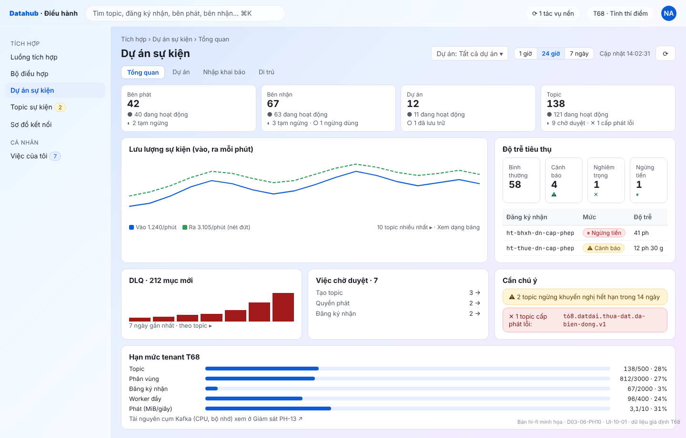

Ảnh cho thấy thứ tự đọc của trang: hàng tab phụ của Dự án sự kiện, bốn thẻ đếm giữ của Hub cũ có phân rã trạng thái bằng chấm và chữ, biểu đồ lưu lượng hai chuỗi (chuỗi ra nét đứt để không phụ thuộc màu) cạnh khối độ trễ theo bốn mức, rồi ba khối DLQ, việc chờ duyệt, cần chú ý và thanh hạn mức. Vỏ ứng dụng là kính; mọi thẻ, biểu đồ là nền đặc theo mục 2.1.

Nền trang `color-canvas`; thẻ `color-surface-solid`, bo `radius-lg`, bóng `shadow-1`, đệm `space-5`. Số lớn `font-display` với `font-feature-tabular`; tiêu đề thẻ `font-callout` `color-text-secondary`. Dòng phân rã dùng `CMP-StatusDot` cộng chữ `font-footnote`. Khoảng cách giữa thẻ `space-5` ở `bp-xl`, `space-4` ở `bp-lg`.

## 8. UI-10-02 Danh sách dự án

::: dac-ta
**Mục đích.** Tìm dự án sự kiện, thấy số topic, bên tham gia và độ trễ lớn nhất của từng dự án; tạo, lưu trữ, khôi phục và xuất khai báo.

**Tác nhân, quyền.** IE, TA (FRS §3.1); xem `PERM-10-read`; "Tạo dự án" cần `PERM-10-create`; lưu trữ, khôi phục cần `PERM-10-update`; xuất khai báo cần `PERM-10-read`.

**FR, UC.** FR-10-001, 003, 005, 070; UC-10-01, UC-10-28.

**Truy vết hệ cũ.** Thay LGC-HUB-008. Hệ cũ xóa project kéo theo topic; Datahub chỉ lưu trữ (BR-10-003).

**Đường dẫn, mẫu.** `/tich-hop/du-an` (tab phụ "Dự án"); PTN-01 Danh sách.

**API.** API-10-001 (danh sách, lọc), API-10-005 (`:archive`), API-10-006 (`:restore`), API-10-074 (xuất khai báo).

**Điều hướng vào.** Tab phụ "Dự án"; thẻ "Dự án" ở UI-10-01; breadcrumb từ UI-10-03.

**Thành phần chính.** Thanh lọc (`q`, trạng thái, tổ chức, nhãn), bảng chọn nhiều, thanh chọn "Xuất khai báo", phân trang (mục 8.2).

**Hành động.** Tạo dự án (mở UI-10-04), Sửa, Lưu trữ, Khôi phục, Xuất khai báo, Xem sơ đồ UI-10-14 (mục 8.3).

**Trạng thái.** Đang tải; rỗng lần đầu; không có kết quả (ST-04, kèm gợi ý dự án đã lưu trữ khớp); không có quyền (ST-07).

**Thông báo.** "Đã lưu trữ dự án {tên}."; ERR-10-010 "Còn {n} đối tượng phụ thuộc." kèm danh sách topic; ERR-10-009 khi thiếu lý do.

**Đợt, mức chi tiết.** MVP (xuất khai báo FR-10-070 mức S); đầy đủ.
:::

### 8.1. Wireframe

```text
┌ Dự án sự kiện ──────────────────────────────────────────── [Xuất khai báo] [+ Tạo dự án] ┐
│ [Tổng quan] [Dự án] [Nhập khai báo] [Di trú]                                             │
│ [Tìm mã, tên, mô tả…        ] [Trạng thái: Đang hoạt động ▾] [Tổ chức ▾] [Nhãn ▾]        │
├──┬────────────────────────────────┬─────────────┬──────────┬───────┬──────┬──────┬──────┬─┤
│☐ │ Mã · Tên                       │ Tổ chức     │Trạng thái│ Topic │ Phát │ Nhận │Trễ max│⋯│
├──┼────────────────────────────────┼─────────────┼──────────┼───────┼──────┼──────┼──────┼─┤
│☐ │ dang-ky-kinh-doanh             │ SO-KHDT     │● Hoạt động│14 (2◐)│ 3    │ 9    │ 45 g │⋯│
│  │ Liên thông đăng ký kinh doanh  │             │          │       │      │      │      │ │
│☐ │ ho-tich-dien-tu                │ SO-TP       │● Hoạt động│ 6     │ 2    │ 5    │12 ph⚠│⋯│
└──┴────────────────────────────────┴─────────────┴──────────┴───────┴──────┴──────┴──────┴─┘
  Đã chọn 2  [Xuất khai báo]                               20 / trang   ‹ Trước  1 2  Sau ›
```

### 8.2. Thành phần và cột

| # | Thành phần | `CMP-*` | Nội dung, kiểm tra | Nguồn |
|---|---|---|---|---|
| 1 | Tiêu đề, nút | `CMP-PageHeader`, `CMP-Button` | "Tạo dự án" primary mở UI-10-04 (Drawer); "Xuất khai báo" mặc định | |
| 2 | Thanh lọc | `CMP-FilterBar`, `CMP-SearchInput`, `CMP-Select` | `q` 1…100 ký tự, trễ 300 ms; `status` nhiều giá trị, mặc định `ACTIVE`; `ownerOrgCode`; `label` | API-10-001 |
| 3 | Bảng | `CMP-DataTable` chọn nhiều | Cột dưới | `items[]` |
| 4 | Thanh chọn | `CMP-SelectionBar` | "Xuất khai báo" cho dự án đã chọn | API-10-074 |
| 5 | Phân trang | `CMP-Pagination` | `page`, `size` 10/20/50/100 | `totalElements` |

: UI-10-02 Danh sách dự án, thành phần

| Cột | Trường | Sắp xếp | Ghi chú |
|---|---|---|---|
| Mã · Tên | `projectCode` (`CMP-CodeText`), `name` | `projectCode`, `name` | Liên kết UI-10-03 |
| Tổ chức | `ownerOrgCode` (tên tổ chức trong tooltip) | | |
| Trạng thái | `status` | | `CMP-StatusTag` |
| Topic | `topicCount` | `topicCount` | Số trong ngoặc là topic chờ duyệt hoặc lỗi, tooltip phân rã |
| Bên phát, Bên nhận | `publisherCount`, `subscriberCount` | | |
| Trễ lớn nhất | `maxLagSeconds` | | `CMP-Duration`; biểu tượng cảnh báo khi vượt `10.lag.warn-seconds` |
| Cập nhật | `updatedAt` | `updatedAt` (mặc định giảm) | `CMP-Timestamp` |
| ⋯ | | | Menu: Sửa, Lưu trữ hoặc Khôi phục, Xuất khai báo, Xem sơ đồ (UI-10-14 `du-an`) |

: UI-10-02 Danh sách dự án, cột bảng

### 8.3. Hành động

| Hành động | Điều kiện | Hộp | Kết quả, lỗi |
|---|---|---|---|
| Lưu trữ | `ACTIVE`, `PERM-10-update` | `CMP-ReasonDialog` lý do bắt buộc 10…500 ký tự | ERR-10-010 hiện `CMP-Modal` danh sách topic còn `PENDING_APPROVAL`, `PROVISIONING`, `ACTIVE`, `DEPRECATED`; thành công Toast "Đã lưu trữ dự án {tên}." |
| Khôi phục | `ARCHIVED`, `PERM-10-update` | `CMP-ConfirmDialog` | Về `ACTIVE` |
| Xuất khai báo | `PERM-10-read` | `CMP-Modal` chọn phạm vi (dự án đã chọn, toàn tenant) | Tệp YAML `EventManifest`; trên 10.000 đối tượng chạy nền |

: UI-10-02 Danh sách dự án, hành động

Độ dài lý do 10…500 ký tự là quy ước giao diện chung cho mọi hộp lý do của PH-10, lấy theo `reason` của FR-10-051; FRS chưa ghi độ dài cho lý do lưu trữ, tạm ngừng (Phụ lục C).

### 8.4. Trạng thái màn

| Trạng thái | Hiển thị |
|---|---|
| Đang tải | Skeleton 8 dòng hai tầng chữ |
| Rỗng lần đầu | "Chưa có dự án sự kiện nào. Dự án gom các topic phục vụ một nghiệp vụ liên thông để dễ quản lý và xem sơ đồ." kèm "Tạo dự án", "Nhập từ Hub cũ" |
| Không có kết quả | ST-04 kèm "Xóa bộ lọc"; nếu đang lọc `ACTIVE` mà có dự án lưu trữ khớp thì thêm "Có {n} dự án đã lưu trữ khớp. Xem." |
| Không có quyền | ST-07 |

: UI-10-02 Danh sách dự án, trạng thái màn

### 8.5. Bàn phím, responsive

`/` vào ô tìm; `N` mở tạo dự án khi có quyền; `↑`, `↓` chọn dòng, `Enter` mở chi tiết, `Space` đánh dấu chọn. Dưới `bp-md` bảng chuyển dạng thẻ, mỗi thẻ hiện mã, tên, trạng thái, số topic và độ trễ.

### 8.6. Bản hi-fi

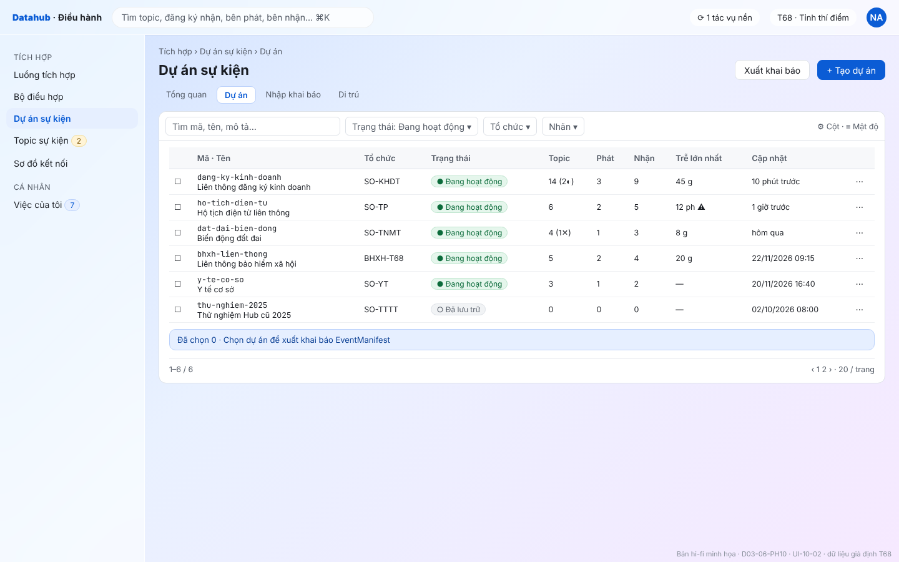

Bảng hai tầng chữ (mã đơn cách, tên) với số topic có phân rã trong ngoặc, độ trễ lớn nhất có biểu tượng cảnh báo khi vượt ngưỡng, và một dự án đã lưu trữ để thấy nhãn trung tính. Thanh lọc mặc định trạng thái Đang hoạt động; hai nút đầu trang là Xuất khai báo và Tạo dự án.

## 9. UI-10-03 Chi tiết dự án

::: dac-ta
**Mục đích.** Xem thông tin chung, topic, bên tham gia và sơ đồ thu gọn của một dự án; tạo topic nhanh mà không rời trang.

**Tác nhân, quyền.** IE, TA, VW (FRS §3.1); xem `PERM-10-read`; Sửa, Lưu trữ cần `PERM-10-update`; "Tạo topic" cần `PERM-10-create`; OR chỉ thấy dự án có HTTT thuộc tổ chức mình.

**FR, UC.** FR-10-002, 004, 005, 008, 058 (sơ đồ thu gọn), 070; UC-10-01, UC-10-02.

**Truy vết hệ cũ.** LGC-HUB-008; tab Sơ đồ là bản thu gọn của LGC-HUB-007.

**Đường dẫn, mẫu.** `/tich-hop/du-an/{ma-du-an}` và tab con `/topic`, `/ben-tham-gia`, `/so-do`, `/lich-su`; PTN-02 Chi tiết.

**API.** API-10-003, 004, 005, 006; API-10-008 (`projectCode`); API-10-032, API-10-037 (`projectCode`); API-10-007 (`projectCode`, `overlay=LAG`); API-10-009 (Drawer tạo nhanh); API-10-074; lịch sử theo FR-00-043.

**Điều hướng vào.** Bấm dự án ở UI-10-02; liên kết dự án ở UI-10-05, 06; sau khi tạo ở UI-10-04.

**Thành phần chính.** Đầu trang có trạng thái, mã, nút; năm tab; bốn `CMP-StatCard`; `CMP-DependencyGraph` thu gọn (mục 9.2).

**Hành động.** Tạo topic (Drawer nhanh hoặc trình hướng dẫn UI-10-07), Sửa (UI-10-04), Lưu trữ, Khôi phục, Xuất khai báo, Xem sơ đồ (mục 9.3).

**Trạng thái.** Đang tải; tab rỗng; dự án `ARCHIVED` (dải thông tin, ẩn nút ghi trừ Khôi phục); ST-08; ST-07 với ERR-10-044.

**Thông báo.** "Dự án đã lưu trữ ngày {archivedAt}: {archiveReason}. Không tạo topic mới được."; "Không tìm thấy dự án {mã}".

**Đợt, mức chi tiết.** MVP; đầy đủ.
:::

### 9.1. Wireframe

```text
┌ Tích hợp › Dự án sự kiện › Liên thông đăng ký kinh doanh ───────────────────────────────────┐
│ [‹] Liên thông đăng ký kinh doanh  ● Đang hoạt động  dang-ky-kinh-doanh ⧉                    │
│     Sở KH-ĐT · Phụ trách: Nguyễn An · Nhãn: doanh-nghiep   [+ Tạo topic ▾] [Sửa] [⋯]         │
│ [Tổng quan] [Topic 14] [Bên tham gia 12] [Sơ đồ] [Lịch sử]                                  │
├─────────────────────────────────────────────────────────────────────────────────────────────┤
│ Mô tả …                                                                                      │
│ ┌ Sự kiện vào 24 giờ ┐ ┌ Đăng ký nhận cảnh báo ┐ ┌ Mục DLQ mới ┐ ┌ Topic chờ duyệt ┐          │
│ │ 18.420             │ │ 1 (Nghiêm trọng)      │ │ 37          │ │ 2               │          │
│ └────────────────────┘ └───────────────────────┘ └─────────────┘ └─────────────────┘          │
│ Sơ đồ thu gọn: [HT-DKKD]──▶(t68.dkkd.doanh-nghiep.da-cap-phep.v1)──▶[HT-THUE] [HT-BHXH] …   │
│                                                         [Mở sơ đồ đầy đủ ↗]                  │
└─────────────────────────────────────────────────────────────────────────────────────────────┘
```

### 9.2. Các tab

| Tab | Đoạn route | Nội dung | Thành phần | API |
|---|---|---|---|---|
| Tổng quan | (mặc định) | Mô tả, bốn `CMP-StatCard` (sự kiện 24 giờ, subscription cảnh báo lag, mục DLQ `NEW`, topic chờ duyệt), sơ đồ thu gọn | `CMP-DescriptionList`, `CMP-StatCard`, `CMP-DependencyGraph` biến thể `compact` | API-10-003, API-10-007 |
| Topic | `/topic` | Bảng topic của dự án, cột như UI-10-05 bỏ cột Dự án; lọc trạng thái, loại | `CMP-DataTable`, `CMP-FilterBar` | API-10-008 `projectCode` |
| Bên tham gia | `/ben-tham-gia` | Hai bảng xếp dọc: bên phát, bên nhận có quan hệ với topic của dự án | `CMP-DataTable` | API-10-032, API-10-037 `projectCode` |
| Sơ đồ | `/so-do` | `CMP-DependencyGraph` biến thể `full` lọc theo dự án, nút "Mở trong Sơ đồ kết nối" | `CMP-DependencyGraph` | API-10-007 |
| Lịch sử | `/lich-su` | Dòng thời gian kiểm toán | `CMP-AuditTimeline` | FR-00-043 |

: UI-10-03 Chi tiết dự án, các tab

Sơ đồ thu gọn chỉ hiện một tầng quanh tối đa năm topic có lưu lượng lớn nhất; đồ thị đầy đủ có tương tác ở UI-10-14.

### 9.3. Thanh hành động

| Nút | Điều kiện | Hành vi |
|---|---|---|
| "Tạo topic" (nút tách) | `PERM-10-create`, dự án `ACTIVE` | Bấm chính mở Drawer tạo nhanh (mục 13.6); mũi tên mở menu "Trình hướng dẫn đầy đủ" (UI-10-07 với `?du-an=`) |
| Sửa | `PERM-10-update`, `ACTIVE` | Drawer UI-10-04 |
| ⋯ Lưu trữ, Khôi phục | Như UI-10-02 | |
| ⋯ Xuất khai báo | `PERM-10-read` | API-10-074 với dự án này |
| ⋯ Xem sơ đồ | | UI-10-14 `?du-an={ma}` |

: UI-10-03 Chi tiết dự án, thanh hành động

Dự án `ARCHIVED`: `CMP-Banner` thông tin "Dự án đã lưu trữ ngày {archivedAt}: {archiveReason}. Không tạo topic mới được." và mọi nút ghi trừ Khôi phục bị ẩn.

### 9.4. Trạng thái màn

Đang tải: skeleton tiêu đề, bốn thẻ, khối sơ đồ. Tab Topic rỗng: "Dự án chưa có topic. Topic là kênh sự kiện có lược đồ, ví dụ 'doanh nghiệp đã cấp phép'." kèm "Tạo topic". Tab Bên tham gia rỗng: "Chưa có bên phát hoặc bên nhận nào trên topic của dự án." Không tồn tại: ST-08 "Không tìm thấy dự án {mã}". Ngoài phạm vi tổ chức: ST-07 với ERR-10-044.

### 9.5. Bàn phím, truy cập

`1`…`5` chuyển tab khi focus không ở ô nhập; `E` sửa; `T` tạo topic nhanh. Hàng tab theo mẫu WAI-ARIA Tabs (mũi tên trái, phải). Sơ đồ thu gọn `role="img"` có `aria-label` tóm tắt ("3 bên phát, 14 topic, 9 bên nhận; 1 đăng ký nhận nghiêm trọng") kèm nút "Xem dạng danh sách".

### 9.6. Bản hi-fi

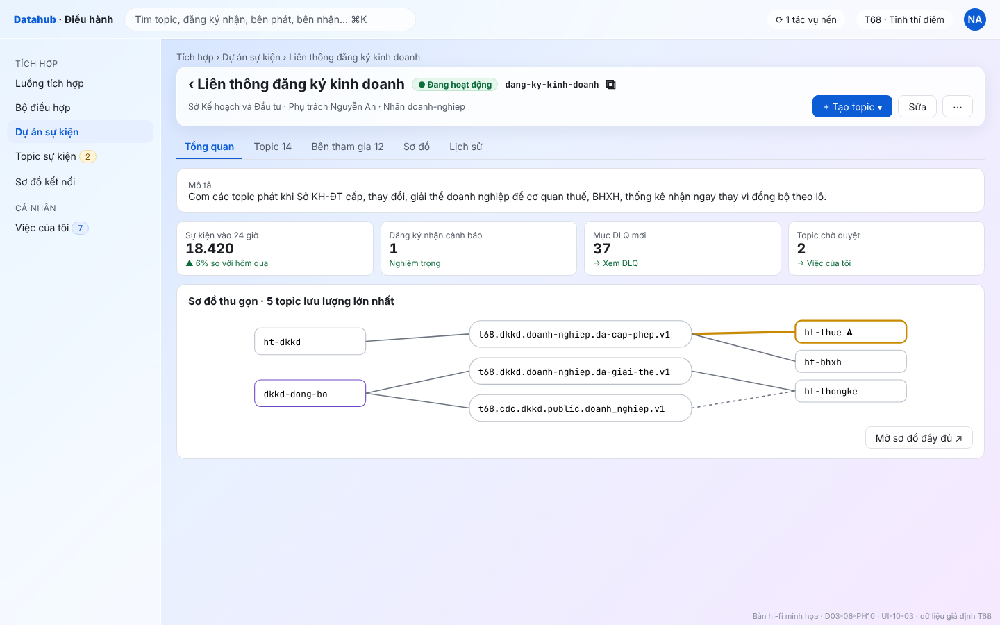

Đầu trang kính dày chứa tên, trạng thái, mã có nút sao chép và nút tách "Tạo topic". Tab Tổng quan có mô tả, bốn thẻ số và sơ đồ thu gọn một tầng quanh năm topic lưu lượng lớn nhất; cạnh tới HTTT thuế dày và vàng vì đang cảnh báo lag.

## 10. UI-10-04 Tạo, sửa dự án

::: dac-ta
**Mục đích.** Tạo hoặc sửa dự án bằng biểu mẫu nhanh trong Drawer, không rời danh sách hay trang chi tiết.

**Tác nhân, quyền.** IE, TA (SV trong phạm vi tổ chức); tạo `PERM-10-create`; sửa `PERM-10-update`.

**FR, UC.** FR-10-003, 004; UC-10-01.

**Truy vết hệ cũ.** LGC-HUB-008.

**Đường dẫn, mẫu.** `/tich-hop/du-an/moi` (Drawer trên UI-10-02), `/tich-hop/du-an/{ma-du-an}/sua` (Drawer trên UI-10-03); PTN-04 Biểu mẫu nhanh.

**API.** API-10-002 (tạo), API-10-003 (kiểm tra mã còn trống), API-10-004 (sửa, `If-Match`).

**Điều hướng vào.** Nút "Tạo dự án" (phím `N`) ở UI-10-02; "Sửa" (phím `E`) ở UI-10-03; nút trong trạng thái rỗng của UI-10-01.

**Thành phần chính.** Sáu trường: tên, mã, tổ chức chủ quản, người phụ trách, nhãn, mô tả (mục 10.2).

**Hành động.** "Tạo dự án" hoặc "Lưu"; "Hủy" (hỏi xác nhận khi có thay đổi).

**Trạng thái.** Đang lưu (ST-09); xung đột (ST-13); dự án `ARCHIVED` không sửa được; vượt hạn mức `10.quota.max-projects`.

**Thông báo.** "Đã tạo dự án {tên}."; ERR-10-002, 003 dưới trường mã; ERR-10-011 đầu Drawer; ERR-10-006 "Dự án đã lưu trữ, không sửa được."

**Đợt, mức chi tiết.** MVP; đầy đủ.
:::

### 10.1. Wireframe

```text
┌ Tạo dự án sự kiện ─────────────────────────────── ✕ ┐
│ Tên dự án *        [Liên thông đăng ký kinh doanh  ] │
│ Mã dự án *         [dang-ky-kinh-doanh         ] ✓   │
│                    Dùng trong đường dẫn, không đổi được│
│ Tổ chức chủ quản * [Sở Kế hoạch và Đầu tư ▾]         │
│ Người phụ trách    [Nguyễn An ▾] (mặc định: bạn)     │
│ Nhãn               [doanh-nghiep ×] [+ thêm]         │
│ Mô tả              [                              ]  │
│                    0 / 2.000                          │
├──────────────────────────────────────────────────────┤
│                               [Hủy]  [Tạo dự án]     │
└──────────────────────────────────────────────────────┘
```

### 10.2. Trường

| Nhãn | Trường | Kiểu, thành phần | Bắt buộc | Kiểm tra phía giao diện | Lỗi máy chủ |
|---|---|---|---|---|---|
| Tên dự án | `name` | `CMP-Input` | Có | 3…255 ký tự | |
| Mã dự án | `projectCode` | `CMP-Input` `font-mono` | Có (tạo); chỉ đọc khi sửa | `^[a-z][a-z0-9-]{2,62}$`; không thuộc `moi`, `tong-quan`, `nhap`, `di-tru`, `ben-phat`, `ben-nhan`; tự gợi ý từ tên (bỏ dấu, chữ thường, gạch nối) cho tới khi người dùng sửa tay | ERR-10-003, ERR-10-002 |
| Tổ chức chủ quản | `ownerOrgCode` | `CMP-ResourceSelect` (tổ chức của tenant từ PH-12) | Có | SV chỉ thấy tổ chức của mình | ERR-10-044 |
| Người phụ trách | `ownerUser` | `CMP-ResourceSelect` người dùng | Không | Mặc định người tạo | |
| Nhãn | `labels` | `CMP-Select` chế độ thẻ | Không | ≤ 10 nhãn, mỗi nhãn T-CODE | |
| Mô tả | `description` | `CMP-TextArea` đếm ký tự | Không | ≤ 2.000 ký tự | |

: UI-10-04 Tạo, sửa dự án, trường

Kiểm tra trùng mã chạy khi rời ô (không theo từng phím) bằng API-10-003: `404` là còn trống (dấu ✓ kèm chữ "Mã còn trống"), `200` là đã dùng. Vượt hạn mức `10.quota.max-projects` (ERR-10-011) hiện `CMP-Alert` đầu Drawer.

### 10.3. Trạng thái và hành vi

Gửi: ST-09; thành công đóng Drawer, Toast "Đã tạo dự án {tên}." có nút "Xem", điều hướng UI-10-03. Sửa dùng `If-Match`; 412 hiện ST-13. Dự án `ARCHIVED` mở route sửa: Drawer hiện `CMP-Alert` "Dự án đã lưu trữ, không sửa được." (ERR-10-006) và không có nút lưu. `Esc` đóng Drawer, hỏi xác nhận khi có thay đổi; `Ctrl+Enter` gửi. Drawer rộng `size-drawer-md`, dưới `bp-md` chiếm toàn màn.

### 10.4. Bản hi-fi

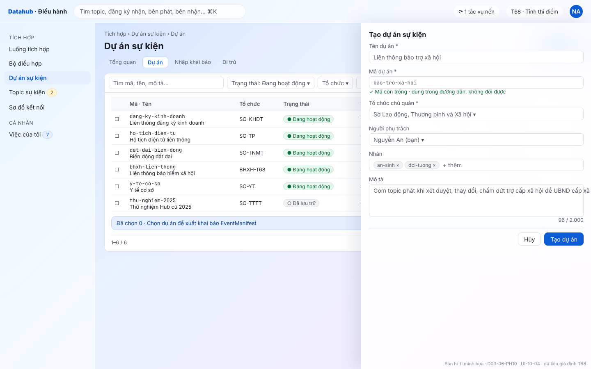

Drawer kính trên nền danh sách UI-10-02, giếng nội dung đặc. Mã dự án được gợi ý từ tên và đã kiểm tra còn trống (dấu ✓ kèm chữ); nhãn ở dạng thẻ có nút xóa; bộ đếm ký tự dưới mô tả.

## 11. UI-10-05 Danh sách topic

::: dac-ta
**Mục đích.** Tìm topic theo dự án, trạng thái, loại, phân loại, chế độ định tuyến, bên phát, bên nhận; thấy ngay topic có cảnh báo lag, chờ duyệt hay cấp phát lỗi.

**Tác nhân, quyền.** IE, TO (FRS §3.1) và mọi vai trò có `PERM-10-read`; "Tạo topic" cần `PERM-10-create`; menu dòng "Đăng ký nhận" cần `PERM-10-subscribe`.

**FR, UC.** FR-10-006; hiện kết quả FR-10-066, 067 (topic `CDC`, `SYSTEM`); UC-10-02.

**Truy vết hệ cũ.** LGC-HUB-009.

**Đường dẫn, mẫu.** `/tich-hop/topic` (`q`, `du-an`, `trang-thai`, `loai`, `phan-loai`, `dinh-tuyen`, `canh-bao-lag`, `ben-phat`, `ben-nhan`); PTN-01.

**API.** API-10-008.

**Điều hướng vào.** Mục menu "Topic sự kiện" (tab phụ "Topic"); thẻ "Topic" ở UI-10-01; tab Topic của UI-10-03.

**Thành phần chính.** Thanh lọc, lọc nhanh có số đếm, bảng topic hai tầng chữ (mục 11.2).

**Hành động.** Tạo topic (UI-10-07); menu dòng: Xem, Đăng ký nhận, Đề nghị quyền phát, Xem sơ đồ, Sao chép tên.

**Trạng thái.** Đang tải; rỗng lần đầu; ST-04; ST-07; topic `CDC`, `SYSTEM` có biểu tượng máy để người dùng không bấm Sửa rồi gặp ERR-10-045.

**Thông báo.** "Chưa có topic nào. Topic là kênh để HTTT phát và nhận sự kiện có lược đồ."; tooltip "Do {ownerServiceCode} đăng ký; chỉ dịch vụ chủ quản sửa cấu hình."; "Đã sao chép tên topic".

**Đợt, mức chi tiết.** MVP; đầy đủ.
:::

### 11.1. Wireframe

```text
┌ Topic sự kiện ────────────────────────────────────────────────────────── [+ Tạo topic] ┐
│ [Topic] [Bên phát] [Bên nhận] [Phát lại] [Độ trễ] [Cài đặt]                              │
│ [Tìm tên topic, mô tả, loại sự kiện…  ] [Dự án ▾] [Trạng thái ▾] [Loại ▾] [Phân loại ▾]  │
│ [Định tuyến ▾] [Bên phát ▾] [Bên nhận ▾]                                                 │
│ Lọc nhanh: (Có cảnh báo lag 3) (Chờ duyệt 9) (Cấp phát lỗi 1) (Ngừng khuyến nghị 4)       │
├────────────────────────────────────────────┬────────┬──────────┬────┬──────┬────┬────┬──────┬─┤
│ Tên topic · Dự án                          │ Loại   │Trạng thái│P.v.│Lưu giữ│Phát│Nhận│Vào/ph│⋯│
├────────────────────────────────────────────┼────────┼──────────┼────┼──────┼────┼────┼──────┼─┤
│ t68.dkkd.doanh-nghiep.da-cap-phep.v1 ⧉     │Nghiệp vụ│● Hoạt động│ 6 │ 7 ng │ 1  │ 4  │ 320  │⋯│
│ dang-ky-kinh-doanh · Nội bộ · lược đồ v3   │        │trễ 12 ph ⚠│   │      │    │    │      │ │
│ t68.cdc.dkkd.public.doanh_nghiep.v1        │ CDC    │● Hoạt động│ 3 │ 7 ng │ 1  │ 1  │  14  │⋯│
└────────────────────────────────────────────┴────────┴──────────┴────┴──────┴────┴────┴──────┴─┘
```

### 11.2. Thành phần, cột

| # | Thành phần | `CMP-*` | Nội dung | Nguồn |
|---|---|---|---|---|
| 1 | Thanh lọc | `CMP-FilterBar`, `CMP-SearchInput`, `CMP-Select`, `CMP-FilterDrawer` (dưới `bp-lg`) | `q`, `projectCode`, `status` (mặc định mọi trạng thái trừ `RETIRED`), `topicKind` (mặc định trừ `DLQ`), `dataClass`, `routingMode`, `publisherCode`, `subscriberCode` | API-10-008 |
| 2 | Lọc nhanh | `CMP-FilterChips` | `hasLagAlert=true`, `status=PENDING_APPROVAL`, `status=FAILED`, `status=DEPRECATED`; số lấy từ `facets` | `facets.status` |
| 3 | Bảng | `CMP-DataTable` | Cột dưới | `items[]` |

: UI-10-05 Danh sách topic, thành phần

| Cột | Trường | Sắp xếp | Ghi chú |
|---|---|---|---|
| Tên topic · Dự án | `topicName` (`CMP-Identifier` cắt giữa), dòng 2 `projectCode`, `dataClass`, `latestSchemaVersion` | `topicName` | Liên kết UI-10-06; có `successorTopic` thì thêm `CMP-Tag` "Có bản mới" |
| Loại | `topicKind` | | `CMP-Tag` |
| Trạng thái | `status`; dòng 2 `maxLagSeconds` khi vượt ngưỡng | `maxLagSeconds` | `CMP-StatusTag` cộng `CMP-Duration` |
| Phân vùng | `partitions` | `partitions` | |
| Lưu giữ | `retentionHours`, hiển thị theo ngày khi chia hết 24 | | Tooltip `cleanupPolicy` |
| Định tuyến | `routingMode` | | Ẩn mặc định, bật ở menu cột |
| Phát, Nhận | `publicationCount`, `subscriptionCount` | | Liên kết tab tương ứng UI-10-06 |
| Vào mỗi phút | `inRatePerMinute` | `inRatePerMinute` | Trống thì "Chưa có số liệu" |
| ⋯ | | | Xem, Đăng ký nhận (topic `ACTIVE`, `PERM-10-subscribe`), Đề nghị quyền phát (`ACTIVE`, `PERM-10-create`), Xem sơ đồ, Sao chép tên |

: UI-10-05 Danh sách topic, cột bảng

### 11.3. Trạng thái màn

| Trạng thái | Hiển thị |
|---|---|
| Đang tải | Skeleton 10 dòng hai tầng |
| Rỗng lần đầu | "Chưa có topic nào. Topic là kênh để HTTT phát và nhận sự kiện có lược đồ." kèm "Tạo topic" và liên kết HDSD "Đặt tên topic" |
| Không có kết quả | ST-04 |
| Không có quyền | ST-07 |

: UI-10-05 Danh sách topic, trạng thái màn

Topic `CDC`, `SYSTEM` hiện biểu tượng máy cạnh tên với tooltip "Do {ownerServiceCode} đăng ký; chỉ dịch vụ chủ quản sửa cấu hình." để người dùng không bấm Sửa rồi gặp ERR-10-045.

### 11.4. Bàn phím

`/` tìm; `N` tạo topic; `↑`, `↓`, `Enter`; `C` sao chép tên topic dòng đang chọn (thông báo `aria-live` "Đã sao chép tên topic").

### 11.5. Bản hi-fi

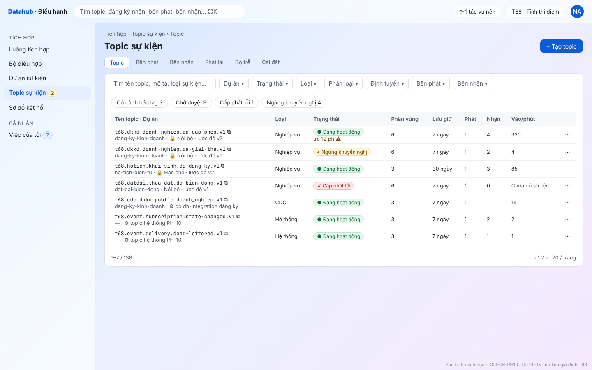

Bảng topic với dòng phụ dự án, phân loại, phiên bản lược đồ; một topic cảnh báo lag, một topic ngừng khuyến nghị, một topic cấp phát lỗi (ô lưu lượng hiện "Chưa có số liệu" thay vì 0), một topic CDC và hai topic hệ thống `t68.event.*.v1` có biểu tượng máy.

## 12. UI-10-06 Chi tiết topic

::: dac-ta
**Mục đích.** Một nơi để xem và vận hành một topic: cấu hình, lược đồ, quyền phát, đăng ký nhận kèm lag, DLQ, cách kết nối, chuyển đổi phiên bản, lịch sử; đề nghị thay đổi cấu hình, ngừng, tạo phiên bản mới.

**Tác nhân, quyền.** IE, TO, IA (FRS §3.1) và mọi vai trò có `PERM-10-read`; nút theo quyền (`PERM-10-create`, `PERM-10-update`, `PERM-10-subscribe`) và trạng thái ở mục 12.3.

**FR, UC.** FR-10-007, 010…016, 024, 030, 033, 034 (tab Cách kết nối); UC-10-02, 03, 04, 05, 09, 10, 11, 23.

**Truy vết hệ cũ.** LGC-HUB-009, 012; LGC-TOOL-010, LGC-BUS-039 (tab Cách kết nối).

**Đường dẫn, mẫu.** `/tich-hop/topic/{ten-topic}` và tab con `/cau-hinh`, `/quyen-phat`, `/dang-ky-nhan-ds`, `/ket-noi`, `/chuyen-doi`, `/lich-su`; `/luoc-do`, `/dlq` là UI-10-08, UI-10-15 trong khung topic; PTN-02.

**API.** API-10-010, 011, 012, 013, 014, 015, 016, 017, 018, 019, 020, 021, 022, 024, 042, 043, 046, 060 (đếm DLQ theo subscription); lịch sử theo FR-00-043.

**Điều hướng vào.** Bấm topic ở UI-10-05 hoặc tab Topic của UI-10-03; bấm đúp nút topic ở UI-10-14; khối Cần chú ý ở UI-10-01; sau khi gửi duyệt ở UI-10-07.

**Thành phần chính.** Đầu trang (tên, trạng thái, loại, phân loại, dự án, lược đồ), thanh hành động, chín tab (mục 12.2), Drawer "Đề nghị quyền phát" (12.4), Drawer "Đổi cấu hình" (12.5).

**Hành động.** Đăng ký nhận, Đề nghị quyền phát, Gửi duyệt, Sửa nháp, Đổi cấu hình (bốn nhóm), Thử lại và Hủy cấp phát, Tạo phiên bản mới, Ngừng khuyến nghị, Ngừng dùng, Xem sơ đồ, Tải lược đồ (mục 12.3).

**Trạng thái.** Đang tải; `PROVISIONING`; `FAILED`; `PENDING_APPROVAL`; `DEPRECATED`; `RETIRED`; ST-08; ST-07 (mục 12.6).

**Thông báo.** "Đã gửi đề nghị quyền phát, chờ duyệt."; "Topic đã ngừng dùng ngày {retiredAt}."; ERR-10-011…014, 016, 019, 024, 045…048, 051 theo mục 5.3.

**Đợt, mức chi tiết.** MVP; rất chi tiết.
:::

### 12.1. Wireframe

```text
┌ Tích hợp › Topic sự kiện › t68.dkkd.doanh-nghiep.da-cap-phep.v1 ────────────────────────────┐
│ [‹] t68.dkkd.doanh-nghiep.da-cap-phep.v1 ⧉   ● Đang hoạt động  Nghiệp vụ  🔒 Nội bộ          │
│     Dự án: Liên thông đăng ký kinh doanh · Lược đồ v3 (Avro, Tương thích lùi)                 │
│     [Đăng ký nhận] [Đề nghị quyền phát] [Đổi cấu hình ▾] [⋯]                                 │
│ [Tổng quan][Cấu hình][Lược đồ][Quyền phát 1][Đăng ký nhận 4][DLQ 37][Cách kết nối]           │
│ [Chuyển đổi phiên bản][Lịch sử]                                                              │
├──────────────────────────────────────────────────────────────────────────────────────────────┤
│ Mô tả: Phát khi Sở KH-ĐT cấp giấy chứng nhận đăng ký doanh nghiệp.                           │
│ ┌ Vào 24 giờ ┐ ┌ Byte vào 24 giờ ┐ ┌ Đăng ký nhận ┐ ┌ Trễ lớn nhất ┐                        │
│ │ 7.680      │ │ 21 MiB          │ │ 4 (1 cảnh báo)│ │ 12 ph 30 g ⚠ │                        │
│ Lưu lượng theo phân vùng (24 giờ): p0 ▇▇▇ p1 ▇▇ p2 ▇▇▇ p3 ▇ p4 ▇▇ p5 ▇▇                       │
│ Bên phát: HT-DKKD (API HTTP) ● · Bên nhận: HT-THUE (Đẩy) ⚠, HT-BHXH (Kéo API) ●, …          │
└──────────────────────────────────────────────────────────────────────────────────────────────┘
```

### 12.2. Các tab

| Tab | Đoạn route | Nội dung | Thành phần | API |
|---|---|---|---|---|
| Tổng quan | (mặc định) | Mô tả, bốn thẻ số 24 giờ, biểu đồ theo phân vùng, tóm tắt bên phát, bên nhận, trạng thái cấp phát và `provisioningError` nếu có | `CMP-StatCard`, `CMP-Chart` cột, `CMP-DescriptionList`, `CMP-Alert` | API-10-010 |
| Cấu hình | `/cau-hinh` | `partitions`, `replicationFactor` (3, khóa), `minInsyncReplicas` (2, khóa), `retentionHours`, `cleanupPolicy`, `maxMessageBytes`, `routingMode`, `partitionKeyField`, `orderingRequired`, `dataClass`, `provisioningCommit`, `activatedAt`; topic `CDC`, `SYSTEM` thêm `ownerServiceCode`, `sourceRef` | `CMP-DescriptionList` có biểu tượng khóa cho trường nền tảng | API-10-010 |
| Lược đồ | `/luoc-do` | UI-10-08 hiển thị trong khung topic | Mục 14 | API-10-021, 022 |
| Quyền phát | `/quyen-phat` | Bảng publication: bên phát, `commType`, `status`, `purpose`, `expectedRatePerMinute`, `quotaBytesPerSecond`, `approvedAt`; nút "Đề nghị quyền phát" | `CMP-DataTable`, `CMP-Drawer` | API-10-042 `topicName` |
| Đăng ký nhận | `/dang-ky-nhan-ds` | Bảng subscription: mã, bên nhận, `deliveryMode`, `status`, `alertState`, `lagSeconds`, thời gian còn lại, mục DLQ mới; nút "Đăng ký nhận" | `CMP-DataTable` | API-10-046 `topicName`, API-10-060 |
| DLQ | `/dlq` | UI-10-15 trong khung topic | Mục 21 | API-10-060 |
| Cách kết nối | `/ket-noi` | Đường dẫn API phát, API kéo, URI lược đồ ở Apicurio, địa chỉ listener Kafka ngoài (khi tenant bật), đoạn mã mẫu Java, .NET, Python, Node.js; tải lược đồ | `CMP-DescriptionList`, `CMP-CodeBlock` trong `CMP-Tabs` theo ngôn ngữ, `CMP-CopyButton` | API-10-020 |
| Chuyển đổi phiên bản | `/chuyen-doi` | Chỉ hiện khi có `predecessorTopic` hoặc `successorTopic`: bảng bên nhận cũ đã có subscription trên topic mới chưa, trạng thái, lag hai bên, số ngày tới `sunsetAt`; bảng bên phát đã phát lên topic mới chưa | `CMP-DataTable`, `CMP-ProgressBar` | API-10-019 |
| Lịch sử | `/lich-su` | Kiểm toán | `CMP-AuditTimeline` | FR-00-043 |

: UI-10-06 Chi tiết topic, các tab

Tab "Lược đồ" và "DLQ" là route con có PTN riêng nhưng dùng chung `CMP-PageHeader` và hàng tab của topic, để người dùng không mất ngữ cảnh. Cột "Thời gian còn lại" của bảng đăng ký nhận bằng `retentionHours` trừ `lagSeconds`; dưới 24 giờ thì sắc thái `error` kèm chữ "dưới 24 giờ" (FR-10-041).

### 12.3. Thanh hành động và điều kiện

| Nút | Quyền | Trạng thái topic | Hộp | API |
|---|---|---|---|---|
| Đăng ký nhận | `PERM-10-subscribe` | `ACTIVE` | Mở UI-10-11 | |
| Đề nghị quyền phát | `PERM-10-create` | `ACTIVE` | Drawer mục 12.4 | API-10-043 |
| Gửi duyệt | `PERM-10-create` | `DRAFT` | `CMP-ConfirmDialog` | API-10-012 |
| Sửa nháp | `PERM-10-update` | `DRAFT` | Mở UI-10-07 ở chế độ sửa | API-10-011 |
| Đổi cấu hình › Tăng phân vùng | `PERM-10-update` | `ACTIVE`, khác `SINGLE_PARTITION` | Drawer mục 12.5 | API-10-015 |
| Đổi cấu hình › Lưu giữ, chính sách dọn, kích thước bản tin | `PERM-10-update` | `ACTIVE`, `DEPRECATED` | Drawer mục 12.5 | API-10-015 |
| Đổi cấu hình › Định tuyến, khóa | `PERM-10-update` | `ACTIVE` | Drawer mục 12.5 | API-10-015 |
| Đổi cấu hình › Mức tương thích | `PERM-10-update` | Không `RETIRED` | Drawer mục 12.5 | API-10-015 |
| Thử lại cấp phát, Hủy cấp phát | `PERM-10-update` | `FAILED` | `CMP-ConfirmDialog` | API-10-013, API-10-014 |
| ⋯ Tạo phiên bản mới | `PERM-10-create` | `ACTIVE`, chưa có kế nhiệm | UI-10-07 chế độ phiên bản mới (mục 13.7) | API-10-018 |
| ⋯ Ngừng khuyến nghị | `PERM-10-update` | `ACTIVE` | `CMP-ReasonDialog` có `CMP-TopicSelect` chọn kế nhiệm, `CMP-DatePicker` cho `sunsetAt` | API-10-016 |
| ⋯ Ngừng dùng | `PERM-10-update` | `ACTIVE`, `DEPRECATED` | `CMP-ReasonDialog` liệt kê quan hệ sẽ thu hồi; còn subscription chưa thu hồi thì nói rõ "Sẽ tạo yêu cầu duyệt" | API-10-017 |
| ⋯ Xem sơ đồ | `PERM-10-read` | | UI-10-14 `?topic=` | |
| ⋯ Tải lược đồ | `PERM-10-read` | Có phiên bản `ENABLED` | Tải `.avsc` hoặc `.json` | API-10-024 |

: UI-10-06 Chi tiết topic, thanh hành động và điều kiện

Topic `CDC`, `SYSTEM` không hiện nhóm "Đổi cấu hình" và hiện `CMP-Alert` thông tin cố định ở tab Cấu hình (ERR-10-045). Mọi nút ghi ẩn khi `status = RETIRED`; trang hiện `CMP-Banner` "Topic đã ngừng dùng ngày {retiredAt}."

### 12.4. Drawer "Đề nghị quyền phát"

| Nhãn | Trường | Thành phần | Bắt buộc | Kiểm tra |
|---|---|---|---|---|
| Bên phát | `publisherCode` | `CMP-ResourceSelect` bên phát `ACTIVE` (tìm mã, tên, HTTT) | Có | Chỉ bên có `commType` chiều phát; ERR-10-024 nếu cặp đã có |
| Mục đích | `purpose` | `CMP-TextArea` | Có | 10…500 ký tự |
| Lưu lượng dự kiến (sự kiện/phút) | `expectedRatePerMinute` | `CMP-NumberInput` | Không | Số nguyên ≥ 0 |
| Hạn mức byte/giây | `quotaBytesPerSecond` | `CMP-NumberInput` có hậu tố KiB/giây | Không | ≤ phần còn lại của hạn mức tenant, hiện "Còn {x} MiB/giây" dưới ô |

: UI-10-06 Chi tiết topic, drawer "Đề nghị quyền phát"

Topic `RESTRICTED`, `SENSITIVE` hiện `CMP-Alert` "Bên phát phải là HTTT đạt cấp độ ATTT yêu cầu." (ERR-10-051 khi không đạt). Gửi thành công: Toast "Đã gửi đề nghị quyền phát, chờ duyệt." kèm mã yêu cầu.

### 12.5. Drawer "Đổi cấu hình"

Một Drawer `size-drawer-lg` chung cho bốn loại thay đổi, mở đúng nhóm theo mục menu đã chọn; mọi thay đổi gửi API-10-015 kèm `reason`.

| Nhóm | Trường | Kiểm tra | Ghi chú |
|---|---|---|---|
| Phân vùng | `partitions` mới (`CMP-NumberInput`, nhỏ nhất bằng hiện tại cộng một, lớn nhất `10.topic.max-partitions`), `plannedAt` (`CMP-DatePicker` có giờ, tùy chọn), `acknowledgeOrderingImpact` (`CMP-Checkbox`) | ERR-10-013 khi nhỏ hơn hiện tại; ô xác nhận bắt buộc khi `KEY_HASH` hoặc `orderingRequired` (ERR-10-014); ERR-10-012, 011 | `CMP-Alert` cảnh báo nêu khóa sẽ đổi phân vùng và gợi ý "Tạo phiên bản topic mới" |
| Lưu giữ, dọn, kích thước | `retentionHours` (1…`maxRetentionHours`), `cleanupPolicy`, `maxMessageBytes` (1.024…`10.topic.max-message-bytes`), `acknowledgeDataLoss` | Tăng lưu giữ, tăng kích thước: nhãn "Áp dụng ngay, không cần duyệt"; giảm lưu giữ, đổi dọn, giảm kích thước: nhãn "Cần duyệt" và bảng subscription có `lagSeconds` lớn hơn lưu giữ mới; ERR-10-048 khi chọn nén với chế độ không khóa | Bảng tính trước do máy chủ trả (Phụ lục B) |
| Định tuyến | `routingMode` (chỉ mục được bật ở API-10-068), `partitionKeyField`, `orderingRequired` | ERR-10-046, ERR-10-047 (đổi chiều phá vỡ), ERR-10-043 | Đổi phá vỡ hiện nút "Tạo phiên bản topic mới" |
| Mức tương thích | `compatibility` (A.2.4) | `NONE` vô hiệu khi topic đã từng `ACTIVE` (ERR-10-019); siết chặt chạy kiểm tra trước, ERR-10-016 kèm cặp phiên bản vi phạm | Nới lỏng hiện câu "Bên phát, bên nhận sẽ được thông báo." |
| Chung | `reason` | 10…500 ký tự | |

: UI-10-06 Chi tiết topic, drawer "Đổi cấu hình"

Chân Drawer hiện tóm tắt khác biệt cũ và mới bằng `CMP-DiffTable` trước nút "Gửi đề nghị".

### 12.6. Trạng thái màn

| Trạng thái | Hiển thị |
|---|---|
| Đang tải | Skeleton tiêu đề hai dòng, hàng tab, bốn thẻ |
| `PROVISIONING` | Mục 6 điểm 1 |
| `FAILED` | `CMP-Alert` lỗi dưới tiêu đề với `provisioningError` và nút "Thử lại cấp phát", "Hủy" |
| `PENDING_APPROVAL` | `CMP-Banner` thông tin "Đang chờ duyệt tạo topic, yêu cầu {requestCode}." kèm liên kết UI-10-13 |
| `DEPRECATED` | `CMP-Banner` cảnh báo "Ngừng khuyến nghị; hết hạn {sunsetAt}. Topic kế nhiệm: {successorTopic}." |
| Không tồn tại | ST-08 "Không tìm thấy topic {tên}" |
| Không có quyền | ST-07 |

: UI-10-06 Chi tiết topic, trạng thái màn

### 12.7. Bàn phím, truy cập

`1`…`9` chuyển tab; `S` đăng ký nhận; `P` đề nghị quyền phát; `C` sao chép tên topic. Biểu đồ phân vùng có bảng thay thế. Khối mã mẫu trong tab Cách kết nối là vùng cuộn có `tabindex="0"` và nhãn ngôn ngữ; nút sao chép ghi rõ "Sao chép mã Java". Dưới `bp-lg` hàng tab cuộn ngang có nút mũi tên hai đầu; thanh hành động gom vào "Thao tác".

### 12.8. Bản hi-fi

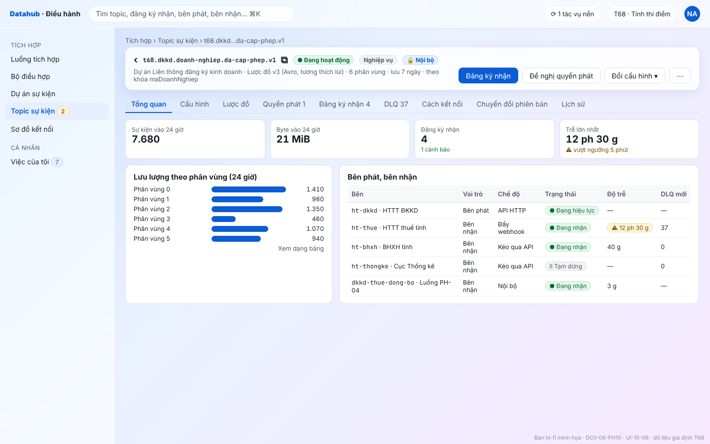

Tab Tổng quan của topic đang hoạt động: bốn thẻ số 24 giờ, lưu lượng theo phân vùng dạng thanh ngang có số, và bảng bên phát, bên nhận với chế độ, trạng thái, độ trễ, DLQ mới. Thanh hành động đặt Đăng ký nhận làm nút chính vì đó là việc thường gặp nhất.

## 13. UI-10-07 Tạo topic

::: dac-ta
**Mục đích.** Tạo topic với tên theo quy ước, cấu hình, định tuyến và lược đồ bắt buộc; kiểm tra trước khi gửi duyệt để người duyệt chỉ nhận yêu cầu đã sạch lỗi chặn.

**Tác nhân, quyền.** IE (FRS §3.1), TA, SV trong phạm vi tổ chức; `PERM-10-create`.

**FR, UC.** FR-10-008, 015 (phiên bản mới), 017; UC-10-02, UC-10-05.

**Truy vết hệ cũ.** LGC-HUB-009: "cấu trúc" của topic hệ cũ thành lược đồ bắt buộc có kiểm tra.

**Đường dẫn, mẫu.** `/tich-hop/topic/moi` (`?du-an=`, `?buoc=`); Drawer tạo nhanh từ UI-10-03; PTN-05 Trình hướng dẫn, Drawer PTN-04.

**API.** API-10-001 (chọn dự án), API-10-010 (kiểm tra tên còn trống), API-10-068 (chế độ định tuyến được bật), API-10-070 (tham số mặc định), API-10-069 (hạn mức còn lại), API-10-009 (tạo nháp), API-10-011, API-10-025 (cập nhật nháp), API-10-026 (kiểm tra lược đồ), API-10-012 (gửi duyệt), API-10-018 (phiên bản mới).

**Điều hướng vào.** "Tạo topic" (phím `N`) ở UI-10-05, UI-10-03; "Sửa nháp", "Tạo phiên bản mới" ở UI-10-06; "Tạo phiên bản topic mới" khi gặp ERR-10-016, 047.

**Thành phần chính.** `CMP-Steps` sáu bước, xem trước tên topic, `CMP-RadioCard` phân loại và định tuyến, `CMP-CodeEditor` lược đồ, bảng kết quả kiểm tra bốn nhóm (mục 13.1 đến 13.4).

**Hành động.** Tiếp tục, Quay lại, Lưu nháp, Gửi duyệt; ở Drawer nhanh: "Kiểm tra và gửi duyệt", "Mở trình hướng dẫn".

**Trạng thái.** Bước hiện tại ghi trên URL; có lỗi chặn thì "Tiếp tục" vô hiệu kèm lý do; Apicurio không khả dụng ở bước 5 (ST-05, vẫn lưu nháp được); hỏi khi rời trang chưa lưu.

**Thông báo.** "Đã gửi duyệt tạo topic {tên}."; ERR-10-002, 004, 005 ở bước 1; ERR-10-011, 012 ở bước 2; ERR-10-046, 048 ở bước 3; ERR-10-015, 017…020 ở bước 4, 5; ERR-10-029.

**Đợt, mức chi tiết.** MVP; rất chi tiết.
:::

### 13.1. Các bước

| Bước | Tên | Nội dung chính | Kiểm tra khi "Tiếp tục" |
|---|---|---|---|
| 1 | Dự án và tên | Dự án, miền, thực thể, sự kiện, mô tả; xem trước tên đầy đủ | Mẫu từng đoạn, miền dành riêng, độ dài, tên còn trống |
| 2 | Cấu hình | Phân vùng, lưu giữ, chính sách dọn, kích thước bản tin, phân loại | Miền tham số, hạn mức còn lại |
| 3 | Định tuyến và thứ tự | Chế độ định tuyến, yêu cầu thứ tự, trường khóa | Tổ hợp hợp lệ (ERR-10-046, 048) |
| 4 | Lược đồ | Định dạng, nội dung, mức tương thích | Cú pháp cục bộ (phân tích nhanh phía trình duyệt) |
| 5 | Kiểm tra | Tạo hoặc cập nhật nháp, chạy kiểm tra máy chủ: cú pháp, quy ước, trường khóa, dữ liệu cá nhân | Không còn lỗi chặn |
| 6 | Rà soát và gửi | `CMP-DescriptionList` mọi giá trị, liên kết "Sửa" về bước | Gửi duyệt hoặc lưu nháp |

: UI-10-07 Tạo topic, các bước

### 13.2. Wireframe bước 1

```text
┌ Tạo topic ───────────────────────────────────────────────────────────────────────────────────┐
│ (1 Dự án và tên)──(2 Cấu hình)──(3 Định tuyến)──(4 Lược đồ)──(5 Kiểm tra)──(6 Rà soát)         │
├──────────────────────────────────────────────────────────────────────────────────────────────┤
│ Dự án *          [Liên thông đăng ký kinh doanh ▾]                                             │
│ Miền *           [dkkd        ]  Nhóm nghiệp vụ, ví dụ dkkd, hotich                            │
│ Thực thể *       [doanh-nghiep]  Đối tượng thay đổi                                            │
│ Sự kiện *        [da-cap-phep ]  Động từ quá khứ: da-cap-phep, da-cap-nhat                     │
│ Tên topic        t68.dkkd.doanh-nghiep.da-cap-phep.v1  ⧉   ✓ Còn trống · 37/200 ký tự          │
│ Mô tả *          [Phát khi Sở KH-ĐT cấp giấy chứng nhận đăng ký doanh nghiệp…]  64/2.000       │
├──────────────────────────────────────────────────────────────────────────────────────────────┤
│ [Hủy]                                                  [Lưu nháp] [Tiếp tục ›]                │
└──────────────────────────────────────────────────────────────────────────────────────────────┘
```

### 13.3. Trường

| Bước | Nhãn | Trường | Thành phần | Bắt buộc | Kiểm tra | Lỗi máy chủ |
|---|---|---|---|---|---|---|
| 1 | Dự án | `projectCode` | `CMP-ResourceSelect` dự án `ACTIVE` | Có | | ERR-10-001, ERR-10-006 |
| 1 | Miền | `domain` | `CMP-Input` `font-mono` | Có | `^[a-z][a-z0-9-]{1,30}$`; không thuộc `event`, `cdc`, `audit`, `obs`, `integration`, `adapter`, `rdm`, `connect`, `payment`, `platform` (thông điệp nêu "miền dành riêng cho hệ thống") | ERR-10-004 |
| 1 | Thực thể | `entity` | `CMP-Input` | Có | `^[a-z][a-z0-9-]{1,40}$` | ERR-10-004 |
| 1 | Sự kiện | `eventName` | `CMP-Input` | Có | `^[a-z][a-z0-9-]{1,40}$`; gợi ý mềm khi không bắt đầu bằng `da-` ("Nên dùng động từ quá khứ") | ERR-10-004 |
| 1 | Tên topic | (ghép) | `CMP-Identifier` chỉ đọc | | `{tenant}.{domain}.{entity}.{eventName}.v1` chữ thường, ≤ 200 ký tự; kiểm tra còn trống bằng API-10-010 sau 400 ms ngừng gõ | ERR-10-002, ERR-10-005 |
| 1 | Mô tả | `description` | `CMP-TextArea` | Có | 10…2.000 ký tự | |
| 2 | Số phân vùng | `partitions` | `CMP-NumberInput` | Không | 1…`10.topic.max-partitions`, mặc định `10.topic.default-partitions`; khóa 1 khi `SINGLE_PARTITION` | ERR-10-012, ERR-10-011 |
| 2 | Lưu giữ (giờ) | `retentionHours` | `CMP-NumberInput` có gợi ý nhanh 24 giờ, 7 ngày, 30 ngày | Không | 1…`maxRetentionHours`, mặc định `10.topic.default-retention-hours` | ERR-10-012 |
| 2 | Chính sách dọn | `cleanupPolicy` | `CMP-Radio` | Không | `DELETE` mặc định | ERR-10-048 |
| 2 | Kích thước bản tin tối đa | `maxMessageBytes` | `CMP-NumberInput` hậu tố KiB | Không | 1.024…`10.topic.max-message-bytes` | ERR-10-012 |
| 2 | Phân loại dữ liệu | `dataClass` | `CMP-RadioCard` 4 thẻ có mô tả | Có | | |
| 2 | Hệ số nhân bản, min ISR | (nền tảng) | `CMP-DescriptionList` khóa "3", "2" | | Không sửa được (BR-10-004) | |
| 3 | Chế độ định tuyến | `routingMode` | `CMP-RadioCard` 3 thẻ (mô tả, bảo đảm thứ tự, mã hệ cũ) | Không | Chỉ mục được bật; mặc định `KEY_HASH` | ERR-10-043 |
| 3 | Yêu cầu giữ thứ tự | `orderingRequired` | `CMP-Switch` | Không | `true` thì vô hiệu `ROUND_ROBIN` kèm lý do | ERR-10-046 |
| 3 | Trường khóa phân vùng | `partitionKeyField` | `CMP-Input` có gợi ý từ lược đồ (nếu đã có ở bước 4) và lựa chọn `$subject` | Có khi `KEY_HASH` | Dạng `ten` hoặc `cha.con`, hoặc `$subject` | ERR-10-046, ERR-10-017 |
| 4 | Định dạng | `schema.schemaFormat` | `CMP-SegmentedControl` Avro, JSON Schema | Có | Chỉ định dạng trong `10.schema.allowed-formats` | ERR-10-020 |
| 4 | Nội dung | `schema.content` | `CMP-CodeEditor` có khuôn mẫu theo định dạng, ≤ 256 KiB | Có | Phân tích cú pháp cục bộ, gạch chân lỗi | ERR-10-015 |
| 4 | Mức tương thích | `schema.compatibility` | `CMP-Select` | Không | Mặc định `10.schema.default-compatibility`; `NONE` chọn được vì topic chưa từng hoạt động, kèm cảnh báo | ERR-10-019 |
| 6 | Gửi duyệt ngay | `submit` | Nút "Gửi duyệt" (true) hoặc "Lưu nháp" (false) | | | |

: UI-10-07 Tạo topic, trường

Khuôn mẫu Avro sinh sẵn `namespace` `vn.datahub.{tenant}.{domain}`, `type: record`, tên bản ghi từ thực thể và sự kiện, một trường khóa theo `partitionKeyField` nếu đã nhập; khuôn JSON Schema có `$schema` draft 2020-12, `type: object`, `additionalProperties: false`.

### 13.4. Bước 5 Kiểm tra

Khi vào bước 5, giao diện tạo nháp bằng API-10-009 (`submit=false`) nếu chưa có, hoặc cập nhật nháp bằng API-10-011 và API-10-025; rồi gọi API-10-026 cho phiên bản 1. Kết quả hiện theo bốn nhóm bằng `CMP-DataTable` gọn: cú pháp (ERR-10-015), quy ước (cảnh báo không chặn: `namespace`, camelCase, `doc`, trường phong bì lặp), trường khóa (ERR-10-017), dữ liệu cá nhân (`piiFindings[]` với `severity` `INFO`, `WARNING`, `BLOCKING`). Mỗi dòng có đường dẫn trường; bấm dòng quay về bước 4 và đặt con trỏ đúng vị trí. Có `BLOCKING` thì nút "Tiếp tục" vô hiệu với lý do; `WARNING` cho đi tiếp nhưng bước 6 nhắc "Người duyệt sẽ phải xác nhận các cảnh báo dữ liệu cá nhân."

### 13.5. Trạng thái và hành vi

Bước hiện tại ghi `?buoc=`. "Lưu nháp" từ bước 2 trở đi gọi API-10-009 hoặc API-10-011; sau khi có nháp, trình hướng dẫn mở lại được từ UI-10-06 nút "Sửa nháp". Rời trang có dữ liệu chưa lưu thì hỏi. Gửi thành công: Toast "Đã gửi duyệt tạo topic {tên}." và điều hướng UI-10-06 (trạng thái `PENDING_APPROVAL`). Lỗi hạn mức ERR-10-011 khi gửi: `CMP-Alert` ở bước 6 có liên kết UI-10-18. Apicurio không khả dụng ở bước 5 (ERR-10-029): khối kiểm tra hiện ST-05 kèm "Thử lại", vẫn cho lưu nháp.

### 13.6. Drawer tạo nhanh (PTN-04)

Từ UI-10-03, Drawer `size-drawer-lg` chỉ hỏi miền, thực thể, sự kiện, mô tả, phân loại và lược đồ (FR-10-008); dự án lấy từ trang, phần còn lại dùng mặc định tham số và hiện một dòng "Dùng mặc định: 6 phân vùng, lưu 7 ngày, theo khóa ({partitionKeyField}), tương thích lùi. Đổi ở trình hướng dẫn đầy đủ." Vì mặc định là `KEY_HASH`, Drawer có thêm ô trường khóa (bắt buộc) hoặc lựa chọn `$subject`. Nút "Kiểm tra và gửi duyệt" chạy tuần tự tạo nháp, kiểm tra, gửi; lỗi kiểm tra hiện trong Drawer với nút "Mở trình hướng dẫn" giữ nguyên dữ liệu.

### 13.7. Chế độ phiên bản mới

Mở từ UI-10-06 "Tạo phiên bản mới": bước 1 khóa miền, thực thể, sự kiện, tên hiện `…v{n+1}`; thêm trường `migrationNote` (`CMP-TextArea`, ≥ 20 ký tự, gửi bên nhận) và `sunsetDays` (`CMP-NumberInput`, mặc định `10.topic.deprecation-days`). Bước 2, 3 sao cấu hình nguồn làm mặc định. Bước 4 mở lược đồ nguồn làm điểm xuất phát; bước 5 thêm khối "Khác biệt với lược đồ của topic cũ" bằng `CMP-DiffViewer`. Gửi bằng API-10-018. Đã có kế nhiệm: ERR-10-047 hiện ngay khi mở, kèm liên kết topic kế nhiệm.

### 13.8. Bàn phím, truy cập, responsive

`Ctrl+Enter` tiếp tục; `Alt+←` quay lại bước. Khi chuyển bước focus tới tiêu đề bước, vùng `polite` đọc "Bước 3 trên 6, Định tuyến và thứ tự". Thẻ `CMP-RadioCard` vô hiệu luôn hiện lý do bằng chữ trong thẻ. Dưới `bp-md` Steps chuyển dạng "Bước 3/6" kèm tên, trình soạn lược đồ cao tối thiểu 320 px.

### 13.9. Bản hi-fi

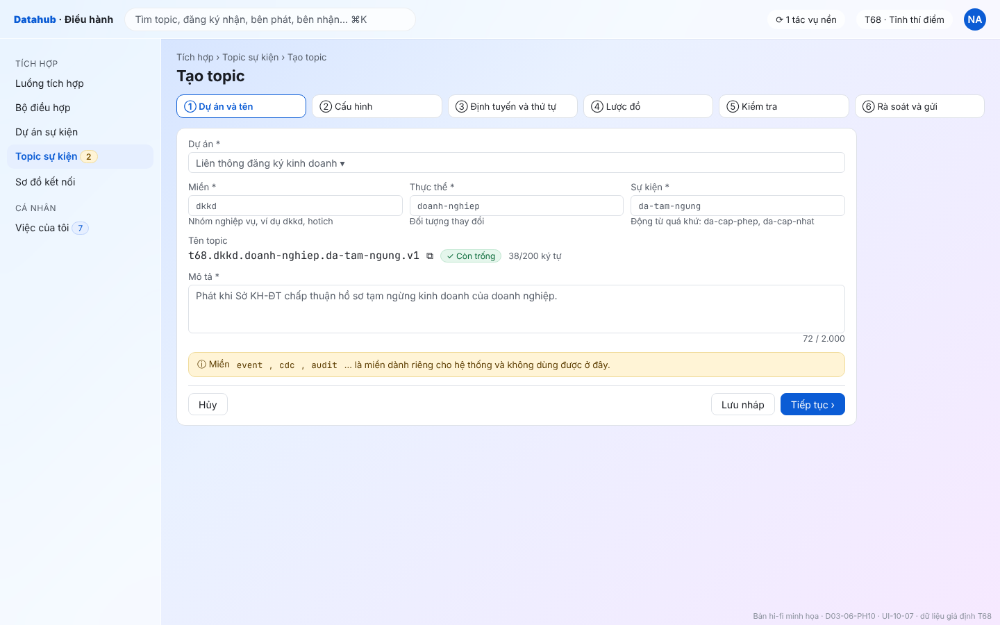

Bước 1 của trình hướng dẫn sáu bước: ba ô miền, thực thể, sự kiện ghép thành tên topic xem trước, kiểm tra còn trống và độ dài; dải thông tin nhắc các miền dành riêng như `event`, `cdc`, `audit`.

## 14. UI-10-08 Soạn và so sánh lược đồ

::: dac-ta
**Mục đích.** Soạn phiên bản lược đồ mới, kiểm tra cú pháp, quy ước, tương thích, dữ liệu cá nhân; so sánh hai phiên bản; gửi duyệt; ngừng khuyến nghị, vô hiệu phiên bản cũ.

**Tác nhân, quyền.** IE, IA (FRS §3.1); xem, chạy kiểm tra `PERM-10-read`; tạo phiên bản, gửi duyệt `PERM-10-create`; sửa nháp, ngừng khuyến nghị `PERM-10-update`.

**FR, UC.** FR-10-017…022; UC-10-06.

**Truy vết hệ cũ.** LGC-HUB-009 (trường "cấu trúc" của topic).

**Đường dẫn, mẫu.** `/tich-hop/topic/{ten-topic}/luoc-do` (`?phien-ban=`, `?so-sanh=a,b`, `?che-do=soan|so-sanh`), trong khung topic; PTN-03.

**API.** API-10-021, 022, 023, 024, 025, 026, 027, 028, 029, 030; API-10-015 (đổi mức tương thích).

**Điều hướng vào.** Tab "Lược đồ" của UI-10-06; liên kết "Lược đồ v{n}" ở đầu trang topic; yêu cầu `SCHEMA_VERSION` ở UI-10-13.

**Thành phần chính.** Ba cột: danh sách phiên bản, trình soạn Monaco, khối kiểm tra; chế độ so sánh `CMP-DiffViewer`, `CMP-DiffTable`; chân ghi chú thay đổi (mục 14.2).

**Hành động.** Phiên bản mới, Chạy kiểm tra, Lưu nháp, Gửi duyệt, So sánh, Ví dụ sự kiện, Đổi mức tương thích, Ngừng khuyến nghị, Vô hiệu, Tải (mục 14.3).

**Trạng thái.** Đang tải; chỉ đọc; nội dung đổi sau kiểm tra (Gửi duyệt vô hiệu); Apicurio không khả dụng; lỗi cú pháp; xung đột ST-13 (mục 14.4).

**Thông báo.** ERR-10-015 gạch chân trong trình soạn; ERR-10-016 "Thay đổi này phá vỡ bên nhận theo mức {mức}. Sửa lược đồ hoặc tạo phiên bản topic mới."; ERR-10-006 khi đã có phiên bản chờ duyệt; dải "Nội dung đã đổi sau lần kiểm tra".

**Đợt, mức chi tiết.** MVP; rất chi tiết.
:::

### 14.1. Wireframe

```text
┌ … › t68.dkkd.doanh-nghiep.da-cap-phep.v1 › Lược đồ ───────────────────────────────────────────┐
│ [Tổng quan][Cấu hình][Lược đồ][Quyền phát][Đăng ký nhận][DLQ][Cách kết nối][Lịch sử]            │
│ Avro · Tương thích lùi [Đổi]       Chế độ: (Soạn)(So sánh)          [+ Phiên bản mới]           │
├ Phiên bản ─────────────┬ Nội dung v4 (Nháp) ──────────────────────────────┬ Kiểm tra ─────────────┤
│ v4 ○ Nháp      An      │  1 {                                             │ [Chạy kiểm tra]       │
│ v3 ● Đang dùng 12/11   │  2   "type": "record",                           │ ✓ Cú pháp             │
│ v2 ◐ Ngừng k.ng 02/10  │  3   "name": "DoanhNghiepDaCapPhep",             │ ⚠ Quy ước (1)         │
│ v1 ○ Đã vô hiệu 01/09  │  4   "namespace": "vn.datahub.t68.dkkd",         │ ✓ Trường khóa         │
│                        │  5   "fields": [                                 │ ✕ Tương thích lùi     │
│ Bên nhận đang đọc:     │  6     {"name":"maDoanhNghiep","type":"string"…  │   xóa trường          │
│ v3: 3 · v2: 1          │ …                                                │   'diaChi' không có   │
│                        │                                                  │   mặc định            │
│                        │                                                  │ ⚠ Dữ liệu cá nhân (1) │
├────────────────────────┴──────────────────────────────────────────────────┴───────────────────────┤
│ Ghi chú thay đổi * [Thêm trường vonDieuLe                             ]   [Lưu nháp] [Gửi duyệt]    │
└──────────────────────────────────────────────────────────────────────────────────────────────────┘
```

### 14.2. Vùng và thành phần

| Vùng | Thành phần | Nội dung | Kích thước |
|---|---|---|---|
| Danh sách phiên bản | `CMP-VersionTimeline` | `versionNo`, `status`, người duyệt, ngày, `changeNote`; khối "Bên nhận đang đọc phiên bản nào" (FR-10-020) | Rộng 280 px, thu gọn được |
| Trình soạn | `CMP-CodeEditor` (Monaco, chế độ JSON) | `content`; chỉ sửa được khi phiên bản `DRAFT` và có `PERM-10-update` | Phần còn lại, tối thiểu 480 px |
| Kiểm tra | `CMP-Card` chứa `CMP-StatusTag` theo nhóm và `CMP-DataTable` vi phạm | `compatibilityReport`, `piiFindings` | Rộng 320 px |
| Chế độ so sánh | `CMP-DiffViewer` (văn bản) và `CMP-DiffTable` (cấu trúc: trường thêm, bớt, đổi kiểu, đổi mặc định) | API-10-030 `from`, `to` | Thay vùng trình soạn |
| Chân | `CMP-TextArea` cho `changeNote`, `CMP-Button` | `changeNote` ≥ 10 ký tự từ phiên bản 2 | Dính đáy |
| Thao tác phiên bản | `CMP-DropdownMenu` trên mỗi dòng | Tải, Xem ví dụ sự kiện, So sánh với bản đang dùng, Ngừng khuyến nghị (`ENABLED` không phải mới nhất), Vô hiệu (`DEPRECATED`, cần duyệt) | |

: UI-10-08 Soạn và so sánh lược đồ, vùng và thành phần

### 14.3. Hành vi

1. **Phiên bản mới.** "+ Phiên bản mới" sao nội dung phiên bản mới nhất làm điểm xuất phát, gọi API-10-023; có phiên bản khác đang `PENDING_APPROVAL` thì nút vô hiệu với lý do (ERR-10-006).
2. **Kiểm tra.** "Chạy kiểm tra" gọi API-10-026 (`PERM-10-read` đủ). Kết quả gắn băm nội dung; sửa nội dung sau khi kiểm tra làm khối Kiểm tra mờ đi kèm dải "Nội dung đã đổi sau lần kiểm tra" và nút "Gửi duyệt" vô hiệu cho tới khi kiểm tra lại (FR-10-019 đòi kiểm tra đạt trong 24 giờ trên đúng băm).
3. **Gửi duyệt.** API-10-027; ERR-10-016 hiện bảng vi phạm và câu "Thay đổi này phá vỡ bên nhận theo mức {mức}. Sửa lược đồ hoặc tạo phiên bản topic mới." kèm nút mở UI-10-07 chế độ phiên bản mới.
4. **Ví dụ sự kiện.** Drawer hiện một sự kiện CloudEvents sinh từ lược đồ với giá trị giả lập (không lấy dữ liệu thật), có `CMP-CopyButton`.
5. **Đổi mức tương thích.** Nút "Đổi" mở Drawer mục 12.5 nhóm Mức tương thích.
6. **Vô hiệu.** `CMP-ReasonDialog` nêu điều kiện "Chỉ vô hiệu khi không còn bản tin dùng phiên bản này trong lưu giữ" và thời điểm sớm nhất có thể (từ API-10-022); không cho vô hiệu phiên bản mới nhất (BR-10-015).

### 14.4. Trạng thái màn

| Trạng thái | Hiển thị |
|---|---|
| Đang tải | Skeleton danh sách 4 dòng, khung soạn 12 dòng |
| Chỉ đọc | Không có `PERM-10-update` hoặc phiên bản không `DRAFT`: trình soạn `readOnly`, dải "Chỉ xem phiên bản {n} ({trạng thái})" |
| Apicurio không khả dụng | `CMP-Banner` mục 5.4; nút kiểm tra, gửi vô hiệu kèm lý do |
| Lỗi cú pháp cục bộ | Gạch chân `color-error`, số dòng lỗi ở rãnh trái, bảng vấn đề bấm được |
| Xung đột | Hai người sửa cùng nháp: ST-13 với `CMP-DiffViewer` |

: UI-10-08 Soạn và so sánh lược đồ, trạng thái màn

### 14.5. Bàn phím, truy cập

`Ctrl+S` lưu nháp; `Ctrl+Shift+K` chạy kiểm tra; `F8` nhảy tới vấn đề kế tiếp; `Ctrl+\` chuyển chế độ so sánh. Trình soạn có nhãn "Nội dung lược đồ, Avro"; `Esc` rồi `Tab` thoát khỏi trình soạn (Monaco giữ phím `Tab`). Kết quả kiểm tra mới thông báo qua `aria-live="polite"` ("Kiểm tra xong: 1 lỗi tương thích, 1 cảnh báo dữ liệu cá nhân"). Dưới `bp-lg` ba cột chuyển thành tab "Phiên bản · Nội dung · Kiểm tra".

### 14.6. Bản hi-fi

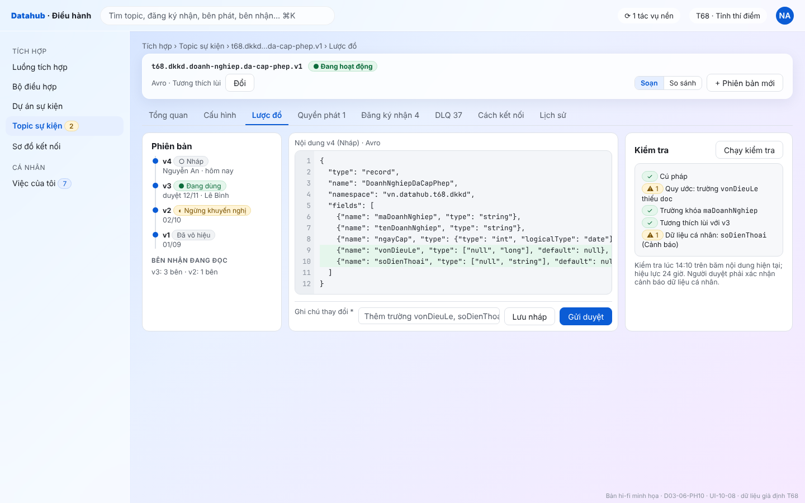

Ba cột: dòng thời gian phiên bản kèm số bên nhận đang đọc từng phiên bản, trình soạn Avro nền đặc có hai dòng thêm tô `color-diff-added`, khối kiểm tra theo nhóm dùng nhãn có ký hiệu ✓, ⚠ để không chỉ dựa vào màu. Chân trang có ghi chú thay đổi bắt buộc và nút Gửi duyệt.

Ba cột trên `color-surface-solid`, ngăn bằng `CMP-Splitter` 1 px `color-border-subtle`; trình soạn nền `color-surface-solid-2`, chữ `font-mono-sm`. Dòng thêm, bớt trong so sánh dùng `color-diff-added`, `color-diff-removed` kèm ký hiệu `+`, `−` ở rãnh. Nhóm kiểm tra dùng `CMP-StatusTag` (✓ success, ⚠ warning, ✕ error) để không chỉ dựa vào màu.

## 15. UI-10-09 Bên phát

::: dac-ta
**Mục đích.** Liệt kê, đăng ký, sửa, tạm ngừng, tiếp tục, ngừng dùng bên phát; xem và quản lý quyền phát của từng bên; xem vi phạm tuân thủ lược đồ của bên phát Kafka.

**Tác nhân, quyền.** IE, TA, SO (FRS §3.1); xem `PERM-10-read`; đăng ký `PERM-10-create`; sửa, ngừng dùng, thu hồi quyền phát `PERM-10-update`; tạm ngừng, tiếp tục `PERM-10-operate`.

**FR, UC.** FR-10-023, 025, 026, 028, 029, 030, 032; UC-10-07, 08, 09, 11.

**Truy vết hệ cũ.** LGC-HUB-010, 012.

**Đường dẫn, mẫu.** `/tich-hop/topic/ben-phat`, `/tich-hop/topic/ben-phat/{ma}` (`/quyen-phat`, `/lich-su`); PTN-01, PTN-02.

**API.** API-10-032, 033, 034, 035; API-10-036 `:suspend`, API-10-092 `:resume`, API-10-093 `:retire`; API-10-042, 043, 044; API-10-045 `:suspend`, API-10-096 `:resume`, API-10-097 `:revoke`; API-10-031 (tuân thủ).

**Điều hướng vào.** Tab phụ "Bên phát"; thẻ "Bên phát" ở UI-10-01; nút bên phát trên UI-10-14.

**Thành phần chính.** Bảng bên phát (mục 15.2), Drawer "Đăng ký bên phát" (15.3), trang chi tiết ba tab (15.4).

**Hành động.** Đăng ký bên phát, Sửa, Tạm ngừng, Tiếp tục, Ngừng dùng, Đề nghị quyền phát; trên dòng quyền phát: Tạm ngừng, Tiếp tục, Thu hồi.

**Trạng thái.** Đang tải; rỗng; ST-07; ngoài tổ chức ERR-10-044; bên `SUSPENDED` hiện nguồn tạm ngừng (mục 5.1).

**Thông báo.** "Bên phát chưa có quyền phát trên topic nào. Đề nghị quyền phát."; ERR-10-002, 003, 021, 022, 023, 024, 028 theo mục 5.3.

**Đợt, mức chi tiết.** MVP; đầy đủ.
:::

### 15.1. Wireframe danh sách

```text
┌ Topic sự kiện › Bên phát ─────────────────────────────── [+ Đăng ký bên phát] ┐
│ [Tìm mã, tên, khóa tham chiếu, HTTT…] [Loại ▾] [Kiểu giao tiếp ▾] [Trạng thái ▾]│
├────────────────────────┬──────────┬───────────────┬──────────┬──────┬────────┬─┤
│ Mã · Tên               │ Loại     │ Gắn với       │ Giao tiếp│Q.phát│Hoạt động│⋯│
├────────────────────────┼──────────┼───────────────┼──────────┼──────┼────────┼─┤
│ ht-dkkd                │ HTTT     │ HT-DKKD ●     │ API HTTP │ 3 ●  │ 2 ph   │⋯│
│ HTTT đăng ký kinh doanh│          │               │          │      │        │ │
│ dkkd-dong-bo-thue      │ Luồng    │ luồng PH-04 ● │Kafka n.bộ│ 1 ●  │ 10 g   │⋯│
└────────────────────────┴──────────┴───────────────┴──────────┴──────┴────────┴─┘
```

### 15.2. Cột, lọc

| Cột | Trường | Ghi chú |
|---|---|---|
| Mã · Tên | `publisherCode`, `name` | Liên kết chi tiết |
| Loại | `partyType` | `LEGACY_BRIDGE` có `CMP-Tag` "Hệ cũ" |
| Gắn với | `systemCode`, `flowCode` hoặc `serviceCode` kèm `CMP-StatusDot` trạng thái ở phân hệ nguồn | Liên kết PH-01, PH-04 khi có quyền |
| Kiểu giao tiếp | `commType` | Tooltip `legacyCode` |
| Khóa tham chiếu | `referenceKey` | Ẩn mặc định |
| Quyền phát | Số publication theo trạng thái | |
| Trạng thái | `status`, `suspendSource` ở dòng phụ | `CMP-StatusTag` |
| Hoạt động gần nhất | `lastActiveAt` | `CMP-Timestamp` |

: UI-10-09 Bên phát, cột, lọc

Lọc: `q`, `partyType`, `commType`, `status`, `systemCode`, `projectCode` (FR-10-025). OR chỉ thấy bên của tổ chức mình.

### 15.3. Drawer "Đăng ký bên phát"

| Nhãn | Trường | Thành phần | Bắt buộc | Kiểm tra | Lỗi |
|---|---|---|---|---|---|
| Loại | `partyType` | `CMP-RadioCard` ba thẻ HTTT, Luồng tích hợp, Dịch vụ nội bộ | Có | `LEGACY_BRIDGE` không có (chỉ do UI-10-20 tạo) | |
| HTTT | `systemCode` | `CMP-ResourceSelect` HTTT `ACTIVE` của PH-01 | Khi `SYSTEM` | | ERR-10-021 |
| Luồng | `flowCode` | `CMP-ResourceSelect` luồng PH-04 không `RETIRED` | Khi `FLOW` | Gợi ý "Bên phát luồng thường do trình thiết kế PH-04 tạo tự động." | ERR-10-022 |
| Dịch vụ | `serviceCode` | `CMP-Select` danh sách A.2.12 | Khi `INTERNAL_SERVICE` | | ERR-10-023 |
| Kiểu giao tiếp | `commType` | `CMP-Select` chỉ mục chiều phát được bật và hợp `partyType` theo A.2.8 | Có | `KAFKA_NATIVE` vô hiệu kèm lý do khi tenant chưa bật Kafka ngoài | ERR-10-028, ERR-10-024 |
| Mã | `publisherCode` | `CMP-Input` | Có | `^[a-z][a-z0-9-]{2,62}$`, gợi ý từ mã HTTT | ERR-10-002, 003 |
| Tên | `name` | `CMP-Input` | Có | 3…255 ký tự | |
| Khóa tham chiếu | `referenceKey` | `CMP-Input` | Không | ≤ 100 ký tự | ERR-10-002 |
| Mô tả | `description` | `CMP-TextArea` | Không | ≤ 2.000 ký tự | |

: UI-10-09 Bên phát, drawer "Đăng ký bên phát"

Sau khi tạo, trang chi tiết hiện `kafkaPrincipal`, `clientId` (chỉ đọc, `CMP-CodeText`) và câu "Bên phát chưa có quyền phát trên topic nào. Đề nghị quyền phát." kèm nút.

### 15.4. Chi tiết bên phát

Tiêu đề: tên, `CMP-StatusTag`, mã; hành động: Đề nghị quyền phát, Sửa, ⋯ Tạm ngừng, Tiếp tục, Ngừng dùng. Tab: Tổng quan (`CMP-DescriptionList` mọi trường A.3 `Publisher`), Quyền phát `/quyen-phat` (bảng publication: topic, trạng thái, mục đích, lưu lượng dự kiến, hạn mức, người duyệt; menu dòng Tạm ngừng, Tiếp tục, Thu hồi), Lịch sử. Tạm ngừng dùng `CMP-ReasonDialog` có thêm câu "Mọi quyền phát đang hiệu lực của bên này sẽ tạm ngừng." SO chỉ thấy "Tiếp tục" khi chính SO đã tạm ngừng (`suspendSource = SECURITY`). Bảng vi phạm tuân thủ lược đồ (FR-10-023, API-10-031) hiện ở tab Tổng quan khi bên có `commType = KAFKA_NATIVE` hoặc `INTERNAL_KAFKA`.

### 15.5. Trạng thái, bàn phím

Rỗng: "Chưa có bên phát. Bên phát là HTTT, luồng hoặc dịch vụ được phép phát sự kiện lên topic." Bàn phím như UI-10-02. Không có quyền: ST-07; ngoài tổ chức: ERR-10-044.

### 15.6. Bản hi-fi

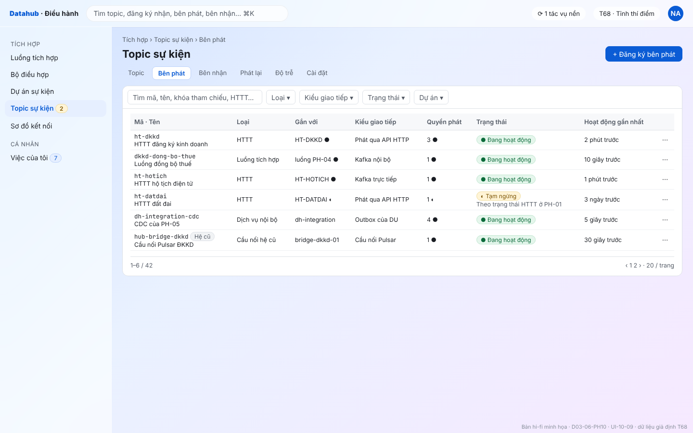

Danh sách bên phát đủ bốn loại (HTTT, luồng, dịch vụ nội bộ, cầu nối hệ cũ có nhãn "Hệ cũ"); bên tạm ngừng hiện dòng phụ nguồn tạm ngừng "Theo trạng thái HTTT ở PH-01".

## 16. UI-10-10 Bên nhận

::: dac-ta
**Mục đích.** Như UI-10-09 cho bên nhận, kèm danh sách đăng ký nhận của từng bên để thấy một HTTT đang nhận những topic nào, bằng chế độ gì và có trễ không.

**Tác nhân, quyền.** IE, TA, OR, SO (FRS §3.1); xem `PERM-10-read`; đăng ký `PERM-10-create` hoặc `PERM-10-subscribe` (OR với HTTT của tổ chức mình); sửa, ngừng dùng `PERM-10-update`; tạm ngừng, tiếp tục `PERM-10-operate`.

**FR, UC.** FR-10-025, 027, 028, 029; UC-10-07, 08.

**Truy vết hệ cũ.** LGC-HUB-011 ("đánh dấu là luồng" thành `partyType = FLOW`).

**Đường dẫn, mẫu.** `/tich-hop/topic/ben-nhan`, `/tich-hop/topic/ben-nhan/{ma}` (`/dang-ky-nhan-ds`, `/lich-su`); PTN-01, PTN-02.

**API.** API-10-037, 038, 039, 040; API-10-041 `:suspend`, API-10-094 `:resume`, API-10-095 `:retire`; API-10-046 (`subscriberCode`).

**Điều hướng vào.** Tab phụ "Bên nhận"; thẻ "Bên nhận" ở UI-10-01; "Đăng ký bên nhận mới" ở UI-10-11 bước 1, 2; nút bên nhận trên UI-10-14.

**Thành phần chính.** Như UI-10-09 với các khác biệt ở bảng dưới; tab "Đăng ký nhận" của trang chi tiết.

**Hành động.** Đăng ký bên nhận, Sửa, Tạm ngừng, Tiếp tục, Ngừng dùng, "Đăng ký nhận topic khác" (mở UI-10-11).

**Trạng thái.** Như UI-10-09.

**Thông báo.** "Chưa có bên nhận. Bên nhận là HTTT, luồng hoặc dịch vụ đăng ký nhận sự kiện từ topic."; xác nhận tạm ngừng "Mọi đăng ký nhận đang hiệu lực của bên này sẽ tạm ngừng; bộ giao nhận dừng gửi."

**Đợt, mức chi tiết.** MVP; đầy đủ.
:::

Khác biệt với UI-10-09:

| Điểm | Bên nhận |
|---|---|
| Kiểu giao tiếp | Chỉ chiều nhận: `WEBHOOK_PUSH`, `HTTP_PULL`, `KAFKA_NATIVE`, `INTERNAL_KAFKA` (A.2.8) |
| Cột "Loại" | `FLOW` hiện "Luồng tích hợp" kèm biểu tượng luồng; cột ẩn `isFlow` không cần vì đã có loại |
| Tab con | `/dang-ky-nhan-ds`: bảng subscription của bên (topic, chế độ, trạng thái, `alertState`, lag, DLQ mới) có nút "Đăng ký nhận topic khác" mở `CMP-TopicSelect` rồi UI-10-11 |
| Drawer đăng ký | Có thêm câu ở thẻ Luồng tích hợp: "Chỉ nhận bằng chế độ Nội bộ, nhóm tiêu thụ `dh-flow-{tenant}-{flow}`." |
| Tạm ngừng | Câu xác nhận "Mọi đăng ký nhận đang hiệu lực của bên này sẽ tạm ngừng; bộ giao nhận dừng gửi." |

: UI-10-10 Bên nhận, khác biệt với UI-10-09

Trạng thái rỗng: "Chưa có bên nhận. Bên nhận là HTTT, luồng hoặc dịch vụ đăng ký nhận sự kiện từ topic."

### 16.1. Bản hi-fi

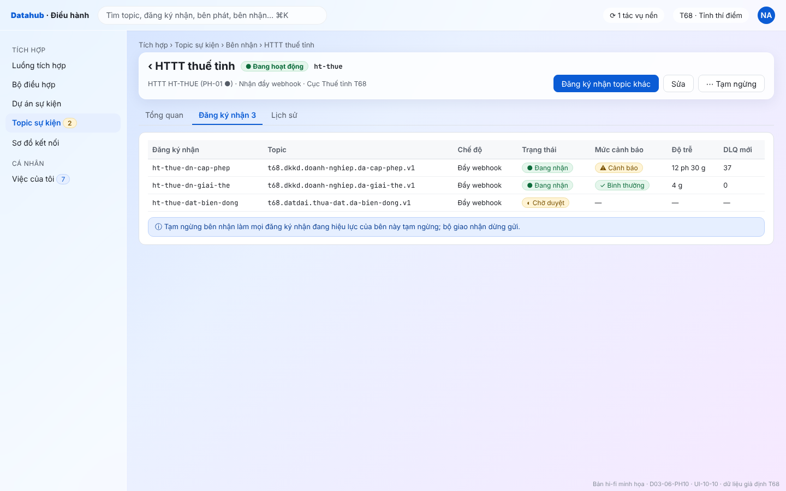

Trang chi tiết một bên nhận ở tab Đăng ký nhận: ba đăng ký trên ba topic, mức cảnh báo và độ trễ từng cái; nút chính "Đăng ký nhận topic khác" mở UI-10-11. Dải thông tin nêu hậu quả của tạm ngừng.

## 17. UI-10-11 Đăng ký nhận sự kiện

::: dac-ta
**Mục đích.** Cho kỹ sư tích hợp hoặc đầu mối tổ chức đăng ký một bên nhận nhận sự kiện của một topic bằng một trong bốn chế độ giao nhận, cấu hình đầy đủ tham số, xác minh endpoint webhook và gửi duyệt.

**Tác nhân, quyền.** IE, OR (FRS §3.1), TA; `PERM-10-subscribe` (OR trong phạm vi tổ chức).

**FR, UC.** FR-10-035, 036, 040; cấu hình cho FR-10-038, 039, 043, 044, 045; UC-10-12.

**Truy vết hệ cũ.** Thay và nâng cấp LGC-HUB-013 (URI nhận, số worker, số lần thử lại, thời điểm bắt đầu); LGC-TOOL-010 ở bước chọn chế độ.

**Đường dẫn, mẫu.** `/tich-hop/topic/{ten-topic}/dang-ky-nhan` (`?ben-nhan=` điền sẵn, `?buoc=`); PTN-05.

**API.** API-10-010 (topic), API-10-037 (bên nhận), API-10-046 (kiểm tra cặp đã có), API-10-070 (tham số mặc định `10.push.*`, `10.pull.*`, `10.lag.*`, `10.external-kafka.enabled`), API-10-069 (hạn mức còn lại), API-10-067 (kiểu giao tiếp), API-10-051 (xác minh endpoint), API-10-020 (thông tin kết nối cho mã mẫu), API-10-047 (gửi).

**Điều hướng vào.** "Đăng ký nhận" (phím `S`) ở UI-10-06; menu dòng ở UI-10-05; "Đăng ký nhận topic khác" ở UI-10-10; gợi ý đổi chế độ ở Drawer "Sửa tham số" của UI-10-12.

**Thành phần chính.** Sáu bước (17.1); bốn thẻ chế độ; biểu mẫu theo chế độ; khối xác minh endpoint; lịch thử lại vẽ trước; mẫu yêu cầu; khối "Điều sẽ xảy ra".

**Hành động.** Xác minh, Tiếp tục, Quay lại, Đăng ký bên nhận mới, Xem mẫu yêu cầu, Sao chép hướng dẫn, Gửi duyệt.

**Trạng thái.** Đang tải; thiếu quyền (ST-07); topic không `ACTIVE` (`CMP-ResultPage`); hết hạn mức; hết phiên (ST-14, phải xác minh lại) (mục 17.11).

**Thông báo.** "Đã gửi đăng ký nhận {mã}, chờ duyệt."; "Xác minh đạt"; "URL đã đổi, cần xác minh lại"; ERR-10-024…028, 030, 031, 044, 051 theo mục 5.3.

**Đợt, mức chi tiết.** MVP; rất chi tiết.
:::

### 17.1. Các bước

| Bước | Tên | Mục đích | Chặn sang bước sau khi |
|---|---|---|---|
| 1 | Bên nhận | Chọn bên nhận, xem tóm tắt topic | Chưa chọn; topic không `ACTIVE` (ERR-10-025); cặp đã có (ERR-10-024) |
| 2 | Chế độ giao nhận | Chọn `PUSH`, `PULL_API`, `PULL_KAFKA` hoặc `INTERNAL` | Chưa chọn; chế độ không hợp `commType` (BR-10-017) |
| 3 | Cấu hình giao nhận | Biểu mẫu theo chế độ (17.4 đến 17.7) | Lỗi trường; `PUSH` chưa xác minh đạt trong 24 giờ |
| 4 | Điểm bắt đầu và cảnh báo | `startPosition`, `startAt`, ngưỡng lag | Lỗi trường (ERR-10-031) |
| 5 | Mục đích và căn cứ | `purpose`, `legalBasis`, `subscriptionCode` | Lỗi trường |
| 6 | Rà soát và gửi | Tóm tắt, cảnh báo tác động, gửi duyệt | |

: UI-10-11 Đăng ký nhận sự kiện, các bước

Bước 3 đổi nội dung theo chế độ đã chọn ở bước 2; đổi chế độ sau khi đã qua bước 3 làm `CMP-Steps` đánh dấu bước 3 "Cần xem lại" và giữ giá trị của chế độ cũ trong bộ nhớ biểu mẫu tới khi gửi (người dùng quay lại không mất dữ liệu).

### 17.2. Bước 1 Bên nhận

```text
┌ Đăng ký nhận · t68.dkkd.doanh-nghiep.da-cap-phep.v1 ──────────────────────────┐
│ (1 Bên nhận)──(2 Chế độ)──(3 Cấu hình)──(4 Bắt đầu)──(5 Mục đích)──(6 Gửi)     │
├────────────────────────────────────────────────────────────────────────────────┤
│ Topic   ● Đang hoạt động · 🔒 Nội bộ · 6 phân vùng · lưu 7 ngày ·              │
│         Theo khóa maDoanhNghiep · Giữ thứ tự · Lược đồ v3                      │
│ Bên nhận * [ht-thue · HTTT thuế tỉnh (Nhận đẩy webhook) ▾]                    │
│            Không thấy bên nhận? [Đăng ký bên nhận mới]                        │
│ ⓘ HT-THUE đã có 2 đăng ký nhận trên topic khác của dự án này.                 │
├────────────────────────────────────────────────────────────────────────────────┤
│ [Hủy]                                                  [Tiếp tục ›]           │
└────────────────────────────────────────────────────────────────────────────────┘
```

| Nhãn | Trường | Thành phần | Kiểm tra |
|---|---|---|---|
| Topic | `topicName` (từ route) | `CMP-DescriptionList` một dòng: `status`, `dataClass`, `partitions`, `retentionHours`, `routingMode`, `partitionKeyField`, `orderingRequired`, `latestSchemaVersion` | Topic không `ACTIVE`: cả trình hướng dẫn thay bằng `CMP-ResultPage` "Topic {trạng thái}, không nhận đăng ký mới." (BR-10-016) |
| Bên nhận | `subscriberCode` | `CMP-ResourceSelect` bên nhận `ACTIVE`; mỗi mục hiện mã, tên, `partyType`, `commType` | OR chỉ thấy bên của tổ chức mình; cặp (bên nhận, topic) đã có subscription chưa `REVOKED`, `REJECTED` thì mục hiện "Đã đăng ký" và vô hiệu, kèm liên kết UI-10-12 (ERR-10-024) |
| Đăng ký bên nhận mới | | Nút mở Drawer của UI-10-10 | Sau khi tạo, bên mới được chọn sẵn |

: UI-10-11 Đăng ký nhận sự kiện, bước 1 Bên nhận

Topic `RESTRICTED`, `SENSITIVE`: dưới ô chọn hiện `CMP-Alert` "Topic {phân loại}: bên nhận phải là HTTT đạt cấp độ ATTT yêu cầu và phải ghi căn cứ pháp lý ở bước 5." Bên chưa đạt cấp độ thì máy chủ trả ERR-10-051 khi gửi; giao diện không tự suy cấp độ.

### 17.3. Bước 2 Chế độ giao nhận

```text
┌───────────────────────────┬───────────────────────────┬───────────────────────────┬───────────────────────────┐
│ ◉ Đẩy webhook   Khuyến nghị│ ○ Kéo qua API             │ ○ Kéo qua Kafka           │ ○ Nội bộ                  │
│ Datahub gửi từng sự kiện  │ HTTT tự gọi API lấy lô sự │ HTTT dùng consumer Kafka  │ Cho luồng PH-04 và dịch vụ│
│ tới URL của HTTT, có chữ  │ kiện và xác nhận. Không   │ chuẩn qua cổng ngoài, tự  │ nội bộ. Không cần endpoint│
│ ký HMAC, thử lại và DLQ.  │ cần mở cổng phía HTTT.    │ quản lý offset.           │ hay khóa.                 │
│ Cần URL HTTPS mở từ egress│ Cần token có scope nhận.  │ ⊘ Tenant chưa bật Kafka   │ ⊘ Chỉ cho bên Luồng hoặc  │
│                           │                           │   ngoài                   │   Dịch vụ nội bộ          │
└───────────────────────────┴───────────────────────────┴───────────────────────────┴───────────────────────────┘
```

`CMP-RadioCard` bốn thẻ, giá trị `deliveryMode`. Điều kiện bật từng thẻ:

| Thẻ | Giá trị | Bật khi | Lý do vô hiệu hiện trong thẻ |
|---|---|---|---|
| Đẩy webhook | `PUSH` | Bên nhận `SYSTEM` có `commType = WEBHOOK_PUSH`; mục danh mục bật | "Bên nhận dùng kiểu giao tiếp {nhãn}; chế độ Đẩy cần bên nhận kiểu Nhận đẩy webhook." |
| Kéo qua API | `PULL_API` | `SYSTEM` với `HTTP_PULL` | Tương tự |
| Kéo qua Kafka | `PULL_KAFKA` | `SYSTEM` với `KAFKA_NATIVE` và `10.external-kafka.enabled = true` | "Tenant chưa bật Kafka ngoài." (ERR-10-028) hoặc câu về kiểu giao tiếp |
| Nội bộ | `INTERNAL` | `FLOW` hoặc `INTERNAL_SERVICE` với `INTERNAL_KAFKA` hoặc `PULSAR_BRIDGE` | "Chỉ cho bên Luồng tích hợp hoặc Dịch vụ nội bộ." |

: UI-10-11 Đăng ký nhận sự kiện, bước 2 Chế độ giao nhận

Vì một bên nhận chỉ có một `commType`, thông thường chỉ một thẻ bật và được chọn sẵn; bước 2 vẫn hiện đủ bốn thẻ để người dùng hiểu vì sao các chế độ khác không có, và có liên kết "Đăng ký bên nhận khác với kiểu giao tiếp {nhãn}" mở Drawer UI-10-10 với `systemCode` điền sẵn. Thẻ "Khuyến nghị" chỉ là gợi ý mặc định cho HTTT (`PUSH`), không phải ràng buộc.

### 17.4. Bước 3 khi chọn Đẩy webhook (`PUSH`)

#### 17.4.1. Wireframe

```text
┌ (3 Cấu hình giao nhận · Đẩy webhook) ───────────────────────────────────────────────────────┐
│ ĐỊA CHỈ NHẬN                                                                                │
│ URL nhận *   [https://thue.t68.gov.vn/hooks/dh                              ] [Xác minh]    │
│ ┌ Xác minh lúc 14:05 · ✓ Đạt ─────────────────────────────────────────────────────────────┐ │
│ │ ✓ Phân giải DNS: 10.68.4.21 không thuộc dải nội bộ nền tảng                              │ │
│ │ ✓ TLS 1.3, chứng thư hợp lệ tới 03/2027                                                  │ │
│ │ ✓ Bắt tay OPTIONS: 204, WebHook-Allowed-Origin: event.t68.datahub                        │ │
│ │ ✓ Trong danh sách egress                                                                 │ │
│ └──────────────────────────────────────────────────────────────────────────────────────────┘ │
│ SONG SONG VÀ THỜI GIAN CHỜ                                                                  │
│ Số worker      [ 3 ] (1…6: tối đa bằng số phân vùng 6 và trần 16)   Thời gian chờ [10000] ms │
│ THỬ LẠI                                                                                     │
│ Số lần thử lại [ 8 ] (0…20)  Giãn cách đầu [1000] ms  Hệ số [2]  Giãn cách tối đa [300000] ms│
│ Lịch thử lại: 1 g · 2 g · 4 g · 8 g · 16 g · 32 g · 64 g · 128 g  ≈ tổng 4 ph 15 g (±20%)   │
│ ▁▁▂▃▅█ (biểu đồ cột thời điểm từng lần)                                                     │
│ KHI HẾT LƯỢT THỬ                                                                            │
│ ◉ Dừng lại chờ khắc phục (Khuyến nghị cho topic giữ thứ tự)  ○ Chuyển vào DLQ và giao tiếp  │
│ ĐỊNH DẠNG                                                                                   │
│ ◉ CloudEvents có cấu trúc   ○ CloudEvents nhị phân      [Xem mẫu yêu cầu ▾]                 │
│ HẠN MỨC                                                                                     │
│ Hạn mức tiêu thụ [   ] KiB/giây (để trống: chia đều phần còn lại; còn 13,2 MiB/giây)        │
└─────────────────────────────────────────────────────────────────────────────────────────────┘
```

#### 17.4.2. Trường

| Nhóm | Nhãn | Trường | Thành phần | Bắt buộc | Mặc định | Kiểm tra phía giao diện | Lỗi máy chủ |
|---|---|---|---|---|---|---|---|
| Địa chỉ | URL nhận | `push.endpointUrl` | `CMP-Input` kiểu URL, `font-mono` | Có | | Bắt đầu `https://`; có tên miền (không phải IP); không có thông tin đăng nhập trong URL; ≤ 2.048 ký tự; cảnh báo mềm khi có query chứa từ "token", "key" | ERR-10-026 |
| Địa chỉ | Xác minh | (hành động) | `CMP-Button` + khối kết quả | Có kết quả `PASSED` hoặc `WAIVED` trong 24 giờ | | Đổi URL xóa kết quả cũ | ERR-10-027 |
| Song song | Số worker | `push.workerCount` | `CMP-NumberInput` | Không | `10.push.default-workers` | 1…min(`partitions`, `10.push.max-workers`); dòng phụ nêu rõ hai giới hạn | ERR-10-030 |
| Song song | Thời gian chờ | `push.timeoutMs` | `CMP-NumberInput` hậu tố ms | Không | `10.push.timeout-ms` | 1.000…30.000 | ERR-10-012 |
| Thử lại | Số lần thử lại | `push.maxRetries` | `CMP-NumberInput` | Không | `10.push.max-retries` | 0…`10.push.max-retries-ceiling` | ERR-10-012 |
| Thử lại | Giãn cách đầu | `push.retryBackoff.initialMs` | `CMP-NumberInput` | Không | `10.push.backoff-initial-ms` | 100…60.000 | ERR-10-012 |
| Thử lại | Hệ số | `push.retryBackoff.multiplier` | `CMP-NumberInput` bước 0,5 | Không | `10.push.backoff-multiplier` | 1…5 | ERR-10-012 |
| Thử lại | Giãn cách tối đa | `push.retryBackoff.maxMs` | `CMP-NumberInput` | Không | `10.push.backoff-max-ms` | 1.000…3.600.000; ≥ giãn cách đầu | ERR-10-012 |
| Khi hết lượt | Chính sách | `push.failurePolicy` | `CMP-RadioCard` hai thẻ | Không | `DEAD_LETTER`; chọn sẵn `BLOCK` khi topic `orderingRequired` (Q10-15) | | |
| Định dạng | Định dạng | `push.payloadFormat` | `CMP-Radio` + `CMP-CodeBlock` mẫu | Không | `CLOUDEVENTS_STRUCTURED` | | |
| Hạn mức | Hạn mức tiêu thụ | `quotaBytesPerSecond` | `CMP-NumberInput` hậu tố KiB/giây | Không | Trống | ≥ 256 KiB/giây khi nhập (FR-10-062); ≤ phần còn lại | ERR-10-011 |

: UI-10-11 Đăng ký nhận sự kiện, trường

Miền 100…60.000, 1…5, 1.000…3.600.000 của nhóm thử lại lấy từ miền tham số `10.push.backoff-*` (A.5); FR-10-035 chỉ ghi "mặc định theo `10.push.backoff-*`", nên ràng buộc trên từng subscription là đề nghị ở Phụ lục C.

#### 17.4.3. Xác minh endpoint

1. Bấm "Xác minh" (hoặc `Enter` trong ô URL) gọi API-10-051 với `endpointUrl` và `subscriberCode`. Nút chuyển `loading` với nhãn "Đang xác minh…"; thời gian chờ tối đa bằng `push.timeoutMs` cộng 5 giây.
2. Kết quả hiện trong `CMP-Card` đặc ngay dưới ô: tiêu đề "Xác minh lúc {giờ}" kèm `CMP-StatusTag` theo `result`; danh sách bước từ `steps[]` (phân giải DNS và kiểm tra dải địa chỉ, TLS và chứng thư, bắt tay `OPTIONS` với `WebHook-Request-Origin: event.{tenant}.datahub`, danh sách egress), mỗi bước một `CMP-StatusTag` và một dòng chi tiết.
3. Bước không đạt hiện hướng dẫn khắc phục bằng tiếng Việt lấy từ `detail` của bước (ví dụ "Endpoint chưa trả lời OPTIONS. Bật xử lý OPTIONS và trả tiêu đề WebHook-Allowed-Origin." hoặc "Mở tường lửa từ địa chỉ egress {danh sách}."), cùng nút "Sao chép hướng dẫn" để gửi đơn vị chủ quản HTTT.
4. Kết quả có hiệu lực 24 giờ: dòng phụ đếm ngược "Hiệu lực tới {giờ}". Hết hiệu lực trước khi gửi thì bước 6 hiện `CMP-Alert` và nút "Xác minh lại".
5. Đổi URL sau khi xác minh: khối kết quả mờ đi, kèm "URL đã đổi, cần xác minh lại", nút "Tiếp tục" vô hiệu.
6. **Miễn xác minh.** Khi kết quả `FAILED` ở bước bắt tay và người dùng có `PERM-10-admin` (TA), hiện liên kết "HTTT cũ không trả lời được bắt tay? Bật miễn xác minh có thời hạn". Vì API-10-091 thao tác trên subscription đã có (`/subscriptions/{subscriptionCode}/endpoint-verification:waive`), miễn xác minh chỉ làm được sau khi gửi: trình hướng dẫn cho gửi với cờ "Đề nghị miễn xác minh" và ghi chú, rồi UI-10-12 hiện nút "Miễn xác minh" cho TA. Luồng này cần tập API xác nhận (Phụ lục B); Q10-31.
7. Máy chủ chạy lại xác minh khi gửi nếu kết quả cũ quá 24 giờ (FR-10-035 bước 3); ERR-10-027 khi đó hiện ở bước 6.

#### 17.4.4. Lịch thử lại vẽ trước

Dưới nhóm Thử lại có một khối tính phía trình duyệt, không gọi API: với lần thứ k (1 tới `maxRetries`) thời gian chờ là min(`maxMs`, `initialMs` nhân `multiplier` mũ k trừ 1), hiện dạng chuỗi thời lượng và `CMP-Chart` cột nhỏ cao 64 px (màu `color-chart-1`), cùng tổng thời gian ước lượng kèm "±20%" (nhiễu 0,8…1,2 của FR-10-039). Khi tổng vượt 1 giờ, khối hiện cảnh báo "Một bản tin lỗi có thể giữ phân vùng tới {tổng}; các bản tin sau cùng phân vùng phải chờ." vì trong lúc thử lại phân vùng đó không giao bản tin kế tiếp. Biểu đồ có bảng thay thế `aria-describedby` đọc danh sách thời điểm.

#### 17.4.5. Chính sách khi hết lượt thử

| Thẻ | Giá trị | Mô tả trong thẻ |
|---|---|---|
| Chuyển vào DLQ và giao tiếp | `DEAD_LETTER` | "Bản tin lỗi vào hàng đợi lỗi để xử lý sau; bản tin kế tiếp vẫn được giao. Thứ tự của cùng khóa có thể bị phá." |
| Dừng lại chờ khắc phục | `BLOCK` | "Đăng ký nhận tạm ngừng khi một bản tin hết lượt thử; người vận hành tiếp tục sau khi khắc phục, bản tin được giao lại từ vị trí cũ." |

: UI-10-11 Đăng ký nhận sự kiện, chính sách khi hết lượt thử

Topic `orderingRequired = true`: thẻ `BLOCK` có nhãn "Khuyến nghị" và được chọn sẵn; chọn `DEAD_LETTER` hiện `CMP-Alert` cảnh báo về thứ tự (FR-10-039). Mặc định theo FRS vẫn là `DEAD_LETTER`; việc chọn sẵn `BLOCK` cho topic giữ thứ tự chờ Q10-15.

#### 17.4.6. Mẫu yêu cầu

"Xem mẫu yêu cầu" mở `CMP-Popover` rộng chứa `CMP-CodeBlock` cho định dạng đang chọn: dòng `POST {endpointUrl}`, các tiêu đề `Webhook-Id`, `Webhook-Timestamp`, `X-Datahub-Signature: t=…,v1=…`, `X-Datahub-Subscription`, `X-Datahub-Attempt`, `X-Datahub-Key-Id`, `traceparent` (A.8), và thân `application/cloudevents+json` hoặc thân `data` với tiêu đề `ce-*`. Giá trị là giả lập; có liên kết "Mã mẫu xác minh chữ ký" tới tài liệu hướng dẫn tích hợp (Java, .NET, Python, Node.js, PHP).

### 17.5. Bước 3 khi chọn Kéo qua API (`PULL_API`)

```text
┌ (3 Cấu hình giao nhận · Kéo qua API) ───────────────────────────────────────────────────────┐
│ Kích thước lô tối đa [100] sự kiện (1…500)      Thời gian thuê [60] giây (10…300)            │
│ ⓘ Mỗi đăng ký nhận có một lượt thuê tại một thời điểm. Kéo lại khi chưa xác nhận và chưa hết │
│   thời gian thuê sẽ nhận lại đúng lô cũ.                                                     │
│ CÁCH GỌI                                                                                    │
│ [Java][.NET][Python][Node.js][curl]                                                         │
│ GET  /event/v1/subscriptions/{mã}/events?max=100&waitSeconds=30                              │
│ POST /event/v1/subscriptions/{mã}/events:ack   {"cursor": "…"}                              │
│ POST /event/v1/subscriptions/{mã}/events:nack  {"cursor":"…","eventIds":[…],"reason":"…"}   │
│ Token: client credentials của HTTT, scope topic:{tên topic}:subscribe (cấp khi được duyệt)  │
│ Hạn mức tiêu thụ [   ] KiB/giây                                                             │
└─────────────────────────────────────────────────────────────────────────────────────────────┘
```

| Nhãn | Trường | Thành phần | Bắt buộc | Mặc định | Kiểm tra | Lỗi |
|---|---|---|---|---|---|---|
| Kích thước lô tối đa | `pull.maxBatch` | `CMP-NumberInput` | Không | `10.pull.max-batch` | 1…`10.pull.max-batch` | ERR-10-012 |
| Thời gian thuê | `pull.leaseSeconds` | `CMP-NumberInput` hậu tố giây | Không | `10.pull.lease-seconds` | 10…300 | ERR-10-012 |
| Hạn mức tiêu thụ | `quotaBytesPerSecond` | `CMP-NumberInput` | Không | Trống | Như 17.4.2 | ERR-10-011 |

: UI-10-11 Đăng ký nhận sự kiện, trường bước 3 chế độ Kéo qua API

Khối "Cách gọi" là `CMP-CodeBlock` trong `CMP-Tabs` theo ngôn ngữ, sinh từ API-10-020 với mã subscription dự kiến (hoặc chữ giữ chỗ `{mã}` khi người dùng chưa đặt ở bước 5). Đoạn mã nêu rõ: chờ dài tối đa `10.pull.long-poll-max-seconds` giây; xử lý xong mới `ack`; lỗi một sự kiện thì `nack` kèm `eventIds` (sự kiện vào DLQ, phần còn lại coi như đã xác nhận); `409` (ERR-10-109) thì kéo lại. Có `CMP-Alert` thông tin "Giao ít nhất một lần: HTTT phải xử lý trùng theo id của sự kiện." (BR-10-009).

### 17.6. Bước 3 khi chọn Kéo qua Kafka (`PULL_KAFKA`)

| Mục | Nội dung | Thành phần |
|---|---|---|
| Nhóm tiêu thụ | `dh-ext-{tenant}-{subscriptionCode}`, chỉ đọc, cập nhật theo mã ở bước 5 | `CMP-Identifier`, `CMP-CopyButton` |
| Địa chỉ listener ngoài | Từ API-10-020 | `CMP-CodeText` |
| Xác thực | Hai cách: SASL OAUTHBEARER (token client credentials, principal theo `azp`) hoặc mTLS (chứng thư do CA nội bộ cấp qua PH-12); hiện principal sẽ được cấp ACL | `CMP-DescriptionList` |
| Lược đồ | Serde Apicurio đọc lược đồ qua đường chỉ đọc API-10-084 | `CMP-CodeBlock` cấu hình consumer mẫu |
| Hạn mức tiêu thụ | `quotaBytesPerSecond` | `CMP-NumberInput` |
| Lưu ý | "Bên nhận tự commit offset và tự xử lý lỗi; Datahub không có DLQ cho chế độ này. Có thể báo sự kiện lỗi qua API dead-letters để PH-18 theo dõi." | `CMP-Alert` thông tin |

: UI-10-11 Đăng ký nhận sự kiện, nội dung bước 3 chế độ Kéo qua Kafka

Chế độ này không có tham số giao nhận riêng ở FR-10-035; bước 3 chủ yếu là thông tin để HTTT chuẩn bị, chỉ có ô hạn mức.

### 17.7. Bước 3 khi chọn Nội bộ (`INTERNAL`)

Hiện `CMP-Alert` thông tin "Đăng ký nhận nội bộ thường do PH-04 tạo khi luồng có điểm vào Kafka. Tạo tay chỉ khi cần ghi nhận quan hệ cho dịch vụ nội bộ." và `CMP-DescriptionList`: nhóm tiêu thụ `dh-flow-{tenant}-{flow}` (bên `FLOW`) hoặc `dh-svc-{service}-{tenant}` (bên `INTERNAL_SERVICE`, A.8), listener `internal` mTLS, "DLQ do PH-04 quản lý" với bên luồng. Không có trường nhập ở bước này. Subscription của bên `INTERNAL_SERVICE` trên topic của chính DU được tự duyệt (BR-10-031), bước 6 ghi rõ "Sẽ được tự duyệt".

### 17.8. Bước 4 Điểm bắt đầu và cảnh báo

| Nhãn | Trường | Thành phần | Bắt buộc | Mặc định | Kiểm tra | Lỗi |
|---|---|---|---|---|---|---|
| Bắt đầu nhận từ | `startPosition` | `CMP-RadioCard` ba thẻ: Từ bây giờ, Từ dữ liệu cũ nhất còn giữ, Từ một thời điểm | Không | `LATEST` | | |
| Thời điểm | `startAt` | `CMP-DatePicker` có giờ, múi +07:00 | Khi `TIMESTAMP` | | Từ hiện tại trừ `retentionHours` tới hiện tại; ngày ngoài khoảng bị khóa trên lịch | ERR-10-031 |
| Ngưỡng cảnh báo | `lagWarnSeconds` | `CMP-NumberInput` có bộ chọn đơn vị giây, phút, giờ | Không | `10.lag.warn-seconds` | 30…86.400 (miền tham số A.5) | ERR-10-012 |
| Ngưỡng nghiêm trọng | `lagCriticalSeconds` | Như trên | Không | `10.lag.critical-seconds` | 60…604.800; cảnh báo mềm khi không lớn hơn ngưỡng cảnh báo | ERR-10-012 |

: UI-10-11 Đăng ký nhận sự kiện, bước 4 Điểm bắt đầu và cảnh báo

Thẻ "Từ dữ liệu cũ nhất" hiện ước lượng "Khoảng {n} bản tin, giao hết trong khoảng {t} với {workerCount} worker" lấy từ số liệu 24 giờ của topic (API-10-010) nhân số ngày lưu giữ; đây là ước lượng thô phía giao diện, có chữ "ước lượng" (FR-10-040). Dòng phụ chung: "Điểm bắt đầu chỉ áp dụng lần đầu; đổi sau này phải qua lượt phát lại có duyệt." Với `PULL_KAFKA`, điểm bắt đầu vẫn do PH-10 khởi tạo cho nhóm `dh-ext-…` trước khi HTTT kết nối (BR-10-022).

### 17.9. Bước 5 Mục đích và căn cứ

| Nhãn | Trường | Thành phần | Bắt buộc | Kiểm tra | Lỗi |
|---|---|---|---|---|---|
| Mục đích nhận dữ liệu | `purpose` | `CMP-TextArea` | Có | 10…500 ký tự | ERR-10-003 |
| Căn cứ pháp lý hoặc văn bản đồng ý | `legalBasis` | `CMP-TextArea` | Khi topic `RESTRICTED`, `SENSITIVE` | 10…1.000 ký tự (FR-10-035) | ERR-10-009 |
| Mã đăng ký nhận | `subscriptionCode` | `CMP-Input` `font-mono`, có nút "Dùng mã gợi ý" | Không | `^[a-z][a-z0-9-]{2,62}$`; gợi ý `{subscriberCode}-{entity}-{eventName}` cắt về 63 ký tự | ERR-10-002, 003 |

: UI-10-11 Đăng ký nhận sự kiện, bước 5 Mục đích và căn cứ

Mã ảnh hưởng tên nhóm tiêu thụ (`dh-sub-{tenant}-{subscriptionCode}` hoặc `dh-ext-…`), nên ô hiện dòng phụ "Nhóm tiêu thụ sẽ là …" cập nhật khi gõ.

### 17.10. Bước 6 Rà soát và gửi

`CMP-DescriptionList` theo nhóm (Bên nhận và topic, Chế độ, Cấu hình, Điểm bắt đầu, Mục đích) có liên kết "Sửa" về bước. Khối "Điều sẽ xảy ra" liệt kê bằng chữ: tạo yêu cầu duyệt `SUBSCRIPTION` cho IA hoặc TA khác người gửi; khi duyệt, với `PUSH` sinh khóa ký và hiện một lần cho người gửi; với `PULL_API` gắn scope `topic:{tên topic}:subscribe` cho client HTTT; với `PULL_KAFKA` cấp ACL đọc topic và nhóm; điểm bắt đầu được khởi tạo; sự kiện bắt đầu tới trong khoảng 2 phút sau khi duyệt (NFR-10-008). Nút "Gửi duyệt" gọi API-10-047; thành công điều hướng UI-10-12 (trạng thái `PENDING_APPROVAL`) với Toast "Đã gửi đăng ký nhận {mã}, chờ duyệt." và mã yêu cầu. Lỗi tổng hợp từ máy chủ (ERR-10-024, 025, 026, 027, 028, 030, 031, 044, 051) hiện `CMP-Alert` đầu bước 6 có liên kết "Sửa" tới đúng bước.

### 17.11. Trạng thái, bàn phím, truy cập, responsive

| Trạng thái | Hiển thị |
|---|---|
| Đang tải topic, tham số | Skeleton bước 1 |
| Thiếu quyền `PERM-10-subscribe` | ST-07 |
| Topic không `ACTIVE` | `CMP-ResultPage` như 17.2 |
| Hết hạn mức `maxSubscriptions` | `CMP-Alert` ở bước 1 (ERR-10-011), vẫn cho soạn để người dùng biết cần gì |
| Hết phiên | ST-14; khôi phục mọi trường trừ kết quả xác minh |

: UI-10-11 Đăng ký nhận sự kiện, trạng thái, bàn phím, truy cập, responsive

`Ctrl+Enter` tiếp tục; trong bước 2 mũi tên chuyển thẻ, `Space` chọn. Khối kết quả xác minh có `aria-live="polite"` đọc "Xác minh đạt" hoặc "Xác minh không đạt ở bước bắt tay". Mọi ô số có nhãn đơn vị trong `aria-label` ("Thời gian chờ, mili giây"). Dưới `bp-lg` bốn thẻ chế độ xếp hai cột, dưới `bp-md` một cột; nhóm thử lại xếp một cột.

### 17.12. Bản hi-fi

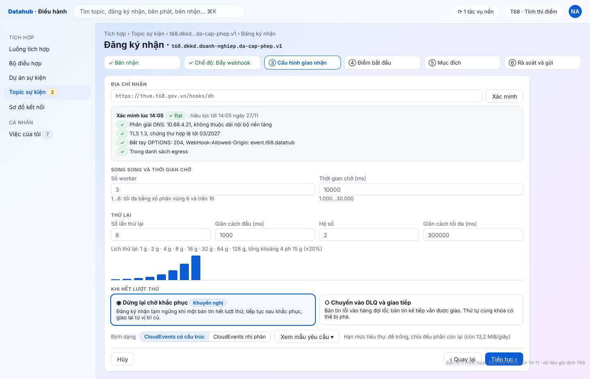

Bước 3 chế độ Đẩy webhook: khối xác minh endpoint đạt bốn bước, ô số worker có dòng phụ nêu hai giới hạn, lịch thử lại vẽ trước dạng chuỗi thời lượng và cột, hai thẻ chính sách khi hết lượt thử với thẻ "Dừng lại chờ khắc phục" được chọn sẵn vì topic giữ thứ tự.

Biểu mẫu trên `CMP-Card` đặc `color-surface-solid`, rộng tối đa `size-form-max`, nhóm trường ngăn bằng tiêu đề nhóm `font-footnote` chữ hoa `color-text-secondary` và `space-6` phía trên. Khối xác minh nền `color-surface-solid-2`, bo `radius-md`, các dòng bước dùng `CMP-StatusTag` cỡ nhỏ. Thanh hành động dính đáy theo `CMP-Wizard`, bóng `shadow-2` khi nội dung cuộn dưới.

## 18. UI-10-12 Chi tiết subscription

::: dac-ta
**Mục đích.** Theo dõi và vận hành một đăng ký nhận: trạng thái, lag theo phân vùng, thống kê giao nhận, lượt lỗi, worker, khóa ký; tạm dừng, tiếp tục, sửa, xoay khóa, đề nghị phát lại, thu hồi.

**Tác nhân, quyền.** IE, TO (FRS §3.1), TA, SO (Tạm dừng, Thu hồi khóa khẩn), OR trong phạm vi tổ chức; xem `PERM-10-read`; thao tác theo bảng 18.2.

**FR, UC.** FR-10-037 (khóa đầu), 038, 039 (thống kê, lượt lỗi), 041, 042, 046, 047, 054, 055, 056; UC-10-13…17, UC-10-20.

**Truy vết hệ cũ.** LGC-HUB-013.

**Đường dẫn, mẫu.** `/tich-hop/topic/dang-ky/{ma-subscription}` và tab con `/giao-nhan`, `/do-tre`, `/luot-loi`, `/worker`, `/khoa-ky`, `/cau-hinh`, `/phat-lai`, `/lich-su`; PTN-02.

**API.** API-10-048, 049; API-10-050 `:pause`, API-10-098 `:resume`, API-10-099 `:revoke`; API-10-051, 052, 053; API-10-054 xoay khóa, API-10-100 thu hồi khóa, API-10-120 nhận khóa đầu; API-10-055, 056, 060, 063, 091; API-10-102 rút yêu cầu.

**Điều hướng vào.** Bấm đăng ký nhận ở UI-10-06 tab Đăng ký nhận, UI-10-10, UI-10-17 (`Enter`) hoặc cạnh trên UI-10-14; sau khi gửi ở UI-10-11; thông báo cảnh báo lag.

**Thành phần chính.** Đầu trang, thanh hành động, chín tab (18.3), bảng lượt lỗi (18.4), dải theo tình huống (18.5), Drawer "Sửa tham số" (18.6), `CMP-SecretField`.

**Hành động.** Tạm dừng, Tiếp tục, Sửa tham số, Đề nghị phát lại, Xoay khóa ký, Thu hồi khóa khẩn, Xác minh lại, Miễn xác minh, Thu hồi, Xác nhận cảnh báo, Xem khóa ký, Rút yêu cầu.

**Trạng thái.** Đang tải; chưa có số liệu lag; `PENDING_APPROVAL`; `PROVISIONING`; `FAILED`; `SUSPENDED` theo nguồn; `REVOKED`; ST-08; ST-07 (mục 18.5, 18.7).

**Thông báo.** "Khóa ký đã sẵn sàng. Chỉ xem được một lần."; "Ngắt mạch tự động lúc {giờ}…"; "Bản tin chưa đọc sẽ bị xóa khỏi topic sau {t}."; ERR-10-052; nhãn ERR-10-111…120 ở tab Lượt lỗi.

**Đợt, mức chi tiết.** MVP; rất chi tiết.
:::

### 18.1. Wireframe

```text
┌ … › t68.dkkd.doanh-nghiep.da-cap-phep.v1 › ht-thue-dn-cap-phep ─────────────────────────────┐
│ [‹] ht-thue-dn-cap-phep  ● Đang nhận  Đẩy webhook  ⚠ Cảnh báo lag                            │
│     Bên nhận: HTTT thuế tỉnh (ht-thue) · Nhóm: dh-sub-t68-ht-thue-dn-cap-phep ⧉              │
│     [Tạm dừng] [Sửa tham số] [Đề nghị phát lại] [⋯]                                          │
│ [Tổng quan][Giao nhận][Độ trễ][Lượt lỗi 12][Worker][Khóa ký][Cấu hình][Phát lại][Lịch sử]    │
├──────────────────────────────────────────────────────────────────────────────────────────────┤
│ ┌ Độ trễ ───────┐ ┌ Tồn ───────┐ ┌ Thời gian còn lại ┐ ┌ Giao 1 giờ ─┐ ┌ DLQ mới ┐            │
│ │ 12 ph 30 g ⚠  │ │ 4.210      │ │ 6 ng 23 g         │ │ 98,7% đạt   │ │ 37      │            │
│ └───────────────┘ └────────────┘ └───────────────────┘ └─────────────┘ └─────────┘            │
│ ⚠ Cảnh báo từ 13:52: độ trễ vượt 5 phút.  [Xác nhận cảnh báo]                                │
│ Độ trễ 24 giờ  ▁▁▁▁▂▂▁▁▁▂▃▅▇██  ── ngưỡng cảnh báo ┄┄ ngưỡng nghiêm trọng                    │
│ URL nhận https://thue.t68.gov.vn/hooks/dh · Xác minh ✓ 14:05 · Khóa ký k_2026_11 (Đang dùng) │
└──────────────────────────────────────────────────────────────────────────────────────────────┘
```

### 18.2. Thanh hành động

| Nút | Quyền | Trạng thái | Hộp | API |
|---|---|---|---|---|
| Tạm dừng | `PERM-10-operate` | `ACTIVE`; không `INTERNAL` | `CMP-ReasonDialog` | API-10-050 `:pause` |
| Tiếp tục | `PERM-10-operate` | `PAUSED`; `SUSPENDED` (lý do khắc phục bắt buộc); không `INTERNAL` | `CMP-ReasonDialog` | API-10-098 `:resume` |
| Sửa tham số | `PERM-10-subscribe` | `ACTIVE`, `PAUSED`, `SUSPENDED` | Drawer 18.6 | API-10-049 |
| Đề nghị phát lại | `PERM-10-operate` | `ACTIVE`, `PAUSED`, `SUSPENDED`; chế độ `PUSH`, `PULL_API` | UI-10-16 `/phat-lai/moi?dang-ky=` | API-10-064 |
| ⋯ Xoay khóa ký | `PERM-10-operate` hoặc `PERM-10-subscribe` | `PUSH`, chưa `REVOKED` | `CMP-ConfirmDialog` rồi `CMP-SecretField` chế độ `issue` | API-10-054 `:rotate` |
| ⋯ Thu hồi khóa khẩn | SO, TA (`PERM-10-operate`) | `PUSH` | `CMP-ReasonDialog` màu phá hủy, rồi `CMP-SecretField` | API-10-100 `signing-keys:revoke` |
| ⋯ Xác minh lại endpoint | `PERM-10-subscribe` | `PUSH` | Khối xác minh như 17.4.3 | API-10-051 |
| ⋯ Miễn xác minh | `PERM-10-admin` | `PUSH`, xác minh `FAILED` | `CMP-ReasonDialog` thêm `CMP-DatePicker` "Miễn tới" (≤ 180 ngày) | API-10-091 |
| ⋯ Thu hồi | `PERM-10-subscribe` | Chưa `REVOKED` | `CMP-ReasonDialog` màu phá hủy, liệt kê hậu quả | API-10-099 `:revoke` |
| Xác nhận cảnh báo | `PERM-10-operate` | `alertState` khác `OK` | `CMP-ReasonDialog` ghi chú tùy chọn | API-10-056 |

: UI-10-12 Chi tiết subscription, thanh hành động

SO chỉ thấy Tạm dừng (dùng khi sự cố ATTT) và Thu hồi khóa khẩn; không thấy phát lại, DLQ (D02-03-PH10 §3.2). Subscription `INTERNAL` ẩn Tạm dừng, Tiếp tục và hiện `CMP-Alert` "Điều khiển ở luồng PH-04." kèm liên kết (ERR-10-052).

Hộp Thu hồi nêu: dừng giao nhận, gỡ scope, xóa ACL, thu hồi mọi khóa ký, xóa nhóm tiêu thụ sau `10.subscription.group-delete-delay-hours` giờ, mục DLQ mới giữ lại nhưng không phát lại được, lượt phát lại đang chạy bị hủy (FR-10-047).

### 18.3. Các tab

| Tab | Đoạn route | Nội dung | Thành phần | API |
|---|---|---|---|---|
| Tổng quan | (mặc định) | Năm thẻ số (độ trễ, tồn, thời gian còn lại, tỷ lệ giao đạt 1 giờ, DLQ mới), dải cảnh báo lag, biểu đồ độ trễ 24 giờ có hai đường ngưỡng, tóm tắt cấu hình | `CMP-StatCard`, `CMP-Alert`, `CMP-Chart`, `CMP-DescriptionList` | API-10-048, 055, 060 |
| Giao nhận | `/giao-nhan` | Biểu đồ theo `khoang` 1 giờ, 24 giờ, 7 ngày: giao thành công, lỗi tạm thời, thử lại, vào DLQ (cột chồng), độ trễ đầu nhận p50, p95 (đường) | `CMP-Chart`, `CMP-SegmentedControl` | API-10-052 |
| Độ trễ | `/do-tre` | Bảng theo phân vùng: `partition`, `committedOffset`, `endOffset`, `lagRecords`, `lagSeconds`; biểu đồ xu hướng | `CMP-DataTable`, `CMP-Chart` | API-10-055 |
| Lượt lỗi | `/luot-loi` | Bảng mục 18.4 | `CMP-DataTable` | API-10-053 |
| Worker | `/worker` | Chỉ `PUSH`: mỗi worker, phân vùng đang giữ, offset, lần giao cuối | `CMP-DataTable` | API-10-048 (Phụ lục B) |
| Khóa ký | `/khoa-ky` | Chỉ `PUSH`: bảng `keyId`, `status`, `activatedAt`, `previousUntil`, `revokedAt`; nhắc xoay khi khóa quá `10.push.key-max-age-days` | `CMP-DataTable`, `CMP-Alert` | API-10-048 |
| Cấu hình | `/cau-hinh` | Mọi trường A.3 `Subscription` theo chế độ, `push.lastVerification`, `consumerGroup`, `startPosition`, `startAt`, `legalBasis`, người duyệt | `CMP-DescriptionList` | API-10-048 |
| Phát lại | `/phat-lai` | Bảng lượt phát lại của subscription | `CMP-DataTable` | API-10-063 |
| Lịch sử | `/lich-su` | Kiểm toán | `CMP-AuditTimeline` | FR-00-043 |

: UI-10-12 Chi tiết subscription, các tab

### 18.4. Bảng lượt lỗi

| Cột | Trường | Ghi chú |
|---|---|---|
| Thời điểm | `occurredAt` | |
| Phân vùng, offset | `partition`, `offset` | `CMP-CodeText` |
| Mã sự kiện | `eventId` | `CMP-Identifier` có sao chép |
| HTTP | `httpStatus` | Trống khi lỗi trước khi có phản hồi |
| Mã lỗi | `errorCode` | Nhãn theo bảng dưới |
| Phân loại | `failureClass` | `CMP-Tag` |
| Lần thử | `attempt` | |
| Phản hồi | `responseSnippet` | Tối đa 512 byte đã che, mở trong `CMP-Popover` `font-mono` |

: UI-10-12 Chi tiết subscription, cột bảng lượt lỗi

| Mã | Nhãn trong bảng | Gợi ý cho người vận hành |
|---|---|---|
| ERR-10-111 | Quá thời gian chờ | "Đầu nhận chậm; tăng thời gian chờ hoặc giảm số worker." |
| ERR-10-112 | Đầu nhận lỗi tạm thời (5xx, 408, 425, 429) | "Kiểm tra tình trạng HTTT nhận." |
| ERR-10-113 | Đầu nhận từ chối | "Đầu nhận trả 4xx hoặc bên nhận báo lỗi; xem nội dung phản hồi." |
| ERR-10-114 | Lỗi TLS, chứng thư | "Chứng thư đầu nhận hết hạn hoặc không tin cậy." |
| ERR-10-115 | Địa chỉ đích bị chặn | "Tên miền phân giải ra địa chỉ bị chặn; kiểm tra DNS." |
| ERR-10-116 | Không giải được bản tin | "Bản tin không khớp lược đồ; báo bên phát." |
| ERR-10-117 | Không đọc được khóa ký | "Sự cố kho bí mật; giao nhận phân vùng tạm dừng." |
| ERR-10-118 | Cầu nối không chuyển được | Chỉ ở DLQ của cầu nối |
| ERR-10-119 | Bản tin không có định danh lược đồ | Chỉ ở giám sát tuân thủ |
| ERR-10-120 | Kafka từ chối do ACL, hạn mức | "Kiểm tra quyền và hạn mức của principal." |

: UI-10-12 Chi tiết subscription, nhãn và gợi ý cho mã lỗi giao nhận ERR-10-111…120

### 18.5. Dải trạng thái theo tình huống

| Tình huống | Dải | Hành động trong dải |
|---|---|---|
| `PENDING_APPROVAL` | `CMP-Banner` thông tin "Chờ duyệt, yêu cầu {requestCode}." | "Rút yêu cầu" (người gửi, API-10-102 `:withdraw`) |
| `PROVISIONING` | Mục 6 điểm 1 | |
| `FAILED` | `CMP-Alert` lỗi kèm lỗi cấp phát | "Thử lại" theo `allowedActions` |
| Vừa `ACTIVE`, `PUSH`, người xem là người đề nghị, khóa đầu chưa xem | `CMP-Alert` cảnh báo "Khóa ký đã sẵn sàng. Chỉ xem được một lần." | "Xem khóa ký" mở `CMP-SecretField` chế độ `issue` (cách lấy khóa: Phụ lục B) |
| `SUSPENDED` do `CIRCUIT_BREAKER` | `CMP-Alert` cảnh báo "Ngắt mạch tự động lúc {giờ} vì tỷ lệ lỗi ≥ 50% trong {n} phút. Hệ thống thăm dò mỗi 5 phút và tự tiếp tục khi đầu nhận hồi phục." | "Tiếp tục ngay" |
| `SUSPENDED` do `DELIVERY_BLOCKED` | `CMP-Alert` lỗi "Dừng do chính sách chặn: bản tin tại phân vùng {p}, offset {o} hết lượt thử." | "Xem lượt lỗi", "Tiếp tục" |
| `SUSPENDED` do `SECURITY`, `PH01`, `MANUAL` | `CMP-Alert` cảnh báo nêu nguồn và lý do | "Tiếp tục" khi được phép |
| Thời gian còn lại dưới 24 giờ | `CMP-Alert` lỗi "Bản tin chưa đọc sẽ bị xóa khỏi topic sau {t}." | |
| Xác minh hết hạn hoặc đang miễn | `CMP-Alert` cảnh báo với `verificationWaiverUntil`, `verificationWaiverReason` | "Xác minh lại" |
| Khóa ký quá tuổi | `CMP-Alert` thông tin "Khóa ký đã dùng {n} ngày; nên xoay." | "Xoay khóa ký" |

: UI-10-12 Chi tiết subscription, dải trạng thái theo tình huống

### 18.6. Drawer "Sửa tham số"

Drawer `size-drawer-lg` chia hai nhóm rõ ràng bằng tiêu đề và `CMP-Tag`:

| Nhóm | Trường (theo chế độ) | Nhãn nhóm | Ghi chú |
|---|---|---|---|
| Áp dụng ngay | `push.workerCount`, `push.maxRetries`, `push.retryBackoff`, `push.timeoutMs`, `push.payloadFormat`, `pull.maxBatch`, `pull.leaseSeconds`, `lagWarnSeconds`, `lagCriticalSeconds` | "Áp dụng trong khoảng 60 giây, không cần duyệt" | Kiểm tra như 17.4.2, 17.5, 17.8; đổi worker hiện câu "Tái cân bằng không mất bản tin." |
| Cần duyệt lại | `push.endpointUrl` (xác minh trước), `push.failurePolicy` | "Tạo yêu cầu duyệt; đăng ký nhận chạy với tham số cũ tới khi duyệt" | Đổi URL hiện khối xác minh 17.4.3 |
| Không sửa được | `deliveryMode`, `topicName`, `subscriberCode`, `startPosition` | Chữ mờ kèm hướng dẫn | Đổi chế độ: "Tạo đăng ký nhận mới với chế độ khác rồi thu hồi đăng ký này." kèm nút mở UI-10-11; đổi điểm đọc: "Dùng phát lại kiểu đặt lại vị trí." |

: UI-10-12 Chi tiết subscription, drawer "Sửa tham số"

Chân Drawer hiện `CMP-DiffTable` cũ và mới, nút "Lưu" (chỉ nhóm áp dụng ngay) hoặc "Lưu và gửi duyệt" (có trường nhóm cần duyệt). PATCH có `If-Match`; ST-13 khi xung đột. Lỗi ERR-10-030, 026, 027 hiện tại trường.

### 18.7. Trạng thái màn

| Trạng thái | Hiển thị |
|---|---|
| Đang tải | Skeleton tiêu đề, năm thẻ, biểu đồ |
| Số liệu lag chưa có (mới `ACTIVE`) | Thẻ hiện "Chưa có số liệu" và dòng phụ "Số liệu đầu tiên sau khoảng {10.lag.collect-interval-seconds} giây" |
| Không tồn tại | ST-08 "Không tìm thấy đăng ký nhận {mã}" |
| Không có quyền | ST-07; OR ngoài tổ chức ERR-10-044 |
| `REVOKED` | `CMP-Banner` "Đã thu hồi ngày {revokedAt}." mọi nút ghi ẩn, tab DLQ vẫn xem được |

: UI-10-12 Chi tiết subscription, trạng thái màn

### 18.8. Bàn phím, truy cập, responsive

`1`…`9` chuyển tab; `P` tạm dừng hoặc tiếp tục (mở hộp, không thực hiện ngay); `R` đề nghị phát lại; `A` xác nhận cảnh báo. Thẻ số đọc kèm trạng thái ("Độ trễ 12 phút 30 giây, mức Cảnh báo"). Biểu đồ độ trễ có hai đường ngưỡng nét liền và nét đứt (không chỉ khác màu) và bảng thay thế. Thay đổi `alertState` khi đang xem đọc qua `aria-live="polite"` một lần. Dưới `bp-lg` năm thẻ xếp hai hàng, hàng tab cuộn ngang.

### 18.9. Bản hi-fi

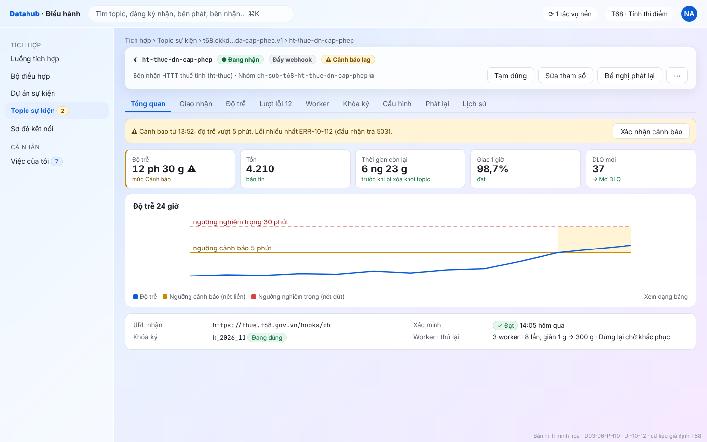

Tab Tổng quan khi đang cảnh báo lag: dải cảnh báo có nút Xác nhận, năm thẻ số (thẻ độ trễ có viền trái vàng và biểu tượng), biểu đồ độ trễ 24 giờ với ngưỡng cảnh báo nét liền, ngưỡng nghiêm trọng nét đứt và vùng vượt ngưỡng tô nền, rồi tóm tắt URL, xác minh, khóa ký, tham số giao nhận.

Thẻ số `CMP-StatCard` nền `color-surface-solid`, số `font-title-1` `font-feature-tabular`; thẻ độ trễ có viền trái 3 px theo sắc thái `alertState` (`color-warning-solid` khi `WARNING`) kèm biểu tượng, không tô cả thẻ. Biểu đồ độ trễ: đường chính `color-chart-1`, ngưỡng cảnh báo `color-warning-solid` nét liền 1 px, ngưỡng nghiêm trọng `color-error-solid` nét đứt 1 px; vùng vượt ngưỡng tô `color-warning-bg`. Dải trạng thái theo mục 18.5 đặt ngay dưới `CMP-PageHeader`, cách `space-4`.

## 19. UI-10-13 Duyệt yêu cầu sự kiện

::: dac-ta
**Mục đích.** Cho IA, TA duyệt chín loại yêu cầu của PH-10 trong hộp việc chung: xem khác biệt, kết quả kiểm tra, tác động; quyết định có ý kiến, bảo đảm bốn mắt.

**Tác nhân, quyền.** IA, TA (FRS §3.1) với `PERM-10-approve`; người gửi (IE, TO, TA) xem yêu cầu của mình với `PERM-10-read` và rút được; người tạo hoặc người gửi không duyệt được (BR-10-010).

**FR, UC.** FR-10-009, 011, 012, 013, 014, 019, 021, 031, 037, 051, 073, 075; UC-10-03, 04, 06, 09, 13, 19, 27.

**Truy vết hệ cũ.** LGC-HUB-012 (publication, thêm duyệt); hệ cũ không có duyệt bốn mắt.

**Đường dẫn, mẫu.** `/viec-cua-toi?phan-he=10` (`loai`, `chon`); PTN-10 Hộp việc.

**API.** API-10-057, 058; API-10-059 `:approve`, API-10-101 `:reject`, API-10-102 `:withdraw`.

**Điều hướng vào.** Mục "Việc của tôi" có huy hiệu số việc; khối "Việc chờ duyệt" ở UI-10-01; dải "Đang chờ duyệt" ở UI-10-06, 12; thông báo yêu cầu mới.

**Thành phần chính.** Lọc loại, danh sách yêu cầu, chi tiết bốn tab, `CMP-DecisionPanel` (mục 19.1 đến 19.3).

**Hành động.** Duyệt, Từ chối (ý kiến ≥ 10 ký tự), Rút yêu cầu (người gửi); đánh dấu `acknowledgePii`, `acknowledgeDataLoss`; giảm `quotaBytesPerSecond`, `push.workerCount`.

**Trạng thái.** Rỗng; người gửi tự xem (nút vô hiệu); `autoApproved`; `EXPIRED`; phụ thuộc không khả dụng giữ `PENDING`.

**Thông báo.** ERR-10-008 "Bạn đã tạo hoặc gửi yêu cầu này nên không được duyệt. Cần người duyệt khác."; ERR-10-009; "Chưa duyệt được vì {dịch vụ} không khả dụng; yêu cầu vẫn chờ." (ERR-10-029).

**Đợt, mức chi tiết.** MVP; rất chi tiết.
:::

### 19.1. Wireframe

```text
┌ Việc của tôi · Sự kiện ───────────────────────────────────────────────────────────────────┐
│ Loại: [Tất cả ▾]  (Tạo topic 3)(Quyền phát 2)(Đăng ký nhận 2)          Sắp xếp: Hạn gần ▾ │
├ Danh sách ──────────────────────┬ Chi tiết yêu cầu apr-01jd… ─────────────────────────────┤
│ ▸ Tạo topic                     │ Tạo topic t68.dkkd.doanh-nghiep.da-cap-phep.v1           │
│   t68.dkkd.doanh-nghiep…v1      │ Gửi bởi An · 25/11 09:12 · Hạn 25/12 (còn 29 ngày)       │
│   An · 1 ngày                   │ [Khác biệt][Kiểm tra][Tác động][Lịch sử]                 │
│ ▸ Đăng ký nhận                  │ Cấu hình: 6 phân vùng · lưu 7 ngày · theo khóa …         │
│   ht-thue-dn-cap-phep           │ Lược đồ v1 (Avro) ▸ xem                                  │
│   Bình · 3 giờ                  │ ⚠ Dữ liệu cá nhân: trường 'soDienThoai' (Cảnh báo)       │
│ ▸ Phát lại                      │ ☐ Tôi đã xem các cảnh báo dữ liệu cá nhân *              │
│   rpl-01jd…                     │ Ý kiến * [                                           ]   │
│                                 │                          [Từ chối]  [Duyệt]              │
└─────────────────────────────────┴──────────────────────────────────────────────────────────┘
```

### 19.2. Nội dung theo loại yêu cầu

| `requestType` | Tab Khác biệt | Tab Kiểm tra | Trường quyết định thêm | FR |
|---|---|---|---|---|
| `TOPIC_CREATE` | Cấu hình, lược đồ phiên bản 1 (`CMP-CodeBlock`) | `piiFindings`, kết quả cú pháp, quy ước | `acknowledgePii` (bắt buộc khi có `WARNING`) | FR-10-009 |
| `TOPIC_CHANGE` | `payloadDiff` bằng `CMP-DiffTable` | Subscription bị ảnh hưởng (lag lớn hơn lưu giữ mới), tác động thứ tự | `acknowledgeDataLoss` khi danh sách ảnh hưởng khác rỗng | FR-10-011, 012, 013, 021 |
| `TOPIC_RETIRE` | Danh sách quan hệ sẽ thu hồi | Subscription còn hiệu lực | | FR-10-014 |
| `SCHEMA_VERSION` | `CMP-DiffViewer` so với phiên bản mới nhất | `compatibilityReport`, `piiFindings`, bên nhận hiện có | `acknowledgePii` khi có `WARNING` | FR-10-019 |
| `PUBLICATION` | Bên phát, topic, mục đích, lưu lượng | Cấp độ ATTT (topic hạn chế, nhạy cảm), hạn mức còn lại | `quotaBytesPerSecond` (người duyệt giảm được) | FR-10-031 |
| `SUBSCRIPTION` | Bên nhận, chế độ, tham số, `legalBasis` | Kết quả xác minh endpoint còn hiệu lực, cấp độ ATTT, hạn mức worker | Giảm `push.workerCount`, `quotaBytesPerSecond` | FR-10-037 |
| `REPLAY` | Khoảng, chế độ, ước lượng số bản tin, thời gian chạy | Tác động: nhận lại hoặc bỏ qua sự kiện | | FR-10-051 |
| `BRIDGE` | Topic Pulsar, topic Kafka, `startFrom`, `expiresAt` | Ánh xạ, kết nối nguồn | | FR-10-073 |
| `CUTOVER` | Ánh xạ, kết quả đối chiếu 72 giờ, số ngày song song | Điều kiện FR-10-075 đạt hay không, từng điều kiện một dòng | | FR-10-075 |

: UI-10-13 Duyệt yêu cầu sự kiện, nội dung theo loại yêu cầu

### 19.3. Hành vi quyết định

`CMP-DecisionPanel` dính đáy cột phải. "Duyệt" chỉ bật khi đã nhập ý kiến và đánh dấu đủ ô xác nhận bắt buộc; "Từ chối" đòi ý kiến ≥ 10 ký tự (FR-10-009). Người xem là người tạo hoặc người gửi: cả hai nút vô hiệu, `CMP-Alert` thông tin "Bạn đã gửi yêu cầu này nên không được duyệt (bốn mắt)." (BR-10-010, ERR-10-008). Yêu cầu `autoApproved = true` hiện thẻ "Tự duyệt bởi hệ thống" và không có nút. Yêu cầu `EXPIRED`: dải "Hết hạn sau {10.approval.expire-days} ngày; đối tượng đã về trạng thái trước khi gửi." Sau quyết định, mục rời danh sách, focus chuyển sang mục kế tiếp và Toast nêu kết quả; lỗi ERR-10-029 (Apicurio, Git, Keycloak không khả dụng) giữ yêu cầu `PENDING` và hiện `CMP-Alert` "Chưa duyệt được vì {dịch vụ} không khả dụng; yêu cầu vẫn chờ."

### 19.4. Trạng thái, bàn phím

Rỗng: "Không có yêu cầu sự kiện nào chờ bạn duyệt." `J`, `K` chuyển mục; `A` mở xác nhận duyệt; `X` từ chối; `Ctrl+Enter` gửi quyết định khi focus trong ô ý kiến. Dưới `bp-lg` danh sách và chi tiết chuyển thành hai trang nối nhau.

### 19.5. Bản hi-fi

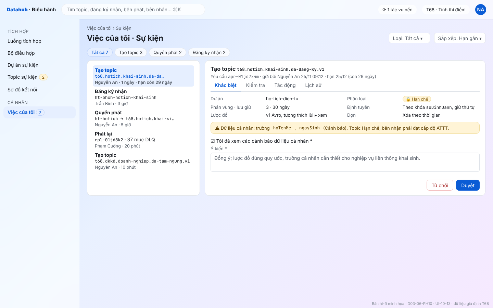

Hộp việc hai cột: danh sách yêu cầu theo loại bên trái, chi tiết yêu cầu tạo topic hạn chế bên phải với cảnh báo dữ liệu cá nhân, ô xác nhận đã xem cảnh báo, ý kiến bắt buộc và hai nút Từ chối, Duyệt.

## 20. UI-10-14 Sơ đồ kết nối (siêu chi tiết)

::: dac-ta
**Mục đích.** Thay màn "Integration Project Connections" của Hub: cho thấy ai phát lên topic nào, ai nhận từ topic nào, bằng chế độ gì, quan hệ nào đang trễ, lỗi hay tạm ngừng, để kỹ sư tích hợp rà soát thiết kế liên thông và người vận hành khoanh vùng sự cố.

**Tác nhân, quyền.** IE, TA, TO, VW (FRS §3.1), AU; `PERM-10-read`; OR thấy nút ngoài tổ chức là "Đối tượng hạn chế".

**FR, UC.** FR-10-058; UC-10-21.

**Truy vết hệ cũ.** LGC-HUB-007 (thiết kế lại).

**Đường dẫn, mẫu.** `/tich-hop/so-do?du-an={ma-du-an}` cùng `topic`, `httt`, `lop-phu`, `ca-ngung`, `chon`, `che-do`; PTN-07 chế độ chỉ xem.

**API.** API-10-007 (`projectCode`, `topicName`, `systemCode`, `includeRetired`, `overlay`), API-10-001 (chọn dự án), API-10-010, API-10-034, API-10-039, API-10-044, API-10-048 (Drawer chi tiết nút, cạnh).

**Điều hướng vào.** Mục menu "Sơ đồ kết nối"; "Xem sơ đồ" ở UI-10-02, 03, 05, 06; "Mở sơ đồ đầy đủ" ở tab Sơ đồ của UI-10-03.

**Thành phần chính.** Vùng R1 đến R9 (mục 20.2): thanh công cụ, lọc, canvas ba lớp, lớp phủ, điều khiển, bản đồ thu nhỏ, chú giải, Drawer chi tiết, thanh trạng thái.

**Hành động.** Lọc, tìm nút, đổi lớp phủ, chọn nút làm nổi đường đi, mở Drawer, mở trang chi tiết, chuyển Danh sách, xuất PNG, SVG, CSV, toàn màn hình; không có thao tác ghi.

**Trạng thái.** Đủ mười một trạng thái ở mục 20.14, gồm quá nhiều nút, số liệu cũ, màn hình nhỏ.

**Thông báo.** ERR-10-049 "Sơ đồ có hơn {n} nút. Chọn một dự án, một topic hoặc một HTTT để thu hẹp."; "Chưa lấy được số liệu lưu lượng từ PH-13."; "Sơ đồ cần màn hình rộng tối thiểu 992 px; đang hiện dạng danh sách."

**Đợt, mức chi tiết.** MVP; siêu chi tiết.
:::

### 20.1. Người dùng và bối cảnh

| Người dùng | Câu hỏi họ mang tới sơ đồ | Lớp phủ thường dùng |
|---|---|---|
| Kỹ sư tích hợp (IE) | "Topic này có những ai nhận? Ngừng topic thì ảnh hưởng ai?" | Không phủ, Lưu lượng |
| Người vận hành (TO) | "Bên nhận nào đang trễ, có DLQ? Sự cố bắt đầu từ HTTT nào?" | Độ trễ, DLQ |
| Quản trị tỉnh (TA) | "Bức tranh liên thông của dự án; HTTT nào phát cho nhiều bên nhất?" | Lưu lượng |
| Người xem, kiểm toán (VW, AU) | Hồ sơ liên thông, xuất ảnh đính kèm báo cáo | Không phủ |

: UI-10-14 Sơ đồ kết nối, người dùng và bối cảnh

Màn dùng trên máy văn phòng 1366 × 768 trở lên; dưới `bp-lg` chỉ có chế độ danh sách (20.13).

### 20.2. Lưới bố cục

| Vùng | Mã | Vị trí, kích thước | Vật liệu |
|---|---|---|---|
| Thanh công cụ | R1 | Trên cùng vùng nội dung, cao 48 px, toàn chiều rộng | Đặc `color-surface-solid`, viền dưới `color-border-subtle` |
| Thanh lọc | R2 | Dưới R1, cao 44 px; thu gọn được thành một dòng tóm tắt | Đặc `color-surface-solid` |
| Canvas | R3 | Phần còn lại, cao bằng viewport trừ `size-topbar`, R1, R2; không cuộn trang | Đặc `color-surface-solid-2`, lưới chấm 1 px `color-border-subtle` cách 16 px |
| Thanh lớp phủ | R4 | Nổi góc trên phải canvas, cách mép `space-4` | `glass-overlay`, bo `radius-lg`, bóng `shadow-2` |
| Điều khiển canvas | R5 | Nổi góc dưới trái, cách mép `space-4` | `CMP-CanvasControls`, `glass-overlay` |
| Bản đồ thu nhỏ | R6 | Nổi góc dưới phải, 200 × 140 px, tự hiện khi trên 20 nút | `CMP-Minimap`, khung `glass-overlay` |
| Chú giải | R7 | `CMP-Popover` mở từ nút Chú giải của R5, rộng 320 px | `glass-overlay`, nội dung đặc |
| Drawer chi tiết | R8 | Bên phải, `size-drawer-md`, không phủ lớp che (canvas vẫn thao tác được), canvas co lại bằng chiều rộng Drawer | Khung `glass-modal`, giếng nội dung đặc |
| Thanh trạng thái | R9 | Đáy canvas, cao 28 px | Đặc `color-surface-solid`, chữ `font-caption` |

: UI-10-14 Sơ đồ kết nối, lưới bố cục

### 20.3. Wireframe tổng thể

```text
┌ R1 Sơ đồ kết nối · Liên thông đăng ký kinh doanh   [⟳ 14:02] [Danh sách|Đồ thị] [Xuất ▾] [⛶] ┐
├ R2 Dự án [Liên thông ĐKKD ▾]  Tìm nút [maDN, HT-THUE…]  Trạng thái [Mọi ▾]  ☐ Gồm đã ngừng   ┤
├ R3 ───────────────────────────────────────────────────────────────────────── R4 ┌───────────┐┤
│  BÊN PHÁT                 TOPIC                                  BÊN NHẬN        │Phủ: (Không)││
│                                                                                  │(Độ trễ)    ││
│  ┌──────────────┐  API   ┌───────────────────────────────┐  Đẩy ⚠ 12ph  ┌──────┐│(Lưu lượng) ││
│  │▣ HT-DKKD     │═══════▶│◆ t68.dkkd.doanh-nghiep        │━━━━━━━━━━━━▶ │▣ HT- ││(DLQ)       ││
│  │ HTTT ĐKKD  ● │        │  .da-cap-phep.v1   ● DLQ 37   │              │ THUE ││            ││
│  └──────────────┘        └───────────────────────────────┘  Kéo API ●   └──────┘└───────────┘│
│                                   │ └────────────────────────────────▶ ┌────────┐            │
│  ┌──────────────┐  Kafka nội bộ  ┌┴──────────────────────────────┐     │▣ HT-BHXH│           │
│  │⟲ dkkd-dong-bo│═══════════════▶│◆ t68.dkkd.doanh-nghiep        │     └────────┘           │
│  │ Luồng PH-04 ●│                │  .da-giai-the.v1   ◐ Ngừng k.n│  Nội bộ ●  ┌───────────┐ │
│  └──────────────┘                └───────────────────────────────┘ ┄┄┄┄┄┄┄┄▶ │⟲ dkkd-thue│ │
│                                                                            └───────────┘ │
│ R5 [−][85%][+][⤢][⌖][🔒][▦][?]                                         R6 ┌ minimap ┐     │
├ R9 9 nút · 8 cạnh · 1 cảnh báo · Độ trễ cập nhật 14:02:01 · Bố cục tự động                   ┤
└──────────────────────────────────────────────────────────────────────────────────────────────┘
```

Nét đôi `═` là quyền phát (publication), nét đậm `━` là đăng ký nhận đang có cảnh báo khi phủ Độ trễ, nét chấm `┄` là quan hệ tạm dừng hoặc tạm ngừng. Ba cột là ba lớp của bố cục, không phải vùng cố định: cột dịch theo bố cục tự động.

### 20.4. Vùng R1 thanh công cụ

| # | Phần tử | `CMP-*` | Hành vi |
|---|---|---|---|
| 1 | Tiêu đề | `CMP-Heading` cấp 1 | "Sơ đồ kết nối · {tên dự án}" hoặc "Sơ đồ kết nối · Toàn tenant"; dùng `CMP-DesignerToolbar` làm khung thanh |
| 2 | Làm mới | `CMP-IconButton` + `CMP-Timestamp` | Tự làm mới 30 giây khi có lớp phủ khác `NONE`; bấm làm mới ngay; vị trí nút người dùng đã kéo được giữ |
| 3 | Chế độ xem | `CMP-SegmentedControl` Đồ thị, Danh sách | Ghi `che-do`; danh sách là bảng thay thế đầy đủ (20.13) |
| 4 | Xuất | `CMP-DropdownMenu` | PNG (độ phân giải 2x), SVG, CSV danh sách cạnh; ảnh có chú giải và tiêu đề, dấu thời gian, tên tenant ở góc |
| 5 | Toàn màn hình | `CMP-IconButton` | `F`; dùng `CMP-FullscreenBar` khi ở toàn màn |

: UI-10-14 Sơ đồ kết nối, vùng R1 thanh công cụ

### 20.5. Vùng R2 thanh lọc

| Bộ lọc | Tham số URL | Ánh xạ API-10-007 | Thành phần | Ghi chú |
|---|---|---|---|---|
| Dự án | `du-an` | `projectCode` | `CMP-ResourceSelect` dự án, có mục "Toàn tenant" | Mặc định dự án đầu tiên người dùng có (FR-10-058); "Toàn tenant" chỉ bật khi tenant ≤ `10.graph.max-nodes` nút, ngược lại vô hiệu kèm lý do |
| Topic | `topic` | `topicName` | `CMP-TopicSelect` | Chọn topic thì chỉ hiện topic đó với bên phát, bên nhận của nó |
| HTTT | `httt` | `systemCode` | `CMP-ResourceSelect` HTTT | Lân cận một bước quanh một HTTT (mọi topic HTTT phát hoặc nhận, và các bên ở đầu kia) |
| Gồm đã ngừng | `ca-ngung` | `includeRetired` | `CMP-Checkbox` | Mặc định không |
| Trạng thái | `trang-thai` | Lọc phía giao diện | `CMP-Select` nhiều giá trị: Hoạt động, Tạm dừng, Tạm ngừng, Chờ duyệt, Có cảnh báo, Có DLQ | Nút không khớp mờ đi chứ không biến mất, để giữ ngữ cảnh |
| Tìm nút | (không ghi URL) | Phía giao diện | `CMP-SearchInput` | Tìm trên mã, tên; `Enter` chuyển giữa kết quả, canvas cuộn tới và chọn nút |

: UI-10-14 Sơ đồ kết nối, vùng R2 thanh lọc

Dự án, topic, HTTT loại trừ nhau theo thứ tự ưu tiên topic, HTTT, dự án; chọn một bộ lọc làm hai bộ còn lại về trống và hiện `CMP-FilterChips` bộ lọc đang áp.

### 20.6. Vùng R3 canvas: nút

Canvas là `CMP-FlowCanvas` biến thể `readonly` (D03-05-04 §11.1): không chèn, không xóa, không nối cạnh, vẫn chọn, tìm, thu phóng, kéo để đặt lại vị trí trong phiên. Nút là `CMP-FlowNode`; nhóm theo dự án (khi chọn "Toàn tenant") là `CMP-GroupNode`.

| Loại nút (`nodes[].kind`) | Biểu tượng Lucide | Hình | Nội dung | Kích thước |
|---|---|---|---|---|
| Bên phát, bên nhận HTTT (`partyType = SYSTEM`) | `Server` | Chữ nhật bo `radius-md` | Mã `font-mono-sm`, tên một dòng cắt, `CMP-StatusDot` trạng thái | 200 × 56 px |
| Luồng tích hợp (`FLOW`) | `Workflow` | Như trên, viền trái 3 px `color-accent` | Mã luồng, "Luồng PH-04" | 200 × 56 px |
| Dịch vụ nội bộ (`INTERNAL_SERVICE`) | `Box` | Như trên, nền `color-surface-solid-2` | Mã DU | 200 × 56 px |
| Cầu nối hệ cũ (`LEGACY_BRIDGE`) | `Cable` | Như trên, viền nét đứt | `bridgeCode`, "Cầu nối Pulsar" | 200 × 56 px |
| Topic | `Radio` | Chữ nhật bo `radius-xl` (khác hình bên tham gia) | `topicName` cắt giữa giữ tiền tố và hậu tố, `topicKind`, `CMP-StatusDot`, huy hiệu `CMP-Badge` số mục DLQ `NEW` khi phủ DLQ | 260 × 64 px |

: UI-10-14 Sơ đồ kết nối, vùng R3 canvas: nút

Một HTTT vừa phát vừa nhận hiện hai nút, một ở lớp bên phát và một ở lớp bên nhận, nối với nhau bằng đường mảnh nét chấm `color-border-control` không mũi tên và có biểu tượng `Link` nhỏ (FR-10-058 bước 2); chọn một nút làm nổi cả nút anh em.

Trạng thái nút hiển thị bằng ba kênh: `CMP-StatusDot` có hình (chấm đặc, nửa, rỗng, chéo theo sắc thái), chữ trạng thái trong tooltip và trong `aria-label`, và viền: nút `SUSPENDED` viền 2 px `color-warning-solid`, nút `RETIRED` (khi gồm đã ngừng) chữ `color-text-tertiary` và biểu tượng `Archive`. Đối tượng người dùng không có quyền xem (OR ngoài tổ chức) hiện nút "Đối tượng hạn chế" không có tên, theo điều cấm của `CMP-DependencyGraph`.

### 20.7. Vùng R3 canvas: cạnh

| Cạnh (`edges[].kind`) | Từ, tới | Nét mặc định | Nhãn |
|---|---|---|---|
| Quyền phát (publication) | Bên phát tới topic | 1,5 px `color-border-control`, mũi tên đặc | Nhãn `commType` rút gọn ("API", "Kafka", "Kafka nội bộ", "CDC") |
| Đăng ký nhận (subscription) | Topic tới bên nhận | 1,5 px `color-border-control`, mũi tên đặc | Nhãn `deliveryMode` ("Đẩy", "Kéo API", "Kéo Kafka", "Nội bộ") |

: UI-10-14 Sơ đồ kết nối, loại cạnh trên canvas

Kiểu nét theo trạng thái quan hệ (mọi lớp phủ):

| Trạng thái quan hệ | Nét | Kèm |
|---|---|---|
| `ACTIVE` | Liền | |
| `PENDING_APPROVAL`, `PROVISIONING` | Liền mảnh 1 px, `color-text-tertiary` | Biểu tượng `Clock` giữa cạnh |
| `PAUSED`, `SUSPENDED` | Nét chấm | Biểu tượng `Pause` giữa cạnh, nhãn thêm "Tạm dừng" hoặc "Tạm ngừng" |
| `FAILED` | Liền, `color-error-solid` | Biểu tượng `XCircle` |
| `REVOKED`, `REJECTED` (khi gồm đã ngừng) | Nét đứt mảnh `color-text-disabled` | |

: UI-10-14 Sơ đồ kết nối, kiểu nét cạnh theo trạng thái quan hệ

Nhãn cạnh nằm trên nền `color-surface-solid` bo `radius-sm`, chữ `font-caption`, để đọc được khi cạnh đi qua lưới; nhãn tự ẩn dưới 60% thu phóng và hiện lại khi rê hoặc chọn cạnh.

### 20.8. Lớp phủ (R4)

Thanh lớp phủ là `CMP-SegmentedControl` bốn giá trị đúng enum `overlay` của FRS A.2.15; giá trị ghi `lop-phu` (`none`, `lag`, `traffic`, `dlq`) và gửi API-10-007 `overlay`.

| `overlay` | Nhãn | Thay đổi trên cạnh | Thay đổi trên nút | Nguồn dữ liệu |
|---|---|---|---|---|
| `NONE` | Không phủ | Theo 20.7 | Theo 20.6 | `edges[].status` |
| `LAG` | Độ trễ | Cạnh subscription tô theo `alertState`: `OK` `color-success-solid`, `WARNING` `color-warning-solid`, `CRITICAL` `color-error-solid`, `STALLED` `color-error-solid` nét đứt; cạnh khác `OK` dày 3 px; nhãn thêm `CMP-Duration` của `lagSeconds` | Bên nhận có subscription khác `OK` thêm biểu tượng `AlertTriangle` (cảnh báo) hoặc `OctagonAlert` (nghiêm trọng, ngừng tiến) | `edges[].lagSeconds`, trạng thái `alertState` của subscription |
| `TRAFFIC` | Lưu lượng | Độ dày theo `ratePerMinute` chia bốn mức theo tứ phân vị của đồ thị đang xem: 1, 2, 3,5, 5 px; màu `color-chart-1`; nhãn thêm "{n}/phút" | Topic thêm dòng "vào {n}/phút" | `edges[].ratePerMinute` (từ PH-13) |
| `DLQ` | DLQ | Cạnh subscription có mục DLQ `NEW` tô `color-error-solid`, nhãn "{n} DLQ" | Topic thêm `CMP-Badge` tổng mục `NEW`; bấm huy hiệu mở UI-10-15 lọc subscription | Chỉ số DLQ trong `nodes[]`, `edges[]` |

: UI-10-14 Sơ đồ kết nối, lớp phủ (R4)

Ba quy tắc chung cho lớp phủ. Thứ nhất, màu không bao giờ là kênh duy nhất: mức `alertState` luôn có biểu tượng và chữ trên nhãn cạnh, độ dày lưu lượng luôn có số. Thứ hai, chú giải R7 đổi theo lớp phủ đang bật và nêu cách tính (ví dụ "Độ dày theo tứ phân vị lưu lượng của sơ đồ đang xem"). Thứ ba, khi PH-13 không khả dụng, thẻ "Lưu lượng" vẫn chọn được nhưng canvas hiện dải `CMP-Alert` "Chưa lấy được số liệu lưu lượng từ PH-13." và cạnh giữ nét mặc định; khi bộ thu lag ngừng, lớp Độ trễ hiện `CMP-Banner` mục 5.4.

### 20.9. Bố cục

Bố cục tự động trái sang phải bằng ELK thuật toán phân lớp (FR-10-058 bước 4): lớp 1 bên phát, lớp 2 topic, lớp 3 bên nhận; khoảng cách lớp 160 px, khoảng cách nút trong lớp `space-6`; sắp nút trong lớp để giảm cạnh cắt nhau, ưu tiên giữ các topic của cùng dự án cạnh nhau. Bố cục chạy trong Web Worker để không chặn giao diện. Người dùng kéo nút để đặt lại; vị trí giữ trong phiên (bộ nhớ trang, theo khóa dự án) và mất khi tải lại, có nút "Bố cục lại" ở R5 (biểu tượng khóa bố cục của `CMP-CanvasControls` đổi chức năng thành "Khóa vị trí"). Hướng trên xuống dưới chọn được ở menu Xem, lưu theo người dùng (`CMP-FlowCanvas` mục Hướng).

### 20.10. Tương tác chuột

| Thao tác | Kết quả |
|---|---|
| Bấm nút | Chọn nút, làm nổi đường đi qua nút (20.11), mở Drawer R8 với tóm tắt; ghi `chon={kind}:{code}` |
| Bấm cạnh | Chọn cạnh, mở Drawer tóm tắt publication hoặc subscription |
| Bấm đúp nút | Mở trang chi tiết (UI-10-06, 09, 10) cùng tab |
| Rê nút, cạnh | `CMP-Tooltip` sau 300 ms: tên đầy đủ, trạng thái, số liệu lớp phủ |
| Kéo nút | Đặt lại vị trí (không đổi quan hệ) |
| Kéo nền | Cuộn khung nhìn |
| Con lăn | Cuộn; `Ctrl` + con lăn thu phóng 10…400% |
| Bấm nền | Bỏ chọn, đóng Drawer |
| Chuột phải nút | `CMP-DropdownMenu`: Mở chi tiết, Chỉ hiện lân cận nút này (đặt `topic` hoặc `httt`), Sao chép mã, Mở DLQ (topic) |

: UI-10-14 Sơ đồ kết nối, tương tác chuột

Kéo nút có phương án không kéo (WCAG 2.5.7): chọn nút rồi dùng phím mũi tên dịch 8 px, `Shift` dịch 32 px.

### 20.11. Làm nổi đường đi

Chọn một nút làm nổi mọi nút, cạnh nằm trên đường đi qua nút đó: với bên phát là các topic nó phát và các bên nhận của những topic đó; với topic là bên phát và bên nhận của nó; với bên nhận là các topic nó nhận và bên phát của chúng. Nút, cạnh còn lại mờ đi (đề nghị token độ mờ ở Phụ lục A; tạm dùng `opacity-disabled` cho nút và `color-text-disabled` cho nhãn). Nút đang chọn có vòng focus kép `color-focus-ring`, `color-focus-ring-inner`. `Esc` bỏ làm nổi.

### 20.12. Drawer chi tiết (R8)

| Đối tượng chọn | Nội dung | Thành phần | API |
|---|---|---|---|
| Topic | Tên, trạng thái, `topicKind`, `dataClass`, phân vùng, lưu giữ, lược đồ mới nhất, số bên phát, bên nhận, vào 24 giờ, DLQ mới; nút "Mở chi tiết topic", "Mở DLQ", "Chỉ hiện topic này" | `CMP-DescriptionList`, `CMP-StatusTag`, `CMP-Button` | API-10-010 |
| Bên phát | Mã, tên, `partyType`, gắn với, `commType`, trạng thái, danh sách quyền phát | `CMP-DescriptionList`, `CMP-DataTable` gọn | API-10-034 |
| Bên nhận | Như trên với danh sách đăng ký nhận, độ trễ từng cái | | API-10-039 |
| Cạnh quyền phát | Bên phát, topic, trạng thái, mục đích, hạn mức, người duyệt | `CMP-DescriptionList` | API-10-044 |
| Cạnh đăng ký nhận | Chế độ, trạng thái, `alertState`, `lagSeconds`, thời gian còn lại, DLQ mới; nút "Mở chi tiết đăng ký nhận" | `CMP-DescriptionList`, `CMP-StatCard` | API-10-048 |

: UI-10-14 Sơ đồ kết nối, drawer chi tiết (R8)

Drawer không có nút ghi (chế độ chỉ xem PTN-07); mọi thay đổi đi qua màn chi tiết. Drawer giữ focus trong nó khi mở bằng bàn phím, `Esc` đóng và trả focus về nút đã chọn.

### 20.13. Chế độ danh sách

`che-do=danh-sach` thay canvas bằng `CMP-DataTable` một dòng mỗi cạnh: Bên phát, Kiểu giao tiếp, Topic, Chế độ giao nhận, Bên nhận, Trạng thái quan hệ, Độ trễ, Lưu lượng, DLQ mới; nhóm theo topic bằng hàng nhóm thu gọn được. Bộ lọc R2 và lớp phủ áp như đồ thị (lớp phủ thành cột được tô theo cùng sắc thái và có chữ). Đây là phương án tương đương cho trình đọc màn hình, cho máy nhỏ dưới `bp-lg`, và cho xuất CSV. Khi đồ thị có trên 300 nút hiển thị (sau lọc phía giao diện) thì giao diện gợi ý chuyển danh sách bằng `CMP-Alert` thông tin, không tự chuyển.

### 20.14. Trạng thái màn

| Trạng thái | Điều kiện | Hiển thị |
|---|---|---|
| Đang tải lần đầu | Chưa có đồ thị | Skeleton ba nút nối nhau ở giữa canvas (theo `CMP-FlowCanvas`), R1, R2 hiện ngay |
| Đang tải lại | Đổi bộ lọc, lớp phủ, làm mới | Giữ đồ thị cũ, `CMP-ProgressBar` mảnh ở mép trên canvas, `aria-busy="true"` |
| Đang bố cục | Đồ thị lớn đang tính bố cục | Chữ "Đang sắp xếp sơ đồ…" ở R9, canvas hiện bố cục cũ |
| Rỗng, dự án chưa có quan hệ | `nodes[]` rỗng | `CMP-EmptyState` giữa canvas "Dự án chưa có topic hoặc chưa có bên phát, bên nhận nào." kèm "Tạo topic" (`PERM-10-create`) và "Mở dự án" |
| Rỗng do lọc | Có dữ liệu nhưng bộ lọc trạng thái loại hết | ST-04 "Không có nút khớp bộ lọc" kèm "Xóa bộ lọc" |
| Quá nhiều nút | ERR-10-049 | Thông điệp giữa canvas "Sơ đồ có hơn {10.graph.max-nodes} nút. Chọn một dự án, một topic hoặc một HTTT để thu hẹp." kèm ba nút mở bộ lọc tương ứng |
| Lỗi tải | 5xx, hết thời gian | `CMP-Alert` giữa canvas có "Thử lại", mã truy vết |
| Không có quyền | 403 | ST-07 |
| Dự án không tồn tại | `du-an` sai | ST-08 trong canvas, R2 vẫn dùng được để chọn dự án khác |
| Số liệu cũ | Bộ thu lag ngừng | `CMP-Banner` mục 5.4 |
| Màn hình nhỏ | Dưới `bp-lg` | Chỉ chế độ danh sách, `CMP-Alert` "Sơ đồ cần màn hình rộng tối thiểu 992 px; đang hiện dạng danh sách." |

: UI-10-14 Sơ đồ kết nối, trạng thái màn

### 20.15. Bàn phím

| Phím | Tác dụng |
|---|---|
| `Tab`, `Shift+Tab` | Đi qua R1, R2, R4, canvas, R5 theo thứ tự; trong canvas đi qua nút theo lớp rồi theo thứ tự trên xuống dưới |
| Mũi tên trái, phải (nút đang chọn) | Chuyển sang nút nối với nó ở lớp bên trái hoặc bên phải (đi theo cạnh); khi có nhiều nút nối, mở danh sách chọn nhỏ |
| Mũi tên lên, xuống | Nút kế trong cùng lớp |
| `Alt` + mũi tên | Dịch nút 8 px (`Shift` thêm: 32 px) |
| `Enter` | Mở Drawer chi tiết của nút đang chọn |
| `Shift+Enter` | Mở trang chi tiết |
| `Esc` | Đóng Drawer; lần nữa bỏ chọn, bỏ làm nổi |
| `/` | Vào ô tìm nút |
| `1`, `2`, `3`, `4` | Lớp phủ Không phủ, Độ trễ, Lưu lượng, DLQ |
| `L` | Chuyển chế độ Đồ thị, Danh sách |
| `0` | Vừa khung; `Ctrl+=`, `Ctrl+-` thu phóng |
| `F` | Toàn màn hình |
| `R` | Làm mới |
| `?` | `CMP-ShortcutSheet` |

: UI-10-14 Sơ đồ kết nối, bàn phím

### 20.16. Trợ năng

1. Canvas có `role="application"` với `aria-label` "Sơ đồ kết nối, {n} bên phát, {m} topic, {k} bên nhận" và `aria-describedby` trỏ tới câu hướng dẫn ẩn "Dùng mũi tên để đi theo quan hệ, Enter để xem chi tiết, L để chuyển dạng danh sách."
2. Mỗi nút `role="button"` (trong `role="group"` của lớp) có `aria-label` đầy đủ, ví dụ "Topic t68.dkkd.doanh-nghiep.da-cap-phep.v1, Đang hoạt động, 1 bên phát, 4 bên nhận, 37 mục DLQ mới". Cạnh không focus riêng nhưng được đọc khi đi theo mũi tên: "Đăng ký nhận ht-thue-dn-cap-phep, Đẩy webhook, Cảnh báo, độ trễ 12 phút 30 giây".
3. Vùng `aria-live="polite"` (`CMP-FlowCanvas` giải phẫu 7) đọc kết quả tìm ("3 nút khớp, đang ở 1 trên 3") và đổi lớp phủ ("Đã bật lớp phủ Độ trễ: 1 nghiêm trọng, 4 cảnh báo"); làm mới định kỳ không đọc.
4. Tương phản: nút, chữ nhãn đạt 4,5:1 trên `color-surface-solid-2`; nét cạnh và biểu tượng trạng thái đạt 3:1 (WCAG 1.4.11). Chế độ tương phản cao của hệ điều hành (`forced-colors`) giữ được nét liền, chấm, đứt và biểu tượng.
5. `CMP-Minimap` `aria-hidden="true"` vì thông tin đã có trong chế độ danh sách.
6. Giảm chuyển động (`prefers-reduced-motion`): bỏ hiệu ứng trượt khi bố cục lại và khi cuộn tới nút, đổi ngay.

### 20.17. Hiệu năng

| Chỉ tiêu | Mục tiêu | Cách đạt |
|---|---|---|
| Tải lần đầu, 300 nút | ≤ 2 giây tới khi thấy đồ thị (máy văn phòng chuẩn, mạng nội bộ) | Một lần gọi API-10-007; bố cục ELK trong Web Worker; vẽ trước khung xương |
| Thu phóng, kéo, 300 nút | ≥ 50 khung hình mỗi giây (theo tiêu chí PTN-07) | Ẩn nhãn cạnh dưới 60% thu phóng; `onlyRenderVisibleElements` của XYFlow |
| Đổi lớp phủ | ≤ 300 ms | Lớp phủ áp lên dữ liệu đã có khi API trả kèm đủ chỉ số; chỉ gọi lại khi cần số mới |
| Làm mới 30 giây | Không giật, không mất vị trí, không đổi focus | So khớp nút theo `id`, chỉ cập nhật thuộc tính |

: UI-10-14 Sơ đồ kết nối, hiệu năng

Trần `10.graph.max-nodes` (mặc định 300) do máy chủ áp; giao diện không tự cắt bớt nút.

### 20.18. Bản hi-fi

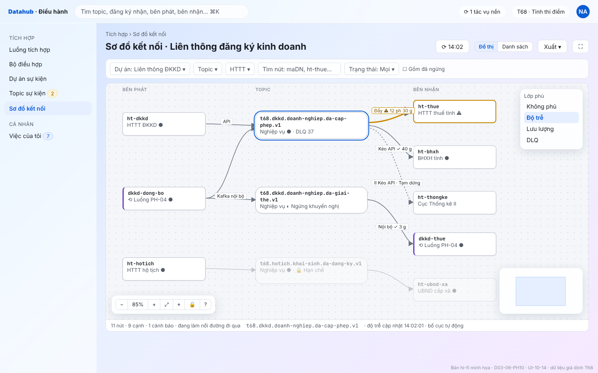

Canvas đặc ba lớp bên phát, topic, bên nhận với lớp phủ Độ trễ đang bật trên bảng kính góc phải. Topic đang chọn có vòng focus kép và đường đi qua nó được làm nổi, nút không liên quan mờ đi; cạnh tới HTTT thuế dày, vàng, có nhãn "Đẩy ⚠ 12 ph 30 g", cạnh tạm dừng nét chấm. Điều khiển, bản đồ thu nhỏ là kính; thanh trạng thái đáy nêu số nút, cạnh, cảnh báo.

Canvas `color-surface-solid-2`; nút nền `color-surface-solid`, viền 1 px `color-border-control`, bóng `shadow-1`, bo `radius-md` (bên tham gia) hoặc `radius-xl` (topic); nút chọn bóng `shadow-2` và vòng focus kép. Tiêu đề lớp "BÊN PHÁT", "TOPIC", "BÊN NHẬN" là chữ `font-caption` chữ hoa `color-text-tertiary` dính mép trên canvas, cuộn ngang theo lớp. R4 và R5 dùng `glass-overlay` trên canvas đặc (đúng quy tắc chỉ lớp nổi mới là kính). Chuyển lớp phủ đổi màu cạnh trong `motion-duration-fast` với `motion-ease-standard`. Ở chủ đề tối, nút giữ nền `color-surface-solid` tối và sắc thái trạng thái lấy giá trị tối của D03-05-02 §4.4.

### 20.19. Tiêu chí nghiệm thu UI-10-14

- [ ] Đọc được toàn bộ quan hệ của một dự án 300 nút chỉ bằng bàn phím, kể cả mở chi tiết và đổi lớp phủ.
- [ ] Bốn lớp phủ đúng enum `NONE`, `LAG`, `TRAFFIC`, `DLQ`; mỗi lớp có chú giải và không thông tin nào chỉ dựa vào màu.
- [ ] Chọn dự án, topic, HTTT ghi lên URL; mở lại URL cho đúng sơ đồ và lớp phủ.
- [ ] Vượt `10.graph.max-nodes` hiện thông điệp ERR-10-049 có lối thu hẹp, không treo trình duyệt.
- [ ] Không có thao tác nào trên sơ đồ làm thay đổi quan hệ.
- [ ] Xuất PNG, SVG có tiêu đề, chú giải, thời điểm; xuất CSV khớp chế độ danh sách.
- [ ] Người dùng OR chỉ thấy tên đối tượng trong phạm vi tổ chức; còn lại là "Đối tượng hạn chế".

## 21. UI-10-15 DLQ tầng sự kiện

::: dac-ta
**Mục đích.** Tra cứu mục DLQ của một topic theo đăng ký nhận, xem nội dung có lý do, loại bỏ, đề nghị phát lại. Màn xử lý gom mọi DLQ ở PH-18 dùng cùng API.

**Tác nhân, quyền.** TO, TA (FRS §3.1); xem siêu dữ liệu `PERM-10-read`; xem nội dung, loại bỏ, phát lại `PERM-10-operate` (SO không dùng cho việc này).

**FR, UC.** FR-10-049, 050, 053; UC-10-18.

**Truy vết hệ cũ.** Mới, không có ở hệ cũ (mục 3.2).

**Đường dẫn, mẫu.** `/tich-hop/topic/{ten-topic}/dlq` (`trang-thai`, `ma-loi`, `dang-ky`, `tu`, `den`), trong khung topic; PTN-11.

**API.** API-10-060, 061 (siêu dữ liệu), API-10-103 (nội dung), API-10-062 (loại bỏ), API-10-064 (phát lại `DLQ_ENTRIES`).

**Điều hướng vào.** Tab "DLQ" của UI-10-06; khối DLQ ở UI-10-01; thẻ "DLQ mới" ở UI-10-12; huy hiệu DLQ trên UI-10-14; màn xử lý lỗi PH-18.

**Thành phần chính.** Thanh lọc, bảng chọn nhiều, thanh chọn, Drawer mục có `CMP-JsonViewer` (mục 21.2).

**Hành động.** Xem nội dung (bắt buộc lý do với topic hạn chế, nhạy cảm), Loại bỏ (≤ 1.000 mục mỗi lệnh), Phát lại (mở UI-10-16), Xuất danh sách không gồm nội dung.

**Trạng thái.** Rỗng; đang tải; tự làm mới 30 giây; nội dung đã xóa (`PURGED`); đăng ký nhận `REVOKED`.

**Thông báo.** ERR-10-036 "Mục DLQ đã được xử lý bởi {người} lúc {giờ}."; "Nội dung đã xóa theo thời hạn lưu giữ."; "Đăng ký nhận đã thu hồi; chỉ loại bỏ được."

**Đợt, mức chi tiết.** MVP; đầy đủ.
:::

### 21.1. Wireframe

```text
┌ … › t68.dkkd.doanh-nghiep.da-cap-phep.v1 › DLQ ────────────────────────────────────────────┐
│ Đăng ký nhận [Tất cả ▾] Trạng thái [Mới ▾] Mã lỗi [▾] Từ [20/11] đến [26/11] Mã sự kiện [ ] │
├──┬───────────────┬─────────────────────┬──────────┬─────────────┬────┬──────────┬───────────┤
│☐ │ Lỗi đầu       │ Đăng ký nhận        │ Nguồn    │ Mã lỗi      │Lần │ Subject  │ Trạng thái│
│☐ │ 25/11 21:04   │ ht-thue-dn-cap-phep │ Giao đẩy │ Đầu nhận lỗi│ 9  │ 0312…    │ ● Mới     │
└──┴───────────────┴─────────────────────┴──────────┴─────────────┴────┴──────────┴───────────┘
  Đã chọn 37 [Phát lại] [Loại bỏ]                              Xuất danh sách (không nội dung)
```

### 21.2. Thành phần

| Thành phần | `CMP-*` | Nội dung |
|---|---|---|
| Thanh lọc | `CMP-FilterBar`, `CMP-Select`, `CMP-DateRangePicker`, `CMP-SearchInput` | `subscriptionCode`, `status` (mặc định `NEW`), `errorCode`, khoảng `firstFailedAt`, `eventId`, `eventSubject` |
| Bảng | `CMP-DataTable` chọn nhiều | `firstFailedAt`, `subscriptionCode`, `origin`, `errorCode`, `attempts`, `eventType`, `eventSubject`, `status`, `sourcePartition`, `sourceOffset` (ẩn mặc định) |
| Thanh chọn | `CMP-SelectionBar` | Phát lại (mở UI-10-16 kiểu `DLQ_ENTRIES`), Loại bỏ (≤ 1.000 mỗi lệnh; "chọn tất cả theo bộ lọc" gửi tối đa 1.000 mã, chạy nền theo bộ lọc để Đợt sau) |
| Drawer mục | `CMP-Drawer`, `CMP-DescriptionList`, `CMP-JsonViewer` | Siêu dữ liệu đủ A.3 `DlqEntry`; nút "Xem nội dung" |

: UI-10-15 DLQ tầng sự kiện, thành phần

Xem nội dung: topic `RESTRICTED`, `SENSITIVE` mở `CMP-ReasonDialog` bắt buộc lý do trước (kiểm toán xem dữ liệu Nhạy cảm, FR-00-040); nội dung hiện trong `CMP-JsonViewer` đã che theo chính sách PH-09 khi có, có dải "Đã ghi nhận lượt xem nội dung lúc {giờ}". Nội dung đã xóa (`PURGED`, `payloadPurgedAt`) hiện "Nội dung đã xóa theo thời hạn lưu giữ." Loại bỏ dùng `CMP-ReasonDialog`; mục đã xử lý trả ERR-10-036. Subscription `REVOKED`: nút Phát lại vô hiệu với lý do "Đăng ký nhận đã thu hồi; chỉ loại bỏ được." (FR-10-047).

### 21.3. Trạng thái, bàn phím

Rỗng: "Không có mục DLQ nào. Mục DLQ xuất hiện khi một sự kiện giao thất bại sau mọi lần thử." Đang tải: skeleton 10 dòng. `Space` chọn dòng, `Enter` mở Drawer, `V` xem nội dung (mở hộp lý do khi cần), `Delete` mở hộp loại bỏ. Bảng tự làm mới 30 giây khi lọc `NEW` và người dùng không đang chọn dòng.

### 21.4. Bản hi-fi

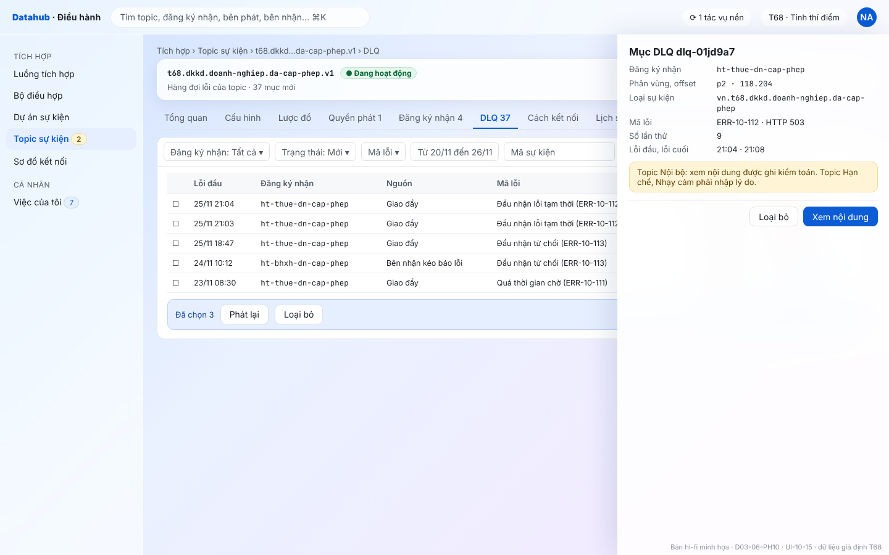

Tab DLQ trong khung topic: bảng mục lọc mặc định trạng thái Mới, mã lỗi kèm nhãn tiếng Việt, thanh chọn Phát lại, Loại bỏ; Drawer mục DLQ hiện siêu dữ liệu và nhắc ghi kiểm toán trước khi xem nội dung.

## 22. UI-10-16 Phát lại sự kiện

::: dac-ta
**Mục đích.** Liệt kê lượt phát lại, đề nghị lượt mới theo khoảng offset, thời gian hoặc mục DLQ, theo dõi tiến độ, hủy.

**Tác nhân, quyền.** TO, IA (FRS §3.1), TA; xem `PERM-10-read`; đề nghị, hủy `PERM-10-operate`; duyệt ở UI-10-13.

**FR, UC.** FR-10-051, 052, 053; UC-10-18, UC-10-19.

**Truy vết hệ cũ.** Mới, không có ở hệ cũ.

**Đường dẫn, mẫu.** `/tich-hop/topic/phat-lai`, `/tich-hop/topic/phat-lai/moi` (`?dang-ky=`, `?muc-dlq=`); PTN-01, PTN-05.

**API.** API-10-063, API-10-104 (chi tiết lượt), API-10-064, API-10-065; API-10-048 (thông tin subscription); API-10-050 `:pause` (nút tạm dừng trong luồng `RESET_OFFSET`).

**Điều hướng vào.** Tab phụ "Phát lại"; "Đề nghị phát lại" (phím `R`) ở UI-10-12; "Phát lại" trên thanh chọn của UI-10-15.

**Thành phần chính.** Bảng lượt có tiến độ (22.1); trình hướng dẫn năm bước (22.2).

**Hành động.** Đề nghị phát lại, Hủy lượt đang chạy, Tạm dừng đăng ký nhận (luồng `RESET_OFFSET`), Xem mục vào DLQ.

**Trạng thái.** Rỗng; `RUNNING` làm mới 5 giây; tự duyệt khi số mục DLQ ≤ `10.replay.dlq-auto-approve-max`.

**Thông báo.** ERR-10-032 "Cần tạm dừng đăng ký nhận trước khi đặt lại vị trí đọc."; ERR-10-033, 034, 035; xác nhận hủy "Dừng sau bản tin đang giao."

**Đợt, mức chi tiết.** MVP; đầy đủ.
:::

### 22.1. Danh sách

`CMP-DataTable` cột: `replayCode`, subscription, `replayMode`, `rangeType`, phạm vi (thời gian hoặc offset tóm tắt), `estimatedRecords`, tiến độ (`deliveredRecords`, `failedRecords` trên `CMP-ProgressBar` xác định), `status`, người đề nghị, `startedAt`, `finishedAt`. Lượt `RUNNING` làm mới 5 giây; nút "Hủy" trên dòng (`CMP-ConfirmDialog` "Dừng sau bản tin đang giao.").

### 22.2. Trình hướng dẫn đề nghị phát lại

| Bước | Trường | Thành phần | Kiểm tra | Lỗi |
|---|---|---|---|---|
| 1 Đăng ký nhận | `subscriptionCode` | `CMP-ResourceSelect` subscription `ACTIVE`, `PAUSED`, `SUSPENDED`, chế độ `PUSH`, `PULL_API` | Có lượt khác `APPROVED`, `RUNNING` thì mục vô hiệu kèm liên kết | ERR-10-035 |
| 2 Kiểu | `replayMode` | `CMP-RadioCard`: Giao lại một khoảng, Đặt lại vị trí đọc, Phát lại mục DLQ (chỉ khi mở từ UI-10-15) | `RESET_OFFSET` khi subscription chưa `PAUSED`: thẻ hiện "Cần tạm dừng trước" kèm nút "Tạm dừng" | ERR-10-032 |
| 3 Phạm vi | `rangeType`; `fromTime`, `toTime` hoặc `partitions[]` (`partition`, `fromOffset`, `toOffset`); `dlqEntryIds` | `CMP-SegmentedControl` Thời gian, Offset; `CMP-DateRangePicker`; `CMP-EditableTable` một dòng mỗi phân vùng | Trong lưu giữ; `toTime` > `fromTime`; `RESET_OFFSET` chỉ `fromTime`; offset trong khoảng còn trên cụm | ERR-10-033, ERR-10-034 |
| 4 Tốc độ và lý do | `ratePerSecond`, `reason`, `acknowledgeDuplicates`, `acknowledgeSkip` (khi đặt offset tiến), `targetEndpointUrl` (chỉ `DLQ_ENTRIES`, endpoint đã xác minh của cùng bên nhận) | `CMP-NumberInput`, `CMP-TextArea`, `CMP-Checkbox`, `CMP-Select` | `ratePerSecond` ≤ `10.replay.rate-limit-per-second`; `reason` 10…500 ký tự; `acknowledgeDuplicates` phải đánh dấu | ERR-10-009, ERR-10-012 |
| 5 Rà soát | Ước lượng số bản tin, thời gian chạy theo tốc độ, tác động bằng chữ | `CMP-DescriptionList`, `CMP-Alert` | | |

: UI-10-16 Phát lại sự kiện, trình hướng dẫn đề nghị phát lại

Ước lượng ở bước 5 do máy chủ trả trong phản hồi tạo (FR-10-051 bước 3, 4); trước khi gửi, bước 3 hiện "Ước lượng sẽ có sau khi gửi" trừ khi tập API cung cấp chạy thử (Phụ lục B). Gửi thành công: lượt `PENDING_APPROVAL`, Toast kèm mã yêu cầu; số mục DLQ ≤ `10.replay.dlq-auto-approve-max` thì được tự duyệt và bỏ qua chờ.

### 22.3. Trạng thái

Rỗng: "Chưa có lượt phát lại. Phát lại giao lại sự kiện cho bên nhận khi bên nhận đã xử lý sai hoặc mất dữ liệu." Lượt `COMPLETED` với `failedRecords` > 0 hiện liên kết "Xem {n} mục vào DLQ".

### 22.4. Bản hi-fi

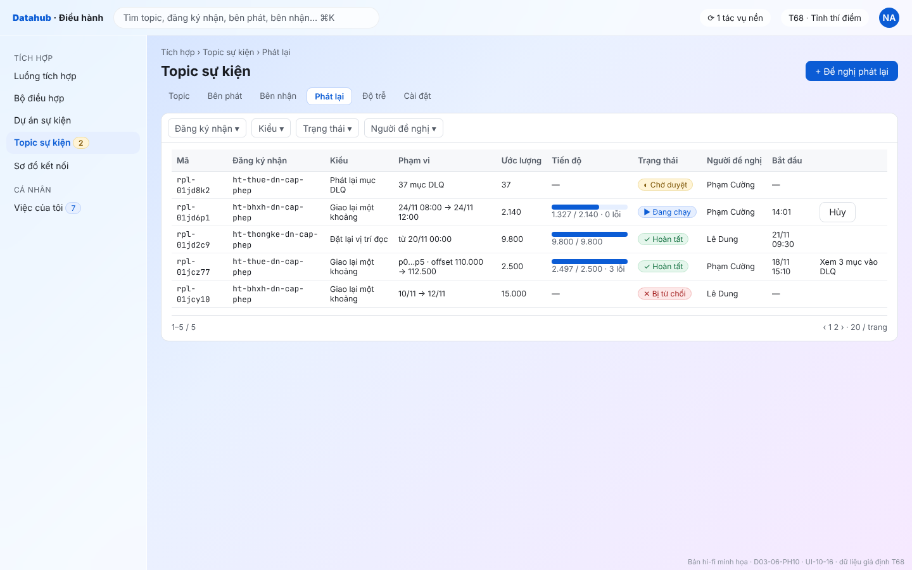

Danh sách lượt phát lại đủ ba kiểu và các trạng thái chờ duyệt, đang chạy (thanh tiến độ, nút Hủy), hoàn tất có lỗi (liên kết xem mục vào DLQ), bị từ chối.

## 23. UI-10-17 Theo dõi độ trễ tiêu thụ

::: dac-ta
**Mục đích.** Cho người vận hành một bảng mọi đăng ký nhận theo `alertState`, xu hướng và người đã xác nhận cảnh báo, để biết đăng ký nhận nào cần xử lý trước.

**Tác nhân, quyền.** TO (FRS §3.1), TA; xem `PERM-10-read`; xác nhận `PERM-10-operate`.

**FR, UC.** FR-10-054, 055; UC-10-20.

**Truy vết hệ cũ.** Mới, không có ở hệ cũ.

**Đường dẫn, mẫu.** `/tich-hop/topic/do-tre` (`muc`, `che-do`, `du-an`); PTN-11.

**API.** API-10-046 (lọc `alertState`), API-10-055, API-10-056.

**Điều hướng vào.** Tab phụ "Độ trễ"; số theo mức ở khối Độ trễ của UI-10-01; thông báo cảnh báo lag (EVT-10-10).

**Thành phần chính.** Lọc nhanh theo mức, bảng mật độ gọn có sparkline, hàng mở rộng theo phân vùng.

**Hành động.** Xác nhận cảnh báo, mở UI-10-12, bật hoặc tắt tự làm mới.

**Trạng thái.** Rỗng khi mọi đăng ký nhận bình thường; bộ thu lag ngừng (mục 5.4); dòng đổi mức nhấp nền một lần.

**Thông báo.** "Mọi đăng ký nhận đang bình thường."; "Đã xác nhận, tắt nhắc 4 giờ"; "Số liệu độ trễ đã cũ {n} phút."

**Đợt, mức chi tiết.** MVP; đầy đủ.
:::

```text
┌ Topic sự kiện › Độ trễ ──────────────────────────────── Cập nhật 14:02:01 [⟳] [Tự làm mới ●] ┐
│ (Ngừng tiến 1)(Nghiêm trọng 1)(Cảnh báo 4)(Bình thường 58)   Dự án [▾] Chế độ [▾]            │
├────────────────────────┬──────────────────┬─────────┬────────┬────────┬──────────┬────────────┤
│ Đăng ký nhận           │ Topic            │ Mức     │ Độ trễ │ Tồn    │ Còn lại  │ Xác nhận   │
│ ht-bhxh-dn-cap-phep    │ t68.dkkd…v1      │⏸ Ngừng t│ 41 ph  │ 9.802  │ 6 ng 23 g│ [Xác nhận] │
│ ht-thue-dn-cap-phep    │ t68.dkkd…v1      │⚠ Cảnh b.│12 ph 30│ 4.210  │ 6 ng 23 g│ Bình 13:55 │
└────────────────────────┴──────────────────┴─────────┴────────┴────────┴──────────┴────────────┘
```

| Thành phần | `CMP-*` | Ghi chú |
|---|---|---|
| Lọc nhanh theo mức | `CMP-FilterChips` | Ghi `muc`; mặc định bật mọi mức khác `OK` |
| Bảng | `CMP-DataTable` mật độ gọn | Cột: subscription, topic, bên nhận, `deliveryMode`, `alertState`, `lagSeconds`, `lagRecords`, thời gian còn lại, sparkline 1 giờ (`CMP-Chart` nhỏ), người và thời điểm xác nhận; sắp xếp mặc định mức nặng trước rồi `lagSeconds` giảm |
| Xác nhận | `CMP-ReasonDialog` ghi chú tùy chọn | API-10-056; ghi `alertAcknowledgedBy`, `alertAcknowledgedAt`, `alertAckNote`; dòng hiện "Đã xác nhận, tắt nhắc 4 giờ"; xác nhận không tắt việc đánh giá |
| Hàng mở rộng | `CMP-DataTable` lồng | Lag theo phân vùng (API-10-055) |

: UI-10-17 Theo dõi độ trễ tiêu thụ, thành phần

Trạng thái: rỗng khi mọi subscription `OK`: "Mọi đăng ký nhận đang bình thường." Bộ thu lag ngừng: `CMP-Banner` mục 5.4. Tự làm mới 30 giây, tắt được bằng `CMP-Switch`; khi một dòng đổi mức, dòng nhấp nền `color-warning-bg` một lần trong `motion-duration-slow` (tắt khi giảm chuyển động) và vùng `aria-live` đọc "ht-bhxh-dn-cap-phep chuyển mức Ngừng tiến". Phím: `A` xác nhận dòng đang chọn, `Enter` mở UI-10-12.

### 23.1. Bản hi-fi

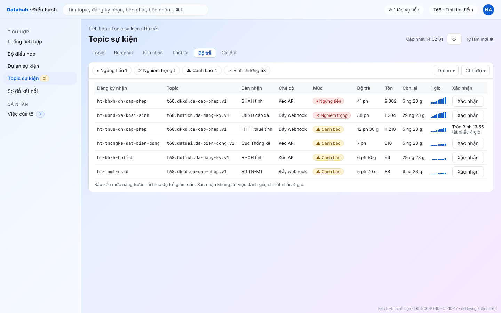

Bảng mật độ gọn sắp mức nặng trước: Ngừng tiến có biểu tượng ⏸ khác Nghiêm trọng ✕, mỗi dòng có sparkline 1 giờ; dòng đã xác nhận hiện người, giờ và "tắt nhắc 4 giờ" thay cho nút.

## 24. UI-10-18 Cài đặt sự kiện

::: dac-ta
**Mục đích.** Quản trị danh mục kiểu giao tiếp, chế độ định tuyến, hạn mức tenant và tham số `10.*`.

**Tác nhân, quyền.** TA, PA (FRS §3.1); xem `PERM-10-read`; sửa `PERM-10-admin`; trần hạn mức, tham số phạm vi N và `10.external-kafka.enabled` chỉ PA.

**FR, UC.** FR-10-060, 061, 062, 063; UC-10-22.

**Truy vết hệ cũ.** LGC-HUB-014 (danh mục `type_of_comm`, `routing_mode`).

**Đường dẫn, mẫu.** `/tich-hop/topic/cai-dat` và tab con `/kieu-giao-tiep`, `/dinh-tuyen`, `/han-muc`, `/tham-so`; PTN-12.

**API.** API-10-067, API-10-105 (sửa kiểu giao tiếp); API-10-068, API-10-106 (sửa chế độ định tuyến); API-10-069, API-10-107 (`PUT /quota`); API-10-070, API-10-108 (`PATCH /settings`).

**Điều hướng vào.** Tab phụ "Cài đặt"; liên kết của ERR-10-011 tới tab Hạn mức; khối Hạn mức ở UI-10-01.

**Thành phần chính.** Bốn tab theo bảng dưới.

**Hành động.** Bật, tắt mục danh mục; sửa trần và phân bổ hạn mức; sửa tham số kèm lý do; Lưu, Hủy.

**Trạng thái.** Chỉ đọc khi thiếu `PERM-10-admin` (ST-15); hỏi khi đổi tab còn thay đổi chưa lưu.

**Thông báo.** ERR-10-043 "Không tắt được mục đang có {n} bên tham gia hoặc topic dùng."; ERR-10-012 tại ô; "Thay đổi áp dụng cho đối tượng tạo mới; ngưỡng lag mặc định áp dụng ngay."

**Đợt, mức chi tiết.** MVP; đầy đủ.
:::

| Tab | Nội dung | Thành phần | Ghi chú |
|---|---|---|---|
| Kiểu giao tiếp `/kieu-giao-tiep` | Bảng `commTypeCode`, `name`, `direction`, `allowedPartyTypes`, `deliveryMode`, `legacyCode` (cột "Mã hệ cũ"), công tắc `enabled` | `CMP-DataTable`, `CMP-Switch` | Tắt mục đang dùng: ERR-10-043, công tắc trả về và Toast nêu số bên đang dùng; không thêm mã ở tenant |
| Chế độ định tuyến `/dinh-tuyen` | `routingModeCode`, `name`, `ordering`, `legacyCode`, `enabled` | Như trên | `KEY_HASH` công tắc khóa bật kèm tooltip "Không tắt được chế độ mặc định" |
| Hạn mức `/han-muc` | Mỗi trường `TenantEventQuota`: trần (PA sửa), đã dùng, `CMP-ProgressBar`; `ceilingSetBy`; phân bổ cho principal | `CMP-DescriptionList`, `CMP-ProgressBar`, `CMP-NumberInput` | ≥ 80% sắc thái cảnh báo kèm chữ; TA chỉ xem trần |
| Tham số `/tham-so` | Bảng tham số A.5: khóa, giá trị, mặc định, miền, phạm vi (N, T, T*), ý nghĩa | `CMP-DataTable` có ô sửa `CMP-NumberInput`, `CMP-Switch`, `CMP-Select` theo kiểu | Sửa mở `CMP-ReasonDialog` lý do; ngoài miền ERR-10-012 tại ô; tham số N chỉ PA; nhóm theo tiền tố (`topic`, `schema`, `push`, `pull`, `lag`, `dlq`, `replay`, `quota`, `migration`) |

: UI-10-18 Cài đặt sự kiện, các tab

Mỗi tab là biểu mẫu riêng có thanh lưu dính đáy theo PTN-12; đổi tab khi có thay đổi chưa lưu thì hỏi. Câu chú dưới bảng tham số: "Thay đổi áp dụng cho đối tượng tạo mới; ngưỡng lag mặc định áp dụng ngay." (FR-10-063).

### 24.1. Bản hi-fi

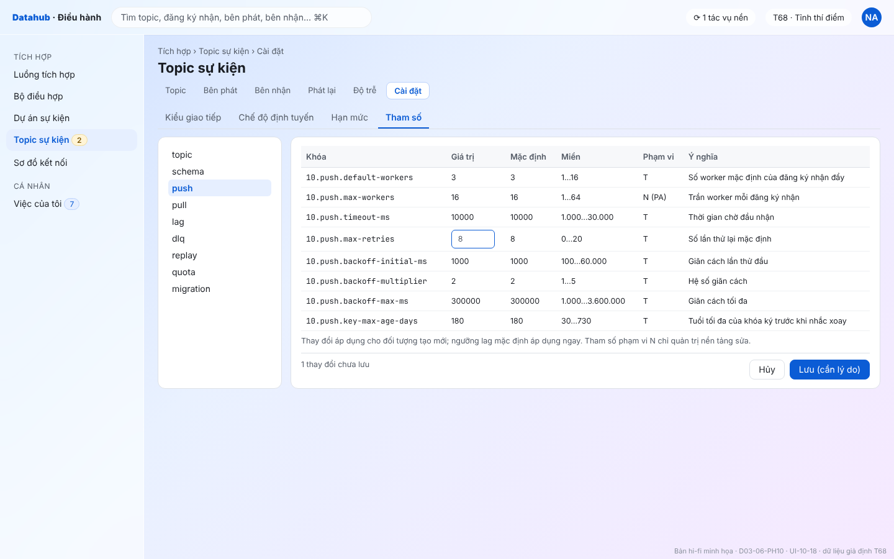

Tab Tham số nhóm `push`: cột giá trị, mặc định, miền, phạm vi (T là tenant, N chỉ PA); một ô đang sửa viền xanh và thanh lưu dính đáy báo "1 thay đổi chưa lưu", lưu cần lý do.

## 25. UI-10-19 Nhập khai báo

::: dac-ta
**Mục đích.** Nhập tệp `EventManifest` có xem trước khác biệt, để dựng lại khai báo sự kiện từ bản xuất của dự án hoặc tenant khác mà vẫn qua duyệt.

**Tác nhân, quyền.** IE, TA (FRS §3.1); `PERM-10-create`.

**FR, UC.** FR-10-071; UC-10-28.

**Truy vết hệ cũ.** Mới, không có ở hệ cũ.

**Đường dẫn, mẫu.** `/tich-hop/du-an/nhap` (`?tac-vu={jobCode}`); PTN-09.

**API.** API-10-075 (`POST /imports`), API-10-110 (`GET /imports/{jobCode}`), API-10-111 (`:apply`), API-10-121 (`:cancel`).

**Điều hướng vào.** Tab phụ "Nhập khai báo" (hiện với `PERM-10-create`).

**Thành phần chính.** Ba bước PTN-09: tải tệp, xem trước khác biệt, xác nhận áp dụng.

**Hành động.** Tải tệp, bật viết lại tiền tố tenant, lọc theo `changeKind`, Áp dụng, Hủy tác vụ.

**Trạng thái.** `VALIDATING`, `PREVIEW`, `APPLYING`, `APPLIED`, `FAILED`, `CANCELLED`; dải "Chức năng Đợt sau".

**Thông báo.** ERR-10-040 "Tệp sai cấu trúc hoặc phiên bản định dạng."; ERR-10-050; "Mọi topic, quyền phát, đăng ký nhận được tạo ở trạng thái đầu và vẫn qua duyệt."

**Đợt, mức chi tiết.** Đợt sau (FR-10-071 mức C); rút gọn.
:::

Ba bước theo PTN-09: (1) tải tệp bằng `CMP-FileDropzone` (YAML, tùy chọn `rewriteTenantPrefix` bằng `CMP-Switch` "Viết lại tiền tố tenant theo tenant đích"), tác vụ `sourceKind = EVENT_MANIFEST` ở `VALIDATING` với `CMP-JobProgress`; (2) xem trước: `CMP-DataTable` mỗi dòng một đối tượng với `changeKind` (`CREATE`, `UPDATE`, `UNCHANGED`, `CONFLICT`, `SKIP`) tô theo token khác biệt kèm chữ, bộ lọc theo `changeKind`, `CMP-DiffViewer` cho dòng `UPDATE`, lỗi tham chiếu ERR-10-050 và lỗi cấu trúc ERR-10-040 ở `validationErrors`; (3) xác nhận áp dụng (`APPLYING` sang `APPLIED`) với câu "Mọi topic, quyền phát, đăng ký nhận được tạo ở trạng thái đầu và vẫn qua duyệt." (BR-10-032). Hủy được ở `VALIDATING`, `PREVIEW`. Màn hiện `CMP-Banner` thông tin "Chức năng Đợt sau" cho tới khi bật.

### 25.1. Bản hi-fi

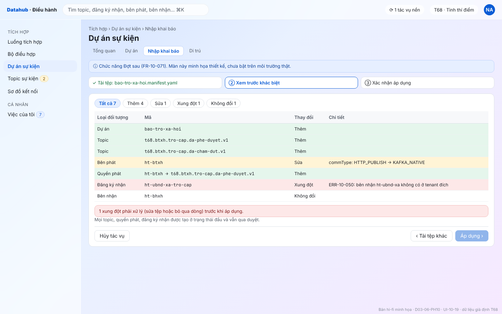

Bước xem trước khác biệt: mỗi dòng một đối tượng tô theo `changeKind` kèm chữ (Thêm, Sửa, Xung đột, Không đổi); dòng xung đột nêu ERR-10-050 và nút Áp dụng vô hiệu tới khi xử lý. Dải đầu trang nói rõ đây là chức năng Đợt sau.

## 26. UI-10-20 Di trú từ Pulsar

::: dac-ta
**Mục đích.** Nhập kiểm kê Hub Pulsar, rà ánh xạ sang đối tượng Datahub, chạy cầu nối song song, đối chiếu, chuyển hẳn, quay lui và theo dõi tiến độ (ADR-073).

**Tác nhân, quyền.** TA, PA (FRS §3.1); `PERM-10-admin`; xem tiến độ `PERM-10-read` cho TA, PA; IA duyệt `BRIDGE`, `CUTOVER` ở UI-10-13.

**FR, UC.** FR-10-072…076; UC-10-26, UC-10-27.

**Truy vết hệ cũ.** Mới; nhập kiểm kê các đối tượng của LGC-HUB-007…014 để chuyển sang Datahub.

**Đường dẫn, mẫu.** `/tich-hop/du-an/di-tru` và tab con `/anh-xa`, `/cau-noi`, `/doi-chieu`, `/tien-do`; PTN-01.

**API.** API-10-075 (`sourceKind = PULSAR_HUB`), 110; API-10-076, 112; API-10-077, 113, 114, 115; API-10-078 (`:cut-over`), 116 (`:rollback`), 117 (đối chiếu), 118 (tiến độ).

**Điều hướng vào.** Tab phụ "Di trú"; nút "Nhập từ Hub cũ" ở trạng thái rỗng của UI-10-01, 02.

**Thành phần chính.** Bốn tab (26.1): Tiến độ, Ánh xạ, Cầu nối, Đối chiếu.

**Hành động.** Nhập kiểm kê, sửa ánh xạ, tạo, dừng, tiếp tục cầu nối, chuyển hẳn, quay lui, xuất Excel (26.2).

**Trạng thái.** Rỗng; cầu nối `ERROR` hoặc trễ vượt ngưỡng; chỉ xem tiến độ với `PERM-10-read`.

**Thông báo.** ERR-10-040, 041, 042, 050; "Chưa nhập kiểm kê Hub cũ. Tải mẫu tệp, xuất cấu hình Hub theo hướng dẫn rồi nhập."; quay lui ghi rõ "IA sẽ được thông báo".

**Đợt, mức chi tiết.** MVP (FR-10-073, 075 mức M; 072, 074, 076 theo FRS); đầy đủ.
:::

### 26.1. Tab

| Tab | Đoạn route | Nội dung | Thành phần |
|---|---|---|---|
| Tiến độ | `/tien-do` (mặc định) | Số ánh xạ theo `status` và `legacyType`, HTTT còn qua Pulsar, cầu nối đang chạy và lag, đối chiếu gần nhất, ngày dự kiến tắt Hub; xuất Excel | `CMP-KpiCard`, `CMP-ProgressBar`, `CMP-DataTable` |
| Ánh xạ | `/anh-xa` | Bảng `LegacyMapping`: `legacyType`, `legacyName`, `targetType`, `targetCode`, `confidence`, `issues`, `status`, `cutOverAt`, `rollbackUntil`; nút "Nhập kiểm kê" | `CMP-DataTable`, `CMP-EditableTable` cho cột đích, `CMP-FileDropzone` |
| Cầu nối | `/cau-noi` | `MigrationBridge`: `direction`, `pulsarTopic`, `kafkaTopic`, `status`, `bridgedCount`, `lagSeconds`, `expiresAt`; tạo, dừng, tiếp tục | `CMP-DataTable`, `CMP-Drawer` |
| Đối chiếu | `/doi-chieu` | Kết quả đối chiếu theo giờ: số bản tin Pulsar, Kafka, chênh lệch sau trừ lag, mẫu `id` thiếu | `CMP-DataTable`, `CMP-Chart` |

: UI-10-20 Di trú từ Pulsar, các tab

### 26.2. Hành vi chính

1. **Nhập kiểm kê.** Tệp nén theo mẫu tải về; tác vụ chạy nền, kết quả đổ vào tab Ánh xạ với `PROPOSED`; dòng `confidence = LOW` tô nhãn "Cần rà" và đứng đầu; ERR-10-040, 041, 050 hiện ở dòng.
2. **Rà ánh xạ.** Sửa đích trên dòng (mã dự án, tên topic theo quy ước, HTTT gắn), lưu bằng API-10-076; dòng đủ điều kiện chuyển `PLANNED`. Loại subscription Pulsar cũ hiện ở cột phụ cùng cấu hình đề xuất theo bảng 3.3.
3. **Tạo cầu nối.** Drawer: `pulsarTopic`, `kafkaTopic` (`CMP-TopicSelect` topic `ACTIVE`), `startFrom` (`LATEST` mặc định, `EARLIEST`), `pulsarSubscriptionName` (mặc định `dh-bridge`), `expiresAt` (≤ `10.migration.bridge-max-days`), `direction`; gửi tạo yêu cầu `BRIDGE`. ERR-10-042 khi đã có cầu nối hoặc ngược chiều.
4. **Chuyển hẳn.** Nút trên dòng ánh xạ `BRIDGING` mở `CMP-Modal` liệt kê ba điều kiện FR-10-075 (song song đủ `10.migration.min-parallel-days` ngày, subscriber cũ đã có subscription `ACTIVE` không cảnh báo, đối chiếu 72 giờ không chênh), mỗi điều kiện một `CMP-StatusTag`; đủ thì gửi yêu cầu `CUTOVER`.
5. **Quay lui.** Trong `10.migration.rollback-window-days`, nút màu cảnh báo mở `CMP-ReasonDialog` lý do bắt buộc, không qua duyệt, ghi rõ "IA sẽ được thông báo".

Cầu nối `ERROR` hoặc lag vượt `10.migration.bridge-max-lag-seconds` hiện `CMP-Alert` đầu tab Cầu nối. Rỗng: "Chưa nhập kiểm kê Hub cũ. Tải mẫu tệp, xuất cấu hình Hub theo hướng dẫn rồi nhập." kèm "Tải mẫu".

### 26.3. Bản hi-fi

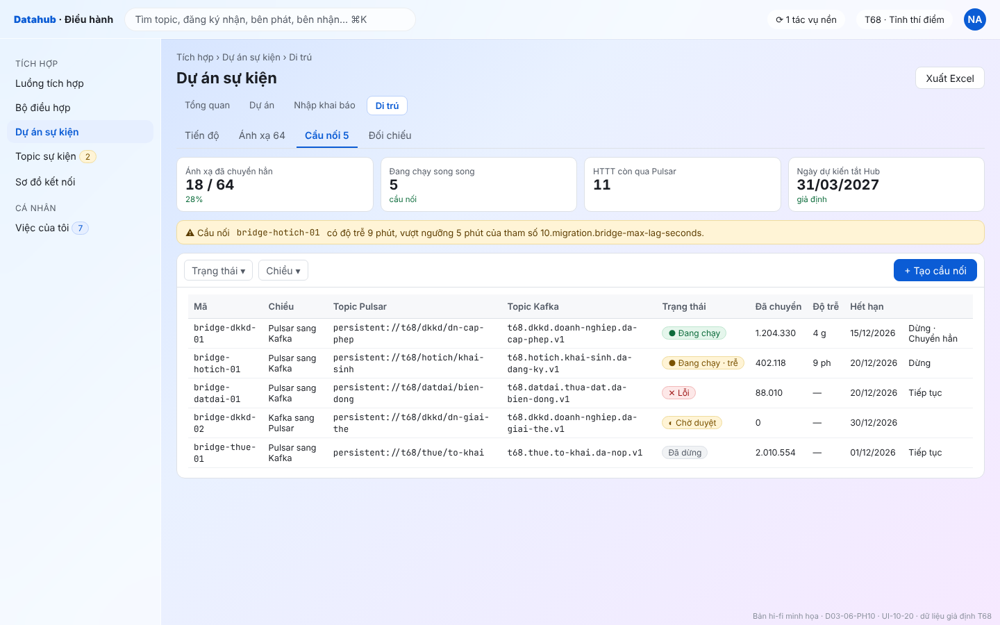

Tab Cầu nối: bốn thẻ tiến độ di trú, dải cảnh báo cầu nối trễ vượt ngưỡng, bảng cầu nối hai chiều với trạng thái đang chạy, lỗi, chờ duyệt, đã dừng và hành động Dừng, Tiếp tục, Chuyển hẳn theo trạng thái.

## 27. Luồng người dùng chính

### 27.1. Từ topic mới tới bên nhận đầu tiên nhận sự kiện

```{.mermaid caption="Trình tự từ tạo topic tới bên nhận đầu tiên nhận sự kiện"}
sequenceDiagram
  actor IE as Kỹ sư tích hợp
  actor IA as Người duyệt
  participant UI as dh-console
  participant API as dh-integration
  IE->>UI: UI-10-07 tạo topic, kiểm tra lược đồ
  UI->>API: API-10-009 rồi API-10-026, API-10-012
  IA->>UI: UI-10-13 duyệt TOPIC_CREATE
  UI->>API: API-10-059 approve
  API-->>UI: topic PROVISIONING rồi ACTIVE
  IE->>UI: UI-10-06 đề nghị quyền phát cho HT-DKKD
  IE->>UI: UI-10-11 đăng ký nhận PUSH cho HT-THUE, xác minh endpoint
  UI->>API: API-10-051 rồi API-10-047
  IA->>UI: UI-10-13 duyệt PUBLICATION, SUBSCRIPTION
  IE->>UI: UI-10-12 xem khóa ký một lần, gửi đơn vị chủ quản HT-THUE
```

Thuyết minh: một topic đi qua hai lần duyệt (topic, rồi từng quan hệ), mỗi lần do người khác người gửi; khóa ký chỉ hiện cho người đề nghị ngay khi subscription `ACTIVE`, nên UI-10-12 đặt dải "Khóa ký đã sẵn sàng" lên đầu trang.

### 27.2. Sự cố bên nhận và phát lại

```{.mermaid caption="Luồng xử lý sự cố bên nhận và phát lại"}
flowchart TB
  A["UI-10-01 thẻ Độ trễ: 1 Nghiêm trọng"] --> B["UI-10-17 lọc mức Nghiêm trọng"]
  B --> C["UI-10-12 tab Lượt lỗi: ERR-10-112"]
  C --> D["Tạm dừng, liên hệ HTTT nhận"]
  D --> E["Tiếp tục sau khắc phục"]
  E --> F["UI-10-15 chọn mục DLQ mới"]
  F --> G["UI-10-16 phát lại DLQ_ENTRIES, chờ duyệt"]
```

Thuyết minh: người vận hành đi từ tổng quan tới đúng subscription bằng liên kết đã lọc sẵn, không phải tìm tay; sơ đồ UI-10-14 lớp phủ Độ trễ là lối vào thứ hai khi cần thấy sự cố lan sang những bên nào.

### 27.3. Di trú một topic Pulsar

Theo UC của PH-10: nhập kiểm kê ở UI-10-20, rà ánh xạ, tạo topic đích qua UI-10-07 (hoặc từ ánh xạ), tạo cầu nối `PULSAR_TO_KAFKA` và chờ duyệt `BRIDGE`, đăng ký nhận cho bên nhận mới ở UI-10-11, theo dõi tab Đối chiếu, chuyển hẳn khi ba điều kiện đạt, quay lui nếu cần trong cửa sổ cho phép.

## 28. Mẫu truy cập và kiến trúc mã giao diện

| Mục | Quy ước |
|---|---|
| Thư mục | `apps/dh-console/src/features/event/` gồm `pages/` (một tệp mỗi UI), `components/` (khối dùng lại trong phân hệ: khối xác minh endpoint, lịch thử lại, bảng lượt lỗi), `api/` (hook TanStack Query sinh từ OpenAPI của D03-04-PH10), `url.ts`, `status.ts` (đăng ký nhãn mục 5.1) |
| Khóa truy vấn | `['event', tài nguyên, tham số]`, ví dụ `['event','subscription', code]`, `['event','graph', {projectCode, overlay}]` |
| Làm mới | `refetchInterval` 30 giây cho dashboard, sơ đồ, độ trễ; 5 giây cho đối tượng `PROVISIONING` và lượt phát lại `RUNNING`; dừng khi tab ẩn |
| Ghi | Mọi lệnh ghi gửi `Idempotency-Key` (UUID sinh khi mở hộp thao tác, giữ khi thử lại) và `If-Match` khi API có `ETag` |
| Bí mật | Mutation xoay khóa đặt `gcTime: 0`, đọc bí mật trong `onSuccess` vào `CMP-SecretField` rồi `reset()` (D03-05-03 §7.2) |
| Đồ thị | XYFlow qua `CMP-FlowCanvas`; bố cục ELK trong Web Worker `graphLayout.worker.ts`; vị trí người dùng kéo giữ trong `sessionStorage` theo khóa dự án |
| Quyền | `useAllowedActions(object)` đọc `allowedActions`; `usePermission('PERM-10-…')` chỉ để ẩn mục menu, tab |
| Chia gói | Mỗi trang tải lười; UI-10-14 và trình soạn lược đồ (Monaco) là gói riêng |

: Quy ước mã giao diện features/event

## 29. Ma trận màn hình theo vai trò

Ký hiệu: ● dùng đầy đủ theo quyền, ◐ chỉ xem hoặc một phần thao tác, ○ trong phạm vi tổ chức, trống là không vào.

| Màn | PA | PO | TA | TO | SO | IE | IA | SV | OR | VW | AU |
|---|---|---|---|---|---|---|---|---|---|---|---|
| UI-10-01 Tổng quan | ◐ | ◐ | ● | ● | ◐ | ● | ● | ◐ | ○ | ◐ | ◐ |
| UI-10-02 Danh sách dự án | ◐ | ◐ | ● | ◐ | ◐ | ● | ◐ | ○ | ○ | ◐ | ◐ |
| UI-10-03 Chi tiết dự án | ◐ | ◐ | ● | ◐ | ◐ | ● | ◐ | ○ | ○ | ◐ | ◐ |
| UI-10-04 Tạo, sửa dự án | | | ● | | | ● | | ○ | | | |
| UI-10-05 Danh sách topic | ◐ | ◐ | ● | ◐ | ◐ | ● | ◐ | ○ | ○ | ◐ | ◐ |
| UI-10-06 Chi tiết topic | ◐ | ◐ | ● | ◐ | ◐ | ● | ◐ | ○ | ○ | ◐ | ◐ |
| UI-10-07 Tạo topic | | | ● | | | ● | | ○ | | | |
| UI-10-08 Lược đồ | ◐ | ◐ | ● | ◐ | ◐ | ● | ◐ | ○ | ◐ | ◐ | ◐ |
| UI-10-09 Bên phát | ◐ | ◐ | ● | ● | ● | ● | ◐ | ○ | ○ | ◐ | ◐ |
| UI-10-10 Bên nhận | ◐ | ◐ | ● | ● | ● | ● | ◐ | ○ | ○ | ◐ | ◐ |
| UI-10-11 Đăng ký nhận | | | ● | | | ● | | | ○ | | |
| UI-10-12 Chi tiết subscription | ◐ | ◐ | ● | ● | ◐ | ● | ◐ | ◐ | ○ | ◐ | ◐ |
| UI-10-13 Duyệt | | | ● | | | ◐ | ● | | | | |
| UI-10-14 Sơ đồ | ◐ | ◐ | ● | ● | ◐ | ● | ◐ | ◐ | ○ | ◐ | ◐ |
| UI-10-15 DLQ | ◐ | ◐ | ● | ● | ◐ | ◐ | ◐ | ◐ | ○ | ◐ | ◐ |
| UI-10-16 Phát lại | ◐ | ◐ | ● | ● | ◐ | ◐ | ● | ◐ | ○ | ◐ | ◐ |
| UI-10-17 Độ trễ | ◐ | ◐ | ● | ● | ◐ | ◐ | ◐ | ◐ | ○ | ◐ | ◐ |
| UI-10-18 Cài đặt | ● | ◐ | ● | ◐ | ◐ | ◐ | ◐ | ◐ | | ◐ | ◐ |
| UI-10-19 Nhập khai báo | | | ● | | | ● | | ○ | | | |
| UI-10-20 Di trú | ● | | ● | | | | | | | | |

: Ma trận 20 màn theo 11 vai trò

Ma trận suy từ FRS §3.2: IE có `PERM-10-subscribe` nên dùng UI-10-11 (đề nghị đồng bộ D02-08 ở FRS §3.3); IA duyệt phát lại ở UI-10-13 và xem UI-10-16; SO dùng UI-10-09, 10, 12 cho tạm ngừng khi sự cố. IE vào UI-10-13 chỉ để xem, rút yêu cầu của mình.

## 30. Truy vết FR sang màn

| FR | Màn | FR | Màn |
|---|---|---|---|
| FR-10-001, 003, 005 | UI-10-02, 04 | FR-10-035, 036, 040 | UI-10-11 |
| FR-10-002, 004 | UI-10-03, 04 | FR-10-037 | UI-10-13, 12 |
| FR-10-006 | UI-10-05 | FR-10-038, 039 | UI-10-11 (cấu hình), UI-10-12 (thống kê, lượt lỗi) |
| FR-10-007, 010, 024 | UI-10-06 | FR-10-041, 042, 046, 047 | UI-10-12 |
| FR-10-008 | UI-10-07, 03 (Drawer) | FR-10-043, 044, 045 | UI-10-11 bước 3, UI-10-06 tab Cách kết nối |
| FR-10-009, 019, 031, 051, 073 | UI-10-13 | FR-10-048 | Đợt sau, chưa có màn |
| FR-10-011, 012, 013, 021 | UI-10-06 Drawer 12.5, UI-10-13 | FR-10-049, 050, 053 | UI-10-15 |
| FR-10-014, 015, 016 | UI-10-06, 07 | FR-10-052 | UI-10-16 |
| FR-10-017, 018, 020, 022 | UI-10-08 | FR-10-054, 055 | UI-10-17, 12 |
| FR-10-023 | UI-10-09 (tuân thủ) | FR-10-056 | UI-10-12 |
| FR-10-025, 026, 028, 029 | UI-10-09, 10 | FR-10-057, 062 | UI-10-01, 18 |
| FR-10-027 | UI-10-10 | FR-10-058 | UI-10-14, 03 |
| FR-10-030, 032 | UI-10-06, 09 | FR-10-060, 061, 063 | UI-10-18 |
| FR-10-033, 034 | UI-10-06 tab Cách kết nối | FR-10-064…069 | Không có màn (máy với máy, đa tenant); kết quả hiện ở UI-10-05 (topic `CDC`, `SYSTEM`) |
| FR-10-070 | UI-10-02, 03 | FR-10-071 | UI-10-19 |
| FR-10-072…076 | UI-10-20 | FR-10-059 | PH-13 |

: Truy vết FR-10 sang màn UI-10

## 31. Kiểm thử giao diện và bản hi-fi

### 31.1. Ca kiểm thử giao diện gợi ý cho D05-02-PH10

| Nhóm | Nội dung kiểm |
|---|---|
| Quyền | Mỗi vai trò ở ma trận mục 29 thấy đúng nút; nút vô hiệu có lý do; route trực tiếp thiếu quyền ra ST-07 |
| Bốn mắt | Người gửi mở UI-10-13 thấy nút duyệt vô hiệu kèm câu ERR-10-008; người khác duyệt được |
| Trường | Mọi ràng buộc ở bảng trường (mẫu mã, độ dài, miền tham số, từ dành riêng, điều kiện bắt buộc theo chế độ) kiểm cả biên dưới, biên trên, ngay ngoài biên |
| Đăng ký nhận | Bốn chế độ với bốn loại bên nhận; `PULL_KAFKA` khi tenant chưa bật; xác minh đạt, không đạt, hết hiệu lực, đổi URL; lịch thử lại đúng công thức |
| Khóa ký | Hiện một lần; đóng hộp rồi không xem lại được; không có trong bộ đệm, URL, nhật ký trình duyệt |
| Sơ đồ | 20.19; 300 nút; vượt trần; bốn lớp phủ; bàn phím; chế độ danh sách khớp đồ thị |
| Trạng thái | ST-01…ST-15 trên mỗi màn, gồm PH-13 không khả dụng, Apicurio không khả dụng, bộ thu lag ngừng |
| Truy cập | axe-core không lỗi nghiêm trọng; trình đọc màn hình NVDA đọc đúng nút sơ đồ, thẻ số; phóng 200% không mất chức năng; `forced-colors` |
| Responsive | 1366 × 768 và 1280 × 720 (sidebar thu gọn) không cuộn ngang toàn trang; dưới `bp-lg` sơ đồ chuyển danh sách |

: Ca kiểm thử giao diện gợi ý cho D05-02-PH10

### 31.2. Bản hi-fi cần dựng

Bản 0.3 đã có ảnh hi-fi tĩnh cho cả 20 màn (mục "Bản hi-fi" của từng màn, bộ sinh ở `ph10/hifi/`). Bản Figma dưới đây vẫn cần để có chủ đề tối và mọi trạng thái.

Bản hi-fi trên Figma theo thư viện D03-05, sáng và tối, ở 1366 × 768: UI-10-01, UI-10-06 (tab Tổng quan, Đăng ký nhận), UI-10-11 (bước 2, bước 3 chế độ Đẩy với khối xác minh đạt và không đạt, bước 3 Kéo API), UI-10-12 (Tổng quan với cảnh báo, `SUSPENDED` do ngắt mạch, hộp khóa ký), UI-10-14 (bốn lớp phủ, Drawer nút, chế độ danh sách, trạng thái quá nhiều nút), UI-10-13 (yêu cầu `SUBSCRIPTION`). Mỗi khung ghi tên token, không ghi mã màu.

## Phụ lục A. Đề nghị bổ sung cho D03-05

| # | Đề nghị | Lý do | Tạm dùng |
|---|---|---|---|
| A1 | Token độ mờ cho nội dung không được làm nổi trên canvas (ví dụ một token ngữ nghĩa nhóm `opacity`) khác `opacity-disabled` | Làm nổi đường đi ở UI-10-14 và DependencyGraph cần mờ nút không liên quan mà không mang nghĩa "vô hiệu" cho trình đọc và người dùng | `opacity-disabled` cho nút, `color-text-disabled` cho nhãn |
| A2 | Biến thể `readonly` của `CMP-FlowCanvas` có chế độ "lớp" (cột tiêu đề lớp dính mép, bố cục ELK phân lớp) | Sơ đồ ba lớp bên phát, topic, bên nhận; PH-02 (hệ thống đăng ký API) cũng có thể dùng | Ghép tiêu đề lớp bằng `CMP-Text` trong `CMP-FlowCanvas` |
| A3 | Kiểu cạnh theo trạng thái (liền, chấm, đứt) và độ dày theo mức lưu lượng là thuộc tính chuẩn của cạnh trong `CMP-FlowCanvas` | Cùng quy ước cho lớp phủ số liệu chạy thật của PH-04 và lớp phủ PH-10 | Định nghĩa cục bộ trong `features/event` |
| A4 | Thành phần "khối kết quả kiểm tra theo bước" (danh sách bước có trạng thái, chi tiết, hướng dẫn khắc phục, nút sao chép) | Dùng ở xác minh endpoint PH-10, kiểm tra kết nối PH-05 (UI-05-04), xác minh lược đồ | `CMP-Card` chứa danh sách `CMP-StatusTag` |
| A5 | Thành phần "xem trước lịch thử lại" (chuỗi thời lượng và biểu đồ cột nhỏ từ ba tham số giãn cách) | Dùng ở PH-10 (webhook), PH-04 (Retry trong luồng), PH-05 | `CMP-Chart` cột nhỏ cộng `CMP-Duration` |
| A6 | Biến thể `CMP-ResourceSelect` cho bên phát, bên nhận PH-10 (hiện loại, kiểu giao tiếp, trạng thái) | Hiện chỉ có `CMP-TopicSelect` cho PH-10 | `CMP-ResourceSelect` chung |

: Phụ lục A. Đề nghị bổ sung cho D03-05

## Phụ lục B. Đề nghị bổ sung API (cho D03-04-PH10)

Đã xử lý ở FRS bản 0.3 (D02-03-PH10 §14) theo cách D03-04-PH10 §10.3 nhận: tên chốt là `signingKeyPending` (thay `signingSecretPending`), `metricsCollectedAt` (thay `stats.collectedAt`), dashboard không có cờ `available` (chỉ `traffic` rỗng khi PH-13 lỗi), không có trạng thái worker riêng (tab Worker dùng API-10-055, 052), miễn xác minh làm sau khi tạo qua API-10-091.

| # | API | Đề nghị | Màn |
|---|---|---|---|
| B1 | Mọi `GET` chi tiết | Trả `allowedActions` theo quyền, trạng thái, bốn mắt | Mọi màn chi tiết |
| B2 | API-10-066 | Chia phản hồi thành khối `counts`, `traffic`, `lag`, `dlq`, `pendingApprovals`, `attention`, `quota` theo bảy ý (a)…(g) FR-10-057; mỗi khối có `available` để giao diện ẩn khối khi nguồn ngoài lỗi | UI-10-01 |
| B3 | API-10-007 | Trả `nodes[].dlqNewCount`, `nodes[].partyType`, `edges[].alertState`, `edges[].dlqNewCount`, `edges[].commType`; thêm `stats.collectedAt` để hiện số liệu cũ | UI-10-14 |
| B4 | API-10-015 | Chế độ kiểm tra trước (`dryRun`) trả danh sách subscription bị ảnh hưởng khi giảm lưu giữ và cảnh báo thứ tự trước khi gửi | UI-10-06 Drawer 12.5 |
| B5 | API-10-046 | Tham số lọc `alertState`, `deliveryMode`, `subscriberCode`, `topicName`, `projectCode`; sắp xếp theo `lagSeconds` | UI-10-17, UI-10-06, 10 |
| B6 | API-10-048 | Trả trạng thái worker (phân vùng đang giữ, offset, lần giao cuối) và cờ `signingSecretPending` cho người đề nghị | UI-10-12 tab Worker, dải khóa ký |
| B7 | API-10-054 hoặc hành động mới | Cách lấy khóa ký đầu tiên một lần sau khi duyệt (FR-10-037 bước 6 chưa có đường dẫn) | UI-10-12 |
| B8 | API-10-064 | Chế độ chạy thử trả `estimatedRecords`, thời gian chạy và khoảng còn dữ liệu trước khi tạo | UI-10-16 |
| B9 | API-10-047, 091 | Cách đề nghị miễn xác minh trong lúc tạo subscription, hoặc xác nhận rằng miễn chỉ làm sau khi tạo | UI-10-11, 12 |
| B10 | API-10-051 | `steps[]` có mã bước cố định, `detail` hướng dẫn tiếng Việt và `validUntil` | UI-10-11 |

: Phụ lục B. Đề nghị bổ sung API (cho D03-04-PH10)

## Phụ lục C. Đề nghị bổ sung cho FRS

Đã xử lý ở FRS bản 0.3 (§14): C1 vào A.6; C2, C3, C5 vào bảng tham số FR-10-035; C4 vào quy ước đầu §5 (10…500 ký tự); C6 chấp nhận, mặc định `BLOCK` cho topic `orderingRequired` và đóng Q10-15. Phụ lục A được chép sang FRS §12.4 cho D03-05.

| # | Mục FRS | Đề nghị |
|---|---|---|
| C1 | A.6 | Ghi đoạn tab con của trang chi tiết (`/cau-hinh`, `/quyen-phat`, `/dang-ky-nhan-ds`, `/ket-noi`, `/chuyen-doi`, `/lich-su` cho topic; `/giao-nhan`, `/do-tre`, `/luot-loi`, `/worker`, `/khoa-ky`, `/cau-hinh`, `/phat-lai`, `/lich-su` cho subscription; `/topic`, `/ben-tham-gia`, `/so-do`, `/lich-su` cho dự án; `/anh-xa`, `/cau-noi`, `/doi-chieu`, `/tien-do` cho di trú) và tham số query của sơ đồ (`du-an`, `topic`, `httt`, `lop-phu`, `ca-ngung`, `che-do`) |
| C2 | FR-10-035 | Ràng buộc từng trường `push.retryBackoff.initialMs`, `multiplier`, `maxMs` (đề nghị lấy miền `10.push.backoff-*`, `maxMs` ≥ `initialMs`) và `lagWarnSeconds` < `lagCriticalSeconds` |
| C3 | FR-10-035 | Độ dài và định dạng `legalBasis` (đề nghị 10…1.000 ký tự, có thể kèm số hiệu văn bản) |
| C4 | Chung | Độ dài `reason` cho lưu trữ dự án, tạm ngừng, thu hồi, ngừng topic, loại bỏ DLQ (giao diện đang dùng 10…500 như FR-10-051) |
| C5 | FR-10-035, A.3 | Ghi `quotaBytesPerSecond` vào bảng tham số đề nghị subscription (A.3 có trường, FR-10-035 chưa liệt kê) |
| C6 | FR-10-039, Q10-15 | Chốt việc chọn sẵn `failurePolicy = BLOCK` khi topic `orderingRequired` |

: Phụ lục C. Đề nghị bổ sung cho FRS

## Phụ lục D. Đề nghị đồng bộ cho tập khác (bản 0.3)

| # | Tập | Đề nghị |
|---|---|---|
| D1 | D02-03-PH10 FRS, D02-04-PH10 UC, D05-02-PH10 TC | Dùng câu mới của ERR-10-053 ("Phiên đăng nhập đã hết hạn hoặc không hợp lệ. Đăng nhập lại để tiếp tục.") và ERR-10-054 ("Bạn không có quyền thực hiện thao tác này. Liên hệ quản trị tenant nếu cần được cấp quyền.") ở mục 5.3 |
| D2 | D02-03-PH10 FRS, D05-02-PH10 TC | Lỗi data plane ERR-10-101…121 không có câu trên `dh-console`; nơi người vận hành thấy từng mã ghi ở bảng thứ hai của mục 5.3 |
| D3 | D02-03-PH10 FRS | Ảnh giao diện tiêu biểu dẫn `../../03-thiet-ke/uiux/ph10/hifi/ui-10-01.png` và `ui-10-06.png` (tên tệp cố định) |
| D4 | D03-04-PH10 API | Khối đặc tả các màn dẫn các hành động tách theo FRS §8.3 bản 0.3 (API-10-092…121); bảng 18.2 đổi thu hồi khóa khẩn sang API-10-100, dải 18.5 đổi rút yêu cầu sang API-10-102 |
| D5 | D02-03-PH10 FRS | Miền `event` là miền dành riêng (FR-10-008), nên ảnh hi-fi chỉ dùng `t68.event.*.v1` cho topic hệ thống của PH-10 (A.7); topic nghiệp vụ giữ quy ước `t68.{miền}.{thực thể}.{sự kiện}.v1` như wireframe |

: Đề nghị đồng bộ cho FRS, UC, API, TC phát sinh ở bản 0.3

## Câu hỏi mở

> **Câu hỏi mở Q10-30:** Sơ đồ "Toàn tenant" khi tenant vượt `10.graph.max-nodes` có nên gợi ý gom nút theo dự án (`CMP-GroupNode` thu gọn) thay vì báo lỗi? Đề xuất: Đợt sau, MVP giữ ERR-10-049 kèm lối thu hẹp.

> **Câu hỏi mở Q10-31:** Miễn xác minh endpoint (API-10-091) cho HTTT cũ làm ở bước nào: trong trình hướng dẫn đăng ký nhận hay chỉ sau khi đã tạo subscription? Tài liệu này chọn sau khi tạo. **Đã trả lời:** D03-04-PH10 §10.3 B9 và FRS 0.3 xác nhận miễn chỉ làm sau khi tạo (API-10-091).

> **Câu hỏi mở Q10-32:** Vị trí nút do người dùng kéo trên sơ đồ có cần lưu bền theo người dùng hoặc theo dự án (chia sẻ cho cả nhóm) không? MVP chỉ giữ trong phiên.

> **Câu hỏi mở Q10-33:** Lớp phủ Lưu lượng dùng tứ phân vị của sơ đồ đang xem, nên cùng một cạnh có độ dày khác nhau khi đổi bộ lọc. Có cần thang tuyệt đối cố định cho tenant (ví dụ theo `expectedRatePerMinute`) không?

> **Câu hỏi mở Q10-34:** Người đề nghị subscription không còn ở đơn vị (nghỉ, chuyển công tác) trước khi xem khóa ký đầu: ai được xem? Đề xuất: người có `PERM-10-subscribe` trên bên nhận đó xoay khóa để lấy khóa mới.

> **Câu hỏi mở Q10-35:** Màn DLQ của PH-10 (UI-10-15) và màn xử lý lỗi chung của PH-18 có trùng chức năng; khi PH-18 sẵn sàng, UI-10-15 có giữ thao tác loại bỏ, phát lại hay chỉ còn xem và liên kết sang PH-18?

> **Câu hỏi mở Q10-36:** Ước lượng "Từ dữ liệu cũ nhất" ở UI-10-11 bước 4 tính phía giao diện từ số liệu 24 giờ; có cần API trả ước lượng chính xác theo offset đầu, cuối từng phân vùng?

> **Câu hỏi mở Q10-37:** Mẫu mã kết nối (Java, .NET, Python, Node.js, PHP) ở tab Cách kết nối và UI-10-11 do PH-10 giữ hay do cổng nhà phát triển PH-15 giữ và PH-10 nhúng?

> **Câu hỏi mở Q10-38:** OR có được thấy sơ đồ đầy đủ của dự án với nút ngoài tổ chức là "Đối tượng hạn chế", hay chỉ thấy lân cận các HTTT của tổ chức mình (lọc `systemCode` bắt buộc)?

> **Câu hỏi mở Q10-39:** Xuất PNG, SVG sơ đồ có cần dấu nước "Tài liệu nội bộ" và tên người xuất theo quy chế ATTT của tỉnh không?

## Lịch sử phiên bản

| Phiên bản | Ngày | Nội dung |
|---|---|---|
| 0.1 | 2026-11-26 | Bản đầu: 20 màn UI-10-01…20, sơ đồ kết nối siêu chi tiết, đăng ký nhận và chi tiết subscription rất chi tiết, ánh xạ màn Hub cũ, đề nghị bổ sung D03-05, API, FRS, câu hỏi mở Q10-30…39 |
| 0.2 | 2026-11-26 | Theo FRS 0.3 và D03-04-PH10 0.2: Phụ lục B, C đã xử lý; `legalBasis` 10…1.000 ký tự; `signingKeyPending`, `metricsCollectedAt` theo tên API; Q10-31 đã trả lời (miễn xác minh sau khi tạo) |
| 0.3 | 2026-11-26 | Chuẩn kết hợp theo K-MH và K-TRINH-BAY: giới thiệu đủ mục (phạm vi, người đọc, thuật ngữ, cấu trúc) và danh sách màn có cột UC; khối đặc tả 12 mục đầu cả 20 màn; bảng thông báo đủ ERR-10-053, 054 và nơi hiển thị lỗi data plane 101…121; đồng bộ số API tách theo FRS 0.3; ảnh hi-fi 20 màn ở `ph10/hifi/`; Phụ lục D đề nghị đồng bộ. Giữ nguyên wireframe, bảng thành phần, trạng thái, bàn phím của bản 0.2 |
