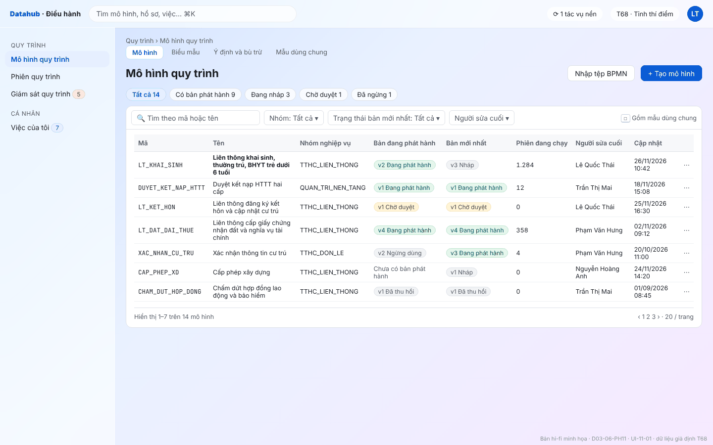
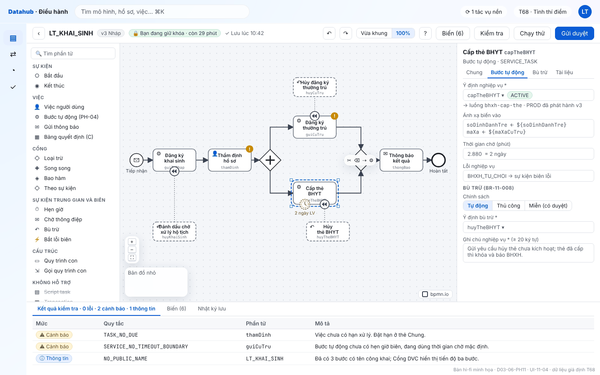
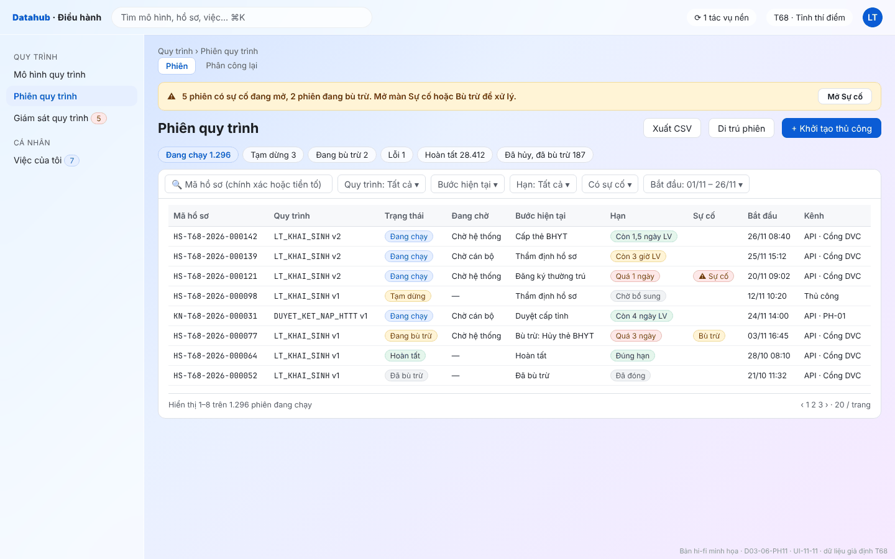
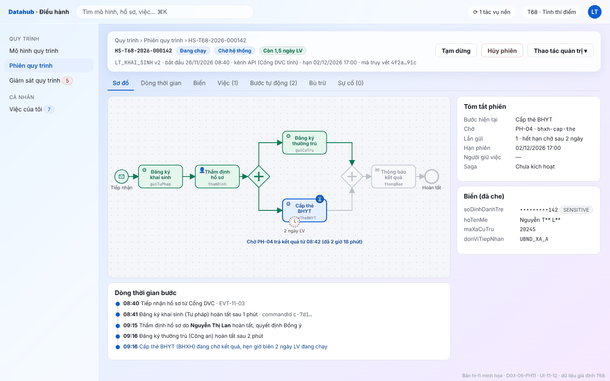
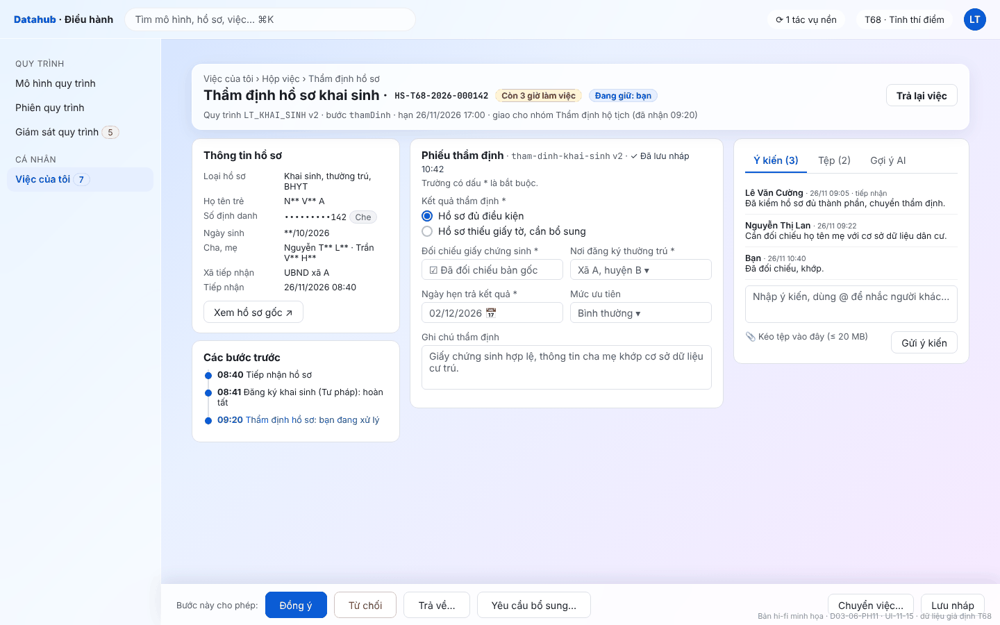
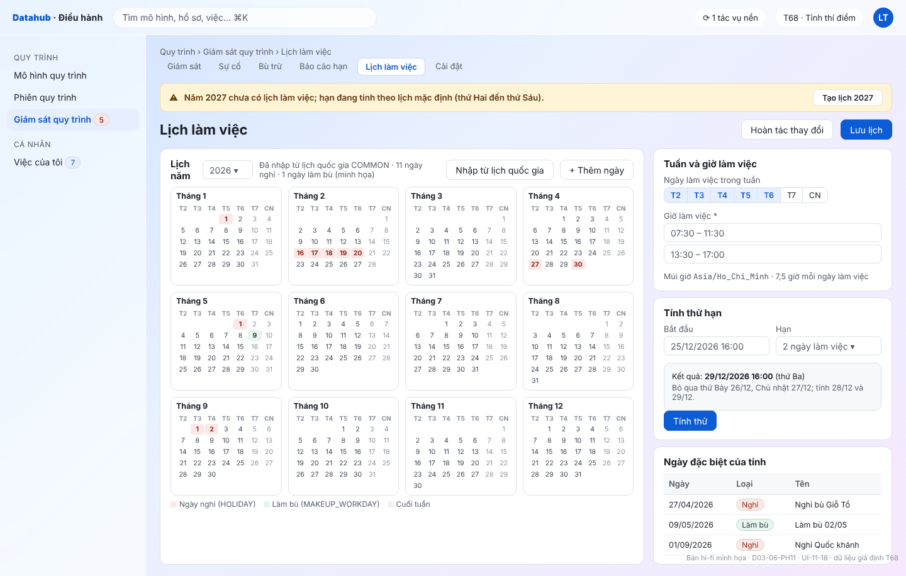
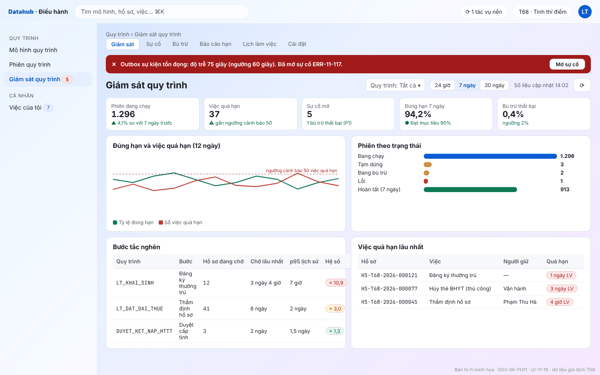
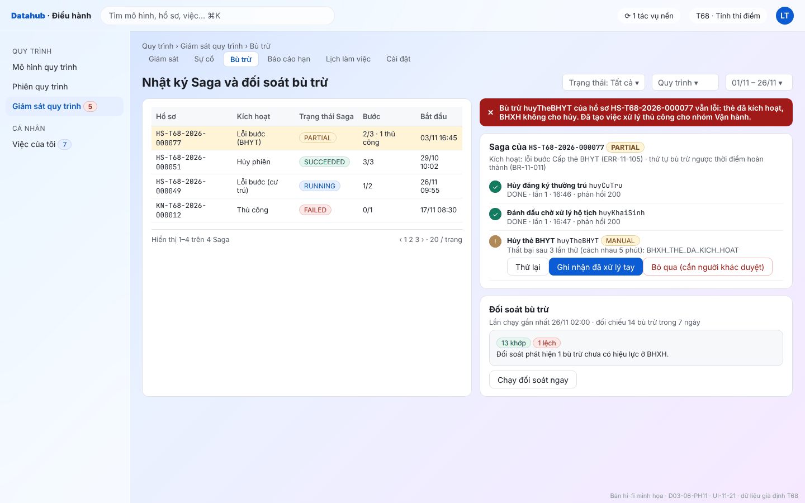

# D03-06-PH11 · Thiết kế giao diện màn hình Quy trình liên thông

Tập màn **không tự đặt** token, `CMP-*` hay `PTN-*`: mọi tên có trong D03-05-02, 03, 04 và D03-06-00; thành phần hoặc token còn thiếu ghi ở Phụ lục A. Enum, trường, mã lỗi, quyền, route lấy đúng các mục 3, 9, 10 và Phụ lục A của [D02-03-PH11](../../02-yeu-cau/frs/D02-03-PH11-frs-quy-trinh.md); chỗ FRS chưa có ghi ở Phụ lục C.

## Tóm tắt cho hội đồng thẩm định

PH-11 điều phối các quy trình nghiệp vụ liên cơ quan, ví dụ liên thông "Đăng ký khai sinh, đăng ký thường trú, cấp thẻ BHYT cho trẻ dưới 6 tuổi" (`LT_KHAI_SINH`). Quy trình được vẽ bằng BPMN 2.0, chạy trên engine Flowable nhúng, giao việc cho cán bộ và gọi hệ thống thông tin (HTTT) khác qua PH-04. Hệ cũ (Viettel 2021) không có chức năng này; bản mockup `bpm.html` của repo mới có sáu màn. Tập này đặc tả 23 màn (UI-11-01…23) trên `dh-console` theo bảy nhóm: mô hình (01 đến 07), tài nguyên quy trình (08 đến 10), phiên (11 đến 14), việc của cán bộ (15 đến 17), lịch và hạn (18, 22), giám sát và sự cố (19 đến 21), cài đặt (23).

Năm quyết định giao diện chính:

1. **Trình thiết kế BPMN (UI-11-04) cho người nghiệp vụ vẽ quy trình mà không viết mã và không thể lưu một sơ đồ sai.** Bảng phần tử chỉ chứa phần tử được hỗ trợ (script task bị khóa kèm lý do), bảng thuộc tính đổi theo loại bước, kiểm tra tĩnh tô viền phần tử lỗi sau mỗi lần lưu, mọi thao tác kéo thả có cách làm bằng bàn phím. Logo bpmn.io luôn hiện ở góc phải dưới theo giấy phép (ADR 111).
2. **Màn xử lý việc (UI-11-15) tối ưu cho cán bộ làm hàng trăm hồ sơ mỗi ngày.** Hồ sơ đã che dữ liệu cá nhân, biểu mẫu sinh từ JSON Schema và tự lưu nháp, ý kiến và tệp bên phải, nút quyết định cố định ở chân; "Từ chối", "Trả về", "Yêu cầu bổ sung" buộc nêu lý do từ 20 ký tự.
3. **Mọi thay đổi có hệ quả rộng đều qua bốn mắt và có xem trước.** Phát hành mô hình (UI-11-07), sửa biến, chuyển bước, di trú phiên (UI-11-12, 14), bỏ qua bước bù trừ (UI-11-21): nút duyệt bị vô hiệu kèm lý do cho người đề nghị (ERR-11-005).
4. **Phiên và Saga bù trừ đọc được ngay trên sơ đồ.** Chi tiết phiên (UI-11-12) phủ trạng thái lên chính sơ đồ BPMN (bước xong, đang chờ, chưa tới); nhật ký Saga (UI-11-21) cho thấy bước bù trừ nào đã xong, bước nào chờ xử lý thủ công và nút thử lại, ghi nhận, bỏ qua.
5. **Hạn xử lý tính theo ngày làm việc và nói bằng chữ.** Nhãn "Còn 3 giờ làm việc", "Quá 1 ngày", "Tạm dừng hạn (chờ bổ sung)" luôn kèm chữ; lịch làm việc có "Tính thử hạn" (UI-11-18).

Kính Liquid Glass chỉ dùng cho lớp điều hướng và lớp nổi (thanh trên, sidebar, thanh quyết định, bảng điều khiển nổi trên khung vẽ); khung vẽ, bảng, biểu mẫu, bảng thuộc tính là nền đặc để đạt WCAG 2.2 AA (ADR-020). Ảnh hi-fi tám màn chính (UI-11-01, 04, 11, 12, 15, 18, 19, 21) nằm ở `ph11/hifi/`; dữ liệu trên ảnh là giả định của tỉnh thí điểm T68, số định danh luôn che.

## 1. Mục đích, phạm vi và tài liệu liên quan

Chương này nêu tài liệu đặc tả gì, cho ai, dựa trên tài liệu nào, rồi liệt kê 23 màn của PH-11 trước khi vào chi tiết.

### 1.1. Mục đích

Tài liệu cho kỹ sư giao diện đủ chi tiết để dựng 23 màn của PH-11 mà không phải hỏi lại: vùng bố cục, thành phần `CMP-*`, trường, hành động gắn API-11 và quyền, trạng thái, câu thông báo theo mã `ERR-11` và bàn phím. Trình thiết kế BPMN và màn xử lý việc được mô tả tới từng vùng và phím tắt vì người dùng làm việc ở đó nhiều giờ mỗi ngày.

### 1.2. Phạm vi

Trong phạm vi: 23 màn của FRS §10.1. Ngoài phạm vi: hộp việc chung `/viec-cua-toi` (FR-00-070…072, D03-06-00 §4.13), trang tra tiến độ của Cổng DVC tỉnh (API-11-104, không có màn trong `dh-console`), cấu hình luồng PH-04 (D03-06-PH04) và bảng điều khiển chung PH-13.

### 1.3. Tài liệu liên quan

Tập này bám D02-03-PH11 FRS (FR-11-001…066, mã lỗi §9.1, §9.2, API §9.4, danh sách màn §10, enum, tham số `11.*`), D03-06-00 (khung bố cục, mẫu `PTN-01…14`, route, trạng thái `ST-*`), D03-05-02, 03, 04 (token, thành phần `CMP-*`, nhóm canvas §11), D03-06-PH04 (mẫu trình thiết kế UI-04-04 mà UI-11-04 kế thừa), D03-04-PH11 (API-11-001…127, viết song song) và D02-08 (vai trò, `PERM-11-*`).

### 1.4. Thuật ngữ và viết tắt

Thuật ngữ nghiệp vụ đầy đủ ở FRS §1.4; bảng dưới chỉ nêu các thuật ngữ xuất hiện nhiều trong tập này.

| Thuật ngữ | Nghĩa |
|---|---|
| bpmn-js (bpmn.io) | Thư viện mã nguồn mở vẽ và sửa sơ đồ BPMN 2.0 trên trình duyệt; giấy phép yêu cầu hiển thị logo bpmn.io |
| Mô hình, phiên bản | `process_model` có nhiều `process_version`: `DRAFT`, `IN_REVIEW`, `PUBLISHED`, `DEPRECATED`, `RETIRED` |
| Phiên (instance) | Một lần chạy quy trình cho một hồ sơ, khóa nghiệp vụ `businessKey` là mã hồ sơ |
| Ý định (intent) | Tên nghiệp vụ của bước tự động; PH-04 ánh xạ sang luồng kỹ thuật |
| Saga, bù trừ | Chuỗi hành động hoàn tác nghiệp vụ khi bước lỗi hoặc phiên bị hủy |
| Bốn mắt | Người duyệt khác người đề nghị và người sửa cuối (ADR-046) |
| Ngày làm việc (LV) | Ngày tính hạn theo lịch tenant, giờ `Asia/Ho_Chi_Minh` (ADR 114) |
| CB, TA, TO, IE, IA, AU, VW, PA, PO | Cán bộ xử lý, Quản trị tỉnh, Vận hành tỉnh, Kỹ sư tích hợp, Người duyệt tích hợp, Kiểm toán, Người xem, Quản trị nền tảng, Vận hành nền tảng |

: Thuật ngữ và viết tắt dùng trong tập màn PH-11

### 1.5. Danh sách màn hình

Bảng dưới là 23 màn theo FRS §10.1 kèm mẫu bố cục, FR và quyền vào; UI-11-04 và UI-11-15 được viết siêu chi tiết (lưới bố cục, giải phẫu từng vùng, mọi trạng thái, chuột và bàn phím), UI-11-12 rất chi tiết.

| Mã | Tên | PTN | FR | Quyền vào |
|---|---|---|---|---|
| UI-11-01 | Danh sách mô hình quy trình | PTN-01 | 001 | `PERM-11-read` |
| UI-11-02 | Tạo mô hình (trống, từ mẫu, nhập tệp) | PTN-04, PTN-09 | 002, 010 | `PERM-11-model` |
| UI-11-03 | Chi tiết mô hình | PTN-02 | 006, 007, 009, 010 | `PERM-11-read` |
| UI-11-04 | **Trình thiết kế BPMN** | PTN-07 | 003, 004, 005, 014, 016, 017, 019 | `PERM-11-model` (xem: `read`) |
| UI-11-05 | So sánh hai phiên bản | PTN-02 | 006 | `PERM-11-read` |
| UI-11-06 | Chạy thử mô hình | PTN-07 | 011 | `PERM-11-model` |
| UI-11-07 | Duyệt phát hành mô hình | PTN-10 | 008 | `PERM-11-publish` |
| UI-11-08 | Biểu mẫu việc người dùng | PTN-01, PTN-03 | 012 | `PERM-11-read`; sửa `model` |
| UI-11-09 | Ý định nghiệp vụ và bù trừ | PTN-01, PTN-04 | 013, 014 | `PERM-11-read`; sửa `model` |
| UI-11-10 | Mẫu quy trình dùng chung | PTN-01 | 015 | `PERM-11-read`; sửa `model` |
| UI-11-11 | Danh sách phiên quy trình | PTN-01 | 021 | `PERM-11-read` |
| UI-11-12 | Chi tiết phiên | PTN-02 | 022 đến 031, 033, 046, 049, 051, 057 | `PERM-11-read` |
| UI-11-13 | Khởi tạo phiên thủ công | PTN-04 | 020 | `PERM-11-instance` |
| UI-11-14 | Di trú phiên sang phiên bản mới | PTN-05 | 026 | `PERM-11-instance-admin` |
| UI-11-15 | **Xử lý việc** | PTN-10 | 034 đến 040, 043, 044, 066 | `PERM-11-task` |
| UI-11-16 | Phân công lại hàng loạt | PTN-01 | 042 | `PERM-11-task-admin` |
| UI-11-17 | Ủy quyền vắng mặt của tôi | PTN-04 | 041 | `PERM-11-task` |
| UI-11-18 | Lịch làm việc | PTN-12 | 045, 046 | `PERM-11-read`; sửa `config` |
| UI-11-19 | Giám sát quy trình | PTN-06 | 048, 058, 059 | `PERM-11-read` |
| UI-11-20 | Sự cố engine và việc lỗi | PTN-11 | 029, 060 | `PERM-11-read`; xử lý `compensate` |
| UI-11-21 | Nhật ký Saga và đối soát bù trừ | PTN-11 | 051 đến 054 | `PERM-11-read`; xử lý `compensate` |
| UI-11-22 | Báo cáo hạn xử lý | PTN-06 | 050 | `PERM-11-read` |
| UI-11-23 | Cài đặt phân hệ | PTN-12 | 061 đến 065 | `PERM-11-read`; sửa `config`; kiểm toán `audit-read` |

: Danh sách 23 màn hình PH-11

### 1.6. Người đọc

Kỹ sư giao diện đọc chương 4 đến 6 rồi chương màn tương ứng; UI-11-04 (chương 10) và UI-11-15 (chương 21) đọc hết. Thiết kế UX/UI đọc chương 2, 5 và các wireframe. Kiểm thử viên đọc bảng hành động, trạng thái, thông báo. Hội đồng thẩm định đọc phần tóm tắt, chương 3 và hai ảnh hi-fi UI-11-04, UI-11-15.

### 1.7. Cấu trúc tài liệu

Chương 2 đến 6 nêu nguyên tắc, màn hệ cũ, điều hướng, quy ước hiển thị và trạng thái chung. Chương 7 đến 29 đặc tả UI-11-01 đến UI-11-23 (UI-11-nn ở chương 6 + nn). Chương 30 nêu mẫu truy cập, kiến trúc mã và luồng; chương 31 là kiểm thử và hi-fi. Ba phụ lục đề nghị bổ sung cho D03-05, API và FRS; cuối tài liệu là câu hỏi mở và lịch sử phiên bản.

## 2. Nguyên tắc thiết kế áp dụng cho PH-11

PH-11 phục vụ kỹ sư vẽ mô hình, cán bộ xử lý hồ sơ và vận hành theo dõi phiên; nguyên tắc dưới đây bổ sung cho các nguyên tắc chung của D03-05.

### 2.1. Bản đồ vật liệu

Bảng dưới cho biết mỗi vùng dùng kính mờ hay nền đặc, và lý do.

| Vùng | Thành phần | Vật liệu | Lý do |
|---|---|---|---|
| Thanh trên, sidebar | `CMP-AppShell`, `CMP-Topbar`, `CMP-Sidebar` | `glass-chrome` | Lớp điều hướng |
| Khung vẽ, bảng phần tử, bảng thuộc tính, ngăn dưới | `BpmnCanvas` (Phụ lục A), `CMP-NodePalette`, `CMP-Inspector`, `CMP-BottomPanel` | Đặc `color-surface-solid-2` (khung vẽ), `color-surface-solid` | Hình, đường nối, chữ nhỏ cần tương phản ổn định; vùng kéo thả không có `backdrop-filter` (D03-05-04 §11.0) |
| Bảng thu phóng, bản đồ nhỏ, thanh ngữ cảnh | `CMP-CanvasControls`, `CMP-Minimap` | `glass-overlay` | Điều khiển nổi trên canvas |
| Bảng, hồ sơ, biểu mẫu, dòng thời gian, thẻ chỉ số | `CMP-DataTable`, `CMP-DescriptionList`, `CMP-DynamicForm`, `CMP-Timeline`, `CMP-KpiCard` | Đặc `color-surface-solid` | Nội dung dày, số liệu phải đọc chắc |
| Thanh quyết định UI-11-15, UI-11-07 | `CMP-DecisionPanel`, `CMP-ApprovalPanel` | `glass-overlay`, nút và ô nhập đặc | Lớp nổi luôn thấy khi cuộn |

: Bản đồ vật liệu Liquid Glass theo vùng màn PH-11

Khi người dùng bật giảm trong suốt, lớp kính chuyển `glass-lite-tint` hoặc `glass-off-tint`. Một màn có tối đa bốn lớp `backdrop-filter` (D03-05-01 §3.2); trình thiết kế dùng hai (sidebar, thanh trên) cộng bảng thu phóng và bản đồ nhỏ.

### 2.2. Ngôn ngữ, dữ liệu cá nhân và bốn mắt

Nhãn dùng tiếng Việt nghiệp vụ ("bước tự động", "việc", "hồ sơ", "bù trừ"); `processKey`, `elementId`, `commandId` chỉ hiện dạng chữ đơn cách (`CMP-CodeText`) ở vùng của kỹ sư và vận hành. Giá trị biến `SENSITIVE` luôn hiện bằng `CMP-MaskedValue`; nút "Hiện" chỉ có khi có `PERM-09-unmask`, buộc nêu lý do và ghi kiểm toán (FR-11-022, BR-11-014). Không đặt `businessKey`, giá trị biến hoặc số định danh lên URL. Người đề nghị thấy nút duyệt bị vô hiệu kèm dòng "Anh/chị là người đề nghị hoặc đã xử lý bước trước nên không được duyệt bước này" (ERR-11-005). Lý do bắt buộc có độ dài tối thiểu 10, 20 hoặc 30 ký tự, đếm ngay dưới ô nhập (ERR-11-007 máy chủ kiểm lại).

### 2.3. Màu không phải kênh duy nhất

Mọi trạng thái có nhãn chữ kèm biểu tượng ngoài màu (WCAG 1.4.1): phần tử lỗi trên khung vẽ có viền đỏ, huy hiệu "!" và dòng ở ngăn kết quả; ở UI-11-12 phần tử đã chạy, đang chờ, chưa tới khác nhau bằng viền, biểu tượng (✓, đồng hồ cát) và chú giải chữ.

## 3. Màn hệ cũ được giữ lại thành gì

Hệ cũ (Viettel 2021) không có BPM nên không có màn `LGC` nào của PH-11; căn cứ duy nhất là sáu màn mockup `bpm.html` trong `docs/07-srs/SRS-PH-11-bpm.md` §6.

### 3.1. Màn mockup cũ và màn mới

Bảng dưới đối chiếu từng màn cũ với màn mới.

| Màn cũ (SRS repo) | Màn mới | Quyết định |
|---|---|---|
| UI-11-01 Danh sách định nghĩa và phiên bản BPMN | UI-11-01, UI-11-03 | Tách đôi: danh sách mô hình và chi tiết có tab Phiên bản |
| UI-11-02 Đăng ký ánh xạ service task và bù trừ | UI-11-09, UI-11-04 (tab Bù trừ) | Thiết kế lại: bù trừ gắn từng bước trong trình thiết kế |
| UI-11-03 Danh sách user task | Hộp việc chung `/viec-cua-toi` | Chuyển cho mẫu dùng chung; PH-11 chỉ là nguồn việc (API-11-125) |
| UI-11-04 Chi tiết task và form hoàn thành | UI-11-15 | Giữ ý, thêm hồ sơ che, tự lưu nháp, ý kiến, tệp, trả về, gợi ý AI |
| UI-11-05 Sơ đồ tiến độ instance | UI-11-12 tab Sơ đồ | Giữ, phủ trạng thái lên sơ đồ |
| UI-11-06 Giám sát tắc nghẽn và nhật ký Saga | UI-11-19, 20, 21 | Tách ba |

: Ánh xạ sáu màn mockup cũ sang màn mới

### 3.2. Màn mới và hệ cũ liên quan gián tiếp

Các màn 02, 05, 06, 07, 08, 10, 11, 13, 14, 16, 17, 18, 22, 23 là năng lực mới, không có tiền thân trong mockup. LGC-NGSP-002 (hộ tịch), LGC-NGSP-004 (cấp mã ĐVQHNS) là nguồn nghiệp vụ cho quy trình mẫu; LGC-BUS-037 (xử lý lỗi, thực hiện lại) là tiền thân gián tiếp của UI-11-20, UI-11-21.

## 4. Điều hướng

PH-11 chiếm hai mục menu có sẵn của D03-06-00 §2.3.2: mục 30 "Mô hình quy trình" (`/quy-trinh/mo-hinh`) và mục 31 "Phiên quy trình" (`/quy-trinh/phien`), và đề nghị thêm mục 31a "Giám sát quy trình" (`/quy-trinh/giam-sat`) cho vận hành và người xem (A-9). Màn con vào từ hàng tab phụ; việc của cán bộ hiện trong hộp chung `/viec-cua-toi`.

### 4.1. Sơ đồ điều hướng

Sơ đồ dưới cho thấy từ ba mục menu và hộp việc, người dùng đi tới 23 màn PH-11 theo những đường nào.

```{.mermaid caption="Sơ đồ điều hướng từ menu Quy trình và hộp Việc của tôi tới 23 màn PH-11"}
flowchart TB
  M1["Menu Mô hình quy trình"] --> U01["UI-11-01 Danh sách mô hình"]
  U01 --> U02["UI-11-02 Tạo mô hình"]
  U01 --> U03["UI-11-03 Chi tiết mô hình"]
  U02 --> U04["UI-11-04 Trình thiết kế BPMN"]
  U03 --> U04
  U03 --> U05["UI-11-05 So sánh phiên bản"]
  U04 --> U06["UI-11-06 Chạy thử"]
  U04 --> U05
  M1 --> T1["Tab Biểu mẫu, Ý định, Mẫu"]
  T1 --> U08["UI-11-08 Biểu mẫu"]
  T1 --> U09["UI-11-09 Ý định và bù trừ"]
  T1 --> U10["UI-11-10 Mẫu dùng chung"]
  M2["Menu Phiên quy trình"] --> U11["UI-11-11 Danh sách phiên"]
  U11 --> U12["UI-11-12 Chi tiết phiên"]
  U11 --> U13["UI-11-13 Khởi tạo thủ công"]
  U11 --> U14["UI-11-14 Di trú phiên"]
  M2 --> U16["UI-11-16 Phân công lại"]
  M3["Menu Giám sát quy trình"] --> U19["UI-11-19 Giám sát"]
  U19 --> U20["UI-11-20 Sự cố engine"]
  U19 --> U21["UI-11-21 Saga và đối soát"]
  U20 --> U12
  U21 --> U12
  M3 --> U22["UI-11-22 Báo cáo hạn"]
  M3 --> U18["UI-11-18 Lịch làm việc"]
  M3 --> U23["UI-11-23 Cài đặt"]
  H["Hộp Việc của tôi"] --> U15["UI-11-15 Xử lý việc"]
  H --> U07["UI-11-07 Duyệt phát hành"]
  H --> U17["UI-11-17 Ủy quyền"]
  U15 --> U12
```

Sơ đồ cho thấy ba luồng chính: kỹ sư đi từ danh sách mô hình tới trình thiết kế rồi gửi duyệt (UI-11-07), cán bộ đi từ hộp việc tới UI-11-15, vận hành đi từ giám sát xuống sự cố hoặc Saga rồi mở chi tiết phiên.

### 4.2. Bảng đường dẫn React Router

Route lấy đúng FRS §10.1; tab con và query là quy ước của tài liệu này theo D03-06-00 §2.4 (đề nghị đưa vào FRS ở Phụ lục C). `{ma}` là `processKey` (ví dụ `LT_KHAI_SINH`) hoặc mã nội bộ của phiên.

| Route | Màn | Tab con, query |
|---|---|---|
| `/quy-trinh/mo-hinh` | UI-11-01 | `q`, `nhom`, `trang-thai`, `nguoi-sua`, `trang`, `sap-xep` |
| `/quy-trinh/mo-hinh/moi` | UI-11-02 | `che-do` (`trong`, `mau`, `nhap`), `mau=` |
| `/quy-trinh/mo-hinh/{ma}` | UI-11-03 | `/tong-quan`, `/phien-ban`, `/phien`, `/lich-su`; `chon=` |
| `/quy-trinh/mo-hinh/{ma}/thiet-ke` | UI-11-04 | `phien-ban=` (mặc định bản nháp mới nhất), `phan-tu=`, `ngan=` (`kiem-tra`, `bien`, `nhat-ky`), `che-do` (`ve`, `xml`) |
| `/quy-trinh/mo-hinh/{ma}/so-sanh` | UI-11-05 | `tu=`, `den=`, `kieu` (`so-do`, `thuoc-tinh`, `xml`) |
| `/quy-trinh/mo-hinh/{ma}/chay-thu` | UI-11-06 | `phien-ban=`, `chon=` (lần chạy) |
| `/viec-cua-toi/{ma-viec}` (loại `PUBLISH_REVIEW`) | UI-11-07 | `?tab=` (`khac-biet`, `kiem-tra`) |
| `/quy-trinh/bieu-mau` | UI-11-08 | `q`, `trang-thai`, `chon=`; `/{formKey}` trình dựng |
| `/quy-trinh/y-dinh` | UI-11-09 | `/y-dinh`, `/bu-tru`; `moi-truong`, `chon=` |
| `/quy-trinh/mau` | UI-11-10 | `trang-thai`, `chon=` |
| `/quy-trinh/phien` | UI-11-11 | `q`, `quy-trinh`, `trang-thai`, `cho`, `buoc`, `han`, `su-co`, `tu`, `den` |
| `/quy-trinh/phien/{ma}` | UI-11-12 | `/so-do`, `/dong-thoi-gian`, `/bien`, `/viec`, `/buoc-tu-dong`, `/bu-tru`, `/su-co`; `phan-tu=` |
| `/quy-trinh/phien/moi` | UI-11-13 | `quy-trinh=` |
| `/quy-trinh/phien/di-tru` | UI-11-14 | `buoc=` (1 đến 4), `ke-hoach=` |
| `/viec-cua-toi/{ma-viec}` (loại khác) | UI-11-15 | `?tab=` (`y-kien`, `tep`, `goi-y-ai`) |
| `/quy-trinh/phan-cong` | UI-11-16 | `nguoi-giu`, `nhom`, `quy-trinh`, `buoc`, `han` |
| `/viec-cua-toi/uy-quyen` | UI-11-17 | `trang-thai` |
| `/quy-trinh/lich-lam-viec` | UI-11-18 | `nam=` |
| `/quy-trinh/giam-sat` | UI-11-19 | `khoang`, `quy-trinh` |
| `/quy-trinh/su-co` | UI-11-20 | `loai`, `trang-thai`, `quy-trinh`, `tu`, `den` |
| `/quy-trinh/bu-tru` | UI-11-21 | `trang-thai`, `quy-trinh`, `tu`, `den`; `/doi-soat` |
| `/quy-trinh/bao-cao-han` | UI-11-22 | `tu`, `den`, `nhom-theo`, `doi-tuong` |
| `/quy-trinh/cai-dat` | UI-11-23 | `/tham-so`, `/canh-bao`, `/luu-giu`, `/tuan-thu`, `/nhat-ky` |

: Route, tab con và query của 23 màn

Hai route `/viec-cua-toi/{ma-viec}` dùng chung đường dẫn: giao diện đọc `taskKind`, `PUBLISH_REVIEW` mở UI-11-07, loại khác mở UI-11-15 (FR-11-037); trong hộp việc chung, việc chọn hiện ở khung chi tiết qua `?chon=` và nút "Mở toàn trang" dẫn tới route trên (Q11-31).

### 4.3. Menu và phân quyền hiển thị

Menu hiển thị theo quyền hiệu lực (D03-06-00 §2.6): mục ẩn khi thiếu quyền, route gõ trực tiếp hiện trang 403 (`ST-07`). Bảng dưới là tab phụ theo vai trò.

| Mục menu | Tab phụ | Hiện cho | Điều kiện |
|---|---|---|---|
| Mô hình quy trình (30) | Mô hình, Biểu mẫu, Ý định và bù trừ, Mẫu dùng chung | IE, IA, TA, TO, AU, VW | `PERM-11-read`; tạo, sửa cần `PERM-11-model` |
| Phiên quy trình (31) | Phiên; Phân công lại | TA, TO, AU, VW; CB chỉ thấy phiên có việc của mình (BR-11-031) | `PERM-11-read`; "Phân công lại" cần `PERM-11-task-admin` |
| Giám sát quy trình (31a, đề nghị) | Giám sát, Sự cố, Bù trừ, Báo cáo hạn, Lịch làm việc, Cài đặt | TO, TA, VW, AU, PO (Sự cố) | `PERM-11-read`; Cài đặt cần `PERM-11-config` hoặc `audit-read` |
| Việc của tôi | Hộp việc; nút "Ủy quyền" | Mọi người dùng có `PERM-11-task` | UI-11-17 |

: Menu, tab phụ và điều kiện hiển thị của PH-11

PA chỉ thấy mẫu dùng chung (`COMMON`) và tham số trần; PO chỉ thấy tab Sự cố, không thấy biến phiên (FRS §3.2).

## 5. Quy ước hiển thị dùng chung

Mục này gom nhãn trạng thái, nhãn enum và bảng đổi mã lỗi `ERR-11` sang câu hiển thị để mọi màn dùng đúng một cách nói.

### 5.1. Nhãn trạng thái

Mỗi trạng thái dùng `CMP-StatusTag` hoặc `CMP-StatusDot` kèm chữ. Bảng dưới gom các enum hiển thị nhiều nhất; mức màu theo token `color-success`, `color-warning`, `color-error`, `color-info`, `color-text-secondary`.

| Enum | Giá trị | Nhãn hiển thị | Mức |
|---|---|---|---|
| `VersionStatus` | `DRAFT`, `IN_REVIEW`, `PUBLISHED`, `DEPRECATED`, `RETIRED` | Nháp · Chờ duyệt · Đang phát hành · Ngừng dùng · Đã thu hồi | trung tính · cảnh báo · thành công · trung tính · trung tính |
| `InstanceStatus` | `RUNNING`, `SUSPENDED`, `COMPENSATING`, `COMPLETED`, `CANCELLED`, `COMPENSATED`, `FAILED` | Đang chạy · Tạm dừng · Đang bù trừ · Hoàn tất · Đã hủy · Đã bù trừ · Lỗi | thông tin · cảnh báo · cảnh báo · thành công · trung tính · trung tính · lỗi |
| `TaskStatus` | `UNASSIGNED`, `ASSIGNED`, `DELEGATED`, `COMPLETED`, `CANCELLED` | Chưa nhận · Đã nhận · Đang ủy quyền · Đã xử lý · Đã hủy | thông tin · thông tin · cảnh báo · thành công · trung tính |
| `DueStatus` | `ON_TIME`, `DUE_SOON`, `OVERDUE`, `PAUSED` | Đúng hạn · Sắp đến hạn · Quá hạn · Tạm dừng hạn | thành công · cảnh báo · lỗi · trung tính |
| `SagaStepStatus` | `PENDING`, `RUNNING`, `DONE`, `FAILED`, `MANUAL`, `SKIPPED` | Chờ · Đang chạy · Xong · Lỗi · Chờ xử lý tay · Bỏ qua | trung tính · thông tin · thành công · lỗi · cảnh báo · trung tính |
| `IncidentStatus` | `OPEN`, `RETRYING`, `RESOLVED`, `IGNORED` | Mở · Đang thử lại · Đã xử lý · Đã bỏ qua | lỗi · thông tin · thành công · trung tính |

: Nhãn hiển thị của các enum PH-11

### 5.2. Nhãn enum khác

`Decision` hiển thị "Đồng ý" (`APPROVE`), "Từ chối" (`REJECT`), "Trả về" (`RETURN`), "Yêu cầu bổ sung" (`REQUEST_SUPPLEMENT`), "Hoàn thành" (`COMPLETE`); nhãn của biểu mẫu cụ thể có thể đổi (FR-11-012). `DueUnit`: "ngày làm việc", "giờ làm việc", "ngày lịch", "giờ lịch". `CalendarDayType`: Nghỉ, Làm bù, Nghỉ đột xuất. `Environment`: Thử, Tiền sản xuất, Sản xuất. `DataClass`: Công khai, Nội bộ, Hạn chế, Nhạy cảm.

### 5.3. Thông điệp lỗi ERR-11 sang câu hiển thị

Câu đúng của FRS §9.2: lỗi trường dưới ô nhập (`CMP-FormField`), lỗi thao tác ở `CMP-Toast` hoặc `CMP-Alert`, xung đột ở hộp thoại `ST-13`; `{…}` thay bằng giá trị thật. Mã không có câu riêng (ERR-11-003, 019, 023) hiển thị theo trường lỗi trong `errors[]` (FR-00-080) kèm mã lỗi và nút "Sao chép mã truy vết" (`CMP-CopyButton`). `401`, `403` do thiếu quyền chức năng, `428` dùng ERR-00-401, ERR-00-403, ERR-00-428.

| Mã | Câu hiển thị |
|---|---|
| ERR-11-001 | "Không tìm thấy {đối tượng} {mã}." |
| ERR-11-002 | "Mã {mã} đã được dùng. Chọn mã khác." |
| ERR-11-004 | "Dữ liệu đã được người khác thay đổi. Tải lại để xem bản mới." |
| ERR-11-005 | "Anh/chị là người đề nghị hoặc đã xử lý bước trước nên không được duyệt bước này." |
| ERR-11-006 | "{Đối tượng} đang ở trạng thái {trạng thái}, không thể {thao tác}." |
| ERR-11-007 | "Nhập {ý kiến, lý do, ghi chú} (tối thiểu {n} ký tự)." |
| ERR-11-008 | "Sơ đồ không đúng chuẩn BPMN 2.0 tại dòng {dòng}: {mô tả}." |
| ERR-11-009 | "Tệp vượt {n} KB." |
| ERR-11-010 | "Mô hình còn {n} lỗi phải sửa. Xem ngăn Kết quả kiểm tra." |
| ERR-11-011 | "Ý định {intentCode} không tồn tại hoặc đã ngừng dùng." |
| ERR-11-012 | "Luồng {flowCode} chưa được phát hành ở môi trường {env}." |
| ERR-11-013 | "Bước {tên} ghi dữ liệu ở cơ quan khác nhưng chưa có cách bù trừ." |
| ERR-11-014 | "Biểu mẫu {formKey} chưa được phát hành." |
| ERR-11-015 | "Biến {tên} chưa khai báo hoặc phải mã hóa." |
| ERR-11-016 | "{người} đang sửa bản nháp này từ {giờ}. Bạn đang ở chế độ chỉ xem." |
| ERR-11-017 | "Quy trình {processKey} chưa có phiên bản đang phát hành." |
| ERR-11-018 | "Hồ sơ {businessKey} đã có phiên đang xử lý." |
| ERR-11-020 | "Quy trình {tên} không cho khởi tạo từ kênh này." |
| ERR-11-021 | "Việc đã được {người} nhận lúc {giờ}." |
| ERR-11-022 | "Anh/chị không được giao việc này." |
| ERR-11-024 | "Không chuyển được cho {người}: {lý do}." |
| ERR-11-025 | "Ủy quyền không hợp lệ: {lý do}." |
| ERR-11-026 | "Không trả về được bước {tên}. Chỉ trả về: {danh sách}." |
| ERR-11-027 | "Tệp {tên} không được chấp nhận: {lý do}." |
| ERR-11-028 | "Lịch không hợp lệ: {lý do}." |
| ERR-11-029 | "{key} phải trong khoảng {min}…{max}." |
| ERR-11-030 | "Phiên đang bù trừ, chờ Saga kết thúc." |
| ERR-11-031 | "Còn {n} bước chưa ánh xạ sang phiên bản mới." |
| ERR-11-032 | "Không chuyển được tới bước {tên}: {lý do}." |
| ERR-11-033 | "Biến {tên} không được sửa sau khi khởi tạo." |
| ERR-11-034 | "Anh/chị không có quyền xem hồ sơ này." |
| ERR-11-036 | "Mẫu dùng chung chỉ quản trị nền tảng được sửa." |
| ERR-11-037 | "Còn {n} hồ sơ đang xử lý trên phiên bản này." |
| ERR-11-038 | "Đây là phiên bản duy nhất đang phát hành. Xác nhận để tiếp tục." |
| ERR-11-039 | "Khoảng thời gian tối đa {n} {ngày, tháng}." |
| ERR-11-040 | "Dòng {a} và {b} cùng khớp một trường hợp." |
| ERR-11-041 | "Vượt số lượt cho phép. Thử lại sau {n} giây." |
| ERR-11-042 | "Chưa có kết quả giả lập cho bước {tên}." |
| ERR-11-044 | "Hành động bù trừ phải khác hành động của bước {tên}." |
| ERR-11-046 | "Dịch vụ quy trình tạm thời không sẵn sàng. Thử lại sau." |
| ERR-11-047 | "Hồ sơ {businessKey} đang được giữ theo yêu cầu pháp lý." |
| ERR-11-049 | "Hồ sơ {businessKey} hiện không chờ {thông điệp, bổ sung}." |
| ERR-11-050 | "Mỗi lần giao lại tối đa {n} việc." |
| ERR-11-051 | "Khóa Idempotency-Key này đã dùng cho yêu cầu khác. Tạo khóa mới." |

: Câu hiển thị theo mã lỗi ERR-11 của FRS §9.2

Các ngoại lệ `ERR-11-003`, `ERR-11-019`, `ERR-11-023` hiển thị theo `errors[]`: lỗi từng trường dưới ô nhập, tóm tắt đầu biểu mẫu kèm liên kết nhảy tới trường đầu tiên (`ST-11`).

### 5.4. Thông điệp lỗi nền ERR-11-101…125 cho vận hành

Dải 101…199 là lỗi nền, hiện cho vận hành ở UI-11-19, 20, 21 (FRS §9.1), không trả cho người gọi API. Câu theo FRS §9.2; mã 104 theo FR tương ứng.

| Mã | Câu hiển thị | Màn, mức |
|---|---|---|
| ERR-11-101 | "Không gửi được lệnh {intentCode} của hồ sơ {businessKey} sau {n} lần." | UI-11-20, lỗi |
| ERR-11-102 | "Lệnh {intentCode} của hồ sơ {businessKey} chưa có kết quả sau {n} giờ." | UI-11-20, lỗi |
| ERR-11-103 | "Kết quả của lệnh {commandId} không khớp phiên nào, đã chuyển hàng đợi lỗi." | UI-11-20, lỗi |
| ERR-11-105 | "Cơ quan {cơ quan} trả lỗi nghiệp vụ {mã}: {mô tả}." | UI-11-12, lỗi |
| ERR-11-106 | "Lệnh {intentCode} lỗi kỹ thuật sau {n} lần thử: {mô tả}." | UI-11-20, lỗi |
| ERR-11-107 | "Thử lại không thành công: {mô tả}." | UI-11-20, lỗi |
| ERR-11-108 | "Hẹn giờ của bước {tên} (hồ sơ {businessKey}) không chạy được: {mô tả}." | UI-11-20, lỗi |
| ERR-11-109 | "Hồ sơ {businessKey} hết thời gian chờ thông điệp {tên}." | UI-11-12, cảnh báo |
| ERR-11-110 | "Bù trừ {ý định} của hồ sơ {businessKey} vẫn lỗi: {mô tả}." | UI-11-21, lỗi |
| ERR-11-111 | "Không ghi được nhật ký bù trừ bước {tên}; bước giữ trạng thái chạy, sẽ thử lại." | UI-11-21, cảnh báo |
| ERR-11-112 | "Bước {tên} chưa có bù trừ, đã chuyển xử lý thủ công." | UI-11-21, cảnh báo |
| ERR-11-113 | "Việc {tên} của hồ sơ {businessKey} không có người nhận hợp lệ, đã chuyển nhóm {nhóm}." | UI-11-20, cảnh báo; "Không xác định được lãnh đạo đơn vị {đơn vị} để báo quá hạn." ở UI-11-19 |
| ERR-11-114 | "Việc {taskId} chưa vào hộp Việc của tôi, đang thử lại." | UI-11-20, cảnh báo |
| ERR-11-115 | "{n} hồ sơ chờ ở bước {tên} quá {m} giờ." | UI-11-19, cảnh báo |
| ERR-11-116 | "Năm {năm} chưa có lịch làm việc; hạn đang tính theo lịch mặc định." | UI-11-18, băng cảnh báo |
| ERR-11-117 | "Có {n} sự kiện chưa gửi lên Kafka quá {m} phút." | UI-11-19, cảnh báo |
| ERR-11-118 | "Quy trình con {processKey} chưa có phiên bản đang phát hành." | UI-11-12, lỗi |
| ERR-11-119 | "Phiên {businessKey} không di trú được: {mô tả}." | UI-11-14, bảng kết quả |
| ERR-11-120 | "Sự kiện khởi tạo {mã sự kiện} không hợp lệ: {mô tả}." | UI-11-20, lỗi |
| ERR-11-121 | "Đối soát phát hiện {n} bù trừ chưa có hiệu lực ở {cơ quan}." | UI-11-21, cảnh báo |
| ERR-11-122 | "Dọn lịch sử lỗi ở lô {n}: {mô tả}." | UI-11-20, cảnh báo |
| ERR-11-123 | "Nhắc hạn việc {taskId} chưa gửi được." | UI-11-20, cảnh báo |
| ERR-11-124 | "Chưa lấy được gợi ý, anh/chị tiếp tục xử lý như bình thường." | UI-11-15, thông tin |
| ERR-11-125 | "Hồ sơ {businessKey} quá {n} ngày chưa được bổ sung; đã mở sự cố." | UI-11-20, cảnh báo |

: Câu hiển thị cho vận hành theo mã lỗi nền ERR-11-101…125

## 6. Trạng thái màn hình dùng chung

Mọi màn có tải dữ liệu dùng bảng trạng thái chuẩn `ST-01…15` của D03-06-00 §4.2. Mỗi màn dưới đây chỉ ghi phần cụ thể hóa; trạng thái không ghi được hiểu là theo chuẩn. Bảng dưới liệt kê các trạng thái riêng của PH-11 xuất hiện ở nhiều màn.

| Trạng thái riêng | Điều kiện | Hiển thị | Màn |
|---|---|---|---|
| Phiên tạm dừng | `InstanceStatus = SUSPENDED` | Băng xám đầu màn "Hồ sơ đang tạm dừng" kèm lý do, người tạm dừng, giờ; nút quyết định bị vô hiệu (ERR-11-006) | UI-11-12, UI-11-15 |
| Phiên đang bù trừ | `COMPENSATING` | Băng vàng "Phiên đang bù trừ, chờ Saga kết thúc" (ERR-11-030); nút can thiệp vô hiệu | UI-11-12 |
| Bản nháp bị khóa | Người khác giữ khóa soạn thảo | Chế độ chỉ xem, băng ERR-11-016 trên khung vẽ, nút "Yêu cầu quyền sửa" | UI-11-04 |
| Engine không sẵn sàng | ERR-11-046 | Băng lỗi cấp phân hệ, thao tác ghi vô hiệu, dữ liệu đã tải vẫn xem được | Mọi màn |

: Trạng thái màn hình riêng của PH-11

## 7. UI-11-01 Danh sách mô hình quy trình

Màn đầu tiên của kỹ sư và người duyệt: tìm mô hình theo mã, tên, nhóm, trạng thái phiên bản rồi mở thiết kế hoặc xem phiên đang chạy.

| Trường | Nội dung |
|---|---|
| Đường dẫn | `/quy-trinh/mo-hinh` |
| Quyền | `PERM-11-read`; nút tạo, nhập cần `PERM-11-model` |
| API | API-11-001 (danh sách), API-11-002 (xem nhanh), API-11-041 (mẫu `COMMON` khi bật "Gồm mẫu dùng chung") |
| FR, vai trò | FR-11-001; IE, IA, TA, TO, AU, VW |

: Đặc tả đầu màn UI-11-01

**Wireframe.** Bố cục PTN-01: tiêu đề và nút chính, các thẻ lọc nhanh theo trạng thái, thanh lọc, bảng, phân trang.

```text
| Quy trình › Mô hình quy trình -----------------------------------------------|
| [Mô hình] Biểu mẫu  Ý định và bù trừ  Mẫu dùng chung                          |
| Mô hình quy trình                         [Nhập tệp BPMN] [+ Tạo mô hình]     |
| (Tất cả 14) (Có bản phát hành 9) (Đang nháp 3) (Chờ duyệt 1) (Đã ngừng 1)     |
| |--------------------------------------------------------------------------| |
| | [🔍 Tìm mã, tên] [Nhóm ▾] [Trạng thái bản mới nhất ▾] [Người sửa ▾] ☐ Mẫu | |
| | Mã | Tên | Nhóm | Bản phát hành | Bản mới nhất | Phiên chạy | Sửa cuối | ⋯ | |
| | LT_KHAI_SINH | Liên thông khai sinh… | v2 Đang phát hành | v3 Nháp | 1.284 | |
| | …                                                                          | |
| | Hiển thị 1–7 trên 14                                    ‹ 1 2 › · 20/trang | |
| |--------------------------------------------------------------------------| |
|------------------------------------------------------------------------------|
```

**Thành phần.** Các thành phần dùng `CMP-*` chuẩn của PTN-01; thẻ lọc nhanh là `CMP-SegmentedControl` có số đếm lấy từ `facets` của API-11-001.

| # | Thành phần | `CMP-*` | Nội dung, kiểm tra | Ghi chú |
|---|---|---|---|---|
| 2 | Nút "+ Tạo mô hình" | `CMP-Button` primary | Mở UI-11-02 | Hiện khi `PERM-11-model` |
| 4 | Thẻ lọc nhanh | `CMP-SegmentedControl` | Tất cả, Có bản phát hành, Đang nháp, Chờ duyệt, Đã ngừng, kèm số | Đổi `trang-thai`, `co-phat-hanh` |
| 5 | Thanh lọc | `CMP-FilterBar`, `CMP-SearchField`, `CMP-Select` | `q` 1…100 ký tự (tìm không dấu), nhóm (danh mục PH-07), trạng thái, người sửa, "Gồm mẫu dùng chung" | Gọi API sau 300 ms ngừng gõ |
| 6 | Bảng | `CMP-DataTable` | Cột ở bảng dưới; sắp xếp theo `sap-xep`; chọn hàng để mở thanh bên | Mẫu `COMMON` ở nhóm riêng, chỉ có nút "Tạo từ mẫu" |
| 7 | Menu hàng | `CMP-DropdownMenu` | Mở, Thiết kế, Tạo bản nháp mới, Xuất BPMN, Lưu trữ | Theo trạng thái và quyền |

: Thành phần của UI-11-01

**Hành động.** Hành động trên hàng chỉ hiện khi đủ quyền; nếu đủ quyền nhưng trạng thái không cho, nút vô hiệu kèm chú giải lý do (FR-00-053).

| Hành động | API | Quyền | Điều kiện, kết quả |
|---|---|---|---|
| Mở thiết kế | API-11-012 (khóa) rồi mở UI-11-04 | `PERM-11-model`; không có thì mở chỉ xem | Có bản nháp: mở bản nháp; không có: hỏi "Tạo bản nháp mới từ bản đang phát hành" |
| Tạo bản nháp mới | API-11-008 | `PERM-11-model` | Đã có nháp: ERR-11-006 "Mô hình đang có bản nháp v{n} của {người}…" |
| Lưu trữ mô hình | API-11-006 | `PERM-11-publish` | Hộp xác nhận; chỉ khi không còn phiên chạy (ERR-11-037) |

: Hành động của UI-11-01

**Trạng thái.** Ngoài bộ `ST-*` chuẩn, màn có các biến thể sau.

| Trạng thái | Hiển thị |
|---|---|
| Đang tải (`ST-01`) | Skeleton 8 dòng; thẻ lọc hiện ngay không số |
| Rỗng lần đầu (`ST-03`) | "Chưa có mô hình quy trình nào. Tạo mô hình đầu tiên hoặc nhập tệp BPMN 2.0." kèm nút "Tạo mô hình" (nếu có quyền) và liên kết hướng dẫn |
| Không có kết quả (`ST-04`) | "Không tìm thấy mô hình phù hợp" kèm điều kiện đang lọc và "Xóa bộ lọc" |

: Trạng thái màn của UI-11-01

**Bàn phím và truy cập.** Bảng là `table` ngữ nghĩa có `aria-label="Danh sách mô hình quy trình"`; `Tab` đi qua hàng, `Enter` mở chi tiết, `F10` hoặc `Shift+F10` mở menu hàng. Thẻ lọc nhanh là nhóm radio, mũi tên đổi lựa chọn. Số đếm cập nhật được thông báo bằng `aria-live="polite"`. Màu của nhãn trạng thái luôn kèm chữ.

**Bản hi-fi.** Danh sách T68 với bảy mô hình; `LT_KHAI_SINH` có v2 đang phát hành và nháp v3.



Ảnh cho thấy hàng tab phụ, thẻ lọc nhanh có số và hai cột phiên bản tách nhau để người duyệt thấy ngay mô hình nào đang chờ duyệt. Sidebar và thanh trên là kính; bảng là nền đặc.

## 8. UI-11-02 Tạo mô hình

Cho kỹ sư tạo mô hình mới theo ba cách: sơ đồ trống, từ mẫu, hoặc nhập tệp BPMN có báo cáo kiểm tra trước khi lưu.

| Trường | Nội dung |
|---|---|
| Đường dẫn | `/quy-trinh/mo-hinh/moi` |
| Quyền | `PERM-11-model` |
| API | API-11-003 (trống, từ mẫu), API-11-004 (nhập), API-11-041 (danh sách mẫu) |
| FR, vai trò | FR-11-002, FR-11-010; IE, TA |

: Đặc tả đầu màn UI-11-02

**Wireframe.** Một cột biểu mẫu ở giữa; chế độ Nhập tệp thêm bước xem trước.

```text
| Quy trình › Mô hình quy trình › Tạo mô hình --------------------------------|
| Cách tạo:  (• Sơ đồ trống) ( Từ mẫu) ( Nhập tệp BPMN)                       |
| Mã quy trình *   [LT_KHAI_SINH______]  3–64 ký tự, chữ in hoa, số, gạch dưới |
| Tên *            [Liên thông khai sinh, thường trú, BHYT trẻ dưới 6 tuổi__]  |
| Nhóm nghiệp vụ * [TTHC_LIEN_THONG ▾]    Hạn mặc định [5] [ngày làm việc ▾]   |
| Mô tả            [____________________________________________] 0/2.000     |
| (Từ mẫu)  Chọn mẫu: [MAU_LIEN_THONG_3_CO_QUAN ▾]  (xem trước sơ đồ nhỏ)      |
| (Nhập)    Kéo tệp .bpmn vào đây · ≤ 2.048 KB · khi thiếu ý định: (• Báo lỗi)  |
|                                             ( ) Giữ làm nháp, ghi chú cần sửa|
| [Hủy]                                         [Tạo mô hình và mở thiết kế]   |
|------------------------------------------------------------------------------|
```

**Trường.** Ràng buộc theo bảng dữ liệu vào của FR-11-002.

| Trường | Kiểu | Bắt buộc | Kiểm tra | Ánh xạ API |
|---|---|---|---|---|
| Cách tạo | `CMP-SegmentedControl` | Có | `BLANK`, `TEMPLATE`, `IMPORT` | `mode` |
| Mã quy trình | `CMP-Input` | Có | `^[A-Z][A-Z0-9_]{2,63}$`, duy nhất trong tenant; kiểm trùng khi rời trường | `processKey` |
| Tên | `CMP-Input` | Có | 3…200 ký tự | `name` |
| Nhóm nghiệp vụ | `CMP-Select` | Có | Danh mục nhóm của PH-07 | `group` |
| Tệp | `CMP-Upload` | Khi `IMPORT` | `.bpmn`, `.bpmn20.xml`, `.zip`; ≤ `11.model.maxXmlKb` (XML), ≤ 10 MB (gói) | `file` |
| Khi thiếu ý định | `CMP-Radio` | Khi `IMPORT` | `FAIL` hoặc `KEEP_AS_DRAFT` | `onIntentMissing` |
| Hạn mặc định | `CMP-NumberInput`, `CMP-Select` | Không | `{value, unit}` theo `DueUnit` | `defaultDue` |

: Trường của UI-11-02

**Hành động.** Gửi biểu mẫu mang `Idempotency-Key` sinh khi mở trang (D03-06-00 §4.3).

| Hành động | API | Quyền | Kết quả |
|---|---|---|---|
| Tạo (trống, từ mẫu) | API-11-003 | `PERM-11-model` | `201`; mở UI-11-04 với bản nháp v1; sơ đồ trống có sẵn sự kiện bắt đầu nối sự kiện kết thúc |
| Nhập tệp, xem trước | API-11-004 | `PERM-11-model` | Báo cáo: số phần tử, số ý định thiếu, phần tử không hỗ trợ, bố cục tự sắp xếp nếu tệp thiếu tọa độ; bấm "Tạo" mới ghi |

: Hành động của UI-11-02

**Trạng thái và thông báo.** Đang lưu (`ST-09`): nút "Tạo mô hình" quay, tệp lớn chạy nền. Lỗi trường (`ST-11`): ERR-11-002 dưới trường mã, ERR-11-003 ("Mã quy trình chỉ gồm chữ in hoa, số và dấu gạch dưới, 3 đến 64 ký tự."), ERR-11-006 khi mẫu không còn phát hành, ERR-11-008, ERR-11-009, ERR-11-027 ("Tệp không an toàn và đã bị từ chối."), ERR-11-011 khi `FAIL` ("Gói tham chiếu {n} ý định chưa có ở tỉnh: {danh sách}."). Rỗng: danh sách mẫu trống thì chế độ "Từ mẫu" vô hiệu kèm "Chưa có mẫu nào được phát hành". Không có quyền (`ST-07`): trang 403.

**Bàn phím và truy cập.** Thứ tự `Tab` theo thứ tự đọc; nhãn gắn `for`; lỗi trường gắn `aria-describedby` và `aria-invalid`, tóm tắt lỗi đầu trang có liên kết nhảy tới trường (WCAG 3.3.1, 3.3.3). Vùng thả tệp có nút "Chọn tệp" tương đương (WCAG 2.5.7).

## 9. UI-11-03 Chi tiết mô hình

Trang trung tâm của một mô hình: tổng quan, các phiên bản và vòng đời của chúng, phiên đang chạy, lịch sử thay đổi.

| Trường | Nội dung |
|---|---|
| Đường dẫn | `/quy-trinh/mo-hinh/{ma}` |
| Quyền | `PERM-11-read`; thao tác phiên bản cần `PERM-11-model` (gửi duyệt, nháp) hoặc `PERM-11-publish` (ngừng dùng, thu hồi) |
| API | API-11-002, API-11-005, API-11-007, API-11-008, API-11-016, API-11-017, API-11-022, API-11-023, API-11-024, API-11-050, API-11-131 |
| FR, vai trò | FR-11-006, 007, 009, 010; IE, IA, TA |

: Đặc tả đầu màn UI-11-03

**Wireframe.** Đầu trang (tên, mã, trạng thái các bản), bốn tab, tab Phiên bản có dòng thời gian vòng đời.

```text
| Quy trình › Mô hình quy trình › LT_KHAI_SINH --------------------------------|
| LT_KHAI_SINH · Liên thông khai sinh…  [v2 Đang phát hành] [v3 Nháp]          |
|                             [Thiết kế ▾] [Gửi duyệt] [Xuất BPMN] [⋯]        |
| (Tổng quan) Phiên bản  Phiên (1.284)  Lịch sử                                |
| | Phiên bản ----------------------------------------------------------------||
| | v3 ● Nháp        Lê Quốc Thái · 26/11 10:42 · lỗi 0 · cảnh báo 2  [Mở] [So]||
| | v2 ● Phát hành   Duyệt: Trần Thị Mai · 18/11 · 1.284 phiên đang chạy  [So] ||
| | v1 ○ Ngừng dùng  Duyệt: Trần Thị Mai · 02/11 · 0 phiên                [So] ||
| |----------------------------------------------------------------------------||
|------------------------------------------------------------------------------|
```

**Thành phần.** Tab Phiên bản là trọng tâm; các tab khác dùng thành phần chuẩn của PTN-02.

| # | Thành phần | `CMP-*` | Nội dung | Ghi chú |
|---|---|---|---|---|
| 2 | Nút "Thiết kế" | `CMP-Button` primary, `CMP-DropdownMenu` | "Mở bản nháp", "Xem bản đang phát hành (chỉ xem)", "Tạo bản nháp mới" | Mở UI-11-04 |
| 3 | Tab Tổng quan | `CMP-DescriptionList`, `CMP-Form` | Tên, nhóm, mô tả, hạn mặc định, `allowedStarters`, `allowManualStart`; sửa tại chỗ khi có `PERM-11-model` | `PATCH` kèm `If-Match` |
| 4 | Tab Phiên bản | `CMP-VersionTimeline`, `CMP-DataTable` | Danh sách phiên bản, tóm tắt kiểm tra (`validationSummary`), người gửi, người duyệt, ghi chú phát hành | Chọn hai bản để so sánh (UI-11-05) |
| 5 | Tab Phiên | `CMP-DataTable` | Phiên của mô hình (API-11-050 lọc `processKey`) rút gọn | Bấm mở UI-11-12 |
| 6 | Tab Lịch sử | `CMP-AuditTrail` | Tạo, gửi duyệt, duyệt, từ chối, ngừng dùng, kèm người, giờ, lý do | Người có `PERM-11-audit-read` xem đủ |

: Thành phần của UI-11-03

**Hành động.** Nút hiện theo trạng thái phiên bản (`VersionStatus`) và quyền.

| Hành động | API | Quyền | Điều kiện, kết quả |
|---|---|---|---|
| Tạo bản nháp mới | API-11-008 | `PERM-11-model` | Từ bản `PUBLISHED` hoặc `DEPRECATED`; đã có nháp: ERR-11-006 |
| Gửi duyệt | API-11-016 | `PERM-11-model` | Hộp thoại nhập ghi chú phát hành (10…2.000 ký tự), môi trường đích; không chọn người duyệt, người có `PERM-11-publish` khác tự nhận việc duyệt; còn lỗi kiểm tra: ERR-11-010; thiếu ghi chú: ERR-11-007; người duyệt thiếu quyền: ERR-11-024 |
| Ngừng dùng | API-11-022 | `PERM-11-publish` | Lý do ≥ 10 ký tự; bản duy nhất: xác nhận ERR-11-038 |
| Khôi phục | API-11-131 | `PERM-11-publish` | Bản `DEPRECATED` về `PUBLISHED` khi mô hình chưa có bản `PUBLISHED` nào; bốn mắt như duyệt, không triển khai lại; lý do ≥ 10 ký tự; trái điều kiện: ERR-11-006 |
| Thu hồi | API-11-023 | `PERM-11-publish` | Còn phiên chạy: ERR-11-037 "Còn {n} hồ sơ đang xử lý trên phiên bản này" kèm liên kết "Di trú phiên" mở UI-11-14 |

: Hành động của UI-11-03

**Trạng thái và thông báo.** Đang tải: skeleton đầu trang và tab hiện hành. Rỗng: mô hình chưa có phiên (tab Phiên) hiện "Chưa có hồ sơ nào chạy trên mô hình này"; tab Phiên bản luôn có ít nhất bản v1. Lỗi: ST-05; mô hình không tồn tại hoặc thuộc tenant khác: `ST-08` "Không tìm thấy mô hình {mã}." (ERR-11-001, `410` khi hết lưu giữ). Không có quyền: ST-07. Mất khóa hoặc người khác vừa sửa: ERR-11-004. Phiên bản đang chờ duyệt bất biến: mọi nút sửa vô hiệu kèm chú giải "Bản đang chờ duyệt, rút lại để sửa".

**Bàn phím và truy cập.** Tab theo mẫu `role="tablist"` (mũi tên đổi tab, `Home`, `End`); bảng phiên bản có `aria-label`; chọn hai bản để so sánh dùng hộp chọn có nhãn "Chọn bản v{n} để so sánh". Nhãn trạng thái kèm chữ.

## 10. UI-11-04 Trình thiết kế BPMN

Đây là màn kỹ sư và cán bộ nghiệp vụ làm việc nhiều giờ mỗi ngày: vẽ sơ đồ BPMN 2.0, gắn thuộc tính cho từng bước, xem kết quả kiểm tra tĩnh rồi gửi duyệt. Màn thừa kế mẫu PTN-07 và bố cục UI-04-04 của PH-04, thay trình dựng chặng Camel bằng khung vẽ bpmn-js.

### 10.1. Mục đích và phạm vi

Phạm vi: vẽ, thuộc tính bước, kiểm tra, biến, bù trừ, bảng quyết định (mức C), nhập và xuất; chạy thử (UI-11-06) và so sánh (UI-11-05) là màn riêng mở từ thanh công cụ.

| Trường | Nội dung |
|---|---|
| Đường dẫn | `/quy-trinh/mo-hinh/{ma}/thiet-ke?phien-ban=3&phan-tu=capTheBHYT&ngan=kiem-tra` |
| Quyền | `PERM-11-model` để sửa; `PERM-11-read` mở chế độ chỉ xem (bản không phải nháp, hoặc bản nháp bị người khác khóa) |
| API | API-11-009 đến 014, 016, 028, 029, 034, 039, 040, 044 đến 048, 136 |
| FR | FR-11-003, 004, 005, 014, 016, 017, 019 (liên kết sự kiện khởi tạo), 010 (nhập, xuất) |
| Vai trò | IE, TA (sửa); IA, AU, VW (xem) |
| Thư viện | bpmn-js (bpmn.io) trong React 19 và antd v6; bảng phần tử, bảng thuộc tính, ngăn dưới là thành phần của Datahub (ADR 111) |

: Đặc tả đầu màn UI-11-04

### 10.2. Wireframe tổng thể (màn 1440 × 900)

Wireframe cho thấy sáu vùng đánh số và vị trí của chúng; vùng ① là thanh công cụ, ② bảng phần tử, ③ khung vẽ, ④ bảng thuộc tính, ⑤ ngăn dưới, ⑥ điều khiển nổi.

```text
| Thanh trên glass-chrome (56) -------------------------------------------------------------|
| sb 64 |--------------------------------------------------------------------------------------|
| Menu  | ① [‹] LT_KHAI_SINH  [v3 Nháp] [🔒 Bạn giữ khóa · còn 29 phút] ✓ Lưu lúc 10:42        |
| thu   |    [↶][↷] [Vừa khung|100%] [Vẽ|XML] [?]  [Biến (6)] [Kiểm tra] [Chạy thử] [Gửi duyệt] |
| gọn   |-----------|-----------------------------------------------------|--------------------|
|      | ② Phần tử | ③ Khung vẽ bpmn-js (nền đặc, lưới chấm 16 px)        | ④ Thuộc tính       |
|      | 🔍 Tìm    |                                                     | Cấp thẻ BHYT       |
|      | ▾ Sự kiện |  ○->[Đăng ký khai sinh]->[Thẩm định]->◇+-|>[Thường trú]-| | capTheBHYT         |
|      | ▾ Việc    |                                       |>[Cấp thẻ BHYT]->◇+->[Thông báo]->◉| Chung|Bước tự động|
|      | ▾ Cổng    |      ↶ bù trừ gắn từng bước tự động (viền nét đứt)    | |Bù trừ|Tài liệu   |
|      | ▾ Trung   |   ⑥ [+][−][⛶] [Bản đồ nhỏ]            [logo bpmn.io] | Ý định *  [▾]      |
|      |   gian…   |                                                     | Ánh xạ biến…       |
|      | ▾ Cấu trúc|-----------------------------------------------------|--------------------|
|      | ⑤ Kết quả kiểm tra · 0 lỗi · 2 cảnh báo · 1 thông tin | Biến (6) | Nhật ký lưu        |
|-------|---------------------------------------------------------------------------------------|
```

Màn chiếm toàn bộ vùng nội dung, không cuộn trang; mỗi vùng tự cuộn. Sidebar thu gọn còn 64 px khi vào trình thiết kế (khôi phục khi thoát) để nhường chỗ cho khung vẽ. Ảnh hi-fi ở mục 10.17.

### 10.3. Lưới bố cục và kích thước

Kích thước theo màn 1440 × 900: thanh công cụ 48 px; bảng phần tử 224 px (thu về dải 48 px bằng `Ctrl+B`); bảng thuộc tính 344 px, kéo `CMP-Splitter` 300 đến 480 px (`Ctrl+I` thu gọn); ngăn dưới 176 px, kéo 96 đến 360 px (`Ctrl+J` thu về thanh 32 px); khung vẽ nhận phần còn lại (khoảng 816 × 620), thu phóng 25 đến 400%; bản đồ nhỏ 150 × 100 px, logo bpmn.io 96 × 24 px. Dưới `bp-lg` màn chuyển sang chế độ chỉ xem kèm yêu cầu dùng màn hình rộng hơn (PTN-07, hành vi 7).

### 10.4. ① Thanh công cụ

Thanh công cụ (`CMP-DesignerToolbar`) là nền đặc; nút biểu tượng có `aria-label` và chú giải kèm phím tắt.

| Phần tử | `CMP-*` | Nội dung | API, quyền | Phím |
|---|---|---|---|---|
| Nút quay lại `‹` | `CMP-IconButton` | Về UI-11-03; chưa lưu thì hỏi (D03-06-00 §4.3); nhả khóa soạn thảo | API-11-013 | `Alt+←` |
| Mã, tên, nhãn phiên bản | `CMP-Identifier`, `CMP-StatusTag` | "LT_KHAI_SINH" · "v3 Nháp"; menu phiên bản để chuyển bản chỉ xem | API-11-007 | |
| Chỉ báo khóa | `CMP-Tag` | "Bạn đang giữ khóa · còn 29 phút" (đếm ngược theo `11.designer.lockMinutes`); người khác giữ: "Đang xem, {người} đang sửa từ {giờ}" | API-11-012 | |
| Chỉ báo lưu | `CMP-SaveIndicator` | "Đang lưu…", "Đã lưu 10:42", "Chưa lưu lên máy chủ" (mất kết nối) | API-11-010 | `Ctrl+S` lưu ngay |
| Hoàn tác, làm lại | `CMP-IconButton` | Ngăn xếp 100 thao tác cục bộ | không | `Ctrl+Z`, `Ctrl+Shift+Z` |
| Chế độ | `CMP-SegmentedControl` | "Vẽ", "XML" (trình soạn XML `CMP-CodeEditor`, mục 10.12) | không | `Ctrl+\` |
| "Biến (n)" | `CMP-Button` | Mở ngăn dưới ở tab Biến | API-11-044 | |
| "Kiểm tra" | `CMP-Button` | Chạy kiểm tra đầy đủ (`mode = FULL`), chọn môi trường đích | API-11-014, `PERM-11-model` | `Ctrl+Alt+V` |
| "Chạy thử" | `CMP-Button` | Mở UI-11-06; vô hiệu khi còn lỗi (ERR-11-010) | API-11-025 | |
| "Gửi duyệt" | `CMP-Button` primary | Mở hộp thoại ghi chú phát hành; vô hiệu khi còn lỗi `ERROR`, kèm chú giải "Còn {n} lỗi, xem ngăn Kết quả kiểm tra" | API-11-016, `PERM-11-model` | |
| Menu "⋯" | `CMP-DropdownMenu` | So sánh với bản đang phát hành (UI-11-05), Nhập XML, Xuất BPMN, Sao chép thành mô hình mới, Toàn màn hình | API-11-024 | `F` toàn màn hình |

: Thanh công cụ của UI-11-04

### 10.5. ② Bảng phần tử

Bảng phần tử (`CMP-NodePalette`) chỉ chứa phần tử được hỗ trợ (FRS bảng 6.2-a); phần tử ngoài bảng nhập từ tệp bị báo `UNSUPPORTED_ELEMENT`. Bảng có ô tìm không dấu, sáu nhóm thu gọn được, biểu tượng BPMN chuẩn và nhãn tiếng Việt (tên chuẩn trong chú giải).

| Nhóm | Mục (nhãn tiếng Việt) | Phần tử BPMN, `StepType` |
|---|---|---|
| Sự kiện | Bắt đầu | `START_EVENT` không, thông điệp, hẹn giờ |
| Sự kiện | Kết thúc | `END_EVENT` thường, lỗi, kết thúc tất cả |
| Việc | Việc người dùng | `USER_TASK` |
| Việc | Bước tự động (PH-04) | `SERVICE_TASK` (triggerable) |
| Việc | Gửi thông báo | `SEND_TASK` |
| Việc | Bảng quyết định (mức C) | `BUSINESS_RULE_TASK` |
| Cổng | Loại trừ, Song song, Bao hàm, Theo sự kiện | `EXCLUSIVE_GATEWAY`, `PARALLEL_GATEWAY`, `INCLUSIVE_GATEWAY`, `EVENT_BASED_GATEWAY` |
| Sự kiện trung gian | Hẹn giờ, Chờ thông điệp, Kích hoạt bù trừ | `TIMER_EVENT`, `MESSAGE_EVENT` (bắt), `COMPENSATION_THROW` |
| Sự kiện biên | Hẹn giờ biên (ngắt, không ngắt), Bắt lỗi, Bù trừ, Thông điệp biên | `TIMER_BOUNDARY`, `ERROR_BOUNDARY`, `COMPENSATION_BOUNDARY`, `MESSAGE_BOUNDARY` |
| Cấu trúc | Quy trình con, Gọi quy trình con | `SUB_PROCESS` (nhúng, sự kiện), `CALL_ACTIVITY` |
| Không hỗ trợ (khóa) | Script task, Transaction, Ad-hoc, Choreography, Conversation, Signal liên tenant | không có |

: Bảng phần tử BPMN được hỗ trợ trên UI-11-04

**Tương tác trên bảng phần tử.** Kéo một mục thả lên khung vẽ để tạo phần tử tại điểm thả (bpmn-js `create.start`); thả lên đường nối thì chèn vào giữa luồng; thả lên viền việc thì tạo sự kiện biên. Phương án không kéo thả (WCAG 2.5.7): chọn mục bằng mũi tên rồi nhấn `Enter` để chèn phần tử sau phần tử đang chọn và nối luồng tự động, hoặc giữa khung nhìn nếu chưa chọn gì; `Shift+Enter` chèn mà không nối. Ô tìm lọc không dấu theo nhãn và tên BPMN (`Ctrl+Shift+P` focus ô tìm).

### 10.6. ③ Khung vẽ

Khung vẽ (`BpmnCanvas`, Phụ lục A) bọc bpmn-js: Datahub giữ BPMN XML là cấu trúc, tọa độ `BPMNDiagram` là bố cục (D03-05-04 §11.0). Nền là bề mặt đặc `color-surface-solid-2` với lưới chấm 16 px (`G` bật, tắt). Phần tử vẽ theo ký hiệu BPMN 2.0 chuẩn, chữ nhãn 12 px tối đa hai dòng, mã phần tử chữ đơn cách hiện khi chọn; Datahub thêm lớp phủ: huy hiệu "!" đỏ (lỗi) hoặc vàng (cảnh báo) ở góc phải trên, chấm xanh khi bước đủ thuộc tính bắt buộc, vòng hai mũi tên ngược ở viền dưới bước tự động đã khai bù trừ. Trạng thái luôn kèm hình hoặc chữ: chọn (viền nét đứt xanh, bốn tay chọn), lỗi (viền đỏ 2,4 px, chú giải nêu `ruleCode`), cảnh báo (viền vàng), đang kéo (đường gióng), chỉ xem (không tay chọn). Thanh ngữ cảnh `glass-overlay` cạnh phần tử đang chọn có: xóa, nối luồng, đổi loại, thêm hẹn giờ biên, thêm bắt lỗi biên, thêm bù trừ (mở tab Bù trừ); mở bằng chuột phải hoặc `Shift+F10`, mục hiện theo loại phần tử.

#### 10.6.1. Tương tác chuột

Các thao tác bpmn-js mặc định được giữ; Datahub bổ sung kiểm tra ngữ nghĩa và lớp phủ.

| Thao tác | Kết quả |
|---|---|
| Nhấp phần tử | Chọn, mở bảng thuộc tính, cập nhật `phan-tu=` trên URL |
| Nhấp nền | Bỏ chọn; bảng thuộc tính hiện thuộc tính của quy trình (tên, mô tả, hạn mặc định, bản phát hành) |
| Nhấp đúp hoặc `F2` | Sửa nhãn tại chỗ (`CMP-Input` nổi); `Enter` xác nhận, `Esc` hủy |
| Kéo phần tử | Di chuyển, căn lưới 8 px, đường gióng; `Alt` tắt căn lưới |
| Kéo từ thanh ngữ cảnh | Nối luồng tới phần tử đích; thả lên nền thì tạo phần tử mới theo menu chọn nhanh `CMP-QuickInsert` |
| Kéo trên nền | Chọn vùng (lasso) khi bật công cụ chọn vùng `L`; mặc định kéo nền để cuộn khung nhìn |
| Nhấp chuột phải | Menu ngữ cảnh (mục 10.6) |
| Thả tệp `.bpmn` lên khung | Hộp thoại "Thay toàn bộ sơ đồ?" (mục 10.13) |

: Tương tác chuột trên khung vẽ

#### 10.6.2. Tương tác bàn phím trên khung vẽ

Khung vẽ có thể điều khiển hoàn toàn bằng bàn phím, đáp ứng WCAG 2.1.1 và 2.5.7. Mỗi phần tử có `aria-label` dạng "Bước tự động Cấp thẻ BHYT, 1 luồng vào, 1 luồng ra, có 1 cảnh báo".

| Phím | Kết quả |
|---|---|
| `Tab` / `Shift+Tab` | Di chuyển giữa các phần tử theo thứ tự luồng (từ sự kiện bắt đầu); phần tử ngoài luồng đi sau |
| Mũi tên | Khi đang chọn: dịch phần tử 8 px (`Shift` 32 px); khi bấm `Alt+mũi tên`: nhảy tới phần tử kế tiếp theo hướng luồng ra, vào |
| `Enter` | Mở bảng thuộc tính và chuyển focus vào trường đầu tiên |
| `F2` | Sửa nhãn |
| `C` | "Nối tới…": mở `CMP-QuickInsert` liệt kê các phần tử có thể nối, chọn bằng mũi tên và `Enter` |
| `Delete`, `Backspace` | Xóa phần tử chọn, có hoàn tác; xóa phần tử có bù trừ gắn hỏi xác nhận |

: Tương tác bàn phím trên khung vẽ

#### 10.6.3. Điều khiển nổi và lớp phủ

Bảng thu phóng (`CMP-CanvasControls`: `+`, `−`, vừa khung, toàn màn hình) đặt ở góc trái dưới, bản đồ nhỏ (`CMP-Minimap`) phía trên bảng thu phóng; cả hai là `glass-overlay`. Logo bpmn.io ở góc **phải dưới**, nền đặc, không bao giờ bị bảng thuộc tính, ngăn dưới hay lớp nổi nào che (mục 10.14). Dải thông báo trên khung vẽ (`CMP-Banner`) dùng cho ERR-11-016 (chỉ xem vì khóa) và cho trạng thái mất kết nối.

### 10.7. ④ Bảng thuộc tính

Bảng thuộc tính (`CMP-Inspector`, nền đặc) đổi theo loại phần tử đang chọn (FR-11-004, FRS bảng 6.2-b): đầu bảng ghi tên, mã phần tử và loại, dưới là các tab theo loại. Mọi trường là `CMP-FormField`; thay đổi áp vào mô hình bpmn-js ngay, ghi vào phần mở rộng `flowable:` và `datahub:` của XML và gửi API-11-011 khi rời trường (`If-Match`).

| Loại phần tử | Tab và trường | `CMP-*` | Kiểm tra, ràng buộc |
|---|---|---|---|
| Mọi bước | Chung: tên nội bộ, tên công khai (`publicName`), mô tả (`documentation`), mã phần tử (chỉ đọc) | `CMP-Input`, `CMP-TextArea` | `publicName` ≤ 120 ký tự, không chứa biến; để trống thì bước không hiện ở tiến độ DVC |
| `USER_TASK` | Giao việc: kiểu (`USER`, `CANDIDATE_GROUP`, `ORG_UNIT`, `RULE`) và giá trị; "không cùng người với" (`separateFrom`) | `CMP-RadioCard`, `CMP-ResourceSelect` (nhóm, đơn vị, người của PH-12), `CMP-ExpressionField` (`RULE`) | `RULE` là biểu thức trên biến đã khai báo, ví dụ `${donViTiepNhan}` |
| `USER_TASK` | Biểu mẫu: `formKey` (chỉ biểu mẫu `PUBLISHED`), loại việc (`taskKind`), xem trước các nút quyết định, cho phép trả về (`allowReturnTo[]`), cho phép yêu cầu bổ sung | `CMP-ResourceSelect`, `CMP-Select`, `CMP-Checkbox`, `CMP-Tag` | Biểu mẫu phải có trong danh mục (API-11-029) |
| `USER_TASK` | Hạn: giá trị và đơn vị (`WORKING_DAY`, `WORKING_HOUR`, `CALENDAR_DAY`, `CALENDAR_HOUR`); leo thang (`afterHours`, hành động, đối tượng) | `CMP-NumberInput`, `CMP-Select`, `CMP-EditableTable` | Mặc định theo hạn mô hình; mỗi mức leo thang một dòng |
| `SERVICE_TASK` | Bước tự động: ý định (`intentCode`, chỉ `ACTIVE`), ánh xạ biến vào, ánh xạ biến ra, thời gian chờ (phút), lỗi nghiệp vụ (mã → sự kiện biên lỗi); dòng trạng thái "→ luồng {flowCode}, {env} đã phát hành v{n}" | `CMP-ResourceSelect`, `CMP-KeyValueEditor` (vào, ra), `CMP-NumberInput`, `CMP-EditableTable` | Không cho nhập URL, giao thức; biểu thức chỉ tham chiếu biến đã khai báo; thời gian chờ mặc định `11.service.defaultTimeoutMinutes` |
| `SERVICE_TASK` | Bù trừ: chính sách (`AUTO`, `MANUAL`, `NONE_APPROVED`), ý định bù trừ, ánh xạ vào, ghi chú nghiệp vụ (≥ 20 ký tự), nhóm xử lý khi `MANUAL`; "Miễn bù trừ" tạo đề nghị miễn, người duyệt quyết định ở UI-11-07 (`waiverDecisions[]` của API-11-020) | `CMP-SegmentedControl`, `CMP-ResourceSelect`, `CMP-TextArea` | Ý định bù trừ khác ý định bước xuôi (ERR-11-044); bước có `writesExternal` bắt buộc chọn một chính sách |
| Cổng loại trừ, bao hàm | Nhánh ra: điều kiện từng nhánh, đánh dấu một nhánh mặc định | `CMP-ExpressionField`, `CMP-Radio` | Đúng một nhánh mặc định |
| `TIMER_*` | Hẹn giờ: kiểu (`DATE`, `DURATION`, `CYCLE`), biểu thức ISO 8601, lịch (`WORKING` hoặc `CALENDAR`), ngắt hay không (biên) | `CMP-DatePicker`, `CMP-Duration`, `CMP-CronPicker`, `CMP-Switch` | ≥ `11.timer.minSeconds` (60 giây); xem trước "Sẽ chạy lúc …" theo lịch tenant |
| `MESSAGE_*` | Thông điệp: tên (`messageName`, duy nhất trong mô hình), khóa tương quan (`correlationKey`), hết thời gian chờ | `CMP-Input`, `CMP-ExpressionField`, `CMP-Duration` | Tên thông điệp trùng báo lỗi |
| `CALL_ACTIVITY` | Quy trình con: `calledProcessKey`, chính sách phiên bản (`LATEST_PUBLISHED`, `FIXED`), ánh xạ biến vào, ra | `CMP-ResourceSelect`, `CMP-KeyValueEditor` | Không gọi vòng, sâu ≤ `11.callActivity.maxDepth`; quy trình con phải có bản phát hành |
| Quy trình (không chọn gì) | Tên, nhóm, hạn mặc định, ai được khởi tạo (`allowedStarters`), cho khởi tạo thủ công, ràng buộc sự kiện khởi tạo từ PH-10 | `CMP-Form` |  |

: Bảng thuộc tính theo loại phần tử của UI-11-04

**Chọn nhiều phần tử.** Chọn nhiều việc người dùng cho sửa chung nhóm ứng viên và hạn; trường khác nhau hiện "(nhiều giá trị)", chỉ ghi khi người dùng sửa (FR-11-004). Chọn phần tử khác loại thì bảng chỉ hiện tab Chung.

### 10.8. ⑤ Ngăn dưới

Ngăn dưới (`CMP-BottomPanel`) có ba tab, cao 176 px mặc định, kéo được; mở bằng `Ctrl+J` hoặc bấm huy hiệu lỗi ở thanh công cụ.

| Tab | Nội dung | Tương tác |
|---|---|---|
| Kết quả kiểm tra (số lỗi · cảnh báo · thông tin) | Bảng cột: mức, `ruleCode`, phần tử, mô tả, gợi ý sửa; sắp xếp lỗi trước | Bấm hoặc `Enter` trên dòng: khung vẽ nhảy tới phần tử, chọn và mở thuộc tính liên quan; `ruleCode` có chú giải giải thích (mục 10.9); nút "Bỏ qua cảnh báo" kèm lý do |
| Biến (n) | Bảng biến quy trình: tên, kiểu (`VariableType`), bắt buộc khi khởi tạo, phân loại (`DataClass`), mã hóa, che, người được sửa (`NONE`, `TASK`, `ADMIN_CHANGE`) | `CMP-EditableTable`; thêm dòng, nhập từ tệp JSON; `SENSITIVE` thì mã hóa và che bị khóa bật; API-11-044, 045 |
| Nhật ký lưu | Mỗi lần lưu: giờ, người, `checksum` rút gọn, số lỗi; xung đột và khôi phục | `CMP-LogViewer` chỉ đọc |

: Ba tab của ngăn dưới UI-11-04

Tab Biến bảo vệ dữ liệu cá nhân: đổi phân loại thành `SENSITIVE` tự bật mã hóa; bỏ mã hóa biến `SENSITIVE` báo ERR-11-015 "Biến {tên} chứa dữ liệu nhạy cảm nên bắt buộc mã hóa."; tên trùng biến hệ thống báo ERR-11-003 "Tên {tên} là biến hệ thống, chọn tên khác." (FR-11-016).

### 10.9. Kiểm tra tĩnh hiển thị

Kiểm tra tĩnh (FR-11-005) chạy ở máy chủ: nhanh (`QUICK`) sau mỗi lần lưu cho phần tử đổi, đầy đủ (`FULL`) khi bấm "Kiểm tra", gửi duyệt, triển khai. Kết quả trả `blocking`, `errors[]` {`ruleCode`, `severity`, `elementId`, `message`}, `checkedAt`. Bảng dưới là cách mỗi quy tắc hiện trên giao diện; có `ERROR` thì nút "Gửi duyệt" và "Chạy thử" bị vô hiệu.

| `ruleCode` | Mức | Câu hiển thị ở ngăn kết quả | Phần tử tô |
|---|---|---|---|
| `NO_START`, `NO_END` | Lỗi | "Quy trình chưa có sự kiện bắt đầu" · "…kết thúc" | Không (cấp quy trình) |
| `ORPHAN_ELEMENT` | Lỗi | "Phần tử {tên} chưa nối luồng vào hoặc ra" | Phần tử |
| `UNSUPPORTED_ELEMENT` | Lỗi | "Phần tử {loại} không được hỗ trợ, kể cả script task" | Phần tử |
| `GATEWAY_NO_DEFAULT` | Lỗi | "Cổng {tên} có nhánh điều kiện nhưng chưa có nhánh mặc định" | Cổng |
| `CONDITION_UNKNOWN_VAR` | Lỗi | "Biểu thức dùng biến {tên} chưa khai báo" (ERR-11-015) | Phần tử, luồng |
| `SERVICE_NO_INTENT` | Lỗi | "Bước {tên} chưa có ý định hoặc ý định không còn hiệu lực" (ERR-11-011) | Bước tự động |
| `INTENT_NO_FLOW` | Lỗi (`FULL`) | "Luồng {flowCode} chưa được phát hành ở môi trường {env}" (ERR-11-012) | Bước tự động |
| `RISKY_NO_COMPENSATION` | Lỗi | "Bước {tên} ghi dữ liệu ở cơ quan khác nhưng chưa có cách bù trừ" (ERR-11-013) | Bước tự động |
| `USER_TASK_NO_ASSIGNEE` | Lỗi | "Việc {tên} chưa có cách phân công" | Việc |
| `FORM_NOT_PUBLISHED` | Lỗi | "Biểu mẫu {formKey} chưa được phát hành" (ERR-11-014) | Việc |
| `TIMER_TOO_SHORT` | Lỗi | "Hẹn giờ ngắn hơn {n} giây" | Hẹn giờ |
| `SENSITIVE_IN_PUBLIC` | Lỗi | "Biến nhạy cảm không được dùng trong tên công khai, nội dung thông báo, mã hồ sơ" | Phần tử |
| `TASK_NO_DUE` | Cảnh báo | "Việc {tên} chưa có hạn xử lý" | Việc |
| `SERVICE_NO_TIMEOUT_BOUNDARY` | Cảnh báo | "Bước {tên} chưa có hẹn giờ biên, đang dùng thời gian chờ mặc định" | Bước tự động |

: Cách quy tắc kiểm tra tĩnh hiển thị trên UI-11-04

Kết quả `FULL` khi danh mục luồng PH-04 không trả lời trong 5 giây hiện dòng thông tin kèm ERR-11-012: "Chưa kiểm được luồng PH-04 cho ý định {intentCode}. Thử lại sau ít phút." (FR-11-005). Cảnh báo `WARNING` có nút "Bỏ qua" kèm lý do bắt buộc, hiện cho người duyệt ở UI-11-07; lỗi `ERROR` không bỏ qua được.

### 10.10. Phím tắt

Phím tắt toàn màn; `?` mở `CMP-ShortcutSheet`, phím không có `Ctrl` chỉ hiệu lực khi focus ở khung vẽ. Gồm: `Ctrl+S` lưu ngay; `Ctrl+Z`, `Ctrl+Shift+Z` (hoặc `Ctrl+Y`) hoàn tác, làm lại; `Ctrl+Alt+V` kiểm tra đầy đủ; `Ctrl+B`, `Ctrl+I`, `Ctrl+J` thu gọn bảng phần tử, bảng thuộc tính, ngăn dưới; `Ctrl+\` chuyển Vẽ và XML; `Ctrl+C`, `Ctrl+V`, `Ctrl+D` sao chép, dán, nhân bản; `0`, `+`, `−` vừa khung, phóng, thu; `G` lưới; `F` toàn màn hình; `L`, `H` công cụ chọn vùng, bàn tay; `F2` sửa nhãn; `C` nối tới; `Enter` mở thuộc tính; `Alt+L` xem dạng danh sách; `Delete` xóa.

### 10.11. Lưu, tự lưu, xung đột phiên bản và khóa soạn thảo

Máy chủ giữ một khóa soạn thảo cho mỗi bản nháp (API-11-012); chỉ người giữ khóa lưu được, người khác mở ở chế độ chỉ xem. Hành vi lưu như sau.

| Tình huống | Hành vi giao diện | Mã lỗi |
|---|---|---|
| Mở bản nháp, khóa trống | Cấp khóa; chỉ báo "Bạn đang giữ khóa · còn n phút", làm mới mỗi lần có thao tác; gửi nhịp 5 phút một lần | |
| Mở bản nháp, người khác giữ khóa | Chế độ chỉ xem, băng ở khung vẽ: "{người} đang sửa bản nháp này từ {giờ}. Bạn đang ở chế độ chỉ xem."; nút "Yêu cầu quyền sửa" (API-11-136) gửi thông báo EVT-11-20 cho người giữ, không tự nhả khóa | ERR-11-016 (409) |
| Tự lưu | Mỗi 30 giây nếu có thay đổi và khi rời trang; gửi XML kèm `If-Match` (API-11-010); chỉ báo "Đang lưu…" rồi "Đã lưu {giờ}"; kết quả kiểm tra nhanh cập nhật ngăn dưới | ERR-11-008, ERR-11-009 |
| Khóa sắp hết (còn 2 phút) | `CMP-Toast` cảnh báo "Khóa soạn thảo sắp hết hạn; thao tác bất kỳ để giữ"; hết thì lưu nốt và chuyển chỉ xem | |
| Xung đột phiên bản | Hộp thoại `CMP-Modal` (`ST-13`): "Dữ liệu đã được người khác thay đổi. Tải lại để xem bản mới."; ba nút "Tải bản mới nhất" (mặc định), "Xem khác biệt" (`CMP-DiffViewer` XML), "Ghi đè bằng bản của tôi" (chỉ khi còn khóa, hỏi xác nhận); phần chưa lưu được chép vào bộ nhớ tạm của trình duyệt, không chứa biến và giá trị bí mật | ERR-11-004 (409) |
| Mất kết nối | `CMP-Banner` `ST-06`; tiếp tục sửa cục bộ, chỉ báo "Chưa lưu lên máy chủ", tự đồng bộ khi có lại kết nối | |

: Lưu, tự lưu, khóa soạn thảo và xung đột của UI-11-04

### 10.12. Chế độ chỉ xem và chế độ XML

Chế độ chỉ xem áp dụng cho bản không phải `DRAFT`, bản nháp bị khóa và người chỉ có `PERM-11-read`: khung vẽ không tay chọn, bảng thuộc tính chỉ đọc, nút "Tạo bản nháp mới" (nếu đủ quyền) thay "Gửi duyệt". Chế độ XML (`Ctrl+\`) mở `CMP-CodeEditor` tô màu; XML hợp lệ cập nhật khung vẽ sau 500 ms, XML sai chuẩn giữ sơ đồ hợp lệ gần nhất kèm băng "XML đang có lỗi, sơ đồ hiển thị phiên bản hợp lệ gần nhất".

### 10.13. Nhập, xuất và dán XML

Menu "⋯" có "Nhập XML" (`.bpmn`, `.bpmn20.xml`) và "Xuất BPMN" (`.bpmn` hoặc gói `.zip` kèm biểu mẫu, ý định, lược đồ biến). Thả tệp lên khung vẽ hoặc dán XML thay toàn bộ sơ đồ sau hộp xác nhận "Thay toàn bộ sơ đồ hiện tại?", giữ cấu hình bước có cùng `elementId` (FR-11-003). Tệp thiếu `BPMNDiagram` được tự sắp xếp bố cục kèm băng thông tin; tệp độc hại hoặc quá lớn bị từ chối (ERR-11-027, ERR-11-009).

### 10.14. Logo bpmn.io và giấy phép

Giấy phép bpmn.io yêu cầu logo hiển thị ở khung vẽ và không bị che (ADR 111). Quy ước: (1) logo `BpmnLogo` luôn ở góc **phải dưới**, ≥ 96 × 24 px, nền đặc, không lớp nào đè lên; (2) bảng thuộc tính, ngăn dưới, bản đồ nhỏ không che logo, thu gọn ngăn dưới thì logo dời lên theo; (3) logo hiện cả ở toàn màn hình và ở mọi màn có khung vẽ chỉ xem (UI-11-05, 06, 12; Q11-33); (4) bấm logo mở bpmn.io ở thẻ mới; (5) hộp thoại "Giới thiệu" ghi bpmn-js và giấy phép. Kiểm thử có ca kiểm tra logo ở mọi màn chứa khung vẽ (mục 31).

### 10.15. Trạng thái màn

Bộ `ST-*` chuẩn kèm biến thể riêng của trình thiết kế.

| Trạng thái | Hiển thị |
|---|---|
| Đang tải (`ST-01`) | Thanh công cụ hiện ngay; khung vẽ có skeleton ba hình; bảng phần tử hiện đủ (không phụ thuộc sơ đồ); bảng thuộc tính skeleton |
| Mô hình mới (rỗng) | Khung vẽ có sẵn sự kiện bắt đầu nối sự kiện kết thúc; gợi ý nổi "Kéo một phần tử từ bảng bên trái vào đây hoặc chọn rồi nhấn Enter để bắt đầu" |
| Không có quyền sửa (`ST-07`, `ST-15`) | Mở chế độ chỉ xem nếu có `PERM-11-read`; không có cả hai thì trang 403 |
| Bản đang chờ duyệt | Chỉ xem, băng "Bản đang chờ duyệt. Rút lại để sửa." với nút "Rút lại" (người gửi) |
| Engine không sẵn sàng (ERR-11-046) | Vẫn sửa và lưu nháp; "Kiểm tra" đầy đủ và "Gửi duyệt" vô hiệu kèm "Dịch vụ quy trình tạm thời không sẵn sàng. Thử lại sau." |
| Mất kết nối (`ST-06`) | Như mục 10.11 |

: Trạng thái màn của UI-11-04

### 10.16. Khả năng truy cập (WCAG 2.2 AA)

Khung vẽ bpmn-js là SVG nên Datahub bù các phần còn thiếu. (1) **Tương đương bàn phím** cho mọi thao tác kéo thả (mục 10.5, 10.6.2). (2) **Xem dạng danh sách** (`Alt+L`): thay khung vẽ bằng `CMP-DataTable` liệt kê phần tử (loại, tên, mã, luồng vào, luồng ra, cảnh báo) và cho phép nối, xóa, sửa, dành cho trình đọc màn hình. (3) **Ngữ nghĩa**: khung vẽ `role="application"` có `aria-label` "Sơ đồ quy trình LT_KHAI_SINH, 11 phần tử"; mỗi phần tử có `aria-label` ghi loại, tên, số luồng; thay đổi cấu trúc công bố qua `aria-live="polite"`. (4) **Tương phản**: nét 1,6 px ≥ 3:1, chữ trong phần tử ≥ 4,5:1 (1.4.11). (5) **Focus**: vòng `color-focus-ring` 2 px không bị cắt ở mép khung vẽ (2.4.7, 2.4.11), không có bẫy bàn phím, `Esc` về thanh công cụ. (6) **Đích bấm** ≥ 24 × 24 px (2.5.8). (7) Lỗi, cảnh báo có huy hiệu "!" kèm chữ; thu phóng tôn trọng `prefers-reduced-motion`.

### 10.17. Bản hi-fi

Ảnh dưới là bản hi-fi của trình thiết kế với quy trình `LT_KHAI_SINH` v3, bước `capTheBHYT` đang chọn.



Ảnh cho thấy ba cột và ngăn dưới đúng lưới mục 10.3. Khung vẽ có sự kiện bắt đầu thông điệp, bước tự động đăng ký khai sinh, việc thẩm định, cổng song song tách hai nhánh (đăng ký thường trú, cấp thẻ BHYT) rồi gộp, gửi thông báo và kết thúc; hẹn giờ biên không ngắt "2 ngày LV" gắn bước BHYT; ba phần tử bù trừ nét đứt. Huy hiệu "!" vàng khớp hai dòng cảnh báo ở ngăn dưới (0 lỗi nên "Gửi duyệt" bật). Bảng thuộc tính là tab "Bước tự động" của `capTheBHYT`. Logo bpmn.io nằm góc phải dưới khung vẽ; thanh ngữ cảnh và bảng thu phóng là kính nhỏ nổi trên nền đặc.

## 11. UI-11-05 So sánh hai phiên bản

Cho kỹ sư và người duyệt thấy chính xác hai phiên bản mô hình khác nhau ở đâu, trên sơ đồ lẫn trên thuộc tính từng bước, trước khi gửi duyệt hoặc phát hành.

| Trường | Nội dung |
|---|---|
| Đường dẫn | `/quy-trinh/mo-hinh/{ma}/so-sanh?tu=2&den=3&kieu=so-do` |
| Quyền | `PERM-11-read` |
| API | API-11-015 (diff, tham số `with`, `view`), API-11-009 (nạp hai bản), API-11-007 (danh sách bản để chọn) |
| FR, vai trò | FR-11-006; IE, IA, TA, AU, VW |

: Đặc tả đầu màn UI-11-05

**Wireframe.** Hai khung vẽ chỉ xem đặt cạnh nhau, đồng bộ cuộn và thu phóng; bảng thuộc tính đổi nằm dưới.

```text
| Quy trình › Mô hình › LT_KHAI_SINH › So sánh -------------------------------|
| So sánh  [v2 Đang phát hành ▾]  với  [v3 Nháp ▾]   (Sơ đồ) Thuộc tính XML   |
| Tóm tắt: + 2 thêm   ~ 4 sửa   − 1 bỏ          [‹ Khác biệt trước][kế ›]      |
| | v2 (chỉ xem) -----------------| | v3 (chỉ xem) -------------------------| |
| | khung vẽ bpmn-js              | | khung vẽ bpmn-js, phần tử khác được tô | |
| |            [logo bpmn.io]     | | + ~ −                    [logo bpmn.io]| |
| |-------------------------------| |----------------------------------------| |
| Phần tử | Thuộc tính | v2 | v3 | Loại thay đổi                              |
| capTheBHYT | Thời gian chờ | 1.440 | 2.880 | ~ Sửa                            |
|------------------------------------------------------------------------------|
```

**Thành phần.** Hai khung vẽ dùng `BpmnCanvas` ở chế độ chỉ xem; màu khác biệt theo token `color-diff-added`, `color-diff-changed`, `color-diff-removed`, luôn kèm ký hiệu `+`, `~`, `−` và chữ.

| # | Thành phần | `CMP-*` | Nội dung | Ghi chú |
|---|---|---|---|---|
| 1 | Bộ chọn hai phiên bản | `CMP-Select` ×2 | Danh sách bản kèm trạng thái; hoán đổi bằng nút ⇄ | Lấy từ API-11-007 |
| 2 | Nút chuyển góc nhìn | `CMP-SegmentedControl` | Sơ đồ, Thuộc tính, XML (`DIAGRAM`, `PROPERTIES`, `XML`) | Giữ trên `kieu=` |
| 4 | Hai khung vẽ | `BpmnCanvas` (chỉ xem) ×2 | Đồng bộ thu phóng, cuộn; phần tử thêm viền xanh lá, sửa viền vàng, bỏ viền đỏ nét đứt ở bản cũ | Logo bpmn.io hiện ở cả hai khung |
| 5 | Bảng thuộc tính đổi | `CMP-DiffTable` | Phần tử, thuộc tính, giá trị cũ, giá trị mới, loại thay đổi; bấm dòng thì hai khung nhảy tới phần tử | |

: Thành phần của UI-11-05

**Hành động và trạng thái.** Màn chỉ đọc: không có nút ghi. Nút "Mở bản nháp để sửa" (khi `den` là bản nháp và đủ quyền) dẫn UI-11-04. Đang tải: skeleton hai khung vẽ. Rỗng: hai bản giống nhau (cùng `checksum`) hiện "Hai phiên bản không khác nhau." Lỗi: ST-05; phiên bản không có: "Không tìm thấy phiên bản v{n} của {processKey}." (ERR-11-001). Không có quyền: ST-07. Không có thay đổi cấu trúc nhưng đổi bố cục (tọa độ) được ghi chú "Chỉ đổi vị trí phần tử" và không tính là khác biệt.

**Bàn phím và truy cập.** `N`, `P` nhảy tới khác biệt kế, trước (focus vào dòng tương ứng ở bảng); mũi tên cuộn khung vẽ khi focus; hai khung có `aria-label` "Phiên bản v2" và "Phiên bản v3". Mọi khác biệt có chữ, không chỉ màu (WCAG 1.4.1). Bảng `CMP-DiffTable` là `table` ngữ nghĩa; góc nhìn XML công bố dòng đổi bằng `aria-label`.

## 12. UI-11-06 Chạy thử mô hình

Cho kỹ sư chạy thử một bản nháp trong môi trường thử với bước tự động giả lập, theo dõi từng bước và sửa kịch bản trước khi gửi duyệt (mức S).

| Trường | Nội dung |
|---|---|
| Đường dẫn | `/quy-trinh/mo-hinh/{ma}/chay-thu?phien-ban=3` |
| Quyền | `PERM-11-model` |
| API | API-11-025 (tạo lần chạy), API-11-026 (đọc trạng thái), API-11-027 (bước tiếp) |
| FR, vai trò | FR-11-011; IE |

: Đặc tả đầu màn UI-11-06

**Wireframe.** Trái là kịch bản, giữa là sơ đồ có phủ trạng thái chạy, dưới là dòng thời gian.

```text
| Chạy thử LT_KHAI_SINH v3 -- [Môi trường thử · không gửi lệnh PH-04, dọn sau 7 ngày] |
| | Kịch bản ------------| | Sơ đồ (chỉ xem, phủ trạng thái) -----------------------| |
| | Biến ban đầu          | | ○->[✓ Đăng ký]->[● Thẩm định]->◇…                     | |
| | soDinhDanhTre ******* | |   bước đang chạy viền xanh, đã xong dấu ✓, lỗi dấu ✕    | |
| | Bước tự động giả lập  | |--------------------------------------------------------| |
| | guiTuPhap: Hoàn thành | | Dòng thời gian ----------------------------------------| |
| | capTheBHYT: Lỗi NV ▾  | | 10:50 Bắt đầu · 10:50 guiTuPhap hoàn thành (giả lập)… | |
| | Đồng hồ ( ) Thật (•) x| |--------------------------------------------------------| |
| | ☑ Tự hoàn thành việc  | [Chạy] [Bước tiếp] [Dừng]                                  |
| |----------------------|                                                            |
|----------------------------------------------------------------------------------|
```

**Thành phần và trường.** Kịch bản ứng với từng bước tự động của mô hình.

| Thành phần, trường | `CMP-*` | Kiểm tra | Ánh xạ API |
|---|---|---|---|
| Biến ban đầu | `CMP-DynamicForm` sinh từ biến có `requiredAtStart` | Đúng kiểu `VariableType` | `variables` |
| Kết quả giả lập mỗi bước tự động | `CMP-Select` (Hoàn thành kèm đầu ra JSON, Lỗi nghiệp vụ kèm mã, Lỗi kỹ thuật, Hết thời gian) + `CMP-CodeEditor` | Thiếu thì ERR-11-042 | `scenario` |
| Đồng hồ | `CMP-SegmentedControl` | `REAL` hoặc `ACCELERATED` (tua nhanh hẹn giờ) | `clock` |
| Tự hoàn thành việc người dùng | `CMP-Switch` | Việc người dùng đi qua với kết quả mặc định | `autoCompleteUserTasks` |
| Nút Chạy, Bước tiếp, Dừng | `CMP-Button` | "Bước tiếp" chạy từng bước, cho sửa kết quả giả lập giữa chừng | API-11-025, API-11-027 |

: Thành phần và trường của UI-11-06

**Trạng thái và thông báo.** Băng thông tin cố định "Chạy thử chỉ trong môi trường thử: không gửi lệnh cho PH-04, không ghi sự kiện, dữ liệu dọn sau {n} ngày" (BR-11-036, tham số `11.test.retentionDays`). Lần chạy có nhãn `TestRunStatus` (Đang chạy, Đạt, Không đạt, Đã dừng). Thiếu kịch bản bước tự động: ERR-11-042 "Chưa có kết quả giả lập cho bước {tên}." (chọn mặc định "Hoàn thành" hoặc nhập). Bản còn lỗi kiểm tra: ERR-11-010, nút "Chạy" vô hiệu kèm liên kết về UI-11-04. Rỗng: chưa có lần chạy nào hiện "Chọn kịch bản và bấm Chạy". Lỗi: ST-05. Không có quyền: ST-07.

**Bàn phím và truy cập.** `Ctrl+Enter` chạy, `Space` bước tiếp khi focus ở sơ đồ; kết quả từng bước công bố qua `aria-live="polite"` ("Bước Cấp thẻ BHYT: lỗi nghiệp vụ BHXH_TU_CHOI"); trạng thái bước kèm biểu tượng và chữ.

## 13. UI-11-07 Duyệt phát hành mô hình

Việc dành cho người duyệt (IA, TA): xem khác biệt, kết quả kiểm tra và cảnh báo được bỏ qua, rồi duyệt hoặc từ chối phát hành. Duyệt nghĩa là triển khai lên engine; vì vậy người đề nghị không được tự duyệt.

| Trường | Nội dung |
|---|---|
| Đường dẫn | `/viec-cua-toi/{ma-viec}` với việc `taskKind = PUBLISH_REVIEW` (mở từ hộp việc hoặc thông báo) |
| Quyền | `PERM-11-publish`; người gửi và người sửa cuối không được duyệt (ERR-11-005) |
| API | API-11-019 (chi tiết yêu cầu), API-11-015 (diff với bản phát hành), API-11-014 (kết quả kiểm tra), API-11-020 (duyệt), API-11-021 (từ chối), API-11-018 (danh sách chờ) |
| FR, vai trò | FR-11-008; IA, TA |

: Đặc tả đầu màn UI-11-07

**Wireframe.** Theo PTN-10: nội dung yêu cầu ở giữa, thanh quyết định cố định ở chân.

```text
| Việc của tôi › Duyệt phát hành LT_KHAI_SINH v3 -------------------------------|
| Duyệt phát hành LT_KHAI_SINH v3  Gửi bởi Lê Quốc Thái · 26/11 10:50 · Hạn 28/11 |
| Ghi chú phát hành: "Thêm nhánh cấp thẻ BHYT, hẹn giờ biên 2 ngày LV."           |
| (Khác biệt) Kết quả kiểm tra   Môi trường đích: PROD                            |
| [Mini so sánh sơ đồ v2 ↔ v3]   Bảng khác biệt: + 2  ~ 4  − 1                     |
| Kiểm tra FULL 10:49: 0 lỗi · 2 cảnh báo đã bỏ qua kèm lý do (xem tab)           |
|---------------------------------------------------------------------------------|
| Ý kiến * [____________________________]  [Từ chối] [Duyệt và triển khai]        |
|---------------------------------------------------------------------------------|
```

**Thành phần và trường.** Thanh quyết định là `glass-overlay` cố định; nội dung đặc.

| # | Thành phần, trường | `CMP-*` | Nội dung, kiểm tra |
|---|---|---|---|
| 3 | Tab Khác biệt | `CMP-DiffViewer`, `BpmnCanvas` chỉ xem, `CMP-DiffTable` | Như UI-11-05, gọn; nút "Mở so sánh đầy đủ" |
| 4 | Tab Kết quả kiểm tra | `CMP-DataTable` | Kết quả `FULL` gần nhất; cảnh báo đã bỏ qua kèm lý do người gửi (`CMP-Tag` "Đã bỏ qua"); không có lỗi `ERROR`; mỗi đề nghị miễn bù trừ có nút "Chấp nhận" hoặc "Không chấp nhận" (người đề nghị: ERR-11-005) |
| 5 | Ô ý kiến | `CMP-TextArea` | Bắt buộc với mọi quyết định (BR-11-033); từ chối ≥ 20 ký tự |
| 6 | Nút Duyệt, Từ chối | `CMP-ApprovalPanel`, `CMP-Button`, `CMP-ReasonDialog` | "Duyệt và triển khai" chỉ bật khi có ý kiến; vô hiệu với người gửi |

: Thành phần và trường của UI-11-07

**Hành động.** Quyết định dùng `If-Match`; duyệt chạy nền khi triển khai lâu (`ST-09`).

| Hành động | API | Quyền | Kết quả, lỗi |
|---|---|---|---|
| Duyệt và triển khai | API-11-020 | `PERM-11-publish` | Gửi kèm `waiverDecisions[]`; phiên bản `PUBLISHED`, bản cũ `DEPRECATED`, `Toast` "Đã phát hành LT_KHAI_SINH v3"; việc kế tiếp tự mở. Lỗi: ERR-11-005, ERR-11-007, ERR-11-004 "Bản chờ duyệt không còn khớp với bản đã gửi. Yêu cầu người gửi gửi lại.", ERR-11-046 "Không triển khai được lên engine: {mô tả}. Bản đang chạy giữ nguyên." (yêu cầu thành `DEPLOY_FAILED`) |
| Từ chối | API-11-021 | `PERM-11-publish` | Phiên bản về `DRAFT`; thông báo người gửi; thiếu lý do: ERR-11-007 "Nhập ý kiến duyệt; khi từ chối, nêu lý do tối thiểu 20 ký tự." |

: Hành động của UI-11-07

**Trạng thái và thông báo.** Người gửi hoặc người sửa cuối mở việc: nút "Duyệt" vô hiệu, băng lỗi "Anh/chị đã gửi hoặc sửa bản này nên không được tự duyệt." (ERR-11-005, FR-11-008). Việc đã được người khác xử lý: `CMP-Alert` "Việc này đã được {người} xử lý lúc {giờ}". Người gửi rút lại: yêu cầu `WITHDRAWN`, việc `CANCELLED`, màn chỉ đọc. Đang tải, rỗng, lỗi, không có quyền theo `ST-01`, `ST-03`, `ST-05`, `ST-07`.

**Bàn phím và truy cập.** Theo PTN-10: `A` chuyển focus vào ô ý kiến, `Ctrl+Enter` duyệt khi đã có ý kiến, `R` mở từ chối; phím tắt không bao giờ quyết định khi ô ý kiến trống. Sau quyết định, focus chuyển tới tiêu đề việc kế (PTN-10).

## 14. UI-11-08 Biểu mẫu việc người dùng

Quản lý biểu mẫu JSON Schema mà việc người dùng dùng để cán bộ nhập kết quả: danh sách, trình dựng, xem trước, phát hành.

| Trường | Nội dung |
|---|---|
| Đường dẫn | `/quy-trinh/bieu-mau` (danh sách), `/quy-trinh/bieu-mau/{formKey}` (trình dựng) |
| Quyền | `PERM-11-read` xem; `PERM-11-model` tạo, sửa, phát hành |
| API | API-11-029, 030, 031, 032, 033 |
| FR, vai trò | FR-11-012; IE |

: Đặc tả đầu màn UI-11-08

**Wireframe.** Trình dựng có ba vùng: cây lược đồ, xem trước, thuộc tính trường.

```text
| Biểu mẫu › tham-dinh-khai-sinh · v3 Nháp --------------- [Lưu nháp] [Phát hành] |
| (Dựng) Lược đồ JSON  Xem trước     Nút quyết định: [Đồng ý][Từ chối][Trả về]…    |
| | Cây trường ------| | Xem trước (CMP-DynamicForm) ---| | Thuộc tính trường ---| |
| | ketQua *         | | Kết quả thẩm định *  (•) ( )   | | Nhãn, kiểu, bắt buộc  | |
| | giayChungSinh *  | | Đối chiếu giấy chứng sinh *    | | Phân loại: [Hạn chế ▾]| |
| | ghiChu           | | Ghi chú                        | | Hiển thị: [radio ▾]   | |
| |------------------| |--------------------------------| |-----------------------| |
|---------------------------------------------------------------------------------|
```

**Trường và thành phần.** Danh sách biểu mẫu dùng `CMP-DataTable` với cột mã (`formKey`), tên, phiên bản mới nhất, trạng thái (`ResourceStatus`: Nháp, Đã phát hành, Đã thu hồi), số bước dùng, người sửa cuối. Trình dựng:

| Thành phần, trường | `CMP-*` | Kiểm tra | Ghi chú |
|---|---|---|---|
| Mã biểu mẫu `formKey` | `CMP-Input` | `^[a-z][a-z0-9-]{2,63}$`; trùng báo ERR-11-002 "Mã biểu mẫu {formKey} đã có." | Không đổi sau khi tạo |
| Cây trường | `CMP-SchemaTree` | Thêm, xóa, kéo đổi thứ tự (có nút lên, xuống thay kéo) | Sinh `schema` và `uiSchema` |
| Thuộc tính trường | `CMP-Form` | Nhãn, kiểu, bắt buộc, định dạng, giá trị mặc định, phân loại `DataClass` (`fieldClassification`) | Trường `SENSITIVE` hiển thị che ở bước đọc |
| Xem trước | `CMP-DynamicForm` | Hiển thị đúng như cán bộ thấy ở UI-11-15 | Cho nhập thử, không lưu |
| Nút quyết định | `CMP-EditableTable` | Chọn trong `Decision` (`APPROVE`, `REJECT`, `RETURN`, `REQUEST_SUPPLEMENT`, `COMPLETE`) kèm nhãn hiển thị | `decisions[]` |

: Trường và thành phần của UI-11-08

**Hành động.** Sao chép biểu mẫu có sẵn thành biểu mẫu mới (FR-11-012, luồng thay thế).

| Hành động | API | Quyền | Điều kiện, kết quả |
|---|---|---|---|
| Tạo biểu mẫu, sao chép | API-11-030 | `PERM-11-model` | `201`, mở trình dựng |
| Lưu nháp | API-11-032 | `PERM-11-model` | Sửa bản đã phát hành: ERR-11-006 "Biểu mẫu v{n} đã phát hành. Tạo bản mới để sửa." |
| Phát hành | API-11-033 | `PERM-11-model` | Bản `PUBLISHED` bất biến; bước tham chiếu biểu mẫu chưa phát hành báo ERR-11-014 |

: Hành động của UI-11-08

**Trạng thái và truy cập.** Rỗng: "Chưa có biểu mẫu nào. Tạo biểu mẫu đầu tiên để dùng cho việc người dùng." Không có kết quả, lỗi, không có quyền theo `ST-04`, `ST-05`, `ST-07`; mất khóa hay xung đột: ERR-11-004. Cây trường là `role="tree"` điều khiển bằng mũi tên, nút "Lên", "Xuống" thay thao tác kéo (WCAG 2.5.7). Câu hỏi về bộ widget hỗ trợ (bảng lặp, tải tệp, chữ ký số) ở Q11-35.

## 15. UI-11-09 Ý định nghiệp vụ và bù trừ

Danh mục ý định nghiệp vụ mà bước tự động trỏ tới, ánh xạ theo môi trường sang luồng PH-04, và danh sách hành động bù trừ đã đăng ký theo bước.

| Trường | Nội dung |
|---|---|
| Đường dẫn | `/quy-trinh/y-dinh` (tab `/y-dinh`, `/bu-tru`) |
| Quyền | `PERM-11-read`; sửa `PERM-11-model` |
| API | API-11-034, 035, 036, 037, 038 (ý định); API-11-039 (bù trừ) |
| FR, vai trò | FR-11-013, FR-11-014; IE |

: Đặc tả đầu màn UI-11-09

**Wireframe.** Danh sách ở giữa, Drawer sửa ý định bên phải.

```text
| Ý định và bù trừ - (Ý định) Bù trừ theo mô hình ---------- [+ Đăng ký ý định] |
| [🔍 Tìm] [Trạng thái ▾] [Ghi dữ liệu ngoài ▾]                                  |
| Mã | Tên | Ghi ngoài | TEST | STAGING | PROD | Trạng thái | Dùng ở             |
| capTheBHYT | Đề nghị cấp thẻ BHYT… | Có | bhxh-cap-the | … | v3 | ACTIVE | 2    |
|--------------------------------------------------------------------------------|
 Drawer: mã, tên, lược đồ vào/ra, ghi ngoài, lỗi nghiệp vụ, bảng ánh xạ theo môi trường
```

**Trường trong Drawer.** Ràng buộc theo bảng dữ liệu vào của FR-11-013.

| Trường | `CMP-*` | Kiểm tra |
|---|---|---|
| `intentCode` | `CMP-Input` | `^[a-z][A-Za-z0-9]{2,63}$`, duy nhất (ERR-11-002) |
| Lược đồ vào, ra | `CMP-CodeEditor`, `CMP-SchemaTree` | Kiểu theo `VariableType`; trường không có ở đầu vào luồng báo ERR-11-003 "Trường {tên} của ý định không có ở đầu vào luồng {flowCode}." |
| Ghi dữ liệu ở HTTT khác (`writesExternal`) | `CMP-Switch` | Bật thì mọi bước dùng ý định này bắt buộc có bù trừ (BR-11-008) |
| Lỗi nghiệp vụ | `CMP-EditableTable` | Mã lỗi PH-04 có thể trả, ví dụ `BHXH_TU_CHOI` |
| Ánh xạ theo môi trường | `CMP-EditableTable`, `CMP-ResourceSelect` | `environment` ∈ `TEST`, `STAGING`, `PROD`; luồng chưa phát hành báo ERR-11-012 "Luồng {flowCode} chưa được phát hành ở môi trường {env}. Phát hành luồng ở PH-04 trước." |

: Trường của UI-11-09

**Hành động và trạng thái.** "Đăng ký ý định" (API-11-035), "Lưu" (API-11-036), "Ngừng dùng" (API-11-037; còn phiên bản `PUBLISHED` tham chiếu báo ERR-11-037), "Dùng ở" mở danh sách mô hình tham chiếu (API-11-038). Tab Bù trừ liệt kê bù trừ theo mô hình và bước (chỉ đọc; sửa ở UI-11-04), có liên kết nhảy tới phần tử. Rỗng: "Chưa có ý định nào. Đăng ký ý định để bước tự động trỏ tới." Ngừng dùng ý định đang được bước tham chiếu: `CMP-ConfirmDialog` liệt kê mô hình bị ảnh hưởng. Không có quyền, lỗi: `ST-07`, `ST-05`. Bàn phím: bảng và Drawer theo chuẩn PTN-01, PTN-04, `Esc` đóng Drawer, trả focus về hàng đã mở.

## 16. UI-11-10 Mẫu quy trình dùng chung

Thư viện mẫu quy trình: mẫu `COMMON` do quản trị nền tảng phát hành cho mọi tỉnh và mẫu riêng của tỉnh; dùng để tạo mô hình mới nhanh.

| Trường | Nội dung |
|---|---|
| Đường dẫn | `/quy-trinh/mau` |
| Quyền | `PERM-11-read` xem; `PERM-11-model` tạo mẫu; PA sửa mẫu `COMMON` |
| API | API-11-041 (danh sách), API-11-042 (tạo), API-11-043 (phát hành) |
| FR, vai trò | FR-11-015; PA, TA, IE |

: Đặc tả đầu màn UI-11-10

**Thành phần và cột.** Danh sách `CMP-DataTable` với cột mã mẫu (`templateCode`), tên, nguồn (`COMMON` hay tỉnh), trạng thái (`ResourceStatus`), số chỗ trống cần điền (`placeholders`), người tạo; chọn hàng mở Drawer có sơ đồ xem trước (`BpmnCanvas` chỉ xem) và danh sách chỗ trống (ý định, nhóm tỉnh phải điền lại).

| Hành động | API | Quyền | Điều kiện, kết quả |
|---|---|---|---|
| Tạo mô hình từ mẫu | mở UI-11-02 `?che-do=mau&mau={ma}` | `PERM-11-model` | Mẫu phải `PUBLISHED` (ERR-11-006 nếu không) |
| Tạo mẫu từ phiên bản | API-11-042 | `PERM-11-model` | Chọn mô hình, bản, chỗ trống cần điền lại; mẫu ở `DRAFT` |
| Phát hành mẫu | API-11-043 | `PERM-11-model` (người khác người tạo) | Tự phát hành: ERR-11-005 "Anh/chị đã tạo mẫu này nên không được tự phát hành." |
| Sửa, ngừng mẫu `COMMON` | API-11-042, 043 | PA | Tỉnh sửa mẫu `COMMON`: ERR-11-036 "Mẫu dùng chung chỉ quản trị nền tảng được sửa." kèm gợi ý "Sao chép thành mô hình của tỉnh để chỉnh" |

: Hành động của UI-11-10

**Trạng thái và truy cập.** Rỗng: "Chưa có mẫu nào được phát hành." Không có kết quả, lỗi, không có quyền theo `ST-04`, `ST-05`, `ST-07`. Nhãn nguồn `COMMON` có biểu tượng khóa và chữ "Mẫu dùng chung", không chỉ màu. Bàn phím theo PTN-01.

## 17. UI-11-11 Danh sách phiên quy trình

Cho quản trị và vận hành tìm phiên theo mã hồ sơ, quy trình, bước, hạn, sự cố để mở chi tiết hoặc can thiệp.

| Trường | Nội dung |
|---|---|
| Đường dẫn | `/quy-trinh/phien` |
| Quyền | `PERM-11-read`; CB chỉ thấy phiên có việc của mình, của đơn vị mình (BR-11-031) |
| API | API-11-050 (danh sách), API-11-052 (tra theo `businessKey`), API-11-128 (xuất CSV) |
| FR, vai trò | FR-11-021; TA, TO, AU, VW |

: Đặc tả đầu màn UI-11-11

**Wireframe.** Bố cục PTN-01 có thẻ trạng thái và băng cảnh báo cấp phân hệ.

```text
| Quy trình › Phiên quy trình -------------------------------------------------|
| [Phiên] Phân công lại                                                          |
| ⚠ 5 phiên có sự cố đang mở, 2 phiên đang bù trừ.            [Mở Sự cố]         |
| Phiên quy trình        [Xuất CSV] [Di trú phiên] [+ Khởi tạo thủ công]          |
| (Đang chạy 1.296)(Tạm dừng 3)(Đang bù trừ 2)(Lỗi 1)(Hoàn tất)(Đã hủy, bù trừ)   |
| [🔍 Mã hồ sơ] [Quy trình ▾] [Bước ▾] [Hạn ▾] [Có sự cố ▾] [Bắt đầu ▾]          |
| Mã hồ sơ | Quy trình | Trạng thái | Chờ | Bước hiện tại | Hạn | Sự cố | Bắt đầu |
|------------------------------------------------------------------------------|
```

**Thành phần và cột.** Tìm theo `businessKey` chính xác hoặc tiền tố; các bộ lọc khác theo FR-11-021.

| Thành phần, cột | `CMP-*` | Nội dung, nguồn | Ghi chú |
|---|---|---|---|
| Thẻ trạng thái | `CMP-SegmentedControl` | `InstanceStatus` kèm số đếm | Đổi `trang-thai` |
| Thanh lọc | `CMP-FilterBar`, `CMP-SearchField`, `CMP-DateRangePicker` | `q`, `processKey`, `version`, `waitState`, `currentElement`, `dueStatus`, `hasIncident`, khoảng bắt đầu | `size` ≤ 100; sai thì ERR-11-003 |
| Cột Mã hồ sơ | `CMP-Identifier` | `businessKey` | Bấm mở UI-11-12; sao chép được |
| Cột Trạng thái, Chờ | `CMP-StatusTag` | `status`, `waitState` | Nhãn mục 5.1 |
| Cột Bước hiện tại | văn bản | `currentElements` (tên công khai nội bộ) | Phiên song song hiện nhiều bước: "2 bước" kèm chú giải |
| Cột Hạn | `CMP-StatusTag`, `CMP-Duration` | `dueStatus` kèm "Còn 3 giờ LV", "Quá 1 ngày", "Tạm dừng hạn" | Chữ luôn kèm |
| Cột Sự cố | `CMP-Badge` | Số sự cố mở | Bấm mở UI-11-12 tab Sự cố |

: Thành phần và cột của UI-11-11

**Hành động.** Xuất CSV nhiều dòng chạy nền (FR-00-054).

| Hành động | API, điều hướng | Quyền | Kết quả |
|---|---|---|---|
| Xuất CSV | API-11-128 (xuất nền) | `PERM-11-read` | ≤ 50.000 dòng; vượt thì hỏi thu hẹp bộ lọc |

: Hành động của UI-11-11

**Trạng thái và truy cập.** Rỗng lần đầu: "Chưa có phiên quy trình nào. Phiên được tạo khi hệ thống tiếp nhận hồ sơ hoặc khi khởi tạo thủ công." Không có kết quả: "Không tìm thấy phiên phù hợp", "Xóa bộ lọc". Lỗi, không có quyền: `ST-05`, `ST-07`; mã hồ sơ không tồn tại ở tra nhanh: `ST-08` (ERR-11-001 "Không tìm thấy phiên {id}."). Bảng có `aria-label` "Danh sách phiên quy trình"; số đếm thẻ cập nhật qua `aria-live="polite"`; không dùng màu làm kênh duy nhất cho nhãn hạn.

**Bản hi-fi.** Danh sách phiên của T68 có phiên quá hạn, tạm dừng chờ bổ sung và đang bù trừ.



Ảnh cho thấy băng cảnh báo cấp phân hệ, sáu thẻ trạng thái có số và cột Hạn dùng chữ ("Còn 1,5 ngày LV", "Quá 1 ngày", "Chờ bổ sung") thay vì chỉ màu; không có số định danh trên màn.

## 18. UI-11-12 Chi tiết phiên

Màn quan trọng nhất của vận hành: thấy phiên đang ở đâu trên chính sơ đồ BPMN, đang chờ ai hoặc hệ thống nào, có sự cố hay Saga không, và can thiệp có kiểm soát khi cần.

| Trường | Nội dung |
|---|---|
| Đường dẫn | `/quy-trinh/phien/{ma}` (tab `/so-do`, `/dong-thoi-gian`, `/bien`, `/viec`, `/buoc-tu-dong`, `/bu-tru`, `/su-co`) |
| Quyền | `PERM-11-read`; thao tác theo bảng hành động |
| API | API-11-051, 052, 053, 054, 055, 056, 057, 058, 059, 060, 061, 062, 070, 071, 072, 097, 098, 105, 109 |
| FR, vai trò | FR-11-022 đến 031, 033, 046, 049, 051, 057; TA, TO, AU, CB (phiên có việc của mình) |

: Đặc tả đầu màn UI-11-12

**Wireframe.** Đầu trang kính nhẹ chứa trạng thái và nút thao tác; thân gồm hai cột, trái là tab nội dung, phải là tóm tắt.

```text
| Quy trình › Phiên quy trình › HS-T68-2026-000142 ----------------------------|
| HS-T68-2026-000142 [Đang chạy][Chờ hệ thống][Còn 1,5 ngày LV]                 |
|                     [Tạm dừng] [Hủy phiên] [Thao tác quản trị ▾]             |
| LT_KHAI_SINH v2 · bắt đầu 26/11 08:40 · kênh API · hạn 02/12 17:00 · trace 4f2a… |
| (Sơ đồ) Dòng thời gian  Biến  Việc  Bước tự động  Bù trừ  Sự cố (0)           |
| | Sơ đồ tiến độ (chỉ xem, phủ trạng thái) -------| | Tóm tắt phiên ---------| |
| | ○✓->[✓]->[✓]->◇->[✓ Thường trú]-|              | | Bước hiện tại, chờ…    | |
| |              |>[⏳ Cấp thẻ BHYT]->◇…            | | Hạn phiên, Saga        | |
| |-------------------------------------------------| | Biến (đã che)          | |
| | Dòng thời gian bước ---------------------------| |------------------------| |
|------------------------------------------------------------------------------|
```

**Thành phần.** Sơ đồ dùng chính BPMN XML của phiên bản mà phiên chạy (BR-11-006), phủ trạng thái từ API-11-054.

| # | Thành phần | `CMP-*` | Nội dung | Ghi chú |
|---|---|---|---|---|
| 2 | Nút thao tác | `CMP-Button`, `CMP-DropdownMenu` | Tạm dừng hoặc Tiếp tục, Hủy phiên; menu "Thao tác quản trị": Bù trừ, Sửa biến, Chuyển bước, Di trú | Theo trạng thái, quyền |
| 3 | Tab Sơ đồ | `BpmnCanvas` chỉ xem (Phụ lục A) | Bước đã xong (viền xanh lá, dấu ✓), đang chờ (viền xanh dương, đồng hồ cát, kèm "chờ từ 08:42, đã 2 giờ 18 phút"), chưa tới (xám mờ), lỗi (viền đỏ, dấu ✕); luồng đã đi tô xanh lá | Chú giải trạng thái bằng chữ; logo bpmn.io hiển thị |
| 4 | Tab Dòng thời gian | `CMP-Timeline` | Từng bước: giờ, tên bước, kết quả, người xử lý (nhãn nội bộ), `commandId`; lọc "Chỉ bước tự động", "Chỉ việc người dùng" | API-11-053 |
| 5 | Tab Biến | `CMP-DescriptionList`, `CMP-MaskedValue` | Biến theo `DataClass`; giá trị `SENSITIVE` che; nút "Hiện" khi có `PERM-09-unmask` | API-11-055 |
| 7 | Tab Bước tự động | `CMP-DataTable` | `service_call`: ý định, `commandId`, `ServiceCallStatus`, lần thử, hạn chờ, mã lỗi; nút "Gửi lại lệnh" | API-11-070 |
| 8 | Tab Bù trừ | `CMP-Timeline`, `CMP-StatusTag` | Saga của phiên và từng bước (`SagaStepStatus`); liên kết UI-11-21 | API-11-097 |
| 10 | Tab Lịch sử (kiểm toán) | `CMP-AuditTrail` | Lịch sử bước đầy đủ, nút "Xuất bằng chứng" (có băm SHA-256) | `PERM-11-audit-read`, API-11-105 |

: Thành phần của UI-11-12

**Hành động.** Thao tác thuộc bốn mắt hoặc có hệ quả lớn dùng `CMP-ReasonDialog` với độ dài tối thiểu và `If-Match`.

| Hành động | API | Quyền | Điều kiện, lý do, lỗi |
|---|---|---|---|
| Tạm dừng | API-11-056 | `PERM-11-instance` | Lý do ≥ 10 ký tự; hộp "Tạm dừng tính hạn" chỉ bật khi lý do pháp lý (`LEGAL_SUSPENSION`); sai trạng thái: ERR-11-006 "Phiên đang ở trạng thái {trạng thái}, không thể {thao tác}."; đang bù trừ: ERR-11-030 |
| Hủy phiên | API-11-058 | `PERM-11-instance` | Lý do ≥ 10 ký tự; chọn "Bù trừ theo đăng ký" (mặc định) hoặc "Không bù trừ": chỉ TA, lý do ≥ 30 ký tự, tạo việc đối chiếu cho TO; thiếu quyền: ERR-00-403 "Chỉ quản trị tỉnh được hủy mà không bù trừ." |
| Kích hoạt bù trừ | API-11-098 | `PERM-11-compensate` | Đang bù trừ: ERR-11-030; không có gì bù trừ: ERR-11-006 "Hồ sơ chưa có bước nào cần bù trừ." |
| Sửa biến (đề nghị) | API-11-059 (`VARIABLE_UPDATE`) | `PERM-11-instance-admin` | Lý do ≥ 20 ký tự; biến không cho sửa: ERR-11-033 "Biến {tên} không được sửa sau khi khởi tạo."; người khác duyệt ở API-11-061, 062, tự duyệt: ERR-11-005 |
| Chuyển bước (đề nghị) | API-11-059 (`MOVE_TOKEN`) | `PERM-11-instance-admin` | Chọn bước đích ngay trên sơ đồ; lý do ≥ 30 ký tự; bước đích sai: ERR-11-032 "Không chuyển được tới bước {tên}: {lý do}."; đang bù trừ: ERR-11-030 |

: Hành động của UI-11-12

**Trạng thái màn.** Ngoài `ST-*` chuẩn: phiên tạm dừng hiện băng xám (mục 6) và vô hiệu các nút ghi trừ "Tiếp tục"; đang bù trừ hiện băng vàng "Phiên đang bù trừ, chờ Saga kết thúc." (ERR-11-030); phiên kết thúc chỉ đọc, các nút thao tác ẩn; phiên hết lưu giữ: `ST-08` với `410` ("Không tìm thấy phiên {id}."). Ngoài phạm vi dữ liệu: trang lỗi "Anh/chị không có quyền xem hồ sơ này." (ERR-11-034). Đang tải: skeleton khung vẽ và khối tóm tắt; rỗng ở từng tab: "Chưa có dữ liệu" tương ứng. Phiên đổi trạng thái khi đang mở: `CMP-Alert` "Phiên vừa đổi trạng thái, đang tải lại".

**Bàn phím và truy cập.** Tab theo `role="tablist"`; sơ đồ có "Xem dạng danh sách" (`Alt+L`) liệt kê bước với trạng thái bằng chữ để trình đọc màn hình đọc được; bước đang chờ được công bố khi mở tab ("Đang chờ bước Cấp thẻ BHYT từ 08:42"). Nút "Chuyển bước" cho phép chọn bước đích bằng danh sách thay vì bấm trên sơ đồ.

**Bản hi-fi.** Phiên `HS-T68-2026-000142` chờ PH-04 ở bước cấp thẻ BHYT.



Ảnh cho thấy sơ đồ phủ trạng thái trên mô hình v2: ba bước đầu và nhánh đăng ký thường trú đã xong, bước cấp thẻ BHYT đang chờ kèm hẹn giờ biên, phần còn lại mờ; cột phải gom bước hiện tại, hạn và biến đã che (`•••••••••142`).

## 19. UI-11-13 Khởi tạo phiên thủ công

Cho quản trị và vận hành khởi tạo thủ công một phiên khi hệ thống tiếp nhận không gửi được (mức S); biểu mẫu khởi tạo sinh từ các biến bắt buộc khi khởi tạo của mô hình.

| Trường | Nội dung |
|---|---|
| Đường dẫn | `/quy-trinh/phien/moi?quy-trinh=LT_KHAI_SINH` |
| Quyền | `PERM-11-instance`; mô hình phải cho khởi tạo thủ công (`allowManualStart`) |
| API | API-11-127 (biểu mẫu khởi tạo), API-11-049 (khởi tạo) |
| FR, vai trò | FR-11-020; TA, TO |

: Đặc tả đầu màn UI-11-13

**Trường.** Biểu mẫu động theo `variable_definition` có `requiredAtStart`.

| Trường | `CMP-*` | Kiểm tra | Ánh xạ API |
|---|---|---|---|
| Quy trình | `CMP-ResourceSelect` | Chỉ mô hình có bản `PUBLISHED` và cho khởi tạo thủ công; chưa có bản phát hành báo ERR-11-017 "Quy trình {processKey} chưa có phiên bản đang phát hành." | `processKey` |
| Mã hồ sơ (`businessKey`) | `CMP-Input` | Đã có phiên đang xử lý: ERR-11-018 "Hồ sơ {businessKey} đã có phiên đang xử lý."; không chứa số định danh | `businessKey` |
| Biến khởi tạo | `CMP-DynamicForm` | Theo kiểu, bắt buộc; biến `SENSITIVE` dùng `CMP-SecretField` (không hiện lại sau gửi); sai kiểu: ERR-11-019 theo `errors[]` | `variables` |

: Trường của UI-11-13

**Hành động, trạng thái, truy cập.** "Khởi tạo" (API-11-049, có `Idempotency-Key`) mở UI-11-12 của phiên mới; mô hình không cho khởi tạo tay hiện ERR-11-020 "Quy trình {tên} không cho khởi tạo từ kênh này."; vượt hạn mức: ERR-11-041 "Vượt số lượt cho phép. Thử lại sau {n} giây." Đang lưu: `ST-09`. Rỗng: "Chưa có quy trình nào cho phép khởi tạo thủ công." Không có quyền, lỗi: `ST-07`, `ST-05`. Lỗi trường có `aria-describedby`; biến nhạy cảm không đưa vào URL, nhật ký giao diện.

## 20. UI-11-14 Di trú phiên sang phiên bản mới

Wizard bốn bước đưa các phiên đang chạy trên một phiên bản mô hình sang phiên bản mới, có ánh xạ bước, kiểm tra, duyệt bốn mắt và báo cáo kết quả (mức S).

| Trường | Nội dung |
|---|---|
| Đường dẫn | `/quy-trinh/phien/di-tru?buoc=1` |
| Quyền | `PERM-11-instance-admin`; duyệt bởi người khác |
| API | API-11-063 (tạo kế hoạch), 064 (kiểm tra), 065 (gửi duyệt), 066 (duyệt), 067 (từ chối), 068 (xem) |
| FR, vai trò | FR-11-026; TA |

: Đặc tả đầu màn UI-11-14

**Các bước.** `CMP-Wizard` có thanh bước, mỗi bước kiểm tra trước khi sang bước sau.

| Bước | Nội dung, thành phần | Kiểm tra, lỗi |
|---|---|---|
| 1. Chọn | Mô hình (`CMP-ResourceSelect`), phiên bản nguồn và đích (`CMP-Select`), bộ lọc phiên (trạng thái, bước hiện tại), tùy chọn "Chỉ phiên chưa qua bước X"; hiện số phiên khớp | Phiên bản nguồn khác đích |
| 2. Ánh xạ | Bảng `CMP-EditableTable` "Bước ở bản cũ → bước ở bản mới" cho mọi bước đang có phiên; hai sơ đồ nhỏ chỉ xem hai bên; bước chưa ánh xạ đánh dấu cam | Còn bước chưa ánh xạ: ERR-11-031 "Còn {n} bước chưa ánh xạ sang phiên bản mới." |
| 3. Kiểm tra | Chạy API-11-064; kết quả: số phiên ảnh hưởng, số phiên không di trú được và lý do, cảnh báo biến thiếu | Lỗi chặn sang bước 4 |
| 4. Duyệt và chạy | Lý do (≥ 20 ký tự), tóm tắt; "Gửi duyệt" (API-11-065); người khác duyệt (API-11-066) hoặc từ chối (API-11-067); chạy theo lô `11.migration.batchSize` ở nền, bảng kết quả từng phiên | Tự duyệt: ERR-11-005; phiên lỗi: ERR-11-119 "Phiên {businessKey} không di trú được: {mô tả}." |

: Các bước của wizard UI-11-14

**Trạng thái và truy cập.** Kế hoạch `MigrationStatus`: Nháp, Đã kiểm, Chờ duyệt, Đang chạy, Hoàn tất, Một phần, Bị từ chối (mục 5.1). Rời wizard khi chưa lưu hỏi xác nhận; kế hoạch đã lưu mở lại bằng `ke-hoach=`. Rỗng bước 1 không có phiên khớp: "Không có phiên nào để di trú." Lỗi, không có quyền: `ST-05`, `ST-07`. Thanh bước là `role="list"` có `aria-current="step"`; bảng ánh xạ điều khiển hoàn toàn bằng bàn phím; kết quả chạy qua khay tác vụ nền (`CMP-JobProgress`).

## 21. UI-11-15 Xử lý việc

Đây là màn cán bộ dùng nhiều nhất của PH-11: nhận một việc từ hộp "Việc của tôi", đọc hồ sơ, nhập kết quả vào biểu mẫu, trao đổi ý kiến, đính kèm tệp rồi ra quyết định. Màn phải nhanh, ít sai và không làm lộ dữ liệu cá nhân; mục này mô tả từng vùng, từng nút và từng trạng thái.

### 21.1. Mục đích và phạm vi

Bảng dưới là đặc tả đầu màn. Màn phục vụ mọi loại việc ngoại trừ `PUBLISH_REVIEW` (mở UI-11-07); việc `MANUAL_COMPENSATION` và `INCIDENT_HANDLING` dùng cùng màn nhưng khối "Thông tin hồ sơ" thay bằng khối Saga hoặc sự cố liên quan.

| Trường | Nội dung |
|---|---|
| Đường dẫn | `/viec-cua-toi/{ma-viec}?tab=y-kien`; trong hộp việc chung hiện ở khung chi tiết qua `?chon=` và mở toàn trang bằng nút "Mở toàn trang" |
| Quyền | `PERM-11-task`; chỉ người nhận hoặc người được ủy quyền hoàn thành (BR-11-016); ứng viên phải nhận trước |
| API | API-11-073 (chi tiết việc), 074, 075 (nhận, trả lại), 076 (hoàn thành), 077 (nháp), 078 (chuyển), 083, 084 (ý kiến), 085, 086 (tệp), 087 (trả về), 088 (yêu cầu bổ sung), 124 (gợi ý AI) |
| FR | FR-11-034 đến 040, 043, 044, 066 |
| Vai trò | CB (mọi người dùng được giao việc), TA, TO, IE, IA |

: Đặc tả đầu màn UI-11-15

### 21.2. Wireframe tổng thể (màn 1440 × 900)

Ba cột dưới tiêu đề: hồ sơ ở trái, biểu mẫu ở giữa, ý kiến, tệp, gợi ý ở phải; thanh quyết định cố định ở chân.

```text
| Thanh trên glass-chrome ---------------------------------------------------------------|
| Sidebar |-----------------------------------------------------------------------------|
| (232)   | ① Việc của tôi › Hộp việc › Thẩm định hồ sơ                                   |
|        |   Thẩm định hồ sơ khai sinh · HS-T68-2026-000142 [Còn 3 giờ làm việc][Đang giữ: bạn] [Trả lại việc] |
|        |   Quy trình LT_KHAI_SINH v2 · bước thamDinh · hạn 26/11 17:00 · nhóm Thẩm định hộ tịch |
|        |--------------|-----------------------------------|-------------------------|
|        | ② Hồ sơ (300)| ③ Biểu mẫu (còn lại)              | ④ (340)                 |
|        | Loại hồ sơ   | Phiếu thẩm định · v2 ✓ Đã lưu nháp | (Ý kiến 3)(Tệp 2)(Gợi ý)|
|        | Họ tên N** V**| Trường * bắt buộc                  | - danh sách ý kiến ---- |
|        | Số ĐD •••142 | Kết quả * (•)Đủ ( )Thiếu          | Lê Văn Cường 09:05 …     |
|        | Cha, mẹ …    | Đối chiếu giấy chứng sinh *        | Nguyễn Thị Lan 09:22 …   |
|        | [Hồ sơ gốc ↗]| Nơi đăng ký thường trú * [▾]       | Bạn 10:40 …              |
|        | -- Bước trước| Ngày hẹn trả * [📅]  Ưu tiên [▾]   | [Nhập ý kiến…]  [Gửi]   |
|        | 08:40 Tiếp nhận| Ghi chú [____________]            | 📎 Kéo tệp vào đây       |
|        | 08:41 …      |                                   |                         |
|        |--------------|-----------------------------------|-------------------------|
|        | ⑤ [Đồng ý] [Từ chối] [Trả về…] [Yêu cầu bổ sung…]      [Chuyển việc…] [Lưu nháp] |
|---------|-----------------------------------------------------------------------------|
```

Ảnh hi-fi ở mục 21.14. Thanh quyết định ⑤ là `glass-overlay` cố định đáy vùng nội dung; mọi cột khác là nền đặc.

### 21.3. Lưới bố cục và đáp ứng kích thước

Ở màn 1440 × 900 có sidebar 232 px, vùng nội dung rộng khoảng 1164 px: ba cột 300 px, linh hoạt, 340 px, khoảng cách 14 px. Từ 1024 đến dưới 1440 (`bp-lg`) còn hai cột (biểu mẫu và cột phải 320 px), khối hồ sơ thu thành khối gập trên biểu mẫu. Dưới `bp-lg` là một cột, thanh quyết định thành thanh dưới cố định với nút "Quyết định" mở `CMP-Drawer`, hỗ trợ cảm ứng (Q11-39).

### 21.4. ① Đầu màn

Đầu màn (`CMP-PageHeader`) nằm trong khung đặc, không phải kính.

| Phần tử | `CMP-*` | Nội dung, quy tắc | API |
|---|---|---|---|
| Tiêu đề | `CMP-Heading` | "{Tên bước} · {businessKey}" ví dụ "Thẩm định hồ sơ khai sinh · HS-T68-2026-000142"; `businessKey` chữ đơn cách, sao chép được | API-11-073 |
| Nhãn hạn | `CMP-StatusTag`, `CMP-Duration` | `ON_TIME` "Còn {n} ngày làm việc" (xanh); `DUE_SOON` "Còn 3 giờ làm việc" (vàng, khi còn dưới `11.task.dueSoonHours`); `OVERDUE` "Quá hạn {n} giờ làm việc" (đỏ); `PAUSED` "Tạm dừng hạn (chờ bổ sung)" (xám) | `due_tracking` |
| Người đang giữ | `CMP-Tag`, `CMP-Avatar` | Chưa nhận: nút "Nhận việc"; đã nhận: "Đang giữ: bạn" hoặc tên người giữ; ủy quyền: "Đang giữ: bạn (thay {người})" | API-11-074 |
| Nút "Trả lại việc" | `CMP-Button` | Hiện khi bạn đang giữ; `CMP-ReasonDialog` (lý do ≥ 10 ký tự, tùy chọn "Giữ nháp"); việc về `UNASSIGNED` | API-11-075 |

: Đầu màn của UI-11-15

Nhãn hạn đếm theo ngày làm việc của tenant (BR-11-017), cập nhật mỗi 60 giây, chỉ công bố khi đổi trạng thái (`aria-live="polite"`). Khi phiên `SUSPENDED` hiện băng xám giải thích ("Hồ sơ đang tạm dừng: {lý do}, bởi {người} lúc {giờ}") và mọi nút quyết định bị vô hiệu (ERR-11-006 "Hồ sơ đang tạm dừng, chưa hoàn thành việc được.").

### 21.5. ② Cột trái: hồ sơ và các bước trước

Khối "Thông tin hồ sơ" (`CMP-DescriptionList` rộng 300 px) hiển thị biến phiên mà bước được phép cho cán bộ xem, đã che theo `DataClass`.

| Trường hiển thị | Cách hiển thị | Ghi chú |
|---|---|---|
| Loại hồ sơ, xã tiếp nhận, ngày tiếp nhận | Văn bản | `PUBLIC`, `INTERNAL` hiện đầy đủ |
| Họ tên, ngày sinh, cha mẹ | `CMP-MaskedValue` che một phần ("N** V** A", "**/10/2026") | `RESTRICTED` che với người không có quyền |
| Số định danh | `CMP-MaskedValue` dạng "•••••••••142" kèm nhãn "Che"; nút "Hiện" chỉ khi có `PERM-09-unmask`, mở `CMP-ReasonDialog`, ghi kiểm toán, tự che lại sau 60 giây | `SENSITIVE` (BR-11-014) |

: Khối thông tin hồ sơ của UI-11-15

Dưới là lịch sử "Các bước trước" (`CMP-Timeline` rút gọn): giờ, tên bước, kết quả, người xử lý ở dạng nhãn; bấm một bước mở `CMP-Popover` có ý kiến và tệp của bước đó (chỉ đọc).

### 21.6. ③ Cột giữa: biểu mẫu JSON Schema

Biểu mẫu (`CMP-DynamicForm`) được sinh từ `schema` và `uiSchema` của biểu mẫu `formKey` đã phát hành (UI-11-08); tiêu đề ghi tên, `formKey`, phiên bản và chỉ báo lưu nháp (`CMP-SaveIndicator`). Trường bắt buộc có dấu `*` và `aria-required`.

| Kiểu trong JSON Schema | Thành phần hiển thị | Kiểm tra phía giao diện |
|---|---|---|
| `string` | `CMP-Input` | `minLength`, `maxLength`, `pattern`; có `format` ngày thì `CMP-DatePicker` |
| `string` có `enum` | `CMP-Select` (nhiều hơn 5 giá trị) hoặc `CMP-Radio` (tối đa 5) | Giá trị trong `enum` |
| `boolean` | `CMP-Checkbox` hoặc `CMP-Switch` | Bắt buộc đồng ý nếu `const: true` |
| `number`, `integer` | `CMP-NumberInput` | `minimum`, `maximum`; định dạng số kiểu Việt Nam (D03-06-PH06 mục 2.8) |
| Trường có `fieldClassification = SENSITIVE` | `CMP-SecretField` | Che khi hiển thị lại, không ghi vào nhật ký giao diện |

: Ánh xạ JSON Schema sang thành phần của UI-11-15

Quy tắc giao diện: (1) kiểm tra từng trường khi rời trường (`blur`) và toàn biểu mẫu khi bấm quyết định; (2) lỗi máy chủ (ERR-11-023) trả `errors[]` theo đường dẫn trường, hiện dưới từng trường kèm tóm tắt `CMP-Alert` "Kiểm tra lại: {danh sách trường và lỗi}." có liên kết nhảy tới trường đầu tiên (`ST-11`); (3) biểu mẫu chỉ đọc khi chưa nhận việc, việc đã hoàn thành, phiên tạm dừng hoặc người khác đang giữ; (4) rời trang khi chưa lưu nháp thì hỏi xác nhận.

**Tự lưu nháp (FR-11-039).** Giao diện gửi `PUT /tasks/{taskId}/draft` (API-11-077, `data`, `comment`, `If-Match`) sau 5 giây ngừng nhập và tối đa mỗi 30 giây khi đang nhập, và khi rời trang. Nháp không kiểm bắt buộc. Chỉ báo: "Đang lưu nháp…", "✓ Đã lưu nháp 10:42", "Chưa lưu được nháp, sẽ thử lại" (giữ trong bộ nhớ trình duyệt, không gồm trường `SENSITIVE`). Nháp đã lưu ở cửa sổ khác: ERR-11-004 "Nháp đã được lưu ở cửa sổ khác. Tải lại để tiếp tục." với nút "Tải lại nháp" và "Xem khác biệt" (`CMP-DiffViewer`). "Lưu nháp" ở chân và `Ctrl+S` lưu ngay.

### 21.7. ④ Cột phải: ý kiến, tệp, gợi ý AI

Ba tab (`CMP-Tabs`) có số đếm; tab chọn nằm trên URL `?tab=`. Cột phải cao bằng biểu mẫu, tự cuộn.

| Tab | Nội dung | Hành động, API | Quy tắc |
|---|---|---|---|
| Ý kiến | `CMP-CommentThread`: danh sách ý kiến theo thời gian (người, giờ, nội dung, nhắc `@`), ô nhập nhiều dòng, nút "Gửi ý kiến" | Gửi: API-11-084; tải danh sách: API-11-083 | 1 đến 4.000 ký tự; `@` nhắc người cùng nhóm ứng viên; ý kiến không sửa, xóa được sau khi gửi, ghi kiểm toán |
| Tệp | `CMP-Upload` (kéo thả và nút "Chọn tệp"), danh sách tệp (tên, cỡ, loại, người tải, phân loại `DataClass`), nút tải về | Tải lên: API-11-085; tải về: API-11-086 | ≤ `11.task.attachmentMaxMb` (20 MB); loại PDF, ảnh, văn bản văn phòng; quét an toàn; từ chối báo ERR-11-027 "Tệp {tên} không được chấp nhận: {quá {n} MB, loại không cho phép, không an toàn}." |
| Gợi ý AI | Chỉ hiện khi tenant bật và người dùng có `PERM-17-use`; ba nút "Tóm tắt hồ sơ", "Điền sẵn", "Gợi ý quyết định"; kết quả trong khung đặc có nhãn "Gợi ý của AI, cán bộ quyết định" | API-11-124 (`SUMMARY`, `PREFILL`, `DECISION_HINT`) | Chờ tối đa `11.ai.timeoutSeconds` (10 giây); không điền tự động khi chưa bấm "Áp dụng"; việc có dùng gợi ý được ghi `ai_assisted` (BR-11-029); lỗi quá thời gian: ERR-11-124 "Chưa lấy được gợi ý, anh/chị tiếp tục xử lý như bình thường." |

: Ba tab của cột phải UI-11-15

### 21.8. ⑤ Thanh quyết định

Thanh quyết định (`CMP-DecisionPanel`, `glass-overlay`) cố định đáy vùng nội dung. Nút chính hiện theo `decisions` của biểu mẫu (FR-11-012), nhãn có thể đổi; nút phụ "Chuyển việc…" và "Lưu nháp" nằm bên phải.

| Nút | `Decision` | Điều kiện hiện, bật | Hành vi | API |
|---|---|---|---|---|
| Đồng ý (hoặc Hoàn thành) | `APPROVE` (`COMPLETE`) | Bạn đang giữ việc; phiên `RUNNING`; biểu mẫu hợp lệ | Kiểm tra toàn biểu mẫu rồi gửi; ý kiến tùy chọn (bắt buộc nếu bước duyệt cần ý kiến, BR-11-033) | API-11-076 |
| Từ chối | `REJECT` | Như trên, bước cho phép từ chối | Mở `CMP-ReasonDialog` lý do bắt buộc ≥ 20 ký tự | API-11-076 |
| Trả về… | `RETURN` | Bước có `allowReturnTo[]` | Hộp thoại chọn bước đích từ danh sách cho phép (`CMP-Select`) và lý do ≥ 20 ký tự | API-11-087 |
| Yêu cầu bổ sung… | `REQUEST_SUPPLEMENT` | Bước có `allowSupplement` | Hộp thoại: tài liệu cần bổ sung (`CMP-EditableTable`), hạn bổ sung (mặc định `11.supplement.defaultDays` ngày làm việc), ghi chú ≥ 20 ký tự; hạn xử lý của phiên tạm dừng khi chờ (BR-11-018) | API-11-088 |
| Chuyển việc… | | Bạn đang giữ việc | Hộp thoại chọn người nhận (`CMP-ResourceSelect` nguồn PH-12), lý do ≥ 10 ký tự, "Giữ nháp"; lỗi ERR-11-024 "Không chuyển được cho {người}: {lý do}." (không thuộc ứng viên, vi phạm tách nhiệm vụ, ủy quyền vòng) | API-11-078 |
| Lưu nháp | | Bạn đang giữ việc | Lưu ngay | API-11-077 |

: Nút quyết định của UI-11-15

Quy tắc kèm theo: (1) nút gửi vô hiệu cho tới khi có phản hồi (`ST-09`), gửi `Idempotency-Key` sinh khi mở màn; (2) nút vô hiệu luôn có chú giải lý do ("Hồ sơ đang tạm dừng", "Chưa nhận việc"); (3) sau quyết định hiện `CMP-Toast` "Đã xử lý việc {tên}" và, nếu mở từ hộp việc, chuyển tới việc kế tiếp với focus vào tiêu đề (PTN-10), ngược lại về `/viec-cua-toi`; (4) trả về đưa phiên về bước trước, yêu cầu bổ sung đưa phiên vào chờ.

### 21.9. Trạng thái việc và nút hiển thị

Ma trận dưới là quy tắc hiển thị các vùng theo `TaskStatus` và ngữ cảnh; ô "—" nghĩa là ẩn.

| Ngữ cảnh | Đầu màn | Biểu mẫu | Thanh quyết định |
|---|---|---|---|
| `UNASSIGNED`, bạn là ứng viên | Nút "Nhận việc" | Chỉ đọc | Vô hiệu, chú giải "Nhận việc để xử lý" |
| `ASSIGNED`, bạn giữ | "Đang giữ: bạn", "Trả lại việc" | Nhập được | Đủ nút |
| `ASSIGNED`, người khác giữ, bạn cùng nhóm | "Đang giữ: {người}" | Chỉ đọc | Ẩn; ERR-11-021 nếu cố nhận |
| `DELEGATED`, bạn là người nhận ủy quyền | "Đang giữ: bạn (thay {người})" | Nhập được | Đủ nút trừ nơi `separateFrom` vi phạm |
| `COMPLETED` | "Đã hoàn thành bởi {người} lúc {giờ}" | Chỉ đọc kèm quyết định | Ẩn |
| Phiên `SUSPENDED` | Băng xám tạm dừng | Chỉ đọc hoặc nháp | Vô hiệu (ERR-11-006) |
| Vi phạm `separateFrom` | Băng lỗi ERR-11-005 "Anh/chị đã xử lý bước {tên} của hồ sơ này nên không được xử lý bước duyệt này." | Chỉ đọc | Vô hiệu; còn "Chuyển việc…" |

: Hiển thị theo trạng thái việc của UI-11-15

### 21.10. Phím tắt

Phím tắt chỉ hiệu lực khi focus không ở ô nhập, trừ tổ hợp có `Ctrl`; `?` mở `CMP-ShortcutSheet`. Theo PTN-10, phím tắt không bao giờ gửi quyết định mà không qua kiểm tra.

| Phím | Chức năng |
|---|---|
| `Ctrl+S` | Lưu nháp ngay |
| `Ctrl+Enter` | Đồng ý (hoặc Hoàn thành) khi biểu mẫu hợp lệ |
| `R` | Mở hộp Từ chối |
| `M` | Focus ô ý kiến |
| `Esc` | Đóng hộp thoại, trả focus về nút đã mở |

: Phím tắt của UI-11-15

### 21.11. Trạng thái màn

Bộ `ST-*` chuẩn cùng các biến thể riêng của màn xử lý việc.

| Trạng thái | Hiển thị |
|---|---|
| Đang tải (`ST-01`) | Đầu màn và thanh quyết định hiện ngay (nút vô hiệu); ba cột skeleton đúng hình dạng |
| Mất kết nối (`ST-06`) | Băng dưới thanh trên; biểu mẫu vẫn nhập, nháp giữ cục bộ, nút quyết định vô hiệu |
| Không có quyền, không được giao (`ST-07`) | Trang 403 hoặc ERR-11-022 |
| Lỗi kiểm tra biểu mẫu (`ST-11`) | Lỗi dưới từng trường, tóm tắt đầu biểu mẫu, focus tới trường lỗi đầu |
| Xung đột (`ST-13`) | ERR-11-004 như mục 21.6 |

: Trạng thái màn của UI-11-15

### 21.12. Khả năng truy cập (WCAG 2.2 AA)

(1) **Landmark**: tiêu đề `h1`, mỗi cột là `section` có `aria-label`, thanh quyết định `role="group"` "Quyết định", có liên kết "Bỏ qua tới nội dung". (2) **Biểu mẫu**: nhãn gắn `for`, `aria-required`, `aria-invalid`, `aria-describedby`; tóm tắt lỗi nhận focus khi gửi lỗi (3.3.1, 3.3.3, 3.3.7). (3) **Công bố**: lưu nháp, đổi hạn, việc đã có người nhận qua `aria-live="polite"`; lỗi chặn qua `role="alert"`. (4) **Đích bấm** nút quyết định ≥ 44 px, vùng khác ≥ 24 × 24 px (2.5.8). (5) Nhãn hạn, trạng thái luôn có chữ; vùng che có nhãn "Che". (6) Việc không tự thoát; hết phiên cảnh báo 2 phút trước (2.2.1). (7) Tệp có nút "Chọn tệp" thay kéo thả (2.5.7). (8) Thu phóng 200% và 400% không mất nội dung, cột co thành một (mục 21.3, 1.4.10).

### 21.13. Việc `MANUAL_COMPENSATION` và `INCIDENT_HANDLING`

Cùng màn nhưng khối ② đổi nội dung: việc bù trừ thủ công hiện bước Saga liên quan (ý định, lỗi, số lần thử, hướng dẫn xử lý ngoài hệ thống) và biểu mẫu thu bằng chứng (mô tả, tệp, số văn bản) để gọi API-11-100 từ UI-11-21; việc xử lý sự cố hiện sự cố và nút "Thử lại" dẫn UI-11-20. Quyền chuyên biệt: `PERM-11-compensate`.

### 21.14. Bản hi-fi

Ảnh dưới là việc "Thẩm định hồ sơ khai sinh" của hồ sơ `HS-T68-2026-000142`, cán bộ đã nhận việc và đang nhập biểu mẫu.



Ảnh cho thấy đầu màn có nhãn hạn vàng "Còn 3 giờ làm việc" và "Đang giữ: bạn"; cột trái có hồ sơ đã che ("•••••••••142" kèm nhãn "Che") và các bước trước; cột giữa là phiếu thẩm định sinh từ JSON Schema với chỉ báo "Đã lưu nháp 10:42"; cột phải có ba ý kiến và ô nhập. Chân màn là thanh quyết định kính với bốn nút quyết định và hai nút phụ "Chuyển việc…", "Lưu nháp"; các cột là nền đặc.

## 22. UI-11-16 Phân công lại hàng loạt

Cho quản trị và vận hành giao lại nhiều việc cùng lúc khi cán bộ nghỉ, chuyển công tác hoặc một nhóm quá tải (mức S).

| Trường | Nội dung |
|---|---|
| Đường dẫn | `/quy-trinh/phan-cong` (tab "Phân công lại" của mục Phiên quy trình) |
| Quyền | `PERM-11-task-admin` |
| API | API-11-072 (danh sách việc), API-11-082 (giao lại hàng loạt) |
| FR, vai trò | FR-11-042; TA, TO |

: Đặc tả đầu màn UI-11-16

**Thành phần và cột.** Bảng việc có hộp chọn, chọn tất cả theo bộ lọc (không quá `11.task.bulkMax`, mặc định 500).

| Thành phần, cột | `CMP-*` | Nội dung | Ghi chú |
|---|---|---|---|
| Bảng việc | `CMP-DataTable` chọn nhiều | Mã hồ sơ, tên việc, quy trình, người giữ, nhóm, hạn (`DueStatus` kèm chữ), trạng thái | Chọn tất cả hiện "Đã chọn {n} việc" |
| Drawer "Giao lại" | `CMP-Drawer`, `CMP-RadioCard`, `CMP-ResourceSelect`, `CMP-TextArea` | Đích: người cụ thể (`USER`), nhóm (`GROUP`), luân phiên trong nhóm (`ROUND_ROBIN`), hoặc "Trả về nhóm"; lý do bắt buộc | |
| Xem trước | `CMP-DataTable` trong Drawer | Từng việc: người cũ → người mới; việc không giao được (vi phạm `separateFrom`, người nhận không hợp lệ) đánh dấu với lý do ERR-11-024 | Chỉ các việc hợp lệ được giao |

: Thành phần và cột của UI-11-16

**Hành động và trạng thái.** "Xem trước" tính ở giao diện từ dữ liệu đã tải; "Xác nhận giao lại" gọi API-11-082 (`filter` hoặc `taskIds[]`, `target`, `reason`), chạy nền, kết quả từng việc ở bảng báo cáo. Quá giới hạn: ERR-11-050 "Mỗi lần giao lại tối đa {n} việc. Thu hẹp bộ lọc." Người nhận không hợp lệ: ERR-11-024 "Không chuyển được cho {người}: {lý do}." Việc đã đóng khi đang giao: ERR-11-006. Rỗng: "Không có việc nào khớp bộ lọc." Không có kết quả, lỗi, không có quyền: `ST-04`, `ST-05`, `ST-07`. Truy cập: hộp chọn có nhãn "Chọn việc {mã hồ sơ}", `Shift+Space` chọn dải, thanh thao tác công bố số đã chọn qua `aria-live`.

## 23. UI-11-17 Ủy quyền vắng mặt của tôi

Cho mọi cán bộ ủy quyền xử lý việc cho đồng nghiệp trong thời gian vắng mặt; quản trị có thể lập thay (mức S).

| Trường | Nội dung |
|---|---|
| Đường dẫn | `/viec-cua-toi/uy-quyen` (mở từ nút "Ủy quyền vắng mặt" ở hộp việc) |
| Quyền | `PERM-11-task`; lập thay người khác cần `PERM-11-task-admin` |
| API | API-11-079 (danh sách), API-11-080 (tạo), API-11-081 (thu hồi) |
| FR, vai trò | FR-11-041; mọi CB |

: Đặc tả đầu màn UI-11-17

**Trường và danh sách.** Hai khối: danh sách ủy quyền của tôi (người nhận, khoảng thời gian, phạm vi, `DelegationStatus`: Sắp hiệu lực, Đang hiệu lực, Hết hạn, Đã thu hồi) và biểu mẫu tạo.

| Trường | `CMP-*` | Kiểm tra | Ánh xạ API |
|---|---|---|---|
| Người nhận ủy quyền | `CMP-ResourceSelect` | Cùng tenant; không ủy quyền vòng | `delegateUserId` |
| Từ ngày, đến ngày | `CMP-DateRangePicker` | Không quá `11.delegation.maxDays` (30 ngày mặc định); không chồng lấn ủy quyền khác | `from`, `to` |
| Phạm vi | `CMP-Radio`, `CMP-ResourceSelect` | "Mọi quy trình" (`ALL`) hoặc chọn một số quy trình | `scope` |
| Chuyển cả việc đang giữ | `CMP-Switch` | Việc có `separateFrom` vi phạm với người nhận giữ ở người gốc, nhãn "Không ủy quyền được" | `includeExisting` |

: Trường của UI-11-17

**Hành động, trạng thái, truy cập.** "Tạo ủy quyền" (API-11-080); không hợp lệ: ERR-11-025 "Ủy quyền không hợp lệ: {chồng lấn, quá {n} ngày, ủy quyền vòng}." (hiện dưới trường liên quan và tóm tắt đầu biểu mẫu). "Thu hồi" (API-11-081) hỏi xác nhận, việc người nhận đang giữ trở về người gốc. Người nhận ủy quyền thấy việc ở hộp của mình kèm nhãn "Thay {người}" (UI-11-15). Rỗng: "Anh/chị chưa có ủy quyền nào." Lỗi, không có quyền: `ST-05`, `ST-07`. Bộ chọn ngày cho nhập tay `dd/MM/yyyy`; nhãn trạng thái kèm chữ.

## 24. UI-11-18 Lịch làm việc

Cho quản trị tỉnh khai báo lịch làm việc từng năm làm cơ sở tính hạn xử lý: tuần làm việc, giờ làm việc, ngày nghỉ, ngày làm bù; kèm công cụ tính thử hạn để kiểm tra trước khi áp dụng.

| Trường | Nội dung |
|---|---|
| Đường dẫn | `/quy-trinh/lich-lam-viec?nam=2026` |
| Quyền | `PERM-11-read` xem; `PERM-11-config` sửa |
| API | API-11-090 (đọc lịch), API-11-091 (lưu lịch năm), API-11-092 (nhập từ lịch quốc gia), API-11-093 (tính thử hạn) |
| FR, vai trò | FR-11-045, FR-11-046; TA |

: Đặc tả đầu màn UI-11-18

**Wireframe.** Trái là lịch năm 12 tháng, phải là tuần và giờ, tính thử hạn, ngày đặc biệt.

```text
| Quy trình › Giám sát quy trình › Lịch làm việc -----------------------------|
| ⚠ Năm 2027 chưa có lịch làm việc; hạn đang tính theo lịch mặc định. [Tạo lịch 2027] |
| Lịch làm việc                                  [Hoàn tác thay đổi] [Lưu lịch]|
| | Lịch năm [2026 ▾] [Nhập từ lịch quốc gia][+ Thêm ngày] | | Tuần và giờ -| |
| | 12 lưới tháng; ngày nghỉ nền đỏ nhạt, làm bù xanh nhạt   | | T2…T6 ☑  T7 ☐ | |
| | legend: Nghỉ · Làm bù · Cuối tuần                        | | 07:30–11:30   | |
| |---------------------------------------------------------| | 13:30–17:00   | |
|                                                            | Tính thử hạn --| |
|                                                            | Bắt đầu, hạn…  | |
|                                                            | Ngày đặc biệt -| |
|------------------------------------------------------------------------------|
```

**Thành phần và trường.** Lịch năm là `CMP-Calendar` biến thể `year` (D03-05-04 §13.24), dùng chung với lịch tháng của PH-18 và PH-19.

| Thành phần, trường | `CMP-*` | Kiểm tra | Ánh xạ API |
|---|---|---|---|
| Giờ làm việc | `CMP-EditableTable` các khoảng giờ | Không chồng nhau, trong ngày; ví dụ 07:30 đến 11:30, 13:30 đến 17:00 | `workHours` |
| Lịch năm | `CMP-Calendar` biến thể `year` | Bấm ngày để thêm, sửa, xóa ngày đặc biệt; mỗi ô có nhãn chữ | `days[]` |
| Tính thử hạn | `CMP-DatePicker` (có giờ), `CMP-NumberInput`, `CMP-Select` (`DueUnit`), nút "Tính thử" | Hiện hạn kết quả, ngày bị bỏ qua và lý do; không lưu gì | API-11-093 |

: Thành phần và trường của UI-11-18

**Hành động và trạng thái.** "Lưu lịch" (API-11-091, `If-Match`) bắt buộc lịch hợp lệ: ngày trùng, giờ chồng nhau, ngày ngoài năm báo ERR-11-028 "Lịch không hợp lệ: {lý do}."; sửa lịch năm hiện tại cảnh báo "Thay đổi áp dụng cho hạn tính từ nay, không tính lại hạn đã giao" (BR-11-017). Năm thiếu lịch: băng cảnh báo ERR-11-116 "Năm {năm} chưa có lịch làm việc; hạn đang tính theo lịch mặc định." kèm nút "Tạo lịch {năm}". Rỗng: năm mới hiện lịch trống kèm "Nhập từ lịch quốc gia". Đang lưu: `ST-09`. Không có quyền sửa: `ST-15` (chỉ đọc, "Tính thử" vẫn dùng được). Hiển thị âm lịch: Q11-38.

**Truy cập.** Mỗi ô ngày là nút có nhãn đầy đủ ("26/04/2026, Chủ nhật, ngày nghỉ Giỗ Tổ"); mũi tên di chuyển giữa các ngày, `PageUp`, `PageDown` đổi tháng, `Enter` mở hộp sửa ngày. Ngày nghỉ dùng nền, ký hiệu "N" và chữ; không dùng màu làm kênh duy nhất.

**Bản hi-fi.** Lịch 2026 của T68 (dữ liệu minh họa, chưa đối chiếu lịch quốc gia).



Ảnh cho thấy băng cảnh báo năm 2027 chưa có lịch, lưới 12 tháng với ngày nghỉ nền đỏ nhạt, ngày làm bù nền xanh nhạt, và khối "Tính thử hạn": bắt đầu 16:00 thứ Sáu 25/12/2026 cộng 2 ngày làm việc ra hạn 16:00 thứ Ba 29/12/2026 sau khi bỏ cuối tuần.

## 25. UI-11-19 Giám sát quy trình

Bảng điều khiển cho vận hành và quản trị: sức khỏe quy trình, việc quá hạn, sự cố, bước tắc nghẽn, tỷ lệ đúng hạn trong một cửa sổ thời gian.

| Trường | Nội dung |
|---|---|
| Đường dẫn | `/quy-trinh/giam-sat?khoang=7d&quy-trinh=` |
| Quyền | `PERM-11-read` |
| API | API-11-107 (tổng hợp), API-11-108 (tắc nghẽn), API-11-114 (quy tắc cảnh báo, hiển thị ngưỡng) |
| FR, vai trò | FR-11-048, 058, 059, 061; TO, TA, VW |

: Đặc tả đầu màn UI-11-19

**Thành phần.** Các thẻ và biểu đồ lấy từ chỉ số của FR-11-061 (bảng 6.10-a); khoảng thời gian `24h`, `7d`, `30d` ghi trên URL.

| # | Thành phần | `CMP-*` | Nội dung, nguồn chỉ số | Bấm đi tới |
|---|---|---|---|---|
| 1 | Băng cảnh báo cấp phân hệ | `CMP-Banner` | Outbox tồn đọng (`bpm_outbox_lag_seconds` > 60 giây), bù trừ thất bại P1 | UI-11-20, UI-11-21 |
| 2 | Thẻ chỉ số | `CMP-KpiCard` | Phiên đang chạy (`bpm_instance_active`), việc quá hạn (`bpm_task_overdue`), sự cố mở (`bpm_incident_open`), đúng hạn %, tỷ lệ Saga `PARTIAL`/`FAILED` | UI-11-11, UI-11-20, UI-11-22, UI-11-21 |
| 3 | Biểu đồ xu hướng | `CMP-Chart` (ECharts) | Đúng hạn % và số việc quá hạn theo ngày; vạch ngưỡng cảnh báo | Chọn điểm để lọc |
| 5 | Bước tắc nghẽn | `CMP-DataTable` | Quy trình, bước, số hồ sơ chờ, chờ lâu nhất, p95 lịch sử, hệ số so với p95; chỉ tính khi đủ `11.bottleneck.minSamples` mẫu, nếu không dùng ngưỡng `11.instance.stuckHours` | UI-11-11 lọc theo bước |

: Thành phần của UI-11-19

**Thông báo và trạng thái.** Câu cảnh báo vận hành: ERR-11-115 "{n} hồ sơ chờ ở bước {tên} quá {m} giờ."; ERR-11-113 "Không xác định được lãnh đạo đơn vị {đơn vị} để báo quá hạn."; băng outbox ERR-11-117 (mục 5.4). Khoảng sai: ERR-11-003 "Khoảng thời gian không hợp lệ." Đang tải: skeleton từng thẻ độc lập. Rỗng: "Chưa có dữ liệu để thống kê". Biểu đồ có "Xem dạng bảng"; số liệu hiện "Số liệu cập nhật 14:02" kèm nút làm mới. Không có quyền: `ST-07`, thẻ không đủ quyền ẩn (PTN-06).

**Bản hi-fi.** Bảng giám sát 7 ngày của T68 có băng lỗi outbox tồn đọng.



Ảnh cho thấy năm thẻ chỉ số kèm chữ giải thích mức, biểu đồ đúng hạn có vạch ngưỡng 50 việc và bảng bước tắc nghẽn với hệ số "× 10,9" cho bước đăng ký thường trú. Màu chỉ bổ trợ cho nhãn chữ và số.

## 26. UI-11-20 Sự cố engine và việc lỗi

Danh sách sự cố của engine (job hết lượt thử, lệnh quá hạn, tương quan thất bại, hẹn giờ lỗi, bù trừ lỗi, phiên tắc) để vận hành xem nguyên nhân, thử lại hoặc bỏ qua có lý do.

| Trường | Nội dung |
|---|---|
| Đường dẫn | `/quy-trinh/su-co?trang-thai=mo&chon=` |
| Quyền | `PERM-11-read`; thử lại, bỏ qua cần `PERM-11-compensate`; PO chỉ xem và thử lại khi có phiếu sự cố và lý do, không xem biến |
| API | API-11-109 (danh sách), API-11-110 (chi tiết), API-11-111 (thử lại), API-11-112 (bỏ qua), API-11-113 (thử lại hàng loạt) |
| FR, vai trò | FR-11-029, FR-11-060; TO, TA, PO |

: Đặc tả đầu màn UI-11-20

**Thành phần và cột.** Danh sách `CMP-DataTable` chọn nhiều; Drawer chi tiết `CMP-Drawer` kèm `CMP-LogViewer` cho ngăn xếp lỗi.

| Cột, thành phần | `CMP-*` | Nội dung | Ghi chú |
|---|---|---|---|
| Loại | `CMP-StatusTag` | `IncidentType`: Job lỗi, Chờ dịch vụ quá hạn, Tương quan thất bại, Hẹn giờ lỗi, Bù trừ lỗi, Phiên tắc, Lỗi engine | Nhãn tiếng Việt |
| Hồ sơ, bước | `CMP-Identifier` | `businessKey`, `elementId` | Mở UI-11-12 |

: Thành phần và cột của UI-11-20

**Hành động.** Thao tác hàng loạt tối đa 500 sự cố.

| Hành động | API | Quyền | Điều kiện, lỗi |
|---|---|---|---|
| Thử lại | API-11-111 | `PERM-11-compensate` | Sự cố đã đóng: ERR-11-006 "Sự cố đã được xử lý."; job lỗi tiếp: ERR-11-107 "Thử lại không thành công: {mô tả}." |
| Bỏ qua | API-11-112 | `PERM-11-compensate` | Lý do ≥ 20 ký tự (ERR-11-007 nếu thiếu); sự cố `SUPPLEMENT_EXPIRED` (ERR-11-125): phiên không tự hủy, TA chọn nhắc lại, gia hạn hoặc hủy phiên |

: Hành động của UI-11-20

**Trạng thái, thông báo, truy cập.** Rỗng: "Không có sự cố nào đang mở." (trạng thái tốt, có biểu tượng dấu tích). Các cảnh báo nền cho vận hành hiện ở cột Thông báo: ERR-11-113, ERR-11-114, ERR-11-122, ERR-11-123 theo mục 5.4. PO thấy thân sự cố đã bỏ biến, bắt buộc nhập số phiếu sự cố và lý do khi thử lại. Bảng ngữ nghĩa, Drawer trả focus về hàng khi đóng; nhãn loại luôn có chữ; ngăn xếp lỗi sao chép bằng nút, không tự động.

## 27. UI-11-21 Nhật ký Saga và đối soát bù trừ

Cho vận hành xem Saga của từng phiên, xử lý bước bù trừ thất bại chuyển sang thủ công (thử lại, ghi nhận đã xử lý tay, bỏ qua có duyệt) và theo dõi đối soát định kỳ.

| Trường | Nội dung |
|---|---|
| Đường dẫn | `/quy-trinh/bu-tru?trang-thai=&chon=` (tab "Đối soát": `/quy-trinh/bu-tru/doi-soat`) |
| Quyền | `PERM-11-read`; xử lý `PERM-11-compensate`; bỏ qua do người khác duyệt |
| API | API-11-096 (danh sách), API-11-097 (chi tiết), API-11-098 (kích hoạt bù trừ), API-11-099 (thử lại), API-11-100 (ghi nhận xử lý tay), API-11-101 (đề nghị bỏ qua), API-11-132, 133 (duyệt, từ chối bỏ qua), API-11-129 (xuất CSV), API-11-102 (danh sách đối soát), API-11-103 (chạy đối soát) |
| FR, vai trò | FR-11-051 đến 054; TO, TA, AU |

: Đặc tả đầu màn UI-11-21

**Thành phần và cột.** Danh sách Saga bên trái; chi tiết Saga bên phải với từng bước bù trừ theo thứ tự ngược thời điểm hoàn thành (BR-11-011).

| Thành phần, cột | `CMP-*` | Nội dung | Ghi chú |
|---|---|---|---|
| Danh sách Saga | `CMP-DataTable` | Mã hồ sơ, kích hoạt (`CompensationTrigger`: Lỗi bước, Hủy phiên, Thủ công), `SagaStatus`, tiến độ bước, bắt đầu | Hàng cần xử lý nền vàng kèm chữ |
| Chi tiết Saga | `CMP-Card`, `CMP-Timeline` | Từng bước: ý định bù trừ, `SagaStepStatus`, lần thử, giờ, mã phản hồi | |
| Nút xử lý bước | `CMP-Button` | "Thử lại", "Ghi nhận đã xử lý tay", "Đề nghị bỏ qua", "Duyệt bỏ qua", "Từ chối bỏ qua"; "Xuất CSV" ở đầu danh sách | Theo trạng thái bước, quyền |
| Tab Đối soát | `CMP-DataTable`, `CMP-StatusTag` | Lần chạy, khoảng, số khớp, số lệch, cơ quan lệch | Nút "Chạy đối soát ngay" |

: Thành phần và cột của UI-11-21

**Hành động.** Bước chỉ xử lý được khi `MANUAL` (ERR-11-006 "Bước bù trừ này không chờ xử lý thủ công." nếu không).

| Hành động | API | Quyền | Hộp thoại, kiểm tra |
|---|---|---|---|
| Thử lại | API-11-099 | `PERM-11-compensate` | Lý do ≥ 20 ký tự; bước về `RUNNING`; lỗi lần nữa: ERR-11-110 |
| Ghi nhận đã xử lý tay | API-11-100 | `PERM-11-compensate` | Mô tả cách xử lý, tệp, số văn bản (bằng chứng) và lý do ≥ 20 ký tự; bước thành `DONE` |
| Đề nghị bỏ qua | API-11-101 | `PERM-11-compensate` | Lý do ≥ 20 ký tự; chỉ tạo đề nghị và việc `MANUAL_COMPENSATION` cho TA khác, bước vẫn `MANUAL` |
| Duyệt bỏ qua | API-11-132 | `PERM-11-compensate` | Người khác đề nghị; bước thành `SKIPPED`; tự duyệt: ERR-11-005 |
| Từ chối bỏ qua | API-11-133 | `PERM-11-compensate` | Người khác đề nghị; lý do ≥ 20 ký tự; bước về `MANUAL` |
| Xuất CSV | API-11-129 | `PERM-11-read` | Chạy nền, tệp có checksum |
| Chạy đối soát | API-11-103 | `PERM-11-compensate` | Chọn khoảng ngày và mô hình; chạy nền; lệch: ERR-11-121 "Đối soát phát hiện {n} bù trừ chưa có hiệu lực ở {cơ quan}." |

: Hành động của UI-11-21

**Trạng thái, thông báo, truy cập.** Rỗng: "Chưa có Saga nào trong khoảng đã chọn." Ghi nhật ký lỗi: ERR-11-111 "Không ghi được nhật ký bù trừ bước {tên}; bước giữ trạng thái chạy, sẽ thử lại." (cảnh báo). Bước `MANUAL` có tuổi (đã chờ bao lâu) và cảnh báo P1 khi thất bại (BR-11-012). Danh sách và chi tiết có `aria-label`; hộp thoại xử lý có tiêu đề rõ bước; trạng thái bước dùng biểu tượng kèm chữ.

**Bản hi-fi.** Saga hồ sơ `HS-T68-2026-000077` có bước hủy thẻ BHYT chờ xử lý tay.



Ảnh cho thấy hai bước bù trừ đã xong và bước hủy thẻ BHYT ở trạng thái "Chờ xử lý tay" với ba nút "Thử lại", "Ghi nhận đã xử lý tay", "Bỏ qua (cần người khác duyệt)", băng lỗi đỏ nêu nguyên nhân và khối đối soát với 13 khớp, 1 lệch.

## 28. UI-11-22 Báo cáo hạn xử lý

Báo cáo tỷ lệ đúng hạn, trễ hạn của phiên và việc theo mô hình, đơn vị, bước, cán bộ hoặc tháng, dùng cho lãnh đạo và kiểm toán (mức S).

| Trường | Nội dung |
|---|---|
| Đường dẫn | `/quy-trinh/bao-cao-han?tu=2026-11-01&den=2026-11-30&nhom-theo=mo-hinh&doi-tuong=phien` |
| Quyền | `PERM-11-read` |
| API | API-11-094 (truy vấn), API-11-095 (xuất) |
| FR, vai trò | FR-11-050; TA, VW, AU |

: Đặc tả đầu màn UI-11-22

**Thành phần và trường.** Bộ lọc điều khiển báo cáo; kết quả gồm biểu đồ và bảng.

| Thành phần, trường | `CMP-*` | Kiểm tra, nội dung | Ánh xạ API |
|---|---|---|---|
| Khoảng thời gian | `CMP-DateRangePicker` | Tối đa 366 ngày; vượt thì ERR-11-039 "Khoảng thời gian tối đa 366 ngày." | `from`, `to` |
| Nhóm theo | `CMP-Select` | `MODEL`, `ORG_UNIT`, `STEP`, `ASSIGNEE`, `MONTH` | `groupBy` |
| Đối tượng | `CMP-SegmentedControl` | Phiên (`INSTANCE`) hoặc Việc (`TASK`) | `subject` |
| Biểu đồ cột chồng | `CMP-Chart` | Đúng hạn, trễ hạn theo nhóm; nhãn giá trị trên cột; có bảng tương đương | |
| Bảng chi tiết | `CMP-DataTable` | Nhóm, tổng, đúng hạn, trễ hạn, tỷ lệ, thời gian xử lý trung bình, p95 | Bấm nhóm để lọc danh sách phiên |

: Thành phần và trường của UI-11-22

**Trạng thái và truy cập.** Rỗng: "Không có hồ sơ nào kết thúc trong khoảng này." Báo cáo nhiều nhóm tải chậm: skeleton rồi thanh tiến độ; xuất lớn chạy nền kèm thông báo khi xong. Lỗi, không có quyền: `ST-05`, `ST-07`. Biểu đồ có "Xem dạng bảng"; màu cột kèm hoa văn khác nhau và nhãn giá trị (WCAG 1.4.1).

## 29. UI-11-23 Cài đặt phân hệ

Trang cài đặt theo mẫu PTN-12 gồm năm mục: tham số `11.*`, cảnh báo, lưu giữ và giữ pháp lý, tuân thủ BPMN 2.0, nhật ký kiểm toán.

| Trường | Nội dung |
|---|---|
| Đường dẫn | `/quy-trinh/cai-dat` (mục `/tham-so`, `/canh-bao`, `/luu-giu`, `/tuan-thu`, `/nhat-ky`) |
| Quyền | `PERM-11-read` xem tham số; `PERM-11-config` sửa tham số, cảnh báo, lưu giữ; `PERM-11-audit-read` cho Tuân thủ và Nhật ký |
| API | API-11-116, 117 (tham số); 114, 115 (cảnh báo); 118, 119, 120, 134, 135 (lưu giữ, giữ pháp lý); 121, 122, 137 (tuân thủ); 123, 130 (nhật ký) |
| FR, vai trò | FR-11-061 đến 065; TA, AU |

: Đặc tả đầu màn UI-11-23

**Mục Tham số.** Bảng tham số nhóm theo chủ đề; mỗi dòng có khóa, giá trị, mặc định, miền, trần nền tảng, ý nghĩa; nút "Khôi phục mặc định" cho từng khóa (FR-11-062).

| Nhóm | Khóa tiêu biểu (FRS §8.2) | Kiểm tra |
|---|---|---|
| Việc và phân công | `11.task.dueSoonHours`, `11.task.fallbackGroup`, `11.task.draftDebounceSeconds`, `11.task.unmaskSeconds`, `11.task.bulkMax`, `11.task.attachmentMaxMb`, `11.delegation.maxDays` | Miền theo FRS §8.2; vượt: ERR-11-029 "{key} phải trong khoảng {min}…{max}." kèm "(trần nền tảng {trần})" |
| Trình thiết kế | `11.designer.lockMinutes`, `11.designer.autosaveSeconds`, `11.model.maxXmlKb`, `11.timer.minSeconds`, `11.callActivity.maxDepth` | Như trên |
| Bước tự động và thông điệp | `11.service.defaultTimeoutMinutes`, `11.outbox.maxAttempts`, `11.message.bufferMinutes`, `11.instance.startRatePerClient` | Như trên |
| Hạn, bổ sung | `11.due.scanMinutes`, `11.escalation.nextLevelHours`, `11.due.receiveAfterHoursRule`, `11.supplement.defaultDays`, `11.supplement.resetDue` | Giá trị liệt kê dùng `CMP-Select` |
| Saga | `11.saga.maxRetries`, `11.saga.retryBackoffSeconds`, `11.saga.reconcileCron` | Cron 6 trường dùng `CMP-CronPicker` kèm xem trước lần chạy kế |

: Nhóm tham số của UI-11-23

**Mục Cảnh báo.** `CMP-EditableTable` quy tắc cảnh báo: chỉ số (bảng 6.10-a của FRS), toán tử, ngưỡng, cửa sổ, mức, quy trình áp dụng; lưu bằng API-11-115; ngưỡng ngoài miền báo ERR-11-029 "Ngưỡng {tên} phải trong khoảng {min}…{max}."; thay đổi ngưỡng ghi kiểm toán.

**Mục Lưu giữ.** Hai khối. (1) Thời hạn lưu: giữ phiên (mặc định 5 năm), nhật ký Saga (≥ 5 năm), sự kiện tiến độ (2 năm), lịch sử engine (12 tháng), lịch dọn (`CMP-CronPicker`). (2) Giữ pháp lý: nhập danh sách `businessKey` kèm lý do (API-11-120); phiên đang giữ không bị dọn; dọn tay phiên đang giữ báo ERR-11-047 "Hồ sơ {businessKey} đang được giữ theo yêu cầu pháp lý."; bảng hồ sơ đang giữ (API-11-134) có nút "Gỡ giữ" kèm lý do (API-11-135, `:release`).

**Mục Tuân thủ.** Cho người có `PERM-11-audit-read` chạy mẫu kiểm chứng BPMN 2.0 trong môi trường `TEST` hoặc `STAGING` (API-11-121), xem danh sách các lần chạy mẫu (API-11-137) và biên bản "Đạt" hoặc "Chưa đạt" kèm lỗi, tải gói bằng chứng có băm SHA-256 (API-11-122). Khoảng thống kê quá 12 tháng báo ERR-11-039 "Khoảng thời gian tối đa 12 tháng.". Gói chưa dựng xong khi tải: ERR-11-006.

**Mục Nhật ký.** `CMP-DataTable` nhật ký kiểm toán phân hệ (API-11-123): bộ lọc người, hành động, loại và mã đối tượng, khoảng thời gian (≤ 366 ngày, quá: ERR-11-039); "Xuất CSV" chạy nền (API-11-130); mỗi dòng mở Drawer chi tiết trước, sau.

**Trạng thái và truy cập.** Đang lưu: `ST-09`; xung đột `If-Match`: ST-13 (ERR-11-004); rời trang chưa lưu: xác nhận; không có quyền sửa: `ST-15` chỉ đọc, mục Tuân thủ và Nhật ký ẩn khi thiếu `PERM-11-audit-read`. Menu mục là `nav` có `aria-label`; trường có đơn vị ghi trong nhãn ("giờ làm việc", "phút"); miền hợp lệ hiện ở dòng gợi ý dưới trường, không chỉ khi lỗi.

## 30. Mẫu truy cập dữ liệu, kiến trúc mã giao diện và luồng người dùng chính

Chương này gom quy ước kỹ thuật xuyên các màn và ba luồng người dùng chính.

### 30.1. Mẫu truy cập dữ liệu

Mọi màn gọi API `/api/bpm/v1` qua lớp khách hàng sinh từ OpenAPI của D03-04-PH11, dùng TanStack Query (D03-06-00 §4.2). Quy ước chung của PH-11 như sau.

| Chủ đề | Quy ước |
|---|---|
| Phiên bản đối tượng | Mọi đối tượng sửa được trả `ETag`; ghi gửi `If-Match`; thiếu trả `428` (ERR-00-428), lệch trả `409` ERR-11-004 và mở hộp xung đột (`ST-13`) |
| Lỗi | Thân RFC 9457; giao diện đọc `code`, `errors[]`, `traceId`; mã `ERR-11-*` đổi sang câu theo mục 5.3; `401`, `403`, `428` theo ERR-00 |

: Mẫu truy cập dữ liệu của PH-11

### 30.2. Kiến trúc mã giao diện

Mã nằm trong `apps/console` theo tính năng: `features/bpm/models` (UI-11-01, 02, 03, 05, 07, 10), `designer` (UI-11-04, 06; chunk riêng tải khi vào route thiết kế, so sánh, chạy thử, chi tiết phiên), `resources` (08, 09), `instances` (11, 12, 13, 14, 16), `tasks` (15, 17; dùng chung `CMP-DynamicForm`), `monitoring` (19, 20, 21, 22), `settings` (18, 23).

Quy tắc bảo vệ: (1) bpmn-js, `bpmn-moddle` ghim phiên bản chính xác, lấy từ kho nội bộ, không từ CDN, để chạy ở môi trường air-gapped (ADR-036); (2) bpmn-js chạy được dưới CSP không cho `eval` của `dh-console`; (3) chuỗi từ XML (tên bước, tài liệu) hiển thị bằng `textContent`, không chèn HTML, để chặn XSS qua tệp BPMN nhập từ ngoài; (4) bản dịch tiếng Việt của nhãn bpmn-js đóng gói cùng ứng dụng. Các ràng buộc này được đề xuất ở ADR 111.

### 30.3. Luồng người dùng chính

Ba luồng nối các màn thành đường đi hoàn chỉnh, mỗi luồng có kết quả kiểm chứng được.

**Luồng 1: từ vẽ mô hình đến phát hành.** Sơ đồ dưới cho thấy kỹ sư vẽ và kiểm tra, người duyệt khác người gửi duyệt và triển khai, để phiên mới chạy theo bản mới.

```{.mermaid caption="Luồng từ thiết kế mô hình đến phát hành trên UI-11-04 và UI-11-07"}
sequenceDiagram
  participant KS as Kỹ sư IE
  participant UI as dh-console
  participant BPM as PH-11
  participant ND as Người duyệt IA
  KS->>UI: Mở UI-11-04 và vẽ sơ đồ
  UI->>BPM: Khóa soạn thảo, tự lưu nháp theo `11.designer.autosaveSeconds`
  BPM-->>UI: Kết quả kiểm tra tĩnh nhanh
  KS->>UI: Bấm Kiểm tra rồi Gửi duyệt với ghi chú
  UI->>BPM: Kiểm tra FULL, gửi duyệt
  BPM-->>ND: Việc duyệt phát hành vào hộp Việc của tôi
  ND->>UI: Mở UI-11-07, xem khác biệt, nhập ý kiến, bấm Duyệt
  UI->>BPM: Duyệt, triển khai lên engine
  BPM-->>UI: Phiên bản PUBLISHED, bản cũ DEPRECATED
```

Người duyệt chỉ nhận việc sau khi kiểm tra đầy đủ đạt; lỗi triển khai trả phiên bản về nháp (ERR-11-046).

**Luồng 2: xử lý một việc.** Cán bộ mở việc từ hộp "Việc của tôi", nhận việc, đọc hồ sơ đã che, nhập biểu mẫu (tự lưu nháp), ghi ý kiến rồi bấm quyết định. Thiếu giấy tờ thì "Yêu cầu bổ sung" (hạn phiên tạm dừng tới khi Cổng DVC báo đã bổ sung, API-11-089); sai ở bước trước thì "Trả về". Kết thúc: việc `COMPLETED`, phiên đi tiếp, màn chuyển tới việc kế.

**Luồng 3: xử lý sự cố bù trừ.** Vận hành thấy băng "bù trừ thất bại" ở UI-11-19, mở UI-11-21, chọn Saga có bước `MANUAL`, thử lại hoặc ghi nhận đã xử lý tay kèm bằng chứng (bỏ qua cần người khác duyệt). Khi mọi bước xong, phiên chuyển `FAILED` sang `COMPENSATED` và băng cảnh báo tắt.

## 31. Kiểm thử giao diện và bản hi-fi

Tiêu chí nghiệm thu giao diện (đầu vào D05-02-PH11) và danh sách ảnh hi-fi.

### 31.1. Tiêu chí nghiệm thu chung

Kiểm thử viên đối chiếu từng màn với bảng trạng thái, hành động và thông báo của màn đó.

| # | Tiêu chí | Màn |
|---|---|---|
| 1 | Đủ bốn trạng thái: rỗng, đang tải, lỗi, không có quyền | Mọi màn |
| 2 | Câu thông báo lỗi trùng chữ với FRS §9.2 (bảng mục 5.3) | Mọi màn |
| 3 | Nút theo quyền: thiếu quyền thì ẩn; đủ quyền nhưng sai trạng thái thì vô hiệu kèm lý do (vai trò theo FRS §3.2) | Mọi màn |
| 4 | Bốn mắt: người đề nghị không duyệt được, trên giao diện và API | 07, 12, 14, 21 |
| 5 | Lý do bắt buộc đúng độ dài tối thiểu (10, 20, 30 ký tự) | 03, 07, 12, 15, 20, 21 |
| 8 | Đạt WCAG 2.2 AA (1.4.1, 1.4.10, 1.4.11, 2.1.1, 2.4.7, 2.5.7, 2.5.8, 3.3.1); khi bật giảm trong suốt, kính chuyển nền đặc | Mọi màn |

: Tiêu chí nghiệm thu chung của giao diện PH-11

### 31.2. Danh sách ảnh hi-fi

Ảnh hi-fi sinh từ HTML bằng bộ công cụ ở `ph11/hifi/` (chụp 1440 × 900); dữ liệu là giả định của tỉnh T68.

| Ảnh | Màn | Nội dung chính |
|---|---|---|
| `ui-11-01.png` | UI-11-01 | Danh sách mô hình, thẻ lọc nhanh |
| `ui-11-04.png` | UI-11-04 | Trình thiết kế BPMN `LT_KHAI_SINH`, ngăn kiểm tra, logo bpmn.io |
| `ui-11-11.png` | UI-11-11 | Danh sách phiên, cột Hạn bằng chữ |
| `ui-11-12.png` | UI-11-12 | Chi tiết phiên, sơ đồ phủ trạng thái |
| `ui-11-15.png` | UI-11-15 | Xử lý việc ba cột, thanh quyết định kính |
| `ui-11-18.png` | UI-11-18 | Lịch làm việc 2026, tính thử hạn |
| `ui-11-19.png` | UI-11-19 | Giám sát, bước tắc nghẽn |
| `ui-11-21.png` | UI-11-21 | Saga, đối soát bù trừ |

: Danh sách ảnh hi-fi của PH-11

## Phụ lục A. Đề nghị bổ sung cho D03-05 và D03-06-00

> **Đợt đồng bộ chéo cuối (27/11/2026).** Các đề nghị dưới đây đã được xét; kết luận từng dòng (đã sửa, đã khớp sẵn, câu hỏi mở, không làm) ghi ở [D00-03-01 Sổ đồng bộ chéo cuối](../../00-chung/D00-03-01-so-dong-bo-cuoi.md).

Mục thiếu trong design system (mã `A-n`, tên không kèm `CMP`). Cột "Kết quả" ghi xử lý ở đợt đồng bộ cuối; màn dùng tên chuẩn ở cột đó.

| Mã | Đề nghị | Lý do | Tạm dùng | Kết quả |
|---|---|---|---|---|
| A-1 | `BpmnCanvas`: khung bọc bpmn-js, bốn chế độ (sửa, chỉ xem, phủ tiến độ phiên, so sánh), phát `onStructureChange` | BPMN 2.0 và XML BPMNDI cần bpmn-js; XYFlow không nhập xuất đúng BPMN | `CMP-FlowCanvas` | Không thêm vào design system: chỉ PH-11 dùng, giữ `BpmnCanvas` là thành phần cục bộ của PH-11 (`features/bpm/designer`), bọc theo quy tắc của D03-05-04 §11.0 |
| A-2 | Ngoại lệ cho D03-05-04 §11.0 ("không dùng thư viện vẽ sơ đồ thứ hai"): chấp nhận bpmn-js chỉ cho PH-11 | Một khung PTN-07, CV 631, ADR 111 | | Đã ghi: ngoại lệ `bpmn-js` cho PH-11 ở D03-05-04 §11.0 |
| A-3 | `BpmnLogo`: logo bpmn.io cố định góc phải dưới khung vẽ, kích thước tối thiểu, không bị che | Giấy phép bpmn.io | Hình tĩnh trong `BpmnCanvas` | Đã có: yêu cầu logo bpmn.io ở góc phải dưới, không bị che, ở D03-05-04 §11.0; `BpmnLogo` là phần của `BpmnCanvas` cục bộ |
| A-4 | `CalendarYear`: lịch năm 12 tháng, gắn loại ngày (nghỉ, làm bù) bằng nền, ký hiệu và chữ | UI-11-18 | 12 `CMP-DatePicker` nhúng | Đã thêm: `CMP-Calendar` biến thể `year` (D03-05-04 §13.24) |
| A-5 | `DueTag`: nhãn hạn gộp `CMP-StatusTag` và `CMP-Duration`, đơn vị ngày làm việc, bốn `DueStatus` | UI-11-11, 12, 15, 16, 19 | `CMP-StatusTag` kèm `CMP-Duration` | Đã thêm: `CMP-StatusTag` biến thể `countdown` có `unit: 'businessDay'` và mã `ON_TIME`, `DUE_SOON`, `OVERDUE`, `PAUSED` (D03-05-03 §5.1); không có thành phần `DueTag` riêng |
| A-6 | Token `color-diagram-done`, `-active`, `-pending`, `-error` ánh xạ `color-success`, `color-info`, `color-text-disabled`, `color-error`; token lưới chấm canvas | UI-11-04, 12 | Token nguồn | Không thêm token: chỉ PH-11 dùng và ánh xạ trực tiếp vào token nguồn `color-success`, `color-info`, `color-text-disabled`, `color-error`; lưới chấm đã có ở D03-05-04 §11.1 |
| A-7 | `CMP-QuickInsert`: thêm chế độ "Nối tới…" liệt kê phần tử đích | Nối bằng bàn phím (WCAG 2.5.7) | `CMP-Select` trong hộp thoại | Đã thêm: chế độ "Nối tới…" của `CMP-QuickInsert` (D03-05-04 §11.9) |
| A-8 | `CMP-DynamicForm`: xác nhận widget cho JSON Schema 2020-12 (bảng lặp, tải tệp, ngày giờ, mã danh mục, chữ ký số, phụ thuộc trường) | UI-11-08, 15 (Q11-35) | Bộ widget hiện có | Đã thêm: widget bảng lặp, tải tệp, phụ thuộc trường ở `CMP-DynamicForm` (D03-05-04 §13.3); chữ ký số chờ Q11-35 |
| A-9 | D03-06-00 §2.3.2: thêm mục menu 31a "Giám sát quy trình" `/quy-trinh/giam-sat`; §2.3.3: nút "Ủy quyền vắng mặt" dẫn `/viec-cua-toi/uy-quyen`; §2.4: route con ở mục 4.2 | Điều hướng PH-11 | | |
| A-10 | D03-06-00 §4.10 (PTN-07): thêm "Xem dạng danh sách" (`Alt+L`) cho mọi canvas | Truy cập | | |
| A-11 | D03-06-00 §4.13 (PTN-10): nút "Mở toàn trang" và `taskKind` chọn UI-11-07 hay UI-11-15 | UI-11-07, 15 (Q11-31) | | |

: Đề nghị bổ sung cho D03-05 và D03-06-00

## Phụ lục B. Đề nghị bổ sung API

> **Đợt đồng bộ chéo cuối (27/11/2026).** Các đề nghị dưới đây đã được xét; kết luận từng dòng (đã sửa, đã khớp sẵn, câu hỏi mở, không làm) ghi ở [D00-03-01 Sổ đồng bộ chéo cuối](../../00-chung/D00-03-01-so-dong-bo-cuoi.md).

Đề nghị gửi D03-04-PH11 (mã `B-n`); cột Tình trạng ghi kết quả hấp thụ ở FRS 0.2.

| Mã | Đề nghị | Màn dùng | Tình trạng |
|---|---|---|---|
| B-1, 2, 4, 6, 7, 8, 12 | Trường phản hồi bổ sung: `instanceCount`, `validationSummary`, `facets`, trạng thái từng phần tử, `dryRun`, `pham-vi`, `caseSummary`, khóa biểu tượng phần tử | UI-11-03, 11, 12, 15, 16, 17, 04 | Đã hấp thụ: trường thuộc OpenAPI |
| B-3 | `POST /instances:export`, `POST /audit-logs:export` | UI-11-11, 23 | Đã hấp thụ: API-11-128, 130 (thêm API-11-129 cho Saga) |
| B-5 | `:lock` có nhịp làm mới, trả `lockUntil`; `:request-lock` thông báo người giữ | UI-11-04 | Đã hấp thụ: API-11-136 |
| B-9 | Liệt kê và gỡ giữ pháp lý | UI-11-23 | Đã hấp thụ có sửa: API-11-134, 135 (`:release` thay `DELETE`) |
| B-10 | Danh sách lần chạy mẫu tuân thủ | UI-11-23 | Đã hấp thụ: API-11-137 |
| B-11 | API riêng miễn bù trừ và duyệt miễn | UI-11-04, 07 | Đã hấp thụ có sửa: duyệt qua `waiverDecisions[]` của API-11-020, không API riêng |

: Đề nghị bổ sung API của tập màn PH-11

## Phụ lục C. Đề nghị đồng bộ FRS

> **Đợt đồng bộ chéo cuối (27/11/2026).** Các đề nghị dưới đây đã được xét; kết luận từng dòng (đã sửa, đã khớp sẵn, câu hỏi mở, không làm) ghi ở [D00-03-01 Sổ đồng bộ chéo cuối](../../00-chung/D00-03-01-so-dong-bo-cuoi.md).

Đề nghị gửi D02-03-PH11 (mã `C-n`); FRS 0.2 hấp thụ 11 trong 12 dòng, tập này đã sửa theo.

| Mã | Mục FRS | Đề nghị | Tình trạng |
|---|---|---|---|
| C-1 | §10.1 | Route tab con; UI-11-07, 15 chung đường dẫn theo `taskKind` | Đã hấp thụ (FRS 10.1, 10.2) |
| C-2 | §9.2 | Câu cho ERR-11-101, 102, 103, 105, 106, 108, 109, 112, 117, 118, 120 | Đã hấp thụ: mục 5.4 |
| C-3 | §9.2, FR-11-064 | ERR-11-039 thống nhất 366 ngày, thống kê tuân thủ 12 tháng | Đã hấp thụ: ERR-11-039 (422), câu có `{ngày, tháng}` |
| C-4 | §9.4, FR-11-063 | API liệt kê, gỡ giữ pháp lý | Đã hấp thụ: API-11-134, 135 |
| C-5 | §9.4, FR-11-021, 065 | API xuất CSV nền | Đã hấp thụ: API-11-128, 130 |
| C-6 | FR-11-003 | "Yêu cầu quyền sửa" | Đã hấp thụ: API-11-136 |
| C-7 | Bảng 6.2-a | TextAnnotation, Association, Group; pool, lane hỏi ở Q11-30 | Đã hấp thụ có sửa: pool, lane ngoài MVP (Q11-30) |
| C-8 | §8.2 | Ba tham số `11.designer.autosaveSeconds`, `11.task.draftDebounceSeconds`, `11.task.unmaskSeconds` | Đã hấp thụ |
| C-9 | FR-11-022 | Tự che lại giá trị `SENSITIVE` | Đã hấp thụ |
| C-10 | FR-11-014 | Miễn bù trừ bốn mắt | Đã hấp thụ có sửa: `waiverDecisions[]`, không API riêng |
| C-11 | FR-11-038, 044 | Ý kiến tối thiểu 20 ký tự, trả lại việc 10 | Không chấp nhận: FRS đã khớp |
| C-12 | §10.2 | Nút "Trả lại việc", nhãn "Thay {người}" | Đã hấp thụ (FRS 10.1, 10.2) |

: Đề nghị đồng bộ FRS của tập màn PH-11

## Câu hỏi mở

Câu cần chủ đầu tư, phân hệ khác hoặc luồng chính trả lời trước khi chốt giao diện (dải Q11-30 đến Q11-39).

| Mã | Câu hỏi | Ảnh hưởng |
|---|---|---|
| Q11-30 | Có chấp nhận bpmn-js là ngoại lệ so với quy tắc "không dùng thư viện canvas thứ hai" của D03-05-04 §11.0 không; và có cần hỗ trợ pool, lane, tách quy trình theo vai trò ở bản MVP không | UI-11-04, A-1, A-2, ADR 111 |
| Q11-31 | `/viec-cua-toi/{ma-viec}` mở toàn trang hay chỉ ở khung chi tiết của hộp việc (`?chon=`); hai loại việc dùng chung đường dẫn có chấp nhận được không | UI-11-07, UI-11-15, A-11 |
| Q11-32 | Khóa soạn thảo một người có đủ không, hay cần đồng soạn thời gian thực (CRDT) ở đợt sau | UI-11-04, ERR-11-016 |
| Q11-33 | Pháp chế xác nhận logo bpmn.io phải hiện ở mọi màn có khung vẽ chỉ xem (UI-11-05, 06, 12) hay chỉ ở trình thiết kế | UI-11-04, 05, 06, 12, A-3 |
| Q11-34 | "Xem dạng danh sách" có đủ cho kiểm toán truy cập khung vẽ bpmn-js hay cần kiểm thử với người dùng khiếm thị | UI-11-04, 12 |
| Q11-35 | Biểu mẫu việc cần những widget nào ngoài JSON Schema cơ bản (bảng lặp, tải tệp, chữ ký số, tính phụ thuộc trường) | UI-11-08, UI-11-15, A-8 |
| Q11-36 | Có cho duyệt lô việc loại `STANDARD` (cùng một ý kiến) không; FR-00-072 chỉ cho loại được đánh dấu an toàn | UI-11-15, hộp việc |
| Q11-37 | AU, VW có được thấy tên cán bộ ở dòng thời gian phiên không, hay chỉ nhãn vai trò (BR-11-015) | UI-11-12, UI-11-15 |
| Q11-38 | Lịch làm việc có cần hiển thị âm lịch cạnh dương lịch (Giỗ Tổ, Tết) không | UI-11-18, A-4 |
| Q11-39 | Cán bộ có xử lý việc trên điện thoại, máy tính bảng không (bố cục dưới `bp-lg`); cách đo hiệu năng mô hình 200 phần tử | UI-11-15, UI-11-04 |

: Câu hỏi mở của tập màn hình PH-11

## Lịch sử phiên bản

| Phiên bản | Ngày | Người | Nội dung |
|---|---|---|---|
| 0.1 | 2026-11-26 | Nhóm phân hệ PH-11 | Bản đầu: 23 màn UI-11-01 đến UI-11-23, trình thiết kế BPMN và xử lý việc ở mức siêu chi tiết, tám ảnh hi-fi, phụ lục đề nghị bổ sung D03-05, API, FRS, câu hỏi mở Q11-30 đến Q11-39 |
| 0.2 | 2026-11-26 | Nhóm phân hệ PH-11 | Đồng bộ FRS 0.2: câu thông báo §9.2 cho 12 mã ERR nền, ERR-11-051, 125, ERR-11-039 thống nhất 366 ngày; nút cho API-11-128…137 (xuất CSV, khôi phục, duyệt, từ chối bỏ qua, giữ pháp lý, yêu cầu quyền sửa, lần chạy mẫu); miễn bù trừ qua `waiverDecisions[]`; đánh dấu Phụ lục B, C đã hấp thụ |
| 0.3 | 27/11/2026 | Nhóm phân hệ PH-11 | Đồng bộ chéo cuối: dùng `CMP-Calendar` biến thể `year` cho lịch làm việc; Phụ lục A ghi kết quả A-1…A-8 (DueTag, QuickInsert, DynamicForm đã vào D03-05) |
