# D03-06-PH12 · Thiết kế giao diện màn hình Định danh và phân quyền

Tập màn **không tự đặt** token, `CMP-*` hay `PTN-*`; dùng tên chuẩn ở D03-05 và D03-06-00. Thành phần còn thiếu ghi ở Phụ lục A.

## Tóm tắt cho hội đồng thẩm định

PH-12 có 19 màn (UI-12-01…19) chia bốn nhóm: người dùng và quyền (01…09), danh tính máy và liên kết ngoài (10, 11), chính sách và giám sát (12…17), cộng trang xác thực của Keycloak (18) và quản lý realm (19). Đây là phân hệ mà một thao tác sai có hậu quả an ninh lớn nhất của Datahub, nên giao diện theo bốn quyết định:

1. **Làm khó thao tác nguy hiểm, làm dễ thao tác an toàn.** Khóa, thu hồi, phát hành chính sách đều đòi lý do (ít nhất 10 ký tự), nêu rõ phạm vi ảnh hưởng và có xác thực lại bước lên khi cần. Ngược lại, tài khoản bị khóa, người dùng thiếu yếu tố thứ hai, quyền sắp hết hạn luôn nổi lên đầu danh sách để người trực thấy trước.
2. **Bốn mắt được thể hiện, không chỉ được kiểm tra.** Nút "Duyệt" của chính người soạn hoặc người đề nghị bị vô hiệu kèm lý do bằng tiếng Việt (ERR-12-008); hộp duyệt chính sách hiện tác động của chạy khô trước khi cho bấm "Phê duyệt và phát hành" (UI-12-13).
3. **Không bí mật nào hiện trên màn.** Bí mật client chỉ giao một lần qua hộp riêng, không sao chép lại; yếu tố xác thực chỉ hiện loại và ngày đăng ký, không hiện giá trị; nhật ký quyết định che trường nhạy cảm theo mức phân loại.
4. **Trình soạn chính sách (UI-12-12) viết siêu chi tiết** vì đây là màn rủi ro cao nhất: ba cột tệp, mã Rego, kết quả kiểm tra; chặn gửi duyệt khi còn ca kiểm thử hỏng, thiếu ca âm hoặc chưa chạy khô đúng nội dung (ERR-12-025, 026).

**Căn cứ.** FRS PH-12 (62 FR, 45 BR, 33 NFR) và các văn bản pháp lý mà FRS viện dẫn: CMP-LAW-09 (Công văn 631/THH-THHT: đăng nhập một lần, xác thực nhiều yếu tố), CMP-LAW-06 và CMP-LAW-08 (NĐ 331/2026, TCVN 14423:2026: mật khẩu từ 14 ký tự, khóa phiên 15 phút, vô hiệu tài khoản sau 45 ngày, nhật ký truy cập), CMP-LAW-05 (Luật BVDLCN 91/2025: hạn chế truy cập dữ liệu cá nhân, ghi vết). Về giao diện: ADR-020 (React + antd v6, Liquid Glass), ADR-022 (Lucide), WCAG 2.2 mức AA theo D03-06-00 §6.

**Con số chính.**

| Chỉ số | Giá trị |
|---|---|
| Màn hình | 19 (UI-12-01…19), trong đó 1 màn siêu chi tiết (UI-12-12) và 1 trang Keycloak ngoài `dh-console` |
| Mẫu màn dùng | PTN-01, 02, 04, 06, 07, 08, 09, 10, 11, 12 (không tạo mẫu mới) |
| Thông báo theo mã lỗi | 56 câu cho 56 mã `ERR-12-*` (mục 5.2), kèm nhãn 14 lý do từ chối (mục 5.3) |
| Ảnh hi-fi | 19 ảnh, 1440 × 900, dữ liệu giả định của tỉnh T68 |
| Sơ đồ | 4 (điều hướng, ba luồng người dùng chính) |
| Đề nghị bổ sung | 7 cho D03-05 và D03-06-00 (Phụ lục A), 6 cho API (Phụ lục B) |
| Câu hỏi mở | 7 (Q12-30…36) |

: Con số chính của tập màn hình PH-12

Giao diện dựng bằng React + antd v6 trên design system Liquid Glass: kính chỉ cho lớp điều hướng và lớp nổi, bảng và biểu mẫu dùng nền đặc để đạt WCAG 2.2 AA. Trang đăng nhập (UI-12-18) do Keycloak dựng bằng theme riêng của tenant, không phải màn của `dh-console`, và cũng được đặc tả ở đây để đủ vòng đời người dùng.

## 1. Mục đích, phạm vi và tài liệu liên quan

### 1.1. Mục đích

Đặc tả đủ để kỹ sư giao diện dựng màn bằng React + antd v6 với design system D03-05 mà không phải hỏi lại, và để kiểm thử viên viết ca kiểm thử giao diện (D05-02-PH12). Tập này là nguồn chuẩn cho các câu thông báo hiển thị theo mã `ERR-12-*` (mục 5.2), như FRS PH-12 §9.2 đã dẫn.

### 1.2. Danh sách màn và mức chi tiết

Bảng sau liệt kê toàn bộ màn của PH-12 với mã UI-12, tên màn, phân trang nghiệp vụ (PTN), mức chi tiết của đặc tả và các FR mà màn hiện thực.

| Mã | Tên | PTN | Mức chi tiết | FR |
|---|---|---|---|---|
| UI-12-01 | Danh sách người dùng | PTN-01 | Đầy đủ | 001 |
| UI-12-02 | Chi tiết người dùng | PTN-02 | Đầy đủ | 002, 004, 005, 012, 016, 022, 024, 029, 040 |
| UI-12-03 | Tạo, sửa người dùng | PTN-04 | Đầy đủ | 003, 004, 005 |
| UI-12-04 | Nhập người dùng từ tệp | PTN-09 | Đầy đủ | 009 |
| UI-12-05 | Danh mục vai trò và quyền | PTN-08 | Đầy đủ | 011, 015 |
| UI-12-06 | Gán vai trò và ngoại lệ tách nhiệm vụ | PTN-04 | Đầy đủ | 012, 013 |
| UI-12-07 | Nhóm và đơn vị | PTN-08 | Đầy đủ | 010, 014 |
| UI-12-08 | Quyền có thời hạn | PTN-01 | Đầy đủ | 017 |
| UI-12-09 | Rà soát quyền | PTN-10 | Đầy đủ | 018 |
| UI-12-10 | Danh tính HTTT và tài khoản dịch vụ | PTN-01, PTN-02 | Đầy đủ | 030, 031, 032, 033, 034, 036, 037, 040 |
| UI-12-11 | Liên kết định danh | PTN-12 | Đầy đủ | 025, 026, 028 |
| UI-12-12 | Chính sách truy cập | PTN-01, PTN-07 | **Siêu chi tiết** | 051, 052, 055 |
| UI-12-13 | Chạy khô và duyệt chính sách | PTN-10 | Đầy đủ | 053, 054 |
| UI-12-14 | Nhật ký quyết định | PTN-11 | Đầy đủ | 057, 058 |
| UI-12-15 | Cảnh báo và báo cáo tài khoản | PTN-06 | Đầy đủ | 008, 056, 059, 060 |
| UI-12-16 | Cài đặt Định danh | PTN-12 | Đầy đủ | 061 |
| UI-12-17 | Duyệt yêu cầu của PH-12 | PTN-10 | Đầy đủ | 013, 017, 018, 024, 054 |
| UI-12-18 | Trang xác thực của Keycloak | Ngoài `dh-console` (theme Keycloak) | Đầy đủ | 006, 007, 020, 021, 022, 023, 027, 028 |
| UI-12-19 | Realm của tenant | PTN-02 | Đầy đủ | 019, 039, 041, 042, 043 |

: Danh sách màn và mức chi tiết

### 1.3. Tài liệu liên quan

Bảng sau nêu các tài liệu mà tập này dựa vào hoặc cung cấp đầu vào cho, kèm mục đích dùng của từng tài liệu.

| Tài liệu | Dùng cho |
|---|---|
| [D02-03-PH12](../../02-yeu-cau/frs/D02-03-PH12-frs-dinh-danh-phan-quyen.md) | FR, BR, NFR, máy trạng thái (§4.3…4.8), thông báo §9.2 |
| [D02-04-PH12](../../02-yeu-cau/use-case/D02-04-PH12-use-case-dinh-danh-phan-quyen.md) | Luồng người dùng, ánh xạ UC sang màn |
| [D03-04-PH12](../api/D03-04-PH12-api-dinh-danh-phan-quyen.md) | API, `allowedActions`, mã lỗi |
| [D03-02-PH12](../sdd/D03-02-PH12-sdd-dinh-danh-phan-quyen.md) | Thành phần Keycloak, OPA, bộ ghi chính sách |
| [D03-03-PH12](../csdl/D03-03-PH12-csdl-dinh-danh-phan-quyen.md) | Thực thể phía sau các màn |
| [D03-05](D03-05-design-system.md), [D03-05-01](D03-05-01-vat-lieu-liquid-glass.md), [D03-05-03](D03-05-03-thanh-phan-nguyen-tu.md), [D03-05-04](D03-05-04-thanh-phan-phuc-hop.md) | Vật liệu, token, thành phần |
| [D03-06-00](D03-06-00-ia-layout-mau-man-hinh.md) | Cây menu, route, PTN, ST |
| [D03-06-PH05](D03-06-PH05-man-hinh-bo-dieu-hop.md) | Mẫu trình bày; quy tắc bí mật dùng chung |

: Tài liệu liên quan

### 1.4. Người đọc, cách đọc và thuật ngữ

Bảng sau chỉ mỗi nhóm người đọc nên đọc phần nào của tập này; phần thuật ngữ nằm ngay dưới bảng.

| Người đọc | Phần cần đọc |
|---|---|
| Kỹ sư giao diện | Chương 2, 4…6 và từng màn ở chương 7…25, chương 26 |
| Kiểm thử viên | Bảng trạng thái, tương tác và trợ năng của từng màn; mục 5.2 thông báo lỗi; chương 29 |
| Cán bộ ATTT | Chương 2 (quy tắc an ninh trên giao diện), UI-12-12, UI-12-13, UI-12-14, UI-12-18 |
| Hội đồng thẩm định | Tóm tắt, chương 3 (màn hệ cũ), ảnh hi-fi ở chương 7, 18, 19 và 24 |

: Người đọc và phần cần đọc

Thuật ngữ dùng chung với [D02-03-PH12](../../02-yeu-cau/frs/D02-03-PH12-frs-dinh-danh-phan-quyen.md) §1.4. Bổ sung cho giao diện: **MFA** (xác thực nhiều yếu tố, trên màn gọi là "yếu tố thứ hai"), **xác thực lại bước lên** (step-up: đòi xác thực lại bằng yếu tố mạnh hơn trước một thao tác nhạy cảm), **chạy khô** (dry-run: đánh giá chính sách mới trên lưu lượng thật mà chưa áp dụng), **ngoại lệ tách nhiệm vụ** (SoD: cho phép tạm thời một cặp vai trò vốn bị cấm), **quyền có thời hạn** (JIT: quyền cấp tạm, tự gỡ khi hết hạn), **realm** (không gian định danh riêng của một tenant trong Keycloak). Mỗi màn mở đầu bằng một bảng đặc tả (mục đích, người dùng chính, FR hiện thực, đường dẫn, mẫu, quyền, API), sau đó là wireframe, thành phần, trạng thái, thông báo và tương tác.

## 2. Nguyên tắc thiết kế áp dụng cho PH-12

### 2.1. Bản đồ vật liệu

Bảng sau gán vật liệu của design system D03-05 cho từng vùng giao diện của PH-12 và nêu lý do chọn, để mọi màn dùng chung một cách phân lớp nền.

| Vùng | Thành phần | Vật liệu | Lý do |
|---|---|---|---|
| Thanh trên, sidebar khung ứng dụng | `CMP-AppShell` | `glass-chrome` | Lớp điều hướng |
| Bảng người dùng, bảng quyền, bảng nhật ký, tab, biểu mẫu | `CMP-DataTable`, `CMP-Form`, `CMP-Tabs` | Đặc `color-surface-solid` | Nội dung dày, chữ nhỏ |
| Khung mã Rego, khung xem khác biệt, JSON chi tiết quyết định | `CMP-CodeEditor`, `CMP-DiffViewer`, `CMP-JsonViewer` | Đặc `color-surface-solid-2` | Mã cần tương phản cao |
| Drawer gán vai trò, tạo người dùng, duyệt chính sách | `CMP-Drawer` | Khung `glass-modal`, nội dung đặc | Lớp nổi chứa nội dung dày |
| Hộp lý do, xác nhận, xác thực lại | `CMP-ReasonDialog`, `CMP-ConfirmDialog`, `CMP-Modal` | Khung `glass-modal`, nội dung đặc | Thao tác nhạy cảm cần tập trung |
| Menu hành động, popover, tooltip | `CMP-DropdownMenu`, `CMP-Popover`, `CMP-Tooltip` | `glass-overlay` | Lớp nổi |
| Thẻ số, thẻ tác động chạy khô | `CMP-KpiCard` | Đặc | Số liệu phải đọc chắc |
| Hộp đăng nhập Keycloak (UI-12-18) | Theme Keycloak | Hộp đặc trên nền `color-canvas-wash`, không kính | Trang an ninh không dựa vào trong suốt |

: Bản đồ vật liệu

Khi bật giảm trong suốt hoặc tự hạ cấp (D03-05-01 §7), lớp glass chuyển `glass-lite-tint` hoặc `glass-off-tint`. Không màn nào dựa vào trong suốt hay màu để truyền thông tin.

### 2.2. Mật độ

Danh sách và chi tiết dùng mật độ thường (`size-control-md` 32 px, dòng `size-table-row` 40 px). UI-12-12 dùng mật độ gọn (28 px, dòng 32 px) như các trình thiết kế khác, vì một chính sách có thể dài hàng trăm dòng. Vùng chạm tối thiểu 24 × 24 px (WCAG 2.2, tiêu chí 2.5.8).

### 2.3. Ngôn ngữ và thuật ngữ

"Người dùng", "tài khoản", "vai trò", "quyền", "quyền hiệu lực", "yếu tố thứ hai", "khóa tạm", "khóa hẳn", "vô hiệu", "kích hoạt", "phiên", "buộc đăng xuất", "thu hồi truy cập", "ngoại lệ tách nhiệm vụ", "quyền có thời hạn", "rà soát quyền", "danh tính HTTT", "chứng thư", "bí mật", "xoay bí mật", "chính sách truy cập", "chạy khô", "gói chính sách", "quyết định" (cho phép, từ chối), "realm". Mã, tên đăng nhập, `traceId`, mã quyền, mã scope, vân tay chứng thư hiển thị phông đơn cách (`CMP-CodeText`). Ngày giờ `dd/MM/yyyy HH:mm`, giờ Việt Nam (UTC+7). Không dùng "ban", "cấm vĩnh viễn", "hack"; dùng "khóa", "vô hiệu", "đăng nhập bất thường".

### 2.4. Hành động theo quyền và trạng thái

Như PH-04: không có quyền thì ẩn; có quyền nhưng trạng thái chưa cho phép thì hiện vô hiệu kèm tooltip lấy từ `disabledReasons` của API. Ví dụ: "Anh/chị là người đề nghị hoặc người soạn nên không được tự duyệt." (BR-12-008); "Anh/chị không thể tự thực hiện thao tác này với tài khoản của mình." (BR-12-033). Thao tác phá hủy hoặc nới quyền (khóa, vô hiệu, thu hồi client, phát hành chính sách, thu hồi gói) luôn qua `CMP-ReasonDialog` có ô lý do bắt buộc (ít nhất 10 ký tự, ERR-12-014) và nêu số đối tượng bị ảnh hưởng.

### 2.5. Bí mật và yếu tố xác thực trên giao diện

Bảng sau tổng hợp các quy tắc hiển thị bí mật và yếu tố xác thực trên giao diện, kèm cách hiện thực bằng thành phần của design system.

| Quy tắc | Hiện thực |
|---|---|
| Bí mật client giao một lần | Sau cấp hoặc xoay, hộp "Bí mật mới" hiện giá trị đúng một lần qua `CMP-SecretField` chế độ hiển thị một lần, kèm `CMP-CopyButton`; đóng hộp là mất, không có nút "xem lại" (FR-12-034, NFR-12-020) |
| Không lưu ở trình duyệt | Ô bí mật `autocomplete="off"`, không vào bản nháp cục bộ, không vào `sessionStorage`; rời trang khi hộp bí mật còn mở thì hỏi "Bí mật chưa được sao chép sẽ không xem lại được. Rời trang?" |
| Yếu tố thứ hai | Chỉ hiện loại (WebAuthn, TOTP), tên gọi do người dùng đặt, ngày đăng ký, lần dùng cuối; không bao giờ hiện giá trị hạt giống hay khóa (FR-12-022) |
| Dữ liệu cá nhân trong nhật ký | Số định danh, thư điện tử, địa chỉ IP che một phần bằng `CMP-MaskedValue`; xem đầy đủ cần `PERM-12-decision-read` và được ghi vết lượt xem |
| Không đưa lên URL | Từ khóa tìm theo thư điện tử, số định danh giữ ở trạng thái bộ nhớ, không ghi vào `q` (D03-06-00 §2.4) |
| Che khi chia sẻ màn hình | Mọi `CMP-MaskedValue` che sẵn, bấm "Hiện" có hiệu lực 30 giây rồi che lại |

: Bí mật và yếu tố xác thực trên giao diện

### 2.6. Giữ trạng thái trên URL

Tab, bộ lọc, trang, đối tượng đang mở trong drawer (`chon`), phiên bản chính sách đang xem đều phản ánh vào URL (mục 4.2) để chia sẻ liên kết khi phối hợp xử lý sự cố. Riêng nội dung đang soạn của UI-12-12 và bí mật không bao giờ lên URL.

### 2.7. Tác vụ dài

Nhập tệp người dùng (202), chạy khô (202), phát hành chính sách (202), thu hồi truy cập (202), xoay bí mật (202), đồng bộ LDAP/AD (202), áp lại mẫu realm (202). Giao diện hiện tiến độ bằng hỏi lại mỗi 2 giây hoặc SSE (chạy khô, phát hành), cho rời màn và đưa tác vụ vào `CMP-BackgroundTaskTray`; xong thì báo qua trung tâm thông báo. Tiến độ phát hành hiện "đã nạp n/m pod OPA" để người duyệt biết khi nào chính sách có hiệu lực (≤ 60 giây, NFR-12-006).

### 2.8. Quy tắc an ninh bắt buộc trên giao diện

Giao diện chỉ là lớp trình bày, mọi quyết định thật nằm ở API (fail-closed). Các quy tắc sau áp vào mọi màn: (1) ẩn nút không thay thế kiểm tra phía máy chủ, nên mọi lỗi 403 từ API vẫn hiện ERR-12-007 chứ không giả định nút đã đúng; (2) không hiển thị lý do làm lộ sự tồn tại của đối tượng ngoài phạm vi, nên ERR-12-001 dùng chung cho "không tồn tại" và "thuộc tenant khác"; (3) quản trị nền tảng chỉ làm việc ở tenant `PLATFORM`, vào tenant khác qua quyền có thời hạn (dải đỏ liên tenant theo D03-06-00 §2.11 hiện suốt phiên); (4) thao tác cần xác thực mức 3 mở `CMP-Modal` "Xác nhận lại danh tính" (ERR-12-120) chứ không âm thầm thất bại.

## 3. Màn hệ cũ được giữ lại thành gì

Bảng sau đối chiếu từng chức năng màn của hệ cũ với màn mới của PH-12 và nêu màn được giữ nguyên hay được thay thế.

| Hệ cũ | Màn cũ | Màn mới | Giữ, thay |
|---|---|---|---|
| LGC-IAM-001 | Đăng nhập một lần Keycloak cho các khối | UI-12-18 | Giữ nguyên: OIDC với PKCE; thêm chọn nguồn đăng nhập theo tenant |
| LGC-IAM-002 | Tạo realm, client, vai trò, người dùng, gán vai trò trên bảng quản trị Keycloak | UI-12-01…07, UI-12-10, UI-12-19 | Nâng cấp: tách màn theo nghiệp vụ, gán vai trò có kiểm tra xung đột, realm do GitOps giữ |
| LGC-IAM-003 | Cấu hình TOTP | UI-12-02 tab Yếu tố xác thực, UI-12-18 | Nâng cấp: thêm WebAuthn, bắt buộc theo nhóm, đặt lại có duyệt |
| LGC-IAM-004 | Liên kết LDAP, Active Directory | UI-12-11 | Giữ nguyên: có kiểm tra liên kết và báo cáo đồng bộ |
| LGC-IAM-005 | Quản lý phiên | UI-12-02 tab Phiên; UI-12-15 | Giữ nguyên: thêm buộc đăng xuất và thu hồi tức thời |
| LGC-IAM-006 | Lấy token bằng grant `password` | Không có màn; hướng dẫn ở PH-15 | Thay thế: `client_credentials` cho HTTT, Authorization Code + PKCE cho người |
| LGC-IAM-007 | Đăng nhập mạng xã hội | UI-12-11 phần VNeID, UI-12-18 | Loại bỏ: VNeID thay thế khi có yêu cầu (Đợt 2) |
| LGC-IAM-008 | SSO bằng SAML của midPoint cho màn quản trị Bus | UI-12-11 phần SAML | Thay thế: ứng dụng SAML khai ở PH-12 |
| LGC-BUS-032 | Quản lý project, group, phân quyền theo group | UI-12-07, UI-12-06 | Nâng cấp: nhóm và đơn vị tổ chức, gán theo phạm vi |
| LGC-BUS-041 | Bảo mật route, endpoint | UI-12-10 tab Chứng thư | Nâng cấp: mTLS, khóa công khai |
| LGC-APIM-020 | Tạo Application: tên, loại, Client ID | UI-12-10 | Nâng cấp: client do PH-01 cấp, PH-12 chỉ quản lý vòng đời |
| LGC-NGSP-008 | Lấy token bằng Consumer Key, Secret | UI-12-10 tab Xoay bí mật | Nâng cấp: xoay bí mật có thời gian chuyển tiếp |

: Màn hệ cũ được giữ lại thành gì

Màn của repo cũ (UI-12-01…07 trong SRS cũ) được ánh xạ sang màn mới theo FRS PH-12 §11.5: Đăng nhập → UI-12-18; Quản lý người dùng → UI-12-01…04; Danh tính hệ thống → UI-12-10; Vai trò và phạm vi quyền → UI-12-05…07; Soạn thảo và duyệt chính sách → UI-12-12, 13, 17; Nhật ký quyết định → UI-12-14; Cảnh báo an ninh → UI-12-15.

## 4. Điều hướng

### 4.1. Sơ đồ điều hướng

Sơ đồ sau cho thấy các màn của PH-12 nối với nhau thế nào qua menu Quản trị và các liên kết giữa màn.

```{.mermaid caption="Sơ đồ điều hướng của PH-12"}
flowchart TB
  M["Menu Quản trị"] --> U1["UI-12-01 Người dùng"]
  M --> R5["UI-12-05 Vai trò và quyền"]
  M --> P12["UI-12-12 Chính sách truy cập"]
  M --> L14["UI-12-14 Nhật ký quyết định"]
  M --> A15["UI-12-15 Cảnh báo, báo cáo"]
  M --> C10["UI-12-10 Danh tính HTTT"]
  M --> F11["UI-12-11 Liên kết định danh"]
  M --> S16["UI-12-16 Cài đặt Định danh"]
  M --> J8["UI-12-08 Quyền có thời hạn"]
  M --> V9["UI-12-09 Rà soát quyền"]
  M --> G7["UI-12-07 Nhóm và đơn vị"]
  U1 --> D2["UI-12-02 Chi tiết người dùng"]
  U1 --> W3["UI-12-03 Tạo, sửa (drawer)"]
  U1 --> I4["UI-12-04 Nhập từ tệp"]
  D2 --> A6["UI-12-06 Gán vai trò (drawer)"]
  A6 --> X17["UI-12-17 Duyệt yêu cầu"]
  P12 --> E12["UI-12-12 Trình soạn"]
  E12 --> D13["UI-12-13 Chạy khô và duyệt"]
  D13 --> X17
  J8 --> X17
  V9 --> X17
  H["Việc của tôi"] --> X17
  PL["Menu Nền tảng"] --> RL["UI-12-19 Realm của tenant"]
  K18["UI-12-18 Trang Keycloak"] -.->|sau đăng nhập| D["Tổng quan"]
```

Sơ đồ cho thấy ba lối vào chính của người dùng quản trị (Người dùng, Chính sách truy cập, Nhật ký quyết định). Mọi yêu cầu cần người thứ hai đều đổ về UI-12-17 (Việc của tôi), nơi người duyệt xử lý từ một chỗ. UI-12-18 đứng ngoài `dh-console` và chỉ nối vào qua luồng OIDC.

### 4.2. Bảng đường dẫn React Router

Ba route gốc `/quan-tri/nguoi-dung`, `/quan-tri/vai-tro`, `/quan-tri/chinh-sach` đã có ở D03-06-00 §2.3 (mục 42…44). Các route con và route bổ sung dưới đây theo quy tắc D03-06-00 §2.4 và được đề nghị ghi vào D03-06-00 (Phụ lục A).

| Đường dẫn | Màn | Tham số URL giữ trạng thái |
|---|---|---|
| `/quan-tri/nguoi-dung` | UI-12-01 | `q`, `trang`, `co`, `sap-xep`, `trang-thai`, `don-vi`, `vai-tro`, `mfa`, `bo-loc` |
| `/quan-tri/nguoi-dung/moi` | UI-12-03 (drawer, chế độ tạo) | `don-vi` |
| `/quan-tri/nguoi-dung/nhap` | UI-12-04 | `buoc` (1…4), `chon` (mã tệp nhập) |
| `/quan-tri/nguoi-dung/{ma}` | UI-12-02 | `tab` (`tong-quan`, `vai-tro`, `quyen`, `xac-thuc`, `phien`, `lich-su`), `chon` (`gan-vai-tro` mở UI-12-06) |
| `/quan-tri/nguoi-dung/{ma}/sua` | UI-12-03 (drawer, chế độ sửa) | — |
| `/quan-tri/vai-tro` | UI-12-05 | `q`, `vai-tro` (mã vai trò đang chọn), `phan-he`, `quyen` (tra ngược) |
| `/quan-tri/vai-tro/nhom` | UI-12-07 | `nhom` (mã nhóm), `q`, `trang` |
| `/quan-tri/quyen-co-thoi-han` | UI-12-08 | `trang-thai`, `loai`, `tenant`, `q`, `chon` |
| `/quan-tri/ra-soat-quyen` | UI-12-09 (danh sách chiến dịch) | `trang-thai` |
| `/quan-tri/ra-soat-quyen/{chienDich}` | UI-12-09 | `nguoi-ra-soat`, `quyet-dinh`, `q`, `trang` |
| `/quan-tri/danh-tinh-httt` | UI-12-10 (danh sách) | `q`, `trang-thai`, `muc`, `httt`, `trang`, `sap-xep` |
| `/quan-tri/danh-tinh-httt/{ma}` | UI-12-10 (chi tiết) | `tab` (`tong-quan`, `scope`, `chung-thu`, `xoay-bi-mat`, `tai-khoan-dich-vu`, `lich-su`) |
| `/quan-tri/lien-ket-dinh-danh` | UI-12-11 | `tab` (`ldap`, `saml`, `vneid`) |
| `/quan-tri/chinh-sach` | UI-12-12 (danh sách) | `q`, `pham-vi` (`nen-tang`, `tenant`), `trang-thai` |
| `/quan-tri/chinh-sach/{ma}/thiet-ke` | UI-12-12 (trình soạn) | `v` (số phiên bản), `tep`, `ca` (ca kiểm thử đang chọn) |
| `/quan-tri/chinh-sach/{ma}/duyet` | UI-12-13 | `v`, `tab` (`tac-dong`, `mau`, `so-sanh`) |
| `/quan-tri/nhat-ky-quyet-dinh` | UI-12-14 | `q`, `khoang`, `tu`, `den`, `quyet-dinh`, `ly-do`, `muc`, `ben-goi`, `trang`, `chon` |
| `/quan-tri/canh-bao-an-ninh` | UI-12-15 | `khoang`, `muc`, `trang-thai`, `tab` (`canh-bao`, `bao-cao`) |
| `/quan-tri/cai-dat-dinh-danh` | UI-12-16 | `nhom` (nhóm tham số) |
| `/viec-cua-toi?loai=ph12.*` | UI-12-17 | `loai` (`ph12.sod`, `ph12.jit`, `ph12.policy`, `ph12.mfa-reset`, `ph12.federation`), `chon` |
| `/realms/dh-{tenant}/protocol/openid-connect/auth` | UI-12-18 (Keycloak, ngoài `dh-console`) | Tham số OIDC chuẩn; `state` giữ URL quay về |
| `/nen-tang/realm` | UI-12-19 (danh sách) | `q`, `trang-thai`, `lech` |
| `/nen-tang/realm/{maTenant}` | UI-12-19 (chi tiết) | `tab` (`tong-quan`, `lech-cau-hinh`, `khoa-ky`, `vong-doi`) |

: Bảng đường dẫn React Router

### 4.3. Menu và phân quyền hiển thị

Bảng sau nêu từng mục menu của PH-12, quyền `PERM-12-*` để mục hiện ra và huy hiệu số hiển thị cạnh mục.

| Mục menu | Hiện khi | Huy hiệu |
|---|---|---|
| Quản trị › Người dùng | `PERM-12-read` | Số tài khoản bị khóa (đỏ) |
| Quản trị › Nhóm & vai trò (UI-12-05, 07) | `PERM-12-read` | — |
| Quản trị › Quyền có thời hạn | `PERM-12-read` | Số quyền đang chờ duyệt với người có `PERM-12-jit-approve` |
| Quản trị › Rà soát quyền | `PERM-12-recert` hoặc là người rà soát được giao | Số mục chưa quyết định (cam) |
| Quản trị › Danh tính HTTT | `PERM-12-read` | — |
| Quản trị › Liên kết định danh | `PERM-12-read` | — |
| Quản trị › Chính sách truy cập | `PERM-12-read` | Số phiên bản chờ duyệt với người có `PERM-12-policy-approve` |
| Quản trị › Nhật ký quyết định | `PERM-12-decision-read` | — |
| Quản trị › Cảnh báo, báo cáo | `PERM-12-alert` hoặc `PERM-12-read` | Số cảnh báo mở (cam) |
| Quản trị › Cài đặt Định danh | `PERM-12-admin` | — |
| Nền tảng › Realm của tenant | `PERM-12-realm-admin` | Số realm lệch cấu hình (đỏ) |
| Việc của tôi › Duyệt PH-12 | Có ít nhất một quyền duyệt của PH-12 | Số yêu cầu chờ |

: Menu và phân quyền hiển thị

### 4.4. Breadcrumb và tiêu đề tab

Breadcrumb `Quản trị › Người dùng › {họ tên}`, `Quản trị › Chính sách truy cập › {mã} › Thiết kế`, `Nền tảng › Realm › {mã tenant}`. Tiêu đề tab trình duyệt `{tên} · Người dùng · Datahub`; UI-12-12 thêm dấu `•` đầu tiêu đề khi nội dung có thay đổi chưa lưu.

## 5. Quy ước hiển thị dùng chung

### 5.1. Nhãn trạng thái

Dùng `CMP-StatusTag` (chữ + biểu tượng + màu), không dùng màu đơn thuần.

| Đối tượng | Giá trị | Nhãn | Sắc thái |
|---|---|---|---|
| Tài khoản | `PENDING_ACTIVATION`, `ACTIVE`, `LOCKED`, `BLOCKED`, `DISABLED` | Chờ kích hoạt, Đang hoạt động, Khóa tạm, Khóa hẳn, Đã vô hiệu | thông tin, thành công, cảnh báo, lỗi, trung tính mờ |
| Yếu tố thứ hai | `WEBAUTHN`, `TOTP` (loại yếu tố trong `factors`); không có giá trị riêng: "Không bắt buộc" khi `mfaRequired` = false và chưa đăng ký, "Chưa đăng ký" khi `mfaRequired` = true và `factors` rỗng | WebAuthn, TOTP, Không bắt buộc, Chưa đăng ký | thành công, thành công, trung tính, cảnh báo (nếu thuộc nhóm bắt buộc: lỗi) |
| Client của HTTT | `PROVISIONING`, `ENABLED`, `SUSPENDED`, `REVOKED`, `FAILED` | Đang cấp, Đang hoạt động, Tạm ngừng, Đã thu hồi, Cấp lỗi | thông tin, thành công, cảnh báo, lỗi mờ, lỗi |
| Phiên bản chính sách | `DRAFT`, `PENDING_REVIEW`, `CHANGES_REQUESTED`, `APPROVED`, `PUBLISHED`, `SUPERSEDED`, `REVOKED`, `DISCARDED` | Nháp, Chờ duyệt, Cần sửa, Đã duyệt, Đang chạy, Đã thay, Đã thu hồi, Đã bỏ | trung tính, thông tin, cảnh báo, thông tin, thành công, trung tính mờ, lỗi, trung tính mờ |
| Quyền có thời hạn | `REQUESTED`, `ACTIVE`, `REJECTED`, `EXPIRED`, `REVOKED`, `CANCELLED` | Chờ duyệt, Đang hiệu lực, Bị từ chối, Đã hết hạn, Đã thu hồi, Đã hủy | thông tin, thành công, lỗi, trung tính mờ, lỗi mờ, trung tính mờ |
| Realm | `PROVISIONING`, `ACTIVE`, `SUSPENDED`, `READ_ONLY`, `DELETED` | Đang khởi tạo, Đang hoạt động, Tạm ngừng, Chỉ đọc, Đã xóa | thông tin, thành công, cảnh báo, thông tin, trung tính mờ |
| Quyết định ủy quyền | `ALLOW`, `DENY` | Cho phép, Từ chối | thành công, lỗi (kèm biểu tượng ✓, ✗) |
| Mức cảnh báo | `HIGH`, `MEDIUM`, `LOW` | Cao, Trung bình, Thấp | lỗi, cảnh báo, thông tin |

: Nhãn trạng thái

Môi trường và tenant hiển thị bằng `CMP-Tag`; dải liên tenant theo D03-06-00 §2.11. Tài khoản `LOCKED`, `BLOCKED` luôn xếp đầu bảng ở UI-12-01 và có biểu tượng khóa.

### 5.2. Thông báo theo mã lỗi ERR-12 sang câu hiển thị

Bảng này là nguồn chuẩn cho mọi câu hiển thị của PH-12. Câu nêu điều gì sai và phải làm gì, không đổ lỗi cho người dùng. Các thông báo đăng nhập cố ý dùng chung một câu để không lộ tài khoản có tồn tại hay không (BR-12-017).

| Mã | Câu hiển thị | Vị trí |
|---|---|---|
| ERR-12-001 | "Không tìm thấy {đối tượng} {mã}. Có thể đã bị xóa hoặc không thuộc tỉnh của anh/chị." | Trang ST-08 |
| ERR-12-002 | "Tên đăng nhập hoặc thư điện tử này đã được dùng. Chọn giá trị khác." Với mã nhóm trùng: "Mã nhóm này đã được dùng. Chọn mã khác." | Dưới trường nhập |
| ERR-12-003 | "Có {n} trường chưa hợp lệ. Sửa các trường được đánh dấu." | `CMP-Alert` đầu biểu mẫu, liên kết nhảy tới trường |
| ERR-12-004 | "Đơn vị {mã} không tồn tại hoặc đã hết hiệu lực." | Dưới trường đơn vị |
| ERR-12-005 | "Thư điện tử phải thuộc miền {danh sách miền} của tỉnh." | Dưới trường thư |
| ERR-12-006 | "Tài khoản đang ở trạng thái {trạng thái}, không chuyển sang {trạng thái đích} được." | Thông báo nổi |
| ERR-12-007 | "Bạn không có quyền thực hiện thao tác này. Liên hệ quản trị tỉnh nếu cần được cấp quyền." | Thông báo nổi hoặc trang PTN-13 |
| ERR-12-008 | "Anh/chị là người đề nghị hoặc người soạn nên không được tự duyệt." | Hộp duyệt, tooltip nút Duyệt |
| ERR-12-009 | "Anh/chị không được giữ cùng lúc {vai trò A} và {vai trò B}: {lý do}. Có thể đề nghị ngoại lệ có thời hạn." | Hộp gán vai trò |
| ERR-12-010 | "Giá trị hoặc thao tác không hợp lệ: {chi tiết}." | `CMP-Alert` trong ngữ cảnh thao tác |
| ERR-12-011 | "Còn {n} nơi đang dùng {vai trò hoặc nhóm}. Gỡ hết trước khi ngừng dùng." | `CMP-Modal` kèm danh sách liên kết |
| ERR-12-012 | "Chuyển nhóm này vào {nhóm đích} tạo vòng lặp. Chọn nhóm khác." | Dưới trường nhóm cha |
| ERR-12-013 | "Anh/chị không thể tự thực hiện thao tác này với tài khoản của mình." | Hộp xác nhận |
| ERR-12-014 | "Nhập lý do (ít nhất 10 ký tự)." | Dưới ô lý do |
| ERR-12-015 | "Mật khẩu cần ít nhất 14 ký tự, không trùng mật khẩu đã bị lộ và không chứa tên đăng nhập." | Trang đặt mật khẩu của Keycloak |
| ERR-12-016 | "Liên kết đã hết hạn hoặc đã được dùng. Liên hệ quản trị tỉnh để được gửi liên kết mới." | Trang của Keycloak |
| ERR-12-017 | "Cần quản trị cấp trên đặt lại yếu tố thứ hai của tài khoản này. Đã chuyển yêu cầu tới {vai trò}." | Hộp xác nhận |
| ERR-12-018 | "HTTT này đã có danh tính. Mở danh tính {mã client} để quản lý." | `CMP-Alert` |
| ERR-12-019 | "Scope {tên} không có nguồn đã duyệt. Scope chỉ sinh từ đăng ký đã duyệt." | Tab Scope |
| ERR-12-020 | "Danh tính của HTTT đang ở trạng thái {trạng thái}, không thực hiện được thao tác này." | Thông báo nổi |
| ERR-12-021 | "Chứng thư hoặc khóa công khai không hợp lệ: {lý do}." | Dưới ô tải tệp |
| ERR-12-022 | "Hợp đồng mức {mức} cần xác thực bằng chứng thư mTLS hoặc khóa công khai, không dùng bí mật chia sẻ." | Dưới trường phương thức |
| ERR-12-023 | "Đang có lần xoay bí mật trong thời gian chuyển tiếp tới {thời điểm}." | Hộp xoay bí mật |
| ERR-12-024 | "Chính sách có lỗi cú pháp ở dòng {n}: {thông điệp}." | Khung kết quả kiểm tra UI-12-12, đánh dấu dòng |
| ERR-12-025 | "Còn {n} ca kiểm thử không đạt hoặc chưa có ca âm." | Khung kiểm thử UI-12-12 |
| ERR-12-026 | "Chưa chạy khô trên đúng nội dung hiện tại." | Nút Gửi duyệt |
| ERR-12-027 | "Phiên bản đang ở trạng thái {trạng thái}, không thực hiện được thao tác này." | Thông báo nổi |
| ERR-12-028 | "Chính sách của tỉnh chỉ được thêm luật từ chối, không được thêm luật cho phép hoặc nới quyền (dòng {n})." | Khung kiểm tra UI-12-12 |
| ERR-12-029 | "Thay đổi này đổi {tỷ lệ}% quyết định. Tích xác nhận và nhập ý kiến để tiếp tục." | Hộp duyệt UI-12-13 |
| ERR-12-030 | "Quyền có thời hạn tối đa 4 giờ và phải kèm mã phiếu hỗ trợ." | Biểu mẫu UI-12-08 |
| ERR-12-031 | "Đang có chiến dịch rà soát {mã} chưa đóng. Đóng chiến dịch đó trước." | `CMP-Alert` |
| ERR-12-032 | "Không kết nối được máy chủ thư mục: {nguyên nhân}. Kiểm tra địa chỉ, chứng thư và tài khoản đọc." | Kết quả kiểm tra UI-12-11 |
| ERR-12-033 | "Cấu hình SAML không hợp lệ: {nguyên nhân}." | Dưới trường lỗi |
| ERR-12-034 | "Số định danh này đã liên kết với tài khoản khác." | Hộp xác nhận |
| ERR-12-035 | "Tệp phải là .xlsx hoặc .csv, tối đa {n} dòng." | Vùng thả tệp UI-12-04 |
| ERR-12-036 | "Còn {n} vai trò hệ cũ chưa có ánh xạ. Chọn vai trò chuẩn để tiếp tục." | `CMP-Alert` UI-12-04 |
| ERR-12-037 | "Thao tác quá nhiều lần. Thử lại sau {n} phút." | Thông báo nổi |
| ERR-12-038 | "Hệ thống xác thực tạm thời không khả dụng. Thử lại sau ít phút." | Dải cảnh báo đầu trang |
| ERR-12-039 | "Kho bí mật tạm thời không khả dụng; chưa lưu hoặc chưa xoay. Thử lại sau." | Hộp cảnh báo lỗi |
| ERR-12-040 | "Dịch vụ {tên} chưa sẵn sàng nên chưa thực hiện được. Thử lại sau ít phút." | Thông báo nổi |
| ERR-12-041 | "Tenant hoặc realm đang ở trạng thái {trạng thái}, không thực hiện được thao tác này." | Thông báo nổi |
| ERR-12-042 | "Realm đang được đối chiếu hoặc áp cấu hình. Đợi xong rồi thử lại." | `CMP-Banner` |
| ERR-12-043 | "Giá trị vượt giới hạn cho phép ({tối thiểu} đến {tối đa})." | Dưới trường tham số |
| ERR-12-044 | "Thông tin này vừa được người khác sửa. Tải lại trang để xem bản mới nhất." | `CMP-ConflictDialog` (ST-13) |
| ERR-12-046 | "Tỉnh phải còn ít nhất một quản trị tỉnh đang hoạt động." | Hộp xác nhận |
| ERR-12-047 | "Trường này do thư mục LDAP quản lý, chỉ đọc. Sửa ở thư mục của tỉnh." | Trường chỉ đọc kèm biểu tượng khóa |
| ERR-12-111 | "Tên đăng nhập hoặc mật khẩu không đúng." | Trang đăng nhập |
| ERR-12-112 | "Tài khoản tạm khóa do đăng nhập sai nhiều lần. Thử lại sau {n} phút." | Trang đăng nhập |
| ERR-12-113 | "Tài khoản đã bị khóa. Liên hệ quản trị tỉnh." | Trang đăng nhập |
| ERR-12-114 | "Phiên đăng nhập không hợp lệ. Vui lòng đăng nhập lại." | Trang đăng nhập |
| ERR-12-115 | "Phiên đăng nhập đã bị đóng vì lý do an toàn. Vui lòng đăng nhập lại." | Trang đăng nhập |
| ERR-12-116 | "Phiên đăng nhập đã hết hạn. Vui lòng đăng nhập lại." | Trang đăng nhập |
| ERR-12-120 | "Cần xác thực lại để thực hiện thao tác này." | Hộp Xác nhận lại danh tính |
| ERR-12-121 | "Tỉnh {tên} đang tạm ngừng hoạt động." | Trang đăng nhập |
| ERR-12-124 | "Hệ thống chưa ghi được vết truy cập nên không phục vụ dữ liệu này. Thử lại sau." | Trang lỗi PTN-13 |
| ERR-12-125 | "Quá nhiều lần thử. Vui lòng đợi {n} phút rồi thử lại." | Trang đăng nhập |
| Khác | Theo FR-00-080: câu tiếng Việt từ `detail`, kèm mã và nút "Sao chép mã truy vết" | |

: Thông báo theo mã lỗi ERR-12 sang câu hiển thị

Các mã runtime còn lại (ERR-12-101…104, 117…119, 122, 123) do máy gọi API nhận, không có người nhìn trực tiếp nên không có câu hiển thị; chúng chỉ hiện ở chi tiết một quyết định hoặc sự kiện an ninh của UI-12-14 dưới dạng mã và lý do (`reason`).

### 5.3. Lý do từ chối trong nhật ký quyết định

UI-12-14 hiển thị `reason` của quyết định từ chối bằng nhãn tiếng Việt kèm mã, để người tra cứu hiểu ngay mà không cần tra tài liệu.

| `reason` | Nhãn hiển thị | Gợi ý xử lý hiện ở chi tiết |
|---|---|---|
| `NO_MATCHING_POLICY` | Không có luật cho phép | Kiểm tra vai trò và scope của bên gọi |
| `TENANT_MISMATCH` | Khác tenant | Cần quyền có thời hạn nếu là nhân sự nền tảng |
| `DATA_CLASSIFIED_SECRET` | Nhãn bí mật nhà nước | Không có xử lý; báo cáo ATTT |
| `PURPOSE_NOT_DECLARED` | Thiếu mục đích khai thác | Bổ sung mục đích ở đăng ký sử dụng |
| `SCOPE_MISSING` | Thiếu scope | Kiểm tra tab Scope của client (UI-12-10) |
| `ROLE_MISSING` | Thiếu vai trò | Mở quyền hiệu lực của người dùng (UI-12-02) |
| `ORG_SCOPE_MISMATCH` | Ngoài phạm vi tổ chức | Kiểm tra phạm vi gán vai trò |
| `SELF_APPROVAL` | Tự duyệt | Cần người thứ hai |
| `STEPUP_REQUIRED` | Cần xác thực lại | Người dùng xác thực lại mức 3 |
| `CLIENT_SUSPENDED` | Client bị tạm ngừng | Mở danh tính HTTT |
| `TENANT_SUSPENDED` | Tenant tạm ngừng | Xem UI-12-19 |
| `GRANT_EXPIRED` | Quyền hết hạn | Xem UI-12-08 |
| `AUDIT_UNAVAILABLE` | Không ghi được vết | Kiểm tra PH-13 |
| `POLICY_ERROR` | Lỗi đánh giá chính sách | Kiểm tra gói chính sách đang chạy (UI-12-12) |

: Nhãn hiển thị của lý do từ chối

## 6. Trạng thái màn hình dùng chung

Mọi màn áp ST-01 (đang tải lần đầu), ST-02 (đang tải lại), ST-03 (rỗng), ST-04 (không có kết quả), ST-05 (lỗi tải), ST-06 (mất kết nối), ST-07 (không có quyền), ST-08 (không tồn tại), ST-09…ST-13 (lưu, thành công, lỗi hợp lệ, lỗi nghiệp vụ, xung đột), ST-14 (hết phiên), ST-15 (chỉ đọc) của D03-06-00 §4.2. Mục từng màn chỉ ghi phần khác hoặc nội dung cụ thể (câu rỗng, skeleton). Hai điểm riêng của PH-12: (1) khi hết phiên (ST-14) ở UI-12-12, nội dung Rego đang soạn được giữ ở bản nháp cục bộ (không chứa bí mật) và khôi phục sau đăng nhập; (2) khi API quyết định hoặc Keycloak không khả dụng (ERR-12-038, 040) màn quản trị hiện `CMP-Banner` đỏ và vô hiệu mọi nút ghi, vì giao diện không được giả định kết quả.

## 7. UI-12-01 Danh sách người dùng

::: dac-ta
**Mục đích.** Tìm người dùng của tỉnh, thấy ngay tài khoản bị khóa, thiếu yếu tố thứ hai hoặc sắp bị vô hiệu, mở chi tiết, tạo mới hoặc nhập hàng loạt.

**Người dùng chính.** TA, SO, AU; PA, PO (PA chỉ ở tenant `PLATFORM`).

**FR hiện thực.** FR-12-001.

**Đường dẫn.** `/quan-tri/nguoi-dung`.

**Mẫu.** PTN-01.

**Quyền.** `PERM-12-read`; nút "Tạo người dùng", "Nhập từ tệp" cần `PERM-12-user-admin`.

**API.** API-12-001; API-12-108, 109 (số đếm thẻ).

**Vật liệu, token.** Bảng đặc `color-surface-solid`, dòng `size-table-row`; thẻ số `CMP-KpiCard`; nhãn lỗi `color-error`, cảnh báo `color-warning`.
:::

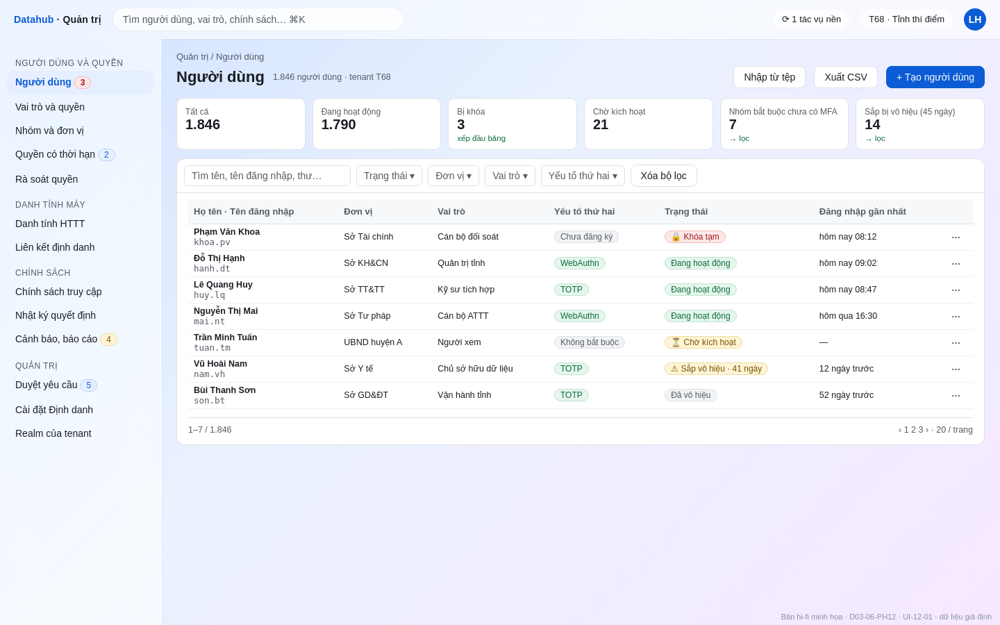

### 7.1. Wireframe

Sơ đồ sau mô tả bố cục màn Danh sách người dùng theo thứ tự từ trên xuống: thanh hành động, thẻ lọc nhanh, bộ lọc và bảng kết quả.

```{.mermaid caption="Bố cục màn UI-12-01 Danh sách người dùng"}
flowchart TB
  subgraph M["Người dùng"]
    A["Thanh hành động: Nhập từ tệp, Xuất CSV, Tạo người dùng"]
    B["Thẻ lọc nhanh: Tất cả, Hoạt động, Bị khóa 3, Chờ kích hoạt, Bắt buộc chưa MFA 7, Sắp vô hiệu 14"]
    C["Bộ lọc: ô tìm tên, tên đăng nhập, thư; Trạng thái; Đơn vị; Vai trò; Yếu tố thứ hai"]
    D["Bảng: Họ tên và đăng nhập, Đơn vị, Vai trò, Yếu tố 2, Trạng thái, Đăng nhập, Thao tác"]
    A --> B --> C --> D
  end
```

### 7.2. Thành phần

Bảng sau liệt kê các thành phần của màn danh sách người dùng, mỗi dòng nêu mã `CMP-*` của design system, nội dung hiển thị và điều kiện kiểm tra.

| # | Thành phần | `CMP-*` | Nội dung, kiểm tra | Nguồn | Ghi chú |
|---|---|---|---|---|---|
| 1 | Tiêu đề, nút | `CMP-PageHeader`, `CMP-Button` | "Tạo người dùng" primary; "Nhập từ tệp", "Xuất CSV" mặc định | — | Ẩn nút ghi khi thiếu `PERM-12-user-admin` |
| 2 | Thẻ số, bộ lọc nhanh | `CMP-KpiCard` | Sáu thẻ: Tất cả, Đang hoạt động, Bị khóa, Chờ kích hoạt, Nhóm bắt buộc chưa có MFA, Sắp bị vô hiệu | `facets` của API-12-001 | Bấm thẻ là bật bộ lọc, ghi URL, thẻ đang chọn có viền `color-accent` |
| 3 | Thanh lọc | `CMP-FilterBar`, `CMP-SearchField`, `CMP-Select` | Tìm ≥ 2 ký tự, trễ 300 ms; lọc nhiều giá trị | `q`, `status`, `orgCode`, `roleCode`, `mfaStatus` | Tìm theo thư điện tử không ghi lên URL (mục 2.5) |
| 4 | Bảng | `CMP-DataTable` | Cột mục 7.3; tài khoản `LOCKED`, `BLOCKED` xếp đầu | `items` | Chọn nhiều dòng hiện `CMP-BulkActionBar` (Khóa, Gửi lại liên kết kích hoạt) |
| 5 | Xuất | `CMP-Button` | CSV không chứa yếu tố xác thực, mật khẩu | API-12-001 `Accept: text/csv` | Cùng bộ lọc; ghi vết xuất |
| 6 | Phân trang | `CMP-Pagination` | 20 mặc định, 10/20/50/100 | `page`, `size` | Theo D03-06-00 §2.4 |

: UI-12-01 · Thành phần

### 7.3. Cột bảng

Bảng sau mô tả các cột của danh sách trên màn danh sách người dùng: nội dung, khả năng sắp xếp và ghi chú hiển thị.

| Cột | Nội dung | Sắp xếp | Ghi chú |
|---|---|---|---|
| Họ tên · Đăng nhập | Họ tên dòng 1 (liên kết tới UI-12-02), `CMP-CodeText` tên đăng nhập dòng 2 | Có | Biểu tượng khóa khi `LOCKED`, `BLOCKED` |
| Đơn vị | Tên đơn vị (mã trong tooltip) | Có | Từ PH-07 |
| Vai trò | Vai trò chính, "+n" khi có nhiều | | Tooltip liệt kê |
| Yếu tố thứ hai | `CMP-StatusTag` theo mục 5.1 | Có | "Chưa đăng ký" thuộc nhóm bắt buộc có sắc thái lỗi |
| Trạng thái | `CMP-StatusTag`; tài khoản sắp vô hiệu kèm "· {n} ngày" | Có | Ngưỡng 45 ngày theo tham số `12.account.inactive-days` |
| Đăng nhập gần nhất | `CMP-Timestamp` tương đối, tooltip đầy đủ | Có | "—" khi chưa từng đăng nhập |
| ⋯ | Menu: Mở chi tiết, Sửa, Khóa/Mở khóa, Vô hiệu/Kích hoạt lại, Gửi lại liên kết kích hoạt | | Theo `allowedActions`; không có mục tác động lên chính mình |

: UI-12-01 · Cột bảng

### 7.4. Trạng thái màn

Bảng sau nêu cách màn danh sách người dùng hiển thị ở từng trạng thái: đang tải, rỗng, lỗi, thiếu quyền và các trạng thái nghiệp vụ riêng của màn.

| Trạng thái | Hiển thị |
|---|---|
| Đang tải | Skeleton 8 dòng, thẻ số hiện khung xám |
| Rỗng lần đầu | "Tỉnh chưa có người dùng nào. Người dùng là cán bộ được đăng nhập và làm việc trên Datahub." kèm "Tạo người dùng" và "Nhập từ tệp" |
| Không có kết quả | ST-04 kèm "Xóa bộ lọc" |
| Lỗi tải | ST-05; ERR-12-038 hiện `CMP-Banner` "Hệ thống xác thực tạm thời không khả dụng. Thử lại sau ít phút." |
| Không có quyền | ST-07 kèm ERR-12-007 |

: UI-12-01 · Trạng thái màn

### 7.5. Tương tác, phím tắt và truy cập

`/` vào ô tìm; `N` mở UI-12-03 (khi có quyền); `↑`, `↓` chọn dòng, `Enter` mở chi tiết; `L` mở hộp khóa cho dòng đang chọn; `Esc` bỏ chọn. Thẻ số là nút (`role="button"`, `aria-pressed`) chứ không phải chữ trang trí; bảng có `aria-label="Danh sách người dùng"`, cột sắp xếp công bố `aria-sort`; trạng thái dùng chữ kèm biểu tượng nên không phụ thuộc màu (WCAG 1.4.1); tương phản chữ ≥ 4,5:1; khi lọc đổi, vùng `aria-live="polite"` đọc "Còn {n} người dùng".

## 8. UI-12-02 Chi tiết người dùng

::: dac-ta
**Mục đích.** Xem đầy đủ một người dùng, hiểu vì sao người đó làm được hoặc không làm được một việc (quyền hiệu lực), và xử lý sự cố tài khoản: khóa, mở khóa, vô hiệu, đặt lại yếu tố thứ hai, buộc đăng xuất, thu hồi truy cập.

**Người dùng chính.** TA, SO; AU, PO chỉ xem.

**FR hiện thực.** FR-12-002, 004, 005, 012, 016, 022, 024, 029, 040.

**Đường dẫn.** `/quan-tri/nguoi-dung/{ma}`.

**Mẫu.** PTN-02.

**Quyền.** `PERM-12-read`; hành động theo mục 8.2.

**API.** API-12-002, 004…008, 013, 015…018, 025…027.

**Vật liệu, token.** Khung tiêu đề `glass-chrome`; tab và bảng đặc `color-surface-solid`; dải cảnh báo `color-error` nền nhạt; viền focus `color-focus-ring`.
:::

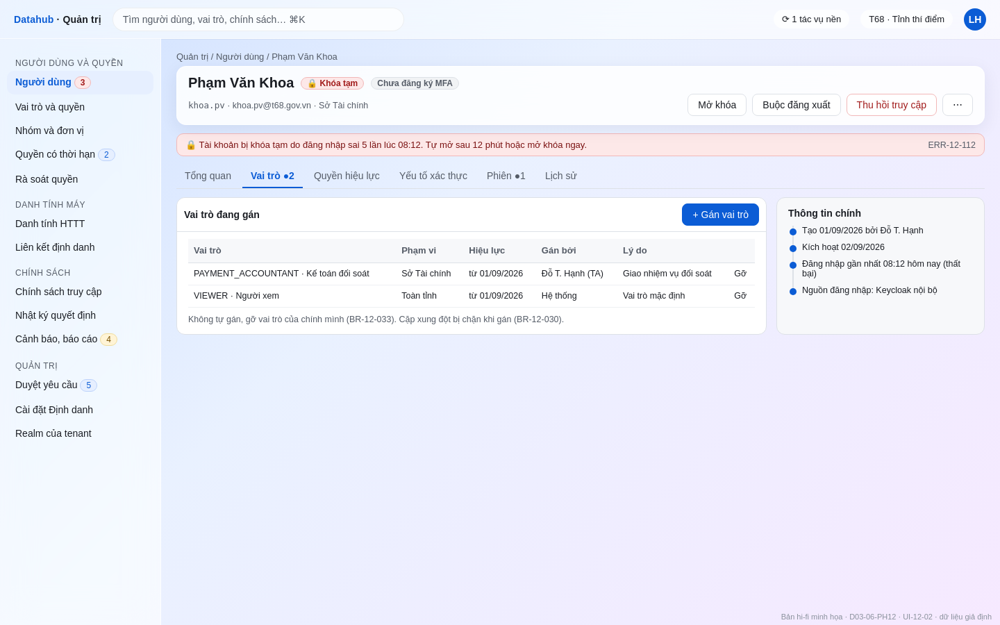

### 8.1. Wireframe

Sơ đồ sau mô tả bố cục màn Chi tiết người dùng: dải tiêu đề kèm các hành động, dòng thông tin định danh, biểu ngữ trạng thái, hàng tab và vùng nội dung hai cột.

```{.mermaid caption="Bố cục màn UI-12-02 Chi tiết người dùng"}
flowchart TB
  subgraph M["Chi tiết người dùng"]
    A["Tiêu đề: họ tên, thẻ Khóa tạm, thẻ Chưa đăng ký MFA; hành động Mở khóa, Buộc đăng xuất, Thu hồi truy cập, Thêm"]
    B["Định danh: tên đăng nhập, thư điện tử, đơn vị"]
    C["Biểu ngữ: tài khoản bị khóa tạm do đăng nhập sai 5 lần, tự mở sau 12 phút"]
    D["Tab: Tổng quan, Vai trò, Quyền hiệu lực, Yếu tố xác thực, Phiên, Lịch sử"]
    E["Nội dung: bảng vai trò đang gán kèm nút Gán vai trò, cạnh dòng thời gian thông tin chính"]
    A --> B --> C --> D --> E
  end
```

### 8.2. Thanh hành động tiêu đề

Bảng sau liệt kê các hành động trên thanh tiêu đề của màn Chi tiết người dùng, điều kiện để hành động hiện, hộp thoại xác nhận và API được gọi.

| Hành động | Hiện khi | Hộp thoại | API | Ghi chú |
|---|---|---|---|---|
| Khóa | `PERM-12-user-lock`, trạng thái `ACTIVE` | `CMP-ReasonDialog` | API-12-005 | Không áp cho chính mình (ERR-12-013) |
| Mở khóa | `LOCKED`, `BLOCKED` | `CMP-ReasonDialog` | API-12-006 | `BLOCKED` chỉ TA, SO mở |
| Vô hiệu, Kích hoạt lại | `PERM-12-user-lock` | `CMP-ReasonDialog`; vô hiệu quản trị tỉnh cuối cùng báo ERR-12-046 | API-12-007, 008 | Không xóa vật lý (BR-12-035) |
| Buộc đăng xuất | `PERM-12-user-lock`, có phiên | `CMP-ConfirmDialog` nêu số phiên | API-12-017 | Hiệu lực khi token hết hạn tối đa 5 phút |
| Thu hồi truy cập | `PERM-12-user-lock` | `CMP-ReasonDialog` kèm "hiệu lực trong 60 giây" | API-12-018 | Khác buộc đăng xuất: chặn cả token đang sống |
| Đặt lại yếu tố thứ hai | `PERM-12-mfa-reset`; tài khoản quản trị chuyển UI-12-17 chờ SO | `CMP-ReasonDialog` + xác thực lại mức 3 | API-12-015 | ERR-12-017 khi cần quản trị cấp trên |
| Sửa | `PERM-12-user-admin` | UI-12-03 | API-12-004 | Trường do LDAP quản lý chỉ đọc (ERR-12-047) |

: UI-12-02 · Thanh hành động

### 8.3. Các tab

Bảng sau mô tả các tab của màn chi tiết người dùng, mỗi tab nêu nội dung, thành phần `CMP-*` và API được gọi.

| Tab | Nội dung | `CMP-*` | API |
|---|---|---|---|
| Tổng quan | Họ tên, tên đăng nhập, thư, đơn vị, người quản lý trực tiếp, nguồn đăng nhập, ngày tạo, đăng nhập gần nhất | `CMP-DescriptionList` | API-12-002 |
| Vai trò | Bảng vai trò đang gán (vai trò, phạm vi, hiệu lực, người gán, lý do); nút "Gán vai trò" mở UI-12-06; "Gỡ" từng dòng | `CMP-DataTable`, `CMP-Drawer` | API-12-025…027 |
| Quyền hiệu lực | Danh sách `PERM-*` theo phân hệ, mỗi quyền ghi vai trò sinh ra nó; ô tìm; nút "Vì sao?" mở giải thích | `CMP-DataTable`, `CMP-Popover` | API-12-013 |
| Yếu tố xác thực | Loại, tên gọi, ngày đăng ký, lần dùng cuối; không hiện giá trị | `CMP-DataTable` | API-12-002 |
| Phiên | Thiết bị, địa chỉ IP che một phần, bắt đầu, hoạt động cuối; "Buộc đăng xuất" từng phiên | `CMP-DataTable` | API-12-016, 017 |
| Lịch sử | Dòng thời gian thay đổi tài khoản (ai, làm gì, lý do) | `CMP-AuditTimeline` | PH-13 qua API-12-105 |

: UI-12-02 · Các tab

### 8.4. Trạng thái màn

Bảng sau nêu cách màn chi tiết người dùng hiển thị ở từng trạng thái: đang tải, rỗng, lỗi, thiếu quyền và các trạng thái nghiệp vụ riêng của màn.

| Trạng thái | Hiển thị |
|---|---|
| Đang tải | Skeleton khối tiêu đề và bảng tab |
| Tab Vai trò rỗng | "Người dùng chưa có vai trò nào. Gán vai trò để người này làm việc được." kèm "Gán vai trò" |
| Tab Phiên rỗng | "Không có phiên đang hoạt động." |
| Không tồn tại | ST-08 với ERR-12-001 |
| Xung đột sửa | ST-13 với ERR-12-044 |
| Chỉ đọc | ST-15 cho AU, PO: ẩn mọi nút ghi |

: UI-12-02 · Trạng thái màn

### 8.5. Tương tác, phím tắt và truy cập

`←`, `→` đổi tab khi focus ở danh sách tab (`role="tablist"`); `G` mở UI-12-06; `K` mở hộp khóa; `Esc` đóng hộp. Dải cảnh báo khóa dùng `role="alert"`, khi mở trang được đọc ngay. Hộp lý do đặt focus vào ô lý do, `Enter` không gửi (tránh nhầm), phải bấm nút xác nhận; khi đóng trả focus về nút đã mở. Thời gian đếm ngược mở khóa tự động không cập nhật liên tục cho trình đọc màn hình, chỉ công bố mỗi phút.

## 9. UI-12-03 Tạo, sửa người dùng

::: dac-ta
**Mục đích.** Tạo tài khoản cán bộ và gửi liên kết kích hoạt, hoặc sửa thông tin, chuyển đơn vị. Người dùng tự đặt mật khẩu và đăng ký yếu tố thứ hai ở lần đăng nhập đầu; quản trị không bao giờ biết mật khẩu.

**Người dùng chính.** TA (PA ở tenant `PLATFORM`).

**FR hiện thực.** FR-12-003, 004, 005.

**Đường dẫn.** `/quan-tri/nguoi-dung/moi`, `/quan-tri/nguoi-dung/{ma}/sua`.

**Mẫu.** PTN-04 (drawer `size-drawer-md`).

**Quyền.** `PERM-12-user-admin`.

**API.** API-12-003, 004, 009.

**Vật liệu, token.** Khung `glass-modal`, nội dung đặc `color-surface-solid`; lỗi trường `color-error-text`.
:::

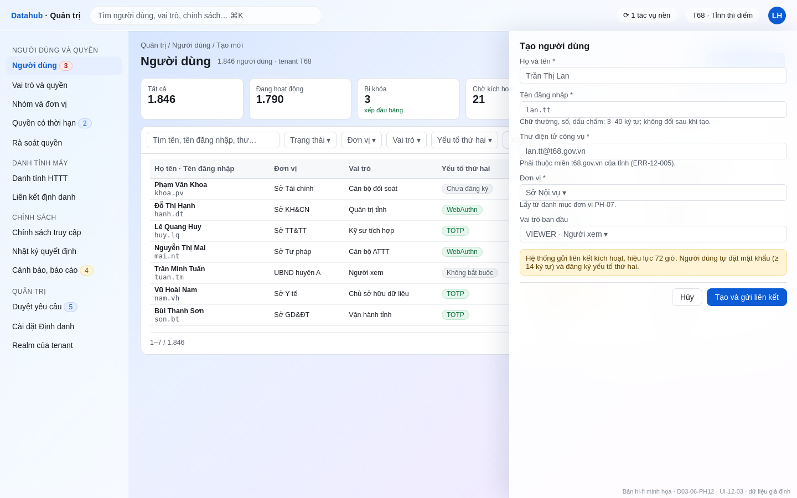

### 9.1. Trường biểu mẫu

Bảng sau liệt kê các trường biểu mẫu của màn tạo, sửa người dùng: kiểu thành phần, bắt buộc hay không, quy tắc kiểm tra, trường API tương ứng và mã lỗi hiển thị khi vi phạm.

| Trường | Kiểu | Bắt buộc | Kiểm tra | Ánh xạ API | Thông báo lỗi |
|---|---|---|---|---|---|
| Họ và tên | `CMP-Input` | Có | 2–120 ký tự | `fullName` | ERR-12-003 |
| Tên đăng nhập | `CMP-Input` + `CMP-CodeText` | Có | `^[a-z][a-z0-9.]{2,39}$`; kiểm tra trùng khi gửi (ERR-12-002); không đổi sau khi tạo | `username` | ERR-12-002 |
| Thư điện tử công vụ | `CMP-Input` | Có | Đúng miền công vụ của tỉnh | `email` | ERR-12-005, ERR-12-002 |
| Đơn vị | `CMP-ResourceSelect` | Có | Chọn từ danh mục PH-07, còn hiệu lực | `orgCode` | ERR-12-004 |
| Người quản lý trực tiếp | `CMP-ResourceSelect` | Không | Người dùng đang hoạt động cùng tenant | `managerUserId` | ERR-12-010 |
| Vai trò ban đầu | `CMP-Select` | Không | Vai trò chuẩn; cặp xung đột báo ngay | `roles[]` | ERR-12-009 |

: UI-12-03 · Trường biểu mẫu

Ở chế độ sửa, tên đăng nhập hiện chỉ đọc; trường do LDAP quản lý (họ tên, thư, đơn vị) hiện chỉ đọc kèm biểu tượng khóa và tooltip ERR-12-047. Đổi đơn vị tự gỡ các vai trò có phạm vi theo đơn vị cũ sau khi hiện hộp xác nhận liệt kê vai trò sẽ bị gỡ.

### 9.2. Trạng thái màn

Bảng sau nêu cách màn tạo, sửa người dùng hiển thị ở từng trạng thái: đang tải, rỗng, lỗi, thiếu quyền và các trạng thái nghiệp vụ riêng của màn.

| Trạng thái | Hiển thị |
|---|---|
| Đang lưu | ST-09; nút "Tạo và gửi liên kết" quay, khóa biểu mẫu |
| Thành công | ST-10 "Đã tạo người dùng {họ tên}. Liên kết kích hoạt đã gửi tới {thư}, hiệu lực 24 giờ." kèm "Xem" |
| Lỗi hợp lệ | ST-11 với ERR-12-003 và lỗi từng trường |
| Lỗi nghiệp vụ | ST-12 với ERR-12-002, 004, 005, 009 |
| Chặn gửi lặp | `Idempotency-Key` sinh khi mở biểu mẫu; bấm hai lần không tạo hai tài khoản |

: UI-12-03 · Trạng thái màn

### 9.3. Tương tác, phím tắt và truy cập

`Ctrl+Enter` gửi biểu mẫu; `Esc` đóng, có thay đổi thì hỏi "Bỏ thay đổi chưa lưu?"; `Tab` theo thứ tự trường. Nhãn gắn `<label for>`, trường bắt buộc có `aria-required`, lỗi gắn `aria-describedby` và tóm tắt lỗi ở đầu biểu mẫu có liên kết nhảy tới trường (ST-11). Drawer có `role="dialog"`, `aria-modal`, bẫy focus và trả focus khi đóng (WCAG 2.4.3, 2.4.11).

## 10. UI-12-04 Nhập người dùng từ tệp

::: dac-ta
**Mục đích.** Nhập hàng loạt người dùng từ tệp Excel hoặc CSV khi tỉnh mới triển khai hoặc di trú từ hệ cũ, ánh xạ vai trò hệ cũ sang vai trò chuẩn, xem trước từng dòng trước khi ghi.

**Người dùng chính.** TA.

**FR hiện thực.** FR-12-009.

**Đường dẫn.** `/quan-tri/nguoi-dung/nhap`.

**Mẫu.** PTN-09.

**Quyền.** `PERM-12-user-admin`.

**API.** API-12-010, 011, 012.

**Vật liệu, token.** Bảng xem trước đặc; ô lỗi viền `color-error`, ô cảnh báo `color-warning`; vùng thả tệp nét đứt `color-border-control`.
:::

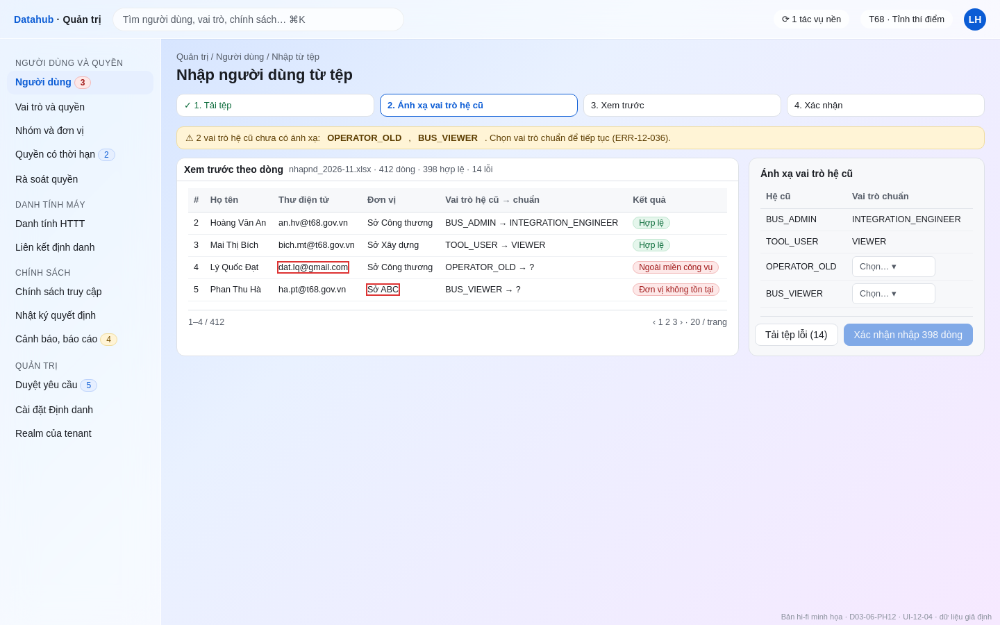

### 10.1. Bốn bước

Bảng sau mô tả bốn bước của luồng nhập trên màn nhập người dùng từ tệp: nội dung từng bước, thành phần `CMP-*` và ghi chú.

| Bước | Nội dung | `CMP-*` | Ghi chú |
|---|---|---|---|
| 1. Tải tệp | Thả hoặc chọn tệp .xlsx, .csv (tối đa `12.import.max-rows`, mặc định 5.000 dòng); tải tệp mẫu | `CMP-Upload`, `CMP-Steps` | ERR-12-035 khi sai định dạng hoặc quá lớn |
| 2. Ánh xạ vai trò hệ cũ | Bảng vai trò hệ cũ trong tệp và ô chọn vai trò chuẩn; mặc định gợi ý theo bảng ánh xạ của FRS §11 | `CMP-DataTable`, `CMP-Select` | ERR-12-036 chặn bước 3 khi còn vai trò chưa ánh xạ |
| 3. Xem trước | Bảng theo dòng: hợp lệ, cảnh báo, lỗi; lọc "Chỉ dòng lỗi"; tải tệp lỗi | `CMP-DataTable`, `CMP-JobProgress` | Kiểm tra bất đồng bộ (202), tiến độ hiện thanh |
| 4. Xác nhận | Tóm tắt "Sẽ tạo {n} tài khoản, gửi {n} liên kết kích hoạt, bỏ qua {m} dòng lỗi" | `CMP-ConfirmDialog` | Nút "Xác nhận nhập" chỉ sáng khi có ít nhất một dòng hợp lệ |

: UI-12-04 · Bốn bước

### 10.2. Cột bảng xem trước

Bảng sau mô tả các cột của bảng xem trước kết quả kiểm tra tệp trên màn nhập người dùng từ tệp.

| Cột | Nội dung | Ghi chú |
|---|---|---|
| # | Số dòng trong tệp | Cố định cột |
| Họ tên, Thư điện tử, Đơn vị | Giá trị trong tệp | Ô lỗi viền đỏ kèm biểu tượng, tooltip nêu mã lỗi |
| Vai trò hệ cũ → chuẩn | Hiện mũi tên ánh xạ | `?` khi chưa ánh xạ |
| Kết quả | `CMP-StatusTag`: Hợp lệ, Cảnh báo, Lỗi | Lỗi nêu nguyên nhân: ngoài miền (ERR-12-005), đơn vị không tồn tại (ERR-12-004), trùng (ERR-12-002) |

: UI-12-04 · Cột bảng xem trước

### 10.3. Trạng thái màn

Bảng sau nêu cách màn nhập người dùng từ tệp hiển thị ở từng trạng thái: đang tải, rỗng, lỗi, thiếu quyền và các trạng thái nghiệp vụ riêng của màn.

| Trạng thái | Hiển thị |
|---|---|
| Đang kiểm tra | `CMP-JobProgress` "Đã kiểm tra {n}/{m} dòng", cho rời màn |
| Có dòng lỗi | `CMP-Alert` cảnh báo "{k} dòng lỗi sẽ bị bỏ qua" kèm "Tải tệp lỗi" |
| Đang ghi | Tác vụ nền, hiện ở `CMP-BackgroundTaskTray`; xong có thông báo "Đã tạo {n} tài khoản" |
| Không có quyền | ST-07 |

: UI-12-04 · Trạng thái màn

### 10.4. Tương tác, phím tắt và truy cập

Vùng thả tệp là nút bàn phím (`Enter`, `Space` mở hộp chọn tệp). Bảng xem trước hỗ trợ `↑`, `↓`; `E` nhảy tới dòng lỗi kế tiếp. Số dòng lỗi và tiến độ công bố qua `aria-live="polite"`; không dùng riêng màu đỏ để đánh dấu ô lỗi mà thêm biểu tượng và chữ.

## 11. UI-12-05 Danh mục vai trò và quyền

::: dac-ta
**Mục đích.** Xem 22 vai trò chuẩn và quyền của từng vai trò theo ma trận D02-08, tra ngược một quyền sang các vai trò mang nó, xuất ma trận cho kiểm toán; Đợt 2 thêm vai trò tùy biến của tenant.

**Người dùng chính.** TA, SO, AU.

**FR hiện thực.** FR-12-011, 015 (Đợt 2).

**Đường dẫn.** `/quan-tri/vai-tro`.

**Mẫu.** PTN-08.

**Quyền.** `PERM-12-read`; tạo, sửa vai trò tùy biến cần `PERM-12-user-admin`.

**API.** API-12-019, 020, 021; API-12-022…024 (Đợt 2).

**Vật liệu, token.** Cây và bảng đặc `color-surface-solid`; dòng được chọn `color-fill-selected`; tách hai khung bằng `CMP-Splitter`.
:::

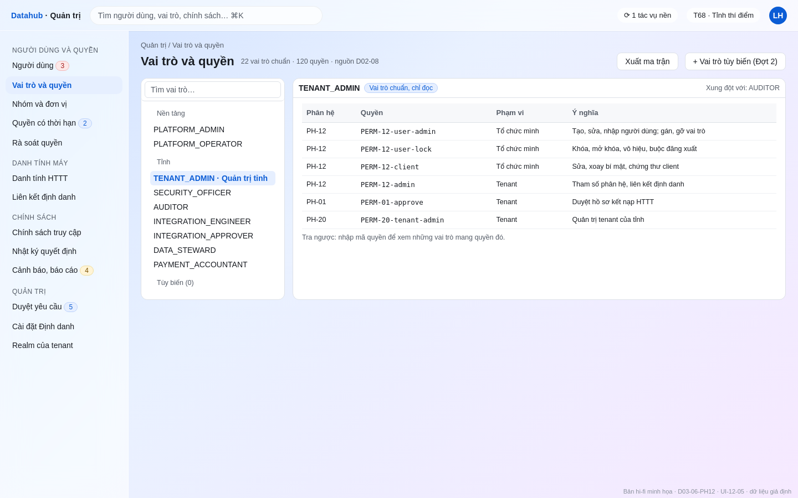

### 11.1. Bố cục

Cột trái 260 px là cây vai trò chia ba nhóm (Nền tảng, Tỉnh, Tùy biến). Cột phải là chi tiết vai trò đang chọn: tiêu đề, nhãn "Vai trò chuẩn, chỉ đọc", danh sách vai trò xung đột (nguồn D02-08 §4), bảng quyền.

| # | Thành phần | `CMP-*` | Nội dung | Ghi chú |
|---|---|---|---|---|
| 1 | Cây vai trò | `CMP-Tree` | Mã vai trò, tên tiếng Việt; số người đang giữ trong ngoặc | Ô tìm ở đầu cây |
| 2 | Bảng quyền | `CMP-DataTable` | Phân hệ, `PERM-*` (`CMP-CodeText`), phạm vi (Tổ chức mình, Tenant), ý nghĩa | Nhóm theo phân hệ, có thể thu gọn |
| 3 | Tra ngược | `CMP-SearchField` | Nhập mã quyền, hiện các vai trò mang quyền đó | Ghi `quyen` lên URL |
| 4 | Xung đột | `CMP-Tag` | Các vai trò không được giữ cùng | Bấm để mở vai trò đó |
| 5 | Xuất ma trận | `CMP-Button` | CSV vai trò × quyền | Ghi vết xuất |
| 6 | Tạo vai trò tùy biến | `CMP-Button` | Đợt 2; hộp chọn quyền bằng `CMP-Transfer`, ô lý do | ERR-12-010 khi quyền không thuộc phạm vi tenant |

: UI-12-05 · Thành phần

### 11.2. Trạng thái màn

Bảng sau nêu cách màn danh mục vai trò và quyền hiển thị ở từng trạng thái: đang tải, rỗng, lỗi, thiếu quyền và các trạng thái nghiệp vụ riêng của màn.

| Trạng thái | Hiển thị |
|---|---|
| Đang tải | Skeleton cây 10 dòng và bảng 8 dòng |
| Chưa có vai trò tùy biến | Nhóm "Tùy biến (0)" kèm chú thích "Mở rộng quyền cho riêng tỉnh sẽ có ở Đợt 2" |
| Không tìm thấy quyền | ST-04 "Không có vai trò nào mang quyền này" |
| Vai trò chuẩn | Mọi nút sửa ẩn, nhãn "chỉ đọc"; ST-15 |
| Ngừng dùng vai trò còn người giữ | ERR-12-011 hộp liệt kê người dùng |

: UI-12-05 · Trạng thái màn

### 11.3. Tương tác, phím tắt và truy cập

`/` vào ô tìm cây; `↑`, `↓`, `←`, `→` điều khiển cây theo mẫu `treeview` của ARIA (`role="tree"`, `aria-expanded`, `aria-level`); `Tab` chuyển từ cây sang bảng. Bảng quyền có chú thích và tiêu đề cột `scope="col"`. Ma trận lớn không dùng màu để phân biệt phạm vi mà dùng chữ.

## 12. UI-12-06 Gán vai trò và ngoại lệ tách nhiệm vụ

::: dac-ta
**Mục đích.** Gán vai trò cho người dùng có phạm vi, hiệu lực, lý do; báo ngay cặp vai trò xung đột và cho đề nghị ngoại lệ có thời hạn để cán bộ ATTT duyệt.

**Người dùng chính.** TA (đề nghị ngoại lệ); SO duyệt ở UI-12-17.

**FR hiện thực.** FR-12-012, 013.

**Đường dẫn.** `/quan-tri/nguoi-dung/{ma}?chon=gan-vai-tro`.

**Mẫu.** PTN-04 (drawer `size-drawer-md`).

**Quyền.** `PERM-12-user-admin`; đề nghị ngoại lệ cần `PERM-12-sod-exception`.

**API.** API-12-025, 026, 027, 028, 029.

**Vật liệu, token.** Khung `glass-modal`; hộp xung đột nền `color-error` nhạt, chữ `color-error-text`; không dùng màu đơn thuần mà có biểu tượng ⛔.
:::

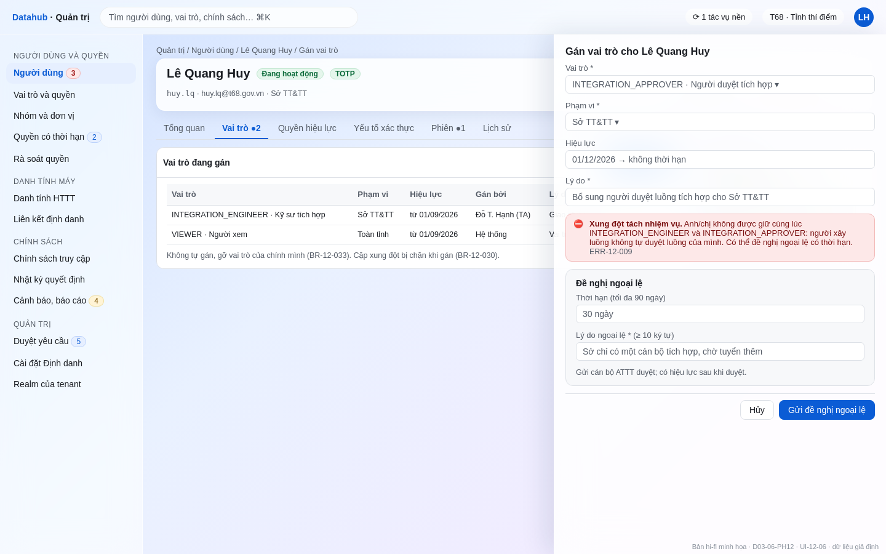

### 12.1. Trường biểu mẫu

Bảng sau liệt kê các trường biểu mẫu của màn gán vai trò và ngoại lệ tách nhiệm vụ: kiểu thành phần, bắt buộc hay không, quy tắc kiểm tra, trường API tương ứng và mã lỗi hiển thị khi vi phạm.

| Trường | Kiểu | Bắt buộc | Kiểm tra | Ánh xạ API | Thông báo lỗi |
|---|---|---|---|---|---|
| Vai trò | `CMP-Select` | Có | Vai trò chuẩn hoặc tùy biến còn dùng; kiểm tra xung đột ngay khi chọn | `roleCode` | ERR-12-009, ERR-12-010 |
| Phạm vi | `CMP-TreeSelect` | Có | Tổ chức trong cây đơn vị của tenant | `scopeOrgCode` | ERR-12-010 |
| Hiệu lực | `CMP-DateRangePicker` | Không | Từ nay; hết hạn ≥ ngày bắt đầu | `validFrom`, `validTo` | ERR-12-003 |
| Lý do | `CMP-TextArea` | Có | Ít nhất 10 ký tự | `reason` | ERR-12-014 |
| Thời hạn ngoại lệ | `CMP-NumberInput` | Có khi đề nghị | 1–90 ngày | `days` | ERR-12-043 |
| Lý do ngoại lệ | `CMP-TextArea` | Có khi đề nghị | Ít nhất 10 ký tự | `reason` | ERR-12-014 |

: UI-12-06 · Trường biểu mẫu

### 12.2. Hành vi xung đột

Khi chọn vai trò tạo cặp xung đột, hộp `CMP-Alert` mức lỗi hiện câu ERR-12-009 với tên hai vai trò và lý do lấy từ D02-08 §4; nút "Gán" vô hiệu. Nếu người dùng có `PERM-12-sod-exception`, bên dưới mở khối "Đề nghị ngoại lệ" (thời hạn tối đa 90 ngày, lý do) và nút đổi thành "Gửi đề nghị ngoại lệ"; yêu cầu chuyển tới UI-12-17 chờ SO duyệt. TA không tự gán, gỡ vai trò của chính mình: chọn chính mình thì ERR-12-013 hiện và biểu mẫu khóa.

### 12.3. Trạng thái màn

Bảng sau nêu cách màn gán vai trò và ngoại lệ tách nhiệm vụ hiển thị ở từng trạng thái: đang tải, rỗng, lỗi, thiếu quyền và các trạng thái nghiệp vụ riêng của màn.

| Trạng thái | Hiển thị |
|---|---|
| Đang lưu | ST-09 |
| Gán thành công | ST-10 "Đã gán {vai trò} cho {họ tên}." |
| Gửi đề nghị thành công | "Đã gửi đề nghị ngoại lệ tới cán bộ ATTT. Vai trò chỉ có hiệu lực sau khi được duyệt." |
| Lỗi nghiệp vụ | ST-12 với ERR-12-009, 010, 013 |
| Quyền | Thiếu `PERM-12-user-admin` thì nút "Gán vai trò" ẩn ở UI-12-02 |

: UI-12-06 · Trạng thái màn

### 12.4. Tương tác, phím tắt và truy cập

`Ctrl+Enter` gửi; `Esc` đóng. Hộp xung đột có `role="alert"` để trình đọc màn hình đọc ngay khi hiện; thứ tự focus: vai trò → phạm vi → hiệu lực → lý do → khối ngoại lệ → nút. Danh sách thả chọn vai trò hỗ trợ gõ để lọc (`combobox` ARIA).

## 13. UI-12-07 Nhóm và đơn vị

::: dac-ta
**Mục đích.** Quản lý cây nhóm và đơn vị tổ chức của tỉnh, thành viên từng nhóm, chuyển thành viên giữa nhóm; xem báo cáo đồng bộ đơn vị từ danh mục PH-07 và danh sách người dùng cần rà soát vì đơn vị đã đổi tên hoặc hết hiệu lực.

**Người dùng chính.** TA.

**FR hiện thực.** FR-12-010, 014.

**Đường dẫn.** `/quan-tri/vai-tro/nhom`.

**Mẫu.** PTN-08.

**Quyền.** `PERM-12-read`; sửa cần `PERM-12-user-admin`.

**API.** API-12-032, 033, 034, 035; API-12-001 (lọc người dùng cần rà soát).

**Vật liệu, token.** Cây và bảng đặc `color-surface-solid`; dải cảnh báo đồng bộ `color-warning` nền nhạt.
:::

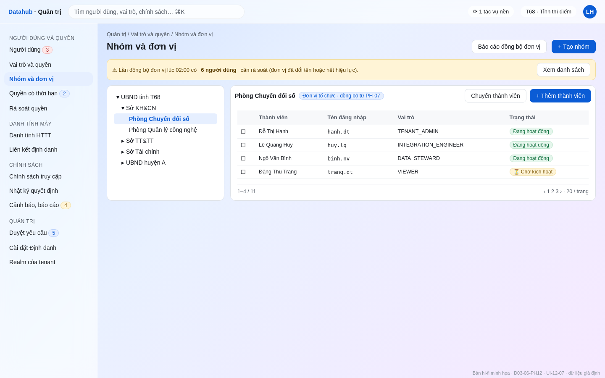

### 13.1. Thành phần

Bảng sau liệt kê các thành phần của màn nhóm và đơn vị, mỗi dòng nêu mã `CMP-*` của design system, nội dung hiển thị và điều kiện kiểm tra.

| # | Thành phần | `CMP-*` | Nội dung, kiểm tra | Ghi chú |
|---|---|---|---|---|
| 1 | Dải báo cáo đồng bộ | `CMP-Alert` cảnh báo | "Lần đồng bộ lúc {giờ} có {n} người dùng cần rà soát" kèm "Xem danh sách" | Chỉ hiện khi n > 0; số liệu từ FR-12-010 |
| 2 | Cây nhóm, đơn vị | `CMP-Tree` | Đơn vị tổ chức (nguồn PH-07, chỉ đọc cấu trúc) và nhóm tự tạo; kéo thả để đổi nhóm cha | Vòng lặp báo ERR-12-012 |
| 3 | Bảng thành viên | `CMP-DataTable` | Họ tên, tên đăng nhập, vai trò, trạng thái; chọn nhiều | `CMP-BulkActionBar`: Chuyển nhóm, Gỡ khỏi nhóm |
| 4 | Thêm thành viên | `CMP-Drawer`, `CMP-Transfer` | Chọn người dùng đang hoạt động cùng tenant | `PUT` danh sách thành viên (API-12-035) |
| 5 | Tạo, sửa nhóm | `CMP-Modal` | Mã nhóm, tên, nhóm cha, mô tả | ERR-12-002 khi mã trùng |

: UI-12-07 · Thành phần

### 13.2. Trạng thái màn

Bảng sau nêu cách màn nhóm và đơn vị hiển thị ở từng trạng thái: đang tải, rỗng, lỗi, thiếu quyền và các trạng thái nghiệp vụ riêng của màn.

| Trạng thái | Hiển thị |
|---|---|
| Rỗng lần đầu | "Chưa có nhóm nào ngoài cây đơn vị. Nhóm giúp gom người dùng để gán vai trò nhanh hơn." kèm "Tạo nhóm" |
| Nhóm rỗng | "Nhóm chưa có thành viên." kèm "Thêm thành viên" |
| Gỡ nhóm còn dùng | ERR-12-011 hộp liệt kê nơi dùng |
| Vòng lặp | ERR-12-012 dưới trường nhóm cha |
| Chỉ đọc | ST-15 cho SO, AU: ẩn kéo thả và nút ghi |

: UI-12-07 · Trạng thái màn

### 13.3. Tương tác, phím tắt và truy cập

Cây theo mẫu `treeview` ARIA; kéo thả luôn có phương án bàn phím: chọn nhóm, `Ctrl+X`, chọn nhóm cha, `Ctrl+V`, hoặc nút "Chuyển tới…" (WCAG 2.5.7, tránh phụ thuộc thao tác kéo). `N` tạo nhóm; `Delete` gỡ thành viên đã chọn (có hộp xác nhận).

## 14. UI-12-08 Quyền có thời hạn

::: dac-ta
**Mục đích.** Đề nghị, theo dõi và thu hồi sớm quyền có thời hạn (tối đa 4 giờ) cho vai trò đặc quyền hoặc để vào tenant khác khi hỗ trợ; người thứ hai duyệt, tỉnh bị truy cập nhận thông báo.

**Người dùng chính.** PA, PO (đề nghị); SO, PA khác (duyệt); TA của tenant đích (thu hồi sớm).

**FR hiện thực.** FR-12-017.

**Đường dẫn.** `/quan-tri/quyen-co-thoi-han`.

**Mẫu.** PTN-01.

**Quyền.** `PERM-12-read`; đề nghị `PERM-12-jit-request`; duyệt, từ chối, thu hồi `PERM-12-jit-approve`.

**API.** API-12-036…040.

**Vật liệu, token.** Bảng đặc; số đếm ngược `font-feature-tabular`; dưới 15 phút chữ `color-warning-text`.
:::

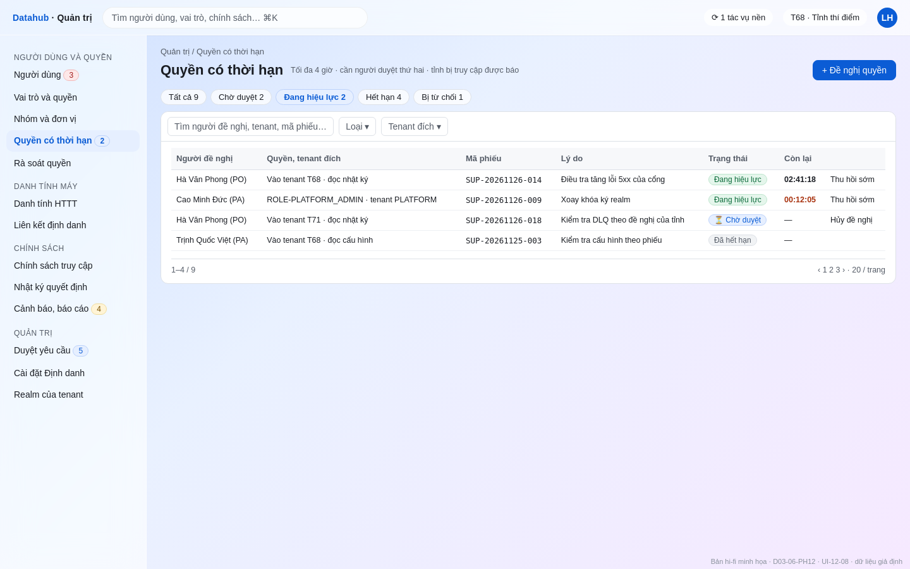

### 14.1. Cột bảng

Bảng sau mô tả các cột của danh sách trên màn quyền có thời hạn: nội dung, khả năng sắp xếp và ghi chú hiển thị.

| Cột | Nội dung | Sắp xếp | Ghi chú |
|---|---|---|---|
| Người đề nghị | Họ tên (vai trò) | Có | |
| Quyền, tenant đích | Vai trò hoặc "Vào tenant {mã} · {phạm vi}" | | Dải liên tenant bật khi quyền có hiệu lực (D03-06-00 §2.11) |
| Mã phiếu | `CMP-CodeText`, định dạng `SUP-yyyyMMdd-nnn` | | Chỉ kiểm tra định dạng (Q12-15) |
| Lý do | Cắt 60 ký tự, tooltip đầy đủ | | |
| Trạng thái | `CMP-StatusTag` theo mục 5.1 | Có | |
| Còn lại | Đếm ngược `hh:mm:ss`, cập nhật mỗi giây ở thị giác, công bố cho trình đọc mỗi 5 phút | Có | Dưới 15 phút chuyển sắc thái cảnh báo |
| Hành động | "Thu hồi sớm" (đang hiệu lực), "Hủy đề nghị" (chờ duyệt) | | `CMP-ReasonDialog` |

: UI-12-08 · Cột bảng

### 14.2. Biểu mẫu đề nghị (drawer)

Bảng sau liệt kê các trường của ngăn kéo đề nghị cấp quyền trên màn quyền có thời hạn, kèm quy tắc kiểm tra và mã lỗi.

| Trường | Kiểu | Bắt buộc | Kiểm tra | Thông báo lỗi |
|---|---|---|---|---|
| Loại | `CMP-Segmented` | Có | "Vai trò đặc quyền" hoặc "Vào tenant khác" | — |
| Vai trò hoặc tenant đích và phạm vi | `CMP-Select` | Có | Theo loại | ERR-12-010 |
| Thời hạn | `CMP-NumberInput` (giờ) | Có | 1–4, mặc định 2 | ERR-12-030 |
| Mã phiếu hỗ trợ | `CMP-Input` | Có | `^SUP-\d{8}-\d{3}$` | ERR-12-030 |
| Lý do | `CMP-TextArea` | Có | Ít nhất 10 ký tự | ERR-12-014 |

: UI-12-08 · Trường biểu mẫu đề nghị

Người đề nghị không thấy nút "Duyệt" cho đề nghị của chính mình; người duyệt xử lý ở UI-12-17 (ERR-12-008 nếu cố duyệt qua liên kết trực tiếp).

### 14.3. Trạng thái màn

Bảng sau nêu cách màn quyền có thời hạn hiển thị ở từng trạng thái: đang tải, rỗng, lỗi, thiếu quyền và các trạng thái nghiệp vụ riêng của màn.

| Trạng thái | Hiển thị |
|---|---|
| Rỗng lần đầu | "Chưa có đề nghị quyền có thời hạn nào. Quyền này dùng khi nhân sự nền tảng cần vào tenant của tỉnh để xử lý sự cố." kèm "Đề nghị quyền" |
| Hết hạn khi đang xem | Dòng chuyển "Đã hết hạn" tự động, thông báo `aria-live` "Quyền {mã} đã hết hạn" |
| Thu hồi thành công | ST-10 "Đã thu hồi quyền. Hiệu lực chấm dứt trong 60 giây." |
| Không có quyền | ST-07 |

: UI-12-08 · Trạng thái màn

### 14.4. Tương tác, phím tắt và truy cập

`N` mở biểu mẫu đề nghị; `Enter` mở chi tiết dòng ở drawer; `R` thu hồi dòng đang chọn. Đếm ngược không là nguồn sự thật duy nhất của việc hết hạn (máy chủ quyết định); chữ "còn 12 phút" luôn kèm giờ hết hạn tuyệt đối trong tooltip để không phụ thuộc đồng hồ trình duyệt.

## 15. UI-12-09 Rà soát quyền

::: dac-ta
**Mục đích.** Mở chiến dịch rà soát quyền định kỳ (mặc định 90 ngày), theo dõi tiến độ, để người quản lý trực tiếp giữ hoặc gỡ từng quyền, đóng chiến dịch và xem báo cáo.

**Người dùng chính.** TA, SO (mở, theo dõi, đóng); người quản lý trực tiếp (quyết định mục được giao).

**FR hiện thực.** FR-12-018 (Đợt 2 · mức S).

**Đường dẫn.** `/quan-tri/ra-soat-quyen`, `/quan-tri/ra-soat-quyen/{chienDich}`.

**Mẫu.** PTN-10.

**Quyền.** `PERM-12-recert`; người rà soát được giao quyết định mục của mình không cần `PERM`.

**API.** API-12-041…044.

**Vật liệu, token.** Bảng đặc; thanh tiến độ `color-accent`; mục quá hạn `color-warning`.
:::

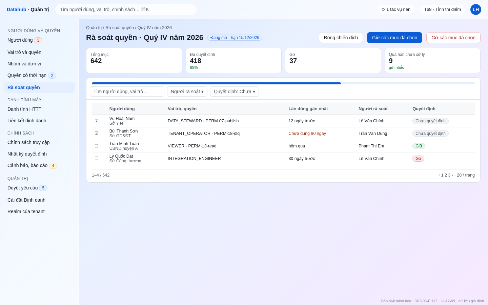

### 15.1. Thành phần

Bảng sau liệt kê các thành phần của màn rà soát quyền, mỗi dòng nêu mã `CMP-*` của design system, nội dung hiển thị và điều kiện kiểm tra.

| # | Thành phần | `CMP-*` | Nội dung, kiểm tra | Ghi chú |
|---|---|---|---|---|
| 1 | Tiêu đề chiến dịch | `CMP-PageHeader`, `CMP-StatusTag` | Tên, hạn, trạng thái Đang mở hoặc Đã đóng | |
| 2 | Thẻ số | `CMP-KpiCard` | Tổng mục, đã quyết định (%), gỡ, quá hạn | "Quá hạn" kèm nút "Gửi nhắc" |
| 3 | Thanh tiến độ | `CMP-ProgressBar` | `aria-valuenow` theo % đã quyết định | |
| 4 | Bảng mục rà soát | `CMP-DataTable` | Cột mục 15.2; chọn nhiều | `CMP-BulkActionBar`: "Giữ các mục đã chọn", "Gỡ các mục đã chọn" |
| 5 | Hộp xác nhận gỡ | `CMP-ReasonDialog` | Nêu số quyền bị gỡ; lý do bắt buộc | ERR-12-014 |
| 6 | Mở chiến dịch | `CMP-Modal` | Phạm vi (đơn vị, vai trò), hạn, người rà soát mặc định | ERR-12-031 khi đang có chiến dịch mở |
| 7 | Đóng chiến dịch | `CMP-ConfirmDialog` | Cảnh báo "Mục chưa quyết định sẽ được giữ nguyên và ghi vào báo cáo" | API-12-044 |

: UI-12-09 · Thành phần

### 15.2. Cột bảng mục rà soát

Bảng sau mô tả các cột của bảng mục rà soát trên màn rà soát quyền.

| Cột | Nội dung | Ghi chú |
|---|---|---|
| Chọn | Hộp kiểm | Mục đã quyết định chọn được để đổi ý đến khi đóng |
| Người dùng | Họ tên, đơn vị | |
| Vai trò, quyền | Vai trò và quyền được rà soát | |
| Lần dùng gần nhất | Thời điểm quyền được dùng lần cuối, "Chưa dùng {n} ngày" | Gợi ý gỡ khi ≥ 90 ngày |
| Người rà soát | Người quản lý trực tiếp, hoặc SO, TA của đơn vị khi không có (Q12-08) | |
| Quyết định | `CMP-StatusTag`: Chưa quyết định, Giữ, Gỡ | Người rà soát không quyết định mục của chính mình (ERR-12-013) |

: UI-12-09 · Cột bảng

### 15.3. Trạng thái màn

Bảng sau nêu cách màn rà soát quyền hiển thị ở từng trạng thái: đang tải, rỗng, lỗi, thiếu quyền và các trạng thái nghiệp vụ riêng của màn.

| Trạng thái | Hiển thị |
|---|---|
| Rỗng lần đầu | "Chưa có chiến dịch rà soát nào. Rà soát định kỳ giúp phát hiện quyền không còn cần." kèm "Mở chiến dịch" (khi có quyền) |
| Người rà soát không có mục | "Bạn không có mục nào cần rà soát." |
| Chiến dịch đã đóng | ST-15; bảng chỉ đọc, hiện nút "Xuất báo cáo" |
| Đóng chiến dịch còn mục chưa quyết định | Hộp cảnh báo nêu số mục |

: UI-12-09 · Trạng thái màn

### 15.4. Tương tác, phím tắt và truy cập

`K` giữ, `D` gỡ cho dòng đang chọn; `Ctrl+A` chọn mọi dòng đang hiển thị; `Space` đổi trạng thái chọn. Thanh tiến độ có `role="progressbar"` kèm nhãn "Đã quyết định 65%". Quyết định Giữ, Gỡ dùng chữ và biểu tượng, không chỉ màu.

## 16. UI-12-10 Danh tính HTTT và tài khoản dịch vụ

::: dac-ta
**Mục đích.** Quản lý vòng đời client OAuth của HTTT thành viên (tạm ngừng, tiếp tục, thu hồi), đăng ký chứng thư mTLS hoặc khóa công khai, xoay bí mật, xem scope (chỉ đọc, sinh từ dữ liệu đã duyệt) và quản lý tài khoản dịch vụ nội bộ của đơn vị triển khai.

**Người dùng chính.** TA, đầu mối kỹ thuật của HTTT (ROLE-ORG_REQUESTER), SO, PA.

**FR hiện thực.** FR-12-030, 031, 032, 033, 034, 036, 037, 040.

**Đường dẫn.** `/quan-tri/danh-tinh-httt`, `/quan-tri/danh-tinh-httt/{ma}`.

**Mẫu.** PTN-01 (danh sách), PTN-02 (chi tiết).

**Quyền.** `PERM-12-read`; sửa, xoay bí mật, chứng thư `PERM-12-client`; tạm ngừng, tiếp tục, thu hồi `PERM-12-user-lock`; tài khoản dịch vụ `PERM-12-realm-admin`.

**API.** API-12-056…071, 077, 079.

**Vật liệu, token.** Khung tiêu đề `glass-chrome`; bảng và hộp bí mật đặc; bí mật hiện trong `CMP-SecretField` nền `color-surface-solid-2`.
:::

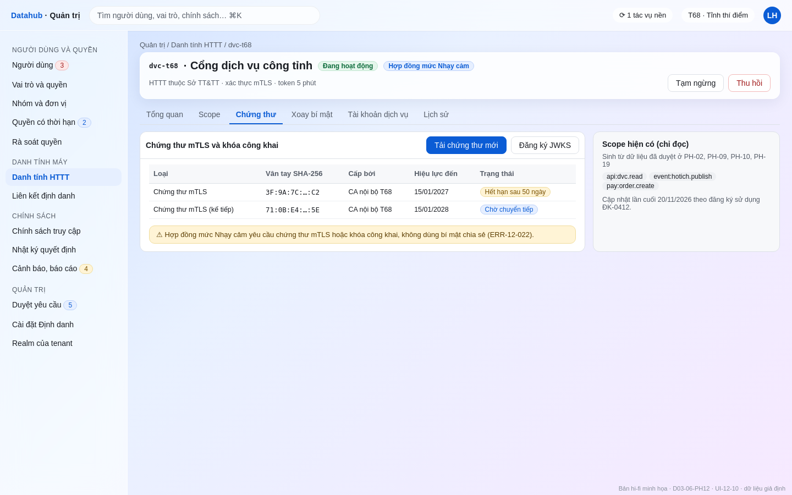

### 16.1. Danh sách client

Bảng sau mô tả các cột của danh sách client trên màn danh tính HTTT và tài khoản dịch vụ: nội dung, khả năng sắp xếp và ghi chú.

| Cột | Nội dung | Sắp xếp | Ghi chú |
|---|---|---|---|
| Mã client · Tên HTTT | `CMP-CodeText` mã dòng 1, tên HTTT dòng 2 | Có | Liên kết tới chi tiết |
| Hợp đồng | Mức phân loại của hợp đồng (Công khai…Nhạy cảm) | Có | Quyết định phương thức xác thực cho phép |
| Xác thực | mTLS, private_key_jwt, bí mật chia sẻ | | Hợp đồng Nhạy cảm không có bí mật chia sẻ (ERR-12-022) |
| Trạng thái | `CMP-StatusTag` | Có | |
| Chứng thư hết hạn | Ngày, cảnh báo khi < 60 ngày | Có | |
| Gọi gần nhất | Thời điểm token gần nhất | Có | Tự tạm ngừng sau 90 ngày không gọi (FR-12-008) |

: UI-12-10 · Cột danh sách client

Client không tạo ở màn này: HTTT được cấp client khi kết nạp ở PH-01 (API-12-058 gọi bằng scope `iam:client-provision`); ứng dụng sandbox do PH-15 cấp (API-12-063) và hiện trong danh sách với nhãn "Sandbox".

### 16.2. Các tab chi tiết

Bảng sau mô tả các tab chi tiết của màn danh tính HTTT và tài khoản dịch vụ, mỗi tab nêu nội dung, thành phần `CMP-*` và API được gọi.

| Tab | Nội dung | `CMP-*` | API |
|---|---|---|---|
| Tổng quan | Mã, HTTT, hợp đồng, phương thức xác thực, thời hạn token (5 phút), trạng thái | `CMP-DescriptionList` | API-12-057 |
| Scope | Danh sách scope **chỉ đọc**, mỗi scope kèm nguồn (đăng ký sử dụng, publication, subscription) và ngày sinh; không có nút thêm tay (ERR-12-019) | `CMP-DataTable` | API-12-067 |
| Chứng thư | Chứng thư mTLS, khóa công khai (JWKS): vân tay, bên cấp, hiệu lực; tải lên chứng thư mới (chuyển tiếp hai chứng thư) | `CMP-Upload`, `CMP-DataTable` | API-12-064, 065 |
| Xoay bí mật | Chỉ có khi client dùng bí mật chia sẻ; bấm "Xoay bí mật" mở hộp, bí mật mới hiện một lần; thời gian chuyển tiếp | `CMP-ConfirmDialog`, `CMP-SecretField` | API-12-066 |
| Tài khoản dịch vụ | Danh sách tài khoản dịch vụ nội bộ của đơn vị triển khai, tạo, xoay thông tin xác thực | `CMP-DataTable` | API-12-069…071 |
| Lịch sử | Dòng thời gian thay đổi | `CMP-AuditTimeline` | API-12-105 |

: UI-12-10 · Các tab chi tiết

### 16.3. Hộp "Xoay bí mật" và "Thu hồi"

Hộp xoay bí mật nêu "Bí mật cũ vẫn dùng được tới {thời điểm} để HTTT kịp chuyển" (thời gian chuyển tiếp theo tham số). Sau xác nhận, hộp hiện bí mật mới đúng một lần với nút "Sao chép" và hộp kiểm "Tôi đã lưu bí mật ở nơi an toàn" phải tích mới đóng được; đóng là mất. Lỗi kho bí mật hiện ERR-12-039. Hộp thu hồi nêu "Thu hồi vĩnh viễn: mã client không dùng lại, HTTT phải được cấp client mới" và hiệu lực "không quá 60 giây tại cổng"; bắt buộc lý do và xác thực lại mức 3.

### 16.4. Trạng thái màn

Bảng sau nêu cách màn danh tính HTTT và tài khoản dịch vụ hiển thị ở từng trạng thái: đang tải, rỗng, lỗi, thiếu quyền và các trạng thái nghiệp vụ riêng của màn.

| Trạng thái | Hiển thị |
|---|---|
| Rỗng lần đầu | "Chưa có danh tính HTTT nào. Danh tính được cấp khi một HTTT được kết nạp ở phân hệ Kết nạp." |
| Client tạm ngừng | `CMP-Banner` cảnh báo "Danh tính đang tạm ngừng; HTTT không lấy được token" kèm "Tiếp tục" |
| Client đã thu hồi | ST-15; mọi nút ghi ẩn, hiện chú thích |
| Thao tác sai trạng thái | ERR-12-020 thông báo nổi |
| Kho bí mật lỗi | ERR-12-039 hộp cảnh báo lỗi, bí mật chưa xoay |
| Xoay khi đang chuyển tiếp | ERR-12-023 trong hộp |

: UI-12-10 · Trạng thái màn

### 16.5. Tương tác, phím tắt và truy cập

`/` vào ô tìm; `Enter` mở chi tiết; `←`, `→` đổi tab. Hộp bí mật một lần đặt focus vào nút "Sao chép", công bố `aria-live="assertive"` "Bí mật chỉ hiển thị một lần"; nút sao chép có nhãn "Sao chép bí mật mới". Trường chứng thư chấp nhận tải tệp bằng bàn phím và kéo thả. Vân tay chứng thư là `CMP-CodeText`, đọc từng nhóm hai ký tự bằng `aria-label` dạng "ba mươi chín…" không bắt buộc, nhưng có nút "Sao chép vân tay".

## 17. UI-12-11 Liên kết định danh

::: dac-ta
**Mục đích.** Khai báo và kiểm tra liên kết LDAP/Active Directory của tỉnh, đăng ký ứng dụng SAML 2 cho ứng dụng cũ, và (Đợt 2) bật đăng nhập VNeID; mọi liên kết mới cần cán bộ ATTT duyệt trước khi kích hoạt.

**Người dùng chính.** TA (khai báo), SO (duyệt ở UI-12-17).

**FR hiện thực.** FR-12-025, 026, 028.

**Đường dẫn.** `/quan-tri/lien-ket-dinh-danh`.

**Mẫu.** PTN-12.

**Quyền.** `PERM-12-read`; khai báo `PERM-12-admin`; duyệt `PERM-12-approve`.

**API.** API-12-047…055.

**Vật liệu, token.** Thẻ cài đặt đặc `color-surface-solid`; bí mật tài khoản đọc dùng `CMP-SecretField` chế độ chỉ ghi.
:::

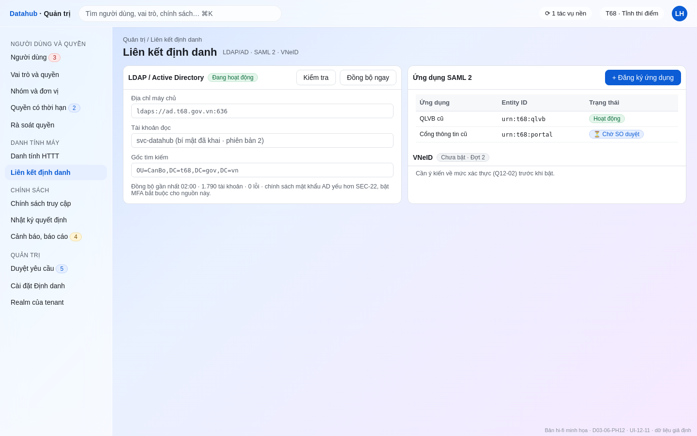

### 17.1. Ba khối cài đặt

Bảng sau chia màn Liên kết định danh thành ba khối cài đặt, nêu trường chính, hành động và ghi chú của từng khối.

| Khối | Trường chính | Hành động | Ghi chú |
|---|---|---|---|
| LDAP / AD | Địa chỉ `ldaps://` (bắt buộc TLS), gốc tìm kiếm, bộ lọc, tài khoản đọc, bí mật (chỉ ghi), ánh xạ thuộc tính | Kiểm tra, Đồng bộ ngay, Lưu | Kiểm tra trả từng bước kèm nguyên nhân (ERR-12-032); mật khẩu AD yếu hơn SEC-22 thì bật MFA bắt buộc cho nguồn này (Q12-11) |
| SAML 2 | Entity ID, URL ACS, chứng thư ký, ánh xạ thuộc tính | Đăng ký, Sửa, Gửi duyệt | ERR-12-033 khi cấu hình sai |
| VNeID | Bật/tắt, mức xác thực (`acr`), khóa liên kết | Gửi duyệt | Đợt 2; hiện "Chưa bật" kèm chú thích Q12-02 |

: UI-12-11 · Ba khối cài đặt

### 17.2. Hành vi

Bí mật tài khoản đọc LDAP chỉ nhập, sau lưu hiện "Đã khai · phiên bản n · {người} · {lúc}" (cùng quy tắc mục 2.5). Nút "Kiểm tra" chạy kết nối thử và hiện kết quả theo bước (kết nối, TLS, đăng nhập tài khoản đọc, tìm thử); chỉ khi kiểm tra đạt trong 24 giờ mới được "Gửi duyệt kích hoạt". Liên kết ở trạng thái "Chờ SO duyệt" chưa dùng được để đăng nhập. Gỡ liên kết VNeID của một người dùng thực hiện ở UI-12-02 tab Tổng quan (API-12-055).

### 17.3. Trạng thái màn

Bảng sau nêu cách màn liên kết định danh hiển thị ở từng trạng thái: đang tải, rỗng, lỗi, thiếu quyền và các trạng thái nghiệp vụ riêng của màn.

| Trạng thái | Hiển thị |
|---|---|
| Chưa có liên kết | "Tỉnh chưa liên kết thư mục nào. Người dùng đang đăng nhập bằng tài khoản Keycloak nội bộ." kèm "Khai báo LDAP/AD" |
| Đang kiểm tra | Thanh tiến độ theo bước |
| Kiểm tra không đạt | ERR-12-032 kèm hướng dẫn khắc phục theo bước |
| Chờ duyệt | `CMP-StatusTag` "Chờ SO duyệt"; nút kích hoạt vô hiệu kèm tooltip |
| Chỉ đọc | ST-15 cho người chỉ có `PERM-12-read` |

: UI-12-11 · Trạng thái màn

### 17.4. Tương tác, phím tắt và truy cập

`Ctrl+S` lưu khối đang sửa; `T` chạy kiểm tra khối đang chọn. Kết quả kiểm tra từng bước công bố qua `aria-live="polite"`; mỗi bước có chữ Đạt, Không đạt kèm biểu tượng. Trường bí mật không được trình quản lý mật khẩu của trình duyệt tự điền (`autocomplete="new-password"`).

## 18. UI-12-12 Chính sách truy cập (siêu chi tiết)

::: dac-ta
**Mục đích.** Xem các chính sách truy cập (Rego) đang chạy, soạn phiên bản mới, chạy bộ ca kiểm thử, gửi duyệt, thu hồi hoặc quay lui gói đã phát hành. Đây là màn rủi ro cao nhất của phân hệ: một dòng luật sai có thể mở quyền cho cả tỉnh hoặc khóa cả tỉnh, nên màn chặn từng bước và nói rõ vì sao chưa gửi duyệt được.

**Người dùng chính.** SO (chính sách của tỉnh); PA (chính sách nền tảng).

**FR hiện thực.** FR-12-051, 052, 055 (và FR-12-053 ở UI-12-13).

**Đường dẫn.** `/quan-tri/chinh-sach` (danh sách), `/quan-tri/chinh-sach/{ma}/thiet-ke` (trình soạn).

**Mẫu.** PTN-01 (danh sách), PTN-07 (trình soạn).

**Quyền.** `PERM-12-read` (xem); `PERM-12-policy-edit` (soạn, kiểm thử, chạy khô, gửi duyệt); `PERM-12-policy-approve` (thu hồi, quay lui).

**API.** API-12-089…094, 099, 100, 101, 102.

**Vật liệu, token.** Khung tiêu đề `glass-chrome`; ba cột nội dung đặc `color-surface-solid`, khung mã `color-surface-solid-2`; dòng lỗi nền `color-error` nhạt; viền focus `color-focus-ring`; phông mã `font-mono`.
:::

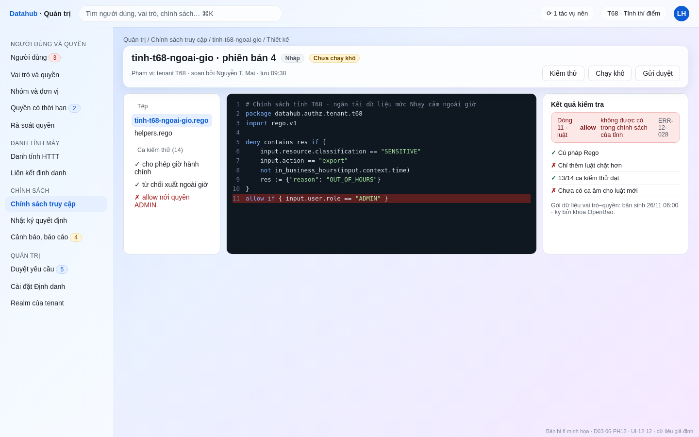

### 18.1. Mục đích, người dùng, bối cảnh

SO soạn chính sách của tỉnh thường vài lần mỗi quý, ngồi trước màn từ 20 đến 60 phút, vừa viết luật vừa chạy kiểm thử và đối chiếu với tài liệu ATTT. Họ không phải lập trình viên Rego chuyên nghiệp, nên màn hỗ trợ bằng: mẫu luật có sẵn (nút "Chèn mẫu"), giải thích lỗi bằng tiếng Việt, và ranh giới rõ ràng: chính sách của tỉnh chỉ được thêm luật từ chối (BR-12-007), nên mọi luật `allow` bị đánh dấu ngay (ERR-12-028). PA soạn chính sách nền tảng ở tenant `PLATFORM` với cùng màn, không bị giới hạn luật `allow` nhưng vẫn qua bốn mắt. Màn dùng trên máy tính để bàn từ 1280 px; dưới 1024 px chuyển chế độ chỉ đọc (ST-15), vì soạn mã trên màn hẹp rủi ro cao.

### 18.2. Danh sách chính sách (PTN-01)

Bảng sau mô tả các cột của danh sách chính sách ở phân trang PTN-01: nội dung, khả năng sắp xếp và ghi chú.

| Cột | Nội dung | Sắp xếp | Ghi chú |
|---|---|---|---|
| Mã · Tên | `CMP-CodeText` mã, tên dòng 2 | Có | Liên kết tới trình soạn |
| Phạm vi | Nền tảng hoặc Tenant {mã} | Có | Chính sách nền tảng hiển thị cho tỉnh ở dạng chỉ đọc |
| Đang chạy | Số phiên bản `PUBLISHED`, ngày phát hành, người duyệt | | Mỗi mã chính sách có đúng một phiên bản đang chạy |
| Phiên bản mới nhất | Số, `CMP-StatusTag` theo mục 5.1 | Có | |
| Cập nhật | `CMP-Timestamp` | Có | |
| ⋯ | Mở trình soạn, Tạo phiên bản nháp, Thu hồi phiên bản đang chạy | | Theo `allowedActions` |

: UI-12-12 · Cột danh sách chính sách

Phía trên bảng có hai tab: **Chính sách** và **Gói đã phát hành** (API-12-101). Tab Gói liệt kê gói đã ký: mã gói, thời điểm, người duyệt, tiến độ nạp "n/m pod OPA", băm; hàng đang chạy có nút "Quay lui về gói này" cho gói cũ (API-12-100, cần `PERM-12-policy-approve` và xác thực mức 3). Nút "Sinh lại dữ liệu vai trò–quyền" (API-12-102) hiện cho người có `PERM-12-policy-edit`, kèm ngày sinh gần nhất.

### 18.3. Lưới bố cục và kích thước

Trình soạn dùng khung 1440 × 900 làm chuẩn; chiều rộng cột tính trên vùng nội dung sau sidebar (1208 px khi sidebar mở).

| Vùng | Tên | Vị trí | Kích thước | Ghi chú |
|---|---|---|---|---|
| R1 | Thanh công cụ và tiêu đề | Trên cùng nội dung | Cao 72 px; `glass-chrome` | Tên, phiên bản, trạng thái, nút Kiểm thử, Chạy khô, Gửi duyệt |
| R2 | Cột tệp và ca kiểm thử | Trái | Rộng 200 px, kéo được 160…320 px | Cây tệp `.rego`, danh sách ca kiểm thử |
| R3 | Trình soạn mã | Giữa | Co giãn, tối thiểu 480 px | `CMP-CodeEditor`; dòng cao 20 px; số dòng |
| R4 | Cột kết quả và điều kiện | Phải | Rộng 300 px, kéo được 260…420 px | Chẩn đoán, điều kiện gửi duyệt, gói dữ liệu |
| R5 | Bảng dưới | Dưới R2…R4 | Cao 200 px, thu gọn được | Đầu ra từng ca kiểm thử: input, kết quả mong đợi, kết quả thực, vết đánh giá |
| R6 | Thanh trạng thái | Đáy | Cao 28 px | Dòng:cột, số lỗi, "Đã lưu 09:38", băm nội dung |

: UI-12-12 · Lưới bố cục

### 18.4. Wireframe tổng thể

Sơ đồ sau mô tả lưới sáu vùng của màn soạn chính sách: R1 thanh công cụ ở trên cùng, R2 danh sách tệp và ca kiểm thử bên trái, R3 trình soạn mã ở giữa, R4 kết quả kiểm tra bên phải, R5 chi tiết ca kiểm thử và R6 thanh trạng thái ở dưới.

```{.mermaid caption="Lưới bố cục màn UI-12-12 Chính sách truy cập"}
flowchart TB
  R1["R1 Thanh công cụ: tên chính sách, phiên bản 4, thẻ Nháp, thẻ Chưa chạy khô; nút Kiểm thử, Chạy khô, Gửi duyệt"]
  subgraph MID["Hàng giữa"]
    direction LR
    R2["R2 Tệp và ca kiểm thử: tệp Rego, tệp helpers, 14 ca kiểm thử"]
    R3["R3 Trình soạn mã Rego: số dòng, tô màu cú pháp, đánh dấu dòng lỗi"]
    R4["R4 Kết quả kiểm tra: cú pháp, chỉ thêm luật chặt hơn, số ca đạt, ca âm còn thiếu"]
    R2 --- R3 --- R4
  end
  R5["R5 Chi tiết ca kiểm thử: dữ liệu vào, kết quả mong đợi, kết quả thực tế"]
  R6["R6 Thanh trạng thái: dòng, cột, số lỗi, giờ lưu, mã băm"]
  R1 --> MID --> R5 --> R6
```

### 18.5. Vùng R1: thanh công cụ

Bảng sau mô tả các phần tử của vùng R1 (thanh công cụ), mã `CMP-*` của từng phần tử và hành vi khi người dùng thao tác.

| Phần tử | `CMP-*` | Hành vi |
|---|---|---|
| Tiêu đề | `CMP-Heading`, `CMP-StatusTag` | Mã chính sách, số phiên bản, trạng thái (Nháp, Chờ duyệt…); thêm nhãn "Chưa chạy khô" hoặc "Chạy khô đã cũ" khi nội dung đổi sau lần chạy khô |
| Nút "Kiểm thử" | `CMP-Button` | Lưu rồi chạy bộ ca (API-12-094), tiến độ ở R5; `Ctrl+Enter` |
| Nút "Chạy khô" | `CMP-Button` | Chạy trên lưu lượng thật (API-12-095, 202); mở tiến độ và chuyển sang UI-12-13 khi xong; `Ctrl+Shift+Enter` |
| Nút "Gửi duyệt" | `CMP-Button` primary | Vô hiệu cho tới khi đạt đủ điều kiện R4; tooltip liệt kê điều kiện còn thiếu (ERR-12-025, 026, 028) |
| Menu ⋯ | `CMP-DropdownMenu` | Chèn mẫu luật, So sánh với bản đang chạy, Bỏ nháp, Sao chép thành phiên bản mới |
| Chỉ báo lưu | `CMP-SaveIndicator` | "Đã lưu 09:38", "Đang lưu…", "Chưa lưu" với dấu `•` ở tiêu đề tab |

: UI-12-12 · Vùng R1

### 18.6. Vùng R2: cột tệp và ca kiểm thử

Cây tệp (`CMP-Tree`) liệt kê tệp `.rego` của phiên bản; chọn tệp mở ở R3. Phần "Ca kiểm thử" liệt kê từng ca với biểu tượng ✓ (đạt), ✗ (không đạt), ○ (chưa chạy) và chữ nhãn; có hai loại ca: **ca dương** (kỳ vọng cho phép) và **ca âm** (kỳ vọng từ chối). Nút "+ Ca" mở drawer: tên ca, loại, `input` dạng JSON (`CMP-CodeEditor` chế độ JSON), kết quả mong đợi (`ALLOW` hoặc `DENY` kèm `reason`). Mỗi luật `deny` mới phải có ít nhất một ca âm (ERR-12-025 khi thiếu); số ca và độ phủ luật hiện ở R4.

### 18.7. Vùng R3: trình soạn mã

Bảng sau quy định trình soạn mã Rego ở vùng R3: thành phần dùng, màu cú pháp, đánh dấu lỗi và các hành vi soạn thảo.

| Khía cạnh | Quy định |
|---|---|
| Thành phần | `CMP-CodeEditor` ngôn ngữ Rego; tô màu cú pháp theo bảng màu của `CMP-CodeEditor` (nền `color-surface-solid-2`, xem Phụ lục A) |
| Số dòng, dòng hiện tại | Hiện; dòng lỗi nền `color-error` nhạt kèm biểu tượng ⛔ ở lề trái để không phụ thuộc màu |
| Chẩn đoán | Lỗi cú pháp, lỗi biên dịch từ máy chủ (ERR-12-024) gạch chân và liệt kê ở R4; luật `allow` ở chính sách tenant bị đánh dấu (ERR-12-028) |
| Đọc nhiều tệp | Tab tệp phía trên R3, tối đa 8 tab mở |
| Giới hạn | Tệp tối đa 256 KB, tổng phiên bản 1 MB (giả định theo giới hạn gói OPA; xem Q12-32) |
| Chỉ đọc | Phiên bản không phải `DRAFT` hoặc người dùng thiếu `PERM-12-policy-edit`: soạn khóa, ST-15 |
| Dán mã | Cho phép; dán nội dung chứa chuỗi giống bí mật (`password`, khóa riêng) hiện cảnh báo "Chính sách không được chứa bí mật" |
| Khác biệt | "So sánh với bản đang chạy" mở `CMP-DiffViewer` hai cột |

: UI-12-12 · Vùng R3

### 18.8. Vùng R4: kết quả kiểm tra và điều kiện gửi duyệt

R4 gồm ba khối. **Chẩn đoán**: danh sách lỗi và cảnh báo, mỗi mục có dòng, nội dung tiếng Việt, mã lỗi; bấm một mục nhảy tới dòng trong R3. **Điều kiện gửi duyệt**: danh sách kiểm có chữ và biểu tượng; chỉ khi cả năm mục ✓ nút "Gửi duyệt" mới sáng.

| Điều kiện | Nguồn | Khi không đạt |
|---|---|---|
| Cú pháp và biên dịch Rego đạt | API-12-094 | ERR-12-024 kèm dòng |
| Chỉ thêm luật chặt hơn (chính sách tenant) | Kiểm tra tĩnh phía máy chủ | ERR-12-028 kèm dòng |
| Mọi ca kiểm thử đạt | API-12-094 | ERR-12-025 "Còn {n} ca kiểm thử không đạt hoặc chưa có ca âm." |
| Có ca âm cho mỗi luật `deny` mới | API-12-094 | ERR-12-025 |
| Đã chạy khô trên đúng nội dung hiện tại | Băm nội dung so với lần chạy khô | ERR-12-026 "Chưa chạy khô trên đúng nội dung hiện tại." |

: UI-12-12 · Điều kiện gửi duyệt

**Gói dữ liệu**: dòng "Bản sinh dữ liệu vai trò–quyền {ngày giờ}, ký bởi khóa OpenBao, khớp D02-08 phiên bản {n}" kèm nút "Sinh lại" (API-12-102).

### 18.9. Vùng R5: bảng dưới

Mỗi ca kiểm thử một dòng: tên, loại (dương, âm), kết quả mong đợi, kết quả thực, trạng thái (Đạt, Không đạt, Chưa chạy), thời gian chạy (ms). Dòng không đạt mở rộng hiện `input` và vết đánh giá (luật nào khớp) trong `CMP-JsonViewer`. Bảng thu gọn bằng `Ctrl+J`.

### 18.10. Vùng R6: thanh trạng thái

Dòng:cột, số lỗi và cảnh báo (bấm nhảy tới lỗi kế), "Đã lưu {giờ}", băm nội dung rút gọn (để so với băm của lần chạy khô). Thanh dùng `CMP-StatusBar`.

### 18.11. Lưu, đồng thời, xung đột

Tự lưu nháp sau 3 giây không gõ và khi bấm `Ctrl+S`. Lưu kèm `If-Match` của phiên bản; nếu người soạn khác (cùng chính sách) đã lưu trước, API trả ERR-12-044 và màn hiện `CMP-ConflictDialog` (ST-13) với `CMP-DiffViewer` bản của bạn và bản mới, ba lựa chọn: "Giữ bản của tôi", "Lấy bản mới", "Gộp thủ công". Sửa nội dung làm mất hiệu lực mọi kết quả kiểm thử và chạy khô đã có (nhãn "Chạy khô đã cũ"). Không có khóa độc quyền; khi có người khác đang mở cùng phiên bản, thanh tiêu đề hiện "Nguyễn T. Mai cũng đang mở" (`CMP-AvatarGroup`).

Việc tự lưu cần API ghi đè nháp mà API hiện chưa có; xem Q12-30 ở mục Câu hỏi mở và Phụ lục B.

### 18.12. Gửi duyệt, thu hồi, quay lui

"Gửi duyệt" mở `CMP-ReasonDialog` yêu cầu ghi chú thay đổi (ít nhất 10 ký tự) và nêu tóm tắt: số luật thêm, bớt, đổi; tỷ lệ quyết định đổi của lần chạy khô; sau đó phiên bản chuyển `PENDING_REVIEW`, khóa nội dung và xuất hiện ở UI-12-17 của người duyệt. "Thu hồi phiên bản đang chạy" và "Quay lui về gói này" cần `PERM-12-policy-approve`, xác thực mức 3 (ERR-12-120 nếu `auth_time` quá cũ), lý do bắt buộc, và hiện cảnh báo "Thay đổi có hiệu lực trong khoảng 60 giây cho toàn tỉnh" cùng tiến độ nạp n/m pod.

### 18.13. Trạng thái màn

Bảng sau nêu cách màn chính sách truy cập (siêu chi tiết) hiển thị ở từng trạng thái: đang tải, rỗng, lỗi, thiếu quyền và các trạng thái nghiệp vụ riêng của màn.

| Trạng thái | Hiển thị |
|---|---|
| Đang tải | Skeleton ba cột: cây tệp 6 dòng, khung mã 20 dòng xám |
| Rỗng (chưa có chính sách nào của tỉnh) | "Tỉnh chưa có chính sách riêng. Chính sách nền tảng vẫn đang áp dụng. Chính sách của tỉnh chỉ thêm quy tắc chặt hơn." kèm "Tạo chính sách" |
| Đang kiểm thử | Nút Kiểm thử quay, R5 hiện tiến độ "Đã chạy {n}/{m} ca"; sửa mã vẫn được nhưng kết quả cũ bị đánh dấu |
| Đang chạy khô | Banner "Đang chạy khô trên 24 giờ lưu lượng, còn khoảng {n} phút"; cho rời màn |
| Lỗi biên dịch | ERR-12-024 ở R4 và gạch chân dòng; nút Gửi duyệt vô hiệu |
| Hết phiên | ST-14; nội dung giữ bản nháp cục bộ |
| Mất kết nối | ST-06; tiếp tục gõ được, nút ghi vô hiệu tới khi kết nối lại |
| Không có quyền soạn | ST-15 (chỉ đọc); không có quyền xem ST-07 |
| Chính sách nền tảng ở tenant | Chỉ đọc kèm chú thích "Chính sách của nền tảng, do quản trị nền tảng quản lý" |

: UI-12-12 · Trạng thái màn

### 18.14. Bàn phím

Bảng sau liệt kê các phím tắt của màn soạn chính sách và tác dụng của từng phím, để người dùng bàn phím và trình đọc màn hình thao tác đủ chức năng.

| Phím | Tác dụng |
|---|---|
| `Ctrl+S` | Lưu nháp |
| `Ctrl+Enter` | Lưu và chạy bộ ca kiểm thử |
| `Ctrl+Shift+Enter` | Chạy khô |
| `Ctrl+P` | Mở nhanh tệp |
| `F8`, `Shift+F8` | Tới lỗi kế tiếp, lỗi trước |
| `Ctrl+/` | Chú thích hoặc bỏ chú thích dòng |
| `Alt+↑`, `Alt+↓` | Di chuyển dòng |
| `Ctrl+F`, `Ctrl+H` | Tìm, thay thế |
| `Ctrl+J` | Thu gọn hoặc mở R5 |
| `Ctrl+1`, `Ctrl+2`, `Ctrl+3` | Chuyển focus tới R2, R3, R4 |
| `Esc` rồi `Tab` | Thoát khỏi bẫy focus của trình soạn để sang vùng kế tiếp |
| `?` | Mở `CMP-ShortcutSheet` (khi focus ngoài trình soạn) |

: UI-12-12 · Bàn phím

### 18.15. Chuột

Kéo thanh chia cột để đổi rộng R2, R4 (giữ phương án bàn phím `Alt+←`, `Alt+→` khi focus ở thanh chia); nhấp đôi tên tệp để đổi tên; nhấp chuột phải ở R3 mở menu (Chèn mẫu, Sao chép đường dẫn dòng); nhấp vào lỗi ở R4 nhảy tới dòng.

### 18.16. Trợ năng

Trình soạn có `aria-label="Trình soạn chính sách Rego"` và chế độ trình đọc màn hình (bật bằng `Shift+Alt+F1` theo chuẩn của `CMP-CodeEditor`) đọc từng dòng và lỗi; mọi chẩn đoán cũng có ở R4 dưới dạng danh sách văn bản điều hướng được, nên người dùng trình đọc màn hình không phải tìm lỗi trong khung mã. Biểu tượng ✓, ✗, ⛔ luôn đi kèm chữ. Tương phản mã ≥ 4,5:1 cho cả chủ đề sáng và tối. Thông báo "Đã lưu", "Kiểm thử xong: 13/14 đạt" qua `aria-live="polite"`; thông báo lỗi chặn gửi qua `role="alert"`. Kích thước vùng chạm của thanh chia cột ≥ 24 px (WCAG 2.5.8) và có hình dạng focus rõ (`color-focus-ring`, 2 px).

### 18.17. Hiệu năng

Mở tệp 2.000 dòng ≤ 1 giây (giả định, đo ở Chrome ổn định, máy văn phòng); gõ phím phản hồi ≤ 50 ms vì tô màu cú pháp chạy ở trình duyệt; bộ ca 50 ca chạy ≤ 10 giây (giả định); không tải lại cả cây tệp khi lưu. Màn dùng hàng đợi hủy yêu cầu cũ khi người dùng gõ tiếp.

## 19. UI-12-13 Chạy khô và duyệt chính sách

::: dac-ta
**Mục đích.** Cho người duyệt thứ hai thấy hậu quả của một thay đổi chính sách trên lưu lượng thật trước khi nó có hiệu lực, rồi duyệt và phát hành hoặc từ chối kèm ý kiến.

**Người dùng chính.** SO (chính sách tỉnh), PA (chính sách nền tảng); người soạn xem kết quả chạy khô.

**FR hiện thực.** FR-12-053, 054.

**Đường dẫn.** `/quan-tri/chinh-sach/{ma}/duyet?v={n}`.

**Mẫu.** PTN-10.

**Quyền.** `PERM-12-read` xem báo cáo; duyệt, từ chối `PERM-12-policy-approve`.

**API.** API-12-095, 096, 097, 098, 101.

**Vật liệu, token.** Thẻ số và bảng đặc; thẻ "Đổi kết quả" chuyển `color-error` nền nhạt khi vượt ngưỡng 20%; ngăn kéo duyệt `glass-modal` nội dung đặc.
:::

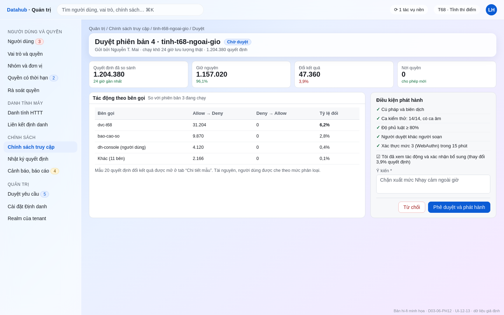

### 19.1. Bố cục

Bảng sau mô tả bố cục màn chạy khô và duyệt chính sách theo từng thành phần, kèm mã `CMP-*`, nội dung hiển thị và ghi chú.

| # | Thành phần | `CMP-*` | Nội dung | Ghi chú |
|---|---|---|---|---|
| 1 | Tiêu đề | `CMP-PageHeader`, `CMP-StatusTag` | Mã chính sách, phiên bản, "Chờ duyệt", người gửi, kỳ chạy khô | |
| 2 | Bốn thẻ số | `CMP-KpiCard` | Quyết định đã so sánh; Giữ nguyên; Đổi kết quả (% và số); Nới quyền (số quyết định từ Deny sang Allow) | "Đổi kết quả" > 20% chuyển đỏ; "Nới quyền" > 0 đánh dấu cảnh báo (BR-12-009) |
| 3 | Tab | `CMP-Tabs` | Tác động theo bên gọi; Chi tiết mẫu; So sánh luật | |
| 4 | Bảng tác động | `CMP-DataTable` | Bên gọi, Allow→Deny, Deny→Allow, tỷ lệ đổi | Sắp theo tỷ lệ giảm dần |
| 5 | Mẫu quyết định đổi | `CMP-DataTable`, `CMP-JsonViewer` | 20 mẫu, tài nguyên và người dùng che theo mức phân loại | |
| 6 | So sánh luật | `CMP-DiffViewer` | Bản đang chạy so với bản đề nghị | |
| 7 | Ngăn kéo duyệt | `CMP-DecisionPanel`, `CMP-ApprovalPanel` | Điều kiện, xác nhận bổ sung, ý kiến, nút Từ chối, Phê duyệt và phát hành | Cố định bên phải 360 px |

: UI-12-13 · Thành phần

### 19.2. Ngăn kéo duyệt

Bảng sau nêu các điều kiện mà ngăn kéo duyệt kiểm tra trước khi cho phép phê duyệt, cách hiển thị từng điều kiện và hệ quả khi không đạt.

| Điều kiện | Hiển thị | Khi không đạt |
|---|---|---|
| Cú pháp và biên dịch | ✓ Đạt | Nút phê duyệt vô hiệu |
| Ca kiểm thử (đủ ca dương, ca âm) | ✓ n/n | ERR-12-025 |
| Độ phủ luật ≥ 80% (giả định ngưỡng, tham số tenant) | ✓ phần trăm | Cảnh báo, không chặn nếu SO ghi lý do |
| Người duyệt khác người soạn, người gửi, người đóng góp | ✓ | Nút vô hiệu với ERR-12-008 |
| Xác thực mức 3 (WebAuthn) trong 15 phút | ✓ | Mở hộp "Xác nhận lại danh tính" (ERR-12-120) |

: UI-12-13 · Điều kiện trong ngăn kéo duyệt

Khi thay đổi lớn (> 20% quyết định đổi) hoặc có trường hợp nới quyền, ngăn kéo hiện hộp kiểm "Tôi đã xem tác động và xác nhận bổ sung" và ô ý kiến bắt buộc; thiếu thì ERR-12-029 "Thay đổi này đổi {tỷ lệ}% quyết định. Tích xác nhận và nhập ý kiến để tiếp tục.". Sau "Phê duyệt và phát hành", màn hiện tiến độ phát hành "Đã ký gói, đã nạp n/m pod OPA" tới khi đạt 100% (≤ 60 giây).

### 19.3. Trạng thái màn

Bảng sau nêu cách màn chạy khô và duyệt chính sách hiển thị ở từng trạng thái: đang tải, rỗng, lỗi, thiếu quyền và các trạng thái nghiệp vụ riêng của màn.

| Trạng thái | Hiển thị |
|---|---|
| Đang chạy khô | `CMP-JobProgress` "Đã xử lý {n}/{m} quyết định"; thẻ số cập nhật dần, ghi chú "kết quả tạm thời" |
| Chạy khô đã cũ | `CMP-Alert` "Nội dung đã đổi sau lần chạy khô. Chạy khô lại trước khi duyệt." (ERR-12-026), nút duyệt vô hiệu |
| Người duyệt là người soạn | Nút vô hiệu, tooltip ERR-12-008 |
| Từ chối thành công | Phiên bản sang `CHANGES_REQUESTED`, người soạn nhận thông báo kèm ý kiến |
| Đang phát hành | Tiến độ nạp pod, nút khóa |
| Phát hành thất bại | `CMP-Alert` lỗi, phiên bản giữ `APPROVED`, nút "Thử lại"; bản cũ vẫn chạy |
| Không có quyền | ST-07 |

: UI-12-13 · Trạng thái màn

### 19.4. Tương tác, phím tắt và truy cập

`1`, `2`, `3` chuyển tab; `A` đặt focus vào ô ý kiến; `Ctrl+Enter` phê duyệt khi mọi điều kiện đạt (có hộp xác nhận cuối). Thẻ "Đổi kết quả" đọc là "Đổi kết quả 3,9 phần trăm, dưới ngưỡng 20 phần trăm" để không dựa vào màu; ngăn kéo là vùng `role="complementary"` có nhãn "Duyệt chính sách".

## 20. UI-12-14 Nhật ký quyết định

::: dac-ta
**Mục đích.** Tra cứu quyết định ủy quyền (cho phép, từ chối) và sự kiện an ninh để điều tra vì sao một người hoặc một HTTT bị từ chối, theo dõi tỷ lệ từ chối, xuất bằng chứng cho kiểm toán.

**Người dùng chính.** SO, AU; TA, PA, PO (PO chỉ trong phạm vi quyền có thời hạn).

**FR hiện thực.** FR-12-057, 058.

**Đường dẫn.** `/quan-tri/nhat-ky-quyet-dinh`.

**Mẫu.** PTN-11.

**Quyền.** `PERM-12-decision-read`.

**API.** API-12-103, 104, 105.

**Vật liệu, token.** Bảng đặc, biểu đồ `CMP-Chart` dùng `color-chart-1`, `color-chart-2`; chi tiết nền `color-surface-solid-2`.
:::

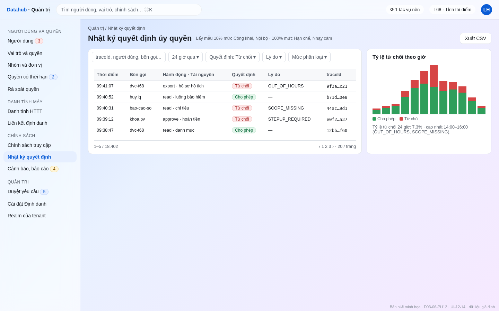

### 20.1. Thành phần

Bảng sau liệt kê các thành phần của màn nhật ký quyết định, mỗi dòng nêu mã `CMP-*` của design system, nội dung hiển thị và điều kiện kiểm tra.

| # | Thành phần | `CMP-*` | Nội dung, kiểm tra | Ghi chú |
|---|---|---|---|---|
| 1 | Thanh lọc | `CMP-FilterBar`, `CMP-SearchField`, `CMP-DateRangePicker` | Tìm `traceId`, người dùng, bên gọi; khoảng thời gian (`khoang`, `tu`, `den`); quyết định; lý do; mức phân loại | Tối đa 7 ngày mỗi truy vấn, lâu hơn qua xuất (giả định) |
| 2 | Biểu đồ | `CMP-Chart` | Cột chồng cho phép/từ chối theo giờ; có nút "Xem dạng bảng" | Màu kèm hoa văn hoặc nhãn, theo D03-05 |
| 3 | Bảng quyết định | `CMP-DataTable` | Cột mục 20.2; dòng mới nhất trước | Phân trang bằng con trỏ |
| 4 | Chi tiết | `CMP-Drawer`, `CMP-JsonViewer`, `CMP-MaskedValue` | Toàn bộ yêu cầu, chính sách khớp, `reason`, vết; trường nhạy cảm che | Xem đầy đủ được ghi vết lượt xem |
| 5 | Xuất | `CMP-Button` | CSV theo bộ lọc, đã che | Giới hạn 100.000 dòng; ghi vết xuất |
| 6 | Dải lấy mẫu | `CMP-Alert` thông tin | "Quyết định cho phép mức Công khai, Nội bộ chỉ lấy mẫu 10%. Mức Hạn chế, Nhạy cảm ghi 100%." | FR-12-057, Q12-12 |

: UI-12-14 · Thành phần

### 20.2. Cột bảng

Bảng sau mô tả các cột của danh sách trên màn nhật ký quyết định: nội dung, khả năng sắp xếp và ghi chú hiển thị.

| Cột | Nội dung | Ghi chú |
|---|---|---|
| Thời điểm | `HH:mm:ss`, tooltip đầy đủ | Sắp xếp được |
| Bên gọi | Người dùng hoặc client | Liên kết tới UI-12-02 hoặc UI-12-10 khi có quyền |
| Hành động · Tài nguyên | Ví dụ "export · hồ sơ hộ tịch" | Tài nguyên nhạy cảm che |
| Quyết định | `CMP-StatusTag` Cho phép, Từ chối | Có biểu tượng ✓, ✗ |
| Lý do | Nhãn tiếng Việt theo mục 5.3, mã trong tooltip | Chỉ có với Từ chối |
| `traceId` | `CMP-CodeText` rút gọn, `CMP-CopyButton` | Dán vào Tempo để xem vết (PH-13) |

: UI-12-14 · Cột bảng

### 20.3. Trạng thái màn

Bảng sau nêu cách màn nhật ký quyết định hiển thị ở từng trạng thái: đang tải, rỗng, lỗi, thiếu quyền và các trạng thái nghiệp vụ riêng của màn.

| Trạng thái | Hiển thị |
|---|---|
| Đang tải | Skeleton biểu đồ và 8 dòng |
| Không có kết quả | ST-04 "Không có quyết định nào khớp. Thử mở rộng khoảng thời gian." Nhắc "Lưu ý: quyết định cho phép mức thấp chỉ lấy mẫu" |
| Dữ liệu chậm | `CMP-Banner` "Nhật ký trễ khoảng {n} giây so với thời gian thực" |
| Vượt khoảng cho phép | "Khoảng thời gian tối đa 7 ngày. Dùng Xuất để lấy khoảng dài hơn." |
| Không ghi vết xem đầy đủ được | ERR-12-124 (PTN-13) khi PH-13 không ghi nhận lượt xem |
| Không có quyền | ST-07; PO ngoài phạm vi quyền có thời hạn thấy ERR-12-007 |

: UI-12-14 · Trạng thái màn

### 20.4. Tương tác, phím tắt và truy cập

`/` vào ô tìm; `↑`, `↓` chọn dòng, `Enter` mở chi tiết, `Esc` đóng; `C` sao chép `traceId` dòng chọn; `X` xuất. Biểu đồ có bảng dữ liệu tương đương (nút "Xem dạng bảng") và mô tả văn bản "Tỷ lệ từ chối 24 giờ 7,3%, cao nhất 14:00 đến 16:00" cho trình đọc màn hình. Bảng có `aria-rowcount` vì danh sách rất dài.

## 21. UI-12-15 Cảnh báo và báo cáo tài khoản

::: dac-ta
**Mục đích.** Cho cán bộ ATTT thấy cảnh báo an ninh đang mở (dò mật khẩu, đăng nhập từ vị trí lạ, từ chối tăng đột biến), xác nhận xử lý, tinh chỉnh ngưỡng; và cho TA, SO, AU xem báo cáo độ phủ yếu tố thứ hai, tài khoản không dùng, lượt tự vô hiệu.

**Người dùng chính.** SO, TA; AU, PA xem.

**FR hiện thực.** FR-12-008, 056, 059, 060.

**Đường dẫn.** `/quan-tri/canh-bao-an-ninh`.

**Mẫu.** PTN-06.

**Quyền.** `PERM-12-alert` (cảnh báo); `PERM-12-read` (báo cáo).

**API.** API-12-105, 106, 107, 108, 109.

**Vật liệu, token.** Thẻ số và biểu đồ đặc; cột thanh `color-chart-1`; mức Cao `color-error`, Trung bình `color-warning`, Thấp `color-info`.
:::

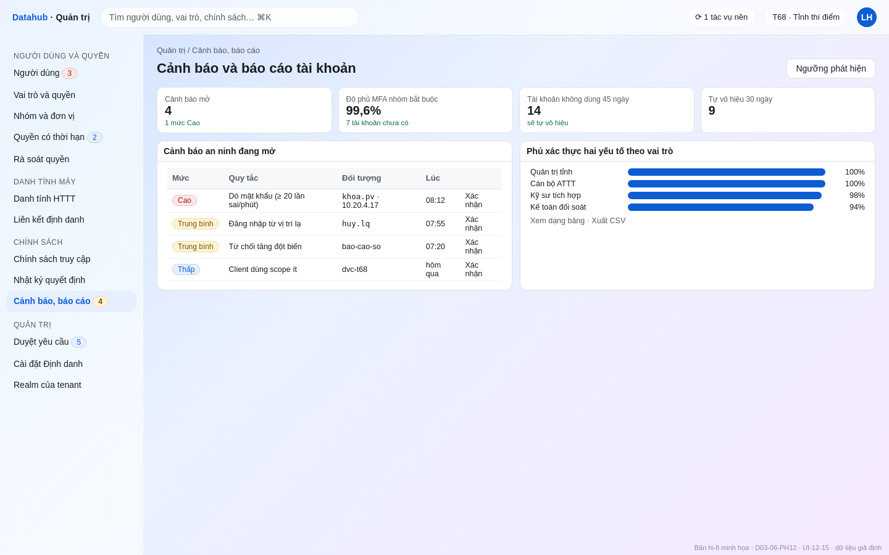

### 21.1. Thành phần

Bảng sau liệt kê các thành phần của màn cảnh báo và báo cáo tài khoản, mỗi dòng nêu mã `CMP-*` của design system, nội dung hiển thị và điều kiện kiểm tra.

| # | Thành phần | `CMP-*` | Nội dung | Ghi chú |
|---|---|---|---|---|
| 1 | Thẻ số | `CMP-KpiCard` | Cảnh báo mở; độ phủ MFA nhóm bắt buộc; tài khoản không dùng 45 ngày; tự vô hiệu 30 ngày | Mỗi thẻ có đường dẫn tới danh sách lọc ở UI-12-01 |
| 2 | Bảng cảnh báo | `CMP-DataTable` | Mức, quy tắc, đối tượng, thời điểm, nút "Xác nhận" | "Xác nhận" cần ghi chú ngắn (ít nhất 10 ký tự) |
| 3 | Biểu đồ độ phủ MFA | `CMP-Chart` | Thanh ngang theo vai trò; có bảng tương đương | |
| 4 | Ngưỡng phát hiện | `CMP-Drawer` | Điều chỉnh ngưỡng quy tắc trong miền cho phép | ERR-12-043 khi vượt trần; ghi tham số `12.*` |
| 5 | Tab báo cáo | `CMP-Tabs` | Tài khoản không dùng, lượt tự vô hiệu, sự kiện xác thực | Xuất CSV |

: UI-12-15 · Thành phần

### 21.2. Trạng thái màn

Bảng sau nêu cách màn cảnh báo và báo cáo tài khoản hiển thị ở từng trạng thái: đang tải, rỗng, lỗi, thiếu quyền và các trạng thái nghiệp vụ riêng của màn.

| Trạng thái | Hiển thị |
|---|---|
| Không có cảnh báo | "Không có cảnh báo mở. Hệ thống vẫn đang theo dõi." với biểu tượng tích |
| Cảnh báo mức Cao | `CMP-Banner` đỏ đầu trang, `role="alert"` |
| Báo cáo chưa có dữ liệu | "Chưa đủ dữ liệu để lập báo cáo. Báo cáo cập nhật mỗi giờ." |
| Không có quyền cảnh báo | Tab Cảnh báo ẩn; còn tab Báo cáo theo `PERM-12-read` |

: UI-12-15 · Trạng thái màn

### 21.3. Tương tác, phím tắt và truy cập

`J`, `K` xuống, lên dòng cảnh báo; `A` xác nhận dòng chọn; `1`, `2` chuyển tab. Mức cảnh báo luôn có chữ "Cao", "Trung bình", "Thấp" bên cạnh màu. Biểu đồ có bảng dữ liệu và mô tả văn bản; khi có cảnh báo mới xuất hiện (làm mới tự động 60 giây) công bố bằng `aria-live="polite"`.

## 22. UI-12-16 Cài đặt Định danh

::: dac-ta
**Mục đích.** Cho quản trị tỉnh chỉnh các tham số `12.*` của tenant (khóa tạm, số phiên, thời hạn token, ngưỡng cảnh báo, miền thư điện tử…) trong trần do nền tảng đặt; không thể đặt yếu hơn mức bắt buộc của TCVN 14423:2026.

**Người dùng chính.** TA; PA (tenant `PLATFORM` và trần nền tảng).

**FR hiện thực.** FR-12-061.

**Đường dẫn.** `/quan-tri/cai-dat-dinh-danh`.

**Mẫu.** PTN-12.

**Quyền.** `PERM-12-read` xem; sửa `PERM-12-admin`.

**API.** API-12-110, 111.

**Vật liệu, token.** Thẻ nhóm đặc `color-surface-solid`; ô vượt miền viền `color-error`; thanh lưu cố định đáy `glass-chrome`.
:::

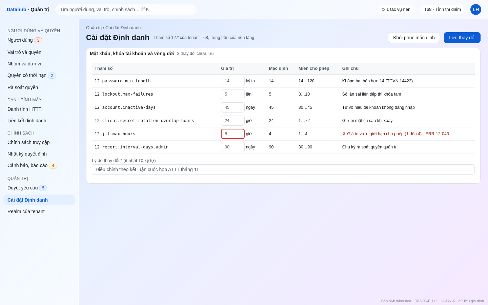

### 22.1. Nhóm tham số

Tham số chia nhóm theo mục đích, mỗi nhóm một thẻ có thể thu gọn; danh sách đầy đủ 38 khóa `12.*` và miền ở FRS PH-12 §8.2, không lặp lại ở đây.

| Nhóm | Khóa tiêu biểu | Kiểu nhập |
|---|---|---|
| Mật khẩu và khóa tài khoản | `12.password.min-length`, `12.lockout.max-failures`, `12.lockout.duration-minutes`, `12.lockout.permanent-after` | `CMP-NumberInput` |
| Phiên và token | `12.session.max-concurrent`, `12.session.max-hours`, `12.token.access-seconds`, `12.mfa.stepup-minutes` | `CMP-NumberInput` |
| Vòng đời tài khoản và client | `12.account.inactive-days`, `12.account.inactive-days-admin`, `12.client.inactive-days`, `12.activation.ttl-hours`, `12.client.secret-rotation-overlap-hours` | `CMP-NumberInput` |
| Thư điện tử, liên kết ngoài | `12.email.allowed-domains`, `12.vneid.enabled`, `12.role.custom-enabled` | `CMP-Select` nhiều giá trị, `CMP-Switch` |
| Quyền có thời hạn, rà soát | `12.jit.max-hours`, `12.sod.exception-max-days`, `12.recert.interval-days.admin`, `12.recert.deadline-days` | `CMP-NumberInput` |
| Chính sách và quyết định | `12.policy.dryrun.window-hours`, `12.policy.dryrun.change-threshold`, `12.decision.sample-ratio`, `12.pep.timeout-ms`, `12.cache.ttl-seconds` | `CMP-NumberInput` |
| Cảnh báo và nhập liệu | `12.alert.login-fail-per-minute`, `12.alert.business-hours`, `12.alert.allowed-cidrs`, `12.import.max-rows` | `CMP-NumberInput`, `CMP-Input`, `CMP-Select` chế độ nhiều giá trị |

: UI-12-16 · Nhóm tham số

### 22.2. Bảng tham số trong một nhóm

Bảng sau mô tả các cột của bảng tham số trong một nhóm cài đặt Định danh, gồm tên tham số, nội dung hiển thị và ghi chú.

| Cột | Nội dung | Ghi chú |
|---|---|---|
| Tham số | Tên tiếng Việt, khóa `CMP-CodeText` | |
| Giá trị | Ô nhập kèm đơn vị | Sai kiểu, vượt miền: ERR-12-043 "Giá trị vượt giới hạn cho phép ({tối thiểu} đến {tối đa})." |
| Mặc định | Giá trị mặc định của nền tảng | Nút "Khôi phục" từng dòng |
| Miền cho phép | Trần của nền tảng | Hạ yếu hơn bắt buộc bị chặn |
| Ghi chú | Ý nghĩa, căn cứ (TCVN 14423) | |

: UI-12-16 · Cột bảng tham số

Thanh lưu ở đáy hiện khi có thay đổi: "Có {n} thay đổi chưa lưu" và nút "Lưu thay đổi". Lưu cần lý do (ít nhất 10 ký tự, ERR-12-014) vì tham số bảo mật là bằng chứng kiểm toán; thay đổi tham số bảo mật còn cần xác thực lại mức 3 (ERR-12-120). Lưu kèm `If-Match`; xung đột hiện ERR-12-044.

### 22.3. Trạng thái màn

Bảng sau nêu cách màn cài đặt Định danh hiển thị ở từng trạng thái: đang tải, rỗng, lỗi, thiếu quyền và các trạng thái nghiệp vụ riêng của màn.

| Trạng thái | Hiển thị |
|---|---|
| Đang tải | Skeleton 3 thẻ nhóm |
| Có thay đổi chưa lưu | Thanh lưu đáy; rời trang thì hỏi "Bỏ thay đổi chưa lưu?" |
| Vượt miền | Viền đỏ, chữ ERR-12-043 dưới ô; nút Lưu vô hiệu |
| Chỉ đọc | ST-15 cho người chỉ có `PERM-12-read` |
| Lưu thành công | ST-10 "Đã lưu tham số. Có hiệu lực cho đăng nhập mới." |

: UI-12-16 · Trạng thái màn

### 22.4. Tương tác, phím tắt và truy cập

`Ctrl+S` lưu; `Esc` hủy chỉnh ô đang nhập. Đơn vị ghi trong nhãn (không chỉ placeholder); lỗi gắn `aria-describedby`; nhóm thu gọn dùng `aria-expanded`.

## 23. UI-12-17 Duyệt yêu cầu của PH-12

::: dac-ta
**Mục đích.** Một chỗ duy nhất để người duyệt xử lý mọi yêu cầu của PH-12 cần người thứ hai: ngoại lệ tách nhiệm vụ, quyền có thời hạn, chính sách, đặt lại yếu tố thứ hai của tài khoản quản trị, kích hoạt liên kết định danh ngoài.

**Người dùng chính.** SO, PA; người rà soát cho mục được giao.

**FR hiện thực.** FR-12-013, 017, 018, 024, 054.

**Đường dẫn.** `/viec-cua-toi?loai=ph12.*`.

**Mẫu.** PTN-10.

**Quyền.** `PERM-12-approve` (ngoại lệ, liên kết, đặt lại yếu tố thứ hai quản trị); `PERM-12-jit-approve`; `PERM-12-policy-approve`; người rà soát được giao.

**API.** API-12-030, 031, 038, 039, 043, 096…098; API-12-015.

**Vật liệu, token.** Danh sách và chi tiết đặc; khung chi tiết `color-surface-solid-2`; mục sắp hết hạn `color-warning-text`.
:::

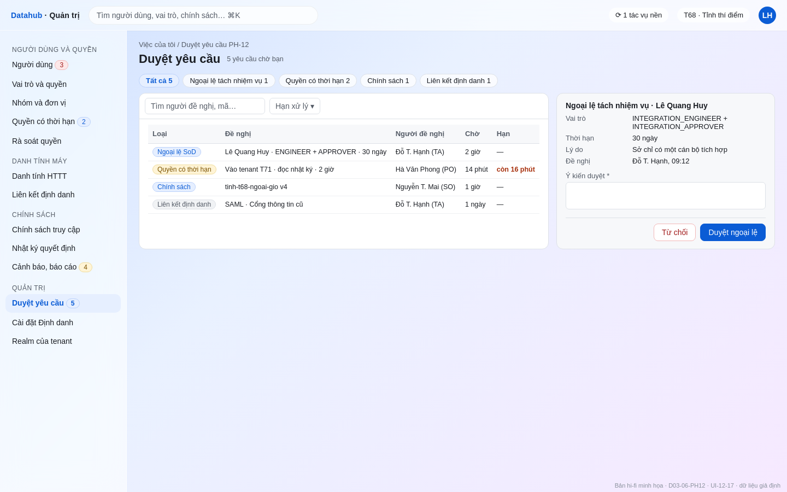

### 23.1. Bố cục hai khung

Khung trái là danh sách yêu cầu chờ (`CMP-DataTable`) với bộ lọc nhanh theo loại (`CMP-FilterChips`); khung phải là chi tiết yêu cầu đang chọn (`CMP-ApprovalPanel`). Một yêu cầu hết hạn (quyền có thời hạn chờ quá 30 phút, giả định) tự chuyển "Hết hạn" và biến mất khỏi danh sách chờ.

| Loại | Chi tiết hiển thị | Hành động | API |
|---|---|---|---|
| Ngoại lệ tách nhiệm vụ | Người dùng, cặp vai trò, thời hạn, lý do, người đề nghị | Duyệt, Từ chối kèm ý kiến | API-12-030 |
| Quyền có thời hạn | Người đề nghị, quyền hoặc tenant đích, thời hạn, mã phiếu, lý do | Duyệt, Từ chối | API-12-038, 039 |
| Chính sách | Tóm tắt thay đổi, tác động chạy khô; liên kết mở UI-12-13 | Mở để duyệt (duyệt ở UI-12-13) | API-12-097, 098 |
| Đặt lại yếu tố thứ hai (quản trị) | Tài khoản, người đề nghị, lý do, xác minh danh tính | Duyệt, Từ chối | API-12-015 |
| Liên kết định danh ngoài | Loại (LDAP, SAML, VNeID), kết quả kiểm tra đạt gần nhất | Duyệt kích hoạt, Từ chối | API-12-048…053 |
| Rà soát quyền | Mục giao cho tôi | Giữ, Gỡ | API-12-043 |

: UI-12-17 · Loại yêu cầu

### 23.2. Quy tắc bốn mắt trên giao diện

Yêu cầu do chính người dùng tạo vẫn hiện trong danh sách (để họ theo dõi) nhưng nút "Duyệt" vô hiệu kèm tooltip ERR-12-008; người duyệt không được trùng người đề nghị, người soạn, người gửi hoặc người đóng góp (BR-12-008, 032). Duyệt các loại nhạy cảm (chính sách, đặt lại yếu tố thứ hai quản trị, liên kết ngoài) cần xác thực mức 3 (hộp "Xác nhận lại danh tính"). Từ chối bắt buộc ý kiến (ít nhất 10 ký tự).

### 23.3. Trạng thái màn

Bảng sau nêu cách màn duyệt yêu cầu của PH-12 hiển thị ở từng trạng thái: đang tải, rỗng, lỗi, thiếu quyền và các trạng thái nghiệp vụ riêng của màn.

| Trạng thái | Hiển thị |
|---|---|
| Rỗng | "Không có yêu cầu nào chờ bạn. Yêu cầu mới sẽ hiện ở đây và báo qua trung tâm thông báo." |
| Đã được người khác xử lý | `CMP-Alert` "Yêu cầu đã được {người} xử lý lúc {giờ}"; ERR-12-027 nếu cố duyệt |
| Tự duyệt | Nút vô hiệu, ERR-12-008 |
| Không có quyền duyệt loại này | Loại không hiện trong bộ lọc |

: UI-12-17 · Trạng thái màn

### 23.4. Tương tác, phím tắt và truy cập

`J`, `K` chọn yêu cầu kế, trước; `A` duyệt (mở hộp xác nhận); `R` từ chối; `Enter` mở chi tiết. Hai khung là `role="region"` có nhãn "Danh sách yêu cầu", "Chi tiết yêu cầu"; khi chọn yêu cầu, focus chuyển sang tiêu đề chi tiết và công bố "Đang xem yêu cầu {loại}".

## 24. UI-12-18 Trang xác thực của Keycloak

::: dac-ta
**Mục đích.** Trang người dùng nhìn thấy khi đăng nhập: nhập tên đăng nhập và mật khẩu, yếu tố thứ hai, kích hoạt lần đầu, đặt lại mật khẩu, xác thực lại bước lên, chọn nguồn đăng nhập (Keycloak, LDAP/AD, VNeID). Do Keycloak dựng bằng theme riêng của từng tenant, không thuộc `dh-console`; đặc tả ở đây để giao diện, ngôn ngữ và quy tắc an ninh thống nhất.

**Người dùng chính.** Mọi người dùng giao diện.

**FR hiện thực.** FR-12-006, 007, 020, 021, 022, 023, 027, 028.

**Đường dẫn.** `/realms/dh-{tenant}/protocol/openid-connect/auth` (Keycloak); `dh-console` chuyển hướng tới đây theo OIDC với PKCE.

**Mẫu.** Ngoài khung `dh-console`; theme Keycloak dựng bằng mẫu FreeMarker và biến CSS token của D03-05; thành phần tương đương `CMP-Input`, `CMP-Button`, `CMP-Alert` chỉ về mặt hình thức.

**Quyền.** Công khai (chưa xác thực).

**API.** API-12-072, 073, 074, 076, 078 (OIDC của Keycloak).

**Vật liệu, token.** Hộp đặc `color-surface-solid` rộng 420 px trên nền `color-canvas-wash`, không kính; chữ `color-text-primary`; lỗi `color-error-text`; nút chính `color-accent`; viền focus `color-focus-ring`.
:::

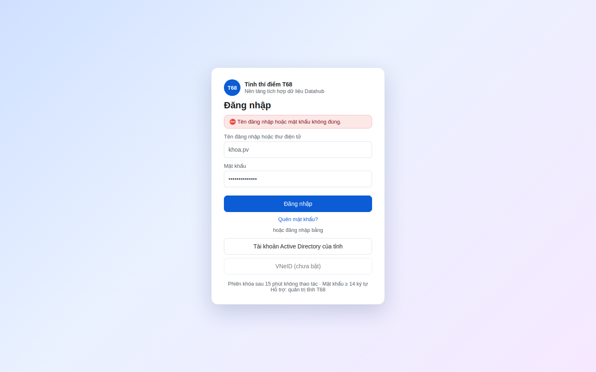

### 24.1. Các trang trong luồng

Bảng sau liệt kê các trang của luồng xác thực do Keycloak hiển thị, nội dung từng trang và thông báo lỗi tiêu biểu theo mã `ERR-12-*`.

| Trang | Nội dung | Thông báo lỗi tiêu biểu |
|---|---|---|
| Đăng nhập | Tên đăng nhập hoặc thư, mật khẩu, "Quên mật khẩu?", chọn nguồn đăng nhập (AD, VNeID) | ERR-12-111, 112, 113, 125, 121 |
| Yếu tố thứ hai | Mã TOTP 6 số hoặc "Dùng khóa bảo mật" (WebAuthn) | ERR-12-111 (dùng chung câu), ERR-12-112 |
| Đăng ký yếu tố thứ hai | Quét mã QR hoặc đăng ký khóa; bắt buộc với nhóm `mfa-required` | — |
| Kích hoạt lần đầu | Đặt mật khẩu (≥ 14 ký tự, chỉ báo độ mạnh), xác nhận mật khẩu | ERR-12-015, ERR-12-016 |
| Quên mật khẩu | Nhập tên đăng nhập hoặc thư; luôn hiện "Nếu tài khoản tồn tại, liên kết đã được gửi" | Không lộ tài khoản (BR-12-017) |
| Xác thực lại | Hộp "Xác nhận lại danh tính" khi thao tác nhạy cảm (mức 3) | ERR-12-120 |
| Chọn tenant | Người dùng thuộc nhiều tenant chọn tenant; đăng nhập riêng từng realm | Q12-01 |
| Thông báo hệ thống | Tenant tạm ngừng, bảo trì | ERR-12-121, ERR-12-038 |

: UI-12-18 · Các trang trong luồng

### 24.2. Quy tắc an ninh trên trang

Thông báo sai tên đăng nhập và sai mật khẩu giống hệt nhau cả nội dung lẫn thời gian phản hồi (BR-12-017). Trường mật khẩu `autocomplete="current-password"`, cho phép dán (không chặn trình quản lý mật khẩu); có nút hiện mật khẩu `aria-pressed`. Sau năm lần sai liên tiếp hiện ERR-12-112 với số phút còn lại. Khóa phiên sau 15 phút không thao tác; trang không nhúng được vào khung (`frame-ancestors 'none'`). Không có trường "ghi nhớ đăng nhập" trên máy dùng chung. Biểu trưng và tên tỉnh theo tenant (tham số PH-20), nhưng cấu trúc, văn bản bảo mật không đổi theo tenant.

### 24.3. Trạng thái màn

Bảng sau nêu cách màn trang xác thực của Keycloak hiển thị ở từng trạng thái: đang tải, rỗng, lỗi, thiếu quyền và các trạng thái nghiệp vụ riêng của màn.

| Trạng thái | Hiển thị |
|---|---|
| Đang xử lý | Nút "Đăng nhập" quay, khóa biểu mẫu |
| Sai thông tin | `CMP-Alert` lỗi đầu hộp, ERR-12-111; focus về trường tên đăng nhập |
| Khóa tạm, khóa hẳn | ERR-12-112, ERR-12-113 |
| Tenant tạm ngừng | ERR-12-121 thay biểu mẫu, chỉ còn liên hệ hỗ trợ |
| Keycloak lỗi | ERR-12-038 `CMP-Banner` |
| Phiên hết hạn khi đang dùng | Quay lại trang đăng nhập kèm "Phiên đăng nhập đã hết hạn. Vui lòng đăng nhập lại." (ERR-12-116) và quay về URL cũ sau đăng nhập |

: UI-12-18 · Trạng thái màn

### 24.4. Tương tác, phím tắt và truy cập

`Enter` gửi biểu mẫu; `Tab` theo thứ tự tên đăng nhập, mật khẩu, nút, liên kết quên mật khẩu, nguồn khác. Mọi trường có nhãn thấy được; lỗi `role="alert"` và `aria-describedby`; WebAuthn có phương án thay thế bằng TOTP cho người không có khóa (trừ nhóm bắt buộc WebAuthn, SEC-23). Tiêu chí WCAG 3.3.8 (xác thực dễ truy cập): không bắt người dùng ghi nhớ hay chép mã; cho dán mật khẩu và mã TOTP. Trang dùng được ở 320 px (reflow, WCAG 1.4.10).

## 25. UI-12-19 Realm của tenant

::: dac-ta
**Mục đích.** Cho quản trị nền tảng thấy trạng thái realm Keycloak của từng tenant, cấu hình có lệch mẫu Git hay không, đối chiếu, áp lại mẫu, xem lịch xoay khóa ký, tạm ngừng hoặc khôi phục realm theo vòng đời tenant, và xem kế hoạch chuyển định danh khi sáp nhập tenant.

**Người dùng chính.** PA (ở tenant `PLATFORM`).

**FR hiện thực.** FR-12-019 (Đợt 2), 039, 041, 042, 043.

**Đường dẫn.** `/nen-tang/realm`, `/nen-tang/realm/{maTenant}`.

**Mẫu.** PTN-02 (chi tiết); danh sách dùng PTN-01.

**Quyền.** `PERM-12-realm-admin`.

**API.** API-12-045, 046, 075, 080…085.

**Vật liệu, token.** Khung tiêu đề `glass-chrome`; bảng khác biệt đặc; ô giá trị thực tế lệch màu `color-diff-changed` kèm chữ.
:::

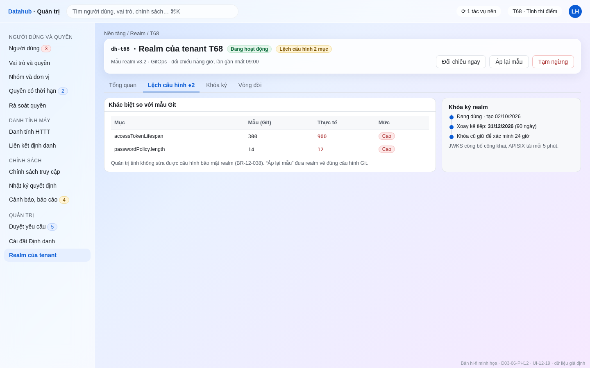

### 25.1. Các tab

Bảng sau mô tả các tab của màn realm của tenant, mỗi tab nêu nội dung, thành phần `CMP-*` và API được gọi.

| Tab | Nội dung | `CMP-*` | API |
|---|---|---|---|
| Tổng quan | Tên realm `dh-{mã tenant}`, trạng thái, mẫu áp dụng, lần đối chiếu gần nhất, số người dùng, số client | `CMP-DescriptionList` | API-12-081 |
| Lệch cấu hình | Bảng mục, giá trị mẫu (Git), giá trị thực tế, mức (Cao, Thấp); nút "Đối chiếu ngay", "Áp lại mẫu" | `CMP-DiffTable`, `CMP-DataTable` | API-12-082, 083 |
| Khóa ký | Khóa đang dùng, ngày tạo, ngày xoay kế tiếp (90 ngày), khóa cũ giữ 24 giờ; liên kết JWKS công khai | `CMP-Timeline` | API-12-075 |
| Vòng đời | Tạm ngừng, khôi phục, chuyển chỉ-đọc theo tenant; kế hoạch chuyển định danh khi sáp nhập | `CMP-Steps`, `CMP-ConfirmDialog` | API-12-084, 085, 045, 046 |

: UI-12-19 · Các tab

### 25.2. Hành vi

"Áp lại mẫu" đưa realm về đúng cấu hình Git (mất mọi thay đổi tay), nên mở `CMP-ReasonDialog` nêu số mục sẽ đổi và cần xác thực mức 3; thực hiện bất đồng bộ (202), tiến độ ở `CMP-BackgroundTaskTray`. "Tạm ngừng" nêu hậu quả "Chỉ quản trị tỉnh đăng nhập được, chế độ chỉ đọc; mọi người dùng và client khác bị từ chối" và cần lý do. Quản trị tỉnh không thấy màn này; họ chỉ thấy trạng thái chung qua ERR-12-121 khi đăng nhập (BR-12-038).

### 25.3. Trạng thái màn

Bảng sau nêu cách màn realm của tenant hiển thị ở từng trạng thái: đang tải, rỗng, lỗi, thiếu quyền và các trạng thái nghiệp vụ riêng của màn.

| Trạng thái | Hiển thị |
|---|---|
| Realm đang khởi tạo | `CMP-Steps` tiến độ, mục tiêu ≤ 5 phút (FR-12-041) |
| Không lệch | "Realm khớp mẫu {phiên bản}. Đối chiếu gần nhất {giờ}." |
| Đang đối chiếu hoặc áp mẫu | `CMP-Banner` ERR-12-042; nút ghi khóa |
| Tenant tạm ngừng | `CMP-StatusTag` "Tạm ngừng"; nút "Khôi phục" |
| Thao tác sai trạng thái | ERR-12-041 thông báo nổi |
| Không có quyền | ST-07 (ERR-12-007) |

: UI-12-19 · Trạng thái màn

### 25.4. Tương tác, phím tắt và truy cập

`/` vào ô tìm realm; `D` đối chiếu ngay; `Enter` mở chi tiết. Bảng khác biệt không chỉ tô màu ô lệch mà thêm cột "Mức" bằng chữ, và dùng ký hiệu "mẫu → thực tế" cho trình đọc màn hình.

## 26. Mẫu truy cập, kiến trúc mã giao diện và luồng người dùng chính

### 26.1. Mẫu truy cập chung (WCAG 2.2 AA)

Mọi màn của PH-12 phải đạt WCAG 2.2 mức AA như D03-06-00 §6. Bảng dưới gom các điểm riêng của phân hệ, mà mục "Tương tác, phím tắt và truy cập" của từng màn đã cụ thể hóa.

| Tiêu chí WCAG 2.2 | Cách PH-12 đáp ứng |
|---|---|
| 1.4.1 Không chỉ dùng màu | Mọi trạng thái, mức cảnh báo, quyết định, ô lỗi có chữ và biểu tượng kèm màu |
| 1.4.3, 1.4.11 Tương phản | Chữ ≥ 4,5:1, biểu tượng và viền điều khiển ≥ 3:1, trên nền đặc; mã Rego ≥ 4,5:1 |
| 1.4.10 Reflow | UI-12-18 dùng được ở 320 px; màn quản trị từ 1280 px, dưới 1024 px chuyển chỉ đọc cho màn soạn (UI-12-12) |
| 2.1.1, 2.1.2 Bàn phím, không bẫy | Mọi hành động có phương án bàn phím; trình soạn mã thoát bằng `Esc` rồi `Tab` |
| 2.1.4 Phím tắt một ký tự | Phím tắt `J`, `K`, `A`, `R`, `N`… chỉ hoạt động khi focus ở danh sách, không ở ô nhập; có tùy chọn tắt hoặc đổi ở Cài đặt cá nhân (đề nghị ở Phụ lục A) |
| 2.4.3, 2.4.7, 2.4.11 Thứ tự focus, thấy focus, focus không bị che | Drawer bẫy focus và trả focus; focus ring `color-focus-ring` 2 px; thanh lưu đáy không che phần tử đang focus (đệm cuộn `scroll-padding`) |
| 2.5.7 Thay thế kéo thả | Kéo thả cây nhóm, đổi cột có phương án nút và bàn phím |
| 2.5.8 Kích thước mục tiêu | Vùng chạm ≥ 24 × 24 px |
| 3.3.1, 3.3.3 Nhận diện và gợi ý sửa lỗi | Lỗi nêu điều sai và cách sửa (mục 5.2), gắn `aria-describedby` |
| 3.3.7 Nhập dư thừa | Biểu mẫu không bắt nhập lại thông tin đã khai ở bước trước (nhập tệp, gán vai trò) |
| 3.3.8 Xác thực dễ truy cập | UI-12-18 cho dán mật khẩu, mã TOTP; có WebAuthn; không câu đố nhận thức |
| 4.1.3 Thông báo trạng thái | Kết quả lưu, tiến độ, đếm ngược dùng `aria-live` hoặc `role="alert"` |

: Mẫu truy cập chung của PH-12

### 26.2. Kiến trúc mã giao diện

Màn của PH-12 nằm trong `dh-console` (React, antd v6), mô-đun `iam` theo cấu trúc chung của D03-06-00 §2.1, không tách ứng dụng riêng. UI-12-18 là theme Keycloak nằm ở kho `keycloak-theme` và chỉ dùng chung biến token CSS.

| Phần | Cách tổ chức | Ghi chú |
|---|---|---|
| Thư mục | `src/modules/iam/{users,roles,grants,clients,federation,policies,decisions,alerts,settings,realms}` | Mỗi màn một thư mục `pages/`, `components/`, `api/` |
| Truy vấn dữ liệu | TanStack Query, khóa gắn tenant `[tenant, 'iam', tài-nguyên, tham-số]` | Làm mới khi đổi tenant (D03-06-00 §2.6) |
| Trạng thái URL | Hook `useUrlState` dùng chung cho `q`, `trang`, `co`, `sap-xep`, bộ lọc | Mục 4.2 |
| Quyền hiển thị | `usePermissions()` đọc tập quyền hiệu lực từ API-12-013, ẩn nút theo `allowedActions` của từng phản hồi | Không suy ra quyền ở giao diện |
| Hộp lý do, xác thực lại | `ReasonDialog`, `StepUpDialog` dùng chung; `StepUpDialog` chuyển trình duyệt tới Keycloak với `acr_values` mức 3 rồi quay về | ERR-12-120 |
| Bí mật | Thành phần `SecretOnce` giữ giá trị trong bộ nhớ một lần, xóa khi đóng | Mục 2.5 |
| Trình soạn Rego | `CMP-CodeEditor` nạp lười (lazy) chỉ ở route `/thiet-ke` | Giảm kích thước gói tải ban đầu |
| Kiểm thử | Playwright cho luồng; Storybook cho thành phần; axe-core trong CI | Chương 29 |

: Kiến trúc mã giao diện của PH-12

### 26.3. Luồng người dùng chính

Ba luồng dưới đây nối nhiều màn và là cơ sở cho ca kiểm thử giao diện chấp nhận.

```{.mermaid caption="Luồng gán vai trò có ngoại lệ tách nhiệm vụ"}
sequenceDiagram
  actor TA as Quản trị tỉnh
  participant U2 as UI-12-02
  participant U6 as UI-12-06
  participant API as API PH-12
  participant U17 as UI-12-17
  actor SO as Cán bộ ATTT
  TA->>U2: Mở người dùng, bấm Gán vai trò
  U2->>U6: Mở drawer
  TA->>U6: Chọn vai trò, phạm vi, lý do
  U6->>API: POST role-assignments
  API-->>U6: 409 ERR-12-009 xung đột
  U6-->>TA: Hiện cặp xung đột, khối đề nghị ngoại lệ
  TA->>U6: Nhập thời hạn, lý do, gửi
  U6->>API: POST sod-exceptions
  API-->>U17: Yêu cầu chờ duyệt
  SO->>U17: Xem, nhập ý kiến, duyệt
  U17->>API: decide
  API-->>TA: Thông báo đã duyệt, vai trò có hiệu lực
```

Luồng cho thấy hệ thống chặn rồi chỉ đường: lỗi xung đột không phải ngõ cụt mà dẫn tới đề nghị ngoại lệ, và người duyệt là người khác (cán bộ ATTT), đúng nguyên tắc bốn mắt.

```{.mermaid caption="Luồng soạn, chạy khô và phát hành chính sách"}
sequenceDiagram
  actor SO1 as Người soạn (SO)
  participant U12 as UI-12-12
  participant U13 as UI-12-13
  participant API as API PH-12
  actor SO2 as Người duyệt thứ hai
  participant OPA as OPA các pod
  SO1->>U12: Soạn Rego, thêm ca kiểm thử
  U12->>API: Kiểm thử
  API-->>U12: 14/14 đạt
  SO1->>U12: Chạy khô
  API-->>U13: Báo cáo tác động
  SO1->>U12: Gửi duyệt kèm ghi chú
  SO2->>U13: Xem tác động, tích xác nhận, ý kiến
  U13->>API: Phê duyệt và phát hành
  API->>OPA: Gói ký, nạp mỗi pod
  OPA-->>U13: Đã nạp n/m pod, hiệu lực trong 60 giây
```

Người đọc cần thấy hai điểm: người duyệt xem tác động thật trước khi bấm duyệt, và giao diện chỉ báo "hiệu lực" khi tất cả pod đã nạp, không phải khi vừa bấm nút.

```{.mermaid caption="Luồng thu hồi truy cập khẩn cấp"}
flowchart TB
  A["Cảnh báo mức Cao ở UI-12-15"] --> B["Mở UI-12-02 hoặc UI-12-10"]
  B --> C["Bấm Thu hồi truy cập"]
  C --> D["Hộp lý do và xác thực lại mức 3"]
  D --> E["API-12-018 hoặc API-12-062: 202"]
  E --> F["Danh sách chặn tới APISIX và DU"]
  F --> G["Hiệu lực không quá 60 giây"]
  G --> H["UI-12-14 ghi nhận từ chối"]
```

Luồng khẩn cấp tách bạch khỏi buộc đăng xuất: thu hồi chặn cả token đang sống, và chỉ cần ba thao tác từ cảnh báo tới hiệu lực.

## 27. Ma trận màn hình theo vai trò

Ký hiệu: ● dùng đầy đủ; ○ chỉ xem; — không thấy. PA chỉ ở tenant `PLATFORM`; PO chỉ xem trong phạm vi quyền có thời hạn.

| Màn | PA | PO | TA | SO | AU | Người dùng thường |
|---|---|---|---|---|---|---|
| UI-12-01 Danh sách người dùng | ● | ○ | ● | ○ | ○ | — |
| UI-12-02 Chi tiết người dùng | ● | ○ | ● | ● | ○ | — |
| UI-12-03 Tạo, sửa người dùng | ● | — | ● | — | — | — |
| UI-12-04 Nhập từ tệp | ● | — | ● | — | — | — |
| UI-12-05 Vai trò và quyền | ○ | ○ | ● | ○ | ○ | — |
| UI-12-06 Gán vai trò | ● | — | ● | — | — | — |
| UI-12-07 Nhóm và đơn vị | ● | — | ● | ○ | ○ | — |
| UI-12-08 Quyền có thời hạn | ● | ● | ○ | ● | ○ | — |
| UI-12-09 Rà soát quyền | — | — | ● | ● | — | Người quản lý trực tiếp (mục được giao) |
| UI-12-10 Danh tính HTTT | ○ | ○ | ● | ● | ○ | Đầu mối HTTT (chứng thư, xoay bí mật) |
| UI-12-11 Liên kết định danh | ● | ○ | ● | ● (duyệt) | ○ | — |
| UI-12-12 Chính sách truy cập | ● | ○ | ○ | ● | ○ | — |
| UI-12-13 Chạy khô và duyệt | ● | — | — | ● | ○ | — |
| UI-12-14 Nhật ký quyết định | ● | ○ | ● | ● | ● | — |
| UI-12-15 Cảnh báo và báo cáo | ● | — | ● | ● | ○ | — |
| UI-12-16 Cài đặt Định danh | ● | — | ● | ○ | ○ | — |
| UI-12-17 Duyệt yêu cầu | ● | — | — | ● | — | Người rà soát (mục của mình) |
| UI-12-18 Trang xác thực | ● | ● | ● | ● | ● | ● |
| UI-12-19 Realm của tenant | ● | — | — | — | — | — |

: Ma trận màn hình theo vai trò

Tên vai trò: PA = ROLE-PLATFORM_ADMIN, PO = ROLE-PLATFORM_OPERATOR, TA = ROLE-TENANT_ADMIN, SO = ROLE-SECURITY_OFFICER, AU = ROLE-AUDITOR. Quyền thật do API quyết định (ma trận quyền ở FRS PH-12 §3.2); bảng này chỉ cho biết màn nào hiện trong menu.

## 28. Truy vết FR sang màn

Bảng sau truy vết ngược từ từng FR của PH-12 sang màn hiện thực, trình bày hai cột FR và màn cạnh nhau cho gọn.

| FR | Màn | FR | Màn |
|---|---|---|---|
| FR-12-001 | UI-12-01 | FR-12-031 | UI-12-10 |
| FR-12-002 | UI-12-02 | FR-12-032 | UI-12-10 |
| FR-12-003 | UI-12-03 | FR-12-033 | UI-12-10 |
| FR-12-004 | UI-12-02, 03 | FR-12-034 | UI-12-10 |
| FR-12-005 | UI-12-02, 03 | FR-12-036 | UI-12-10 |
| FR-12-006, 007 | UI-12-18 | FR-12-037 | UI-12-10 |
| FR-12-008 | UI-12-15 | FR-12-039 | UI-12-19 |
| FR-12-009 | UI-12-04 | FR-12-040 | UI-12-02, 10 |
| FR-12-010 | UI-12-07 | FR-12-041, 042, 043 | UI-12-19 |
| FR-12-011 | UI-12-05 | FR-12-051, 052, 055 | UI-12-12 |
| FR-12-012 | UI-12-02, 06 | FR-12-053 | UI-12-13 |
| FR-12-013 | UI-12-06, 17 | FR-12-054 | UI-12-13, 17 |
| FR-12-014 | UI-12-07 | FR-12-056 | UI-12-15 |
| FR-12-015 | UI-12-05 | FR-12-057, 058 | UI-12-14 |
| FR-12-016 | UI-12-02 | FR-12-059, 060 | UI-12-15 |
| FR-12-017 | UI-12-08, 17 | FR-12-061 | UI-12-16 |
| FR-12-018 | UI-12-09, 17 | FR-12-020, 021, 023, 027 | UI-12-18 |
| FR-12-019 | UI-12-19 | FR-12-022 | UI-12-02, 18 |
| FR-12-024 | UI-12-02, 17 | FR-12-025, 026 | UI-12-11 |
| FR-12-028 | UI-12-11, 18 | FR-12-029 | UI-12-02 |
| FR-12-030 | UI-12-10 | | |

: Truy vết FR sang màn

Các FR không có màn riêng vì là hợp đồng giữa máy với máy: FR-12-035, 038 (cấp và làm mới token), FR-12-044…050 (quyết định ủy quyền), FR-12-062 (tra danh bạ). Kết quả của chúng được quan sát gián tiếp qua UI-12-14 (nhật ký quyết định) và UI-12-10 (trạng thái client).

## 29. Kiểm thử giao diện và bản hi-fi

### 29.1. Kiểm thử giao diện

Bảng sau nêu các lớp kiểm thử giao diện, công cụ dùng ở mỗi lớp và phạm vi của lớp đó.

| Lớp | Công cụ | Phạm vi |
|---|---|---|
| Thành phần | Storybook + Vitest | Hộp xung đột, hộp bí mật một lần, thẻ số bấm lọc, đếm ngược quyền có thời hạn |
| Luồng | Playwright | Ba luồng ở mục 26.3; đăng nhập OIDC qua BFF (trình duyệt không giữ token, SEC-21); tạo người dùng, nhập tệp; xoay bí mật |
| Trợ năng | axe-core trong CI, kiểm tra tay bằng NVDA, VoiceOver | Mọi màn đạt WCAG 2.2 AA; trình soạn Rego ở chế độ trình đọc màn hình |
| Hình ảnh | Chụp so sánh hi-fi ở 1440 × 900 | 19 ảnh của tập này là chuẩn so sánh |
| Phân quyền | Playwright với từng vai trò | Mỗi màn ở ma trận mục 27 hiện, ẩn đúng; nút theo `allowedActions` |
| An ninh | Playwright + canary | Bí mật client không xuất hiện ở DOM sau khi đóng hộp, ở log, ở `localStorage` (canary `DH-CANARY-…`) |

: Kiểm thử giao diện

Ca kiểm thử chi tiết (mã `TC-12-nnn`) nằm ở tập D05-02-PH12; tập này chỉ đặt ranh giới. Điều kiện chấp nhận cấp màn: đủ bốn trạng thái (rỗng, đang tải, lỗi, không có quyền), mọi thông báo ở mục 5.2 hiển thị đúng vị trí, axe-core không lỗi mức nghiêm trọng, và hành vi bốn mắt (nút vô hiệu, ERR-12-008) đúng ở UI-12-13 và UI-12-17.

### 29.2. Bản hi-fi

Bộ 19 ảnh nằm ở `ph12/hifi/` (`ui-12-01.png`…`ui-12-19.png`), sinh bằng `gen_hifi.py` từ `hifi.css` dùng chung với PH-19 và chụp bằng `node shot.js` (Playwright, 1440 × 900). Dữ liệu trên hình là giả định của tỉnh thí điểm T68. Ảnh dựng bằng bộ token Liquid Glass: kính cho thanh trên, sidebar và ngăn kéo; bảng và biểu mẫu nền đặc. Muốn sinh lại: `python3 gen_hifi.py && node shot.js` ở thư mục `ph12/hifi/`.

## Phụ lục A. Đề nghị bổ sung cho D03-05 và D03-06-00

Bảng sau tổng hợp các đề nghị bổ sung cho D03-05 và D03-06-00 mà việc thiết kế màn PH-12 phát hiện, kèm lý do, để đợt đồng bộ tài liệu chung xử lý.

| Tài liệu | Đề nghị | Lý do |
|---|---|---|
| D03-06-00 §2.3 | Thêm route con của PH-12 ở mục 4.2: `/quan-tri/nguoi-dung/{moi,nhap}`, `/quan-tri/vai-tro/nhom`, `/quan-tri/quyen-co-thoi-han`, `/quan-tri/ra-soat-quyen`, `/quan-tri/danh-tinh-httt`, `/quan-tri/lien-ket-dinh-danh`, `/quan-tri/chinh-sach/{ma}/{thiet-ke,duyet}`, `/quan-tri/nhat-ky-quyet-dinh`, `/quan-tri/canh-bao-an-ninh`, `/quan-tri/cai-dat-dinh-danh`, `/nen-tang/realm` | Bảng cây điều hướng hiện chỉ có ba route gốc của PH-12 |
| D03-05-03 `CMP-SecretField` | Thêm chế độ "hiển thị một lần" (giá trị, nút sao chép, hộp kiểm xác nhận đã lưu, xóa khỏi bộ nhớ khi đóng) bên cạnh chế độ chỉ ghi | UI-12-10 giao bí mật client |
| D03-05-04 `CMP-KpiCard` | Thêm biến thể chọn được (`role="button"`, `aria-pressed`) dùng làm bộ lọc nhanh | UI-12-01 sáu thẻ số |
| D03-05-04 `CMP-CodeEditor` | Xác nhận ngôn ngữ Rego, chế độ trình đọc màn hình, tab nhiều tệp, bảng màu cú pháp đạt tương phản AA | UI-12-12 |
| D03-05-02 | Mục "xuất token cho theme Keycloak" (biến CSS tối thiểu cho trang xác thực) | UI-12-18 ngoài `dh-console` |
| D03-06-00 §4 | Ghi nhận biến thể PTN-07 "trình soạn mã" (ba cột, bảng dưới, thanh trạng thái) khác canvas luồng | UI-12-12 |
| Cài đặt cá nhân `/ca-nhan/cai-dat` | Tùy chọn tắt hoặc đổi phím tắt một ký tự | WCAG 2.1.4. Đã có: route ở D03-06-00 và công tắc "Bật phím tắt một ký tự" của PTN-12 và `CMP-ShortcutSheet` (D03-05-04 §12.9); không cần thêm |

: Đề nghị bổ sung cho D03-05 và D03-06-00

## Phụ lục B. Đề nghị bổ sung API

Bảng sau tổng hợp các API mà màn PH-12 cần nhưng D03-04-PH12 chưa có, kèm màn sử dụng, để đồng bộ với tập API.

| API | Đề nghị | Màn dùng |
|---|---|---|
| API-12-001 | Trả `facets` (đếm theo trạng thái, nhóm bắt buộc chưa có MFA, sắp bị vô hiệu) và nhận `mfaStatus`; trả `Accept: text/csv` cho xuất | UI-12-01 |
| API-12-103 | Hỗ trợ `Accept: text/csv`, tham số `khoang` tối đa 7 ngày | UI-12-14 |
| API-12-092 | Thêm `PUT /policies/{policyCode}/versions/{versionNo}` ghi đè nội dung nháp, `If-Match` (Q12-30) | UI-12-12 tự lưu |
| API-12-037 | Trả `expiresAt` và `remainingSeconds` để giao diện đếm ngược không phụ thuộc đồng hồ máy | UI-12-08 |
| API-12-104 | Ghi vết lượt xem dữ liệu đã che vào PH-13 và trả `maskedFields` (Q12-35) | UI-12-14 |
| API-12-081 | Trả danh sách realm có lọc `lech=true` | UI-12-19 danh sách |

: Đề nghị bổ sung API

## Đề nghị đồng bộ

Các việc dưới đây ở tài liệu dùng chung do luồng khác chịu trách nhiệm; tập này chỉ ghi lại.

| Tài liệu | Đề nghị |
|---|---|
| D03-06-00 §2.3, §4 | Các route và biến thể PTN-07 ở Phụ lục A |
| D03-05-02, 03, 04 | Các thành phần, token ở Phụ lục A |
| D03-04-PH12 | Các bổ sung API ở Phụ lục B (do tập API xử lý) |
| D02-03-PH12 §9.2 | Bảng thông báo ở FRS rút gọn từ mục 5.2 của tập này; khi sửa câu, sửa ở mục 5.2 rồi đồng bộ lại FRS |
| D02-03-PH12 §10.2 | Hai ảnh `ph12/hifi/ui-12-01.png`, `ui-12-13.png` đang trỏ tương đối từ thư mục `frs/`; đổi thành `../../03-thiet-ke/uiux/ph12/hifi/…` để bộ xuất tìm thấy ảnh |
| D00-04 §2, §3.2 | Cập nhật PH-12 đủ tập màn 0.1 và chạy `kiem_tra_ma.py --cap-nhat-so-tra-cuu` để có dải UI-12-01…19 |

: Đề nghị đồng bộ cho tài liệu dùng chung

## Câu hỏi mở

> **Câu hỏi mở Q12-30:** Chưa có API ghi đè nội dung nháp chính sách; tự lưu theo mô hình tạo phiên bản mới sinh nhiều phiên bản rác (mục 18.11). Đề xuất bổ sung `PUT …/versions/{versionNo}` (Phụ lục B). Cần tập API xác nhận.

> **Câu hỏi mở Q12-31:** Ngưỡng độ phủ luật ≥ 80% ở ngăn kéo duyệt (mục 19.2) là giả định của tập màn, chưa có trong FRS. Cần quyết định có là điều kiện chặn hay chỉ cảnh báo, và có thành tham số `12.*` không.

> **Câu hỏi mở Q12-32:** Giới hạn tệp Rego 256 KB và tổng phiên bản 1 MB ở trình soạn (mục 18.7) là giả định theo kích thước gói OPA nạp nóng. Cần kiến trúc sư ATTT xác nhận giới hạn thật của bộ ghi chính sách ký gói.

> **Câu hỏi mở Q12-33:** Người dùng thuộc nhiều tenant chọn tenant ở đâu: chọn trên trang đăng nhập, hay mỗi tenant một tên miền con (giả định `{ma-tenant}.datahub…`) để realm xác định trước khi nhập tài khoản. Liên quan Q12-01; ảnh hưởng UI-12-18 và theo dõi cảnh báo dò tài khoản.

> **Câu hỏi mở Q12-34:** Yêu cầu quyền có thời hạn chờ duyệt tự hết hạn sau 30 phút (mục 23.1) là giả định. Cần xác nhận thời gian và đưa thành tham số nếu giữ.

> **Câu hỏi mở Q12-35:** Xem đầy đủ trường đã che ở nhật ký quyết định (mục 2.5, 20.1) phải được ghi vết lượt xem; chưa rõ PH-13 có nhận sự kiện này và API-12-104 trả trường nào là đã che. Cần PH-13 và tập API xác nhận.

> **Câu hỏi mở Q12-36:** Phím tắt một ký tự (`J`, `K`, `A`, `R`) cần tùy chọn tắt theo WCAG 2.1.4; chưa có mục này ở Cài đặt cá nhân của D03-06-00. Cần xác nhận bổ sung (Phụ lục A).


## Lịch sử phiên bản

| Phiên bản | Ngày | Người | Nội dung |
|---|---|---|---|
| 0.1 | 26/11/2026 | Nhóm viết tài liệu (Claude) | Bản đầu của tập màn hình PH-12: 19 màn UI-12-01…19 theo mẫu PH-05 |
| 0.2 | 27/11/2026 | Nhóm viết tài liệu (Claude) | Đồng bộ chéo cuối: thông báo ERR-12-002 theo FRS |
| 0.3 | 27/11/2026 | Nhóm viết tài liệu (Claude) | Đồng bộ chéo cuối: Phụ lục A ghi đã có công tắc phím tắt một ký tự (D03-05-04 §12.9, PTN-12) |
