# D03-06-PH13 · Thiết kế giao diện màn hình Giám sát và kiểm toán

Tập màn **không tự đặt** token, `CMP-*` hay `PTN-*`; dùng tên chuẩn ở D03-05 và D03-06-00. Chỗ cần thành phần mới được ghi ở Phụ lục A, hiện thực tạm bằng thành phần chuẩn gần nhất.

## Tóm tắt cho hội đồng thẩm định

**Mục tiêu.** Tài liệu đặc tả 18 màn hình của PH-13 trong ứng dụng điều hành `dh-console` (gói `features/observability`): bảng điều khiển giám sát (sáu màn), tra log, truy vết và nhật ký truy cập API (ba màn), cảnh báo (ba màn), nhật ký kiểm toán cùng toàn vẹn, bằng chứng và truy cập liên tenant (bốn màn), cảnh báo an ninh (một màn) và cài đặt (một màn). Mỗi màn có đường dẫn, mẫu bố cục, quyền, API, wireframe, thành phần, trạng thái, thông báo lỗi và ảnh hi-fi để đội giao diện lập trình và kiểm thử viên viết ca kiểm thử mà không cần hỏi lại.

**Phạm vi.** Chỉ giao diện của PH-13. Nghiệp vụ ở D02-03-PH13 (FRS), luồng người dùng ở D02-04-PH13, hợp đồng API ở D03-04-PH13. Màn hình không có màn nào cho phép sửa hoặc xóa bản ghi kiểm toán; đây là ràng buộc thiết kế, không phải thiếu sót.

**Căn cứ.** Luật An ninh mạng 116/2025 và TCVN 14423:2026 (ghi vết, thời hạn lưu log kiểm toán, khóa phiên), NĐ 331/2026, Luật Bảo vệ dữ liệu cá nhân 91/2025 (hạn chế hiển thị dữ liệu cá nhân trong log), WCAG 2.2 AA (NFR-00 về truy cập), ADR-020 (Liquid Glass), ADR-023 (ECharts).

**Những điểm hội đồng cần lưu ý.**

1. **Tra cứu kiểm toán cũng bị kiểm toán.** UI-13-13 hiện dải "Việc tra cứu này sẽ được ghi vết" thường trực, buộc nhập lý do 10 đến 500 ký tự trước khi tra, và không đưa lý do hay khóa tra cứu lên đường dẫn.
2. **Màn chẩn đoán đi từ triệu chứng tới nguyên nhân bằng một mã.** Bấm `trace_id` ở bất cứ đâu mở UI-13-08; từ đó nhảy sang chỉ số, log, bản ghi kiểm toán (UI-13-07, UI-13-13) mà không phải nhập lại.
3. **Không dùng màu làm phương tiện duy nhất.** Mọi trạng thái, mức cảnh báo, mức log có nhãn chữ; biểu đồ có "Xem dạng bảng" (WCAG 2.2 AA).
4. **Hiển thị số liệu thật thà.** Thiếu dữ liệu thì ghi "Chưa có dữ liệu", không vẽ số 0; dữ liệu cũ quá 90 giây thì có nhãn "Số liệu có thể đã cũ".
5. **Màn không phụ thuộc hệ thống giám sát khỏe.** Mỗi thẻ tải độc lập; lỗi Mimir, Loki, Tempo hay ClickHouse (ERR-13-014) chỉ làm hỏng thẻ liên quan.

**Con số chính.**

| Chỉ số | Giá trị |
|---|---|
| Màn hình | 18 (`UI-13-01…18`) |
| Màn viết siêu chi tiết | 2 (UI-13-08 truy vết, UI-13-13 nhật ký kiểm toán) |
| Mẫu bố cục dùng | 6 (PTN-01, 02, 03, 06, 11, 12; PTN-13 cho trang lỗi 403, 404) |
| Màn hệ cũ được phủ | 20 hàng `LGC` (Bus, Hub, APIM, Payment, NFR) |
| API gọi | 83 trên 90 API-13 (trừ 7 API máy với máy: 067, 068, 069, 072, 073, 089, 090) |
| Quyền | 8 `PERM-13-*` |
| Ảnh hi-fi | 18 (một ảnh mỗi màn) |

: Con số chính của tập màn hình PH-13

## 1. Mục đích, phạm vi và tài liệu liên quan

Chương này nói tập màn hình dùng để làm gì, phạm vi, người đọc, thuật ngữ và liệt kê 18 màn trước khi vào chi tiết.

### 1.1. Mục đích

Đặc tả đủ để đội giao diện lập trình ngay: đường dẫn, mẫu bố cục, quyền, API nguồn, thành phần với nhãn tiếng Việt, cột bảng hoặc trường, hành động gắn với quyền, trạng thái màn (đang tải, rỗng, lỗi, không có quyền), thông điệp theo `ERR-13-nnn`, phím tắt và truy cập. Tài liệu không lặp nghiệp vụ của FRS; khi cần thì dẫn `FR-13-nnn`, `UC-13-nn`, `API-13-nnn`, `ERR-13-nnn`, `PERM-13-*`.

Thứ tự ưu tiên khi mâu thuẫn: D02-08 (phân quyền), D03-05 (design system), D03-06-00 (kiến trúc thông tin, mẫu màn), D02-03-PH13 (FRS), D03-04-PH13 (API), rồi tài liệu này.

### 1.2. Phạm vi

**Trong phạm vi.** 18 màn của `dh-console` thuộc nhóm menu "Giám sát và kiểm toán" (năm mục chính ở D03-06-00 §2.3 và các route con ở chương 4), phát hành MVP.

**Ngoài phạm vi.**

- Tab "Lịch sử" trong màn chi tiết của phân hệ khác: do phân hệ chủ dựng và gọi API-13-076 (FR-13-022).
- Báo cáo chỉ tiêu (`/giam-sat/chi-tieu`): PH-16.
- Grafana của tenant (bộ dashboard chuẩn): dùng cho người vận hành nâng cao, mở qua `CMP-EmbeddedDashboard` hoặc liên kết ngoài; PH-13 không dựng lại.
- Thông báo trong ứng dụng và thư, SMS: do PH-18 gửi hộ (IF-09); màn chỉ cấu hình kênh.

### 1.3. Tài liệu liên quan

Bảng dưới liệt kê các tài liệu mà tập màn hình này dựa vào hoặc làm căn cứ cho tập khác, kèm lý do dùng, để người đọc biết mở tài liệu nào khi cần chi tiết nghiệp vụ, API hay thành phần giao diện.

| Tài liệu | Dùng để |
|---|---|
| D02-03-PH13 | Nghiệp vụ, `FR-13-001…061`, bảng thông báo ERR-13 (mục 9.2) |
| D02-04-PH13 | Luồng người dùng `UC-13-01…40` |
| D03-04-PH13 | `API-13-001…090`, lỗi RFC 9457 |
| D03-03-PH13 | Thực thể và trạng thái hiển thị |
| D03-05-02, 03, 04 | Token, `CMP-*` |
| D03-06-00 | Menu, URL, `PTN-*`, `ST-*`, vi văn bản |
| D02-08 | `PERM-13-*`, ma trận vai trò |
| D03-07 | `SEC-60…67` (giám sát), `SEC-20…25`, `SEC-74`, `SEC-75` |

: Tài liệu liên quan của tập màn PH-13

### 1.4. Người đọc

Kỹ sư giao diện đọc chương 4 đến 7; kiểm thử viên đọc từng màn và chương Kiểm thử giao diện; cán bộ vận hành, ATTT và kiểm toán của tỉnh đọc wireframe, thông báo và ma trận vai trò; hội đồng thẩm định đọc Tóm tắt, chương 3, ma trận vai trò và Câu hỏi mở.

### 1.5. Thuật ngữ và viết tắt

Các thuật ngữ dưới đây xuất hiện thường xuyên ở màn giám sát và kiểm toán; tên trường, mã và đường dẫn giữ nguyên dạng kỹ thuật trong dấu `` ` ``.

| Thuật ngữ | Nghĩa |
|---|---|
| Trace, `trace_id` | Vết một yêu cầu đi qua nhiều thành phần; mã 32 ký tự thập lục phân |
| Span (chặng) | Một đoạn xử lý trong trace, có thời gian bắt đầu, độ dài |
| Thác nước (waterfall) | Biểu đồ mỗi chặng một thanh ngang theo thời gian |
| Runbook | Tài liệu hướng dẫn xử lý cảnh báo, năm mục theo FR-13-042 |
| Neo (anchor) | Mã băm ký số của đầu chuỗi kiểm toán, tạo hằng giờ |
| WORM | Kho ghi một lần, không sửa, không xóa trong thời hạn lưu |
| SLO | Mục tiêu mức dịch vụ |
| SIEM, SOC | Hệ thống thu thập, phân tích sự kiện an ninh; trung tâm điều hành an ninh |
| PA, PO, TA, TO, SO, IE, IA, SV, VW, AU | Tác nhân của FRS §3.1: quản trị nền tảng, vận hành nền tảng, quản trị tỉnh, vận hành tỉnh, cán bộ ATTT, kỹ sư tích hợp, người duyệt tích hợp, chủ dịch vụ, người xem, kiểm toán |
| ST-nn, PTN-nn | Trạng thái chuẩn, mẫu màn của D03-06-00 |

: Thuật ngữ và viết tắt

### 1.6. Cấu trúc tài liệu

Tài liệu gồm phần dùng chung (chương 1–6), đặc tả từng màn (chương 7–24), các chương về truy cập, kiến trúc mã, luồng người dùng, ma trận vai trò và kiểm thử giao diện (chương 25–29) cùng hai phụ lục; bảng dưới tóm tắt nội dung từng chương.

| Chương | Nội dung |
|---|---|
| 1 | Mục đích, phạm vi, danh sách 18 màn |
| 2 | Nguyên tắc thiết kế áp dụng cho PH-13 |
| 3 | Màn hệ cũ được giữ lại thành gì |
| 4 | Điều hướng: sơ đồ, route, menu theo quyền, breadcrumb |
| 5 | Quy ước hiển thị: nhãn trạng thái, bảng thông báo ERR-13 |
| 6 | Trạng thái màn hình dùng chung |
| 7 đến 24 | Đặc tả 18 màn `UI-13-01…18` |
| 25 đến 29 | Mẫu truy cập, kiến trúc mã giao diện, luồng chính, ma trận vai trò, kiểm thử |
| Phụ lục A, B | Đề nghị bổ sung D03-05, D03-06-00, API |
| Cuối | Câu hỏi mở, lịch sử phiên bản |

: Cấu trúc tài liệu

### 1.7. Danh sách màn hình

Mỗi màn có một ảnh hi-fi ở `ph13/hifi/ui-13-nn.png`. "Mức chi tiết" là "siêu chi tiết" cho màn phức tạp nhất (lưới, giải phẫu từng phần tử, mọi trạng thái, chuột và bàn phím) hoặc "đầy đủ".

| Mã | Tên | Đường dẫn | PTN | Mức chi tiết | FR |
|---|---|---|---|---|---|
| UI-13-01 | Bảng giám sát tổng quan | `/giam-sat/bang-dieu-khien` | PTN-06 | Đầy đủ | 008, 031, 049, 058 |
| UI-13-02 | Data plane: đơn vị triển khai, luồng, route, endpoint | `/giam-sat/bang-dieu-khien/data-plane` | PTN-06 | Đầy đủ | 032, 033, 034 |
| UI-13-03 | Theo API và theo HTTT | `/giam-sat/bang-dieu-khien/api` | PTN-06 | Đầy đủ | 035 |
| UI-13-04 | Hạ tầng: nút gateway, cụm Kafka | `/giam-sat/bang-dieu-khien/ha-tang` | PTN-06 | Đầy đủ | 036, 037, 038 |
| UI-13-05 | Hoạt động nghiệp vụ | `/giam-sat/bang-dieu-khien/nghiep-vu` | PTN-06 | Đầy đủ | 039 |
| UI-13-06 | Bảng điều khiển an ninh | `/giam-sat/bang-dieu-khien/an-ninh` | PTN-06 | Đầy đủ | 005, 040 |
| UI-13-07 | Tra log | `/giam-sat/log` | PTN-11 | Đầy đủ | 026, 027 |
| UI-13-08 | Truy vết | `/giam-sat/truy-vet`, `/giam-sat/truy-vet/{trace-id}` | PTN-11 | Siêu chi tiết | 028, 029 |
| UI-13-09 | Nhật ký truy cập API | `/giam-sat/log/truy-cap-api` | PTN-11 | Đầy đủ | 006, 030 |
| UI-13-10 | Cảnh báo | `/giam-sat/canh-bao`, `/giam-sat/canh-bao/{alert-id}` | PTN-01 | Đầy đủ | 044, 045, 046, 047, 050 |
| UI-13-11 | Luật cảnh báo và runbook | `/giam-sat/canh-bao/luat` | PTN-01, PTN-03 | Đầy đủ | 042, 043 |
| UI-13-12 | Lịch trực, nhóm nhận, kênh thông báo | `/giam-sat/canh-bao/lich-truc` | PTN-12 | Đầy đủ | 046, 048 |
| UI-13-13 | Nhật ký kiểm toán | `/giam-sat/kiem-toan` | PTN-11 | Siêu chi tiết | 020, 021, 022, 023 |
| UI-13-14 | Toàn vẹn và bằng chứng | `/giam-sat/kiem-toan/toan-ven` | PTN-01, PTN-02 | Đầy đủ | 012, 014, 015, 024 |
| UI-13-15 | Cảnh báo an ninh và luật phát hiện | `/giam-sat/an-ninh` | PTN-01 | Đầy đủ | 051, 052, 053, 055 |
| UI-13-16 | Truy cập liên tenant | `/giam-sat/kiem-toan/lien-tenant` | PTN-01 | Đầy đủ | 025 |
| UI-13-17 | Cài đặt giám sát | `/giam-sat/cai-dat` | PTN-12 | Đầy đủ | 008, 041, 054, 060, 061 |
| UI-13-18 | Sức khỏe chuỗi kiểm toán | `/giam-sat/kiem-toan/suc-khoe` | PTN-06 | Đầy đủ | 010, 011, 012, 013, 015, 016, 017, 018 |

: Danh sách màn hình của PH-13

## 2. Nguyên tắc thiết kế áp dụng cho phân hệ

Người dùng PH-13 là người trực ca, kỹ sư gỡ lỗi, cán bộ ATTT và kiểm toán viên. Họ đọc nhiều, ra quyết định nhanh và thường làm việc lúc có sự cố, nên các nguyên tắc dưới đây ưu tiên đọc nhanh, đúng, và không gây hiểu nhầm. Mọi nguyên tắc chung (kính chỉ ở lớp điều hướng và lớp nổi, nội dung dày nền đặc) theo ADR-020 và D03-05-01.

### 2.1. Bản đồ vật liệu

Bảng dưới gán vật liệu cho từng vùng điển hình của PH-13. Mọi vùng chứa số liệu, log, bảng, biểu đồ dùng nền đặc `--dh-color-surface-solid` để chữ đạt tương phản 4,5:1; kính chỉ ở lớp điều hướng và lớp nổi.

| Vùng | Vật liệu | Token | Ghi chú |
|---|---|---|---|
| Thanh trên, sidebar | Kính | `--dh-glass-chrome` | Theo `CMP-AppShell` |
| Thẻ KPI, thẻ biểu đồ, bản đồ thành phần | Đặc | `--dh-color-surface-solid` | Viền `--dh-color-border-subtle` |
| `CMP-LogViewer`, bảng kiểm toán, thác nước | Đặc, chữ `--dh-font-mono-sm` | `--dh-color-surface-solid-2` cho dòng xen kẽ | Không bao giờ dùng kính |
| Drawer chi tiết dòng log, chi tiết bản ghi | Kính lớp nổi | `--dh-glass-overlay`, bên trong thân đặc | Thân Drawer đặc |
| Hộp xác nhận, hộp lý do | Kính lớp nổi | `--dh-glass-modal` | `CMP-Modal`, `CMP-ReasonDialog` |
| Dải "Việc tra cứu này sẽ được ghi vết" | Đặc, nền `--dh-color-info` nhạt | `--dh-color-info-text` | Không thu gọn được |
| Dải đứt chuỗi kiểm toán | Đặc, nền `--dh-color-error` nhạt | `--dh-color-error-text` | Nổi hơn mọi dải khác |
| Chế độ trực ca (PTN-06) | Chủ đề tối, kính tắt | `data-theme="dark"`, `--dh-glass-off-tint` | Theo D03-06-00 §4.9 |

: Bản đồ vật liệu của PH-13

### 2.2. Mật độ, số liệu, thời gian

Ba quy tắc sau áp dụng cho mọi màn của PH-13 để số liệu đọc nhất quán giữa các màn và với báo cáo xuất ra.

- **Mật độ.** Bảng log và kiểm toán dùng hàng gọn `--dh-size-table-row`; bảng quản trị dùng hàng chuẩn. Mặc định hiển thị 50 dòng mỗi trang (`co=50`), tối đa 200 (ERR-13-038).
- **Số liệu.** Lượt gọi dùng dấu chấm ngăn nghìn (4.812.300), phần trăm dùng dấu phẩy (99,82%), độ trễ ghi đơn vị (41 ms, 1,4 s). Số chính của thẻ KPI dùng `--dh-font-display` kèm `--dh-font-feature-tabular`.
- **Thời gian.** Hiển thị theo Asia/Ho_Chi_Minh đến mili giây trong log, đến giây trong bảng khác; tooltip `CMP-Timestamp` ghi UTC. "Cập nhật lúc" lấy `asOf` của API, không lấy giờ máy người dùng.
- **Không dùng số 0 giả.** Không có dữ liệu thì hiển thị "Chưa có dữ liệu" kèm nguyên nhân (ví dụ "Tempo không khả dụng"), không vẽ đường bằng 0.

### 2.3. Ngôn ngữ

Nhãn chữ tiếng Việt có dấu, giọng văn theo D03-06-00 §5. Giữ nguyên thuật ngữ kỹ thuật quen thuộc (trace, span, runbook, p95) và giải nghĩa ở tooltip lần đầu. Mức cảnh báo viết "Nghiêm trọng", "Cảnh báo", "Thông tin" (mã `CRITICAL`, `WARNING`, `INFO` chỉ hiện trong chi tiết kỹ thuật). Tên trường, mã, `trace_id` đặt trong `CMP-CodeText` (chữ đơn cách) kèm `CMP-CopyButton`.

### 2.4. Hành động theo quyền và trạng thái

Nút ghi chỉ hiện khi người dùng có quyền; nếu có quyền nhưng đối tượng ở trạng thái không áp dụng được thì nút bị vô hiệu kèm tooltip nêu lý do (ví dụ "Cảnh báo đã xử lý, không còn áp dụng"). Quy tắc tương ứng của D03-06-00 §2.6: không có quyền xem màn thì mục menu ẩn và mở trực tiếp bằng URL trả `ST-07`. Tenant tạm ngừng (ERR-13-016) hoặc phiên liên tenant: mọi nút ghi vô hiệu (`ST-15`).

### 2.5. Lý do bắt buộc và xác thực lại

Ba loại thao tác cần lý do qua `CMP-ReasonDialog` (10 đến 500 ký tự, ERR-13-008, ERR-13-012): tra cứu nhật ký kiểm toán, xuất bằng chứng, thao tác ghi khi ở phiên liên tenant. Xuất bằng chứng và tra theo đối tượng bị tra cứu còn cần xác thực lại phiên (ERR-13-028); hộp xác thực lại là hộp của Keycloak qua `CMP-Modal`, hết hạn sau 5 phút (giả định theo FR-00-012).

### 2.6. Dữ liệu nhạy cảm và dữ liệu cá nhân

Log và bản ghi kiểm toán đã được che ở nguồn (NFR-00-029, FR-13-005). Giao diện không có nút "hiện giá trị gốc". Số định danh công dân chỉ hiện dạng băm (`a3f5b8c1d2e4…`); ô nhập số định danh khi "Tra theo đối tượng bị tra cứu" bị xóa ngay sau khi gửi và không đưa lên URL, lịch sử trình duyệt hay `localStorage`. `CMP-MaskedValue` dùng cho mọi giá trị đã che.

### 2.7. Giữ trạng thái trên URL, làm mới, chống gửi trùng

Khoảng thời gian, bộ lọc, truy vấn, tab, trang nằm trên URL theo quy ước `tu`/`den`/`khoang`, `q`, `trang`, `co`, `sap-xep`, `bo-loc`, `chon` (D00-04 §4). **Ngoại lệ bắt buộc:** lý do, căn cứ, số định danh, khóa tra cứu không bao giờ lên URL. Làm mới tự động theo PTN-06 (mặc định 30 giây, dừng khi tab ẩn). Mọi nút gửi chống gửi trùng bằng `Idempotency-Key` sinh khi mở biểu mẫu (ST-09).

### 2.8. Tác vụ dài chạy nền

Xuất bằng chứng, kiểm tra toàn vẹn theo yêu cầu, đồng bộ bộ dashboard, tạo báo cáo sự cố trả `202`; giao diện dùng `CMP-JobProgress` và `CMP-BackgroundTaskTray`, người dùng rời màn vẫn nhận `CMP-Notification` khi xong. Trạng thái `READY` có hạn tải 7 ngày.

### 2.9. Bàn phím và khả năng truy cập

Phím tắt toàn cục theo D03-06-00 (`?` mở `CMP-ShortcutSheet`, `Ctrl+K` mở `CMP-CommandPalette`); phím riêng của PTN-06 (`R`, `F`, `T`) và PTN-11 (`/`, `L`, `J`, `K`, `C`) áp dụng cho các màn tương ứng của tập này. Chi tiết WCAG 2.2 AA ở chương 25.

## 3. Màn hệ cũ được giữ lại thành gì

Hệ cũ không có phân hệ giám sát tập trung; chức năng giám sát nằm rải rác ở Bus (Camel agent), Hub, APIM, Payment và yêu cầu phi chức năng. PH-13 gom về một nhóm menu và nâng chất lượng: số liệu theo thời gian thực từ Mimir, log từ Loki, trace từ Tempo, lượt gọi API từ ClickHouse. Bảng dưới trả lời hai câu hỏi cho từng chức năng cũ: màn mới nào thay, giữ nguyên bố cục hay thiết kế lại. Mã `LGC` theo D00-03 phần A; kết luận khớp FRS §11.1 và D03-06-00 §7.

| LGC | Chức năng hệ cũ | Màn mới | Kết luận | Thay đổi chính |
|---|---|---|---|---|
| LGC-BUS-007 | Histogram lượng message đi qua, thất bại theo giây | UI-13-02 tab Luồng | Nâng cấp | Độ phân giải 15 giây (Q13-15), chọn khoảng, nhảy sang trace |
| LGC-BUS-014 | Tổng quan: số agent hoạt động trên tổng số | UI-13-01, UI-13-02 | Nâng cấp | Thành "đơn vị triển khai"; bản đồ thành phần có nhãn chữ |
| LGC-BUS-015 | Dữ liệu từng agent: route, endpoint, thành công, thất bại, thời gian trung bình | UI-13-02 tab Đơn vị triển khai | Thay thế | Thay agent bằng đơn vị triển khai `dh-runtime`; thêm p95 |
| LGC-BUS-016 | Đồ thị bộ nhớ, CPU từng agent | UI-13-02 | Thay thế | Biểu đồ đường có `CMP-Chart`, xem dạng bảng |
| LGC-BUS-017 | Chi tiết agent | UI-04-02 tab Giám sát (PH-04), UI-13-02 | Thay thế | PH-04 hiển thị theo luồng; PH-13 đi sâu theo đơn vị |
| LGC-BUS-019 | Chi tiết route: biểu đồ tổng thực hiện | UI-13-02 tab Luồng | Thay thế | Bảng route kèm biểu đồ nhỏ |
| LGC-BUS-027 | Thống kê theo endpoint | UI-13-02 tab Endpoint | Nâng cấp | Thêm API gọi nhiều nhất, lỗi gần nhất |
| LGC-BUS-029 | Quản trị log agent, chi tiết log | UI-13-07 | Thay thế | Tra log tập trung, truy vấn `trường:giá-trị`, ảo hóa |
| LGC-BUS-030 | Lấy JMX/Jolokia | (không có màn) | Thay thế | Thu thập bằng bộ thu, hiển thị ở UI-13-02 |
| LGC-BUS-038 | Logging routing | UI-13-07, UI-13-08 | Nâng cấp | Log liên kết trace, thác nước từng chặng |
| LGC-HUB-005, 006 | Biểu đồ % bộ nhớ, % CPU của Hub | UI-13-04 | Thay thế | Hub thay bằng nút gateway, cụm Kafka |
| LGC-APIM-022 | Log request tới API của Application | UI-13-09 | Nâng cấp | Lọc theo HTTT, API, trạng thái, độ trễ; siêu dữ liệu, không lưu nội dung |
| LGC-APIM-023; 024 | Danh sách, chi tiết gateway | UI-13-04 tab Gateway | Thay thế | Thêm trạng thái đồng bộ cấu hình nút |
| LGC-APIM-025 | Giám sát gateway: CPU, heap, JVM | UI-13-04 | Thay thế | APISIX (Nginx, Lua), thay heap bằng bộ nhớ worker |
| LGC-APIM-026 | Dashboard hoạt động chung của hệ thống API | UI-13-01, UI-13-03 | Giữ nguyên | Giữ các thẻ quen thuộc, thêm SLO |
| LGC-APIM-027 | Audit: thông tin tác động hệ thống | UI-13-13, UI-13-14 | Nâng cấp | Chuỗi băm, neo, WORM, lý do truy vấn, xuất bằng chứng ký số |
| LGC-PAY-009 | Thông báo lỗi kết nối nhà cung cấp thanh toán | UI-13-10 (luật FR-13-043) | Nâng cấp | Thành cảnh báo kèm runbook; hiển thị ở UI-13-01 |
| LGC-PAY-021 | Danh sách, lọc, xem nhật ký giao dịch | UI-13-09 | Nâng cấp | Chỉ siêu dữ liệu lượt gọi; giao dịch thanh toán xem ở PH-19 |
| LGC-NFR-004 | Log có cấu trúc, mã giao dịch liên kết | UI-13-07 | Nâng cấp | Trường `trace_id`, `tenant`, `du` bắt buộc, liên kết sang UI-13-08 |
| LGC-NFR-005 | Sao lưu log mỗi tháng một lần | UI-13-18 phân vùng | Thay thế | Phân vùng theo tháng, lưu trữ WORM tự động |

: Màn và chức năng hệ cũ được giữ lại thành gì

Những gì **không** giữ: màn cấu hình agent bằng tay và nhập đường dẫn JMX (thay bằng thu thập tự động), màn xem log từng agent theo tệp (thay bằng Loki), màn audit cho phép lọc nhưng không có kiểm tra toàn vẹn. Lý do: cùng một người trực ca không còn phải mở bốn màn để xác định một sự cố.

## 4. Điều hướng

PH-13 chiếm nhóm menu "Giám sát và kiểm toán" của `dh-console` với năm mục chính; các màn còn lại là route con mở từ trang chính qua tab, nút hoặc liên kết, nên sidebar giữ gọn và đúng D03-06-00 §2.3.

### 4.1. Sơ đồ điều hướng

Sơ đồ dưới cho thấy từ menu "Giám sát và kiểm toán" người dùng đi tới từng màn và các lối vòng giữa màn (ví dụ từ điểm lỗi ở bảng điều khiển sang trace và log).

```{.mermaid caption="Sơ đồ điều hướng của nhóm Giám sát và kiểm toán"}
flowchart TB
  M[Menu Giám sát và kiểm toán] --> BD[Bảng giám sát UI-13-01]
  M --> CB[Cảnh báo UI-13-10]
  M --> LG[Tra log UI-13-07]
  M --> TV[Truy vết UI-13-08]
  M --> KT[Nhật ký kiểm toán UI-13-13]
  BD --> DP[Data plane UI-13-02]
  BD --> API[Theo API UI-13-03]
  BD --> HT[Hạ tầng UI-13-04]
  BD --> NV[Nghiệp vụ UI-13-05]
  BD --> AN6[An ninh UI-13-06]
  LG --> TC[Truy cập API UI-13-09]
  CB --> LUAT[Luật UI-13-11]
  CB --> LT[Lịch trực UI-13-12]
  KT --> TVN[Toàn vẹn UI-13-14]
  KT --> LTN[Liên tenant UI-13-16]
  KT --> SK[Sức khỏe chuỗi UI-13-18]
  AN6 --> ANC[Cảnh báo an ninh UI-13-15]
  BD --> CD[Cài đặt UI-13-17]
```

Sơ đồ cho thấy năm mục menu là điểm vào duy nhất; các màn còn lại đạt được bằng tab chuyển (UI-13-02 đến 06 là tab của "Bảng giám sát"), liên kết trong thẻ, hoặc nút trên đầu trang. Trace, log, bản ghi kiểm toán và cảnh báo liên kết chéo bằng `trace_id` và `alertId` ở mọi nơi (đường nét liền ở chương luồng chính, mục 27).

### 4.2. Bảng đường dẫn React Router

Route theo D03-06-00 §2.4: tiếng Việt không dấu, query `q`, `trang`, `co`, `sap-xep`, `tu`/`den`, `khoang`, `chon`, `bo-loc`. Các route con ngoài năm mục chính là đề nghị bổ sung cho D03-06-00 (Phụ lục A, mục A.2).

| Route | Màn | Quyền xem | Lazy chunk |
|---|---|---|---|
| `/giam-sat/bang-dieu-khien` | UI-13-01 | `PERM-13-dashboard` | `observability/overview` |
| `/giam-sat/bang-dieu-khien/data-plane` | UI-13-02 | `PERM-13-dashboard` | `observability/data-plane` |
| `/giam-sat/bang-dieu-khien/api` | UI-13-03 | `PERM-13-dashboard` | `observability/api-stats` |
| `/giam-sat/bang-dieu-khien/ha-tang` | UI-13-04 | `PERM-13-dashboard` | `observability/infra` |
| `/giam-sat/bang-dieu-khien/nghiep-vu` | UI-13-05 | `PERM-13-dashboard` | `observability/business` |
| `/giam-sat/bang-dieu-khien/an-ninh` | UI-13-06 | `PERM-13-dashboard` (thẻ chi tiết cần `PERM-13-security`) | `observability/security-dash` |
| `/giam-sat/log` | UI-13-07 | `PERM-13-logs` | `observability/logs` |
| `/giam-sat/log/truy-cap-api` | UI-13-09 | `PERM-13-logs` | `observability/access-logs` |
| `/giam-sat/truy-vet` | UI-13-08 (ô nhập) | `PERM-13-logs` | `observability/trace` |
| `/giam-sat/truy-vet/{trace-id}` | UI-13-08 (chi tiết) | `PERM-13-logs` | `observability/trace` |
| `/giam-sat/canh-bao` | UI-13-10 | `PERM-13-dashboard` | `observability/alerts` |
| `/giam-sat/canh-bao/{alert-id}` | UI-13-10 (chi tiết) | `PERM-13-dashboard` | `observability/alerts` |
| `/giam-sat/canh-bao/luat` | UI-13-11 | `PERM-13-alert-admin` hoặc `PERM-13-alert-ack` (chỉ xem) | `observability/alert-rules` |
| `/giam-sat/canh-bao/luat/moi`, `/giam-sat/canh-bao/luat/{ma-luat}/sua` | UI-13-11 (PTN-03) | `PERM-13-alert-admin` | `observability/alert-rules` |
| `/giam-sat/canh-bao/lich-truc` | UI-13-12 | `PERM-13-alert-admin` hoặc `PERM-13-alert-ack` (chỉ xem) | `observability/oncall` |
| `/giam-sat/kiem-toan` | UI-13-13 | `PERM-13-audit-read` | `observability/audit` |
| `/giam-sat/kiem-toan/toan-ven` | UI-13-14 | `PERM-13-audit-read` | `observability/integrity` |
| `/giam-sat/kiem-toan/toan-ven/xuat/{ma-xuat}` | UI-13-14 (chi tiết yêu cầu xuất) | `PERM-13-audit-export` | `observability/integrity` |
| `/giam-sat/kiem-toan/lien-tenant` | UI-13-16 | `PERM-13-audit-read` | `observability/cross-tenant` |
| `/giam-sat/kiem-toan/suc-khoe` | UI-13-18 | `PERM-13-audit-read` | `observability/chain-health` |
| `/giam-sat/an-ninh` | UI-13-15 | `PERM-13-security` | `observability/security` |
| `/giam-sat/an-ninh/{alert-id}` | UI-13-15 (chi tiết) | `PERM-13-security` | `observability/security` |
| `/giam-sat/cai-dat` | UI-13-17 | `PERM-13-admin` | `observability/settings` |

: Bảng đường dẫn của PH-13

Truy cập UI-13-18 cho người có `PERM-13-dashboard` mà không có `PERM-13-audit-read` (PO): FRS §10.1 ghi PO là vai trò chính của UI-13-18 nhưng D02-08 chỉ cấp `PERM-13-audit-read` cho PA, TA, SO, AU. Tập này đặt quyền xem UI-13-18 là `PERM-13-audit-read`, PO thấy trạng thái chuỗi ở thẻ "Hệ thống giám sát" của UI-13-01 (API-13-053) thay vì màn riêng; xem Q13-30.

### 4.3. Menu và phân quyền hiển thị

Mục menu hiện khi người dùng có ít nhất một quyền xem của màn gốc (ma trận ở D03-06-00 §2.13). Nhãn đỏ (số) cạnh "Cảnh báo" là số cảnh báo `FIRING` của tenant (lấy từ API-13-001, làm mới 30 giây).

| Mục menu | Hiện khi | Số nhãn | Biểu tượng (Lucide) |
|---|---|---|---|
| Bảng giám sát | `PERM-13-dashboard` | — | `layout-dashboard` |
| Cảnh báo | `PERM-13-dashboard` | Số cảnh báo đang phát, tô `--dh-color-error` kèm chữ ở `aria-label` | `bell-ring` |
| Tra log | `PERM-13-logs` | — | `scroll-text` |
| Truy vết | `PERM-13-logs` | — | `route` |
| Nhật ký kiểm toán | `PERM-13-audit-read` | Chấm đỏ khi chuỗi nghi vấn (chữ "Chuỗi nghi vấn" ở `aria-label`) | `shield-check` |

: Menu của nhóm Giám sát và kiểm toán theo quyền

Mục "An ninh" (UI-13-15) không đứng riêng ở sidebar mà là liên kết ở UI-13-06 và ở thẻ cảnh báo an ninh của UI-13-01, để người chỉ có `PERM-13-dashboard` không thấy lối vào thừa. Cán bộ ATTT có thêm lối tắt trong `CMP-CommandPalette` ("Cảnh báo an ninh").

### 4.4. Breadcrumb và tiêu đề tab trình duyệt

Breadcrumb theo `CMP-Breadcrumb`, tiêu đề tab theo D03-06-00 §2.5 ("{Màn} · {Tenant} · Datahub").

| Màn | Breadcrumb | Tiêu đề tab |
|---|---|---|
| UI-13-01 | Giám sát và kiểm toán › Bảng giám sát | Bảng giám sát · T68 · Datahub |
| UI-13-02 | Giám sát và kiểm toán › Bảng giám sát › Data plane | Data plane · T68 · Datahub |
| UI-13-07 | Giám sát và kiểm toán › Tra log | Tra log · T68 · Datahub |
| UI-13-08 | Giám sát và kiểm toán › Truy vết › 4bf92f35…4736 | Truy vết 4bf92f35 · T68 · Datahub |
| UI-13-10 chi tiết | Giám sát và kiểm toán › Cảnh báo › {tên cảnh báo} | {tên cảnh báo} · Cảnh báo · T68 · Datahub |
| UI-13-13 | Giám sát và kiểm toán › Nhật ký kiểm toán | Nhật ký kiểm toán · T68 · Datahub |
| UI-13-14 | Giám sát và kiểm toán › Nhật ký kiểm toán › Toàn vẹn và bằng chứng | Toàn vẹn và bằng chứng · T68 · Datahub |

: Breadcrumb và tiêu đề tab (các màn còn lại theo cùng quy tắc)

Tiêu đề tab của UI-13-13 và UI-13-14 không chứa lý do tra cứu hay số định danh, vì tiêu đề tab nằm trong lịch sử trình duyệt.

## 5. Quy ước hiển thị dùng chung

Chương này quy định nhãn trạng thái dùng thống nhất ở mọi màn và bảng chuyển mã lỗi `ERR-13-nnn` sang câu người dùng nhìn thấy.

### 5.1. Nhãn trạng thái

Mọi nhãn dùng `CMP-StatusTag` (chữ + màu + biểu tượng nhỏ), chấm trạng thái dùng `CMP-StatusDot` kèm chữ. Màu theo token `--dh-color-success`, `--dh-color-warning`, `--dh-color-error`, `--dh-color-info`, `--dh-color-neutral`; chữ nhãn dùng biến thể `-text` để đạt tương phản.

| Đối tượng | Mã | Nhãn hiển thị | Màu | Biểu tượng |
|---|---|---|---|---|
| Sức khỏe thành phần | `HEALTHY` | Tốt | `success` | `circle-check` |
| | `WARNING` | Cảnh báo | `warning` | `triangle-alert` |
| | `CRITICAL` | Lỗi | `error` | `circle-x` |
| | `NO_DATA` | Chưa có dữ liệu | `neutral` | `circle-help` |
| Mức cảnh báo | `CRITICAL` | Nghiêm trọng | `error` | `octagon-alert` |
| | `WARNING` | Cảnh báo | `warning` | `triangle-alert` |
| | `INFO` | Thông tin | `info` | `info` |
| Cảnh báo (EN-13-09) | `FIRING` | Đang phát | `error` | `bell-ring` |
| | `ACKNOWLEDGED` | Đã tiếp nhận | `info` | `user-check` |
| | `SILENCED` | Tạm ẩn | `neutral` | `bell-off` |
| | `RESOLVED` | Đã xử lý | `success` | `circle-check` |
| Cảnh báo an ninh (EN-13-15) | `NEW` | Mới | `error` | `shield-alert` |
| | `ACKNOWLEDGED` | Đang điều tra | `info` | `search` |
| | `CLOSED` | Đã đóng | `neutral` | `circle-check` |
| Kết luận cảnh báo an ninh | `CONFIRMED_INCIDENT` | Sự cố thật | `error` | `siren` |
| | `FALSE_POSITIVE` | Báo nhầm | `neutral` | `circle-slash` |
| | `ACCEPTED_RISK` | Chấp nhận rủi ro | `warning` | `scale` |
| Luật cảnh báo (EN-13-07) | `ACTIVE` | Đang bật | `success` | `toggle-right` |
| | `DISABLED` | Đã tắt | `neutral` | `toggle-left` |
| Nguồn luật | `PLATFORM`, tenant | Chuẩn nền tảng, Riêng của tỉnh | `info`, `neutral` | `lock`, `user` |
| Xuất bằng chứng (EN-13-05) | `REQUESTED` | Đã gửi yêu cầu | `info` | `clock` |
| | `RUNNING` | Đang xuất | `info` | `loader` |
| | `READY` | Sẵn sàng tải | `success` | `package-check` |
| | `FAILED` | Không xuất được | `error` | `circle-x` |
| | `EXPIRED` | Hết hạn tải | `neutral` | `timer-off` |
| | `CANCELLED` | Đã hủy | `neutral` | `ban` |
| Toàn vẹn chuỗi | `OK` | Chuỗi toàn vẹn | `success` | `shield-check` |
| | `SUSPECT` | Chuỗi nghi vấn | `error` | `shield-x` |
| | `PENDING` | Đang kiểm tra | `info` | `loader` |
| Kết quả bản ghi kiểm toán | `SUCCESS`, `DENIED`, `FAILED` | Thành công, Từ chối, Thất bại | `success`, `error`, `warning` | `check`, `ban`, `x` |
| Mức log | `ERROR`, `WARN`, `INFO`, `DEBUG` | LỖI, CẢNH BÁO, TT, GỠ LỖI | `error`, `warning`, `info`, `neutral` | chữ viết tắt trong nhãn |

: Nhãn trạng thái dùng chung của PH-13

### 5.2. Thông điệp lỗi ERR-13 sang câu hiển thị

Câu hiển thị chính thức nằm ở FRS D02-03-PH13 mục 9.2 (bảng đầy đủ 44 mã control plane và 26 mã chạy nền) và là nguồn duy nhất; tập màn không viết lại mà **ánh xạ mã sang cách hiển thị**. Mọi thông báo kèm dòng phụ "Mã lỗi {code} · Mã truy vết {traceId}" và `CMP-CopyButton` (FR-00-080); `detail` của máy chủ thay câu mặc định khi có tham số. Cột "Vùng hiển thị" nêu thành phần chứa câu.

| Mã | HTTP | Câu hiển thị (rút gọn, nguyên văn ở FRS 9.2) | Vùng hiển thị | Màn chính |
|---|---|---|---|---|
| ERR-13-001 | 404 | "Không tìm thấy {loại đối tượng} {mã}…" | `ST-08` toàn trang | 08, 10, 14, 15 |
| ERR-13-003 | 400 | "Dữ liệu gửi lên không hợp lệ." kèm lỗi từng trường | `ST-11` | 11, 12, 17 |
| ERR-13-004 | 400 | "Cần chọn khoảng thời gian hợp lệ (từ trước đến)." | Dưới `CMP-DateRangePicker` | 07, 09, 13 |
| ERR-13-005 | 422 | "Khoảng thời gian tối đa cho loại dữ liệu này là {n} ngày mỗi lần tra…" | `CMP-Alert` trên kết quả | 07, 09, 13 |
| ERR-13-006 | 400 | "Cú pháp truy vấn chưa đúng ở vị trí {vị trí}: {gợi ý}." | Dưới ô truy vấn, tô vị trí lỗi | 07 |
| ERR-13-007 | 412 | "Dữ liệu đã được người khác sửa…" | `ST-13` hộp xung đột | 11, 12, 17 |
| ERR-13-008 | 400 | "Thao tác này cần nhập lý do từ 10 đến 500 ký tự." | Dưới ô lý do | 10, 14, 15 |
| ERR-13-009 | 403 | "Bạn không có quyền thực hiện thao tác này." | `CMP-Toast` lỗi; hoặc `ST-07` | mọi màn |
| ERR-13-010 | 401 | "Phiên đăng nhập đã hết hạn…" | `CMP-SessionTimeoutDialog` | mọi màn |
| ERR-13-011 | 429 | "Bạn đang chạy quá nhiều truy vấn cùng lúc…" | `CMP-Alert` mức cảnh báo, nút "Thử lại" bị đếm lùi | 07, 08, 09, 13 |
| ERR-13-012 | 422 | "Cần nhập lý do truy vấn nhật ký kiểm toán (10 đến 500 ký tự)." | Dưới ô lý do bắt buộc | 13, 16 |
| ERR-13-013 | 422 | "Phạm vi truy vấn quá rộng ({n} bản ghi)…" | `CMP-Alert` kèm nút "Chuyển sang xuất bằng chứng" | 13 |
| ERR-13-014 | 503 | "Dịch vụ {tên} tạm thời không khả dụng. Thử lại sau." | `ST-05` trong thẻ hoặc vùng | mọi màn |
| ERR-13-015 | 504 | "Truy vấn quá thời gian chờ…" | `ST-05` | 07, 08, 09, 13 |
| ERR-13-016 | 423 | "Tenant đang tạm ngừng; chỉ xem được…" | `CMP-Banner` đầu trang, nút ghi vô hiệu | 11, 12, 17 |
| ERR-13-017, 018 | 422 | Luật thiếu runbook; biểu thức không hợp lệ | `ST-11` ở trường tương ứng | 11 |
| ERR-13-019 | 403 | "Luật chuẩn của nền tảng không sửa hoặc tắt được…" | `CMP-Toast` + nút "Tạo luật riêng" | 11 |
| ERR-13-020 | 409 | "Cảnh báo đã ở trạng thái {trạng thái}…" | `CMP-Alert` trong hộp thoại, làm mới chi tiết | 10 |
| ERR-13-021, 022 | 422 | Tạm ẩn thiếu thời hạn, lý do; đóng thiếu nguyên nhân, hành động | `ST-11` trong `CMP-ReasonDialog` | 10 |
| ERR-13-023 | 422 | "Chọn kết luận (sự cố thật, báo nhầm, chấp nhận rủi ro)…" | `ST-11` trong hộp đóng | 15 |
| ERR-13-024 | 422 | Ngưỡng ngoài biên hoặc luật không được tắt | Dưới trường ngưỡng | 15 |
| ERR-13-025 | 409 | "Đã có yêu cầu xuất bằng chứng cùng phạm vi đang chạy." | `CMP-Alert`, liên kết tới yêu cầu đang chạy | 14 |
| ERR-13-026 | 503 | "Chưa ký số được tệp bằng chứng nên không xuất…" | Dòng lỗi trong yêu cầu `FAILED` | 14 |
| ERR-13-027 | 410 | "Tệp bằng chứng đã hết hạn tải. Tạo yêu cầu xuất mới." | `CMP-Alert` + nút "Tạo yêu cầu mới" | 14 |
| ERR-13-028 | 403 | "Cần xác thực lại để thực hiện thao tác này." | Mở hộp xác thực lại | 13, 14 |
| ERR-13-029 | 422 | "Khoảng thời gian này đã quá thời hạn lưu trực tuyến (12 tháng)…" | `CMP-Alert` kèm nút "Xuất bằng chứng" | 13 |
| ERR-13-030 | 404 | "Không tìm thấy trace {traceId}. Trace chỉ giữ 14 ngày…" | `ST-08` tại UI-13-08 | 08 |
| ERR-13-031 | 422 | "Số định danh không đúng định dạng." | Dưới ô số định danh | 13 |
| ERR-13-032 | 409 | "Đang có lượt kiểm tra toàn vẹn của tenant này chạy." | `CMP-Alert` kèm liên kết tới lượt đang chạy | 14 |
| ERR-13-033 | 422 | "Kiểm tra kênh {mã} không thành công: {lý do}." | Dòng kết quả của kênh | 12 |
| ERR-13-034 | 422 | Lịch trực hở khoảng, chồng ca | `CMP-Alert` đầu lịch, tô ca lỗi | 12 |
| ERR-13-035 | 422 | "Bộ dashboard không hợp lệ: {chi tiết}." | Dòng trong tab Bộ dashboard | 17 |
| ERR-13-036 | 403 | "Truy cập tenant khác cần phiên liên tenant có lý do còn hiệu lực." | `ST-07` biến thể | 13, 16 |
| ERR-13-037 | 409 | "Khóa chống trùng đã dùng cho yêu cầu khác nội dung." | `CMP-Toast`; tải lại biểu mẫu | mọi biểu mẫu |
| ERR-13-038 | 400 | "Số dòng mỗi trang tối đa 200…" | Ẩn (giao diện giới hạn sẵn); nếu xảy ra: `CMP-Toast` | danh sách |
| ERR-13-039 | 422 | Mục tiêu SIEM không hợp lệ hoặc không kết nối được | Dòng kết quả "Gửi thử" | 17 |
| ERR-13-040, 041 | 422 | Tham số ngoài miền, thời hạn lưu dưới 3 năm; hạn mức vượt trần | `ST-11` ở trường | 17 |
| ERR-13-042 | 409 | "Tenant {tenant} đã có cấu hình quan sát." | `CMP-Alert` | 17 |
| ERR-13-043 | 409 | "Chuỗi kiểm toán của tenant đã đóng…" | `CMP-Banner` | 13, 14, 18 |
| ERR-13-044 | 403 | "Truy vấn vượt phạm vi tenant hoặc tài khoản máy thiếu quyền." | `ST-07` | mọi màn |
| ERR-13-101…126 | — | Lỗi chạy nền (cách ly, đứt chuỗi, đối chiếu lệch, kho đầy, SIEM không nhận…) | Hiện ở UI-13-18 (kho cách ly, đối chiếu), UI-13-10 (cảnh báo), UI-13-17 (kiểm tra tổng hợp); không hiện dạng `CMP-Toast` | 10, 17, 18 |

: Ánh xạ mã lỗi ERR-13 sang vùng hiển thị (câu nguyên văn ở FRS 9.2)

Hai thông báo hệ thống cho trường hợp không có mã `ERR-13` riêng và đã đủ ở D03-06-00: `ST-06` (mất kết nối) và `ST-14` (hết phiên). Các câu thành công dùng `CMP-Toast` theo `ST-10`: "Đã xác nhận cảnh báo.", "Đã tạm ẩn cảnh báo đến {giờ}.", "Đã đánh dấu cảnh báo đã xử lý.", "Đã lưu luật {mã}.", "Đã gửi yêu cầu xuất bằng chứng. Bạn sẽ nhận thông báo khi xong.", "Đã lưu truy vấn {tên}.".

## 6. Trạng thái màn hình dùng chung

PH-13 áp dụng nguyên bảng `ST-01…ST-15` của D03-06-00 §4.2. Chương này chỉ ghi điểm cụ thể hóa cho ba loại màn của phân hệ và các trạng thái đặc thù của giám sát: dữ liệu quan sát đến chậm, nguồn dữ liệu ngừng, hệ thống giám sát tự suy giảm.

| Trạng thái | Bảng điều khiển (PTN-06) | Tra log, truy vết, kiểm toán (PTN-11) | Danh sách, cài đặt (PTN-01, 12) |
|---|---|---|---|
| ST-01 Đang tải lần đầu | Skeleton từng thẻ đúng cỡ, bố cục không nhảy (CLS < 0,1) | Skeleton thanh truy vấn, histogram, 12 dòng log | Skeleton 10 hàng đúng số cột |
| ST-02 Đang tải lại | Giữ số cũ, thanh tiến độ 2px đầu thẻ, `aria-busy` | Giữ kết quả cũ mờ 60%, thanh tiến độ mép trên | Như PTN-01 |
| ST-03 Rỗng | Thẻ "Chưa có dữ liệu"; ví dụ "Tenant mới, chưa có lượt gọi nào" | Không áp dụng khi có khoảng thời gian: dùng ST-04 | "Chưa có {luật, lịch trực, kênh}…" kèm nút tạo nếu có quyền |
| ST-04 Không có kết quả | — | "Không có sự kiện nào khớp truy vấn trong {khoảng}" kèm gợi ý mở rộng khoảng, nút "Xóa bộ lọc" | "Không tìm thấy {đối tượng} phù hợp" |
| ST-05 Lỗi tải | Từng thẻ lỗi riêng với câu ERR-13-014 hoặc 015, nút "Thử lại" | Lỗi tại vùng kết quả; thanh truy vấn vẫn dùng được | Lỗi tại bảng |
| ST-06 Mất kết nối | Dải "Mất kết nối…", số giữ nguyên, nhãn "Có thể đã cũ" | Live tail tự tạm dừng, nút "Tiếp tục" khi có mạng | Nút ghi vô hiệu |
| ST-07 Không có quyền | Trang 403 không lộ tên đối tượng | Như bảng điều khiển | Như bảng điều khiển |
| ST-08 Không tồn tại | — | Trace không có (ERR-13-030): nêu giữ 14 ngày, gợi ý tìm theo thời gian | Cảnh báo, luật không có (ERR-13-001) |
| ST-09, 10 Đang lưu, đã lưu | — | Chỉ cho "Lưu truy vấn" | Nút `loading`, `CMP-Toast` |
| ST-11, 12 Lỗi kiểm tra, lỗi nghiệp vụ | — | Lỗi ở ô lý do, ô truy vấn | `CMP-Alert` đầu biểu mẫu |
| ST-13 Xung đột phiên bản | — | — | `CMP-Modal` + `CMP-DiffViewer` (luật, lịch, kênh, cài đặt) |
| ST-14 Hết phiên | `CMP-SessionTimeoutDialog` | Hết phiên ở màn kiểm toán: lý do đã nhập **không** giữ bản nháp | Bản nháp biểu mẫu giữ cục bộ (không gồm trường bí mật) |
| ST-15 Chỉ đọc | Phiên liên tenant, tenant tạm ngừng | Như bảng điều khiển; nút xuất ẩn | Nút ghi vô hiệu |

: Trạng thái màn hình dùng chung của PH-13

**Trạng thái đặc thù của giám sát.**

- **Dữ liệu đến chậm** (`asOf` cũ hơn 90 giây so với giờ máy chủ, NFR-13-001 cho phép p95 30 giây): chữ "Cập nhật lúc" chuyển `--dh-color-warning-text` kèm "Số liệu có thể đã cũ".
- **Một nguồn ngừng** (Mimir, Loki, Tempo, ClickHouse): thẻ hoặc tab dùng nguồn đó hiện `ST-05` với "Dịch vụ {tên} tạm thời không khả dụng" (ERR-13-014); các thẻ nguồn khác vẫn hoạt động. Không hiện "0".
- **Hệ thống giám sát suy giảm:** dải `CMP-Banner` mức cảnh báo đầu UI-13-01 "Hệ thống giám sát đang suy giảm: {lý do}. Số liệu có thể thiếu." (API-13-053, FR-13-049).
- **Chuỗi kiểm toán nghi vấn:** dải đỏ không đóng được ở UI-13-13, UI-13-14, UI-13-18 và chấm đỏ ở menu (chương 4.3).

## 7. UI-13-01 Bảng giám sát tổng quan

::: dac-ta
**Mục đích.** Cho người trực ca, lãnh đạo và quản trị tỉnh nhìn một lượt xem nền tảng của tenant có ổn không: lượt gọi, tỷ lệ thành công, độ trễ gateway so với SLO, cảnh báo đang mở, sức khỏe từng thành phần và chính hệ thống giám sát. Là trang đầu của nhóm "Giám sát và kiểm toán".

**Người dùng, quyền.** PA, PO, TA, TO, SO, IE, IA, VW, AU có `PERM-13-dashboard`; SV chỉ thấy số liệu API của tổ chức mình.

**FR, UC hiện thực.** FR-13-008, 031, 049, 058; UC-13-01, 03, 04, 20, 31, 39.

**Truy vết hệ cũ.** LGC-BUS-014, LGC-APIM-026; LGC-PAY-009.

**Đường dẫn.** `/giam-sat/bang-dieu-khien`.

**Mẫu bố cục.** PTN-06 Dashboard.

**API.** API-13-001, 002, 030 (5 cảnh báo mới nhất), 053.

**Phát hành, mức chi tiết.** MVP; đầy đủ.
:::

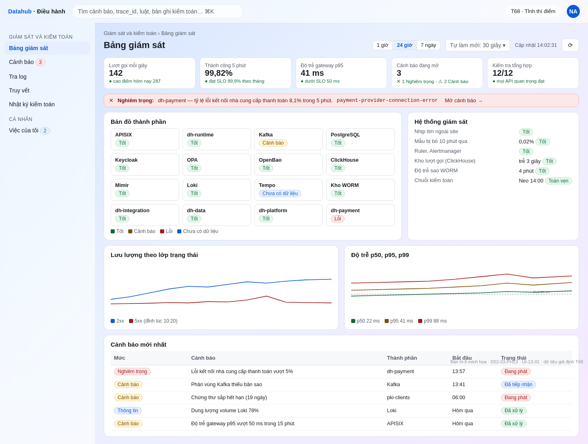

Ảnh cho thấy hàng thẻ KPI trên cùng, dải cảnh báo Nghiêm trọng, bản đồ thành phần mỗi ô có nhãn chữ cộng màu, hai biểu đồ (lưu lượng theo lớp trạng thái, độ trễ p50, p95, p99 với vạch SLO 50 ms) và bảng cảnh báo mới nhất.

### 7.1. Wireframe

Bản vẽ chữ dưới đây chỉ thể hiện bố cục và thứ tự vùng; màu, khoảng cách và kiểu chữ theo ảnh hi-fi ngay sau mục này và theo token thiết kế.

```
┌ glass-chrome ────────────────────────────────────────────────────────────────────────┐
│ Giám sát và kiểm toán › Bảng giám sát     [1 giờ|24 giờ|7 ngày] [Tự làm mới 30 giây ▾] │
│ Cập nhật lúc 14:05:32                                          [⛶ Toàn màn hình] [⋯] │
└──────────────────────────────────────────────────────────────────────────────────────┘
[Lượt gọi/giây 142] [Thành công 5 phút 99,82%] [Độ trễ p95 41 ms] [Cảnh báo mở: 1·2·0] [Hệ thống giám sát: Tốt]
┌ ✕ Nghiêm trọng: dh-payment — tỷ lệ lỗi kết nối nhà cung cấp 8,1% trong 5 phút   [Mở cảnh báo →] ┐
┌ Bản đồ thành phần (4×4 ô, mỗi ô: tên + nhãn trạng thái) ──┐ ┌ Hệ thống giám sát ───────────┐
│ APISIX Tốt │ dh-runtime Tốt │ Kafka Cảnh báo │ PostgreSQL … │ │ Nhịp tim ngoài site  Tốt     │
└─────────────────────────────────────────────────────────────┘ │ Mẫu bị bỏ 10 phút   0,02%   │
┌ Lưu lượng theo lớp trạng thái ┐ ┌ Độ trễ p50/p95/p99 + SLO ┐ │ Kiểm tra tổng hợp   Tốt     │
┌ Cảnh báo mới nhất (5 dòng) ─ Mức │ Cảnh báo │ Thành phần │ Bắt đầu │ Trạng thái ──────────┐
```

### 7.2. Thành phần

Mỗi thẻ tải độc lập (PTN-06, hành vi 4); bấm thẻ hoặc điểm dữ liệu đi sâu tới màn có bộ lọc tương ứng.

| # | Thành phần | `CMP-*` | Nội dung, token | Nguồn | Nhấp vào |
|---|---|---|---|---|---|
| 1 | Tiêu đề, khoảng thời gian, làm mới | `CMP-PageHeader`, `CMP-SegmentedControl`, `CMP-Select`, `CMP-Timestamp` | 1 giờ, 24 giờ (mặc định), 7 ngày; làm mới Tắt/15 giây/30 giây/1 phút/5 phút | `khoang=24h` trên URL | — |
| 2 | Thẻ KPI × 5 | `CMP-KpiCard` | Số `--dh-font-display`, sparkline, viền trái 3px màu trạng thái khi vượt ngưỡng kèm chữ ("Vượt SLO") | API-13-001 | Lượt gọi → UI-13-03; độ trễ → UI-13-04; cảnh báo → UI-13-10 |
| 3 | Dải cảnh báo Nghiêm trọng | `CMP-Alert` mức lỗi | Cảnh báo `CRITICAL` `FIRING` mới nhất, tối đa 1 dải + "và {n} cảnh báo khác" | API-13-030 | UI-13-10 chi tiết |
| 4 | Bản đồ thành phần | `CMP-Card`, `CMP-StatusTag`, `CMP-Tooltip` | 16 ô; nhãn Tốt, Cảnh báo, Lỗi, Chưa có dữ liệu (không dùng màu duy nhất) | API-13-002 | UI-13-02, UI-13-04 theo thành phần |
| 5 | Hệ thống giám sát | `CMP-Card`, `CMP-DescriptionList`, `CMP-StatusTag` | Nhịp tim ngoài site, tỷ lệ mẫu bỏ, Ruler và Alertmanager, kiểm tra tổng hợp | API-13-053 | UI-13-17 tab Kiểm tra tổng hợp |
| 6 | Biểu đồ lưu lượng | `CMP-Chart` (đường, `--dh-color-chart-1`, 5xx `--dh-color-error`) | 2xx, 4xx, 5xx theo thời gian | API-13-001 | Điểm lỗi → UI-13-08 (trace mẫu) |
| 7 | Biểu đồ độ trễ | `CMP-Chart` | p50, p95, p99, vạch SLO 50 ms nét đứt có nhãn chữ | API-13-001 | UI-13-04 |
| 8 | Cảnh báo mới nhất | `CMP-DataTable` gọn, `CMP-StatusTag` | 5 dòng, không phân trang | API-13-030 | UI-13-10 |
| 9 | "Xem dạng bảng" | `CMP-Button` ghost ở mỗi biểu đồ | Bảng số liệu cho trình đọc màn hình | — | — |

: UI-13-01 Thành phần

### 7.3. Trạng thái, thông báo, phím tắt, truy cập

Bảng dưới quy định cách bảng giám sát tổng quan hiển thị các trạng thái dùng chung (mục 6), thông điệp, phím tắt và yêu cầu truy cập.

| Mục | Quy định |
|---|---|
| Đang tải, rỗng, lỗi, không có quyền | ST-01 skeleton từng thẻ; ST-03 tenant mới: thẻ "Chưa có dữ liệu" kèm nút "Xem hướng dẫn kết nối HTTT" (liên kết HDSD); ST-05 từng thẻ với ERR-13-014 hoặc 015 và nút "Thử lại"; ST-07 không có `PERM-13-dashboard` |
| Dữ liệu cũ | `asOf` cũ hơn 90 giây: "Số liệu có thể đã cũ" màu `--dh-color-warning-text`; Mimir ngừng: thẻ lưu lượng và độ trễ hiện ERR-13-014 "Dịch vụ Mimir tạm thời không khả dụng. Thử lại sau." |
| Hệ thống giám sát suy giảm | `CMP-Banner` mức cảnh báo "Hệ thống giám sát đang suy giảm: {lý do}. Số liệu có thể thiếu." |
| Chế độ trực ca | "⋯ › Chế độ trực ca": chủ đề tối, toàn màn hình, tăng cỡ KPI, làm mới 15 giây (PTN-06 hành vi 6) |
| Phím tắt | `R` làm mới; `F` toàn màn hình; `T` chọn khoảng thời gian; `?` bảng phím tắt |
| Truy cập | Mỗi ô thành phần là `button` có `aria-label` "{tên}: {nhãn trạng thái}"; thẻ KPI có `aria-live="off"` (không thông báo mỗi lần làm mới); số cảnh báo mới `Nghiêm trọng` thông báo một lần qua vùng `aria-live="polite"` |

: UI-13-01 Trạng thái, thông báo, phím tắt, truy cập

## 8. UI-13-02 Data plane: đơn vị triển khai, luồng, route, endpoint

::: dac-ta
**Mục đích.** Cho người vận hành và kỹ sư tích hợp theo dõi data plane theo ba góc nhìn (đơn vị triển khai, luồng và route, endpoint), thay bảng "agent" của hệ Bus cũ; từ điểm lỗi đi thẳng tới trace.

**Người dùng, quyền.** TO, TA, PO, IE, IA có `PERM-13-dashboard`.

**FR, UC hiện thực.** FR-13-032, 033, 034; UC-13-21.

**Truy vết hệ cũ.** LGC-BUS-007, 014, 015, 016, 017, 019, 027.

**Đường dẫn.** `/giam-sat/bang-dieu-khien/data-plane?tab=don-vi|luong|endpoint`.

**Mẫu bố cục.** PTN-06 (ba tab, mỗi tab bảng và biểu đồ).

**API.** API-13-003, 004, 005, 006, 007, 008.

**Phát hành, mức chi tiết.** MVP; đầy đủ.
:::

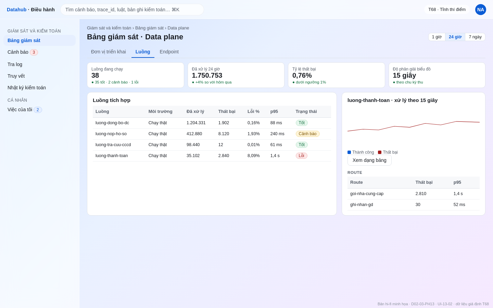

Ảnh cho thấy tab "Luồng" đang chọn: hàng thẻ tổng, bảng luồng có cột tỷ lệ lỗi và độ trễ p95 kèm biểu đồ nhỏ, và biểu đồ chi tiết của luồng chọn.

### 8.1. Thành phần

Bảng dưới liệt kê các thành phần giao diện của màn theo thứ tự từ trên xuống, kèm thành phần `CMP-*` dùng, nội dung và nguồn dữ liệu.

| # | Thành phần | `CMP-*` | Nội dung | Nguồn |
|---|---|---|---|---|
| 1 | Tab | `CMP-Tabs` | Đơn vị triển khai · Luồng · Endpoint (`tab` trên URL) | — |
| 2 | Bộ lọc | `CMP-FilterBar`, `CMP-Select` | Đơn vị, luồng, HTTT, khoảng thời gian | `bo-loc` |
| 3 | Bảng đơn vị triển khai | `CMP-DataTable` | Cột: Đơn vị, Phiên bản, Số bản sao, Trạng thái, CPU %, Bộ nhớ %, Thông lượng, Lỗi % | API-13-003 |
| 4 | Chi tiết đơn vị | `CMP-Drawer` | Biểu đồ CPU, bộ nhớ (`CMP-Chart`), danh sách luồng chạy trên đơn vị | API-13-004 |
| 5 | Bảng luồng | `CMP-DataTable`, `CMP-Chart` (sparkline) | Cột: Luồng, Môi trường, Đã xử lý, Thất bại, Lỗi %, p95, Cập nhật | API-13-005 |
| 6 | Biểu đồ luồng | `CMP-Chart` (cột chồng thành công/thất bại, độ phân giải 15 giây) | Chọn dòng → hiện; chọn đoạn kéo để thu hẹp | API-13-006 |
| 7 | Bảng route | `CMP-DataTable` | Route, đã xử lý, thất bại, thời gian trung bình, p95 | API-13-007 |
| 8 | Bảng endpoint | `CMP-DataTable` | Endpoint, HTTT, lưu lượng, lỗi, bản tin gần nhất, API gọi nhiều nhất | API-13-008 |
| 9 | Liên kết trace | `CMP-Link` | Điểm lỗi hoặc dòng lỗi → `/giam-sat/truy-vet?...` kèm bộ lọc thời gian | UI-13-08 |

: UI-13-02 Thành phần

### 8.2. Cột, trạng thái, phím tắt

Cột sắp xếp được theo `sap-xep=truong:tang|giam`; mặc định theo lỗi % giảm dần. Rỗng: "Chưa có luồng nào chạy trong khoảng này" kèm liên kết tới danh sách luồng (PH-04). Không có quyền, lỗi: theo chương 6; ERR-13-014 khi Mimir ngừng. Độ phân giải biểu đồ 15 giây (Q13-15), có chú thích dưới biểu đồ. Phím tắt `R`, `F`, `T` của PTN-06; `1`, `2`, `3` chuyển tab. Mỗi biểu đồ có "Xem dạng bảng"; bảng dùng `scope` cho tiêu đề cột và `aria-sort`.

## 9. UI-13-03 Theo API và theo HTTT

::: dac-ta
**Mục đích.** Xếp hạng API và HTTT theo lưu lượng, lỗi, độ trễ, mức dùng hạn mức để chủ dịch vụ và vận hành thấy ngay ai đang dùng nhiều hoặc gặp lỗi.

**Người dùng, quyền.** TA, TO, SV (chỉ tổ chức mình), VW có `PERM-13-dashboard`.

**FR, UC hiện thực.** FR-13-035; UC-13-22.

**Truy vết hệ cũ.** LGC-APIM-026.

**Đường dẫn.** `/giam-sat/bang-dieu-khien/api?tab=api|httt&chon={ma}`.

**Mẫu bố cục.** PTN-06.

**API.** API-13-009, 010.

**Phát hành, mức chi tiết.** MVP; đầy đủ.
:::

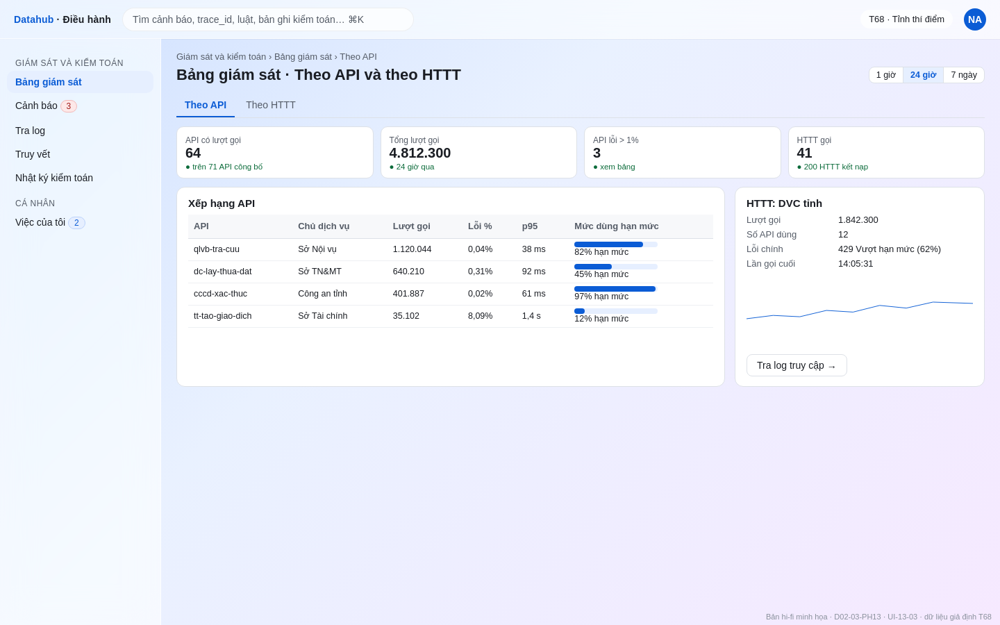

Ảnh cho thấy tab "Theo API": thẻ tổng, bảng xếp hạng API với cột lượt gọi, lỗi %, p95, mức dùng hạn mức (thanh tiến độ có nhãn phần trăm), và khung chi tiết của HTTT chọn.

| # | Thành phần | `CMP-*` | Nội dung | Nguồn |
|---|---|---|---|---|
| 1 | Tab, bộ lọc | `CMP-Tabs`, `CMP-FilterBar` | Theo API · Theo HTTT; khoảng; nhóm dịch vụ | — |
| 2 | Bảng xếp hạng API | `CMP-DataTable` | API, Chủ dịch vụ, Lượt gọi, Lỗi %, p95, Mức dùng hạn mức | API-13-009 |
| 3 | Bảng xếp hạng HTTT | `CMP-DataTable` | HTTT, Số API dùng, Lượt gọi, Lỗi %, Lần gọi cuối | API-13-009 |
| 4 | Chi tiết HTTT | `CMP-Drawer`, `CMP-Chart`, `CMP-DescriptionList` | Lượt gọi theo thời gian, top API, mã lỗi chiếm nhiều nhất | API-13-010 |
| 5 | Mức dùng hạn mức | `CMP-ProgressBar` kèm chữ "82% hạn mức" | Cam khi ≥ 80%, đỏ khi ≥ 100% (kèm chữ) | API-13-009 |
| 6 | Nút "Tra log truy cập" | `CMP-Button` | Mở UI-13-09 đã lọc HTTT | — |

: UI-13-03 Thành phần

Trạng thái theo chương 6. SV chỉ thấy dòng API thuộc tổ chức mình; dòng khác không xuất hiện, tổng cũng chỉ tính phần của họ. Rỗng: "Chưa có lượt gọi API nào trong khoảng này." Phím tắt `R`, `F`, `T`; `Enter` mở chi tiết dòng đang chọn.

## 10. UI-13-04 Hạ tầng: nút gateway, cụm Kafka

::: dac-ta
**Mục đích.** Cho vận hành nền tảng thấy sức khỏe nút gateway APISIX (đồng bộ cấu hình, CPU, bộ nhớ worker) và cụm Kafka (broker, phân vùng thiếu bản sao, độ trễ consumer).

**Người dùng, quyền.** PA, PO, TA, TO có `PERM-13-dashboard`.

**FR, UC hiện thực.** FR-13-036, 037, 038; UC-13-23.

**Truy vết hệ cũ.** LGC-APIM-023; 024, 025; LGC-HUB-005, 006.

**Đường dẫn.** `/giam-sat/bang-dieu-khien/ha-tang?tab=gateway|kafka`.

**Mẫu bố cục.** PTN-06 (chi tiết nút theo PTN-11 dạng Drawer).

**API.** API-13-011, 012, 013, 014.

**Phát hành, mức chi tiết.** MVP; đầy đủ.
:::

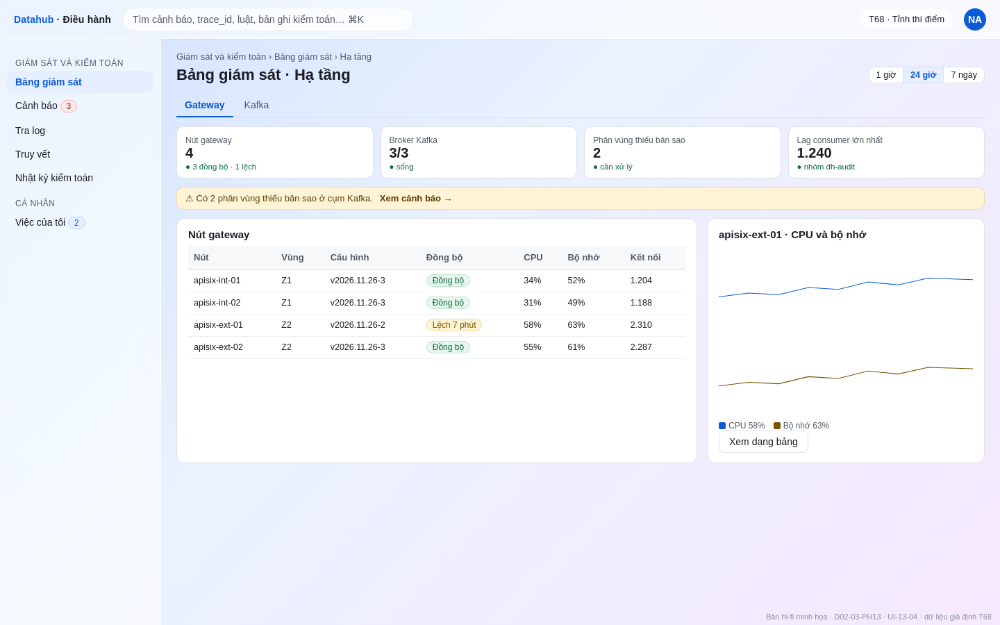

Ảnh cho thấy tab "Gateway": danh sách nút với nhãn "Đồng bộ" hoặc "Lệch cấu hình" (chữ và màu), biểu đồ CPU và bộ nhớ của nút chọn.

| # | Thành phần | `CMP-*` | Nội dung | Nguồn |
|---|---|---|---|---|
| 1 | Tab | `CMP-Tabs` | Gateway · Kafka | — |
| 2 | Bảng nút gateway | `CMP-DataTable`, `CMP-StatusTag` | Nút, Vùng (`Z1`…), Phiên bản cấu hình, Đồng bộ (Đồng bộ / Lệch {n} phút), CPU %, Bộ nhớ %, Kết nối | API-13-011 |
| 3 | Chi tiết nút | `CMP-Drawer`, `CMP-Chart`, `CMP-DescriptionList` | Biểu đồ CPU, bộ nhớ worker, lệch cấu hình, 20 dòng log gần nhất | API-13-012, 013 |
| 4 | Thẻ cụm Kafka | `CMP-KpiCard` | Số broker sống/tổng, phân vùng thiếu bản sao, lag consumer lớn nhất, dung lượng đĩa | API-13-014 |
| 5 | Bảng broker | `CMP-DataTable` | Broker, Vai trò, Đĩa %, Phân vùng, Trạng thái | API-13-014 |
| 6 | Bảng nhóm consumer | `CMP-DataTable` | Nhóm, Topic, Lag, Xu hướng (sparkline), Trạng thái | API-13-014 |

: UI-13-04 Thành phần

Phân vùng thiếu bản sao > 0 hiện `CMP-Alert` mức cảnh báo "Có {n} phân vùng thiếu bản sao" kèm liên kết tới cảnh báo tương ứng. Rỗng, lỗi theo chương 6; ERR-13-014 khi Prometheus hay Kafka không phản hồi. Phím tắt `R`, `F`, `T`, `1`, `2`.

## 11. UI-13-05 Hoạt động nghiệp vụ

::: dac-ta
**Mục đích.** Cho lãnh đạo và chủ dịch vụ xem hoạt động liên thông theo ngôn ngữ nghiệp vụ: số lượt trao đổi, xu hướng, đơn vị và dịch vụ dùng nhiều, HTTT được kết nạp nhưng chưa kết nối.

**Người dùng, quyền.** VW, TA, TO có `PERM-13-dashboard`.

**FR, UC hiện thực.** FR-13-039; UC-13-24.

**Truy vết hệ cũ.** LGC-APIM-026 (thẻ hoạt động chung).

**Đường dẫn.** `/giam-sat/bang-dieu-khien/nghiep-vu`.

**Mẫu bố cục.** PTN-06.

**API.** API-13-015.

**Phát hành, mức chi tiết.** MVP; đầy đủ.
:::

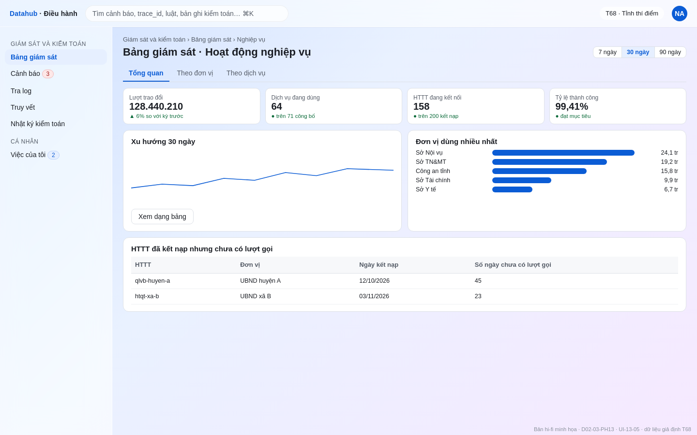

Ảnh cho thấy hàng thẻ lượt trao đổi theo kỳ, biểu đồ xu hướng 30 ngày, hai bảng xếp hạng (đơn vị, dịch vụ) và danh sách HTTT chưa kết nối.

| # | Thành phần | `CMP-*` | Nội dung | Nguồn |
|---|---|---|---|---|
| 1 | Thẻ nghiệp vụ × 4 | `CMP-KpiCard` | Lượt trao đổi, Dịch vụ đang dùng, HTTT đang kết nối, Tỷ lệ thành công; so kỳ trước bằng mũi tên và chữ | API-13-015 |
| 2 | Xu hướng | `CMP-Chart` | 7, 30, 90 ngày theo ngày | API-13-015 |
| 3 | Xếp hạng đơn vị | `CMP-DataTable` gọn | 10 đơn vị đầu; cột lượt, tỷ lệ | API-13-015 |
| 4 | Xếp hạng dịch vụ | `CMP-DataTable` gọn | 10 dịch vụ đầu | API-13-015 |
| 5 | HTTT chưa kết nối | `CMP-DataTable`, `CMP-Link` | HTTT, Ngày kết nạp, Số ngày chưa có lượt gọi; liên kết tới PH-01 | API-13-015 |

: UI-13-05 Thành phần

VW không có `PERM-13-logs` nên không có liên kết đi sâu sang log; nút "Xem log" ẩn, không vô hiệu. Số liệu có độ trễ tối đa 5 phút (ghi dưới tiêu đề). Trạng thái theo chương 6. Phím tắt `R`, `F`, `T`.

## 12. UI-13-06 Bảng điều khiển an ninh

::: dac-ta
**Mục đích.** Cho cán bộ ATTT và quản trị tỉnh nắm tình hình an ninh: đăng nhập thất bại, quyết định bị từ chối, WAF chặn, lượt xem dữ liệu Nhạy cảm, cảnh báo an ninh đang mở, trạng thái chuỗi kiểm toán.

**Người dùng, quyền.** SO, TA, PA, AU có `PERM-13-dashboard`; thẻ chi tiết và liên kết tới cảnh báo an ninh cần `PERM-13-security`.

**FR, UC hiện thực.** FR-13-005, 040; UC-13-02, 24.

**Truy vết hệ cũ.** Không có (màn mới theo SEC-62, SEC-64).

**Đường dẫn.** `/giam-sat/bang-dieu-khien/an-ninh`.

**Mẫu bố cục.** PTN-06.

**API.** API-13-016, 056 (cảnh báo an ninh mới nhất), 087 (trạng thái chuỗi).

**Phát hành, mức chi tiết.** MVP; đầy đủ.
:::

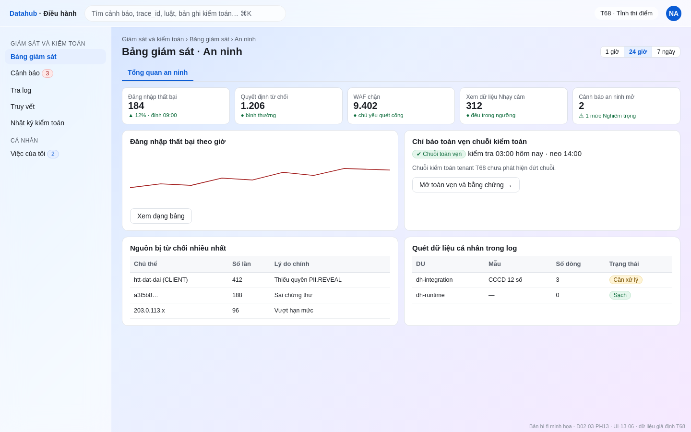

Ảnh cho thấy hàng thẻ KPI an ninh, biểu đồ đăng nhập thất bại theo giờ, bảng nguồn từ chối nhiều nhất, thẻ "Kết quả quét dữ liệu cá nhân trong log" và chỉ báo toàn vẹn chuỗi.

| # | Thành phần | `CMP-*` | Nội dung | Nguồn |
|---|---|---|---|---|
| 1 | Thẻ KPI × 5 | `CMP-KpiCard` | Đăng nhập thất bại, Quyết định từ chối, WAF chặn, Lượt xem dữ liệu Nhạy cảm, Cảnh báo an ninh đang mở | API-13-016 |
| 2 | Biểu đồ đăng nhập thất bại | `CMP-Chart` | Theo giờ, đỉnh có nhãn chữ | API-13-016 |
| 3 | Nguồn từ chối nhiều nhất | `CMP-DataTable` gọn | Chủ thể, Số lần, Lý do chính; chủ thể dạng định danh đã che | API-13-016 |
| 4 | Kết quả quét lọt dữ liệu cá nhân | `CMP-Card`, `CMP-StatusTag` | DU, mẫu bị lọt, số dòng (ERR-13-112); không hiện giá trị | API-13-016 |
| 5 | Chỉ báo toàn vẹn chuỗi | `CMP-StatusTag`, `CMP-Link` | Chuỗi toàn vẹn / nghi vấn, lần kiểm tra cuối | API-13-087 |
| 6 | Cảnh báo an ninh mới nhất | `CMP-DataTable` gọn | 5 dòng; liên kết UI-13-15 (cần `PERM-13-security`, không có thì chỉ hiện số) | API-13-056 |

: UI-13-06 Thành phần

Người chỉ có `PERM-13-dashboard` (không `PERM-13-security`) thấy thẻ 1, 2, 5; thẻ 3, 4, 6 ẩn hẳn. Trạng thái, phím tắt theo PTN-06; thông báo lỗi theo mục 5.2 (ERR-13-014, 044).

## 13. UI-13-07 Tra log

::: dac-ta
**Mục đích.** Cho vận hành và kỹ sư tích hợp tìm log tập trung theo khoảng thời gian và truy vấn đơn giản, xem ngữ cảnh quanh một dòng, theo dõi trực tiếp khi gỡ lỗi, lưu truy vấn hay dùng. Thay màn xem log từng agent của hệ cũ.

**Người dùng, quyền.** TO, TA, PO, PA, IE, IA, SO, AU có `PERM-13-logs`; luồng `security` chỉ cho người có `PERM-13-security` hoặc `PERM-13-audit-read` (Q13-18).

**FR, UC hiện thực.** FR-13-026, 027; UC-13-17.

**Truy vết hệ cũ.** LGC-BUS-029, LGC-BUS-038, LGC-NFR-004.

**Đường dẫn.** `/giam-sat/log?tu=&den=&q=&luong=ops|security`.

**Mẫu bố cục.** PTN-11.

**API.** API-13-019, 020, 021, 027, 028, 029.

**Phát hành, mức chi tiết.** MVP; đầy đủ.
:::

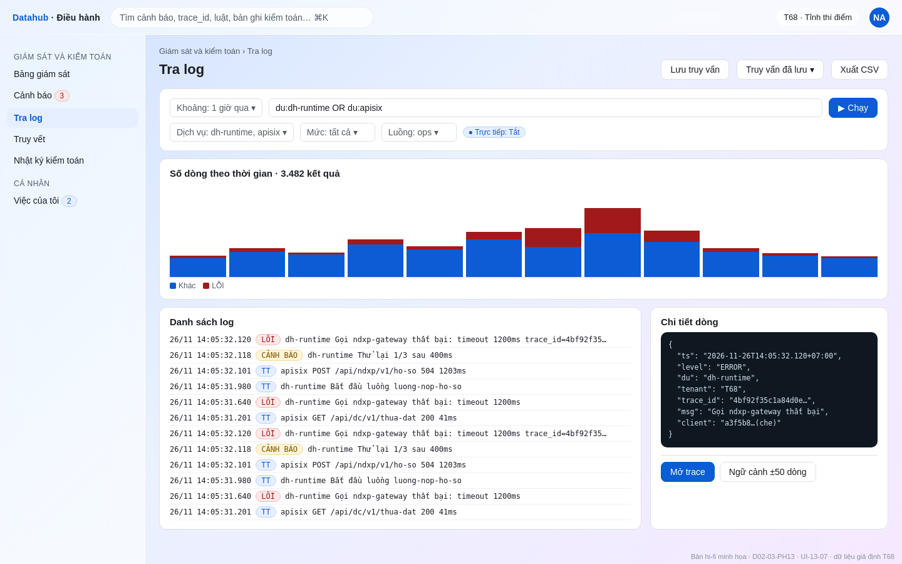

Ảnh cho thấy thanh truy vấn, histogram số dòng theo thời gian, danh sách log ảo hóa có nhãn mức bằng chữ và khung chi tiết dòng ở bên phải.

### 13.1. Wireframe

Bản vẽ chữ dưới đây chỉ thể hiện bố cục và thứ tự vùng; màu, khoảng cách và kiểu chữ theo ảnh hi-fi ngay sau mục này và theo token thiết kế.

```
┌ Tra log                                    [Lưu truy vấn] [Truy vấn đã lưu ▾] [Xuất CSV] ┐
│ [Khoảng: 1 giờ qua ▾] [ trace_id:4bf92f35 AND level:ERROR                  ] [▶ Chạy]   │
│ [Dịch vụ ▾] [Mức ▾] [Luồng: ops ▾]                      [● Trực tiếp: Tắt]               │
│ ┌ Histogram số dòng theo thời gian (cao 120px, kéo chọn để thu hẹp) ─────────────────┐ │
│ ┌ Danh sách log (ảo hóa, chữ đơn cách) ─────────────┐ ┌ Chi tiết dòng ─────────────┐   │
│ │ 26/11 14:05:32.120  LỖI  dh-runtime  Gọi … thất bại│ │ JSON đã che · trace_id [⧉] │   │
│ │ 26/11 14:05:32.118  TT   apisix      200 …         │ │ [Mở trace] [Ngữ cảnh ±50]  │   │
└────────────────────────────────────────────────────┘ └────────────────────────────┘
```

### 13.2. Thành phần và trường

Bảng dưới liệt kê thành phần, trường nhập và ràng buộc của màn Tra log, kèm API cấp dữ liệu cho từng thành phần.

| # | Thành phần | `CMP-*` | Nội dung, kiểm tra | API |
|---|---|---|---|---|
| 1 | Khoảng thời gian | `CMP-DateRangePicker` | Bắt buộc, mặc định 1 giờ, tối đa 7 ngày (ERR-13-004, 005); quá 12 tháng (ERR-13-029) | — |
| 2 | Ô truy vấn | `CMP-SearchField` biến thể truy vấn | `trường:giá-trị`, `AND`, `OR`, `NOT`, ngoặc kép; tối đa 1.000 ký tự; gợi ý trường (`trace_id`, `level`, `du`, `tenant`, `msg`); lỗi cú pháp chỉ vị trí (ERR-13-006) | API-13-019 (`q`) |
| 3 | Bộ lọc nhanh | `CMP-Select` nhiều giá trị | Dịch vụ (`du`), Mức (`level`), Luồng (`stream` = `ops` mặc định hoặc `security`) | API-13-019 |
| 4 | Histogram | `CMP-Chart` (`--dh-color-chart-1`, cột lỗi `--dh-color-error`) | Kéo chọn thu hẹp khoảng; ô nhập thời gian cho người không dùng chuột; "Xem dạng bảng" | API-13-019 |
| 5 | Danh sách log | `CMP-LogViewer` | Ảo hóa, `--dh-font-mono-sm`; cột Thời điểm, Mức (chữ), Dịch vụ, Thông điệp; tải thêm theo `cursor`, `limit` ≤ 1.000; dòng dài cắt một dòng | API-13-019 |
| 6 | Chi tiết dòng | `CMP-Drawer` (hoặc khung phải ≥ bp-xl), `CMP-JsonViewer`, `CMP-MaskedValue`, `CMP-CopyButton` | Trường đã che ở nguồn; không nút "hiện giá trị"; `trace_id` là `CMP-Link` tới UI-13-08 | API-13-020 |
| 7 | Ngữ cảnh | `CMP-Button` "Xem ngữ cảnh ±50 dòng" | Mở chế độ ngữ cảnh trong cùng danh sách, có nút "Về kết quả tìm" | API-13-020 |
| 8 | Trực tiếp | `CMP-Switch` | SSE; chèn ở đầu, tối đa 1.000 dòng trong bộ nhớ; cuộn khỏi đầu tự tạm dừng, hiện "{n} sự kiện mới · Về đầu"; tự tắt sau 15 phút không tương tác | API-13-021 |
| 9 | Truy vấn đã lưu | `CMP-DropdownMenu`, `CMP-ReasonDialog` biến thể tên | Lưu tên 3 đến 80 ký tự, chia sẻ trong tenant (tùy chọn); xóa chỉ của mình | API-13-027, 028, 029 |
| 10 | Xuất | `CMP-Button` | Xuất tối đa 10.000 dòng đang hiển thị; ghi kiểm toán | — |

: UI-13-07 Thành phần và trường

### 13.3. Trạng thái, thông báo, phím tắt, truy cập

Bảng dưới quy định cách màn Tra log hiển thị trạng thái rỗng, lỗi, cắt kết quả, phím tắt và yêu cầu truy cập.

| Mục | Quy định |
|---|---|
| Rỗng, không kết quả | "Không có sự kiện nào khớp truy vấn trong {khoảng}" kèm gợi ý mở rộng khoảng (ST-04); chưa chạy truy vấn: gợi ý ba truy vấn mẫu |
| Lỗi | ERR-13-006 dưới ô truy vấn; ERR-13-011 "Bạn đang chạy quá nhiều truy vấn cùng lúc…" (429); ERR-13-015 "Truy vấn quá thời gian chờ…"; ERR-13-014 "Dịch vụ Loki tạm thời không khả dụng. Thử lại sau."; kết quả cắt: "Đang hiển thị 10.000 sự kiện đầu tiên" |
| Chỉ báo dữ liệu thô | Dòng thiếu nhãn tenant hiển thị "không xác định" (ERR-13-113), chỉ SO, PA thấy |
| Phím tắt | `/` focus ô truy vấn; `Enter` chạy; `L` bật tắt trực tiếp; `J`/`K` dòng kế, trước; `Enter` mở chi tiết; `C` sao chép dòng; `Esc` đóng chi tiết |
| Truy cập | Danh sách là `role="log"` không `aria-live` (không đẩy luồng trực tiếp vào vùng thông báo); mức log có chữ; mỗi dòng là `button` có `aria-label` ngắn "Lúc …, mức …, dịch vụ …"; thông báo "n sự kiện mới" qua `aria-live="polite"` tối đa mỗi 10 giây |

: UI-13-07 Trạng thái, thông báo, phím tắt, truy cập

## 14. UI-13-08 Truy vết

::: dac-ta
**Mục đích.** Cho vận hành và kỹ sư tích hợp theo một `trace_id` xem yêu cầu đi qua những thành phần nào, mỗi chặng mất bao lâu, chặng nào lỗi, rồi nhảy sang chỉ số, log và bản ghi kiểm toán của đúng yêu cầu đó. Là màn chẩn đoán dùng nhiều nhất.

**Người dùng, quyền.** TO, TA, PO, PA, IE, IA, SO, AU có `PERM-13-logs`; nút "Bản ghi kiểm toán" chỉ hiện khi có thêm `PERM-13-audit-read`.

**FR, UC hiện thực.** FR-13-028, 029; UC-13-18.

**Truy vết hệ cũ.** LGC-BUS-038 (logging quá trình routing).

**Đường dẫn.** `/giam-sat/truy-vet` (ô nhập, tìm theo điều kiện), `/giam-sat/truy-vet/{trace-id}`.

**Mẫu bố cục.** PTN-11 (biến thể trace theo D03-06-00 §4.14 hành vi 8).

**API.** API-13-022, 023, 024, 020.

**Phát hành, mức chi tiết.** MVP; siêu chi tiết.
:::

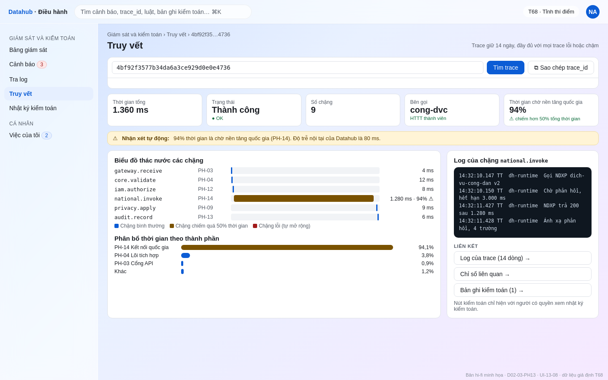

Ảnh cho thấy ô nhập `trace_id`, hàng tóm tắt, biểu đồ thác nước (chặng lỗi tô đỏ và mở sẵn), bảng phân bổ thời gian theo thành phần, dòng nhận xét tự động và khung log của chặng đang chọn.

### 14.1. Lưới bố cục và vùng

Màn dùng khung nội dung `--dh-size-page-max`, lưới 12 cột, khoảng cách `--dh-space-4`. Từ bp-xl trở lên chia hai cột: cột trái 8/12 chứa vùng ① đến ⑥, cột phải 4/12 chứa vùng ⑦ (log chặng); dưới bp-xl vùng ⑦ chuyển thành `CMP-Drawer` mở từ đáy. Vùng đặc toàn bộ (`--dh-color-surface-solid`), kính chỉ ở vỏ ứng dụng.

```
┌ ① Ô nhập trace_id ─────────────────────────────────────────────────────────────────────────┐
│ [ 4bf92f35c1a84d0e9b7d1a6c2e5f4736 ] [Tra] [Dán từ bộ nhớ tạm]      Tìm theo điều kiện ▾  │
├ ② Tóm tắt: Tổng 1.842 ms · Trạng thái LỖI · 7 chặng · Bên gọi htt-dvc · Bắt đầu 14:05:31.201 ┤
├ ③ Nhận xét tự động: "94% thời gian là chờ nền tảng quốc gia (ndxp-gateway)"  ──────────────┤
├ ④ Thác nước (cột trái, 8/12) ────────────────────────────┬ ⑦ Log của chặng đang chọn (4/12) ┤
│ Chặng                  0     500    1000   1500   1842 ms │ 14:05:32.118 LỖI  Gọi NDXP…      │
│ apisix  GET /api/…     ███                                │ 14:05:32.120 TT   Thử lại 1/3    │
│ dh-runtime  flow-dc    ██████████████████████████████    │ … (ảo hóa, tối đa 200 dòng)      │
│  └ adapter soap-qlvb    ███                               │ [Mở trong Tra log →]             │
│  └ ndxp-gateway  ✕LỖI   ███████████████████████▒▒▒ ⚠>50% │                                  │
├ ⑤ Phân bổ thời gian theo thành phần (bảng + thanh) ───────┤                                  │
├ ⑥ Hàng nút: [Chỉ số liên quan] [Log của trace] [Bản ghi kiểm toán] [Sao chép liên kết]       ┘
```

### 14.2. Giải phẫu từng vùng

Màn Truy vết chia thành các vùng đánh số tròn trên wireframe; bảng dưới mô tả thành phần và hành vi của từng vùng.

| Vùng | `CMP-*` | Giải phẫu và hành vi |
|---|---|---|
| ① Ô nhập | `CMP-SearchField`, `CMP-Button`, `CMP-CopyButton` | Nhận 32 ký tự thập lục phân; tự cắt khoảng trắng, tự chuyển chữ thường; dán chuỗi có `traceparent` thì tách lấy `trace_id`. Sai định dạng: dòng lỗi dưới ô (không gọi API). "Tìm theo điều kiện" mở bộ lọc HTTT, luồng, trạng thái, độ dài tối thiểu, khoảng thời gian → bảng kết quả 20 dòng (API-13-022) |
| ② Tóm tắt | `CMP-DescriptionList`, `CMP-StatusTag`, `CMP-Duration` | Tổng thời gian, trạng thái (Thành công, Lỗi, Chưa đầy đủ), số chặng, bên gọi, bắt đầu; nhãn "Chưa đầy đủ" khi ERR-13-117, "Đã cắt" khi ERR-13-116 |
| ③ Nhận xét | `CMP-Alert` mức thông tin | Câu sinh tự động: thành phần chiếm quá 50% thời gian; nếu không có thì ẩn vùng; không thay phán đoán của người dùng nên có chữ "Gợi ý tự động" |
| ④ Thác nước | `CMP-Tree` cho cột chặng + `CMP-Chart` (series tùy biến) cho thanh thời gian | Mỗi chặng một hàng cao `--dh-size-table-row`; thanh theo tỷ lệ, màu thành phần `--dh-color-chart-1…8`, chặng lỗi tô `--dh-color-error` kèm mẫu gạch chéo và chữ "LỖI"; chặng chiếm > 50% có biểu tượng cảnh báo và chữ "chiếm 94%"; chặng lỗi tự mở rộng; chặng con thụt lề 16px, thu gọn bằng `←`, mở bằng `→` |
| ⑤ Phân bổ | `CMP-DataTable` gọn, `CMP-ProgressBar` | Thành phần, thời gian riêng (self time), % tổng; sắp giảm theo thời gian riêng |
| ⑥ Hàng nút liên kết | `CMP-Button` | "Chỉ số liên quan" mở UI-13-01 hoặc UI-13-02 với khoảng quanh trace; "Log của trace" mở UI-13-07 với `q=trace_id:…`; "Bản ghi kiểm toán" mở UI-13-13 (hộp lý do hiện trước, chỉ với `PERM-13-audit-read`); dữ liệu từ API-13-024, mỗi nút kèm số lượng ("12 dòng log") |
| ⑦ Log chặng | `CMP-LogViewer` | Chọn chặng ở ④ thì lọc theo `span_id`; ảo hóa; liên kết "Mở trong Tra log" |

: UI-13-08 Giải phẫu từng vùng

### 14.3. Tương tác chuột và bàn phím

Mọi thao tác trên màn Truy vết đều làm được bằng bàn phím; bảng dưới đối chiếu thao tác với chuột và phím tương ứng.

| Thao tác | Chuột | Bàn phím |
|---|---|---|
| Tra trace | Bấm "Tra" | `Enter` trong ô nhập |
| Chọn chặng | Bấm hàng ở ④ | `↑`/`↓` đổi hàng; `Enter` chọn, vùng ⑦ cập nhật |
| Mở rộng, thu gọn chặng | Bấm mũi tên | `→` mở, `←` thu |
| Phóng to đoạn thời gian | Kéo chọn trên trục | `+`/`-` đổi tỷ lệ; `0` về toàn bộ |
| Xem chi tiết chặng | Bấm đúp, hoặc nút "Chi tiết" | `Space` mở `CMP-Drawer` thuộc tính chặng (tên, thuộc tính, sự kiện, lỗi) |
| Sao chép | Bấm biểu tượng bên cạnh `trace_id`, `span_id` | `C` khi focus vùng chặng |
| Trở về ô nhập | — | `/` |

: UI-13-08 Tương tác chuột và bàn phím

### 14.4. Trạng thái đặc thù

Ngoài các trạng thái dùng chung ở mục 6, màn Truy vết có các trạng thái riêng ghi ở bảng dưới.

| Trạng thái | Hiển thị |
|---|---|
| Đang tải (ST-01) | Skeleton vùng ② và bảng 8 hàng ở ④; ô nhập dùng được ngay |
| Không tìm thấy (ST-08, ERR-13-030) | "Không tìm thấy trace {traceId}. Trace chỉ giữ 14 ngày và chỉ giữ một phần trace thành công." kèm nút "Tìm theo thời gian"; vẫn hiện hai nút "Log của trace" và "Bản ghi kiểm toán" nếu có dữ liệu ở nguồn khác (liên kết ba nguồn) |
| Trace chưa đầy đủ (ERR-13-117) | Nhãn "Chưa đầy đủ" ở ②, ghi chú "Có thể còn chặng đến sau"; nút "Tải lại sau 30 giây" |
| Trace quá dài (ERR-13-116) | Nhãn "Đã cắt": hiện span đầu, cuối và lỗi; ghi chú số span bị bỏ |
| Tempo ngừng (ERR-13-014) | Vùng ④, ⑤ hiện ST-05; vùng ⑥ vẫn dùng được (log, kiểm toán) |
| Sai định dạng (ERR-13-031 áp cho ô số định danh, không dùng ở đây) | "`trace_id` gồm 32 ký tự thập lục phân." dưới ô nhập |
| Không có quyền kiểm toán | Nút "Bản ghi kiểm toán" ẩn |
| Hết phiên (ST-14) | `CMP-SessionTimeoutDialog`; trace đang xem giữ trên URL |

: UI-13-08 Trạng thái đặc thù

### 14.5. Khả năng truy cập

Thác nước là cây `role="treegrid"`: mỗi hàng có `aria-level`, `aria-expanded`, `aria-label` "Chặng {tên}, {thành phần}, {thời gian} ms, chiếm {x}%, {trạng thái}". Thanh thời gian là trang trí (`aria-hidden`); thông tin nằm ở văn bản. Chặng lỗi có chữ "LỖI", mẫu gạch chéo và biểu tượng, không chỉ màu đỏ. Vùng ③ dùng `role="status"`. Chuyển chặng bằng bàn phím di chuyển focus và cập nhật ⑦ mà không đổi vị trí cuộn; vùng ⑦ không `aria-live`. Mục tiêu bấm ≥ 24×24 CSS px (WCAG 2.2 2.5.8); focus hiển thị bằng `--dh-color-focus-ring`.

## 15. UI-13-09 Nhật ký truy cập API

::: dac-ta
**Mục đích.** Tra siêu dữ liệu từng lượt gọi API qua gateway (HTTT gọi, API, trạng thái, độ trễ, kích thước, `trace_id`) để xử lý khiếu nại và điều tra lỗi; không lưu nội dung gói tin.

**Người dùng, quyền.** TO, TA, PO, PA, IE, IA, SO, AU có `PERM-13-logs`.

**FR, UC hiện thực.** FR-13-006, 030; UC-13-19.

**Truy vết hệ cũ.** LGC-APIM-022; LGC-PAY-021.

**Đường dẫn.** `/giam-sat/log/truy-cap-api`.

**Mẫu bố cục.** PTN-11 (danh sách phân trang theo kiểm toán, vì lọc nhiều trường).

**API.** API-13-025, 026.

**Phát hành, mức chi tiết.** MVP; đầy đủ.
:::

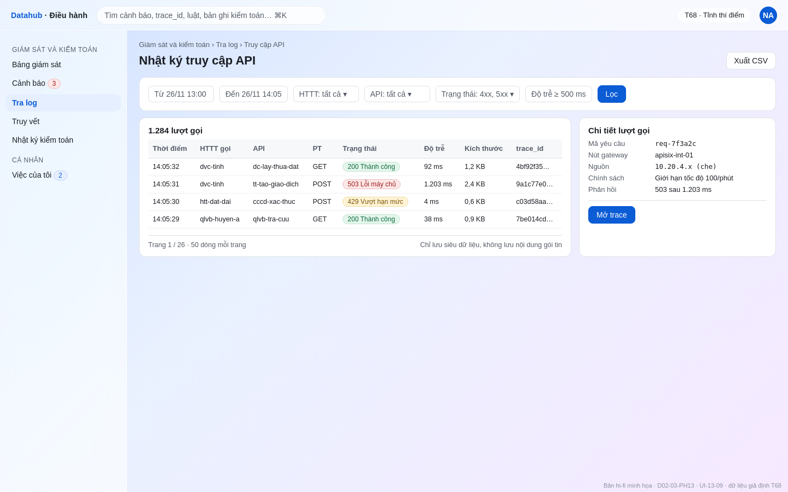

Ảnh cho thấy bộ lọc nhiều trường, bảng lượt gọi có cột trạng thái bằng chữ và khung chi tiết siêu dữ liệu của lượt gọi đang chọn.

| # | Thành phần | `CMP-*` | Trường, nội dung | API |
|---|---|---|---|---|
| 1 | Bộ lọc | `CMP-FilterBar`, `CMP-DateRangePicker`, `CMP-ResourceSelect` | Khoảng (bắt buộc, tối đa 7 ngày mỗi lần), HTTT, API, Trạng thái HTTP (2xx, 4xx, 5xx hoặc mã), Độ trễ tối thiểu (ms), `trace_id` | API-13-025 |
| 2 | Bảng | `CMP-DataTable` | Cột: Thời điểm, HTTT gọi, API, Phương thức, Mã trạng thái (chữ), Độ trễ, Kích thước yêu cầu, Kích thước phản hồi, `trace_id` | API-13-025 |
| 3 | Chi tiết | `CMP-Drawer`, `CMP-DescriptionList`, `CMP-JsonViewer` | Siêu dữ liệu đầy đủ: mã yêu cầu, nút gateway, địa chỉ nguồn (đã che một phần), chính sách bị áp; không có tiêu đề `Authorization`, thân gói | API-13-026 |
| 4 | Xuất | `CMP-Button` | Tối đa 10.000 dòng; ghi kiểm toán | — |
| 5 | Phân trang | `CMP-Pagination` | `co` 10/20/50/100; tối đa 200 | `size` ≤ 200 |

: UI-13-09 Thành phần

Lọc theo HTTT trong khoảng 24 giờ trả p95 ≤ 3 giây (NFR-13-006); vượt: ERR-13-015. Trạng thái: rỗng "Không có lượt gọi nào khớp điều kiện trong {khoảng}"; ClickHouse ngừng: ERR-13-014 "Dịch vụ ClickHouse tạm thời không khả dụng. Thử lại sau."; kho ghi chậm (ERR-13-118) hiện dải "Dữ liệu mới có thể chưa đầy đủ". Phím tắt `/` focus bộ lọc, `J`/`K` dòng kế, trước, `Enter` mở chi tiết. Mã trạng thái luôn kèm chữ ("200 Thành công", "503 Lỗi máy chủ").

## 16. UI-13-10 Cảnh báo

::: dac-ta
**Mục đích.** Cho người trực thấy cảnh báo đang mở, xem runbook ngay trong màn, xác nhận, đánh dấu đã xử lý hoặc tạm ẩn; xem lịch sử và thống kê hiệu quả cảnh báo.

**Người dùng, quyền.** Xem: PA, PO, TA, TO, SO (`PERM-13-dashboard`); thao tác: `PERM-13-alert-ack` (PA, PO, TA, TO, SO).

**FR, UC hiện thực.** FR-13-044, 045, 046, 047, 050; UC-13-28, 29, 32.

**Truy vết hệ cũ.** LGC-PAY-009.

**Đường dẫn.** `/giam-sat/canh-bao?tab=dang-mo|lich-su|thong-ke`, `/giam-sat/canh-bao/{alert-id}`.

**Mẫu bố cục.** PTN-01 (danh sách), chi tiết dạng Drawer rộng `--dh-size-drawer-lg` hoặc trang riêng theo PTN-02 khi mở bằng liên kết.

**API.** API-13-030, 031, 032, 033, 034, 052.

**Phát hành, mức chi tiết.** MVP; đầy đủ.
:::

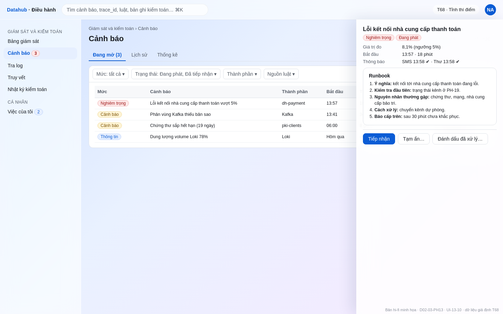

Ảnh cho thấy tab "Đang mở", bộ lọc mức độ, bảng cảnh báo với nhãn mức và trạng thái bằng chữ, và Drawer chi tiết gồm runbook năm mục cùng ba nút hành động.

### 16.1. Thành phần

Bảng dưới liệt kê các thành phần giao diện của màn Cảnh báo theo ba tab (đang mở, lịch sử, thống kê), kèm `CMP-*` và API cấp dữ liệu.

| # | Thành phần | `CMP-*` | Nội dung, kiểm tra | API |
|---|---|---|---|---|
| 1 | Tab | `CMP-Tabs` | Đang mở (có số) · Lịch sử · Thống kê | — |
| 2 | Bộ lọc | `CMP-FilterBar`, `CMP-Select` | Mức, Trạng thái, Thành phần, Nguồn luật, Khoảng thời gian | API-13-030 |
| 3 | Bảng | `CMP-DataTable`, `CMP-StatusTag` | Cột: Mức, Cảnh báo, Thành phần, Bắt đầu, Thời lượng, Cấp leo thang, Người nhận, Trạng thái; sắp mặc định mức rồi thời điểm | API-13-030 |
| 4 | Chi tiết | `CMP-Drawer`, `CMP-DescriptionList`, `CMP-Timeline` | Giá trị đo, ngưỡng, nhãn, lịch sử trạng thái, thông báo đã gửi (kênh, giờ, kết quả), liên kết biểu đồ liên quan | API-13-031 |
| 5 | Runbook | `CMP-Card` trong Drawer | Năm mục: Ý nghĩa, Kiểm tra đầu tiên, Nguyên nhân thường gặp, Cách xử lý, Khi nào báo cấp trên; liên kết "Mở luật" nếu có `PERM-13-alert-admin` | API-13-031 |
| 6 | Hành động | `CMP-Button` | "Tiếp nhận", "Tạm ẩn…", "Đánh dấu đã xử lý…" (chỉ khi có `PERM-13-alert-ack` và trạng thái hợp lệ) | API-13-032, 033, 034 |
| 7 | Hộp tạm ẩn | `CMP-ReasonDialog` | Thời hạn (`CMP-Select`: 1, 4, 24 giờ, 3, 7 ngày; Nghiêm trọng tối đa 24 giờ), lý do 10 đến 500 ký tự | API-13-034 |
| 8 | Hộp đã xử lý | `CMP-ReasonDialog` | Nguyên nhân, Hành động đã thực hiện (bắt buộc) | API-13-033 |
| 9 | Thống kê | `CMP-KpiCard`, `CMP-Chart` | MTTA, MTTR, số cảnh báo theo luật, tỷ lệ "báo nhầm" (tạm ẩn, tự đóng nhanh) | API-13-052 |

: UI-13-10 Thành phần

### 16.2. Trạng thái, thông báo, phím tắt

Bảng dưới quy định các trạng thái, thông báo, phím tắt của màn Cảnh báo, trong đó hành động xử lý cảnh báo theo quyền `PERM-13-alert-ack`.

| Mục | Quy định |
|---|---|
| Rỗng | Tab Đang mở: "Không có cảnh báo nào đang mở." kèm dấu tích; ST-03 |
| Lỗi nghiệp vụ | ERR-13-020 "Cảnh báo đã ở trạng thái {trạng thái}, thao tác này không còn áp dụng." (hộp thoại tự làm mới chi tiết); ERR-13-021 "Tạm ẩn cần thời hạn và lý do; tối đa {n} ngày ({m} giờ với cảnh báo Nghiêm trọng)."; ERR-13-022 "Cần ghi nguyên nhân và hành động đã thực hiện trước khi đánh dấu đã xử lý."; ERR-13-008 |
| Thành công | "Đã xác nhận cảnh báo.", "Đã tạm ẩn cảnh báo đến {giờ}.", "Đã đánh dấu cảnh báo đã xử lý." |
| Tenant tạm ngừng | ERR-13-016 chỉ ảnh hưởng cấu hình luật; thao tác tiếp nhận vẫn hoạt động (FRS 4.3) |
| Cảnh báo mới | `CMP-Notification` thông báo trong ứng dụng khi có cảnh báo `CRITICAL` mới; số ở menu cập nhật |
| Phím tắt | `J`/`K` dòng kế, trước; `A` tiếp nhận; `S` tạm ẩn; `X` đã xử lý (chỉ khi có quyền); `Enter` mở chi tiết |
| Truy cập | Hàng cảnh báo `Nghiêm trọng` mới đến được thông báo một lần bằng `aria-live="assertive"`; mức và trạng thái luôn có chữ |

: UI-13-10 Trạng thái, thông báo, phím tắt

## 17. UI-13-11 Luật cảnh báo và runbook

::: dac-ta
**Mục đích.** Cho quản trị tỉnh và vận hành xem luật chuẩn của nền tảng (không sửa, không tắt), tạo luật riêng kèm runbook đủ năm mục và chạy thử trên dữ liệu 24 giờ gần nhất trước khi bật.

**Người dùng, quyền.** `PERM-13-alert-admin` (PA, PO, TA, TO) tạo, sửa, bật, tắt; `PERM-13-alert-ack` chỉ xem. PA phát hành bộ luật chuẩn.

**FR, UC hiện thực.** FR-13-042, 043; UC-13-26, 27.

**Truy vết hệ cũ.** Không có (màn mới).

**Đường dẫn.** `/giam-sat/canh-bao/luat`, `/giam-sat/canh-bao/luat/moi`, `/giam-sat/canh-bao/luat/{ma-luat}/sua`.

**Mẫu bố cục.** PTN-01 (danh sách) và PTN-03 (biểu mẫu trang).

**API.** API-13-035, 036, 037, 038, 039, 040, 041, 042, 043, 044.

**Phát hành, mức chi tiết.** MVP; đầy đủ.
:::

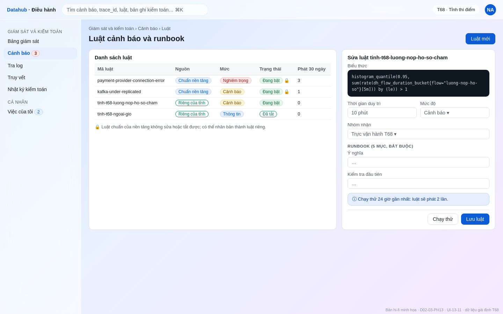

Ảnh cho thấy danh sách luật có nhãn nguồn "Chuẩn nền tảng" hoặc "Riêng của tỉnh" và công tắc bật tắt; bên phải là biểu mẫu soạn luật gồm biểu thức, ngưỡng, thời gian duy trì, mức và năm mục runbook.

### 17.1. Danh sách và trường biểu mẫu

Bảng dưới liệt kê từng trường của biểu mẫu luật cảnh báo với kiểu, ràng buộc, thành phần nhập và trường API tương ứng để kiểm tra phía giao diện khớp phía máy chủ.

| Trường | Kiểu | Bắt buộc | Kiểm tra | `CMP-*` | Ánh xạ API |
|---|---|---|---|---|---|
| Mã luật `ruleCode` | T-CODE | Có | `^[a-z][a-z0-9-]{2,62}$`, duy nhất kể cả luật đã ngừng (ERR-13-002) | `CMP-Input`, `CMP-Identifier` | `ruleCode` |
| Tên hiển thị | T-NAME | Có | 3 đến 120 ký tự | `CMP-Input` | `name` |
| Biểu thức | T-TEXT | Có | PromQL, kiểm tra cú pháp khi rời ô (ERR-13-018) | `CMP-ExpressionField` | `expr` |
| Thời gian duy trì | duration | Có | 1 phút đến 24 giờ | `CMP-Duration` | `for` |
| Mức độ | T-ENUM | Có | Nghiêm trọng, Cảnh báo, Thông tin | `CMP-Select` | `severity` |
| Nhóm nhận | T-CODE | Có | Chọn từ UI-13-12; Nghiêm trọng cần ≥ 2 kênh độc lập (ERR-13-034) | `CMP-ResourceSelect` | `receiverGroup` |
| Runbook, năm mục | T-TEXT × 5 | Có | Mỗi mục ≥ 10 ký tự (ERR-13-017) | `CMP-TextArea` × 5 | `runbook` |
| Chạy thử | — | Không | Chạy trên 24 giờ gần nhất, báo số lần sẽ phát | `CMP-Button`, `CMP-Alert` kết quả | API-13-039 |

: UI-13-11 Trường biểu mẫu luật

Danh sách: `CMP-DataTable` cột Mã, Tên, Nguồn (`CMP-StatusTag`), Mức, Trạng thái (`CMP-Switch`), Số lần phát 30 ngày, Sửa lần cuối. Luật chuẩn nền tảng: công tắc và nút Sửa vô hiệu kèm tooltip "Luật chuẩn của nền tảng không sửa hoặc tắt được" (ERR-13-019) và nút "Nhân bản thành luật riêng". Lưu có `If-Match`; xung đột hiện ST-13 (ERR-13-007). Phím tắt: `N` luật mới; `Ctrl+S` lưu; `Ctrl+Enter` chạy thử. Biểu mẫu theo PTN-03 (cảnh báo rời trang khi chưa lưu).

## 18. UI-13-12 Lịch trực, nhóm nhận, kênh thông báo

::: dac-ta
**Mục đích.** Cho quản trị tỉnh khai báo ai nhận cảnh báo lúc nào, thứ tự leo thang và các kênh (thư điện tử, SMS, webhook), kiểm tra kênh chạy được; không để hở lịch trực.

**Người dùng, quyền.** `PERM-13-alert-admin` (PA, PO, TA, TO) sửa; `PERM-13-alert-ack` xem.

**FR, UC hiện thực.** FR-13-046, 048; UC-13-28, 30.

**Truy vết hệ cũ.** Không có.

**Đường dẫn.** `/giam-sat/canh-bao/lich-truc?tab=lich|nhom|kenh`.

**Mẫu bố cục.** PTN-12 Cài đặt (ba tab).

**API.** API-13-045, 046, 047, 048, 049, 050, 051.

**Phát hành, mức chi tiết.** MVP; đầy đủ.
:::

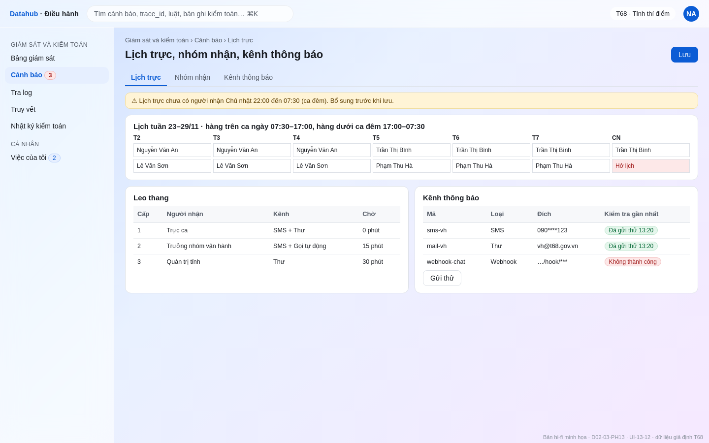

Ảnh cho thấy lịch trực dạng lưới tuần theo ca, thứ tự leo thang (cấp 1 sau 0 phút, cấp 2 sau 15 phút) và danh sách kênh kèm trạng thái "Kiểm tra gần nhất".

| # | Thành phần | `CMP-*` | Nội dung, kiểm tra | API |
|---|---|---|---|---|
| 1 | Lịch trực | `CMP-DataTable` biến thể lưới ca, `CMP-Select` người | Ca theo giờ, ngày trong tuần; hở khoảng, chồng ca bị tô và báo ERR-13-034; có chữ "Hở 22:00 đến 07:30" | API-13-045, 046, 047 |
| 2 | Nhóm nhận và leo thang | `CMP-EditableTable` | Cấp, Người hoặc lịch, Kênh, Chờ bao nhiêu phút (mặc định cấp 2 sau 15 phút); mức Nghiêm trọng cần hai kênh độc lập | API-13-047 |
| 3 | Kênh thông báo | `CMP-DataTable`, `CMP-StatusTag` | Mã, Loại (thư, SMS, webhook), Đích (che một phần), Kiểm tra gần nhất, Kết quả | API-13-048, 049, 050 |
| 4 | Biểu mẫu kênh | `CMP-Drawer`, `CMP-Form`, `CMP-SecretRefField` | Loại, đích, tham chiếu bí mật (không nhập khóa trực tiếp); tiêu đề webhook | API-13-049, 050 |
| 5 | Kiểm tra kênh | `CMP-Button`, `CMP-Alert` | Gửi thử, hiện "Kiểm tra kênh {mã} không thành công: {lý do}." (ERR-13-033) hoặc "Đã gửi thử lúc {giờ}." | API-13-051 |

: UI-13-12 Thành phần

Giờ trực theo múi giờ Asia/Ho_Chi_Minh và giờ hành chính theo Q13-11. Lưu có `If-Match` (ST-13). Rỗng: "Chưa có lịch trực. Tạo lịch đầu tiên để cảnh báo có người nhận." Phím tắt `Ctrl+S` lưu; `Tab` giữa ô lưới; mũi tên di chuyển ô lịch. Lưới lịch có `role="grid"`, mỗi ô `aria-label` "{ngày}, {ca}, {người}".

## 19. UI-13-13 Nhật ký kiểm toán

::: dac-ta
**Mục đích.** Cho kiểm toán viên, thanh tra và cán bộ ATTT tra cứu "ai làm gì, lúc nào, với đối tượng nào, kết quả ra sao" trong chuỗi kiểm toán bất biến của tenant, xem chi tiết kèm khác biệt giá trị đã che và bằng chứng toàn vẹn của từng bản ghi. Việc tra cứu tự nó được ghi vết.

**Người dùng, quyền.** SO, AU, TA, PA có `PERM-13-audit-read`; nút "Xuất bằng chứng" chỉ với `PERM-13-audit-export` (SO, AU). PO không có quyền (Q13-07).

**FR, UC hiện thực.** FR-13-020, 021, 022, 023; UC-13-11, 12, 13, 14.

**Truy vết hệ cũ.** LGC-APIM-027.

**Đường dẫn.** `/giam-sat/kiem-toan?tu=&den=&hanh-dong=&chu-the=&ket-qua=&chon={audit-id}` (không có lý do, không có số định danh trên URL).

**Mẫu bố cục.** PTN-11 (phân trang theo kiểm toán, không ảo hóa vô hạn).

**API.** API-13-074, 075, 080 (neo của bản ghi), 087 (chỉ báo toàn vẹn), 076 (lịch sử đối tượng, dùng ở tab Lịch sử của phân hệ khác).

**Phát hành, mức chi tiết.** MVP; siêu chi tiết.
:::

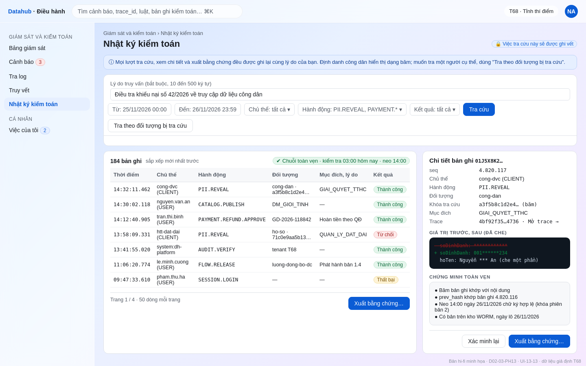

Ảnh cho thấy dải "sẽ được ghi vết", ô lý do bắt buộc, bộ lọc, chỉ báo toàn vẹn nổi bật, bảng kết quả và khung chi tiết với khác biệt trước sau đã che cùng bốn dòng chứng minh toàn vẹn.

### 19.1. Lưới bố cục và vùng

Khung nội dung rộng tối đa `--dh-size-page-max`; từ bp-xl bảng kết quả chiếm 8/12 và khung chi tiết 4/12; dưới bp-xl chi tiết mở thành `CMP-Drawer` (`--dh-size-drawer-lg`). Mọi vùng đặc.

```
┌ ① Tiêu đề: Nhật ký kiểm toán                       🔒 Việc tra cứu này sẽ được ghi vết ┐
├ ② Dải thông tin (không đóng được): "Mọi lượt tra cứu, xem chi tiết và xuất đều được ghi lại…" ┤
├ ③ Lý do truy vấn (bắt buộc, 10–500 ký tự) [................................] 0/500   ┤
├ ④ Bộ lọc: [Từ][Đến] [Chủ thể] [Loại chủ thể ▾] [Hành động ▾] [Đối tượng] [Kết quả ▾] [trace_id] [Tra cứu] ┤
├ ⑤ Chỉ báo toàn vẹn: ✔ Chuỗi toàn vẹn · kiểm tra 03:00 hôm nay · neo 14:00   [Tra theo đối tượng bị tra cứu ▸] ┤
├ ⑥ Bảng kết quả (8/12) ─────────────────────────────┬ ⑦ Chi tiết bản ghi (4/12) ─────┤
│ Thời điểm │ Chủ thể │ Hành động │ Đối tượng │ Mục đích │ Kết quả │ seq, hành động, khác biệt │
│ … 50 dòng …                                           │ Giá trị trước, sau (đã che)    │
│ Trang 1/4 · 50 dòng/trang   [Xuất bằng chứng…]        │ Chứng minh toàn vẹn · [Xác minh lại] │
```

### 19.2. Giải phẫu từng vùng

Bảng dưới mô tả từng vùng đánh số của màn Nhật ký kiểm toán; dải ghi vết luôn hiện vì mọi lần tra đều bị ghi lại.

| Vùng | `CMP-*` | Giải phẫu và hành vi |
|---|---|---|
| ② Dải ghi vết | `CMP-Alert` mức thông tin, không `closable` | Thường trực ở đầu trang; nền `--dh-color-info`, chữ `--dh-color-info-text` |
| ③ Lý do | `CMP-TextArea` trong `CMP-FormField` | Bắt buộc 10 đến 500 ký tự, đếm ký tự; trống: nút "Tra cứu" vô hiệu kèm gợi ý "Nhập lý do để tra cứu" (ERR-13-012 nếu máy chủ từ chối). Lý do **không** lưu vào URL, `localStorage` hay lịch sử; giữ trong bộ nhớ trang đến khi đổi tenant |
| ④ Bộ lọc | `CMP-FilterBar`, `CMP-DateRangePicker`, `CMP-ResourceSelect`, `CMP-Select` | Khoảng bắt buộc, tối đa 31 ngày mỗi lần (ERR-13-005); quá 12 tháng: ERR-13-029; chủ thể gõ không dấu; hành động chọn nhiều giá trị (ví dụ `PII.REVEAL`, `PAYMENT.*`) |
| ⑤ Chỉ báo toàn vẹn | `CMP-StatusTag`, `CMP-Alert` | "Chuỗi toàn vẹn" xanh kèm giờ kiểm tra và neo gần nhất; khi nghi vấn: dải đỏ không đóng được "Phát hiện đứt chuỗi kiểm toán tại seq {seq} của tenant {tenant}." (ERR-13-109) kèm nút "Xem chi tiết" → UI-13-14 |
| "Tra theo đối tượng bị tra cứu" | `CMP-Drawer`, `CMP-SecretField`, `CMP-ReasonDialog` | Nhập số định danh (kiểm tra định dạng, ERR-13-031) và lý do; xác thực lại phiên (ERR-13-028); ô nhập xóa ngay sau khi gửi, chỉ băm được lưu; kết quả hiển thị trong bảng ⑥ với nhãn "Tra theo đối tượng" |
| ⑥ Bảng kết quả | `CMP-DataTable`, `CMP-StatusTag`, `CMP-Pagination` | Cột (bảng 19.3); sắp `sap-xep=thoi-diem:giam` mặc định; chỉ đọc, không có hàng chọn để xóa hay sửa; `size` ≤ 200 |
| ⑦ Chi tiết | `CMP-Drawer` hoặc khung phải, `CMP-DescriptionList`, `CMP-DiffTable`, `CMP-MaskedValue`, `CMP-CopyButton` | Hiện khi chọn một dòng (`chon={audit-id}`); mở chi tiết cũng là một lượt tra cứu được ghi vết cùng lý do |
| Xuất bằng chứng | `CMP-ReasonDialog`, `CMP-JobProgress` | Chỉ khi có `PERM-13-audit-export`; nhập lý do, căn cứ (5 đến 200 ký tự), xác thực lại phiên; tạo yêu cầu API-13-082 rồi chuyển UI-13-14 |

: UI-13-13 Giải phẫu từng vùng

### 19.3. Cột bảng kết quả và chi tiết

Bảng dưới liệt kê cột của bảng kết quả và trường trong ngăn chi tiết, kèm trường API nguồn và quy tắc hiển thị.

| Cột, trường | Kiểu | Nguồn trường API-13-074, 075 | Ghi chú |
|---|---|---|---|
| Thời điểm | T-TS | `occurredAt` | Giờ Asia/Ho_Chi_Minh đến mili giây; tooltip UTC |
| Chủ thể | T-NAME | `actor`, `actorType` | `USER`, `CLIENT`, `SYSTEM`; hiển thị "tên (loại)" |
| Hành động | T-CODE | `action` | Ví dụ `CATALOG.PUBLISH`, `PII.REVEAL`; `CMP-CodeText` |
| Đối tượng | T-ID | `objectType`, `objectId` | Định danh công dân chỉ dạng băm rút gọn |
| Mục đích, lý do | T-TEXT | `purpose`, `reason` | Rút gọn một dòng, đầy đủ ở chi tiết |
| Kết quả | T-ENUM | `outcome` | Thành công, Từ chối, Thất bại (chữ + màu) |
| `seq`, băm, `prev_hash` | số, T-HASH | `seq`, `hash`, `prevHash` | Chỉ ở chi tiết |
| Khác biệt trước, sau | JSON | `before`, `after` | Đã che ở nguồn; `CMP-DiffTable` dùng token `--dh-color-diff-added`, `--dh-color-diff-removed`, `--dh-color-diff-changed` kèm ký hiệu + và − |
| Chứng minh toàn vẹn | — | `verification` (API-13-075) | Bốn dòng: băm khớp nội dung, `prev_hash` khớp bản ghi trước, neo hợp lệ (chữ ký, phiên bản khóa), có bản trên WORM |

: UI-13-13 Cột và trường chi tiết

### 19.4. Tương tác và trạng thái

Bảng dưới quy định thao tác, trạng thái và thông báo của màn Nhật ký kiểm toán; thao tác tra cứu và xuất đều ghi kiểm toán.

| Mục | Quy định |
|---|---|
| Tra cứu | `Enter` ở ô lý do hoặc bộ lọc chạy; thao tác chạy ghi kiểm toán loại `AUDIT.QUERY` (UC-13-11) |
| Chọn dòng | Bấm dòng hoặc `Enter`; `J`/`K` dòng kế, trước; `Esc` đóng chi tiết, focus trở về dòng |
| Sao chép | `C` sao chép `audit-id`; nút `CMP-CopyButton` ở băm |
| Xác minh lại | Gọi lại API-13-075, hiện kết quả từng dòng chứng minh; thất bại hiện ERR-13-110 "Neo {anchorId} không khớp với bản WORM hoặc SIEM." |
| Rỗng, không kết quả | "Không có bản ghi nào khớp điều kiện trong {khoảng}." kèm điều kiện đang áp; chưa nhập lý do: hướng dẫn thay cho bảng |
| Lỗi | ERR-13-012 dưới ô lý do; ERR-13-013 "Phạm vi truy vấn quá rộng ({n} bản ghi). Thu hẹp phạm vi hoặc chuyển sang xuất bằng chứng chạy nền." kèm nút; ERR-13-015; ERR-13-036 khi ở phiên liên tenant không còn hiệu lực; ERR-13-043 dải "Chuỗi kiểm toán của tenant đã đóng, không nhận thêm bản ghi." (chỉ đọc) |
| Hết phiên (ST-14) | Lý do đã nhập không giữ bản nháp; sau đăng nhập phải nhập lại |
| Chế độ in | Không có; xuất bằng chứng là đường duy nhất rời hệ thống |
| Truy cập | Bảng có `caption` "Kết quả tra cứu nhật ký kiểm toán"; dải ghi vết là `role="note"`; dải đứt chuỗi là `role="alert"`; kết quả Từ chối, Thất bại có chữ; diff có ký hiệu + và − ngoài màu; hộp lý do có `aria-describedby` nêu giới hạn ký tự |

: UI-13-13 Tương tác và trạng thái

## 20. UI-13-14 Toàn vẹn và bằng chứng

::: dac-ta
**Mục đích.** Cho kiểm toán viên và cán bộ ATTT xem danh sách neo băm hằng giờ, chạy và theo dõi kiểm tra toàn vẹn chuỗi, xử lý đứt chuỗi, yêu cầu xuất gói bằng chứng ký số và tải gói khi sẵn sàng.

**Người dùng, quyền.** Xem: SO, AU, TA, PA (`PERM-13-audit-read`); chạy kiểm tra theo yêu cầu và xuất: SO, AU (`PERM-13-audit-export`).

**FR, UC hiện thực.** FR-13-012, 014, 015, 024; UC-13-06, 07, 08, 15.

**Truy vết hệ cũ.** LGC-APIM-027 (nâng cấp).

**Đường dẫn.** `/giam-sat/kiem-toan/toan-ven?tab=neo|kiem-tra|xuat`, `/giam-sat/kiem-toan/toan-ven/xuat/{ma-xuat}`.

**Mẫu bố cục.** PTN-01 (ba tab danh sách) và PTN-02 (chi tiết lượt kiểm tra, yêu cầu xuất).

**API.** API-13-077, 078, 079, 080, 081, 082, 083, 084.

**Phát hành, mức chi tiết.** MVP; đầy đủ.
:::

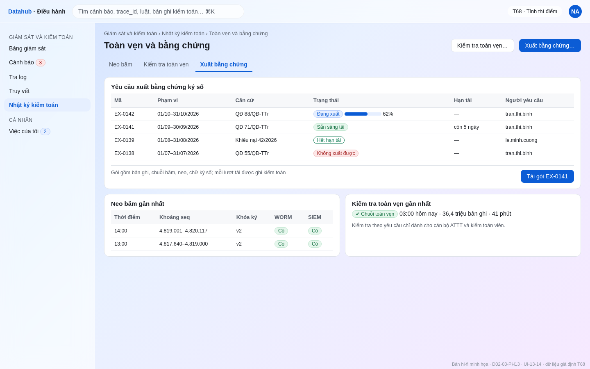

Ảnh cho thấy tab "Xuất bằng chứng": bảng yêu cầu với nhãn trạng thái, thanh tiến độ yêu cầu đang chạy và gói sẵn sàng tải kèm hạn tải.

| # | Thành phần | `CMP-*` | Nội dung, kiểm tra | API |
|---|---|---|---|---|
| 1 | Tab | `CMP-Tabs` | Neo băm · Kiểm tra toàn vẹn · Xuất bằng chứng | — |
| 2 | Bảng neo | `CMP-DataTable`, `CMP-StatusTag` | Thời điểm neo, Khoảng `seq`, Băm đầu chuỗi, Khóa ký (phiên bản), Bản WORM, SIEM, Trạng thái | API-13-080, 081 |
| 3 | Bảng lượt kiểm tra | `CMP-DataTable` | Thời điểm, Loại (hằng ngày, theo yêu cầu), Phạm vi, Kết quả (Toàn vẹn, Nghi vấn, Đang kiểm tra), Người yêu cầu | API-13-078 |
| 4 | Nút "Kiểm tra toàn vẹn" | `CMP-Button`, `CMP-ReasonDialog` | Chọn phạm vi (từ neo gần nhất, toàn chuỗi 12 tháng), lý do; trả 202; đang chạy thì vô hiệu (ERR-13-032) | API-13-077 |
| 5 | Chi tiết lượt kiểm tra | `CMP-Drawer`, `CMP-DescriptionList` | Số bản ghi đã duyệt, `seq` bị đứt, nút "Chuyển cho xử lý sự cố" (liên kết UI-13-15) | API-13-079 |
| 6 | Bảng yêu cầu xuất | `CMP-DataTable`, `CMP-StatusTag`, `CMP-JobProgress` | Phạm vi, Lý do, Căn cứ, Trạng thái (bảng 5.1), Tiến độ, Hạn tải, Người yêu cầu | API-13-083 |
| 7 | Biểu mẫu xuất | `CMP-Modal` hoặc trang PTN-03 | Khoảng (≤ 5 năm), bộ lọc (cùng bộ lọc UI-13-13), Lý do 10 đến 500, Căn cứ 5 đến 200, xác thực lại phiên | API-13-082 |
| 8 | Tải gói | `CMP-Button` | Chỉ khi `READY`; mỗi lượt tải ghi kiểm toán; hiện băm SHA-256 và chữ ký của gói kèm `CMP-CopyButton` | API-13-084 |

: UI-13-14 Thành phần

Trạng thái và thông báo: ERR-13-025 "Đã có yêu cầu xuất bằng chứng cùng phạm vi đang chạy." (kèm liên kết yêu cầu đang chạy); ERR-13-026 "Chưa ký số được tệp bằng chứng nên không xuất. Thử lại sau hoặc liên hệ quản trị nền tảng."; ERR-13-027 "Tệp bằng chứng đã hết hạn tải. Tạo yêu cầu xuất mới."; ERR-13-028 mở hộp xác thực lại; ERR-13-032. Bảng yêu cầu tự làm mới 10 giây khi có yêu cầu `RUNNING`; khi xong, `CMP-Notification` "Gói bằng chứng {mã} đã sẵn sàng." Hủy yêu cầu `REQUESTED`, `RUNNING`: nút "Hủy" chỉ người yêu cầu. Rỗng: "Chưa có yêu cầu xuất bằng chứng nào." Phím tắt `N` yêu cầu mới (khi có quyền), `R` làm mới. Tiến độ có `role="progressbar"` kèm `aria-valuetext` "Đang xuất, 62%".

## 21. UI-13-15 Cảnh báo an ninh và luật phát hiện

::: dac-ta
**Mục đích.** Cho cán bộ ATTT tiếp nhận và điều tra cảnh báo an ninh do bộ phát hiện sinh từ bản ghi kiểm toán, xem bằng chứng, đóng với một trong ba kết luận, đề xuất tạm ngừng HTTT, tinh chỉnh ngưỡng luật phát hiện và lập báo cáo sự cố.

**Người dùng, quyền.** SO, TA, PA có `PERM-13-security`.

**FR, UC hiện thực.** FR-13-051, 052, 053, 055; UC-13-33, 34, 35, 37.

**Truy vết hệ cũ.** Không có (màn mới theo SEC-62, SEC-64, SEC-74).

**Đường dẫn.** `/giam-sat/an-ninh?tab=canh-bao|luat`, `/giam-sat/an-ninh/{alert-id}`.

**Mẫu bố cục.** PTN-01 (danh sách), chi tiết `CMP-Drawer` rộng.

**API.** API-13-054, 055, 056, 057, 058, 059, 060, 065, 066.

**Phát hành, mức chi tiết.** MVP; báo cáo sự cố (FR-13-055) Đợt sau.
:::

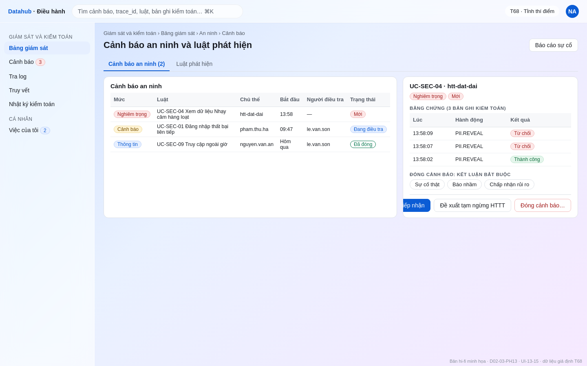

Ảnh cho thấy hộp cảnh báo an ninh với nhãn trạng thái Mới, Đang điều tra, Đã đóng, và chi tiết gồm bằng chứng là các bản ghi kiểm toán liên quan, ba nút Tiếp nhận, Đề xuất tạm ngừng HTTT, Đóng cảnh báo.

| # | Thành phần | `CMP-*` | Nội dung, kiểm tra | API |
|---|---|---|---|---|
| 1 | Tab | `CMP-Tabs` | Cảnh báo an ninh · Luật phát hiện | — |
| 2 | Bảng cảnh báo | `CMP-DataTable`, `CMP-StatusTag` | Mức, Luật (UC-SEC), Chủ thể, Bắt đầu, Người điều tra, Trạng thái | API-13-056 |
| 3 | Chi tiết | `CMP-Drawer`, `CMP-DescriptionList`, `CMP-Timeline`, `CMP-DataTable` | Bằng chứng: các bản ghi kiểm toán kích hoạt (liên kết UI-13-13, mỗi lần mở ghi vết); lịch sử trạng thái | API-13-057 |
| 4 | Tiếp nhận | `CMP-Button` | Gán người điều tra là người bấm; mức Nghiêm trọng gửi TA sau 15 phút nếu chưa tiếp nhận | API-13-058 |
| 5 | Đóng | `CMP-ReasonDialog` | Kết luận bắt buộc: Sự cố thật, Báo nhầm, Chấp nhận rủi ro (ghi chú bắt buộc); ERR-13-023 | API-13-059 |
| 6 | Đề xuất tạm ngừng HTTT | `CMP-ConfirmDialog` | Chỉ khi kết luận "Sự cố thật"; ghi chú "PH-01 quyết định, PH-13 chỉ đề xuất" (Q13-12); liên kết sâu tới màn tạm ngừng của PH-01 | API-13-060 |
| 7 | Bảng luật phát hiện | `CMP-DataTable`, `CMP-NumberInput`, `CMP-Switch` | Mã UC-SEC, Mô tả, Ngưỡng (nới trong biên), Bật tắt; luật bắt buộc không tắt được (ERR-13-024) | API-13-054, 055 |
| 8 | Báo cáo sự cố | `CMP-Button` | Sinh mẫu từ cảnh báo, tải bản nháp; không tự gửi cơ quan | API-13-065, 066 |

: UI-13-15 Thành phần

Rỗng: "Không có cảnh báo an ninh nào đang mở." Phím tắt `J`/`K`, `A` tiếp nhận, `Enter` mở chi tiết. Mọi hành động ghi kiểm toán (UC-13-11). Truy cập: nhãn Mới có chữ; `CMP-ReasonDialog` đưa focus vào nhóm chọn kết luận (`role="radiogroup"`).

## 22. UI-13-16 Truy cập liên tenant

::: dac-ta
**Mục đích.** Cho quản trị tỉnh, cán bộ ATTT và kiểm toán rà soát ai đã truy cập tenant này từ tenant khác (nền tảng), lý do và các thao tác đã làm trong phiên.

**Người dùng, quyền.** TA, SO, AU, PA có `PERM-13-audit-read`.

**FR, UC hiện thực.** FR-13-025; UC-13-16.

**Truy vết hệ cũ.** Không có.

**Đường dẫn.** `/giam-sat/kiem-toan/lien-tenant`.

**Mẫu bố cục.** PTN-01.

**API.** API-13-085.

**Phát hành, mức chi tiết.** MVP (mức S); đầy đủ.
:::

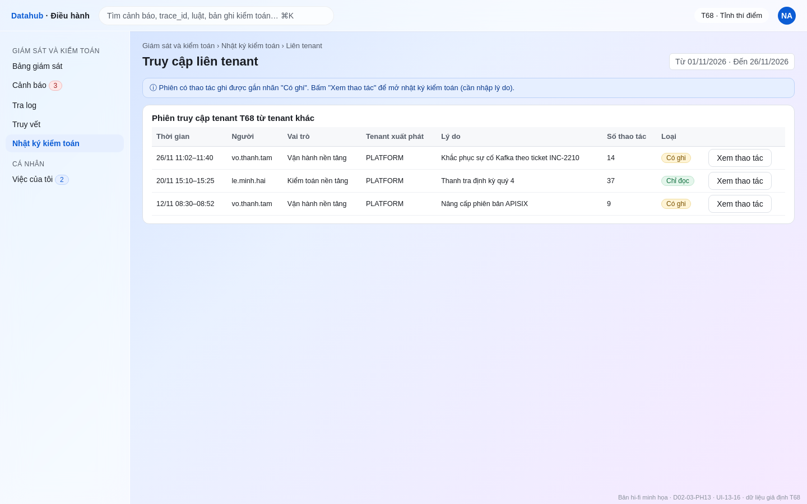

Ảnh cho thấy bảng phiên liên tenant gồm người, tenant xuất phát, lý do, thời lượng, số thao tác và liên kết tới thao tác trong nhật ký kiểm toán.

| # | Thành phần | `CMP-*` | Nội dung | API |
|---|---|---|---|---|
| 1 | Bộ lọc | `CMP-FilterBar`, `CMP-DateRangePicker` | Khoảng (bắt buộc), Người, Tenant xuất phát | API-13-085 |
| 2 | Bảng phiên | `CMP-DataTable` | Cột: Bắt đầu, Kết thúc, Người, Vai trò, Tenant xuất phát, Lý do, Số thao tác, Thao tác ghi | API-13-085 |
| 3 | Liên kết thao tác | `CMP-Link` | "Xem {n} thao tác" mở UI-13-13 lọc theo phiên (hộp lý do hiện trước) | — |
| 4 | Nhắc nhở | `CMP-Alert` mức thông tin | "Phiên có thao tác ghi được tô nhãn 'Có ghi'" | — |

: UI-13-16 Thành phần

Trạng thái: rỗng "Không có truy cập liên tenant nào trong khoảng này."; ERR-13-036 khi người xem chưa có phiên hợp lệ; ERR-13-012 khi mở thao tác không có lý do. Phím tắt `J`/`K`, `Enter`.

## 23. UI-13-17 Cài đặt giám sát

::: dac-ta
**Mục đích.** Cho quản trị tỉnh và nền tảng cấu hình tham số `13.*` của tenant (thời hạn lưu, hạn mức, ngưỡng SLO), mục tiêu SIEM, bộ dashboard Grafana chuẩn, kiểm tra tổng hợp và xem chuỗi kiểm toán của tenant.

**Người dùng, quyền.** `PERM-13-admin` (PA, TA).

**FR, UC hiện thực.** FR-13-008, 041, 054, 060, 061; UC-13-01, 04, 25, 36, 41, 42.

**Truy vết hệ cũ.** Không có.

**Đường dẫn.** `/giam-sat/cai-dat?tab=tham-so|siem|dashboard|kiem-tra|chuoi`.

**Mẫu bố cục.** PTN-12 Cài đặt (nhiều tab, lưu theo từng tab).

**API.** API-13-070, 071, 061, 062, 063, 064, 017, 018, 087.

**Phát hành, mức chi tiết.** MVP; đầy đủ.
:::

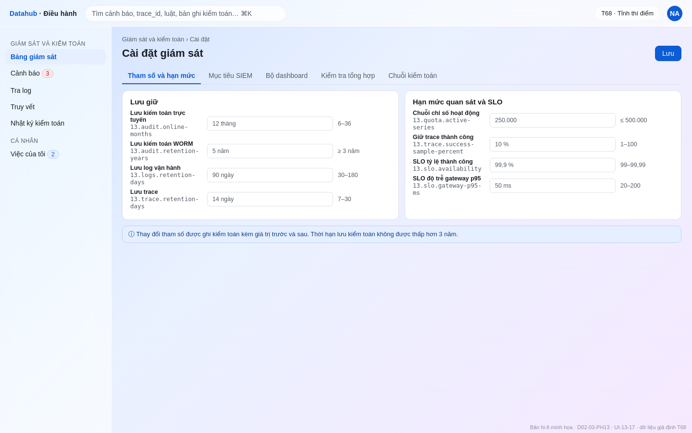

Ảnh cho thấy tab "Tham số và hạn mức" gồm các nhóm Lưu giữ, Hạn mức quan sát, SLO, kèm giá trị mặc định, giới hạn và nút "Khôi phục mặc định" từng tham số.

| Tab | Thành phần | `CMP-*` | Kiểm tra, ghi chú | API |
|---|---|---|---|---|
| Tham số và hạn mức | Form theo nhóm | `CMP-Form`, `CMP-NumberInput`, `CMP-Switch`, `CMP-Select` | Mỗi tham số hiện mặc định, miền cho phép; thời hạn lưu kiểm toán ≥ 3 năm (ERR-13-040); hạn mức không vượt trần nền tảng (ERR-13-041); khóa dạng `13.audit.retention-years` | API-13-070, 071 |
| Mục tiêu SIEM | Bảng + Drawer | `CMP-DataTable`, `CMP-Drawer`, `CMP-SecretRefField` | Giao thức (syslog, OTLP), đích, định dạng (ECS, OCSF, Q13-04), loại dữ liệu đẩy; "Gửi thử" (ERR-13-039); bí mật qua tham chiếu OpenBao | API-13-061 đến 064 |
| Bộ dashboard | Bảng | `CMP-DataTable`, `CMP-StatusTag`, `CMP-JobProgress` | Bộ chuẩn, phiên bản, trạng thái đồng bộ sang Grafana; nút "Đồng bộ" (202); ERR-13-035 | API-13-017, 018 |
| Kiểm tra tổng hợp | Bảng | `CMP-EditableTable` | Mã, Mục tiêu, Chu kỳ, Kết quả gần nhất, số lần thất bại liên tiếp (ERR-13-124 hiện ở đây) | API-13-071 |
| Chuỗi kiểm toán | Thẻ | `CMP-DescriptionList`, `CMP-Link` | Ngày khởi tạo, `seq` hiện tại, trạng thái (mở, đã đóng); chỉ xem, liên kết UI-13-18; đóng chuỗi do PH-20 gọi, không có nút tại đây | API-13-087 |

: UI-13-17 Thành phần theo tab

Lưu có `If-Match` (ERR-13-007, ST-13); tenant tạm ngừng: ERR-13-016, mọi trường vô hiệu. Thay đổi tham số được ghi kiểm toán với giá trị trước và sau. Cảnh báo rời trang khi chưa lưu (D03-06-00 §4.3). Phím tắt `Ctrl+S` lưu tab hiện tại. Truy cập: mỗi trường có nhãn, mô tả `aria-describedby` nêu mặc định và miền.

## 24. UI-13-18 Sức khỏe chuỗi kiểm toán

::: dac-ta
**Mục đích.** Cho vận hành và cán bộ ATTT thấy chuỗi kiểm toán có đang được ghi đầy đủ và đúng không: đầu chuỗi, độ trễ ghi, hộp thư đi còn tồn, độ trễ sao WORM, đối chiếu số lượng theo DU, phân vùng và kho cách ly. Phát hiện sớm trước khi trở thành thiếu bản ghi.

**Người dùng, quyền.** PA, SO, AU, TA có `PERM-13-audit-read`; PO xem thẻ tóm tắt ở UI-13-01 (Q13-30).

**FR, UC hiện thực.** FR-13-010, 011, 012, 013, 015, 016, 017, 018; UC-13-05, 06, 08, 09, 10.

**Truy vết hệ cũ.** LGC-NFR-005 (sao lưu log theo tháng).

**Đường dẫn.** `/giam-sat/kiem-toan/suc-khoe`.

**Mẫu bố cục.** PTN-06.

**API.** API-13-086, 087, 088, 080.

**Phát hành, mức chi tiết.** MVP; đầy đủ.
:::

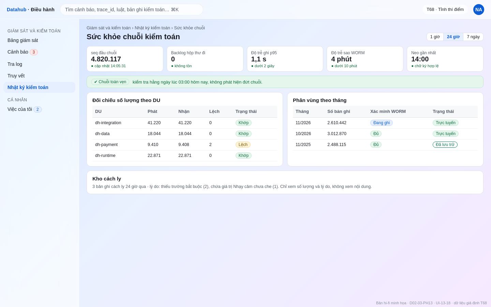

Ảnh cho thấy hàng thẻ đầu chuỗi, backlog hộp thư đi, độ trễ Kafka và WORM; bảng đối chiếu số lượng theo DU; bảng phân vùng theo tháng; thẻ kho cách ly.

| # | Thành phần | `CMP-*` | Nội dung | API |
|---|---|---|---|---|
| 1 | Thẻ KPI × 5 | `CMP-KpiCard` | `seq` đầu chuỗi, Backlog hộp thư đi, Độ trễ ghi p95 (NFR-13-008: 2 giây), Độ trễ sao WORM, Neo gần nhất | API-13-087 |
| 2 | Chỉ báo toàn vẹn | `CMP-StatusTag` | Như UI-13-13 vùng ⑤ | API-13-087 |
| 3 | Đối chiếu số lượng | `CMP-DataTable` | DU, Phát, Nhận, Lệch, Trạng thái; dòng lệch hiện ERR-13-111 "Số bản ghi kiểm toán của {du} lệch: phát {n}, nhận {m}." | API-13-086 |
| 4 | Phân vùng | `CMP-DataTable`, `CMP-StatusTag` | Tháng, Số bản ghi, Đã xác minh WORM, Trạng thái (Trực tuyến, Đã lưu trữ); dòng chưa xác minh đủ hiện ERR-13-125 | API-13-088 |
| 5 | Kho cách ly | `CMP-DataTable` | Bản ghi bị cách ly (ERR-13-101, 105), lý do; chỉ xem số lượng và lý do, không xem nội dung | API-13-087 |
| 6 | Cảnh báo dung lượng | `CMP-Alert` | Kho đạt 85% (ERR-13-123) | API-13-087 |

: UI-13-18 Thành phần

Trạng thái theo chương 6; làm mới 30 giây. Dải đứt chuỗi (ERR-13-109) như UI-13-13. ERR-13-126 hiện dải thông tin "Đồng hồ lệch: bản ghi từ {du} có thời điểm sau giờ máy chủ quá 2 giây." Phím tắt `R`, `F`, `T`.

## 25. Mẫu truy cập (WCAG 2.2 AA)

Các màn PH-13 tuân thủ WCAG 2.2 mức AA như mọi màn của `dh-console` (NFR-00 về truy cập, D03-06-00 §6). Bảng dưới nêu các tiêu chí dễ vi phạm nhất ở màn giám sát và cách tập này đáp ứng; kiểm thử viên dùng bảng làm danh sách soát.

| Tiêu chí WCAG 2.2 | Rủi ro ở PH-13 | Cách đáp ứng |
|---|---|---|
| 1.1.1 Nội dung không phải chữ | Biểu đồ ECharts không đọc được bằng trình đọc màn hình | Mọi biểu đồ có `aria-label` tóm tắt và nút "Xem dạng bảng" cho số liệu đầy đủ |
| 1.3.1 Thông tin và quan hệ | Thác nước, lưới lịch trực, bảng log | `role="treegrid"`, `role="grid"`, bảng có `caption`, `scope`, `aria-sort` |
| 1.4.1 Dùng màu | Mức cảnh báo, mức log, nhãn thành phần, diff | Luôn có chữ, biểu tượng hoặc ký hiệu + và − cùng màu; thanh lỗi trong thác nước có mẫu gạch chéo |
| 1.4.3, 1.4.11 Tương phản | Chữ trên thẻ KPI, chữ log đơn cách, viền ô lưới | Nội dung nền đặc `--dh-color-surface-solid`; chữ nhãn dùng `-text` của từng trạng thái; viền điều khiển `--dh-color-border-control` (≥ 3:1) |
| 1.4.10 Reflow, 1.4.4 Phóng chữ | Bảng rộng, thác nước | Phóng 200% không mất thông tin; bảng cuộn ngang trong vùng có `tabindex="0"`; dưới bp-xl khung phải thành Drawer |
| 2.1.1 Bàn phím, 2.1.2 Không bẫy | Thác nước, histogram kéo chọn, live tail | Mọi thao tác chuột có phương án bàn phím (mục 14.3, ô nhập thời gian cho histogram); `Esc` thoát Drawer |
| 2.1.4 Phím tắt ký tự đơn | `A`, `S`, `X`, `J`, `K`, `L`, `R`, `F`, `T` | Chỉ hoạt động khi focus ở vùng danh sách hoặc trang, không khi đang gõ; có thể tắt ở "Tài khoản › Phím tắt" (Q13-34) |
| 2.2.1, 2.2.2 Thời gian | Làm mới 30 giây, live tail, hộp xác thực lại | Có nút tạm dừng làm mới; làm mới không cướp focus; hộp xác thực lại cảnh báo trước khi hết |
| 2.4.3, 2.4.7, 2.4.11 Thứ tự và hiển thị focus | Drawer chi tiết, hàng bảng ảo hóa | Mở Drawer đưa focus vào tiêu đề, đóng trả focus về hàng; focus không bị thanh dính che (2.4.11) |
| 2.5.8 Kích thước mục tiêu | Nút nhỏ trong hàng bảng, ô thành phần | ≥ 24×24 CSS px, khoảng cách đủ |
| 3.3.1, 3.3.3 Lỗi nhập | Cú pháp truy vấn, ô lý do, biểu thức luật | Lỗi dưới trường, nêu vị trí và gợi ý; `aria-invalid`, `aria-describedby` |
| 3.3.7 Nhập lại dư thừa | Lý do tra cứu kiểm toán | Không bắt nhập lại lý do trong cùng phiên màn khi chỉ đổi bộ lọc; nhập lại khi đổi tenant hoặc hết phiên (có chủ đích ATTT, ghi ở mục 19.2) |
| 3.3.8 Xác thực dễ truy cập | Hộp xác thực lại phiên | Dùng cơ chế của Keycloak hỗ trợ dán mật khẩu, trình quản lý mật khẩu; không bắt nhớ |
| 4.1.3 Thông báo trạng thái | Cảnh báo mới, "n sự kiện mới", kết quả gửi thử kênh | `aria-live="polite"` có giới hạn tần suất; không đẩy luồng log vào vùng live |

: Soát WCAG 2.2 AA cho các màn PH-13

Hai quyết định riêng: (1) không có chế độ "chỉ màu" ở bất cứ biểu đồ nào, kiểm tra bằng chế độ xám; (2) chế độ trực ca là chủ đề tối có tương phản kiểm tra riêng, kính tắt (D03-06-00 §4.9).

## 26. Kiến trúc mã giao diện

Giao diện nằm trong gói `features/observability` của `dh-console` (React, antd v6, TanStack Query, React Router). Cấu trúc dưới đây giúp đội giao diện chia việc theo màn và dùng lại thành phần.

| Thư mục | Nội dung |
|---|---|
| `features/observability/overview` | UI-13-01 đến 06; hook `useOverview`, `useComponents`, `useDashboardRange` |
| `features/observability/logs` | UI-13-07, 09; `LogQueryBar`, `useLogSearch` (con trỏ), `useLogTail` (SSE, tự tạm dừng) |
| `features/observability/trace` | UI-13-08; `TraceWaterfall` (ECharts custom series, tối đa 2.000 chặng hiển thị, phần còn lại gộp "… {n} chặng") |
| `features/observability/alerts` | UI-13-10, 11, 12 |
| `features/observability/audit` | UI-13-13, 14, 16, 18; `AuditQueryForm` (lý do chỉ giữ ở state, không persist), `ReauthDialog` |
| `features/observability/security` | UI-13-15 |
| `features/observability/settings` | UI-13-17 |
| `features/observability/shared` | `useTimeRangeParams` (đồng bộ `tu`, `den`, `khoang` lên URL), `StatusTags` (bảng 5.1), `errorMessages` (bảng 5.2), `TraceLink` |

: Cấu trúc gói features/observability

Quy tắc kỹ thuật: (1) mọi lời gọi API qua client sinh từ OpenAPI của D03-04-PH13; (2) khóa truy vấn `["obs", tenant, màn, tham số]`, đổi tenant xóa bộ nhớ đệm của nhánh `obs`; (3) **không** đưa lý do, căn cứ, số định danh vào khóa truy vấn, URL, `localStorage`, `sessionStorage` hay công cụ giám sát lỗi phía trình duyệt; (4) trình bắt lỗi (`ErrorBoundary`) từng thẻ để lỗi một thẻ không làm hỏng trang; (5) SSE tự đóng khi tab ẩn quá 60 giây và khi rời màn; (6) biểu đồ ECharts tải lười, dùng bảng màu `--dh-color-chart-1…8`; (7) bundle mỗi màn ≤ 250 KB nén (giả định, cùng ngưỡng các tập khác).

## 27. Luồng người dùng chính

Hai luồng quan trọng nhất qua nhiều màn: từ cảnh báo tới nguyên nhân, và tra cứu kiểm toán có ghi vết.

```{.mermaid caption="Từ cảnh báo tới nguyên nhân gốc qua các màn PH-13"}
sequenceDiagram
  actor TO as Vận hành tỉnh
  participant C as UI-13-10 Cảnh báo
  participant D as UI-13-02 Data plane
  participant T as UI-13-08 Truy vết
  participant L as UI-13-07 Tra log
  TO->>C: Nhận thông báo, mở cảnh báo, đọc runbook
  C->>C: Tiếp nhận (dừng leo thang)
  TO->>D: Mở luồng liên quan, thấy lỗi tăng
  D->>T: Bấm điểm lỗi, mở trace mẫu
  T->>T: Thấy chặng ndxp-gateway chiếm 94%
  T->>L: Bấm Log của trace
  L-->>TO: Dòng log lỗi, thử lại 1 trên 3
  TO->>C: Đánh dấu đã xử lý, ghi nguyên nhân và hành động
```

Hình cho thấy người dùng không phải sao chép mã giữa màn: `alertId`, bộ lọc thời gian và `trace_id` đi theo liên kết. Bước tiếp nhận ở đầu dừng leo thang để người trực khác không bị gọi thêm.

```{.mermaid caption="Tra cứu nhật ký kiểm toán có ghi vết và xuất bằng chứng"}
sequenceDiagram
  actor AU as Kiểm toán viên
  participant K as UI-13-13 Nhật ký kiểm toán
  participant E as UI-13-14 Toàn vẹn và bằng chứng
  participant S as Máy chủ PH-13
  AU->>K: Nhập lý do và bộ lọc, bấm Tra cứu
  K->>S: POST records:search kèm lý do
  S-->>K: Kết quả, chỉ báo toàn vẹn (đồng thời ghi AUDIT.QUERY)
  AU->>K: Chọn bản ghi, xem khác biệt đã che
  AU->>K: Bấm Xuất bằng chứng, nhập lý do, căn cứ, xác thực lại
  K->>E: Tạo yêu cầu, chuyển sang tab Xuất bằng chứng
  E->>S: Theo dõi tiến độ
  S-->>AU: Thông báo gói sẵn sàng, tải gói ký số
```

Hình cho thấy mọi bước đọc và xuất đều qua máy chủ và để lại vết; giao diện không giữ dữ liệu kiểm toán lâu hơn lượt xem.

## 28. Ma trận màn hình theo vai trò

Ký hiệu: ● đầy đủ (xem và thao tác nếu có), ○ chỉ xem hoặc giới hạn, — không thấy màn. Cột theo tác nhân FRS §3.1; quyền nguồn ở D02-08 và FRS §3.2.

| Màn | PA | PO | TA | TO | SO | IE | IA | SV | VW | AU |
|---|---|---|---|---|---|---|---|---|---|---|
| UI-13-01 Tổng quan | ● | ● | ● | ● | ● | ○ | ○ | ○ | ● | ● |
| UI-13-02 Data plane | ● | ● | ● | ● | — | ● | ● | — | — | — |
| UI-13-03 Theo API, HTTT | ● | ● | ● | ● | ● | ○ | ○ | ○ | ● | ● |
| UI-13-04 Hạ tầng | ● | ● | ● | ● | — | — | — | — | — | — |
| UI-13-05 Nghiệp vụ | ● | ● | ● | ● | ● | — | — | — | ● | ● |
| UI-13-06 An ninh (bảng) | ● | ○ | ● | ○ | ● | — | — | — | — | ● |
| UI-13-07 Tra log | ● | ● | ● | ● | ● | ● | ● | — | — | ● |
| UI-13-08 Truy vết | ● | ● | ● | ● | ● | ● | ● | — | — | ● |
| UI-13-09 Truy cập API | ● | ● | ● | ● | ● | ● | ● | — | — | ● |
| UI-13-10 Cảnh báo | ● | ● | ● | ● | ● | ○ | ○ | — | — | ○ |
| UI-13-11 Luật | ● | ● | ● | ● | ○ | — | — | — | — | — |
| UI-13-12 Lịch trực, kênh | ● | ● | ● | ● | ○ | — | — | — | — | — |
| UI-13-13 Kiểm toán | ● | — | ● | — | ● | — | — | — | — | ● |
| UI-13-14 Toàn vẹn, bằng chứng | ○ | — | ○ | — | ● | — | — | — | — | ● |
| UI-13-15 An ninh | ● | — | ● | — | ● | — | — | — | — | — |
| UI-13-16 Liên tenant | ● | — | ● | — | ● | — | — | — | — | ● |
| UI-13-17 Cài đặt | ● | — | ● | — | — | — | — | — | — | — |
| UI-13-18 Sức khỏe chuỗi | ● | — | ○ | — | ● | — | — | — | — | ● |

: Ma trận màn hình theo vai trò (PH-13)

Ghi chú: SO ở UI-13-02, 04 không có vì `PERM-13-dashboard` cho xem nhưng nhóm vai trò này không dùng màn hạ tầng; menu vẫn hiện theo quyền nếu SO được cấp (bảng chỉ ghi vai trò chính theo FRS §10.1). IE, IA (○) chỉ xem phần liên quan luồng của mình. AU (○ ở UI-13-10) chỉ xem. PO (○ ở UI-13-06) chỉ xem thẻ tổng. UI-13-14 của PA, TA là ○ vì không có `PERM-13-audit-export`. Màn UI-13-18 của TA là ○ vì chỉ xem.

## 29. Kiểm thử giao diện và bản hi-fi

### 29.1. Kiểm thử giao diện

Ca kiểm thử chi tiết đánh mã `TC-13-nnn` ở tập kiểm thử D05-02-PH13 (cấp số bằng `number_tcs.py`). Tập này nêu các nhóm kiểm thử giao diện bắt buộc để tập kiểm thử bao phủ.

| Nhóm | Nội dung kiểm tra | Màn |
|---|---|---|
| Quyền hiển thị | Mỗi vai trò chỉ thấy mục menu và nút đúng ma trận (chương 28); URL trực tiếp không quyền trả ST-07, không lộ tên đối tượng | Mọi màn |
| Bốn trạng thái | Đang tải, rỗng, lỗi, không có quyền (chương 6) cho từng màn | Mọi màn |
| Ghi vết | Tra cứu kiểm toán, mở chi tiết, xuất, tải gói sinh bản ghi kiểm toán đúng loại; không có lý do thì không tra được | UI-13-13, 14, 16 |
| Không rò rỉ | Lý do, số định danh không có trong URL, lịch sử, `localStorage`, tiêu đề tab, báo cáo lỗi trình duyệt | UI-13-13 |
| Truy vấn log | Cú pháp đúng, sai (ERR-13-006), khoảng quá giới hạn, 429, hết thời gian, live tail tạm dừng khi cuộn | UI-13-07 |
| Thác nước | Chặng lỗi mở sẵn, chặng > 50% có nhãn, bàn phím duyệt cây, trace thiếu, trace cắt, trace không tồn tại | UI-13-08 |
| Cảnh báo | Chuyển trạng thái hợp lệ, hành động không hợp lệ (ERR-13-020), tạm ẩn quá hạn, đóng thiếu nguyên nhân | UI-13-10 |
| Chuỗi toàn vẹn | Dải đứt chuỗi hiện đúng ở ba màn khi API trả nghi vấn; menu có chấm đỏ | UI-13-13, 14, 18 |
| Truy cập | axe-core không lỗi nghiêm trọng; duyệt bằng bàn phím; trình đọc màn hình NVDA đọc đúng thác nước và nhãn trạng thái; phóng 200% | Mọi màn |
| Chế độ xám | Không thông tin nào mất khi chuyển xám | UI-13-01, 02, 07, 10 |
| Hiệu năng | Tải bảng điều khiển p95 ≤ 3 giây (NFR-13-004); cuộn 1 triệu dòng log; CLS < 0,1 | UI-13-01, 07 |

: Nhóm kiểm thử giao diện PH-13

### 29.2. Bản hi-fi

Ảnh hi-fi của 18 màn ở `ph13/hifi/ui-13-01.png` đến `ui-13-18.png`, sinh từ `ph13/hifi/gen_hifi.py` (HTML tĩnh dùng `hifi.css` theo token D03-05-02, dữ liệu giả định tenant T68) và chụp bằng `node shot.js` (Playwright, khung 1440×900, chụp cả trang). Ảnh minh họa bố cục, vật liệu (kính ở thanh trên và sidebar, nền đặc ở nội dung), màu và mật độ; không thay thế wireframe và bảng thành phần. Chạy lại:

```bash
cd datahub-docs/03-thiet-ke/uiux/ph13/hifi
python3 gen_hifi.py && node shot.js
```

## Phụ lục A. Đề nghị bổ sung cho D03-05 và D03-06-00

Tập này không sửa tài liệu dùng chung. Các mục dưới đây đề nghị đợt đồng bộ; trong lúc chờ, màn dùng thành phần chuẩn gần nhất ghi ở cột "Tạm dùng".

### A.1. Thành phần

Các thành phần dưới đây chưa có trong thư viện D03-05; tập màn hình này tạm dùng thành phần có sẵn và đề nghị bổ sung ở lần cập nhật D03-05.

| Đề nghị | Cần cho | Tạm dùng |
|---|---|---|
| `TraceWaterfall` (đề nghị) (cây chặng cộng thanh thời gian, gộp chặng, tiêu điểm bàn phím) | UI-13-08 | `CMP-Tree` cộng `CMP-Chart` custom series |
| `ComponentMap` (đề nghị) (lưới ô trạng thái thành phần) | UI-13-01 | `CMP-Card` cộng `CMP-StatusTag` |
| `IntegrityBadge` (đề nghị) (chỉ báo toàn vẹn chuỗi, có dải đỏ nghi vấn) | UI-13-06, 13, 14, 18 | `CMP-StatusTag` cộng `CMP-Alert` |
| `OnCallGrid` (đề nghị) (lưới lịch trực theo ca) | UI-13-12 | `CMP-DataTable` lưới |
| `QueryBar` (đề nghị) (ô truy vấn tô cú pháp, gợi ý trường) | UI-13-07 | `CMP-SearchField` biến thể truy vấn |

: Đề nghị bổ sung thành phần cho D03-05-04

### A.2. Route con cho D03-06-00 §2.3

Đề nghị thêm các route con dưới nhóm `/giam-sat`: `/giam-sat/bang-dieu-khien/{data-plane|api|ha-tang|nghiep-vu|an-ninh}`, `/giam-sat/log/truy-cap-api`, `/giam-sat/canh-bao/{luat|lich-truc}`, `/giam-sat/kiem-toan/{toan-ven|lien-tenant|suc-khoe}`, `/giam-sat/an-ninh`, `/giam-sat/cai-dat`; ghi chú tab "Lịch sử" của màn phân hệ khác lấy dữ liệu từ API-13-076. Đề nghị bổ sung vào ma trận §2.13 vai trò `ROLE-PLATFORM_AUDITOR`: thấy nhóm Giám sát và kiểm toán ở phạm vi toàn nền tảng, truy cập tenant khác qua phiên liên tenant có lý do.

### A.3. Quyền

Màn dùng `PERM-13-alert-ack`, `PERM-13-security`, `PERM-13-admin` đang là đề nghị ở FRS §3.4 chờ D02-08; xem Q13-30 cho PO và UI-13-18.

### A.4. Phím tắt

Đề nghị D03-06-00 §4.9, §4.14 ghi rõ phím tắt ký tự đơn chỉ hoạt động khi focus ở vùng danh sách và có cài đặt tắt (WCAG 2.1.4), kèm bảng phím riêng cho cảnh báo (`A`, `S`, `X`).

## Phụ lục B. Đề nghị bổ sung API

Các API dưới đây chưa có trong D03-04-PH13; màn hình tạm dùng API hiện có như ghi ở cột Lý do, và đề nghị bổ sung ở lần cập nhật kế tiếp của tập API.

| Đề nghị | Lý do | Màn |
|---|---|---|
| `GET /alerts:count` (đếm cảnh báo theo mức, trạng thái), nhẹ, làm mới 30 giây | Số trên menu "Cảnh báo" không nên gọi `GET /alerts` đầy đủ; hiện dùng API-13-001 | Menu, UI-13-10 |
| Tham số `sessionId` cho `POST /records:search` | Từ UI-13-16 mở đúng thao tác của một phiên liên tenant | UI-13-16, UI-13-13 |
| `GET /traces/{traceId}` trả `spansTruncated`, `spansTotal` | Hiện nhãn "Đã cắt" và số chặng bị bỏ | UI-13-08 |
| `GET /chain-status` trả `quarantineCount` và `reasons[]` | Thẻ kho cách ly ở UI-13-18 không cần API riêng | UI-13-18 |
| Phản hồi `GET /exports/{exportId}` có `sha256`, `signature` | Hiển thị băm và chữ ký gói ở UI-13-14 | UI-13-14 |

: Đề nghị bổ sung API cho D03-04-PH13

## Câu hỏi mở

Các câu hỏi dưới đây chưa có trả lời chốt; tập này dùng giả định nêu trong từng câu.

> **Câu hỏi mở Q13-30:** PO là vai trò chính của UI-13-18 theo FRS §10.1 nhưng không có `PERM-13-audit-read` (Q13-07). Giả định: PO không có màn UI-13-18, chỉ thấy thẻ "Hệ thống giám sát" và trạng thái chuỗi ở UI-13-01; nếu cần thì cấp `PERM-13-audit-read` giới hạn xem chỉ số sức khỏe (không xem bản ghi) và tách một quyền riêng cho xem sức khỏe chuỗi.

> **Câu hỏi mở Q13-31:** Thời hạn hiệu lực của lần xác thực lại phiên cho xuất bằng chứng và tra theo đối tượng bị tra cứu. Giả định: 5 phút, theo tham số của Keycloak (FR-00-012); cần xác nhận với PH-12.

> **Câu hỏi mở Q13-32:** Lý do tra cứu kiểm toán có được giữ giữa các lần tra trong cùng phiên màn không. Giả định: giữ trong bộ nhớ trang đến khi đổi tenant hoặc hết phiên, không bao giờ lưu bền; kiểm toán viên không phải nhập lại khi chỉ đổi bộ lọc (WCAG 3.3.7).

> **Câu hỏi mở Q13-33:** Thác nước dùng ECharts custom series (ADR-023) hay thư viện chuyên dụng cho trace. Giả định: ECharts custom series, giới hạn 2.000 chặng hiển thị; vượt thì gộp; nếu hiệu năng không đạt thì thêm `TraceWaterfall` (đề nghị) (Phụ lục A) dựng bằng canvas riêng.

> **Câu hỏi mở Q13-34:** Phím tắt ký tự đơn ở UI-13-10 (`A`, `S`, `X`) có vi phạm WCAG 2.1.4 không khi chỉ hoạt động trong vùng danh sách. Giả định: chấp nhận được nhờ điều kiện focus và có cài đặt tắt; cần kiểm thử viên truy cập xác nhận.

> **Câu hỏi mở Q13-35:** Phòng điều hành có cần màn hình treo tường không đăng nhập (mã chia sẻ chỉ đọc) cho UI-13-01. Giả định: không ở MVP vì vi phạm ghi vết và tách nhiệm vụ; dùng tài khoản chỉ đọc riêng với chế độ trực ca.

> **Câu hỏi mở Q13-36:** Phạm vi thiết bị. Giả định: màn quản trị PH-13 hỗ trợ từ 1024 px; dưới đó chỉ UI-13-01 và UI-13-10 dùng được (đọc, tiếp nhận cảnh báo), các màn còn lại hiện thông báo "Dùng màn hình rộng hơn để xem trang này".

## Lịch sử phiên bản

| Phiên bản | Ngày | Người | Nội dung |
|---|---|---|---|
| 0.1 | 26/11/2026 | Nhóm phân hệ PH-13 (Claude) | Bản đầu: 18 màn hình, điều hướng, thông báo ERR-13, ảnh hi-fi |
| 0.2 | 26/11/2026 | Nhóm viết tài liệu (Claude) | Rà chéo bảy tập PH-13: bổ sung UC hiện thực của UI-13-01, 12, 13, 17, 18 theo D02-04 mục 5.2; FR của UI-13-06, 09 thêm FR-13-005, 006; thêm đoạn mở cho các mục con |
