# D03-06-PH14 · Thiết kế giao diện màn hình Kết nối quốc gia

Tập màn không tự đặt token, `CMP-*` hay `PTN-*`; dùng tên chuẩn ở D03-05 và D03-06-00. Thành phần còn thiếu ghi ở Phụ lục A, API còn thiếu ghi ở Phụ lục B.

## Tóm tắt cho hội đồng thẩm định

PH-14 là nơi tỉnh khai báo, giám sát và kiểm soát mọi kết nối của Datahub ra và vào hệ thống cấp quốc gia (NDXP, NDOP, hệ thống đăng ký danh mục dịch vụ của Bộ). Phân hệ có 17 màn hình (UI-14-01…17) chia bốn nhóm: giám sát (01, 12, 13, 14), cấu hình nền tảng và dịch vụ (02 đến 07), an ninh và hạn mức (08, 09), chiều vào, đồng bộ và chuyển đổi từ hệ cũ (10, 11, 15), cộng cài đặt (16) và màn duyệt dùng chung trong "Việc của tôi" (17). Năm quyết định giao diện chính:

1. **Không có màn nào hiện được thông tin xác thực hay khóa riêng.** Thông tin xác thực với quốc gia chỉ ghi một chiều (`CMP-SecretField` chế độ chỉ ghi): sau khi lưu chỉ hiện "Đã khai, phiên bản n, ghi bởi …, lúc …". Chứng thư chỉ hiện tham chiếu khóa, không hiện khóa (BR-14-004, BR-14-005).
2. **Việc cần làm nổi lên trước số liệu.** Tổng quan (UI-14-01) đặt lên đầu trang các biểu ngữ không ẩn được: sự cố chữ ký chưa xác nhận, chứng thư còn dưới 60 ngày, hạn mức dự báo cạn, nền tảng ở trạng thái giữ an ninh. Mức dùng hạn mức luôn kèm chữ và vạch mốc 70%, 85%, 95%, không chỉ dùng màu.
3. **Bốn mắt nhìn thấy được.** Tám loại thay đổi cần người thứ hai duyệt (BR-14-022) đều đi qua UI-14-17; nút "Duyệt" vô hiệu kèm lý do khi người xem là người đề nghị hoặc người sửa gần nhất (ERR-14-007).
4. **Xem nội dung bản tin đầy đủ là thao tác có kiểm soát.** UI-14-12 che nội dung theo mặc định; chỉ Cán bộ ATTT có `PERM-14-audit-reveal` xem được, phải nhập lý do và xác thực lại bằng yếu tố thứ hai; nội dung tự che sau 5 phút và xem quá `14.reveal.max-per-day` lần trong ngày thì hệ thống cảnh báo (BR-14-021).
5. **Tra giao dịch là màn được viết siêu chi tiết (UI-14-12)** vì đây là nơi vận hành và kiểm toán xử lý khi dân phản ánh "hồ sơ không ra kết quả": một ô tra nhanh theo mã giao dịch hoặc mã hồ sơ, dòng thời gian từng bước của lượt gọi, trạng thái "kết quả chưa rõ" kèm hướng dẫn đối soát thay vì gửi lại.

Giao diện dùng React + antd v6 với design system Liquid Glass (ADR-020): kính chỉ cho thanh điều hướng và lớp nổi, nội dung dày dùng nền đặc để đạt WCAG 2.2 AA. Mỗi màn có ảnh hi-fi dựng bằng đúng token D03-05-02; dữ liệu trên ảnh là dữ liệu minh họa của tỉnh giả lập T68.

## 1. Mục đích, phạm vi và tài liệu liên quan

### 1.1. Mục đích

Tập này đặc tả đủ để kỹ sư giao diện dựng 17 màn của PH-14 bằng React + antd v6 trên design system D03-05 mà không phải hỏi lại, để kiểm thử viên viết ca kiểm thử giao diện (D05-02-PH14), và để hội đồng thẩm định thấy mỗi chức năng FR-14-001…057 có chỗ đứng trên giao diện. Mỗi màn có bảng đặc tả đầu mục (mục đích, người dùng, FR, đường dẫn, mẫu, quyền, API), wireframe, bảng thành phần `CMP-*`, bảng cột hoặc trường, hành động, trạng thái, thông báo theo mã `ERR-14`, phím tắt, ghi chú truy cập và ảnh hi-fi.

### 1.2. Danh sách màn và mức chi tiết

Mức "siêu chi tiết" là mức của UI-04-04 (lưới, vùng đánh số, giải phẫu, chuột và bàn phím, trợ năng, hiệu năng); "chi tiết" có đủ mục như K-MH; "chuẩn" gộp một số mục nhỏ nhưng vẫn đủ bốn trạng thái.

| Mã | Tên | Mẫu | Mức chi tiết | FR |
|---|---|---|---|---|
| UI-14-01 | Tổng quan kết nối quốc gia | PTN-06 | Chi tiết | 033, 038, 047, 048 |
| UI-14-02 | Danh sách nền tảng quốc gia | PTN-01 | Chuẩn | 001, 003, 047 |
| UI-14-03 | Khai báo, chi tiết nền tảng | PTN-05, PTN-02 | Chi tiết | 002, 003, 024, 025, 047 |
| UI-14-04 | Danh mục dịch vụ quốc gia | PTN-01 | Chuẩn | 004, 005, 017…023 |
| UI-14-05 | Chi tiết dịch vụ quốc gia | PTN-02 | Chi tiết | 005, 006, 008, 009, 014, 017…022, 035 |
| UI-14-06 | Đối chiếu danh mục dịch vụ | PTN-09 | Chuẩn | 007 |
| UI-14-07 | Bảng định tuyến | PTN-01, PTN-04 | Chuẩn | 012, 013 |
| UI-14-08 | Chứng thư số và chuỗi tin cậy | PTN-01, PTN-04 | Chi tiết | 026…030 |
| UI-14-09 | Hạn mức và đệm | PTN-06 | Chi tiết | 032…037 |
| UI-14-10 | Điểm cuối chiều vào | PTN-01, PTN-04 | Chuẩn | 039…042 |
| UI-14-11 | Đồng bộ | PTN-01 | Chuẩn | 023, 043…046 |
| UI-14-12 | Giao dịch và đối soát | PTN-11 | Siêu chi tiết | 010, 015, 016, 049…051 |
| UI-14-13 | Nhật ký khai thác và báo cáo | PTN-11 | Chuẩn | 011, 019, 052, 053, 057 |
| UI-14-14 | Sự cố chữ ký | PTN-01, PTN-04 | Chuẩn | 027, 031 |
| UI-14-15 | Cắt chuyển từ hệ cũ | PTN-09 | Chuẩn | 055, 056 |
| UI-14-16 | Cài đặt phân hệ | PTN-12 | Chuẩn | 054 |
| UI-14-17 | Duyệt yêu cầu của phân hệ | PTN-10 | Chuẩn | 003, 013, 028, 032 |

: Danh sách màn hình, mẫu và mức chi tiết

Cột FR ghi ba chữ số cuối của `FR-14-nnn`. Nhóm bộ điều hợp theo dịch vụ (FR-14-017…022) không có màn riêng: cấu hình bộ điều hợp nằm ở tab của UI-14-05, còn bộ điều hợp là mã chạy ở `dh-runtime` (PH-05). Ba nhóm FR không có màn: gọi và định tuyến thời gian thực (FR-14-010…012, 014…016 là API nội bộ, chỉ có quan sát ở UI-14-12), chiều vào ở mức xử lý bản tin (FR-14-040…042, quan sát ở UI-14-10) và xoay token tự động (FR-14-024).

### 1.3. Tài liệu liên quan

Bảng dưới liệt kê tài liệu mà tập màn hình dựa vào và phần cần mở khi dựng màn.

| Tài liệu | Dùng để |
|---|---|
| D03-05-01…04 | Vật liệu Liquid Glass, token, `CMP-*` nguyên tử và phức hợp |
| D03-06-00 | Cây menu và quy tắc URL (§2.3, §2.4), mẫu màn `PTN-01…14` (§4), trạng thái chuẩn `ST-01…15` (§4.2) |
| D02-03-PH14 | 57 FR, 37 BR, trạng thái (§4.3…4.6), thông báo (§9.2), tham số `14.*` (§8.2) |
| D02-04-PH14 | 38 use case; luồng người dùng của chương 28 |
| D03-04-PH14 | `API-14-001…092` và `allowedActions`, `disabledReasons` |
| D03-02-PH14 | Kiến trúc `national` (module `dh-integration`) và hồ sơ `national-gateway` (`dh-runtime`) |
| D02-08 | Vai trò `ROLE-*`, quyền `PERM-14-*` |
| D03-07 | `SEC-*` (SEC-23 xác thực nhiều yếu tố, SEC-16 egress theo FQDN) |

: Tài liệu liên quan

### 1.4. Người đọc và thuật ngữ

Kỹ sư giao diện đọc mục 2 đến 6 và từng màn; kiểm thử viên đọc bảng trạng thái, thông báo và chương 26, 29; hội đồng thẩm định đọc Tóm tắt, mục 3, 24, 25. Thuật ngữ của nghiệp vụ theo D02-03-PH14 §1.4; riêng giao diện dùng các từ sau cố định để mọi màn nhất quán.

| Thuật ngữ trên giao diện | Nghĩa | Không dùng |
|---|---|---|
| Nền tảng quốc gia | Đích kết nối cấp quốc gia (`NDXP`, `NDOP`, `REGISTRY`) | "Hệ thống trung ương" |
| Dịch vụ quốc gia | Một dịch vụ của nền tảng, có hợp đồng và đặc tả theo phiên bản | "API quốc gia" khi nói về dịch vụ phía trung ương |
| Cung cấp lại | Gắn dịch vụ quốc gia vào danh mục API của tỉnh cho HTTT dùng | "Public", "expose" |
| Nhãn đối chiếu | Còn, Đổi đặc tả, Ngừng, Chưa đối chiếu | "Trạng thái đối chiếu" |
| Ngắt mạch | Cơ chế tạm dừng gọi nền tảng đang lỗi (Đóng, Mở, Thăm dò) | "Circuit breaker" |
| Hạn mức, phân bổ | Giới hạn do trung ương áp; phần tỉnh chia cho HTTT | "Quota" |
| Đệm | Lưu tạm phản hồi để giảm lượt gọi | "Cache" |
| Giữ an ninh | Cờ `SECURITY_HOLD` của nền tảng khi sự cố chữ ký dày | |
| Bốn mắt | Người thứ hai duyệt, khác người đề nghị | "Maker-checker" |

: Thuật ngữ cố định trên giao diện

### 1.5. Cấu trúc tài liệu

Tập gồm ba phần: nguyên tắc và quy ước chung (mục 2 đến 6), đặc tả từng màn (mục 7 đến 23, mỗi màn một mục theo thứ tự UI-14-01…17) và phần tổng hợp (mục 24 đến 31 cùng hai phụ lục).

| Mục | Nội dung |
|---|---|
| 2 | Nguyên tắc thiết kế: vật liệu, mật độ, ngôn ngữ, bí mật, URL, tác vụ dài, môi trường |
| 3 | Màn hệ cũ được giữ lại thành gì |
| 4 | Điều hướng: sơ đồ, bảng đường dẫn, menu theo quyền, breadcrumb |
| 5 | Quy ước hiển thị: nhãn trạng thái, thông điệp `ERR-14` sang câu hiển thị |
| 6 | Trạng thái màn hình dùng chung `ST-01…15` |
| 7 đến 23 | Đặc tả 17 màn UI-14-01…17 (UI-14-12 ở mục 18 viết siêu chi tiết) |
| 24, 25 | Ma trận vai trò và màn; truy vết FR sang màn |
| 26, 27 | Truy cập WCAG 2.2 AA; kiến trúc mã giao diện |
| 28, 29 | Luồng người dùng chính; ảnh hi-fi và cách sinh lại |
| 30, 31 | Tiêu chí nghiệm thu; câu hỏi mở |
| Phụ lục A, B, Đề nghị đồng bộ | Thành phần, API và việc cần sửa ở tài liệu dùng chung |

: Cấu trúc tài liệu

## 2. Nguyên tắc thiết kế áp dụng cho PH-14

### 2.1. Bản đồ vật liệu

Bảng dưới gán vật liệu cho từng vùng giao diện theo nguyên tắc kính chỉ ở lớp điều hướng và lớp nổi, nội dung dày dùng nền đặc.

| Vùng | Thành phần | Vật liệu | Lý do |
|---|---|---|---|
| Thanh trên, sidebar | `CMP-AppShell`, `CMP-Topbar`, `CMP-Sidebar` | `glass-chrome` | Lớp điều hướng |
| Bảng, biểu mẫu, tab, thẻ chỉ số | `CMP-DataTable`, `CMP-Form`, `CMP-Tabs`, `CMP-KpiCard`, `CMP-StatCard` | Đặc `color-surface-solid`, vùng phụ `color-surface-solid-2` | Nội dung dày, số liệu phải đọc chắc |
| Khối mã, JSON, khác biệt đặc tả | `CMP-CodeBlock`, `CMP-JsonViewer`, `CMP-DiffViewer` | Đặc `color-surface-solid-2` | Chữ nhỏ cần tương phản cao |
| Drawer (luật định tuyến, nguồn được phép, chi tiết sự cố) | `CMP-Drawer` | Khung `glass-modal`, nội dung đặc | Lớp nổi chứa nội dung dày |
| Hộp lý do, xác nhận, xung đột, xác thực lại | `CMP-ReasonDialog`, `CMP-ConfirmDialog`, `CMP-ConflictDialog` | Khung `glass-modal`, nội dung đặc | |
| Menu hành động, popover, tooltip | `CMP-DropdownMenu`, `CMP-Popover`, `CMP-Tooltip` | `glass-overlay` | Lớp nổi |
| Biểu ngữ cảnh báo đầu trang | `CMP-Banner`, `CMP-Alert` | Nền đặc theo sắc thái `color-warning`, `color-error`, `color-info` | Thông tin quan trọng không dựa vào trong suốt |

: Bản đồ vật liệu

Khi bật giảm trong suốt hoặc tự hạ cấp (D03-05-01 §7), lớp glass chuyển `glass-lite-tint` hoặc `glass-off-tint`. Không màn nào dựa vào trong suốt để truyền thông tin.

### 2.2. Mật độ

Danh sách và chi tiết dùng mật độ thường (`size-control-md`, `size-table-row`). Bảng giao dịch và nhật ký khai thác ở UI-14-12, 13 dùng mật độ gọn (`size-control-sm`) vì vận hành quét hàng trăm dòng; vùng chạm tối thiểu vẫn 24 × 24 px (WCAG 2.5.8).

### 2.3. Ngôn ngữ và thuật ngữ

Dùng đúng bảng §1.4. Mã (`platformCode`, `serviceCode`, mã giao dịch), tham số `14.*`, đường dẫn hiển thị bằng `CMP-CodeText` (`font-family-mono`). Ngày giờ `dd/MM/yyyy HH:mm:ss` giờ Việt Nam; độ trễ `ms` dưới 1 giây, `1,2 s` từ 1 giây; số lượt có dấu chấm ngăn nghìn (`150.000`); phần trăm một chữ số thập phân khi dưới 10% (`5,2%`), ngược lại làm tròn (`77%`). Văn bản căn cứ hạn mức hiển thị đủ số, ngày, trích yếu.

### 2.4. Hành động theo quyền và trạng thái

Không có quyền thì ẩn; có quyền nhưng trạng thái chưa cho phép thì hiện vô hiệu kèm tooltip lấy từ `disabledReasons` của API (ví dụ "Hãy chạy kiểm tra kết nối đạt trong 24 giờ gần đây trước khi gửi duyệt", ERR-14-008). Bốn mắt: người đề nghị hoặc người sửa gần nhất mở yêu cầu của chính mình thấy nút "Duyệt" vô hiệu với lý do "Bạn không thể tự duyệt yêu cầu do mình đề nghị hoặc sửa gần nhất" (ERR-14-007). Hành động nguy hiểm (thu hồi chứng thư, vô hiệu đệm, ngừng dùng, ép mở ngắt mạch) dùng `CMP-ConfirmDialog` hoặc `CMP-ReasonDialog` có ô lý do bắt buộc.

### 2.5. Bí mật, khóa và nội dung nhạy cảm trên giao diện

PH-14 giữ thông tin xác thực và khóa của tỉnh với quốc gia nên giao diện phải bảo đảm không đường nào hiện lại các giá trị đó; bảng dưới nêu từng quy tắc và cách hiện thực.

| Quy tắc | Hiện thực |
|---|---|
| Thông tin xác thực không hiện lại | `CMP-SecretField` chế độ chỉ ghi: ô trống kèm nhãn phụ "Đã khai · phiên bản 2 · An (IE) · 26/11/2026 10:12"; không nút hiện, chặn sao chép ra |
| Khóa riêng không có trên màn | Chứng thư chỉ hiện `keyRef` dạng `transit/t68-sign-2026`; không có tệp khóa trong mọi hộp thoại nạp (chỉ nhận chứng thư công khai) |
| Không lưu ở trình duyệt | Trường bí mật `autocomplete="off"`, không vào bản nháp cục bộ (ST-14), không vào `sessionStorage`; rời trang khi đã gõ thì hỏi "Bỏ giá trị chưa lưu?" |
| Nội dung bản tin che mặc định | `CMP-MaskedValue`; chỉ bỏ che qua hộp "Xem nội dung đầy đủ" (UI-14-12); tự che lại sau 5 phút, mỗi lần để lại bản ghi kiểm toán |
| Dữ liệu cá nhân trong nhật ký | Nhật ký khai thác chỉ hiện mã hồ sơ và đếm số đối tượng, không hiện số định danh hay mã số BHXH của công dân |
| Gửi riêng | Thông tin xác thực gửi bằng API-14-039 (xoay vòng) hoặc ở PH-05 (khai ban đầu), không gộp vào biểu mẫu tham số |

: Bí mật, khóa và nội dung nhạy cảm trên giao diện

### 2.6. Giữ trạng thái trên URL

Tab, môi trường đang xem, bộ lọc, khoảng thời gian, giao dịch đang mở, bước wizard đều phản ánh vào URL (mục 4.2) để chia sẻ liên kết khi phối hợp xử lý sự cố. Query theo D03-06-00 §2.4: `q`, `trang`, `co`, `sap-xep`, `tu`, `den`, `khoang`, `chon`, `bo-loc`.

### 2.7. Tác vụ dài

Kiểm tra kết nối (API-14-059), đối chiếu danh mục (API-14-014), chạy đồng bộ (API-14-054, 056), thử lại (API-14-057), nạp đặc tả, xuất bằng chứng và báo cáo (API-14-064, 066, 069) trả 202. Giao diện hiện tiến độ qua `CMP-JobProgress`, cho rời màn và đưa vào `CMP-BackgroundTaskTray`; xong thì báo qua `CMP-NotificationCenter`. Hỏi lại mỗi 2 giây trong 60 giây đầu, sau đó 10 giây.

### 2.8. Môi trường

Thanh trên luôn có `CMP-Tag` môi trường (TEST, STAGING, PROD); PROD có viền đậm. Thao tác trên PROD (bật nền tảng, hạn mức, chứng thư, điểm cuối) hiện dải "Bạn đang ở môi trường thật" trong hộp thoại xác nhận. Tenant `COMMON` (danh mục dùng chung quốc gia) hiện chip "Dùng chung toàn quốc" màu `color-source-common` và chỉ cho sửa khi người dùng là PA (BR-14-029).

### 2.9. Token dùng trong PH-14

PH-14 chỉ dùng token tầng ngữ nghĩa của D03-05-02, không dùng giá trị màu hay cỡ cố định. Bảng dưới nêu token theo vai trò hiển thị để kỹ sư dựng đồng nhất ở 17 màn.

| Vai trò hiển thị | Token | Dùng ở |
|---|---|---|
| Nền nội dung, vùng phụ, khối mã | `color-surface-solid`, `color-surface-solid-2` | Mọi bảng, biểu mẫu, JSON, khác biệt |
| Chữ chính, phụ, vô hiệu | `color-text-primary`, `color-text-secondary`, `color-text-disabled` | Mọi màn |
| Hành động chính, dòng được chọn | `color-accent`, `color-fill-selected` | Nút chính, dòng đang chọn ở UI-14-12 |
| Trạng thái tốt, cảnh báo, lỗi, thông tin, trung tính | `color-success`, `color-warning`, `color-error`, `color-info`, `color-neutral` (chữ trên nền sắc thái dùng `color-*-text`) | `CMP-StatusTag`, `CMP-Banner`, mức dùng hạn mức |
| Khác biệt đặc tả, định tuyến, hạn mức | `color-diff-added`, `color-diff-changed`, `color-diff-removed` | UI-14-05, 07, 09, 16 |
| Nguồn dữ liệu | `color-source-national` (từ quốc gia), `color-source-common` (tenant `COMMON`) | Chip nguồn ở UI-14-02, 12 |
| Biểu đồ | `color-chart-1…3` kèm họa tiết | UI-14-01, 08, 09 |
| Vòng focus | `color-focus-ring`, `color-focus-ring-inner` | Mọi phần tử tương tác |
| Vật liệu kính | `glass-chrome`, `glass-modal`, `glass-overlay`, hạ cấp `glass-lite-tint`, `glass-off-tint` | Mục 2.1 |
| Kích thước | `size-control-md`, `size-control-sm`, `size-table-row`, `size-drawer-md`, `size-modal-sm`, `size-topbar`, `size-sidebar` | Điều khiển, bảng, drawer, hộp thoại |
| Khoảng cách, bo góc, phông | `space-2…8`, `radius-md`, `radius-lg`, `font-family-mono`, `font-feature-tabular` | Số liệu căn phải dùng chữ số đều |
| Chuyển động | `motion-duration-base`, `motion-ease-standard` | Mở drawer, đổi tab; tắt khi giảm chuyển động |

: Token dùng trong PH-14

## 3. Màn hệ cũ được giữ lại thành gì

Hệ cũ chỉ có các hàm gọi NGSP nằm trong Bus (không có màn quản trị riêng cho kết nối quốc gia): cấu hình Consumer Key, Secret, địa chỉ và `Service-code` nằm trong tệp và phụ lục tài liệu, nên không có "màn cũ" để giữ nguyên. Cột "Màn cũ" dưới đây là nơi hệ cũ thể hiện chức năng; cột "Màn mới" là chỗ người dùng làm việc đó ở Datahub.

| Hệ cũ | Nơi hệ cũ thể hiện | Màn mới | Giữ, thay |
|---|---|---|---|
| LGC-NGSP-001 | Hàm Tư pháp, Lý lịch tư pháp (tra danh sách hồ sơ, trạng thái, nhận hồ sơ) | UI-14-04, 05 (nhóm `LLTP`), UI-14-12 | Giữ nguyên chức năng, thêm khai báo, nhãn đối chiếu, quan sát giao dịch |
| LGC-NGSP-002 | Hàm Tư pháp, Hộ tịch | UI-14-04, 05 (nhóm `HO_TICH`), UI-14-12 | Giữ nguyên; thao tác ghi bắt buộc `Idempotency-Key`, không chạy song song |
| LGC-NGSP-003 | Hàm Bảo hiểm xã hội | UI-14-04, 05 (nhóm `BHXH`), UI-14-09 tab Đệm, UI-14-13 | Giữ nguyên; thêm đệm 300 giây, kiểm soát mục đích, nhật ký khai thác |
| LGC-NGSP-004 | Hàm đồng bộ hồ sơ cấp mã ĐVQHNS | UI-14-04, 05 (nhóm `DVQHNS`), UI-14-09 | Giữ nguyên; thêm ưu tiên `BACKGROUND` để bị hoãn khi hạn mức căng |
| LGC-NGSP-005 | Hàm Đăng ký doanh nghiệp | UI-14-04, 05 (nhóm `DKDN`) | Giữ nguyên; thêm đệm 3.600 giây |
| LGC-NGSP-006, LGC-DMDC-019 | Hàm Danh mục dùng chung quốc gia (danh sách, cấu trúc, bổ sung, lấy dữ liệu) | UI-14-11 tab Danh mục dùng chung; phía nghiệp vụ ở PH-07 | Nâng cấp: đồng bộ định kỳ và theo yêu cầu qua cổng `NDXP_DMDC` ở tenant `COMMON` |
| LGC-NGSP-007 | Hàm Văn bản quy phạm pháp luật | UI-14-04, 05 (nhóm `VBQPPL`) | Giữ nguyên; đệm 86.400 giây |
| LGC-NGSP-008 | Lấy token qua cổng AM bằng Consumer Key và Secret (khóa lưu trong phụ lục) | UI-14-03 (xác thực, thử token, xoay), UI-14-15 (xác nhận thu hồi khóa cũ) | Nâng cấp: bí mật ở OpenBao, ghi một chiều, `private_key_jwt`; khóa cũ không di trú (BR-14-034) |

: Màn hệ cũ được giữ lại thành gì

Hai màn của PH-14 không có tương đương ở hệ cũ và là giá trị mới: UI-14-01 (tổng quan có dự báo cạn hạn mức) và UI-14-14 (sự cố chữ ký như sự cố an ninh).

## 4. Điều hướng

### 4.1. Sơ đồ điều hướng

PH-14 có một nhóm menu "Kết nối quốc gia" dưới "Tích hợp" (đề nghị ở Phụ lục A), trừ danh mục dịch vụ giữ đúng chỗ đã có ở D03-06-00 §2.3.2 mục 18.

```{.mermaid caption="Sơ đồ điều hướng PH-14"}
flowchart TB
  M["Menu Tích hợp › Kết nối quốc gia"] --> O1["UI-14-01 Tổng quan"]
  M --> P2["UI-14-02 Nền tảng"]
  M --> S4["UI-14-04 Dịch vụ quốc gia"]
  M --> R7["UI-14-07 Định tuyến"]
  M --> C8["UI-14-08 Chứng thư số"]
  M --> Q9["UI-14-09 Hạn mức và đệm"]
  M --> I10["UI-14-10 Chiều vào"]
  M --> Y11["UI-14-11 Đồng bộ"]
  M --> T12["UI-14-12 Giao dịch"]
  M --> L13["UI-14-13 Nhật ký khai thác"]
  M --> G16["UI-14-16 Cài đặt"]
  O1 --> P2
  O1 --> Q9
  O1 --> C8
  O1 --> T12
  O1 --> X14["UI-14-14 Sự cố chữ ký"]
  P2 --> W3["UI-14-03 Khai báo, chi tiết nền tảng"]
  S4 --> D5["UI-14-05 Chi tiết dịch vụ"]
  S4 --> V6["UI-14-06 Đối chiếu danh mục"]
  C8 --> X14
  T12 --> X14
  M --> K15["UI-14-15 Cắt chuyển từ hệ cũ"]
  H["Việc của tôi"] --> A17["UI-14-17 Duyệt"]
  W3 -. gửi duyệt .-> A17
  R7 -. gửi duyệt .-> A17
  C8 -. yêu cầu kích hoạt .-> A17
```

Sơ đồ cho thấy UI-14-01 là điểm vào của vận hành: từ biểu ngữ hoặc thẻ nào người dùng đi thẳng tới màn xử lý tương ứng (hạn mức, chứng thư, sự cố, giao dịch). Các nét đứt là yêu cầu cần người thứ hai duyệt, đều dồn về UI-14-17.

### 4.2. Bảng đường dẫn React Router

Gốc `/tich-hop/dich-vu-quoc-gia` theo D03-06-00 §2.3.2 (mục 18); các màn còn lại dùng gốc `/tich-hop/quoc-gia` (đề nghị bổ sung vào D03-06-00, Phụ lục A). Màn con theo D03-06-00 §2.4.

| Đường dẫn | Màn | Tham số URL giữ trạng thái |
|---|---|---|
| `/tich-hop/quoc-gia` | UI-14-01 | `moi-truong`, `lam-moi` (`30`, `60`, `tat`) |
| `/tich-hop/quoc-gia/nen-tang` | UI-14-02 | `q`, `loai`, `suc-khoe`, `trang-thai`, `moi-truong`, `trang`, `co`, `sap-xep` |
| `/tich-hop/quoc-gia/nen-tang/moi` | UI-14-03 wizard | `buoc` (1…5), `loai` |
| `/tich-hop/quoc-gia/nen-tang/{platformCode}` | UI-14-03 chi tiết | `tab` (`tong-quan`, `xac-thuc`, `kiem-tra`, `ngat-mach`, `lich-su`), `moi-truong` |
| `/tich-hop/quoc-gia/nen-tang/{platformCode}/sua` | UI-14-03 chế độ sửa | `buoc` |
| `/tich-hop/dich-vu-quoc-gia` | UI-14-04 | `q`, `nhom`, `nhan`, `uu-tien`, `trang-thai`, `nen-tang`, `trang`, `co`, `sap-xep` |
| `/tich-hop/dich-vu-quoc-gia/moi` | UI-14-05 chế độ tạo | `nen-tang` |
| `/tich-hop/dich-vu-quoc-gia/{serviceCode}` | UI-14-05 | `tab` (`tong-quan`, `hop-dong`, `dac-ta`, `dem-han-muc`, `cung-cap-lai`, `lich-su`), `v` |
| `/tich-hop/dich-vu-quoc-gia/doi-chieu` | UI-14-06 | `buoc` (1…3), `run` |
| `/tich-hop/quoc-gia/dinh-tuyen` | UI-14-07 | `q`, `nhom`, `trang-thai`, `mo-phong` |
| `/tich-hop/quoc-gia/chung-thu` | UI-14-08 | `tab` (`chung-thu`, `chuoi-tin-cay`, `thong-ke-ky`), `chon`, `trang-thai` |
| `/tich-hop/quoc-gia/han-muc` | UI-14-09 | `tab` (`tong-quan`, `muc-dung`, `dem`, `lich-su`), `dich-vu`, `chu-ky` |
| `/tich-hop/quoc-gia/chieu-vao` | UI-14-10 | `chon`, `trang-thai` |
| `/tich-hop/quoc-gia/dong-bo` | UI-14-11 | `tab` (`danh-muc-dich-vu`, `du-lieu-chu`, `du-lieu-mo`, `danh-muc-dung-chung`), `run`, `trang-thai` |
| `/tich-hop/quoc-gia/giao-dich` | UI-14-12 | `q`, `httt`, `dich-vu`, `trang-thai`, `nguon`, `tu`, `den`, `chon`, `trang`, `co` |
| `/tich-hop/quoc-gia/giao-dich/{transactionCode}` | UI-14-12 chi tiết toàn trang | `tab` (`dong-thoi-gian`, `ban-tin`, `doi-soat`) |
| `/tich-hop/quoc-gia/nhat-ky` | UI-14-13 | `tab` (`khai-thac`, `bat-thuong`, `bao-cao`), `httt`, `dich-vu`, `muc-dich`, `tu`, `den` |
| `/tich-hop/quoc-gia/su-co-chu-ky` | UI-14-14 | `chon`, `trang-thai` |
| `/tich-hop/quoc-gia/cat-chuyen` | UI-14-15 | `tab` (`nhap`, `song-song`, `thu-hoi-khoa`), `run` |
| `/tich-hop/quoc-gia/cai-dat` | UI-14-16 | `nhom` (`goi-ra`, `han-muc`, `chung-thu`, `chieu-vao`, `giam-sat`) |
| `/viec-cua-toi?loai=ph14.*` | UI-14-17 | `loai`, `id` |

: Bảng đường dẫn React Router

Tab "Chuỗi tin cậy" và các hộp nạp, thu hồi, mô phỏng không có route riêng; mở bằng `chon` hoặc `mo-phong`.

### 4.3. Menu và phân quyền hiển thị

Bảng dưới cho biết mục menu nào hiện với quyền nào và huy hiệu đếm việc cần xử lý.

| Mục menu | Hiện khi | Huy hiệu |
|---|---|---|
| Tổng quan | `PERM-14-read` | Số cảnh báo nổi bật (đỏ nếu có sự cố chữ ký mở) |
| Nền tảng quốc gia | `PERM-14-read` | Số nền tảng `PENDING_ACTIVATION` (cam) |
| Dịch vụ quốc gia | `PERM-14-read` | Số dịch vụ nhãn "Đổi đặc tả" (cam) |
| Bảng định tuyến | `PERM-14-read` | Số luật chờ duyệt (cam) |
| Chứng thư số | `PERM-14-read` | Số chứng thư còn ≤ 30 ngày hoặc chờ kích hoạt (cam, đỏ nếu ≤ 7 ngày) |
| Hạn mức và đệm | `PERM-14-read` | Số dịch vụ vượt 85% (cam) |
| Điểm cuối chiều vào | `PERM-14-read` | Số điểm cuối chờ xác nhận vân tay |
| Đồng bộ | `PERM-14-read` | Số phiên lỗi chưa xử lý (đỏ) |
| Giao dịch, đối soát | `PERM-14-audit-read` | Số giao dịch "kết quả chưa rõ" (cam) |
| Nhật ký khai thác | `PERM-14-audit-read` | Số cảnh báo bất thường mở (cam) |
| Sự cố chữ ký | `PERM-14-read` | Số sự cố `OPEN` (đỏ) |
| Cắt chuyển từ hệ cũ | `PERM-14-service` | |
| Cài đặt phân hệ | `PERM-14-admin` | |

: Menu và phân quyền hiển thị

Mọi huy hiệu lấy từ API-14-060 (`dashboard`), làm mới 60 giây, kèm chữ cho trình đọc màn hình ("3 cảnh báo cần xử lý").

### 4.4. Breadcrumb và tiêu đề tab

Breadcrumb `Tích hợp › Kết nối quốc gia › {màn}`; riêng danh mục dịch vụ `Tích hợp › Dịch vụ quốc gia › {tên dịch vụ}`; riêng giao dịch `Tích hợp › Kết nối quốc gia › Giao dịch › {mã giao dịch}`. Tiêu đề tab trình duyệt `{tên màn} · Kết nối quốc gia · Datahub`; UI-14-01 thêm số cảnh báo đỏ đầu tiêu đề `(2) Tổng quan · …` để người trực thấy khi chuyển tab.

## 5. Quy ước hiển thị dùng chung

### 5.1. Nhãn trạng thái

Dùng `CMP-StatusTag` (chữ + biểu tượng + màu), không dùng màu đơn thuần; bảng và thẻ dùng `CMP-StatusDot` kèm chữ ẩn cho trình đọc màn hình.

| Đối tượng | Giá trị | Nhãn | Sắc thái |
|---|---|---|---|
| Nền tảng | `DRAFT`, `TESTED`, `PENDING_ACTIVATION`, `ACTIVE`, `SUSPENDED`, `RETIRED` | Nháp, Đã kiểm tra, Chờ duyệt bật, Đang dùng, Tạm ngừng, Ngừng dùng | trung tính, thông tin, cảnh báo, thành công, cảnh báo, trung tính mờ |
| Cờ nền tảng | `SECURITY_HOLD` | Giữ an ninh | lỗi, đặt cạnh nhãn trạng thái |
| Đặc tả nền tảng | `OFFICIAL`, `PROVISIONAL` | Chính thức, Tạm thời | thành công, cảnh báo |
| Sức khỏe | `HEALTHY`, `DEGRADED`, `UNHEALTHY`, `UNKNOWN` | Khỏe, Suy giảm, Mất kết nối, Chưa rõ | thành công, cảnh báo, lỗi, trung tính |
| Ngắt mạch | `CLOSED`, `HALF_OPEN`, `OPEN` | Đóng, Thăm dò, Mở | thành công, cảnh báo, lỗi |
| Dịch vụ | `DRAFT`, `ACTIVE`, `DEPRECATED`, `RETIRED` | Nháp, Hoạt động, Ngừng khuyến nghị, Ngừng dùng | trung tính, thành công, cảnh báo, trung tính mờ |
| Nhãn đối chiếu | `STILL`, `SPEC_CHANGED`, `DISCONTINUED`, `UNKNOWN` | Còn, Đổi đặc tả, Ngừng, Chưa đối chiếu | thành công, cảnh báo, lỗi, trung tính |
| Mức nhạy cảm | `PUBLIC`, `INTERNAL`, `RESTRICTED`, `SENSITIVE` | Công khai, Nội bộ, Hạn chế, Nhạy cảm | trung tính, trung tính, cảnh báo, lỗi |
| Ưu tiên | `ESSENTIAL`, `NORMAL`, `BACKGROUND` | Thiết yếu, Thường, Nền | thông tin đậm, trung tính, trung tính mờ |
| Đặc tả dịch vụ | `DRAFT`, `ACTIVE`, `SUPERSEDED` | Nháp, Đang dùng, Đã thay | |
| Luật định tuyến | `DRAFT`, `PENDING_APPROVAL`, `ACTIVE`, `DISABLED` | Nháp, Chờ duyệt, Hiệu lực, Ngừng | |
| Chứng thư | `UPLOADED`, `PENDING_ACTIVATION`, `ACTIVE`, `EXPIRING`, `EXPIRED`, `SUPERSEDED`, `REVOKED` | Đã nạp, Chờ duyệt kích hoạt, Đang dùng, Sắp hết hạn, Hết hạn, Đã thay, Đã thu hồi | trung tính, cảnh báo, thành công, cảnh báo, lỗi, trung tính mờ, lỗi |
| Hạn mức | `DRAFT`, `PENDING_APPROVAL`, `ACTIVE`, `SUPERSEDED` | Nháp, Chờ duyệt, Hiệu lực, Đã thay | |
| Điểm cuối chiều vào | `DRAFT`, `PENDING_ACTIVATION`, `ACTIVE`, `SUSPENDED`, `RETIRED` | Nháp, Chờ xác nhận, Đang bật, Tạm ngừng, Ngừng dùng | |
| Phiên đồng bộ | `PLANNED`, `RUNNING`, `COMPLETED`, `COMPLETED_WITH_ERRORS`, `FAILED` | Đã lên lịch, Đang chạy, Hoàn tất, Hoàn tất có lỗi, Lỗi | trung tính, thông tin, thành công, cảnh báo, lỗi |
| Giao dịch | `RECEIVED`, `REJECTED`, `COMPLETED_CACHE`, `QUOTA_EXCEEDED`, `SENT`, `SUCCEEDED`, `FAILED`, `TIMEOUT`, `UNKNOWN_RESULT`, `SIGNATURE_FAILED` | Đã nhận, Bị từ chối, Từ đệm, Hết hạn mức, Đã gửi, Thành công, Thất bại, Quá hạn chờ, Kết quả chưa rõ, Chữ ký lỗi | |
| Sự cố chữ ký | `OPEN`, `ACKNOWLEDGED`, `RESOLVED` | Mở, Đã xác nhận, Đã giải quyết | lỗi, cảnh báo, thành công |
| Cảnh báo bất thường | `OPEN`, `RESOLVED` | Mở, Đã xử lý | cảnh báo, thành công |
| Phiên chạy song song | `RUNNING`, `STOPPED`, `CLOSED` | Đang chạy, Đã dừng, Đã đóng | |
| Yêu cầu duyệt | `PENDING`, `APPROVED`, `REJECTED`, `EXPIRED`, `CANCELLED` | Chờ duyệt, Đã duyệt, Từ chối, Hết hạn, Đã hủy | |

: Nhãn trạng thái

Môi trường hiển thị bằng `CMP-Tag` cố định màu theo D03-06-00 (TEST, STAGING, PROD); nguồn của một giao dịch hiển thị chip "Gọi thật" hoặc "Đệm" kèm chữ, riêng dữ liệu đệm quá hạn có chip "Dữ liệu cũ" sắc thái cảnh báo. Mức dùng hạn mức: dưới 70% sắc thái thông tin (`color-info`), từ 70% cảnh báo (`color-warning`), từ 85% cảnh báo đậm kèm biểu tượng, từ 95% lỗi (`color-error`); luôn kèm số phần trăm bằng chữ (BR-14-013).

### 5.2. Thông điệp lỗi ERR-14 sang câu hiển thị

Nguồn chuẩn của câu hiển thị là bảng ở D02-03-PH14 §9.2 (đã chép sang đây làm nguồn của giao diện, theo "Đề nghị đồng bộ" của FRS). Phần này chỉ ghi vị trí hiển thị và các câu chưa có ở FRS.

| Mã | Câu hiển thị | Vị trí |
|---|---|---|
| ERR-14-002 | "Mã {mã} đã được dùng (kể cả đối tượng đã ngừng dùng). Chọn mã khác." | Dưới trường mã |
| ERR-14-003 | "Giá trị {tên trường} không hợp lệ: {lý do}." | Dưới trường; `CMP-Alert` tóm tắt đầu biểu mẫu khi nhiều lỗi |
| ERR-14-004 | "Đối tượng đang ở trạng thái {trạng thái} hoặc đã được người khác sửa, không thực hiện được thao tác này. Tải lại và thử lại." | `CMP-Alert` đầu trang; với 412 dùng `CMP-ConflictDialog` (ST-13) |
| ERR-14-007 | "Bạn không thể tự duyệt yêu cầu do mình đề nghị hoặc sửa gần nhất. Nhờ người khác duyệt." | Hộp duyệt; nút "Duyệt" vô hiệu kèm tooltip |
| ERR-14-008 | "Hãy chạy kiểm tra kết nối đạt trong 24 giờ gần đây trước khi gửi duyệt." | `CMP-Alert` kèm nút "Kiểm tra kết nối" |
| ERR-14-012 | "Đặc tả có thay đổi phá vỡ ở {danh sách}. Cần người duyệt xác nhận và tăng số chính của hợp đồng." | `CMP-Alert` kèm `CMP-DiffTable` |
| ERR-14-016 | "Nhập căn cứ văn bản của thay đổi này." | Dưới trường căn cứ |
| ERR-14-018 | "Tổng phân bổ ({tổng}) vượt hạn mức {giới hạn}. Giảm phân bổ của một HTTT." | `CMP-Alert` ở bảng phân bổ |
| ERR-14-022 | "Chứng thư này còn được dùng để xác minh giao dịch trong thời hạn lưu nên không xóa được." | `CMP-ConfirmDialog` |
| ERR-14-025 | "Dịch vụ {mã} chưa đủ điều kiện cung cấp lại: {lý do}." | `CMP-Alert` ở tab Cung cấp lại |
| ERR-14-027, 035 | "Phân hệ liên quan chưa phản hồi. Thử lại sau ít phút." / "Kho bí mật tạm thời không khả dụng. Thử lại sau ít phút." | `CMP-Alert` mức lỗi đầu trang |
| ERR-14-029 | "Đã kiểm tra quá {n} lần trong một giờ. Thử lại sau {phút} phút." | Nút "Kiểm tra kết nối" khóa, đếm ngược |
| ERR-14-030 | "Cần xác thực lại bằng yếu tố thứ hai để xem nội dung đầy đủ." | Hộp xác thực lại |
| ERR-14-031 | "Nội dung bản tin đã quá thời hạn lưu hoặc tỉnh không bật lưu nội dung." | `CMP-Alert` trong chi tiết giao dịch |
| ERR-14-101…132 | Lỗi cổng quốc gia hiển thị cho cán bộ HTTT bằng trường `detail`; cho vận hành ở cột "Lỗi" và dòng thời gian của UI-14-12 kèm mã và mã truy vết | Cột Lỗi, `CMP-AuditTimeline` |
| Khác | Theo FR-00-080: câu tiếng Việt từ `detail`, kèm mã lỗi và nút "Sao chép mã truy vết" (`CMP-CopyButton`) | `CMP-Alert` |

: Thông điệp lỗi ERR-14 sang câu hiển thị

Các mã còn lại ERR-14-005, 006, 009…011, 013…015, 017, 019…021, 023, 024, 026, 028, 032…034, 036…039 dùng nguyên văn bảng §9.2 của D02-03-PH14 ở vị trí ghi trong bảng đó; mục từng màn nhắc lại mã nào áp dụng cho màn đó.

## 6. Trạng thái màn hình dùng chung

Mọi màn áp ST-01 (đang tải lần đầu), ST-02 (đang tải lại), ST-03 (rỗng), ST-04 (không có kết quả), ST-05 (lỗi tải), ST-06 (mất kết nối), ST-07 (không có quyền), ST-08 (không tồn tại), ST-09…ST-13 (lưu, thành công, lỗi hợp lệ, lỗi nghiệp vụ, xung đột), ST-14 (hết phiên), ST-15 (chỉ đọc) của D03-06-00 §4.2. Mục từng màn chỉ ghi phần khác hoặc nội dung cụ thể (câu rỗng, skeleton). Ba điểm riêng của PH-14:

1. **Dữ liệu cũ do không lấy được từ quốc gia.** Khi API sức khỏe hoặc thống kê trả `stale = true` (nguồn Valkey hoặc Prometheus chậm), thẻ hiện nhãn "Dữ liệu lúc {giờ}" sắc thái cảnh báo thay vì số rỗng.
2. **Lỗi từng phần.** UI-14-01 gom nhiều API (nền tảng, hạn mức, sự cố); một khối lỗi chỉ hiện ST-05 tại khối đó, các khối khác vẫn dùng được.
3. **Hết phiên ở biểu mẫu có giá trị bí mật.** Bản nháp cục bộ không gồm ô bí mật; sau đăng nhập lại ô bí mật trống và có chú thích "Nhập lại thông tin xác thực".

## 7. UI-14-01 Tổng quan kết nối quốc gia

::: dac-ta
**Mục đích.** Cho người trực vận hành và Cán bộ ATTT thấy trong một màn: ba đích quốc gia khỏe hay không, lượt gọi và đệm 24 giờ qua, hạn mức nào sắp cạn, và việc cần làm ngay (sự cố chữ ký, chứng thư sắp hết hạn).

**Người dùng chính.** TO, SO; mọi vai trò có `PERM-14-read` xem được.

**FR hiện thực.** FR-14-033, 038, 047, 048.

**Đường dẫn.** `/tich-hop/quoc-gia`.

**Mẫu.** PTN-06.

**Quyền.** `PERM-14-read`; nút "Kiểm tra kết nối" và "Ép ngắt mạch" cần `PERM-14-operate`; "Báo cáo hạn mức" cần `PERM-14-audit-read`.

**API.** API-14-060, 058, 043, 059, 086.
:::

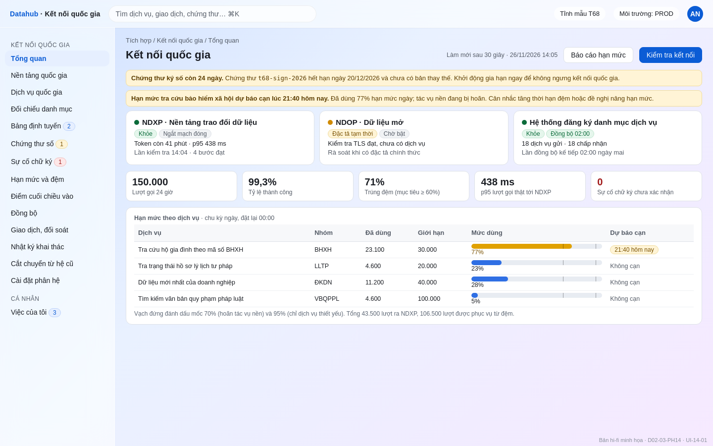

Ảnh cho thấy: hai biểu ngữ vàng ở đầu trang (chứng thư ký số còn 24 ngày, hạn mức tra cứu bảo hiểm xã hội dự báo cạn 21:40), ba thẻ đích (NDXP khỏe, NDOP đặc tả tạm thời, hệ thống đăng ký vừa đồng bộ 02:00), năm chỉ số 24 giờ và bảng hạn mức có vạch mốc 70%, 95%.

### 7.1. Wireframe

Sơ đồ dưới đây phác bố cục các vùng của màn; ảnh hi-fi ở trên là bản dựng bằng token chuẩn.

```{.mermaid caption="Bố cục các vùng của UI-14-01"}
flowchart TB
  H["Tiêu đề: Kết nối quốc gia, làm mới sau 30 giây<br/>Nút Báo cáo hạn mức, Kiểm tra kết nối"]
  subgraph BN["Biểu ngữ cảnh báo, tối đa ba"]
    direction TB
    B1["B1 Sự cố chữ ký chưa xác nhận, không ẩn được, mở UI-14-14"]
    B2["B2 Chứng thư t68-sign-2026 còn 24 ngày, mở UI-14-08"]
    B3["B3 Hạn mức tra BHXH dự báo cạn 21:40, mở UI-14-09"]
  end
  subgraph TH["Thẻ đích"]
    direction LR
    T1["NDXP khỏe<br/>Ngắt mạch đóng<br/>Token 41 phút, 438 ms"]
    T2["NDOP tạm thời<br/>Chờ bật<br/>TLS đạt"]
    T3["Đăng ký danh mục khỏe<br/>Đồng bộ 02:00, 18 trên 18"]
  end
  subgraph KP["Thẻ chỉ số 24 giờ"]
    direction LR
    K1["150.000<br/>Lượt 24 giờ"]
    K2["99,3%<br/>Thành công"]
    K3["71%<br/>Trúng đệm"]
    K4["438 ms<br/>p95 thật"]
    K5["0 sự cố chữ ký chưa xác nhận"]
  end
  C["Biểu đồ cột chồng lượt gọi 24 giờ: gọi thật, đệm, từ chối<br/>Nút Xem dạng bảng"]
  Q["Bảng hạn mức theo dịch vụ, chu kỳ ngày, đặt lại 00:00<br/>Cột: Dịch vụ, Nhóm, Đã dùng, Giới hạn, Mức dùng, Dự báo cạn"]
  H --> BN --> TH --> KP --> C --> Q
```

### 7.2. Thành phần

Bảng dưới liệt kê thành phần của màn, mã `CMP-*` theo D03-05, nội dung và nguồn dữ liệu.

| # | Thành phần | `CMP-*` | Nội dung, kiểm tra | Nguồn | Ghi chú |
|---|---|---|---|---|---|
| 1 | Tiêu đề trang, nút | `CMP-PageHeader`, `CMP-Button`, `CMP-Segmented` | "Kiểm tra kết nối" primary; làm mới 30/60 giây/Tắt | — | Nút kiểm tra ẩn khi thiếu `PERM-14-operate` |
| 2 | Biểu ngữ cảnh báo | `CMP-Banner` | Tối đa 3, xếp theo mức §7.3; "Xem thêm n cảnh báo" | `attention[]` API-14-060 | B1 mức lỗi không có nút đóng |
| 3 | Thẻ đích | `CMP-Card`, `CMP-StatusTag`, `CMP-StatusDot` | Một thẻ mỗi nền tảng: sức khỏe, ngắt mạch, token còn bao lâu, p95, lần kiểm tra cuối | `platforms[]` API-14-060, API-14-058 | Nhãn "Tạm thời" cho `PROVISIONAL` |
| 4 | Thẻ chỉ số | `CMP-KpiCard` | Lượt 24 giờ, thành công, trúng đệm, p95 thật, sự cố chưa xác nhận | `calls24h`, `errorRate24h`, `cacheHitRatio24h`; p95 xem Phụ lục B | p95 chỉ tính lượt gọi thật, không tính đệm |
| 5 | Biểu đồ | `CMP-Chart` | Cột chồng theo giờ: gọi thật, đệm, từ chối; kèm "Xem dạng bảng" | Chuỗi theo giờ (Phụ lục B) | Màu `color-chart-1…3` kèm họa tiết, có bảng thay thế |
| 6 | Bảng hạn mức | `CMP-DataTable`, `CMP-ProgressBar` | Cột §7.4; vạch mốc 70%, 95% | API-14-043 | Sắp xếp mặc định theo mức dùng giảm |
| 7 | Menu thẻ đích | `CMP-DropdownMenu` | Kiểm tra kết nối, Mở chi tiết, Ép mở/đóng ngắt mạch… | `allowedActions` | Ép ngắt mạch mở `CMP-ReasonDialog` |
| 8 | Chân trang | `CMP-Text` | "Tổng 43.500 lượt ra NDXP, 106.500 lượt từ đệm" | `calls24h`, `cacheHitRatio24h` | |

: UI-14-01 · Thành phần

### 7.3. Quy tắc biểu ngữ

Biểu ngữ là cách màn này đưa việc cần làm lên trước số liệu; bảng dưới nêu điều kiện, mức, khả năng đóng và màn đích.

| Thứ tự | Điều kiện | Mức | Đóng được | Đích |
|---|---|---|---|---|
| 1 | Có sự cố chữ ký `OPEN`, hoặc nền tảng `SECURITY_HOLD` | Lỗi | Không | UI-14-14 |
| 2 | Chứng thư ≤ 7 ngày hoặc không còn chứng thư cùng mục đích; CRL quá `14.crl.max-age-days` | Lỗi | Không | UI-14-08 |
| 3 | Chứng thư ≤ 60 ngày (mốc 60, 30, 7 theo `14.cert.warn-days`) chưa có thay thế | Cảnh báo | Ẩn 24 giờ | UI-14-08 |
| 4 | Dịch vụ dự báo cạn hạn mức trong 24 giờ, hoặc mức dùng ≥ 85% | Cảnh báo | Ẩn 4 giờ | UI-14-09 |
| 5 | Nền tảng `UNHEALTHY`, ngắt mạch Mở, hoặc quá `14.sync.stale-alert-days` ngày chưa đồng bộ | Cảnh báo | Ẩn 4 giờ | UI-14-02, 11 |
| 6 | Nền tảng dùng đặc tả tạm thời (`PROVISIONAL`) | Thông tin | Ẩn 7 ngày | UI-14-03 |

: Quy tắc biểu ngữ của UI-14-01

### 7.4. Cột bảng hạn mức

Bảng dưới mô tả từng cột của bảng chính, cách hiển thị và sắp xếp.

| Cột | Nội dung | Sắp xếp | Ghi chú |
|---|---|---|---|
| Dịch vụ | Tên, liên kết UI-14-05 | Có | |
| Nhóm | `LLTP`, `HO_TICH`, `BHXH`… | Có | |
| Đã dùng, Giới hạn | Số lượt `150.000` | Có | Căn phải, `font-feature-tabular` |
| Mức dùng | `CMP-ProgressBar` kèm chữ "77%" | Có | `role="img"` và `aria-label` "Mức dùng 77%, mốc hoãn tác vụ nền 70%" |
| Dự báo cạn | Giờ dự báo hoặc "Không cạn" | Có | Tính theo tốc độ dùng 1 giờ gần nhất |

: UI-14-01 · Cột bảng hạn mức

### 7.5. Trạng thái màn

Bảng dưới nêu các trạng thái riêng của màn này; trạng thái còn lại theo mục 6.

| Trạng thái | Hiển thị |
|---|---|
| Đang tải | Skeleton ba thẻ đích, năm thẻ chỉ số, 4 dòng bảng; biểu ngữ hiện khi có |
| Rỗng lần đầu | Chưa có nền tảng: `CMP-EmptyState` "Chưa khai báo nền tảng quốc gia nào. Khai báo nền tảng để tỉnh gọi được dịch vụ của trung ương." kèm "Khai báo nền tảng" (khi có `PERM-14-admin`) |
| Lỗi từng khối | ST-05 tại khối lỗi (ví dụ bảng hạn mức), "Thử lại"; các khối khác giữ nguyên |
| Không có quyền | ST-07; biểu ngữ và số liệu không hiện |
| Dữ liệu cũ | Nhãn "Dữ liệu lúc {giờ}" khi `stale = true` |

: UI-14-01 · Trạng thái màn

### 7.6. Thông báo và tương tác

Ép ngắt mạch tay: "Ép mở ngắt mạch của {nền tảng}? Mọi lượt gọi mới sẽ bị từ chối cho tới khi đóng lại." kèm ô lý do; thành công "Đã ép mở ngắt mạch." (ST-10). Kiểm tra kết nối quá giới hạn: ERR-14-029. Phím tắt: `R` làm mới, `K` kiểm tra kết nối (khi có quyền), `1…3` nhảy tới thẻ đích, `B` đưa focus tới biểu ngữ đầu. Truy cập: biểu ngữ lỗi dùng `role="alert"`, biểu ngữ cảnh báo `role="status"`; thẻ đích đọc thành câu "NDXP, khỏe, ngắt mạch đóng, token còn 41 phút"; biểu đồ có bảng thay thế; làm mới tự động không cướp focus và đọc "Đã cập nhật 14:05" qua vùng `aria-live="polite"` chỉ khi có thay đổi mức.

## 8. UI-14-02 Danh sách nền tảng quốc gia

::: dac-ta
**Mục đích.** Xem mọi nền tảng quốc gia của tỉnh (và nền tảng `COMMON` dùng chung), tình trạng sức khỏe, ngắt mạch, token; khai báo mới; tạm ngừng, tiếp tục, kiểm tra kết nối.

**Người dùng chính.** TA, TO; mọi vai trò xem.

**FR hiện thực.** FR-14-001, 003, 047.

**Đường dẫn.** `/tich-hop/quoc-gia/nen-tang`.

**Mẫu.** PTN-01.

**Quyền.** `PERM-14-read`; "Khai báo" cần `PERM-14-admin`; "Tạm ngừng", "Tiếp tục", "Kiểm tra" cần `PERM-14-operate`.

**API.** API-14-001, 005, 006, 007, 059.
:::

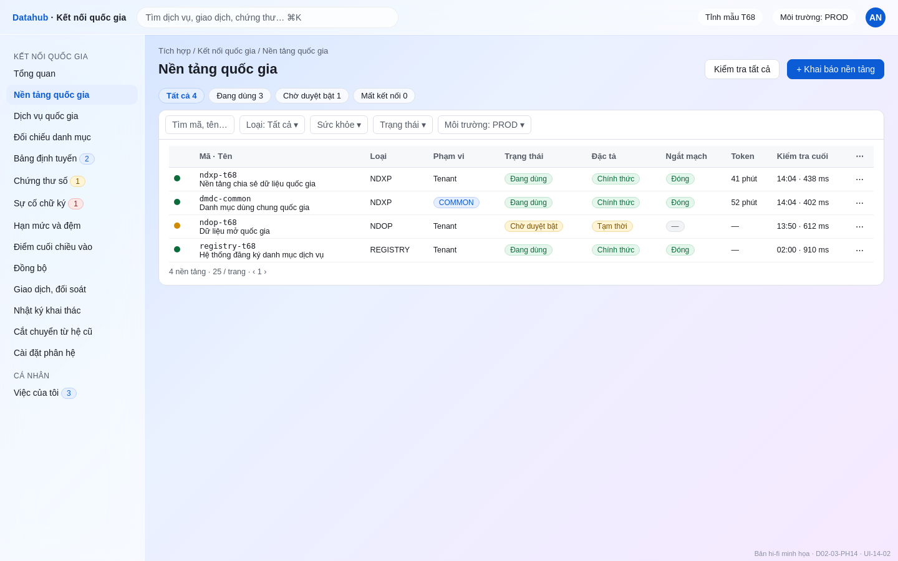

### 8.1. Thành phần

Bảng dưới liệt kê thành phần của màn, mã `CMP-*` theo D03-05, nội dung và nguồn dữ liệu.

| # | Thành phần | `CMP-*` | Nội dung, kiểm tra | Nguồn | Ghi chú |
|---|---|---|---|---|---|
| 1 | Tiêu đề, nút | `CMP-PageHeader`, `CMP-Button` | "Khai báo nền tảng" primary; "Kiểm tra tất cả" | — | Ẩn khi thiếu quyền |
| 2 | Bộ lọc nhanh | `CMP-FilterChips` | Tất cả, Đang dùng, Chờ duyệt bật, Mất kết nối | `facets` | Bấm là bật lọc |
| 3 | Thanh lọc | `CMP-FilterBar`, `CMP-SearchInput`, `CMP-Select` | Tìm ≥ 2 ký tự, trễ 300 ms; loại, sức khỏe, trạng thái, môi trường | API-14-001 `q`, `platformType`, `health`, `state` | Ghi URL |
| 4 | Bảng | `CMP-DataTable` | Cột §8.2 | `items` | Mặc định `UNHEALTHY` đầu |
| 5 | Menu dòng | `CMP-DropdownMenu` | Kiểm tra, Tạm ngừng, Tiếp tục, Ngừng dùng… | `allowedActions` | Ngừng dùng mở `CMP-ReasonDialog` |
| 6 | Phân trang | `CMP-Pagination` | 25 / trang | `page` | |

: UI-14-02 · Thành phần

### 8.2. Cột bảng

Bảng dưới mô tả từng cột của bảng chính, cách hiển thị và sắp xếp.

| Cột | Nội dung | Sắp xếp | Ghi chú |
|---|---|---|---|
| Sức khỏe | `CMP-StatusDot` kèm chữ ẩn | Có | `aria-label` "Sức khỏe PROD: Khỏe" |
| Mã · Tên | Mã `CMP-CodeText` dòng 1, tên dòng 2 | Có | Liên kết UI-14-03 |
| Loại | `NDXP`, `NDOP`, `REGISTRY` | Có | |
| Phạm vi | Tenant, hoặc chip "COMMON" màu `color-source-common` | | COMMON chỉ PA sửa |
| Trạng thái | `CMP-StatusTag` (+ "Giữ an ninh" nếu có) | Có | |
| Đặc tả | Chính thức, Tạm thời | | |
| Ngắt mạch | Đóng, Thăm dò, Mở | | |
| Token | Còn bao lâu | Có | Cảnh báo khi < `14.token.refresh-before-seconds` |
| Kiểm tra cuối | Giờ, độ trễ | Có | |

: UI-14-02 · Cột bảng

### 8.3. Trạng thái màn

Bảng dưới nêu các trạng thái riêng của màn này; trạng thái còn lại theo mục 6.

| Trạng thái | Hiển thị |
|---|---|
| Đang tải | Skeleton 4 dòng |
| Rỗng lần đầu | "Chưa khai báo nền tảng quốc gia nào. Nền tảng là nơi khai báo địa chỉ, cách xác thực để tỉnh gọi dịch vụ quốc gia." kèm "Khai báo nền tảng" |
| Không có kết quả | ST-04 kèm "Xóa bộ lọc" |
| Lỗi tải | ST-05 |
| Không có quyền | ST-07 |

: UI-14-02 · Trạng thái màn

Tạm ngừng mở hộp xác nhận "Tạm ngừng {nền tảng}? Lượt mới bị từ chối trong 30 giây, lượt đang chạy kết thúc (BR-14-032)." ERR-14-004 khi trạng thái đã đổi. Phím tắt: `/` vào ô tìm, `N` khai báo, `↑`, `↓` chọn dòng, `Enter` mở, `T` kiểm tra kết nối dòng đang chọn. Truy cập: bảng có `caption` ẩn; hộp xác nhận bẫy focus, `Esc` đóng và trả focus nút đã mở.

## 9. UI-14-03 Khai báo, chi tiết nền tảng

::: dac-ta
**Mục đích.** Khai báo nền tảng quốc gia qua năm bước (loại, kết nối PH-05, xác thực, kiểm tra, gửi duyệt) và xem chi tiết, thử lấy token, xoay thông tin xác thực.

**Người dùng chính.** TA (khai báo), IE, TO (xoay, thử token), SO.

**FR hiện thực.** FR-14-002, 003, 024, 025, 047.

**Đường dẫn.** `/tich-hop/quoc-gia/nen-tang/moi`; `/tich-hop/quoc-gia/nen-tang/{platformCode}`; `…/sua`.

**Mẫu.** PTN-05 (khai báo), PTN-02 (chi tiết).

**Quyền.** `PERM-14-admin` (khai báo, sửa, gửi duyệt); `PERM-14-operate` (thử token, xoay, ngắt mạch); xem `PERM-14-read`.

**API.** API-14-002, 003, 004, 008, 039, 040, 059.
:::

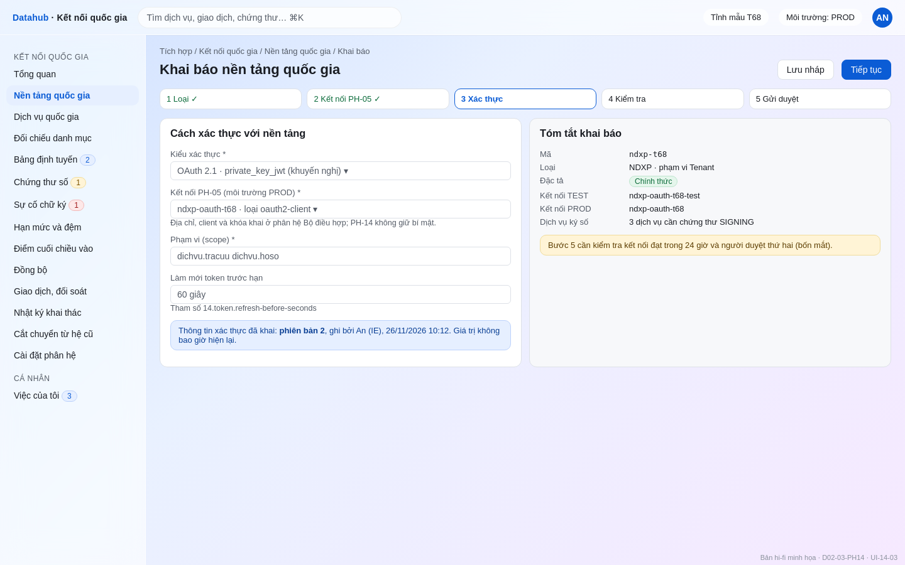

### 9.1. Các bước khai báo

Màn đi theo từng bước; bảng dưới nêu nội dung, trường chính và kiểm tra của mỗi bước.

| Bước | Nội dung | Trường chính | Kiểm tra |
|---|---|---|---|
| 1 Loại | Chọn `NDXP`, `NDOP`, `REGISTRY`, nhập mã và tên, phạm vi Tenant | `platformType`, `platformCode`, `name` | Mã `^[a-z][a-z0-9-]{2,62}$`, chưa dùng (ERR-14-002); NDOP hiện nhãn "Đặc tả tạm thời" (BR-14-025) |
| 2 Kết nối PH-05 | Chọn kết nối theo từng môi trường | `connectionCode` TEST, STAGING, PROD | Kết nối phải tồn tại, loại `oauth2-client` hoặc `mtls-client` (ERR-14-005) |
| 3 Xác thực | Kiểu xác thực, phạm vi, làm mới token | `authMode`, `scopes`, `tokenRefreshBefore` | Thiếu thông tin xác thực ở kết nối: ERR-14-034 kèm liên kết sang PH-05 |
| 4 Kiểm tra | Chạy kiểm tra từng bước: phân giải tên, TCP, TLS, token; tùy chọn "kiểm tra sâu" gọi thao tác nhẹ | `environment`, `deep` | Cần đạt trong 24 giờ mới sang bước 5 (ERR-14-008) |
| 5 Gửi duyệt | Tóm tắt, lý do, gửi người duyệt | `reason` | Có dịch vụ yêu cầu ký mà chưa có chứng thư: ERR-14-037; đã có yêu cầu chờ: ERR-14-006 |

: UI-14-03 · Các bước khai báo

Bước giữ trạng thái trên URL (`buoc`); quay lại bước trước không bắt nhập lại (WCAG 3.3.7); "Lưu nháp" luôn có từ bước 1.

### 9.2. Chi tiết nền tảng

Chi tiết dùng `CMP-PageHeader` kèm `CMP-StatusTag` và các tab của `CMP-Tabs`:

| Tab | Nội dung | Thành phần | API |
|---|---|---|---|
| Tổng quan | Thông tin chung, dịch vụ đang gắn, trạng thái, đặc tả | `CMP-Descriptions`, `CMP-DataTable` | API-14-003 |
| Xác thực | Kiểu xác thực, kết nối, "Thử lấy token" (hiện thời hạn, scope, không hiện giá trị token), "Xoay thông tin xác thực…" | `CMP-SecretField` (chỉ ghi), `CMP-Button` | API-14-040, 039 |
| Kiểm tra | Lịch sử kiểm tra theo bước, "Kiểm tra kết nối" | `CMP-Timeline`, `CMP-JobProgress` | API-14-059 |
| Ngắt mạch | Trạng thái, ngưỡng `14.breaker.*`, "Ép mở/đóng…" | `CMP-DescriptionList`, `CMP-ReasonDialog` | API-14-086 |
| Lịch sử | Thay đổi, duyệt, ai làm gì | `CMP-AuditTimeline` | API-14-003 |

: UI-14-03 · Các tab chi tiết

Hộp "Xoay thông tin xác thực" có hai bước: nhập giá trị mới (ô chỉ ghi, gửi riêng), chọn thời gian chuyển tiếp (mặc định `14.secret.overlap-hours`); đang trong chuyển tiếp thì nút vô hiệu kèm "Đang trong thời gian chuyển tiếp tới {thời điểm}". Cờ "Giữ an ninh" hiện biểu ngữ lỗi đầu trang với liên kết UI-14-14.

### 9.3. Trạng thái màn

Bảng dưới nêu các trạng thái riêng của màn này; trạng thái còn lại theo mục 6.

| Trạng thái | Hiển thị |
|---|---|
| Đang tải | Skeleton khối thông tin và tab |
| Rỗng | Tab Kiểm tra chưa chạy lần nào: "Chưa có lần kiểm tra nào. Bấm Kiểm tra kết nối." |
| Lỗi nghiệp vụ | ST-12 với ERR-14-002, 005, 006, 008, 034, 035, 037 (§5.2) |
| Xung đột | ST-13 khi 412 (người khác vừa sửa) |
| Không có quyền, không tồn tại | ST-07, ST-08 (nền tảng tenant khác trả như không tồn tại, BR-14-029) |

: UI-14-03 · Trạng thái màn

Phím tắt: `Alt+←`, `Alt+→` lùi, tiến bước; `Ctrl+S` lưu nháp; `Enter` ở bước cuối gửi duyệt khi nút ở trạng thái cho phép. Truy cập: `CMP-Steps` đọc "Bước 3 trên 5, Xác thực, đang thực hiện"; lỗi từng trường theo ST-11, focus chuyển tới trường lỗi đầu.

## 10. UI-14-04 Danh mục dịch vụ quốc gia

::: dac-ta
**Mục đích.** Tìm dịch vụ quốc gia theo nhóm, nhãn đối chiếu, ưu tiên; thấy dịch vụ nào đã cung cấp lại cho HTTT; khai báo dịch vụ mới.

**Người dùng chính.** IE, TA; mọi vai trò xem.

**FR hiện thực.** FR-14-004, 005, 017…023.

**Đường dẫn.** `/tich-hop/dich-vu-quoc-gia`.

**Mẫu.** PTN-01.

**Quyền.** `PERM-14-read`; "Khai báo dịch vụ", "Đối chiếu danh mục" cần `PERM-14-service`.

**API.** API-14-010, 011.
:::

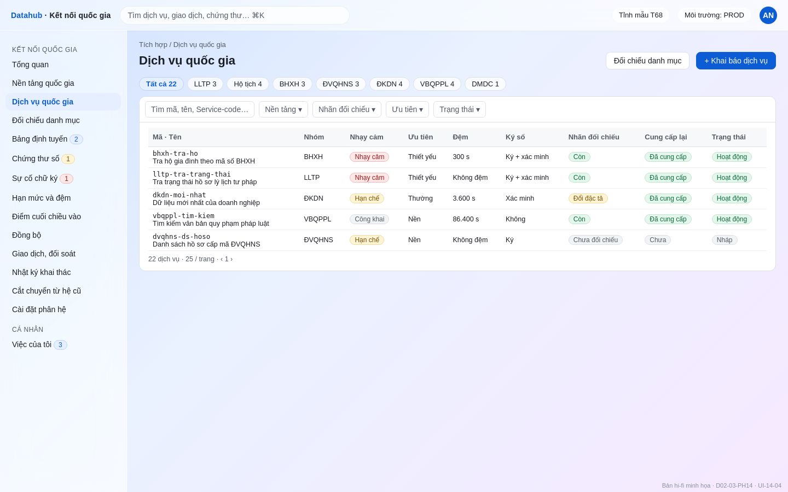

### 10.1. Thành phần và cột

Bảng dưới liệt kê thành phần của màn, mã `CMP-*` theo D03-05, nội dung, kiểm tra và các trường hoặc cột chính.

| # | Thành phần | `CMP-*` | Nội dung, kiểm tra | Ghi chú |
|---|---|---|---|---|
| 1 | Tiêu đề, nút | `CMP-PageHeader`, `CMP-Button` | "Khai báo dịch vụ" primary; "Đối chiếu danh mục" mặc định, mở UI-14-06 | Ẩn khi thiếu `PERM-14-service` |
| 2 | Nhóm nhanh | `CMP-FilterChips` | `LLTP`, Hộ tịch, `BHXH`, `ĐVQHNS`, `ĐKDN`, `VBQPPL`, `DMDC`, kèm số | Bấm là lọc nhóm |
| 3 | Thanh lọc | `CMP-FilterBar`, `CMP-SearchInput`, `CMP-Select` | Tìm mã, tên, `Service-code`; nền tảng, nhãn, ưu tiên, trạng thái | Ghi URL |
| 4 | Bảng | `CMP-DataTable` | Cột bên dưới | Mặc định nhãn "Đổi đặc tả" và "Ngừng" lên đầu |
| 5 | Phân trang | `CMP-Pagination` | 25 / trang | |

: UI-14-04 · Thành phần

| Cột | Nội dung | Ghi chú |
|---|---|---|
| Mã · Tên | Mã `CMP-CodeText`, tên | Liên kết UI-14-05 |
| Nhóm | Nhóm nghiệp vụ | |
| Nhạy cảm | `CMP-StatusTag` theo §5.1 | Biểu tượng khóa với `SENSITIVE` |
| Ưu tiên | Thiết yếu, Thường, Nền | |
| Đệm | Số giây hoặc "Không đệm" | Dịch vụ `SENSITIVE` và dịch vụ ghi luôn "Không đệm" (BR-14-014) |
| Ký số | Không, Ký, Xác minh, Ký + xác minh | |
| Nhãn đối chiếu | Còn, Đổi đặc tả, Ngừng, Chưa đối chiếu | |
| Cung cấp lại | Đã cung cấp, Chưa | Liên kết tab Cung cấp lại |
| Trạng thái | `CMP-StatusTag` | |

: UI-14-04 · Cột bảng

### 10.2. Trạng thái màn

Bảng dưới nêu các trạng thái riêng của màn này; trạng thái còn lại theo mục 6.

| Trạng thái | Hiển thị |
|---|---|
| Đang tải | Skeleton 8 dòng |
| Rỗng lần đầu | "Chưa có dịch vụ quốc gia nào. Dịch vụ là từng dịch vụ của nền tảng mà tỉnh gọi, kèm hợp đồng và đặc tả." kèm "Khai báo dịch vụ" và "Đối chiếu danh mục" |
| Không có kết quả | ST-04 |
| Lỗi tải, không có quyền | ST-05, ST-07 |

: UI-14-04 · Trạng thái màn

Phím tắt: `/` tìm, `N` khai báo, `↑↓` chọn, `Enter` mở. Truy cập: nhãn trạng thái và nhãn đối chiếu luôn có chữ; bảng cuộn ngang giữ cột "Mã · Tên" cố định.

## 11. UI-14-05 Chi tiết dịch vụ quốc gia

::: dac-ta
**Mục đích.** Xem và sửa một dịch vụ: hợp đồng, phiên bản đặc tả và khác biệt, đệm và hạn mức, cung cấp lại cho HTTT; thử chuyển đổi bản tin trước khi kích hoạt.

**Người dùng chính.** IE, TA.

**FR hiện thực.** FR-14-005, 006, 008, 009, 014, 017…022, 035.

**Đường dẫn.** `/tich-hop/dich-vu-quoc-gia/{serviceCode}`; `/moi` khi khai báo.

**Mẫu.** PTN-02 (tab, kèm biểu mẫu ở PTN-03 khi sửa).

**Quyền.** `PERM-14-read`; sửa, nạp đặc tả, cung cấp lại cần `PERM-14-service`; tạm ngừng cần `PERM-14-operate`.

**API.** API-14-012, 013, 018, 019, 020, 021, 022, 023, 046, 017.
:::

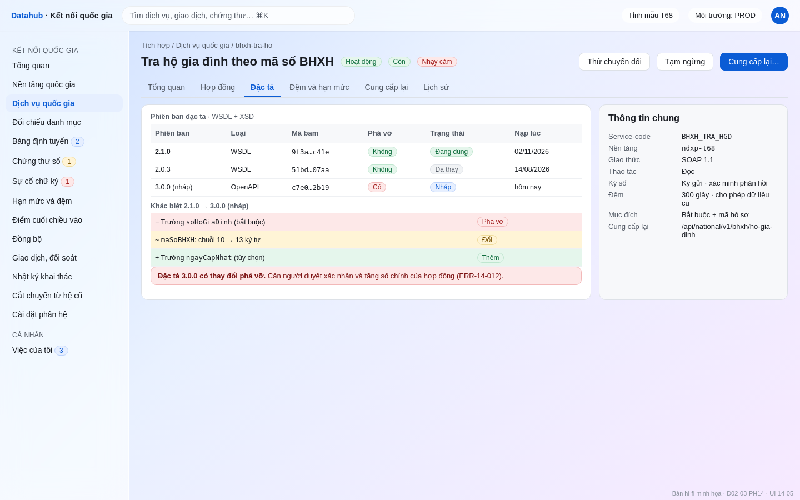

### 11.1. Các tab

Màn chia thành các tab; bảng dưới nêu nội dung, thành phần và API của từng tab.

| Tab | Nội dung | Thành phần | API |
|---|---|---|---|
| Tổng quan | Nhóm, `Service-code`, giao thức, thao tác, mức nhạy cảm, ưu tiên, ký số, mục đích bắt buộc, thời hạn chờ | `CMP-Descriptions`, `CMP-StatusTag` | API-14-012 |
| Hợp đồng | Tham số vào, trường ra, mã lỗi, mức nhạy cảm từng trường theo phiên bản hợp đồng | `CMP-DataTable`, `CMP-JsonViewer` | API-14-012 |
| Đặc tả | Danh sách phiên bản (OpenAPI, WSDL, XSD), khác biệt giữa hai phiên bản, "Nạp đặc tả", "Kích hoạt", "Thử chuyển đổi" | `CMP-FileDropzone`, `CMP-DiffViewer`, `CMP-DiffTable`, `CMP-CodeBlock` | API-14-018, 019, 020 |
| Đệm và hạn mức | Bật đệm, thời hạn, cho phép dữ liệu cũ; hạn mức và phân bổ của dịch vụ (liên kết UI-14-09) | `CMP-Switch`, `CMP-NumberInput`, `CMP-ProgressBar` | API-14-013, 046 |
| Cung cấp lại | Gắn với API trong danh mục PH-02: đường dẫn, phiên bản hợp đồng, trạng thái; "Công bố" | `CMP-Form`, `CMP-StatusTag` | API-14-021, 022, 023 |
| Lịch sử | Thay đổi nhãn đối chiếu, phiên bản, ai sửa gì | `CMP-AuditTimeline` | API-14-012 |

: UI-14-05 · Các tab

### 11.2. Quy tắc nổi bật

Bảng dưới gom các quy tắc của màn chi tiết dịch vụ mà người dùng dễ gặp, kèm cách hiển thị và mã lỗi.

| Quy tắc | Hiện thực | Mã |
|---|---|---|
| Nạp đặc tả có thay đổi phá vỡ | Bảng khác biệt tô `color-diff-removed`, `color-diff-changed`, `color-diff-added` kèm ký hiệu − ~ +; chỉ người duyệt kích hoạt và tăng số chính | ERR-14-012 |
| Phiên bản đã tồn tại với nội dung khác | Báo dưới trường số phiên bản | ERR-14-010 |
| Tệp không đọc được | Báo dưới ô tải tệp | ERR-14-011 |
| Dịch vụ `SENSITIVE` hoặc dịch vụ ghi | Công tắc đệm vô hiệu kèm lý do | ERR-14-038 |
| Chưa đủ điều kiện cung cấp lại | Nút "Công bố" vô hiệu kèm `disabledReasons` | ERR-14-025 |
| Chưa có đặc tả đang dùng hoặc nền tảng chưa hoạt động | Hộp cảnh báo, không kích hoạt được | ERR-14-009 |
| Giảm kiểm soát (tắt ký, nới mục đích) | Gửi duyệt qua UI-14-17 | BR-14-022 |
| Bốn nhãn hiệu lực đặc tả | "Đổi đặc tả" vẫn gọi được bằng đặc tả cũ | BR-14-024 |

: UI-14-05 · Quy tắc nổi bật

### 11.3. Trạng thái màn

Bảng dưới nêu các trạng thái riêng của màn này; trạng thái còn lại theo mục 6.

| Trạng thái | Hiển thị |
|---|---|
| Đang tải | Skeleton khối thông tin, tab giữ nguyên |
| Rỗng | Tab Đặc tả chưa có: "Chưa có đặc tả nào. Nạp tệp OpenAPI, WSDL hoặc XSD của dịch vụ." kèm ô thả tệp |
| Lỗi nghiệp vụ, xung đột | ST-12, ST-13 |
| Chỉ đọc | ST-15: biểu mẫu thành dạng mô tả khi thiếu `PERM-14-service` |
| Không tồn tại | ST-08 "Không tìm thấy dịch vụ {mã}" |

: UI-14-05 · Trạng thái màn

"Thử chuyển đổi" chạy API chuyển đổi trên dữ liệu mẫu, hiện bản tin trước và sau cạnh nhau trong `CMP-CodeBlock`, không gọi sang quốc gia. Phím tắt: `1…6` chuyển tab, `Ctrl+S` lưu, `U` mở ô nạp đặc tả. Truy cập: bảng khác biệt có cột "Loại thay đổi" bằng chữ, không chỉ màu; hộp nạp tệp dùng được bằng bàn phím (`Enter` mở hộp chọn tệp).

## 12. UI-14-06 Đối chiếu danh mục dịch vụ

::: dac-ta
**Mục đích.** So danh mục dịch vụ của tỉnh với danh mục hiện hành của NDXP, xem đề xuất nhãn Còn, Đổi đặc tả, Ngừng và dịch vụ mới, rồi áp dụng có chọn lọc. Thay việc đối chiếu bằng tay qua phụ lục NGSP.

**Người dùng chính.** IE, TA.

**FR hiện thực.** FR-14-007.

**Đường dẫn.** `/tich-hop/dich-vu-quoc-gia/doi-chieu`.

**Mẫu.** PTN-09.

**Quyền.** `PERM-14-service`; xem kết quả `PERM-14-read`.

**API.** API-14-014, 015, 016, 017.
:::

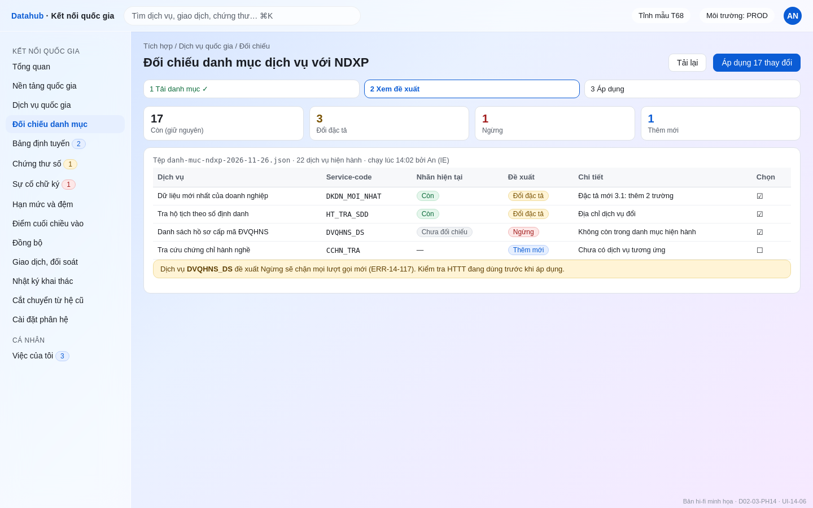

### 12.1. Ba bước

Màn đi theo từng bước; bảng dưới nêu nội dung, trường chính và kiểm tra của mỗi bước.

| Bước | Nội dung | Thành phần | Ghi chú |
|---|---|---|---|
| 1 Tải danh mục | Thả tệp JSON hoặc CSV danh mục hiện hành; hoặc chọn "Lấy trực tiếp từ NDXP" khi nền tảng đã bật; chọn khóa khớp (`Service-code` hoặc tên) | `CMP-FileDropzone`, `CMP-RadioCard`, `CMP-Select` | Tệp tối đa 10 MB; lỗi dòng: ERR-14-032 kèm số dòng, tên cột |
| 2 Xem đề xuất | Bảng đề xuất theo từng dịch vụ, bốn thẻ đếm (Còn, Đổi đặc tả, Ngừng, Thêm mới); chọn dòng áp dụng; đổi nhãn tay | `CMP-DataTable`, `CMP-StatCard`, `CMP-SelectionBar` | Mặc định chọn mọi dòng trừ "Thêm mới" |
| 3 Áp dụng | Xem tóm tắt thay đổi, xác nhận | `CMP-ConfirmDialog`, `CMP-JobProgress` | Không áp dụng một phần: nếu dòng nào lỗi, "Chưa có dữ liệu nào được áp dụng" (ERR-14-032) |

: UI-14-06 · Ba bước

Đề xuất "Ngừng" hiện cảnh báo số HTTT đang đăng ký dùng dịch vụ đó trước khi áp dụng, vì nhãn Ngừng chặn lượt gọi mới (BR-14-024). Đặt nhãn bằng tay dùng API-14-017 và ghi lý do.

### 12.2. Trạng thái màn

Bảng dưới nêu các trạng thái riêng của màn này; trạng thái còn lại theo mục 6.

| Trạng thái | Hiển thị |
|---|---|
| Đang tải | Bước 1 không tải; bước 2 hiện skeleton và thanh tiến độ `CMP-JobProgress` khi lấy trực tiếp |
| Rỗng | Chưa có phiên nào: "Chưa đối chiếu lần nào. Tải danh mục hiện hành của NDXP để bắt đầu." |
| Không tải được từ xa | ERR-14-131 "Không tải được đặc tả hoặc WSDL từ xa, dùng bản đã lưu"; gợi ý tải tệp thay thế |
| Không có quyền | ST-07 |

: UI-14-06 · Trạng thái màn

Phím tắt: `Space` chọn dòng, `Ctrl+A` chọn tất cả, `Alt+→` sang bước sau. Truy cập: bốn thẻ đếm đọc thành "17 dịch vụ còn, 3 đổi đặc tả, 1 ngừng, 1 thêm mới"; nhãn đề xuất dùng chữ và biểu tượng.

## 13. UI-14-07 Bảng định tuyến

::: dac-ta
**Mục đích.** Quản lý luật chọn nền tảng đích theo dịch vụ hoặc nhóm và loại thao tác, kèm nền tảng dự phòng cho thao tác đọc; mô phỏng trước khi gửi duyệt.

**Người dùng chính.** IE, TA; IA duyệt qua UI-14-17.

**FR hiện thực.** FR-14-012, 013.

**Đường dẫn.** `/tich-hop/quoc-gia/dinh-tuyen`.

**Mẫu.** PTN-01, biểu mẫu luật và mô phỏng ở PTN-04 (drawer).

**Quyền.** `PERM-14-read`; tạo, sửa, mô phỏng, gửi duyệt cần `PERM-14-route`.

**API.** API-14-024, 025, 026, 027, 028.
:::

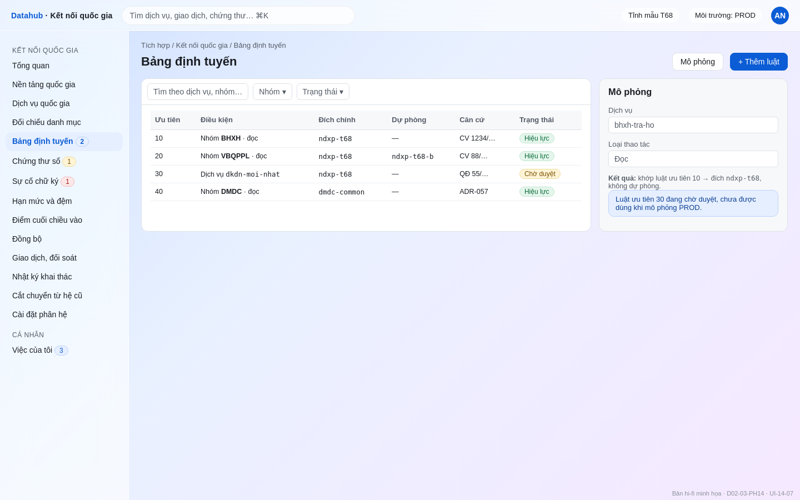

### 13.1. Thành phần, cột và trường

Bảng dưới liệt kê thành phần của màn, mã `CMP-*` theo D03-05, nội dung, kiểm tra và các trường hoặc cột chính.

| # | Thành phần | `CMP-*` | Nội dung, kiểm tra | Ghi chú |
|---|---|---|---|---|
| 1 | Tiêu đề, nút | `CMP-PageHeader`, `CMP-Button` | "Thêm luật" primary; "Mô phỏng" | Ẩn khi thiếu `PERM-14-route` |
| 2 | Bảng luật | `CMP-DataTable` | Cột: Ưu tiên, Điều kiện (dịch vụ hoặc nhóm và loại thao tác), Đích chính, Dự phòng, Căn cứ, Trạng thái | Xếp theo ưu tiên tăng |
| 3 | Drawer luật | `CMP-Drawer`, `CMP-Form`, `CMP-ResourceSelect` | Trường bên dưới | Khung `glass-modal` |
| 4 | Khung mô phỏng | `CMP-Form`, `CMP-DescriptionList` | Nhập dịch vụ, loại thao tác; kết quả luật khớp, đích, dự phòng | API-14-028; không gọi quốc gia |
| 5 | Nhãn chờ duyệt | `CMP-StatusTag`, `CMP-Link` | Liên kết sang UI-14-17 | |

: UI-14-07 · Thành phần

| Trường | Nhãn | Kiểu | Bắt buộc | Kiểm tra |
|---|---|---|---|---|
| `matchServiceCode` hoặc `matchGroup` + `operationType` | Điều kiện | Chọn dịch vụ hoặc nhóm | Có | Nhóm đi kèm loại thao tác (đọc, ghi) |
| `primaryServiceCode` | Đích chính | Chọn dịch vụ | Có | Dịch vụ phải `ACTIVE` (ERR-14-014) |
| `allowFallback`, `fallbackServiceCode` | Dự phòng | Công tắc, chọn dịch vụ | Không | Chỉ thao tác đọc, cùng nhóm dữ liệu (ERR-14-015) |
| `priority` | Mức ưu tiên | Số nguyên 1…999 | Có | Trùng điều kiện và ưu tiên: ERR-14-013 |
| `basis` | Căn cứ văn bản | Văn bản | Có | Không rỗng (ERR-14-016 cho hạn mức; luật báo ERR-14-003) |

: UI-14-07 · Trường của drawer luật

### 13.2. Trạng thái màn

Bảng dưới nêu các trạng thái riêng của màn này; trạng thái còn lại theo mục 6.

| Trạng thái | Hiển thị |
|---|---|
| Đang tải | Skeleton 6 dòng |
| Rỗng lần đầu | "Chưa có luật định tuyến. Luật chọn nền tảng đích cho từng dịch vụ; chưa có luật thì lượt gọi bị từ chối (ERR-14-105)." kèm "Thêm luật" |
| Không có kết quả, lỗi tải, không có quyền | ST-04, ST-05, ST-07 |
| Gửi duyệt | Sau "Gửi duyệt" luật sang "Chờ duyệt", toast "Đã gửi duyệt luật ưu tiên {n}." |

: UI-14-07 · Trạng thái màn

Người đề nghị mở yêu cầu của mình ở UI-14-17 thấy ERR-14-007. Phím tắt: `N` thêm luật, `S` mở khung mô phỏng, `Enter` mở drawer luật đang chọn. Truy cập: drawer bẫy focus, `Esc` đóng, focus trả về dòng đã mở.

## 14. UI-14-08 Chứng thư số và chuỗi tin cậy

::: dac-ta
**Mục đích.** Cho Cán bộ ATTT nạp chứng thư, theo dõi hạn bằng đếm ngược, yêu cầu kích hoạt, thu hồi; xem chuỗi tin cậy, danh sách thu hồi (CRL) và thống kê ký, xác minh. Không bao giờ hiện khóa riêng.

**Người dùng chính.** SO, PA; TA xem.

**FR hiện thực.** FR-14-026, 027, 028, 029, 030.

**Đường dẫn.** `/tich-hop/quoc-gia/chung-thu`.

**Mẫu.** PTN-01 (tab), hộp nạp và thu hồi ở PTN-04.

**Quyền.** `PERM-14-read`; nạp, yêu cầu kích hoạt, thu hồi, làm mới chuỗi tin cậy cần `PERM-14-cert`; duyệt kích hoạt cần `PERM-14-approve` (UI-14-17).

**API.** API-14-029, 030, 031, 032, 034, 035, 036, 092.
:::

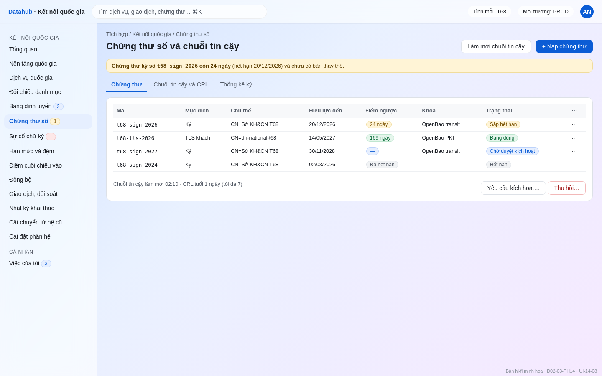

### 14.1. Wireframe

Sơ đồ dưới đây phác bố cục các vùng của màn; ảnh hi-fi ở trên là bản dựng bằng token chuẩn.

```{.mermaid caption="Bố cục các vùng của UI-14-08"}
flowchart TB
  H["Tiêu đề: Chứng thư số và chuỗi tin cậy<br/>Nút Làm mới chuỗi tin cậy, Nạp chứng thư"]
  B["Biểu ngữ: chứng thư t68-sign-2026 còn 24 ngày, chưa có bản thay thế"]
  T["Tab: Chứng thư, Chuỗi tin cậy và CRL, Thống kê ký"]
  G["Bảng chứng thư<br/>Cột: Mã, Mục đích, Chủ thể, Hết hạn, Đếm ngược, Khóa, Trạng thái, Thao tác"]
  F["Chân bảng: chuỗi tin cậy làm mới 02:10, CRL tuổi 1 ngày, tối đa 7<br/>Nút Yêu cầu kích hoạt, Thu hồi"]
  H --> B --> T --> G --> F
```

### 14.2. Thành phần

Bảng dưới liệt kê thành phần của màn, mã `CMP-*` theo D03-05, nội dung và nguồn dữ liệu.

| # | Thành phần | `CMP-*` | Nội dung, kiểm tra | Ghi chú |
|---|---|---|---|---|
| 1 | Biểu ngữ | `CMP-Banner` | Quy tắc mục 7.3 dòng 2, 3 | |
| 2 | Tab | `CMP-Tabs` | Chứng thư, Chuỗi tin cậy và CRL, Thống kê ký | Ghi `tab` vào URL |
| 3 | Bảng chứng thư | `CMP-DataTable` | Cột: Mã, Mục đích (Ký, TLS khách, Cả hai), Chủ thể, Hiệu lực đến, Đếm ngược, Khóa (`keyRef`), Trạng thái | Đếm ngược có chữ "24 ngày" và biểu tượng |
| 4 | Hộp nạp chứng thư | `CMP-Modal`, `CMP-FileDropzone`, `CMP-SecretRefField` | Chỉ nhận chứng thư công khai (PEM, CER); chọn mục đích, tham chiếu khóa trong OpenBao | Không có ô khóa riêng |
| 5 | Hộp yêu cầu kích hoạt | `CMP-ReasonDialog` | Lý do; yêu cầu xác thực nhiều yếu tố (SEC-23) | Gửi UI-14-17 |
| 6 | Hộp thu hồi | `CMP-ReasonDialog` | Lý do, hậu quả (nền tảng bị chặn ký nếu không còn chứng thư thay thế) | BR-14-017 |
| 7 | Chuỗi tin cậy | `CMP-DataTable`, `CMP-Tree` | Gốc và trung gian, trạng thái, hạn CRL, lần làm mới | API-14-035 |
| 8 | Thống kê ký | `CMP-Chart`, `CMP-DataTable` | Số bản tin ký, xác minh, lỗi theo ngày | API-14-035 |

: UI-14-08 · Thành phần

### 14.3. Quy tắc và thông báo

Bảng dưới nêu các tình huống thường gặp khi nạp và kích hoạt chứng thư, cách hiển thị và mã lỗi tương ứng.

| Tình huống | Hiển thị | Mã |
|---|---|---|
| Tệp không đọc được hoặc ngoài chuỗi tin cậy | Dưới ô tải tệp | ERR-14-019 |
| Chứng thư không khớp khóa trong OpenBao | Dưới trường tham chiếu khóa | ERR-14-020 |
| Chưa tới hạn hiệu lực hoặc đã hết hạn | Hộp cảnh báo | ERR-14-021 |
| Đã có yêu cầu kích hoạt đang chờ | Hộp cảnh báo | ERR-14-006 |
| Chứng thư còn dùng xác minh giao dịch trong thời hạn lưu | Hộp xác nhận chặn xóa | ERR-14-022 |
| Người đề nghị tự duyệt | Nút vô hiệu ở UI-14-17 | ERR-14-007 |
| Chứng thư mới kích hoạt, chứng thư cũ | Chuyển "Đã thay" sau `14.cert.overlap-hours` giờ | BR-14-017 |

: UI-14-08 · Quy tắc và thông báo

### 14.4. Trạng thái màn

Bảng dưới nêu các trạng thái riêng của màn này; trạng thái còn lại theo mục 6.

| Trạng thái | Hiển thị |
|---|---|
| Đang tải | Skeleton 5 dòng |
| Rỗng lần đầu | "Chưa có chứng thư số nào. Nạp chứng thư chuyên dùng công vụ để ký bản tin gửi quốc gia." kèm "Nạp chứng thư" khi có `PERM-14-cert` |
| Lỗi tải, không có quyền | ST-05, ST-07 |
| OpenBao không khả dụng | `CMP-Alert` ERR-14-035; hành động nạp, kích hoạt vô hiệu |

: UI-14-08 · Trạng thái màn

Phím tắt: `N` nạp chứng thư, `1…3` chuyển tab, `Enter` mở chi tiết dòng. Truy cập: đếm ngược là văn bản ("còn 24 ngày"), màu chỉ tăng cường; hộp xác thực nhiều yếu tố cho phép dán mã một lần và dùng trình quản lý mật khẩu, không dùng câu đố nhận thức (WCAG 3.3.8).

## 15. UI-14-09 Hạn mức và đệm

::: dac-ta
**Mục đích.** Cho quản trị tỉnh khai báo hạn mức do trung ương áp (kèm căn cứ văn bản), phân bổ cho từng HTTT, theo dõi hiệu quả đệm và vô hiệu đệm khi cần.

**Người dùng chính.** TA, TO.

**FR hiện thực.** FR-14-032, 033, 034, 035, 036, 037.

**Đường dẫn.** `/tich-hop/quoc-gia/han-muc`.

**Mẫu.** PTN-06 (tab), hộp khai báo và phân bổ ở PTN-04.

**Quyền.** `PERM-14-read`; khai báo hạn mức, phân bổ cần `PERM-14-quota`; vô hiệu đệm cần `PERM-14-operate`; sửa thời hạn đệm cần `PERM-14-service`.

**API.** API-14-041, 042, 043, 044, 045, 046, 047, 013.
:::

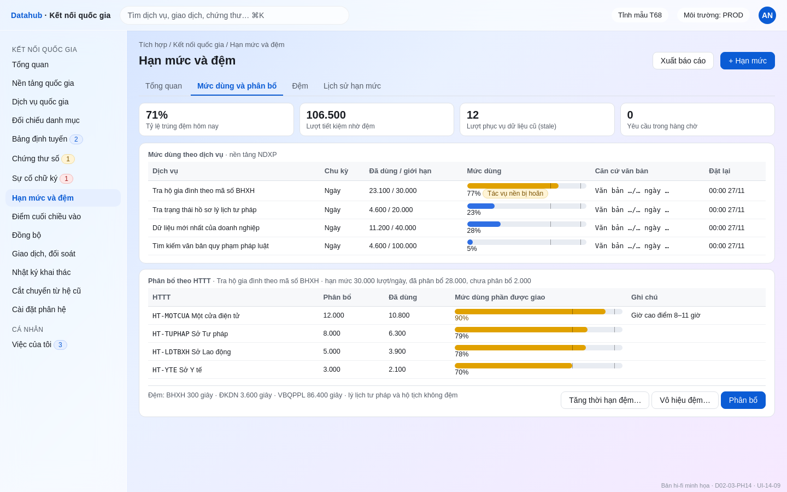

### 15.1. Các tab

Màn chia thành các tab; bảng dưới nêu nội dung, thành phần và API của từng tab.

| Tab | Nội dung | Thành phần |
|---|---|---|
| Tổng quan | Bốn thẻ: tỷ lệ trúng đệm, lượt tiết kiệm, số lượt phục vụ dữ liệu cũ, hàng chờ | `CMP-StatCard`, `CMP-Chart` |
| Mức dùng và phân bổ | Bảng mức dùng theo dịch vụ; bảng phân bổ theo HTTT của dịch vụ đang chọn | `CMP-DataTable`, `CMP-ProgressBar`, `CMP-EditableTable` |
| Đệm | Thống kê trúng đệm theo dịch vụ, thời hạn, dữ liệu quá hạn; "Tăng thời hạn đệm…", "Vô hiệu đệm…" | `CMP-DataTable`, `CMP-ReasonDialog` |
| Lịch sử hạn mức | Các phiên bản hạn mức, căn cứ văn bản, ai duyệt | `CMP-VersionTimeline` |

: UI-14-09 · Các tab

### 15.2. Trường của hộp "Khai báo hạn mức"

Bảng dưới nêu từng trường của hộp, kiểu, bắt buộc, kiểm tra và ánh xạ API.

| Trường | Nhãn | Kiểu | Bắt buộc | Kiểm tra | Ánh xạ API |
|---|---|---|---|---|---|
| `serviceCode` | Dịch vụ | Chọn, để trống là cả nền tảng | Không | | API-14-042 |
| `period` | Chu kỳ | Giờ, Ngày, Tháng | Có | | `period` |
| `limit` | Giới hạn | Số nguyên > 0 | Có | ERR-14-017 | `limit` |
| `basisDocument` | Căn cứ văn bản | Số, ngày, trích yếu | Có | ERR-14-016 | `basisDocument` |
| `effectiveFrom` | Hiệu lực từ | Ngày giờ | Có | Không ở quá khứ | `effectiveFrom` |

: UI-14-09 · Trường hộp khai báo hạn mức

Hạn mức ở môi trường thật cần người thứ hai duyệt (BR-14-022); sau khi gửi hiện nhãn "Chờ duyệt". Phân bổ: bảng soạn nội tuyến (`CMP-EditableTable`), tổng phân bổ cập nhật theo từng ô; vượt hạn mức hiện ERR-14-018 ở đầu bảng và vô hiệu "Phân bổ". Hộp "Tăng thời hạn đệm" hiện ước tính lượt tiết kiệm từ thống kê trúng đệm; "Vô hiệu đệm" bắt buộc lý do và hiện số khóa đệm bị xóa. Dịch vụ `SENSITIVE`, dịch vụ ghi không bật được đệm (ERR-14-038).

### 15.3. Trạng thái màn

Bảng dưới nêu các trạng thái riêng của màn này; trạng thái còn lại theo mục 6.

| Trạng thái | Hiển thị |
|---|---|
| Đang tải | Skeleton thẻ và hai bảng |
| Rỗng lần đầu | "Chưa khai báo hạn mức nào. Hạn mức do trung ương áp; khai báo để hệ thống cảnh báo và hoãn tác vụ nền khi gần cạn." kèm "Hạn mức" khi có `PERM-14-quota` |
| Dịch vụ chưa phân bổ | Dòng "Chưa phân bổ: 2.000" sắc thái thông tin |
| Lỗi tải, không có quyền, chỉ đọc | ST-05, ST-07, ST-15 (thiếu `PERM-14-quota` thì chỉ xem) |

: UI-14-09 · Trạng thái màn

Phím tắt: `N` khai báo hạn mức, `E` sửa phân bổ dòng đang chọn, `Tab` chuyển ô, `Enter` xác nhận ô. Truy cập: thanh mức dùng có `aria-valuenow`, `aria-valuetext` "77 phần trăm, trên mốc hoãn tác vụ nền"; vạch mốc có nhãn chữ, không chỉ là vạch.

## 16. UI-14-10 Điểm cuối chiều vào

::: dac-ta
**Mục đích.** Đăng ký địa chỉ để nền tảng quốc gia gọi vào tỉnh, khai nguồn được phép, đối chiếu vân tay chứng thư nguồn và theo dõi thống kê bản tin vào.

**Người dùng chính.** TA (đăng ký), SO (xác nhận vân tay).

**FR hiện thực.** FR-14-039, 040, 041, 042.

**Đường dẫn.** `/tich-hop/quoc-gia/chieu-vao`.

**Mẫu.** PTN-01, drawer ở PTN-04.

**Quyền.** `PERM-14-read`; đăng ký, sửa, nguồn được phép cần `PERM-14-admin`; xác nhận vân tay và bật cần `PERM-14-cert`.

**API.** API-14-048, 049, 050, 051, 052, 090.
:::

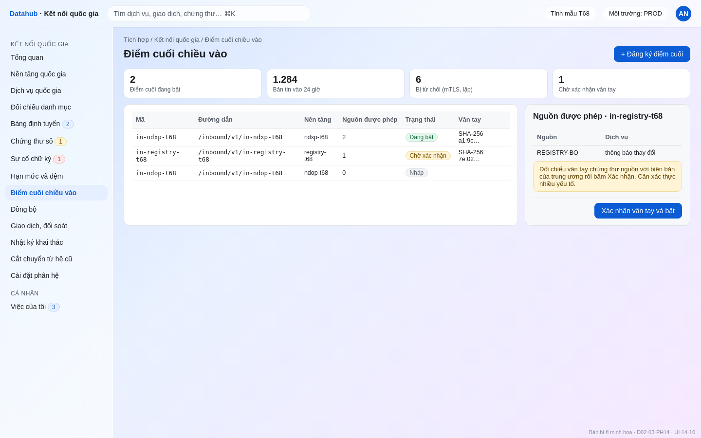

### 16.1. Thành phần và trường

Bảng dưới liệt kê thành phần của màn, mã `CMP-*` theo D03-05, nội dung, kiểm tra và các trường hoặc cột chính.

| # | Thành phần | `CMP-*` | Nội dung, kiểm tra | Ghi chú |
|---|---|---|---|---|
| 1 | Thẻ thống kê | `CMP-StatCard` | Điểm cuối đang bật, bản tin vào 24 giờ, bị từ chối (mTLS, lặp, sai định dạng), chờ xác nhận | `ERR-14-119…124` là lý do từ chối |
| 2 | Bảng điểm cuối | `CMP-DataTable` | Mã, đường dẫn, nền tảng, số nguồn, trạng thái, vân tay | Mã hoặc đường dẫn trùng: ERR-14-023 |
| 3 | Drawer chi tiết | `CMP-Drawer`, `CMP-EditableTable` | Nguồn được phép: mã nguồn, dịch vụ được gọi | Ít nhất một nguồn (ERR-14-024) |
| 4 | Hộp xác nhận vân tay | `CMP-ConfirmDialog`, `CMP-CodeText`, `CMP-CopyButton` | Hiện vân tay SHA-256 của chứng thư nguồn để đối chiếu biên bản; xác thực nhiều yếu tố | Bật điểm cuối cần bốn mắt (BR-14-022) |

: UI-14-10 · Thành phần

| Trường | Nhãn | Kiểu | Bắt buộc | Kiểm tra |
|---|---|---|---|---|
| `endpointCode` | Mã điểm cuối | T-CODE | Có | `^[a-z][a-z0-9-]{2,62}$`, duy nhất |
| `platformCode` | Nền tảng | Chọn | Có | Nền tảng tồn tại |
| `path` | Đường dẫn | Sinh từ mã, chỉ đọc | — | `/inbound/v1/{endpointCode}` |
| `senderCode`, `serviceCodes` | Nguồn, dịch vụ | Bảng soạn | Có | Tối thiểu một dòng |

: UI-14-10 · Trường điểm cuối

### 16.2. Trạng thái màn

Bảng dưới nêu các trạng thái riêng của màn này; trạng thái còn lại theo mục 6.

| Trạng thái | Hiển thị |
|---|---|
| Đang tải | Skeleton thẻ và 3 dòng |
| Rỗng lần đầu | "Chưa đăng ký điểm cuối chiều vào nào. Điểm cuối là địa chỉ để trung ương gọi vào tỉnh; chỉ nguồn đã đăng ký mới được nhận." kèm "Đăng ký điểm cuối" |
| Lỗi tải, không có quyền | ST-05, ST-07 |
| Chờ xác nhận vân tay | Dòng nhãn "Chờ xác nhận", nút "Xác nhận vân tay và bật" chỉ SO thấy |

: UI-14-10 · Trạng thái màn

Phím tắt: `N` đăng ký, `Enter` mở drawer. Truy cập: vân tay đọc theo cụm hai ký tự cho trình đọc màn hình và có nút sao chép; mọi hộp xác nhận bẫy focus.

## 17. UI-14-11 Đồng bộ

::: dac-ta
**Mục đích.** Theo dõi và chạy đồng bộ danh mục dịch vụ lên Bộ, dữ liệu chủ hai chiều, công bố dữ liệu mở và cổng danh mục dùng chung; xem chi tiết từng bản ghi, thử lại bản ghi lỗi.

**Người dùng chính.** TA, TO.

**FR hiện thực.** FR-14-023, 043, 044, 045, 046.

**Đường dẫn.** `/tich-hop/quoc-gia/dong-bo`.

**Mẫu.** PTN-01 (tab).

**Quyền.** `PERM-14-read`; chạy, thử lại cần `PERM-14-sync`.

**API.** API-14-053, 054, 055, 056, 057, 087, 088.
:::

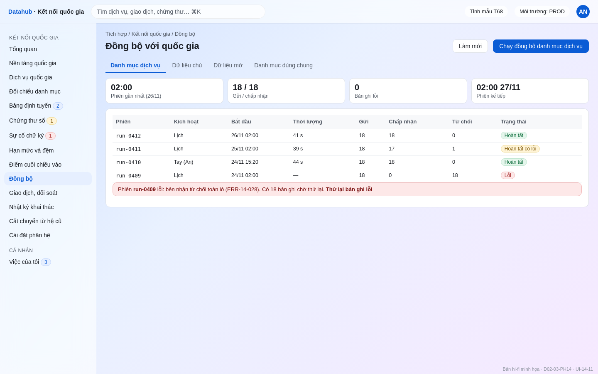

### 17.1. Các tab và thành phần

Màn chia thành các tab; bảng dưới nêu nội dung, thành phần và API của từng tab.

| Tab | Nội dung | Thành phần | Đợt |
|---|---|---|---|
| Danh mục dịch vụ | Bốn thẻ (phiên gần nhất, gửi/chấp nhận, bản ghi lỗi, phiên kế tiếp), bảng phiên, "Chạy đồng bộ" | `CMP-StatCard`, `CMP-DataTable`, `CMP-Button` | MVP |
| Dữ liệu chủ | Phiên đồng bộ hai chiều với PH-06 | `CMP-DataTable` | Đợt 3 (ẩn khi PH-06 chưa bật) |
| Dữ liệu mở | Danh sách tập công bố lên NDOP, "Gỡ" | `CMP-DataTable`, `CMP-ReasonDialog` | Đợt 3 |
| Danh mục dùng chung | Phiên kéo danh mục quốc gia của PH-07 (cổng `NDXP_DMDC`, tenant `COMMON`); chỉ xem | `CMP-DataTable` | MVP |

: UI-14-11 · Các tab

Bảng phiên có cột Phiên, Kích hoạt (Lịch, Sự kiện, Tay, Thử lại), Bắt đầu, Thời lượng, Gửi, Chấp nhận, Từ chối, Trạng thái; bấm một dòng mở drawer chi tiết từng bản ghi (`CMP-Drawer`, `CMP-DataTable`) kèm lý do từ chối của bên nhận (ERR-14-028). "Thử lại bản ghi lỗi" chạy API-14-057 và theo dõi ở `CMP-BackgroundTaskTray`. Đang có phiên cùng loại chạy thì nút "Chạy đồng bộ" vô hiệu kèm ERR-14-026. Biểu ngữ "Đã {n} ngày chưa đồng bộ thành công" hiện khi quá `14.sync.stale-alert-days` (BR-14-026).

### 17.2. Trạng thái màn

Bảng dưới nêu các trạng thái riêng của màn này; trạng thái còn lại theo mục 6.

| Trạng thái | Hiển thị |
|---|---|
| Đang tải | Skeleton thẻ và 5 dòng |
| Rỗng lần đầu | "Chưa có phiên đồng bộ nào. Hệ thống đồng bộ danh mục dịch vụ chia sẻ lên Bộ theo lịch `14.sync.catalog-cron`; bấm Chạy đồng bộ để chạy ngay." |
| Lỗi tải, không có quyền, chỉ đọc | ST-05, ST-07, ST-15 |
| Phân hệ liên quan chưa phản hồi | `CMP-Alert` ERR-14-027 |

: UI-14-11 · Trạng thái màn

Phím tắt: `R` chạy đồng bộ, `1…4` chuyển tab, `Enter` mở chi tiết phiên. Truy cập: trạng thái phiên đọc đầy đủ ("Hoàn tất có lỗi, 1 bản ghi bị từ chối"); tiến độ chạy phát qua `aria-live="polite"` mỗi 10 giây.

## 18. UI-14-12 Giao dịch và đối soát (siêu chi tiết)

::: dac-ta
**Mục đích.** Tra một giao dịch quốc gia theo mã giao dịch hoặc mã hồ sơ, xem từng bước của lượt gọi trên dòng thời gian, xử lý giao dịch "kết quả chưa rõ", xem nội dung bản tin đầy đủ có lý do và xuất bằng chứng đối soát với trung ương.

**Người dùng chính.** TO, SO, AU.

**FR hiện thực.** FR-14-010, 015, 016, 049, 050, 051.

**Đường dẫn.** `/tich-hop/quoc-gia/giao-dich`; chi tiết toàn trang `/tich-hop/quoc-gia/giao-dich/{transactionCode}`.

**Mẫu.** PTN-11.

**Quyền.** `PERM-14-audit-read` (tra, nội dung đã che); `PERM-14-audit-reveal` (xem đầy đủ, xuất bằng chứng).

**API.** API-14-061, 062, 063, 064.
:::

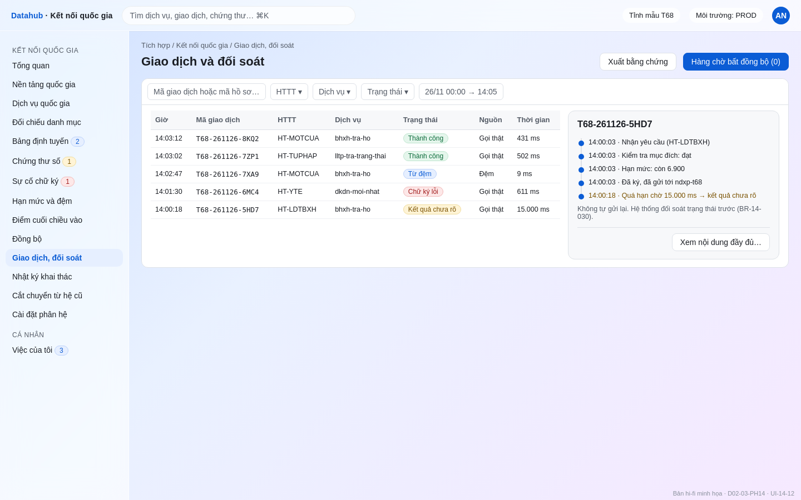

### 18.1. Mục đích, người dùng, bối cảnh

Màn này là nơi cuối của mọi phản ánh "hồ sơ không ra kết quả". Người trực (TO) mở màn khi HTTT báo lỗi, dán mã giao dịch hoặc mã hồ sơ vào ô tra nhanh và cần biết trong dưới 30 giây: lượt gọi đến đâu, vì sao hỏng, có gửi lại được không. Cán bộ ATTT (SO) mở khi có sự cố chữ ký hoặc cảnh báo bất thường và cần xem nội dung bản tin. Kiểm toán viên (AU) đối soát với trung ương theo mã giao dịch. Ba người dùng này chia nhau quyền: TO, AU chỉ xem siêu dữ liệu và nội dung đã che; chỉ SO xem được nội dung đầy đủ (BR-14-021, mục 3.3 của FRS). Màn dùng mật độ gọn, cuộn dọc vùng bảng, giữ nguyên bộ lọc khi mở chi tiết.

### 18.2. Lưới bố cục

Khung 1440 × 900: sidebar `size-sidebar` (232 px), vùng nội dung còn 1208 px trừ lề `space-6`. Chia thành sáu vùng R1…R6 theo bảng; vùng R3 là bảng điều khiển bên phải, mở thì bảng R2 co lại, không che.

| Vùng | Tên | Vị trí, kích thước | Vật liệu |
|---|---|---|---|
| R1 | Thanh tra nhanh và bộ lọc | Đầu vùng nội dung, cao 96 px (hai hàng), dính khi cuộn | Đặc `color-surface-solid` |
| R2 | Bảng giao dịch | Dưới R1, rộng còn lại, dòng `size-table-row` mật độ gọn (32 px) | Đặc |
| R3 | Bảng chi tiết giao dịch | Bên phải R2, rộng 420 px (`size-drawer-md`), cao đến chân trang; dưới 1280 px chuyển thành `CMP-Drawer` phủ phải | Khung `glass-modal`, nội dung đặc |
| R4 | Hộp "Xem nội dung đầy đủ" | `CMP-Modal` giữa màn, rộng `size-modal-sm` mở rộng 720 px | Khung `glass-modal`, nội dung đặc |
| R5 | Hộp "Xuất bằng chứng" | `CMP-Modal` 560 px | Như R4 |
| R6 | Thanh trạng thái bảng | Chân R2: số dòng, tổng, thời gian lấy dữ liệu, `CMP-Pagination` | Đặc |

: UI-14-12 · Lưới bố cục và vùng

### 18.3. Wireframe tổng thể

Sơ đồ dưới đây phác bố cục các vùng của màn; ảnh hi-fi ở trên là bản dựng bằng token chuẩn.

```{.mermaid caption="Bố cục các vùng của UI-14-12"}
flowchart TB
  subgraph R1["R1 Tra nhanh và bộ lọc"]
    direction TB
    F1["Ô tìm mã giao dịch hoặc mã hồ sơ; bộ lọc HTTT, Dịch vụ, Trạng thái, Nguồn, Khoảng thời gian"]
    F2["Lọc nhanh: Kết quả chưa rõ, Chữ ký lỗi, Hết hạn mức, Từ đệm quá hạn; nút Xóa lọc"]
  end
  subgraph MID["Thân màn"]
    direction LR
    subgraph R2["R2 Bảng giao dịch"]
      direction TB
      L["Cột: Giờ, Mã giao dịch, HTTT, Dịch vụ, Trạng thái, Thời gian xử lý"]
      R6["R6 Chân bảng: số dòng, thời điểm lấy, phân trang"]
      L --> R6
    end
    subgraph R3["R3 Chi tiết giao dịch đang chọn"]
      direction TB
      D1["Mã giao dịch và trạng thái, nút đóng"]
      D2["Tab Dòng thời gian, Bản tin"]
      D3["Các chặng: nhận yêu cầu, kiểm tra mục đích, quá hạn chờ"]
      D4["Nút Xem nội dung đầy đủ"]
      D1 --> D2 --> D3 --> D4
    end
  end
  R1 --> MID
```

### 18.4. Vùng R1: tra nhanh và bộ lọc

Vùng này của màn có các thành phần và hành vi nêu ở bảng dưới.

| # | Thành phần | `CMP-*` | Hành vi | Nguồn |
|---|---|---|---|---|
| 1 | Ô tra nhanh | `CMP-SearchInput` | Nhận mã giao dịch (mẫu `T68-yyMMdd-xxxx`) hoặc mã hồ sơ; nhập mã giao dịch đủ dạng rồi `Enter` mở thẳng chi tiết R3, không cần bộ lọc; trễ 300 ms khi gõ dở | `transactionCode`, `caseCode` |
| 2 | Lọc HTTT, dịch vụ | `CMP-Select` (nhiều giá trị, tìm trong danh sách) | Giữ lựa chọn trong URL (`httt`, `dich-vu`) | `systemCode`, `serviceCode` |
| 3 | Lọc trạng thái | `CMP-Select` nhiều giá trị | Nhóm theo §5.1; chọn nhanh "Cần xử lý" = Kết quả chưa rõ + Chữ ký lỗi + Thất bại | `state` |
| 4 | Lọc nguồn | `CMP-Segmented` | Tất cả, Gọi thật, Đệm, Dữ liệu cũ | `fromCache`, `stale` |
| 5 | Khoảng thời gian | `CMP-DateRangePicker` | Mặc định 24 giờ gần nhất; nhập tay được; tối đa 31 ngày một lần tra (giả định theo chỉ mục phân vùng tháng của D03-03-PH14) | `from`, `to` |
| 6 | Bộ lọc nhanh | `CMP-FilterChips` | Đếm từ `facets`; bấm là bật lọc | `facets.state` |
| 7 | Xóa lọc | `CMP-Button` (liên kết) | Về mặc định 24 giờ | — |

: UI-14-12 · Vùng R1

Mã dán vào ô tra có khoảng trắng đầu hoặc cuối được cắt tự động; mã không đúng mẫu coi là mã hồ sơ.

### 18.5. Vùng R2: bảng giao dịch

Vùng này của màn có các thành phần và hành vi nêu ở bảng dưới.

| Cột | Nội dung | Sắp xếp | Ghi chú |
|---|---|---|---|
| Giờ | `HH:mm:ss`, ngày khi khác ngày hôm nay | Có (mặc định giảm) | `<time datetime>` |
| Mã giao dịch | `CMP-CodeText` kèm `CMP-CopyButton` ở hover và focus | Không | Liên kết mở R3 |
| HTTT | Mã HTTT | Có | |
| Dịch vụ | Mã dịch vụ | Có | Tooltip tên đầy đủ |
| Trạng thái | `CMP-StatusTag` §5.1 | Có | "Kết quả chưa rõ" sắc thái cảnh báo kèm biểu tượng |
| Nguồn | Gọi thật, Đệm, Dữ liệu cũ | | Chip nguồn quốc gia dùng `color-source-national` |
| Thời gian | `ms`, từ 1 giây `1,2 s` | Có | Quá `14.timeout.default-ms` tô cảnh báo |
| Lỗi | Mã `ERR-14-1xx` nếu có | | Tooltip câu `detail` đã che |

: UI-14-12 · Cột bảng R2

Chọn một dòng (bấm hoặc `Enter`) mở R3 và ghi `chon={transactionCode}` vào URL; dòng được chọn có vạch `color-accent` 3 px bên trái và nền `color-fill-selected`.

### 18.6. Vùng R3: chi tiết giao dịch

R3 có đầu, ba tab và chân. Đầu gồm mã giao dịch, nút sao chép, trạng thái, nút đóng. Chân giữ nút "Xem nội dung đầy đủ…" (khi có `PERM-14-audit-reveal`) và "Xuất bằng chứng…".

| Tab | Nội dung | Thành phần |
|---|---|---|
| Dòng thời gian | Từng bước: nhận yêu cầu, kiểm tra mục đích, đọc đệm, kiểm tra hạn mức, ký, gửi, nhận phản hồi, xác minh chữ ký; mỗi bước có giờ (mili giây), kết quả, mã lỗi | `CMP-AuditTimeline`, `CMP-StatusDot` |
| Bản tin | Siêu dữ liệu và nội dung đã che: kích thước, mã băm, `payloadRef`; nội dung hiện `CMP-MaskedValue`; nút "Xem đầy đủ…" | `CMP-DescriptionList`, `CMP-MaskedValue` |
| Đối soát | Mã đối soát gửi trung ương (chính mã giao dịch), chứng thư dùng ký, `traceId` (liên kết sang tra vết ở PH-13), ghi chú hướng dẫn theo trạng thái | `CMP-DescriptionList`, `CMP-Link`, `CMP-CopyButton` |

: UI-14-12 · Các tab của R3

Hướng dẫn theo trạng thái ở tab Đối soát:

| Trạng thái | Hướng dẫn hiển thị |
|---|---|
| Kết quả chưa rõ | "Lượt ghi quá hạn chờ, chưa biết trung ương đã nhận chưa. Hệ thống không tự gửi lại; đang đối soát trạng thái với trung ương. Không gửi lại thủ công." (BR-14-030) |
| Chữ ký lỗi | "Chữ ký phản hồi không hợp lệ. Dữ liệu không được dùng. Sự cố {mã} đã mở cho Cán bộ ATTT." kèm liên kết UI-14-14 |
| Hết hạn mức | "Đã hết hạn mức, đặt lại lúc {resetAt}. Dịch vụ thiết yếu vẫn được phục vụ." kèm liên kết UI-14-09 |
| Bị từ chối | Lý do (ERR-14-106, 107, 108): thiếu đăng ký, mục đích, mã hồ sơ |
| Từ đệm (dữ liệu cũ) | "Phục vụ từ đệm quá hạn do quốc gia lỗi hoặc hết hạn mức" kèm tuổi dữ liệu |

: UI-14-12 · Hướng dẫn theo trạng thái

### 18.7. Vùng R4: hộp "Xem nội dung đầy đủ"

Hộp chỉ mở khi người dùng có `PERM-14-audit-reveal`. Luồng: (1) nhập lý do (ô văn bản bắt buộc, tối thiểu 10 ký tự, giả định theo thông lệ kiểm toán của `CMP-ReasonDialog`); (2) hệ thống yêu cầu xác thực lại bằng yếu tố thứ hai nếu phiên chưa xác thực lại trong 15 phút (ERR-14-030; SEC-23); (3) gọi API-14-063; (4) hiển thị nội dung trong `CMP-JsonViewer` (hoặc `CMP-CodeBlock` với XML) cho phép tìm trong nội dung nhưng chặn sao chép toàn bộ; (5) đếm ngược 5 phút rồi tự che lại và đóng hộp. Mỗi lần xem để lại bản ghi kiểm toán (người, lý do, giờ); vượt `14.reveal.max-per-day` lần trong ngày hiện thêm dòng "Bạn đã xem {n} lần hôm nay; hệ thống đã báo Cán bộ ATTT trưởng." Giao dịch đã quá `14.txn.payload-retention-days` ngày hoặc tỉnh đặt 0: nút vô hiệu kèm ERR-14-031.

### 18.8. Vùng R5: hộp "Xuất bằng chứng" (Đợt 2)

Chọn giao dịch (đã chọn ở R2 hoặc theo bộ lọc, tối đa 500), định dạng (gói ZIP gồm siêu dữ liệu, dòng thời gian, mã băm và chữ ký của hệ thống), lý do. Gọi API-14-064 trả 202; tiến độ ở `CMP-BackgroundTaskTray`; xong có liên kết tải trong `CMP-NotificationCenter`, tệp ký điện tử và có hạn tải 7 ngày (giả định). Nút hiển thị ở Đợt 2 khi FR-14-051 vào; trước đó ẩn.

### 18.9. Trạng thái màn

Bảng dưới liệt kê đủ các trạng thái của màn tra giao dịch, gồm cả hai trạng thái riêng (chỉ xem đã che, giao dịch không tồn tại).

| Trạng thái | Hiển thị |
|---|---|
| Đang tải lần đầu | ST-01: skeleton 12 dòng, R1 hiện ngay |
| Đang tải lại | ST-02: giữ dữ liệu cũ, thanh tiến độ 2 px mép trên R2, `aria-busy="true"` |
| Rỗng | "Chưa có giao dịch nào trong khoảng này. Giao dịch xuất hiện khi HTTT hoặc luồng gọi dịch vụ quốc gia." |
| Không có kết quả | ST-04 "Không tìm thấy giao dịch phù hợp" kèm điều kiện đang áp dụng và "Xóa bộ lọc"; nếu tra mã giao dịch: "Không có giao dịch {mã} ở tenant này" (không phân biệt tenant khác, BR-14-029) |
| Lỗi tải | ST-05 trong R2 kèm "Thử lại"; R1 vẫn dùng được |
| Không có quyền | ST-07 khi thiếu `PERM-14-audit-read` |
| Chỉ xem đã che | Thiếu `PERM-14-audit-reveal`: không hiện nút xem đầy đủ và xuất bằng chứng; tab Bản tin chỉ hiện siêu dữ liệu |
| Giao dịch không tồn tại | ST-08 trong R3 khi mở bằng URL cũ |
| Mất kết nối | ST-06, vô hiệu "Xem nội dung đầy đủ" và "Xuất" |

: UI-14-12 · Trạng thái màn

### 18.10. Bàn phím

Màn dùng được trọn vẹn bằng bàn phím; bảng dưới liệt kê phím tắt và tác dụng.

| Phím | Hành động |
|---|---|
| `/` | Đưa focus vào ô tra nhanh R1 |
| `↑`, `↓` | Chọn dòng trên, dưới trong R2 (roving tabindex) |
| `Enter` | Mở R3 cho dòng đang chọn; trong ô tra nhanh mở giao dịch khớp |
| `Esc` | Đóng hộp R4, R5; nếu không có hộp thì đóng R3 và trả focus về dòng đã chọn |
| `1`, `2`, `3` | Chuyển tab R3 (khi focus trong R3) |
| `C` | Sao chép mã giao dịch đang chọn |
| `X` | Mở hộp xem nội dung đầy đủ (khi có quyền) |
| `Shift+/` hoặc `?` | Mở `CMP-ShortcutSheet` |
| `F6` | Nhảy vòng R1 → R2 → R3 |

: UI-14-12 · Phím tắt

Phím một ký tự (`C`, `X`, `1…3`) chỉ có tác dụng khi focus nằm trong vùng bảng hoặc R3, và tắt được trong "Cài đặt tài khoản" (WCAG 2.1.4); trong ô nhập không bị bắt.

### 18.11. Chuột và cảm ứng

Bấm một dòng mở R3; bấm đúp mở trang chi tiết toàn trang; bấm phải một dòng mở `CMP-DropdownMenu` (Mở, Sao chép mã, Xem đầy đủ…). Kéo cạnh trái R3 đổi độ rộng từ 360 đến 560 px và có điều khiển bàn phím thay thế (`Alt+←`, `Alt+→` đổi 40 px) theo WCAG 2.5.7. Không có thao tác nào bắt buộc kéo thả. Vùng chạm tối thiểu 24 × 24 px; ở màn cảm ứng dòng cao 44 px.

### 18.12. Truy cập

R2 là `table` có `caption` ẩn, tiêu đề cột có `scope="col"`; dòng được chọn có `aria-selected`. R3 là `region` có `aria-labelledby` là mã giao dịch; mở R3 thì chuyển focus vào tiêu đề R3, đóng thì trả focus về dòng đã mở (WCAG 2.4.3). Trạng thái đọc đầy đủ bằng chữ ("Kết quả chưa rõ, cảnh báo"). Thanh `glass-chrome` cố định không che phần tử đang focus: `scroll-padding-top` bằng `size-topbar` cộng `space-4` (WCAG 2.4.11). Hộp R4 hiện đếm ngược dưới dạng văn bản "Tự che sau 4 phút 20 giây", làm mới mỗi phút cho trình đọc màn hình (không mỗi giây). Tương phản chữ trên chip trạng thái ≥ 4,5 : 1 ở cả chế độ giảm trong suốt.

### 18.13. Hiệu năng

Bảng dùng ảo hóa dòng từ 100 dòng; API-14-061 phân trang 50 dòng mặc định, tối đa 100. Mục tiêu: hiện 50 dòng đầu trong 1,5 giây (p95) với 1 triệu giao dịch trong khoảng lọc (giả định theo hồ sơ "tỉnh vừa" ở D02-03-PH14 §8.1); mở R3 dưới 500 ms. Làm mới tự động R2 tắt mặc định để người dùng không mất vị trí; bật "Tự làm mới 30 giây" thì chỉ cập nhật khi cuộn ở đầu bảng.

### 18.14. Thông báo của màn

Bảng dưới liệt kê thông báo riêng của màn tra giao dịch, ngoài bảng chung ở mục 5.2.

| Tình huống | Câu hiển thị | Vị trí |
|---|---|---|
| Xem đầy đủ cần xác thực lại | ERR-14-030 | Hộp xác thực lại |
| Hết thời hạn lưu nội dung | ERR-14-031 | `CMP-Alert` ở tab Bản tin |
| Xuất bằng chứng thành công | "Đã tạo bằng chứng cho {n} giao dịch. Tải về trong 7 ngày." | `CMP-Toast` |
| Lỗi cổng quốc gia | Câu từ `detail` kèm ERR-14-101…132 | Cột Lỗi, dòng thời gian |
| Lỗi chung | Câu từ `detail` kèm mã truy vết, nút "Sao chép mã truy vết" | `CMP-Alert` |

: UI-14-12 · Thông báo

## 19. UI-14-13 Nhật ký khai thác và báo cáo

::: dac-ta
**Mục đích.** Cho thấy HTTT nào gọi dịch vụ quốc gia nào, với mục đích gì, bao nhiêu lượt; phát hiện khai thác bất thường và sinh báo cáo sử dụng, hạn mức, hiệu quả đệm cho thanh tra.

**Người dùng chính.** SO, TA, AU.

**FR hiện thực.** FR-14-011, 019, 052, 053, 057.

**Đường dẫn.** `/tich-hop/quoc-gia/nhat-ky`.

**Mẫu.** PTN-11 (tab).

**Quyền.** `PERM-14-audit-read`.

**API.** API-14-065, 066, 067, 068, 069.
:::

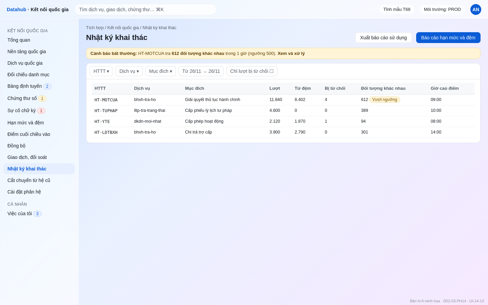

### 19.1. Các tab và thành phần

Màn chia thành các tab; bảng dưới nêu nội dung, thành phần và API của từng tab.

| Tab | Nội dung | Thành phần | API |
|---|---|---|---|
| Khai thác | Bảng theo HTTT, dịch vụ, mục đích: lượt, từ đệm, bị từ chối, số đối tượng khác nhau, giờ cao điểm; lọc theo khoảng thời gian | `CMP-FilterBar`, `CMP-DataTable`, `CMP-DateRangePicker` | API-14-065 |
| Bất thường | Cảnh báo theo quy tắc: Tra hàng loạt (`MASS_LOOKUP`), Ngoài giờ (`OFF_HOURS`), Đột biến (`SPIKE`), Nhiều đối tượng một hồ sơ (`CASE_FANOUT`); bằng chứng, xử lý | `CMP-DataTable`, `CMP-Drawer`, `CMP-DecisionPanel` | API-14-067, 068 |
| Báo cáo | Chọn báo cáo sử dụng hoặc hạn mức và hiệu quả đệm, kỳ, định dạng; danh sách báo cáo đã sinh | `CMP-Form`, `CMP-DataTable`, `CMP-JobProgress` | API-14-066, 069 |

: UI-14-13 · Các tab

Xử lý một cảnh báo bất thường chọn một trong ba quyết định: "Xác nhận hợp lệ", "Đề nghị thu hồi quyền của HTTT", "Chặn dịch vụ với HTTT", mỗi quyết định kèm ghi chú bắt buộc. Cảnh báo hiện cả biểu ngữ đầu trang (xem hi-fi). Báo cáo hạn mức và đệm (FR-14-057) là Đợt 3; trước đó nút "Báo cáo hạn mức và đệm" ẩn. Nhật ký không hiện số định danh hay mã số BHXH của công dân, chỉ mã hồ sơ và số đối tượng (mục 2.5).

### 19.2. Trạng thái màn

Bảng dưới nêu các trạng thái riêng của màn này; trạng thái còn lại theo mục 6.

| Trạng thái | Hiển thị |
|---|---|
| Đang tải | Skeleton 8 dòng |
| Rỗng lần đầu | "Chưa có lượt khai thác nào trong khoảng này." |
| Không có cảnh báo | Tab Bất thường: "Không có cảnh báo bất thường. Hệ thống cảnh báo khi một HTTT tra quá nhiều đối tượng, ngoài giờ hoặc tăng đột biến." |
| Lỗi tải, không có quyền | ST-05, ST-07 |

: UI-14-13 · Trạng thái màn

Phím tắt: `/` tìm, `1…3` chuyển tab, `Enter` mở cảnh báo, `E` xuất. Truy cập: ngưỡng vượt được nêu bằng chữ ("Vượt ngưỡng 500 đối tượng khác nhau mỗi giờ"), không chỉ nhãn màu.

## 20. UI-14-14 Sự cố chữ ký

::: dac-ta
**Mục đích.** Xử lý sự cố chữ ký như sự cố an ninh: xác nhận, ghi nhận kết thúc, giải trừ trạng thái giữ an ninh của nền tảng.

**Người dùng chính.** SO.

**FR hiện thực.** FR-14-027, 031.

**Đường dẫn.** `/tich-hop/quoc-gia/su-co-chu-ky`.

**Mẫu.** PTN-01, chi tiết ở drawer PTN-04.

**Quyền.** `PERM-14-read` xem; chuyển trạng thái cần `PERM-14-operate` và vai trò SO.

**API.** API-14-037, 038.
:::

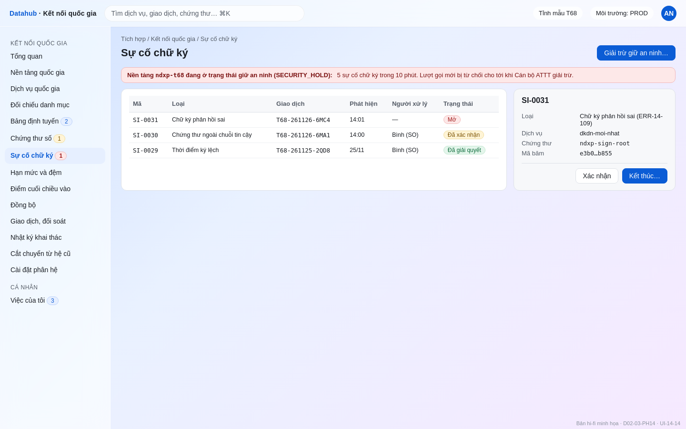

### 20.1. Thành phần

Bảng dưới liệt kê thành phần của màn, mã `CMP-*` theo D03-05, nội dung và nguồn dữ liệu.

| # | Thành phần | `CMP-*` | Nội dung, kiểm tra | Ghi chú |
|---|---|---|---|---|
| 1 | Biểu ngữ giữ an ninh | `CMP-Banner` mức lỗi | "Nền tảng {mã} đang giữ an ninh: {n} sự cố chữ ký trong 10 phút. Lượt gọi mới bị từ chối cho tới khi giải trừ." | Không ẩn được |
| 2 | Bảng sự cố | `CMP-DataTable` | Mã, Loại (Chữ ký phản hồi sai, Chứng thư ngoài chuỗi tin cậy, Chứng thư đã thu hồi, Thời điểm ký lệch, Bản tin lặp), Giao dịch, Phát hiện, Người xử lý, Trạng thái | `OPEN` lên đầu |
| 3 | Drawer chi tiết | `CMP-Drawer`, `CMP-DescriptionList`, `CMP-AuditTimeline` | Loại, mã lỗi, dịch vụ, chứng thư, mã băm, liên kết giao dịch UI-14-12 | |
| 4 | Hành động | `CMP-Button`, `CMP-ReasonDialog` | "Xác nhận" (`ACKNOWLEDGED`), "Kết thúc…" (`RESOLVED`, ghi chú), "Giải trừ giữ an ninh…" (`RELEASE_HOLD`, ghi chú) | `note` ≤ 2.000 ký tự |

: UI-14-14 · Thành phần

Giải trừ giữ an ninh chỉ bật khi mọi sự cố của nền tảng đã `ACKNOWLEDGED` hoặc `RESOLVED`; hộp xác nhận nêu hậu quả "Lượt gọi mới tới {nền tảng} sẽ được nhận lại" và yêu cầu xác thực nhiều yếu tố (SEC-23). Người không phải SO thấy nút vô hiệu kèm "Chỉ Cán bộ ATTT xử lý sự cố chữ ký". Sự cố phát hiện bằng bản tin phản hồi giả hoặc sai nên UI-14-14 không hiện nội dung bản tin; chỉ liên kết sang UI-14-12.

### 20.2. Trạng thái màn

Bảng dưới nêu các trạng thái riêng của màn này; trạng thái còn lại theo mục 6.

| Trạng thái | Hiển thị |
|---|---|
| Đang tải | Skeleton 5 dòng |
| Rỗng | "Không có sự cố chữ ký. Hệ thống mở sự cố khi chữ ký phản hồi, chuỗi tin cậy hoặc thời điểm ký không hợp lệ." |
| Lỗi nghiệp vụ, xung đột | ST-12 (ERR-14-004), ST-13 khi người khác vừa xử lý |
| Lỗi tải, không có quyền | ST-05, ST-07 |

: UI-14-14 · Trạng thái màn

Phím tắt: `A` xác nhận sự cố đang chọn, `Enter` mở drawer. Truy cập: biểu ngữ giữ an ninh `role="alert"`; khi có sự cố mới trong lúc đang xem, vùng `aria-live="assertive"` đọc "Có sự cố chữ ký mới".

## 21. UI-14-15 Cắt chuyển từ hệ cũ

::: dac-ta
**Mục đích.** Nhập cấu hình dịch vụ từ phụ lục NGSP của hệ cũ, chạy song song với kết nối cũ cho thao tác đọc, so tỷ lệ khớp và xác nhận thu hồi khóa cũ trước khi cắt chuyển.

**Người dùng chính.** TA, IE.

**FR hiện thực.** FR-14-055, 056.

**Đường dẫn.** `/tich-hop/quoc-gia/cat-chuyen`.

**Mẫu.** PTN-09.

**Quyền.** `PERM-14-service`; xem `PERM-14-read`.

**API.** API-14-072, 073, 074, 089.
:::

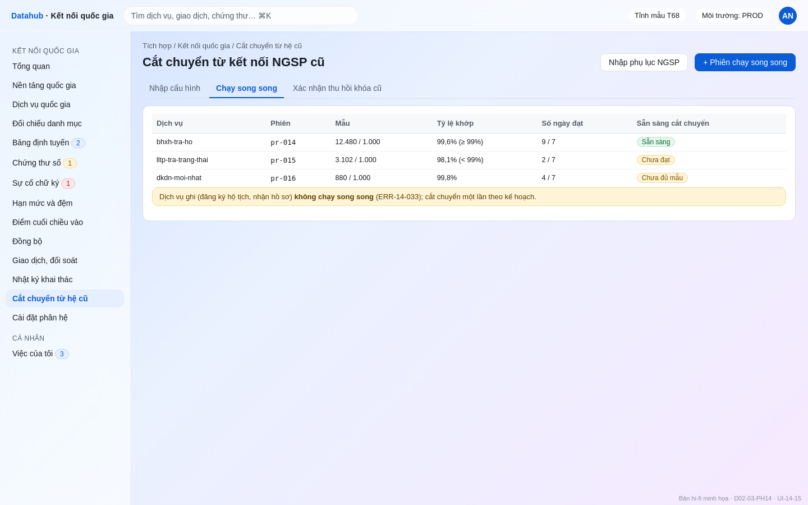

### 21.1. Các tab

Màn chia thành các tab; bảng dưới nêu nội dung, thành phần và API của từng tab.

| Tab | Nội dung | Thành phần |
|---|---|---|
| Nhập cấu hình | Thả phụ lục NGSP (CSV hoặc JSON, không chứa khóa); xem trước dịch vụ nhận diện, dòng lỗi (ERR-14-032); áp dụng | `CMP-FileDropzone`, `CMP-DataTable`, `CMP-JobProgress` |
| Chạy song song | Bảng phiên theo dịch vụ: mẫu, tỷ lệ khớp so với `14.parallel.match-ratio`, số ngày đạt so với `14.parallel.min-days`, sẵn sàng cắt chuyển; tạo phiên | `CMP-DataTable`, `CMP-ProgressBar`, `CMP-Form` |
| Thu hồi khóa cũ | Danh sách dịch vụ đã cắt chuyển, ô xác nhận "Khóa cũ đã bị thu hồi ở trung ương" kèm ngày, người xác nhận | `CMP-Checkbox`, `CMP-ConfirmDialog` |

: UI-14-15 · Các tab

Phiên chạy song song chỉ cho thao tác đọc, mỗi dịch vụ một phiên; dịch vụ ghi hiện cảnh báo ERR-14-033 và hướng dẫn "Cắt chuyển một lần theo kế hoạch, không chạy song song" (BR-14-033, Q14-11). Khác biệt chỉ để cảnh báo, không tự sửa kết quả. Tệp nhập không chứa Consumer Key, Secret: ô tải tệp báo từ chối nếu phát hiện trường tên `secret` hay `consumerKey` (BR-14-034).

### 21.2. Trạng thái màn

Bảng dưới nêu các trạng thái riêng của màn này; trạng thái còn lại theo mục 6.

| Trạng thái | Hiển thị |
|---|---|
| Đang tải | Skeleton bảng |
| Rỗng lần đầu | "Chưa nhập cấu hình từ hệ cũ. Nhập phụ lục NGSP để dựng sẵn danh mục dịch vụ rồi chạy song song trước khi cắt chuyển." |
| Lỗi tải, không có quyền | ST-05, ST-07 |
| Đã hoàn tất | Biểu ngữ thông tin "Đã cắt chuyển {n}/{tổng} dịch vụ; khóa cũ đã thu hồi" |

: UI-14-15 · Trạng thái màn

Phím tắt: `N` tạo phiên song song, `1…3` chuyển tab. Truy cập: tỷ lệ khớp đọc kèm ngưỡng ("99,6 phần trăm, đạt ngưỡng 99").

## 22. UI-14-16 Cài đặt phân hệ

::: dac-ta
**Mục đích.** Xem và đổi các tham số `14.*` của tenant (mục 8.2 của FRS) có giá trị mặc định, miền cho phép và nhãn bảo mật.

**Người dùng chính.** TA.

**FR hiện thực.** FR-14-054.

**Đường dẫn.** `/tich-hop/quoc-gia/cai-dat`.

**Mẫu.** PTN-12.

**Quyền.** `PERM-14-read` xem; `PERM-14-admin` sửa; tham số bảo mật (★) cần người thứ hai duyệt.

**API.** API-14-070, 071.
:::

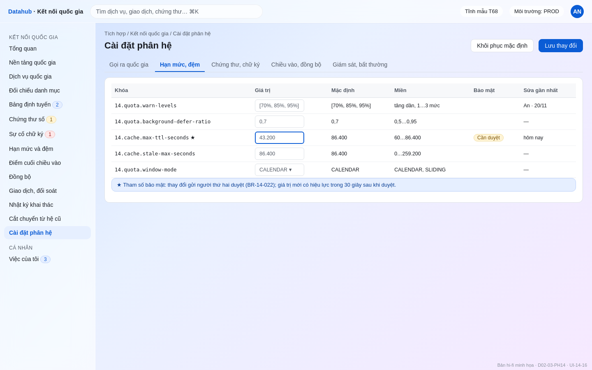

### 22.1. Nhóm tham số và cách sửa

Tham số `14.*` chia thành năm nhóm để người quản trị tìm nhanh; bảng dưới nêu tham số tiêu biểu mỗi nhóm.

| Nhóm (`nhom`) | Tham số tiêu biểu |
|---|---|
| Gọi ra quốc gia (`goi-ra`) | `14.timeout.default-ms`, `14.retry.max-attempts`, `14.breaker.*`, `14.token.refresh-before-seconds`, `14.queue.*` |
| Hạn mức, đệm (`han-muc`) | `14.quota.warn-levels`, `14.quota.background-defer-ratio`, `14.quota.essential-only-ratio`, `14.quota.window-mode`, `14.cache.max-ttl-seconds` ★, `14.cache.stale-max-seconds` |
| Chứng thư, chữ ký (`chung-thu`) | `14.cert.warn-days`, `14.cert.overlap-hours`, `14.crl.fail-mode` ★, `14.sign.max-skew-seconds` ★, `14.signature.hold-threshold` ★ |
| Chiều vào, đồng bộ (`chieu-vao`) | `14.inbound.*`, `14.sync.*` |
| Giám sát, bất thường (`giam-sat`) | `14.health.*`, `14.anomaly.*`, `14.parallel.*`, `14.reveal.max-per-day`, `14.txn.payload-retention-days` ★ |

: UI-14-16 · Nhóm tham số

Mỗi dòng gồm Khóa, Giá trị (ô sửa), Mặc định, Miền, Bảo mật, Sửa gần nhất; ô sửa tuỳ kiểu (`CMP-NumberInput`, `CMP-Select`, `CMP-Switch`, và `CMP-EnumEditor` cho danh sách mốc). Giá trị ngoài miền báo ERR-14-036 dưới ô. Sửa tham số ★ đổi nút "Lưu" thành "Gửi duyệt", hộp gửi hiện khác biệt `CMP-DiffTable` giá trị cũ, mới; có hiệu lực trong 30 giây sau khi duyệt. Nút "Khôi phục mặc định" từng dòng hoặc cả nhóm hỏi xác nhận.

### 22.2. Trạng thái màn

Bảng dưới nêu các trạng thái riêng của màn này; trạng thái còn lại theo mục 6.

| Trạng thái | Hiển thị |
|---|---|
| Đang tải | Skeleton bảng |
| Lỗi hợp lệ, nghiệp vụ | ST-11 (ERR-14-036), ST-12 |
| Chỉ đọc | ST-15 khi thiếu `PERM-14-admin`; ô sửa thành văn bản |
| Có thay đổi chưa lưu | Chấm `•` ở tiêu đề tab và hỏi khi rời trang |
| Lỗi tải, không có quyền | ST-05, ST-07 |

: UI-14-16 · Trạng thái màn

Phím tắt: `Ctrl+S` lưu hoặc gửi duyệt, `Tab` sang ô sau, `Esc` hoàn tác ô đang sửa. Truy cập: mỗi ô có nhãn là tên khóa kèm mô tả ngắn qua `aria-describedby` (miền, mặc định); dấu ★ kèm chữ ẩn "tham số bảo mật, cần duyệt".

## 23. UI-14-17 Duyệt yêu cầu của phân hệ

::: dac-ta
**Mục đích.** Một nơi trong "Việc của tôi" cho người thứ hai duyệt các thay đổi bốn mắt của PH-14.

**Người dùng chính.** IA, TA, PA duyệt; SO, IE xem yêu cầu do mình đề nghị.

**FR hiện thực.** FR-14-003, 013, 028, 032.

**Đường dẫn.** `/viec-cua-toi?loai=ph14.*&id=`.

**Mẫu.** PTN-10.

**Quyền.** `PERM-14-approve` (xem bảng loại bên dưới).

**API.** API-14-009, 027, 033; duyệt hạn mức, điểm cuối, tham số, giảm kiểm soát dùng API duyệt chung của yêu cầu (Phụ lục B).
:::

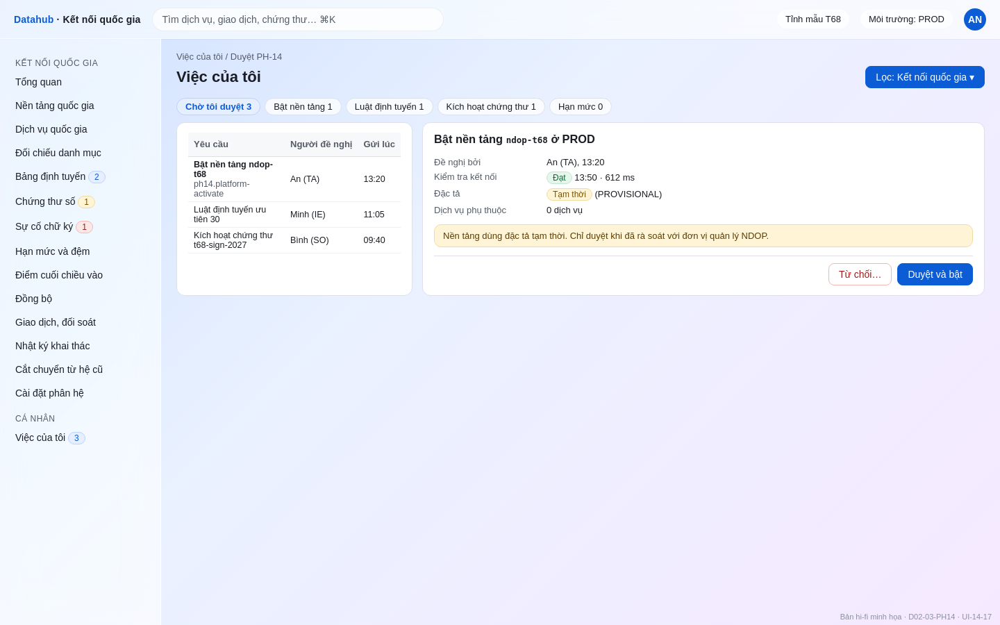

| Loại (`loai`) | Người duyệt | Nội dung khung chi tiết | Hành động |
|---|---|---|---|
| `ph14.platform-activate` | IA, TA (`PERM-14-approve`) | Nền tảng, môi trường, lần kiểm tra đạt gần nhất (giờ, độ trễ), nhãn đặc tả (nhãn Tạm thời nổi bật), dịch vụ phụ thuộc | Duyệt (API-14-009), Từ chối có lý do |
| `ph14.routing-rule` | IA, TA | Điều kiện, đích chính, dự phòng, căn cứ, kết quả mô phỏng | Duyệt (API-14-027), Từ chối |
| `ph14.cert-activate` | IA, TA, PA (không phải người nạp), xác thực nhiều yếu tố | Chứng thư, mục đích, hiệu lực, vân tay, `keyRef`, chứng thư sẽ bị thay | Duyệt (API-14-033), Từ chối |
| `ph14.quota-prod` | IA, TA | Hạn mức mới so với hiện hành (`CMP-DiffTable`), căn cứ văn bản | Duyệt, Từ chối |
| `ph14.inbound-activate`, `ph14.setting-security`, `ph14.service-relax`, `ph14.open-data-first` | IA, TA, PA (khác người đề nghị) | Khác biệt, lý do, người đề nghị | Duyệt, Từ chối |

: UI-14-17 · Các loại yêu cầu

Bố cục dùng `CMP-ApprovalPanel` và `CMP-DecisionPanel` của PTN-10; mọi quyết định ghi vào `CMP-AuditTimeline` của đối tượng. Người đề nghị hoặc người sửa gần nhất thấy nút Duyệt vô hiệu kèm ERR-14-007 (BR-14-022); IE và IA là cặp loại trừ (FRS §3.3). Yêu cầu hết hạn hoặc đã hủy chuyển nhãn tương ứng. Trạng thái rỗng: "Không có yêu cầu nào chờ bạn duyệt." Phím tắt: `J`, `K` chọn yêu cầu kế, trước; `A` duyệt; `R` từ chối (hộp lý do). Truy cập: hộp duyệt bẫy focus; nút Duyệt vô hiệu vẫn nhận focus để đọc lý do qua `aria-describedby`.

## 24. Ma trận vai trò và màn hình

X: thao tác đầy đủ; X\*: theo phạm vi hoặc chỉ một phần; R: chỉ xem; trống: không thấy. Vai trò viết tắt theo D02-03-PH14 §3.1: PA quản trị nền tảng, TA quản trị tenant, TO vận hành, SO cán bộ ATTT, IE kỹ sư tích hợp, IA người duyệt tích hợp, AU kiểm toán viên, VW người xem. Quyền theo ma trận ở D02-03-PH14 §3.2 (đề nghị đồng bộ vào D02-08).

| Màn | PA | TA | TO | SO | IE | IA | AU | VW |
|---|---|---|---|---|---|---|---|---|
| UI-14-01 | X\* (kiểm tra, ngắt mạch) | X\* | X\* | X\* | R | R | R | R |
| UI-14-02 | X | X | X\* (tạm ngừng, tiếp tục, kiểm tra) | X\* | R | R | R | R |
| UI-14-03 | X | X | X\* (thử token, xoay, ngắt mạch) | X\* | R | R | R | R |
| UI-14-04 | X | X | R | R | X | R | R | R |
| UI-14-05 | X | X | X\* (tạm ngừng) | X\* | X | R | R | R |
| UI-14-06 | X | X | R | R | X | R | R | R |
| UI-14-07 | R | X | R | R | X | R | R | R |
| UI-14-08 | X | R | R | X | R | R | R | R |
| UI-14-09 | R | X | X\* (vô hiệu đệm) | X\* | X\* (thời hạn đệm) | R | R | R |
| UI-14-10 | X | X | R | X\* (xác nhận vân tay) | R | R | R | R |
| UI-14-11 | X | X | X | R | R | R | R | R |
| UI-14-12 | | X\* (đã che) | X\* (đã che) | X (xem đầy đủ, xuất) | | | R (đã che) | |
| UI-14-13 | | X\* | X\* | X\* | | | R | |
| UI-14-14 | R | R | R | X | R | R | R | R |
| UI-14-15 | X | X | R | R | X | R | R | R |
| UI-14-16 | X | X | R | R | R | R | R | R |
| UI-14-17 | X | X\* (duyệt, khác người đề nghị) | | R (của mình) | R (của mình) | X | | |

: Ma trận vai trò và màn hình

IE và IA là cặp loại trừ: một người không giữ cả hai vai trò trong cùng tenant (D02-08 §4). `PERM-14-invoke` là scope của client máy nên không gán cho người và không có màn nào cần.

## 25. Truy vết FR sang màn

Bảng dưới nối từng chức năng FR-14-001…057 với màn hiện thực, để hội đồng thẩm định thấy mọi chức năng có chỗ đứng trên giao diện.

| FR | Màn |
|---|---|
| FR-14-001 | UI-14-02 |
| FR-14-002 | UI-14-03 |
| FR-14-003 | UI-14-02, 03, 17 |
| FR-14-004 | UI-14-04 |
| FR-14-005 | UI-14-04, 05 |
| FR-14-006, 008, 009 | UI-14-05 |
| FR-14-007 | UI-14-06 |
| FR-14-010, 015, 016 | UI-14-12 (quan sát); xử lý thời gian thực là API nội bộ, không có màn |
| FR-14-011 | UI-14-13 (nhật ký mục đích); kiểm tra là API nội bộ |
| FR-14-012 | UI-14-07 (mô phỏng); chọn đích lúc chạy là API nội bộ |
| FR-14-013 | UI-14-07, 17 |
| FR-14-014 | UI-14-05 ("Thử chuyển đổi") |
| FR-14-017…022 | UI-14-04, 05 (bộ điều hợp theo nhóm: khai báo và đặc tả) |
| FR-14-023 | UI-14-04, 11 (tab Danh mục dùng chung) |
| FR-14-024 | UI-14-03 (thử token); làm mới token tự động là API nội bộ |
| FR-14-025 | UI-14-03 (xoay), 15 (thu hồi khóa cũ) |
| FR-14-026 | UI-14-08 tab Thống kê ký; ký là API nội bộ |
| FR-14-027 | UI-14-08, 14 |
| FR-14-028 | UI-14-08, 17 |
| FR-14-029, 030 | UI-14-08 |
| FR-14-031 | UI-14-14 |
| FR-14-032 | UI-14-09, 17 |
| FR-14-033 | UI-14-01, 09 |
| FR-14-034, 036, 037 | UI-14-09 |
| FR-14-035 | UI-14-05 tab Đệm và hạn mức, UI-14-09 |
| FR-14-038 | UI-14-01 (ép ngắt mạch), UI-14-03 tab Ngắt mạch |
| FR-14-039 | UI-14-10 |
| FR-14-040, 041, 042 | UI-14-10 (thống kê, quan sát); xử lý bản tin vào là API ngoài, không có màn |
| FR-14-043 | UI-14-11 |
| FR-14-044, 045, 046 | UI-14-11 |
| FR-14-047 | UI-14-01, 02, 03 |
| FR-14-048 | UI-14-01 |
| FR-14-049, 050, 051 | UI-14-12 |
| FR-14-052, 053 | UI-14-13 |
| FR-14-054 | UI-14-16 |
| FR-14-055, 056 | UI-14-15 |
| FR-14-057 | UI-14-13 tab Báo cáo |

: Truy vết FR sang màn

Cả 57 FR có chỗ đứng trên giao diện. Mười FR (010, 011, 012, 015, 016, 024, 026, 040, 041, 042) là xử lý thời gian thực, giao diện chỉ quan sát hoặc cấu hình; 47 FR còn lại có thao tác trực tiếp.

## 26. Khả năng truy cập và kiểm thử giao diện

Các yêu cầu dưới đây áp dụng cho cả 17 màn, được kiểm tự động trong CI (Playwright và axe-core) để giao diện đạt WCAG 2.2 AA và không phụ thuộc màu.

| Mã | Yêu cầu | Tiêu chí WCAG | Cách kiểm |
|---|---|---|---|
| A11Y-14-01 | axe-core không có lỗi mức "serious" trở lên ở cả 17 màn | Chung | Playwright + axe trong CI |
| A11Y-14-02 | Trạng thái, mức dùng hạn mức, đếm ngược chứng thư, nhãn đối chiếu luôn kèm chữ hoặc ký hiệu; ảnh chụp ở chế độ xám vẫn phân biệt được | 1.4.1 | Kiểm ảnh chụp xám |
| A11Y-14-03 | Biểu đồ ở UI-14-01, 08, 09, 12 có bảng thay thế và đoạn mô tả; vạch mốc hạn mức có nhãn chữ | 1.1.1, 1.4.11 | Kiểm thủ công NVDA, VoiceOver |
| A11Y-14-04 | Tương phản chữ ≥ 4,5 : 1 và thành phần giao diện ≥ 3 : 1, kể cả khi bật giảm trong suốt (`glass-lite-tint`, `glass-off-tint`) | 1.4.3, 1.4.11 | Chụp so sánh với `prefers-reduced-transparency` |
| A11Y-14-05 | Phần tử có focus không bị thanh `glass-chrome` hay drawer che: `scroll-padding-top` ≥ `size-topbar` + `space-4`; vòng focus `color-focus-ring` đủ rõ | 2.4.7, 2.4.11 | Playwright cuộn tới từng phần tử |
| A11Y-14-06 | Mọi thao tác kéo (đổi rộng R3 ở UI-14-12) có thao tác bàn phím thay thế | 2.5.7 | Kiểm thủ công |
| A11Y-14-07 | Vùng chạm ≥ 24 × 24 px | 2.5.8 | Playwright đo hộp bao |
| A11Y-14-08 | Phím tắt một ký tự tắt được và chỉ có tác dụng khi focus trong vùng tương ứng | 2.1.4 | Kiểm thủ công |
| A11Y-14-09 | Wizard UI-14-03, 06 không bắt nhập lại thông tin đã nhập ở bước trước | 3.3.7 | Kịch bản Playwright |
| A11Y-14-10 | Xác thực nhiều yếu tố khi xem nội dung đầy đủ, duyệt chứng thư cho phép dán mã và dùng trình quản lý mật khẩu, không câu đố nhận thức | 3.3.8 | Kiểm thủ công |
| A11Y-14-11 | Hộp thoại bẫy focus, `Esc` đóng, focus trả về nút đã mở; focus ở drawer chuyển vào tiêu đề drawer | 2.4.3 | Mọi `CMP-ConfirmDialog`, `CMP-Drawer` |
| A11Y-14-12 | Thông báo động: lỗi dùng `role="alert"`, thay đổi mức dùng `aria-live="polite"`, không đọc lặp mỗi lần làm mới | 4.1.3 | Kiểm thủ công trình đọc màn hình |
| A11Y-14-13 | Hỗ trợ giảm chuyển động (`prefers-reduced-motion`): tắt hiệu ứng trượt drawer, đếm ngược chỉ cập nhật chữ | 2.3.3 | Chụp so sánh |
| A11Y-14-14 | Trợ giúp nhất quán: nút "Sao chép mã truy vết" và liên kết hướng dẫn ở cùng vị trí trên mọi màn | 3.2.6 | Kiểm duyệt giao diện |

: Yêu cầu khả năng truy cập A11Y-14 và cách kiểm

Kiểm thử giao diện dùng kịch bản Playwright của D05-02-PH14; mỗi màn có ít nhất một ca đường chính, một ca trạng thái lỗi và một ca không có quyền. Mã ca kiểm thử cấp ở tập test, tập này không cấp.

## 27. Kiến trúc mã giao diện

Theo SDD (D03-02-PH14) mã giao diện nằm ở `apps/console/src/features/national/`, mỗi màn là một route lazy-load, tên thư mục theo màn.

| Thư mục | Màn | Ghi chú |
|---|---|---|
| `overview/` | UI-14-01 | Gom API-14-060, 043, 058; mỗi khối có `ErrorBoundary` riêng |
| `platforms/` (`PlatformList`, `PlatformWizard`, `PlatformDetail`, `RotateCredentialDialog`) | UI-14-02, 03 | Trường bí mật dùng `CMP-SecretField` chế độ chỉ ghi |
| `services/` (`ServiceList`, `ServiceDetail`, `SpecTab`, `ExposureTab`, `ReconcileWizard`) | UI-14-04, 05, 06 | `SpecTab` dùng `CMP-DiffViewer` |
| `routing/` | UI-14-07 | Mô phỏng gọi API-14-028, không mô phỏng ở trình duyệt |
| `certificates/` (`CertificateList`, `UploadDialog`, `TrustStoreTab`, `SignStatsTab`) | UI-14-08 | Không có thành phần nào nhận khóa riêng |
| `quota/` (`QuotaOverview`, `AllocationTable`, `CacheTab`) | UI-14-09 | |
| `inbound/` | UI-14-10 | |
| `sync/` | UI-14-11 | |
| `transactions/` (`TransactionSearch`, `TransactionPanel`, `RevealDialog`, `EvidenceDialog`) | UI-14-12 | `RevealDialog` giữ nội dung trong bộ nhớ, xóa khi đóng |
| `usage/` (`UsageLog`, `AnomalyTab`, `ReportTab`) | UI-14-13 | |
| `signature-incidents/` | UI-14-14 | |
| `migration/` | UI-14-15 | |
| `settings/` | UI-14-16 | |
| `approvals/{loai}.tsx` | UI-14-17 | Mỗi loại một khung chi tiết cắm vào `CMP-ApprovalPanel` |

: Thư mục mã nguồn dh-console theo màn

Dữ liệu lấy bằng TanStack Query: đọc thử lại tối đa 2 lần với lỗi mạng hoặc 5xx; ghi không tự thử lại trừ khi có `Idempotency-Key`. Mã lỗi `ERR-14-nnn` ánh xạ sang câu hiển thị ở một tệp chung `errors.ts` sinh từ bảng mục 5.2, để câu chữ chỉ sửa ở một nơi. Quyền hiển thị lấy từ `allowedActions` và `disabledReasons` của API, không suy ra ở trình duyệt.

## 28. Luồng người dùng chính

### 28.1. Từ cảnh báo chứng thư tới kích hoạt bản thay thế

Luồng này nối ba màn và hai vai trò: SO nạp chứng thư và đề nghị kích hoạt, người duyệt thứ hai kích hoạt, hệ thống chuyển chứng thư cũ sang "Đã thay" sau thời gian chuyển tiếp.

```{.mermaid caption="Luồng thay chứng thư số sắp hết hạn"}
flowchart TB
  A["SO thấy biểu ngữ UI-14-01: chứng thư còn 24 ngày"] --> B["Mở UI-14-08"]
  B --> C["Nạp chứng thư mới (không nhập khóa)"]
  C --> D{"Tệp hợp lệ và khớp khóa OpenBao?"}
  D -- "Không" --> E["Báo ERR-14-019 hoặc ERR-14-020"]
  E --> C
  D -- "Có" --> F["Yêu cầu kích hoạt, nhập lý do, xác thực nhiều yếu tố"]
  F --> G["Yêu cầu xuất hiện ở UI-14-17 của IA hoặc TA"]
  G --> H{"Người duyệt khác người đề nghị?"}
  H -- "Không" --> I["Nút Duyệt vô hiệu, ERR-14-007"]
  H -- "Có" --> J["Duyệt, xác thực nhiều yếu tố"]
  J --> K["Chứng thư mới Đang dùng, cũ chuyển Đã thay sau 72 giờ"]
```

Điều người đọc cần thấy: hai điểm dừng bắt buộc (kiểm tra khớp khóa, bốn mắt) và việc biểu ngữ biến mất khi chứng thư mới đã `ACTIVE`. Mốc 72 giờ là giá trị mặc định của `14.cert.overlap-hours`.

### 28.2. Từ phản ánh "hồ sơ không ra kết quả" tới kết luận

Luồng thứ hai là luồng vận hành thường gặp nhất: HTTT phản ánh một hồ sơ không ra kết quả và người trực phải tìm ra nguyên nhân.

```{.mermaid caption="Luồng tra giao dịch từ phản ánh của HTTT"}
sequenceDiagram
  actor TO as Vận hành (TO)
  participant UI as UI-14-12
  participant API as API-14-061, 062
  actor SO as Cán bộ ATTT (SO)
  TO->>UI: Dán mã giao dịch hoặc mã hồ sơ vào ô tra nhanh
  UI->>API: GET transactions theo transactionCode hoặc caseCode
  API-->>UI: Danh sách kèm trạng thái
  TO->>UI: Chọn dòng, xem dòng thời gian
  UI->>API: GET transactions/{mã}
  API-->>UI: Các bước, mã lỗi, nội dung đã che
  alt Kết quả chưa rõ
    UI-->>TO: Hướng dẫn không gửi lại, chờ đối soát
  else Chữ ký lỗi
    UI-->>TO: Liên kết sự cố UI-14-14
    TO->>SO: Chuyển sự cố
    SO->>UI: Xem nội dung đầy đủ kèm lý do
  end
```

Sơ đồ nhấn mạnh hai điều: người trực không cần quyền xem nội dung để biết nguyên nhân (dòng thời gian đủ), và chuyển giao cho SO là một liên kết chứ không phải sao chép dữ liệu.

### 28.3. Từ khai báo nền tảng tới nhận lưu lượng thật

TA khai báo nền tảng ở UI-14-03 (năm bước), chạy kiểm tra đạt, gửi duyệt; IA duyệt ở UI-14-17; nền tảng chuyển `ACTIVE`; IE khai báo dịch vụ ở UI-14-04, 05 và cung cấp lại; TA khai báo hạn mức ở UI-14-09; HTTT bắt đầu gọi. Mọi bước dừng có thông báo ERR-14 tương ứng ở mục 5.2.

## 29. Ảnh hi-fi và cách sinh lại

Mỗi màn có một ảnh hi-fi dựng bằng token D03-05-02 (qua `hifi.css`), khung 1440 × 900, dữ liệu minh họa của tỉnh giả lập T68 (mã giao dịch `T68-yyMMdd-xxxx`, HTTT `HT-MOTCUA`, `HT-TUPHAP`…, không dữ liệu thật). Ảnh nằm ở `03-thiet-ke/uiux/ph14/hifi/`.

| Thành phần | Tệp |
|---|---|
| Bộ sinh HTML cho 17 màn | `ph14/hifi/gen_hifi.py` (`python3 gen_hifi.py`) |
| Chụp ảnh Playwright | `ph14/hifi/shot.js` (`node shot.js`) |
| Kiểu dùng chung (token, glass, bảng, thẻ, thanh mức dùng) | `ph14/hifi/hifi.css` (sao từ `ph19/hifi`) |
| Ảnh | `ph14/hifi/ui-14-01.png` … `ui-14-17.png` |

: Tệp của bản hi-fi

Ảnh chỉ minh họa bố cục, thứ bậc và nhãn; hành vi, trạng thái và thông báo lấy theo bảng đặc tả từng màn. UI-14-01 và UI-14-09 đã có từ FRS (D02-03-PH14 §10.2); tập này giữ nguyên hai ảnh đó và thêm 15 ảnh còn lại.

## 30. Tiêu chí nghiệm thu giao diện

Tiêu chí nghiệm thu là điều hội đồng và người dùng nghiệp vụ kiểm khi nhận bàn giao giao diện; mỗi tiêu chí gắn với màn cụ thể.

| Mã | Tiêu chí | Màn |
|---|---|---|
| UAC-14-01 | Người trực thấy cảnh báo chứng thư sắp hết hạn, hạn mức sắp cạn và sự cố chữ ký ngay ở trang đầu mà không cuộn | UI-14-01 |
| UAC-14-02 | Không màn nào, không phản hồi API và tệp xuất nào chứa thông tin xác thực hay khóa riêng; kiểm bằng giá trị mồi `DH-CANARY` | UI-14-03, 08, 12 |
| UAC-14-03 | Không có nút nào cho phép một người tự duyệt đề nghị mình lập; thử gọi API trực tiếp cũng bị chặn (ERR-14-007) | UI-14-17 |
| UAC-14-04 | Nội dung bản tin chỉ hiện sau khi nhập lý do và xác thực lại, tự che sau 5 phút, mỗi lần xem có bản ghi kiểm toán | UI-14-12 |
| UAC-14-05 | Tra theo mã giao dịch hiện kết quả trong 1,5 giây (p95) trên bộ mẫu một triệu giao dịch, và dòng thời gian cho biết bước hỏng | UI-14-12 |
| UAC-14-06 | Tổng phân bổ vượt hạn mức bị chặn với ERR-14-018; mức dùng luôn có chữ và mốc 70%, 85%, 95% | UI-14-09 |
| UAC-14-07 | Nạp đặc tả có thay đổi phá vỡ hiện bảng khác biệt và không kích hoạt được khi chưa có người duyệt | UI-14-05 |
| UAC-14-08 | Đủ 9 mục `LGC` của PH-14 có chỗ đứng trên giao diện theo mục 3 và người dùng hệ cũ tìm được dịch vụ theo nhóm đã quen | UI-14-04, 05 |
| UAC-14-09 | Mọi nút ẩn, hiện, vô hiệu đúng theo quyền và `allowedActions` cho tám vai trò ở mục 24 | Mọi màn |
| UAC-14-10 | axe-core không lỗi "serious" và đạt các yêu cầu A11Y-14-01…14 | Mọi màn |

: Tiêu chí nghiệm thu giao diện UAC-14

## 31. Câu hỏi mở

> **Câu hỏi mở Q14-30:** Cây menu của D03-06-00 §2.3.2 chỉ có một mục cho PH-14 ("Dịch vụ quốc gia", mục 18). Tập này đề nghị nhóm "Kết nối quốc gia" dưới "Tích hợp" gồm 13 mục (mục 4.3). Cần chủ nhiệm giao diện xác nhận cấu trúc này hay gộp bớt (ví dụ đưa Điểm cuối chiều vào, Đồng bộ, Cắt chuyển vào một màn "Vận hành quốc gia" có tab) để menu "Tích hợp" không quá dài.

> **Câu hỏi mở Q14-31:** Giới hạn khoảng thời gian một lần tra giao dịch (giả định 31 ngày), thời hạn tải gói bằng chứng (giả định 7 ngày) và số giao dịch tối đa mỗi gói bằng chứng (giả định 500) chưa có quy định. Cần đơn vị thanh tra, kiểm toán và nhóm CSDL xác nhận theo cách phân vùng và lưu trữ giao dịch (D03-03-PH14).

> **Câu hỏi mở Q14-32:** Khi Cán bộ ATTT xem nội dung đầy đủ quá `14.reveal.max-per-day` lần trong ngày, tập này chỉ cảnh báo, không chặn (theo FRS). Cần ATTT xác nhận có nên chặn cứng, cần người thứ hai đồng ý, và lý do tối thiểu bao nhiêu ký tự (giả định 10), thời gian tự che nội dung (giả định 5 phút).

> **Câu hỏi mở Q14-33:** Chủ quản HTTT (không phải quản trị tỉnh) có cần tự xem hạn mức được phân bổ, mức dùng và giao dịch của chính HTTT mình không? Tập này chỉ làm màn cho quản trị tỉnh và vận hành. Nếu cần, màn dành cho HTTT thuộc PH-15 (cổng nhà phát triển) và cần API đọc theo HTTT; cần chủ đầu tư quyết định.

> **Câu hỏi mở Q14-34:** Với giao dịch "kết quả chưa rõ" (thao tác ghi quá hạn chờ), giao diện hiện chỉ hiển thị trạng thái và hướng dẫn "không gửi lại" vì hệ thống tự đối soát (BR-14-030). Có cần nút "Đối soát ngay" cho vận hành, và nếu cần thì cần API riêng trong D03-04-PH14 không? Cần chủ FRS PH-14 và kỹ sư vận hành xác nhận.

## Phụ lục A. Đề nghị bổ sung cho D03-05 và D03-06-00

Không có `CMP-*` hay token mới bắt buộc: mọi màn dựng được bằng thành phần và token hiện có. Các biến thể và mục menu đề nghị ghi vào D03-05-04 và D03-06-00 ở lần cập nhật kế.

| Đề nghị | Dựa trên | Dùng ở | Lý do |
|---|---|---|---|
| `CMP-ProgressBar` biến thể "có mốc" | `CMP-ProgressBar` | UI-14-01, 09, 15 | Vạch mốc 70%, 85%, 95% kèm nhãn chữ và `aria-valuetext` thay vì chỉ vạch; đổi sắc thái theo mốc |
| `CMP-StatusTag` biến thể "đếm ngược theo ngưỡng" | `CMP-StatusTag`, `CMP-Duration` | UI-14-08, 01 | "còn 24 ngày" đổi sắc thái ở 60, 30, 7 ngày; luôn có chữ |
| `CMP-SecretField` biến thể "chỉ ghi có siêu dữ liệu" | `CMP-SecretField` | UI-14-03 | Đã đề xuất ở D03-06-PH05 Phụ lục A; dùng chung, không tạo lại |
| `CMP-MaskedValue` biến thể "bỏ che có hẹn giờ" | `CMP-MaskedValue` | UI-14-12 | Đã dùng ở D03-06-PH19; tự che sau thời gian đặt, đếm ngược bằng chữ |
| Mục menu nhóm "Kết nối quốc gia" (D03-06-00 §2.3.2) | Mục 18 hiện có | Mục 4.2, 4.3 của tập này | Thêm 12 mục con với đường dẫn `/tich-hop/quoc-gia/*`; giữ mục 18 `/tich-hop/dich-vu-quoc-gia` |

: Phụ lục A. Đề nghị bổ sung cho D03-05 và D03-06-00

## Phụ lục B. Đề nghị bổ sung API

Giao diện cần một số dữ liệu mà API hiện có chưa trả; các đề nghị dưới đây ghi vào D03-04-PH14 ở đợt đồng bộ cuối.

| Đề nghị | Cho màn | Lý do |
|---|---|---|
| API-14-060 (`dashboard`) bổ sung `p95Ms24h` (độ trễ p95 của lượt gọi thật), `series24h` (số lượt theo giờ: gọi thật, đệm, từ chối) và số `stale` | UI-14-01 | Hiện chỉ có `calls24h`, `errorRate24h`, `cacheHitRatio24h`; thẻ p95 và biểu đồ cần thêm |
| API-14-061 bổ sung tham số `asyncState`, `stale`, và API quản trị xem, hủy yêu cầu bất đồng bộ cho người dùng (hiện API-14-077, 078 chỉ có scope dịch vụ) | UI-14-12 | Nút "Hàng chờ bất đồng bộ" và lọc "Dữ liệu cũ" |
| `allowedActions` và `disabledReasons` cho mọi tài nguyên danh sách và chi tiết (hiện chỉ có ở một số lược đồ) | Mọi màn | Nguyên tắc ẩn, vô hiệu hành động theo mục 2.4 |
| API duyệt chung cho yêu cầu loại `ph14.quota-prod`, `ph14.inbound-activate`, `ph14.setting-security`, `ph14.service-relax`, `ph14.open-data-first` (hiện có duyệt riêng cho nền tảng, luật định tuyến, chứng thư) | UI-14-17 | Bốn mắt cho đủ tám loại thay đổi (BR-14-022) |
| API tải lịch sử thay đổi hạn mức theo phiên bản | UI-14-09 tab Lịch sử hạn mức | `CMP-VersionTimeline` cần danh sách phiên bản |
| API đếm huy hiệu menu gọn (một lần gọi cho 13 mục) | Menu | Tránh 13 lần gọi mỗi 60 giây; có thể lấy từ `dashboard` |

: Phụ lục B. Đề nghị bổ sung API

## Đề nghị đồng bộ

Tập này không sửa tài liệu dùng chung; các việc dưới đây cần làm ở đợt đồng bộ cuối.

| Tài liệu | Nội dung đề nghị | Lý do |
|---|---|---|
| D03-06-00 §2.3.2 | Thêm nhóm menu "Kết nối quốc gia" và 12 mục con theo mục 4.2 của tập này; giữ mục 18 | Q14-30; route khớp tập màn |
| D03-05-04 | Ghi các biến thể ở Phụ lục A | Thành phần dùng chung |
| D03-04-PH14, openapi-national.yaml | Bổ sung theo Phụ lục B (dashboard p95 và chuỗi theo giờ, tham số `asyncState`, API duyệt chung, `allowedActions`) | Màn cần dữ liệu |
| D02-03-PH14 §10 | Ghi tập màn đã có đủ 17 ảnh hi-fi (hiện §10.2 nhắc hai ảnh) | Đồng bộ FRS với tập màn |
| D02-08 | Thêm `PERM-14-*` và scope máy theo "Đề nghị đồng bộ" của FRS; ma trận ở mục 24 dùng đúng ma trận ở FRS §3.2 | Quyền hiển thị menu và nút |
| D05-02-PH14 | Mỗi màn có ít nhất một ca Playwright đường chính, một ca lỗi, một ca không có quyền; đưa A11Y-14-01…14 vào cổng CI | Mục 26 |
| D03-07 | Ghi biện pháp giao diện: không có đường hiện khóa, xem nội dung đầy đủ có lý do và xác thực lại (SEC-23) | Mục 2.5, UI-14-12 |

: Đề nghị đồng bộ cho tài liệu dùng chung


## Lịch sử phiên bản

| Phiên bản | Ngày | Người | Nội dung |
|---|---|---|---|
| 0.1 | 26/11/2026 | Nhóm viết tài liệu (Claude) | Bản đầu: 17 màn UI-14-01…17 với bảng đặc tả, wireframe, thành phần, trạng thái, thông báo, phím tắt, truy cập; ảnh hi-fi từng màn; ma trận vai trò, truy vết FR, kiểm thử giao diện, phụ lục đề nghị bổ sung |
