# D03-06-PH15 · Thiết kế giao diện màn hình phân hệ PH-15 Cổng nhà phát triển

Tập màn **không tự đặt** token, `CMP-*` hay `PTN-*`; dùng tên chuẩn ở D03-05 và D03-06-00. Thành phần còn thiếu ghi ở Phụ lục A.

## Tóm tắt cho hội đồng thẩm định

Tài liệu đặc tả 28 màn hình của Cổng nhà phát triển PH-15, chạy trong ứng dụng `dh-portal` (React 19, antd v6 và `@datahub/ui`, BFF ở Z2). Hai mươi màn là trang tự phục vụ của nhà phát triển: tìm dịch vụ, đọc tài liệu, thử API trên sandbox, tạo ứng dụng và nhận thông tin xác thực, gửi đăng ký sử dụng. Tám màn còn lại là khu quản trị `/quan-tri-cong` cho biên tập viên, người duyệt, quản trị tỉnh và cán bộ an toàn thông tin. Cổng chỉ trình bày và chuyển yêu cầu; vòng đời API, duyệt đăng ký và cấp bí mật production nằm ở PH-02, PH-01, PH-12, nên không màn nào có nút "duyệt đăng ký" hay "hiện bí mật production".

Ba điều hội đồng cần chú ý. Thứ nhất, **bí mật sandbox chỉ hiện một lần** trong hộp thoại chặn đóng cho tới khi người dùng xác nhận đã lưu (UI-15-13). Thứ hai, **khung thử API** (UI-15-06, mô tả siêu chi tiết) luôn nói rõ môi trường, chế độ MOCK hay BACKEND và hạn mức còn lại, chặn dữ liệu cá nhân thật và từ chối thử production với dịch vụ có nhãn nhạy cảm. Thứ ba, giao diện **đạt WCAG 2.2 AA và dùng được ở 360 px** theo yêu cầu D05-01 cho PH-15: một cột, bảng chuyển thẻ, thanh trên thu thành nút menu, vùng chạm từ 44 px; sáu màn tiêu biểu có ảnh chụp 360 px.

Giao diện theo Liquid Glass (ADR-020): kính chỉ ở thanh trên, mục lục quản trị, ngăn kéo và hộp thoại; văn bản dài, bảng, mã và biểu mẫu dùng nền đặc để đọc lâu không mỏi. Màn của portal Gravitee cũ được giữ theo bảng ở mục 3 (LGC-APIM-006, 007, 017, LGC-IAM-006, LGC-APIM-022). Có 10 câu hỏi mở Q15-30…39 và 7 đề nghị bổ sung cho D03-05.

| Chỉ số | Giá trị |
|---|---|
| Số màn | 28 (20 tự phục vụ, 8 quản trị) |
| Mẫu màn dùng | PTN-01, 02, 03, 04, 05, 06, 10, 11, 12, 13, 14 (không tạo mẫu mới) |
| Mã lỗi ERR-15 ánh xạ sang câu hiển thị | 63 (ERR-15-001…040, 101…123) |
| Ảnh hi-fi | 28 màn 1440 px và 6 màn 360 px |
| Đề nghị bổ sung D03-05 | 5 thành phần, 1 biến thể, 2 token (Phụ lục A) |

: Con số chính của tập màn PH-15

## 1. Mục đích, phạm vi và tài liệu liên quan

Chương này nêu tài liệu đặc tả gì, cho ai, dựa trên tài liệu nào, rồi liệt kê 28 màn trước khi vào chi tiết.

### 1.1. Mục đích

Đặc tả đủ để đội giao diện lập trình ngay: mỗi màn có đường dẫn, mẫu bố cục, quyền, API, wireframe, thành phần với `CMP-*`, trường và cột, hành động, bốn trạng thái bắt buộc (rỗng, đang tải, lỗi, không có quyền), thông điệp theo mã `ERR-15`, phím tắt và yêu cầu truy cập. Tài liệu không lặp nghiệp vụ của FRS; khi cần thì dẫn `FR-15-nnn`, `BR-15-nnn`, `API-15-nnn`, `ERR-15-nnn`, `PERM-15-*`.

Thứ tự ưu tiên khi mâu thuẫn: D02-08 (phân quyền), D03-05 (design system), D03-06-00 (mẫu màn), [FRS PH-15](../../02-yeu-cau/frs/D02-03-PH15-frs-cong-nha-phat-trien.md) (nguồn chuẩn route, enum, câu thông báo ở Phụ lục A và §9.1), rồi tài liệu này. Chỗ tài liệu này cần khác D03-06-00 §2.14 (route `/api`, `/sandbox`) thì theo FRS Phụ lục A.4 và ghi ở "Đề nghị đồng bộ".

### 1.2. Phạm vi, mẫu bố cục và phát hành

Tập phủ UI-15-01…28 của FRS §10. Giao diện quản trị công khai ở `/quan-tri-cong` là quyết định tạm của FRS, chờ Q15-16; nếu chuyển sang `dh-console` thì UI-15-21…28 đổi khung (thanh trên và sidebar của `dh-console`), nội dung từng màn giữ nguyên (Q15-30). Phát hành theo đợt của FRS: toàn bộ màn thuộc Đợt 2 (W4); ba phần thuộc Đợt 3 được ẩn sau cờ tính năng: xuất Postman, Bruno, HTTP (FR-15-041, ở UI-15-14), hỏi đáp và đánh giá trang (FR-15-053, ở UI-15-04, 07, 20), nhập từ kho Git (FR-15-018, ở UI-15-21 và 27).

### 1.3. Tài liệu liên quan

Bảng nêu các tài liệu mà tập màn dựa vào và phần cần tra ở mỗi tài liệu.

| Tài liệu | Dùng cho |
|---|---|
| [D02-03-PH15 FRS](../../02-yeu-cau/frs/D02-03-PH15-frs-cong-nha-phat-trien.md) | Danh sách UI §10, route A.4, enum A.3, mã lỗi §9.1, tham số §8.2 |
| [D02-04-PH15 Use case](../../02-yeu-cau/use-case/D02-04-PH15-use-case-cong-nha-phat-trien.md) | Ánh xạ UC sang màn và API |
| [D03-02-PH15 SDD](../sdd/D03-02-PH15-sdd-cong-nha-phat-trien.md) | Cấu trúc mã `apps/dh-portal` (mục 36) |
| D03-05-02, D03-05-03, D03-05-04 | Token, thành phần nguyên tử và phức hợp |
| D03-06-00 | Khung `dh-portal` §3.10, trạng thái chuẩn `ST-01…15` §4.2, PTN-14 §4.17 |
| D05-01 | Yêu cầu truy cập 360 px cho PH-15 |

: Tài liệu liên quan của tập màn PH-15

### 1.4. Người đọc

Kỹ sư giao diện đọc mục 2 đến 6 rồi từng màn; kiểm thử viên đọc mục 5, 6, 35, 39 cùng bảng trạng thái của từng màn; chủ dịch vụ và quản trị cổng đọc các màn quản trị (UI-15-21…28); hội đồng thẩm định đọc Tóm tắt, mục 3, 38 và 39.

### 1.5. Thuật ngữ và viết tắt

Bảng giải thích các từ viết tắt và thuật ngữ dùng xuyên suốt tập màn.

| Thuật ngữ | Nghĩa |
|---|---|
| DEV, OR, SV, CA, TA, SO, AU, PA | Vai trò theo FRS §3: nhà phát triển, cán bộ đầu mối, chủ dịch vụ, người duyệt dịch vụ, quản trị tỉnh, cán bộ ATTT, kiểm toán viên, quản trị nền tảng |
| ANON | Khách ẩn danh (chỉ ở tenant bật `15.public.enabled`) |
| Sandbox, MOCK, BACKEND | Môi trường thử không chạm dữ liệu thật; MOCK sinh phản hồi từ ví dụ trong đặc tả, BACKEND gọi backend thử do chủ dịch vụ khai báo |
| Bí mật một lần | Giá trị bí mật chỉ hiển thị đúng một lần lúc cấp (FR-15-029) |
| BFF | Máy chủ trung gian giữ token, trình duyệt chỉ có cookie phiên |
| WCAG 2.2 AA | Mức truy cập web bắt buộc của dự án |

: Thuật ngữ và viết tắt của tập màn PH-15

### 1.6. Cấu trúc tài liệu

Mục 2 đến 6 là quy ước chung (nguyên tắc, màn hệ cũ, điều hướng, nhãn và câu thông báo, trạng thái). Mục 7 đến 34 là 28 màn theo thứ tự UI-15-01…28. Mục 35 đến 39 là truy cập, kiến trúc mã, luồng chính, ma trận vai trò và kiểm thử. Sau đó là hai phụ lục, câu hỏi mở và đề nghị đồng bộ.

### 1.7. Danh sách màn hình

Bảng dưới là danh mục 28 màn kèm mẫu, mức chi tiết, FR hiện thực và API chính. Mức "siêu chi tiết" theo K-MH dành cho màn phức tạp nhất (UI-15-06 Thử API); UI-15-05 và UI-15-13 mức "rất chi tiết".

| Mã | Tên | PTN | Mức chi tiết | FR-15 | API-15 chính |
|---|---|---|---|---|---|
| UI-15-01 | Trang chủ | PTN-14 (trang chào) | Đầy đủ | 003, 008 | 001, 002 |
| UI-15-02 | Danh mục dịch vụ | PTN-01 (thẻ) | Đầy đủ | 001, 002, 004, 007, 008 | 003, 005, 006, 013 |
| UI-15-03 | Kết quả tìm kiếm | PTN-01 | Đầy đủ | 005 | 010, 011, 012 |
| UI-15-04 | Chi tiết dịch vụ | PTN-02 | Đầy đủ | 002, 006, 007, 008, 013, 053 | 004, 007, 008, 014, 021 |
| UI-15-05 | Tài liệu API | PTN-14 | Rất chi tiết | 009…013 | 015…020 |
| UI-15-06 | Thử API | PTN-14 | **Siêu chi tiết** | 035…039, 043 | 071…074, 082 |
| UI-15-07 | Hướng dẫn, hỏi đáp, thông báo | PTN-14 | Đầy đủ | 017, 053 | 034…037, 107…109 |
| UI-15-08 | Đăng nhập và đăng ký dh-dev | PTN-04, PTN-13 | Đầy đủ | 019, 020 | 041, 045, 046 |
| UI-15-09 | Hồ sơ, điều khoản, nhóm | PTN-12 | Đầy đủ | 021…024 | 041…044, 047…054 |
| UI-15-10 | Danh sách ứng dụng | PTN-01 | Đầy đủ | 026 | 055 |
| UI-15-11 | Tạo ứng dụng | PTN-04 | Đầy đủ | 025 | 056 |
| UI-15-12 | Chi tiết ứng dụng | PTN-02 | Đầy đủ | 026, 033, 049, 050 | 057…060, 066…068, 098…100 |
| UI-15-13 | Thông tin xác thực | PTN-02 (tab) | Rất chi tiết | 027…032 | 061…065 |
| UI-15-14 | Lịch sử và bộ sưu tập thử | PTN-11 | Đầy đủ | 040, 041 | 075…081 |
| UI-15-15 | Đăng ký sử dụng | PTN-05 | Đầy đủ | 044, 045 | 087…090 |
| UI-15-16 | Kết nạp HTTT | PTN-05 | Đầy đủ | 046 | 091…093 |
| UI-15-17 | Công bố API | PTN-05 | Đầy đủ | 047 | 094…096 |
| UI-15-18 | Tổng quan cá nhân | PTN-06 | Đầy đủ | 048 | 097 |
| UI-15-19 | Hộp thông báo và theo dõi | PTN-01 | Đầy đủ | 051, 052 | 101…106 |
| UI-15-20 | Hỗ trợ và hỏi đáp | PTN-01, PTN-02 | Đầy đủ | 053, 054 | 107…113 |
| UI-15-21 | Soạn trang nội dung | PTN-03 | Rất chi tiết | 014, 018 | 022…025, 033, 038…040 |
| UI-15-22 | Duyệt nội dung, quản lý trang | PTN-10 | Đầy đủ | 015, 016 | 026…032 |
| UI-15-23 | Khai báo sandbox, thử production | PTN-02 | Đầy đủ | 034, 042 | 069, 070, 083…086 |
| UI-15-24 | Quản trị tài khoản dh-dev, ứng dụng | PTN-10 | Đầy đủ | 024, 058, 059 | 121…127 |
| UI-15-25 | Nhận diện và tham số cổng | PTN-12 | Đầy đủ | 056, 057 | 116…120 |
| UI-15-26 | Nhật ký truy cập, thử, báo cáo | PTN-11 | Đầy đủ | 060 | 128…130 |
| UI-15-27 | Đồng bộ, đối soát, di trú | PTN-05, PTN-01 | Đầy đủ | 001, 018, 061, 062 | 009, 131…137 |
| UI-15-28 | Hộp xử lý hỗ trợ | PTN-10 | Đầy đủ | 055 | 114, 115 |

: Danh sách 28 màn hình UI-15

## 2. Nguyên tắc thiết kế áp dụng cho PH-15

Cổng là nơi người ngoài phòng ban (nhà thầu, cán bộ cơ quan khác, thậm chí khách ẩn danh) đọc tài liệu dài và thao tác với bí mật. Vì vậy nguyên tắc ưu tiên là dễ đọc, rõ môi trường đang dùng, không lộ bí mật và dùng tốt trên điện thoại.

### 2.1. Bản đồ vật liệu

Bảng quy định vùng nào dùng kính (lớp điều hướng, lớp nổi) và vùng nào bắt buộc nền đặc.

| Vùng | Thành phần | Vật liệu | Lý do |
|---|---|---|---|
| Thanh trên của cổng | `CMP-Topbar` | `glass-chrome`, chuyển `glass-chrome-scrolled` khi cuộn | Lớp điều hướng, D03-06-00 §3.10 |
| Mục lục quản trị (UI-15-21…28) | `CMP-Sidebar` | `glass-chrome` | Lớp điều hướng |
| Nội dung tài liệu, hướng dẫn, mã, bảng, biểu mẫu, thẻ dịch vụ | `CMP-Card`, `CMP-DataTable`, `CMP-Form`, `CMP-CodeBlock` | **Đặc** `color-surface-solid`, mã trên `color-surface-solid-2` | Đọc lâu, mã cần tương phản cao |
| Ngăn kéo (tạo ứng dụng, duyệt tài khoản), hộp thoại (bí mật một lần, xác nhận) | `CMP-Drawer`, `CMP-Modal`, `CMP-ConfirmDialog` | Khung `glass-modal`, **vùng nội dung đặc** | Lớp nổi |
| Popover, tooltip, menu dòng, khay tác vụ | `CMP-Popover`, `CMP-Tooltip`, `CMP-DropdownMenu` | `glass-overlay` | Lớp nổi, không chứa bí mật |
| Trang tài liệu in | In | Nền trắng, bỏ kính | Tiết kiệm mực, đọc rõ |

: Bản đồ vật liệu Liquid Glass của dh-portal

Khi bật "Giảm trong suốt" hoặc `prefers-reduced-transparency`, mọi lớp kính chuyển sang `glass-lite-tint` hoặc `glass-off-tint` (D03-05-01 §7). Thông tin không bao giờ chỉ truyền bằng độ trong suốt hay màu.

### 2.2. Mật độ, chữ, ngày giờ

Các quy ước dưới đây áp dụng cho mọi màn để chữ, ngày giờ và mã hiển thị thống nhất.

- Chữ thân của cổng dùng `font-callout` (D03-06-00 §3.10); dòng văn bản dài tối đa 72 ký tự; mã dùng `font-mono`; số trong bảng dùng `font-feature-tabular`.
- Điều khiển cao `size-control-md`; trên màn cảm ứng (dưới `bp-sm`) vùng chạm tối thiểu 44 px, lớn hơn mức 24 px của WCAG 2.5.8.
- Ngày giờ `dd/MM/yyyy HH:mm` giờ Việt Nam (`CMP-Timestamp`); thời lượng `184 ms`, `1,4 s`.
- Mã (`appCode`, `apiCode`, `ticketCode`, `tryId`) hiển thị bằng `CMP-CodeText` kèm `CMP-CopyButton`.

### 2.3. Môi trường và an toàn luôn nhìn thấy

Mọi nơi có thể gọi API phải nói rõ **môi trường** bằng nhãn có chữ và biểu tượng: "Sandbox" (`CMP-StatusTag` info) hoặc "Môi trường thật" (error, viền đậm). Thử production có dải cảnh báo cố định và hộp xác nhận "Tôi hiểu đây là hệ thống thật" (FR-15-043). Chế độ MOCK hay BACKEND luôn hiện cạnh phản hồi (`X-DH-Sandbox`). Bí mật chỉ hiện ở `CMP-SecretField` một lần; không có bí mật nào trong URL, `localStorage`, nhật ký giao diện (NFR-15-010).

### 2.4. Hành động theo quyền và trạng thái

Nút hành động hiện theo quyền của người xem và trạng thái đối tượng. Quy tắc chung: nút không đủ quyền thì ẩn; nút đủ quyền nhưng sai trạng thái thì vô hiệu kèm tooltip nêu lý do (ví dụ "Ứng dụng đang tạm ngừng"); thao tác phá hủy dùng `CMP-ConfirmDialog`, thu hồi và khóa dùng `CMP-ReasonDialog` có ô lý do. Máy chủ vẫn là nơi quyết định (403 kèm `ERR-15-005`).

### 2.5. Giữ trạng thái trên URL, chống gửi trùng

Bộ lọc, trang, sắp xếp, tab giữ trên URL theo tham số của FRS A.4 để dán liên kết vào phiếu hỗ trợ. Mọi thao tác ghi gửi `Idempotency-Key` và `If-Match`; nút chuyển trạng thái đang lưu (ST-09) chống bấm đúp.

### 2.6. Dữ liệu cá nhân và nội dung do người dùng nhập

Họ tên, thư, điện thoại của nhà thầu chỉ hiện ở hồ sơ của chính họ và màn quản trị có quyền; nhật ký gọi hiện đã che (FR-15-050). Markdown do biên tập viên soạn được dựng qua bộ lọc an toàn cùng cách ở bản xem trước (BR-15-013); giao diện không dùng `dangerouslySetInnerHTML`. Ô nhập phản hồi thử, hỏi đáp, phiếu hỗ trợ là văn bản thuần.

### 2.7. Bàn phím và truy cập

Theo D03-06-00 PTN-14: `Ctrl+K` mở bảng lệnh của cổng (nhóm "API", "Hướng dẫn"), `Ctrl+Enter` gửi yêu cầu thử, `[` và `]` chuyển mục lục trước, sau, `?` mở `CMP-ShortcutSheet`, `Esc` đóng lớp nổi. Có liên kết "Bỏ qua tới nội dung" ở đầu trang. Chi tiết WCAG và 360 px ở mục 35.

## 3. Màn hệ cũ được giữ lại thành gì

Hệ cũ có portal Gravitee APIM cho nhà phát triển. Bảng dưới phủ các mục `LGC` của FRS §11.1 và các màn của portal Gravitee mà người dùng quen, theo mô tả ở D00-03 §4.4 và SRS cũ; **tên màn Gravitee ghi theo giao diện chuẩn của portal đó, cần đối chiếu lại với bản đang chạy khi di trú** (Q15-37). Kết luận: Giữ nguyên, Nâng cấp, Thay thế. Không màn nào bị loại bỏ.

| Màn, chức năng hệ cũ (portal Gravitee) | LGC | Kết luận | Màn Datahub | Thay đổi chính |
|---|---|---|---|---|
| Trang chủ portal, ô tìm API | LGC-APIM-006 | Giữ nguyên | UI-15-01 | Thêm gợi ý tìm tiếng Việt không dấu, khối bắt đầu nhanh |
| Danh mục API (lưới thẻ, lọc, tìm) | LGC-APIM-006 | Giữ nguyên | UI-15-02, 03 | Dịch vụ sự kiện cùng danh mục; mức hiển thị theo người xem |
| Công bố API công khai theo tenant | LGC-APIM-007 | Giữ nguyên, nâng mức hiển thị | UI-15-02, 04; UI-15-25 | Khách ẩn danh xem API `PUBLIC` khi tenant bật; ba mức hiển thị |
| Trang tổng quan một API (mô tả, chủ, phiên bản) | LGC-APIM-006 | Giữ nguyên | UI-15-04 | Thêm SLA, đường dẫn sử dụng, banner lộ trình ngừng |
| Trang tài liệu Swagger của API | LGC-APIM-017 | Giữ nguyên | UI-15-05 | OpenAPI 3.1 và AsyncAPI 3.0; so sánh phiên bản; mẫu mã 6 ngôn ngữ; không nhúng Swagger UI nguyên bản |
| "Try it out" của Swagger | LGC-APIM-017 | Nâng cấp | UI-15-06 | Qua sandbox MOCK hoặc BACKEND, hạn mức, chặn dữ liệu thật |
| Trang tài liệu (Markdown, ảnh) của API | LGC-APIM-017 | Thay thế | UI-15-07, 21, 22 | CMS nhẹ có duyệt bốn mắt; di trú nội dung cũ ở UI-15-27 |
| Danh sách ứng dụng của tôi | LGC-IAM-006 | Giữ nguyên | UI-15-10 | Thêm chủ nhóm, trạng thái, hạn mức |
| Tạo ứng dụng, cấp client id và secret | LGC-IAM-006 | Thay thế | UI-15-11, 13 | Client sandbox ở realm `dh-dev`; bí mật một lần; production chỉ tham chiếu |
| Đăng ký sử dụng API (subscription) | LGC-APIM-019, 020 | Nâng cấp (ủy thác PH-02) | UI-15-15 | Cổng chỉ chuyển yêu cầu, hiện trạng thái duyệt |
| Thống kê sử dụng ứng dụng | LGC-APIM-022 | Nâng cấp | UI-15-12 (tab Thống kê), 18 | Số liệu từ PH-13 theo `appCode` |
| Nhật ký request của ứng dụng | LGC-APIM-022 | Nâng cấp | UI-15-12 (tab Nhật ký) | Che dữ liệu nhạy cảm; lọc theo mã vết |
| Hồ sơ tài khoản, đổi thông tin | LGC-IAM-006 | Giữ nguyên | UI-15-09 | Phiên đăng nhập, điều khoản có phiên bản, xóa tài khoản |
| Thông báo thay đổi API | LGC-APIM-006 | Nâng cấp | UI-15-19 | Đăng ký nhận theo API, hai kênh |

: Màn hệ cũ (portal Gravitee) và màn PH-15 thay thế

## 4. Điều hướng

Chương này chốt cách đi giữa các màn: sơ đồ, route theo FRS Phụ lục A.4, menu theo quyền, breadcrumb và tiêu đề tab. Cổng dùng thanh trên ngang thay sidebar (D03-06-00 §3.10); khu quản trị `/quan-tri-cong` thêm mục lục trái bằng `CMP-Sidebar`.

### 4.1. Sơ đồ điều hướng

Sơ đồ dưới cho thấy luồng chính giữa các màn; mỗi nút ghi mã màn và tên ngắn.

```{.mermaid caption="Sơ đồ điều hướng giữa 28 màn PH-15"}
flowchart TB
    H["01 Trang chủ"] --> C["02 Danh mục"]
    H --> S["03 Tìm kiếm"]
    C --> D["04 Chi tiết dịch vụ"]
    S --> D
    D --> DOC["05 Tài liệu API"]
    DOC --> TRY["06 Thử API"]
    D --> SUB["15 Đăng ký sử dụng"]
    TRY --> APP["12 Chi tiết ứng dụng"]
    APPS["10 Ứng dụng"] --> NEW["11 Tạo ứng dụng"]
    APPS --> APP
    APP --> CRED["13 Xác thực"]
    APP --> COL["14 Lịch sử, bộ sưu tập"]
    G["07 Hướng dẫn"] --> DOC
    ADM["Quản trị cổng"] --> A21["21 Soạn"]
    ADM --> A22["22 Duyệt"]
    ADM --> A23["23 Sandbox"]
    ADM --> A24["24 Tài khoản dh-dev"]
```

Hình cho thấy luồng chính của nhà phát triển (tìm, đọc, thử, tạo ứng dụng, đăng ký) và điểm vào khu quản trị. Các màn 08, 09, 16 đến 20, 25 đến 28 mở từ menu tài khoản hoặc mục lục quản trị, nên không vẽ cạnh để hình gọn.

### 4.2. Bảng đường dẫn

Đường dẫn theo FRS Phụ lục A.4 (nguồn chuẩn). Tham số truy vấn chung: `q`, `trang`, `co` (10, 20, 50, 100), `sap-xep`, `linh-vuc`, `chu-quan`, `xac-thuc`, `loai`, `trang-thai`, `da-ngung`, `tu`, `den`, `khoang`.

| Đường dẫn | Màn | Đăng nhập | Tham số giữ trên URL |
|---|---|---|---|
| `/` | UI-15-01 | Không | — |
| `/dich-vu`, `/su-kien` | UI-15-02 | Không (theo tenant) | `q`, `linh-vuc`, `chu-quan`, `xac-thuc`, `loai`, `da-ngung`, `sap-xep`, `trang`, `co` |
| `/tim-kiem` | UI-15-03 | Không | `q`, `loai` (`api`, `huong-dan`, `su-kien`), `trang`, `co` |
| `/dich-vu/{ma-api}`, `/su-kien/{ma-topic}` | UI-15-04 | Không | `phien-ban` |
| `/dich-vu/{ma-api}/tai-lieu` | UI-15-05 | Không | `phien-ban`, `thao-tac` (neo `operationId`) |
| `/dich-vu/{ma-api}/thay-doi` | UI-15-05 (tab Thay đổi) | Không | `phien-ban` |
| `/dich-vu/{ma-api}/thu` | UI-15-06 | Có, `PERM-15-try` | `phien-ban`, `thao-tac`, `ung-dung` |
| `/huong-dan`, `/huong-dan/{ma-trang}`, `/hoi-dap`, `/thong-bao` | UI-15-07 | Theo `audience` của trang | `q`, `trang` |
| `/dang-nhap`, `/dang-ky` | UI-15-08 | Không | `quay-ve` (địa chỉ nội bộ) |
| `/tai-khoan`, `/tai-khoan/nhom`, `/tai-khoan/dieu-khoan` | UI-15-09 | Có | — |
| `/ung-dung` | UI-15-10 | Có, `PERM-15-app` | `q`, `trang-thai`, `trang`, `co`, `sap-xep` |
| `/ung-dung/moi` | UI-15-11 (ngăn kéo) | Có, `PERM-15-app` | — |
| `/ung-dung/{ma-ung-dung}` | UI-15-12 | Có | `tab` (`xac-thuc`, `bo-suu-tap`, `thong-ke`, `nhat-ky`, `thanh-vien`), `khoang`, `tu`, `den` |
| `/ung-dung/{ma}/xac-thuc` | UI-15-13 | Có | — |
| tab `bo-suu-tap` của `/ung-dung/{ma}` | UI-15-14 | Có | `tu`, `den`, `api`, `ket-qua` |
| `/dang-ky-su-dung` | UI-15-15 | Có, đầu mối | `trang-thai`, `api`, `he-thong` |
| `/ket-nap` | UI-15-16 | Có, đầu mối | — |
| `/cong-bo`, `/cong-bo/moi` | UI-15-17 | Có, chủ dịch vụ | — |
| `/tong-quan` | UI-15-18 | Có | `khoang` |
| `/tai-khoan/thong-bao` | UI-15-19 | Có | `loai`, `da-doc`, `tab` |
| `/ho-tro`, `/ho-tro/moi`, `/ho-tro/{ma-yeu-cau}` | UI-15-20 | Có | `trang-thai`, `loai` |
| `/quan-tri-cong/noi-dung/{ma-trang}` | UI-15-21 | Có, `content-write` | `phien-ban` |
| `/quan-tri-cong/noi-dung` | UI-15-22 | Có, `content-write` hoặc `content-publish` | `trang-thai`, `loai`, `q` |
| `/quan-tri-cong/dich-vu/{ma-api}` | UI-15-23 | Có, chủ dịch vụ, `portal-admin` | `phien-ban` |
| `/quan-tri-cong/tai-khoan-dev` | UI-15-24 | Có, `dev-approve` | `trang-thai`, `q` |
| `/quan-tri-cong/nhan-dien`, `/quan-tri-cong/tham-so` | UI-15-25 | Có, `portal-admin` | — |
| `/quan-tri-cong/nhat-ky` | UI-15-26 | Có, `audit-read` | `tu`, `den`, `hanh-dong`, `nguoi-dung`, `api`, `ung-dung`, `ket-qua` |
| `/quan-tri-cong/dong-bo`, `/quan-tri-cong/di-tru` | UI-15-27 | Có, `portal-admin` | `tab` |
| `/quan-tri-cong/ho-tro` | UI-15-28 | Có, `support` | `trang-thai` |
| `/bff/dang-nhap`, `/bff/dang-xuat` | Không phải màn | — | — |

: Bảng đường dẫn React Router của dh-portal

Mọi route khai báo trong một tệp (SDD §3.1) và có ca kiểm thử so khớp với bảng này. Tạo trang nội dung mới không dùng route `/noi-dung/moi` (trùng mẫu `pageCode`): nút "Tạo trang" ở UI-15-22 mở `CMP-Modal` hỏi mã, loại, ngôn ngữ rồi chuyển sang `/quan-tri-cong/noi-dung/{ma-trang}` ở trạng thái bản nháp. Truy cập `/quan-tri-cong` từ ngoài mạng quản trị: máy chủ trả 403 `ERR-15-036`, giao diện hiện `CMP-ResultPage` 403 (ST-07) kèm câu của mã đó.

### 4.3. Menu theo quyền

Thanh trên có các liên kết "Dịch vụ", "Sự kiện", "Hướng dẫn", "Hỏi đáp", "Ứng dụng của tôi", "Hỗ trợ", ô tìm (`Ctrl+K`), chuông thông báo, menu tài khoản (`CMP-UserMenu`). Dưới `bp-md` các liên kết gộp vào nút ☰ mở `CMP-Drawer` trái.

| Mục menu | Màn | Ai thấy | Huy hiệu |
|---|---|---|---|
| Dịch vụ, Sự kiện, Hướng dẫn, Hỏi đáp | UI-15-02, 07 | Mọi người xem (ANON khi tenant bật công khai) | — |
| Ứng dụng của tôi | UI-15-10 | Đã đăng nhập; `PERM-15-app` | Số thông tin xác thực sắp hết hạn |
| Đăng ký sử dụng, Kết nạp HTTT | UI-15-15, 16 | OR (cán bộ đầu mối có HTTT hoạt động) | — |
| Công bố API | UI-15-17 | SV | — |
| Hỗ trợ | UI-15-20 | Đã đăng nhập | Số phiếu có trả lời mới |
| Chuông thông báo | UI-15-19 | Đã đăng nhập | Số chưa đọc (API-15-104) |
| Quản trị cổng | UI-15-21…28 | Có một trong `content-write`, `content-publish`, `support`, `dev-approve`, `audit-read`, `portal-admin`; từ mạng quản trị | Số chờ duyệt (nội dung, tài khoản dh-dev) |

: Menu của dh-portal, người thấy và huy hiệu

Mục "Quản trị cổng" mở mục lục trái gồm: Nhận diện, Tham số, Nội dung, Tài khoản dh-dev, Dịch vụ và thử production, Đồng bộ và đối soát, Di trú hệ cũ, Nhật ký và báo cáo, Hộp hỗ trợ; mục nào hiện theo quyền tương ứng ở mục 38.

### 4.4. Breadcrumb và tiêu đề tab

Breadcrumb giúp người dùng biết đang ở đâu, tiêu đề tab giúp phân biệt nhiều tab cùng mở.

| Màn | Breadcrumb | Tiêu đề tab |
|---|---|---|
| UI-15-04 | Dịch vụ › {lĩnh vực} › {tên dịch vụ} | {tên dịch vụ} · {tên cổng} |
| UI-15-05 | Dịch vụ › {tên dịch vụ} › Tài liệu | Tài liệu {tên dịch vụ} {phiên bản} · {tên cổng} |
| UI-15-06 | Dịch vụ › {tên dịch vụ} › Thử API | Thử {tên dịch vụ} · {tên cổng} |
| UI-15-12 | Ứng dụng của tôi › {appCode} | {tên ứng dụng} · Ứng dụng · {tên cổng} |
| UI-15-13 | Ứng dụng của tôi › {appCode} › Xác thực | Xác thực {appCode} · {tên cổng} |
| UI-15-20 | Hỗ trợ › {ticketCode} | {ticketCode} · Hỗ trợ · {tên cổng} |
| UI-15-21 | Quản trị cổng › Nội dung › {pageCode} | Soạn {pageCode} · {tên cổng} |

: Breadcrumb và tiêu đề tab trình duyệt theo màn

`{tên cổng}` lấy từ nhận diện của tenant (FR-15-056). Tiêu đề tab không chứa họ tên, thư hay bí mật.

## 5. Quy ước hiển thị dùng chung trong PH-15

Hai quy ước mà mọi màn dùng: nhãn trạng thái của các đối tượng có vòng đời và câu thông báo theo từng mã lỗi. Hai bảng này là nguồn duy nhất; màn không tự đặt nhãn hay câu riêng.

### 5.1. Nhãn trạng thái

Dùng `CMP-StatusTag` với sắc thái của D03-05-02 §4.4 (success, warning, error, info, neutral), luôn có biểu tượng Lucide và chữ. Mã gốc nằm trong tooltip cho người kỹ thuật. Enum theo FRS Phụ lục A.3.

| Đối tượng | Trạng thái | Nhãn | Sắc thái | Biểu tượng |
|---|---|---|---|---|
| Phiên bản API | `PUBLISHED` | Đã công bố | success | `CircleCheck` |
| | `DEPRECATED` | Sắp ngừng | warning | `TriangleAlert` |
| | `SUSPENDED` | Tạm ngừng | warning | `CirclePause` |
| | `RETIRED` | Đã ngừng | neutral | `Archive` |
| Ứng dụng | `ACTIVE` | Đang hoạt động | success | `CircleCheck` |
| | `SUSPENDED` | Tạm ngừng | warning | `CirclePause` |
| | `ARCHIVED` | Đã lưu trữ | neutral | `Archive` |
| Thông tin xác thực sandbox | `ACTIVE` | Đang hoạt động | success | `CircleCheck` |
| | `ROTATING` | Đang chuyển tiếp | info | `RefreshCw` |
| | `REVOKED` | Đã thu hồi | neutral | `Ban` |
| | `EXPIRED` | Đã hết hạn | neutral | `Clock` |
| Tham chiếu production | `ACTIVE` / `EXPIRING` / `REVOKED` | Đang dùng / Sắp hết hạn / Đã thu hồi | success / warning / neutral | `CircleCheck`, `Clock`, `Ban` |
| Tài khoản dh-dev | `PENDING_EMAIL` / `PENDING_APPROVAL` | Chờ xác minh thư / Chờ duyệt | info | `Mail`, `Hourglass` |
| | `ACTIVE` | Đang hoạt động | success | `CircleCheck` |
| | `REJECTED` / `LOCKED` | Bị từ chối / Bị khóa | error | `CircleX`, `Lock` |
| | `DISABLED` / `EXPIRED` / `ERASED` | Đã vô hiệu / Hết hạn / Đã xóa | neutral | `UserX` |
| Trang nội dung | `DRAFT` | Bản nháp | neutral | `PencilLine` |
| | `PUBLISHED` | Đã đăng | success | `CircleCheck` |
| | `UNPUBLISHED` / `ARCHIVED` | Đã gỡ / Đã lưu trữ | neutral | `EyeOff`, `Archive` |
| Phiên bản trang | `IN_REVIEW` | Chờ duyệt | info | `Hourglass` |
| | `REJECTED` | Bị từ chối | error | `CircleX` |
| | `SUPERSEDED` | Đã thay thế | neutral | `History` |
| Sandbox của dịch vụ | `MOCK` / `BACKEND` / `OFF` | Mẫu giả lập / Backend thử / Tắt | info / info / neutral | `FlaskConical`, `Server`, `CircleOff` |
| Thử production | `OFF` / `PENDING` / `ENABLED` / `EXPIRED` | Tắt / Chờ duyệt / Đang bật / Hết hạn | neutral / info / warning / neutral | `CircleOff`, `Hourglass`, `ShieldAlert`, `Clock` |
| Kết quả thử | `OK` | Thành công | success | `CircleCheck` |
| | `UPSTREAM_ERROR` / `TIMEOUT` | Lỗi hệ thống thử / Quá hạn | error | `ServerCrash`, `Timer` |
| | `DENIED` / `THROTTLED` | Bị từ chối / Vượt hạn mức | warning | `ShieldX`, `Gauge` |
| Phiếu hỗ trợ | `OPEN` / `ANSWERED` | Đang mở / Đã trả lời | info / success | `MessageCircle`, `MessageCircleReply` |
| | `RESOLVED` / `CLOSED` | Đã giải quyết / Đã đóng | success / neutral | `CircleCheck`, `Archive` |
| Đồng bộ | `IDLE` / `RUNNING` / `FAILED` / `STALE` | Bình thường / Đang chạy / Lỗi / Chưa mới nhất | success / info / error / warning | `CircleCheck`, `RefreshCw`, `CircleX`, `Clock` |
| Lời mời nhóm | `PENDING` / `ACCEPTED` / `DECLINED` / `EXPIRED` | Chờ phản hồi / Đã nhận / Đã từ chối / Hết hạn | info / success / neutral / neutral | `Mail`, `Check`, `X`, `Clock` |
| Đăng ký sử dụng (PH-02) | giá trị do PH-02 trả (FR-02-046) | Chờ duyệt / Đang hoạt động / Bị từ chối / Đã hủy | info / success / error / neutral | Q15-33 |

: Nhãn trạng thái dùng chung của PH-15

### 5.2. Thông điệp lỗi ERR-15 sang câu hiển thị

Bảng này gom đủ 63 mã `ERR-15` và dùng nguyên câu của FRS §9.1; `{…}` điền từ trường mở rộng của lỗi RFC 9457. Giao diện không hiện `detail` thô khi đã có câu này, kèm dòng phụ "Mã lỗi {code} · Mã truy vết {traceId}" và `CMP-CopyButton`. Khóa i18n `portal.err.{nnn}`. Cột "Nơi hiển thị" dùng ký hiệu: **A** `CMP-Alert` trong ngữ cảnh (đầu biểu mẫu, hộp thoại, đầu khối); **F** thông báo dưới ô nhập (`CMP-FormField`); **T** `CMP-Toast`; **R** `CMP-ResultPage` toàn trang; **P** vùng phản hồi của khung thử (UI-15-06); **S** dải đầu trang (`CMP-Banner`).

| Mã | Câu hiển thị | Nơi hiển thị |
|---|---|---|
| ERR-15-001 | Không tìm thấy nội dung yêu cầu. | R (ST-08) |
| ERR-15-002 | Mã {mã} đã được dùng. Chọn mã khác. | F ô mã (UI-15-11, 21) |
| ERR-15-003 | Dữ liệu chưa hợp lệ. Kiểm tra các trường được đánh dấu. | F từng ô; A tóm tắt (ST-11) |
| ERR-15-004 | Phiên đăng nhập đã hết hạn. Đăng nhập lại để tiếp tục. | `CMP-SessionTimeoutDialog`; chuyển `/dang-nhap` |
| ERR-15-005 | Bạn không có quyền thực hiện thao tác này. | R (ST-07) hoặc T |
| ERR-15-006 | Nội dung đã được người khác thay đổi. Tải lại rồi sửa tiếp. | `CMP-ConflictDialog` (ST-13) |
| ERR-15-007 | Thao tác quá nhanh. Thử lại sau {n} giây. | T; nút vô hiệu đếm ngược |
| ERR-15-008 | Danh mục dịch vụ chưa sẵn sàng. Thử lại sau ít phút. | A khối danh mục (UI-15-02, 03) |
| ERR-15-009 | Đặc tả của dịch vụ này chưa đọc được. Liên hệ đầu mối của dịch vụ. | A đầu UI-15-05 |
| ERR-15-010 | Cần chấp nhận điều khoản sử dụng hiện hành trước khi tiếp tục. | `CMP-Modal` điều khoản (UI-15-09) |
| ERR-15-011 | Tài khoản chưa được xác minh hoặc chưa được duyệt. | A (UI-15-08) |
| ERR-15-012 | Thư điện tử này đã được đăng ký. | F ô thư (UI-15-08) |
| ERR-15-013 | Mã xác minh không đúng hoặc đã hết hạn. | A (UI-15-08) kèm "Gửi lại thư" |
| ERR-15-014 | Tài khoản đang bị khóa. Liên hệ quản trị cổng. | R (UI-15-08, mọi màn) |
| ERR-15-015 | Đã đạt số ứng dụng tối đa ({n}). Lưu trữ ứng dụng không dùng để tạo mới. | A ngăn kéo (UI-15-11) |
| ERR-15-016 | Ứng dụng đã đạt số thông tin xác thực tối đa ({n}). | A (UI-15-13) |
| ERR-15-017 | Ứng dụng đang {trạng thái} nên không thực hiện được thao tác này. | A hoặc tooltip nút (UI-15-12, 13) |
| ERR-15-018 | Thông tin xác thực đang {trạng thái} nên không thực hiện được thao tác này. | A (UI-15-13) |
| ERR-15-019 | Bí mật chỉ hiện một lần và không xem lại được. Tạo thông tin xác thực mới nếu đã mất. | A (UI-15-13) |
| ERR-15-020 | Dịch vụ định danh tạm thời chưa phản hồi. Thử lại sau. | A kèm "Thử lại" |
| ERR-15-021 | Nội dung có phần không được phép: {chi tiết}. | A đầu bộ soạn (UI-15-21) |
| ERR-15-022 | Đối tượng đang {trạng thái} nên không thực hiện được thao tác này. | A (UI-15-21, 22, 24) |
| ERR-15-023 | Người duyệt phải khác người soạn và người gửi duyệt. | A (UI-15-22, 23) |
| ERR-15-024 | Tệp không hợp lệ: chỉ nhận PNG, JPEG, WebP tối đa 5 MB và không có mã độc. | F ô tệp (UI-15-21, 25) |
| ERR-15-025 | Chưa kết nối được kho Git. Thử lại sau. | A (UI-15-21, 27) |
| ERR-15-026 | Gói di trú sai cấu trúc hoặc có tệp không được phép. | A (UI-15-27) |
| ERR-15-027 | Người này đã là thành viên hoặc đã có lời mời. | F ô thư (UI-15-09, 12) |
| ERR-15-028 | Phải còn ít nhất một chủ sở hữu. | A (UI-15-09, 12) |
| ERR-15-029 | Phiếu đã đóng. Tạo phiếu mới nếu cần. | A (UI-15-20, 28) |
| ERR-15-030 | Chưa kết nối được dịch vụ danh mục. | A khối dữ liệu (UI-15-02, 04, 27) |
| ERR-15-031 | Chưa kết nối được dịch vụ kết nạp. Thử lại sau. | A (UI-15-16) |
| ERR-15-032 | Chỉ cán bộ đầu mối có hệ thống thông tin đang hoạt động mới thực hiện được thao tác này. | R (UI-15-15, 16, 17) |
| ERR-15-033 | Thông tin nhận diện chưa hợp lệ. | F (UI-15-25) |
| ERR-15-034 | Giá trị của {khóa} phải trong khoảng {tối thiểu} đến {tối đa}. | F dòng tham số (UI-15-25) |
| ERR-15-035 | Đang có lần chạy khác. Đợi hoàn tất rồi thử lại. | A (UI-15-27) |
| ERR-15-036 | Khu quản trị chỉ truy cập được từ mạng quản trị. | R 403 (UI-15-21…28) |
| ERR-15-037 | Bạn gửi quá nhiều. Thử lại sau {n} phút. | A (UI-15-08, 20) |
| ERR-15-038 | Phiên bản này đã ngừng cung cấp. | R 410 (UI-15-05, 06) |
| ERR-15-039 | Chưa tải được nhật ký hoặc số liệu. Thử lại sau. | A khối (UI-15-12, 18, 26) |
| ERR-15-040 | Dịch vụ này chưa đủ điều kiện cho thao tác này. | A (UI-15-23) |
| ERR-15-101 | Dịch vụ này chưa bật sandbox. | S (UI-15-06); nút Thử ẩn ở UI-15-04 |
| ERR-15-102 | Ứng dụng chưa đủ điều kiện thử. Kiểm tra ứng dụng đang hoạt động và có thông tin xác thực. | P |
| ERR-15-103 | Bạn đã vượt hạn mức thử mỗi phút. Thử lại sau {n} giây. | P kèm đếm ngược |
| ERR-15-104 | Ứng dụng đã vượt hạn mức thử trong ngày. | P |
| ERR-15-105 | Nội dung gửi vượt {n} KB. | P; F ở ô thân |
| ERR-15-106 | Nội dung có vẻ chứa dữ liệu cá nhân thật. Chỉ dùng dữ liệu giả. | P; dải cảnh báo ở ô thân |
| ERR-15-107 | Yêu cầu không khớp đặc tả: {chi tiết}. | F từng tham số; P |
| ERR-15-108 | Hệ thống thử không phản hồi trong {n} giây. | P |
| ERR-15-109 | Hệ thống thử trả lỗi. | P |
| ERR-15-110 | Chưa sinh được phản hồi mẫu. Dịch vụ thiếu ví dụ hoặc lược đồ. | P; cảnh báo ở UI-15-23 |
| ERR-15-111 | Cổng thử đang bảo trì. Thử lại sau. | P |
| ERR-15-112 | Dịch vụ này chưa bật thử trên môi trường thật. | S (UI-15-06) |
| ERR-15-113 | Tổ chức của bạn chưa có đăng ký sử dụng đang hoạt động cho dịch vụ này. | S kèm nút "Đăng ký sử dụng" |
| ERR-15-114 | Dịch vụ có dữ liệu nhạy cảm không cho thử trên môi trường thật. | S; nút "Môi trường thật" vô hiệu |
| ERR-15-115 | Chưa ghi được nhật ký nên không thử được lúc này. | P |
| ERR-15-116 | Phương thức {phương thức} không được phép ở môi trường này. | P; F ô phương thức |
| ERR-15-117 | Chưa lấy được quyền truy cập tạm thời. Thử lại sau. | P |
| ERR-15-118 | Vượt hạn mức thử trên môi trường thật. | P |
| ERR-15-119 | Địa chỉ hệ thống thử không nằm trong danh sách cho phép. | F ô địa chỉ (UI-15-23) |
| ERR-15-120 | Dịch vụ thiếu cấu hình cho chế độ {chế độ}. | A (UI-15-23); S (UI-15-06) |
| ERR-15-121 | Tiêu đề {tên} không được phép gửi. | F dòng tiêu đề (UI-15-06) |
| ERR-15-122 | Phiên bản này không cho thử. | S (UI-15-06) |
| ERR-15-123 | Phản hồi vượt cỡ cho phép và đã bị cắt. | Dải cảnh báo ở phản hồi (UI-15-06) |

: Thông điệp ERR-15 sang câu hiển thị

Lỗi mạng không có phản hồi hiện `CMP-Banner` "Mất kết nối" (ST-06), không phải mã ERR. Mã lỗi chưa biết hiện câu chung "Có lỗi xảy ra. Thử lại sau." kèm mã truy vết.

## 6. Trạng thái màn hình dùng chung

Mọi màn có bốn trạng thái bắt buộc (đang tải, rỗng, lỗi, không có quyền) theo bảng `ST-01…15` của D03-06-00 §4.2. Bảng dưới cụ thể hóa cho cổng; màn nào có điểm riêng thì ghi ở bảng trạng thái của chính nó.

| Trạng thái | ST | Danh sách, thẻ | Chi tiết, tài liệu | Biểu mẫu |
|---|---|---|---|---|
| Đang tải lần đầu | ST-01 | `CMP-Skeleton` đúng hình thẻ hoặc hàng, hiện sau 200 ms | Skeleton tiêu đề, mục lục và 3 khối đoạn | Skeleton ô |
| Đang tải lại | ST-02 | Giữ dữ liệu cũ mờ, thanh tiến độ 2 px, `aria-busy` | — | — |
| Rỗng, chưa có | ST-03 | `CMP-EmptyState` có câu hướng dẫn và nút chính nếu đủ quyền (ví dụ "Chưa có ứng dụng. Tạo ứng dụng sandbox đầu tiên") | — | — |
| Không có kết quả | ST-04 | "Không tìm thấy dịch vụ phù hợp" kèm nút "Xóa bộ lọc" | — | — |
| Lỗi tải | ST-05 | `CMP-Alert` mức lỗi tại khối, câu mục 5.2, mã vết, nút "Thử lại"; khối khác vẫn dùng được | Như danh sách | — |
| Mất kết nối | ST-06 | `CMP-Banner` cảnh báo; thao tác ghi vô hiệu | Như danh sách | Giữ dữ liệu đã nhập |
| Không có quyền | ST-07 | `CMP-ResultPage` 403, không lộ tên đối tượng | Như danh sách | — |
| Không tồn tại hoặc ngoài tầm nhìn | ST-08 | — | `CMP-ResultPage` 404 (`ERR-15-001`); API không công khai với ANON cũng 404, không phân biệt | — |
| Đang lưu, thành công, lỗi | ST-09…12 | — | — | Nút `loading`; `CMP-Toast` 4 giây; `CMP-Alert` đầu form |
| Xung đột phiên bản | ST-13 | — | — | `CMP-ConflictDialog` khi 412 (`ERR-15-006`) |
| Hết phiên | ST-14 | — | — | Giữ bản nháp cục bộ không gồm bí mật (không áp cho khung thử, bí mật, mật khẩu) |
| Danh mục chưa mới nhất | riêng | Dải `CMP-Banner` "Danh mục có thể chưa mới nhất (đồng bộ lúc {giờ})" khi `STALE` quá `15.sync.stale-seconds` | Như danh sách | — |

: Trạng thái màn hình dùng chung của PH-15

Thời gian chờ đọc 15 giây, ghi 30 giây (D03-06-00 §4.2). Với ANON, lỗi không có quyền và không tồn tại trả cùng một trang 404 để không lộ dịch vụ nào có tồn tại.

## 7. UI-15-01 Trang chủ

::: dac-ta
**Mục đích.** Giới thiệu cổng, cho người đến lần đầu tìm API ngay bằng ô tìm lớn, thấy dịch vụ nổi bật, thông báo hệ thống và ba bước bắt đầu nhanh. Thay trang chủ portal Gravitee.

**Người dùng, quyền.** Mọi người xem; ANON chỉ khi tenant bật `15.public.enabled`. Nội dung theo hạng người xem (FR-15-002).

**FR, UC hiện thực.** FR-15-003, 008; UC-15-01.

**Truy vết hệ cũ.** LGC-APIM-006, 007.

**Đường dẫn.** `/`.

**Mẫu bố cục.** PTN-14 biến thể trang chào.

**API.** API-15-001 (`/public/home`), API-15-002 (`/home`).

**Phát hành, mức chi tiết.** Đợt 2; đầy đủ.
:::

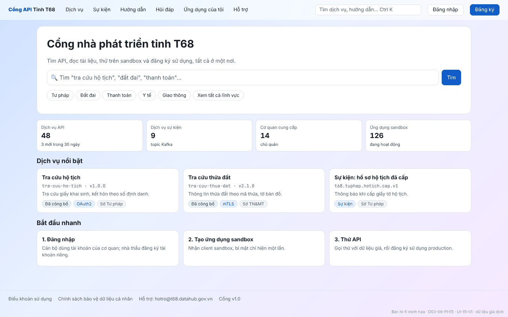

Ảnh thể hiện khách chưa đăng nhập: thanh trên kính, khối chào nền đặc với ô tìm lớn, thẻ số liệu, ba dịch vụ nổi bật và ba bước bắt đầu nhanh. Tên cổng và khẩu hiệu lấy từ nhận diện tenant (UI-15-25).

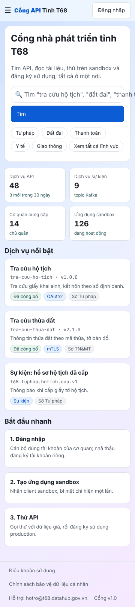{width=4.5cm}

Ở 360 px thanh trên chỉ còn logo và nút ☰, ô tìm xuống dưới khối chào, thẻ xếp một cột.

### 7.1. Wireframe

Wireframe chữ dưới đây chốt vị trí và thứ tự các vùng của màn; ảnh hi-fi ở đầu chương minh họa vật liệu, màu và mật độ.

```
┌ Cổng API Tỉnh T68  [Dịch vụ][Sự kiện][Hướng dẫn][Hỏi đáp][Ứng dụng của tôi][Hỗ trợ]  [🔍 Ctrl K] [Đăng nhập] ┐
│ ┌ Hero (đặc) ──────────────────────────────────────────────────────────────────────┐ │
│ │ Cổng nhà phát triển tỉnh T68 · khẩu hiệu                                          │ │
│ │ [🔍 Tìm "tra cứu hộ tịch"…                                      ] [Tìm]           │ │
│ │ (Tư pháp) (Đất đai) (Thanh toán) (Y tế) … [Xem tất cả lĩnh vực]                   │ │
│ └───────────────────────────────────────────────────────────────────────────────────┘ │
│ [Dịch vụ API 48] [Dịch vụ sự kiện 9] [Cơ quan cung cấp 14] [Ứng dụng sandbox 126]     │
│ Dịch vụ nổi bật:  [thẻ] [thẻ] [thẻ]                                                    │
│ Bắt đầu nhanh:    [1. Đăng nhập] [2. Tạo ứng dụng sandbox] [3. Thử API]               │
│ Chân trang: Điều khoản · Chính sách BVDLCN · Hỗ trợ · Phiên bản cổng                   │
└────────────────────────────────────────────────────────────────────────────────────────┘
```

### 7.2. Thành phần

Bảng liệt kê từng thành phần với loại `CMP-*`, nội dung, quy tắc kiểm tra và nguồn dữ liệu.

| # | Thành phần | `CMP-*` | Nội dung, kiểm tra | Nguồn |
|---|---|---|---|---|
| 1 | Thanh trên | `CMP-Topbar`, `CMP-UserMenu` | Liên kết theo mục 4.3; ANON thấy "Đăng nhập" | — |
| 2 | Ô tìm lớn | `CMP-SearchInput` | 1…200 ký tự; Enter chuyển `/tim-kiem?q=`; gợi ý khi gõ ≥ 2 ký tự | API-15-012 |
| 3 | Chip lĩnh vực | `CMP-FilterChips` | Mở `/dich-vu?linh-vuc=` | API-15-006 |
| 4 | Thẻ số liệu | `CMP-StatCard` | Đếm dịch vụ theo hạng người xem | API-15-001, 002 |
| 5 | Dịch vụ nổi bật | `CMP-Card`, `CMP-StatusTag`, `CMP-Tag` | Tên, mã, mô tả 2 dòng, nhãn xác thực, cơ quan | API-15-001, 002 |
| 6 | Bắt đầu nhanh | `CMP-Card`, `CMP-Link` | Bước 1 đổi thành "Tạo ứng dụng" khi đã đăng nhập | Cấu hình tenant |
| 7 | Dải thông báo | `CMP-Banner` | Thông báo `ANNOUNCEMENT` còn hiệu lực (`validFrom…validTo`) | API-15-034, 036 |

: UI-15-01 Thành phần

### 7.3. Trạng thái và hành vi

Bảng nêu cách màn hiển thị khi đang tải, rỗng, lỗi và không có quyền, kèm các trường hợp riêng của màn.

| Trạng thái | Hiển thị |
|---|---|
| Đang tải | Skeleton hero và 3 thẻ; thanh trên và ô tìm dùng được ngay |
| Rỗng | Tenant chưa có dịch vụ công bố: `CMP-EmptyState` "Chưa có dịch vụ nào được công bố" và liên kết Hướng dẫn |
| Lỗi | Khối nổi bật hiện `CMP-Alert` ERR-15-008 hoặc 030, khối khác vẫn dùng |
| Không có quyền | Không áp dụng; ANON ở tenant tắt công khai chuyển sang `/dang-nhap` |
| Danh mục chưa mới nhất | Dải ST riêng ở mục 6 |

: UI-15-01 Trạng thái

Phím tắt: `Ctrl+K` hoặc `/` đặt tiêu điểm vào ô tìm. Truy cập: hero là `<main>` đầu tiên, tiêu đề `h1` duy nhất, chip là danh sách liên kết, ảnh trang trí có `alt` rỗng.

## 8. UI-15-02 Danh mục dịch vụ

::: dac-ta
**Mục đích.** Duyệt, lọc, sắp xếp dịch vụ API và dịch vụ sự kiện mà người xem được thấy; mở chi tiết. Thay danh mục API của portal Gravitee.

**Người dùng, quyền.** Mọi người xem; kết quả theo hạng `ANONYMOUS`, `TENANT_USER`, `DEV_USER`, `OTHER_TENANT_USER` (FR-15-002).

**FR, UC hiện thực.** FR-15-001, 002, 004, 007, 008; UC-15-01.

**Truy vết hệ cũ.** LGC-APIM-006, 007.

**Đường dẫn.** `/dich-vu`, `/su-kien`.

**Mẫu bố cục.** PTN-01 biến thể thẻ, có chuyển sang bảng.

**API.** API-15-003 (`/public/catalog/apis`), 005, 006 (facet), 013 (topic).

**Phát hành, mức chi tiết.** Đợt 2; đầy đủ.
:::

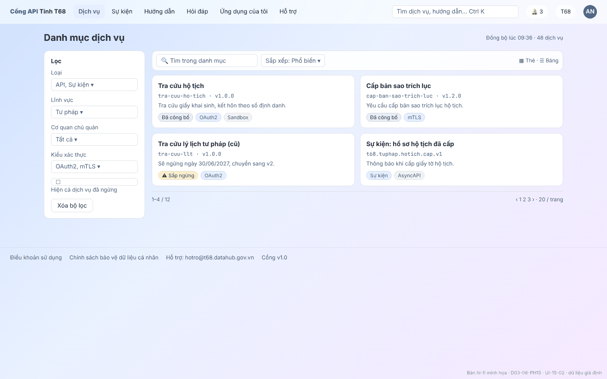

Ảnh có cột lọc trái, thanh công cụ (tìm, sắp xếp, chuyển thẻ/bảng) và lưới thẻ: dịch vụ sắp ngừng có nhãn "Sắp ngừng" kèm biểu tượng, dịch vụ sự kiện có nhãn riêng.

### 8.1. Wireframe

Wireframe chữ dưới đây chốt vị trí và thứ tự các vùng của màn; ảnh hi-fi ở đầu chương minh họa vật liệu, màu và mật độ.

```
Dịch vụ                                              Đồng bộ lúc 09:36 · 48 dịch vụ
┌ Lọc (đặc) ───────┐ [🔍 Tìm trong danh mục] [Sắp xếp: Phổ biến ▾]          [▦ Thẻ|☰ Bảng]
│ Loại [API|Sự kiện]│ ┌ thẻ ─────────────┐ ┌ thẻ ─────────────┐
│ Lĩnh vực ▾        │ │ Tên · mã · v1.0.0│ │ …                │
│ Cơ quan chủ quản ▾│ │ Mô tả 2 dòng     │ └──────────────────┘
│ Xác thực ▾        │ │ [Đã công bố][OAuth2][Sandbox]
│ ☐ Hiện cả đã ngừng│ └──────────────────┘            1–12 / 48   ‹ 1 2 3 4 ›  20 / trang
│ [Xóa bộ lọc]      │
└───────────────────┘
```

### 8.2. Thành phần và bộ lọc

Bảng liệt kê từng thành phần với loại `CMP-*`, nội dung, quy tắc kiểm tra và nguồn dữ liệu.

| # | Thành phần | `CMP-*` | Nội dung, kiểm tra | Tham số URL |
|---|---|---|---|---|
| 1 | Ô tìm | `CMP-SearchInput` | Lọc trong danh mục; Enter | `q` |
| 2 | Loại | `CMP-SegmentedControl` | `API`, `Sự kiện` (đổi route `/dich-vu` ↔ `/su-kien`) | `loai` |
| 3 | Lĩnh vực, chủ quản | `CMP-Select` nhiều lựa chọn, có đếm facet | Từ API-15-006 | `linh-vuc`, `chu-quan` |
| 4 | Kiểu xác thực | `CMP-Select` | `OAUTH2`, `MTLS`, `API_KEY` | `xac-thuc` |
| 5 | Hiện cả đã ngừng | `CMP-Checkbox` | Mặc định tắt | `da-ngung` |
| 6 | Sắp xếp | `CMP-Select` | `ten`, `moi-nhat`, `pho-bien` | `sap-xep` |
| 7 | Thẻ dịch vụ | `CMP-Card` dạng thẻ dịch vụ (A4, Phụ lục A) | Tên, `apiCode`, phiên bản `PUBLISHED` mới nhất, mô tả, `CMP-StatusTag`, nhãn xác thực, cơ quan | — |
| 8 | Dạng bảng | `CMP-DataTable` | Cột: Tên, Mã, Phiên bản, Lĩnh vực, Cơ quan, Xác thực, Trạng thái | — |
| 9 | Phân trang | `CMP-Pagination` | `co` 10, 20, 50, 100 | `trang`, `co` |
| 10 | Dải đồng bộ | `CMP-Banner` | Hiện khi `STALE` (mục 6) | API-15-009 |

: UI-15-02 Thành phần và bộ lọc

### 8.3. Trạng thái và hành vi

Bảng nêu cách màn hiển thị khi đang tải, rỗng, lỗi và không có quyền, kèm các trường hợp riêng của màn.

| Trạng thái | Hiển thị |
|---|---|
| Đang tải, đổi bộ lọc | ST-01 skeleton 6 thẻ; ST-02 khi đổi bộ lọc |
| Rỗng | Chưa có dịch vụ công bố cho hạng người xem này: "Chưa có dịch vụ nào để hiển thị" (ST-03) |
| Không có kết quả | "Không tìm thấy dịch vụ phù hợp" kèm bộ lọc đang dùng và "Xóa bộ lọc" (ST-04) |
| Lỗi | `ERR-15-008` hoặc `ERR-15-030` trong `CMP-Alert`, nút "Thử lại" |
| Không có quyền | ANON ở tenant tắt công khai: chuyển `/dang-nhap`; không lộ số lượng dịch vụ riêng tư |

: UI-15-02 Trạng thái

Dịch vụ `SUSPENDED` hiện nhãn "Tạm ngừng" và mờ nhẹ (theo Q15-19). Dịch vụ có `dataClass` `SENSITIVE` hiện nhãn "Dữ liệu nhạy cảm" (Q15-38). Phím tắt: `Ctrl+K`; mũi tên chuyển giữa thẻ khi tiêu điểm ở lưới (`role="list"`). Ở 360 px cột lọc thành nút "Lọc" mở `CMP-FilterDrawer`, bảng chuyển thẻ, vùng chạm 44 px.

## 9. UI-15-03 Kết quả tìm kiếm

::: dac-ta
**Mục đích.** Tìm toàn văn tiếng Việt (có hoặc không dấu) trên dịch vụ, bài hướng dẫn và dịch vụ sự kiện; gợi ý khi gõ.

**Người dùng, quyền.** Mọi người xem; kết quả lọc theo mức hiển thị của người xem.

**FR, UC hiện thực.** FR-15-005; UC-15-02.

**Truy vết hệ cũ.** LGC-APIM-006 (ô tìm).

**Đường dẫn.** `/tim-kiem`.

**Mẫu bố cục.** PTN-01 biến thể danh sách kết quả.

**API.** API-15-010 (`/public/search`), 011, 012 (`/search/suggest`).

**Phát hành, mức chi tiết.** Đợt 2; đầy đủ.
:::

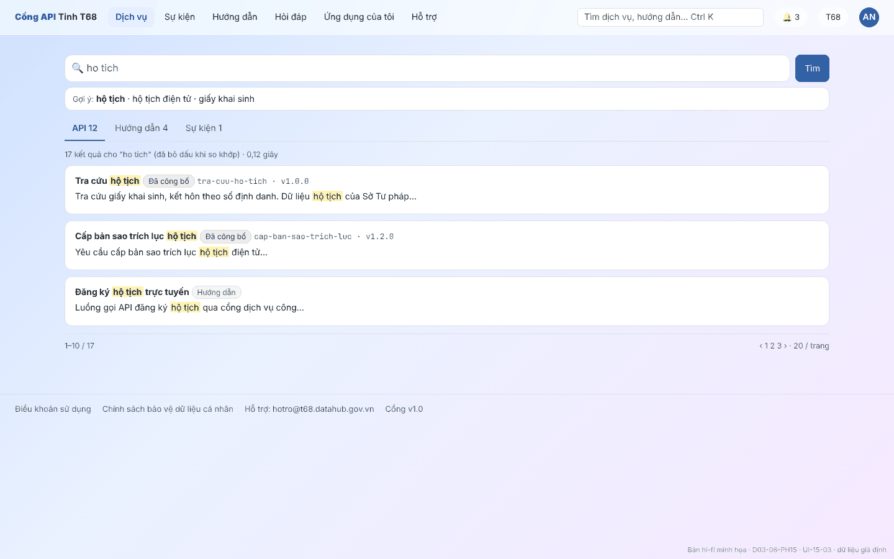

Ảnh có ô tìm với gợi ý, ba tab theo loại kèm số kết quả, và từng kết quả với từ khóa được tô nền vàng nhạt (kèm gạch chân để không chỉ dựa vào màu).

### 9.1. Wireframe

Wireframe chữ dưới đây chốt vị trí và thứ tự các vùng của màn; ảnh hi-fi ở đầu chương minh họa vật liệu, màu và mật độ.

```
[🔍 ho tich                                              ] [Tìm]
  Gợi ý: hộ tịch · hộ tịch điện tử · giấy khai sinh
[ API 12 │ Hướng dẫn 4 │ Sự kiện 1 ]          17 kết quả · 0,12 giây
┌ Tra cứu ▒hộ tịch▒  [Đã công bố]  tra-cuu-ho-tich · v1.0.0 ───────┐
│ …Dữ liệu ▒hộ tịch▒ của Sở Tư pháp…                                │
└────────────────────────────────────────────────────────────────────┘
                                                1–10 / 17   ‹ 1 2 ›
```

### 9.2. Thành phần và trạng thái

Bảng liệt kê từng thành phần với loại `CMP-*`, nội dung, quy tắc kiểm tra và nguồn dữ liệu.

| # | Thành phần | `CMP-*` | Nội dung, kiểm tra |
|---|---|---|---|
| 1 | Ô tìm và gợi ý | `CMP-SearchInput` (listbox `aria-activedescendant`) | 1…200 ký tự; gợi ý sau 200 ms, tối đa 8; mũi tên chọn, Enter tìm |
| 2 | Tab loại | `CMP-Tabs` | `api`, `huong-dan`, `su-kien`; số đếm |
| 3 | Kết quả | `CMP-Card` | Tiêu đề, mã, trạng thái, đoạn trích có tô khớp |
| 4 | Phân trang | `CMP-Pagination` | `trang`, `co` |

: UI-15-03 Thành phần

| Trạng thái | Hiển thị |
|---|---|
| Đang tải | Skeleton 5 kết quả |
| Rỗng | Chưa nhập từ khóa: gợi ý tìm phổ biến |
| Không có kết quả | "Không tìm thấy kết quả cho "{q}"" kèm gợi ý kiểm tra chính tả, xem danh mục (ST-04) |
| Lỗi | `ERR-15-008` (tìm dự phòng PG FTS vẫn chạy, hiện dải "Tìm kiếm đang ở chế độ dự phòng") |
| Không có quyền | Kết quả ngoài mức hiển thị không xuất hiện, không báo là bị ẩn |

: UI-15-03 Trạng thái

Phím tắt: `Ctrl+K` từ mọi trang mở bảng lệnh có nhóm "API" và "Bài hướng dẫn" (D03-06-00 §2.14). Ở 360 px tab cuộn ngang, thẻ một cột.

## 10. UI-15-04 Chi tiết dịch vụ

::: dac-ta
**Mục đích.** Cho người xem hiểu một dịch vụ: mô tả, chủ dịch vụ, phiên bản, đường dẫn sử dụng, cam kết SLA, lộ trình ngừng, và đi tiếp tới tài liệu, thử, đăng ký sử dụng, hỏi đáp.

**Người dùng, quyền.** Mọi người xem (API `PUBLIC` cho ANON); nút "Thử API" cần `PERM-15-try`; "Đăng ký sử dụng" cần đầu mối OR.

**FR, UC hiện thực.** FR-15-002, 006, 007, 008, 013, 053; UC-15-03, UC-15-28.

**Truy vết hệ cũ.** LGC-APIM-006, 007, 017.

**Đường dẫn.** `/dich-vu/{ma-api}`, `/su-kien/{ma-topic}`; tham số `phien-ban`.

**Mẫu bố cục.** PTN-02 Chi tiết (đầu trang dính, hai cột).

**API.** API-15-004 (công khai), 007, 008 (`/usage`), 014, 021 (changelog), 107, 108.

**Phát hành, mức chi tiết.** Đợt 2; phần hỏi đáp Đợt 3; đầy đủ.
:::

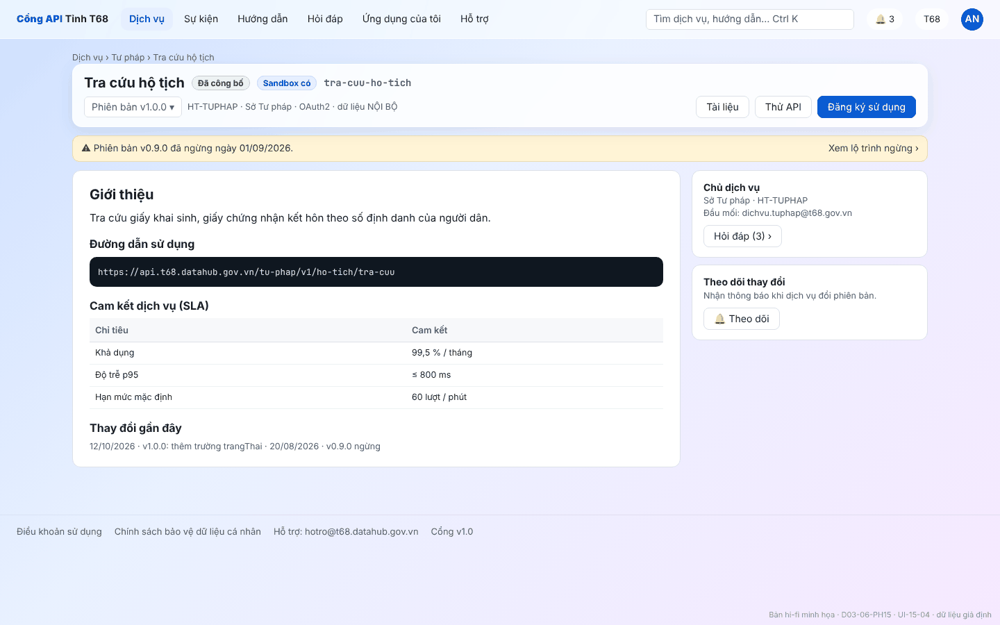

Đầu trang kính (`CMP-PageHeader` dính) gồm tên, nhãn trạng thái, chọn phiên bản và ba nút. Phiên bản đã ngừng có dải cảnh báo có chữ. Cột phải có thẻ chủ dịch vụ và theo dõi thay đổi.

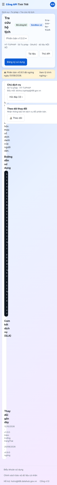{width=4.5cm}

### 10.1. Wireframe

Wireframe chữ dưới đây chốt vị trí và thứ tự các vùng của màn; ảnh hi-fi ở đầu chương minh họa vật liệu, màu và mật độ.

```
Dịch vụ › Tư pháp › Tra cứu hộ tịch
┌ Đầu trang (kính, dính) ─────────────────────────────────────────────────────────────┐
│ Tra cứu hộ tịch [Đã công bố][Sandbox có]  tra-cuu-ho-tich                           │
│ [v1.0.0 ▾]  HT-TUPHAP · Sở Tư pháp · OAuth2 · NỘI BỘ    [Tài liệu][Thử API][Đăng ký sử dụng] │
└─────────────────────────────────────────────────────────────────────────────────────┘
[⚠ Phiên bản v0.9.0 đã ngừng ngày 01/09/2026. Xem lộ trình ngừng ›]
┌ Nội dung (đặc) ────────────────────────────┐ ┌ Chủ dịch vụ ───────────┐
│ Giới thiệu · Đường dẫn sử dụng [⧉]          │ │ Sở Tư pháp · đầu mối    │
│ Cam kết dịch vụ (SLA) · Thay đổi gần đây    │ │ [Hỏi đáp (3) ›]         │
└─────────────────────────────────────────────┘ │ [🔔 Theo dõi]           │
                                                 └─────────────────────────┘
```

### 10.2. Thành phần

Bảng liệt kê từng thành phần với loại `CMP-*`, nội dung, quy tắc kiểm tra và nguồn dữ liệu.

| # | Thành phần | `CMP-*` | Nội dung, kiểm tra | Nguồn |
|---|---|---|---|---|
| 1 | Đầu trang | `CMP-PageHeader`, `CMP-Breadcrumb` | Tên, mã (`CMP-CodeText`), nhãn trạng thái phiên bản, `dataClass` | API-15-007 |
| 2 | Chọn phiên bản | `CMP-Select` | Phiên bản `PUBLISHED`, `DEPRECATED`; `RETIRED` ở nhóm "Đã ngừng" | `phien-ban` |
| 3 | Nút hành động | `CMP-Button` | "Tài liệu" → `/tai-lieu`; "Thử API" ẩn khi sandbox `OFF` (ERR-15-101) hoặc thiếu quyền; "Đăng ký sử dụng" → UI-15-15 | — |
| 4 | Dải lộ trình ngừng | `CMP-Banner` | `DEPRECATED`: ngày ngừng, liên kết hướng dẫn chuyển đổi | API-15-021 |
| 5 | Đường dẫn sử dụng | `CMP-CodeBlock` + `CMP-CopyButton` | URL gateway theo môi trường (LGC-APIM-017) | API-15-008 |
| 6 | SLA | `CMP-DescriptionList` | Khả dụng, độ trễ, hạn mức mặc định | API-15-007 |
| 7 | Thay đổi gần đây | `CMP-Timeline` | Từ changelog; liên kết `/thay-doi` | API-15-021 |
| 8 | Theo dõi | `CMP-Button` + `CMP-Popover` | Chọn kênh và loại thay đổi; cần đăng nhập | API-15-102 |
| 9 | Hỏi đáp | `CMP-Tabs` hoặc khối | Danh sách câu hỏi, nút "Đặt câu hỏi" (Đợt 3) | API-15-107, 108 |

: UI-15-04 Thành phần

### 10.3. Trạng thái và hành vi

Bảng nêu cách màn hiển thị khi đang tải, rỗng, lỗi và không có quyền, kèm các trường hợp riêng của màn.

| Trạng thái | Hiển thị |
|---|---|
| Đang tải | Skeleton đầu trang và hai cột |
| Rỗng | Chưa có mô tả: "Chủ dịch vụ chưa bổ sung mô tả"; chưa có hỏi đáp: "Chưa có câu hỏi" |
| Lỗi | `ERR-15-030` ở khối dữ liệu; `ERR-15-009` khi đặc tả không đọc được (chỉ ảnh hưởng nút Tài liệu) |
| Không có quyền, không tồn tại | `CMP-ResultPage` 404 `ERR-15-001`, không phân biệt "không có" với "không được xem" |
| Phiên bản đã ngừng | `ERR-15-038`; trang vẫn hiện thông tin, nút Thử và Đăng ký ẩn |

: UI-15-04 Trạng thái

Dịch vụ sự kiện (`/su-kien/{ma-topic}`) thay "Đường dẫn sử dụng" bằng tên topic, lược đồ và hướng dẫn đăng ký nhận (FR-15-007). Ở 360 px hai cột xếp một cột, ba nút thành hàng dọc.

## 11. UI-15-05 Tài liệu API

::: dac-ta
**Mục đích.** Đọc tài liệu OpenAPI 3.1 hoặc AsyncAPI 3.0 của một phiên bản: thao tác, tham số, ví dụ, mã lỗi; tải đặc tả, so sánh phiên bản, lấy mẫu mã sáu ngôn ngữ, xem nhật ký thay đổi. Thay trang Swagger của portal Gravitee.

**Người dùng, quyền.** Mọi người xem được dịch vụ; tải đặc tả `RESTRICTED`, `SENSITIVE` ghi kiểm toán `DOWNLOAD_SPEC`, `VIEW_SENSITIVE_DOCS` (A.8).

**FR, UC hiện thực.** FR-15-009…013; UC-15-05, UC-15-03.

**Truy vết hệ cũ.** LGC-APIM-017.

**Đường dẫn.** `/dich-vu/{ma-api}/tai-lieu` (tham số `phien-ban`, `thao-tac`), `/dich-vu/{ma-api}/thay-doi`.

**Mẫu bố cục.** PTN-14 Tài liệu cổng (ba cột).

**API.** API-15-015, 016, 017, 018, 019, 020, 021.

**Phát hành, mức chi tiết.** Đợt 2; rất chi tiết.
:::

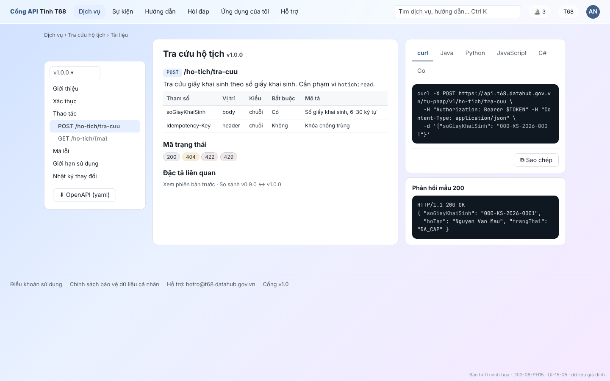

Ảnh theo PTN-14: mục lục trái dính (mục đang đọc tô nền và `aria-current`), nội dung giữa trên nền đặc, cột phải là mẫu mã và phản hồi mẫu. Khung thử đầy đủ tách sang UI-15-06 nên cột phải ở đây chỉ có mẫu mã.

### 11.1. Wireframe và lưới

Wireframe chữ dưới đây chốt vị trí và thứ tự các vùng của màn; ảnh hi-fi ở đầu chương minh họa vật liệu, màu và mật độ.

```
┌ Thanh trên (kính) ─────────────────────────────────────────────────────────────────┐
│ ① Mục lục 240 px dính │ ② Nội dung, tối đa 760 px         │ ③ Mẫu mã 380 px dính     │
│ [v1.0.0 ▾] [So sánh]  │ Tra cứu hộ tịch  v1.0.0            │ [curl|Java|Python|JS|C#|Go]
│ Giới thiệu            │ POST /ho-tich/tra-cuu              │ ┌ CodeBlock (chỉ đọc) ┐ │
│ Xác thực              │ Bảng tham số (CMP-DataTable gọn)   │ └─────────────────────┘ │
│ ▾ Thao tác            │ Mã trạng thái 200 404 422 429      │ [⧉ Sao chép]            │
│    POST /tra-cuu ◀    │ Đặc tả liên quan · So sánh         │ Phản hồi mẫu 200        │
│ Mã lỗi · Giới hạn     │                                    │                         │
│ Nhật ký thay đổi      │                                    │                         │
│ [⬇ OpenAPI]           │                                    │                         │
└───────────────────────┴────────────────────────────────────┴─────────────────────────┘
```

Ba cột từ `bp-xxl`; từ `bp-xl` đến dưới `bp-xxl` cột ③ thành nút "Mẫu mã" mở `CMP-Drawer`; dưới `bp-lg` mục lục thành nút "Mục lục" mở Drawer trái, một cột nội dung.

### 11.2. Thành phần

Bảng liệt kê từng thành phần với loại `CMP-*`, nội dung, quy tắc kiểm tra và nguồn dữ liệu.

| # | Thành phần | `CMP-*` | Nội dung, kiểm tra | Nguồn |
|---|---|---|---|---|
| 1 | Mục lục | `CMP-Tree` dạng mục lục dính (A3, Phụ lục A) | Theo thao tác `operationId` và mục cố định; theo dõi vị trí bằng `IntersectionObserver`, `aria-current="location"` | API-15-017 |
| 2 | Chọn phiên bản, so sánh | `CMP-Select`, `CMP-DiffViewer` | Chọn `base` để so sánh; phiên bản `RETIRED` ghi nhãn; đổi phiên bản giữ `thao-tac` nếu còn | API-15-015, 020 |
| 3 | Banner ngừng | `CMP-Banner` | `DEPRECATED`: ngày ngừng, phiên bản thay thế | API-15-021 |
| 4 | Khối thao tác | `CMP-Card` dạng khối thao tác (A5) | Phương thức, đường dẫn, mô tả, bảo mật, tham số, thân, phản hồi | API-15-017 |
| 5 | Bảng tham số | `CMP-DataTable` gọn, không phân trang | Tên, vị trí, kiểu, bắt buộc, mô tả; `scope="col"` | API-15-017 |
| 6 | Mẫu mã | `CMP-Tabs` + `CMP-CodeBlock` + `CMP-CopyButton` | 6 ngôn ngữ, môi trường Sandbox mặc định, chỉ chứa `$TOKEN` giữ chỗ, không bí mật thật | API-15-019 |
| 7 | Tải đặc tả | `CMP-DropdownMenu` | YAML, JSON; ghi `DOWNLOAD_SPEC` | API-15-016 |
| 8 | Với AsyncAPI | `CMP-Card` theo kênh | Kênh, thông điệp, lược đồ; không có tab mẫu mã HTTP | API-15-018 |
| 9 | Nhật ký thay đổi | `CMP-VersionTimeline` | Mỗi phiên bản: ngày, loại thay đổi, ghi chú | API-15-021 |

: UI-15-05 Thành phần

### 11.3. Trạng thái và hành vi

Bảng nêu cách màn hiển thị khi đang tải, rỗng, lỗi và không có quyền, kèm các trường hợp riêng của màn.

| Trạng thái | Hiển thị |
|---|---|
| Đang tải | Skeleton mục lục và 3 khối đoạn; mục lục tải trước nội dung |
| Rỗng | Phiên bản chưa có thao tác: "Phiên bản này chưa có tài liệu thao tác" |
| Lỗi | `ERR-15-009` (đặc tả không đọc được): hiện phần đọc được và dải "Một phần tài liệu không hiển thị được" |
| Không có quyền, không tồn tại | `ERR-15-001`; phiên bản ngừng `ERR-15-038` |
| Bản in | `@media print`: ẩn mục lục và cột mẫu mã, nền trắng |

: UI-15-05 Trạng thái

Liên kết neo sao chép được (`#post-tra-cuu`), URL đổi neo bằng `replace`. Phím tắt: `[` và `]` mục trước, sau; `Ctrl+K` tìm. Truy cập: dòng tối đa 72 ký tự, mã có tương phản ≥ 7:1, bảng có tiêu đề cột liên kết. Ở 360 px: Drawer mục lục, bảng tham số chuyển thẻ, khối mã cuộn ngang trong vùng có `tabindex="0"` và nhãn.

## 12. UI-15-06 Thử API

::: dac-ta
**Mục đích.** Cho nhà phát triển soạn và gửi yêu cầu thử tới một thao tác của dịch vụ, đọc phản hồi, biết rõ môi trường, chế độ (MOCK hay BACKEND) và hạn mức còn lại, rồi lưu yêu cầu vào bộ sưu tập hoặc lấy mẫu mã. Là màn phức tạp nhất của PH-15 nên mô tả siêu chi tiết.

**Người dùng, quyền.** DEV có `PERM-15-try` và là thành viên của ứng dụng chọn. Thử production thêm: dịch vụ đã bật, tổ chức có đăng ký sử dụng `ACTIVE`, không phải dữ liệu `RESTRICTED`/`SENSITIVE` (FR-15-043).

**FR, UC hiện thực.** FR-15-035, 036, 037, 038, 039, 043; UC-15-19, UC-15-22.

**Truy vết hệ cũ.** LGC-APIM-017 ("Try it out").

**Đường dẫn.** `/dich-vu/{ma-api}/thu`; tham số `phien-ban`, `thao-tac`, `ung-dung`.

**Mẫu bố cục.** PTN-14 Tài liệu cổng, khung thử rộng.

**API.** API-15-071 (`/try/requests:validate`), 072 (`/try/requests`), 073, 074 (`/try/quota`); API-15-082 do gateway gọi, giao diện không gọi.

**Phát hành, mức chi tiết.** Đợt 2; siêu chi tiết.
:::

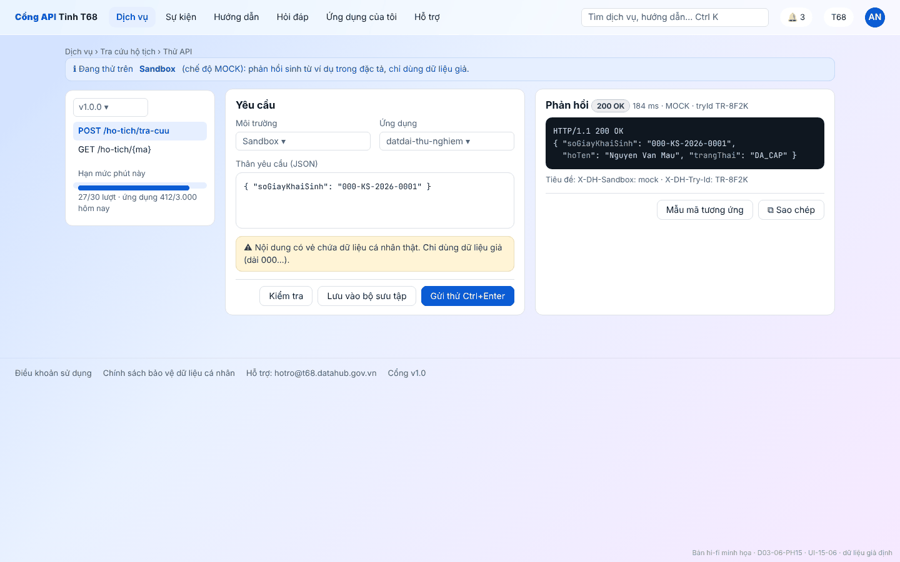

Ảnh thể hiện thử ở Sandbox, chế độ MOCK: dải thông tin đầu trang nói rõ phản hồi sinh từ ví dụ, cột giữa là biểu mẫu yêu cầu (có cảnh báo dữ liệu cá nhân), cột phải là phản hồi với trạng thái, độ trễ, `tryId`. Cột trái là mục lục thao tác kèm thanh hạn mức.

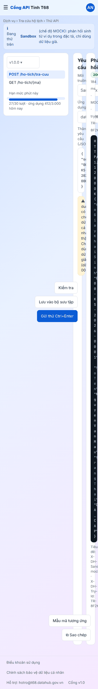{width=4.5cm}

### 12.1. Lưới bố cục và vùng

Màn gồm bốn vùng đánh số. Từ `bp-xxl` (1600 px): ① 240 px, ② và ③ chia đều phần còn lại (mỗi cột tối thiểu 420 px). Từ `bp-xl` (1200 px): ① thu thành menu thả "Thao tác ▾" trên ②, ② và ③ hai cột. Dưới `bp-lg` (992 px) và ở 360 px: một cột theo thứ tự ④ → ② → ③, ① thành `CMP-Select` thao tác; nút "Gửi thử" dính đáy màn (`position: sticky`) cao 48 px.

```
┌ Thanh trên (kính) ─────────────────────────────────────────────────────────────────────┐
│ Dịch vụ › Tra cứu hộ tịch › Thử API                                                     │
│ ④ [ℹ Sandbox · MOCK: phản hồi sinh từ ví dụ trong đặc tả, chỉ dùng dữ liệu giả]  (dải)   │
│ ① 240 px           │ ② Yêu cầu (đặc)                    │ ③ Phản hồi (đặc)               │
│ [v1.0.0 ▾]         │ Môi trường [Sandbox ▾] Ứng dụng [▾] │ [200 OK] 184 ms · MOCK · TR-8F2K│
│ ● POST /tra-cuu    │ ─ Tham số đường dẫn, truy vấn ──    │ ┌ Thân (CMP-JsonViewer) ──────┐ │
│   GET /ho-so/{ma}  │ Tiêu đề (+ thêm)                    │ └─────────────────────────────┘ │
│ ── Hạn mức ──      │ Thân (CMP-CodeEditor, JSON)        │ Tiêu đề phản hồi (thu gọn)      │
│ ▓▓▓▓▓▓▓▓░ 27/30    │ [⚠ có vẻ chứa dữ liệu cá nhân thật] │ [Mẫu mã tương ứng] [⧉ Sao chép] │
│ App 412/3.000 ngày │ [Kiểm tra][Lưu vào bộ sưu tập][Gửi thử Ctrl+Enter]                  │
└────────────────────┴────────────────────────────────────┴─────────────────────────────────┘
```

### 12.2. Giải phẫu từng vùng

Bảng mô tả từng thành phần của bốn vùng: loại `CMP-*`, hành vi và kiểm tra.

| Vùng | Thành phần | `CMP-*` | Chi tiết và kiểm tra |
|---|---|---|---|
| ④ Dải ngữ cảnh | Môi trường, chế độ | `CMP-Banner` | Sandbox: nền info, câu theo chế độ (MOCK: "phản hồi sinh từ ví dụ trong đặc tả"; BACKEND: "gọi hệ thống thử của chủ dịch vụ"). Production: nền error, viền đậm, câu "Đang thử trên môi trường thật" + ô xác nhận |
| ① Thao tác | Danh sách thao tác | `CMP-Tree` | Nhóm theo thẻ `tag`; thao tác chưa có ví dụ ở MOCK có biểu tượng cảnh báo (ERR-15-110) |
| ① Hạn mức | Thanh hạn mức | `CMP-ProgressBar` + văn bản | "27/30 lượt phút này" (`15.try.rate-per-user-min`); "412/3.000 hôm nay" (`15.try.rate-per-app-day`); `aria-valuenow`; ≥ 90% đổi sắc thái warning kèm chữ; làm mới sau mỗi lượt gửi và 30 giây (API-15-074) |
| ② Môi trường | Chọn môi trường | `CMP-SegmentedControl` | `Sandbox` mặc định; `Môi trường thật` vô hiệu kèm tooltip nêu đúng điều kiện chưa đạt (ERR-15-112, 113, 114) |
| ② Ứng dụng | Chọn ứng dụng | `CMP-Select` | Ứng dụng `ACTIVE` của người dùng có thông tin xác thực; hiện chỉ Client ID, không bao giờ bí mật; không có ứng dụng: nút "Tạo ứng dụng" (ERR-15-102) |
| ② Tham số | Đường dẫn, truy vấn | `CMP-FormField` sinh từ đặc tả | Kiểm tra kiểu theo schema khi rời ô; lỗi `ERR-15-107` dưới ô |
| ② Tiêu đề | Thêm tiêu đề | `CMP-KeyValueEditor` | Chặn `Authorization`, `Cookie`, `Host` (ERR-15-121); tối đa 20 dòng |
| ② Thân | Thân JSON | `CMP-CodeEditor` | Đánh dấu cú pháp, tối đa `15.try.max-body-kb` (256 KB); đếm KB; nút "Điền ví dụ" lấy ví dụ đầu của đặc tả (dải giả quy ước A.7); quét PII-15 khi dừng gõ 500 ms |
| ② Hành động | Kiểm tra, Lưu, Gửi | `CMP-Button` | "Kiểm tra" gọi API-15-071 (không tính hạn mức); "Gửi thử" gọi API-15-072 kèm `Idempotency-Key` |
| ③ Phản hồi | Trạng thái, thân | `CMP-StatusTag`, `CMP-Duration`, `CMP-JsonViewer` | Mã, độ trễ, `tryId`, chế độ; thân đã che SEC-32; cắt 1 MB kèm dải ERR-15-123 |
| ③ Hành động | Mẫu mã, sao chép | `CMP-Button`, `CMP-CopyButton` | "Mẫu mã tương ứng" mở `CMP-Drawer` mẫu mã sinh từ đúng yêu cầu đang soạn |

: UI-15-06 Giải phẫu vùng

### 12.3. Trường của yêu cầu thử

Bảng liệt kê trường của biểu mẫu yêu cầu thử, kiểu, bắt buộc, kiểm tra và API tiếp nhận.

| Trường | Kiểu | Bắt buộc | Kiểm tra | API |
|---|---|---|---|---|
| Ứng dụng (`appCode`) | `CMP-Select` | Có | Ứng dụng `ACTIVE`, người dùng là thành viên | API-15-072 |
| Môi trường (`environment`) | `CMP-SegmentedControl` | Có | `SANDBOX` hoặc `PRODUCTION` | API-15-072 |
| Thao tác (`operationId`) | Chọn ở ① | Có | Có trong đặc tả phiên bản | API-15-072 |
| Tham số đường dẫn, truy vấn | `CMP-FormField` | Theo đặc tả | Đúng kiểu, enum, độ dài | API-15-071 |
| Tiêu đề | `CMP-KeyValueEditor` | Không | Không chứa tiêu đề cấm | API-15-071 |
| Thân | `CMP-CodeEditor` | Theo đặc tả | JSON hợp lệ, ≤ `15.try.max-body-kb`, khớp schema | API-15-071 |
| Xác nhận hệ thống thật | `CMP-Checkbox` | Khi production | Phải bật: "Tôi hiểu đây là hệ thống thật" | API-15-072 |

: UI-15-06 Trường yêu cầu

### 12.4. Máy trạng thái của khung thử

Khung thử chuyển giữa bảy trạng thái; bảng nêu điều kiện vào và cách hiển thị của từng trạng thái.

| Trạng thái | Điều kiện | Hiển thị |
|---|---|---|
| Sẵn sàng | Đã chọn ứng dụng, thao tác; kiểm tra hợp lệ | Nút "Gửi thử" bật |
| Chưa đủ điều kiện | Chưa đăng nhập, thiếu ứng dụng, sandbox `OFF`, phiên bản không cho thử | Khung ② vô hiệu, dải ④ nêu lý do và nút hành động (Đăng nhập, Tạo ứng dụng) theo `ERR-15-101`, `102`, `122` |
| Đang gửi | Chờ API-15-072 | Nút `loading`, mọi nút gửi khác vô hiệu (ST-09), vùng ③ `aria-busy`; sau 15 giây hiện "Hệ thống thử chưa phản hồi" kèm nút "Hủy" |
| Thành công | `OK` | `CMP-StatusTag` success, `aria-live="polite"` đọc "Thử thành công, mã 200, 184 mili giây" |
| Lỗi hệ thống thử | `UPSTREAM_ERROR`, `TIMEOUT` | Nhãn error, câu ERR-15-108, 109, 111; thân yêu cầu giữ nguyên |
| Bị từ chối | `DENIED` | Câu theo mã (ERR-15-102, 106, 112…115, 121, 122); ô liên quan có viền và `aria-invalid` |
| Vượt hạn mức | `THROTTLED` | ERR-15-103, 104, 118; nút "Gửi thử" vô hiệu có đếm ngược `Thử lại sau {n} giây` |

: UI-15-06 Máy trạng thái

### 12.5. Tương tác chuột, bàn phím và truy cập

Các điểm dưới đây chốt phím tắt, thứ tự Tab, thao tác chuột, xử lý bí mật và truy cập của khung thử.

- **Phím tắt.** `Ctrl+Enter` trong ô thân hoặc ô tham số: gửi thử; `Ctrl+Shift+V`: kiểm tra; `[` và `]` thao tác trước, sau; `Ctrl+K` tìm; `Esc` đóng Drawer; `?` bảng phím tắt. Thứ tự Tab: dải ④, thao tác ①, môi trường, ứng dụng, tham số, tiêu đề, thân, nút hành động, phản hồi.
- **Chuột.** Kéo thanh chia cột ② và ③ (`CMP-Splitter`) lưu độ rộng theo người dùng (`localStorage`, không chứa dữ liệu yêu cầu); nhấp đúp tiêu đề phản hồi thu gọn.
- **Bí mật và dữ liệu.** Thân yêu cầu và phản hồi không ghi vào `localStorage`, URL hay nhật ký giao diện; chỉ lịch sử phía máy chủ (UI-15-14). Khung không bao giờ hiện bí mật của ứng dụng, chỉ Client ID.
- **Truy cập.** Vùng ② và ③ là `region` có nhãn; kết quả gửi thông báo qua `aria-live`; mã trạng thái có chữ, không chỉ màu; `CMP-CodeEditor` thoát bẫy Tab bằng `Esc` rồi `Tab`; nút "Gửi thử" có tên đầy đủ "Gửi thử yêu cầu tới môi trường Sandbox".
- **360 px.** Một cột; môi trường và ứng dụng là hai `CMP-Select` xếp dọc; nút "Gửi thử" dính đáy; phản hồi hiện dưới yêu cầu, thân cuộn ngang; chỉnh JSON dài khuyến nghị trên máy tính nhưng vẫn dùng được (Q15-37).

### 12.5.1. Kiểm tra và thông điệp

Trước khi gửi, giao diện kiểm tra phía trình duyệt (kiểu, bắt buộc, cỡ thân); lỗi tại trường theo `ERR-15-107`, `105`, `121`. Cảnh báo PII ở chế độ MOCK chỉ là dải cảnh báo (BR-15-016), ở chế độ BACKEND máy chủ trả `ERR-15-106` và nút bị chặn. Nếu PH-13 không ghi được kiểm toán với API `RESTRICTED` hoặc `SENSITIVE`, nút "Gửi thử" chuyển lỗi `ERR-15-115` và không thử.

| Tình huống | Hiển thị |
|---|---|
| Đang tải đặc tả | Skeleton ①, ② |
| Rỗng | Dịch vụ chưa có thao tác: "Dịch vụ chưa có thao tác để thử" |
| Lỗi tải | `ERR-15-009` hoặc `ERR-15-030`; khung thử vô hiệu |
| Không có quyền | Chưa có `PERM-15-try`: dải ④ "Cần quyền thử API. Liên hệ quản trị cổng" |
| Sandbox tắt | `ERR-15-101`, nút "Thử API" đã ẩn ở UI-15-04; vào thẳng URL thì hiện câu này |

: UI-15-06 Trạng thái màn

## 13. UI-15-07 Hướng dẫn, hỏi đáp, thông báo

::: dac-ta
**Mục đích.** Đọc trang hướng dẫn Markdown (bắt đầu nhanh, mTLS, lấy token, xử lý lỗi RFC 9457), FAQ và thông báo của cổng; đánh giá trang và báo lỗi tài liệu.

**Người dùng, quyền.** Theo `audience` của trang: `PUBLIC` (cả ANON), `LOGGED_IN`, `TENANT`.

**FR, UC hiện thực.** FR-15-017, 053; UC-15-09, UC-15-28.

**Truy vết hệ cũ.** LGC-APIM-017 (trang tài liệu).

**Đường dẫn.** `/huong-dan`, `/huong-dan/{ma-trang}`, `/hoi-dap`, `/thong-bao`.

**Mẫu bố cục.** PTN-14 (mục lục trái, nội dung giữa).

**API.** API-15-034, 035 (công khai), 036, 037, 109 (đánh giá, báo lỗi).

**Phát hành, mức chi tiết.** Đợt 2; đánh giá, báo lỗi Đợt 3; đầy đủ.
:::

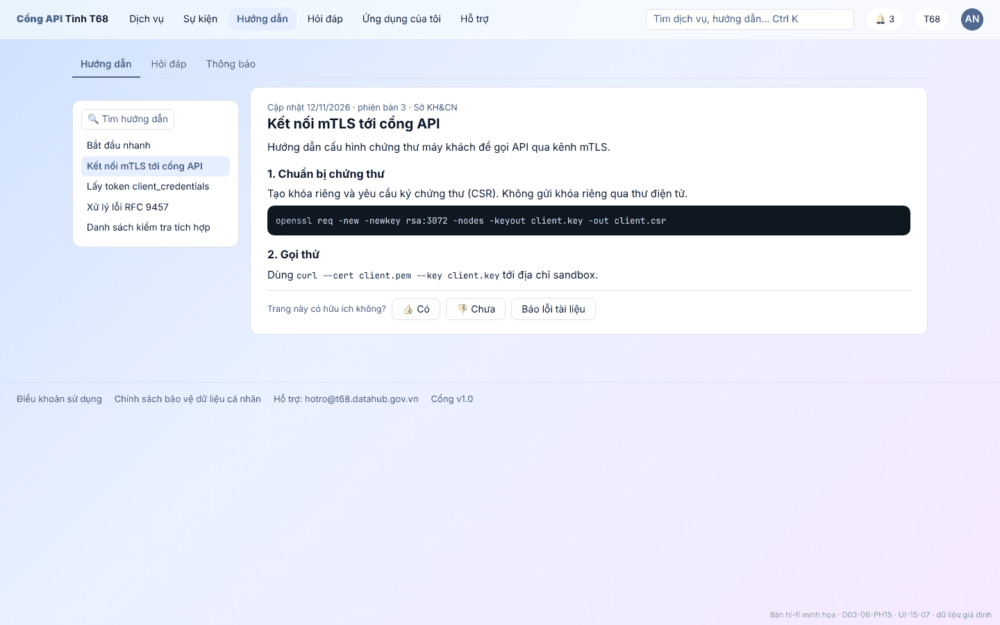

Ảnh là một trang hướng dẫn: ba tab loại nội dung, mục lục trái, nội dung Markdown nền đặc với khối mã, và cuối trang là hàng đánh giá "Trang này có hữu ích không?".

### 13.1. Thành phần

Bảng liệt kê thành phần của trang hướng dẫn, FAQ và thông báo.

| # | Thành phần | `CMP-*` | Nội dung, kiểm tra |
|---|---|---|---|
| 1 | Tab loại | `CMP-Tabs` | Hướng dẫn, Hỏi đáp, Thông báo |
| 2 | Mục lục | `CMP-Tree` dạng mục lục dính (A3) | Danh sách trang theo `type`, thẻ; trang đang đọc `aria-current="page"` |
| 3 | Nội dung | `CMP-Card` chứa Markdown đã lọc (A1) | Markdown đã lọc an toàn (không HTML thô, ảnh chỉ từ kho cổng); tiêu đề có neo; khối mã `CMP-CodeBlock` có `CMP-CopyButton` |
| 4 | Thông tin trang | `CMP-Timestamp`, `CMP-Tag` | Ngày cập nhật, số phiên bản, người đăng, thẻ |
| 5 | Đánh giá | `CMP-Button` | "Có", "Chưa" kèm ô nhận xét tùy chọn; chống gửi trùng |
| 6 | Báo lỗi tài liệu | `CMP-Button` → `CMP-Modal` | `subject` ≤ 150, `body` ≤ 2.000 ký tự văn bản thuần |
| 7 | FAQ | `CMP-Card` | Mỗi câu hỏi là nút mở rộng `aria-expanded` (dùng `CMP-Card`) |
| 8 | Thông báo | `CMP-Timeline` | `ANNOUNCEMENT` theo `validFrom`, `validTo` |

: UI-15-07 Thành phần

| Trạng thái | Hiển thị |
|---|---|
| Đang tải | Skeleton mục lục và 4 đoạn |
| Rỗng | "Chưa có hướng dẫn nào" (ST-03); FAQ, thông báo tương tự |
| Lỗi | Không tải được trang: ST-05 với ERR-15-008 |
| Không có quyền, không tồn tại | Trang `audience` cao hơn quyền người xem trả `ERR-15-001` (404, không lộ tồn tại); ANON được mời đăng nhập nếu trang `LOGGED_IN` |
| Gửi đánh giá, báo lỗi | `ERR-15-037` khi gửi quá nhiều; thành công: `CMP-Toast` "Cảm ơn góp ý" |

: UI-15-07 Trạng thái

Phím tắt: `[`, `]` chuyển trang kế; `Ctrl+K`. Ở 360 px mục lục thành `CMP-Drawer`, khối mã cuộn ngang.

## 14. UI-15-08 Đăng nhập và đăng ký dh-dev

::: dac-ta
**Mục đích.** Cho cán bộ đăng nhập SSO bằng tài khoản của tỉnh, cho nhà thầu đăng nhập hoặc tự đăng ký tài khoản `dh-dev`, xác minh thư và theo dõi tình trạng duyệt.

**Người dùng, quyền.** Chưa đăng nhập. Đăng ký chỉ khi `15.dev.signup-enabled`.

**FR, UC hiện thực.** FR-15-019, 020; UC-15-10, UC-15-11.

**Truy vết hệ cũ.** LGC-IAM-006.

**Đường dẫn.** `/dang-nhap`, `/dang-ky`; tham số `quay-ve`.

**Mẫu bố cục.** PTN-04 biểu mẫu trên trang; trang kết quả theo PTN-13.

**API.** API-15-041 (sau đăng nhập), 045 (`/developer-registrations`), 046 (xác minh thư); `/bff/dang-nhap`.

**Phát hành, mức chi tiết.** Đợt 2; đầy đủ.
:::

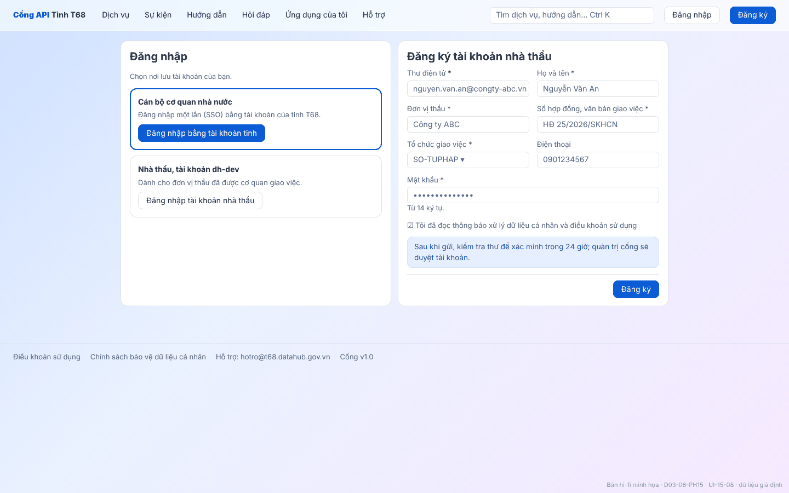

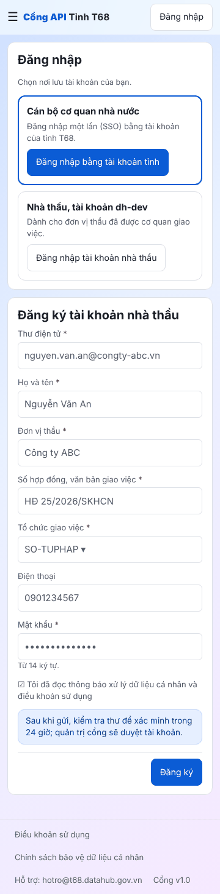{width=4.5cm}

Hai thẻ cạnh nhau: bên trái chọn nơi đăng nhập (cán bộ SSO hoặc nhà thầu `dh-dev`), bên phải biểu mẫu đăng ký nhà thầu. Trang đăng nhập thật do Keycloak phục vụ (D03-06-00 §1.4); màn này chỉ là cổng chọn realm.

### 14.1. Trường đăng ký

Bảng liệt kê trường của biểu mẫu đăng ký tài khoản nhà thầu theo FR-15-020.

| Trường | Kiểu | Bắt buộc | Kiểm tra | API |
|---|---|---|---|---|
| Thư điện tử (`email`) | `CMP-Input` | Có | Hợp lệ, không thuộc thư dùng một lần; trùng: ERR-15-012 | API-15-045 |
| Họ và tên (`fullName`) | `CMP-Input` | Có | 2…100 ký tự | API-15-045 |
| Đơn vị thầu (`orgName`) | `CMP-Input` | Có | 2…200 ký tự | API-15-045 |
| Số hợp đồng (`contractRef`) | `CMP-Input` | Có | 3…200 ký tự | API-15-045 |
| Tổ chức giao việc (`sponsorOrgCode`) | `CMP-Select` | Có | Tổ chức CQNN của tenant | API-15-045 |
| Điện thoại (`phone`) | `CMP-Input` | Không | Số điện thoại Việt Nam | API-15-045 |
| Mật khẩu (`password`) | `CMP-SecretField` | Có | ≥ 14 ký tự, đạt chính sách; có bộ đo độ mạnh có chữ | API-15-045 |
| Đã đọc thông báo (`acceptPrivacyNotice`) | `CMP-Checkbox` | Có | Phải bật | API-15-045 |

: UI-15-08 Trường đăng ký

### 14.2. Trạng thái và hành vi

Bảng nêu hiển thị của màn khi tải, sau khi gửi đăng ký và khi có lỗi.

| Trạng thái | Hiển thị |
|---|---|
| Đang tải | Skeleton hai thẻ |
| Rỗng | Không áp dụng; tenant tắt đăng ký: thẻ phải hiện "Tenant chưa mở đăng ký tài khoản nhà thầu" |
| Sau khi gửi | `CMP-ResultPage` "Kiểm tra thư để xác minh trong 24 giờ"; nút "Gửi lại thư" (tối đa 3 lần mỗi giờ); sau xác minh: "Tài khoản đang chờ quản trị duyệt" |
| Lỗi | ERR-15-012 dưới ô thư; ERR-15-013 ở trang xác minh kèm "Gửi lại thư"; ERR-15-037; ERR-15-014 (khóa); ERR-15-011 khi đăng nhập tài khoản chưa duyệt |
| Không có quyền | Đã đăng nhập mà vào `/dang-nhap`: chuyển `quay-ve` hoặc `/tong-quan` |

: UI-15-08 Trạng thái

Có thể cần CAPTCHA ở đăng ký (Q15-31). Phím tắt: Enter gửi biểu mẫu. Truy cập: nhãn liên kết `for`, lỗi gắn `aria-describedby`, tiêu điểm chuyển tới lỗi đầu (ST-11); mật khẩu có nút hiện/ẩn có nhãn. Ở 360 px hai thẻ xếp dọc, thẻ đăng nhập trước.

## 15. UI-15-09 Hồ sơ, điều khoản, nhóm

::: dac-ta
**Mục đích.** Xem và sửa hồ sơ, xem phiên đăng nhập, quản lý nhóm phát triển và lời mời, chấp nhận điều khoản sử dụng có phiên bản, yêu cầu xóa tài khoản.

**Người dùng, quyền.** Mọi người đã đăng nhập, trên dữ liệu của chính mình.

**FR, UC hiện thực.** FR-15-021, 022, 023, 024; UC-15-12, UC-15-13.

**Truy vết hệ cũ.** LGC-IAM-006.

**Đường dẫn.** `/tai-khoan`, `/tai-khoan/nhom`, `/tai-khoan/dieu-khoan`.

**Mẫu bố cục.** PTN-12 Cài đặt.

**API.** API-15-041…044, 047…054.

**Phát hành, mức chi tiết.** Đợt 2; đầy đủ.
:::

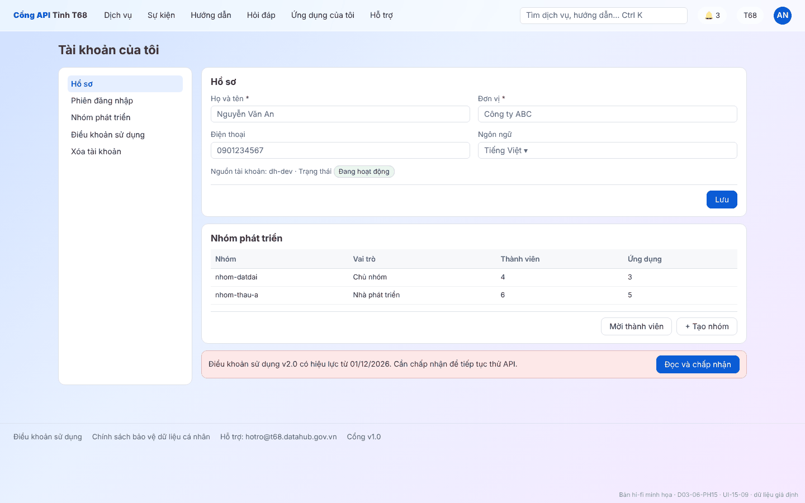

Ảnh có mục lục trái (Hồ sơ, Phiên, Nhóm, Điều khoản, Xóa tài khoản), thẻ hồ sơ, bảng nhóm và dải yêu cầu chấp nhận điều khoản mới.

| # | Khối | `CMP-*` | Nội dung, kiểm tra |
|---|---|---|---|
| 1 | Hồ sơ | `CMP-Form`, `CMP-FormField` | `fullName`, `orgName`, `phone`, `lang`, `notifyChannels`; `If-Match`; thư và nguồn tài khoản chỉ đọc |
| 2 | Phiên đăng nhập | `CMP-DataTable` | Thiết bị, IP rút gọn, lần cuối; nút "Đăng xuất phiên này" (`CMP-ConfirmDialog`) |
| 3 | Nhóm | `CMP-DataTable`, `CMP-Drawer` | Tạo nhóm (`teamCode` mẫu A.1), mời (`email`, vai trò `DEVELOPER`, `VIEWER`), rời nhóm; chủ nhóm cuối không rời được (ERR-15-028) |
| 4 | Lời mời | `CMP-Card` | Chấp nhận, từ chối; trạng thái `PENDING`, `ACCEPTED`, `DECLINED`, `EXPIRED` |
| 5 | Điều khoản | `CMP-Card` chứa Markdown đã lọc (A1), `CMP-Checkbox` | Phiên bản hiện hành, ngày hiệu lực; "Đọc và chấp nhận" kéo hết nội dung mới bật (giả định) |
| 6 | Xóa tài khoản | `CMP-ReasonDialog` | Nhập mật khẩu và cụm "XOA TAI KHOAN"; ghi rõ dữ liệu sẽ ẩn danh |

: UI-15-09 Khối chức năng

| Trạng thái | Hiển thị |
|---|---|
| Đang tải | Skeleton từng khối |
| Rỗng | Chưa có nhóm: "Bạn chưa thuộc nhóm nào. Tạo nhóm để cùng quản lý ứng dụng" |
| Lỗi | ERR-15-006 (xung đột sửa hồ sơ), ERR-15-027, ERR-15-028 ở khối tương ứng |
| Không có quyền | Tài khoản `LOCKED`: ERR-15-014 toàn trang; chưa chấp nhận điều khoản: ERR-15-010 chặn thao tác ghi và thử, đưa tới tab Điều khoản |

: UI-15-09 Trạng thái

Ở 360 px mục lục trái thành `CMP-Tabs` cuộn ngang. Phím tắt: không riêng.

## 16. UI-15-10 Danh sách ứng dụng

::: dac-ta
**Mục đích.** Xem các ứng dụng sandbox của mình và của nhóm, lọc theo trạng thái, tạo mới, mở chi tiết, lưu trữ hoặc khôi phục.

**Người dùng, quyền.** DEV có `PERM-15-app`; thấy ứng dụng được giao (BR-15-009).

**FR, UC hiện thực.** FR-15-026; UC-15-14.

**Truy vết hệ cũ.** LGC-IAM-006 (danh sách ứng dụng).

**Đường dẫn.** `/ung-dung`.

**Mẫu bố cục.** PTN-01.

**API.** API-15-055 (`/apps`), 059, 060.

**Phát hành, mức chi tiết.** Đợt 2; đầy đủ.
:::

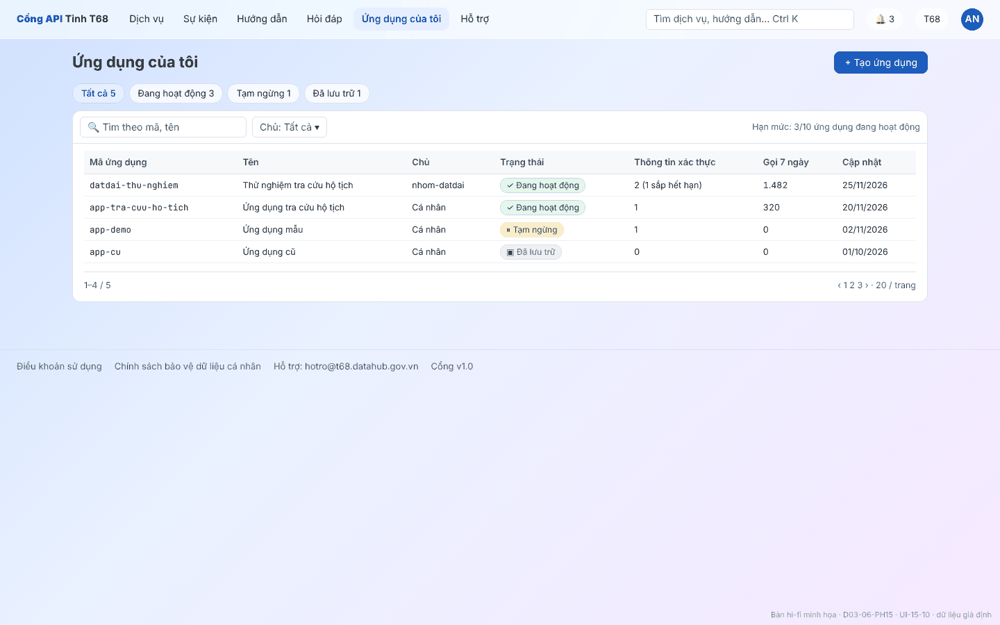

| # | Thành phần | `CMP-*` | Nội dung, kiểm tra |
|---|---|---|---|
| 1 | Nút "Tạo ứng dụng" | `CMP-Button` primary | Mở UI-15-11; vô hiệu khi đạt hạn mức, tooltip ERR-15-015 |
| 2 | Facet trạng thái | `CMP-FilterChips` | Tất cả, Đang hoạt động, Tạm ngừng, Đã lưu trữ, có đếm |
| 3 | Tìm, lọc chủ | `CMP-SearchInput`, `CMP-Select` | Theo mã, tên; chủ Cá nhân hoặc nhóm |
| 4 | Bảng | `CMP-DataTable` | Cột: Mã ứng dụng (liên kết), Tên, Chủ, Trạng thái (`CMP-StatusTag`), Thông tin xác thực (số, cảnh báo sắp hết hạn), Gọi 7 ngày, Cập nhật |
| 5 | Menu dòng | `CMP-DropdownMenu` | Mở, Cấp thông tin xác thực, Lưu trữ (`ARCHIVED`), Khôi phục |
| 6 | Hạn mức | `CMP-Text` | "3/10 ứng dụng đang hoạt động" (`15.app.max-per-user`) |

: UI-15-10 Thành phần

| Trạng thái | Hiển thị |
|---|---|
| Đang tải | Skeleton 5 hàng |
| Rỗng | "Chưa có ứng dụng. Tạo ứng dụng sandbox đầu tiên" + nút "Tạo ứng dụng" (ST-03) |
| Không có kết quả | Theo ST-04 |
| Lỗi | ST-05; lưu trữ sai trạng thái: ERR-15-017 |
| Không có quyền | Thiếu `PERM-15-app`: menu "Ứng dụng của tôi" ẩn; vào URL: 403 |

: UI-15-10 Trạng thái

Lưu trữ hỏi xác nhận (`CMP-ConfirmDialog`) và nêu "Thông tin xác thực của ứng dụng sẽ bị thu hồi". Ở 360 px bảng chuyển thẻ. Phím tắt: `N` mở "Tạo ứng dụng" khi tiêu điểm không ở ô nhập (giả định).

## 17. UI-15-11 Tạo ứng dụng

::: dac-ta
**Mục đích.** Tạo ứng dụng sandbox với mã bất biến, chủ là cá nhân hoặc nhóm, và tùy chọn liên kết HTTT để xem tham chiếu production.

**Người dùng, quyền.** DEV có `PERM-15-app`; trường HTTT chỉ cán bộ CQNN.

**FR, UC hiện thực.** FR-15-025; UC-15-14.

**Truy vết hệ cũ.** LGC-IAM-006.

**Đường dẫn.** `/ung-dung/moi` (ngăn kéo trên UI-15-10).

**Mẫu bố cục.** PTN-04 Drawer.

**API.** API-15-056 (`POST /apps`).

**Phát hành, mức chi tiết.** Đợt 2; đầy đủ.
:::

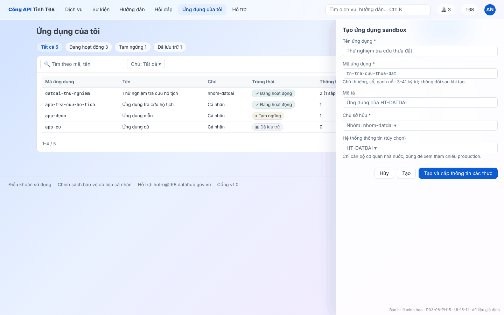

| Trường | Kiểu | Bắt buộc | Kiểm tra | Ánh xạ |
|---|---|---|---|---|
| Tên (`name`) | `CMP-Input` | Có | 3…100 ký tự | `name` |
| Mã (`appCode`) | `CMP-Input` mono | Có | `^[a-z][a-z0-9-]{2,40}$`, bất biến; gợi ý từ tên; trùng: ERR-15-002 | `appCode` |
| Mô tả | `CMP-TextArea` | Không | ≤ 1000 ký tự | `description` |
| Chủ sở hữu | `CMP-Select` | Có | "Cá nhân" hoặc nhóm mà mình là `OWNER`/`DEVELOPER` | `ownerType`, `teamCode` |
| HTTT | `CMP-Select` | Không | HTTT `ACTIVE` của tổ chức; ẩn với nhà thầu | `systemCode` |

: UI-15-11 Trường

Hành động: "Tạo" (tạo rồi mở UI-15-12), "Tạo và cấp thông tin xác thực" (tạo rồi mở UI-15-13 hộp cấp), "Hủy" (hỏi nếu đã nhập). Lỗi: ERR-15-002 dưới ô mã, ERR-15-015 ở dải đầu ngăn kéo, ERR-15-003 tóm tắt. Trạng thái: đang tải danh sách nhóm (skeleton ô chọn); rỗng: chưa có nhóm thì chọn "Cá nhân"; không có quyền: ngăn kéo không mở, 403. `Esc` đóng ngăn kéo (hỏi nếu đã nhập), Enter gửi. Ở 360 px ngăn kéo choán toàn màn hình.

## 18. UI-15-12 Chi tiết ứng dụng

::: dac-ta
**Mục đích.** Xem và sửa một ứng dụng, lưu trữ, giao cho thành viên, xem thống kê lượt gọi, nhật ký gọi đã che và đi tới thông tin xác thực, bộ sưu tập thử.

**Người dùng, quyền.** DEV là thành viên ứng dụng; `OWNER` được sửa, lưu trữ, giao thành viên; `VIEWER` chỉ xem.

**FR, UC hiện thực.** FR-15-026, 033, 049, 050; UC-15-14, UC-15-26.

**Truy vết hệ cũ.** LGC-APIM-022 (phần nhà phát triển).

**Đường dẫn.** `/ung-dung/{ma-ung-dung}`; tab `xac-thuc`, `bo-suu-tap`, `thong-ke`, `nhat-ky`, `thanh-vien`.

**Mẫu bố cục.** PTN-02 Chi tiết, tab.

**API.** API-15-057, 058, 059, 060, 066…068, 098, 099, 100.

**Phát hành, mức chi tiết.** Đợt 2; đầy đủ.
:::

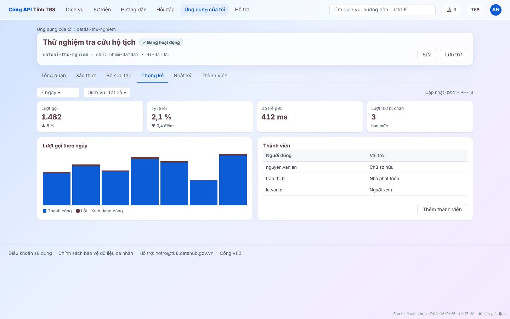

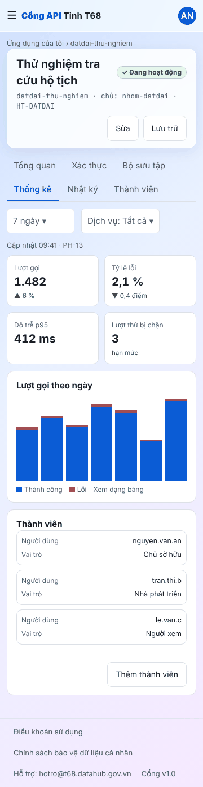{width=4.5cm}

Ảnh ở tab Thống kê: bốn thẻ số liệu, biểu đồ cột lượt gọi theo ngày (có bảng thay thế qua "Xem dạng bảng") và danh sách thành viên.

| # | Thành phần | `CMP-*` | Nội dung, kiểm tra | Nguồn |
|---|---|---|---|---|
| 1 | Đầu trang | `CMP-PageHeader` | Tên, `appCode`, trạng thái, chủ, HTTT; nút Sửa, Lưu trữ, Khôi phục theo trạng thái | API-15-057 |
| 2 | Tab | `CMP-Tabs` | Tổng quan, Xác thực (→ UI-15-13), Bộ sưu tập (→ UI-15-14), Thống kê, Nhật ký, Thành viên | — |
| 3 | Thẻ số liệu | `CMP-KpiCard` | Lượt gọi, tỷ lệ lỗi, p95, lượt bị chặn; `khoang` 24h, 7d, 30d | API-15-098 |
| 4 | Biểu đồ | `CMP-Chart` | Cột theo ngày, màu `color-chart-1`, lỗi dùng mẫu gạch (không chỉ màu); có bảng thay thế | API-15-098 |
| 5 | Nhật ký gọi | `CMP-LogViewer` | Giờ, API, mã trạng thái, độ trễ, `traceId`; thân đã che; bộ lọc `tu`, `den`, `api`, `trang-thai`, `trace` | API-15-099, 100 |
| 6 | Thành viên | `CMP-DataTable`, `CMP-Select` | Vai trò `OWNER`, `DEVELOPER`, `VIEWER`; thêm, đổi, xóa; chủ cuối không xóa được (ERR-15-028) | API-15-066…068 |

: UI-15-12 Thành phần

| Trạng thái | Hiển thị |
|---|---|
| Đang tải | Skeleton đầu trang; mỗi thẻ và biểu đồ tải riêng |
| Rỗng | Chưa có lượt gọi: "Chưa có lượt gọi trong khoảng này. Thử API để thấy số liệu" |
| Lỗi | `ERR-15-039` ở khối số liệu hoặc nhật ký, khối khác vẫn dùng; Q15-18 nếu PH-13 thiếu nhãn `app_code` thì thẻ chuyển sang số liệu theo lượt thử |
| Không có quyền | Không phải thành viên: 404 `ERR-15-001`; `VIEWER` thấy nút sửa ẩn |
| Ứng dụng tạm ngừng | Dải "Ứng dụng đang tạm ngừng" (ERR-15-017), mọi nút cấp, xoay, thử vô hiệu |

: UI-15-12 Trạng thái

Ở 360 px các tab cuộn ngang, thẻ số liệu hai cột, biểu đồ có bảng thay thế mặc định.

## 19. UI-15-13 Thông tin xác thực

::: dac-ta
**Mục đích.** Cấp, xoay vòng, thu hồi thông tin xác thực sandbox của ứng dụng; hiện bí mật đúng một lần; xem tham chiếu thông tin xác thực production (không bí mật).

**Người dùng, quyền.** DEV `OWNER` hoặc `DEVELOPER` của ứng dụng, `PERM-15-app`; production chỉ cán bộ CQNN có HTTT liên kết.

**FR, UC hiện thực.** FR-15-027…032; UC-15-15, 16, 17.

**Truy vết hệ cũ.** LGC-IAM-006 (cấp credential).

**Đường dẫn.** `/ung-dung/{ma}/xac-thuc`.

**Mẫu bố cục.** PTN-02 (tab) kèm `CMP-Modal`.

**API.** API-15-061, 062, 063, 064, 065.

**Phát hành, mức chi tiết.** Đợt 2; rất chi tiết (vì an toàn bí mật).
:::

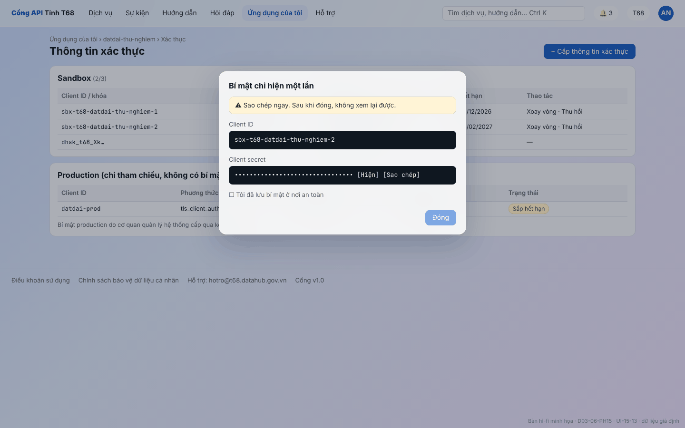

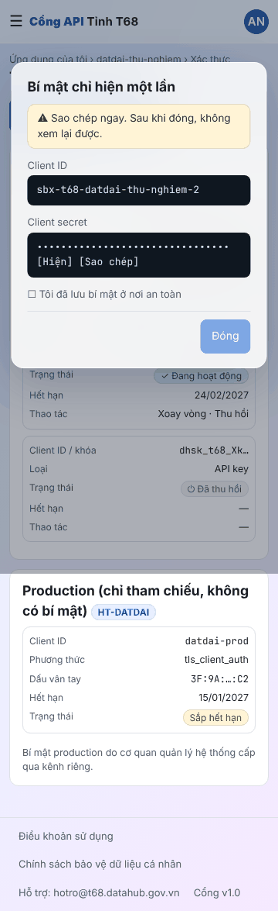{width=4.5cm}

Ảnh có hộp thoại "Bí mật chỉ hiện một lần" nổi trên nền mờ: dải cảnh báo, Client ID, bí mật che sẵn kèm nút "Hiện", "Sao chép", ô xác nhận đã lưu; nút "Đóng" bị vô hiệu cho tới khi tick. Phía dưới là hai bảng: sandbox (cấp, xoay, thu hồi) và tham chiếu production.

### 19.1. Thành phần và luồng bí mật

Bảng nêu thành phần của màn và luồng hiển thị bí mật đúng một lần.

| # | Thành phần | `CMP-*` | Nội dung, kiểm tra |
|---|---|---|---|
| 1 | Bảng sandbox | `CMP-DataTable` | Client ID hoặc khóa `dhsk_t68_…` (chỉ tiền tố), loại, trạng thái, hạn; số dòng ≤ `15.cred.max-per-app` |
| 2 | "Cấp thông tin xác thực" | `CMP-Button` → `CMP-Drawer` | Loại `CLIENT_CREDENTIALS` hoặc `API_KEY`, nhãn, `ttlDays` (mặc định `15.cred.ttl-days`, tối đa 180), `jwks` tùy chọn |
| 3 | Hộp bí mật một lần | `CMP-Modal` + `CMP-SecretField` | Che sẵn, "Hiện" bật 30 giây rồi che lại, "Sao chép" qua `CMP-CopyButton` (xóa clipboard không thực hiện được, nên có nhắc); ô "Tôi đã lưu bí mật" bật nút "Đóng"; `Esc` không đóng khi chưa tick |
| 4 | Xoay vòng | `CMP-ReasonDialog` | `graceHours` 1…72; tùy chọn "Xoay và thu hồi bản cũ ngay"; bản cũ chuyển "Đang chuyển tiếp" |
| 5 | Thu hồi | `CMP-ReasonDialog` | Lý do tùy chọn; hỏi xác nhận, không hoàn tác |
| 6 | Cảnh báo hết hạn | `CMP-Banner` | Mốc 30, 7, 1 ngày (`15.cred.expiry-notice-days`), kèm nút "Xoay vòng" |
| 7 | Tham chiếu production | `CMP-DataTable`, `CMP-SecretRefField` | Client ID, phương thức (`tls_client_auth`, `private_key_jwt`, `client_secret_basic`), dấu vân tay, hạn, trạng thái; không có nút hiện bí mật |

: UI-15-13 Thành phần

Bí mật chỉ nằm trong bộ nhớ của hộp thoại (SDD `SecretOnce`); khi đóng giá trị bị xóa khỏi bộ nhớ; không đưa vào URL, `localStorage`, nhật ký, ảnh chụp `aria-live`. Người đọc màn hình nghe "Bí mật hiển thị một lần, hãy sao chép" khi hộp mở, còn giá trị bí mật không được đọc tự động.

### 19.2. Trạng thái và thông điệp

Bảng nêu hiển thị của màn khi tải, rỗng, lỗi và khi thiếu quyền.

| Trạng thái | Hiển thị |
|---|---|
| Đang tải | Skeleton hai bảng |
| Rỗng | Chưa có thông tin xác thực: "Ứng dụng chưa có thông tin xác thực" + nút "Cấp thông tin xác thực"; chưa có tham chiếu production: "Chưa có tham chiếu production" (nhà thầu không thấy khối này) |
| Lỗi | ERR-15-016 (đủ số lượng), ERR-15-018 (sai trạng thái), ERR-15-017, ERR-15-019 (mở lại bí mật đã đóng), ERR-15-020 (Keycloak) kèm "Thử lại" |
| Không có quyền | `VIEWER`: bảng chỉ đọc, nút cấp, xoay, thu hồi ẩn; chưa chấp nhận điều khoản: ERR-15-010 |

: UI-15-13 Trạng thái

Ở 360 px bảng chuyển thẻ, hộp bí mật choán gần toàn màn hình, nút "Sao chép" cao 48 px. Phím tắt: `Ctrl+C` sao chép khi tiêu điểm ở ô bí mật (hành vi mặc định của trình duyệt trên vùng chọn).

## 20. UI-15-14 Lịch sử và bộ sưu tập thử

::: dac-ta
**Mục đích.** Xem lịch sử thử API 30 ngày của ứng dụng, lưu yêu cầu vào bộ sưu tập, mở lại ở khung thử và xuất Postman, Bruno hoặc tệp HTTP.

**Người dùng, quyền.** DEV có `PERM-15-try`, trên ứng dụng của mình.

**FR, UC hiện thực.** FR-15-040, 041; UC-15-20.

**Truy vết hệ cũ.** LGC-APIM-017 (một phần "Try it out").

**Đường dẫn.** `/ung-dung/{ma}?tab=bo-suu-tap`; tham số `tu`, `den`, `api`, `ket-qua`.

**Mẫu bố cục.** PTN-11 biến thể sandbox (tra lịch sử) kèm danh sách bộ sưu tập.

**API.** API-15-075…081.

**Phát hành, mức chi tiết.** Đợt 2; xuất Đợt 3 (ẩn sau cờ).
:::

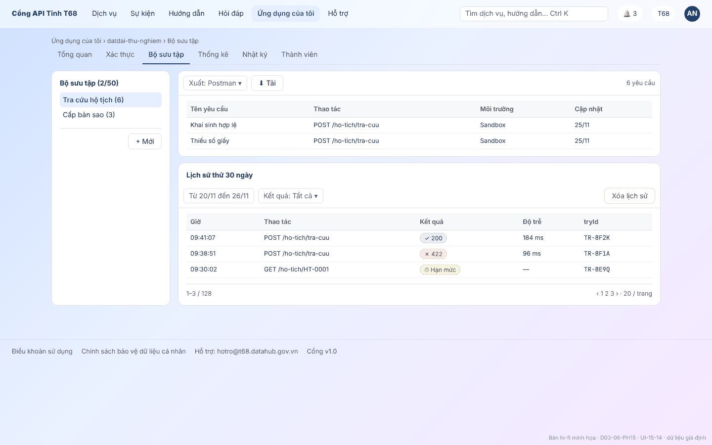

| # | Thành phần | `CMP-*` | Nội dung, kiểm tra |
|---|---|---|---|
| 1 | Cây bộ sưu tập | `CMP-TreeView` | Tối đa 50 bộ, mỗi bộ ≤ 100 yêu cầu; tạo, đổi tên, xóa |
| 2 | Bảng yêu cầu | `CMP-DataTable` | Tên, thao tác, môi trường, cập nhật; mở ở UI-15-06 giữ nguyên tham số; mỗi yêu cầu ≤ 16 KB |
| 3 | Xuất | `CMP-Select` + `CMP-Button` | `postman`, `bruno`, `http`; tải tệp; không chứa bí mật |
| 4 | Lịch sử | `CMP-DataTable` | Giờ, thao tác, kết quả (`CMP-StatusTag`), độ trễ, `tryId`; lọc `tu`, `den`, `api`, `ket-qua` |
| 5 | Xóa lịch sử | `CMP-ConfirmDialog` | Gõ lại "XOA"; lịch sử giữ `15.try.history-days` |

: UI-15-14 Thành phần

| Trạng thái | Hiển thị |
|---|---|
| Đang tải | Skeleton cây và bảng |
| Rỗng | "Chưa có lượt thử nào. Thử API để lưu lịch sử" và "Chưa có bộ sưu tập" (ST-03) |
| Lỗi | ST-05; ERR-15-003 khi vượt 50 bộ hoặc 100 yêu cầu (câu của máy chủ) |
| Không có quyền | Thiếu `PERM-15-try`: tab ẩn |

: UI-15-14 Trạng thái

Không chia sẻ bộ sưu tập ở Đợt 2 (Q15-12). Ở 360 px cây thành `CMP-Select`, hai bảng chuyển thẻ.

## 21. UI-15-15 Đăng ký sử dụng

::: dac-ta
**Mục đích.** Cho cán bộ đầu mối gửi đăng ký sử dụng API production từ cổng (ủy thác FR-02-046) và theo dõi trạng thái các đăng ký của tổ chức. Cổng không duyệt.

**Người dùng, quyền.** OR có HTTT `ACTIVE` (ERR-15-032 nếu không); xem đăng ký của tổ chức mình.

**FR, UC hiện thực.** FR-15-044, 045; UC-15-23.

**Truy vết hệ cũ.** LGC-APIM-019, 020.

**Đường dẫn.** `/dang-ky-su-dung`; tham số `trang-thai`, `api`, `he-thong`.

**Mẫu bố cục.** PTN-05 Wizard kèm danh sách bên phải.

**API.** API-15-087 (`POST /subscriptions`), 088, 089, 090 (`:cancel`).

**Phát hành, mức chi tiết.** Đợt 2; đầy đủ.
:::

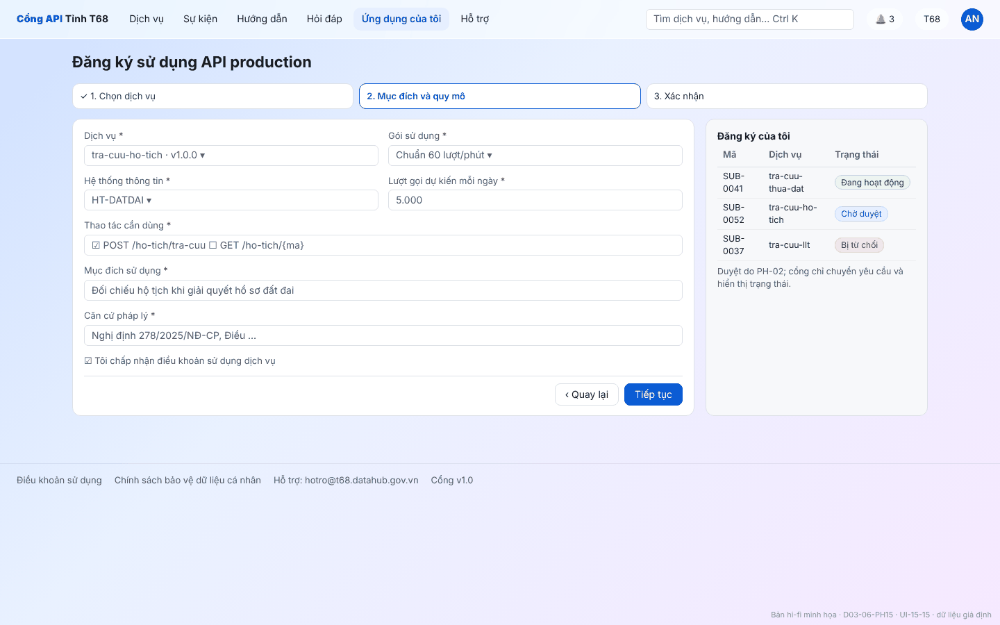

Ảnh ở bước 2 của wizard ba bước; cột phải là danh sách đăng ký của tổ chức với nhãn trạng thái do PH-02 trả.

### 21.1. Các bước và trường

Wizard ba bước; bảng nêu trường của từng bước và quy tắc kiểm tra.

| Bước | Trường | Kiểu | Bắt buộc | Kiểm tra |
|---|---|---|---|---|
| 1 Chọn dịch vụ | `apiCode`, `versionNo`, `planCode` | `CMP-ApiSelect`, `CMP-Select` | Có | Phiên bản `PUBLISHED`; gói theo PH-02 |
| 2 Mục đích và quy mô | `systemCode` | `CMP-Select` | Có | HTTT `ACTIVE` của tổ chức |
| | `expectedDailyCalls` | `CMP-NumberInput` | Có | Số nguyên dương |
| | `operations[]` | `CMP-Checkbox` nhóm | Có | Ít nhất một thao tác |
| | `purpose`, `legalBasis` | `CMP-TextArea` | Có | Theo FR-02-046 |
| 3 Xác nhận | `termsAccepted` | `CMP-Checkbox` | Có | Phải bật; tóm tắt rồi "Gửi đăng ký" |

: UI-15-15 Các bước và trường

Sau khi gửi, hiện `CMP-Toast` "Đã gửi đăng ký {mã}" và chuyển danh sách; dòng mới trạng thái "Chờ duyệt". Nút "Hủy đăng ký" (`CMP-ConfirmDialog`) khi còn chờ duyệt. Lỗi: ERR-15-032 (`CMP-ResultPage`), ERR-15-030 (PH-02 lỗi, giữ dữ liệu đã nhập), ERR-15-037 (gửi quá nhiều). Đang tải: skeleton bước và danh sách; rỗng: "Tổ chức chưa có đăng ký sử dụng nào"; không có quyền: ERR-15-032. Bước có thể lưu nháp cục bộ (không chứa bí mật). Ở 360 px danh sách xuống dưới wizard.

## 22. UI-15-16 Kết nạp HTTT

::: dac-ta
**Mục đích.** Cho cán bộ đầu mối nộp hồ sơ kết nạp hệ thống thông tin (F-01) tới PH-01 và theo dõi trạng thái; cổng không thẩm định.

**Người dùng, quyền.** OR của tổ chức.

**FR, UC hiện thực.** FR-15-046; UC-15-24.

**Truy vết hệ cũ.** LGC-APIM-020 (liên quan).

**Đường dẫn.** `/ket-nap`.

**Mẫu bố cục.** PTN-05 Wizard bốn bước.

**API.** API-15-091 (`POST /onboarding/applications`), 092, 093.

**Phát hành, mức chi tiết.** Đợt 2; đầy đủ.
:::

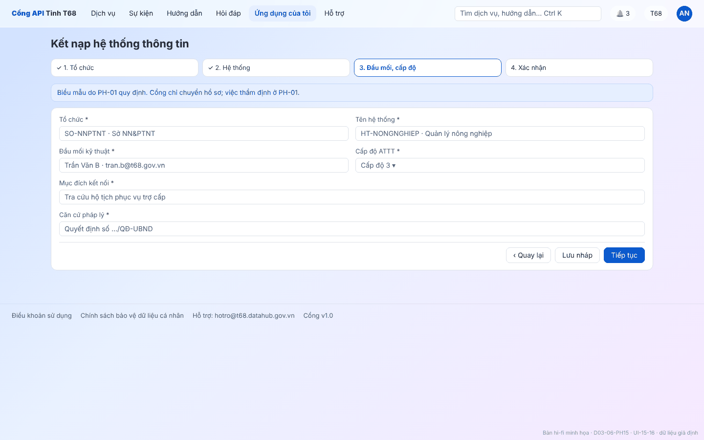

Ảnh ở bước 3 (đầu mối, cấp độ an toàn thông tin). Biểu mẫu dựng từ lược đồ của PH-01 bằng `CMP-DynamicForm` (Q15-33); hồ sơ gồm tổ chức, HTTT, đầu mối, cấp độ ATTT, mục đích, căn cứ pháp lý.

| # | Thành phần | `CMP-*` | Nội dung, kiểm tra |
|---|---|---|---|
| 1 | Các bước | `CMP-Wizard`, `CMP-Steps` | Tổ chức, Hệ thống, Đầu mối và cấp độ, Xác nhận; bước đã xong có dấu ✓ và chữ |
| 2 | Biểu mẫu | `CMP-DynamicForm` | Lược đồ từ PH-01; kiểm tra theo lược đồ; lỗi từng trường |
| 3 | Dải thông tin | `CMP-Banner` | "Hồ sơ do PH-01 thẩm định" |
| 4 | Lưu nháp, gửi | `CMP-Button`, `CMP-SaveIndicator` | Lưu nháp cục bộ; Gửi gọi API-15-091 |
| 5 | Theo dõi | `CMP-DataTable`, `CMP-StatusTag` | Mã hồ sơ, trạng thái theo PH-01 |

: UI-15-16 Thành phần

Trạng thái: đang tải lược đồ (skeleton ô); rỗng (chưa có hồ sơ): "Chưa có hồ sơ kết nạp nào"; lỗi: ERR-15-031 giữ dữ liệu đã nhập kèm "Thử lại", ERR-15-032; không có quyền: ERR-15-032. Thông báo gửi thành công nêu mã hồ sơ. Ở 360 px các bước thành danh sách dọc.

## 23. UI-15-17 Công bố API

::: dac-ta
**Mục đích.** Cho chủ dịch vụ gửi đặc tả OpenAPI 3.1 và mô tả nghiệp vụ để công bố API (F-02, ủy thác PH-02); theo dõi hồ sơ công bố.

**Người dùng, quyền.** SV của tổ chức có HTTT `ACTIVE`.

**FR, UC hiện thực.** FR-15-047; UC-15-25.

**Truy vết hệ cũ.** LGC-APIM-007 (công bố API).

**Đường dẫn.** `/cong-bo`, `/cong-bo/moi`.

**Mẫu bố cục.** PTN-05 Wizard, kèm danh sách hồ sơ.

**API.** API-15-094 (`POST /publications`), 095, 096.

**Phát hành, mức chi tiết.** Đợt 2; đầy đủ.
:::

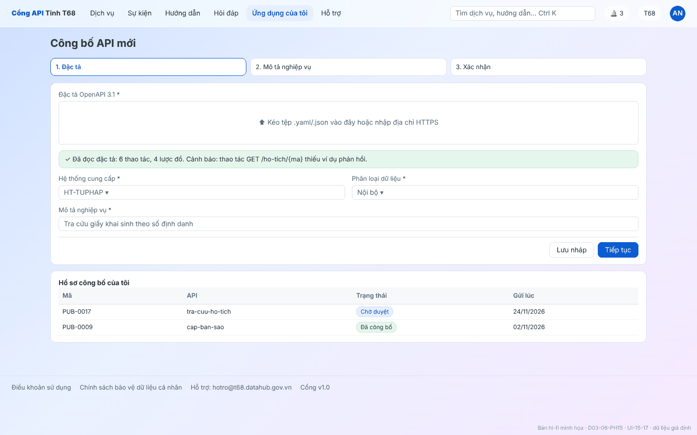

| # | Thành phần | `CMP-*` | Nội dung, kiểm tra |
|---|---|---|---|
| 1 | Tải đặc tả | `CMP-FileDropzone` | Tệp `.yaml`, `.json` hoặc URL HTTPS; OpenAPI 3.1 |
| 2 | Kết quả đọc | `CMP-Alert` | Số thao tác, lược đồ; cảnh báo thiếu ví dụ; ERR-15-009 khi không đọc được |
| 3 | Thông tin | `CMP-Select`, `CMP-TextArea` | `systemCode`, `dataClass` (Công khai, Nội bộ, Hạn chế, Nhạy cảm), mô tả nghiệp vụ |
| 4 | Hồ sơ của tôi | `CMP-DataTable` | Mã, API, trạng thái (do PH-02), ngày gửi |

: UI-15-17 Thành phần

Trạng thái: rỗng "Chưa có hồ sơ công bố"; lỗi ERR-15-030, ERR-15-009, ERR-15-032; không có quyền: thiếu vai trò SV trả ERR-15-005. Sau khi gửi: "Đã gửi hồ sơ công bố, PH-02 sẽ duyệt". Việc đặt `portalPublished` và duyệt không thuộc cổng. Ở 360 px vùng thả tệp thành nút "Chọn tệp".

## 24. UI-15-18 Tổng quan cá nhân

::: dac-ta
**Mục đích.** Trang đầu sau đăng nhập: ứng dụng, lượt thử, đăng ký chờ duyệt, thông tin xác thực sắp hết hạn, thay đổi API đang theo dõi, việc nên làm.

**Người dùng, quyền.** Mọi người đã đăng nhập.

**FR, UC hiện thực.** FR-15-048; UC-15-26.

**Truy vết hệ cũ.** LGC-APIM-022 (một phần).

**Đường dẫn.** `/tong-quan`; tham số `khoang`.

**Mẫu bố cục.** PTN-06 Dashboard.

**API.** API-15-097 (`/dashboard`).

**Phát hành, mức chi tiết.** Đợt 2; đầy đủ.
:::

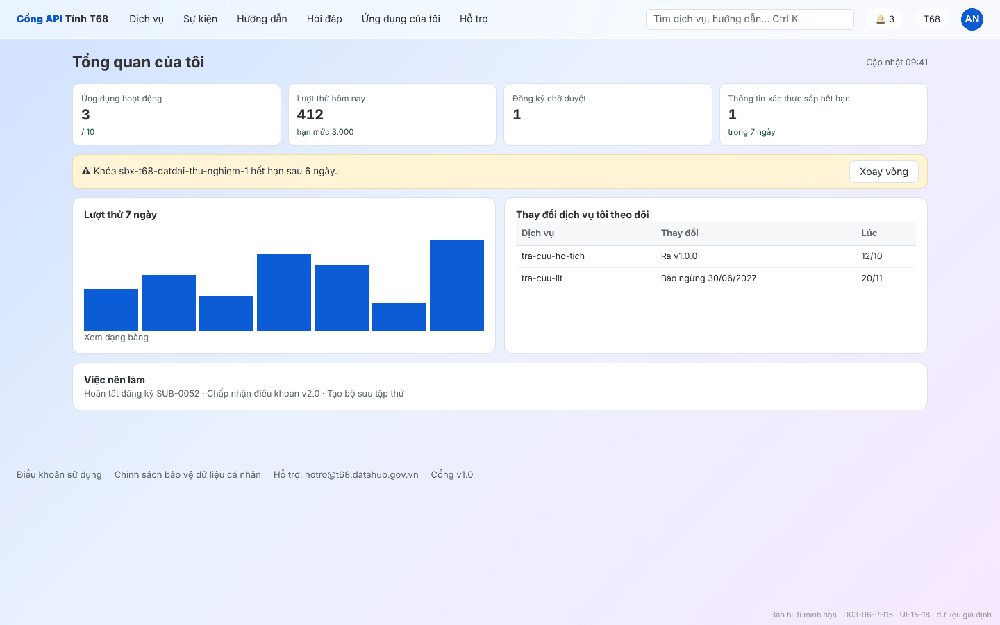

| # | Thành phần | `CMP-*` | Nội dung |
|---|---|---|---|
| 1 | Thẻ số liệu | `CMP-KpiCard` | Ứng dụng hoạt động, lượt thử hôm nay, đăng ký chờ duyệt, xác thực sắp hết hạn; mỗi thẻ là liên kết |
| 2 | Dải cảnh báo | `CMP-Banner` | Khóa sắp hết hạn kèm nút "Xoay vòng" |
| 3 | Biểu đồ lượt thử | `CMP-Chart` | 7 ngày, có bảng thay thế |
| 4 | Thay đổi đang theo dõi | `CMP-DataTable` | Từ EVT-02-12; mở UI-15-04 |
| 5 | Việc nên làm | `CMP-Card` | Danh sách gợi ý theo trạng thái |

: UI-15-18 Thành phần

Mỗi khối tải riêng (skeleton); lỗi từng khối `ERR-15-039`, `ERR-15-030`, khối khác vẫn hiện; rỗng: "Chưa có hoạt động. Tạo ứng dụng và thử API để thấy số liệu"; không có quyền: chuyển `/dang-nhap`. Hiện "Cập nhật lúc HH:mm". Ở 360 px thẻ hai cột, biểu đồ một cột.

## 25. UI-15-19 Hộp thông báo và theo dõi

::: dac-ta
**Mục đích.** Đọc thông báo trong cổng (thay đổi API, lộ trình ngừng, đăng ký, xác thực sắp hết hạn) và quản lý các API đang theo dõi, kênh nhận.

**Người dùng, quyền.** Mọi người đã đăng nhập.

**FR, UC hiện thực.** FR-15-051, 052; UC-15-27.

**Truy vết hệ cũ.** LGC-APIM-006 (thông báo).

**Đường dẫn.** `/tai-khoan/thong-bao`; tham số `tab`, `loai`, `da-doc`.

**Mẫu bố cục.** PTN-01 hai tab.

**API.** API-15-101…106.

**Phát hành, mức chi tiết.** Đợt 2; đầy đủ.
:::

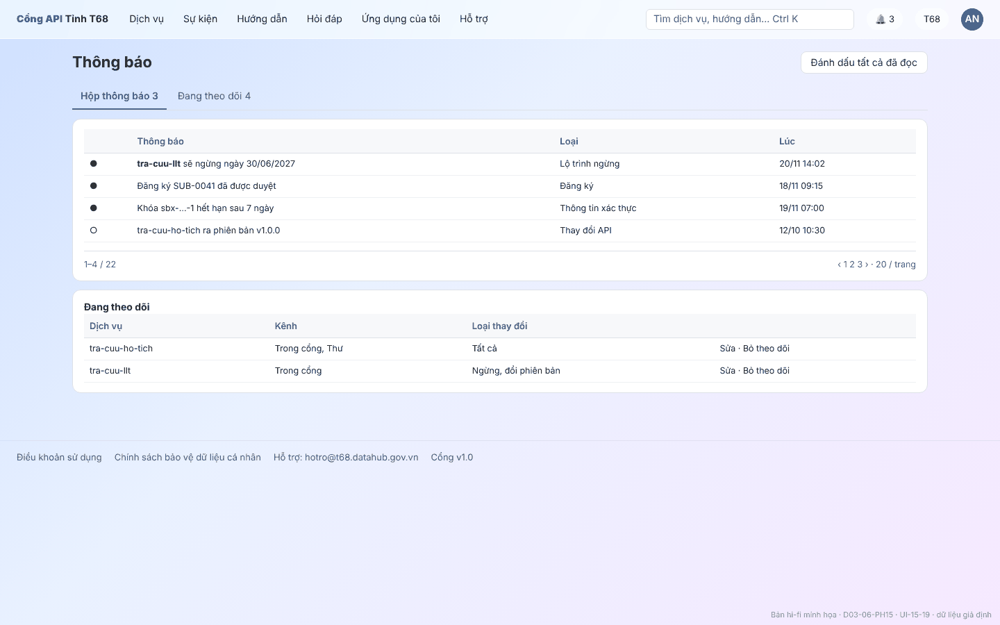

| # | Thành phần | `CMP-*` | Nội dung, kiểm tra |
|---|---|---|---|
| 1 | Tab | `CMP-Tabs` | "Hộp thông báo" (số chưa đọc), "Đang theo dõi" |
| 2 | Danh sách thông báo | `CMP-DataTable` | Chấm chưa đọc kèm chữ "Chưa đọc", nội dung, loại, giờ; Enter đánh dấu đã đọc và mở liên kết |
| 3 | "Đánh dấu tất cả đã đọc" | `CMP-Button` | API-15-106 |
| 4 | Bảng theo dõi | `CMP-DataTable` | API, kênh (`IN_APP`, `EMAIL`), loại thay đổi; Sửa, Bỏ theo dõi |
| 5 | Chuông | `CMP-NotificationCenter` | Số chưa đọc; mở bản rút gọn 5 thông báo |

: UI-15-19 Thành phần

Trạng thái: đang tải skeleton; rỗng "Không có thông báo mới" và "Bạn chưa theo dõi dịch vụ nào"; lỗi ST-05; không có quyền: chuyển `/dang-nhap`. Số huy hiệu dùng `aria-live="polite"`. Ở 360 px bảng thành thẻ.

## 26. UI-15-20 Hỗ trợ và hỏi đáp

::: dac-ta
**Mục đích.** Gửi và theo dõi yêu cầu hỗ trợ cho chủ dịch vụ (câu hỏi, lỗi tài liệu, đề nghị truy cập), nhắn thêm trong phiếu; hỏi đáp công khai theo API.

**Người dùng, quyền.** Mọi người đã đăng nhập, trên phiếu của mình.

**FR, UC hiện thực.** FR-15-053, 054; UC-15-28.

**Truy vết hệ cũ.** Không có ở hệ cũ.

**Đường dẫn.** `/ho-tro`, `/ho-tro/moi`, `/ho-tro/{ma-yeu-cau}`; tham số `trang-thai`, `loai`.

**Mẫu bố cục.** PTN-01 (danh sách) và PTN-02 (chi tiết phiếu, hai cột).

**API.** API-15-107…113.

**Phát hành, mức chi tiết.** Đợt 2; hỏi đáp công khai Đợt 3.
:::

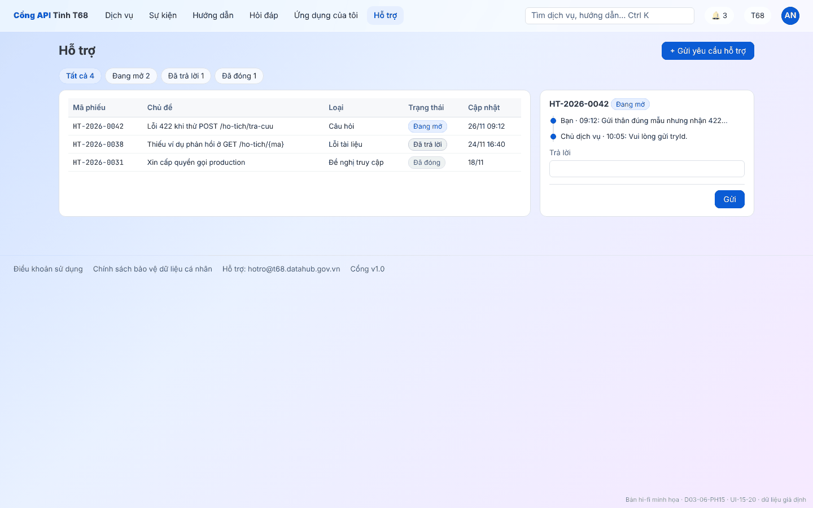

| Trường (phiếu mới) | Kiểu | Bắt buộc | Kiểm tra |
|---|---|---|---|
| Loại (`kind`) | `CMP-Select` | Có | `QUESTION`, `DOC_ERROR`, `SUPPORT_REQUEST`, `ACCESS_REQUEST` |
| Dịch vụ (`apiCode`) | `CMP-ApiSelect` | Không | Dịch vụ người xem được thấy |
| Chủ đề (`subject`) | `CMP-Input` | Có | ≤ 150 ký tự |
| Nội dung (`body`) | `CMP-TextArea` | Có | Văn bản thuần ≤ 4.000 ký tự, đếm ký tự |

: UI-15-20 Trường phiếu mới

Cột phải của chi tiết phiếu là dòng thời gian (`CMP-Timeline`) và ô trả lời. Mã phiếu theo mẫu `HT-{năm}-{số}`. Trạng thái: đang tải skeleton; rỗng "Bạn chưa gửi yêu cầu hỗ trợ nào" + nút "Gửi yêu cầu hỗ trợ"; lỗi: ERR-15-029 (phiếu đã đóng, khóa ô trả lời), ERR-15-037 (gửi quá nhiều), ERR-15-003; không có quyền: phiếu của người khác trả `ERR-15-001`. Gửi thành công: `CMP-Toast` nêu mã phiếu. Ở 360 px hai cột thành một, phiếu mở toàn màn.

## 27. UI-15-21 Soạn trang nội dung

::: dac-ta
**Mục đích.** Soạn trang hướng dẫn, FAQ, thông báo, điều khoản bằng Markdown có xem trước cạnh bên, tự lưu, đính kèm ảnh, gửi duyệt; nhập từ kho Git.

**Người dùng, quyền.** `PERM-15-content-write` (SV chỉ trang của tổ chức mình, CA, TA).

**FR, UC hiện thực.** FR-15-014, 018; UC-15-06, UC-15-08.

**Truy vết hệ cũ.** LGC-APIM-017 (trang tài liệu).

**Đường dẫn.** `/quan-tri-cong/noi-dung/{ma-trang}`; tham số `phien-ban`.

**Mẫu bố cục.** PTN-03 Biểu mẫu trang, vùng soạn chia đôi.

**API.** API-15-022…025, 033, 038, 039, 040.

**Phát hành, mức chi tiết.** Đợt 2; nhập Git Đợt 3; rất chi tiết.
:::

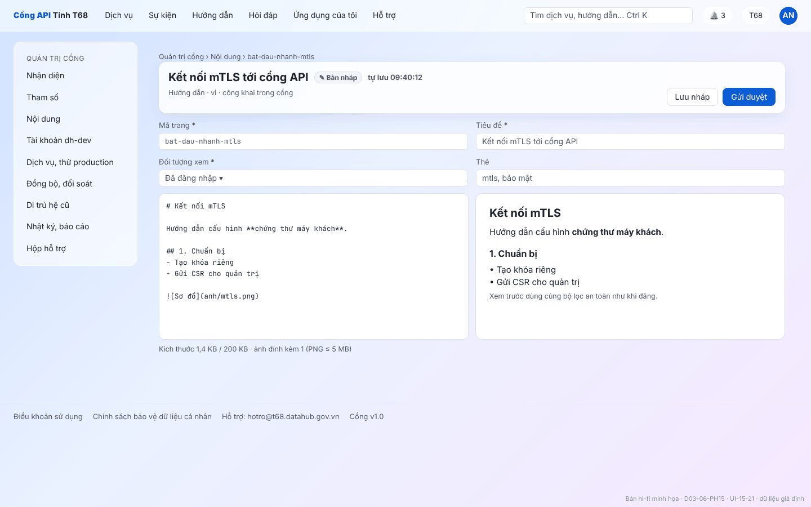

Ảnh có đầu trang kính (tiêu đề, nhãn "Bản nháp", chỉ báo tự lưu, nút Lưu nháp và Gửi duyệt), hàng siêu dữ liệu và vùng soạn Markdown bên trái với bản xem trước bên phải.

### 27.1. Trường siêu dữ liệu

Bảng liệt kê trường siêu dữ liệu của trang theo FR-15-014.

| Trường | Kiểu | Bắt buộc | Kiểm tra |
|---|---|---|---|
| `pageCode` | `CMP-Input` mono | Có | `^[a-z0-9][a-z0-9-]{1,62}$`, bất biến; trùng kể cả đã lưu trữ: ERR-15-002 |
| `type` | `CMP-Select` | Có | `GUIDE`, `QUICKSTART`, `FAQ`, `ANNOUNCEMENT`, `TERMS` |
| `lang` | `CMP-SegmentedControl` | Có | `vi`, `en` |
| `title` | `CMP-Input` | Có | 3…150 ký tự |
| `audience` | `CMP-Select` | Có | `PUBLIC`, `LOGGED_IN`, `TENANT` |
| `apiCode` | `CMP-ApiSelect` | Không | API thuộc tổ chức người soạn |
| `tags[]` | `CMP-Select` chế độ thẻ | Không | ≤ 10 |
| `validFrom`, `validTo` | `CMP-DateRangePicker` | Với `ANNOUNCEMENT` | `validTo` sau `validFrom` |
| `body` | `CMP-CodeEditor` chế độ Markdown (A2) | Có | Markdown ≤ 200 KB; không HTML thô, script, iframe, `javascript:` (ERR-15-021) |

: UI-15-21 Trường

### 27.2. Hành vi

Bảng nêu hành vi của bộ soạn: tự lưu, xem trước, đính kèm, gửi duyệt, nhập từ Git.

| Hành vi | Mô tả |
|---|---|
| Tự lưu | Mỗi 30 giây phía máy chủ; `CMP-SaveIndicator` "Đã lưu 09:40:12"; lưu có chủ đích bằng `Ctrl+S` |
| Xem trước | Cùng bộ lọc an toàn khi đăng (BR-15-013); đồng bộ cuộn; ẩn ở 360 px, mở bằng nút "Xem trước" |
| Đính kèm ảnh | `CMP-Upload` PNG, JPEG, WebP ≤ 5 MB, không SVG; ảnh chèn vào Markdown; sai: ERR-15-024 |
| Mẫu có sẵn | "Kết nối mTLS", "Lấy token client_credentials", "Xử lý lỗi RFC 9457", "Danh sách kiểm tra tích hợp" |
| Gửi duyệt | `CMP-ConfirmDialog`; người gửi khác người duyệt (ERR-15-023 ở UI-15-22) |
| Nhập từ Git | `CMP-Drawer`: `repoUrl` HTTPS, `branch`, `path` (mặc định `docs/`), mã truy cập ghi một chiều; lỗi ERR-15-025, ERR-15-026 |
| Xung đột sửa | 412: `CMP-ConflictDialog` (ERR-15-006) |

: UI-15-21 Hành vi

| Trạng thái | Hiển thị |
|---|---|
| Đang tải | Skeleton siêu dữ liệu và vùng soạn |
| Rỗng | Trang mới: vùng soạn trống kèm chọn mẫu |
| Lỗi | ERR-15-021 dải đầu vùng soạn có số dòng vi phạm; ERR-15-002, 003, 006, 022 (trang không ở bản nháp thì mở bản nháp mới) |
| Không có quyền | Thiếu `content-write`: 403; ngoài mạng quản trị: ERR-15-036 |

: UI-15-21 Trạng thái

Phím tắt: `Ctrl+S` lưu, `Ctrl+Enter` gửi duyệt khi tiêu điểm ở đầu trang (không trong vùng soạn), `Ctrl+B`, `Ctrl+I` đậm, nghiêng. Truy cập: vùng soạn có nhãn và hướng dẫn thoát Tab; bản xem trước `aria-live="off"`. Màn quản trị khuyến nghị dùng máy tính nhưng mở được ở 360 px (Q15-37).

## 28. UI-15-22 Duyệt nội dung, quản lý trang

::: dac-ta
**Mục đích.** Hộp việc cho người duyệt: xem phiên bản chờ duyệt kèm so sánh với bản đang đăng, duyệt và đăng hoặc từ chối; quản lý trang (phiên bản, khôi phục, gỡ đăng).

**Người dùng, quyền.** `PERM-15-content-publish` (CA, TA) để duyệt, đăng, gỡ; `PERM-15-content-write` xem danh sách và phiên bản của mình.

**FR, UC hiện thực.** FR-15-015, 016; UC-15-07.

**Truy vết hệ cũ.** LGC-APIM-017.

**Đường dẫn.** `/quan-tri-cong/noi-dung`; tham số `trang-thai`, `loai`, `q`.

**Mẫu bố cục.** PTN-10 Hộp việc và duyệt.

**API.** API-15-026…032.

**Phát hành, mức chi tiết.** Đợt 2; đầy đủ.
:::

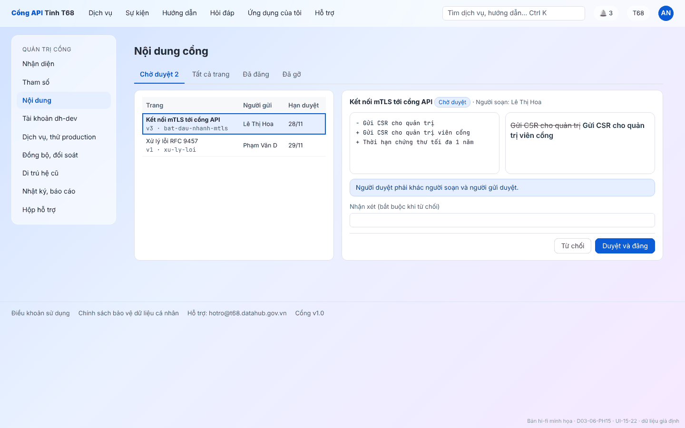

Ảnh có tab "Chờ duyệt 2", danh sách trang chờ bên trái, bên phải so sánh bản thay đổi (hai khung có gạch ngang cho phần bị bỏ, in đậm cho phần thêm, không chỉ dựa màu), dải nhắc bốn mắt, ô nhận xét và hai nút quyết định.

| # | Thành phần | `CMP-*` | Nội dung, kiểm tra |
|---|---|---|---|
| 1 | Tab | `CMP-Tabs` | Chờ duyệt, Tất cả trang, Đã đăng, Đã gỡ; có số đếm |
| 2 | Danh sách | `CMP-DataTable` | Trang, phiên bản, người soạn, người gửi, hạn duyệt (`15.content.review-sla-days`), nhãn trạng thái |
| 3 | So sánh | `CMP-DiffViewer` | Bản đang đăng với bản chờ; chuyển "Xem trước" và "Nguồn" |
| 4 | Quyết định | `CMP-DecisionPanel` | "Duyệt và đăng"; "Từ chối" bắt buộc nhận xét ≤ 2.000 ký tự |
| 5 | Lịch sử phiên bản | `CMP-VersionTimeline` | Khôi phục bản cũ thành bản nháp mới (`:restore`) |
| 6 | Gỡ đăng | `CMP-ReasonDialog` | Lý do bắt buộc; trang chuyển `UNPUBLISHED` |
| 7 | Tạo trang | `CMP-Modal` | Mã, loại, ngôn ngữ; rồi mở UI-15-21 |

: UI-15-22 Thành phần

| Trạng thái | Hiển thị |
|---|---|
| Đang tải | Skeleton danh sách và khung so sánh |
| Rỗng | "Không có trang nào chờ duyệt" (ST-03) |
| Lỗi | ERR-15-023 (cùng người soạn, gửi): nút "Duyệt" vô hiệu kèm câu; ERR-15-022 (sai trạng thái), ERR-15-006 |
| Không có quyền | Thiếu `content-publish`: nút quyết định ẩn, vẫn xem được so sánh |

: UI-15-22 Trạng thái

Phím tắt: `J`, `K` chuyển giữa các trang chờ; `A` duyệt, `R` từ chối khi tiêu điểm không ở ô nhập (giả định, theo PTN-10). Ở 360 px danh sách và chi tiết là hai bước điều hướng.

## 29. UI-15-23 Khai báo sandbox và thử production

::: dac-ta
**Mục đích.** Cho chủ dịch vụ khai báo sandbox của từng phiên bản (MOCK, BACKEND, tắt) và đề xuất bật thử production; cho người duyệt duyệt hoặc tắt thử production.

**Người dùng, quyền.** SV của dịch vụ: khai báo, đề xuất; CA, TA có `PERM-15-portal-admin`: duyệt, tắt (người duyệt khác người đề xuất, ERR-15-023).

**FR, UC hiện thực.** FR-15-034, 042; UC-15-18, UC-15-21.

**Truy vết hệ cũ.** Không có ở hệ cũ.

**Đường dẫn.** `/quan-tri-cong/dich-vu/{ma-api}`; tham số `phien-ban`.

**Mẫu bố cục.** PTN-02 Chi tiết với hai khối biểu mẫu.

**API.** API-15-069, 070, 083…086.

**Phát hành, mức chi tiết.** Đợt 2; đầy đủ.
:::

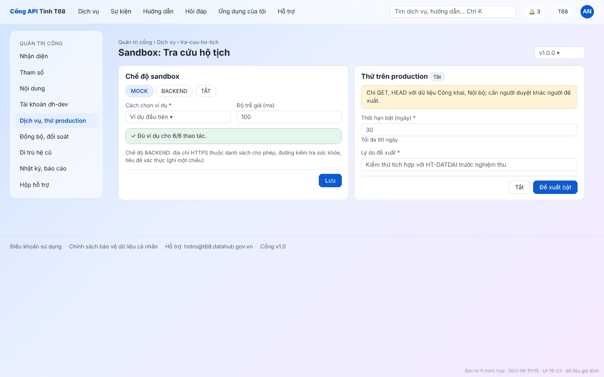

### 29.1. Trường

Bảng liệt kê trường khai báo sandbox và đề xuất thử production.

| Trường | Kiểu | Bắt buộc | Kiểm tra |
|---|---|---|---|
| Phiên bản (`versionNo`) | `CMP-Select` | Có | Phiên bản có trong bản sao; đã ngừng: ERR-15-040 |
| Chế độ (`mode`) | `CMP-SegmentedControl` | Có | `MOCK`, `BACKEND`, `OFF` |
| Cách chọn ví dụ (`examplePolicy`) | `CMP-Select` | Với MOCK | `FIRST`, `RANDOM` |
| Độ trễ giả (`mockLatencyMs`) | `CMP-NumberInput` | Không | 0…2000, mặc định 50 |
| Địa chỉ backend (`backendUrl`) | `CMP-Input` | Với BACKEND | HTTPS, trong danh sách cho phép (ERR-15-119) |
| Đường kiểm tra (`healthPath`) | `CMP-Input` | Không | Bắt đầu bằng `/`; nút "Kiểm tra kết nối" |
| Tiêu đề xác thực backend | `CMP-SecretField` | Không | Ghi một chiều, không hiện lại |
| Thời hạn bật production (`validDays`) | `CMP-NumberInput` | Khi đề xuất | 1…`15.try.prod-max-days` |
| Lý do (`reason`) | `CMP-TextArea` | Khi đề xuất | Bắt buộc |

: UI-15-23 Trường

Khối MOCK liệt kê thao tác thiếu ví dụ (cảnh báo ERR-15-110). Khối thử production nêu điều kiện cố định: chỉ GET, HEAD, dữ liệu Công khai hoặc Nội bộ (ngầm định Q15-05), tối đa 90 ngày; trạng thái `OFF`, `PENDING`, `ENABLED`, `EXPIRED`. Trạng thái: đang tải skeleton hai khối; rỗng: sandbox chưa khai báo hiện "Dịch vụ chưa có sandbox. Chọn chế độ để bắt đầu"; lỗi: ERR-15-119, 120, 040, 023, ERR-15-006; không có quyền: 403, người không phải chủ dịch vụ trả `ERR-15-001`. Ở 360 px hai khối xếp dọc.

## 30. UI-15-24 Quản trị tài khoản dh-dev và ứng dụng

::: dac-ta
**Mục đích.** Duyệt hoặc từ chối tài khoản nhà thầu, khóa và mở khóa tài khoản và ứng dụng sandbox lạm dụng, theo dõi hạn duyệt và tài khoản bị vô hiệu.

**Người dùng, quyền.** `PERM-15-dev-approve` (TA, SO, PA).

**FR, UC hiện thực.** FR-15-024, 058, 059; UC-15-30, UC-15-12.

**Truy vết hệ cũ.** Không có ở hệ cũ.

**Đường dẫn.** `/quan-tri-cong/tai-khoan-dev`; tham số `trang-thai`, `q`.

**Mẫu bố cục.** PTN-10 Hộp việc, chi tiết ở ngăn kéo.

**API.** API-15-121…127.

**Phát hành, mức chi tiết.** Đợt 2; đầy đủ.
:::

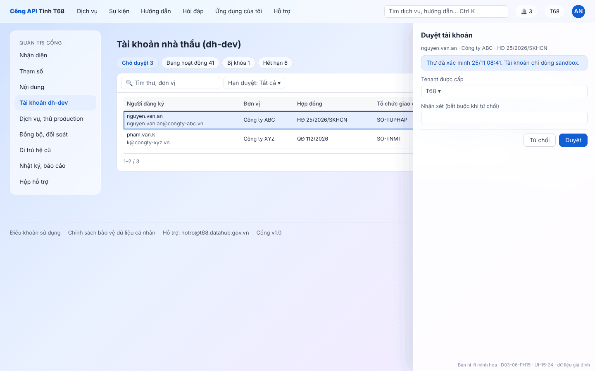

Ảnh có facet trạng thái, bảng tài khoản (dòng quá hạn duyệt hiện nhãn "Quá hạn 1 ngày") và ngăn kéo "Duyệt tài khoản" kính với thông tin, tenant được cấp, ô nhận xét.

| # | Thành phần | `CMP-*` | Nội dung, kiểm tra |
|---|---|---|---|
| 1 | Facet | `CMP-FilterChips` | Chờ duyệt, Đang hoạt động, Bị khóa, Hết hạn |
| 2 | Bảng | `CMP-DataTable` | Người đăng ký, đơn vị, hợp đồng, tổ chức giao việc, thời điểm, trạng thái; hạn `15.dev.approval-sla-days` |
| 3 | Ngăn kéo duyệt | `CMP-Drawer`, `CMP-DecisionPanel` | `tenantGrants[]` (mặc định tenant hiện tại), nhận xét bắt buộc khi từ chối; "Duyệt" kích hoạt tài khoản |
| 4 | Khóa, mở khóa | `CMP-ReasonDialog` | `userId` hoặc `appCode`; lý do bắt buộc; khóa tài khoản đóng phiên và thu hồi xác thực sandbox |
| 5 | Ứng dụng của tài khoản | `CMP-DataTable` | Tạm ngừng, tiếp tục ứng dụng (`:suspend`, `:resume`) |

: UI-15-24 Thành phần

| Trạng thái | Hiển thị |
|---|---|
| Đang tải | Skeleton bảng |
| Rỗng | "Không có tài khoản nào chờ duyệt" |
| Lỗi | ERR-15-022 (đối tượng đã đổi trạng thái), ERR-15-020 (Keycloak), ERR-15-006 |
| Không có quyền | Thiếu `dev-approve`: 403; nhà thầu `dh-dev` không bao giờ thấy khu này |

: UI-15-24 Trạng thái

Ở 360 px bảng chuyển thẻ, ngăn kéo toàn màn hình. Phím tắt: `Esc` đóng ngăn kéo.

## 31. UI-15-25 Nhận diện và tham số cổng

::: dac-ta
**Mục đích.** Cấu hình tên, khẩu hiệu, logo, liên kết chân trang, thông tin hỗ trợ, lời chào của cổng tenant và các tham số `15.*` trong miền cho phép.

**Người dùng, quyền.** `PERM-15-portal-admin` (CA, TA).

**FR, UC hiện thực.** FR-15-056, 057; UC-15-29.

**Truy vết hệ cũ.** LGC-APIM-007.

**Đường dẫn.** `/quan-tri-cong/nhan-dien`, `/quan-tri-cong/tham-so`.

**Mẫu bố cục.** PTN-12 Cài đặt.

**API.** API-15-116…120.

**Phát hành, mức chi tiết.** Đợt 2; đầy đủ.
:::

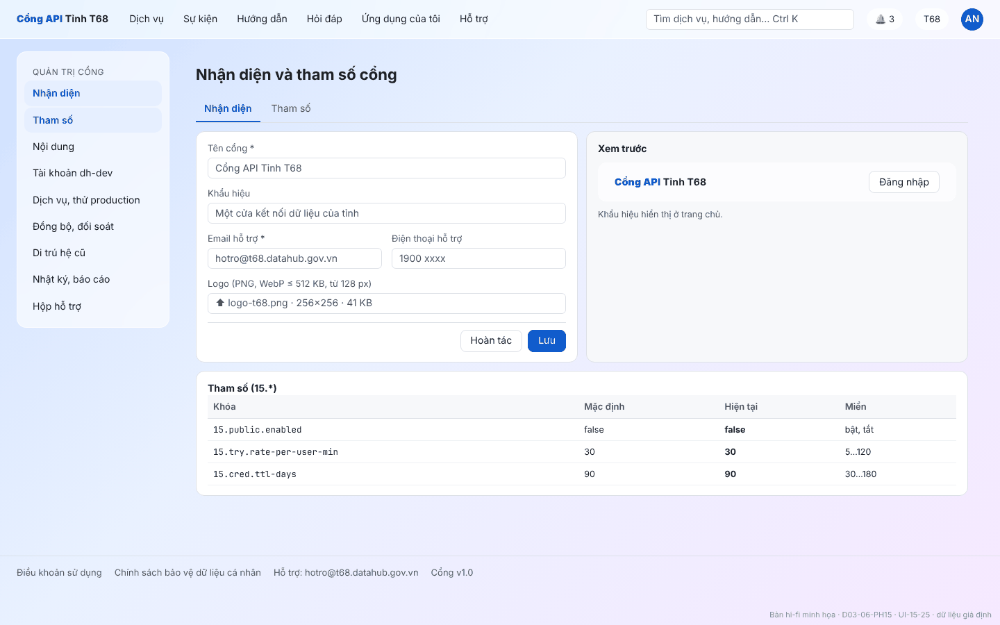

| Trường nhận diện | Kiểu | Bắt buộc | Kiểm tra |
|---|---|---|---|
| `portalName` | `CMP-Input` | Có | 3…80 ký tự |
| `tagline` | `CMP-Input` | Không | ≤ 160 |
| `logo` | `CMP-Upload` | Không | PNG hoặc WebP ≤ 512 KB, từ 128 px; sai: ERR-15-024, ERR-15-033 |
| `supportEmail`, `supportPhone` | `CMP-Input` | Có (thư) | Hợp lệ |
| `footerLinks[]` | `CMP-KeyValueEditor` | Không | ≤ 8 liên kết HTTPS |
| `welcomeText` | `CMP-TextArea` | Không | Markdown ngắn ≤ 2 KB |

: UI-15-25 Trường nhận diện

Tab Tham số là bảng `CMP-DataTable` các khóa `15.*`: Khóa, Mặc định, Hiện tại (sửa tại chỗ bằng `CMP-NumberInput` hoặc `CMP-Switch`), Miền, Lý do; ngoài miền: ERR-15-034 dưới ô; mọi lưu cần lý do. Khung xem trước bên phải dựng thanh trên thật bằng dữ liệu đang nhập (chưa lưu). Lưu: `If-Match`, xung đột ERR-15-006. Logo mặc định của nền tảng được dùng khi tenant chưa tải (Q15-32). Trạng thái: đang tải skeleton biểu mẫu; rỗng không áp dụng (có giá trị mặc định); lỗi ERR-15-033, 034, 006; không có quyền: 403. Ở 360 px khung xem trước xuống dưới.

## 32. UI-15-26 Nhật ký truy cập, thử, báo cáo

::: dac-ta
**Mục đích.** Tra nhật ký truy cập, tải đặc tả nhạy cảm, thử API, cấp bí mật, khóa tài khoản, đổi tham số; xem báo cáo sử dụng cổng; xuất CSV hoặc XLSX.

**Người dùng, quyền.** `PERM-15-audit-read` (TA, SO, AU, PA); xuất ghi `EXPORT_AUDIT`.

**FR, UC hiện thực.** FR-15-060; UC-15-31.

**Truy vết hệ cũ.** LGC-APIM-027 (kiểm toán, liên quan).

**Đường dẫn.** `/quan-tri-cong/nhat-ky`; tham số `tu`, `den`, `hanh-dong`, `nguoi-dung`, `api`, `ung-dung`, `ket-qua`.

**Mẫu bố cục.** PTN-11 Giám sát và tra log.

**API.** API-15-128, 129, 130.

**Phát hành, mức chi tiết.** Đợt 2; đầy đủ.
:::

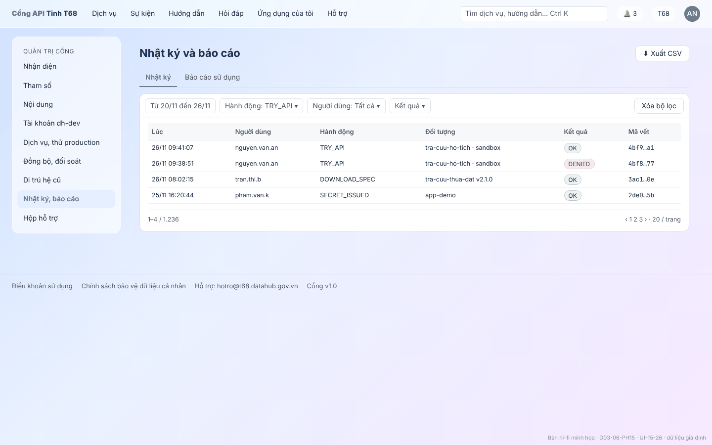

| # | Thành phần | `CMP-*` | Nội dung, kiểm tra |
|---|---|---|---|
| 1 | Bộ lọc | `CMP-FilterBar`, `CMP-DateRangePicker` | Khoảng thời gian (mặc định 7 ngày), hành động (A.8: `TRY_API`, `TRY_PRODUCTION`, `DOWNLOAD_SPEC`, `SECRET_ISSUED`, `LOCK_ACCOUNT`…), người dùng, API, ứng dụng, kết quả |
| 2 | Bảng | `CMP-DataTable` | Lúc, người dùng, hành động, đối tượng, kết quả, mã vết (liên kết sang tra vết PH-13) |
| 3 | Tab báo cáo | `CMP-Chart`, `CMP-DataTable` | Lượt truy cập, thử, theo API, theo ứng dụng; bảng thay thế |
| 4 | Xuất | `CMP-DropdownMenu` → `CMP-JobProgress` | CSV, XLSX; chạy nền, tải khi xong (API-15-130) |
| 5 | Chi tiết | `CMP-Drawer`, `CMP-JsonViewer` | Bản ghi đã che dữ liệu nhạy cảm |

: UI-15-26 Thành phần

Trạng thái: đang tải skeleton; rỗng "Không có bản ghi trong khoảng đã chọn" (ST-04); lỗi ERR-15-039 kèm "Thử lại"; không có quyền: thiếu `audit-read` 403, ngoài mạng quản trị ERR-15-036. Việc xem nhật ký cũng ghi `VIEW_AUDIT`. Ở 360 px bảng thành thẻ, bộ lọc trong `CMP-FilterDrawer`.

## 33. UI-15-27 Đồng bộ, đối soát, di trú

::: dac-ta
**Mục đích.** Cho quản trị theo dõi và chạy đồng bộ danh mục với PH-02, đối soát phát hiện lệch, và di trú nội dung portal Gravitee cũ (trang, tài liệu, ảnh) qua gói ZIP có xem trước.

**Người dùng, quyền.** `PERM-15-portal-admin` (CA, TA).

**FR, UC hiện thực.** FR-15-001, 018, 061, 062; UC-15-04, UC-15-08.

**Truy vết hệ cũ.** LGC-APIM-006 (danh mục), 017 (tài liệu).

**Đường dẫn.** `/quan-tri-cong/dong-bo`, `/quan-tri-cong/di-tru`; tham số `tab`.

**Mẫu bố cục.** PTN-01 (lần chạy) và PTN-05 Wizard (di trú).

**API.** API-15-009, 131…137.

**Phát hành, mức chi tiết.** Đợt 2; nhập Git Đợt 3.
:::

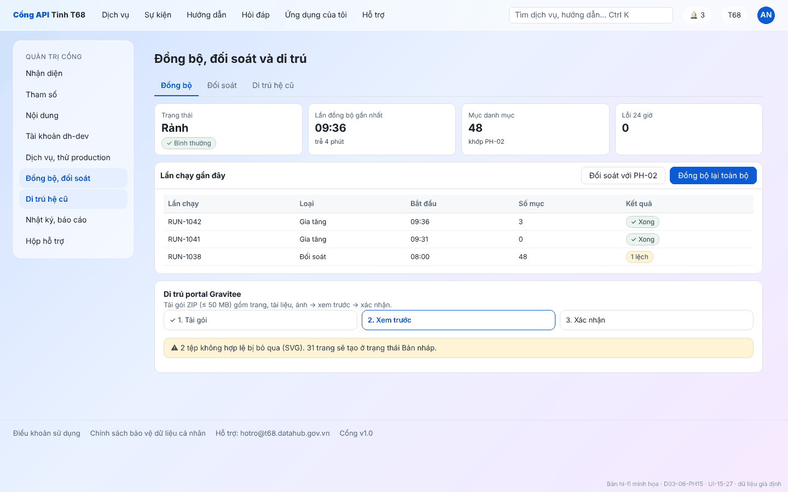

| # | Thành phần | `CMP-*` | Nội dung, kiểm tra |
|---|---|---|---|
| 1 | Thẻ trạng thái | `CMP-KpiCard`, `CMP-StatusTag` | `IDLE`, `RUNNING`, `FAILED`, `STALE`; lần gần nhất, số mục, trễ |
| 2 | "Đồng bộ lại" | `CMP-Button`, `CMP-ConfirmDialog` | `scope` `ALL` hoặc `API` (+ `apiCode`); đang chạy: ERR-15-035 |
| 3 | "Đối soát với PH-02" | `CMP-Button` | `fix` tùy chọn; kết quả liệt kê mục lệch (`CMP-DiffTable`) |
| 4 | Bảng lần chạy | `CMP-DataTable` | Mã, loại, bắt đầu, số mục, kết quả |
| 5 | Di trú | `CMP-Wizard`, `CMP-FileDropzone` | Tải ZIP ≤ 50 MB → xem trước (số trang, tệp bị bỏ qua, SVG bị chặn) → xác nhận tạo bản nháp; tiến độ `CMP-JobProgress` |

: UI-15-27 Thành phần

Trạng thái: đang tải skeleton; rỗng "Chưa có lần đồng bộ nào" và "Chưa có đợt di trú"; lỗi: ERR-15-035, ERR-15-026 (gói sai cấu trúc), ERR-15-030, ERR-15-025; không có quyền: thiếu `portal-admin` 403. Trang di trú tạo ở bản nháp, qua UI-15-22 duyệt mới đăng. Ở 360 px wizard thành danh sách dọc.

## 34. UI-15-28 Hộp xử lý hỗ trợ

::: dac-ta
**Mục đích.** Hàng đợi phiếu hỗ trợ và hỏi đáp của dịch vụ cho đầu mối hỗ trợ: trả lời, ghi chú nội bộ, giao người xử lý, chuyển trạng thái.

**Người dùng, quyền.** `PERM-15-support`; SV chỉ thấy phiếu của dịch vụ tổ chức mình.

**FR, UC hiện thực.** FR-15-055; UC-15-28.

**Truy vết hệ cũ.** Không có ở hệ cũ.

**Đường dẫn.** `/quan-tri-cong/ho-tro`; tham số `trang-thai`.

**Mẫu bố cục.** PTN-10 Hộp việc.

**API.** API-15-114, 115.

**Phát hành, mức chi tiết.** Đợt 2; đầy đủ.
:::

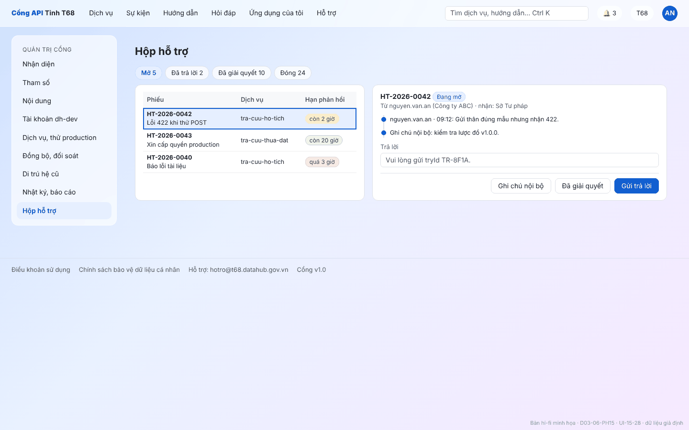

| # | Thành phần | `CMP-*` | Nội dung, kiểm tra |
|---|---|---|---|
| 1 | Facet | `CMP-FilterChips` | Mở, Đã trả lời, Đã giải quyết, Đóng |
| 2 | Hàng đợi | `CMP-DataTable` | Phiếu, dịch vụ, hạn phản hồi (`15.support.sla-hours`) có chữ "còn 2 giờ" hoặc "quá 3 giờ" |
| 3 | Chi tiết | `CMP-Timeline`, `CMP-CommentThread` | Tin của người dùng, của đầu mối, ghi chú nội bộ (nền khác, nhãn "Nội bộ") |
| 4 | Soạn trả lời | `CMP-TextArea` | Văn bản thuần ≤ 4.000 ký tự |
| 5 | Chuyển trạng thái | `CMP-DropdownMenu` | `ANSWERED`, `RESOLVED`, `CLOSED`; `assignee` |

: UI-15-28 Thành phần

Trạng thái: đang tải skeleton hàng đợi; rỗng "Không có yêu cầu nào đang chờ"; lỗi: ERR-15-029 (phiếu đã đóng, khóa ô trả lời), ERR-15-022; không có quyền: 403, phiếu ngoài phạm vi `ERR-15-001`. Phím tắt: `J`, `K` chuyển phiếu; `Ctrl+Enter` gửi trả lời. Ở 360 px hàng đợi và chi tiết là hai bước.

## 35. Khả năng truy cập WCAG 2.2 AA và bố cục 360 px

D05-01 đặt trọng tâm kiểm thử PH-15 là "khả năng truy cập ở 360 px, sandbox cách ly". Bảng dưới nêu yêu cầu áp dụng cho cả 28 màn và cách kiểm; yêu cầu riêng của từng màn đã ghi ở chương màn đó.

| Mã | Yêu cầu | Cách kiểm |
|---|---|---|
| A11Y-15-01 | Đạt WCAG 2.2 AA; axe-core không có lỗi mức "serious" trở lên ở 28 màn | Playwright và axe trong CI |
| A11Y-15-02 | Reflow: không cuộn ngang trang ở 360 px (320 px CSS đạt 1.4.10); chỉ khối mã, bảng rộng cuộn ngang trong vùng có `tabindex="0"` và nhãn | Chụp 360 và 768 px trên Chromium, Firefox, WebKit (D05-01) |
| A11Y-15-03 | Vùng chạm tối thiểu 44 px trên màn cảm ứng, không dưới 24 px ở máy tính (2.5.8) | Kiểm kích thước phần tử |
| A11Y-15-04 | Tiêu điểm nhìn thấy (`color-focus-ring`) và không bị thanh trên dính che (2.4.11): `scroll-padding-top` bằng `size-topbar` | Kiểm thủ công bàn phím |
| A11Y-15-05 | Thao tác kéo có phương án thay thế (2.5.7): thanh chia cột của UI-15-06 chỉnh bằng mũi tên | Kiểm bàn phím |
| A11Y-15-06 | Đăng nhập không dùng bài kiểm tra nhận thức (3.3.8): ô mật khẩu cho dán, CAPTCHA nếu có phải có phương án thay thế (Q15-31) | Kiểm UI-15-08 |
| A11Y-15-07 | Không bắt nhập lại dữ liệu đã nhập (3.3.7): wizard giữ dữ liệu khi quay lại | UI-15-15, 16, 17 |
| A11Y-15-08 | Trợ giúp nhất quán (3.2.6): liên kết "Hỗ trợ" luôn ở cùng vị trí thanh trên và chân trang | Kiểm trực quan |
| A11Y-15-09 | Trạng thái, mã HTTP, kết quả thử không chỉ truyền bằng màu; biểu đồ có bảng thay thế (UI-15-12, 18, 26) | Chụp ảnh xám |
| A11Y-15-10 | `lang="vi"`; tiêu đề trang duy nhất mỗi màn; thông báo động qua `aria-live` (kết quả thử, huy hiệu, `CMP-Toast`) | Kiểm NVDA, VoiceOver ở UI-15-06, 13 |
| A11Y-15-11 | Tôn trọng `prefers-reduced-motion`, `prefers-reduced-transparency`, `prefers-contrast` (D03-05-01 §7) | Chụp so sánh |
| A11Y-15-12 | LCP trang tài liệu dưới 2,5 giây ở 4G mô phỏng; Lighthouse Accessibility ≥ 95 (PTN-14) | Lighthouse CI |

: Yêu cầu khả năng truy cập A11Y-15 và cách kiểm

Quy tắc bố cục 360 px đã cài trong `hifi.css` và dùng cho ảnh chụp: dưới 480 px thanh trên chỉ còn logo, chuông, avatar và nút ☰; lưới chuyển một cột; bảng có lớp chuyển thẻ (mỗi dòng thành một thẻ, mỗi ô có nhãn cột); ngăn kéo choán toàn màn hình; nút và ô nhập cao tối thiểu 44 px. Màn đọc và thử (UI-15-01…07, 10…20) phải đủ chức năng ở 360 px. Màn quản trị nặng soạn thảo hoặc nhiều cột (UI-15-21, 22, 26, 27) dùng được ở 360 px nhưng khuyến nghị máy tính (Q15-37).

## 36. Kiến trúc mã giao diện

Mã giao diện nằm ở `apps/dh-portal/src` theo SDD §3.1; mỗi nhóm màn là một thư mục `features/`, route khai báo tập trung ở `routes/` và nạp lazy; nhóm `admin` chỉ được nạp khi cổng chạy ở `apisix-int`.

| Thư mục | Màn |
|---|---|
| `features/catalog/` | UI-15-01…04 |
| `features/docs/` | UI-15-05 |
| `features/try/` | UI-15-06, UI-15-14 (lịch sử, bộ sưu tập) |
| `features/content/` | UI-15-07 |
| `features/account/` | UI-15-08, 09, 19 |
| `features/apps/` | UI-15-10…14 |
| `features/delegate/` | UI-15-15, 16, 17 |
| `features/support/` | UI-15-20, 28 |
| `features/admin/` | UI-15-21…27 |
| `security/` | CSRF, `Idempotency-Key`, `SecretOnce` (bí mật chỉ trong bộ nhớ) |

: Thư mục mã nguồn dh-portal theo màn

Quy tắc giao diện kiểm bằng ESLint và Playwright: không `dangerouslySetInnerHTML`; không `localStorage`, `sessionStorage` cho token và bí mật (chỉ cho tùy chọn như độ rộng cột, mật độ); chỉ gọi `/api/portal/v1` cùng gốc; kiểu TypeScript sinh từ OpenAPI của D03-04-PH15, không viết tay; chuỗi tiếng Việt qua khóa i18n `portal.*` để thêm tiếng Anh ở Đợt 3 (Q15-36). Thành phần dùng chung lấy từ D03-05-03, D03-05-04, không tự làm riêng; thành phần đề nghị ở Phụ lục A tạm được dựng trong `@datahub/ui` chờ D03-05 duyệt.

## 37. Luồng người dùng chính

Sơ đồ dưới là hành trình đầy đủ của một nhà thầu mới, từ đăng ký đến khi thử được API; mỗi nút ghi mã màn. Người đọc cần thấy các điểm chờ phía con người (duyệt tài khoản) và điểm cổng ủy thác (đăng ký sử dụng).

```{.mermaid caption="Hành trình của nhà thầu mới trên dh-portal"}
flowchart TB
    A["UI-15-08 Đăng ký dh-dev"] --> B["Xác minh thư trong 24 giờ"]
    B --> C["UI-15-24 Quản trị duyệt"]
    C --> D["UI-15-09 Chấp nhận điều khoản"]
    D --> E["UI-15-11 Tạo ứng dụng"]
    E --> F["UI-15-13 Cấp xác thực, lưu bí mật"]
    F --> G["UI-15-04 Chọn dịch vụ"]
    G --> H["UI-15-06 Thử API sandbox"]
    H --> I["UI-15-14 Lưu bộ sưu tập"]
```

Từ nhánh này, cán bộ đầu mối của tổ chức tiếp tục: UI-15-15 gửi đăng ký sử dụng, rồi theo dõi trạng thái do PH-02 duyệt; chủ dịch vụ dùng UI-15-17 để công bố API và UI-15-23 để bật sandbox.

## 38. Ma trận màn hình theo vai trò

Ký hiệu: ● dùng được đầy đủ; ○ một phần (ANON chỉ API `PUBLIC` ở tenant bật công khai; SV chỉ dịch vụ, trang, phiếu của tổ chức mình); — không có. Cột theo FRS §3: ANON, DEV, OR, SV, CA, TA, SO, AU, PA. Màn 08 chỉ cho người chưa đăng nhập; màn 09, 18, 19, 20 cho mọi người đã đăng nhập.

| Màn | ANON | DEV | OR | SV | CA | TA | SO | AU | PA |
|---|---|---|---|---|---|---|---|---|---|
| UI-15-01…05, 07 | ○ | ● | ● | ● | ● | ● | ● | ● | ● |
| UI-15-06 | — | ● | — | — | — | — | — | — | — |
| UI-15-08 | ● | — | — | — | — | — | — | — | — |
| UI-15-09, 18, 19, 20 | — | ● | ● | ● | ● | ● | ● | ● | ● |
| UI-15-10…14 | — | ● | — | — | — | — | — | — | — |
| UI-15-15, 16 | — | — | ● | — | — | — | — | — | — |
| UI-15-17 | — | — | — | ● | — | — | — | — | — |
| UI-15-21 | — | — | — | ○ | ● | ● | — | — | — |
| UI-15-22 | — | — | — | ○ | ● | ● | — | — | — |
| UI-15-23 | — | — | — | ○ | ● | ● | — | — | — |
| UI-15-24 | — | — | — | — | — | ● | ● | — | ● |
| UI-15-25, 27 | — | — | — | — | ● | ● | — | — | — |
| UI-15-26 | — | — | — | — | — | ● | ● | ● | ● |
| UI-15-28 | — | — | — | ○ | ● | ● | — | — | — |

: Ma trận màn hình theo vai trò PH-15

Ma trận khớp FRS §3.2: `PERM-15-app`, `PERM-15-try` chỉ DEV; `PERM-15-portal-admin` CA, TA; `PERM-15-content-write` SV ○, CA, TA; `PERM-15-content-publish` CA, TA; `PERM-15-support` SV ○, CA, TA; `PERM-15-dev-approve` TA, SO, PA; `PERM-15-audit-read` TA, SO, AU, PA. Giao diện chỉ ẩn, hiện nút; quyết định cuối ở máy chủ (OPA).

## 39. Kiểm thử giao diện, bản hi-fi và nghiệm thu

Mỗi màn có ít nhất một ca Playwright cho đường chính và một ca cho trạng thái lỗi hoặc không có quyền, kịch bản `TS-15-nn` ở tập kiểm thử PH-15 (D05-02-PH15). Bộ chạy trên Chromium, Firefox, WebKit ở 360 px, 768 px và 1440 px (D05-01), kèm axe và so ảnh.

### 39.1. Ảnh hi-fi

Ảnh sinh bằng `ph15/hifi/gen_hifi.py` (một tệp HTML tĩnh mỗi màn, dùng lại `hifi.css` của PH-19 và bổ sung lớp cho dh-portal), chụp bằng `shot.js` (Playwright, `chromium.launch()`, hệ số điểm ảnh 1) rồi nén bảng màu bằng `nen_png.py`. Có 28 ảnh 1440 px và 6 ảnh 360 px (UI-15-01, 04, 06, 08, 12, 13) chụp từ cùng HTML để chứng minh quy tắc `@media`. Dữ liệu là giả định của tỉnh T68: dịch vụ `tra-cuu-ho-tich` của `HT-TUPHAP`, HTTT khai thác `HT-DATDAI`, nhà phát triển `nguyen.van.an`, bí mật và mã vết minh họa. Tổng dung lượng PNG dưới 8 MB. Ảnh là minh họa vật liệu, màu, mật độ; wireframe chữ mới là đặc tả vị trí.

### 39.2. Tiêu chí nghiệm thu giao diện

Tiêu chí nghiệm thu là điều hội đồng và người dùng nghiệp vụ kiểm khi nhận bàn giao giao diện.

| Mã | Tiêu chí | Màn |
|---|---|---|
| UAC-15-01 | Người dùng portal Gravitee cũ tìm được dịch vụ, mở tài liệu và tải đặc tả không cần hướng dẫn | UI-15-02, 03, 05 |
| UAC-15-02 | Bí mật sandbox chỉ hiện một lần, nút đóng bị chặn tới khi xác nhận, không thấy bí mật ở URL, `localStorage`, bản ghi mạng sau khi đóng | UI-15-13 |
| UAC-15-03 | Khung thử luôn hiện đúng môi trường và chế độ; không gửi được khi có PII thật (BACKEND), khi vượt hạn mức, khi thiếu điều kiện production | UI-15-06 |
| UAC-15-04 | Người soạn không duyệt được trang mình soạn; thử bằng gọi trực tiếp API cũng bị chặn (ERR-15-023) | UI-15-22, 23 |
| UAC-15-05 | Mọi câu thông báo lỗi khớp bảng mục 5.2 cho 63 mã ERR-15 | Mọi màn |
| UAC-15-06 | Ở 360 px không có cuộn ngang trang, mọi nút đạt 44 px, đọc được và thao tác được UI-15-01…20 | Mọi màn đọc, thử |
| UAC-15-07 | Khách ẩn danh không thấy dịch vụ ngoài mức `PUBLIC`, không phân biệt "không có" và "không được xem" | UI-15-01…05 |
| UAC-15-08 | Nút ẩn, hiện, vô hiệu đúng theo ma trận mục 38 cho chín nhóm người xem | Mọi màn |

: Tiêu chí nghiệm thu giao diện UAC-15

## Phụ lục A. Đề nghị bổ sung cho D03-05

Tập màn không tự đặt thành phần hay token. Bảy mục dưới đây là chỗ thiếu khi thiết kế cổng; cột "Kết quả" ghi xử lý ở đợt đồng bộ cuối. Thành phần dùng riêng ở PH-15 (A2, A4, A5) được dựng cục bộ trong `apps/portal`, không đưa vào `@datahub/ui`.

| # | Đề nghị | Loại | Mô tả | Dùng ở | Kết quả |
|---|---|---|---|---|---|
| A1 | `CMP-MarkdownViewer` | Thành phần phức hợp | Dựng Markdown qua bộ lọc an toàn (không HTML thô, ảnh chỉ từ kho cổng), tiêu đề có neo, khối mã có nút sao chép, bảng cuộn ngang trong vùng có nhãn | UI-15-07, 09, 21 | Đã có: `CMP-MarkdownViewer` (D03-05-04 §13.20) |
| A2 | `MarkdownEditor` | Thành phần cục bộ | Vùng soạn Markdown có thanh công cụ, xem trước đồng bộ cuộn, đếm KB, tự lưu, thoát bẫy Tab | UI-15-21 | Không thêm: chỉ PH-15 dùng (UI-15-21), giữ thành phần cục bộ `MarkdownEditor` |
| A3 | `CMP-TocNav` | Thành phần phức hợp | Mục lục dính theo dõi vị trí đọc (`IntersectionObserver`, `aria-current`), thu thành Drawer dưới `bp-lg` | UI-15-05, 06, 07 | Đã có: `CMP-TocNav` (D03-05-04 §13.21) |
| A4 | `ServiceCard` | Thành phần cục bộ | Thẻ dịch vụ: tên, mã, phiên bản, mô tả 2 dòng, nhãn trạng thái, xác thực, cơ quan, đánh dấu sắp ngừng | UI-15-01, 02, 03 | Không thêm: chỉ PH-15 dùng, giữ thành phần cục bộ `ServiceCard` |
| A5 | `OperationPanel` | Thành phần cục bộ | Khối một thao tác OpenAPI: phương thức, đường dẫn, bảo mật, bảng tham số, thân, phản hồi; dùng chung đọc và thử | UI-15-05, 06 | Không thêm: chỉ PH-15 dùng, giữ thành phần cục bộ `OperationPanel` |
| A6 | `CMP-DataTable` biến thể `card-list` | Biến thể | Dưới `bp-sm` mỗi dòng thành một thẻ có nhãn cột; hiện chỉ mô tả ở D03-06-00 §3.4 là "cuộn ngang" | Mọi bảng PH-15 ở 360 px | Đã có: biến thể `card-list` của `CMP-DataTable` (D03-05-04 §8.1.11) |
| A7 | Token `size-toc` (240 px) và `size-reading-max` (760 px) | Token | Bề rộng mục lục và cột đọc; hiện PTN-14 ghi số trực tiếp | UI-15-05, 06, 07 | Đã có: `size-toc`, `size-reading-max` ở D03-05-02 |

: Đề nghị bổ sung cho D03-05

## Phụ lục B. Đề nghị bổ sung API

Ba API dưới đây giúp giao diện nhẹ và đúng hơn; đề nghị D03-04-PH15 xem xét.

| # | Đề nghị | Lý do |
|---|---|---|
| B1 | `GET /inbox/unread-count` | Chuông thông báo chỉ cần số chưa đọc, nhẹ hơn tải danh sách (API-15-104) |
| B2 | `GET /apps:check-code?appCode=` | Báo trùng mã ứng dụng ngay khi gõ, trước khi gửi (UI-15-11) |
| B3 | `GET /content/pages/{pageCode}/diff?base=&to=` | So sánh phiên bản trang phía máy chủ để cùng bộ lọc và không tải hai bản đầy đủ (UI-15-22) |

: Đề nghị bổ sung API cho D03-04-PH15

## Câu hỏi mở

Các câu hỏi dưới đây chưa có trả lời; tài liệu dùng giả định ở cột cuối. Câu Q15-01…19 thuộc FRS.

| Mã | Câu hỏi | Người trả lời | Giả định đang dùng |
|---|---|---|---|
| Q15-30 | Nếu Q15-16 chốt đặt khu quản trị ở `dh-console`, UI-15-21…28 có đổi sang khung sidebar của console và route `/ket-noi/cong-nha-phat-trien` | Kiến trúc sư, PH-18 | Khu quản trị ở `dh-portal` `/quan-tri-cong` với mục lục trái; đổi khung không đổi nội dung màn |
| Q15-31 | Đăng ký tài khoản nhà thầu có CAPTCHA không, dùng loại nào để vẫn đạt WCAG 3.3.8 | ATTT, UX | Không CAPTCHA; chống lạm dụng bằng giới hạn tần suất (ERR-15-037) và xác minh thư |
| Q15-32 | Logo, màu nhấn mặc định khi tenant chưa cấu hình nhận diện | Quản trị tỉnh | Logo Datahub, tên cổng "Cổng API {tên tỉnh}" |
| Q15-33 | Biểu mẫu kết nạp F-01 dựng động từ lược đồ PH-01 hay cố định; và bảng nhãn trạng thái đăng ký sử dụng của PH-02 | PH-01, PH-02 | Dựng động bằng `CMP-DynamicForm`; nhãn: Chờ duyệt, Đang hoạt động, Bị từ chối, Đã hủy |
| Q15-34 | Bộ soạn Markdown dựa trên CodeMirror hay Monaco, có cần WYSIWYG không | Kỹ sư giao diện | CodeMirror 6, không WYSIWYG, có xem trước cạnh bên |
| Q15-35 | Thư viện tô màu cú pháp mẫu mã sáu ngôn ngữ và kích thước gói | Kỹ sư giao diện | Dùng lõi nhẹ, nạp lazy theo ngôn ngữ, gói tài liệu dưới 250 KB nén |
| Q15-36 | Giao diện tiếng Anh ở Đợt 3: chiều rộng nhãn có dự phòng thêm 30% không | UX, Q15-14 | Mọi nhãn qua khóa i18n; bố cục chừa dự phòng 30% |
| Q15-37 | Màn quản trị nặng (UI-15-21, 22, 26, 27) có bắt buộc đạt đầy đủ ở 360 px hay chỉ "dùng được"; và tên màn portal Gravitee cũ cần đối chiếu bản đang chạy | Chủ đầu tư, kiểm thử | Màn đọc và thử đủ ở 360 px; màn quản trị nặng dùng được, khuyến nghị máy tính |
| Q15-38 | Nhãn tiếng Việt thống nhất cho `dataClass` (Công khai, Nội bộ, Hạn chế, Nhạy cảm) và có hiện cho ANON không | PH-09, PH-02 | Hiện nhãn cho người đã đăng nhập; ANON chỉ thấy API `PUBLIC` nên nhãn "Công khai" |
| Q15-39 | Người dùng lỡ đóng hộp bí mật khi chưa lưu: chặn đóng như thiết kế hay cho đóng và buộc tạo mới (ERR-15-019) | ATTT | Chặn đóng tới khi tick xác nhận; vẫn cho phép đóng cưỡng bức bằng "Tạo mới và thu hồi bản này" |

: Câu hỏi mở về giao diện PH-15

## Đề nghị đồng bộ

Các việc dưới đây thuộc tài liệu chung hoặc tập khác của PH-15; tập này chỉ ghi, không sửa.

| # | Tài liệu | Đề nghị |
|---|---|---|
| 1 | D03-06-00 §2.14 | Đổi bảng IA của `dh-portal` theo FRS Phụ lục A.4: `/api` → `/dich-vu`, `/api/{ma-api}/{phien-ban}` → `/dich-vu/{ma-api}` (tham số `phien-ban`) và `/dich-vu/{ma-api}/tai-lieu`; bỏ `/sandbox` (thay bằng `/dich-vu/{ma-api}/thu` và tab `bo-suu-tap`); thêm `/su-kien`, `/tim-kiem`, `/dang-ky-su-dung`, `/ket-nap`, `/cong-bo`, `/ho-tro`, `/quan-tri-cong/*` |
| 2 | D03-06-00 §3.4, PTN-14 | Thêm quy tắc bảng chuyển thẻ dưới `bp-sm` và ghi PTN-14 có biến thể "khung thử rộng" (ba cột 240, hai cột bằng nhau) cho UI-15-06 |
| 3 | D03-05-03, D03-05-04 | Thêm A1…A6 và token A7 của Phụ lục A |
| 4 | D02-08 | Năm quyền còn thiếu `PERM-15-content-write`, `PERM-15-content-publish`, `PERM-15-support`, `PERM-15-dev-approve`, `PERM-15-audit-read` (đã nêu ở FRS) |
| 5 | FRS PH-15 §10 | UI-15-14 chưa có route riêng; xác nhận tab `bo-suu-tap` của `/ung-dung/{ma}` là nơi đặt cả lịch sử thử và bộ sưu tập; UI-15-27 ghi rõ có hai route `/dong-bo` và `/di-tru` |
| 6 | FRS PH-15 §10, A.4 | Ghi rõ tạo trang nội dung mới bằng hộp nhập mã rồi mở `/quan-tri-cong/noi-dung/{ma-trang}` (không dùng `/moi` vì trùng mẫu `pageCode`) |
| 7 | D03-04-PH15 | Cân nhắc ba API ở Phụ lục B |

: Đề nghị đồng bộ của tập màn PH-15

## Lịch sử phiên bản

| Phiên bản | Ngày | Nội dung | Người lập |
|---|---|---|---|
| 0.1 | 26/11/2026 | Bản đầu: 28 màn UI-15-01…28 theo FRS §10, route theo Phụ lục A.4, nhãn trạng thái, câu hiển thị 63 mã ERR-15, mục màn hệ cũ (portal Gravitee), truy cập WCAG 2.2 AA và bố cục 360 px, ảnh hi-fi 28 màn và 6 ảnh 360 px, câu hỏi mở Q15-30…39 | Nhóm phân hệ PH-15 |
| 0.2 | 27/11/2026 | Bản đầu: 28 màn UI-15-01…28 theo FRS §10, route theo Phụ lục A.4, nhãn trạng thái, câu hiển thị 63 mã ERR-15, mục màn hệ cũ (portal Gravitee), truy cập WCAG 2.2 AA và bố cục 360 px, ảnh hi-fi 28 màn và 6 ảnh 360 px, câu hỏi mở Q15-30…39 | Đồng bộ chéo cuối: Phụ lục A ghi kết quả A1…A7 (MarkdownViewer, TocNav, card-list, token đã có; MarkdownEditor, ServiceCard, OperationPanel là thành phần cục bộ) |
