# D03-06-PH16 · Thiết kế giao diện màn hình Báo cáo chỉ tiêu và sổ kiến trúc

Tập màn không tự đặt token, `CMP-*` hay `PTN-*`; dùng tên chuẩn ở D03-05 và D03-06-00. Thành phần hoặc token còn thiếu được ghi ở Phụ lục A.


## Tóm tắt cho hội đồng thẩm định

PH-16 là nơi tổng hợp tự động các chỉ tiêu chuyển đổi số liên quan tới chia sẻ dữ liệu (KPI-01…18 của BRD và sáu chỉ tiêu bổ sung) từ các phân hệ khác, trình lãnh đạo mỗi kỳ, đóng thành báo cáo chính thức có ký số và gửi hệ quốc gia, đồng thời giữ sổ kiến trúc tối thiểu của tỉnh (hệ thống thông tin, API, luồng, topic, bộ điều hợp, dịch vụ nền tảng, kết nối quốc gia) kèm mức tuân thủ. Phân hệ là năng lực mới (REQ-16, hệ cũ Viettel 2021 không có), nên tập màn thiết kế 20 màn mới (UI-16-01…20) trên `dh-console` dưới nhánh `/giam-sat/chi-tieu`, chia năm khối: bảng điều khiển (01, 02), bộ chỉ tiêu (03, 04), nguồn và số liệu (05 đến 09), báo cáo (10 đến 13), sổ kiến trúc (14 đến 16), gửi quốc gia, so sánh, quản trị (17 đến 20).

Sáu quyết định giao diện chính:

1. **Một trang trả lời "tỉnh đang ở đâu và chỉ tiêu nào cần chỉ đạo".** Tổng quan (UI-16-01) có điểm tổng, năm vòng điểm nhóm (Kết nối, Chia sẻ, Dữ liệu, Vận hành, Kiến trúc) kèm tỷ lệ phủ, bảng chỉ tiêu cần chú ý (đỏ trước, vàng sau) và xu hướng 13 kỳ; kỳ chưa chốt hiện dải vàng.
2. **Trạng thái luôn bằng chữ cộng biểu tượng, không chỉ bằng màu.** "Đạt mục tiêu", "Có nguy cơ", "Chệch mục tiêu", "Chưa có số" kèm ●, ▲, ✕, –; chỉ tiêu thiếu số hiện nhãn "Thiếu một phần", không bao giờ vẽ số 0 giả.
3. **Mọi con số truy được về nguồn.** Chi tiết chỉ tiêu (UI-16-02) và lần tổng hợp (UI-16-09) cho thấy quan sát, phiên bản công thức và cờ `MISSING_SOURCE`, `STALE_SOURCE`, `MANUAL_PENDING`, `FORMULA_ERROR`; số liệu nhập tay luôn có bằng chứng và xác nhận bốn mắt (UI-16-07).
4. **Soạn báo cáo chặn sai sót trước khi gửi duyệt.** UI-16-11 dựng trang A4 xem trước, mục lục có huy hiệu giải trình thiếu, dải "Số liệu kỳ đã được tính lại" với nút "Làm mới số"; nút "Gửi duyệt" chỉ sáng khi đủ chỉ tiêu bắt buộc và giải trình.
5. **Công bố là bước không hoàn tác và tách nhiệm vụ.** Người lập không tự duyệt (ERR-16-005 hiện ngay trên thanh quyết định); công bố chụp bất biến, ký số, lưu WORM 10 năm, từng bước hiện tiến độ, dịch vụ ký số gián đoạn thì báo cáo vẫn ở "Đã duyệt" (UI-16-12).
6. **Sổ kiến trúc tự đăng ký, có đối chiếu.** Thành phần từ sự kiện phân hệ nguồn có trường chỉ đọc; tab "Lệch" nêu thiếu, mồ côi, khác phiên bản; đánh giá tuân thủ theo bộ tiêu chí cấu hình là ngăn kéo có kết quả từng tiêu chí và miễn trừ có hạn (UI-16-14 đến 16).

Kính Liquid Glass chỉ dùng cho lớp điều hướng và lớp nổi (thanh trên, sidebar, ngăn kéo, thanh quyết định cố định, thanh chọn dưới đáy); bảng, thẻ chỉ tiêu, biểu đồ, trang A4 xem trước là nền đặc để đạt WCAG 2.2 AA (ADR-020). Biểu đồ dùng Apache ECharts qua `CMP-Chart` (ADR-023); ảnh hi-fi vẽ SVG kiểu ECharts để minh họa. Ảnh hi-fi (20 màn) nằm ở `ph16/hifi/`, dữ liệu giả định của T68, kỳ M-2026-10, nền GĐ-04 (200 hệ thống thông tin, 150 kết nối điểm–điểm); `ui-16-01.png` và `ui-16-11.png` là hai ảnh FRS §10.2 trỏ tới.

---


## 1. Mục đích, phạm vi và tài liệu liên quan

Chương này nêu tài liệu đặc tả gì, cho ai, dựa trên tài liệu nào, rồi liệt kê 20 màn của PH-16 trước khi vào chi tiết.

### 1.1. Mục đích

Tập màn là nguồn chuẩn để kỹ sư `dh-console` dựng giao diện PH-16, để kiểm thử viên viết ca kiểm thử giao diện (D05-02-PH16) và để hội đồng thẩm định thấy mỗi chức năng của FRS có chỗ thể hiện, đúng quyền, đúng thông báo. Mỗi màn có khối đặc tả (mục đích, quyền, FR, đường dẫn, API), wireframe chữ, bảng thành phần `CMP-*`, trường và cột, hành động, trạng thái và ảnh hi-fi.

### 1.2. Phạm vi

Trong phạm vi: 20 màn của FRS §10.1 trong ứng dụng `dh-console`, gồm ngăn kéo, hộp thoại và trình hướng dẫn thuộc màn. Ngoài phạm vi: API đọc chỉ tiêu cho hệ khác (FR-16-035, `kpi.read`) và chỉ số vận hành của chính PH-16 cho PH-13 (FR-16-058) vì không có màn; thu thập quan sát, tính toán, dựng PDF, ký số, lưu WORM, gửi PH-14 là xử lý nền, giao diện chỉ hiện kết quả và lỗi ở UI-16-06, 09, 12, 17; chi tiết token và thành phần nguyên tử ở D03-05; cổng công dân `dh-portal`.

### 1.3. Tài liệu liên quan

Tài liệu này bám theo FRS, khung giao diện chung và các tập thiết kế khác; bảng dưới ghi từng tài liệu và nội dung màn hình lấy từ đó.

| Tài liệu | Dùng để |
|---|---|
| D02-03-PH16 FRS | Chức năng, mã lỗi (§9.1), câu thông báo (§9.2), API (§9.4), màn hình (§10.1), tham số (§8.2), enum (Phụ lục A) |
| D03-06-00 | Khung bố cục, mẫu `PTN-01…14`, route (§2.3, §2.4), trạng thái `ST-*` (§4.2) |
| D03-05-02, 03, 04 | Token, thành phần nguyên tử và phức hợp `CMP-*` |
| D02-08 | Vai trò `ROLE-*`, quyền `PERM-16-*` (hiện có `read`, `admin`; 12 quyền còn lại là đề nghị ở FRS Phụ lục B) |

: Tài liệu liên quan của tập màn PH-16

### 1.4. Thuật ngữ và viết tắt

Bảng dưới giải thích các thuật ngữ và viết tắt theo nghĩa người dùng thấy trên giao diện, để nhãn hiển thị ở mọi màn dùng thống nhất.

| Thuật ngữ | Nghĩa trên giao diện |
|---|---|
| Chỉ tiêu (indicator) | Một số đo định kỳ có mã `indicatorCode`, đơn vị, chiều tốt, mục tiêu và ngưỡng; thuộc một trong năm nhóm |
| Bộ chỉ tiêu mẫu `COMMON` | 24 chỉ tiêu chuẩn toàn quốc mà tỉnh kế thừa và tùy biến |
| Kỳ báo cáo | Tháng, quý hoặc năm (`M-2026-10`, `Q-2026-Q3`, `Y-2026`); chốt thì không tính lại nếu không mở lại có lý do |
| Trạng thái chỉ tiêu | Đạt mục tiêu (`ON_TRACK`), Có nguy cơ (`AT_RISK`), Chệch mục tiêu (`OFF_TRACK`), Chưa có số (`NO_DATA`) |
| Báo cáo chính thức | Báo cáo đã công bố: bất biến, ký số, có mã băm, lưu WORM 10 năm |
| Sổ kiến trúc | Danh mục thành phần kiến trúc (`arch_component`) kèm phiên bản, phụ thuộc, vận hành và tuân thủ |
| Bốn mắt | Người lập hoặc gửi khác người duyệt; người nhập số liệu tay khác người xác nhận |
| CEL | Common Expression Language, ngôn ngữ biểu thức viết công thức chỉ tiêu trên biến quan sát |

: Thuật ngữ và viết tắt của tập màn PH-16

### 1.5. Danh sách màn hình

Bảng dưới là 20 màn theo FRS §10.1 kèm mẫu bố cục, mức chi tiết và FR; quyền vào ghi ở khối đặc tả từng màn và chương 28. "Rất chi tiết" thêm giải phẫu vùng, ca biên và trạng thái từng nhánh; "Đầy đủ" có đủ các mục theo khuôn K-MH.

| Mã | Tên | PTN | Mức chi tiết | FR |
|---|---|---|---|---|
| UI-16-01 | Tổng quan chỉ tiêu (năm nhóm) | PTN-06 | **Rất chi tiết** | 021, 022, 037, 038, 040 |
| UI-16-02 | Chi tiết chỉ tiêu | PTN-02 | Đầy đủ | 021, 039, 040 |
| UI-16-03 | Bộ chỉ tiêu | PTN-01 | Đầy đủ | 001, 006, 007, 008 |
| UI-16-04 | Soạn định nghĩa chỉ tiêu | PTN-03 | **Rất chi tiết** | 002, 003, 004, 005, 006 |
| UI-16-05 | Nguồn số liệu | PTN-01 | Đầy đủ | 009, 013 |
| UI-16-06 | Chi tiết nguồn, nhật ký tiếp nhận | PTN-11 | Đầy đủ | 010, 011, 012, 013, 016 |
| UI-16-07 | Nhập số liệu tay | PTN-09 | Đầy đủ | 014, 015 |
| UI-16-08 | Kỳ báo cáo và lần tổng hợp | PTN-01 | Đầy đủ | 017, 018, 024, 042 |
| UI-16-09 | Chi tiết lần tổng hợp | PTN-02 | Đầy đủ | 018, 019, 020, 023 |
| UI-16-10 | Danh sách báo cáo | PTN-01 | Đầy đủ | 026, 030, 031, 033, 036 |
| UI-16-11 | Soạn báo cáo | PTN-03 | **Rất chi tiết** | 026, 027, 032 |
| UI-16-12 | Duyệt và công bố | PTN-10 | **Rất chi tiết** | 005, 015, 028, 029 |
| UI-16-13 | Mẫu báo cáo và phân phối | PTN-12 | Đầy đủ | 025, 034 |
| UI-16-14 | Sổ kiến trúc | PTN-01 | Đầy đủ | 043, 044, 048, 049 |
| UI-16-15 | Chi tiết thành phần kiến trúc | PTN-02 | Đầy đủ | 045, 046, 047, 049 |
| UI-16-16 | Đánh giá tuân thủ (ngăn kéo) | PTN-04 | Đầy đủ | 047 |
| UI-16-17 | Gửi quốc gia và nhật ký nộp | PTN-11 | Đầy đủ | 050, 051, 052, 053, 054 |
| UI-16-18 | So sánh liên tenant | PTN-06 | Đầy đủ | 041 |
| UI-16-19 | Cài đặt | PTN-12 | Đầy đủ | 055, 057 |
| UI-16-20 | Nhật ký kiểm toán | PTN-11 | Đầy đủ | 056 |

: Danh sách 20 màn hình PH-16 với mẫu bố cục, mức chi tiết và FR

Số FR trong bảng là phần sau tiền tố `FR-16-`. FR-16-035 (API đọc chỉ tiêu) và FR-16-058 (chỉ số vận hành của PH-16) không có màn.

### 1.6. Người đọc

Kỹ sư giao diện `dh-console` đọc chương 4 đến 6 rồi chương của màn đang dựng. Thiết kế UX/UI đọc chương 2, 5 và các wireframe. Cán bộ tổng hợp, quản trị tỉnh và kiểm thử viên đọc phần thành phần, hành động, trạng thái và chương 28. Hội đồng thẩm định đọc phần Tóm tắt, chương 3 và chương 30.

### 1.7. Cấu trúc tài liệu

Chương 2 đến 6 nêu nguyên tắc, màn hệ cũ được giữ lại, điều hướng, quy ước hiển thị và trạng thái dùng chung. Chương 7 đến 26 đặc tả 20 màn UI-16-01 đến UI-16-20, mỗi chương gồm khối đặc tả, wireframe, thành phần, trường, hành động, trạng thái và ảnh hi-fi. Chương 27 trình bày mẫu truy cập dữ liệu và luồng chính; chương 28 ma trận vai trò; chương 29 ma trận FR và UI; chương 30 kiểm thử giao diện và danh sách ảnh hi-fi. Ba phụ lục ghi đề nghị đồng bộ cho D03-05, API và FRS; sau đó là câu hỏi mở và lịch sử phiên bản.


## 2. Nguyên tắc thiết kế áp dụng cho PH-16

Người dùng PH-16 có hai nhóm: lãnh đạo đọc con số và xu hướng vài phút mỗi kỳ, và cán bộ tổng hợp làm việc cả tuần quanh ngày chốt. Chương này nêu các lựa chọn thiết kế riêng cho hai nhóm đó.

### 2.1. Bản đồ vật liệu

Bảng dưới cho biết mỗi vùng giao diện của PH-16 dùng vật liệu nào, kính mờ cho điều hướng hay nền đặc cho nội dung, và lý do chọn.

| Vùng | Thành phần | Vật liệu | Lý do |
|---|---|---|---|
| Thanh trên, sidebar | `CMP-AppShell`, `CMP-Topbar`, `CMP-Sidebar` | `glass-chrome` | Lớp điều hướng |
| Tiêu đề trang, hàng tab phụ | `CMP-PageHeader`, `CMP-Tabs` | Đặc trên `color-canvas` | Nội dung |
| Thẻ điểm, thẻ nhóm, biểu đồ, bảng | `CMP-KpiCard`, `CMP-StatCard`, `CMP-Chart`, `CMP-DataTable` | Đặc `color-surface-solid` | Số liệu phải đọc chắc, màu trạng thái ổn định |
| Trang A4 xem trước báo cáo | `CMP-Card` nền trắng | Đặc trắng, đổ bóng nhẹ | Mô phỏng tài liệu in; không dùng kính |
| Thanh quyết định ở UI-16-12, thanh nhập ở UI-16-07 | `CMP-DecisionPanel`, `CMP-BulkActionBar` | `glass-overlay` cố định, nội dung đặc | Lớp nổi luôn thấy khi cuộn |
| Ngăn kéo đánh giá, truy nguồn, chi tiết | `CMP-Drawer` | Khung `glass-modal`, giếng nội dung đặc | Lớp nổi chứa nội dung dày |
| Dải kỳ chưa chốt, dải lỗi nguồn | `CMP-Alert`, `CMP-Banner` | Đặc `color-warning`, `color-error` | Không dựa vào độ trong |
| Trình soạn công thức CEL | `CMP-CodeEditor` | Đặc tối `color-surface-inverse` | Mã nguồn cần tương phản cao |

: Bản đồ vật liệu Liquid Glass theo vùng màn PH-16

### 2.2. Mật độ

Tổng quan dùng mật độ thoáng (thẻ lớn, số `font-display`) vì đọc nhanh; danh sách, nhật ký, bảng giá trị dùng mật độ gọn (`size-table-row` 32 px) vì cán bộ rà hàng chục dòng.

### 2.3. Ngôn ngữ và thuật ngữ

Nhãn dùng tiếng Việt có dấu; mã (`indicatorCode`, `periodCode`, `ERR-16-…`) luôn ở chữ đơn cách. Nhóm chỉ tiêu gọi "Kết nối", "Chia sẻ", "Dữ liệu", "Vận hành", "Kiến trúc" (không dịch từng chữ của mã `KET_NOI`…). Báo cáo "chính thức" chỉ để chỉ báo cáo đã công bố.

### 2.4. Hành động theo quyền và trạng thái

Nút ghi chỉ hiện khi người dùng có quyền `PERM-16-*` tương ứng; nút hiện nhưng chưa dùng được (thiếu giải trình, người lập tự duyệt) thì khóa kèm lý do bằng chữ liền kề, không để nút tối không giải thích. Người chỉ có `PERM-16-read` xem mọi thứ ở chế độ chỉ đọc (`ST-15`). Quyền theo ma trận ở chương 28.

### 2.5. Màu không phải kênh duy nhất

Trạng thái chỉ tiêu, trạng thái nguồn, mức tuân thủ, kết quả quan sát đều có nhãn chữ và biểu tượng (●, ▲, ✕, –, ?) ngoài màu. Năm nhóm chỉ tiêu có màu cố định theo thứ tự (Kết nối xanh dương, Chia sẻ xanh lục, Dữ liệu tím, Vận hành vàng, Kiến trúc hồng) và luôn kèm tên nhóm. Biểu đồ phân biệt đường bằng kiểu nét (đứt cho điểm tổng) ngoài màu và có bảng thay thế.

### 2.6. Định dạng số, đơn vị và thiếu số

Số theo quy ước Việt Nam: dấu phẩy thập phân, dấu chấm hàng nghìn (`1.284.300`), phần trăm có khoảng trắng (`31,0 %`), số chữ số thập phân theo định nghĩa chỉ tiêu. Thời gian `dd/MM/yyyy HH:mm` theo giờ Việt Nam; kỳ hiển thị "Tháng 10/2026 (M-2026-10)". Chỉ tiêu `NO_DATA` hiện "Chưa có số" hoặc dấu gạch `—`, không hiện `0`; `PARTIAL` hiện giá trị kèm nhãn "Thiếu một phần". Δ so kỳ trước hiện mũi tên và số có dấu (▲ +3,5, ▼ −12); mũi tên không mang ý tốt hay xấu mà chiều tốt của chỉ tiêu quyết định màu chữ.

### 2.7. Giữ trạng thái trên URL

Kỳ, chế độ chính thức hoặc mới nhất, bộ lọc, tab, trang đều ghi lên URL để chia sẻ và mở lại; tổng hợp, xuất, công bố, kéo nguồn là tác vụ dài, sau 3 giây chuyển thành tác vụ nền (`ST-09`).


## 3. Màn hệ cũ được giữ lại thành gì

PH-16 là năng lực mới (REQ-16, D00-03 không có LGC do PH-16 làm chủ). Mockup và chức năng cũ chỉ liên quan gián tiếp: PH-16 nâng các bảng số liệu của phân hệ khác thành chỉ tiêu có kỳ, mục tiêu và báo cáo.

### 3.1. Màn hệ cũ liên quan gián tiếp

Bảng dưới ghi màn hoặc chức năng cũ do phân hệ khác làm chủ và chỉ tiêu PH-16 nâng cấp từ đó.

| Mã hệ cũ | Nội dung cũ | PH chủ | Ở PH-16 thành | Hướng |
|---|---|---|---|---|
| LGC-APIM-026 | Dashboard hoạt động API | PH-13 | Chỉ tiêu `luot-khai-thac-thang`, `api-cong-bo` ở UI-16-01, 02 | Nâng cấp |
| LGC-PAY-013, LGC-PAY-020 | Dashboard thanh toán | PH-19 | Chỉ tiêu `giao-dich-thanh-toan-truc-tuyen`, `doi-soat-tu-dong-khop` | Nâng cấp |
| LGC-HUB-001…004 | Đếm publisher, subscriber, project, topic | PH-10 | Số topic, publication làm nguồn và thành phần `TOPIC` ở UI-16-14 | Nâng cấp |
| LGC-BUS-027 | Thống kê endpoint | PH-13 | Chỉ tiêu `tre-gateway-p95`, `san-sang-data-plane` | Nâng cấp |
| LGC-NGSP-004 | Tổng hợp kết quả hồ sơ ĐVQHNS | PH-14 | Nguồn giao dịch quốc gia (EVT-14-11, 12) và gói ở UI-16-17 | Nâng cấp |

: Màn hệ cũ liên quan gián tiếp và hướng nâng cấp ở PH-16


## 4. Điều hướng

PH-16 chiếm mục menu số 37 "Báo cáo chỉ tiêu" (nhóm "Giám sát và kiểm toán") của D03-06-00 mục 2.3.2, route gốc `/giam-sat/chi-tieu`, mẫu trang đầu PTN-06, vai trò chính Lãnh đạo và Quản trị tỉnh, đợt 3. Các màn con vào từ hàng tab phụ của trang và từ liên kết trong màn, không có mục menu riêng.

### 4.1. Cây điều hướng

Sơ đồ dưới cho thấy từ menu Báo cáo chỉ tiêu người dùng đi tới 20 màn theo cây route dưới `/giam-sat/chi-tieu`; mỗi nút ghi đường dẫn tương đối.

```{.mermaid caption="Cây điều hướng dưới /giam-sat/chi-tieu"}
flowchart TB
  M["Menu Giám sát và kiểm toán › Báo cáo chỉ tiêu<br/>/giam-sat/chi-tieu"] --> U01["UI-16-01 Tổng quan<br/>/"]
  U01 --> U02["UI-16-02 Chi tiết chỉ tiêu<br/>/chi-so/{ma}"]
  M --> BC["Bộ chỉ tiêu<br/>/bo-chi-tieu"]
  BC --> U03["UI-16-03 Danh sách"]
  BC --> U04["UI-16-04 Soạn<br/>/{ma}/sua"]
  M --> NG["Nguồn<br/>/nguon"]
  NG --> U05["UI-16-05 Danh sách"]
  NG --> U06["UI-16-06 Chi tiết nguồn<br/>/{ma}"]
  M --> U07["UI-16-07 Nhập số liệu tay<br/>/nhap"]
  M --> KY["Kỳ<br/>/ky"]
  KY --> U08["UI-16-08 Kỳ, lần tổng hợp"]
  KY --> U09["UI-16-09 Chi tiết lần<br/>/{ma}"]
  M --> RP["Báo cáo<br/>/bao-cao"]
  RP --> U10["UI-16-10 Danh sách"]
  RP --> U11["UI-16-11 Soạn<br/>/{ma}/sua"]
  M --> U12["UI-16-12 Duyệt, công bố<br/>/duyet"]
  M --> U13["UI-16-13 Mẫu, phân phối<br/>/mau-bao-cao"]
  M --> KT["Kiến trúc<br/>/kien-truc"]
  KT --> U14["UI-16-14 Sổ kiến trúc"]
  KT --> U15["UI-16-15 Chi tiết<br/>/{ma}"]
  U15 --> U16["UI-16-16 Đánh giá (ngăn kéo)<br/>/{ma}/danh-gia"]
  M --> U17["UI-16-17 Gửi quốc gia<br/>/quoc-gia"]
  M --> U18["UI-16-18 So sánh<br/>/so-sanh"]
  M --> U19["UI-16-19 Cài đặt<br/>/cai-dat"]
  M --> U20["UI-16-20 Kiểm toán<br/>/kiem-toan"]
```

Cây cho thấy sáu nhánh có màn con (chỉ tiêu, nguồn, kỳ, báo cáo, kiến trúc, tổng quan) và sáu trang đứng riêng; UI-16-16 là ngăn kéo mở trên UI-16-15 nên có route riêng để chia sẻ liên kết nhưng hiển thị trên màn cha.

### 4.2. Luồng chuyển màn

Luồng chuyển màn chính trong một kỳ báo cáo (từ nguồn có số tới công bố và gửi quốc gia) vẽ ở mục 27.2; hai vòng lặp nằm ở đó: bổ sung số liệu khi chưa đủ điều kiện chốt, và quay về soạn khi người duyệt yêu cầu sửa.

### 4.3. Bảng đường dẫn React Router

Route chính lấy đúng FRS §10.1. Tab con và query của từng màn ghi ở dòng "Đường dẫn, mẫu" của khối đặc tả; đó là quy ước của tài liệu này theo D03-06-00 mục 2.4 (đề nghị đưa vào FRS ở Phụ lục C). Mọi route có tiền tố `/giam-sat/chi-tieu`.

| Route (sau tiền tố) | Màn | Quyền vào |
|---|---|---|
| `/` | UI-16-01 | `PERM-16-read` |
| `/chi-so/{ma}` | UI-16-02 | `PERM-16-read` |
| `/bo-chi-tieu` | UI-16-03 | `PERM-16-read` |
| `/bo-chi-tieu/{ma}/sua` | UI-16-04 | `PERM-16-admin` |
| `/nguon` | UI-16-05 | `PERM-16-read` |
| `/nguon/{ma}` | UI-16-06 | `PERM-16-read`; ghi `PERM-16-source` |
| `/nhap` | UI-16-07 | `PERM-16-manual` |
| `/ky` | UI-16-08 | `PERM-16-read` |
| `/ky/{ma}` | UI-16-09 | `PERM-16-read` |
| `/bao-cao` | UI-16-10 | `PERM-16-read` |
| `/bao-cao/{ma}/sua` | UI-16-11 | `PERM-16-report` |
| `/duyet` | UI-16-12 | `PERM-16-approve` hoặc `PERM-16-manual` |
| `/mau-bao-cao` | UI-16-13 | `PERM-16-admin`, `PERM-16-export` |
| `/kien-truc` | UI-16-14 | `PERM-16-read` |
| `/kien-truc/{ma}` | UI-16-15 | `PERM-16-read` |
| `/kien-truc/{ma}/danh-gia` | UI-16-16 | `PERM-16-arch-assess` |
| `/quoc-gia` | UI-16-17 | `PERM-16-read`; gửi `PERM-16-national` |
| `/so-sanh` | UI-16-18 | `PERM-16-compare` |
| `/cai-dat` | UI-16-19 | `PERM-16-config` |
| `/kiem-toan` | UI-16-20 | `PERM-16-audit-read` |

: Route và quyền vào của 20 màn

Đoạn `{ma}` là mã chỉ tiêu, nguồn, kỳ, báo cáo hoặc thành phần đúng mẫu `T-CODE` hoặc `periodCode`; các đoạn cố định `sua`, `danh-gia`, `chi-so` không trùng mã vì mã chỉ tiêu và thành phần luôn có gạch ngang và dài từ 3 ký tự, còn mã kỳ bắt đầu bằng `M-`, `Q-`, `Y-`.

### 4.4. Menu và phân quyền hiển thị

Bảng dưới ghi điều kiện quyền để mỗi mục menu và tab phụ xuất hiện, nên người thiếu quyền không thấy mục mình không dùng được.

| Phần tử | Điều kiện hiện |
|---|---|
| Mục menu "Báo cáo chỉ tiêu" | `PERM-16-read` |
| Tab "Tổng quan", "Báo cáo", "Sổ kiến trúc" | `PERM-16-read` (VW chỉ thấy số chính thức đã công bố) |
| Tab "Bộ chỉ tiêu", "Nguồn số liệu", "Kỳ báo cáo" | `PERM-16-read` xem; sửa theo `PERM-16-admin`, `-source`, `-run` |
| Tab "Nhập số liệu" | `PERM-16-manual` |
| Tab "Duyệt" | `PERM-16-approve` hoặc `PERM-16-manual` |
| Tab "Mẫu và phân phối" | `PERM-16-admin` hoặc `PERM-16-export` |
| Tab "Gửi quốc gia" | `PERM-16-national` hoặc `PERM-16-audit-read` (xem) |
| Tab "So sánh" | `PERM-16-compare` |
| Tab "Cài đặt" | `PERM-16-config` |
| Tab "Kiểm toán" | `PERM-16-audit-read` |
| Nút "Duyệt", "Công bố" | `PERM-16-approve` và khác người lập hoặc gửi |

: Điều kiện hiện mục menu và tab phụ

Máy chủ luôn kiểm quyền; giao diện chỉ ẩn để tránh nhầm. Gọi vào dữ liệu ngoài phạm vi trả ERR-16-037 và hiện `ST-07`.

### 4.5. Breadcrumb và tiêu đề tab

Bảng dưới ghi breadcrumb và tiêu đề tab trình duyệt của một số màn tiêu biểu.

| Màn | Breadcrumb | `document.title` |
|---|---|---|
| UI-16-01 | Giám sát và kiểm toán › Báo cáo chỉ tiêu › Tổng quan | Tổng quan chỉ tiêu · Datahub |
| UI-16-11 | … › Báo cáo › {mã báo cáo} › Soạn | Soạn {mã báo cáo} · Datahub |

: Breadcrumb và tiêu đề tab trình duyệt

Tiêu đề tab không chứa số liệu chỉ tiêu hay nội dung giải trình (lịch sử trình duyệt, ảnh chụp màn hình).


## 5. Quy ước hiển thị dùng chung

Chương này gom các quy ước mà mọi màn PH-16 dùng: nhãn của từng giá trị liệt kê, câu thông báo theo mã lỗi và các dải thông báo. Ba lớp cùng nói một sự thật bằng chữ, biểu tượng và màu, để màu không là kênh duy nhất.

### 5.1. Nhãn trạng thái và enum

Bảng dưới là nhãn tiếng Việt và biểu tượng cho các enum của FRS Phụ lục A mà người dùng nhìn thấy. Thẻ là `CMP-StatusTag` hoặc `CMP-Tag`, màu xanh lục cho trạng thái tốt, vàng cho cần chú ý, đỏ cho lỗi, xanh dương cho đang xử lý, xám cho trung tính.

| Enum | Giá trị | Nhãn hiển thị |
|---|---|---|
| `indicator_value.status` | `ON_TRACK` | ● Đạt mục tiêu |
| | `AT_RISK` | ▲ Có nguy cơ |
| | `OFF_TRACK` | ✕ Chệch mục tiêu |
| | `NO_DATA` | – Chưa có số |
| `indicator_value.completeness` | `COMPLETE`, `PARTIAL`, `NO_DATA` | (không nhãn), Thiếu một phần, Chưa có số |
| `indicator_version.state` | `DRAFT`, `PENDING_APPROVAL`, `CHANGES_REQUESTED`, `ACTIVE`, `SUPERSEDED`, `RETIRED` | Nháp, Chờ duyệt, Cần sửa, Đang dùng, Đã thay thế, Đã ngừng |
| `data_source.state` | `ACTIVE`, `STALE`, `FAILED`, `PAUSED`, `RETIRED` | Đang hoạt động, Quá hạn, Lỗi, Tạm dừng, Đã ngừng |
| `manual_value.state` | `DRAFT`, `SUBMITTED`, `ACCEPTED`, `REJECTED` | Nháp, Chờ xác nhận, Đã xác nhận, Bị từ chối |
| `reporting_period.state` | `OPEN`, `COLLECTING`, `COMPUTED`, `CLOSED`, `REOPENED` | Đang mở, Đang thu thập, Đã tính, Đã chốt, Đã mở lại |
| `aggregation_run.state` | `QUEUED`, `RUNNING`, `SUCCEEDED`, `PARTIAL`, `FAILED`, `CANCELLED` | Chờ chạy, Đang chạy, Thành công, Thiếu một phần, Thất bại, Đã hủy |
| `report.state` | `DRAFT`, `IN_REVIEW`, `CHANGES_REQUESTED`, `APPROVED`, `PUBLISHED`, `SUPERSEDED`, `WITHDRAWN` | Nháp, Đang duyệt, Cần sửa, Đã duyệt, Đã công bố, Đã thay thế, Đã rút |
| `arch_component.lifecycle` | `PLANNED`, `ACTIVE`, `DEPRECATED`, `RETIRED` | Dự kiến, Đang hoạt động, Sắp ngừng, Đã ngừng |
| `arch_component.opsStatus` | `UP`, `DEGRADED`, `DOWN`, `UNKNOWN` | ● Chạy tốt, ▲ Suy giảm, ✕ Ngừng, ? Chưa rõ |
| `complianceLevel` | `COMPLIANT`, `PARTIAL`, `NON_COMPLIANT`, `EXEMPTED`, `NOT_ASSESSED` | Tuân thủ, Một phần, Không tuân thủ, Được miễn trừ, Chưa đánh giá |
| `compliance_assessment.state` | `DRAFT`, `SUBMITTED`, `CONFIRMED`, `REJECTED` | Nháp, Chờ xác nhận, Đã xác nhận, Bị từ chối |
| `national_submission.state` | `PENDING`, `SENDING`, `SENT`, `ACKNOWLEDGED`, `REJECTED`, `FAILED` | Chờ gửi, Đang gửi, Đã gửi, Đã có biên nhận, Bị từ chối, Lỗi gửi |

: Nhãn hiển thị của các giá trị liệt kê PH-16

Giá trị mã (`ON_TRACK`, `ACTIVE`…) chỉ hiện ở chế độ nhà phát triển, ở nhật ký và ở tài liệu; người dùng thường chỉ thấy nhãn.

### 5.2. Thông báo theo mã lỗi ERR-16

Bảng dưới là toàn bộ câu hiển thị của FRS §9.2, giữ nguyên chữ; `{…}` là biến điền lúc chạy. Mã 001 đến 057 thuộc control plane; mã 101 đến 125 xảy ra ở thu thập, tính toán, gửi (không có người nhìn trực tiếp) và hiện ở UI-16-05, 06, 09, 12, 13, 17 hoặc ở thông báo PH-13. Thân lỗi theo RFC 9457 có `code`, `traceId`; giao diện hiện câu tại ô lỗi, thanh hành động hoặc hộp thoại của màn (vị trí ghi ở FRS §9.2) và đặt mã lỗi cùng `traceId` ở dòng phụ có nút sao chép (`ST-12`). Lỗi `401`, `403` do thiếu quyền chức năng và `428` dùng mã nền ERR-00-401, ERR-00-403, ERR-00-428 (`ST-14`, `ST-07`, xử lý `If-Match` tự động ở chương 6).

| Mã | Câu hiển thị |
|---|---|
| ERR-16-001 | "Không tìm thấy {đối tượng} {mã} trong tỉnh đang làm việc." |
| ERR-16-002 | "Mã {mã} đã được dùng. Chọn mã khác." |
| ERR-16-003 | "Mã chỉ tiêu chỉ gồm chữ thường, số và gạch nối, 3 đến 63 ký tự." |
| ERR-16-004 | "{Đối tượng} đã được người khác sửa. Tải lại để xem thay đổi." |
| ERR-16-005 | "Anh/chị là người lập hoặc gửi nên không được tự duyệt." |
| ERR-16-006 | "Không thể thực hiện khi {đối tượng} đang ở trạng thái {trạng thái}." |
| ERR-16-007 | "Nhập lý do (tối thiểu {n} ký tự)." |
| ERR-16-008 | "Công thức chưa đúng ở vị trí {dòng}:{cột}: {mô tả}." |
| ERR-16-009 | "Biến {metricCode} chưa có nguồn số liệu nào. Đăng ký nguồn trước khi dùng." |
| ERR-16-010 | "Ngưỡng chưa hợp lệ: với chiều {chiều}, mốc xanh phải {lớn hơn hoặc nhỏ hơn} mốc vàng." |
| ERR-16-011 | "Thử tính phiên bản sau lần sửa cuối trước khi gửi duyệt." |
| ERR-16-012 | "Tổng trọng số năm nhóm đang là {tổng}. Điều chỉnh cho bằng 100." |
| ERR-16-013 | "Chỉ tiêu {mã} đang có trong {n} báo cáo chờ duyệt. Hoàn tất các báo cáo này trước khi ngừng." |
| ERR-16-014 | "Chỉ tiêu mẫu dùng chung không sửa trực tiếp được. Tạo phiên bản tùy biến của tỉnh." |
| ERR-16-015 | "Nguồn loại {loại} cần {trường}. Bổ sung trước khi lưu." |
| ERR-16-016 | "Không đọc được dữ liệu từ nguồn {mã}: {lý do}. Kiểm tra quyền và cấu hình." |
| ERR-16-017 | "Nguồn {mã} là nguồn duy nhất của {n} chỉ tiêu đang hiệu lực." |
| ERR-16-018 | "Số liệu tay cần ít nhất một bằng chứng (tệp hoặc số văn bản)." |
| ERR-16-019 | "Giá trị {giá trị} nằm ngoài miền cho phép của chỉ tiêu ({miền})." |
| ERR-16-020 | "Tệp không đúng mẫu nhập số liệu hoặc vượt 2.000 dòng. Tải mẫu mới nhất." |
| ERR-16-021 | "Kỳ {kỳ} đã có số được xác nhận cho chỉ tiêu này. Tạo bản đính chính." |
| ERR-16-022 | "Kỳ {kỳ} đã chốt. Mở lại kỳ nếu cần sửa hoặc tính lại." |
| ERR-16-023 | "Kỳ {kỳ} đang được tổng hợp (bắt đầu {thời điểm}). Chờ lần này xong." |
| ERR-16-024 | "Kỳ {mã} không hợp lệ hoặc đã có. Mã kỳ có dạng M-2026-10, Q-2026-Q3, Y-2026." |
| ERR-16-025 | "Chưa chốt được kỳ {kỳ}: {lý do}." |
| ERR-16-026 | "Kỳ {kỳ} có báo cáo đang duyệt. Trả báo cáo về nháp trước khi mở lại kỳ." |
| ERR-16-027 | "Mẫu chưa hợp lệ: {phần} {lý do}." |
| ERR-16-028 | "Kỳ {kỳ} chưa có kết quả tổng hợp hoặc chưa chốt. Hoàn tất trước khi lập hoặc gửi báo cáo." |
| ERR-16-029 | "Chỉ tiêu bắt buộc {danh sách} chưa có số liệu. Báo cáo chính thức chưa gửi duyệt được." |
| ERR-16-030 | "Còn {n} chỉ tiêu chệch hoặc thiếu số chưa có giải trình." |
| ERR-16-031 | "Dịch vụ ký số đang gián đoạn. Báo cáo vẫn ở trạng thái Đã duyệt, thử công bố lại sau." |
| ERR-16-032 | "Báo cáo đã công bố không sửa được. Dùng chức năng đính chính." |
| ERR-16-033 | "Khoảng báo cáo từ {từ} đến {đến} không hợp lệ hoặc vượt 24 tháng." |
| ERR-16-034 | "Dữ liệu xuất vượt {n} dòng. Thu hẹp bộ lọc." |
| ERR-16-035 | "Liên kết tải đã hết hạn. Tạo lại yêu cầu xuất." |
| ERR-16-036 | "Người nhận {địa chỉ} không hợp lệ hoặc không thuộc miền thư công vụ." |
| ERR-16-037 | "Anh/chị hoặc ứng dụng không được truy cập {đối tượng} này." |
| ERR-16-038 | "Cần ít nhất {n} tỉnh có số chính thức để so sánh." |
| ERR-16-039 | "Thành phần {mã} thiếu trường {trường} hoặc loại không hợp lệ." |
| ERR-16-040 | "Trường {trường} do {phân hệ} cập nhật tự động, không sửa tay được." |
| ERR-16-041 | "Phụ thuộc tới {mã} tạo vòng hoặc thành phần đó đã ngừng." |
| ERR-16-042 | "Không chuyển được sang {trạng thái}: còn {n} thành phần đang hoạt động phụ thuộc." |
| ERR-16-043 | "Còn {n} tiêu chí bắt buộc chưa có kết quả hoặc tiêu chí không đạt chưa có ghi chú." |
| ERR-16-044 | "Miễn trừ tối đa {n} ngày." |
| ERR-16-045 | "Bộ tiêu chí chưa hợp lệ: {lý do}." |
| ERR-16-046 | "Chức năng gửi quốc gia chưa được bật cho tỉnh." |
| ERR-16-047 | "Mẫu gói {mã} phiên bản {n} chưa hợp lệ: {lý do}." |
| ERR-16-048 | "Gói chưa đạt mẫu {mã}: {trường} {lý do}." |
| ERR-16-049 | "Nội dung này đã được nộp ngày {ngày}, mã biên nhận {mã}." |
| ERR-16-050 | "Gói {mã} đang ở trạng thái {trạng thái} hoặc đã gửi lại tối đa {n} lần." |
| ERR-16-051 | "Giá trị {giá trị} của {khóa} nằm ngoài miền cho phép ({miền})." |
| ERR-16-052 | "Chỉ gửi được báo cáo đã công bố." |
| ERR-16-053 | "Tệp {tên} không được nhận: chỉ PDF, ảnh, XLSX, DOCX tối đa {n} MB." |
| ERR-16-054 | "Chỉ tiêu thay thế {mã} phải đang hiệu lực và cùng loại giá trị." |
| ERR-16-055 | "Trường {trường} đã được tỉnh tùy biến và mẫu cũng thay đổi. Chọn giữ bản nào." |
| ERR-16-056 | "Đã có lần đối chiếu đang chạy. Chờ lần này xong." |
| ERR-16-057 | "Bộ lọc không hợp lệ: {trường}. Kiểm tra lại giá trị đã chọn." |
| ERR-16-101 | "Quan sát thứ {i} sai lược đồ: {trường}." |
| ERR-16-102 | "Chỉ số {metricCode} không thuộc hợp đồng của nguồn {mã}." |
| ERR-16-103 | "Quan sát {idempotencyRef} đã có với giá trị khác. Cần kiểm tra ở phân hệ nguồn." |
| ERR-16-104 | "Quan sát thuộc kỳ {kỳ} đã chốt, được lưu làm số liệu trễ và không tính." |
| ERR-16-105 | "Bản tin không đúng lược đồ {schemaRef}: {chi tiết}." |
| ERR-16-106 | "Kéo số từ {mã} lỗi lần {n}: {mã HTTP hoặc lý do}." |
| ERR-16-107 | "Nguồn {mã} không có số mới từ {thời điểm}." |
| ERR-16-108 | "Nguồn {mã} lỗi {n} lần liên tiếp, đã chuyển trạng thái Lỗi." |
| ERR-16-109 | "Chỉ tiêu {mã}: công thức lỗi khi tính ({lý do}). Giá trị để trống." |
| ERR-16-110 | "Lần tổng hợp vượt {n} phút và đã dừng. Kết quả lần trước được giữ." |
| ERR-16-111 | "Thiếu số liệu từ {nguồn} cho kỳ {kỳ}." |
| ERR-16-112 | "Chỉ tiêu {mã} chờ xác nhận số liệu tay." |
| ERR-16-113 | "Không dựng được tệp báo cáo: {lý do}." |
| ERR-16-114 | "Không lưu được bản công bố vào kho lưu trữ. Báo cáo chưa được công bố." |
| ERR-16-115 | "Xuất {tên} không thành công: {lý do}." |
| ERR-16-116 | "Gửi tới {người nhận} không thành công." |
| ERR-16-117 | "Hệ quốc gia từ chối gói: {mã lý do} {mô tả}." |
| ERR-16-118 | "Gửi qua PH-14 không thành công, sẽ thử lại lần {n}." |
| ERR-16-119 | "Không đăng ký được thành phần từ sự kiện {mã}: {lý do}." |
| ERR-16-120 | "{n} thành phần lệch với {phân hệ}." |
| ERR-16-121 | "Chưa nhận trạng thái vận hành của {mã} từ {thời điểm}." |
| ERR-16-122 | "Lần dọn dữ liệu ngày {ngày} lỗi: {lý do}." |
| ERR-16-123 | "Kiểm toán PH-16 tồn {n} bản ghi chưa chuyển." |
| ERR-16-124 | "Bản lưu hoặc biên nhận của {mã} không khớp mã băm đã ghi. Đã báo cán bộ an toàn thông tin." |
| ERR-16-125 | "Không ghi được quan sát kỳ {kỳ}: phân vùng chưa sẵn sàng." |

: Thông báo hiển thị theo mã lỗi ERR-16 (82 mã, nguồn FRS §9.2)


### 5.3. Dải thông báo dùng chung

Bảng dưới liệt kê các dải đầu trang lặp lại ở nhiều màn, mức độ và câu hiển thị. Câu có mã lỗi lấy từ FRS; câu "giao diện" chưa có mã là đề nghị bổ sung ở Phụ lục C (mục C-02).

| Điều kiện | Thành phần | Câu hiển thị | Màn |
|---|---|---|---|
| Kỳ đang xem chưa chốt (`COMPUTED`, `COLLECTING`) | `CMP-Alert` vàng | "Kỳ {kỳ} chưa chốt. Số liệu còn có thể đổi đến ngày chốt {ngày}." (giao diện) | UI-16-01, 02 |
| Có nguồn `STALE` | `CMP-Alert` vàng | Câu ERR-16-107 | UI-16-01, 05 |
| Có nguồn `FAILED` | `CMP-Banner` đỏ, không đóng được | Câu ERR-16-108 | UI-16-05 |
| Kỳ được tính lại khi đang soạn | `CMP-Alert` vàng | "Số liệu kỳ đã được tính lại." kèm nút "Làm mới số" (giao diện) | UI-16-11 |

: Dải thông báo dùng chung của PH-16


## 6. Trạng thái màn hình dùng chung

Mọi màn xử lý bộ `ST-01…ST-15` của D03-06-00 mục 4.2; từng màn chỉ nêu phần khác biệt. Ba quy tắc riêng PH-16:

1. **`ST-07` thay cả nội dung** khi 403 do thiếu quyền hoặc ngoài phạm vi (ERR-16-037); không hiện dữ liệu một phần. Màn không tìm thấy đối tượng hoặc thuộc tenant khác dùng `ST-08` (ERR-16-001).
2. **Số liệu chỉ tiêu là số tổng hợp, không phải dữ liệu cá nhân** nên được lưu đệm: bảng điều khiển và chi tiết chỉ tiêu có `staleTime` 300 giây; nhật ký tiếp nhận 30 giây; danh sách việc duyệt và lần tổng hợp đang chạy 5 giây. Bản nháp báo cáo, nhật ký kiểm toán có `staleTime` 0.
3. **`ST-13` (xung đột phiên bản, 412)** dùng `CMP-ConflictDialog` cho mọi thao tác ghi dùng `If-Match`: sửa định nghĩa chỉ tiêu, bản nháp báo cáo, tham số, thành phần. Thiếu `If-Match` trả `428` (ERR-00-428) và giao diện tự lấy `ETag` mới rồi thử lại một lần; ERR-16-004 hiện câu "{Đối tượng} đã được người khác sửa. Tải lại để xem thay đổi."

Bảng dưới ghi cách PH-16 dùng từng trạng thái chung.

| Mã | Dùng ở PH-16 khi |
|---|---|
| `ST-01`, `ST-02` | Tải danh sách, đổi trang, lọc; làm mới tiến độ lần tổng hợp và nhật ký (giữ khung, chỉ đổi nội dung) |
| `ST-03`, `ST-04` | Tenant chưa có kỳ, báo cáo, nguồn, thành phần; lọc không có kết quả (kèm "Xóa bộ lọc") |
| `ST-05`, `ST-06` | Lỗi tải theo khối ở UI-16-01, 02, 09; mất kết nối khi đang soạn công thức hoặc báo cáo (giữ bản nháp trong trang, tự lưu khi có mạng) |
| `ST-07`, `ST-08` | Ngoài phạm vi hoặc không quyền; mã chỉ tiêu, kỳ, báo cáo, thành phần không tồn tại |
| `ST-09`…`ST-12` | Lưu, thành công, kiểm tra hợp lệ, lỗi nghiệp vụ (mã ERR-16) |
| `ST-13` | Xung đột `If-Match` ở UI-16-04, 11, 15, 19 |
| `ST-14` | Hết phiên: giữ bản nháp công thức, giải trình, lý do đã gõ |
| `ST-15` | Chỉ đọc: VW, AU, PU ở mọi màn cấu hình; phiên bản không còn là bản nháp; báo cáo đã công bố; kỳ đã chốt |

: Trạng thái `ST-*` và cách PH-16 dùng


## 7. UI-16-01 Tổng quan chỉ tiêu (năm nhóm)

Màn đầu tiên của lãnh đạo và quản trị tỉnh: một trang trả lời "tỉnh đang đạt đến đâu so với mục tiêu chuyển đổi số về chia sẻ dữ liệu, nhóm nào và chỉ tiêu nào cần chỉ đạo".

::: dac-ta
**Mục đích.** Cho lãnh đạo UBND, Sở và quản trị tỉnh thấy điểm tổng kỳ, điểm năm nhóm (Kết nối, Chia sẻ, Dữ liệu, Vận hành, Kiến trúc) kèm tỷ lệ phủ, danh sách chỉ tiêu cần chú ý, phân bố trạng thái và xu hướng 13 kỳ; so hai kỳ; cung cấp thẻ chỉ tiêu cho trang `/tong-quan` của PH-13.

**Tác nhân, quyền.** VW, TA, TO, SO, DS, AU, PA, PO, PU (`PERM-16-read`). VW chỉ thấy số chính thức đã công bố khi chọn "Chính thức"; chế độ "Mới nhất" cần `PERM-16-read` và hiện dải kỳ chưa chốt.

**FR, UC.** FR-16-021, 022, 037, 038, 040.

**Đường dẫn, mẫu.** `/giam-sat/chi-tieu` (tham số `ky`, `che-do` = `chinh-thuc` hoặc `moi-nhat`, `nhom`, `so-sanh`); PTN-06 Dashboard.

**API.** API-16-090 (`GET /dashboard`); API-16-089 (`GET /cards`, thẻ cho `/tong-quan`); API-16-091 (chuỗi 13 kỳ); API-16-046 (danh sách kỳ cho bộ chọn); API-16-093 (cờ nguồn quá hạn cho dải vàng).

**Thông báo.** "Nguồn {mã} không có số mới từ {thời điểm}." (ERR-16-107); mã khác dùng trong màn: ERR-16-111, ERR-16-057, ERR-16-037 (câu ở mục 5.2).

:::

### 7.1. Wireframe

Hình dưới là bố cục tổng quan: dải vàng, thanh lọc, hàng sáu thẻ (điểm tổng và năm nhóm), bảng chú ý cạnh phân bố trạng thái, biểu đồ xu hướng.

```text
| Báo cáo chỉ tiêu  [Tổng quan][Bộ chỉ tiêu][Nguồn][Nhập][Kỳ][Báo cáo][Duyệt][Mẫu][Kiến trúc]… |
| ⚠ ① Kỳ M-2026-10 chưa chốt. Số liệu còn có thể đổi đến 05/11. Nguồn ph13-kpi-sla quá hạn.  [Xem nguồn]|
| Tổng quan chỉ tiêu   ② Kỳ ▾  (Chính thức | Mới nhất)  [So sánh kỳ…] [Xuất…]   Tổng hợp 03/11 01:30 |
|-------------------|----------|----------|----------|----------|----------|
| ③ Điểm tổng 77,7  | ④ Kết nối| ④ Chia sẻ| ④ Dữ liệu| ④ Vận hành| ④ Kiến trúc|
|   ▲ Có nguy cơ    |  vòng 72,4|  vòng 81,0|  vòng 76,5|  vòng 88,2|  vòng 64,0 |
|   ▲ +1,3 so kỳ trước| có số 4/4 | có số 7/7 | có số 3/3 | có số 6/6 | có số 3/4 |
|---------------------------------------------------|---------------------------|
| ⑤ Chỉ tiêu cần chú ý (đỏ trước, vàng sau)          | ⑥ Trạng thái 24 chỉ tiêu |
|   tên · nhóm · giá trị · mục tiêu · chip · Δ       |   Đạt 14 · Nguy cơ 7 |
|   MTTR 42 phút ≤ 30  ✕ Chệch mục tiêu             |   Chệch 2 · Chưa có số 1 |
|---------------------------------------------------|---------------------------|
| ⑦ Xu hướng 13 kỳ: điểm tổng (nét đứt) và năm nhóm, vạch mục tiêu 80   [Xem dạng bảng] |
```

### 7.2. Thành phần

Bảng dưới đánh số thành phần theo bố cục trên, kèm điều kiện hiển thị và nguồn dữ liệu.

| # | Thành phần | `CMP-*` | Nội dung, kiểm tra, nguồn | Ghi chú |
|---|---|---|---|---|
| 1 | Dải kỳ chưa chốt, nguồn quá hạn | `CMP-Alert` vàng | Hiện khi kỳ đang xem ở `COMPUTED` hoặc `COLLECTING`, hoặc có nguồn `STALE`; nút "Xem nguồn" mở UI-16-05 lọc `STALE` (API-16-090 `periodState`, `staleSources`) | Không hiện ở chế độ "Chính thức" (kỳ đã chốt) |
| 2 | Thanh lọc | `CMP-Select`, `CMP-SegmentedControl`, `CMP-Button` | Kỳ (mặc định kỳ tháng gần nhất đã tính), công tắc "Chính thức" hoặc "Mới nhất", nút "So sánh kỳ…" chọn kỳ thứ hai; ghi lên URL (API-16-046) | "Chính thức" chỉ liệt kê kỳ có báo cáo `PUBLISHED` |
| 3 | Thẻ điểm tổng | `CMP-KpiCard` biến thể điểm | Điểm một số thập phân cỡ `font-display`, nhãn trạng thái bằng chữ, mũi tên và Δ so kỳ trước, cùng kỳ năm trước (`totalScore`, `delta`, `yoy`) | Màu theo trạng thái, luôn kèm chữ và biểu tượng |
| 4 | Thẻ nhóm (5) | `CMP-StatCard` biến thể vòng điểm | Tên nhóm, vòng điểm `Chart` kiểu gauge, trọng số, Δ, "Có số x/y chỉ tiêu", số chỉ tiêu cần chú ý, nhãn "Thiếu một phần" khi `PARTIAL` (`groups[]`) | Cả thẻ là liên kết; vùng bấm đủ lớn |
| 5 | Bảng chỉ tiêu cần chú ý | `CMP-DataTable` gọn | Tối đa 7 dòng: `OFF_TRACK` trước, `AT_RISK` sau, `NO_DATA` cuối; cột chỉ tiêu, nhóm, giá trị, mục tiêu, trạng thái, Δ (`attention[]`) | Bấm dòng mở UI-16-02; "Xem tất cả" mở danh sách lọc |

: UI-16-01 Tổng quan chỉ tiêu (năm nhóm), thành phần

### 7.3. Trường và cột

Bảng dưới ghi các trường chính màn đọc từ API-16-090 và cách hiển thị.

| Trường API | Kiểu | Hiển thị | Ghi chú |
|---|---|---|---|
| `totalScore` | number 0…100 | Thẻ điểm tổng, 1 chữ số thập phân, dấu phẩy | Trung bình có trọng số năm nhóm; thiếu nhóm thì "Thiếu một phần" |
| `groups[].groupCode` | enum `groupCode` | Tên nhóm tiếng Việt (mục 5.1) | Thứ tự cố định: Kết nối, Chia sẻ, Dữ liệu, Vận hành, Kiến trúc |
| `groups[].coverage` | `n/m` | "Có số 4/4 chỉ tiêu" | Tỷ lệ phủ của nhóm |
| `attention[].status` | enum `indicator_value.status` | Chip có chữ và biểu tượng | Không dùng màu một mình |
| `periodCode` | T-CODE kỳ | Bộ chọn kỳ | Mẫu `M-2026-10` |

: UI-16-01 Tổng quan chỉ tiêu (năm nhóm), trường và cột

### 7.4. Lưới bố cục và giải phẫu thẻ

Trang dùng lưới 12 cột. Hàng thẻ chia 1,25 : 1 : 1 : 1 : 1 : 1 (thẻ điểm rộng hơn để chứa số lớn); vùng giữa 8 : 4 cột (bảng chú ý, phân bố); vùng cuối toàn chiều rộng. Thẻ nhóm có bốn phần: tên và trọng số; vòng điểm 84 px; dòng Δ so kỳ trước; dòng "Có số x/y" và số cần chú ý. Dưới `bp-lg` thẻ nhóm còn 3 cột, dưới `bp-md` một cột; bảng chú ý chuyển thành danh sách thẻ.

Trạng thái chỉ tiêu luôn đọc được bằng chữ: "Đạt mục tiêu", "Có nguy cơ", "Chệch mục tiêu", "Chưa có số" kèm biểu tượng ●, ▲, ✕, –; màu chỉ củng cố.

### 7.5. Chế độ so sánh hai kỳ

Nút "So sánh kỳ…" thêm cột kỳ thứ hai và cột chênh vào thẻ và bảng, biểu đồ đánh dấu hai kỳ. Hai kỳ phải cùng loại (`MONTH` với `MONTH`); chọn khác loại thì nút "Áp dụng" bị khóa kèm câu giải thích. Bộ chọn "Chính thức" chỉ so hai kỳ đều có báo cáo công bố.

### 7.6. Hành động

Bảng dưới liệt kê hành động của màn, điều kiện quyền và trạng thái đối tượng, API gọi và kết quả người dùng thấy.

| Hành động | Điều kiện | API | Kết quả |
|---|---|---|---|
| Đổi kỳ, chế độ | `PERM-16-read` | API-16-090 | Dữ liệu làm mới giữ khung (`ST-02`); URL cập nhật |
| So sánh kỳ… | `PERM-16-read` | API-16-090 hai lần | Thêm cột chênh; ERR-16-057 nếu khoảng sai |
| Bấm thẻ nhóm hoặc dòng chỉ tiêu | `PERM-16-read` | — | Mở UI-16-02 đã lọc |
| Xuất… | `PERM-16-export` | API-16-079 | Hộp thoại chọn định dạng; xuất chạy nền (`CMP-JobProgress`) |
| Xem dạng bảng | Mọi người | — | Bảng thay thế cho biểu đồ |

: UI-16-01 Tổng quan chỉ tiêu (năm nhóm), hành động

### 7.7. Trạng thái và thông báo

Bảng dưới nêu bốn trạng thái bắt buộc (đang tải, rỗng, lỗi, không có quyền) và các ca riêng của màn; trạng thái còn lại kế thừa `ST-*`. Câu thông báo lấy y nguyên từ FRS §9.2 (mục 5.2).

| Trạng thái | Hiển thị |
|---|---|
| Đang tải | Skeleton đúng hình: dải, sáu thẻ, bảng 5 dòng, khung biểu đồ; hiện sau 200 ms (`ST-01`). |
| Rỗng | `CMP-EmptyState` "Chưa có kỳ nào được tính. Cán bộ tổng hợp tạo kỳ và chạy tổng hợp để có số liệu." kèm nút "Mở kỳ báo cáo" cho `PERM-16-run`. |
| Lỗi tải | Mỗi khối tải độc lập; khối lỗi hiện `CMP-Alert` kèm "Thử lại" và mã truy vết, các khối khác vẫn dùng được (`ST-05`). |
| Không có quyền | `ST-07` thay cả nội dung bằng `CMP-ResultPage` 403 (ERR-16-037); không hiện dữ liệu một phần. |
| Kỳ chưa chốt | Dải vàng đầu trang; ở "Chính thức" không hiện kỳ chưa công bố |
| Thiếu một phần | Thẻ nhóm hiện nhãn "Thiếu một phần"; điểm vẫn hiển thị kèm chú thích số chỉ tiêu có số |
| Chỉ tiêu `NO_DATA` | Dòng hiện "Chưa có số", không vẽ 0 giả; biểu đồ ngắt đường |

: UI-16-01 Tổng quan chỉ tiêu (năm nhóm), trạng thái màn

### 7.8. Bàn phím, truy cập, responsive

Thứ tự focus: dải, thanh lọc, thẻ điểm, thẻ nhóm trái sang phải, bảng, phân bố, biểu đồ. Dải vàng `role="status"`. Thẻ là `role="region"` có `aria-labelledby`; điểm đọc kèm đơn vị và trạng thái ("Điểm 77 phẩy 7 trên 100, có nguy cơ, tăng 1 phẩy 3").

### 7.9. Bản hi-fi

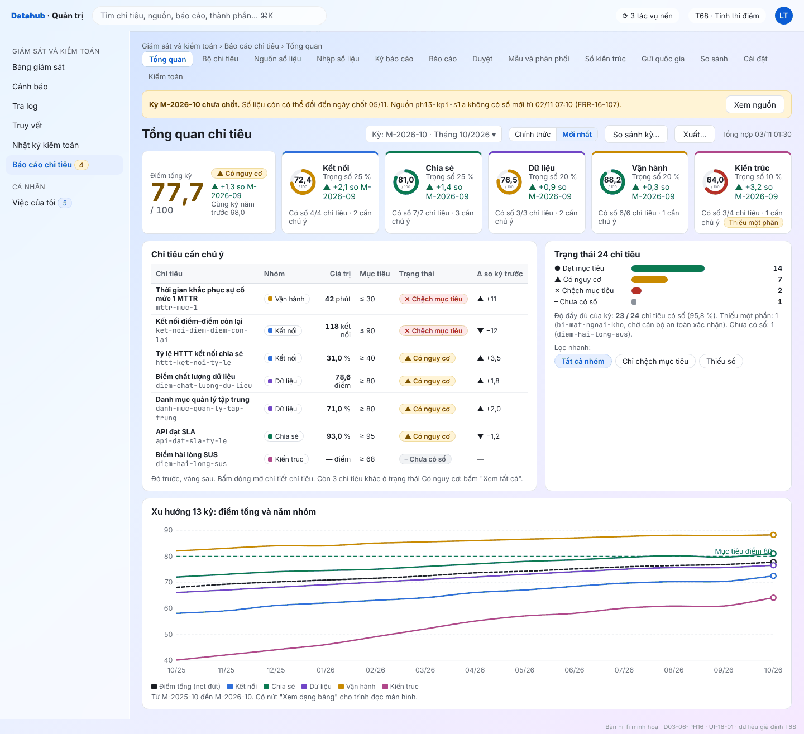

Ảnh cho thấy dải vàng kỳ M-2026-10 chưa chốt, thẻ điểm tổng 77,7 ở mức "Có nguy cơ", năm thẻ nhóm có vòng điểm và tỷ lệ phủ (Kiến trúc 3/4 mang nhãn "Thiếu một phần"), bảng bảy chỉ tiêu cần chú ý với chip có chữ và biểu tượng, phân bố 14 / 7 / 2 / 1 và biểu đồ đường 13 kỳ có vạch mục tiêu 80.


## 8. UI-16-02 Chi tiết chỉ tiêu

::: dac-ta
**Mục đích.** Cho lãnh đạo và cán bộ xem một chỉ tiêu theo kỳ: giá trị, mục tiêu, ngưỡng, xu hướng 13 kỳ, cùng kỳ năm trước, độ đầy đủ; truy giá trị về quan sát và phiên bản công thức đã dùng.

**Tác nhân, quyền.** VW, TA, TO (`PERM-16-read`); PO, AU, PU xem; liên kết "Mở định nghĩa" cần `PERM-16-admin`.

**FR, UC.** FR-16-021, 039, 040.

**Đường dẫn, mẫu.** `/giam-sat/chi-tieu/chi-so/{ma}` (tab `chuoi`, `dinh-nghia`, `nguon`, `quan-sat`; `ky`, `so-voi`); PTN-02 Chi tiết.

**API.** API-16-003, API-16-091 (chuỗi), API-16-054 (dòng truy nguồn), API-16-043 (quan sát), API-16-006 (so sánh phiên bản).

**Thông báo.** "Không tìm thấy {đối tượng} {mã} trong tỉnh đang làm việc." (ERR-16-001); mã khác dùng trong màn: ERR-16-111, ERR-16-112, ERR-16-037 (câu ở mục 5.2).

:::

### 8.1. Wireframe

Hình dưới là bố cục chi tiết chỉ tiêu: tiêu đề kèm trạng thái, hàng thẻ số, biểu đồ chuỗi cạnh khối truy nguồn và định nghĩa.

```text
| Báo cáo chỉ tiêu › Tổng quan › httt-ket-noi-ty-le |
| ① Tỷ lệ HTTT kết nối chia sẻ  [Kết nối] [▲ Có nguy cơ]  httt-ket-noi-ty-le · KPI-01 · v3 [Xuất] |
| ② [Chuỗi thời gian][Định nghĩa][Nguồn số liệu][Quan sát] |
|-----------|-----------|-----------|-----------|-----------|
| ③ 31,0 %  | Mục tiêu  | Còn thiếu | Cùng kỳ   | Độ đầy đủ |
| ▲ +3,5    | ≥ 40 %    | 9,0 điểm  | 24,2 %    | Đủ |
|-----------------------------------------------|----------------------------|
| ④ Biểu đồ chuỗi 13 kỳ + đường mục tiêu 40,     | ⑤ Dòng truy nguồn |
|   mốc vàng 32; công thức CEL bên dưới          |   quan sát, giá trị, nguồn |
|                                               | ⑥ Định nghĩa tóm tắt |
```

### 8.2. Thành phần

Bảng dưới đánh số thành phần theo bố cục trên, kèm điều kiện hiển thị và nguồn dữ liệu.

| # | Thành phần | `CMP-*` | Nội dung, kiểm tra, nguồn | Ghi chú |
|---|---|---|---|---|
| 1 | Đầu trang | `CMP-PageHeader`, `CMP-StatusTag` | Tên chỉ tiêu, nhóm, trạng thái bằng chữ, mã, KPI, số phiên bản có hiệu lực; nút "Xuất", "Mở định nghĩa" (API-16-003) | "Mở định nghĩa" chỉ hiện khi `PERM-16-admin` |
| 2 | Hàng tab | `CMP-Tabs` | Chuỗi thời gian, Định nghĩa, Nguồn số liệu, Quan sát; tab ghi lên URL |  |
| 3 | Thẻ số | `CMP-KpiCard` | Giá trị, mục tiêu và hạn, khoảng còn thiếu, cùng kỳ năm trước, độ đầy đủ (API-16-091) | Đơn vị theo `unit` |
| 4 | Biểu đồ chuỗi | `CMP-Chart` line | 13 kỳ, đường mục tiêu và mốc vàng (`markLine`), vùng tô nhạt dưới đường, điểm cuối nhấn (API-16-091) | Kỳ chưa có số: đường ngắt, không vẽ 0 |
| 5 | Dòng truy nguồn | `CMP-LineageTimeline`, `CMP-DataTable` | Mỗi giá trị liệt kê quan sát (`metricCode`, giá trị, thời điểm, nguồn, mã sự kiện) và phiên bản công thức (API-16-054) | Bấm quan sát mở UI-16-06 |

: UI-16-02 Chi tiết chỉ tiêu, thành phần

### 8.3. Trường và cột

Bảng dưới ghi trường chính của chỉ tiêu mà màn đọc.

| Trường | Kiểu | Hiển thị | Ghi chú |
|---|---|---|---|
| `indicatorCode` | T-CODE | Mã chỉ tiêu, font đơn cách | `^[a-z][a-z0-9-]{2,62}$` |
| `kind`, `unit` | enum, text | Định dạng giá trị theo mục 2.6 | `RATIO` hiển thị `%` |
| `direction` | enum | "Cao càng tốt", "Thấp càng tốt", "Trong khoảng" |  |
| `target`, `thresholds` | object | Mục tiêu, mốc xanh, mốc vàng | Đường ngang trên biểu đồ |
| `lineage[]` | array | Dòng truy nguồn | Quan sát và phiên bản công thức |

: UI-16-02 Chi tiết chỉ tiêu, trường và cột

### 8.4. Hành động

Bảng dưới liệt kê hành động của màn, điều kiện quyền và trạng thái đối tượng, API gọi và kết quả người dùng thấy.

| Hành động | Điều kiện | API | Kết quả |
|---|---|---|---|
| Đổi kỳ, so sánh hai kỳ | `PERM-16-read` | API-16-091 | Biểu đồ đánh dấu hai kỳ |
| Bấm quan sát | `PERM-16-read` | API-16-043 | Mở UI-16-06 đã lọc theo quan sát |
| Mở định nghĩa | `PERM-16-admin` | — | Mở UI-16-04 phiên bản hiệu lực |
| Xuất chuỗi | `PERM-16-export` | API-16-079 | Tệp CSV hoặc XLSX chạy nền |

: UI-16-02 Chi tiết chỉ tiêu, hành động

### 8.5. Trạng thái và thông báo

Bảng dưới nêu bốn trạng thái bắt buộc (đang tải, rỗng, lỗi, không có quyền) và các ca riêng của màn; trạng thái còn lại kế thừa `ST-*`. Câu thông báo lấy y nguyên từ FRS §9.2 (mục 5.2).

| Trạng thái | Hiển thị |
|---|---|
| Đang tải | Skeleton đầu trang, năm thẻ, khung biểu đồ và khối truy nguồn (`ST-01`). |
| Rỗng | Chỉ tiêu chưa có kỳ nào: "Chưa có số liệu cho chỉ tiêu này. Số liệu xuất hiện sau lần tổng hợp đầu tiên." |
| Lỗi tải | Khối lỗi hiện `CMP-Alert` kèm "Thử lại"; khối còn lại vẫn dùng được (`ST-05`). |
| Không có quyền | `ST-07` (ERR-16-037); mã không tồn tại hoặc thuộc tenant khác: `ST-08` (ERR-16-001). |

: UI-16-02 Chi tiết chỉ tiêu, trạng thái màn

### 8.6. Bàn phím, truy cập, responsive

Thứ tự focus: tab, thẻ số, biểu đồ, bảng truy nguồn.

### 8.7. Bản hi-fi

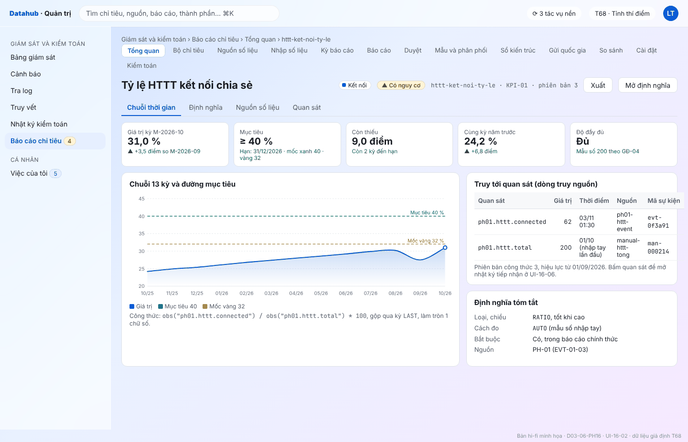


## 9. UI-16-03 Bộ chỉ tiêu

::: dac-ta
**Mục đích.** Cho quản trị tỉnh và cán bộ tổng hợp tìm và quản lý chỉ tiêu theo nhóm, trạng thái, cách đo; nhận cập nhật bộ mẫu `COMMON`; đặt trọng số nhóm; ngừng hoặc thay thế chỉ tiêu có kiểm tra ràng buộc.

**Tác nhân, quyền.** PA (mẫu `COMMON`), TA, TO xem (`PERM-16-read`); soạn, ngừng, nhóm: `PERM-16-admin`; kích hoạt phiên bản nhận từ mẫu: `PERM-16-approve` ở UI-16-12.

**FR, UC.** FR-16-001, 006, 007, 008.

**Đường dẫn, mẫu.** `/giam-sat/chi-tieu/bo-chi-tieu` (`nhom`, `trang-thai`, `cach-do`, `pham-vi`, `q`, `trang`, `co`, `sap-xep`); PTN-01 Danh sách.

**API.** API-16-001, API-16-003, API-16-004, API-16-015 (ngừng), API-16-016, API-16-017 (nhóm), API-16-018 (nhận từ mẫu), API-16-019, API-16-020 (cập nhật mẫu).

**Thông báo.** "Tổng trọng số năm nhóm đang là {tổng}. Điều chỉnh cho bằng 100." (ERR-16-012); mã khác dùng trong màn: ERR-16-013, ERR-16-014, ERR-16-054, ERR-16-055 (câu ở mục 5.2).

:::

### 9.1. Wireframe

Hình dưới là bố cục danh sách: dải cập nhật mẫu, facet nhóm, bảng chỉ tiêu có cột phạm vi và phiên bản.

```text
| ① ⓘ Có 3 cập nhật mới từ bộ mẫu COMMON (2026-11).                      [Xem cập nhật mẫu] |
| Bộ chỉ tiêu                           [Nhóm và trọng số] [Nhận từ mẫu COMMON] [+ Tạo chỉ tiêu]|
| ② (Tất cả 25)(Kết nối 4)(Chia sẻ 7)(Dữ liệu 3)(Vận hành 6)(Kiến trúc 5) |
| ③ Tìm…  Trạng thái ▾  Cách đo ▾  Phạm vi ▾                              [Ngừng chỉ tiêu] |
|☐| Chỉ tiêu · mã | KPI | Nhóm | Cách đo | Đơn vị | Mục tiêu | Phạm vi        | Phiên bản |
|☐| Tỷ lệ HTTT…   |KPI-01| Kết nối | Tự động | % | ≥ 40 | Tùy biến T68 | ACTIVE v3 |
|☐| Điểm tín nhiệm số…| — | Kiến trúc | Tự động | điểm | ≥ 70 | Tùy biến T68 | Chờ duyệt v1 |
| ④ Hiển thị 1–15 trong 25                                         ‹ 1 2 › 20 / trang |
```

### 9.2. Thành phần

Bảng dưới đánh số thành phần theo bố cục trên, kèm điều kiện hiển thị và nguồn dữ liệu.

| # | Thành phần | `CMP-*` | Nội dung, kiểm tra, nguồn | Ghi chú |
|---|---|---|---|---|
| 1 | Dải cập nhật mẫu | `CMP-Alert` thông tin | Hiện khi API-16-019 trả ít nhất một cập nhật; nút mở ngăn kéo cập nhật mẫu (API-16-019) | Chỉ cho `PERM-16-admin` |
| 2 | Facet nhóm | `CMP-FilterChips` | Số chỉ tiêu mỗi nhóm; chọn một nhóm (`facets`) |  |
| 3 | Thanh công cụ | `CMP-FilterBar`, `CMP-SearchInput` | Tìm theo mã, tên, KPI; lọc trạng thái, cách đo, phạm vi (API-16-001) | Ghi lên URL |
| 4 | Bảng chỉ tiêu | `CMP-DataTable` | Cột chọn, chỉ tiêu, KPI, nhóm, cách đo, đơn vị, mục tiêu, phạm vi, phiên bản; chọn nhiều hàng (API-16-001) | Bấm hàng mở UI-16-02; hàng "Chờ duyệt" có liên kết UI-16-12 |
| 5 | Ngăn kéo nhóm và trọng số | `CMP-Drawer`, `CMP-NumberInput` | Năm nhóm và trọng số; tổng phải bằng 100 (API-16-016, 017) | Lệch tổng: ERR-16-012 |

: UI-16-03 Bộ chỉ tiêu, thành phần

### 9.3. Trường và cột

Bảng dưới ghi cột của danh sách chỉ tiêu.

| Cột | Kiểu | Sắp xếp, lọc | Ghi chú |
|---|---|---|---|
| Chỉ tiêu, mã | text, T-CODE | Sắp xếp; tìm | Tên và mã đơn cách |
| Nhóm | enum `groupCode` | Lọc | Chip nhóm có chấm màu cố định |
| Cách đo | enum `measurement` | Lọc | Tự động, Nhập tay, Kết hợp |
| Mục tiêu | text | — | Kèm chiều tốt (≥, ≤) |
| Phạm vi | enum `scope` | Lọc | Mẫu COMMON hoặc Tùy biến T68 |
| Phiên bản | enum `indicator_version.state` | Lọc | Nhãn nêu cả số phiên bản |

: UI-16-03 Bộ chỉ tiêu, trường và cột

### 9.4. Hành động

Bảng dưới liệt kê hành động của màn, điều kiện quyền và trạng thái đối tượng, API gọi và kết quả người dùng thấy.

| Hành động | Điều kiện | API | Kết quả |
|---|---|---|---|
| + Tạo chỉ tiêu | `PERM-16-admin` | API-16-002 | Chuyển UI-16-04 với bản nháp phiên bản 1 |
| Nhận từ mẫu COMMON | `PERM-16-admin` | API-16-018 | Sao chỉ tiêu mẫu về tenant |
| Ngừng chỉ tiêu | `PERM-16-admin`; không có báo cáo chờ duyệt dùng | API-16-015 | Chuyển `RETIRED` hoặc thay thế; ERR-16-013 nếu đang dùng |
| Nhận hoặc bỏ qua cập nhật mẫu | `PERM-16-admin` | API-16-020 | Tạo phiên bản nháp hoặc ghi `DISMISSED` |
| Lưu trọng số | `PERM-16-admin` | API-16-017 | Một giao dịch; ERR-16-012 nếu tổng khác 100 |

: UI-16-03 Bộ chỉ tiêu, hành động

### 9.5. Trạng thái và thông báo

Bảng dưới nêu bốn trạng thái bắt buộc (đang tải, rỗng, lỗi, không có quyền) và các ca riêng của màn; trạng thái còn lại kế thừa `ST-*`. Câu thông báo lấy y nguyên từ FRS §9.2 (mục 5.2).

| Trạng thái | Hiển thị |
|---|---|
| Đang tải | Skeleton 8 hàng bảng (`ST-01`). |
| Rỗng | "Bộ chỉ tiêu của tỉnh còn trống. Nhận bộ 24 chỉ tiêu mẫu để bắt đầu." kèm nút "Nhận từ mẫu COMMON" (`PERM-16-admin`). |
| Lỗi tải | Thân bảng hiện `CMP-Alert` kèm "Thử lại", thanh lọc vẫn dùng (`ST-05`). |
| Không có quyền | `ST-07`; người chỉ có `PERM-16-read` vẫn thấy danh sách ở chế độ chỉ đọc (`ST-15`), ẩn mọi nút ghi. |

: UI-16-03 Bộ chỉ tiêu, trạng thái màn

### 9.6. Bàn phím, truy cập, responsive

Bảng có `aria-sort`; hàng chọn bằng phím Space; phím `/` đưa focus vào ô tìm.

### 9.7. Bản hi-fi

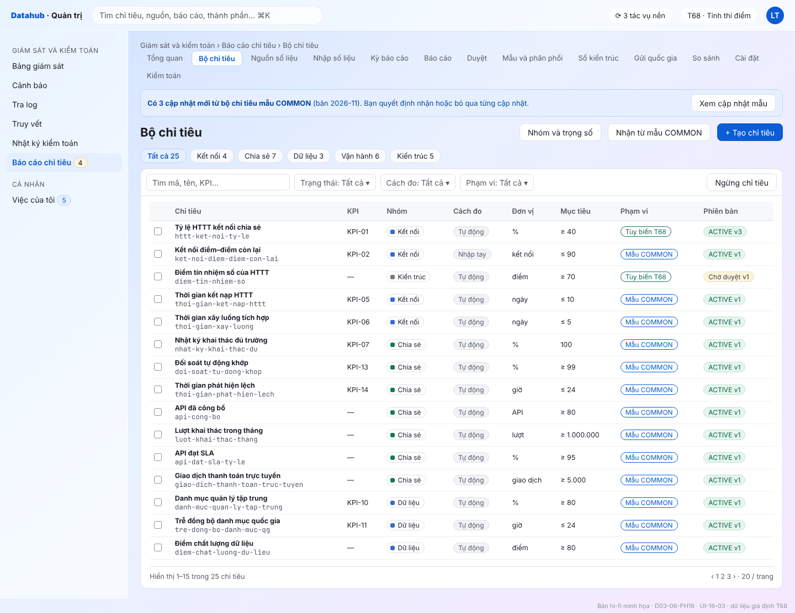


## 10. UI-16-04 Soạn định nghĩa chỉ tiêu

Màn soạn một phiên bản định nghĩa: thông tin, công thức CEL trên biến quan sát, thử tính trên kỳ trước, mục tiêu và ngưỡng ba mức; chặn lỗi trước khi gửi duyệt bốn mắt.

::: dac-ta
**Mục đích.** Cho quản trị tỉnh soạn phiên bản nháp của chỉ tiêu, kiểm tra công thức, thử tính trên dữ liệu kỳ trước, đặt mục tiêu và ngưỡng, rồi gửi duyệt; xem lịch sử và so sánh phiên bản.

**Tác nhân, quyền.** TA (`PERM-16-admin`); PA trên chỉ tiêu `COMMON`; gửi duyệt cần có lần thử tính sau lần sửa cuối; người duyệt khác người gửi (`PERM-16-approve`, UI-16-12).

**FR, UC.** FR-16-002, 003, 004, 005, 006.

**Đường dẫn, mẫu.** `/giam-sat/chi-tieu/bo-chi-tieu/{ma}/sua` (`phien-ban`, tab `thong-tin`, `cong-thuc`, `muc-tieu`, `lich-su`); PTN-03 Biểu mẫu trang.

**API.** API-16-005, API-16-006, API-16-007 (lưu), API-16-008 (kiểm tra), API-16-009 (thử tính), API-16-010 (biến quan sát), API-16-011 (gửi duyệt), API-16-014 (rút).

**Thông báo.** "Công thức chưa đúng ở vị trí {dòng}:{cột}: {mô tả}." (ERR-16-008); mã khác dùng trong màn: ERR-16-009, ERR-16-010, ERR-16-011, ERR-16-003, ERR-16-004 (câu ở mục 5.2).

:::

### 10.1. Wireframe

Hình dưới là bố cục tab Công thức và thử tính: trình soạn CEL bên trái, bảng thử tính, biến quan sát khả dụng và ngưỡng bên phải.

```text
| Soạn chỉ tiêu httt-ket-noi-ty-le [Bản nháp v4] Đã lưu 14:21  [Hủy bản nháp][Lưu nháp][Gửi duyệt ⊘] |
| ① [Thông tin][Công thức và thử tính][Mục tiêu và ngưỡng][Lịch sử phiên bản] |
|---------------------------------------------------|------------------------------------------|
| ② Công thức CEL (nền tối)                          | ⑤ Biến quan sát khả dụng |
|   obs("ph01.httt.connected") /                    |   biến · nguồn · độ tươi |
|   obs("ph01.httt.total") * 100                    |   ph01.httt.connected  ph01-httt-event ✓ |
|   ✓ Cú pháp hợp lệ · biến đã có nguồn             |   ph13.gateway.p95-ms  ph13-kpi-sla  ⚠ |
|   ✕ Thử tính phiên bản sau lần sửa cuối…          | ⑥ Ngưỡng và mục tiêu |
| ③ Thử tính trên kỳ trước  [Chạy thử tính]          |   Cao càng tốt · ≥ 40 trước 31/12/2026 |
|   kỳ · giá trị tính · chính thức · chênh          |   mốc xanh 40 · vàng 32 · làm tròn 1 |
```

### 10.2. Thành phần

Bảng dưới đánh số thành phần theo bố cục trên, kèm điều kiện hiển thị và nguồn dữ liệu.

| # | Thành phần | `CMP-*` | Nội dung, kiểm tra, nguồn | Ghi chú |
|---|---|---|---|---|
| 1 | Đầu trang soạn | `CMP-PageHeader`, `CMP-SaveIndicator` | Mã, nhãn trạng thái bản nháp, chỉ báo "Đã lưu hh:mm"; nút Hủy, Lưu nháp, Gửi duyệt (API-16-005, 007) | "Gửi duyệt" khóa kèm lý do khi chưa thử tính (ERR-16-011) |
| 2 | Hàng tab | `CMP-Tabs` | Bốn tab; chấm đỏ ở tab có lỗi kiểm tra |  |
| 3 | Trình soạn công thức | `CMP-CodeEditor` (nền tối), `CMP-ExpressionField` | CEL; kiểm tra khi gõ (debounce 400 ms); lỗi gạch wavy kèm vị trí dòng:cột (API-16-008) | Gợi ý biến khi gõ `obs(` |
| 4 | Bảng thử tính | `CMP-DataTable` | Ba kỳ gần nhất: giá trị tính, giá trị chính thức, chênh (API-16-009) | Chỉ đọc, không ghi kết quả |
| 5 | Danh sách biến | `CMP-DataTable`, `CMP-StatusTag` | Biến quan sát đã có nguồn đăng ký, độ tươi (API-16-010) | Bấm biến chèn vào công thức |

: UI-16-04 Soạn định nghĩa chỉ tiêu, thành phần

### 10.3. Trường và cột

Bảng dưới ghi trường của biểu mẫu soạn định nghĩa.

| Nhãn | Kiểu | Bắt buộc | Kiểm tra | API |
|---|---|---|---|---|
| Mã chỉ tiêu | T-CODE | Có (tạo mới) | `^[a-z][a-z0-9-]{2,62}$`; trùng ERR-16-002 | API-16-002 |
| Tên hiển thị | text ≤ 200 | Có | Không rỗng | API-16-007 |
| Nhóm | enum `groupCode` | Có | Một trong năm nhóm | API-16-007 |
| Loại, đơn vị | enum `kind`, text | Có | Tổ hợp hợp lệ (ERR-16-003) | API-16-007 |
| Chiều tốt | enum `direction` | Có | — | API-16-007 |
| Cách đo, gộp qua kỳ | enum | Có | `MANUAL` thì không có công thức CEL | API-16-007 |
| Công thức CEL | text | Có khi `AUTO` hoặc `MIXED` | Cú pháp, kiểu, biến có nguồn (ERR-16-008, 009) | API-16-008 |
| Mục tiêu, hạn | number, date | Có | Trong miền của loại | API-16-007 |
| Mốc xanh, mốc vàng | number | Có | Đơn điệu theo chiều tốt (ERR-16-010) | API-16-007 |
| Bắt buộc cho báo cáo chính thức | boolean | Không | — | API-16-007 |

: UI-16-04 Soạn định nghĩa chỉ tiêu, trường và cột

### 10.4. Máy trạng thái phiên bản và giao diện

Phiên bản đi qua `DRAFT`, `PENDING_APPROVAL`, `ACTIVE`; người duyệt có thể trả `CHANGES_REQUESTED`, khi đó màn mở lại ở trạng thái soạn kèm ý kiến ở đầu trang. Phiên bản `ACTIVE` bị thay thế thành `SUPERSEDED` khi bản mới được duyệt. Màn chỉ cho sửa khi phiên bản là `DRAFT` hoặc `CHANGES_REQUESTED`; còn lại chuyển chỉ đọc (`ST-15`) và hiện nút "Tạo phiên bản mới".

Chọn "Gửi duyệt": hộp thoại tóm tắt thay đổi so phiên bản trước (`CMP-DiffTable`), ghi chú; sau khi gửi, người soạn thấy việc ở "Yêu cầu tôi đã gửi" và có thể rút lại trước khi được duyệt.

### 10.5. Hành động

Bảng dưới liệt kê hành động của màn, điều kiện quyền và trạng thái đối tượng, API gọi và kết quả người dùng thấy.

| Hành động | Điều kiện | API | Kết quả |
|---|---|---|---|
| Lưu nháp | `PERM-16-admin` | API-16-007 | `ST-10`; kèm `If-Match`, xung đột mở `ST-13` |
| Kiểm tra công thức | `PERM-16-admin` | API-16-008 | Gạch lỗi tại vị trí; ERR-16-008, 009 |
| Chạy thử tính | `PERM-16-admin` | API-16-009 | Bảng ba kỳ; ghi dấu thời điểm thử tính |
| Gửi duyệt | `PERM-16-admin`; đã thử tính; ngưỡng hợp lệ | API-16-011 | `PENDING_APPROVAL`; EVT-16-01 khi được duyệt |
| Rút gửi duyệt | Người gửi | API-16-014 | Về `DRAFT` |
| Hủy bản nháp | `PERM-16-admin` | — | Xác nhận bằng `CMP-ConfirmDialog` |

: UI-16-04 Soạn định nghĩa chỉ tiêu, hành động

### 10.6. Trạng thái và thông báo

Bảng dưới nêu bốn trạng thái bắt buộc (đang tải, rỗng, lỗi, không có quyền) và các ca riêng của màn; trạng thái còn lại kế thừa `ST-*`. Câu thông báo lấy y nguyên từ FRS §9.2 (mục 5.2).

| Trạng thái | Hiển thị |
|---|---|
| Đang tải | Skeleton khối trường và trình soạn (`ST-01`, chỉ khi sửa). |
| Rỗng | Tạo mới: biểu mẫu trống có gợi ý "Chọn nhóm và cách đo trước"; tab Lịch sử trống: "Chưa có phiên bản nào được duyệt." |
| Lỗi tải | Lỗi lưu: `CMP-Alert` đầu biểu mẫu kèm số lỗi và liên kết nhảy tới trường (`ST-11`, `ST-12`); mất kết nối giữ bản nháp trong trang (`ST-06`). |
| Không có quyền | `ST-07`; PA mở chỉ tiêu tenant bị chuyển chỉ đọc; sửa chỉ tiêu mẫu ở tenant thì hiện ERR-16-014. |

: UI-16-04 Soạn định nghĩa chỉ tiêu, trạng thái màn

### 10.7. Bàn phím, truy cập, responsive

Trình soạn CEL: Tab thoát khỏi trình soạn bằng Esc rồi Tab; lỗi công thức đọc bằng vùng `aria-live="polite"` kèm vị trí.

### 10.8. Bản hi-fi

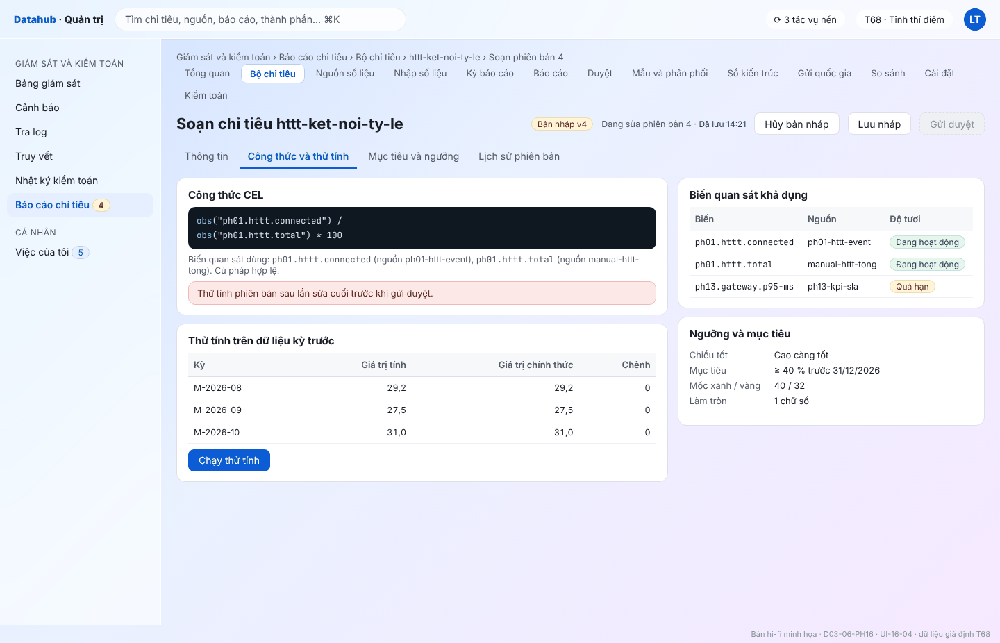


## 11. UI-16-05 Nguồn số liệu

::: dac-ta
**Mục đích.** Cho quản trị tỉnh và cán bộ tổng hợp xem toàn bộ nguồn số liệu theo độ tươi, đăng ký nguồn mới theo hợp đồng chỉ số, tạm dừng hoặc tiếp tục nguồn, ngừng nguồn không còn dùng.

**Tác nhân, quyền.** TA, TO (`PERM-16-source`); PA, AU, PO, PU xem (`PERM-16-read`).

**FR, UC.** FR-16-009, 013.

**Đường dẫn, mẫu.** `/giam-sat/chi-tieu/nguon` (`loai`, `phan-he`, `trang-thai`, `q`, `trang`); PTN-01 Danh sách.

**API.** API-16-021, API-16-022, API-16-023, API-16-024, API-16-025 (thử nguồn), API-16-026 (tạm dừng), API-16-027 (tiếp tục), API-16-028 (ngừng).

**Thông báo.** "Nguồn {mã} không có số mới từ {thời điểm}." (ERR-16-107); mã khác dùng trong màn: ERR-16-108, ERR-16-015, ERR-16-016, ERR-16-017 (câu ở mục 5.2).

:::

### 11.1. Wireframe

Hình dưới là bố cục danh sách nguồn: dải lỗi, bốn thẻ số theo trạng thái, bảng có cột trạng thái và số chỉ tiêu dùng nguồn.

```text
| ✕ ① Nguồn ph20-tenant lỗi 3 lần liên tiếp, đã chuyển trạng thái Lỗi.                  [Mở nguồn] |
| Nguồn số liệu                                              [Tải lại] [+ Đăng ký nguồn] |
| ② Đang hoạt động 6 | Quá hạn 1 (ngưỡng 26 giờ) | Lỗi 1 | Tạm dừng 1 |
| (Tất cả 9)(Tự động 8)(Nhập tay 1)(Quá hạn hoặc lỗi 2) |
| ③ Tìm mã…  Loại ▾  Phân hệ ▾  Trạng thái ▾ |
| Mã nguồn · Loại · Phân hệ · Trạng thái · Số mới nhất · Lần lỗi · Chỉ tiêu dùng |
| ph01-httt-event · EVENT · PH-01 · Đang hoạt động · 04/11 01:12 · 0 · 2 |
| ph13-kpi-sla · PULL_API · PH-13 · ⚠ Quá hạn · 02/11 07:10 · 2 · 6 |
```

### 11.2. Thành phần

Bảng dưới đánh số thành phần theo bố cục trên, kèm điều kiện hiển thị và nguồn dữ liệu.

| # | Thành phần | `CMP-*` | Nội dung, kiểm tra, nguồn | Ghi chú |
|---|---|---|---|---|
| 1 | Dải lỗi nguồn | `CMP-Banner` đỏ | Hiện khi có nguồn `FAILED`; nêu mã nguồn, số lần lỗi; nút mở chi tiết (API-16-021) | Không đóng được (ERR-16-108) |
| 2 | Thẻ số | `CMP-StatCard` | Số nguồn theo trạng thái; bấm lọc bảng (`facets`) |  |
| 3 | Bảng nguồn | `CMP-DataTable`, `CMP-StatusTag` | Mã, loại, phân hệ, trạng thái bằng chữ, số mới nhất, lần lỗi liên tiếp, số chỉ tiêu dùng (API-16-021) | Sắp theo nặng trước: `FAILED`, `STALE`, `PAUSED`, `ACTIVE` |
| 4 | Hộp thoại đăng ký nguồn | `CMP-Modal`, `CMP-DynamicForm` | Mã, loại, phân hệ, cấu hình theo loại (chủ đề Kafka, URL API chỉ số, lịch kéo), hợp đồng chỉ số (API-16-022, 025) | Thử nguồn trước khi lưu (ERR-16-016) |
| 5 | Hộp thoại ngừng nguồn | `CMP-ConfirmDialog` | Liệt kê chỉ tiêu phụ thuộc; chặn khi là nguồn duy nhất (API-16-028) | ERR-16-017 |

: UI-16-05 Nguồn số liệu, thành phần

### 11.3. Trường và cột

Bảng dưới ghi trường của biểu mẫu đăng ký nguồn.

| Trường | Kiểu | Bắt buộc | Kiểm tra | API |
|---|---|---|---|---|
| `sourceCode` | T-CODE | Có | Mẫu mã; trùng ERR-16-002 | API-16-022 |
| `sourceType` | enum | Có | `EVENT`, `PULL_API`, `PUSH_API`, `MANUAL` | API-16-022 |
| Cấu hình theo loại | object | Có | Thiếu trường theo loại: ERR-16-015 | API-16-022 |
| Hợp đồng chỉ số | array `metricCode` | Có | Dạng `ph{nn}.{đối-tượng}.{chỉ-số}` | API-16-024 |
| `stale-hours` riêng | number | Không | 1…744; mặc định theo tham số `16.source.stale-hours` | API-16-024 |

: UI-16-05 Nguồn số liệu, trường và cột

### 11.4. Hành động

Bảng dưới liệt kê hành động của màn, điều kiện quyền và trạng thái đối tượng, API gọi và kết quả người dùng thấy.

| Hành động | Điều kiện | API | Kết quả |
|---|---|---|---|
| + Đăng ký nguồn | `PERM-16-source` | API-16-022 | Nguồn `ACTIVE` sau khi thử đạt |
| Thử nguồn | `PERM-16-source` | API-16-025 | Kết quả ngay trong hộp thoại; ERR-16-016 nếu lỗi |
| Tạm dừng, tiếp tục | `PERM-16-source` | API-16-026, 027 | `PAUSED` hoặc `ACTIVE`; EVT-16-03 |
| Ngừng | `PERM-16-source`; không phải nguồn duy nhất | API-16-028 | `RETIRED`; ERR-16-017 nếu bị chặn |

: UI-16-05 Nguồn số liệu, hành động

### 11.5. Trạng thái và thông báo

Bảng dưới nêu bốn trạng thái bắt buộc (đang tải, rỗng, lỗi, không có quyền) và các ca riêng của màn; trạng thái còn lại kế thừa `ST-*`. Câu thông báo lấy y nguyên từ FRS §9.2 (mục 5.2).

| Trạng thái | Hiển thị |
|---|---|
| Đang tải | Skeleton thẻ số và 8 hàng bảng (`ST-01`). |
| Rỗng | "Chưa có nguồn số liệu nào. Đăng ký nguồn để chỉ tiêu tự động có số." kèm nút "Đăng ký nguồn" (`PERM-16-source`). |
| Lỗi tải | Thân bảng hiện `CMP-Alert` kèm "Thử lại" (`ST-05`). |
| Không có quyền | `ST-07`; người chỉ đọc không thấy nút ghi (`ST-15`). |

: UI-16-05 Nguồn số liệu, trạng thái màn

### 11.6. Bàn phím, truy cập, responsive

Trạng thái nguồn có chữ và biểu tượng; dải đỏ `role="alert"`.

### 11.7. Bản hi-fi

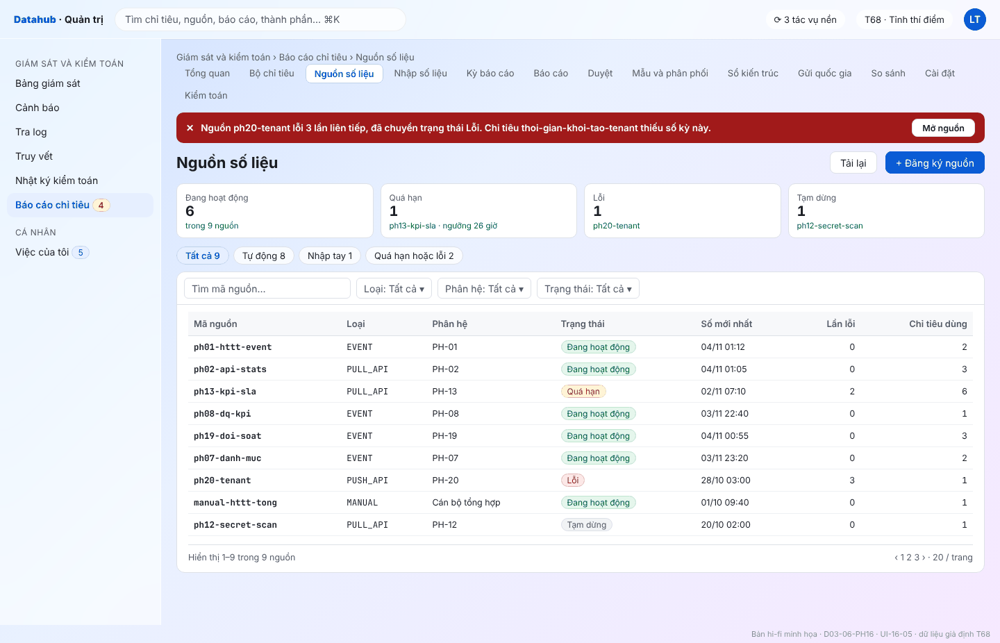


## 12. UI-16-06 Chi tiết nguồn, nhật ký tiếp nhận

::: dac-ta
**Mục đích.** Cho cán bộ tổng hợp và người vận hành nền tảng tra nhật ký tiếp nhận của một nguồn (chấp nhận, trùng, bị loại, xử lý lại), kéo số ngay, đọc bù khi lỡ sự kiện, xử lý lại quan sát bị loại sau khi sửa nguồn.

**Tác nhân, quyền.** TO, TA (`PERM-16-source`) ghi; PO, AU, PU xem (`PERM-16-read`).

**FR, UC.** FR-16-010, 011, 012, 013, 016.

**Đường dẫn, mẫu.** `/giam-sat/chi-tieu/nguon/{ma}` (tab `nhat-ky`, `bi-loai`, `hop-dong`, `cau-hinh`; `ket-qua`, `chi-so`, `tu`, `den`); PTN-11 Giám sát và tra log.

**API.** API-16-023, API-16-042 (nhật ký), API-16-043 (quan sát), API-16-044 (bị loại), API-16-045 (xử lý lại), API-16-029 (kéo ngay), API-16-025, API-16-026, API-16-027.

**Thông báo.** "Quan sát thứ {i} sai lược đồ: {trường}." (ERR-16-101); mã khác dùng trong màn: ERR-16-102, ERR-16-103, ERR-16-104, ERR-16-105, ERR-16-106 (câu ở mục 5.2).

:::

### 12.1. Wireframe

Hình dưới là bố cục chi tiết nguồn: đầu trang, thẻ số, tab và bảng nhật ký tiếp nhận.

```text
| ① Nguồn ph01-httt-event [Đang hoạt động] EVENT · PH-01   [Tạm dừng][Kéo ngay][Thử nguồn] |
| ② [Nhật ký tiếp nhận][Bị loại][Hợp đồng chỉ số][Cấu hình] |
| ③ Quan sát 24 giờ 1.204 | Bị loại 2 | Độ tươi 2 giờ 20 (ngưỡng 26) | Lần kéo lỗi 0 (ngưỡng 3) |
| ④ Kết quả ▾  Chỉ số ▾  Từ ngày ▾                         [Xử lý lại các dòng bị loại] |
| Thời điểm   | Kết quả   | Chỉ số             | Giá trị | Mã sự kiện | Ghi chú |
| 04/11 01:12 | ACCEPTED  | ph01.httt.connected| 62      | evt-0f3a91 | — |
| 03/11 23:58 | REJECTED  | ph01.httt.total    | abc     | evt-0f3a77 | ERR-16-105 sai lược đồ |
| ⑤ Hiển thị 1–5 · làm mới 30 giây |
```

### 12.2. Thành phần

Bảng dưới đánh số thành phần theo bố cục trên, kèm điều kiện hiển thị và nguồn dữ liệu.

| # | Thành phần | `CMP-*` | Nội dung, kiểm tra, nguồn | Ghi chú |
|---|---|---|---|---|
| 1 | Đầu trang nguồn | `CMP-PageHeader`, `CMP-StatusTag` | Mã, trạng thái, loại, phân hệ, số chỉ số trong hợp đồng; nút Tạm dừng, Kéo ngay, Thử nguồn (API-16-023) | "Kéo ngay" chỉ có ở `PULL_API`; khóa khi đang kéo |
| 2 | Hàng tab | `CMP-Tabs` | Nhật ký tiếp nhận, Bị loại, Hợp đồng chỉ số, Cấu hình |  |
| 3 | Thẻ số vận hành | `CMP-StatCard` | Số quan sát 24 giờ, số bị loại, độ tươi so ngưỡng, số lần kéo lỗi liên tiếp so ngưỡng (API-16-023) | Chữ vàng khi độ tươi vượt 80 % ngưỡng |
| 4 | Bảng nhật ký | `CMP-LogViewer` hoặc `CMP-DataTable` | Thời điểm, kết quả `ingest.result`, chỉ số, giá trị, mã sự kiện hoặc `snapshotId`, ghi chú mã lỗi (API-16-042) | Tự làm mới 30 giây khi tab hiển thị |
| 5 | Bảng bị loại | `CMP-DataTable`, `CMP-SelectionBar` | Quan sát bị loại, lý do, số lần xử lý lại; chọn nhiều để xử lý lại (API-16-044) | Thanh chọn là lớp nổi `glass-overlay` |

: UI-16-06 Chi tiết nguồn, nhật ký tiếp nhận, thành phần

### 12.3. Trường và cột

Bảng dưới ghi cột của bảng nhật ký tiếp nhận.

| Cột nhật ký | Kiểu | Lọc | Ghi chú |
|---|---|---|---|
| Thời điểm | datetime | Khoảng | Hiển thị giờ địa phương `dd/MM HH:mm` |
| Kết quả | enum `ingest.result` | Có | `ACCEPTED`, `DUPLICATE`, `REJECTED`, `REPROCESSED`; nhãn tiếng Việt ở mục 5.1 |
| Chỉ số | `metricCode` | Có | Dạng `ph{nn}.{đối-tượng}.{chỉ-số}` |
| Giá trị | number hoặc text | — | Canh phải; giá trị sai kiểu hiện nguyên văn kèm ERR-16-105 |
| Mã sự kiện | text | Tìm | `idempotencyRef`; cùng mã khác giá trị: ERR-16-103 |

: UI-16-06 Chi tiết nguồn, nhật ký tiếp nhận, trường và cột

### 12.4. Hành động

Bảng dưới liệt kê hành động của màn, điều kiện quyền và trạng thái đối tượng, API gọi và kết quả người dùng thấy.

| Hành động | Điều kiện | API | Kết quả |
|---|---|---|---|
| Kéo ngay | `PERM-16-source`; nguồn `PULL_API` | API-16-029 | Tạo tác vụ nền; kết quả vào nhật ký; ERR-16-106 nếu lỗi |
| Xử lý lại dòng bị loại | `PERM-16-source` | API-16-045 | Dòng chuyển `REPROCESSED` hoặc vẫn bị loại kèm lý do |
| Tạm dừng, tiếp tục | `PERM-16-source` | API-16-026, 027 | Đổi trạng thái; EVT-16-03 |
| Thử nguồn | `PERM-16-source` | API-16-025 | Kết quả ngay |

: UI-16-06 Chi tiết nguồn, nhật ký tiếp nhận, hành động

### 12.5. Trạng thái và thông báo

Bảng dưới nêu bốn trạng thái bắt buộc (đang tải, rỗng, lỗi, không có quyền) và các ca riêng của màn; trạng thái còn lại kế thừa `ST-*`. Câu thông báo lấy y nguyên từ FRS §9.2 (mục 5.2).

| Trạng thái | Hiển thị |
|---|---|
| Đang tải | Skeleton đầu trang, bốn thẻ, 10 hàng nhật ký (`ST-01`). |
| Rỗng | Nhật ký trống: "Nguồn này chưa nhận quan sát nào." kèm hướng dẫn kiểm tra hợp đồng; tab Bị loại trống: "Không có quan sát bị loại trong khoảng đã chọn." |
| Lỗi tải | Bảng nhật ký hiện `CMP-Alert` kèm "Thử lại"; đầu trang và thẻ vẫn dùng (`ST-05`). |
| Không có quyền | `ST-07` (ERR-16-037); mã nguồn không tồn tại: `ST-08` (ERR-16-001). |

: UI-16-06 Chi tiết nguồn, nhật ký tiếp nhận, trạng thái màn

### 12.6. Bàn phím, truy cập, responsive

Bảng nhật ký là vùng `role="log"` không đẩy thông báo mỗi lần làm mới.

### 12.7. Bản hi-fi

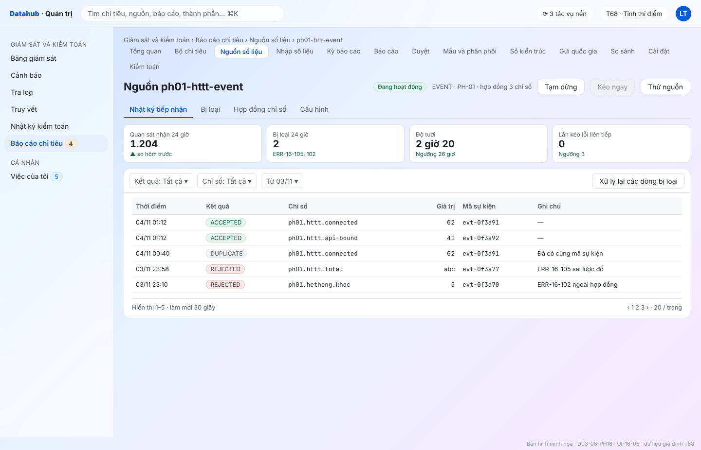


## 13. UI-16-07 Nhập số liệu tay

::: dac-ta
**Mục đích.** Cho cán bộ tổng hợp, chủ quản dữ liệu và cán bộ an toàn nhập số liệu tay kèm bằng chứng (tệp, số văn bản), nhập hàng loạt từ XLSX có xem trước từng dòng, gửi xác nhận; người khác xác nhận hoặc từ chối.

**Tác nhân, quyền.** TO, DS, SO (`PERM-16-manual`); xác nhận cần người khác người nhập (ERR-16-005); TA, AU xem.

**FR, UC.** FR-16-014, 015.

**Đường dẫn, mẫu.** `/giam-sat/chi-tieu/nhap` (tab `tep`, `bieu-mau`, `cho-xac-nhan`, `da-xu-ly`; `ky`, `buoc`); PTN-09 Nhập dữ liệu có xem trước.

**API.** API-16-031, API-16-032, API-16-033, API-16-034, API-16-035 (bằng chứng), API-16-036 (tệp mẫu), API-16-037 (nhập tệp), API-16-038 (chốt nhập), API-16-039 (gửi xác nhận), API-16-040, API-16-041.

**Thông báo.** "Số liệu tay cần ít nhất một bằng chứng (tệp hoặc số văn bản)." (ERR-16-018); mã khác dùng trong màn: ERR-16-019, ERR-16-020, ERR-16-021, ERR-16-053, ERR-16-005 (câu ở mục 5.2).

:::

### 13.1. Wireframe

Hình dưới là bước 2 (xem trước) của nhập tệp: bảng xem trước cạnh vùng bằng chứng và danh sách chờ xác nhận, thanh quyết định ở đáy.

```text
| Nhập số liệu tay                          Kỳ M-2026-10 ▾   [Tải tệp mẫu] [Nhập trực tiếp] |
| ① [Nhập tệp XLSX][Chờ xác nhận 2][Đã xử lý] |
| ② (1 Tải tệp ✓) → (2 Xem trước và sửa) → (3 Xác nhận nhập) |
|--------------------------------------------------------|-----------------------------------------|
| ③ Xem trước so-lieu-tay-2026-10.xlsx (5 dòng, 3 hợp lệ)  | ⑤ Bằng chứng đính kèm |
|  Dòng · Chỉ tiêu · Kỳ · Giá trị · Bằng chứng · Kiểm tra   |   [Kéo tệp vào đây] PDF, ảnh, XLSX… |
|  4 · ho-so-cap-do · Có · — · ✕ INVALID                   | ⑥ Chờ xác nhận (bốn mắt) |
|    Số liệu tay cần ít nhất một bằng chứng…                |   chỉ tiêu · kỳ · giá trị · người nhập |
| ④ Quay lại                                  [Nhập 3 dòng hợp lệ] |
```

### 13.2. Thành phần

Bảng dưới đánh số thành phần theo bố cục trên, kèm điều kiện hiển thị và nguồn dữ liệu.

| # | Thành phần | `CMP-*` | Nội dung, kiểm tra, nguồn | Ghi chú |
|---|---|---|---|---|
| 1 | Thanh bước | `CMP-Steps` | Ba bước: Tải tệp, Xem trước và sửa, Xác nhận nhập | Chỉ cho quay lại bước trước |
| 2 | Vùng tải tệp | `CMP-FileDropzone` | XLSX theo tệp mẫu, tối đa 2.000 dòng (API-16-037) | Sai mẫu hoặc quá dòng: ERR-16-020 |
| 3 | Bảng xem trước | `CMP-EditableTable` | Mỗi dòng có trạng thái `manual_import.rowStatus` (`VALID`, `INVALID`, `IMPORTED`); ô lỗi viền đỏ kèm câu lỗi dưới ô (API-16-037) | Sửa ô tại chỗ và kiểm tra lại không cần tải lại tệp |
| 4 | Vùng bằng chứng | `CMP-Upload` | PDF, ảnh, XLSX, DOCX tối đa 20 MB (`16.manual.max-file-mb`) hoặc số văn bản (API-16-035) | Sai loại hoặc quá cỡ: ERR-16-053 |
| 5 | Bảng chờ xác nhận | `CMP-DataTable`, `CMP-DecisionPanel` | Số liệu `SUBMITTED` của người khác; nút Xác nhận, Từ chối kèm lý do (API-16-031, 040, 041) | Người nhập không thấy nút (ERR-16-005) |

: UI-16-07 Nhập số liệu tay, thành phần

### 13.3. Trường và cột

Bảng dưới ghi trường của biểu mẫu nhập số liệu tay.

| Trường | Kiểu | Bắt buộc | Kiểm tra | API |
|---|---|---|---|---|
| Chỉ tiêu | `indicatorCode` | Có | Chỉ tiêu `MANUAL` hoặc `MIXED` đang `ACTIVE` | API-16-032 |
| Kỳ | `periodCode` | Có | Kỳ chưa chốt (ERR-16-022 nếu chốt) | API-16-032 |
| Giá trị | theo `kind` | Có | Trong miền của chỉ tiêu (ERR-16-019) | API-16-032 |
| Bằng chứng | tệp hoặc số văn bản | Có khi `16.manual.evidence-required` | Ít nhất một (ERR-16-018) | API-16-035 |
| Ghi chú | text ≤ 500 | Không | — | API-16-032 |
| Đã có số `ACCEPTED` | — | — | Hiện ERR-16-021, tạo bản đính chính | API-16-032 |

: UI-16-07 Nhập số liệu tay, trường và cột

### 13.4. Hành động

Bảng dưới liệt kê hành động của màn, điều kiện quyền và trạng thái đối tượng, API gọi và kết quả người dùng thấy.

| Hành động | Điều kiện | API | Kết quả |
|---|---|---|---|
| Tải tệp lên | `PERM-16-manual` | API-16-037 | Sinh bản xem trước từng dòng |
| Nhập n dòng hợp lệ | `PERM-16-manual` | API-16-038 | Dòng thành `DRAFT`; dòng lỗi giữ lại |
| Gửi xác nhận | `PERM-16-manual`; có bằng chứng | API-16-039 | `SUBMITTED`; EVT-16-04 sau quyết định |
| Xác nhận | `PERM-16-manual`; khác người nhập | API-16-040 | `ACCEPTED`; kỳ tính lại khi có số trễ |
| Từ chối | `PERM-16-manual`; khác người nhập | API-16-041 | `REJECTED` kèm lý do (ERR-16-007 nếu thiếu lý do) |

: UI-16-07 Nhập số liệu tay, hành động

### 13.5. Trạng thái và thông báo

Bảng dưới nêu bốn trạng thái bắt buộc (đang tải, rỗng, lỗi, không có quyền) và các ca riêng của màn; trạng thái còn lại kế thừa `ST-*`. Câu thông báo lấy y nguyên từ FRS §9.2 (mục 5.2).

| Trạng thái | Hiển thị |
|---|---|
| Đang tải | Skeleton bảng xem trước và danh sách chờ (`ST-01`). |
| Rỗng | Tab Chờ xác nhận trống: "Không có số liệu nào chờ xác nhận."; chưa tải tệp: vùng kéo thả với hướng dẫn và liên kết "Tải tệp mẫu". |
| Lỗi tải | Lỗi đọc tệp: `CMP-Alert` ở vùng tải (ERR-16-020); lỗi tải bảng: `ST-05`. |
| Không có quyền | `ST-07` cho người không có `PERM-16-read`; người chỉ đọc thấy tab Đã xử lý ở `ST-15`. |

: UI-16-07 Nhập số liệu tay, trạng thái màn

### 13.6. Bàn phím, truy cập, responsive

Bảng xem trước có `aria-describedby` trỏ câu lỗi của ô; chuyển ô bằng phím mũi tên, F2 sửa.

### 13.7. Bản hi-fi

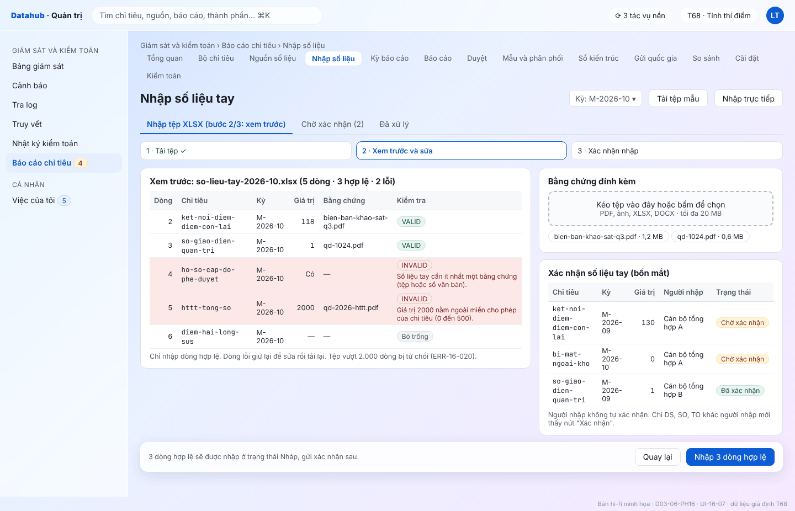


## 14. UI-16-08 Kỳ báo cáo và lần tổng hợp

::: dac-ta
**Mục đích.** Cho cán bộ tổng hợp và quản trị tỉnh quản lý lịch kỳ, chạy tổng hợp, chốt kỳ khi đủ điều kiện, mở lại kỳ có lý do; cho người vận hành theo dõi tình trạng thu thập và tổng hợp.

**Tác nhân, quyền.** TA (chốt, mở lại, `PERM-16-run`); TO chạy tổng hợp nhưng không chốt, không mở lại; PO xem vận hành; AU xem.

**FR, UC.** FR-16-017, 018, 024, 042.

**Đường dẫn, mẫu.** `/giam-sat/chi-tieu/ky` (tab `ky`, `lan-tong-hop`, `van-hanh`; `loai`, `trang-thai`, `nam`); PTN-01 Danh sách.

**API.** API-16-046, API-16-047 (tạo kỳ), API-16-048, API-16-049 (lần tổng hợp), API-16-050 (chạy), API-16-052 (hủy), API-16-057 (chốt), API-16-058 (mở lại), API-16-093 (vận hành).

**Thông báo.** "Kỳ {kỳ} đã chốt. Mở lại kỳ nếu cần sửa hoặc tính lại." (ERR-16-022); mã khác dùng trong màn: ERR-16-023, ERR-16-024, ERR-16-025, ERR-16-026 (câu ở mục 5.2).

:::

### 14.1. Wireframe

Hình dưới là bố cục tab Kỳ báo cáo: bảng kỳ bên trái, kỳ đang chọn và lịch tổng hợp bên phải.

```text
| Kỳ báo cáo và lần tổng hợp                          [+ Tạo kỳ] [Tổng hợp ngay] [Chốt kỳ] |
| ① [Kỳ báo cáo][Lần tổng hợp][Vận hành] |
|--------------------------------------------------------|------------------------------------------|
| ② Kỳ · Loại · Trạng thái · Độ đầy đủ · Tổng hợp · Chốt | ③ Kỳ M-2026-10 · Đã tính, chưa chốt |
|  M-2026-10  MONTH  Đã tính   95,8 %   03/11 01:30  —   |   hạn chốt 05/11 · lần #41 · 23/24 chỉ tiêu|
|  M-2026-09  MONTH  Đã chốt   100 %    05/10 …           |   lưới tác vụ: Thu thập → … → Ghi kết quả |
|  M-2026-08  MONTH  Đã mở lại 100 %    12/10 …           |   ⚠ Chưa chốt được: còn 1 số liệu tay… |
|  Q-2026-Q3  QUARTER Đã chốt                              | ④ Lịch tổng hợp 01:30 hằng ngày |
```

### 14.2. Thành phần

Bảng dưới đánh số thành phần theo bố cục trên, kèm điều kiện hiển thị và nguồn dữ liệu.

| # | Thành phần | `CMP-*` | Nội dung, kiểm tra, nguồn | Ghi chú |
|---|---|---|---|---|
| 1 | Hàng tab | `CMP-Tabs` | Kỳ báo cáo, Lần tổng hợp, Vận hành (`PERM-16-read`) | Tab Vận hành ưu tiên người trực |
| 2 | Bảng kỳ | `CMP-DataTable`, `CMP-StatusTag` | Mã kỳ, loại, trạng thái, độ đầy đủ, lần tổng hợp gần nhất, thời điểm chốt (API-16-046) | Hàng chọn nổi bật |
| 3 | Khối kỳ đang chọn | `CMP-DescriptionList`, `CMP-JobProgress` | Hạn chốt theo `16.period.close-day`, lần tổng hợp, độ đầy đủ, cờ, báo cáo liên quan; lưới tác vụ sáu bước (API-16-048, 051) | Làm mới 5 giây khi đang chạy |
| 4 | Hộp thoại tạo kỳ | `CMP-Modal`, `CMP-FormField` | Loại kỳ, mã kỳ theo mẫu, khoảng ngày (API-16-047) | ERR-16-024 |
| 5 | Hộp thoại chốt kỳ | `CMP-ConfirmDialog` | Liệt kê điều kiện chốt; nêu số liệu tay còn chờ (API-16-057) | ERR-16-025 nêu lý do |

: UI-16-08 Kỳ báo cáo và lần tổng hợp, thành phần

### 14.3. Trường và cột

Bảng dưới ghi cột của bảng kỳ báo cáo.

| Cột | Kiểu | Lọc | Ghi chú |
|---|---|---|---|
| Kỳ | `periodCode` | Tìm | Mẫu `M-2026-10`, `Q-2026-Q3`, `Y-2026` |
| Loại | enum `periodType` | Có | Tháng, Quý, Năm |
| Trạng thái | enum `reporting_period.state` | Có | Đang mở, Đang thu thập, Đã tính, Đã chốt, Đã mở lại |
| Độ đầy đủ | percent | — | Số chỉ tiêu có số trên tổng, `n / m` |
| Chốt lúc | datetime | — | Trống khi chưa chốt |

: UI-16-08 Kỳ báo cáo và lần tổng hợp, trường và cột

### 14.4. Hành động

Bảng dưới liệt kê hành động của màn, điều kiện quyền và trạng thái đối tượng, API gọi và kết quả người dùng thấy.

| Hành động | Điều kiện | API | Kết quả |
|---|---|---|---|
| + Tạo kỳ | `PERM-16-run` | API-16-047 | Kỳ `OPEN`; ERR-16-024 nếu sai mã |
| Tổng hợp ngay | `PERM-16-run` | API-16-050 | Lần chạy `QUEUED`; ERR-16-023 nếu đang chạy; ERR-16-022 nếu đã chốt |
| Hủy lần chạy | `PERM-16-run` | API-16-052 | `CANCELLED` |
| Chốt kỳ | `PERM-16-run` của TA; kỳ `COMPUTED` | API-16-057 | `CLOSED`; ERR-16-025 nếu chưa đủ điều kiện |
| Mở lại kỳ | TA; có lý do | API-16-058 | `REOPENED`; ERR-16-026 nếu còn báo cáo đang duyệt |

: UI-16-08 Kỳ báo cáo và lần tổng hợp, hành động

### 14.5. Trạng thái và thông báo

Bảng dưới nêu bốn trạng thái bắt buộc (đang tải, rỗng, lỗi, không có quyền) và các ca riêng của màn; trạng thái còn lại kế thừa `ST-*`. Câu thông báo lấy y nguyên từ FRS §9.2 (mục 5.2).

| Trạng thái | Hiển thị |
|---|---|
| Đang tải | Skeleton 8 hàng bảng và khối chi tiết (`ST-01`). |
| Rỗng | "Chưa có kỳ báo cáo nào. Hệ thống tự sinh kỳ theo `16.period.types` hoặc anh/chị tạo kỳ thủ công." kèm nút "Tạo kỳ". |
| Lỗi tải | Thân bảng hiện `CMP-Alert` kèm "Thử lại" (`ST-05`). |
| Không có quyền | `ST-07`; TO thấy nút Chốt kỳ và Mở lại bị ẩn (`ST-15` cục bộ). |

: UI-16-08 Kỳ báo cáo và lần tổng hợp, trạng thái màn

### 14.6. Bàn phím, truy cập, responsive

Bảng kỳ có `aria-selected` cho hàng chọn; lưới tác vụ đọc từng bước kèm trạng thái chữ.

### 14.7. Bản hi-fi

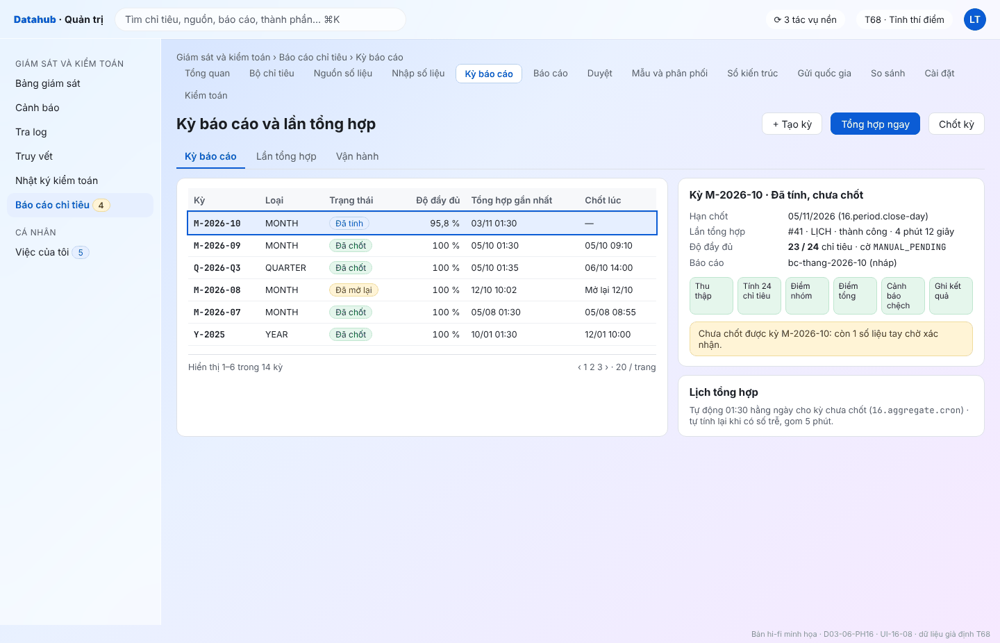


## 15. UI-16-09 Chi tiết lần tổng hợp

::: dac-ta
**Mục đích.** Cho cán bộ tổng hợp xem lần tổng hợp: tiến độ, độ đầy đủ, cờ `MISSING_SOURCE`, `STALE_SOURCE`, `MANUAL_PENDING`, `FORMULA_ERROR`, bảng giá trị chỉ tiêu và dòng truy nguồn; tính lại khi có số trễ hoặc đổi công thức.

**Tác nhân, quyền.** TO, TA (`PERM-16-run` cho tính lại); PO, AU xem.

**FR, UC.** FR-16-018, 019, 020, 023.

**Đường dẫn, mẫu.** `/giam-sat/chi-tieu/ky/{ma}` (tab `gia-tri`, `co`, `nguon`; `lan`, `trang-thai`, `co`); PTN-02 Chi tiết.

**API.** API-16-051, API-16-053 (giá trị), API-16-054 (dòng truy nguồn), API-16-055 (tính lại), API-16-052 (hủy).

**Thông báo.** "Chỉ tiêu {mã}: công thức lỗi khi tính ({lý do}). Giá trị để trống." (ERR-16-109); mã khác dùng trong màn: ERR-16-110, ERR-16-111, ERR-16-112, ERR-16-023 (câu ở mục 5.2).

:::

### 15.1. Wireframe

Hình dưới là bố cục chi tiết lần tổng hợp: đầu trang, thẻ số, bảng giá trị kèm cờ.

```text
| ① Lần tổng hợp #41 · kỳ M-2026-10 [Thành công]  LỊCH · 4 phút 12 giây          [Tính lại kỳ] |
| ② Độ đầy đủ 95,8 % | Cờ thiếu nguồn 2 | Chờ xác nhận tay 1 | Lỗi công thức 0 |
| ③ Trạng thái ▾  Cờ ▾  Nhóm ▾ |
| Chỉ tiêu · mã            | Giá trị | Trạng thái | Đầy đủ  | Cờ              | Ghi chú |
| Bí mật ngoài kho         | 0       | Đạt        | PARTIAL | MANUAL_PENDING  | chờ xác nhận tay… |
| Điểm hài lòng SUS        | —       | Chưa có số | NO_DATA | MISSING_SOURCE  | Thiếu số liệu từ… |
| Thời gian khởi tạo tenant| —       | Chưa có số | NO_DATA | STALE_SOURCE    | Thiếu số liệu từ… |
```

### 15.2. Thành phần

Bảng dưới đánh số thành phần theo bố cục trên, kèm điều kiện hiển thị và nguồn dữ liệu.

| # | Thành phần | `CMP-*` | Nội dung, kiểm tra, nguồn | Ghi chú |
|---|---|---|---|---|
| 1 | Đầu trang | `CMP-PageHeader`, `CMP-StatusTag` | Số thứ tự lần, kỳ, trạng thái, kích hoạt (`trigger`), thời lượng; nút Tính lại kỳ (API-16-051) | Nút khóa khi kỳ đã chốt (ERR-16-022) |
| 2 | Thẻ số | `CMP-StatCard` | Độ đầy đủ, số cờ theo loại, số chờ xác nhận, số lỗi công thức (API-16-051) | Bấm thẻ lọc bảng theo cờ |
| 3 | Lưới tác vụ | `CMP-JobProgress` | Sáu bước: thu thập, tính chỉ tiêu, điểm nhóm, điểm tổng, cảnh báo chệch, ghi kết quả (API-16-051) | Hiện khi đang chạy |
| 4 | Bảng giá trị | `CMP-DataTable` | Chỉ tiêu, giá trị, trạng thái, độ đầy đủ, cờ, ghi chú (API-16-053) | Bấm giá trị mở dòng truy nguồn |
| 5 | Ngăn kéo truy nguồn | `CMP-Drawer`, `CMP-LineageTimeline` | Quan sát và phiên bản công thức đã dùng cho giá trị (API-16-054) | Lớp nổi `glass-modal` |

: UI-16-09 Chi tiết lần tổng hợp, thành phần

### 15.3. Trường và cột

Bảng dưới ghi cột của bảng giá trị chỉ tiêu.

| Cột | Kiểu | Lọc | Ghi chú |
|---|---|---|---|
| Chỉ tiêu | text và T-CODE | Tìm | Tên và mã |
| Giá trị | theo `kind` | — | Đơn vị theo `unit`; trống khi `NO_DATA` |
| Trạng thái | enum `indicator_value.status` | Có | Chip có chữ |
| Đầy đủ | enum `completeness` | Có | `COMPLETE`, `PARTIAL`, `NO_DATA` |
| Cờ | enum `flags` | Có | Mã cờ kèm câu giải thích ở ghi chú |

: UI-16-09 Chi tiết lần tổng hợp, trường và cột

### 15.4. Hành động

Bảng dưới liệt kê hành động của màn, điều kiện quyền và trạng thái đối tượng, API gọi và kết quả người dùng thấy.

| Hành động | Điều kiện | API | Kết quả |
|---|---|---|---|
| Tính lại kỳ | `PERM-16-run`; kỳ chưa chốt | API-16-055 | Lần mới `RECOMPUTE`; ERR-16-023 nếu đang chạy |
| Hủy lần chạy | `PERM-16-run` | API-16-052 | `CANCELLED`, giữ kết quả lần trước |
| Mở truy nguồn | `PERM-16-read` | API-16-054 | Ngăn kéo |
| Mở chi tiết chỉ tiêu | `PERM-16-read` | — | UI-16-02 |

: UI-16-09 Chi tiết lần tổng hợp, hành động

### 15.5. Trạng thái và thông báo

Bảng dưới nêu bốn trạng thái bắt buộc (đang tải, rỗng, lỗi, không có quyền) và các ca riêng của màn; trạng thái còn lại kế thừa `ST-*`. Câu thông báo lấy y nguyên từ FRS §9.2 (mục 5.2).

| Trạng thái | Hiển thị |
|---|---|
| Đang tải | Skeleton thẻ số và 10 hàng giá trị (`ST-01`). |
| Rỗng | Lần chưa có giá trị (đang `QUEUED`): "Lần tổng hợp đang chờ chạy." kèm thanh tiến độ. |
| Lỗi tải | Bảng hiện `CMP-Alert` kèm "Thử lại"; lần `FAILED` hiện thân lỗi ERR-16-110 hoặc ERR-16-109 (`ST-05`). |
| Không có quyền | `ST-07`; nút Tính lại ẩn với người không có `PERM-16-run`. |

: UI-16-09 Chi tiết lần tổng hợp, trạng thái màn

### 15.6. Bàn phím, truy cập, responsive

Cờ có chữ và biểu tượng.

### 15.7. Bản hi-fi

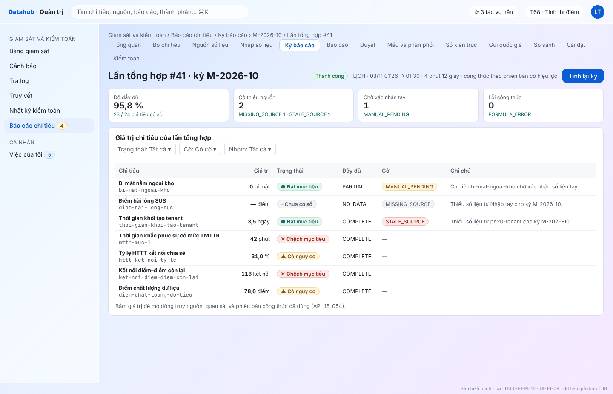


## 16. UI-16-10 Danh sách báo cáo

::: dac-ta
**Mục đích.** Cho lãnh đạo, quản trị tỉnh, cán bộ tổng hợp và kiểm toán tìm, xem báo cáo và lịch sử phiên bản; lập báo cáo mới từ kỳ đã tính; xuất PDF, XLSX, CSV, JSON; tải bằng chứng công bố; đính chính, rút; gửi quốc gia.

**Tác nhân, quyền.** VW, AU xem báo cáo đã công bố (`PERM-16-read`); TA, TO lập (`PERM-16-report`); xuất (`PERM-16-export`); đính chính, rút (`PERM-16-approve`); gửi quốc gia (`PERM-16-national`).

**FR, UC.** FR-16-026, 030, 031, 033, 036.

**Đường dẫn, mẫu.** `/giam-sat/chi-tieu/bao-cao` (`loai`, `trang-thai`, `ky`, `nam`, `q`, `trang`); PTN-01 Danh sách.

**API.** API-16-064, API-16-065 (lập), API-16-066, API-16-077 (phiên bản), API-16-075 (đính chính), API-16-076 (rút), API-16-079, 080, 081 (xuất), API-16-088 (bằng chứng).

**Thông báo.** "Kỳ {kỳ} chưa có kết quả tổng hợp hoặc chưa chốt. Hoàn tất trước khi lập hoặc gửi báo cáo." (ERR-16-028); mã khác dùng trong màn: ERR-16-032, ERR-16-033, ERR-16-034, ERR-16-035, ERR-16-124 (câu ở mục 5.2).

:::

### 16.1. Wireframe

Hình dưới là bố cục danh sách báo cáo: facet trạng thái, bảng, thẻ chi tiết bản công bố của hàng chọn.

```text
| Báo cáo                                       [Xuất danh sách] [+ Báo cáo đột xuất] [Lập báo cáo kỳ…] |
| ① (Tất cả)(Nháp 1)(Đang duyệt 1)(Đã công bố 2)(Đã thay thế 1)(Đã rút 1) |
| ② Tìm…  Loại ▾  Kỳ ▾  Trạng thái ▾ |
| Mã báo cáo · Tên · Loại · Kỳ · Trạng thái · Phiên bản · Công bố |
| bc-thang-2026-10 · Báo cáo tháng 10/2026 · PERIODIC · M-2026-10 · Nháp · v1 · — |
| bc-thang-2026-09 · Báo cáo tháng 9/2026 · PERIODIC · M-2026-09 · Đã công bố · v2 · 08/10/2026 |
| ③ bc-thang-2026-09 bản công bố v2: mã băm sha256:9c41…e7b2 · ký số 08/10 · WORM 10 năm |
|   [Tải PDF ký số][Tải bằng chứng][Xuất XLSX][Đính chính][Rút] |
```

### 16.2. Thành phần

Bảng dưới đánh số thành phần theo bố cục trên, kèm điều kiện hiển thị và nguồn dữ liệu.

| # | Thành phần | `CMP-*` | Nội dung, kiểm tra, nguồn | Ghi chú |
|---|---|---|---|---|
| 1 | Facet trạng thái | `CMP-FilterChips` | Số báo cáo mỗi trạng thái (`facets`) |  |
| 2 | Thanh công cụ | `CMP-FilterBar` | Tìm mã, tên; lọc loại, kỳ, trạng thái (API-16-064) | Ghi lên URL |
| 3 | Bảng báo cáo | `CMP-DataTable`, `CMP-StatusTag` | Mã, tên, loại, kỳ, trạng thái, phiên bản, ngày công bố (API-16-064) | Hàng `DRAFT` mở UI-16-11 |
| 4 | Thẻ bản công bố | `CMP-Card`, `CMP-CopyButton` | Mã băm, thời điểm ký, hạn lưu WORM, bản thay thế; nút tải PDF ký số, bằng chứng, xuất (API-16-066, 088) | Băm không khớp: ERR-16-124 |
| 5 | Hộp thoại lập báo cáo kỳ | `CMP-Modal` | Chọn kỳ đã tính hoặc đã chốt, mẫu báo cáo (API-16-065) | ERR-16-028 nếu kỳ chưa có kết quả |

: UI-16-10 Danh sách báo cáo, thành phần

### 16.3. Trường và cột

Bảng dưới ghi cột của danh sách báo cáo.

| Cột | Kiểu | Lọc | Ghi chú |
|---|---|---|---|
| Mã báo cáo | T-CODE | Tìm | `bc-thang-2026-10` |
| Loại | enum `reportType` | Có | Định kỳ, Đột xuất, Quốc gia |
| Kỳ | `periodCode` hoặc khoảng | Có | Đột xuất hiện khoảng ngày |
| Trạng thái | enum `report.state` | Có | Nhãn tiếng Việt ở mục 5.1 |
| Phiên bản | number | — | `v1`, `v2`; bản đính chính tăng số |
| Công bố | date | Khoảng | Trống khi chưa công bố |

: UI-16-10 Danh sách báo cáo, trường và cột

### 16.4. Hành động

Bảng dưới liệt kê hành động của màn, điều kiện quyền và trạng thái đối tượng, API gọi và kết quả người dùng thấy.

| Hành động | Điều kiện | API | Kết quả |
|---|---|---|---|
| Lập báo cáo kỳ… | `PERM-16-report` | API-16-065 | Báo cáo `DRAFT`, mở UI-16-11 |
| Xuất… | `PERM-16-export` | API-16-079 | Tệp chạy nền; thông báo EVT-16-13 |
| Tải bằng chứng | `PERM-16-read` | API-16-088 | Tệp ký, mã băm, nhật ký |
| Đính chính | `PERM-16-approve`; báo cáo `PUBLISHED` | API-16-075 | Phiên bản mới `DRAFT`; bản cũ `SUPERSEDED` khi công bố bản mới |
| Rút | `PERM-16-approve` | API-16-076 | `WITHDRAWN` kèm lý do; EVT-16-09 |
| Gửi quốc gia | `PERM-16-national`; báo cáo `PUBLISHED` | API-16-118 | Mở UI-16-17; ERR-16-052 nếu chưa công bố |

: UI-16-10 Danh sách báo cáo, hành động

### 16.5. Trạng thái và thông báo

Bảng dưới nêu bốn trạng thái bắt buộc (đang tải, rỗng, lỗi, không có quyền) và các ca riêng của màn; trạng thái còn lại kế thừa `ST-*`. Câu thông báo lấy y nguyên từ FRS §9.2 (mục 5.2).

| Trạng thái | Hiển thị |
|---|---|
| Đang tải | Skeleton 8 hàng bảng (`ST-01`). |
| Rỗng | "Chưa có báo cáo nào. Lập báo cáo đầu tiên từ kỳ đã tính." kèm nút "Lập báo cáo kỳ…" (`PERM-16-report`). |
| Lỗi tải | Thân bảng hiện `CMP-Alert` kèm "Thử lại" (`ST-05`). |
| Không có quyền | `ST-07`; VW thấy bảng chỉ có báo cáo đã công bố và ẩn nút ghi (`ST-15`). |

: UI-16-10 Danh sách báo cáo, trạng thái màn

### 16.6. Bàn phím, truy cập, responsive

Bảng có `aria-sort`; thẻ bản công bố là vùng `region` đặt tên; nút sao chép mã băm báo "Đã sao chép" qua `aria-live`.

### 16.7. Bản hi-fi

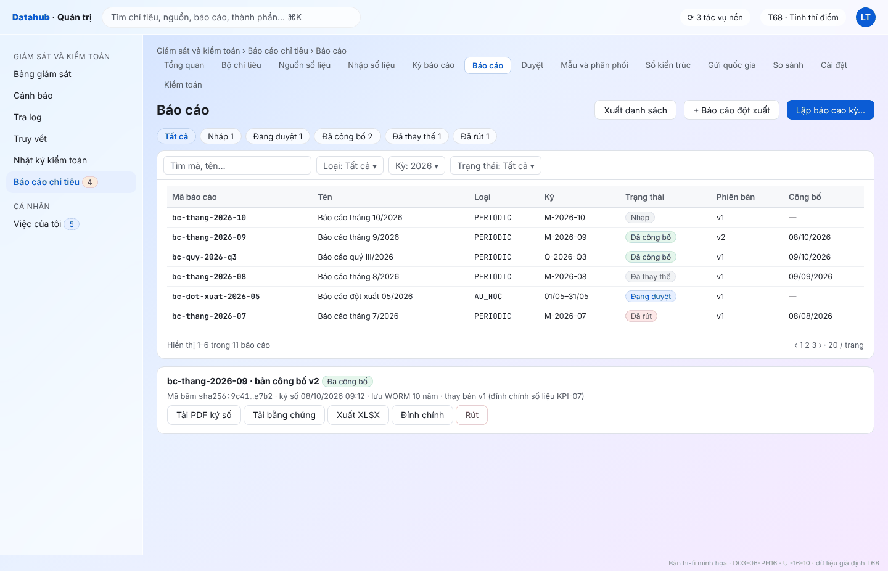


## 17. UI-16-11 Soạn báo cáo

Màn cán bộ tổng hợp làm việc nhiều nhất mỗi kỳ: xem trước báo cáo như trang A4, viết thuyết minh và giải trình chỉ tiêu chệch, làm mới số khi kỳ được tính lại, rồi gửi duyệt.

::: dac-ta
**Mục đích.** Cho cán bộ tổng hợp lập bản nháp báo cáo từ kỳ đã tính, viết thuyết minh, nhập giải trình (nguyên nhân, biện pháp, hạn) cho từng chỉ tiêu chệch hoặc thiếu số, làm mới số liệu, tạo báo cáo đột xuất, và gửi duyệt khi đủ điều kiện.

**Tác nhân, quyền.** TO, TA (`PERM-16-report`); người lập khác người duyệt (ERR-16-005 ở UI-16-12); AU, VW không vào.

**FR, UC.** FR-16-026, 027, 032.

**Đường dẫn, mẫu.** `/giam-sat/chi-tieu/bao-cao/{ma}/sua` (`phan`, `chi-tieu`, `xem-truoc`); PTN-03 Biểu mẫu trang (ba cột).

**API.** API-16-066, API-16-067 (lưu), API-16-068 (giải trình), API-16-069 (làm mới số), API-16-070 (xem trước), API-16-071 (gửi duyệt), API-16-059, 061 (mẫu).

**Thông báo.** "Chỉ tiêu bắt buộc {danh sách} chưa có số liệu. Báo cáo chính thức chưa gửi duyệt được." (ERR-16-029); mã khác dùng trong màn: ERR-16-030, ERR-16-028, ERR-16-032, ERR-16-004 (câu ở mục 5.2).

:::

### 17.1. Wireframe

Hình dưới là bố cục ba cột: mục lục, trang A4, khung thông tin.

```text
| Soạn báo cáo bc-thang-2026-10 [Nháp v1] Đã lưu 14:36        [Xem PDF thử] [Lưu nháp] [Gửi duyệt ⊘]|
|--------------------|------------------------------------------|-----------------------|
| ① Các phần theo mẫu | ③ Trang A4 xem trước                       | ⑤ Thông tin báo cáo |
|  1. Tóm tắt        |   Quốc hiệu · tên cơ quan · số ký hiệu    |   Kỳ M-2026-10 |
|  2. Kết nối   (2)  |   BÁO CÁO CHỈ TIÊU … THÁNG 10/2026         |   Lần tổng hợp #41 |
|  3. Chia sẻ   (2)  |   Bảng chỉ tiêu theo nhóm                  |   Độ đầy đủ 23/24 |
|  4. Dữ liệu   (1)  |   [ Giải trình chỉ tiêu chệch ]  ④        |   Số ký hiệu […/BC…] |
|  5. Vận hành  (1)  |     nguyên nhân · biện pháp · hạn         | ⑥ ⚠ Số liệu kỳ đã được |
|  6. Kiến trúc      |                                          |   tính lại [Làm mới số] |
|  7. Biểu đồ        |   Biểu đồ xu hướng, thuyết minh chung      | ⑦ Điều kiện gửi duyệt |
```

### 17.2. Thành phần

Bảng dưới đánh số thành phần theo bố cục trên, kèm điều kiện hiển thị và nguồn dữ liệu.

| # | Thành phần | `CMP-*` | Nội dung, kiểm tra, nguồn | Ghi chú |
|---|---|---|---|---|
| 1 | Mục lục phần | `CMP-Tree`, `CMP-Badge` | Các phần theo mẫu (`SUMMARY`, `GROUP`, `INDICATOR_TABLE`, `CHART`, `NARRATIVE`, `ANNEX`); huy hiệu đỏ đếm giải trình thiếu (API-16-061) | Bấm cuộn tới phần; phần đang xem tô nền |
| 2 | Đầu trang soạn | `CMP-PageHeader`, `CMP-SaveIndicator` | Mã báo cáo, nhãn trạng thái, "Đã lưu hh:mm", nút Xem PDF thử, Lưu nháp, Gửi duyệt (API-16-067) | Tự lưu 30 giây |
| 3 | Trang xem trước | `CMP-Card` nền trắng, `CMP-DataTable`, `CMP-Chart` | Bản dựng A4: quốc hiệu, tên cơ quan, số ký hiệu, bảng chỉ tiêu theo nhóm, biểu đồ; hàng chệch tô nền vàng nhạt (API-16-070) | Trang là vùng đặc nền trắng |
| 4 | Ô giải trình | `CMP-TextArea`, `CMP-FormField`, `CMP-DatePicker` | Mở khi bấm chỉ tiêu chệch hoặc thiếu số: nguyên nhân, biện pháp, hạn (API-16-068) | Thiếu: ERR-16-030 |
| 5 | Khung thông tin | `CMP-DescriptionList`, `CMP-Input` | Kỳ, lần tổng hợp dùng, độ đầy đủ, số ký hiệu (cán bộ nhập, Q16-17) (API-16-066, 067) | Số ký hiệu bắt buộc khi gửi duyệt |

: UI-16-11 Soạn báo cáo, thành phần

### 17.3. Trường và cột

Bảng dưới ghi trường của màn soạn báo cáo.

| Nhãn | Kiểu | Bắt buộc | Kiểm tra | API |
|---|---|---|---|---|
| Tên báo cáo | text ≤ 200 | Có | Không rỗng | API-16-067 |
| Số ký hiệu | text ≤ 50 | Có khi gửi duyệt | Cán bộ nhập | API-16-067 |
| Thuyết minh phần | markdown ≤ 20.000 | Không | Chỉ đoạn văn, danh sách, bảng; không HTML | API-16-067 |
| Giải trình: nguyên nhân | text ≤ 2.000 | Có cho chỉ tiêu chệch hoặc thiếu số | ERR-16-030 nếu thiếu | API-16-068 |
| Giải trình: biện pháp | text ≤ 2.000 | Có | như trên | API-16-068 |
| Giải trình: hạn | date | Có | Không ở quá khứ | API-16-068 |
| Khoảng đột xuất | date range | Có khi `AD_HOC` | Không quá 24 tháng (ERR-16-033) | API-16-065 |

: UI-16-11 Soạn báo cáo, trường và cột

### 17.4. Báo cáo chính thức và báo cáo đột xuất

Báo cáo kỳ (`PERIODIC`) lấy số của kỳ đã chốt; nếu kỳ chưa chốt, màn chỉ cho tạo bản thử và chặn gửi duyệt báo cáo chính thức với câu ERR-16-028. Báo cáo đột xuất (`AD_HOC`) nhận khoảng thời gian và tập chỉ tiêu tự chọn (tối đa 24 tháng), không gửi quốc gia (Q16-18) và áp bốn mắt theo `16.report.four-eyes`.

Chỉ tiêu bắt buộc thiếu số làm ERR-16-029 hiện ở hộp thoại gửi duyệt kèm danh sách chỉ tiêu và nút "Mở nhập số liệu tay" khi chỉ tiêu `MANUAL`.

### 17.5. Làm mới số khi kỳ được tính lại

Khi có số trễ hoặc đổi công thức, hệ thống tính lại kỳ chưa chốt và phát EVT-16-05; màn đang mở hiện dải vàng ở cột phải. Bấm "Làm mới số" nạp lần tổng hợp mới vào bản nháp; giải trình đã nhập được giữ nếu chỉ tiêu vẫn chệch, và bị đánh dấu "Cần xem lại" nếu trạng thái chỉ tiêu đổi. Bản nháp không đổi số âm thầm.

### 17.6. Hành động

Bảng dưới liệt kê hành động của màn, điều kiện quyền và trạng thái đối tượng, API gọi và kết quả người dùng thấy.

| Hành động | Điều kiện | API | Kết quả |
|---|---|---|---|
| Lưu nháp | `PERM-16-report` | API-16-067 | `ST-10`; `If-Match` (ERR-16-004 khi xung đột) |
| Nhập giải trình | `PERM-16-report` | API-16-068 | Huy hiệu mục lục giảm |
| Làm mới số | `PERM-16-report`; kỳ chưa chốt | API-16-069 | Bản nháp nạp lần tổng hợp mới |
| Xem PDF thử | `PERM-16-report` | API-16-070 | Mở bản dựng thử; không phải bản công bố |
| Gửi duyệt | `PERM-16-report`; đủ điều kiện | API-16-071 | `IN_REVIEW`; EVT-16-07; ERR-16-029, 030 |

: UI-16-11 Soạn báo cáo, hành động

### 17.7. Trạng thái và thông báo

Bảng dưới nêu bốn trạng thái bắt buộc (đang tải, rỗng, lỗi, không có quyền) và các ca riêng của màn; trạng thái còn lại kế thừa `ST-*`. Câu thông báo lấy y nguyên từ FRS §9.2 (mục 5.2).

| Trạng thái | Hiển thị |
|---|---|
| Đang tải | Skeleton ba cột: mục lục, trang A4 (khối chữ giả), khung thông tin (`ST-01`). |
| Rỗng | Báo cáo mới chưa có chỉ tiêu: "Chưa có số liệu để lập báo cáo. Chọn kỳ đã tính."; phần chưa có thuyết minh hiện gợi ý "Viết thuyết minh…". |
| Lỗi tải | Lỗi dựng bản xem trước: `CMP-Alert` trong cột giữa kèm "Thử lại"; mục lục và khung thông tin vẫn dùng (`ST-05`). |
| Không có quyền | `ST-07` cho người không có `PERM-16-report`; báo cáo đã công bố mở ở chế độ chỉ đọc kèm câu ERR-16-032. |
| Thiếu giải trình | Huy hiệu đỏ ở mục lục; ERR-16-030 ở hộp thoại gửi duyệt |
| Xung đột phiên bản | `CMP-ConflictDialog` (`ST-13`) so sánh thuyết minh hai bản |
| Mất kết nối | Giữ bản nháp trong trang; chỉ báo "Chưa lưu lên máy chủ" (`ST-06`) |

: UI-16-11 Soạn báo cáo, trạng thái màn

### 17.8. Bàn phím, truy cập, responsive

Thứ tự focus: mục lục, trang xem trước (từng chỉ tiêu chệch là một nút), ô giải trình, khung thông tin. Trang A4 có `role="document"` và nhãn; hàng chệch tô nền kèm chữ "Chệch mục tiêu". Ctrl+S lưu nháp.

### 17.9. Bản hi-fi

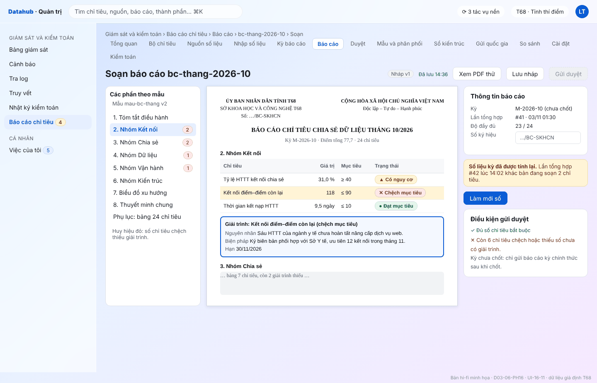

Ảnh cho thấy mục lục với huy hiệu giải trình thiếu, trang A4 có quốc hiệu và số ký hiệu, bảng nhóm Kết nối với hàng chệch tô vàng và ô giải trình đang mở (nguyên nhân, biện pháp, hạn), cột phải có dải "Số liệu kỳ đã được tính lại" kèm nút "Làm mới số" và nút "Gửi duyệt" đang khóa vì còn 6 giải trình thiếu.


## 18. UI-16-12 Duyệt và công bố

Hộp việc của người duyệt PH-16: định nghĩa chỉ tiêu, số liệu tay, báo cáo chờ quyết định; công bố báo cáo là bước không hoàn tác.

::: dac-ta
**Mục đích.** Cho quản trị tỉnh, cán bộ an toàn và chủ quản dữ liệu xử lý hàng đợi chờ duyệt: duyệt, yêu cầu sửa, công bố báo cáo chính thức (chụp bất biến, ký số, lưu WORM), tuân thủ tách nhiệm vụ bốn mắt.

**Tác nhân, quyền.** TA (`PERM-16-approve`): định nghĩa (kể cả phiên bản nhận từ mẫu `COMMON`), báo cáo; SO, DS (`PERM-16-manual`): số liệu tay; người lập hoặc gửi không tự duyệt (ERR-16-005).

**FR, UC.** FR-16-005, 015, 028, 029.

**Đường dẫn, mẫu.** `/giam-sat/chi-tieu/duyet` (`loai` = `dinh-nghia`, `so-lieu-tay`, `bao-cao`; `chon`); PTN-10 Hộp việc và duyệt.

**API.** API-16-078 (hàng đợi), API-16-012, 013 (định nghĩa), API-16-040, 041 (số liệu tay), API-16-072, 073, 074 (báo cáo).

**Thông báo.** "Anh/chị là người lập hoặc gửi nên không được tự duyệt." (ERR-16-005); mã khác dùng trong màn: ERR-16-007, ERR-16-031, ERR-16-113, ERR-16-114, ERR-16-029 (câu ở mục 5.2).

:::

### 18.1. Wireframe

Hình dưới là bố cục hộp việc: danh sách việc bên trái, chi tiết và thanh quyết định bên phải.

```text
| Duyệt và công bố                                                           4 việc chờ · của tôi 3 |
| ① (Tất cả 4)(Định nghĩa 2)(Số liệu tay 1)(Báo cáo 1) |
|-----------------------------------|----------------------------------------------------------|
| ② Định nghĩa httt-ket-noi… v4      | ③ Báo cáo bc-thang-2026-10 v1 · Đang duyệt |
|   Số liệu ket-noi-diem-diem…      |   Nháp ✓ → [Đang duyệt] → Đã duyệt → Đã công bố |
| ▶ Báo cáo bc-thang-2026-10 v1     |   người lập · kỳ · độ đầy đủ · giải trình 6/6 |
|   Định nghĩa mttr-muc-1 v2 (mẫu)    |   ④ Bản xem trước PDF (trang 1/6) |
|                                   |   Công bố: chụp bất biến, ký số, WORM 10 năm |
|                                   | ⑤ [Anh/chị là người lập nên không được tự duyệt] [Yêu cầu sửa][Duyệt][Công bố]|
```

### 18.2. Thành phần

Bảng dưới đánh số thành phần theo bố cục trên, kèm điều kiện hiển thị và nguồn dữ liệu.

| # | Thành phần | `CMP-*` | Nội dung, kiểm tra, nguồn | Ghi chú |
|---|---|---|---|---|
| 1 | Facet loại việc | `CMP-FilterChips` | Số việc theo loại; mặc định "Tất cả" (API-16-078) |  |
| 2 | Danh sách việc | `CMP-DataTable` dạng danh sách, `CMP-Tag` | Tên đối tượng, loại, người gửi, thời điểm gửi; việc chọn nổi bật (API-16-078) | Sắp theo gửi sớm trước |
| 3 | Khung chi tiết | `CMP-ApprovalPanel`, `CMP-Steps` | Thanh bước trạng thái, thông tin người lập, kỳ, độ đầy đủ, số giải trình; bản xem trước (API-16-066) | Nội dung đổi theo loại việc |
| 4 | Bản xem trước | `CMP-Card` | PDF dựng thử của bản đang duyệt; với định nghĩa: so sánh phiên bản (`CMP-DiffViewer`) (API-16-070, 006) | Không phải bản công bố |
| 5 | Thanh quyết định | `CMP-DecisionPanel` (lớp nổi cố định) | Yêu cầu sửa, Duyệt, Công bố; nút khóa kèm lý do bằng chữ (API-16-072, 073, 074) | Công bố chỉ sáng khi `APPROVED` và ký số sẵn sàng |

: UI-16-12 Duyệt và công bố, thành phần

### 18.3. Trường và cột

Bảng dưới ghi trường của hộp thoại quyết định.

| Trường | Kiểu | Bắt buộc | Kiểm tra | API |
|---|---|---|---|---|
| Quyết định | enum `decision` | Có | `APPROVE`, `REQUEST_CHANGES` (định nghĩa, báo cáo); `ACCEPT`, `REJECT` (số liệu tay) | API-16-072 … |
| Ý kiến | text ≤ 2.000 | Có khi yêu cầu sửa hoặc từ chối | Tối thiểu 10 ký tự (ERR-16-007) | API-16-073 |
| Mã xác nhận công bố | text | Có | Trùng `reportCode` | API-16-074 |

: UI-16-12 Duyệt và công bố, trường và cột

### 18.4. Bốn mắt và công bố

Nút "Duyệt" và "Công bố" bị khóa khi người đang xem là người lập hoặc người gửi (ERR-16-005, hiện ngay trên thanh quyết định); với báo cáo kỳ chính thức bốn mắt luôn bật, với đột xuất theo `16.report.four-eyes`. Cặp loại trừ của số liệu tay: người nhập khác người xác nhận.

Công bố đi qua chuỗi: chụp bất biến số liệu và nội dung, dựng PDF (ERR-16-113 nếu lỗi), ký số bằng chứng thư cơ quan (ERR-16-031 nếu dịch vụ ký gián đoạn: báo cáo vẫn `APPROVED`), lưu WORM (ERR-16-114 nếu lỗi: báo cáo chưa được công bố), ghi mã băm, phát EVT-16-08. Giao diện hiển thị tiến độ từng bước qua `CMP-JobProgress`; không bước nào bị bỏ qua âm thầm.

### 18.5. Hành động

Bảng dưới liệt kê hành động của màn, điều kiện quyền và trạng thái đối tượng, API gọi và kết quả người dùng thấy.

| Hành động | Điều kiện | API | Kết quả |
|---|---|---|---|
| Duyệt | `PERM-16-approve`; khác người lập | API-16-072 (hoặc API-16-012) | `APPROVED`; việc rời hàng đợi |
| Yêu cầu sửa | `PERM-16-approve`; có ý kiến | API-16-073 (hoặc API-16-013) | `CHANGES_REQUESTED`; EVT-16-09; người lập nhận thông báo |
| Công bố | `PERM-16-approve`; báo cáo `APPROVED` | API-16-074 | `PUBLISHED`; EVT-16-08; liên kết tải bằng chứng |
| Xác nhận số liệu tay | `PERM-16-manual`; khác người nhập | API-16-040 | `ACCEPTED`; EVT-16-04 |
| Từ chối số liệu tay | `PERM-16-manual`; có lý do | API-16-041 | `REJECTED` |

: UI-16-12 Duyệt và công bố, hành động

### 18.6. Trạng thái và thông báo

Bảng dưới nêu bốn trạng thái bắt buộc (đang tải, rỗng, lỗi, không có quyền) và các ca riêng của màn; trạng thái còn lại kế thừa `ST-*`. Câu thông báo lấy y nguyên từ FRS §9.2 (mục 5.2).

| Trạng thái | Hiển thị |
|---|---|
| Đang tải | Skeleton danh sách 6 việc và khung chi tiết (`ST-01`). |
| Rỗng | "Không có việc nào chờ anh/chị." kèm liên kết "Xem yêu cầu tôi đã gửi". |
| Lỗi tải | Danh sách hiện `CMP-Alert` kèm "Thử lại"; lỗi một việc không chặn các việc khác (`ST-05`). |
| Không có quyền | `ST-07` cho người không có quyền duyệt hoặc xác nhận; người chỉ có `PERM-16-read` không thấy tab "Duyệt". |
| Người gửi mở việc của mình | Thanh quyết định hiện câu ERR-16-005; nút Duyệt, Công bố khóa |
| Ký số gián đoạn | Thanh hiện ERR-16-031; nút Công bố vẫn thử lại được |
| Lưu WORM lỗi | ERR-16-114 và báo cáo giữ `APPROVED` |

: UI-16-12 Duyệt và công bố, trạng thái màn

### 18.7. Bàn phím, truy cập, responsive

Danh sách việc là `role="listbox"`; mũi tên chọn, Enter mở. Nút khóa có `aria-disabled` và lý do liền kề để trình đọc màn hình đọc. Hộp thoại công bố bẫy focus; tiến độ công bố qua `aria-live="polite"`.

### 18.8. Bản hi-fi

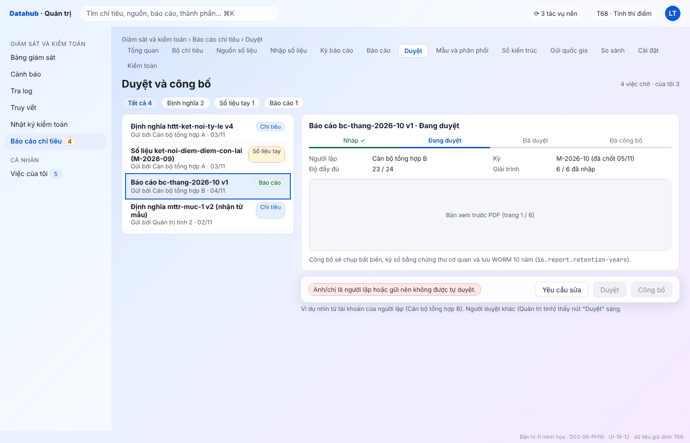

Ảnh cho thấy ba loại việc, báo cáo `bc-thang-2026-10` đang duyệt nhìn từ tài khoản người lập: thanh quyết định hiện câu "Anh/chị là người lập hoặc gửi nên không được tự duyệt." và hai nút Duyệt, Công bố bị khóa.


## 19. UI-16-13 Mẫu báo cáo và phân phối

::: dac-ta
**Mục đích.** Cho quản trị tỉnh quản lý mẫu báo cáo (phần, thứ tự, biểu đồ, định dạng) và danh sách phân phối (người dùng, nhóm, thư công vụ) kèm lịch gửi theo kỳ qua kênh thông báo PH-13; xem lịch sử gửi và lỗi gửi.

**Tác nhân, quyền.** TA (`PERM-16-admin` cho mẫu; `PERM-16-export` cho phân phối); TO xem; PA quản mẫu `COMMON`.

**FR, UC.** FR-16-025, 034.

**Đường dẫn, mẫu.** `/giam-sat/chi-tieu/mau-bao-cao` (tab `mau`, `phan-phoi`, `lich-su`); PTN-12 Cài đặt.

**API.** API-16-059, API-16-060, API-16-061, API-16-062, API-16-063 (xem trước mẫu), API-16-082, API-16-083, API-16-084, API-16-085 (lịch sử gửi).

**Thông báo.** "Mẫu chưa hợp lệ: {phần} {lý do}." (ERR-16-027); mã khác dùng trong màn: ERR-16-036, ERR-16-116 (câu ở mục 5.2).

:::

### 19.1. Wireframe

Hình dưới là bố cục tab Mẫu: danh sách mẫu và danh sách phân phối bên trái, phần của mẫu chọn bên phải.

```text
| Mẫu báo cáo và phân phối                                       [+ Tạo mẫu] [+ Danh sách nhận] |
| ① [Mẫu báo cáo][Phân phối][Lịch sử gửi] |
|----------------------------------------------------|---------------------------------------|
| ② Mẫu: mau-bc-thang · Báo cáo tháng · PDF, XLSX · v2 | ④ Phần của mau-bc-thang v2 |
|        mau-bc-quy · mau-bc-dot-xuat                |   1 SUMMARY · 2–6 GROUP · 7 CHART |
| ③ Phân phối: Lãnh đạo UBND · sau công bố kỳ tháng   |   8 NARRATIVE · 9 ANNEX  (kéo thả) |
|   Giám đốc các sở · sau công bố kỳ quý · ✕ lỗi 2     |   [Xem trước] [Lưu] |
```

### 19.2. Thành phần

Bảng dưới đánh số thành phần theo bố cục trên, kèm điều kiện hiển thị và nguồn dữ liệu.

| # | Thành phần | `CMP-*` | Nội dung, kiểm tra, nguồn | Ghi chú |
|---|---|---|---|---|
| 1 | Hàng tab | `CMP-Tabs` | Mẫu báo cáo, Phân phối, Lịch sử gửi |  |
| 2 | Bảng mẫu | `CMP-DataTable`, `CMP-StatusTag` | Mã, tên, định dạng, số phần, trạng thái (`ACTIVE`, `RETIRED`), phiên bản (API-16-059) | Mẫu `COMMON` chỉ đọc ở tenant |
| 3 | Bảng phân phối | `CMP-DataTable` | Danh sách nhận, lịch, kèm (`LINK` hoặc `PDF`), số người nhận, lần gửi gần nhất (API-16-082) | Lỗi gửi hiện câu ERR-16-116 |
| 4 | Trình soạn phần mẫu | `CMP-EditableTable`, `CMP-FormField` | Danh sách phần kéo thả; loại phần, tiêu đề, chỉ tiêu hoặc nhóm gắn (API-16-062) | Thiếu phần SUMMARY: ERR-16-027 |
| 5 | Hộp thoại danh sách nhận | `CMP-Modal`, `CMP-ApiSelect` | Người dùng, nhóm, thư công vụ; lịch theo kỳ; kèm liên kết hoặc PDF (API-16-083, 084) | Địa chỉ ngoài miền công vụ: ERR-16-036 |

: UI-16-13 Mẫu báo cáo và phân phối, thành phần

### 19.3. Trường và cột

Bảng dưới ghi trường của mẫu và danh sách phân phối.

| Trường | Kiểu | Bắt buộc | Kiểm tra | API |
|---|---|---|---|---|
| `templateCode` | T-CODE | Có | Mẫu mã; trùng ERR-16-002 | API-16-060 |
| `sections[].type` | enum | Có | `SUMMARY`, `GROUP`, `INDICATOR_TABLE`, `CHART`, `NARRATIVE`, `ANNEX` | API-16-062 |
| `format` | enum | Có | `PDF`, `XLSX`, `CSV`, `JSON` | API-16-062 |
| Người nhận | email công vụ hoặc id | Có | Thuộc miền công vụ (ERR-16-036) | API-16-083 |
| Lịch | chuỗi theo kỳ | Có | Sau công bố kỳ tháng, quý hoặc năm | API-16-083 |
| `attach` | enum | Có | `LINK` hoặc `PDF` | API-16-083 |

: UI-16-13 Mẫu báo cáo và phân phối, trường và cột

### 19.4. Hành động

Bảng dưới liệt kê hành động của màn, điều kiện quyền và trạng thái đối tượng, API gọi và kết quả người dùng thấy.

| Hành động | Điều kiện | API | Kết quả |
|---|---|---|---|
| Tạo mẫu, sửa mẫu | `PERM-16-admin` | API-16-060, 062 | Phiên bản mẫu mới; ERR-16-027 nếu không hợp lệ |
| Xem trước | `PERM-16-admin` | API-16-063 | Ngăn kéo bản thử |
| Tạo, sửa danh sách nhận | `PERM-16-export` | API-16-083, 084 | Lưu; ERR-16-036 nếu địa chỉ sai |
| Gửi lại lần lỗi | `PERM-16-export` | API-16-085 | Lần gửi mới `PENDING` |

: UI-16-13 Mẫu báo cáo và phân phối, hành động

### 19.5. Trạng thái và thông báo

Bảng dưới nêu bốn trạng thái bắt buộc (đang tải, rỗng, lỗi, không có quyền) và các ca riêng của màn; trạng thái còn lại kế thừa `ST-*`. Câu thông báo lấy y nguyên từ FRS §9.2 (mục 5.2).

| Trạng thái | Hiển thị |
|---|---|
| Đang tải | Skeleton hai bảng và khung phần (`ST-01`). |
| Rỗng | "Chưa có mẫu nào. Dùng mẫu báo cáo tháng của bộ mẫu COMMON." kèm nút nhận mẫu; chưa có danh sách nhận: "Chưa có danh sách nhận báo cáo." |
| Lỗi tải | Bảng hiện `CMP-Alert` kèm "Thử lại" (`ST-05`). |
| Không có quyền | `ST-07`; người chỉ đọc xem mẫu và phân phối ở `ST-15`. |

: UI-16-13 Mẫu báo cáo và phân phối, trạng thái màn

### 19.6. Bàn phím, truy cập, responsive

Danh sách phần kéo thả có cách thay thế bằng nút "Lên", "Xuống" và phím Alt+mũi tên.

### 19.7. Bản hi-fi

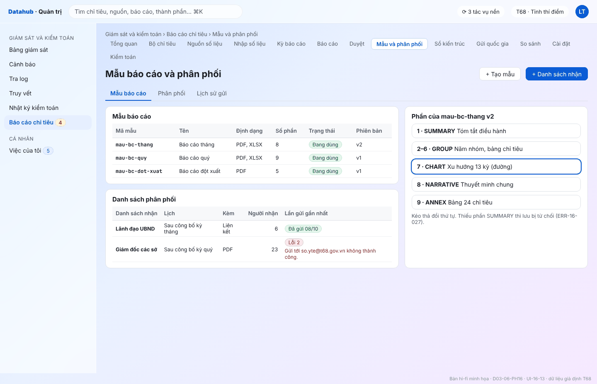


## 20. UI-16-14 Sổ kiến trúc

::: dac-ta
**Mục đích.** Cho quản trị tỉnh, cán bộ tổng hợp và cán bộ an toàn xem và quản lý sổ kiến trúc: lọc theo loại, vòng đời, tuân thủ; xem thành phần tự đăng ký và thành phần khai tay; đối chiếu với phân hệ nguồn để phát hiện lệch, mồ côi; xuất sổ.

**Tác nhân, quyền.** TA, TO (`PERM-16-arch`); SO (`PERM-16-arch-assess`); PA trên mẫu `COMMON`; VW, AU xem (`PERM-16-read`).

**FR, UC.** FR-16-043, 044, 048, 049.

**Đường dẫn, mẫu.** `/giam-sat/chi-tieu/kien-truc` (tab `thanh-phan`, `lech`, `phu-thuoc`; `loai`, `vong-doi`, `tuan-thu`, `nguon-goc`, `q`); PTN-01 Danh sách.

**API.** API-16-094, API-16-095 (khai báo), API-16-101 (tự đăng ký, máy gọi), API-16-111 (đối chiếu), API-16-112, 113 (xử lý lệch), API-16-079 (xuất).

**Thông báo.** "Thành phần {mã} thiếu trường {trường} hoặc loại không hợp lệ." (ERR-16-039); mã khác dùng trong màn: ERR-16-119, ERR-16-120, ERR-16-056, ERR-16-121 (câu ở mục 5.2).

:::

### 20.1. Wireframe

Hình dưới là bố cục sổ kiến trúc: dải lệch, thẻ số, hàng tab, facet loại, bảng thành phần.

```text
| ⚠ ① 3 thành phần lệch với phân hệ nguồn (thiếu 1, mồ côi 1, khác phiên bản 1).  [Xem tab Lệch] |
| Sổ kiến trúc                              [Đối chiếu ngay] [Xuất sổ] [+ Khai báo thành phần] |
| ② Thành phần 60 | Đã đánh giá 41/60 (68,3 %) | Không tuân thủ 5 | Chưa rõ vận hành 3 |
| ③ [Thành phần][Lệch 3][Phụ thuộc]   ④ (Tất cả 60)(HTTT 18)(API 21)(FLOW 9)(TOPIC 6)(Khác 6) |
| ☐ Thành phần · mã | Loại | Vòng đời | Vận hành | Tuân thủ | Nguồn gốc |
| ☐ Gateway APISIX · svc-gateway-apisix | PLATFORM_SERVICE | Đang hoạt động | Chạy tốt | Được miễn trừ|
| ☐ Bộ điều hợp SOAP Sở Y tế | ADAPTER | Sắp ngừng | ✕ Ngừng | Không tuân thủ | AUTO |
```

### 20.2. Thành phần

Bảng dưới đánh số thành phần theo bố cục trên, kèm điều kiện hiển thị và nguồn dữ liệu.

| # | Thành phần | `CMP-*` | Nội dung, kiểm tra, nguồn | Ghi chú |
|---|---|---|---|---|
| 1 | Dải lệch | `CMP-Alert` vàng | Số thành phần lệch theo ba loại (`MISSING`, `ORPHAN`, `MISMATCH`); nút mở tab Lệch (API-16-111) | Chỉ khi có lần đối chiếu gần nhất |
| 2 | Thẻ số | `CMP-StatCard` | Số thành phần, tỷ lệ đã đánh giá tuân thủ (cũng là chỉ tiêu `thanh-phan-da-danh-gia-tuan-thu`), không tuân thủ, chưa rõ vận hành (API-16-094) |  |
| 3 | Hàng tab | `CMP-Tabs` | Thành phần, Lệch, Phụ thuộc (sơ đồ toàn sổ) |  |
| 4 | Facet loại | `CMP-FilterChips` | Số thành phần theo `componentType` (`facets`) |  |
| 5 | Bảng thành phần | `CMP-DataTable`, `CMP-StatusTag` | Tên, mã, loại, vòng đời, vận hành, tuân thủ, nguồn gốc (`AUTO`, `MANUAL`); chọn nhiều để xuất (API-16-094) | Bấm hàng mở UI-16-15 |

: UI-16-14 Sổ kiến trúc, thành phần

### 20.3. Trường và cột

Bảng dưới ghi cột của bảng thành phần.

| Cột | Kiểu | Lọc | Ghi chú |
|---|---|---|---|
| Thành phần | text và T-CODE | Tìm | Tên và `componentCode` |
| Loại | enum `componentType` | Có | `HTTT`, `API`, `FLOW`, `TOPIC`, `ADAPTER`, `PLATFORM_SERVICE`, `NATIONAL_LINK` |
| Vòng đời | enum `lifecycle` | Có | Dự kiến, Đang hoạt động, Sắp ngừng, Đã ngừng |
| Vận hành | enum `opsStatus` | Có | Chạy tốt, Suy giảm, Ngừng, Chưa rõ; có chữ và biểu tượng |
| Tuân thủ | enum `complianceLevel` | Có | Tuân thủ, Một phần, Không tuân thủ, Được miễn trừ, Chưa đánh giá |
| Nguồn gốc | enum `origin` | Có | `AUTO` từ sự kiện, `MANUAL` khai tay |

: UI-16-14 Sổ kiến trúc, trường và cột

### 20.4. Hành động

Bảng dưới liệt kê hành động của màn, điều kiện quyền và trạng thái đối tượng, API gọi và kết quả người dùng thấy.

| Hành động | Điều kiện | API | Kết quả |
|---|---|---|---|
| + Khai báo thành phần | `PERM-16-arch` | API-16-095 | Thành phần `MANUAL`; ERR-16-039, ERR-16-002 |
| Đối chiếu ngay | `PERM-16-arch` | API-16-111 | Tạo lần đối chiếu nền; ERR-16-056 nếu đang chạy |
| Xử lý mục lệch | `PERM-16-arch` | API-16-113 | Chấp nhận, bỏ qua hoặc tạo thành phần |
| Xuất sổ | `PERM-16-export` | API-16-079 | Tệp chạy nền (`ARCH_REGISTRY`) |
| Đánh giá tuân thủ | `PERM-16-arch-assess` | — | Mở UI-16-16 trên thành phần chọn |

: UI-16-14 Sổ kiến trúc, hành động

### 20.5. Trạng thái và thông báo

Bảng dưới nêu bốn trạng thái bắt buộc (đang tải, rỗng, lỗi, không có quyền) và các ca riêng của màn; trạng thái còn lại kế thừa `ST-*`. Câu thông báo lấy y nguyên từ FRS §9.2 (mục 5.2).

| Trạng thái | Hiển thị |
|---|---|
| Đang tải | Skeleton thẻ số và 8 hàng bảng (`ST-01`). |
| Rỗng | "Sổ kiến trúc còn trống. Thành phần tự đăng ký khi các phân hệ phát sự kiện, hoặc anh/chị khai báo thủ công." kèm nút "Khai báo thành phần". |
| Lỗi tải | Thân bảng hiện `CMP-Alert` kèm "Thử lại" (`ST-05`). |
| Không có quyền | `ST-07`; người chỉ đọc (VW, AU) thấy bảng, ẩn nút ghi (`ST-15`). |

: UI-16-14 Sổ kiến trúc, trạng thái màn

### 20.6. Bàn phím, truy cập, responsive

Bảng có `aria-sort`; chọn hàng bằng Space; trạng thái có chữ và biểu tượng.

### 20.7. Bản hi-fi

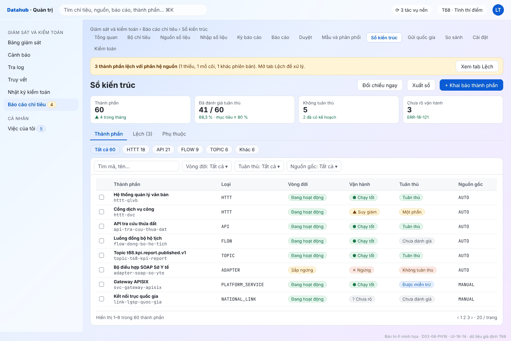


## 21. UI-16-15 Chi tiết thành phần kiến trúc

::: dac-ta
**Mục đích.** Cho cán bộ tổng hợp và quản trị tỉnh xem và sửa thành phần: thông tin do tay nhập (trường do phân hệ nguồn quản lý chỉ đọc), phiên bản, phụ thuộc, trạng thái vận hành từ PH-13, kết quả đánh giá tuân thủ và miễn trừ; xuất sơ đồ phụ thuộc.

**Tác nhân, quyền.** TA, TO (`PERM-16-arch`); SO, TA (`PERM-16-arch-assess`) cho tab Tuân thủ; VW, AU, PA xem.

**FR, UC.** FR-16-045, 046, 047, 049.

**Đường dẫn, mẫu.** `/giam-sat/chi-tieu/kien-truc/{ma}` (tab `thong-tin`, `phien-ban`, `phu-thuoc`, `van-hanh`, `tuan-thu`); PTN-02 Chi tiết.

**API.** API-16-096, API-16-097 (sửa), API-16-098 (phiên bản), API-16-099 (phụ thuộc), API-16-100 (vòng đời), API-16-105 (đánh giá), API-16-110 (miễn trừ), API-16-079 (xuất sơ đồ).

**Thông báo.** "Trường {trường} do {phân hệ} cập nhật tự động, không sửa tay được." (ERR-16-040); mã khác dùng trong màn: ERR-16-041, ERR-16-042, ERR-16-044, ERR-16-121 (câu ở mục 5.2).

:::

### 21.1. Wireframe

Hình dưới là bố cục chi tiết thành phần ở tab Phụ thuộc: sơ đồ bên trái, thông tin và phiên bản bên phải.

```text
| ① Gateway APISIX svc-gateway-apisix [PLATFORM_SERVICE][Đang hoạt động][Chạy tốt][Được miễn trừ]  [Đánh giá tuân thủ]|
| ② [Thông tin][Phiên bản][Phụ thuộc][Vận hành][Tuân thủ] |
|----------------------------------------------------------|--------------------------------------|
| ③ Sơ đồ phụ thuộc (1 mức lên, 1 mức xuống)                 | ④ Thông tin |
|    Cổng dịch vụ công → [Gateway APISIX] → API tra cứu      |   chủ quản · nguồn gốc · vận hành |
|                                  ↘ Kết nối trục quốc gia   |   miễn trừ đến 30/04/2027 (còn 177 ngày)|
|    nét đứt: khai tay · nét liền: tự đăng ký                 | ⑤ Phiên bản 3.4.1 · 3.3.0 |
```

### 21.2. Thành phần

Bảng dưới đánh số thành phần theo bố cục trên, kèm điều kiện hiển thị và nguồn dữ liệu.

| # | Thành phần | `CMP-*` | Nội dung, kiểm tra, nguồn | Ghi chú |
|---|---|---|---|---|
| 1 | Đầu trang | `CMP-PageHeader`, `CMP-StatusTag` | Tên, mã, loại, vòng đời, vận hành, tuân thủ; nút Đánh giá tuân thủ (API-16-096) | Nút chỉ khi `PERM-16-arch-assess` |
| 2 | Hàng tab | `CMP-Tabs` | Năm tab; tab ghi lên URL |  |
| 3 | Sơ đồ phụ thuộc | `CMP-DependencyGraph` | Thành phần chọn ở giữa, một mức lên và một mức xuống; nét liền tự đăng ký, nét đứt khai tay (API-16-096) | Có danh sách thay thế; xuất `ARCH_GRAPH` |
| 4 | Thẻ thông tin | `CMP-DescriptionList` | Chủ quản, nguồn gốc, thời điểm cập nhật vận hành, miễn trừ và số ngày còn lại (API-16-096) | Trường `AUTO` có biểu tượng khóa và chú thích phân hệ nguồn |
| 5 | Bảng phiên bản | `CMP-VersionTimeline` | Số phiên bản, hiệu lực từ, ghi chú, nguồn (`AUTO`, `MANUAL`) (API-16-096) | Thêm phiên bản tay cần `PERM-16-arch` |

: UI-16-15 Chi tiết thành phần kiến trúc, thành phần

### 21.3. Trường và cột

Bảng dưới ghi trường của thành phần kiến trúc.

| Trường | Kiểu | Sửa được | Kiểm tra | API |
|---|---|---|---|---|
| `componentCode` | T-CODE | Không | Cố định sau khi tạo | API-16-097 |
| Tên, chủ quản, mô tả | text | Có với `MANUAL`; `AUTO` chỉ đọc | ERR-16-040 nếu sửa trường do phân hệ nguồn quản lý | API-16-097 |
| `lifecycle` | enum | Qua hộp thoại | Chuyển hợp lệ (ERR-16-042) | API-16-100 |
| Phụ thuộc | danh sách mã | Có | Không vòng, không tới thành phần đã ngừng (ERR-16-041) | API-16-099 |
| Phiên bản | text | Thêm mới | Số phiên bản theo mẫu của loại | API-16-098 |

: UI-16-15 Chi tiết thành phần kiến trúc, trường và cột

### 21.4. Hành động

Bảng dưới liệt kê hành động của màn, điều kiện quyền và trạng thái đối tượng, API gọi và kết quả người dùng thấy.

| Hành động | Điều kiện | API | Kết quả |
|---|---|---|---|
| Sửa thông tin | `PERM-16-arch`; thành phần `MANUAL` | API-16-097 | `ST-10`; trường `AUTO` khóa |
| Sửa phụ thuộc | `PERM-16-arch` | API-16-099 | Sơ đồ cập nhật; ERR-16-041 nếu vòng |
| Đổi vòng đời | `PERM-16-arch` | API-16-100 | Trạng thái mới; EVT-16-10 |
| Đánh giá tuân thủ | `PERM-16-arch-assess` | API-16-105 | Mở UI-16-16 |
| Miễn trừ | `PERM-16-arch-assess` | API-16-110 | Có hạn tối đa `16.compliance.waiver-max-days`; ERR-16-044 |

: UI-16-15 Chi tiết thành phần kiến trúc, hành động

### 21.5. Trạng thái và thông báo

Bảng dưới nêu bốn trạng thái bắt buộc (đang tải, rỗng, lỗi, không có quyền) và các ca riêng của màn; trạng thái còn lại kế thừa `ST-*`. Câu thông báo lấy y nguyên từ FRS §9.2 (mục 5.2).

| Trạng thái | Hiển thị |
|---|---|
| Đang tải | Skeleton đầu trang, khung sơ đồ, hai thẻ (`ST-01`). |
| Rỗng | Tab Phụ thuộc: "Thành phần này chưa có phụ thuộc."; tab Tuân thủ: "Chưa đánh giá tuân thủ." kèm nút Đánh giá. |
| Lỗi tải | Khối sơ đồ hiện `CMP-Alert` kèm "Thử lại" (`ST-05`). |
| Không có quyền | `ST-07`; mã không có: `ST-08` (ERR-16-001). |

: UI-16-15 Chi tiết thành phần kiến trúc, trạng thái màn

### 21.6. Bàn phím, truy cập, responsive

Sơ đồ phụ thuộc có danh sách "Phụ thuộc vào", "Được phụ thuộc bởi" làm bản thay thế; nút trong sơ đồ có nhãn tên thành phần.

### 21.7. Bản hi-fi

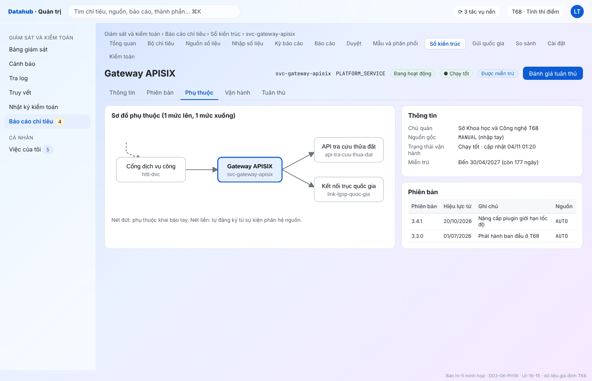


## 22. UI-16-16 Đánh giá tuân thủ (ngăn kéo)

::: dac-ta
**Mục đích.** Cho cán bộ an toàn thông tin và quản trị tỉnh đánh giá tuân thủ kiến trúc của một thành phần: chấm từng tiêu chí (đạt, không đạt, không áp dụng) kèm ghi chú và bằng chứng, xem mức đề xuất, gửi xác nhận; quản trị tỉnh xác nhận hoặc từ chối; đặt miễn trừ có hạn.

**Tác nhân, quyền.** SO (đánh giá, `PERM-16-arch-assess`); TA (xác nhận, miễn trừ, `PERM-16-arch-assess`); người đánh giá khác người xác nhận.

**FR, UC.** FR-16-047.

**Đường dẫn, mẫu.** `/giam-sat/chi-tieu/kien-truc/{ma}/danh-gia` (`bo-tieu-chi`, `lan`); PTN-04 Biểu mẫu nhanh (ngăn kéo).

**API.** API-16-102 (bộ tiêu chí), API-16-105 (tạo đánh giá), API-16-106 (lưu), API-16-107 (gửi), API-16-108 (xác nhận), API-16-109 (từ chối), API-16-110 (miễn trừ).

**Thông báo.** "Còn {n} tiêu chí bắt buộc chưa có kết quả hoặc tiêu chí không đạt chưa có ghi chú." (ERR-16-043); mã khác dùng trong màn: ERR-16-044, ERR-16-045, ERR-16-005, ERR-16-053 (câu ở mục 5.2).

:::

### 22.1. Wireframe

Hình dưới là bố cục ngăn kéo đánh giá phủ lên danh sách của UI-16-14, nền được làm mờ.

```text
| (nền: Sổ kiến trúc, làm mờ)  | Đánh giá tuân thủ · adapter-soap-so-yte                     [×] |
|                              | ① Bộ tiêu chí ktcpd3-2026 v2 · Khung CPĐT 3.0 · 5 tiêu chí |
|                              | ② KT-01 Dữ liệu lưu trong nước           (Đạt)(Không đạt)(N/A) |
|                              |    KT-03 Hồ sơ cấp độ ATTT được phê duyệt  Đạt (Không đạt) N/A |
|                              |      [ghi chú: Hồ sơ cấp độ 3 đang chờ thẩm định]  [+ bằng chứng] |
|                              |    KT-05 Dự phòng thảm họa (dự thảo CMP-LAW-11)  N/A |
|                              | ③ Mức đề xuất: Một phần (4/5 đạt, KT-03 không đạt) |
|                              | ④ ⚠ Còn 1 tiêu chí không đạt chưa có ghi chú. |
|                              | [Miễn trừ…] [Lưu nháp] [Gửi xác nhận] |
```

### 22.2. Thành phần

Bảng dưới đánh số thành phần theo bố cục trên, kèm điều kiện hiển thị và nguồn dữ liệu.

| # | Thành phần | `CMP-*` | Nội dung, kiểm tra, nguồn | Ghi chú |
|---|---|---|---|---|
| 1 | Tiêu đề ngăn kéo | `CMP-Drawer` | Tên thành phần, bộ tiêu chí và phiên bản, nhãn "dự thảo" cho tiêu chí CMP-LAW-11 (API-16-102) | Lớp nổi `glass-modal`, giếng nội dung đặc |
| 2 | Danh sách tiêu chí | `CMP-Form`, `CMP-SegmentedControl` | Mỗi tiêu chí: mã, nội dung, ba lựa chọn Đạt, Không đạt, Không áp dụng (API-16-106) | Mặc định chưa chọn |
| 3 | Ghi chú và bằng chứng | `CMP-TextArea`, `CMP-Upload` | Bắt buộc ghi chú khi "Không đạt"; bằng chứng tệp (API-16-106) | ERR-16-043, ERR-16-053 |
| 4 | Mức đề xuất | `CMP-Card`, `CMP-StatusTag` | Tính từ kết quả: Tuân thủ, Một phần, Không tuân thủ; hiện công thức tóm tắt (API-16-106) | Quản trị tỉnh có thể đổi khi xác nhận kèm lý do |
| 5 | Miễn trừ | `CMP-Modal`, `CMP-DatePicker` | Lý do, ngày hết hạn, tối đa `16.compliance.waiver-max-days` (API-16-110) | ERR-16-044 |

: UI-16-16 Đánh giá tuân thủ (ngăn kéo), thành phần

### 22.3. Trường và cột

Bảng dưới ghi trường của ngăn kéo đánh giá.

| Trường | Kiểu | Bắt buộc | Kiểm tra | API |
|---|---|---|---|---|
| Kết quả tiêu chí | enum `result` | Có với tiêu chí bắt buộc | `PASS`, `FAIL`, `NA` | API-16-106 |
| Ghi chú | text ≤ 1.000 | Có khi `FAIL` | ERR-16-043 nếu thiếu | API-16-106 |
| Bằng chứng | tệp, số văn bản | Không | PDF, ảnh, XLSX, DOCX (ERR-16-053) | API-16-106 |
| Lý do từ chối | text | Có khi từ chối | Tối thiểu 10 ký tự (ERR-16-007) | API-16-109 |
| Ngày hết hạn miễn trừ | date | Có khi miễn trừ | Không quá hạn tối đa (ERR-16-044) | API-16-110 |

: UI-16-16 Đánh giá tuân thủ (ngăn kéo), trường và cột

### 22.4. Hành động

Bảng dưới liệt kê hành động của màn, điều kiện quyền và trạng thái đối tượng, API gọi và kết quả người dùng thấy.

| Hành động | Điều kiện | API | Kết quả |
|---|---|---|---|
| Lưu nháp | `PERM-16-arch-assess` | API-16-106 | Đánh giá `DRAFT` |
| Gửi xác nhận | `PERM-16-arch-assess`; đủ tiêu chí bắt buộc | API-16-107 | `SUBMITTED`; ERR-16-043 nếu thiếu |
| Xác nhận | TA; khác người đánh giá | API-16-108 | `CONFIRMED`; cập nhật `complianceLevel`; EVT-16-11 |
| Từ chối | TA; có lý do | API-16-109 | `REJECTED`, về người đánh giá |
| Miễn trừ | `PERM-16-arch-assess` | API-16-110 | `EXEMPTED` đến hết hạn; EVT-16-11 khi hết hạn |

: UI-16-16 Đánh giá tuân thủ (ngăn kéo), hành động

### 22.5. Trạng thái và thông báo

Bảng dưới nêu bốn trạng thái bắt buộc (đang tải, rỗng, lỗi, không có quyền) và các ca riêng của màn; trạng thái còn lại kế thừa `ST-*`. Câu thông báo lấy y nguyên từ FRS §9.2 (mục 5.2).

| Trạng thái | Hiển thị |
|---|---|
| Đang tải | Skeleton tiêu đề và 5 dòng tiêu chí (`ST-01`). |
| Rỗng | Chưa có bộ tiêu chí hiệu lực: "Chưa có bộ tiêu chí đang áp dụng. Quản trị nền tảng kích hoạt bộ tiêu chí trước." |
| Lỗi tải | Lỗi tải tiêu chí: `CMP-Alert` trong ngăn kéo kèm "Thử lại" (`ST-05`); lưu lỗi: `ST-11`, `ST-12`. |
| Không có quyền | `ST-07` trong ngăn kéo; người chỉ có `PERM-16-read` mở được ngăn kéo ở chế độ xem kết quả (`ST-15`). |

: UI-16-16 Đánh giá tuân thủ (ngăn kéo), trạng thái màn

### 22.6. Bàn phím, truy cập, responsive

Ngăn kéo bẫy focus, Esc đóng và trả focus về nút mở.

### 22.7. Bản hi-fi

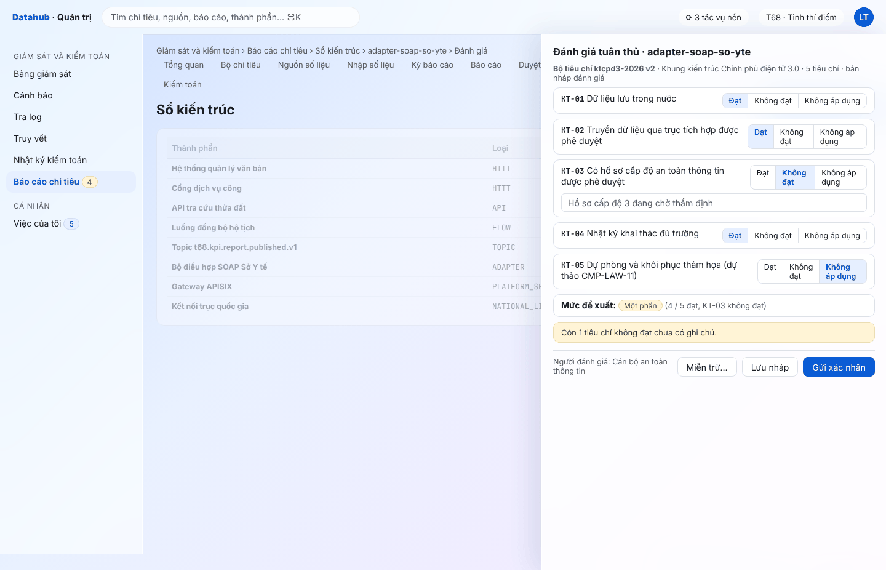


## 23. UI-16-17 Gửi quốc gia và nhật ký nộp

::: dac-ta
**Mục đích.** Cho quản trị tỉnh lập gói `KPI_REPORT` hoặc `ARCH_REGISTRY` theo mẫu gói có phiên bản, xem trước đối chiếu lược đồ, gửi qua PH-14, theo dõi trạng thái `PENDING` đến `ACKNOWLEDGED`, xử lý bị từ chối hoặc lỗi, gửi lại, đối soát gói đã nộp với sổ kiến trúc và chỉ tiêu.

**Tác nhân, quyền.** TA (`PERM-16-national`); AU, PA, PU xem nhật ký (`PERM-16-read`, `PERM-16-audit-read`); chức năng chỉ có khi `16.national.enabled = true`.

**FR, UC.** FR-16-050, 051, 052, 053, 054.

**Đường dẫn, mẫu.** `/giam-sat/chi-tieu/quoc-gia` (tab `goi`, `mau-goi`, `doi-soat`; `loai`, `trang-thai`); PTN-11 Giám sát và tra log.

**API.** API-16-114, 115, 116, 117 (mẫu gói), API-16-118 (lập), API-16-119, 120 (đọc), API-16-121 (gửi), API-16-122 (gửi lại), API-16-123 (nhật ký), API-16-125, 126 (đối soát).

**Thông báo.** "Chức năng gửi quốc gia chưa được bật cho tỉnh." (ERR-16-046); mã khác dùng trong màn: ERR-16-047, ERR-16-048, ERR-16-049, ERR-16-050, ERR-16-052, ERR-16-117, ERR-16-118, ERR-16-124 (câu ở mục 5.2).

:::

### 23.1. Wireframe

Hình dưới là bố cục tab Gói đã lập: bảng gói bên trái, chi tiết và nhật ký của gói chọn bên phải.

```text
| ⓘ ① Gửi quốc gia đang bật thử nghiệm cho T68 (16.national.enabled). Mẫu gói là cấu hình (Q16-02, 03). |
| Gửi quốc gia và nhật ký nộp                                  [Mẫu gói] [Đối soát] [+ Lập gói] |
| ② [Gói đã lập][Mẫu gói][Đối soát] |
|-----------------------------------------------------|----------------------------------------------|
| ③ Mã gói · Loại · Nội dung · Trạng thái · Biên nhận · Gửi | ④ SUB-000030 · Sổ kiến trúc tháng 10 |
|  SUB-000031 KPI_REPORT bc-thang-2026-09 v2 Có biên nhận   |   [Bị từ chối] FULL |
| ▶SUB-000030 ARCH_REGISTRY … Bị từ chối                    |   ✕ Hệ quốc gia từ chối gói: E-102 … |
|  SUB-000028 ARCH_REGISTRY … Lỗi gửi                       |   nhật ký: lập gói · gửi lần 1 · từ chối |
|                                                    |   [Xem gói] [Gửi lại (lần 2 / 5)] |
```

### 23.2. Thành phần

Bảng dưới đánh số thành phần theo bố cục trên, kèm điều kiện hiển thị và nguồn dữ liệu.

| # | Thành phần | `CMP-*` | Nội dung, kiểm tra, nguồn | Ghi chú |
|---|---|---|---|---|
| 1 | Dải chế độ | `CMP-Alert` thông tin hoặc `CMP-Banner` | Khi tắt: câu ERR-16-046 và nút chuyển tới Cài đặt (`PERM-16-config`); khi bật thử nghiệm: dải thông tin (API-16-127) | Tắt thì màn chỉ đọc |
| 2 | Hàng tab | `CMP-Tabs` | Gói đã lập, Mẫu gói, Đối soát |  |
| 3 | Bảng gói | `CMP-DataTable`, `CMP-StatusTag` | Mã gói, loại, nội dung, trạng thái, mã biên nhận, thời điểm gửi (API-16-119) | Trạng thái nhãn tiếng Việt ở mục 5.1 |
| 4 | Khung chi tiết gói | `CMP-Card`, `CMP-Timeline`, `CMP-CopyButton` | Trạng thái, chế độ (`FULL`, `DELTA`), mã băm, nhật ký dọc, lý do từ chối (API-16-120, 123) | Băm không khớp: ERR-16-124 |
| 5 | Hộp thoại lập gói | `CMP-Wizard` | Chọn loại, đối tượng nguồn (báo cáo đã công bố hoặc sổ kiến trúc), mẫu gói; xem trước kiểm lược đồ (API-16-118) | ERR-16-048, 049, 052 |

: UI-16-17 Gửi quốc gia và nhật ký nộp, thành phần

### 23.3. Trường và cột

Bảng dưới ghi trường của hộp thoại lập gói.

| Trường | Kiểu | Bắt buộc | Kiểm tra | API |
|---|---|---|---|---|
| `submissionType` | enum | Có | `KPI_REPORT`, `ARCH_REGISTRY` | API-16-118 |
| Đối tượng nguồn | `reportCode`+`version` hoặc `componentCode` | Có | Báo cáo phải `PUBLISHED` (ERR-16-052) | API-16-118 |
| `mode` | enum | Có với sổ kiến trúc | `FULL`, `DELTA` | API-16-118 |
| Mẫu gói | `templateCode` và phiên bản | Có | Có phiên bản `ACTIVE` (ERR-16-047) | API-16-118 |
| Lý do gửi lại | text | Không | Tối đa `16.national.retry-max` lần (ERR-16-050) | API-16-122 |

: UI-16-17 Gửi quốc gia và nhật ký nộp, trường và cột

### 23.4. Hành động

Bảng dưới liệt kê hành động của màn, điều kiện quyền và trạng thái đối tượng, API gọi và kết quả người dùng thấy.

| Hành động | Điều kiện | API | Kết quả |
|---|---|---|---|
| Lập gói | `PERM-16-national`; `16.national.enabled` | API-16-118 | Gói `PENDING`; xem trước kiểm lược đồ; ERR-16-048, 049 |
| Gửi | `PERM-16-national` | API-16-121 | `SENDING` rồi `SENT`; ERR-16-118 nếu lỗi kênh, tự thử lại |
| Gửi lại | `PERM-16-national`; gói `REJECTED` hoặc `FAILED` | API-16-122 | Lần gửi mới; ERR-16-050 nếu hết lượt |
| Kích hoạt mẫu gói | `PERM-16-national` | API-16-117 | Phiên bản `ACTIVE`; bản cũ `SUPERSEDED` |
| Đối soát | `PERM-16-national` | API-16-125 | Báo cáo lệch |

: UI-16-17 Gửi quốc gia và nhật ký nộp, hành động

### 23.5. Trạng thái và thông báo

Bảng dưới nêu bốn trạng thái bắt buộc (đang tải, rỗng, lỗi, không có quyền) và các ca riêng của màn; trạng thái còn lại kế thừa `ST-*`. Câu thông báo lấy y nguyên từ FRS §9.2 (mục 5.2).

| Trạng thái | Hiển thị |
|---|---|
| Đang tải | Skeleton bảng 8 hàng và khung chi tiết (`ST-01`). |
| Rỗng | "Chưa có gói nào được lập." kèm nút "Lập gói"; khi tắt: câu ERR-16-046. |
| Lỗi tải | Bảng hiện `CMP-Alert` kèm "Thử lại" (`ST-05`); nhật ký lỗi hiện nguyên câu mã lỗi. |
| Không có quyền | `ST-07`; người chỉ xem thấy nhật ký, ẩn nút gửi (`ST-15`). |

: UI-16-17 Gửi quốc gia và nhật ký nộp, trạng thái màn

### 23.6. Bàn phím, truy cập, responsive

Bảng và nhật ký dọc đọc theo thứ tự thời gian; trạng thái có chữ.

### 23.7. Bản hi-fi

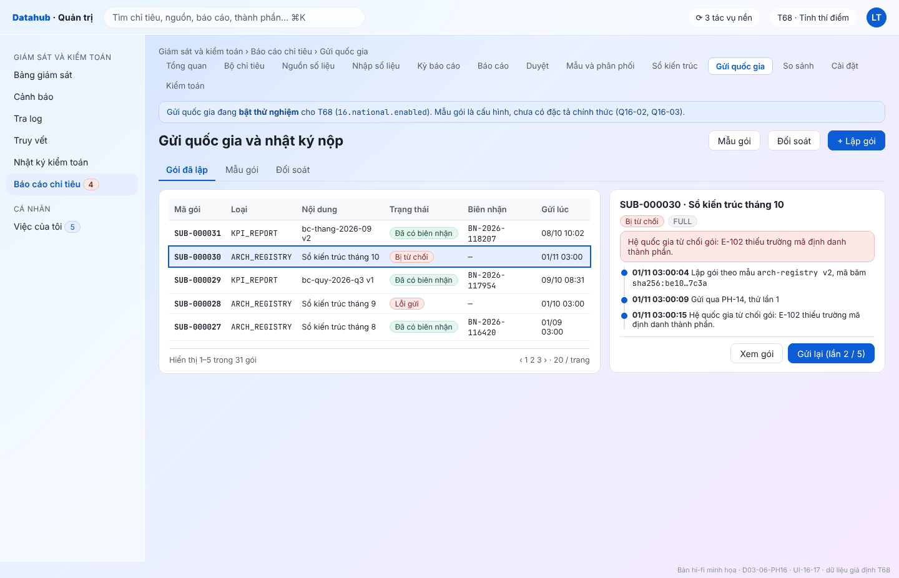


## 24. UI-16-18 So sánh liên tenant

::: dac-ta
**Mục đích.** Cho quản trị nền tảng và kiểm toán nền tảng xem phân bố điểm tổng và điểm nhóm giữa các tỉnh có số chính thức, thấy vị trí ẩn danh; không lộ tên hay dữ liệu chi tiết của tỉnh khác.

**Tác nhân, quyền.** PA, PU (`PERM-16-compare`); tỉnh chỉ thấy vị trí của mình nếu tỉnh cho phép (Q16-12).

**FR, UC.** FR-16-041.

**Đường dẫn, mẫu.** `/giam-sat/chi-tieu/so-sanh` (`ky`, `nhom`); PTN-06 Dashboard.

**API.** API-16-092 (`GET /cross-tenant/comparison`).

**Thông báo.** "Cần ít nhất {n} tỉnh có số chính thức để so sánh." (ERR-16-038); mã khác dùng trong màn: ERR-16-037, ERR-16-057 (câu ở mục 5.2).

:::

### 24.1. Wireframe

Hình dưới là bố cục so sánh: dải ẩn danh, bốn thẻ số, biểu đồ phân bố cạnh bảng theo nhóm.

```text
| ⓘ ① So sánh ẩn danh. Chỉ hiện từ 3 tỉnh có số chính thức (16.compare.min-tenants). |
| So sánh liên tenant                             Kỳ Q-2026-Q3 ▾  Nhóm: Điểm tổng ▾   [Xuất] |
| ② Số tỉnh 7 | Trung vị 77,7 (tứ phân vị 69,5 – 80,1) | Cao nhất 83,4 | Thấp nhất 66,2 |
|----------------------------------------------------|-----------------------------------------|
| ③ Phân bố điểm tổng theo tỉnh (ẩn danh)              | ④ Điểm theo nhóm: thấp · trung vị · cao |
|   Tỉnh A  ███████████████ 83,4                       |   Kết nối   55,0 · 72,4 · 85,0 |
|   Tỉnh B  ██████████████  80,1                       |   Chia sẻ … |
|   Tỉnh C … T68 nếu cho phép … Tỉnh F 66,2            | |
```

### 24.2. Thành phần

Bảng dưới đánh số thành phần theo bố cục trên, kèm điều kiện hiển thị và nguồn dữ liệu.

| # | Thành phần | `CMP-*` | Nội dung, kiểm tra, nguồn | Ghi chú |
|---|---|---|---|---|
| 1 | Dải ẩn danh | `CMP-Alert` thông tin | Giải thích quy tắc ẩn danh và ngưỡng `16.compare.min-tenants` | Luôn hiện |
| 2 | Thanh lọc | `CMP-Select` | Kỳ (quý hoặc năm), nhóm hoặc điểm tổng (API-16-092) | Ghi lên URL |
| 3 | Thẻ số | `CMP-KpiCard` | Số tỉnh, trung vị, cao nhất, thấp nhất (API-16-092) | Không nêu tên tỉnh |
| 4 | Biểu đồ phân bố | `CMP-Chart` bar ngang | Mỗi thanh một tỉnh với ký hiệu A, B, C…; thanh của tỉnh đang xem nhấn màu khi được phép (API-16-092) | Có bảng thay thế |
| 5 | Bảng theo nhóm | `CMP-DataTable` | Thấp, trung vị, cao theo từng nhóm (API-16-092) |  |

: UI-16-18 So sánh liên tenant, thành phần

### 24.3. Hành động

Bảng dưới liệt kê hành động của màn, điều kiện quyền và trạng thái đối tượng, API gọi và kết quả người dùng thấy.

| Hành động | Điều kiện | API | Kết quả |
|---|---|---|---|
| Đổi kỳ, nhóm | `PERM-16-compare` | API-16-092 | Biểu đồ và bảng làm mới |
| Xuất | `PERM-16-compare` | API-16-079 | Tệp chạy nền; vẫn ẩn danh |

: UI-16-18 So sánh liên tenant, hành động

### 24.4. Trạng thái và thông báo

Bảng dưới nêu bốn trạng thái bắt buộc (đang tải, rỗng, lỗi, không có quyền) và các ca riêng của màn; trạng thái còn lại kế thừa `ST-*`. Câu thông báo lấy y nguyên từ FRS §9.2 (mục 5.2).

| Trạng thái | Hiển thị |
|---|---|
| Đang tải | Skeleton bốn thẻ và biểu đồ (`ST-01`). |
| Rỗng | Không đủ tỉnh: `CMP-EmptyState` với câu ERR-16-038, không vẽ biểu đồ. |
| Lỗi tải | Khối lỗi hiện `CMP-Alert` kèm "Thử lại" (`ST-05`). |
| Không có quyền | `ST-07` (ERR-16-037); mục menu và tab không hiện với người thiếu `PERM-16-compare`. |

: UI-16-18 So sánh liên tenant, trạng thái màn

### 24.5. Bàn phím, truy cập, responsive

Biểu đồ cột ngang có bảng thay thế; tên tỉnh ẩn danh "Tỉnh A"… đọc bằng nhãn.

### 24.6. Bản hi-fi

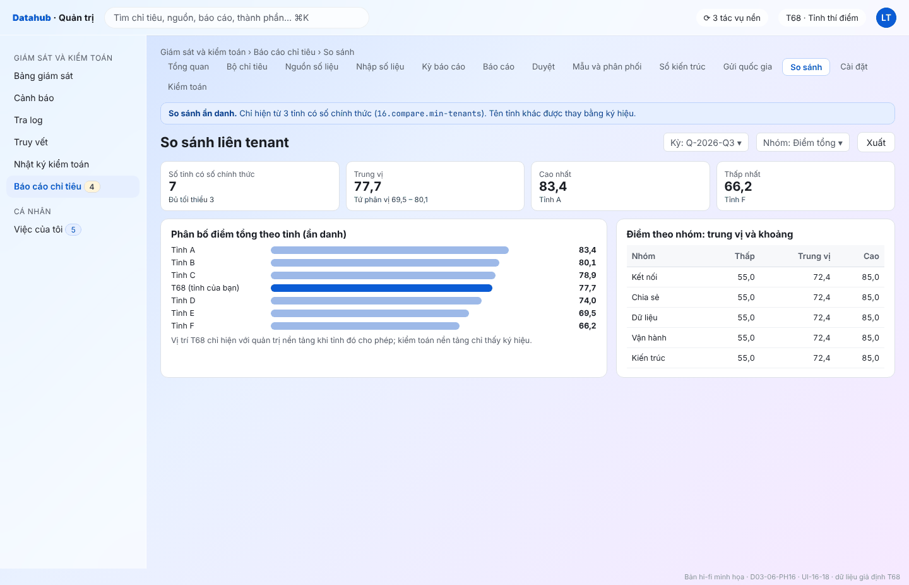


## 25. UI-16-19 Cài đặt

::: dac-ta
**Mục đích.** Cho quản trị tỉnh chỉnh tham số `16.*` trong miền cho phép (quản trị nền tảng đặt trần), xem lịch sử thay đổi, xem tình trạng lưu giữ và lần dọn dữ liệu.

**Tác nhân, quyền.** TA (`PERM-16-config`); PA đặt trần ở phạm vi nền tảng; AU xem nhật ký (`PERM-16-audit-read`).

**FR, UC.** FR-16-055, 057.

**Đường dẫn, mẫu.** `/giam-sat/chi-tieu/cai-dat` (tab `tham-so`, `luu-giu`, `nhat-ky`); PTN-12 Cài đặt.

**API.** API-16-127 (`GET /settings`), API-16-128 (`PATCH /settings`), API-16-130 (`GET /retention/status`).

**Thông báo.** "Giá trị {giá trị} của {khóa} nằm ngoài miền cho phép ({miền})." (ERR-16-051); mã khác dùng trong màn: ERR-16-004, ERR-16-122 (câu ở mục 5.2).

:::

### 25.1. Wireframe

Hình dưới là bố cục tab Tham số: bảng khóa, ý nghĩa, giá trị, miền, mặc định, khối lưu giữ dưới đáy.

```text
| Cài đặt báo cáo chỉ tiêu                              [Khôi phục mặc định] [Lưu thay đổi] |
| ① [Tham số][Lưu giữ][Nhật ký thay đổi] |
| Khóa · Ý nghĩa · Giá trị · Miền, trần · Mặc định |
| 16.period.close-day · Ngày chốt kỳ tháng trước · [5] · 1…28 · 5 |
| 16.source.stale-hours · Ngưỡng nguồn quá hạn · [9999] ✕ ngoài miền 1…744 · 26 |
| 16.report.signing · Ký số bản công bố · (bật) · Boolean · true |
| 16.national.enabled · Bật gửi quốc gia · (bật) · Boolean · false |
| ② Lưu giữ: báo cáo công bố 10 năm · quan sát 36 tháng · lần dọn gần nhất 01/11 thành công |
```

### 25.2. Thành phần

Bảng dưới đánh số thành phần theo bố cục trên, kèm điều kiện hiển thị và nguồn dữ liệu.

| # | Thành phần | `CMP-*` | Nội dung, kiểm tra, nguồn | Ghi chú |
|---|---|---|---|---|
| 1 | Hàng tab | `CMP-Tabs` | Tham số, Lưu giữ, Nhật ký thay đổi (`PERM-16-audit-read`) |  |
| 2 | Bảng tham số | `CMP-EditableTable`, `CMP-NumberInput`, `CMP-Switch` | Khóa `16.*`, ý nghĩa, ô giá trị theo kiểu, miền và trần, mặc định; ô lỗi viền đỏ kèm câu (API-16-127) | Một lần lưu là một giao dịch |
| 3 | Thanh lưu | `CMP-SaveIndicator`, `CMP-Button` | Số tham số đã sửa; nút Lưu thay đổi, Khôi phục mặc định (API-16-128) | Có `If-Match`; ERR-16-004 khi xung đột |
| 4 | Khối lưu giữ | `CMP-DescriptionList` | Hạn lưu báo cáo, hạn quan sát, lần dọn gần nhất, lỗi dọn (API-16-130) | Lỗi dọn: ERR-16-122 |
| 5 | Nhật ký thay đổi | `CMP-AuditTimeline` | Ai đổi khóa nào, giá trị cũ và mới (API-16-129) | Chỉ đọc |

: UI-16-19 Cài đặt, thành phần

### 25.3. Hành động

Bảng dưới liệt kê hành động của màn, điều kiện quyền và trạng thái đối tượng, API gọi và kết quả người dùng thấy.

| Hành động | Điều kiện | API | Kết quả |
|---|---|---|---|
| Lưu thay đổi | `PERM-16-config` | API-16-128 | Áp dụng cả lần lưu hoặc không áp dụng gì; ERR-16-051 nếu một khóa ngoài miền |
| Khôi phục mặc định | `PERM-16-config` | API-16-128 | Xác nhận bằng `CMP-ConfirmDialog` rồi lưu |
| Xem nhật ký | `PERM-16-audit-read` | API-16-129 | Tab Nhật ký thay đổi |

: UI-16-19 Cài đặt, hành động

### 25.4. Trạng thái và thông báo

Bảng dưới nêu bốn trạng thái bắt buộc (đang tải, rỗng, lỗi, không có quyền) và các ca riêng của màn; trạng thái còn lại kế thừa `ST-*`. Câu thông báo lấy y nguyên từ FRS §9.2 (mục 5.2).

| Trạng thái | Hiển thị |
|---|---|
| Đang tải | Skeleton 10 hàng tham số (`ST-01`). |
| Rỗng | Không áp dụng: luôn có tham số mặc định. |
| Lỗi tải | Bảng hiện `CMP-Alert` kèm "Thử lại"; lỗi lưu một khóa hiện tại hàng, các khóa khác không áp dụng (`ST-11`). |
| Không có quyền | `ST-07`; người chỉ đọc thấy bảng chỉ đọc (`ST-15`). |

: UI-16-19 Cài đặt, trạng thái màn

### 25.5. Bàn phím, truy cập, responsive

Ô lỗi có `aria-invalid` và `aria-describedby` trỏ câu lỗi; công tắc có nhãn bật tắt bằng chữ.

### 25.6. Bản hi-fi

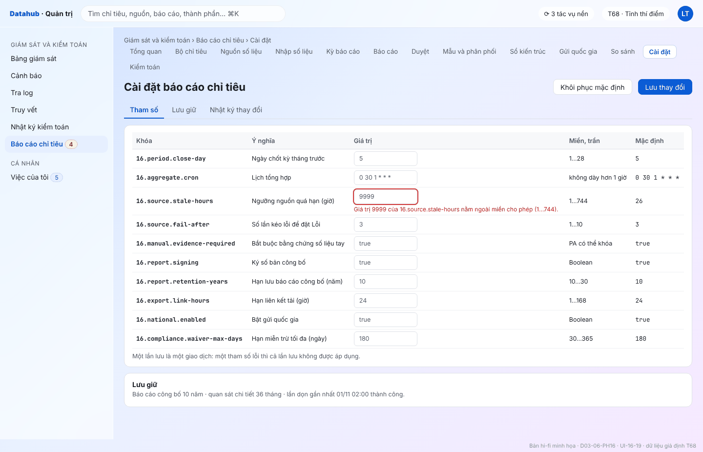


## 26. UI-16-20 Nhật ký kiểm toán

::: dac-ta
**Mục đích.** Cho kiểm toán viên, quản trị tỉnh và kiểm toán nền tảng tra cứu thao tác PH-16 (duyệt, công bố, mở lại kỳ, đổi tham số, nhập tay…) theo người, thao tác, đối tượng, thời gian; xuất bằng chứng.

**Tác nhân, quyền.** AU, PU, TA (`PERM-16-audit-read`); PU thấy liên tenant ẩn danh.

**FR, UC.** FR-16-056.

**Đường dẫn, mẫu.** `/giam-sat/chi-tieu/kiem-toan` (`nguoi`, `thao-tac`, `doi-tuong`, `tu`, `den`); PTN-11 Giám sát và tra log.

**API.** API-16-129 (`GET /audit-events`).

**Thông báo.** "Bộ lọc không hợp lệ: {trường}. Kiểm tra lại giá trị đã chọn." (ERR-16-057); mã khác dùng trong màn: ERR-16-123, ERR-16-037 (câu ở mục 5.2).

:::

### 26.1. Wireframe

Hình dưới là bố cục nhật ký kiểm toán: thanh lọc, bảng sáu cột, ghi chú bất biến.

```text
| Nhật ký kiểm toán PH-16                                                      [Xuất bằng chứng] |
| ① Người ▾  Thao tác ▾  Đối tượng…  Từ 01/11 đến 04/11 ▾ |
| ② Thời điểm · Người · Vai trò · Thao tác · Đối tượng · Chi tiết · Mã truy vết |
|   04/11 14:36 · Cán bộ tổng hợp B · TO · report.update · bc-thang-2026-10 · Viết giải trình … · |
|   04/11 09:10 · Quản trị tỉnh 1 · TA · indicator.approve · mttr-muc-1 v2 · Duyệt định nghĩa |
| ③ Hiển thị 1–6 trong 1.842 bản ghi · chỉ đọc · bản ghi bất biến do PH-13 lưu |
```

### 26.2. Thành phần

Bảng dưới đánh số thành phần theo bố cục trên, kèm điều kiện hiển thị và nguồn dữ liệu.

| # | Thành phần | `CMP-*` | Nội dung, kiểm tra, nguồn | Ghi chú |
|---|---|---|---|---|
| 1 | Thanh lọc | `CMP-FilterBar`, `CMP-DateRangePicker` | Người, thao tác, đối tượng, khoảng thời gian (API-16-129) | Ghi lên URL; khoảng sai: ERR-16-057 |
| 2 | Bảng nhật ký | `CMP-AuditTrail`, `CMP-DataTable` | Thời điểm, người, vai trò, thao tác (`mono`), đối tượng, chi tiết, mã truy vết có nút sao chép (API-16-129) | Chỉ đọc; không xóa, không sửa |
| 3 | Ngăn kéo chi tiết bản ghi | `CMP-Drawer`, `CMP-JsonViewer` | Trường trước và sau, địa chỉ nguồn đã che theo chính sách (API-16-129) | Không hiện giá trị nhạy cảm |
| 4 | Ghi chú bất biến | `CMP-Text` | Nêu bản ghi do PH-13 lưu và hạn lưu | Tồn đọng chuyển: ERR-16-123 ở thông báo vận hành |

: UI-16-20 Nhật ký kiểm toán, thành phần

### 26.3. Trường và cột

Bảng dưới ghi cột của nhật ký kiểm toán.

| Cột | Kiểu | Lọc | Ghi chú |
|---|---|---|---|
| Thời điểm | datetime | Khoảng | `dd/MM HH:mm`, giờ địa phương |
| Người | text | Có | Tên hoặc "Hệ thống" |
| Vai trò | enum ROLE | — | Viết tắt TO, TA, SO… |
| Thao tác | text | Có | Mã thao tác `đối-tượng.hành-động` |
| Đối tượng | text | Tìm | Mã chỉ tiêu, báo cáo, kỳ, thành phần |
| Mã truy vết | text | — | `traceId`; sao chép được |

: UI-16-20 Nhật ký kiểm toán, trường và cột

### 26.4. Hành động

Bảng dưới liệt kê hành động của màn, điều kiện quyền và trạng thái đối tượng, API gọi và kết quả người dùng thấy.

| Hành động | Điều kiện | API | Kết quả |
|---|---|---|---|
| Lọc | `PERM-16-audit-read` | API-16-129 | Danh sách làm mới |
| Xuất bằng chứng | `PERM-16-audit-read`, `PERM-16-export` | API-16-079 | Tệp chạy nền, kèm mã băm |

: UI-16-20 Nhật ký kiểm toán, hành động

### 26.5. Trạng thái và thông báo

Bảng dưới nêu bốn trạng thái bắt buộc (đang tải, rỗng, lỗi, không có quyền) và các ca riêng của màn; trạng thái còn lại kế thừa `ST-*`. Câu thông báo lấy y nguyên từ FRS §9.2 (mục 5.2).

| Trạng thái | Hiển thị |
|---|---|
| Đang tải | Skeleton 10 hàng bảng (`ST-01`). |
| Rỗng | "Chưa có thao tác nào được ghi." (hiếm gặp); không kết quả: "Không tìm thấy bản ghi phù hợp" kèm "Xóa bộ lọc" (`ST-04`). |
| Lỗi tải | Thân bảng hiện `CMP-Alert` kèm "Thử lại" (`ST-05`). |
| Không có quyền | `ST-07` (ERR-16-037) cho người không có `PERM-16-audit-read`. |

: UI-16-20 Nhật ký kiểm toán, trạng thái màn

### 26.6. Bàn phím, truy cập, responsive

Bảng có `aria-sort`; thao tác là chữ mono có nhãn đọc rõ; nút sao chép mã truy vết báo kết quả qua `aria-live`.

### 26.7. Bản hi-fi

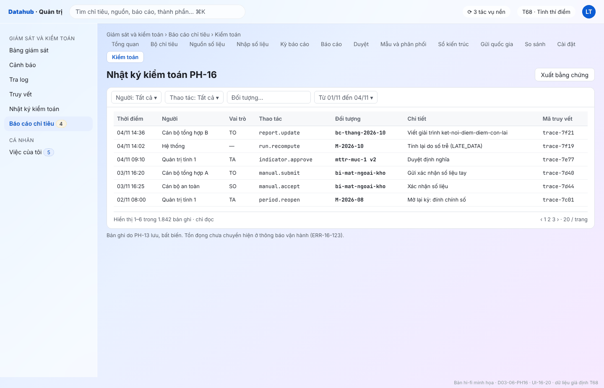


## 27. Mẫu truy cập dữ liệu và luồng chính

Chương này nêu cách giao diện gọi API, lưu đệm và làm mới, rồi luồng người dùng đi qua nhiều màn nhất.

### 27.1. Mẫu truy cập dữ liệu

Giao diện dùng TanStack Query với khóa truy vấn gồm tenant, kỳ và bộ lọc; `staleTime` theo bảng dưới. Mọi thao tác ghi gửi `Idempotency-Key` sinh khi mở biểu mẫu và `If-Match` với `ETag` của đối tượng; hành động nghiệp vụ gọi `POST …/{mã}:{động-từ}` theo FRS §9.4.

| Nhóm màn | Truy vấn chính | `staleTime` | Làm mới | Ghi chú |
|---|---|---|---|---|
| UI-16-01, 02 | API-16-090, 091, 089 | 300 giây | Tay; khi có EVT-16-05 thì đánh dấu cũ | Dải "có thể đã cũ" khi dữ liệu quá 30 phút |
| UI-16-12 | API-16-078 | 5 giây | Tự 15 giây | Nút khóa tính lại theo người dùng hiện tại |
| UI-16-18, 19, 20 | API-16-092, 127, 129 | 300, 60, 0 giây | Tay | Nhật ký kiểm toán không lưu đệm |

: Mẫu truy cập dữ liệu theo nhóm màn

### 27.2. Luồng 1: từ số liệu đến báo cáo công bố

Luồng này là xương sống của PH-16: mỗi kỳ cán bộ tổng hợp đưa số liệu về đủ, chốt kỳ, lập báo cáo, quản trị tỉnh duyệt và công bố, rồi gửi quốc gia nếu bật.

```{.mermaid caption="Luồng từ số liệu đến báo cáo công bố và gửi quốc gia"}
flowchart TB
  A["Nguồn tự gửi quan sát<br/>UI-16-05, 06"] --> B["Số liệu tay có bằng chứng<br/>UI-16-07"]
  B --> C["Tổng hợp theo lịch hoặc ngay<br/>UI-16-08"]
  A --> C
  C --> D{"Đủ điều kiện chốt?<br/>UI-16-09"}
  D -->|"chưa"| B
  D -->|"rồi"| E["Chốt kỳ<br/>UI-16-08"]
  E --> F["Lập, viết giải trình<br/>UI-16-11"]
  F --> G["Gửi duyệt<br/>UI-16-12"]
  G -->|"yêu cầu sửa"| F
  G -->|"duyệt"| H["Công bố: ký số, WORM<br/>UI-16-12"]
  H --> I["Báo cáo đã công bố<br/>UI-16-10"]
  I --> J["Gửi quốc gia<br/>UI-16-17"]
```

Điểm cần thấy ở hình: hai vòng quay về (chưa đủ điều kiện thì bổ sung số liệu; yêu cầu sửa thì về soạn) và công bố là bước có hai rủi ro bên ngoài (ký số, lưu WORM) với thông báo riêng (ERR-16-031, ERR-16-114).


## 28. Ma trận vai trò và màn hình

Chương này nêu vai trò nào vào được màn nào. Ký hiệu: ● dùng đầy đủ theo quyền, ○ chỉ xem hoặc bị giới hạn (nêu trong chương màn), – không vào.

| Màn | PA | TA | TO | SO | DS | AU | VW | PO | PU |
|---|---|---|---|---|---|---|---|---|---|
| UI-16-01, 02 | ○ | ● | ● | ○ | ○ | ○ | ● | ○ | ○ |
| UI-16-03 | ● | ● | ○ | – | – | ○ | – | – | ○ |
| UI-16-04 | ● | ● | – | – | – | – | – | – | – |
| UI-16-05 | ○ | ● | ● | – | – | ○ | – | ○ | ○ |
| UI-16-06 | ○ | ● | ● | – | – | ○ | – | ● | ○ |
| UI-16-07 | – | ○ | ● | ● | ● | ○ | – | – | – |
| UI-16-08 | – | ● | ○ | – | – | ○ | – | ○ | – |
| UI-16-09 | – | ● | ● | – | – | ○ | – | ○ | – |
| UI-16-10 | ○ | ● | ● | ○ | ○ | ○ | ○ | – | ○ |
| UI-16-11 | – | ● | ● | – | – | – | – | – | – |
| UI-16-12 | – | ● | ○ | ● | ● | – | – | – | – |
| UI-16-13 | ○ | ● | ○ | – | – | ○ | – | – | – |
| UI-16-14 | ○ | ● | ● | ● | – | ○ | ○ | – | ○ |
| UI-16-15 | ○ | ● | ● | ○ | – | ○ | ○ | – | ○ |
| UI-16-16 | – | ● | – | ● | – | – | – | – | – |
| UI-16-17 | ○ | ● | – | – | – | ○ | – | – | ○ |
| UI-16-18 | ● | – | – | – | – | – | – | – | ● |
| UI-16-19 | ● | ● | – | – | – | ○ | – | – | – |
| UI-16-20 | – | ● | – | – | – | ● | – | – | ● |

: Ma trận vai trò và màn hình PH-16

PA thao tác trên tenant `COMMON` (bộ chỉ tiêu mẫu, mẫu tiêu chí, mẫu gói) và đặt trần tham số; TO chạy tổng hợp nhưng không chốt, không mở lại kỳ; SO và DS nhập và xác nhận số liệu thuộc nhóm mình (KPI-08, KPI-09 cho SO; KPI-10 cho DS); VW xem số chính thức đã công bố; PU chỉ đọc liên tenant và ẩn danh. Mọi vai trò có `PERM-16-read` xem được UI-16-01, 02 (giới hạn theo "Chính thức" với VW).

## 29. Ma trận FR và màn hình

Chương này nối từng nhóm FR của FRS với màn thực hiện, để kiểm tra không sót chức năng.

| Nhóm FR | FR | Màn |
|---|---|---|
| A Bộ chỉ tiêu | FR-16-001…008 | UI-16-03, 04, 12 |
| B Nguồn số liệu | FR-16-009…016 | UI-16-05, 06, 07, 12 |
| C Tính toán | FR-16-017…024 | UI-16-01, 02, 08, 09 |
| D Báo cáo | FR-16-025…032 | UI-16-10, 11, 12, 13 |
| E Xuất, phân phối | FR-16-033…037 | UI-16-01, 10, 13 (FR-16-035 chỉ có API) |
| F Bảng điều khiển | FR-16-038…042 | UI-16-01, 02, 08, 18 |
| G Sổ kiến trúc | FR-16-043…049 | UI-16-14, 15, 16 |
| H Gửi quốc gia | FR-16-050…054 | UI-16-17 |
| I Quản trị | FR-16-055…058 | UI-16-19, 20 (FR-16-058 chỉ có chỉ số vận hành) |

: Ma trận nhóm FR và màn PH-16

Có 56 trên 58 FR có ít nhất một màn; hai FR không có màn là FR-16-035 (API `kpi.read` cho hệ khác) và FR-16-058 (chỉ số vận hành gửi PH-13). Mức ưu tiên: các FR mức M có màn đủ ở mọi nhóm; FR-16-032 (báo cáo đột xuất), FR-16-041 (so sánh liên tenant), FR-16-049 (xuất sổ), FR-16-054 (đối soát gói) là mức C nên giao diện làm sau cùng trong đợt 3.

## 30. Kiểm thử giao diện và danh sách ảnh hi-fi

Chương này nêu điểm kiểm thử giao diện riêng PH-16 và danh sách ảnh sinh kèm tài liệu.

| Mã | Kiểm tra | Màn |
|---|---|---|
| TC-UI-16-01 | Điểm tổng, điểm nhóm, trạng thái chỉ tiêu đúng với API; thiếu số hiện "Chưa có số" hoặc "Thiếu một phần", không hiện 0 | UI-16-01, 02, 09 |
| TC-UI-16-02 | Bốn mắt: người lập không duyệt báo cáo, người nhập tay không xác nhận; nút khóa kèm câu ERR-16-005 | UI-16-07, 12 |
| TC-UI-16-03 | Mọi ERR-16 trong chương màn hiện đúng câu FRS §9.2, đúng vị trí, kèm `traceId` | Mọi màn |
| TC-UI-16-04 | Công thức CEL: lỗi cú pháp, biến chưa có nguồn, ngưỡng không đơn điệu, chưa thử tính chặn gửi duyệt | UI-16-04 |
| TC-UI-16-05 | Báo cáo đã công bố bất biến: không sửa trực tiếp (ERR-16-032), đính chính tạo phiên bản mới, băm khớp | UI-16-10, 11, 12 |
| TC-UI-16-07 | Bàn phím, trình đọc màn hình, tương phản 4,5:1; biểu đồ có bảng thay thế | UI-16-01, 02, 15 |

: Điểm kiểm thử giao diện PH-16

Ảnh hi-fi nằm ở `ph16/hifi/`: `ui-16-01.png` đến `ui-16-20.png` (20 ảnh, mỗi ảnh dưới 400 KB, rộng 1440 px, tỷ lệ điểm ảnh 1). Sinh lại bằng `python3 gen_hifi.py && node shot.js && python3 nen.py` trong thư mục đó; bộ dựng gồm `kit.py`, `dat.py`, `s1.py`, `s2.py`, `s3.py`, `hifi.css` và `shot.js` (chụp bằng Playwright, Chromium). Dữ liệu ảnh là giả định của T68, kỳ M-2026-10, nền GĐ-04; điểm chất lượng dữ liệu 78,6 khớp ảnh của PH-08.

## Phụ lục A. Đề nghị bổ sung cho D03-05 (thành phần, token)

PH-16 chỉ dùng `CMP-*` đã có; các mục dưới là đề nghị, chưa dùng như thành phần chính thức. Ảnh hi-fi dùng giá trị hex tương đương token; khi D03-05 chốt các đề nghị thì sinh lại ảnh.

| Mã đề nghị | Nội dung | Dùng ở |
|---|---|---|
| A-01 | Thẻ chỉ tiêu (`IndicatorCard`): giá trị lớn, đơn vị, mục tiêu, thanh ngưỡng ba mức, nhãn trạng thái bằng chữ, đường xu hướng nhỏ (sparkline); biến thể của `CMP-KpiCard` | UI-16-01, 02 và thẻ `/tong-quan` (FR-16-037) |
| A-02 | Thẻ điểm nhóm có vòng tiến độ (`ScoreRing`) kèm tỷ lệ phủ "có số x/y" | UI-16-01 |
| A-03 | `CMP-Chart` thêm preset "xu hướng kỳ": line có `markLine` mục tiêu, dải ngưỡng nền mờ, điểm cuối nhấn, nút "Xem dạng bảng" (ECharts, ADR-023) | UI-16-01, 02, 15 |
| A-05 | Biến thể `CMP-StatusTag` cho trạng thái chỉ tiêu (`ON_TRACK`, `AT_RISK`, `OFF_TRACK`, `NO_DATA`) có biểu tượng ●, ▲, ✕, – | Mọi màn |
| A-07 | Dải "kỳ chưa chốt" dạng `CMP-Alert` biến thể trạng thái kỳ (không đóng được, có hành động) | UI-16-01, 02, 11 |
| A-08 | Vùng xem trước tài liệu A4 (`PagePreview`): nền trắng, đổ bóng nhẹ, font có chân, tỷ lệ 1:√2, hỗ trợ đánh dấu hàng chệch và ô giải trình nội tuyến | UI-16-11, 12 |
| A-09 | Điều khiển ba trạng thái Đạt, Không đạt, Không áp dụng (`TriStateSegment`) có nhãn đọc rõ | UI-16-16 |

: Đề nghị bổ sung D03-05 từ PH-16

## Phụ lục B. Đề nghị bổ sung API và trường cho D03-04-PH16

Các đề nghị dưới giúp màn dựng được mà không gọi thêm lần; chưa có ở FRS §9.4 nên cần xác nhận với chủ tập API.

| Mã | Đề nghị | Màn |
|---|---|---|
| B-01 | `GET /dashboard` (API-16-090) trả thêm `periodState`, `staleSources[]`, `groups[].coverage`, `groups[].weight`, `statusCounts`, `yoy` để vẽ dải kỳ chưa chốt, vòng điểm, tỷ lệ phủ | UI-16-01 |
| B-02 | `GET /review-queue` (API-16-078) trả `facets` theo loại việc và cờ `ownedByMe` để khóa nút bốn mắt ngay ở danh sách | UI-16-12 |
| B-03 | `GET /reports/{reportCode}` (API-16-066) trả `missingExplanations` theo phần, `newerRunId` khi kỳ đã tính lại, `submitChecks[]` cho khung điều kiện gửi duyệt | UI-16-11 |
| B-04 | `GET /runs/{runId}` (API-16-051) trả `stages[]` (sáu bước, trạng thái, thời lượng) cho lưới tác vụ | UI-16-08, 09 |
| B-07 | `GET /cross-tenant/comparison` (API-16-092) trả `rank` và `peerCount` ẩn danh, chỉ khi tenant cho phép (Q16-38) | UI-16-18 |

: Đề nghị bổ sung API và trường từ PH-16

## Phụ lục C. Đề nghị đồng bộ cho FRS và tài liệu khác

Tập màn này không sửa tài liệu ngoài phạm vi; các điểm dưới cần chủ tài liệu tương ứng xác nhận và hấp thụ (FRS Phụ lục B nhận làm mục ĐN-MH).

| Mã | Nội dung | Tài liệu |
|---|---|---|
| C-01 | §10.2: thay câu "Chưa có ảnh hi-fi cho PH-16" bằng "Ảnh hi-fi nằm ở `03-thiet-ke/uiux/ph16/hifi/`"; hai ảnh `ui-16-01.png`, `ui-16-11.png` đã có (cùng 18 ảnh còn lại) | D02-03-PH16 |
| C-02 | §9.2 thêm mục "Câu giao diện không gắn mã lỗi": "Kỳ {kỳ} chưa chốt. Số liệu còn có thể đổi đến ngày chốt {ngày}."; "Số liệu kỳ đã được tính lại."; "Đã lưu {đối tượng} {tên}."; "Đã công bố báo cáo {mã}."; câu rỗng của từng màn (mục "Trạng thái" mỗi chương) | D02-03-PH16 |
| C-03 | §10.1: thêm vào UI-16-12 loại việc "phiên bản định nghĩa nhận từ mẫu COMMON" (FR-16-008 tạo `DRAFT` rồi đi duyệt FR-16-005); thêm FR-16-008 vào cột FR của UI-16-12 | D02-03-PH16 |
| C-04 | §10.1: ghi route con và query theo mục 4.3 (đoạn `chi-so`, `sua`, `danh-gia`; tham số `ky`, `che-do`…) làm quy ước | D02-03-PH16 |
| C-05 | §10.1 UI-16-17: ghi thêm tab "Mẫu gói" và "Đối soát"; UI-16-13: ghi tab "Lịch sử gửi" (API-16-085); UI-16-06: tab "Hợp đồng chỉ số" | D02-03-PH16 |
| C-06 | FR-16-038: nêu công tắc "Chính thức, Mới nhất" và dải "kỳ chưa chốt" là yêu cầu hiển thị; FR-16-027: nêu số ký hiệu báo cáo là trường bắt buộc khi gửi duyệt (Q16-17) | D02-03-PH16 |
| C-07 | Dòng menu #37 "Báo cáo chỉ tiêu" ở mục 2.3.2: thêm cây con 20 màn như mục 4.1 (hiện một dòng) | D03-06-00 |
| C-08 | Xác nhận 14 quyền `PERM-16-*` ở mục 3.2 FRS với D02-08; hiện D02-08 chỉ có `read`, `admin` | D02-08 |

: Đề nghị đồng bộ cho FRS và tài liệu liên quan

## Câu hỏi mở

Các câu hỏi nối tiếp Q16-01…19 của FRS; chủ đề cần quyết định trước khi dựng màn (dải Q16-30…39 dành cho tập màn hình).

| Mã | Câu hỏi | Màn |
|---|---|---|
| Q16-30 | Năm vòng điểm nhóm hay thanh ngang dễ đọc hơn với lãnh đạo; có cần cả hai | UI-16-01 |
| Q16-31 | Trọng số năm nhóm có hiển thị công khai trên thẻ hay chỉ ở màn cấu hình | UI-16-01, 03 |
| Q16-32 | Chế độ "Chính thức" là mặc định của VW còn "Mới nhất" chỉ cho TA, TO hay mọi người chọn tự do | UI-16-01 |
| Q16-33 | Trình soạn CEL gợi ý đến mức nào (biến, hàm, mẫu) và có cần xem trước biểu đồ chuỗi khi thử tính | UI-16-04 |
| Q16-34 | Bản xem trước A4 là HTML giả lập hay PDF dựng thật sau mỗi lần lưu (hiệu năng, độ trung thực với bản ký số) | UI-16-11 |
| Q16-35 | Lãnh đạo có duyệt và ký ngay trên điện thoại hay `dh-console` dưới `bp-md` chỉ xem | UI-16-12 |
| Q16-36 | Thăm dò 5 giây hay WebSocket cho tiến độ lần tổng hợp và công bố | UI-16-08, 09, 12 |
| Q16-37 | Sơ đồ phụ thuộc toàn sổ: mặc định mấy mức và giới hạn số nút khi sổ có hàng trăm thành phần | UI-16-14, 15 |
| Q16-38 | Tỉnh có được thấy thứ hạng ẩn danh của mình ở so sánh liên tenant khi đã đồng ý (liên quan Q16-12) | UI-16-18 |
| Q16-39 | Thẻ chỉ tiêu nhúng ở `/tong-quan` hay cũng nhúng vào cổng `dh-portal` cho vai trò `kpi.read` | UI-16-01 |

: Câu hỏi mở của tập màn hình PH-16

## Lịch sử phiên bản

| Phiên bản | Ngày | Người | Nội dung |
|---|---|---|---|
| 0.1 | 2026-11-26 | Nhóm phân hệ PH-16 | Bản đầu: 20 màn UI-16-01…20 theo FRS 0.2 gồm khối đặc tả, wireframe, thành phần, trường, hành động, trạng thái, thông báo ERR-16; 20 ảnh hi-fi (kèm `ui-16-01.png`, `ui-16-11.png` mà FRS §10.2 trỏ tới); phụ lục đề nghị đồng bộ D03-05, API, FRS; câu hỏi mở Q16-30…39 |
