# D03-06-PH18 · Thiết kế giao diện màn hình Vận hành và xử lý lỗi

Tập màn **không tự đặt** token, `CMP-*` hay `PTN-*`; mọi tên dùng ở đây có trong D03-05-02, D03-05-03, D03-05-04 và D03-06-00. Thành phần còn thiếu ghi ở Phụ lục A và, trong bảng thành phần, được gọi bằng tên không có tiền tố `CMP-` kèm chữ "dùng tạm". Trường, mã lỗi, câu thông báo, quyền, route, tham số `18.*` lấy đúng các chương 3, 5, 8, 9, 10 của [D02-03-PH18](../../02-yeu-cau/frs/D02-03-PH18-frs-van-hanh.md); FRS là nguồn chuẩn, chỗ FRS chưa có hoặc chưa khớp ghi ở Phụ lục C "Điểm lệch và đề nghị đồng bộ".

## Tóm tắt cho hội đồng thẩm định

PH-18 là nơi người vận hành của tỉnh và của nền tảng nhìn thấy và xử lý những gì "đi lệch" trong Datahub: bản tin lỗi của mọi phân hệ dồn về một hàng đợi lỗi chung (DLQ, dead letter queue, hàng đợi bản tin không xử lý được), tham số và cờ tính năng của mọi phân hệ, thông báo gửi đi, việc chờ người duyệt, lịch làm việc và cửa sổ đóng băng, sự cố vận hành, sao lưu và khôi phục, di trú từ hệ cũ Viettel 2021 sang Datahub. Ở hệ cũ, LGC-BUS-037 chỉ có "thực hiện lại hoặc bỏ qua" trên từng bản tin và LGC-BUS-031 chỉ có API lấy, cập nhật thông số; giám sát và sự cố (LGC-NFR-004) để trống. Tập này đặc tả 24 màn UI-18-01 đến UI-18-24 theo FRS §10.1: 22 màn ở khu `/van-hanh` của `dh-console` và hai màn cá nhân ở `/ca-nhan`.

Bảy quyết định giao diện chính:

1. **Một hàng đợi lỗi cho mọi phân hệ, nói bằng ngôn ngữ người vận hành.** Danh sách DLQ (UI-18-01) mở bằng bốn thẻ số (chưa xử lý, thiếu ngữ cảnh, đang phát lại, quá hạn) rồi đến bảng có lọc giữ trên URL; mỗi dòng có nhãn trạng thái bằng chữ và biểu tượng, không chỉ màu. DLQ tầng sự kiện của PH-10 hiện chung trong cùng bảng mà không sao chép nội dung (FR-18-017).
2. **Nội dung bản tin là dữ liệu nghiệp vụ, mặc định không hiện.** Chi tiết mục (UI-18-03) chỉ hiện khung cấu trúc (tên trường, kiểu). Muốn xem giá trị, người có `PERM-18-dlq-payload` khai mục đích và lý do ít nhất 10 ký tự, nhận phiếu xem 15 phút, mọi lần xem ghi kiểm toán; trường đã mã hóa ở nguồn vẫn che (FR-18-022).
3. **Bản gốc không bao giờ bị sửa.** Sửa nội dung (UI-18-04) tạo bản sửa có số, có khác biệt theo đường dẫn trường; bản sửa đụng trường mức Hạn chế hoặc Nhạy cảm phải có người thứ hai duyệt trước khi phát lại (FR-18-024).
4. **Phát lại loạt có phanh.** Lượt phát lại vượt `18.dlq.replay.approval-threshold` (mặc định 500 mục) tự chuyển thành đề nghị duyệt bốn mắt; khi chạy, màn lượt (UI-18-05) cho tạm dừng, đổi tốc độ, hủy và tự dừng khi tỷ lệ lỗi vượt ngưỡng (FR-18-028, 029).
5. **Thao tác giảm rủi ro thì một bước, thao tác tăng rủi ro thì hai người.** Hủy, tạm dừng, quay lui khẩn không cần duyệt; khôi phục tenant, chạy di trú thật, cắt chuyển, tham số ★ đều qua người thứ hai, nút duyệt vô hiệu kèm câu "Bạn là người đề nghị nên không được duyệt đề nghị này." (ERR-18-005).
6. **Việc nặng hiện thành tiến trình từng bước.** Khôi phục tenant (UI-18-20) hiện tám bước của RBK-04 với thời điểm và dòng mô tả; lần chạy di trú (UI-18-22) hiện số lượng, tổng kiểm tra và bản ghi lỗi theo loại đối tượng; cắt chuyển (UI-18-23) có danh sách kiểm tra tự đánh giá và đồng hồ quay lui 15 phút.
7. **PH-18 vắng không chặn ai.** Khi phân hệ ở chế độ chỉ đọc (`18.degraded.read-only`), mọi màn `/van-hanh` hiện dải cảnh báo cố định và vô hiệu nút ghi; giao dịch của HTTT vẫn chạy (FR-18-072).

Kính Liquid Glass chỉ dùng cho thanh trên, sidebar, thanh lọc, thanh thao tác hàng loạt, Drawer và hộp thoại; bảng, biểu mẫu, khung nội dung bản tin, biểu đồ, lịch đều trên nền đặc để đạt WCAG 2.2 AA (ADR-020). Ảnh hi-fi ở `ph18/hifi/` (26 ảnh cho đủ 24 màn) dùng dữ liệu giả định của tỉnh thí điểm T68 và không chứa dữ liệu cá nhân.

## 1. Mục đích, phạm vi và tài liệu liên quan

Chương này nêu tập màn phục vụ ai, dựa trên tài liệu nào, rồi liệt kê 24 màn của PH-18 trước khi vào chi tiết.

### 1.1. Mục đích

Tập màn là nguồn chuẩn để kỹ sư `dh-console` dựng giao diện PH-18, để kiểm thử viên viết ca kiểm thử giao diện (D05-02-PH18) và để hội đồng thẩm định thấy 71 trên 72 FR của FRS có chỗ thể hiện, đúng quyền, đúng câu thông báo, đúng ràng buộc bảo vệ dữ liệu (xem nội dung có lý do, bản sửa có duyệt, thư không chứa dữ liệu mức Hạn chế). Mỗi màn có bảng đặc tả đầu màn (mục đích, đường dẫn, mẫu, quyền, FR, API), bố cục dạng chữ, bảng thành phần, bảng trường hoặc cột kèm nguồn API, hành động theo quyền và trạng thái, trạng thái màn, thông báo theo mã lỗi, bàn phím và truy cập, ảnh hi-fi có chú thích và thuyết minh.

### 1.2. Phạm vi

Trong phạm vi: 24 màn của FRS §10.1, kể cả Drawer, hộp thoại, tab thuộc màn; thẻ "Việc của tôi" trên trang chủ do PH-18 cấp dữ liệu (D03-06-00 §2.8). Ngoài phạm vi: FR-18-026 (API đọc DLQ cho PH-17, PH-13, FRS ghi màn hình "Không"; nút "Giải thích lỗi này" thuộc tập màn PH-17); API nội bộ `/ops/internal/v1` không có màn người dùng; luật cảnh báo, lịch trực, bảng điều khiển hạ tầng (PH-13); duyệt phát lại tầng sự kiện (PH-10); khởi tạo, tạm ngừng, sáp nhập tenant (PH-20); đặc tả token và thành phần (D03-05).

### 1.3. Tài liệu liên quan

Bảng dưới ghi từng tài liệu và nội dung màn hình lấy từ đó.

| Tài liệu | Dùng để |
|---|---|
| D02-03-PH18 FRS | 72 FR (§5, §6), tác nhân và ma trận quyền (§3), máy trạng thái (§4), tham số `18.*` (§8.2), mã lỗi và câu thông báo (§9.1, §9.2), sự kiện (§9.3), 180 API (§9.4), danh sách màn và route (§10) |
| D03-06-00 | Menu mục 38 đến 41 nhóm "Vận hành" (§2.3), quy tắc URL (§2.4), breadcrumb (§2.5), ẩn hiện theo quyền (§2.6), Việc của tôi (§2.8), trung tâm thông báo (§2.9), landmark (§3.6), vùng `aria-live` (§3.7), dải thông báo hệ thống (§3.8), mẫu PTN-01 đến 14 (§4), trạng thái `ST-01…15` (§4.2) |
| D03-05-01, 02, 03, 04 | Vật liệu kính, token, thành phần nguyên tử và phức hợp `CMP-*` |
| D03-04-PH18 (viết song song) | Chi tiết API-18-001 đến 180; tập này dùng mã theo FRS §9.4 |
| D02-08 | Vai trò, 11 quyền `PERM-18-*` (tám quyền mới đã bổ sung) |
| D03-06-PH04, PH10, PH17 | Điểm nối: màn tham số nhúng của PH-04, DLQ tầng sự kiện UI-10, nút "Giải thích lỗi này" và bảng bên trợ lý |
| D03-06-PH17 | Mẫu trình bày tập màn, bộ công cụ hi-fi |

: Tài liệu liên quan của tập màn PH-18

### 1.4. Thuật ngữ và viết tắt

Bảng giải thích thuật ngữ riêng của PH-18 dùng trên giao diện; thuật ngữ chung lấy từ D00-01 §3. Nhãn hiển thị luôn là tiếng Việt; mã enum tiếng Anh chỉ xuất hiện ở dòng phụ hoặc tooltip cho người kỹ thuật.

| Thuật ngữ trên giao diện | Nghĩa |
|---|---|
| Hàng đợi lỗi (DLQ), mục DLQ | Nơi giữ bản tin mà phân hệ nguồn không xử lý được sau khi đã thử lại; mỗi bản tin là một "mục" có mã dạng `DLQ-xxxx` hiển thị rút gọn |
| Nguồn DLQ | Phân hệ hoặc thành phần ghi bản tin lỗi (ví dụ `ph04-runtime`), kèm "cổng phát lại" để PH-18 gửi lại |
| Thiếu ngữ cảnh | Nhãn của trạng thái `POISON`: bản tin thiếu thông tin bắt buộc nên không phát lại được |
| Lớp lỗi | Tạm thời (`TRANSIENT`), Nghiệp vụ (`BUSINESS`), Hợp đồng (`CONTRACT`), Thiếu ngữ cảnh (`POISON`), Chưa rõ (`UNKNOWN`) |
| Dấu hiệu lỗi, nhóm lỗi | Khóa `nguồn:luồng:mã lỗi:bước` dùng để gom các mục cùng nguyên nhân |
| Phát lại, lượt phát lại | Gửi lại bản tin qua lối vào của nguồn; lượt là một lần phát lại nhiều mục có mã `PL-yyyy-nnnn` |
| Bỏ qua | Đóng mục mà không phát lại, có lý do, mở lại được trong hạn lưu giữ |
| Bản sửa | Nội dung bản tin đã sửa có số thứ tự; bản gốc là số 0 |
| Phiếu xem | Quyền xem nội dung bản tin có hạn `18.dlq.reveal.ttl-minutes` (mặc định 15 phút) sau khi khai lý do |
| Tham số ★ | Tham số bảo mật, đổi phải qua người thứ hai duyệt |
| Cờ tính năng | Công tắc bật tắt một tính năng theo tenant, khóa dạng `ff.{mô-đun}.{tính-năng}`, có chủ sở hữu và ngày gỡ |
| Egress | Danh sách tên miền ngoài được phép gọi ra |
| Cửa sổ bảo trì, đóng băng | Khoảng thời gian báo trước bảo trì, hoặc cấm thay đổi cấu hình ở môi trường chọn |
| Chạy song song, chạy bóng, cắt chuyển | Hệ cũ và Datahub cùng chạy; lưu lượng nhân bản để so kết quả; chuyển tuyến sang Datahub theo nhóm dịch vụ |
| PA, PO, TA, TO, SO, IE, DS, AU, VW | Quản trị nền tảng, vận hành nền tảng, quản trị tỉnh, vận hành tỉnh, cán bộ ATTT, kỹ sư tích hợp, cán bộ dữ liệu, kiểm toán, người xem |

: Thuật ngữ và viết tắt của tập màn PH-18

### 1.5. Danh sách màn hình

Bảng liệt kê 24 màn theo FRS §10.1. Mức "Siêu chi tiết" gồm lưới bố cục, giải phẫu từng vùng đánh số, mọi trạng thái, tương tác chuột và bàn phím, truy cập; "Đầy đủ" gồm khối đặc tả, bố cục, bảng thành phần, bảng trường hoặc cột, hành động, trạng thái, thông báo, truy cập và ảnh hi-fi. Mọi màn có ảnh hi-fi; hai màn dùng nhiều nhất có thêm ảnh trạng thái.

| Mã | Tên | PTN | Mức chi tiết | Hi-fi | FR |
|---|---|---|---|---|---|
| UI-18-01 | Danh sách DLQ | PTN-01 | Siêu chi tiết | `ui-18-01.png`, `ui-18-01b.png` | 013, 014, 015, 016, 017, 019, 023, 028, 031 |
| UI-18-02 | DLQ theo nhóm lỗi | PTN-01 | Đầy đủ | `ui-18-02.png` | 020, 023, 028 |
| UI-18-03 | Chi tiết mục DLQ | PTN-02 | Siêu chi tiết | `ui-18-03.png`, `ui-18-03b.png` | 015, 016, 021, 022, 023, 024, 025, 027, 030, 031, 032, 070 |
| UI-18-04 | Sửa payload | PTN-03 | Đầy đủ | `ui-18-04.png` | 024 |
| UI-18-05 | Lượt phát lại | PTN-11 | Đầy đủ | `ui-18-05.png` | 028, 029, 030 |
| UI-18-06 | Thống kê và nguồn DLQ | PTN-06 | Đầy đủ | `ui-18-06.png` | 012, 018, 033, 034 |
| UI-18-07 | Sổ tay xử lý lỗi | PTN-01 | Đầy đủ | `ui-18-07.png` | 025 |
| UI-18-08 | Tham số | PTN-12 | Đầy đủ | `ui-18-08.png` | 001, 002, 003, 004, 006, 007, 008, 011, 069 |
| UI-18-09 | Lịch sử và đề nghị đổi tham số | PTN-02 | Đầy đủ | `ui-18-09.png` | 004, 005 |
| UI-18-10 | Cờ tính năng và egress | PTN-01 | Đầy đủ | `ui-18-10.png` | 009, 010 |
| UI-18-11 | Mẫu và quy tắc thông báo | PTN-01 | Đầy đủ | `ui-18-11.png` | 035, 039 |
| UI-18-12 | Soạn mẫu thông báo | PTN-03 | Đầy đủ | `ui-18-12.png` | 035 |
| UI-18-13 | Nhật ký gửi thông báo | PTN-11 | Đầy đủ | `ui-18-13.png` | 036, 037, 040, 041 |
| UI-18-14 | Tùy chọn nhận thông báo | PTN-12 | Đầy đủ | `ui-18-14.png` | 036, 038 |
| UI-18-15 | Việc của tôi | PTN-10 | Đầy đủ | `ui-18-15.png` | 004, 009, 024, 028, 035, 042, 043, 044, 055, 062, 068 |
| UI-18-16 | Lịch, bảo trì và đóng băng | PTN-01 | Đầy đủ | `ui-18-16.png` | 045, 046 |
| UI-18-17 | Danh sách sự cố | PTN-01 | Đầy đủ | `ui-18-17.png` | 047, 048 |
| UI-18-18 | Chi tiết sự cố | PTN-02 | Đầy đủ | `ui-18-18.png` | 048, 049, 050, 051 |
| UI-18-19 | Bảng điều khiển sao lưu | PTN-06 | Đầy đủ | `ui-18-19.png` | 052, 053, 058 |
| UI-18-20 | Khôi phục, xuất và sáp nhập | PTN-11 | Đầy đủ | `ui-18-20.png` | 054, 055, 056, 057 |
| UI-18-21 | Nguồn và kế hoạch di trú | PTN-05 | Đầy đủ | `ui-18-21.png` | 059, 060, 061, 062 |
| UI-18-22 | Lần chạy di trú | PTN-11 | Đầy đủ | `ui-18-22.png` | 061, 062, 063, 064, 065 |
| UI-18-23 | Chạy song song và cắt chuyển | PTN-06 | Đầy đủ | `ui-18-23.png` | 065, 066, 067, 068 |
| UI-18-24 | Tổng quan vận hành và sức khỏe | PTN-06 | Đầy đủ | `ui-18-24.png` | 006, 013, 034, 070, 071, 072 |

: Danh sách 24 màn hình PH-18

FR-18-026 không có màn (FRS ghi "Không"). FR-18-011 (ghi mặc định khi khởi tạo tenant) và FR-18-002 (đọc tham số có bộ đệm) không có thao tác người dùng; UI-18-08 chỉ hiện kết quả của chúng (nguồn giá trị "Mặc định khi khởi tạo", thời điểm làm mới bộ đệm).

### 1.6. Người đọc và cấu trúc tài liệu

Kỹ sư giao diện đọc chương 5, 6 và hai chương siêu chi tiết (7 cho UI-18-01, 9 cho UI-18-03) trước, vì thành phần, nhãn và quy tắc ở đó được các màn khác dùng lại. Kiểm thử viên đọc mục "Trạng thái, thông báo" và "Bàn phím, truy cập" của từng màn cùng chương 34. Hội đồng thẩm định đọc phần tóm tắt, chương 2, chương 31 (luồng chính) và hai ma trận ở chương 32, 33. Cấu trúc: chương 2 nguyên tắc; 3 màn hệ cũ; 4 điều hướng; 5 quy ước hiển thị; 6 trạng thái dùng chung; 7 đến 30 đặc tả 24 màn (mỗi màn một chương, UI-18-nn ở chương nn + 6); 31 luồng chính; 32 ma trận vai trò; 33 ma trận FR và API; 34 kiểm thử và hi-fi; Phụ lục A (đề nghị bổ sung cho D03-05), B (đề nghị bổ sung API), C (điểm lệch và đề nghị đồng bộ); câu hỏi mở; lịch sử phiên bản.

## 2. Nguyên tắc thiết kế áp dụng cho PH-18

Màn vận hành có hai đặc thù. Thứ nhất, người dùng mở chúng khi có chuyện: hàng đợi lỗi đầy, sự cố mở, sao lưu trễ; giao diện phải cho thấy mức độ trong vài giây đầu và đưa người dùng tới đúng việc. Thứ hai, nhiều thao tác có tác động rộng (phát lại hàng nghìn bản tin, khôi phục dữ liệu của cả tỉnh, cắt chuyển tuyến); giao diện phải làm rõ phạm vi trước khi bấm và để người thứ hai kiểm. Các nguyên tắc dưới đây phục vụ hai đặc thù đó.

### 2.1. Bản đồ vật liệu

Bảng ghi từng vùng của PH-18 dùng vật liệu nào. Quy tắc chung của D03-05-01 §5: kính chỉ ở lớp điều hướng và lớp nổi; nội dung dày luôn nền đặc `color-surface-solid`; không đặt kính chồng kính; không đặt chữ liên kết cỡ thường trực tiếp lên `glass-chrome-scrolled` và `glass-modal`.

| Vùng | Vật liệu | Lý do |
|---|---|---|
| Thanh trên, sidebar, dải tab con của khu DLQ | `glass-chrome`, chuyển `glass-chrome-scrolled` khi cuộn (D03-06-00 §3.5) | Lớp điều hướng |
| Thanh lọc (`CMP-FilterBar`) gắn đầu danh sách khi cuộn | `glass-chrome` | Lớp điều hướng dính; chip lọc và ô nhập nằm trong giếng đặc |
| Thanh thao tác hàng loạt (`CMP-BulkActionBar`), thanh lưu tham số (`CMP-SaveIndicator` kèm nút) | `glass-overlay` | Lớp nổi nhỏ, chỉ chứa nút và chữ đậm, đạt tương phản mọi nấc chữ |
| Drawer (sổ tay, chi tiết lần gửi, tạo cửa sổ), hộp thoại lý do, xác nhận | `glass-modal`, nội dung trong giếng `color-surface-solid` | Lớp nổi trên `color-scrim` |
| Bảng, thẻ số, biểu mẫu, khung nội dung bản tin, khác biệt, dòng thời gian, lịch tháng, biểu đồ | `color-surface-solid` | Nội dung dày, không kính |
| Dải chế độ chỉ đọc, dải đóng băng, dải tenant tạm ngừng | `CMP-Banner` nền đặc theo sắc thái | Thông tin an toàn, không kính |

: Bản đồ vật liệu của PH-18

Khi người dùng chọn kính "Giảm" hoặc "Tắt" ở cài đặt cá nhân, mọi lớp kính chuyển `color-surface-solid` kèm viền `color-border`; bố cục không đổi. Số phần tử có `backdrop-filter` trên một màn tối đa ba (thanh trên, sidebar, thanh lọc hoặc thanh thao tác), dưới ngưỡng bốn của D03-05-01 §5; khi Drawer mở, thanh thao tác hàng loạt ẩn.

### 2.2. Mật độ, ngôn ngữ, màu

Màn vận hành mặc định mật độ "gọn" (dòng bảng 32px, token `size-row-compact`) vì người trực cần thấy nhiều dòng; người dùng đổi được ở cài đặt cá nhân. Mọi nhãn tiếng Việt; mã kỹ thuật (`TRANSIENT`, `ph04-runtime`, khóa `18.*`) dùng phông đơn cách `font-mono` và không dịch. Màu trạng thái theo sắc thái `success`, `warning`, `error`, `info`, `neutral` của D03-05-02; mọi nhãn trạng thái có biểu tượng và chữ (WCAG 1.4.1), ví dụ "☠ Thiếu ngữ cảnh" chứ không chỉ chấm đỏ.

### 2.3. Nội dung bản tin và dữ liệu nhạy cảm

Bốn quy tắc áp dụng cho mọi màn có nội dung bản tin, người nhận hoặc bí mật, theo BR-18-017 và BR-18-050:

1. Nội dung bản tin không hiện mặc định; khung cấu trúc (tên trường, kiểu) hiện cho người có `PERM-18-dlq`. Giá trị chỉ hiện sau khi khai lý do, trong phiếu xem có đồng hồ đếm ngược; hết phiếu, giá trị tự che lại.
2. Trường đã mã hóa ở nguồn hiện "•••• đã mã hóa ở nguồn" ở mọi chế độ; trường định danh nhận diện được che thêm bằng bộ che dùng chung của PH-09 (`CMP-MaskedValue`).
3. Địa chỉ thư, số điện thoại người nhận luôn che (`n***@t68.gov.vn`, `09*****321`); tìm theo mã người, không theo địa chỉ.
4. Bí mật kết nối chỉ nhập và hiện dạng tham chiếu kho OpenBao `kv/dh/{tenant}/...` (`CMP-SecretRefField`); không có ô nhập mật khẩu ở bất kỳ màn nào của PH-18. Nội dung bản tin, người nhận, bí mật không bao giờ lên URL, tiêu đề tab, `localStorage` hay thông báo.

### 2.4. Bốn mắt và thao tác nguy hiểm

Bốn mắt (FR-00-071) dùng chung `CMP-ApprovalPanel` ở mọi màn có duyệt: lượt phát lại vượt ngưỡng (UI-18-05), bản sửa có dữ liệu Hạn chế (UI-18-04), tham số ★ và gói tham số có khóa ★ (UI-18-09, UI-18-08), phiên bản mẫu thông báo (UI-18-12), khôi phục tenant (UI-18-20), chạy di trú thật (UI-18-22), cắt chuyển (UI-18-23). Việc duyệt đồng thời có trong "Việc của tôi" (UI-18-15) và duyệt ở đâu cũng đóng việc ở mọi nơi. Thao tác giảm rủi ro (hủy, tạm dừng, quay lui khẩn, tắt cờ) không cần duyệt nhưng có `CMP-ConfirmDialog` nêu phạm vi; thao tác không hoàn tác được (khôi phục, cắt chuyển, bỏ qua hàng loạt trên 100 mục) có ô gõ lại mã đối tượng để xác nhận.

### 2.5. Trạng thái trên URL, thời gian, số

Bộ lọc, tab, trang, sắp xếp giữ trên URL bằng tham số tiếng Việt không dấu theo FRS §10.3 (`?nguon=`, `?trang-thai=`, `?ma-loi=`, `?lop-loi=`, `?tuoi=`, `?nguoi-xu-ly=`, `?uu-tien=`, `?tu=`, `?den=`, `?tab=`) để chia sẻ được liên kết. Thời gian hiển thị theo `18.calendar.timezone` (mặc định `Asia/Ho_Chi_Minh`), dạng `27/11/2026 09:41`; tuổi mục hiện tương đối ("26 giờ") kèm thời điểm tuyệt đối ở tooltip (`CMP-Timestamp`, `CMP-Duration`). Số dùng dấu chấm phân cách nghìn và dấu phẩy thập phân (`1.284`, `99,82%`), căn phải trong bảng.

## 3. Màn hệ cũ được giữ lại thành gì

Hệ cũ Viettel 2021 có hai nhóm màn liên quan tới PH-18. Bảng dưới ghi màn cũ, màn mới và cách xử lý; phần lớn màn PH-18 là mới vì hệ cũ để trống giám sát, sự cố, sao lưu và di trú.

| LGC | Màn hoặc chức năng hệ cũ | Màn mới | Giữ hay thiết kế lại |
|---|---|---|---|
| LGC-BUS-037 | Xử lý lỗi: danh sách bản tin lỗi của một luồng, nút "Thực hiện lại", "Bỏ qua" từng dòng | UI-18-01, UI-18-02, UI-18-03, UI-18-05 | Thiết kế lại: gom mọi nguồn, lọc và nhóm theo dấu hiệu, xem nội dung có lý do, phát lại loạt có duyệt, bỏ qua có lý do và mở lại |
| LGC-BUS-031 | Cấu hình hệ thống: màn sửa thông số dạng khóa và giá trị, không phiên bản | UI-18-08, UI-18-09, UI-18-10 | Thiết kế lại: theo không gian tên của từng phân hệ, có miền, trần, phiên bản, so sánh, khôi phục, duyệt ★ |
| LGC-NFR-004 | Log có cấu trúc, không có màn sự cố | UI-18-17, UI-18-18, UI-18-24 | Mới: hồ sơ sự cố và nhật ký thao tác vận hành; tra log thuộc PH-13 |
| LGC-HUB-008, LGC-HUB-010, LGC-DMDC-001 | Dữ liệu hệ cũ cần di trú (topic, publisher, danh mục) | UI-18-21, UI-18-22, UI-18-23 | Mới: khung di trú có chạy thử, chạy thật duyệt bốn mắt, đối chiếu và cắt chuyển |

: Màn hệ cũ và màn mới của PH-18

Màn mới không có ở hệ cũ: UI-18-06, 07, 11 đến 16, 19, 20. Lý do: thông báo, việc chờ duyệt, lịch làm việc, cửa sổ đóng băng và sao lưu ở hệ cũ do từng ứng dụng tự làm hoặc làm ngoài hệ thống; Datahub gom về một chỗ theo FR-00-061, FR-00-070 và D03-09 §8.

## 4. Điều hướng

Chương này đặt các màn PH-18 vào cây menu của `dh-console`, liệt kê route, quyền hiện menu, breadcrumb và tiêu đề tab.

### 4.1. Sơ đồ điều hướng

Nhóm menu "Vận hành" (D03-06-00 §2.3, mục 38 đến 41) mở rộng thành tám mục con; hai màn cá nhân vào từ thanh trên và menu tài khoản.

```{.mermaid caption="Sơ đồ điều hướng các màn PH-18"}
flowchart TB
  M["Nhóm menu Vận hành"] --> O["Tổng quan vận hành UI-18-24"]
  M --> D["Hàng đợi lỗi UI-18-01"]
  D --> D2["Theo nhóm lỗi UI-18-02"]
  D --> D3["Chi tiết mục UI-18-03"]
  D3 --> D4["Sửa nội dung UI-18-04"]
  D --> D5["Lượt phát lại UI-18-05"]
  D --> D6["Thống kê và nguồn UI-18-06"]
  D --> D7["Sổ tay xử lý lỗi UI-18-07"]
  M --> P["Tham số UI-18-08"]
  P --> P9["Lịch sử tham số UI-18-09"]
  P --> P10["Cờ tính năng, egress UI-18-10"]
  M --> N["Thông báo UI-18-11"]
  N --> N12["Soạn mẫu UI-18-12"]
  N --> N13["Nhật ký gửi UI-18-13"]
  M --> L["Lịch và bảo trì UI-18-16"]
  M --> S["Sự cố UI-18-17"]
  S --> S18["Chi tiết sự cố UI-18-18"]
  M --> B["Sao lưu UI-18-19"]
  B --> B20["Khôi phục, xuất, sáp nhập UI-18-20"]
  M --> G["Di trú UI-18-21"]
  G --> G22["Lần chạy UI-18-22"]
  G --> G23["Chạy song song UI-18-23"]
  T["Thanh trên và menu tài khoản"] --> V["Việc của tôi UI-18-15"]
  T --> C["Tùy chọn nhận thông báo UI-18-14"]
```

Hình cho thấy khu DLQ là cụm lớn nhất (bảy màn) và là nơi người trực vào nhiều nhất; ba cụm tham số, thông báo, di trú có màn con theo đối tượng. "Việc của tôi" và tùy chọn thông báo không nằm trong nhóm "Vận hành" vì mọi người dùng đều có.

### 4.2. Bảng đường dẫn React Router

Route theo D03-06-00 §2.4 và FRS §10.1, §10.3. Route tĩnh đứng trước route có tham số trong cùng nhánh để `phat-lai`, `thong-ke`, `so-tay` không bị hiểu là `{dlqId}`, và `nhat-ky` không bị hiểu là mẫu.

| Route | Màn | Mẫu | Tab hoặc query |
|---|---|---|---|
| `/van-hanh` | UI-18-24 | PTN-06 | `khoang` |
| `/van-hanh/dlq` | UI-18-01 | PTN-01 | `nguon`, `luong`, `ma-loi`, `lop-loi`, `trang-thai`, `tuoi`, `nguoi-xu-ly`, `uu-tien`, `q`, `tu`, `den`, `trang`, `co`, `sap-xep` |
| `/van-hanh/dlq?tab=nhom` | UI-18-02 | PTN-01 | `cua-so`, cùng bộ lọc như UI-18-01, `nhom={groupId}` |
| `/van-hanh/dlq/phat-lai` | UI-18-05 (danh sách lượt) | PTN-11 | `trang-thai` |
| `/van-hanh/dlq/phat-lai/{jobId}` | UI-18-05 (chi tiết lượt) | PTN-11 | |
| `/van-hanh/dlq/thong-ke` | UI-18-06 | PTN-06 | `khoang`, `tab=nguon` |
| `/van-hanh/dlq/so-tay` | UI-18-07 | PTN-01 | `ma={errCode}` mở Drawer, `ph`, `lop-loi` |
| `/van-hanh/dlq/{dlqId}` | UI-18-03 | PTN-02 | `xem=khung` |
| `/van-hanh/dlq/{dlqId}/sua` | UI-18-04 | PTN-03 | `tu-ban={revisionNo}` |
| `/van-hanh/tham-so` | UI-18-08 | PTN-12 | `ns`, `nhom`, `q`, `chi-thay-doi`, `tab=goi` |
| `/van-hanh/tham-so?tab=co-tinh-nang`, `?tab=egress` | UI-18-10 | PTN-01 | |
| `/van-hanh/tham-so/{khoa}/lich-su` | UI-18-09 | PTN-02 | `tu`, `den` (số phiên bản so sánh) |
| `/van-hanh/thong-bao` | UI-18-11 | PTN-01 | `tab=quy-tac`, `tab=chan`, `kenh`, `ph`, `trang-thai` |
| `/van-hanh/thong-bao/nhat-ky` | UI-18-13 | PTN-11 | `loai`, `kenh`, `trang-thai`, `nguoi-nhan`, `nguon`, `tu`, `den` |
| `/van-hanh/thong-bao/mau/{ma}` | UI-18-12 | PTN-03 | `phien-ban` |
| `/van-hanh/lich` | UI-18-16 | PTN-01 | `nam`, `thang`, `tab=cua-so` |
| `/van-hanh/su-co` | UI-18-17 | PTN-01 | `trang-thai`, `muc`, `loai`, `nguoi-xu-ly`, `nguon` |
| `/van-hanh/su-co/{ma}` | UI-18-18 | PTN-02 | |
| `/van-hanh/sao-luu` | UI-18-19 | PTN-06 | `tab=kiem-tra`, `tab=dien-tap` |
| `/van-hanh/sao-luu/khoi-phuc` | UI-18-20 | PTN-11 | `tab=xuat`, `tab=sap-nhap`, `chon={requestId}` |
| `/van-hanh/di-tru` | UI-18-21 | PTN-05 | `nguon={sourceCode}`, `ke-hoach={planCode}`, `buoc` |
| `/van-hanh/di-tru/lan-chay/{ma}` | UI-18-22 | PTN-11 | `tab=loi`, `tab=doi-chieu`, `tab=xac-thuc` |
| `/van-hanh/di-tru/song-song` | UI-18-23 | PTN-06 | `nhom={groupCode}` |
| `/ca-nhan/thong-bao` | UI-18-14 | PTN-12 | `tab=tuy-chon` (mặc định là hộp thông báo) |
| `/viec-cua-toi` | UI-18-15 | PTN-10 | `loai`, `phan-he`, `han`, `trang-thai`, `chon={taskId}` |
| `/quan-tri/tham-so?nhom={ns}` | Chuyển hướng 301 tới `/van-hanh/tham-so?ns={ns}` | | Liên kết cũ của PH-04 (FRS §10.3) |
| `/ca-nhan/viec` | Chuyển hướng 301 tới `/viec-cua-toi` | | Đường cũ của FRS PH-18; route chung theo D03-06-00 |

: Bảng đường dẫn của PH-18

Mã trên URL là mã nghiệp vụ (`{ma}` của sự cố `SC-2026-0041`, lần chạy `LC-2026-014`, mẫu `ph01.review-decided`) hoặc định danh công khai ULID (`{dlqId}`, `{jobId}`, `{requestId}`); khóa tham số `{khoa}` giữ nguyên dấu chấm. Không đặt giá trị nhạy cảm trên URL. Các route `/van-hanh`, `/van-hanh/thong-bao`, `/van-hanh/su-co`, `/van-hanh/lich` và ý nghĩa mới của `/ca-nhan/thong-bao` đã được D03-06-00 nhận (Phụ lục C, ĐB-01 đến ĐB-03). Hộp việc dùng route chung `/viec-cua-toi` của D03-06-00; đường cũ `/ca-nhan/viec` chỉ còn là chuyển hướng 301.

### 4.3. Menu và phân quyền hiển thị

Nhóm "Vận hành" hiện khi người dùng có ít nhất một quyền `PERM-18-*`. Mục con ẩn khi thiếu quyền; mở trực tiếp bằng URL thì hiện ST-07. Huy hiệu số trên mục "Hàng đợi lỗi" là số mục `POISON` (cần người xử lý ngay), trên mục "Sự cố" là số sự cố `SEV1`, `SEV2` đang mở; huy hiệu không dùng `aria-live`.

| Mục menu | Màn | Quyền để hiện | Vai trò thường gặp |
|---|---|---|---|
| Tổng quan vận hành | UI-18-24 | `PERM-18-read` | Mọi vai trò có quyền đọc; VW chỉ thấy thẻ thống kê DLQ và sức khỏe |
| Hàng đợi lỗi (DLQ) | UI-18-01 đến 05, 07 | `PERM-18-dlq` | TO, TA, SO, PO; IE, DS theo luồng được giao; PA ở chế độ nền tảng |
| (tab trong khu DLQ) Thống kê và nguồn | UI-18-06 | `PERM-18-read`; tab Nguồn sửa được khi có `PERM-18-admin` | TO, TA, PO, VW (chỉ thống kê) |
| Tham số hệ thống | UI-18-08 đến 10 | `PERM-18-read`; sửa khi có `PERM-18-config` | TA, PA |
| Thông báo | UI-18-11 đến 13 | `PERM-18-template` hoặc `PERM-18-read` (chỉ nhật ký) | TA, PA; TO, AU xem nhật ký |
| Lịch và bảo trì | UI-18-16 | `PERM-18-read`; sửa khi có `PERM-18-calendar` | TA, PA, PO |
| Sự cố | UI-18-17, 18 | `PERM-18-read`; thao tác khi có `PERM-18-incident` | TO, SO, TA, PO, PA |
| Sao lưu và khôi phục | UI-18-19, 20 | `PERM-18-backup` | PA, PO, TA |
| Di trú hệ cũ | UI-18-21 đến 23 | `PERM-18-migration` | PA, PO, TA; DS chỉ xem và sửa bản ghi lỗi |
| Việc của tôi (nhóm menu thứ hai) | UI-18-15 | Đăng nhập | Mọi người dùng |
| Menu tài khoản › Thông báo của tôi | UI-18-14 | Đăng nhập | Mọi người dùng |

: Hiển thị menu PH-18 theo quyền

### 4.4. Breadcrumb và tiêu đề tab

Breadcrumb theo D03-06-00 §2.5, cấp đầu là "Vận hành" hoặc "Cá nhân". Tiêu đề tab trình duyệt có dạng "{màn} · Vận hành · {tenant}"; không bao giờ chứa nội dung bản tin, địa chỉ người nhận hay tên người.

| Route | Breadcrumb | Tiêu đề tab |
|---|---|---|
| `/van-hanh/dlq` | Vận hành › Hàng đợi lỗi (DLQ) | Hàng đợi lỗi · Vận hành · T68 |
| `/van-hanh/dlq/{dlqId}` | Vận hành › Hàng đợi lỗi (DLQ) › DLQ-7Q4K | Mục DLQ-7Q4K · Vận hành · T68 |
| `/van-hanh/dlq/{dlqId}/sua` | Vận hành › Hàng đợi lỗi (DLQ) › DLQ-7N8D › Sửa nội dung | Sửa nội dung DLQ-7N8D · Vận hành · T68 |
| `/van-hanh/tham-so/{khoa}/lich-su` | Vận hành › Tham số hệ thống › {khóa} › Lịch sử | Lịch sử {khóa} · Vận hành · T68 |
| `/van-hanh/su-co/{ma}` | Vận hành › Sự cố › SC-2026-0041 | SC-2026-0041 · Vận hành · T68 |
| `/van-hanh/di-tru/lan-chay/{ma}` | Vận hành › Di trú hệ cũ › {kế hoạch} › Lần chạy {mã} | Lần chạy {mã} · Vận hành · T68 |
| `/viec-cua-toi` | Cá nhân › Việc của tôi | Việc của tôi (7) · T68 |

: Breadcrumb và tiêu đề tab của PH-18

## 5. Quy ước hiển thị dùng chung

Chương này gom nhãn trạng thái, vị trí hiển thị thông báo theo mã lỗi, hộp thoại dùng chung để các chương màn chỉ tham chiếu.

### 5.1. Nhãn trạng thái

Mọi nhãn dùng `CMP-StatusTag` kèm biểu tượng và chữ, màu theo sắc thái; giá trị enum là trạng thái chuẩn của FRS §4 và brief PH-18 §4.

| Đối tượng | Giá trị | Nhãn hiển thị | Sắc thái |
|---|---|---|---|
| Mục DLQ | `NEW`, `TRIAGED`, `REPLAY_PENDING`, `REPLAYING` | ● Mới, ◆ Đã phân loại, ◷ Chờ phát lại, ↻ Đang phát lại | warning, info, info, info |
| | `RESOLVED`, `REPLAY_FAILED`, `DISCARDED`, `POISON`, `EXPIRED` | ✓ Đã xử lý, ✕ Phát lại lỗi, ⊘ Đã bỏ qua, ☠ Thiếu ngữ cảnh, ⌛ Hết hạn | success, error, neutral, error, neutral |
| Lượt phát lại | `DRAFT`, `PENDING_APPROVAL`, `APPROVED`, `RUNNING`, `PAUSED` | Nháp, ◷ Chờ duyệt, Đã duyệt, ↻ Đang chạy, ⏸ Tạm dừng | neutral, warning, info, info, warning |
| | `COMPLETED`, `PARTIAL`, `FAILED`, `CANCELLED`, `REJECTED` | ✓ Hoàn tất, ◐ Một phần, ✕ Thất bại, Đã hủy, Bị từ chối | success, warning, error, neutral, error |
| Phiên bản tham số | `PENDING_APPROVAL`, `ACTIVE`, `SUPERSEDED`, `REJECTED` | ◷ Chờ duyệt, ● Đang dùng, Đã thay, Bị từ chối | warning, success, neutral, error |
| Mẫu thông báo | `DRAFT`, `IN_REVIEW`, `ACTIVE`, `RETIRED` | Nháp, ◷ Chờ duyệt, ● Đang dùng, Đã ngừng | neutral, warning, success, neutral |
| Lần gửi thông báo | `QUEUED`, `SENT`, `DELIVERED`, `BOUNCED`, `FAILED`, `SUPPRESSED` | Xếp hàng, Đã gửi, ✓ Đã nhận, ↩ Bị trả lại, ✕ Lỗi, ⊘ Hoãn hoặc chặn | neutral, info, success, error, error, neutral |
| Việc | `OPEN`, `IN_PROGRESS`, `DONE`, `CANCELLED`, `EXPIRED` | Chờ xử lý, Đang xử lý, ✓ Xong, Đã hủy, Hết hạn | warning, info, success, neutral, neutral |
| Sự cố | `OPEN`, `INVESTIGATING`, `MITIGATED`, `RESOLVED`, `CLOSED` | Mở, Đang điều tra, Đã giảm thiểu, Đã khắc phục, Đã đóng | warning, warning, info, success, neutral |
| Mức sự cố | `SEV1`, `SEV2`, `SEV3`, `SEV4` | SEV1 khẩn, SEV2 cao, SEV3 trung bình, SEV4 thấp | error, warning, info, neutral |
| Yêu cầu khôi phục tenant | `DRAFT`, `PENDING_APPROVAL`, `APPROVED`, `RUNNING` | Nháp, ◷ Chờ duyệt, Đã duyệt, ↻ Đang chạy bước n/8 | neutral, warning, info, info |
| | `SUCCEEDED`, `FAILED`, `ROLLED_BACK`, `REJECTED`, `CANCELLED` | ✓ Thành công, ✕ Thất bại, ↶ Đã quay lui, Bị từ chối, Đã hủy | success, error, warning, error, neutral |
| Lần chạy di trú | `PENDING_APPROVAL`, `QUEUED`, `RUNNING` | ◷ Chờ duyệt, Xếp hàng, ↻ Đang chạy | warning, neutral, info |
| | `SUCCEEDED`, `SUCCEEDED_WITH_ERRORS`, `FAILED`, `CANCELLED` | ✓ Thành công, ◐ Xong có lỗi, ✕ Thất bại, Đã hủy | success, warning, error, neutral |
| Nhóm chạy song song | `PARALLEL`, `SHADOW_OK`, `PARTIAL_CUTOVER`, `CUT_OVER`, `ROLLED_BACK` | Song song, Bóng đạt, Cắt chuyển một phần, Đã cắt chuyển, ↶ Đã quay lui | warning, success, info, success, warning |
| Độ tươi sao lưu | đúng hạn, trễ, lỗi, không rõ | ✓ Đúng hạn, ✕ Trễ n giờ, ✕ Lỗi, ? Không rõ | success, error, error, neutral |

: Nhãn trạng thái dùng chung của PH-18

Ưu tiên mục DLQ hiện `CMP-Tag` P1 (error), P2 (warning), P3 (info), P4 (neutral); lớp lỗi hiện chữ tiếng Việt kèm mã ở tooltip.

### 5.2. Vị trí hiển thị thông báo theo loại lỗi

Câu hiển thị lấy nguyên văn FRS §9.1 hoặc mục "Luồng ngoại lệ" của FR tương ứng (khi FR có câu riêng hơn); bảng dưới quy định **vị trí** theo FRS §9.2 và hành vi đi kèm.

| Loại lỗi | Mã tiêu biểu | Vị trí | Hành vi đi kèm |
|---|---|---|---|
| Lỗi theo trường | ERR-18-003, 012, 013, 014, 021, 022, 029, 039, 040, 049 | Dưới ô nhập, biểu tượng và chữ (`CMP-FormField`, ST-11) | Focus chuyển tới trường lỗi đầu tiên; `CMP-Alert` tóm tắt đầu biểu mẫu khi có từ hai lỗi |
| Lỗi theo thao tác | ERR-18-005, 006, 007, 018, 019, 028, 030, 031, 032, 033, 036, 050, 051, 057, 064, 066, 067, 068 | Thanh thông báo đầu trang hoặc trong hộp thoại đang mở (ST-12) | Không tự tắt trước 8 giây; có nút đóng; mã lỗi ở dòng phụ |
| Xung đột phiên bản | ERR-18-004, ERR-00-428 | `CMP-ConflictDialog` "Dữ liệu đã đổi" (ST-13) | Nút "Tải lại" mặc định; "Ghi đè" chỉ khi có quyền sửa |
| Kiểm toán, phụ trợ không sẵn sàng | ERR-18-008, 035, 044, 054, 055, 069 | `CMP-Alert` mức lỗi kèm mã truy vết và `CMP-CopyButton` | Nút "Thử lại"; thao tác bị từ chối, không ghi một nửa |
| Chế độ chỉ đọc | ERR-18-071 | `CMP-Banner` cảnh báo cố định đầu mọi màn `/van-hanh` (ST-18-A) | Vô hiệu mọi nút ghi kèm tooltip nêu lý do |
| Lỗi quyền chung | ERR-00-401, ERR-00-403 | Theo D03-06-00 (đăng nhập lại, ST-07) | Không lặp lại ở tập này |
| Lỗi worker và tiếp nhận | ERR-18-101 đến 124 | Nhãn trạng thái và dòng lý do trong chi tiết mục DLQ (UI-18-03), nhật ký gửi (UI-18-13), lần chạy di trú (UI-18-22), bước khôi phục (UI-18-20), sức khỏe (UI-18-24) | Không hiện dạng hộp lỗi; hiện cạnh đối tượng bị ảnh hưởng |

: Vị trí hiển thị thông báo PH-18

Câu thông báo luôn nói điều đã xảy ra và việc làm tiếp; không nêu địa chỉ nội bộ, tên bảng, nội dung bản tin hay địa chỉ thư chưa che (FRS §9.2, BR-18-050).

### 5.3. Hộp thoại dùng chung

Năm hộp thoại dưới đây dùng ở nhiều màn; chương màn chỉ ghi tham số.

| Hộp thoại | Thành phần | Dùng ở | Quy tắc |
|---|---|---|---|
| Lý do | `CMP-ReasonDialog` | Xem nội dung (UI-18-03), bỏ qua, mở lại, đổi tham số, khôi phục phiên bản, từ chối duyệt, gỡ egress, gỡ chặn, hủy cửa sổ | Đếm ký tự trực tiếp; ngưỡng 10 ký tự (`18.param.reason-min-length` với tham số) hoặc 30 ký tự (khôi phục tenant, đóng sự cố); thiếu: ERR-18-007; lý do là văn bản thuần |
| Xác nhận phạm vi | `CMP-ConfirmDialog` | Phát lại, phát lại loạt, bỏ qua hàng loạt, hủy lượt, tạm ngừng nguồn | Nêu số mục, nguồn, bản dùng; nút xác nhận ghi rõ hành động ("Phát lại 3 mục") |
| Xác nhận không hoàn tác | `CMP-ConfirmDialog` biến thể `dangerous` | Gửi yêu cầu khôi phục, cắt chuyển, bỏ qua trên 100 mục | Gõ lại mã đối tượng; nút chính màu `color-error` |
| Duyệt bốn mắt | `CMP-ApprovalPanel` | UI-18-04, 05, 09, 12, 15, 20, 22, 23 | Nút "Duyệt" vô hiệu với người đề nghị kèm câu ERR-18-005 qua `aria-describedby`; từ chối bắt buộc ý kiến ≥ 10 ký tự |
| Xung đột phiên bản | `CMP-ConflictDialog` kèm `CMP-DiffViewer` | Mọi màn sửa có `If-Match` | ST-13, ERR-18-004 |

: Hộp thoại dùng chung của PH-18

### 5.4. Cụm màn theo việc

Các màn gom theo việc để người dùng không phải đoán màn nào đi với màn nào: "Xử lý bản tin lỗi" (UI-18-01 đến 07), "Cấu hình" (UI-18-08 đến 10), "Thông báo" (UI-18-11 đến 14), "Việc và lịch" (UI-18-15, 16), "Sự cố" (UI-18-17, 18), "Sao lưu" (UI-18-19, 20), "Di trú" (UI-18-21 đến 23), "Tổng quan" (UI-18-24). Dải tab con của khu DLQ gồm năm mục theo thứ tự dùng: Danh sách, Theo nhóm lỗi, Lượt phát lại, Thống kê và nguồn, Sổ tay xử lý lỗi.

## 6. Trạng thái màn hình dùng chung

Mọi màn có tải dữ liệu xử lý đủ bộ trạng thái chuẩn `ST-01…15` của D03-06-00 §4.2. PH-18 có thêm ba trạng thái riêng, áp dụng cho nhiều màn và được tham chiếu ở mục "Trạng thái" của từng màn.

| Mã | Trạng thái riêng PH-18 | Điều kiện | Hiển thị |
|---|---|---|---|
| ST-18-A | Phân hệ vận hành chỉ đọc | `18.degraded.read-only = true` hoặc API trả ERR-18-071; EVT-18-29 báo `readOnly` | `CMP-Banner` cảnh báo cố định dưới thanh trên của mọi màn `/van-hanh`: "Phân hệ vận hành đang ở chế độ chỉ đọc. Thao tác tạm thời không thực hiện được." kèm thời điểm bắt đầu; nút ghi vô hiệu kèm tooltip; dữ liệu đã tải vẫn xem được |
| ST-18-B | Thành phần phụ trợ vắng (fail-soft) | PH-13 không trả chẩn đoán (ERR-18-106), PH-10 không trả DLQ tầng sự kiện (ERR-18-035), không thu được trạng thái sao lưu (ERR-18-055, 122) | Chỉ khối liên quan hiện `CMP-Alert` thông tin kèm thời điểm lấy gần nhất và nút "Thử lại"; phần còn lại của màn đầy đủ |
| ST-18-C | Đang trong cửa sổ đóng băng | `freeze-status` trả cửa sổ `FREEZE` đang hiệu lực cho môi trường | `CMP-Banner` thông tin "Đang trong thời gian đóng băng thay đổi {cửa sổ} đến {kết thúc}." ở UI-18-21, 22, 23, 08; nút chạy thật, cắt chuyển vô hiệu (ERR-18-051); phát lại DLQ không bị chặn, chỉ hiện cảnh báo (FR-18-027 bước 2) |

: Trạng thái riêng của PH-18

Ánh xạ ST chuẩn sang cách nói của PH-18: ST-03 "Rỗng" dùng câu giải thích đối tượng và nút hành động khi có quyền; ST-05 "Lỗi tải" luôn có nút "Thử lại" và mã truy vết; ST-07 "Không có quyền" là `CMP-ResultPage` 403 với câu "Bạn không có quyền xem màn này. Liên hệ quản trị tỉnh để được cấp quyền {PERM}."; ST-13 áp dụng cho mọi biểu mẫu có `If-Match`; ST-15 "Chỉ đọc" áp dụng cho AU ở mọi màn được xem, cho người có `PERM-18-read` mà không có quyền sửa, và cho PA, PO ở chế độ liên tenant (D03-06-00 §2.11) trừ khi đã khai lý do hỗ trợ.

## 7. UI-18-01 Danh sách DLQ

::: dac-ta
**Mục đích.** Cho người vận hành thấy ngay mức tồn bản tin lỗi của tỉnh, tìm đúng mục cần xử lý theo nguồn, luồng, mã lỗi, lớp lỗi, trạng thái, tuổi, người xử lý, rồi phân loại, gán, phát lại hoặc bỏ qua theo loạt. Thay màn "Xử lý lỗi" của LGC-BUS-037.

**Đường dẫn, mẫu.** `/van-hanh/dlq`; PTN-01 Danh sách, tab đầu của dải tab con khu DLQ.

**Vai trò, quyền.** TO, TA, SO, PO ● (`PERM-18-dlq`); IE, DS ○ chỉ mục của luồng hoặc tài sản được giao (lọc ABAC do PH-12 cấp); PA ○ ở chế độ nền tảng liên tenant có lý do; AU, VW ○ xem siêu dữ liệu (`PERM-18-read`, API-18-041 từ FRS 0.2), ẩn mọi nút thao tác.

**FR.** 013, 014, 015, 016, 017, 019, 023, 028, 031.

**API.** API-18-041 (danh sách, `facets`), API-18-042 (xuất CSV), API-18-081 (bốn thẻ số), API-18-039 (siêu dữ liệu DLQ tầng sự kiện PH-10), API-18-051 (phân loại, gán hàng loạt), API-18-065, 069 (tạo và gửi lượt phát lại), API-18-078 (bỏ qua hàng loạt), API-18-004 (đọc `18.dlq.replay.approval-threshold`, `18.dlq.threshold.age-hours`).

**Dữ liệu nhạy cảm.** Danh sách chỉ có siêu dữ liệu; không tìm trong nội dung bản tin; xuất CSV chỉ siêu dữ liệu, tối đa 50.000 dòng, ghi kiểm toán.

**Đợt.** MVP; siêu chi tiết; ảnh `ui-18-01.png` (màn chính) và `ui-18-01b.png` (trạng thái).
:::

Đây là màn người trực của tỉnh mở đầu tiên mỗi ca. Chương này viết theo mức "siêu chi tiết" của K-MH vì thành phần, quy tắc lọc, thanh thao tác hàng loạt và nhãn trạng thái ở đây được UI-18-02, 05, 07, 13, 17 dùng lại.

### 7.1. Lưới bố cục

Khung `CMP-AppShell` của D03-06-00 §3: thanh trên 56px, sidebar 232px, vùng nội dung giới hạn `size-page-max`, lề `space-6`. Ở `bp-xl` (từ 1200px) vùng nội dung có 12 cột, khoảng cách `space-4`. Năm vùng xếp dọc:

```text
┌ main ─────────────────────────────────────────────────────────────────────────────────────────────┐
│ ① Breadcrumb: Vận hành › Hàng đợi lỗi (DLQ)                                                       │
│ ① Hàng đợi lỗi (DLQ)                                             [⇩ Xuất CSV] [Tạo lượt phát lại…]│
│ ② Danh sách | Theo nhóm lỗi | Lượt phát lại | Thống kê và nguồn | Sổ tay xử lý lỗi               │
│ ③ ┌ Chưa xử lý ┐ ┌ Thiếu ngữ cảnh ┐ ┌ Đang phát lại ┐ ┌ Quá 24 giờ chưa xử lý ┐                  │
│   │ 1.284      │ │ 37 (+6/giờ)    │ │ 212 · 2 lượt  │ │ 96                     │                  │
│   └────────────┘ └────────────────┘ └───────────────┘ └────────────────────────┘                  │
│ ④ ┌ thanh lọc (glass-chrome, dính khi cuộn) ──────────────────────────────────────────────────┐ │
│   │ 🔍 Mã mục, messageId, traceId, mã lỗi, mã luồng  [Nguồn: ph04-runtime ✕] [Trạng thái…✕]   │ │
│   │ [Mã lỗi ▾] [Lớp lỗi ▾] [Tuổi ▾] [Người xử lý ▾] [Ưu tiên ▾]  Xóa bộ lọc                    │ │
│   └────────────────────────────────────────────────────────────────────────────────────────────┘ │
│ ⑤ ┌ thanh thao tác (glass-overlay, chỉ khi có dòng chọn) ─────────────────────────────────────┐ │
│   │ Đã chọn 3 mục · trong 1.284   [Phân loại…] [Gán…] [↻ Phát lại 3 mục] [⊘ Bỏ qua…] [✕]      │ │
│   └────────────────────────────────────────────────────────────────────────────────────────────┘ │
│ ⑥ ┌ bảng (nền đặc) ───────────────────────────────────────────────────────────────────────────┐ │
│   │ ☐ │ Mã mục │ Nguồn │ Luồng │ Mã lỗi │ Lớp lỗi │ Trạng thái │ Số lần │ Tuổi │ Ưu tiên │ Người │ │
│   │ ☑ │ DLQ-7Q4K │ ph04-runtime │ Đồng bộ hộ tịch │ ERR-04-103 │ Tạm thời │ ● Mới │ 4 │ 26 giờ │ P1 │ │
│   │ … │                                                                                          │ │
│   │ Hiển thị 1 đến 50 trong 1.284 · sắp theo ưu tiên rồi tuổi      [‹ Trang trước] [Trang sau ›]│ │
│   └────────────────────────────────────────────────────────────────────────────────────────────┘ │
└───────────────────────────────────────────────────────────────────────────────────────────────────┘
```

: Wireframe UI-18-01

Kích thước: thẻ số (③) bốn cột bằng nhau, cao 76px; thanh lọc (④) cao tối thiểu 52px, xuống hai dòng khi hẹp; thanh thao tác (⑤) cao 48px, dính dưới thanh lọc khi cuộn; dòng bảng 32px ở mật độ gọn, 40px ở mật độ thường; cột "Chọn" 40px, "Mã mục" 104px, "Số lần" và "Tuổi" căn phải.

### 7.2. Giải phẫu từng vùng

Bảng đánh số khớp wireframe; cột "Nguồn" là API hoặc tham số cấp dữ liệu.

| # | Vùng, phần tử | `CMP-*` | Nội dung, quy tắc | Nguồn |
|---|---|---|---|---|
| 1 | Đầu trang | `CMP-Breadcrumb`, `CMP-PageHeader` | Tiêu đề cố định; nút "⇩ Xuất CSV" (có `PERM-18-dlq`), "Tạo lượt phát lại…" mở Drawer tạo lượt theo bộ lọc hiện tại | API-18-042, API-18-065 |
| 2 | Dải tab con | `CMP-Tabs` (biến thể liên kết) | Năm tab; tab "Thống kê và nguồn" hiện cả với `PERM-18-read` | Route |
| 3 | Bốn thẻ số | `CMP-KpiCard` ×4 | Chưa xử lý (`NEW`, `TRIAGED`, `REPLAY_FAILED`, `POISON`); Thiếu ngữ cảnh kèm số mới trong 1 giờ; Đang phát lại kèm số lượt `RUNNING`; Quá `18.dlq.threshold.age-hours` giờ. Bấm thẻ áp bộ lọc tương ứng và đánh dấu thẻ (`aria-pressed`) | API-18-081, API-18-004 |
| 4 | Thanh lọc | `CMP-FilterBar`, `CMP-SearchInput`, `CMP-FilterChips`, `CMP-Select` | Ô tìm khớp mã mục, `messageId`, `traceId`, mã lỗi, mã luồng (không tìm nội dung); bảy bộ lọc của FR-18-019; chip có nút ✕; "Xóa bộ lọc" về mặc định "Chưa xử lý" | API-18-041 `facets` |
| 5 | Thanh thao tác hàng loạt | `CMP-BulkActionBar` | Hiện khi chọn ≥ 1 dòng; số đã chọn và tổng đang lọc; "Chọn tất cả {n} mục khớp bộ lọc" khi đã chọn cả trang; nút Phân loại, Gán, Phát lại, Bỏ qua, Bỏ chọn | API-18-051, 065, 069, 078 |
| 6 | Bảng | `CMP-DataTable` chọn nhiều, `CMP-StatusTag`, `CMP-Tag`, `CMP-Identifier`, `CMP-Duration` | 11 cột (mục 7.3); dòng bấm được mở UI-18-03; dòng của PH-10 có biểu tượng "tầng sự kiện"; phân trang con trỏ, cỡ trang 50 (tối đa 100) | API-18-041, API-18-039 |
| 7 | Chân bảng | `CMP-Pagination` | "Hiển thị {a} đến {b} trong {n} mục" và cách sắp xếp đang dùng | API-18-041 |

: UI-18-01, giải phẫu từng vùng

### 7.3. Cột của bảng

Mặc định sắp theo ưu tiên (P1 trước) rồi tuổi giảm dần; người dùng bấm tiêu đề cột có thể sắp (Mã lỗi, Số lần, Tuổi, Ưu tiên).

| Cột | Kiểu hiển thị | Trường API-18-041 | Ràng buộc, ghi chú |
|---|---|---|---|
| Chọn | `CMP-Checkbox` | | Ẩn khi người dùng không có `PERM-18-dlq`; mục `EXPIRED` không chọn được |
| Mã mục | `CMP-Identifier` rút gọn `DLQ-` + 4 ký tự cuối, đơn cách | `dlqId` | Tooltip mã đầy đủ; liên kết tới UI-18-03 |
| Nguồn | Đơn cách kèm phân hệ ở tooltip | `sourceCode`, `sourcePh` | Nguồn `UNREGISTERED` hiện nhãn phụ "Chưa đăng ký" |
| Luồng | Tên luồng, mã ở tooltip | `flowCode`, `flowName`, `flowVersion` | Mục PH-10 hiện tên topic |
| Mã lỗi | Đơn cách | `errorCode` | Liên kết nhỏ "Sổ tay" mở Drawer UI-18-07 khi có hướng dẫn |
| Lớp lỗi | Chữ tiếng Việt | `errorClass` | Tạm thời, Nghiệp vụ, Hợp đồng, Thiếu ngữ cảnh, Chưa rõ |
| Trạng thái | `CMP-StatusTag` | `status` | Theo mục 5.1 |
| Số lần | Số căn phải | `occurrences` | Số lần gặp sau khử trùng theo `dlqKey` (FR-18-016) |
| Tuổi | `CMP-Duration` | `firstSeenAt` | Tooltip thời điểm tuyệt đối; tô `warning` khi vượt `18.dlq.threshold.age-hours` |
| Ưu tiên | `CMP-Tag` | `priority` | P1 đến P4; trống khi chưa phân loại |
| Người xử lý | Tên và vai trò viết tắt | `assignee` | "Chưa gán" màu `color-text-2` |

: UI-18-01, cột bảng

Tham số lọc trên URL theo FRS FR-18-019: `nguon` (nhiều giá trị), `luong`, `ma-loi`, `lop-loi`, `trang-thai`, `tuoi` (`>1h`, `>24h`, `>7d`), `nguoi-xu-ly` (mã người hoặc `me`), `uu-tien`, `q`, `trang`, `co` (≤ 100), `sap-xep`. Giá trị sai miền trả ERR-18-003 và hiện dưới thanh lọc "Dữ liệu không hợp lệ: bộ lọc {tên}." kèm nút "Xóa bộ lọc này".

### 7.4. Hành động theo quyền và trạng thái

Mỗi hành động chỉ hiện khi người dùng có quyền; khi có quyền nhưng trạng thái không cho phép, nút vô hiệu kèm lý do ở tooltip (không ẩn) để người dùng hiểu vì sao.

| Hành động | Điều kiện hiện | Điều kiện bật | Kết quả, API |
|---|---|---|---|
| Phân loại… | `PERM-18-dlq` | Mục chọn không `EXPIRED`, `RESOLVED` | Drawer: lớp lỗi, ưu tiên, người xử lý, ghi chú ≤ 2.000 ký tự, "Báo chủ quản HTTT" (chỉ lớp Nghiệp vụ); API-18-051, kết quả theo từng mục |
| Gán… | `PERM-18-dlq` | Như trên | Chọn người hoặc nhóm, hoặc "Nhận việc cho tôi"; API-18-051 |
| Phát lại {n} mục | `PERM-18-dlq` | Có ít nhất một mục không `POISON`, không trong lượt khác, nguồn có cổng | `CMP-ConfirmDialog` nêu số mục sẽ phát, số mục bị loại theo lý do; tạo lượt API-18-065 rồi gửi API-18-069. Khi {n} lớn hơn `18.dlq.replay.approval-threshold`, nhãn nút đổi thành "Gửi duyệt phát lại {n} mục" và lượt chờ duyệt |
| Bỏ qua… | `PERM-18-dlq` | Mục không `DISCARDED`, `EXPIRED`, `RESOLVED` | `CMP-ReasonDialog`: lý do mã (`HANDLED_AT_SOURCE`, `TEST_MESSAGE`, `OBSOLETE`, `DUPLICATE`, `OTHER`) và mô tả ≥ 10 ký tự; trên 100 mục dùng biến thể `dangerous`; API-18-078 |
| Tạo lượt phát lại… (đầu trang) | `PERM-18-dlq` | Bộ lọc có ít nhất một mục | Drawer tóm tắt bộ lọc, số mục ước tính, tốc độ (mặc định `18.dlq.replay.rate-per-second`), ngưỡng tự dừng; API-18-065 |
| Xuất CSV | `PERM-18-dlq` | Kết quả lọc ≤ 50.000 dòng | Tải tệp siêu dữ liệu; vượt: ERR-18-003 |
| Mở mục | `PERM-18-dlq` | Luôn | Điều hướng UI-18-03, giữ bộ lọc khi quay lại (D03-06-00 §4.3) |

: UI-18-01, hành động

IE, DS chỉ thấy và chọn được mục của luồng hoặc tài sản được giao; phát lại loạt của họ chỉ gồm các mục đó. PA ở chế độ nền tảng thấy cột "Tenant" thêm vào đầu bảng, mọi thao tác ghi yêu cầu lý do hỗ trợ trước (SEC-85).

### 7.5. Trạng thái, thông báo

Bảng ghi trạng thái màn và câu hiển thị; ảnh `ui-18-01b.png` vẽ bốn trạng thái chính.

| Trạng thái | Hiển thị |
|---|---|
| Đang tải lần đầu (ST-01) | Thẻ số và 10 dòng `CMP-Skeleton`; tiêu đề, tab, thanh lọc hiện ngay |
| Đang tải lại (ST-02) | Giữ dữ liệu cũ, thanh tiến độ 2px trên bảng, `aria-busy="true"` |
| Rỗng lần đầu (ST-03) | `CMP-EmptyState` "Chưa có bản tin lỗi nào" và câu "Bản tin lỗi từ luồng tích hợp, sự kiện và phân hệ khác sẽ hiện ở đây để bạn phát lại hoặc bỏ qua." kèm nút "Xem nguồn DLQ đã đăng ký" |
| Không có kết quả (ST-04) | "Không tìm thấy mục DLQ phù hợp" kèm điều kiện đang lọc và nút "Xóa bộ lọc" |
| Lỗi tải (ST-05) | `CMP-Alert` tại vùng bảng, mã truy vết, nút "Thử lại"; thẻ số và thanh lọc vẫn dùng được |
| Không có quyền (ST-07) | `CMP-ResultPage` 403 nêu `PERM-18-dlq`; với VW có nút "Mở thống kê DLQ" |
| DLQ tầng sự kiện vắng (ST-18-B) | Dòng thông tin trên bảng "Chưa lấy được dữ liệu từ phân hệ sự kiện. Thử lại sau." (ERR-18-035); các nguồn khác vẫn hiện |
| Chỉ đọc (ST-18-A) | Dải cảnh báo đầu trang; thanh thao tác hàng loạt chỉ còn nút "Bỏ chọn" |
| Kết quả hàng loạt | `CMP-Toast` "Đã phân loại {a} mục. {b} mục không hợp lệ đã bỏ qua." kèm nút "Xem chi tiết" mở danh sách lý do theo mục |

: UI-18-01, trạng thái

| Mã lỗi | Khi nào | Câu hiển thị |
|---|---|---|
| ERR-18-003 | Bộ lọc sai; xuất vượt 50.000 dòng | "Dữ liệu không hợp lệ: bộ lọc {tên}." · "Kết quả lọc có {n} dòng, vượt giới hạn xuất 50.000. Thu hẹp bộ lọc." |
| ERR-18-036 | Phát lại loạt không còn mục nào hợp lệ | "Không có mục nào phù hợp để phát lại." |
| ERR-18-032 | Lượt vượt `18.dlq.replay.batch-max` | "Lượt có {n} mục, vượt giới hạn {tối đa}. Thu hẹp bộ lọc hoặc chia thành nhiều lượt." |
| ERR-18-007 | Lý do bỏ qua dưới 10 ký tự | "Nhập lý do bỏ qua (ít nhất 10 ký tự)." |
| ERR-18-006 | Mục đổi trạng thái trong lúc thao tác | "Mục DLQ {mã} đang ở trạng thái {trạng thái} nên không thể {thao tác}." (theo từng mục trong kết quả) |
| ERR-18-035 | PH-10 không phản hồi | "Chưa lấy được dữ liệu từ phân hệ sự kiện. Thử lại sau." |

: UI-18-01, thông báo theo mã lỗi

### 7.6. Tương tác chuột và bàn phím

Bấm dòng (ngoài ô chọn) mở UI-18-03; `Ctrl` hoặc `⌘` + bấm mở tab mới. Bấm ô chọn hoặc `Space` khi dòng có focus thì chọn; `Shift` + bấm chọn dải. Thanh thao tác xuất hiện không đẩy bảng xuống quá 48px và không chiếm focus.

| Phím | Tác dụng |
|---|---|
| `/` | Focus ô tìm |
| `↑`, `↓` | Di chuyển giữa các dòng (roving tabindex trong bảng) |
| `Enter` | Mở mục đang focus |
| `Space` | Chọn hoặc bỏ chọn dòng |
| `Ctrl+A` trong bảng | Chọn cả trang; lần hai đề nghị chọn mọi mục khớp bộ lọc |
| `R` khi có dòng chọn | Mở xác nhận phát lại |
| `Esc` | Bỏ chọn hoặc đóng Drawer đang mở |

: UI-18-01, phím tắt

### 7.7. Truy cập

Thẻ số là nút bật tắt có `aria-pressed` và nhãn đầy đủ ("Lọc mục chưa xử lý: 1.284"). Bảng có `<caption>` ẩn "Danh sách mục DLQ, {n} mục, sắp theo ưu tiên". Nhãn trạng thái đọc đầy đủ chữ, không đọc ký hiệu. Ô chọn có nhãn "Chọn mục DLQ-7Q4K". Thanh thao tác là `role="region"` có `aria-label="Thao tác với mục đã chọn"`; số đã chọn cập nhật qua `aria-live="polite"`. Mọi nút chỉ có biểu tượng có nhãn ẩn. Tương phản chữ 4,5:1 trên nền đặc, viền ô lọc 3:1. Ở `bp-md` trở xuống, bảng chuyển dạng thẻ (mã, trạng thái, mã lỗi, tuổi; phần còn lại mở rộng), không cuộn ngang ở 320px.

### 7.8. Bản hi-fi

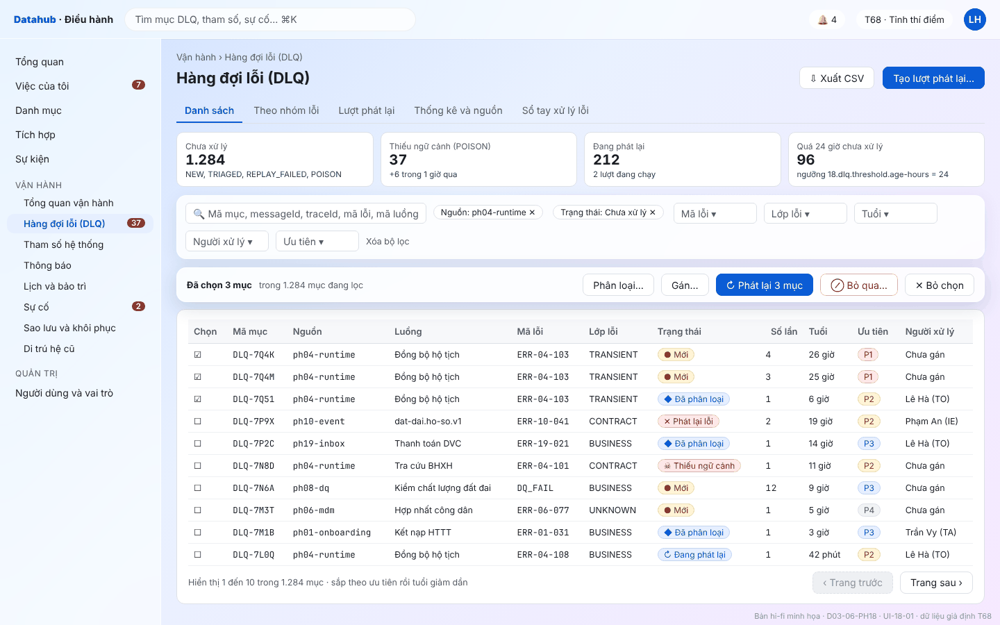

Ảnh cho thấy ba điều: thẻ "Chưa xử lý" đang được chọn làm bộ lọc và hai chip lọc nằm trên thanh lọc dạng kính; ba dòng đã chọn làm hiện thanh thao tác nổi với nút "Phát lại 3 mục" (dưới ngưỡng duyệt); nhãn trạng thái "Thiếu ngữ cảnh", "Phát lại lỗi" có biểu tượng và chữ, không chỉ màu. Dữ liệu là giả định T68.

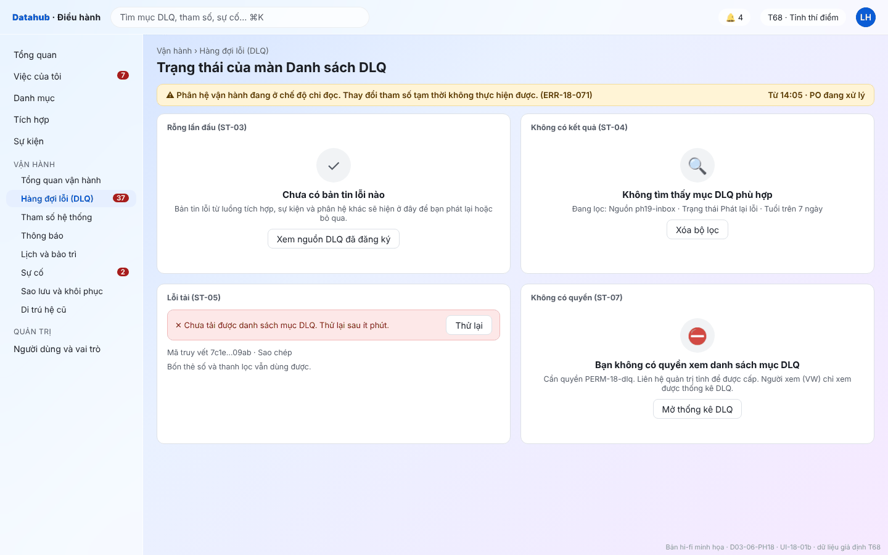

Ảnh cho thấy câu của từng trạng thái và dải cảnh báo chế độ chỉ đọc (ST-18-A) đặt cố định dưới thanh trên; ở trạng thái lỗi tải, thẻ số và thanh lọc vẫn dùng được.

## 8. UI-18-02 DLQ theo nhóm lỗi

::: dac-ta
**Mục đích.** Gom hàng trăm mục cùng nguyên nhân thành một nhóm theo dấu hiệu `nguồn:luồng:mã lỗi:bước` để người vận hành gán, phát lại cả nhóm một lần thay vì xử lý từng mục.

**Đường dẫn, mẫu.** `/van-hanh/dlq?tab=nhom`; PTN-01 kèm khung chi tiết nhóm bên phải (3/12 cột).

**Vai trò, quyền.** TO, TA, SO, PO ● (`PERM-18-dlq`); IE, DS ○ nhóm có mục thuộc luồng được giao.

**FR.** 020, 023, 028.

**API.** API-18-043 (danh sách nhóm), API-18-044 (gán nhóm), API-18-041 với `nhom={groupId}` (mục của nhóm), API-18-065, 069 (phát lại nhóm), API-18-081 (biểu đồ theo giờ của nhóm).

**Dữ liệu nhạy cảm.** Chỉ siêu dữ liệu.

**Đợt.** MVP (FR-18-020 mức C, làm cuối đợt); đầy đủ, ảnh `ui-18-02.png`.
:::

### 8.1. Bố cục và thành phần

Bảng nhóm chiếm 9/12 cột, khung chi tiết nhóm đang chọn chiếm 3/12; dưới `bp-lg` khung chi tiết thành Drawer.

```text
┌ Hàng đợi lỗi (DLQ) › Theo nhóm lỗi ───────────────────────────────────────────────────────────┐
│ Danh sách | [Theo nhóm lỗi] | Lượt phát lại | Thống kê và nguồn | Sổ tay xử lý lỗi             │
│ 🔍 Dấu hiệu, mã lỗi, luồng [Cửa sổ: 24 giờ ✕] [Nguồn ▾] [Lớp lỗi ▾] [Trạng thái ▾]             │
│ ┌ Bảng nhóm ─────────────────────────────────────────────┐ ┌ Nhóm đang chọn ───────────────┐ │
│ │ Dấu hiệu │ Số mục │ Đầu │ Cuối │ Nguồn │ Trạng thái │ … │ │ Số mục 842 · gợi ý Tạm thời   │ │
│ │ ph04-runtime:ho-tich-dong-bo:ERR-04-103:deliver │ 842 │ │ Biểu đồ số mục mới theo giờ   │ │
│ │   [Gán nhóm…] [↻ Phát lại nhóm]                        │ │ ⚠ Vượt ngưỡng duyệt 500       │ │
│ └────────────────────────────────────────────────────────┘ │ [Xem 842 mục] [Gửi duyệt…]    │ │
│                                                            └───────────────────────────────┘ │
└───────────────────────────────────────────────────────────────────────────────────────────────┘
```

: Wireframe UI-18-02

| # | Thành phần | `CMP-*` | Nội dung | Nguồn |
|---|---|---|---|---|
| 1 | Thanh lọc | `CMP-FilterBar` | Như UI-18-01 cộng "Cửa sổ" (mặc định `18.dlq.group.window-hours` = 24 giờ, chọn 1 đến 168 giờ) | API-18-043 |
| 2 | Bảng nhóm | `CMP-DataTable` | Cột ở mục 8.2; sắp theo số mục giảm dần | API-18-043 |
| 3 | Khung chi tiết nhóm | `CMP-Card`, `CMP-DescriptionList`, `CMP-Chart` (cột) | Số mục, lớp lỗi gợi ý từ sổ tay, "Phát lại được", sự cố liên kết, biểu đồ số mục mới theo giờ có nút "Xem dạng bảng" | API-18-043, API-18-058, API-18-081 |
| 4 | Cảnh báo ngưỡng duyệt | `CMP-Alert` cảnh báo | Hiện khi số mục của nhóm vượt `18.dlq.replay.approval-threshold` | API-18-004 |

: UI-18-02, thành phần

### 8.2. Cột, hành động

Mục này nêu cột của bảng nhóm và các thao tác áp lên cả nhóm.

| Cột | Kiểu | Trường API-18-043 | Ghi chú |
|---|---|---|---|
| Dấu hiệu lỗi | Đơn cách, ngắt dòng theo dấu `:` | `signature` | Tooltip giải thích bốn phần |
| Số mục | Số căn phải | `count` | Bấm mở UI-18-01 lọc theo nhóm |
| Mục đầu, mục cuối | `CMP-Timestamp` | `firstAt`, `lastAt` | |
| Nguồn | Mã phân hệ | `sourcePh` | |
| Trạng thái chính | `CMP-StatusTag` | `dominantStatus` | Trạng thái chiếm đa số |
| Người xử lý | Tên | `assignee` | Mục mới của nhóm thừa hưởng người xử lý, ưu tiên |
| Hành động | `CMP-Button` | | "Gán nhóm…", "Phát lại nhóm" |

: UI-18-02, cột

"Gán nhóm…" mở Drawer chọn người hoặc nhóm và ưu tiên, áp cho mọi mục chưa gán (API-18-044). "Phát lại nhóm" tạo lượt với bộ lọc `groupId` (API-18-065); nhóm vượt ngưỡng duyệt thì nút ghi "Gửi duyệt phát lại nhóm…" và lượt chuyển `PENDING_APPROVAL`. Nhóm toàn mục `POISON` ẩn nút phát lại, hiện "Mở sổ tay" và "Bỏ qua nhóm…".

### 8.3. Trạng thái, thông báo, truy cập

Mục này nêu cách màn nhóm lỗi hiển thị khi rỗng, khi lỗi và khi dùng bằng bàn phím.

| Trạng thái | Hiển thị |
|---|---|
| Đang tải (ST-01) | Skeleton 6 dòng và khung chi tiết trống |
| Rỗng (ST-03) | "Không có nhóm lỗi nào trong {n} giờ qua." |
| Lỗi (ST-05) | Khối lỗi tại bảng, nút "Thử lại" |
| Đang gom | Dòng phụ "Nhóm được cập nhật mỗi phút; lần gom gần nhất {giờ}." |
| Không quyền (ST-07) | Tab ẩn; mở URL: 403 nêu `PERM-18-dlq` |

: UI-18-02, trạng thái

Thông báo dùng: ERR-18-006 "Nhóm đang có lượt phát lại {mã}. Chờ lượt hiện tại xong." khi phát lại trùng; ERR-18-036, ERR-18-032 như UI-18-01; ERR-18-003 khi cửa sổ ngoài 1 đến 168 giờ. Bàn phím như UI-18-01; `Enter` trên dòng nhóm cập nhật khung chi tiết và chuyển focus sang tiêu đề khung. Biểu đồ có bảng thay thế (WCAG 1.1.1).

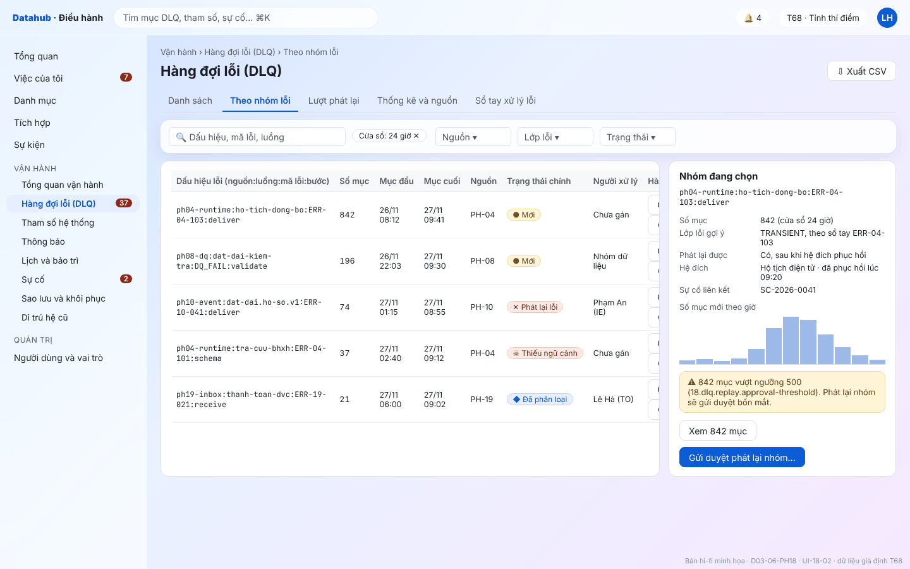

Ảnh cho thấy nhóm 842 mục cùng dấu hiệu ERR-04-103 ở bước `deliver`, khung bên phải nêu hệ đích đã phục hồi và cảnh báo vượt ngưỡng duyệt, nên nút chính là "Gửi duyệt phát lại nhóm…".

## 9. UI-18-03 Chi tiết mục DLQ

::: dac-ta
**Mục đích.** Cho người vận hành hiểu vì sao một bản tin lỗi (ngữ cảnh, sổ tay, chẩn đoán từ giám sát), xem nội dung khi thật cần và có lý do, rồi quyết định phân loại, gán, sửa, phát lại, bỏ qua hoặc mở lại; mọi thao tác hiện trên dòng thời gian của mục.

**Đường dẫn, mẫu.** `/van-hanh/dlq/{dlqId}`; PTN-02 Chi tiết, ba cột ở `bp-xl`, thành ba tab "Ngữ cảnh", "Nội dung", "Dòng thời gian" ở màn hẹp.

**Vai trò, quyền.** TO, TA, SO, PO ● (`PERM-18-dlq`); xem nội dung và sửa: TO, TA, SO, IE ● (`PERM-18-dlq-payload`), PO ○ khi tenant cấp phiên hỗ trợ; IE, DS ○ chỉ mục được giao; AU, VW ○ xem siêu dữ liệu (`PERM-18-read`, API-18-045 từ FRS 0.2), không xem nội dung.

**FR.** 015, 016, 021, 022, 023, 024, 025, 027, 030, 031, 032, 070.

**API.** API-18-045 (chi tiết), API-18-046 (chẩn đoán từ PH-13, fail-soft), API-18-048 (khung cấu trúc), API-18-047 (xem nội dung có lý do), API-18-058 (sổ tay), API-18-049, 050 (phân loại, gán), API-18-052 (bản sửa), API-18-064 (phát lại), API-18-077 (bỏ qua), API-18-079 (mở lại), API-18-063 (nhật ký thao tác của mục).

**Dữ liệu nhạy cảm.** Nội dung chỉ hiện trong phiếu xem; trường mã hóa ở nguồn luôn che; không sao chép toàn khối nội dung (chỉ sao chép từng giá trị đã hiện, mỗi lần ghi kiểm toán).

**Đợt.** MVP; siêu chi tiết; ảnh `ui-18-03.png` (màn chính) và `ui-18-03b.png` (hộp thoại xem nội dung).
:::

### 9.1. Lưới bố cục

Ở `bp-xl` ba cột 330px, phần còn lại, 330px, cách nhau `space-4`; ở `bp-lg` cột dòng thời gian xuống dưới cột giữa; dưới `bp-md` ba tab. Đầu trang có tiêu đề, nhãn trạng thái, ưu tiên và nhóm nút hành động.

```text
┌ main ─────────────────────────────────────────────────────────────────────────────────────────────┐
│ ① Vận hành › Hàng đợi lỗi (DLQ) › DLQ-7Q4K                                                         │
│ ① Mục DLQ-7Q4K ◆ Đã phân loại P1   [✦ Giải thích lỗi này][Phân loại…][Gán…][⊘ Bỏ qua…][↻ Phát lại]│
│ ┌ ② Ngữ cảnh (330) ──────┐ ┌ ④ Nội dung bản tin ───────────────────┐ ┌ ⑥ Dòng thời gian (330) ┐ │
│ │ Nguồn  ph04-runtime    │ │ application/json · 18,4 KB · nội tuyến  │ │ 09:12 Gặp lại lần 4     │ │
│ │ Luồng  Đồng bộ hộ tịch │ │ SHA-256 khớp · bản gốc (số 0)  [Đã che] │ │ 08:31 Phân loại P1      │ │
│ │ Bước   deliver         │ │ { "maHoSo": chuỗi · ••••,               │ │ 08:02 Lượt PL-…0149 ✕   │ │
│ │ Mã lỗi ERR-04-103 Sổ tay│ │   "soDinhDanh": •••• đã mã hóa ở nguồn │ │ 07:58 Xem khung         │ │
│ │ Lớp, lần thử, số lần   │ │   … }                                   │ │ 07:41 Nhận từ topic     │ │
│ │ Mã vết → PH-13         │ │ [👁 Xem nội dung…] [Sửa nội dung…]      │ │ Bản sửa · Lượt · Sự cố  │ │
│ ├ ③ Sổ tay ERR-04-103 ───┤ ├ ⑤ Chẩn đoán từ giám sát ───────────────┤ └─────────────────────────┘ │
│ │ Nguyên nhân · Cách xử lý│ │ Vết 3 bước · 12 dòng log đã che · chỉ số│                             │
│ │ ✓ Phát lại được        │ │ Lấy lúc 09:41 · nguồn PH-13             │                             │
│ └────────────────────────┘ └─────────────────────────────────────────┘                             │
└───────────────────────────────────────────────────────────────────────────────────────────────────┘
```

: Wireframe UI-18-03

### 9.2. Giải phẫu từng vùng

Bảng dưới mô tả từng vùng của màn chi tiết theo số trên wireframe, kèm thành phần và quy tắc hiển thị.

| # | Vùng | `CMP-*` | Nội dung, quy tắc | Nguồn |
|---|---|---|---|---|
| 1 | Đầu trang | `CMP-PageHeader`, `CMP-StatusTag`, `CMP-Tag`, `CMP-Button` | Mã rút gọn, trạng thái, ưu tiên; năm nút theo mục 9.4; nút "✦ Giải thích lỗi này" do PH-17 cấp, chỉ hiện khi trợ lý bật (D03-06-PH17) | API-18-045 |
| 2 | Ngữ cảnh lỗi | `CMP-DescriptionList` | Nguồn, luồng và phiên bản, bước, mã lỗi kèm liên kết sổ tay, lớp lỗi, số lần thử ở nguồn, số lần gặp, lần đầu, lần cuối, mã vết `traceparent` rút gọn kèm "Mở vết ở PH-13", người xử lý, ưu tiên, hạn lưu giữ | API-18-045 |
| 3 | Sổ tay | `CMP-Card` | Tiêu đề, nguyên nhân, các bước, "Phát lại được" (Có, Sau khi sửa, Không), ghi chú riêng của tỉnh; không có sổ tay: "Chưa có hướng dẫn cho mã này." kèm nút "Soạn hướng dẫn" khi có `PERM-18-admin` | API-18-058 |
| 4 | Nội dung bản tin | `CMP-JsonTree` chế độ khung, `CMP-MaskedValue`, `CMP-Button` | Kiểu nội dung, kích thước, nơi lưu (nội tuyến hoặc Garage), kết quả tổng kiểm tra, bản đang xem; khung cấu trúc không có giá trị; nút "Xem nội dung…", "Sửa nội dung…" | API-18-048, API-18-047 |
| 5 | Chẩn đoán | `CMP-Card`, `CMP-LogViewer` thu gọn | Tóm tắt vết, ≤ 200 dòng log đã che, chỉ số quanh thời điểm lỗi (cửa sổ 5 phút); thời điểm lấy; vắng PH-13 thì ST-18-B | API-18-046 |
| 6 | Dòng thời gian | `CMP-AuditTimeline` | Chuyển trạng thái, phân loại, gán, xem khung, xem nội dung (chỉ người, mục đích, không nội dung), bản sửa (có liên kết khác biệt), lượt phát lại và kết quả, người làm và người duyệt; chân khối: số bản sửa, số lượt, sự cố liên kết | API-18-063, API-18-052 |

: UI-18-03, giải phẫu từng vùng

### 9.3. Phiếu xem nội dung

Bấm "Xem nội dung…" mở `CMP-ReasonDialog` (ảnh `ui-18-03b.png`) gồm: mục đích (`CMP-SegmentedControl`: Chẩn đoán `DIAGNOSE`, Sửa nội dung `EDIT`, Hỗ trợ `SUPPORT`), lý do ≥ 10 ký tự có bộ đếm, dòng nhắc "Phiếu xem có hạn 15 phút (18.dlq.reveal.ttl-minutes)." Nút "Xem nội dung" vô hiệu khi lý do chưa đủ. Gửi thì gọi API-18-047; hệ thống ghi kiểm toán trước khi trả nội dung.

Khi có phiếu, khung ④ chuyển chế độ giá trị: `CMP-JsonViewer` có số dòng, trường mã hóa ở nguồn hiện "•••• đã mã hóa ở nguồn", trường định danh che theo PH-09; đầu khung có đồng hồ đếm ngược "Còn 14:32" (dùng tạm CountdownTimer, Phụ lục A) và nút "Che lại ngay". Còn 1 phút thì đồng hồ đổi sắc thái cảnh báo và thông báo một lần qua `aria-live="polite"`; hết phiếu, giá trị tự che và khung trở về chế độ khung. Rời trang hoặc đổi tab trình duyệt quá 5 phút cũng che lại. Nội dung hiện trên nền đặc, có thủy vân chìm "T68 · {tên người xem} · {thời điểm}" để hạn chế chụp màn hình phát tán.

### 9.4. Hành động theo quyền và trạng thái

Nút thao tác của mục DLQ phụ thuộc đồng thời vào trạng thái mục và quyền của người dùng, như bảng dưới.

| Hành động | Quyền | Trạng thái cho phép | Kết quả |
|---|---|---|---|
| Phân loại… | `PERM-18-dlq` | `NEW`, `TRIAGED`, `REPLAY_FAILED`, `POISON` (giữ `POISON`) | Drawer lớp lỗi, ưu tiên, ghi chú, "Báo chủ quản HTTT"; `If-Match`; API-18-049 |
| Gán… hoặc Nhận việc | `PERM-18-dlq` | Mọi trạng thái mở | API-18-050; người được gán nhận việc `ph18.dlq-assigned` |
| Xem nội dung… | `PERM-18-dlq-payload` | Mọi trạng thái trừ `EXPIRED` | Mục 9.3; ẩn với người không có quyền, thay bằng dòng "Cần quyền xem nội dung" |
| Sửa nội dung… | `PERM-18-dlq-payload` | Nguồn có `supportsRevision`; không có bản sửa chờ duyệt | Mở UI-18-04; nguồn không nhận bản sửa: nút ẩn, dòng phụ "Nguồn không nhận nội dung sửa; sửa ở nguồn rồi gửi lại." |
| Phát lại | `PERM-18-dlq` | `TRIAGED`, `REPLAY_FAILED`, `NEW`; không `POISON`; nguồn có cổng | `CMP-ConfirmDialog` nêu nguồn, luồng, bản dùng ("bản sửa số 1 đã duyệt" hoặc "bản gốc"), cảnh báo đóng băng nếu có (không chặn); API-18-064 |
| Bỏ qua… | `PERM-18-dlq` | Mọi trạng thái mở | `CMP-ReasonDialog` lý do mã và mô tả; nêu hạn mở lại theo `18.dlq.retention.closed-days`; API-18-077 |
| Mở lại… | `PERM-18-dlq` | `DISCARDED` trong hạn lưu giữ | `CMP-ReasonDialog`; mục về `TRIAGED`; API-18-079 |
| Giải thích lỗi này | `PERM-17-use` | Trợ lý PH-17 bật | Mở bảng bên PH-17 với `dlqId` (UI-17-03) |

: UI-18-03, hành động

Mục `POISON` hiện `CMP-Alert` cảnh báo đầu khung ② "Thiếu ngữ cảnh, không phát lại được." kèm danh sách trường thiếu (từ ERR-18-102) và ẩn nút "Phát lại"; còn "Sửa nội dung…" (bản sửa đưa mục về `TRIAGED`) và "Bỏ qua…". Mục `REPLAYING` vô hiệu mọi nút ghi trừ "Gán…", hiện dòng "Đang phát lại trong lượt {mã}" có liên kết UI-18-05. Mục `EXPIRED` chỉ còn siêu dữ liệu, khung ④ hiện "Nội dung bản tin đã bị xóa do hết hạn lưu giữ. Chỉ còn thông tin mô tả."

### 9.5. Trạng thái, thông báo

Mục này liệt kê trạng thái màn và câu thông báo theo mã lỗi mà người dùng có thể gặp ở chi tiết mục.

| Trạng thái | Hiển thị |
|---|---|
| Đang tải (ST-01) | Skeleton ba cột; đầu trang hiện ngay mã mục |
| Không tìm thấy (ST-08) | `CMP-ResultPage` "Không tìm thấy mục DLQ {mã}." kèm nút "Về danh sách hàng đợi lỗi" giữ bộ lọc |
| Chẩn đoán vắng (ST-18-B) | Khung ⑤: "Không có ngữ cảnh từ giám sát." kèm "Thử lại"; mục khác đầy đủ (ERR-18-106) |
| Đang phát lại | Nhãn "↻ Đang phát lại", dòng thời gian thêm mốc khi có kết quả (làm mới mỗi 5 giây khi trang mở) |
| Phiếu xem đang mở | Đồng hồ đếm ngược ở khung ④; nút "Che lại ngay" |
| Xung đột (ST-13) | Phân loại, gán khi mục vừa đổi: `CMP-ConflictDialog` |
| Chỉ đọc (ST-15, ST-18-A) | Năm nút ghi vô hiệu kèm tooltip lý do |

: UI-18-03, trạng thái

| Mã lỗi | Khi nào | Câu hiển thị |
|---|---|---|
| ERR-18-001 | Mục không có trong tenant | "Không tìm thấy mục DLQ {mã}." |
| ERR-18-007 | Lý do xem nội dung dưới 10 ký tự | "Nhập lý do xem nội dung (ít nhất 10 ký tự)." |
| ERR-18-008 | PH-13 không ghi được kiểm toán khi xem | "Chưa ghi được nhật ký kiểm toán nên thao tác bị từ chối. Thử lại sau." |
| ERR-18-027 | Nội dung đã xóa do hết hạn | "Nội dung bản tin đã bị xóa do hết hạn lưu giữ. Chỉ còn thông tin mô tả." |
| ERR-18-104 | Tổng kiểm tra lệch khi đọc nội dung | "Nội dung bản tin trong kho không khớp tổng kiểm tra. Báo quản trị nền tảng." |
| ERR-18-028 | Phát lại mục `POISON` | "Bản tin thiếu ngữ cảnh nên không phát lại được. Sửa nội dung hoặc bỏ qua." |
| ERR-18-031 | Mục đang trong lượt khác | "Mục đang được phát lại trong lượt {mã}." |
| ERR-18-033 | Nguồn không có cổng phát lại | "Nguồn {mã} chưa có cổng phát lại hoặc đang tạm ngừng." |
| ERR-18-034 | Mở lại mục hết hạn | "Mục đã hết hạn lưu giữ nên không thể mở lại." |
| ERR-18-004 | Phân loại khi mục đã đổi | Hộp "Dữ liệu đã đổi" với nút "Tải lại" |
| ERR-18-107, 108, 109 | Kết quả phát lại không thành công | Mốc dòng thời gian: "Nguồn từ chối phát lại: {lý do}." · "Nguồn không phản hồi; mục sẽ được thử lại." · "Chưa nhận kết quả phát lại sau {n} phút." |

: UI-18-03, thông báo theo mã lỗi

### 9.6. Tương tác chuột và bàn phím

Mọi thao tác chuột của màn chi tiết đều có đường đi bằng bàn phím, như bảng dưới.

| Phím | Tác dụng |
|---|---|
| `Alt+1`, `Alt+2`, `Alt+3` | Focus khung Ngữ cảnh, Nội dung, Dòng thời gian (ở màn hẹp: chuyển tab) |
| `R` | Phát lại (mở xác nhận) |
| `D` | Bỏ qua (mở hộp lý do) |
| `V` | Xem nội dung (mở hộp lý do) |
| `[`, `]` | Mục trước, mục sau trong danh sách đã lọc ở UI-18-01 |
| `Esc` | Đóng hộp thoại; khi phiếu xem mở và không có hộp thoại: che lại ngay |

: UI-18-03, phím tắt

Phím chữ đơn chỉ hoạt động khi focus không ở ô nhập và có thể tắt ở cài đặt cá nhân (WCAG 2.1.4).

### 9.7. Truy cập

Ba khung là `region` có `aria-labelledby` trỏ tiêu đề. Khung nội dung khi còn che có mô tả "Nội dung đã che. Cần lý do để xem."; khi mở phiếu, focus chuyển tới tiêu đề khung và đồng hồ đọc một lần, không đọc từng giây (`aria-live="off"` cho đồng hồ, thông báo riêng khi còn 1 phút). Dòng thời gian là danh sách có thứ tự, mỗi mốc đọc "lúc, người, hành động, kết quả". Liên kết "Mở vết ở PH-13" báo mở trong tab mới. Nút "Phát lại" vô hiệu với mục `POISON` không ẩn khỏi trình đọc màn hình mà có `aria-describedby` trỏ câu lý do.

### 9.8. Bản hi-fi

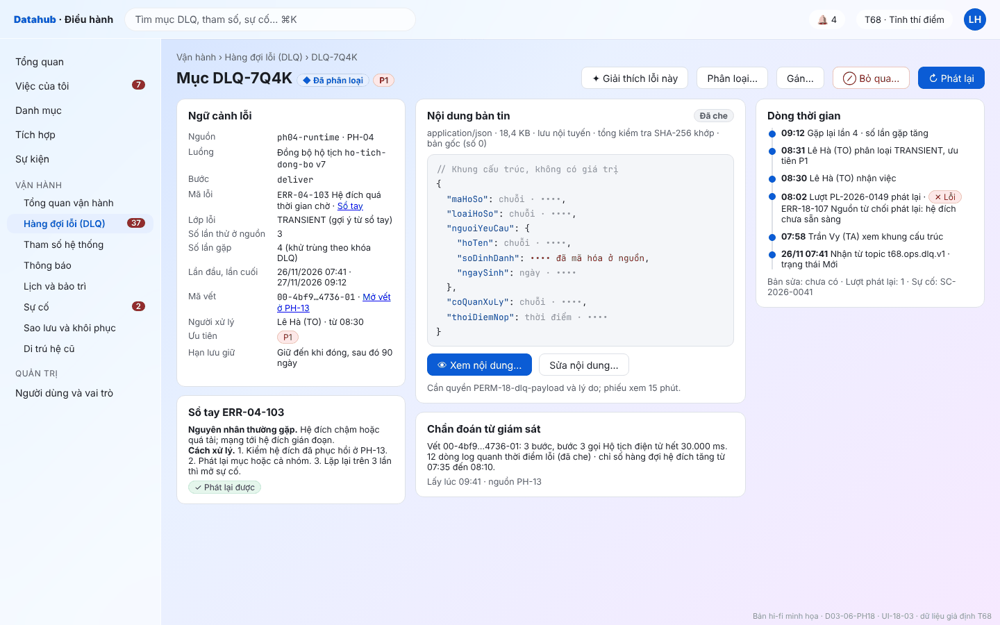

Ảnh cho thấy cột trái là ngữ cảnh với mã lỗi ERR-04-103 có liên kết sổ tay và mã vết rút gọn mở PH-13; cột giữa chỉ có khung cấu trúc, trường `soDinhDanh` hiện "đã mã hóa ở nguồn", nút "Xem nội dung…" kèm câu nêu điều kiện; cột phải là dòng thời gian có lượt phát lại lỗi ERR-18-107 trước đó.

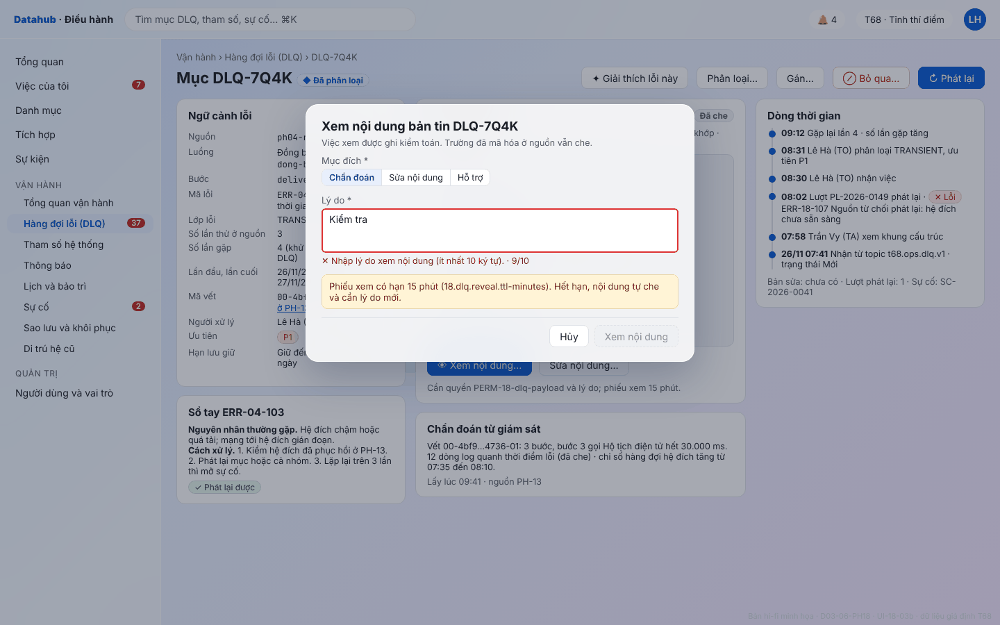

Ảnh cho thấy hộp thoại kính trên lớp phủ: lý do "Kiểm tra" chưa đủ 10 ký tự nên dưới ô hiện lỗi ERR-18-007 bằng biểu tượng và chữ, bộ đếm 8/10, nút "Xem nội dung" vô hiệu; dòng nhắc hạn phiếu 15 phút.

## 10. UI-18-04 Sửa payload

::: dac-ta
**Mục đích.** Cho người có trách nhiệm sửa nội dung bản tin lỗi (ví dụ định dạng ngày sai) để phát lại được, mà không đụng tới bản gốc; bản sửa đụng trường mức Hạn chế hoặc Nhạy cảm phải qua người thứ hai.

**Đường dẫn, mẫu.** `/van-hanh/dlq/{dlqId}/sua`; PTN-03 Biểu mẫu trang, hai khung so sánh.

**Vai trò, quyền.** TO, TA, SO, IE ● (`PERM-18-dlq-payload`); người duyệt bản sửa: TA, SO, PA ● (`PERM-18-approve`), khác người tạo.

**FR.** 024.

**API.** API-18-047 (mở phiếu với mục đích `EDIT`, bắt buộc trước khi vào màn), API-18-053 (tạo bản sửa, kiểm lược đồ), API-18-054 (khác biệt), API-18-052 (danh sách bản sửa), API-18-055, 056 (duyệt, từ chối).

**Dữ liệu nhạy cảm.** Màn chỉ mở khi có phiếu xem còn hạn; trường mã hóa ở nguồn không sửa được (khóa, hiện "•••• đã mã hóa"); khác biệt che giá trị trường mức Nhạy cảm.

**Đợt.** MVP; đầy đủ, ảnh `ui-18-04.png`.
:::

### 10.1. Bố cục và thành phần

Hai khung 6/12 cột: trái bản gốc (số 0) hoặc bản sửa đã duyệt gần nhất, chỉ đọc; phải bản sửa mới có `CMP-CodeEditor` chế độ JSON. Dưới là khối "Khác biệt và kiểm soát" và chân biểu mẫu.

```text
┌ Sửa nội dung bản tin DLQ-7N8D ☠ Thiếu ngữ cảnh ──────────────────────────────────────────────────┐
│ ⓘ Bản gốc không bao giờ bị sửa. Lưu sẽ tạo bản sửa số 1; khóa lũy đẳng DLQ-7N8D:1.               │
│ ┌ Bản gốc (số 0) · chỉ đọc ───────────────┐ ┌ Bản sửa số 1 ─────────────────────────────────────┐ │
│ │ { "ngaySinh": "27/02/1990", … }          │ │ { "ngaySinh": "1990-02-27", … }  (dòng đổi tô xanh)│ │
│ └──────────────────────────────────────────┘ │ Kiểm lược đồ bhxh.tra-cuu.v3: ✓ hợp lệ · 1 trường │ │
│                                               └────────────────────────────────────────────────────┘ │
│ ┌ Khác biệt và kiểm soát ──────────────────────────────────────────────────────────────────────┐ │
│ │ $.nguoiYeuCau.ngaySinh │ 27/02/1990 → 1990-02-27 │ Hạn chế                                     │ │
│ │ ⚠ Bản sửa có trường mức Hạn chế nên cần người thứ hai duyệt trước khi phát lại.               │ │
│ │ Lý do sửa * [……………………………………………]                     [Hủy] [Kiểm tra lược đồ] [Gửi duyệt bản sửa] │ │
│ └──────────────────────────────────────────────────────────────────────────────────────────────┘ │
└───────────────────────────────────────────────────────────────────────────────────────────────────┘
```

: Wireframe UI-18-04

| # | Thành phần | `CMP-*` | Nội dung | Nguồn |
|---|---|---|---|---|
| 1 | Dải giải thích | `CMP-Alert` thông tin | Bản gốc không đổi, số bản sửa sẽ tạo, khóa lũy đẳng | API-18-052 |
| 2 | Bản gốc | `CMP-CodeEditor` chỉ đọc | Nội dung theo phiếu xem | API-18-047 |
| 3 | Bản sửa | `CMP-CodeEditor` | Kiểm cú pháp JSON tức thời; trường mã hóa khóa sửa | |
| 4 | Kết quả kiểm lược đồ | `CMP-Text` kèm biểu tượng | Tên lược đồ của nguồn (JSON Schema từ PH-04 hoặc PH-10), hợp lệ hay danh sách lỗi theo đường dẫn | API-18-053 (`dryRun`) |
| 5 | Bảng khác biệt | `CMP-DiffTable` | Đường dẫn trường, trước, sau, mức phân loại theo PH-09 | API-18-054 |
| 6 | Cảnh báo bốn mắt | `CMP-Alert` cảnh báo | Hiện khi có trường mức Hạn chế hoặc Nhạy cảm | API-18-054 |
| 7 | Lý do, chân biểu mẫu | `CMP-TextArea`, `CMP-Button` | Lý do ≥ 10 ký tự; nút đổi nhãn "Lưu bản sửa" hoặc "Gửi duyệt bản sửa" theo mức | API-18-053 |
| 8 | Khung duyệt (người duyệt mở từ Việc của tôi) | `CMP-ApprovalPanel` | Người tạo, lý do, khác biệt, nút Duyệt, Từ chối | API-18-055, 056 |

: UI-18-04, thành phần

### 10.2. Trường, hành động

Mục này nêu trường nhập của bản sửa và các nút ở chân biểu mẫu.

| Nhãn | Kiểu | Bắt buộc | Ràng buộc, mã lỗi, câu hiển thị |
|---|---|---|---|
| Nội dung bản sửa | JSON (`CMP-CodeEditor`) | Có | Đúng lược đồ nguồn: ERR-18-029 "Nội dung sửa không đúng lược đồ {lược đồ}: {chi tiết}." hiện dưới khung và gạch chân dòng lỗi |
| Lý do sửa | `CMP-TextArea` | Có | ≥ 10 ký tự: ERR-18-007 |
| Gửi | `CMP-Button` | | Đã có bản sửa chờ duyệt: ERR-18-030 "Mục đã có bản sửa số {n} chờ duyệt. Chờ duyệt xong trước khi sửa tiếp." |
| Duyệt, Từ chối | `CMP-ApprovalPanel` | Ý kiến bắt buộc khi từ chối | Người duyệt trùng người tạo: ERR-18-005 "Bạn là người tạo bản sửa nên không được duyệt bản sửa này." |

: UI-18-04, trường nhập

Hành động: "Kiểm tra lược đồ" (không ghi); "Lưu bản sửa" khi không có trường mức Hạn chế, Nhạy cảm (bản sửa `APPROVED` ngay, quay về UI-18-03 với `CMP-Toast` "Đã lưu bản sửa số 1. Phát lại sẽ dùng bản này."); "Gửi duyệt bản sửa" khi có (bản sửa `PENDING_APPROVAL`, tạo việc cho người duyệt); "Hủy" có cảnh báo rời trang khi đã sửa (D03-06-00 §4.3). Duyệt thì mục `POISON` chuyển `TRIAGED`; từ chối thì bản sửa `REJECTED`, mục giữ trạng thái.

### 10.3. Trạng thái, phím tắt, truy cập

Mục này nêu trạng thái của màn sửa, phím tắt và yêu cầu truy cập.

| Trạng thái | Hiển thị |
|---|---|
| Chưa có phiếu xem | Không vào được màn: mở hộp lý do mục đích "Sửa nội dung" trước; hủy hộp thì quay lại UI-18-03 |
| Phiếu hết hạn khi đang sửa | `CMP-Modal` "Phiếu xem đã hết hạn. Nhập lý do để tiếp tục; nội dung đang sửa được giữ." |
| Nguồn không nhận bản sửa | Không vào được; UI-18-03 ẩn nút |
| Đang lưu (ST-09), lỗi (ST-11, ST-12) | Theo D03-06-00 |
| Chờ duyệt | Màn chỉ đọc, `CMP-ApprovalPanel` thay chân biểu mẫu |

: UI-18-04, trạng thái

Phím tắt: `Ctrl+S` kiểm tra lược đồ; `Ctrl+Enter` gửi; `Alt+↓`, `Alt+↑` nhảy tới khác biệt kế tiếp, trước đó; `Esc` thoát trình soạn để `Tab` rời khung (trình soạn không bẫy focus, WCAG 2.1.2). Truy cập: hai khung có nhãn "Bản gốc số 0, chỉ đọc" và "Bản sửa số 1"; dòng đổi có tiền tố chữ "Đã thêm", "Đã đổi" cho trình đọc màn hình, không chỉ tô màu; bảng khác biệt là bảng có tiêu đề cột.

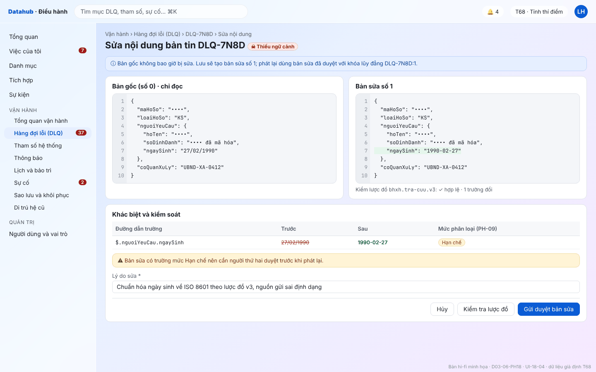

Ảnh cho thấy bản gốc bên trái không sửa được, bản sửa bên phải tô xanh dòng ngày sinh đổi sang ISO 8601, kiểm lược đồ đạt; bảng khác biệt báo trường mức Hạn chế nên nút chính là "Gửi duyệt bản sửa".

## 11. UI-18-05 Lượt phát lại

::: dac-ta
**Mục đích.** Cho người vận hành theo dõi và điều khiển lượt phát lại nhiều mục: tiến độ, kết quả từng mục, tốc độ, tạm dừng, tiếp tục, hủy; cho người duyệt xem phạm vi và duyệt lượt vượt ngưỡng.

**Đường dẫn, mẫu.** `/van-hanh/dlq/phat-lai` (danh sách lượt) và `/van-hanh/dlq/phat-lai/{jobId}` (chi tiết); PTN-11 Giám sát thời gian thực.

**Vai trò, quyền.** TO, TA, SO, PO ● (`PERM-18-dlq`); duyệt: TA, SO, PA ● (`PERM-18-approve`); IE, DS ○ lượt do mình tạo.

**FR.** 028, 029, 030.

**API.** API-18-066 (danh sách), API-18-067 (chi tiết, tiến độ, `ETag`), API-18-068 (kết quả từng mục), API-18-069 (gửi), API-18-070, 071 (duyệt, từ chối), API-18-072, 073, 074 (tạm dừng, tiếp tục, hủy), API-18-075 (đổi tốc độ).

**Dữ liệu nhạy cảm.** Chỉ mã mục và kết quả.

**Đợt.** MVP; đầy đủ, ảnh `ui-18-05.png`.
:::

### 11.1. Bố cục và thành phần

Chi tiết lượt: đầu trang có trạng thái và nút điều khiển; khối tiến độ toàn chiều rộng (thanh tiến độ, năm thẻ số); dưới chia đôi: trái kết quả từng mục cập nhật mỗi 5 giây, phải danh sách lượt gần đây. Danh sách lượt (không có `{jobId}`) dùng bảng toàn chiều rộng.

```text
┌ Lượt phát lại PL-2026-0153 ↻ Đang chạy                  [⏸ Tạm dừng] [Đổi tốc độ…] [✕ Hủy lượt…] ┐
│ Tiến độ 61% · 514/842 · 10 mục mỗi giây · dự kiến 09:47          Duyệt bởi Trần Vy (TA) lúc 09:20│
│ ████████████████████████████░░░░░░░░░░░░░░░░                                                     │
│ [Đã gửi 514] [Thành công 498] [Thất bại 6 · 1,2%, ngưỡng 20%] [Chờ kết quả 10] [Bị loại 12]       │
│ ┌ Kết quả từng mục (mỗi 5 giây) ─────────────┐ ┌ Các lượt gần đây ──────────────────────────────┐ │
│ │ 09:41:12 DLQ-7Q4K bản 0 ✓ Thành công        │ │ PL-2026-0153 · 842 · ↻ Đang chạy              │ │
│ │ 09:41:11 DLQ-7Q2A bản 0 ✕ ERR-18-107 …      │ │ PL-2026-0150 · 196 · ◷ Chờ duyệt              │ │
│ └─────────────────────────────────────────────┘ └────────────────────────────────────────────────┘ │
└───────────────────────────────────────────────────────────────────────────────────────────────────┘
```

: Wireframe UI-18-05

| # | Thành phần | `CMP-*` | Nội dung | Nguồn |
|---|---|---|---|---|
| 1 | Đầu trang, nút điều khiển | `CMP-PageHeader`, `CMP-Button` | Theo trạng thái (mục 11.2) | API-18-067 |
| 2 | Tiến độ | `CMP-JobProgress`, `CMP-KpiCard` ×5 | Phần trăm, đã gửi trên tổng, tốc độ, dự kiến xong; thành công, thất bại kèm tỷ lệ lỗi trên 100 kết quả gần nhất và ngưỡng tự dừng `18.dlq.threshold.replay-failure-percent`, chờ kết quả kèm hạn `18.dlq.replay.result-timeout-minutes`, bị loại khi tạo theo lý do | API-18-067 |
| 3 | Kết quả từng mục | `CMP-DataTable` cuộn ảo | Lúc, mục, bản dùng, kết quả, chi tiết (mã lỗi ERR-18-107, 108, 109 và câu) | API-18-068 |
| 4 | Lượt gần đây | `CMP-DataTable` | Mã lượt, phạm vi, số mục, trạng thái, người tạo, duyệt | API-18-066 |
| 5 | Khung duyệt | `CMP-ApprovalPanel` | Khi lượt `PENDING_APPROVAL`: phạm vi (bộ lọc hoặc danh sách), số mục, số bị loại, tốc độ, người tạo; Duyệt, Từ chối | API-18-070, 071 |

: UI-18-05, thành phần

### 11.2. Hành động theo trạng thái lượt

Nút trên màn lượt phát lại thay đổi theo trạng thái của lượt, như bảng dưới.

| Trạng thái lượt | Nút hiện | Ghi chú |
|---|---|---|
| `DRAFT` | Gửi, Sửa tốc độ, Xóa nháp | Gửi: dưới ngưỡng chạy ngay, trên ngưỡng chờ duyệt (API-18-069) |
| `PENDING_APPROVAL` | Duyệt, Từ chối… (người duyệt); Rút (người tạo) | Người tạo thấy nút Duyệt vô hiệu: "Bạn là người tạo lượt nên không được duyệt lượt này." (ERR-18-005) |
| `RUNNING` | Tạm dừng, Đổi tốc độ…, Hủy lượt… | Tạm dừng, hủy không cần duyệt; hủy đưa mục chưa gửi về `TRIAGED` |
| `PAUSED` | Tiếp tục, Đổi tốc độ…, Hủy lượt… | |
| `COMPLETED`, `PARTIAL`, `FAILED`, `CANCELLED`, `REJECTED` | Tạo lượt cho mục lỗi (chỉ `PARTIAL`, `FAILED`) | Lượt `FAILED` do vượt tỷ lệ lỗi hiện `CMP-Alert` "Lượt tự dừng vì tỷ lệ lỗi {x}% vượt ngưỡng {y}%." |

: UI-18-05, hành động theo trạng thái

| Nhãn | Kiểu | Ràng buộc, mã lỗi |
|---|---|---|
| Tốc độ (mục mỗi giây) | `CMP-NumberInput` | 1 đến trần của nguồn; vượt: ERR-18-037 "Tốc độ {n} mục mỗi giây vượt giới hạn {trần} của nguồn {mã}." |
| Ý kiến từ chối | `CMP-TextArea` | ≥ 10 ký tự |
| Điều khiển sai trạng thái | | ERR-18-006 "Lượt phát lại đang ở trạng thái {trạng thái} nên không thể {thao tác}." |

: UI-18-05, trường nhập

### 11.3. Trạng thái, phím tắt, truy cập

Mục này nêu cách màn lượt hiển thị khi rỗng, khi tải, khi lỗi, cùng phím tắt và yêu cầu truy cập.

| Trạng thái | Hiển thị |
|---|---|
| Đang tải (ST-01) | Skeleton khối tiến độ và 8 dòng |
| Rỗng danh sách lượt (ST-03) | "Chưa có lượt phát lại nào." kèm nút "Về danh sách hàng đợi lỗi" |
| Mất kết nối cập nhật | Dòng phụ "Cập nhật lần cuối {giờ}" đổi sắc thái cảnh báo; tự thử lại (ST-06) |
| Hoàn tất | `CMP-Toast` một lần "Lượt PL-… hoàn tất: {a} thành công, {b} lỗi." và mốc trong trung tâm thông báo |

: UI-18-05, trạng thái

Phím tắt: `P` tạm dừng hoặc tiếp tục; `Esc` đóng hộp thoại. Truy cập: thanh tiến độ là `role="progressbar"` có `aria-valuenow`; con số cập nhật mỗi 5 giây nhưng `aria-live` chỉ báo khi đổi trạng thái lượt (không đọc từng lần cập nhật); bảng kết quả có nút "Tạm dừng cập nhật tự động" để người dùng trình đọc màn hình đọc ổn định (WCAG 2.2.2).

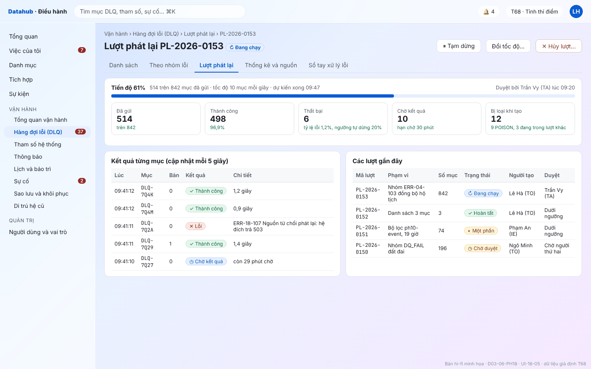

Ảnh cho thấy lượt 842 mục đã được TA duyệt, tiến độ và tỷ lệ lỗi 1,2% so với ngưỡng tự dừng 20%, số mục bị loại khi tạo; danh sách bên phải có một lượt "Chờ duyệt".

## 12. UI-18-06 Thống kê và nguồn DLQ

::: dac-ta
**Mục đích.** Cho người vận hành, quản trị và người xem thấy xu hướng bản tin lỗi theo thời gian, nguồn, lớp lỗi, ngưỡng đã vượt; quản lý nguồn DLQ và cổng phát lại; xem đối soát chỉ mục với Kafka và tình trạng lưu giữ.

**Đường dẫn, mẫu.** `/van-hanh/dlq/thong-ke` (tab Thống kê) và `?tab=nguon`; PTN-06 Dashboard.

**Vai trò, quyền.** TO, TA, PO, VW ● xem thống kê (`PERM-18-read`); tab Nguồn: xem với `PERM-18-dlq`, sửa với `PERM-18-admin` (PA); chạy đối soát: `PERM-18-dlq`.

**FR.** 012, 018, 033, 034.

**API.** API-18-081 (thống kê theo `khoang`), API-18-031, 032, 033 (nguồn), API-18-037, 038 (đối soát), API-18-080 (lưu giữ), API-18-004 (ngưỡng `18.dlq.threshold.*`).

**Dữ liệu nhạy cảm.** Chỉ số tổng hợp; tab Nguồn hiện URL cổng nội bộ chỉ cho PA.

**Đợt.** MVP; đầy đủ, ảnh `ui-18-06.png`.
:::

### 12.1. Bố cục và thành phần

Dải năm thẻ số; hai biểu đồ cạnh nhau (cột chồng theo ngày và lớp lỗi; thanh ngang theo nguồn); khối lưu giữ; bảng nguồn ở tab Nguồn hoặc phần dưới cho người có quyền.

```text
┌ Hàng đợi lỗi › Thống kê và nguồn                                    [24 giờ | 14 ngày | 90 ngày] ┐
│ [Chưa xử lý 1.284, vượt 1.000] [Cũ nhất 26 giờ] [POISON 6/giờ] [Phát lại thành công 94,8%] [Đối soát 0 thiếu] │
│ ┌ Mục mới theo ngày và lớp lỗi (cột chồng) ─┐ ┌ Chưa xử lý theo nguồn (thanh ngang) ─────────┐ │
│ │ ▂▃▂▄▅▃▂▄▅▇█▆▅█   [Xem dạng bảng]          │ │ ph04-runtime ███████████ 1.012                 │ │
│ └────────────────────────────────────────────┘ │ Lưu giữ: 312 mục hết hạn trong 7 ngày · 1,8 GB │ │
│ ┌ Nguồn DLQ đã đăng ký              [+ Nguồn] [Chạy đối soát ngay] ─────────────────────────────┐ │
│ │ Mã nguồn │ Phân hệ │ Cổng phát lại │ Tốc độ tối đa │ Trạng thái │ Mục chưa xử lý               │ │
│ └──────────────────────────────────────────────────────────────────────────────────────────────┘ │
└───────────────────────────────────────────────────────────────────────────────────────────────────┘
```

: Wireframe UI-18-06

| # | Thành phần | `CMP-*` | Nội dung | Nguồn |
|---|---|---|---|---|
| 1 | Chọn khoảng | `CMP-SegmentedControl` | 24 giờ, 14 ngày, 90 ngày; giữ ở `?khoang=` | |
| 2 | Thẻ số | `CMP-KpiCard` ×5 | Chưa xử lý so `18.dlq.threshold.depth`; tuổi cũ nhất so `18.dlq.threshold.age-hours`; `POISON` mỗi giờ so `18.dlq.threshold.poison-per-hour`; tỷ lệ phát lại thành công; kết quả đối soát gần nhất. Bấm thẻ đi tới UI-18-01 với bộ lọc tương ứng | API-18-081, 037 |
| 3 | Biểu đồ | `CMP-Chart` ×2 | Cột chồng theo ngày và lớp lỗi; thanh ngang theo nguồn; nút "Xem dạng bảng" | API-18-081 |
| 4 | Lưu giữ | `CMP-DescriptionList` | Số mục sắp hết hạn, dung lượng Garage của DLQ, lần dọn gần nhất | API-18-080 |
| 5 | Bảng nguồn | `CMP-DataTable`, `CMP-Drawer` | Cột ở mục 12.2; bấm dòng mở Drawer sửa (PA) | API-18-031, 033 |
| 6 | Đối soát | `CMP-Button`, `CMP-Alert` | "Chạy đối soát ngay"; kết quả theo phân vùng | API-18-038, 037 |

: UI-18-06, thành phần

### 12.2. Trường của nguồn, hành động

Tab Nguồn cho xem và sửa cấu hình nguồn DLQ với các trường dưới đây.

| Nhãn | Kiểu | Bắt buộc | Ràng buộc (FR-18-012), mã lỗi |
|---|---|---|---|
| Mã nguồn | `CMP-Input` | Có | `^[a-z0-9-]{3,40}$`; trùng: ERR-18-002 |
| Phân hệ | `CMP-Select` | Có | `PH-01` đến `PH-20` |
| Cổng phát lại | `CMP-RadioCard` | Có | `KAFKA_TOPIC`, `HTTP_PORT`, `EVENT_LAYER` (chỉ PH-10), `NONE`; sai: ERR-18-003 |
| Đích phát lại | `CMP-Input` | Khi khác `NONE` | Topic `{tenant}.ops.replay.requested.v1` hoặc URL nội bộ cụm |
| Tốc độ tối đa mỗi giây | `CMP-NumberInput` | Có | 1 đến 100 |
| Nhận nội dung sửa | `CMP-Switch` | Có | `supportsRevision` |
| Nhóm xử lý mặc định | `CMP-Select` nhiều | Không | |
| Trạng thái | `CMP-Switch` "Tạm ngừng ghi DLQ" | | Tạm ngừng: mục vẫn nhận nhưng không phát lại được (ERR-18-033); `CMP-ConfirmDialog` nêu số mục chưa xử lý của nguồn |

: UI-18-06, trường nguồn DLQ

Đối soát đang chạy mà bấm lại: ERR-18-006 "Đối soát đang chạy. Chờ lần hiện tại xong.". Nguồn tự đăng ký (qua API nội bộ) hiện nhãn "Tự đăng ký" và PA chỉ sửa được tốc độ, trạng thái.

### 12.3. Trạng thái, truy cập

Mục này nêu trạng thái hiển thị của màn thống kê và yêu cầu truy cập cho biểu đồ.

| Trạng thái | Hiển thị |
|---|---|
| Đang tải (ST-01) | Skeleton thẻ và hai khung biểu đồ |
| Rỗng (ST-03) | Biểu đồ "Không có mục mới trong khoảng đã chọn." |
| Ngưỡng vượt | Thẻ đổi sắc thái `warning` kèm chữ "đã vượt"; không dùng màu đơn thuần |
| VW (ST-15) | Chỉ thẻ số và biểu đồ; không bảng nguồn, thẻ không bấm được |
| Lỗi một khối | ST-05 tại khối đó |

: UI-18-06, trạng thái

Truy cập: mỗi biểu đồ có tiêu đề, mô tả ngắn (`aria-describedby`) và bảng thay thế; màu chuỗi theo bảng màu phân loại của D03-05-02 kèm chú giải chữ; thẻ số là liên kết có nhãn đầy đủ.

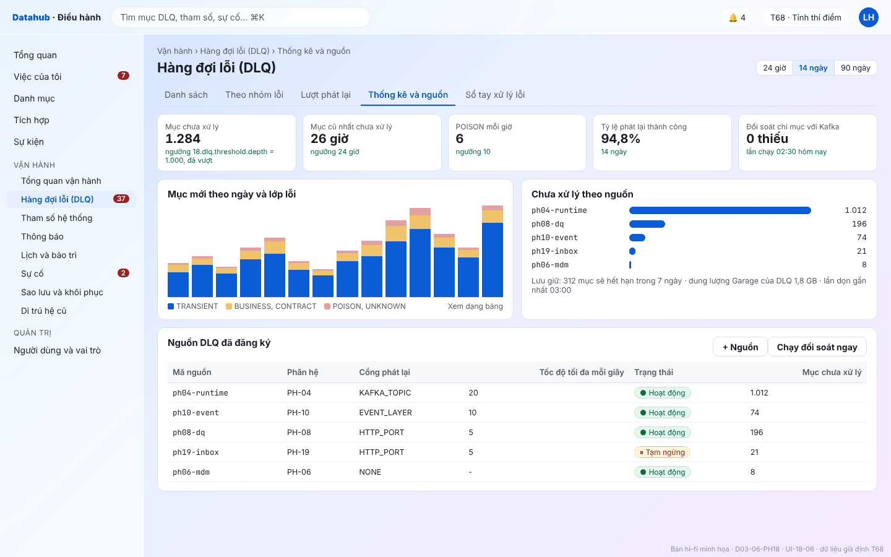

Ảnh cho thấy thẻ "Mục chưa xử lý" báo đã vượt ngưỡng 1.000, hai biểu đồ có chú giải chữ và liên kết "Xem dạng bảng", bảng nguồn có một nguồn đang tạm ngừng.

## 13. UI-18-07 Sổ tay xử lý lỗi

::: dac-ta
**Mục đích.** Cho người vận hành tra cách xử lý theo mã lỗi và cho người quản trị soạn hướng dẫn; sổ tay cũng là nguồn tri thức cho trợ lý PH-17.

**Đường dẫn, mẫu.** `/van-hanh/dlq/so-tay`, `?ma={errCode}` mở Drawer; PTN-01 kèm Drawer soạn (PTN-04).

**Vai trò, quyền.** Mọi người có `PERM-18-read` xem; PA ● soạn phần dùng chung (`PERM-18-admin`); TA ○ thêm ghi chú riêng của tỉnh; kỹ sư phân hệ chủ mã lỗi đề nghị nội dung qua PA (FRS §10.1 bản 0.2 ghi TO, IE, PA).

**FR.** 025.

**API.** API-18-057 (danh sách, tìm), API-18-058 (một mã), API-18-059 (soạn, sửa với `If-Match`, phát EVT-18-11).

**Dữ liệu nhạy cảm.** Nội dung bị lọc: không thẻ HTML, không liên kết ngoài danh sách cho phép, không mẫu số định danh hay địa chỉ thư.

**Đợt.** MVP; đầy đủ, ảnh `ui-18-07.png`.
:::

### 13.1. Bố cục, cột, trường

Bảng toàn chiều rộng; bấm dòng mở Drawer 420px bên phải xem hoặc soạn hướng dẫn.

```text
┌ Hàng đợi lỗi › Sổ tay xử lý lỗi ─────────────────────────────┐┌ Drawer: Hướng dẫn ERR-04-103 ─────┐
│ 🔍 Mã lỗi hoặc tiêu đề [Phân hệ ▾] [Lớp lỗi ▾] [Phát lại ▾]  ││ Dùng chung · v4 · chủ PH-04        │
│ Mã lỗi │ Tiêu đề │ Phân hệ │ Lớp mặc định │ Phát lại │ Phiên bản││ Tiêu đề * · Nguyên nhân            │
│ ERR-04-103 │ Hệ đích quá thời gian chờ │ PH-04 │ Tạm thời │ Có ││ Các bước (Markdown giới hạn)       │
│ …                                                             ││ Phát lại được [Có|Sau khi sửa|Không]│
│                                                               ││ Ghi chú riêng của tỉnh T68         │
│                                                               ││              [Hủy] [Lưu hướng dẫn] │
└───────────────────────────────────────────────────────────────┘└────────────────────────────────────┘
```

: Wireframe UI-18-07

| Nhãn | Kiểu | Bắt buộc | Ràng buộc, mã lỗi |
|---|---|---|---|
| Mã lỗi | `CMP-Input` (khi tạo) | Có | `^ERR-\d{2}-\d{3}$`; sai: ERR-18-003 |
| Tiêu đề | `CMP-Input` | Có | ≤ 200 ký tự |
| Nguyên nhân | `CMP-TextArea` | Không | Danh sách, mỗi dòng một nguyên nhân |
| Các bước xử lý | `CMP-CodeEditor` chế độ Markdown giới hạn | Có | Không thẻ HTML, liên kết chỉ trong danh sách cho phép, không mẫu số định danh hay địa chỉ thư: ERR-18-003 "Dữ liệu không hợp lệ: {chi tiết}." |
| Phát lại được | `CMP-SegmentedControl` | Có | `YES`, `AFTER_FIX`, `NO` |
| Lớp lỗi mặc định | `CMP-Select` | Có | Năm lớp lỗi |
| Liên kết | `CMP-KeyValueEditor` | Không | Tên và đường dẫn nội bộ |
| Ghi chú riêng của tỉnh | `CMP-TextArea` | Không | Lớp phủ theo tenant, TA soạn |

: UI-18-07, trường hướng dẫn

Cột bảng: mã lỗi, tiêu đề, phân hệ, lớp mặc định, phát lại được (`CMP-Tag` Có, Sau khi sửa, Không), phiên bản và ngày. Hành động: "Lưu hướng dẫn" (`If-Match`, lệch: ERR-18-004), "Xem các mục DLQ có mã này" mở UI-18-01 lọc `ma-loi`. Trạng thái: rỗng "Chưa có hướng dẫn nào. Hướng dẫn được nạp ban đầu từ danh mục mã lỗi của các phân hệ."; người chỉ xem thấy Drawer dạng mô tả (ST-15). Truy cập: Drawer là `dialog` có tiêu đề, focus vào trường đầu, `Esc` đóng có hỏi khi đã sửa.

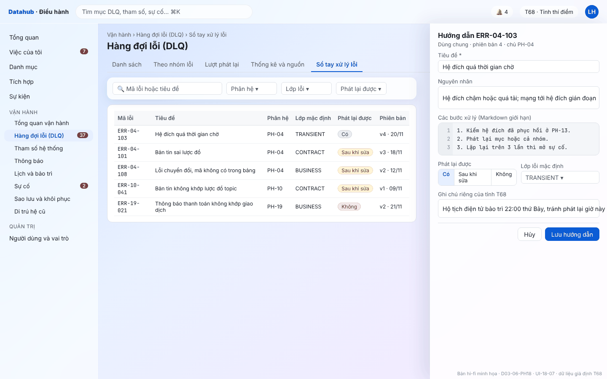

Ảnh cho thấy bảng sổ tay ở nền đặc và Drawer kính bên phải đang soạn hướng dẫn ERR-04-103: các bước dạng Markdown giới hạn, lựa chọn "Phát lại được", ghi chú riêng của tỉnh T68.

## 14. UI-18-08 Tham số

::: dac-ta
**Mục đích.** Một màn tham số chung cho mọi phân hệ: xem giá trị hiệu lực của tenant theo không gian tên và nhóm, sửa có kiểm miền, trần, lý do; tham số ★ thành đề nghị bốn mắt; xuất nhập gói tham số giữa môi trường. Thay màn cấu hình hệ thống của LGC-BUS-031.

**Đường dẫn, mẫu.** `/van-hanh/tham-so`, `?ns=`, `?nhom=`, `?tab=goi`; PTN-12 Cài đặt. Phân hệ khác nhúng thành phần này với `ns`, `nhom` cố định (FR-18-007).

**Vai trò, quyền.** TA ● sửa giá trị tenant (`PERM-18-config`); PA ● đặt trần, sửa khóa `PLATFORM`, tham số `18.*` và gói tham số (`PERM-18-config` cấp nền tảng, `PERM-18-admin`); mọi người có `PERM-18-read` xem.

**FR.** 001, 002, 003, 004, 006, 007, 008, 011, 069.

**API.** API-18-001 (không gian tên), API-18-002, 003 (lược đồ), API-18-004, 005 (giá trị, `ETag`), API-18-007 (kiểm không ghi), API-18-006 (ghi), API-18-008 (đề nghị đang chờ), API-18-016 (nhật ký đổi), API-18-017, 018, 019 (gói tham số).

**Dữ liệu nhạy cảm.** Khóa ★ hiện giá trị cho người có quyền đọc; sự kiện đổi không mang giá trị ★. Không có khóa chứa bí mật (bí mật ở OpenBao).

**Đợt.** MVP; đầy đủ, ảnh `ui-18-08.png`.
:::

### 14.1. Bố cục và thành phần

PTN-12: cột trái mục lục không gian tên (3/12), cột phải nhóm tham số (9/12). Thanh lưu nổi đáy vùng nội dung khi có thay đổi chưa lưu.

```text
┌ Tham số hệ thống                                          [Lịch sử đổi của tỉnh] [Gói tham số…]┐
│ [Tham số] | Cờ tính năng | Egress | Gói tham số                                               │
│ ┌ Không gian tên ┐ ┌ 🔍 Tìm theo khóa hoặc nhãn [Nhóm: Hàng đợi lỗi ▾] (○ Chỉ khóa khác mặc định)┐ │
│ │ onboarding. PH-01│ ┌ Khóa │ Nhãn │ Giá trị │ Mặc định │ Miền │ Mức │ Phiên bản ────────────────┐ │
│ │ 02. PH-02       │ │ 18.dlq.threshold.age-hours │ … │ [12] │ 24 │ 1…720 │ TENANT │ v3          │ │
│ │ …               │ │ 18.dlq.replay.batch-max    │ … │ [60000]✕ │ 10000 │ 100…50000 │ …        │ │
│ │ ● 18. PH-18     │ │ 18.dlq.replay.approval-threshold ★ │ [300] │ 500 │ …                    │ │
│ └─────────────────┘ │ 18.dlq.payload.inline-max-kb │ 256 │ PLATFORM 🔒                          │ │
│                     └───────────────────────────────────────────────────────────────────────────┘ │
│ ┌ 3 thay đổi chưa lưu · 1 lỗi · 1 khóa ★ sẽ thành đề nghị  Lý do […] [Bỏ thay đổi] [Lưu và gửi]┐ │
└───────────────────────────────────────────────────────────────────────────────────────────────────┘
```

: Wireframe UI-18-08

| # | Thành phần | `CMP-*` | Nội dung | Nguồn |
|---|---|---|---|---|
| 1 | Dải tab | `CMP-Tabs` | Tham số, Cờ tính năng (UI-18-10), Egress (UI-18-10), Gói tham số (PA) | |
| 2 | Mục lục không gian tên | `CMP-Tree` | Không gian tên kèm phân hệ chủ, số khóa, số khóa đã khác mặc định; ẩn khi nhúng | API-18-001 |
| 3 | Thanh lọc | `CMP-FilterBar`, `CMP-Switch` | Tìm không dấu theo khóa, nhãn; nhóm hiển thị; "Chỉ khóa đã khác mặc định" | API-18-002 |
| 4 | Bảng tham số | `CMP-EditableTable` | Sửa tại chỗ theo kiểu của lược đồ; mục 14.2 | API-18-002, 004 |
| 5 | Dòng phụ dưới khóa | `CMP-Text` | Mô tả, người đổi gần nhất, thời điểm, nguồn giá trị (Mặc định, Mặc định khi khởi tạo, Tỉnh đặt, Trần nền tảng), đề nghị đang chờ | API-18-004, 008 |
| 6 | Thanh lưu | `CMP-SaveIndicator`, `CMP-Input`, `CMP-Button` | Số thay đổi, số lỗi, số khóa ★; lý do chung; "Bỏ thay đổi", "Lưu" hoặc "Lưu và gửi đề nghị" | API-18-007, 006 |
| 7 | Tab Gói tham số | `CMP-Wizard` ba bước | Xuất (chọn không gian tên, gồm mặc định); Nạp tệp và so khớp (`CMP-DiffTable`: thêm, đổi, giữ, lỗi theo khóa); Áp (khóa ★ gom thành một đề nghị) | API-18-017, 018, 019 |

: UI-18-08, thành phần

### 14.2. Cột, trường, quy tắc sửa

Mục này nêu cột của bảng tham số, trường của Drawer sửa và quy tắc ghi giá trị.

| Cột | Kiểu | Nguồn | Quy tắc |
|---|---|---|---|
| Khóa | Đơn cách, ★ khi bảo mật | `key`, `sensitive` | Liên kết "Lịch sử" mở UI-18-09 |
| Nhãn | Chữ | `label` | Mô tả đầy đủ ở tooltip |
| Giá trị | Ô sửa theo kiểu: `CMP-NumberInput` (INT, DECIMAL), `CMP-Switch` (BOOL), `CMP-Select` (ENUM), `CMP-Input` (STRING), `CMP-CronPicker` (CRON), `CMP-Select` nhiều (LIST) | `value` | Kiểm tức thời bằng API-18-007; lỗi dưới ô |
| Mặc định | Chữ | `default` | Nút "Về mặc định" trong menu dòng |
| Miền | Chữ | `domain` | |
| Mức | `CMP-Tag` | `level` | `PLATFORM` có 🔒 và ô chỉ đọc với TA |
| Phiên bản | Chữ | `version` | |

: UI-18-08, cột bảng tham số

| Lỗi | Câu hiển thị |
|---|---|
| ERR-18-012 | "Giá trị của {khóa} phải có kiểu {kiểu}." |
| ERR-18-013 | "Giá trị {giá trị} nằm ngoài miền cho phép của {trường}: {miền}." ({trường} là khóa tham số) |
| ERR-18-014 | "Giá trị vượt giới hạn nền tảng của {khóa} ({trần}). Liên hệ quản trị nền tảng nếu cần nâng." |
| ERR-18-015 | "Tham số {khóa} do quản trị nền tảng đặt, tỉnh chỉ xem được." |
| ERR-18-011 | "Khóa {khóa} chưa được đăng ký." |
| ERR-18-007 | Lý do dưới `18.param.reason-min-length` (mặc định 10) ký tự |
| ERR-18-004 | "Tham số đã được người khác sửa. Tải lại để xem giá trị mới trước khi lưu." |
| ERR-18-018 | "Tham số {khóa} đang có đề nghị chờ duyệt của {người}. Chờ duyệt xong hoặc rút đề nghị." |
| ERR-18-019 | "Tham số {khóa} được duyệt tại {phân hệ}. Mở màn {phân hệ} để đề nghị thay đổi." kèm liên kết |
| ERR-18-020 | Gói: "Gói tham số không hợp lệ hoặc đã bị sửa: {chi tiết}." |
| ERR-18-071 | Chế độ chỉ đọc (ST-18-A) |

: UI-18-08, thông báo theo mã lỗi

Quy tắc: "Lưu" bị vô hiệu khi còn lỗi; khóa ★ khi lưu tạo đề nghị chờ duyệt, nút đổi nhãn "Lưu và gửi đề nghị" và dòng phụ "Cần người thứ hai duyệt."; khóa có `approvalOwner` khác PH-18 (PH-14, PH-17) hiện ô chỉ đọc kèm liên kết sang màn của phân hệ đó. Một lần lưu gọi API-18-006 cho từng khóa; kết quả theo khóa hiện trong `CMP-Toast` "Đã lưu {a} tham số. {b} tham số thành đề nghị chờ duyệt."

### 14.3. Trạng thái, phím tắt, truy cập

Mục này nêu trạng thái của màn tham số, phím tắt và yêu cầu truy cập.

| Trạng thái | Hiển thị |
|---|---|
| Đang tải (ST-01) | Skeleton mục lục và 8 dòng |
| Không gian tên chưa có khóa (ST-03) | "Phân hệ {ph} chưa đăng ký tham số nào." |
| Không có kết quả (ST-04) | "Không có tham số khớp {từ khóa}." |
| Chỉ đọc (ST-15) | Mọi ô dạng chữ; thanh lưu không hiện |
| Nhúng ở phân hệ khác | Ẩn mục lục và thanh lọc; tiêu đề nhóm theo phân hệ chủ |
| Chỉ đọc hệ thống (ST-18-A) | Dải cảnh báo; ô sửa vô hiệu |
| Rời trang khi chưa lưu | Hộp "Bạn có thay đổi chưa lưu" (D03-06-00 §4.3) |

: UI-18-08, trạng thái

Phím tắt: `/` tìm; `Ctrl+S` mở thanh lưu và focus ô lý do; `Esc` hủy sửa ô đang mở. Truy cập: bảng sửa tại chỗ theo mẫu lưới (`role="grid"`), `Enter` vào sửa, `Esc` thoát; lỗi ô có `aria-invalid` và `aria-describedby`; ★ có nhãn "Tham số bảo mật"; 🔒 có nhãn "Do quản trị nền tảng đặt".

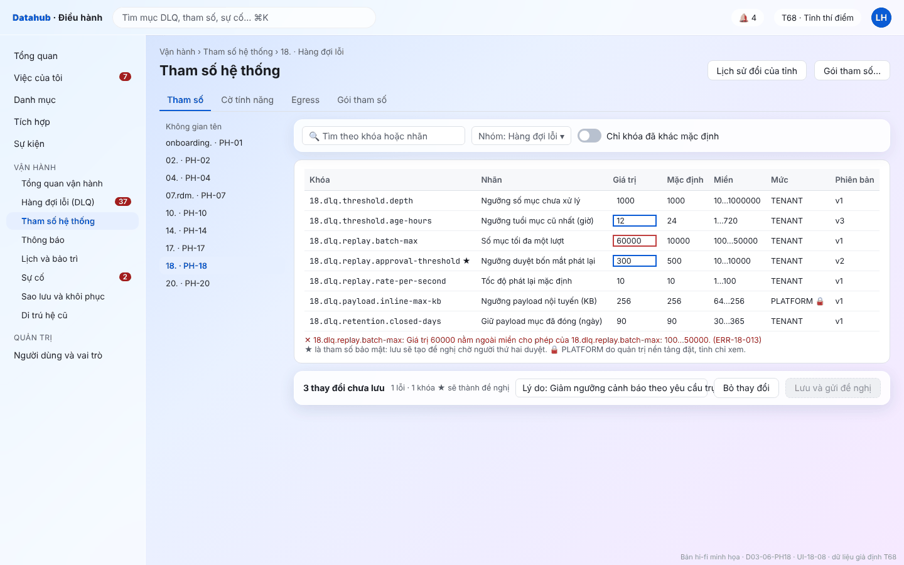

Ảnh cho thấy hai ô đang sửa (viền xanh), một ô lỗi miền (viền đỏ kèm câu ERR-18-013 bằng chữ), khóa ★ sẽ thành đề nghị, khóa `PLATFORM` có khóa; thanh lưu nổi với lý do chung và nút "Lưu và gửi đề nghị" vô hiệu vì còn lỗi.

## 15. UI-18-09 Lịch sử và đề nghị đổi tham số

::: dac-ta
**Mục đích.** Cho người quản trị xem lịch sử phiên bản của một khóa, so sánh hai phiên bản hoặc với mặc định, khôi phục phiên bản cũ, và cho người duyệt duyệt hoặc từ chối đề nghị đổi tham số ★.

**Đường dẫn, mẫu.** `/van-hanh/tham-so/{khoa}/lich-su`; PTN-02 Chi tiết.

**Vai trò, quyền.** TA ● (`PERM-18-config`), SO, PA ● duyệt (`PERM-18-approve`); người có `PERM-18-read` xem.

**FR.** 004, 005.

**API.** API-18-003 (lược đồ khóa), API-18-013 (phiên bản), API-18-014 (so sánh), API-18-015 (khôi phục), API-18-009, 010, 011, 012 (đề nghị, duyệt, từ chối, rút).

**Dữ liệu nhạy cảm.** Không.

**Đợt.** MVP; đầy đủ, ảnh `ui-18-09.png`.
:::

### 15.1. Bố cục, cột, hành động

Đầu trang: khóa, ★, dòng mô tả lược đồ (kiểu, miền, mặc định, mức, nơi duyệt). Trái 8/12: bảng phiên bản và khối so sánh. Phải 4/12: khung đề nghị chờ duyệt.

```text
┌ 18.dlq.replay.approval-threshold ★                                           [So với mặc định] ┐
│ Ngưỡng duyệt bốn mắt phát lại · INT · 10…10000 · mặc định 500 · TENANT · duyệt tại PH-18         │
│ ┌ Phiên bản ─────────────────────────────────────────┐ ┌ Đề nghị chờ duyệt ─────────────────────┐ │
│ │ v3 ◷ Chờ duyệt │ 300 │ Nguyễn Thu │ 27/11 09:05 │ …  │ │ 500 → 300 · hết hạn sau 72 giờ          │ │
│ │ v2 ● Đang dùng │ 500 │ …                          │ │ Ý kiến […]                              │ │
│ │ [So sánh v1 và v2] [Khôi phục phiên bản v1…]       │ │ [Duyệt] (vô hiệu) [Từ chối…]            │ │
│ ├ So sánh v2 và v3 ─────────────────────────────────┤ │ Bạn là người đề nghị… [Rút đề nghị]     │ │
│ │ Giá trị 500 → 300                                  │ └─────────────────────────────────────────┘ │
└───────────────────────────────────────────────────────────────────────────────────────────────────┘
```

: Wireframe UI-18-09

| Cột bảng phiên bản | Nguồn API-18-013 | Ghi chú |
|---|---|---|
| Phiên bản | `versionNo` | Chọn hai dòng bằng ô chọn để so sánh |
| Trạng thái | `status` | ◷ Chờ duyệt, ● Đang dùng, Đã thay, Bị từ chối; v0 là "Mặc định" |
| Giá trị | `value` | |
| Người đổi, lúc | `changedBy`, `changedAt` | Người duyệt ở tooltip |
| Lý do | `reason` | |

: UI-18-09, cột bảng phiên bản

Hành động: "So sánh" (API-18-014, khác biệt theo kiểu: số cũ và mới; danh sách thêm, bớt; JSON theo đường dẫn), "So với mặc định", "Khôi phục phiên bản v{n}…" (`CMP-ReasonDialog`; giá trị cũ không còn hợp lệ: ERR-18-023 "Phiên bản {số} không còn hợp lệ với lược đồ hiện hành của {khóa}: {lý do}."; khóa ★ thành đề nghị). Khung đề nghị: Duyệt (ghi kiểm toán trước khi đổi, PH-13 vắng: ERR-18-008), Từ chối (ý kiến ≥ 10 ký tự), Rút (chỉ người đề nghị). Người đề nghị thấy nút Duyệt vô hiệu kèm câu "Bạn là người đề nghị nên không được duyệt đề nghị này." (ERR-18-005). Đề nghị quá `18.param.change-request-ttl-hours` (72 giờ) hiện "Đã hết hiệu lực".

Trạng thái: không tìm thấy phiên bản: ERR-18-001 "Không tìm thấy phiên bản {số} của {khóa}."; chưa có đề nghị: khung phải hiện "Không có đề nghị chờ duyệt."; khóa có `approvalOwner` khác: khung phải hiện liên kết sang phân hệ duyệt. Truy cập: khối so sánh đọc "Giá trị: trước 500, sau 300"; dùng `<del>`, `<ins>` kèm chữ "trước", "sau" ẩn.

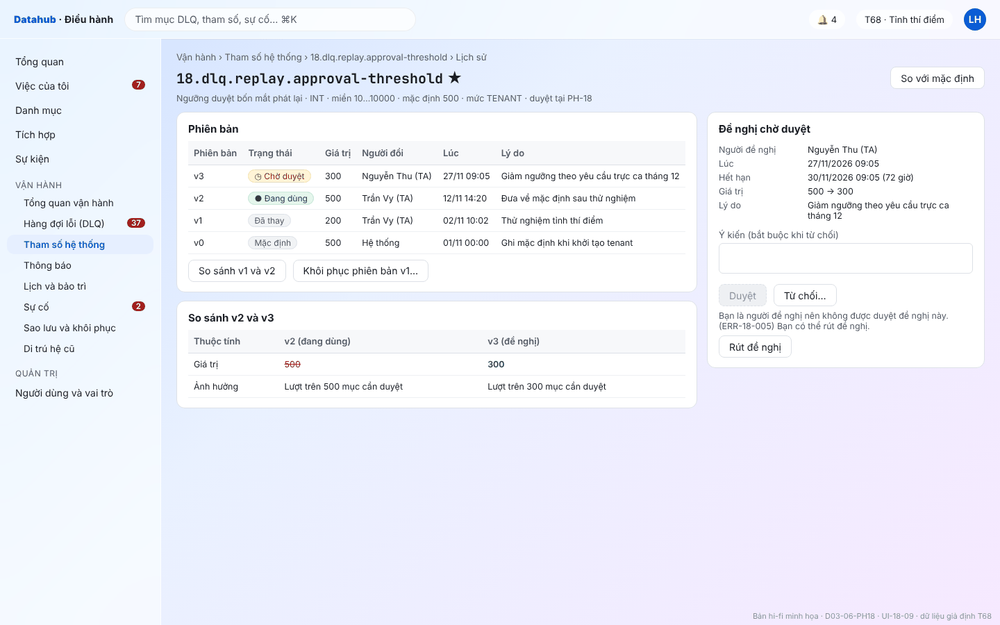

Ảnh cho thấy phiên bản v3 chờ duyệt, so sánh v2 và v3, khung đề nghị với nút "Duyệt" vô hiệu vì người xem là người đề nghị, câu lý do bằng chữ và nút "Rút đề nghị".

## 16. UI-18-10 Cờ tính năng và egress

::: dac-ta
**Mục đích.** Cho quản trị bật tắt cờ tính năng theo tenant (có chủ sở hữu, ngày gỡ) và quản lý danh sách tên miền ngoài được phép gọi ra (egress) của tenant.

**Đường dẫn, mẫu.** `/van-hanh/tham-so?tab=co-tinh-nang` và `?tab=egress`; PTN-01 Danh sách, Drawer tạo (PTN-04).

**Vai trò, quyền.** TA ● bật tắt cờ, thêm gỡ egress (`PERM-18-config`); PA ● khai báo, gỡ cờ, bật tắt cờ mức `PLATFORM` (`PERM-18-admin`); người có `PERM-18-read` xem.

**FR.** 009, 010.

**API.** API-18-020, 021, 022, 023 (cờ), API-18-024, 025, 026 (egress).

**Dữ liệu nhạy cảm.** Không.

**Đợt.** MVP (FR-18-010 đợt 2); đầy đủ, ảnh `ui-18-10.png`.
:::

### 16.1. Bố cục, cột, trường

Hai tab cùng khung: dải cảnh báo cờ sắp đến hạn gỡ, bảng cờ; tab Egress là bảng đích kèm số mục trên tối đa `18.egress.max-entries`.

```text
┌ Tham số hệ thống › Cờ tính năng                                              [+ Cờ tính năng] ┐
│ Tham số | [Cờ tính năng] | Egress | Gói tham số                                               │
│ ⚠ 2 cờ sắp đến hoặc đã quá ngày gỡ. Hệ thống đã tạo việc cho chủ sở hữu; cờ không tự tắt.    │
│ Khóa cờ │ Mô tả │ Chủ sở hữu │ Ngày gỡ dự kiến │ Mức │ Giá trị cho T68 (công tắc)             │
│ ff.dlq.group-auto-assign │ … │ PH-18 · Lê Hà │ 06/12/2026 [còn 9 ngày] │ TENANT │ ○ Tắt         │
└───────────────────────────────────────────────────────────────────────────────────────────────┘
```

: Wireframe UI-18-10

| Trường cờ (Drawer "+ Cờ tính năng", PA) | Kiểu | Ràng buộc, mã lỗi |
|---|---|---|
| Khóa cờ | `CMP-Input` | `^ff\.[a-z0-9-]+\.[a-z0-9-]+$`; trùng: ERR-18-002 "Mã {mã} đã được dùng. Chọn mã khác." |
| Mô tả | `CMP-TextArea` | 10 đến 500 ký tự |
| Phân hệ chủ, người chịu trách nhiệm | `CMP-Select`, `CMP-ResourceSelect` | Bắt buộc |
| Ngày gỡ dự kiến | `CMP-DatePicker` | ≤ 365 ngày; thiếu hoặc quá: ERR-18-021 "Cờ tính năng cần chủ sở hữu và ngày gỡ dự kiến trong vòng 365 ngày." |
| Mức, giá trị mặc định | `CMP-RadioCard`, `CMP-Switch` | `PLATFORM`, `TENANT` |

: UI-18-10, trường cờ tính năng

| Trường egress (Drawer "+ Đích egress", TA) | Kiểu | Ràng buộc, mã lỗi |
|---|---|---|
| Tên miền | `CMP-Input` | FQDN hoặc `*.` một cấp, không IP, không dải nội bộ: ERR-18-022 "Đích {đích} không được phép: chỉ chấp nhận tên miền công khai qua HTTPS." |
| Cổng | `CMP-NumberInput` | Mặc định 443 |
| Mục đích | `CMP-Select` | `DEV_PORTAL_BACKEND`, `GIT_REPO`, `WEBHOOK`, `MODEL_PROVIDER`, `OTHER` |
| Phân hệ dùng | `CMP-Select` | Bắt buộc |
| Hạn dùng | `CMP-DatePicker` | ≤ 730 ngày, mặc định 365 |
| Lý do | `CMP-TextArea` | ≥ 10 ký tự; vượt số mục tối đa: ERR-18-013 |

: UI-18-10, trường egress

Hành động: bật tắt cờ (`CMP-ConfirmDialog` kèm lý do, `If-Match`, API-18-022), gỡ cờ (PA, API-18-023), thêm và gỡ đích egress (gỡ có lý do, API-18-026). Cột "Ngày gỡ dự kiến" gắn `CMP-Tag` "còn {n} ngày" khi ≤ `18.ff.retire-warning-days`, "quá hạn gỡ" khi đã qua. Cờ mức `PLATFORM` có 🔒 và công tắc chỉ đọc với TA. Đích hết hạn hiện "Hết hạn" và vẫn ở danh sách để TA gia hạn. Trạng thái: rỗng "Tỉnh chưa có đích egress nào. Phân hệ chỉ gọi ra được các đích trong danh sách này."; chỉ đọc (ST-15). Truy cập: công tắc có nhãn "Bật {khóa cờ} cho T68" và chữ "Bật", "Tắt" cạnh công tắc.

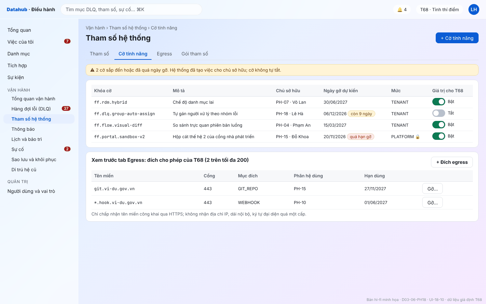

Ảnh cho thấy cảnh báo cờ sắp đến ngày gỡ, một cờ "còn 9 ngày", một cờ mức `PLATFORM` "quá hạn gỡ" có khóa; phía dưới là danh sách đích egress với số mục trên tối đa và quy tắc chấp nhận.

## 17. UI-18-11 Mẫu và quy tắc thông báo

::: dac-ta
**Mục đích.** Cho quản trị tỉnh quản lý mẫu thông báo (thư, SMS, trong ứng dụng) có phiên bản, quy tắc "sự kiện nào gửi mẫu nào cho ai", và danh sách chặn do thư trả lại.

**Đường dẫn, mẫu.** `/van-hanh/thong-bao` với `?tab=quy-tac`, `?tab=chan`; PTN-01 Danh sách, Drawer quy tắc (PTN-04).

**Vai trò, quyền.** TA ● (`PERM-18-template`); PA ● mẫu và quy tắc dùng chung `COMMON`; người có `PERM-18-read` xem.

**FR.** 035, 039.

**API.** API-18-082, 083 (mẫu), API-18-090 (ngừng mẫu), API-18-099, 100, 101 (quy tắc), API-18-104, 105 (danh sách chặn).

**Dữ liệu nhạy cảm.** Danh sách chặn chỉ hiện địa chỉ đã che và mã người; điều kiện quy tắc chỉ dùng trường mã, trạng thái.

**Đợt.** MVP; đầy đủ, ảnh `ui-18-11.png`.
:::

### 17.1. Bố cục, cột, trường

Ba tab cùng khung danh sách. Tab Mẫu: bảng mẫu; bấm dòng mở UI-18-12. Tab Quy tắc: bảng quy tắc, Drawer tạo, sửa. Tab Danh sách chặn: bảng địa chỉ đã che, loại trả lại, thời điểm, nút "Gỡ chặn…".

```text
┌ Thông báo                                                         [Nhật ký gửi] [+ Mẫu thông báo]┐
│ [Mẫu] | Quy tắc | Danh sách chặn                                                                 │
│ 🔍 Mã mẫu [Kênh ▾] [Phân hệ ▾] [Trạng thái ▾] [Gồm mẫu dùng chung ✕]                              │
│ Mã mẫu │ Kênh │ Phân hệ chủ │ Phiên bản dùng │ Trạng thái │ Phạm vi                              │
│ ph01.review-decided │ Thư │ PH-01 │ v3 │ ● Đang dùng │ Dùng chung                                  │
│ ┌ Quy tắc: Sự kiện │ Điều kiện │ Mẫu │ Người nhận │ Mức │ Hiệu lực ─────────────────────────────┐ │
└───────────────────────────────────────────────────────────────────────────────────────────────────┘
```

: Wireframe UI-18-11

| Cột bảng mẫu | Nguồn API-18-082 | Ghi chú |
|---|---|---|
| Mã mẫu | `templateCode` | Đơn cách, liên kết UI-18-12 |
| Kênh | `channel` | Thư, SMS, Trong ứng dụng |
| Phân hệ chủ | `ownerPh` | |
| Phiên bản dùng | `activeVersion` | Kèm "Nháp v{n}" khi có phiên bản nháp mới hơn |
| Trạng thái | `status` | Theo mục 5.1 |
| Phạm vi | `scope` | Dùng chung hoặc tỉnh; mẫu tỉnh ghi đè mẫu dùng chung cùng mã |

: UI-18-11, cột bảng mẫu

| Trường quy tắc (Drawer) | Kiểu | Ràng buộc, mã lỗi |
|---|---|---|
| Sự kiện | `CMP-TopicSelect` | Chỉ sự kiện PH-18 đã đăng ký tiêu thụ; khác: ERR-18-045 "Sự kiện {sự kiện} chưa được phân hệ vận hành tiêu thụ nên không tạo được quy tắc." |
| Điều kiện | `CMP-ExpressionField` (CEL rút gọn) | Chỉ trường mã, trạng thái của phong bì; sai: ERR-18-003 |
| Mẫu | `CMP-Select` | Mẫu có phiên bản `ACTIVE`; không có: ERR-18-041 "Mẫu {mã} chưa có phiên bản đang dùng." |
| Người nhận | `CMP-ResourceSelect` nhiều | Người, nhóm, vai trò, đầu mối HTTT, lịch trực |
| Mức | `CMP-SegmentedControl` | Thường, Cao, Khẩn (khẩn vượt giờ yên lặng) |
| Tạo việc | `CMP-Switch` kèm loại việc | Tạo việc trong Việc của tôi khi khớp |
| Hiệu lực | `CMP-Switch` | Tắt quy tắc dùng chung ghi lớp phủ của tỉnh |

: UI-18-11, trường quy tắc

Hành động: tạo mẫu (mở UI-18-12 trống), ngừng mẫu (`CMP-ConfirmDialog` nêu số quy tắc đang dùng mẫu sẽ bị tắt), tạo, sửa, bật tắt quy tắc (`If-Match`), gỡ chặn (`CMP-ReasonDialog`). Trạng thái: rỗng "Tỉnh chưa có mẫu riêng. Thông báo đang dùng mẫu dùng chung." kèm chip "Gồm mẫu dùng chung"; chỉ đọc cho người có `PERM-18-read`. Truy cập: công tắc hiệu lực có nhãn "Bật quy tắc {sự kiện}"; điều kiện đọc nguyên văn.

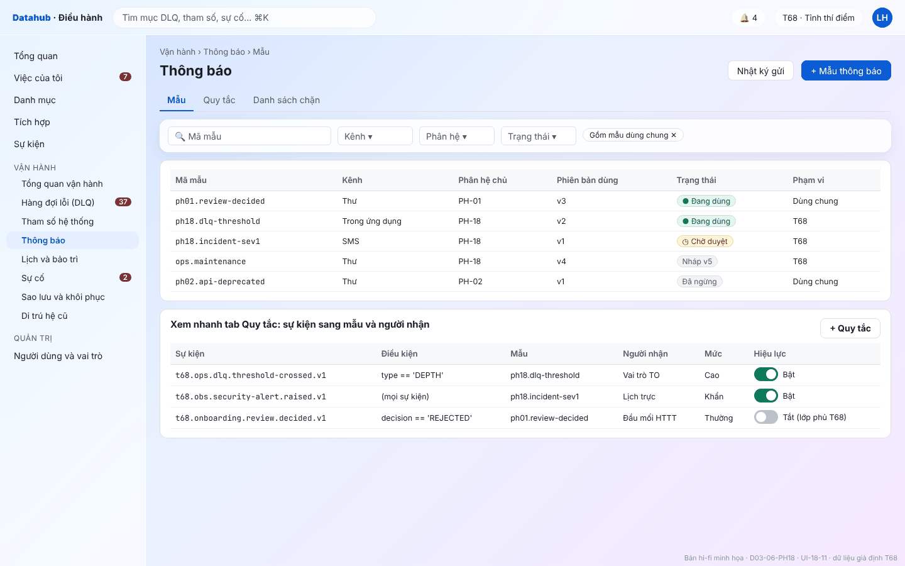

Ảnh cho thấy bảng mẫu với trạng thái "Đang dùng", "Chờ duyệt", "Nháp v5", "Đã ngừng"; khối quy tắc có một quy tắc dùng chung bị tỉnh tắt bằng lớp phủ.

## 18. UI-18-12 Soạn mẫu thông báo

::: dac-ta
**Mục đích.** Cho quản trị tỉnh soạn phiên bản mẫu bằng Mustache không logic, khai báo biến kèm mức phân loại, xem thử với dữ liệu mẫu, rồi gửi người thứ hai duyệt; hệ thống chặn mọi biến mức Hạn chế, Nhạy cảm (FR-00-062).

**Đường dẫn, mẫu.** `/van-hanh/thong-bao/mau/{ma}`, `?phien-ban=`; PTN-03 Biểu mẫu trang, hai khung soạn và xem thử.

**Vai trò, quyền.** TA ● soạn (`PERM-18-template`); TA, SO, PA ● duyệt (`PERM-18-approve`), khác người soạn.

**FR.** 035.

**API.** API-18-084 (mẫu, phiên bản), API-18-085 (tạo nháp), API-18-086 (xem thử, kiểm trường cấm), API-18-087 (gửi duyệt), API-18-088, 089 (duyệt, trả lại).

**Dữ liệu nhạy cảm.** Xem thử chỉ dùng dữ liệu mẫu khai ở biến, không dùng dữ liệu thật.

**Đợt.** MVP; đầy đủ, ảnh `ui-18-12.png`.
:::

### 18.1. Bố cục, trường

Trái 6/12: tiêu đề thư (với kênh Thư), thân mẫu (`CMP-CodeEditor` chế độ Mustache có tô cú pháp), bảng biến. Phải 6/12: khung xem thử (dùng tạm ChannelPreview, Phụ lục A), danh sách kiểm, chân biểu mẫu. Phiên bản cũ mở chế độ chỉ đọc kèm `CMP-VersionTimeline` ở đầu.

```text
┌ ph01.review-decided  Nháp v4 ─────────────────────────────────────────────────────────────────────┐
│ ┌ Nội dung phiên bản 4 · Thư · tiếng Việt ───┐ ┌ Xem thử với dữ liệu mẫu ─────────────────────────┐ │
│ │ Tiêu đề thư * [Hồ sơ {{systemCode}} đã…]   │ │ Từ: Datahub T68 · Tới: n***@t68.gov.vn           │ │
│ │ Thân thư *  1 Kính gửi…                     │ │ Hồ sơ kết nạp HTTT-0412 đã có kết quả…           │ │
│ │             4 Liên hệ {{contactPhone}} ~~~  │ │ [đã chặn: contactPhone]                          │ │
│ │ ✕ Mẫu dùng trường contactPhone mức …        │ │ ✓ Cú pháp ✓ Biến đã khai báo ✕ Trường cấm ✓ ≤200 │ │
│ │ Biến │ Mức phân loại │ Ví dụ                 │ │              [Lưu nháp] [Xem thử lại] [Gửi duyệt]│ │
│ └─────────────────────────────────────────────┘ └──────────────────────────────────────────────────┘ │
└───────────────────────────────────────────────────────────────────────────────────────────────────┘
```

: Wireframe UI-18-12

| Nhãn | Kiểu | Bắt buộc | Ràng buộc (FR-18-035), mã lỗi |
|---|---|---|---|
| Mã mẫu (khi tạo) | `CMP-Input` | Có | `^[a-z0-9.-]{3,80}$`; trùng: ERR-18-002 |
| Kênh, phân hệ chủ | `CMP-Select` | Có | Thư, SMS, Trong ứng dụng; không đổi sau khi tạo |
| Tiêu đề thư | `CMP-Input` | Có với Thư | ≤ 200 ký tự |
| Thân mẫu | `CMP-CodeEditor` | Có | Mustache không logic, ≤ 20.000 ký tự (SMS theo giới hạn kênh); lỗi cú pháp hoặc biến chưa khai báo: ERR-18-040 "Mẫu có lỗi tại dòng {dòng}: {chi tiết}." |
| Biến | `CMP-EditableTable` | Có | Tên, mức phân loại (`PUBLIC`, `INTERNAL`; `RESTRICTED`, `SENSITIVE` bị chặn), ví dụ; dùng biến cấm: ERR-18-039 "Mẫu dùng trường {biến} mức {mức}. Thư chỉ được chứa liên kết, không chứa dữ liệu mức Hạn chế hoặc Nhạy cảm." |
| Ngôn ngữ | Cố định `vi` | | |

: UI-18-12, trường nhập

Hành động: "Lưu nháp" (API-18-085), "Xem thử lại" (API-18-086, chạy kiểm trường cấm), "Gửi duyệt" (chỉ bật khi mọi kiểm đạt; `DRAFT` sang `IN_REVIEW`), "Duyệt", "Trả lại…" cho người duyệt (`CMP-ApprovalPanel`; người soạn: ERR-18-005), "Tạo phiên bản mới" từ phiên bản đang dùng. Duyệt thì phiên bản `ACTIVE`, phiên bản cũ cùng kênh `RETIRED`.

Trạng thái: chờ duyệt (khóa soạn, hiện khung duyệt); phiên bản đã dùng (chỉ đọc); kiểm trường cấm chưa chạy (nút gửi vô hiệu kèm "Chạy xem thử trước khi gửi duyệt"). Phím tắt: `Ctrl+S` lưu nháp, `Ctrl+Enter` xem thử. Truy cập: dòng lỗi trong trình soạn có gạch chân và biểu tượng ở rãnh số dòng, đồng thời liệt kê dưới khung; khung xem thử là `region` "Xem thử thư"; phần bị chặn trong xem thử hiện chữ "[đã chặn: {biến}]".

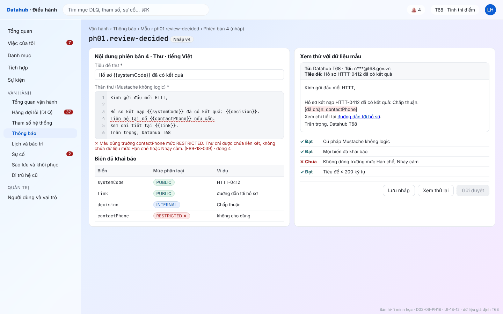

Ảnh cho thấy biến `contactPhone` mức RESTRICTED bị gạch lượn sóng ở dòng 4 và báo ERR-18-039 dưới khung; xem thử thay giá trị bằng "[đã chặn: contactPhone]"; danh sách kiểm có một mục "Chưa", nên nút "Gửi duyệt" vô hiệu.

## 19. UI-18-13 Nhật ký gửi thông báo

::: dac-ta
**Mục đích.** Cho quản trị, vận hành và kiểm toán tra thông báo đã gửi cho ai (đã che), qua kênh nào, kết quả, số lần thử; gửi lại thông báo lỗi hoặc bị trả lại sau khi đầu mối đã sửa.

**Đường dẫn, mẫu.** `/van-hanh/thong-bao/nhat-ky`; PTN-11 Tra log, Drawer chi tiết lần gửi.

**Vai trò, quyền.** TA, TO, AU ● xem (`PERM-18-read`); TA ● gửi lại, gỡ chặn (`PERM-18-template`).

**FR.** 036, 037, 040, 041.

**API.** API-18-102 (nhật ký), API-18-103 (gửi lại), API-18-104, 105 (danh sách chặn).

**Dữ liệu nhạy cảm.** Người nhận hiện tên người dùng nội bộ hoặc địa chỉ đã che; lọc theo mã người; nội dung đã dựng không lưu nên không xem được.

**Đợt.** MVP; đầy đủ, ảnh `ui-18-13.png`.
:::

### 19.1. Bố cục, cột

Thanh lọc, bốn thẻ số (đã gửi 24 giờ, bị trả lại, lỗi sau số lần thử tối đa, hoãn hoặc chặn), bảng; bấm dòng mở Drawer chi tiết.

```text
┌ Nhật ký gửi thông báo ────────────────────────────────────────┐┌ Drawer: Lần gửi thư bị trả lại ───┐
│ [Loại mẫu ▾] [Kênh ▾] [Trạng thái: Lỗi, Bị trả lại ✕] [Người nhận (mã) ▾] [27/11 đến nay]       ││ Trạng thái ↩ Bị trả lại cứng      │
│ [Đã gửi 3.412] [Bị trả lại 4] [Lỗi sau 5 lần 1] [Hoãn hoặc chặn 37]                              ││ Mã máy chủ thư 550 5.1.1 …        │
│ Lúc │ Mẫu │ Kênh │ Người nhận (đã che) │ Trạng thái │ Lần thử │ Nguồn                           ││ Lịch sử thử · Danh sách chặn       │
│ 27/11 09:21 │ ph01.review-decided │ Thư │ n***@t68.gov.vn │ ↩ Bị trả lại │ 1 │ PH-01            ││ [Gỡ khỏi danh sách chặn…] [Gửi lại]│
└───────────────────────────────────────────────────────────────┘└────────────────────────────────────┘
```

: Wireframe UI-18-13

| Cột | Nguồn API-18-102 | Ghi chú |
|---|---|---|
| Lúc | `createdAt` | `CMP-Timestamp` |
| Mẫu, phiên bản | `templateCode`, `templateVersion` | |
| Kênh | `channel` | |
| Người nhận (đã che) | `recipientDisplay` | Tên người nội bộ hoặc `n***@t68.gov.vn`, `09*****321` |
| Trạng thái | `status` | Theo mục 5.1; `SUPPRESSED` ghi rõ "Hoãn giờ yên lặng", "Kênh tắt" hoặc "Chặn" |
| Lần thử | `attempts` | Tối đa `18.notify.retry.max-attempts` |
| Nguồn | `callerPh` | Phân hệ gọi |

: UI-18-13, cột nhật ký gửi

Drawer chi tiết: trạng thái, mã phản hồi của máy chủ thư hoặc SMS gateway, nguồn và quy tắc, người nhận (tham chiếu, đã che), lịch sử thử (ERR-18-110, 111, 112, 113 kèm câu), dòng "Nội dung đã dựng không lưu; xem lại bằng Xem thử mẫu với dữ liệu mẫu." Hành động: "Gửi lại" (chỉ `FAILED`, `BOUNCED`; người nhận còn bị chặn: ERR-18-043 "Người nhận đang trong danh sách chặn."), "Gỡ khỏi danh sách chặn…" (lý do). Nhật ký giữ `18.notify.log-retention-days` (180 ngày); lọc trước mốc đó hiện "Nhật ký trước {ngày} đã xóa theo thời hạn lưu giữ." Trạng thái rỗng: "Chưa có thông báo nào khớp bộ lọc." Truy cập: như UI-18-01; Drawer có tiêu đề và trả focus về dòng khi đóng.

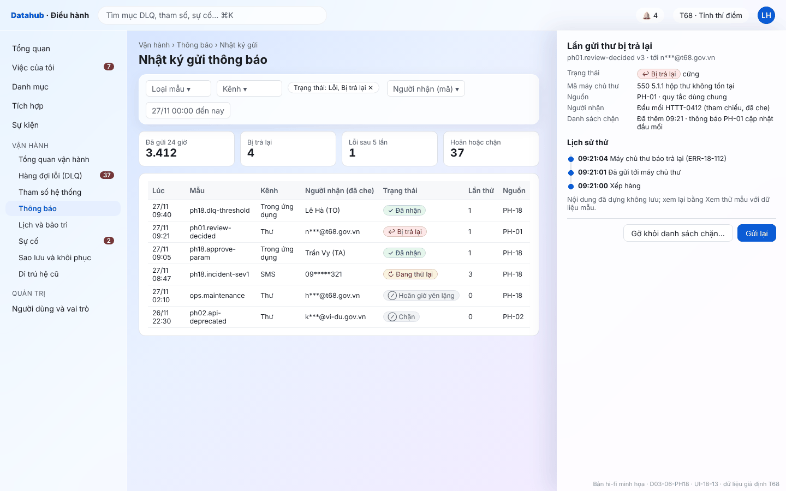

Ảnh cho thấy người nhận luôn hiện đã che, trạng thái "Bị trả lại", "Đang thử lại", "Hoãn giờ yên lặng", "Chặn" bằng chữ; Drawer kính nêu mã máy chủ thư, lịch sử thử và hai nút "Gỡ khỏi danh sách chặn…", "Gửi lại".

## 20. UI-18-14 Tùy chọn nhận thông báo

::: dac-ta
**Mục đích.** Cho mọi người dùng xem hộp thông báo trong ứng dụng và chọn nhận nhóm thông báo nào qua kênh nào, đặt giờ yên lặng; nhóm bắt buộc không tắt được.

**Đường dẫn, mẫu.** `/ca-nhan/thong-bao` (tab "Thông báo" là danh sách, PTN-01) và `?tab=tuy-chon` (PTN-12); vào từ menu tài khoản và nút "Xem tất cả" của trung tâm thông báo.

**Vai trò, quyền.** Mọi người dùng đã đăng nhập.

**FR.** 036, 038.

**API.** API-18-097, 098 (hộp thông báo, đánh dấu đã đọc), API-18-095, 096 (tùy chọn, `If-Match`), API-18-004 (`18.notify.quiet-hours`, `18.notify.sms.enabled` của tenant).

**Dữ liệu nhạy cảm.** Thông báo chỉ chứa mã đối tượng và liên kết.

**Đợt.** MVP; đầy đủ, ảnh `ui-18-14.png`.
:::

### 20.1. Bố cục, trường

Tab "Thông báo": danh sách mới nhất có lọc "Chưa đọc", nút "Đánh dấu đã đọc tất cả". Tab "Tùy chọn nhận": mục lục hai nhóm (Nhóm thông báo và kênh; Giờ yên lặng) và ma trận công tắc nhóm × kênh.

```text
┌ Cá nhân › Thông báo › Tùy chọn nhận ──────────────────────────────────────────────────────────────┐
│ Thông báo | [Tùy chọn nhận]                                                                        │
│ ┌ Mục lục ──────────┐ ┌ Nhóm thông báo │ Trong ứng dụng │ Thư │ SMS │ Ghi chú ─────────────────┐ │
│ │ ● Nhóm và kênh     │ │ Việc chờ tôi duyệt │ ● 🔒 bắt buộc │ ● │ ○ │ Bắt buộc                   │ │
│ │ ○ Giờ yên lặng     │ │ Mục DLQ được gán cho tôi │ ● │ ● │ ○ │                               │ │
│ └────────────────────┘ ├ Giờ yên lặng: Từ [22:00] Đến [06:00] · khẩn vẫn gửi ngay ────────────┤ │
│                        │                              [Đưa về mặc định] [Lưu tùy chọn]         │ │
└───────────────────────────────────────────────────────────────────────────────────────────────────┘
```

: Wireframe UI-18-14

| Nhãn | Kiểu | Ràng buộc, mã lỗi |
|---|---|---|
| Công tắc nhóm × kênh | `CMP-Switch` trong `CMP-DataTable` | Nhóm bắt buộc (bốn mắt, an ninh, thay đổi API bắt buộc BR-02-029) khóa ở kênh bắt buộc kèm 🔒; tắt: ERR-18-046 "Không tắt được nhóm thông báo {nhóm} vì là thông báo bắt buộc." |
| Kênh SMS | `CMP-Switch` | Ẩn cột khi tenant chưa bật `18.notify.sms.enabled` |
| Giờ yên lặng từ, đến | `CMP-Input` dạng `HH:mm` | Định dạng sai: ERR-18-003; mặc định của tỉnh `18.notify.quiet-hours` |

: UI-18-14, trường tùy chọn

Hành động: "Lưu tùy chọn" (`If-Match`, lệch: ST-13), "Đưa về mặc định". Câu giải thích dưới giờ yên lặng: "Trong giờ yên lặng, thông báo thường được giữ đến hết giờ (tối đa 12 giờ); thông báo khẩn vẫn gửi ngay." Trạng thái: hộp thông báo rỗng "Bạn chưa có thông báo nào."; lưu xong `CMP-Toast` "Đã lưu tùy chọn nhận thông báo." Truy cập: ma trận là bảng có tiêu đề hàng và cột, mỗi công tắc có nhãn "{nhóm}, kênh {kênh}"; công tắc khóa có `aria-disabled` và mô tả "Bắt buộc".

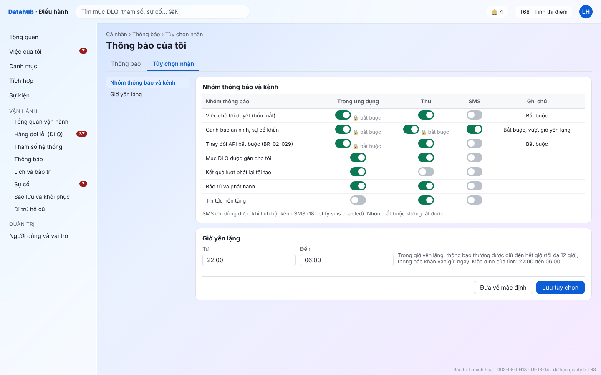

Ảnh cho thấy ma trận nhóm × kênh với ba nhóm có kênh bắt buộc khóa và chữ "bắt buộc", khối giờ yên lặng 22:00 đến 06:00 kèm câu giải thích.

## 21. UI-18-15 Việc của tôi

::: dac-ta
**Mục đích.** Gom mọi việc chờ người dùng từ mọi phân hệ (duyệt bốn mắt, mục được gán, nhắc gia hạn) vào một hộp việc, có hạn, quá hạn, liên kết sang màn nguồn; duyệt được ngay tại chỗ với việc duyệt của PH-18.

**Đường dẫn, mẫu.** `/viec-cua-toi`, `?chon={taskId}`; PTN-10 Hộp việc và duyệt; thẻ trang chủ dùng `?summary=true`.

**Vai trò, quyền.** Mọi người dùng; việc chỉ hiện khi người dùng còn quyền xem tại thời điểm đọc; nút duyệt theo quyền của loại việc (`PERM-18-approve` với việc của PH-18).

**FR.** 004, 009, 024, 028, 035, 042, 043, 044, 055, 062, 068.

**API.** API-18-111, 112 (việc của tôi, chi tiết), API-18-181 (nhận việc), API-18-108 (loại việc), các API duyệt của đối tượng nguồn: API-18-010, 011 (tham số), API-18-055, 056 (bản sửa), API-18-070, 071 (lượt phát lại), API-18-088, 089 (mẫu), API-18-142, 143 (khôi phục), API-18-167, 168 (di trú thật), API-18-175 (cắt chuyển).

**Dữ liệu nhạy cảm.** Tóm tắt việc chỉ có mã đối tượng và số lượng.

**Đợt.** MVP; đầy đủ, ảnh `ui-18-15.png`.
:::

### 21.1. Bố cục, cột, hành động

PTN-10: dải chip lọc nhanh (Tất cả, Quá hạn, Hôm nay, Tuần này, Phân hệ, Loại việc); trái 5/12 danh sách thẻ việc; phải 7/12 chi tiết việc đang chọn.

```text
┌ Cá nhân › Việc của tôi ───────────────────────────────────────────────────────────────────────────┐
│ [Tất cả 7] [Quá hạn 1] [Hôm nay 2] [Tuần này 6] [Phân hệ ▾] [Loại việc ▾]                          │
│ ┌ Danh sách ──────────────────────────────┐ ┌ Duyệt lượt phát lại PL-2026-0150 ──────────────────┐ │
│ │▌Duyệt lượt phát lại PL-…0150 [Quá hạn 3 giờ]│ │ Phạm vi · Người đề nghị · Bị loại · Tốc độ · Hạn    │ │
│ │ Duyệt tham số ★ 18.dlq… [Hôm nay 17:00]  │ │ Ý kiến […]                                          │ │
│ │ Duyệt bản sửa DLQ-7N8D số 1              │ │ [Duyệt] [Từ chối…] [Mở màn lượt phát lại ↗]         │ │
│ └──────────────────────────────────────────┘ └─────────────────────────────────────────────────────┘ │
└───────────────────────────────────────────────────────────────────────────────────────────────────┘
```

: Wireframe UI-18-15

| Trường thẻ việc | Nguồn API-18-111 | Ghi chú |
|---|---|---|
| Tên loại và tóm tắt | `typeName`, `summary` | Ví dụ "Duyệt lượt phát lại PL-2026-0150 (196 mục)" |
| Phân hệ, khu | `sourcePh` | |
| Hạn | `dueAt` | `CMP-Tag`: "Quá hạn {n} giờ" (error), "Hôm nay {giờ}" (warning), ngày (info) |
| Người cùng nhận, người đề nghị | `coAssignees`, `requestedBy` | |
| Trạng thái | `status` | Chờ xử lý, Đang xử lý |

: UI-18-15, trường thẻ việc

Hành động: "Nhận việc" (API-18-181, `If-Match`; `IN_PROGRESS`, báo người cùng nhận), "Mở màn {đối tượng} ↗" (liên kết của loại việc), và với việc duyệt của PH-18: `CMP-ApprovalPanel` nhúng (ý kiến, "Duyệt", "Từ chối…"). Người đề nghị không thấy việc duyệt của chính mình; nếu mở bằng URL thì nút vô hiệu kèm câu ERR-18-005. Việc đã đóng ở nơi khác: ERR-18-048 "Việc {mã} đã đóng." và thẻ tự rời danh sách. Việc duyệt khôi phục tenant, chạy di trú thật, cắt chuyển không duyệt tại chỗ mà buộc mở màn nguồn (UI-18-20, 22, 23) để thấy đủ phạm vi và cảnh báo.

Trạng thái: rỗng "Bạn không có việc nào đang chờ." kèm liên kết "Yêu cầu tôi đã gửi"; số việc trên menu và tiêu đề tab cập nhật qua SSE hoặc thăm dò 60 giây (D03-06-00 §2.8), không dùng `aria-live` mức `assertive`. Phím tắt: `J`, `K` việc kế tiếp, trước đó; `A` duyệt (khi được phép, có xác nhận); `Enter` mở màn nguồn. Truy cập: danh sách là `listbox` với mục chọn được; chi tiết là `region` cập nhật khi chọn, focus không nhảy.

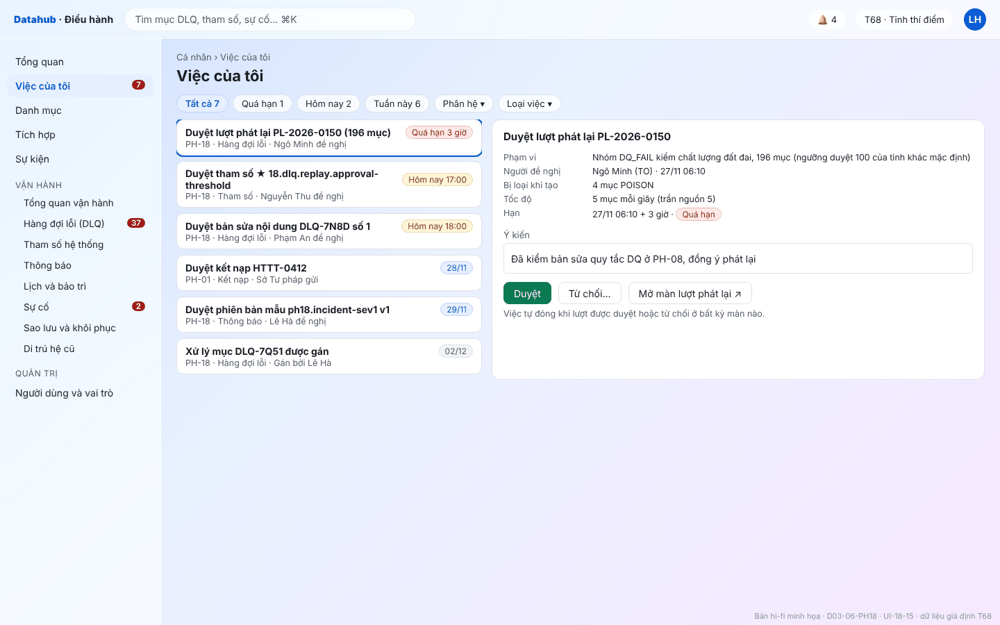

Ảnh cho thấy sáu việc từ PH-18 và PH-01, việc đầu quá hạn ba giờ đang chọn; khung phải có phạm vi, người đề nghị, ý kiến và nút "Duyệt", "Từ chối…", "Mở màn lượt phát lại".

## 22. UI-18-16 Lịch, bảo trì và đóng băng

::: dac-ta
**Mục đích.** Cho quản trị đặt lịch ngày làm việc và ngày lễ của tỉnh (để các phân hệ tính hạn), tạo cửa sổ bảo trì có báo trước và cửa sổ đóng băng thay đổi theo môi trường.

**Đường dẫn, mẫu.** `/van-hanh/lich`, `?nam=`, `?thang=`, `?tab=cua-so`; PTN-01 với lịch tháng (dùng tạm CalendarMonth, Phụ lục A) và bảng cửa sổ.

**Vai trò, quyền.** TA ● lịch tỉnh, cửa sổ phạm vi tỉnh (`PERM-18-calendar`); PA, PO ● lịch dùng chung và cửa sổ phạm vi nền tảng; người có `PERM-18-read` xem.

**FR.** 045, 046.

**API.** API-18-113, 114, 115 (lịch năm, ngày lễ, ngày làm bù), API-18-118, 119, 120, 121 (cửa sổ).

**Dữ liệu nhạy cảm.** Không.

**Đợt.** MVP; đầy đủ, ảnh `ui-18-16.png`.
:::

### 22.1. Bố cục, trường

Tab "Lịch tháng": lịch 7 cột (Thứ Hai đến Chủ nhật) chiếm 8/12, bên phải danh sách ngày lễ của năm; dưới là bảng cửa sổ. Tab "Lịch năm {năm}": 12 tháng thu nhỏ để sửa nhanh. Tab "Cửa sổ": bảng đầy đủ có lọc.

```text
┌ Lịch, bảo trì và đóng băng                   [+ Ngày lễ hoặc ngày làm bù] [+ Cửa sổ bảo trì hoặc đóng băng]┐
│ [Lịch tháng] | Lịch năm 2027 | Cửa sổ                                                             │
│ ┌ ‹ Tháng 12 năm 2026 ›   Chú giải: cuối tuần · ngày lễ · đóng băng · bảo trì ┐ ┌ Ngày lễ 2027 ──┐ │
│ │ Thứ Hai … Chủ nhật                                                           │ │ 01/01 Tết DL    │ │
│ │ 13 [Bảo trì 22:00–02:00 PROD]   21 [Đóng băng PROD] …   26 [Làm bù]          │ │ …               │ │
│ └──────────────────────────────────────────────────────────────────────────────┘ └─────────────────┘ │
│ Mã │ Loại │ Môi trường │ Bắt đầu │ Kết thúc │ Trạng thái │ Báo trước                               │
└───────────────────────────────────────────────────────────────────────────────────────────────────┘
```

: Wireframe UI-18-16

| Trường cửa sổ (Drawer) | Kiểu | Ràng buộc, mã lỗi |
|---|---|---|
| Loại | `CMP-RadioCard` | Bảo trì (`MAINTENANCE`), Đóng băng (`FREEZE`) |
| Phạm vi | `CMP-SegmentedControl` | Tỉnh, Nền tảng (PA, PO) |
| Môi trường | `CMP-Checkbox` nhiều | `DEV`, `TEST`, `STAGING`, `PROD`; mặc định `18.freeze.default-envs` |
| Bắt đầu, kết thúc | `CMP-DateRangePicker` có giờ | Hợp lệ; chồng cửa sổ cùng loại và phạm vi: ERR-18-050 "Cửa sổ {loại} chồng với cửa sổ {mã} từ {bắt đầu} đến {kết thúc}." |
| Lý do | `CMP-TextArea` | Bắt buộc |
| Báo trước người dùng | `CMP-Switch` | Chỉ bảo trì; gửi trước `18.maintenance.notice-hours` (72 giờ) |
| Loại thay đổi được miễn | `CMP-Select` nhiều | Chỉ đóng băng |

: UI-18-16, trường cửa sổ

| Trường ngày lễ (Drawer) | Kiểu | Ràng buộc, mã lỗi |
|---|---|---|
| Ngày | `CMP-DatePicker` | Thuộc năm đang sửa, không trùng |
| Tên | `CMP-Input` | Bắt buộc |
| Loại | `CMP-SegmentedControl` | Ngày lễ (`HOLIDAY`), Ngày làm bù (`MAKEUP_WORKDAY`); ngày làm bù rơi vào ngày làm việc sẵn: ERR-18-049 "Lịch năm {năm} không hợp lệ: {chi tiết}." |

: UI-18-16, trường ngày lễ

Hành động: lưu lịch năm (`If-Match`), thêm ngày lễ, tạo, sửa (chỉ cửa sổ chưa bắt đầu), hủy cửa sổ (lý do). Bấm một ngày trên lịch mở Popover chi tiết. Trạng thái: năm chưa có lịch riêng hiện `CMP-Alert` "Tỉnh đang dùng lịch dùng chung năm {năm}." kèm nút "Tạo lịch riêng từ lịch dùng chung"; lịch dùng chung cũng chưa có: "Chưa có lịch năm {năm}; các phân hệ chỉ bỏ cuối tuần khi tính hạn." (BR-18-034). Cửa sổ đóng băng đang hiệu lực làm hiện ST-18-C ở các màn liên quan. Truy cập: lịch là `grid` có tiêu đề cột thứ; mỗi ô đọc "Thứ Hai 21 tháng 12, đóng băng PROD"; màu nền đi kèm chữ trong ô và chú giải; dùng phím mũi tên di chuyển ngày, `Enter` mở chi tiết, `PageUp`, `PageDown` đổi tháng.

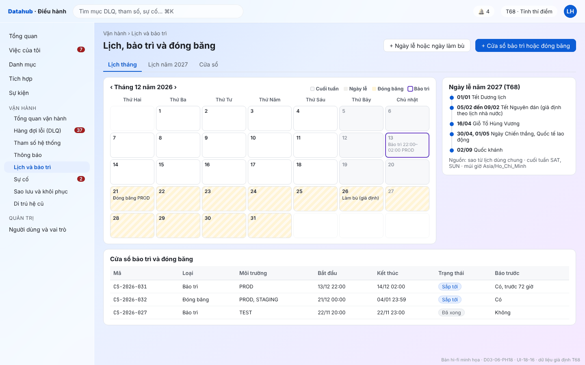

Ảnh cho thấy ngày 13 có cửa sổ bảo trì PROD, từ ngày 21 là đóng băng (sọc vàng kèm chữ), ngày 26 thứ Bảy là ngày làm bù (giả định); bên phải danh sách ngày lễ 2027 và nguồn lịch; dưới là bảng ba cửa sổ.

## 23. UI-18-17 Danh sách sự cố

::: dac-ta
**Mục đích.** Cho người trực thấy sự cố vận hành đang mở theo mức độ, ai đang xử lý, đã nhận sau bao lâu; tạo sự cố thủ công.

**Đường dẫn, mẫu.** `/van-hanh/su-co`; PTN-01 Danh sách, Drawer tạo (PTN-04).

**Vai trò, quyền.** TO, SO, TA, PO, PA ● (`PERM-18-incident`); người có `PERM-18-read` xem.

**FR.** 047, 048.

**API.** API-18-123 (danh sách), API-18-124 (tạo).

**Dữ liệu nhạy cảm.** Tiêu đề, mô tả không được chứa dữ liệu cá nhân (nhắc dưới ô nhập).

**Đợt.** MVP; đầy đủ, ảnh `ui-18-17.png`.
:::

### 23.1. Bố cục, cột, trường

Bốn thẻ số (đang mở theo mức, chưa ai nhận, thời gian nhận trung vị, có dữ liệu cá nhân), thanh lọc, bảng.

```text
┌ Sự cố vận hành                                                                    [+ Tạo sự cố] ┐
│ [Đang mở 4 · 1 SEV1] [Chưa ai nhận 1] [Thời gian nhận trung vị 12 phút] [Có dữ liệu cá nhân 0]   │
│ 🔍 Mã hoặc tiêu đề [Trạng thái: chưa đóng ✕] [Mức ▾] [Loại ▾] [Người xử lý ▾] [Nguồn ▾]            │
│ Mã │ Tiêu đề │ Mức │ Trạng thái │ Nguồn │ Người xử lý │ Mở lúc │ Thời gian nhận                    │
└───────────────────────────────────────────────────────────────────────────────────────────────────┘
```

: Wireframe UI-18-17

| Cột | Nguồn API-18-123 | Ghi chú |
|---|---|---|
| Mã | `incidentCode` | `SC-{yyyy}-{nnnn}`, liên kết UI-18-18 |
| Tiêu đề | `title` | |
| Mức | `severity` | `CMP-Tag` theo mục 5.1 |
| Trạng thái | `status` | |
| Nguồn | `sourceType` | Cảnh báo an ninh (EVT-13-04), chuỗi băm kiểm toán đứt (EVT-13-05), DLQ vượt ngưỡng, sao lưu lỗi, tạo tay |
| Người xử lý | `assignee` | "Chưa gán" khi trống |
| Mở lúc, thời gian nhận | `openedAt`, `acknowledgedAt` | Thời gian nhận tô `error` khi vượt `18.incident.sev1-ack-minutes` hoặc `sev2-ack-minutes` |

: UI-18-17, cột danh sách sự cố

| Trường tạo (Drawer) | Kiểu | Ràng buộc, mã lỗi |
|---|---|---|
| Tiêu đề, mô tả | `CMP-Input`, `CMP-TextArea` | Bắt buộc; nhắc "Không ghi dữ liệu cá nhân." |
| Mức | `CMP-SegmentedControl` | `SEV1` đến `SEV4` |
| Loại | `CMP-Select` | `AVAILABILITY`, `DATA_INTEGRITY`, `SECURITY`, `PERFORMANCE`, `OTHER` |
| Người xử lý | `CMP-ResourceSelect` | Mặc định theo lịch trực của PH-13 |
| Có dữ liệu cá nhân | `CMP-Radio` | Có, Không, Chưa xác định (mặc định) |

: UI-18-17, trường tạo sự cố

Thiếu trường: ERR-18-003. Trạng thái rỗng: "Không có sự cố nào đang mở." Sự cố `SEV1` mới hiện `CMP-Notification` không tự đóng cho người trực (D03-06-00 §2.9). Truy cập: mức đọc bằng chữ ("Mức SEV1 khẩn"), thẻ số là liên kết lọc.

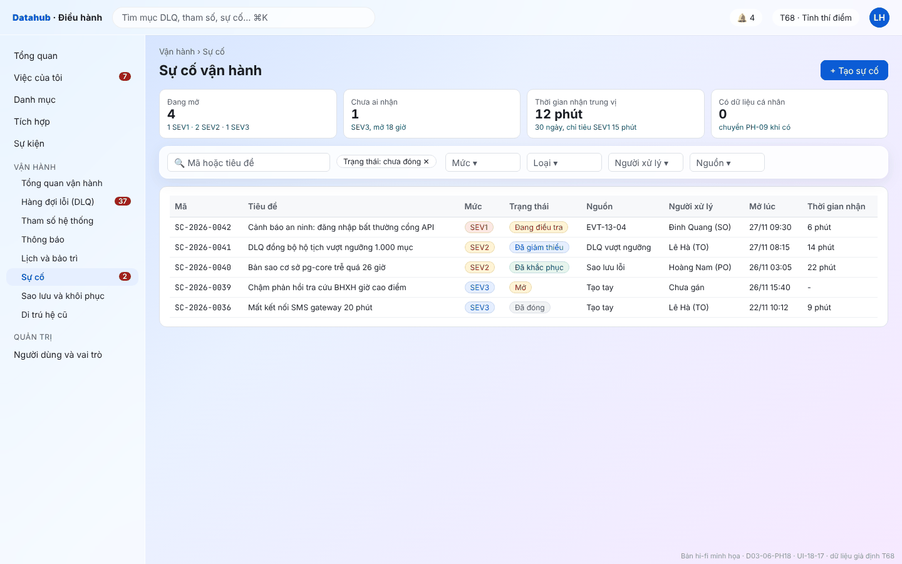

Ảnh cho thấy thẻ "Đang mở" được chọn làm bộ lọc, năm sự cố từ các nguồn khác nhau, một sự cố SEV3 "Chưa gán".

## 24. UI-18-18 Chi tiết sự cố

::: dac-ta
**Mục đích.** Cho người xử lý dẫn sự cố qua vòng đời, ghi mốc thời gian, liên kết đối tượng liên quan, chuyển sang PH-09 khi có dữ liệu cá nhân, đóng với nguyên nhân gốc, bài học và việc khắc phục.

**Đường dẫn, mẫu.** `/van-hanh/su-co/{ma}`; PTN-02 Chi tiết.

**Vai trò, quyền.** TO, SO, TA, PO, PA ● (`PERM-18-incident`); chuyển PH-09: SO ● (FRS §10.1 bản 0.2); người có `PERM-18-read` xem.

**FR.** 048, 049, 050, 051.

**API.** API-18-125 (chi tiết), API-18-126 (đổi mức, người xử lý, `If-Match`), API-18-127 (chuyển trạng thái), API-18-128 (thêm mốc), API-18-129 (liên kết), API-18-130 (chuyển PH-09), API-18-131 (đóng).

**Dữ liệu nhạy cảm.** Tóm tắt gửi PH-09 không chứa dữ liệu cá nhân, chỉ loại dữ liệu và số người ước tính.

**Đợt.** MVP (FR-18-050 đợt 2); đầy đủ, ảnh `ui-18-18.png`.
:::

### 24.1. Bố cục, trường, hành động

Đầu trang: mã, mức, trạng thái, dòng tóm tắt (loại, nguồn, thời gian nhận so chỉ tiêu); `CMP-Steps` năm bước vòng đời. Trái 8/12: mốc thời gian. Phải 4/12: liên kết, dữ liệu cá nhân, đóng sự cố.

```text
┌ SC-2026-0041 SEV2 Đã giảm thiểu          [Đổi mức…] [Gán…] [Chuyển PH-09…] [Chuyển: Đã khắc phục]┐
│ ✓ Mở › ✓ Đang điều tra › ● Đã giảm thiểu › Đã khắc phục › Đã đóng                                 │
│ ┌ Mốc thời gian              [+ Thêm mốc] ┐ ┌ Liên kết: Nhóm DLQ · Lượt PL-…0153 · Cảnh báo PH-13 ┐ │
│ │ 09:41 Hành động · 09:20 Quyết định · …  │ ├ Dữ liệu cá nhân: Chưa xác định                       ┤ │
│ │ Mốc không sửa sau 15 phút               │ ├ Đóng sự cố: cần nguyên nhân gốc, bài học ≥ 30 ký tự   ┤ │
└───────────────────────────────────────────────────────────────────────────────────────────────────┘
```

: Wireframe UI-18-18

| Nhãn | Kiểu | Ràng buộc, mã lỗi |
|---|---|---|
| Mốc: loại, nội dung, thời điểm | `CMP-Select` (Ghi chú, Hành động, Quyết định, Liên lạc), `CMP-TextArea` ≤ 4.000 ký tự, `CMP-DatePicker` | Không sửa sau 15 phút; chỉ thêm mốc đính chính |
| Liên kết | `CMP-Select` loại (`DLQ_MESSAGE`, `DLQ_GROUP`, `ALERT`, `REPLAY_JOB`, `BACKUP_RUN`, hồ sơ PH-09) và ô mã | Không tồn tại: ERR-18-001 |
| Chuyển PH-09: loại dữ liệu cá nhân, số người ước tính, thời điểm phát hiện, tóm tắt | `CMP-Select` nhiều, `CMP-NumberInput`, `CMP-DatePicker`, `CMP-TextArea` | Thiếu: ERR-18-053 "Cần nêu loại dữ liệu cá nhân, số người ước tính và thời điểm phát hiện."; PH-09 không nhận: ERR-18-054 "Chưa chuyển được sang phân hệ quyền riêng tư. Hệ thống sẽ thử lại mỗi 5 phút; báo ngay cán bộ ATTT nếu quá 1 giờ." |
| Đóng: nguyên nhân gốc, bài học | `CMP-TextArea` | Mỗi phần ≥ 30 ký tự: ERR-18-052 "Đóng sự cố cần nêu nguyên nhân gốc và bài học (mỗi phần ít nhất 30 ký tự)." |
| Đóng: việc khắc phục | `CMP-EditableTable` (tên, người, hạn) | Mỗi dòng tạo một việc |

: UI-18-18, trường nhập

Hành động theo trạng thái: `OPEN` có "Nhận", "Chuyển: Đang điều tra"; `INVESTIGATING` có "Chuyển: Đã giảm thiểu"; `MITIGATED` có "Chuyển: Đã khắc phục"; `RESOLVED` có "Đóng sự cố…" và "Mở lại"; chuyển sai thứ tự: ERR-18-006. "Đổi mức…", "Gán…" ghi mốc tự động và báo người mới. Đóng khi hồ sơ PH-09 còn mở bị chặn với câu ERR-18-006. Sự cố `SEV1` chưa nhận sau 15 phút hiện `CMP-Banner` "Đã leo thang cho quản trị tỉnh và quản trị nền tảng."

Trạng thái: không tìm thấy (ST-08); đã đóng (ST-15, chỉ đọc, hiện nguyên nhân và bài học). Truy cập: `CMP-Steps` đọc "Bước 3 trên 5, Đã giảm thiểu, hiện tại"; mốc thời gian là danh sách có thứ tự; nút chuyển trạng thái ghi rõ trạng thái đích.

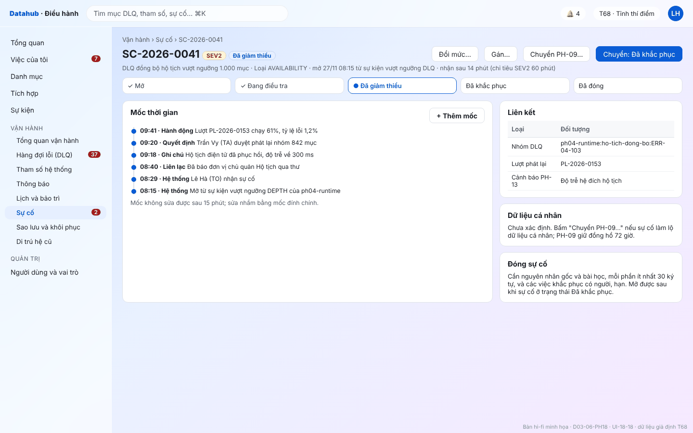

Ảnh cho thấy thanh bước vòng đời, mốc thời gian theo loại (hệ thống, liên lạc, quyết định, hành động), liên kết tới nhóm DLQ và lượt phát lại, khối dữ liệu cá nhân "Chưa xác định" và điều kiện đóng.

## 25. UI-18-19 Bảng điều khiển sao lưu

::: dac-ta
**Mục đích.** Cho quản trị nền tảng và quản trị tỉnh biết mọi đối tượng cần sao lưu có bản sao lưu gần đây, thành công, còn trong hạn giữ và đã được kiểm tra khôi phục hay chưa; ghi nhận diễn tập DR.

**Đường dẫn, mẫu.** `/van-hanh/sao-luu`, `?tab=kiem-tra`, `?tab=dien-tap`; PTN-06 Bảng điều khiển (FRS §10.1; D03-06-00 mục 40 ghi PTN-01, Phụ lục C, LC-06).

**Vai trò, quyền.** PA, PO ● mọi đối tượng; TA ● đối tượng mức tenant (`PERM-18-backup`); AU ○ xem diễn tập (`PERM-18-read`); ghi nhận diễn tập: PA (`PERM-18-admin`).

**FR.** 052, 053, 058.

**API.** API-18-133 (đối tượng), API-18-134 (lịch sử bản sao lưu), API-18-136 (kiểm tra khôi phục), API-18-154, 155 (diễn tập DR).

**Dữ liệu nhạy cảm.** Vị trí lưu chỉ là đường dẫn kho, không có khóa truy cập; biên bản diễn tập là tham chiếu tệp.

**Đợt.** MVP; đầy đủ, ảnh `ui-18-19.png`.
:::

### 25.1. Bố cục, cột

Dải `CMP-Banner` khi có đối tượng trễ hoặc lỗi (liên kết sang sự cố đã mở tự động), bốn thẻ số, bảng đối tượng; bấm dòng mở Drawer lịch sử bản sao lưu của đối tượng. TA chỉ thấy các dòng mức tenant (xuất logic theo tenant, bucket `dh-t68-*`) và một dòng tổng "Hạ tầng dùng chung: đúng hạn" do PA quản.

```text
┌ Sao lưu và khôi phục                              [Khôi phục, xuất, sáp nhập ›] [+ Ghi nhận diễn tập DR…]┐
│ [Bảng điều khiển] | Kiểm tra khôi phục | Diễn tập DR                                              │
│ ✕ Bản sao cơ sở pg-core trễ 32 giờ (ngưỡng 26 giờ). Đã mở sự cố SC-2026-0040.     [Mở sự cố]      │
│ [Đúng hạn 6/8] [Kiểm tra khôi phục đạt 86%] [Diễn tập DR gần nhất 15/11] [Độ tươi trạng thái 4 phút]│
│ Đối tượng │ Công cụ │ Thành công gần nhất │ Độ tươi │ Thời gian giữ │ Kiểm tra khôi phục             │
│ "Không rõ": chưa thu được trạng thái từ Velero lúc 09:35 (ERR-18-122)                             │
└───────────────────────────────────────────────────────────────────────────────────────────────────┘
```

: Wireframe UI-18-19

| Cột | Nguồn API-18-133 | Ghi chú |
|---|---|---|
| Đối tượng | `objectCode`, `objectName` | Theo danh mục D03-09 §8.2 |
| Công cụ | `tool` | CNPG, Barman, Velero, rclone, OpenBao, clickhouse-backup |
| Thành công gần nhất | `lastSuccessAt` | `CMP-Timestamp` |
| Độ tươi | `freshness` | Đúng hạn, Trễ {n} giờ (so `18.backup.stale-hours`), Không rõ; chữ kèm biểu tượng |
| Thời gian giữ | `retention` | |
| Kiểm tra khôi phục | `lastVerification` | Đạt, Đạt chậm, Lỗi, Chưa kiểm; lịch theo `18.backup.verification-interval-days` |

: UI-18-19, cột bảng đối tượng

| Trường ghi nhận diễn tập (Drawer) | Kiểu | Ràng buộc, mã lỗi |
|---|---|---|
| Loại | `CMP-Select` | `DR_SWITCHOVER`, `RBK_03`, `PITR_CLUSTER`, `TABLETOP` |
| Bắt đầu, kết thúc | `CMP-DateRangePicker` có giờ | Hợp lệ, không tương lai |
| RTO đo được (phút), RPO đo được (giây) | `CMP-NumberInput` | ≥ 0 |
| Kết quả | `CMP-RadioCard` | Đạt, Đạt kèm vấn đề, Không đạt |
| Vấn đề | `CMP-EditableTable` | Tạo việc khắc phục cho từng dòng |
| Biên bản | `CMP-Upload` | Bắt buộc; thiếu: ERR-18-003 |

: UI-18-19, trường ghi nhận diễn tập

Trạng thái: mọi nguồn thu lỗi thì ERR-18-055 hiện `CMP-Alert` "Chưa thu được trạng thái sao lưu từ {công cụ}. Số liệu đang hiển thị là của {thời điểm}." và bảng vẫn giữ số liệu cũ (ST-18-B); độ tươi của trạng thái vượt `18.backup.freshness-max-minutes` (15 phút) tô thẻ số màu cảnh báo. Thẻ "Diễn tập DR gần nhất" so RTO đo được với chỉ tiêu D01-02. Truy cập: cột độ tươi và kiểm tra khôi phục đọc bằng chữ; banner có vai trò `alert` chỉ khi mới xuất hiện trong phiên.

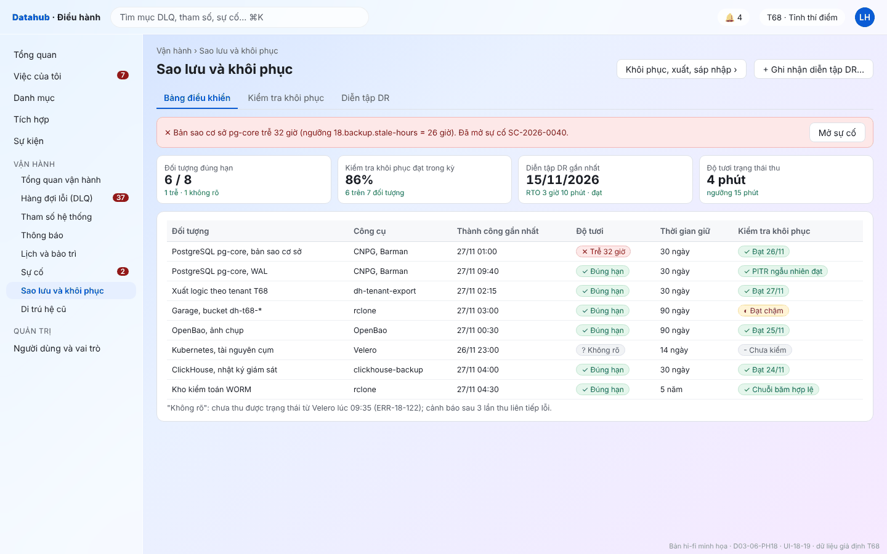

Ảnh cho thấy banner lỗi bản sao cơ sở pg-core trễ 32 giờ kèm sự cố đã mở, bốn thẻ số, tám đối tượng sao lưu với độ tươi "Trễ", "Đúng hạn", "Không rõ" và cột kiểm tra khôi phục; chú thích dưới bảng giải thích trạng thái "Không rõ".

## 26. UI-18-20 Khôi phục, xuất và sáp nhập

::: dac-ta
**Mục đích.** Cho quản trị tỉnh yêu cầu khôi phục dữ liệu của tỉnh về một thời điểm trong 30 ngày (RBK-04), cho quản trị nền tảng duyệt và theo dõi tám bước, quay lui khi lỗi; cho PA xuất dữ liệu tenant và theo dõi chuyển dữ liệu khi sáp nhập.

**Đường dẫn, mẫu.** `/van-hanh/sao-luu/khoi-phuc`, `?chon={requestId}` mở chi tiết yêu cầu, `?tab=xuat`, `?tab=sap-nhap`; PTN-11 (FRS §10.1) cho danh sách và PTN-02 cho chi tiết yêu cầu; biểu mẫu tạo là PTN-05 Wizard bốn bước.

**Vai trò, quyền.** TA ● tạo, gửi, hủy yêu cầu khôi phục (`PERM-18-backup`); PA ● duyệt, từ chối, quay lui (`PERM-18-approve`); PA ● xuất dữ liệu, cấp liên kết tải (`PERM-18-backup`); PA, PO ○ xem chuyển sáp nhập.

**FR.** 054, 055, 056, 057.

**API.** API-18-138 đến 146 (khôi phục), API-18-147, 148, 149 (xuất), API-18-151, 152 (chuyển sáp nhập; tạo và hủy do PH-20 gọi API-18-150, 153).

**Dữ liệu nhạy cảm.** Liên kết tải gói xuất chỉ cấp khi bấm, có hạn `18.export.link-ttl-hours` (24 giờ), mỗi lần cấp ghi kiểm toán; màn không bao giờ hiện khóa giải mã.

**Đợt.** MVP; đầy đủ, ảnh `ui-18-20.png`.
:::

### 26.1. Bố cục

Chi tiết yêu cầu: đầu trang (mã, trạng thái, nút theo trạng thái), `CMP-Banner` cảnh báo tác động, trái 7/12 là tám bước (dạng dọc, mỗi bước có thời điểm, số dòng, thanh tiến độ khi đang chạy), phải 5/12 là thông tin yêu cầu, người tạo, người duyệt và khối quay lui.

```text
┌ Yêu cầu khôi phục KP-2026-007  ↻ Đang chạy bước 5/8          [+ Yêu cầu khôi phục] [+ Xuất dữ liệu tenant]┐
│ [Khôi phục tenant] | Xuất dữ liệu | Chuyển sáp nhập                                               │
│ ⚠ Tỉnh T68 đang tạm ngừng trong bước 4 đến 8. Dữ liệu ph07_rdm sau 25/11 08:30 sẽ mất. …          │
│ ┌ Tám bước khôi phục ─────────────────────────┐ ┌ Yêu cầu ─────────────────────────────────────┐ │
│ │ ✓1 Ghi phê duyệt · ✓2 PITR · ✓3 Trích · ✓4 Tạm ngừng │ │ Thời điểm đích · Phạm vi · Kho khác · Lý do │ │
│ │ ●5 Thay dữ liệu ph07_rdm 62% · 6 · 7 · 8     │ │ Người tạo · Người duyệt                     │ │
│ └──────────────────────────────────────────────┘ ├ Quay lui: tự động khi lỗi bước 5 đến 8 [Quay lui…]┤ │
└───────────────────────────────────────────────────────────────────────────────────────────────────┘
```

: Wireframe UI-18-20

### 26.2. Trường nhập

Wizard "Yêu cầu khôi phục" có bốn bước: Thời điểm đích; Phạm vi; Ước tính và cảnh báo; Lý do và xác nhận.

| Nhãn | Kiểu | Bắt buộc | Ràng buộc (FR-18-054), mã lỗi |
|---|---|---|---|
| Thời điểm đích | `CMP-DatePicker` có giờ | Có | Trong 30 ngày, không tương lai; sai: ERR-18-056 "Thời điểm {thời điểm} nằm ngoài cửa sổ khôi phục 30 ngày." |
| Phạm vi | `CMP-RadioCard` | Có | Toàn tenant (`FULL_TENANT`), Theo phân hệ (`MODULES`) |
| Phân hệ | `CMP-Select` nhiều | Có khi theo phân hệ | Schema có `tenant_id`; sai: ERR-18-058 "Phạm vi khôi phục không hợp lệ: {chi tiết}." |
| Khôi phục tệp, danh tính, bí mật | `CMP-Checkbox` ×3 | Không | Tệp `dh-{tenant}-*`; realm người dùng và vai trò; bí mật `kv/dh/{tenant}/` về phiên bản cũ; mỗi ô có câu tác động |
| Lý do | `CMP-TextArea` có bộ đếm | Có | ≥ 30 ký tự, có số văn bản nếu có; ngắn: ERR-18-007 "Nhập lý do khôi phục (ít nhất 30 ký tự)." |
| Xác nhận đã đọc cảnh báo | `CMP-Checkbox` | Có | Nút "Gửi duyệt" chỉ bật khi đã chọn |

: UI-18-20, trường yêu cầu khôi phục

| Nhãn (xuất dữ liệu) | Kiểu | Ràng buộc, mã lỗi |
|---|---|---|
| Tenant | `CMP-ResourceSelect` | Trạng thái phù hợp mục đích; sai: ERR-18-059 |
| Mục đích | `CMP-RadioCard` | Bàn giao (`HANDOVER`), Chuyển ô (`CELL_MOVE`), CSDL riêng (`DEDICATED_DB`), Lưu trữ (`ARCHIVE`) |
| Gồm tệp | `CMP-Switch` | |
| Định dạng | `CMP-SegmentedControl` | `PG_COPY`, `PG_DUMP` |
| Người nhận liên kết | `CMP-ResourceSelect` | Bắt buộc với bàn giao |

: UI-18-20, trường xuất dữ liệu

### 26.3. Hành động, trạng thái, thông báo

Nút trên chi tiết yêu cầu khôi phục đổi theo trạng thái yêu cầu và vai trò người xem, như bảng dưới.

| Trạng thái yêu cầu | Hành động | Ai |
|---|---|---|
| `DRAFT` | Sửa, Gửi duyệt, Hủy | TA tạo |
| `PENDING_APPROVAL` | Duyệt (kèm "Gửi thông báo bảo trì cho người dùng tỉnh"), Từ chối… | PA khác người tạo (ERR-18-005); TA thấy "Chờ quản trị nền tảng duyệt" và nút Hủy |
| `RUNNING` | Không có nút đổi; trang tự làm mới tiến độ | |
| `FAILED` | Xem bước lỗi, Tạo yêu cầu mới từ yêu cầu này | |
| Lỗi bước 5 đến 8 khi quay lui tự động thất bại | Quay lui… (`CMP-ConfirmDialog` gõ lại mã tenant) | PA |
| `SUCCEEDED`, `ROLLED_BACK`, `REJECTED`, `CANCELLED` | Chỉ đọc (ST-15) | |

: UI-18-20, hành động theo trạng thái

Thông báo: tỉnh đang có tác vụ nặng khác thì ERR-18-057 hiện ở bước 1 của Wizard trước khi người dùng nhập tiếp; bước của Job lỗi hiện ERR-18-114 "Bước {n} của khôi phục lỗi: {mô tả}. Hệ thống đang quay lui." trên bước tương ứng; đối chiếu số dòng lệch hiện ERR-18-115 kèm câu "Tenant giữ trạng thái tạm ngừng chờ quản trị nền tảng quyết định."; xuất lỗi hiện ERR-18-116. Tab "Chuyển sáp nhập" chỉ đọc, mỗi dòng là một phân hệ của một kế hoạch sáp nhập với tiến độ, số bản ghi, lỗi; báo tiến độ về PH-20 lỗi hiện ERR-18-123 dạng `CMP-Tag` "Đang thử báo lại".

Truy cập: tám bước là danh sách có thứ tự, bước đang chạy có `aria-current="step"` và thanh tiến độ có `aria-valuenow`; banner tác động đọc trước bảng bước; hộp xác nhận quay lui đặt focus vào ô gõ mã.

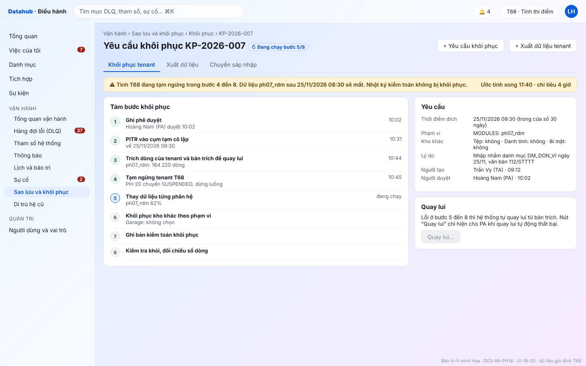

Ảnh cho thấy banner cảnh báo tỉnh tạm ngừng và dữ liệu sẽ mất, tám bước với bốn bước đã xong và bước 5 đang chạy 62%, khối thông tin yêu cầu có lý do kèm số văn bản, người tạo, người duyệt khác nhau và khối quay lui.

## 27. UI-18-21 Nguồn và kế hoạch di trú

::: dac-ta
**Mục đích.** Cho đội di trú khai báo CSDL hệ cũ làm nguồn với quyền chỉ đọc và thông tin kết nối là tham chiếu kho bí mật, rồi lập kế hoạch di trú theo loại đối tượng, bộ chuyển, phân hệ đích và thứ tự phụ thuộc.

**Đường dẫn, mẫu.** `/van-hanh/di-tru`, `?nguon={sourceCode}`, `?ke-hoach={planCode}`, `?buoc=`; PTN-05 Wizard theo năm chặng di trú; trong chặng 1 và 2 là bố cục chủ, chi tiết.

**Vai trò, quyền.** Người giữ `PERM-18-migration`, thường là PA, TA ● (FRS §10.1 bản 0.2); DS ○ xem.

**FR.** 059, 060, 061, 062.

**API.** API-18-156, 157, 158 (nguồn), API-18-159 đến 163 (kế hoạch), API-18-164, 165 (tạo, liệt kê lần chạy).

**Dữ liệu nhạy cảm.** Ô kết nối chỉ nhận chuỗi JDBC không có người dùng, mật khẩu và một tham chiếu dạng `kv/dh/{tenant}/...`; màn không có ô mật khẩu.

**Đợt.** MVP; đầy đủ, ảnh `ui-18-21.png`.
:::

### 27.1. Bố cục, trường

Đầu trang có `CMP-Steps` năm chặng di trú (Nguồn hệ cũ, Kế hoạch, Chạy thử, Chạy thật bốn mắt, Đối chiếu và cắt chuyển). Trái 4/12: danh sách nguồn và kế hoạch (chủ). Phải 8/12: thẻ nguồn đang chọn và bảng loại đối tượng của kế hoạch.

```text
┌ Kế hoạch di trú KH-HOTICH-01  Nháp                                     [Lưu nháp] [Đánh dấu sẵn sàng]┐
│ ✓ 1. Nguồn hệ cũ › ● 2. Kế hoạch › 3. Chạy thử › 4. Chạy thật (bốn mắt) › 5. Đối chiếu, cắt chuyển  │
│ ┌ Nguồn BUS-T68-CU Sẵn sàng ────────────────────────────────────────────────────── [Thử kết nối] ┐ │
│ │ Hệ cũ · JDBC · Thông tin kết nối kv/dh/t68/legacy/bus-cu · Kiểm chỉ đọc ✓ · 146 bảng           │ │
│ ├ Loại đối tượng theo thứ tự phụ thuộc                                      [+ Loại đối tượng] ┤ │
│ │ Thứ tự │ Loại │ Bộ chuyển │ Phân hệ đích │ Phụ thuộc │ Kiểm tra                              │ │
│ └ ⓘ Đồ thị phụ thuộc không có vòng. Thông tin xác thực không di trú. ────────────────────────────┘ │
└───────────────────────────────────────────────────────────────────────────────────────────────────┘
```

: Wireframe UI-18-21

| Nhãn (nguồn, Drawer) | Kiểu | Ràng buộc (FR-18-059), mã lỗi |
|---|---|---|
| Mã nguồn | `CMP-Input` | Duy nhất trong tenant; trùng: ERR-18-002 |
| Hệ cũ | `CMP-Select` | `BUS`, `HUB`, `APIM`, `AITA`, `PAYGOV`, `OTHER` |
| Chuỗi JDBC | `CMP-Input` đơn cách | Không chứa tham số người dùng, mật khẩu; có: ERR-18-070 "Thông tin kết nối phải là tham chiếu kho bí mật, không nhập mật khẩu trực tiếp." |
| Tham chiếu kho bí mật | `CMP-SecretRefField` có tiền tố cố định `kv/dh/t68/` | Dạng `kv/dh/{tenant}/...`; sai: ERR-18-070 |
| Schema | `CMP-Select` nhiều, cho nhập giá trị mới | Ít nhất một |
| Vùng mạng | `CMP-Select` | Theo danh mục vùng mạng của D03-09 |

: UI-18-21, trường nguồn hệ cũ

| Cột (loại đối tượng) | Kiểu khi sửa | Ràng buộc (FR-18-060), mã lỗi |
|---|---|---|
| Thứ tự | Kéo thả trong `CMP-EditableTable` kèm nút lên, xuống | |
| Loại đối tượng | `CMP-Select` | Gợi ý theo bảng thứ tự của FRS |
| Bộ chuyển | `CMP-Select` có phiên bản | Phải có cho loại hệ cũ và phiên bản API nhập của đích; không có: ERR-18-003 |
| Phân hệ đích | `CMP-Select` | Gợi ý theo loại |
| Phụ thuộc | `CMP-Select` nhiều | Vòng hoặc thiếu tiền đề khi đánh dấu sẵn sàng: ERR-18-063 "Kế hoạch có phụ thuộc vòng hoặc thiếu đối tượng tiền đề: {danh sách}." |
| Bộ lọc, quy tắc sửa | `CMP-ExpressionField`, `CMP-EditableTable` | Mở trong Drawer của dòng |

: UI-18-21, cột kế hoạch

Hành động: "Thử kết nối" (API-18-158; không đạt: ERR-18-062 "Nguồn {mã} không kết nối được hoặc tài khoản không phải chỉ đọc: {chi tiết}." hiện trong thẻ nguồn kèm kết quả từng kiểm), "Lưu nháp" (`If-Match`), "Đánh dấu sẵn sàng" (API-18-163), "Chạy thử" khi kế hoạch `READY` (API-18-164, tạo lần chạy rồi chuyển UI-18-22; chưa sẵn sàng: ERR-18-065). Mọi thay đổi sau khi sẵn sàng đưa kế hoạch về Nháp và hiện `CMP-Toast` "Kế hoạch đã về Nháp; cần đánh dấu sẵn sàng lại." Dòng có cảnh báo (ví dụ phân hệ đích chưa có chế độ kiểm) hiện `CMP-Tag` warning kèm chữ.

Trạng thái: chưa có nguồn: "Chưa khai báo nguồn hệ cũ nào." kèm nút "+ Nguồn hệ cũ"; nguồn chưa thử kết nối: thẻ nguồn hiện Nháp và khóa nút "Chạy thử". Truy cập: danh sách kéo thả có thao tác phím (`Space` nhấc, mũi tên di chuyển, `Space` thả) và thông báo vị trí mới qua `aria-live="polite"`; ô tham chiếu kho bí mật có mô tả "Chỉ nhập đường dẫn, không nhập mật khẩu".

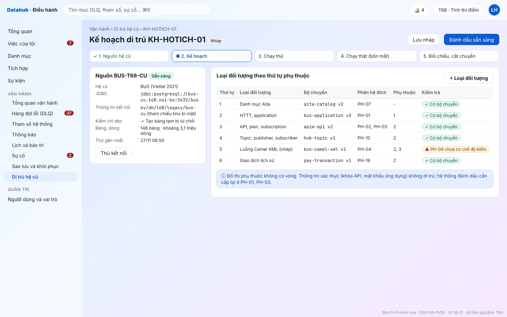

Ảnh cho thấy năm chặng di trú với chặng 2 đang làm, thẻ nguồn có chuỗi JDBC không chứa thông tin đăng nhập và tham chiếu `kv/dh/t68/legacy/bus-cu`, kiểm chỉ đọc đạt; bảng sáu loại đối tượng theo thứ tự, một dòng cảnh báo PH-04 chưa có chế độ kiểm.

## 28. UI-18-22 Lần chạy di trú

::: dac-ta
**Mục đích.** Cho đội di trú theo dõi một lần chạy thử hoặc chạy thật: tiến độ theo loại đối tượng, đối chiếu số lượng và tổng kiểm tra, bản ghi lỗi và cách xử lý, thông tin xác thực cần cấp lại; duyệt chạy thật bởi người thứ hai.

**Đường dẫn, mẫu.** `/van-hanh/di-tru/lan-chay/{ma}`, `?tab=doi-chieu` (mặc định), `?tab=loi`, `?tab=xac-thuc`; PTN-11 (FRS §10.1), phần đầu theo PTN-02.

**Vai trò, quyền.** Người giữ `PERM-18-migration` ●; người khác có `PERM-18-approve` ● duyệt chạy thật; DS ○ xem và cập nhật cách xử lý lỗi; AU ○ xem báo cáo đối chiếu (`PERM-18-read`).

**FR.** 061, 062, 063, 064, 065.

**API.** API-18-166 (tiến độ), API-18-167, 168 (duyệt, từ chối chạy thật), API-18-169 (hủy), API-18-170 (bản ghi lỗi), API-18-171 (đối chiếu), API-18-172 (cấp lại xác thực), API-18-182 (đánh dấu cách xử lý bản ghi lỗi, một hoặc nhiều), API-18-183 (đánh dấu `WAIVED` kèm lý do), API-18-164 với `retryOf` (chạy lại bản ghi lỗi).

**Dữ liệu nhạy cảm.** Bản ghi lỗi chỉ hiện khóa nguồn, loại, mã lỗi, lý do; không hiện nội dung bản ghi. Danh sách cấp lại chỉ có mã HTTT và loại xác thực.

**Đợt.** MVP; đầy đủ, ảnh `ui-18-22.png`.
:::

### 28.1. Bố cục, cột

Đầu trang: mã, chế độ (Chạy thử hoặc Chạy thật), trạng thái, nút. Năm thẻ số (đã đọc, đã chuyển đổi, đã ghi, bản ghi lỗi, cần cấp lại xác thực). Bảng đối chiếu theo loại đối tượng. Tab "Bản ghi lỗi" và "Cấp lại xác thực".

```text
┌ Lần chạy LC-2026-014 · Chạy thật  ↻ Đang chạy             [⇩ Báo cáo đối chiếu PDF] [Hủy sau lô hiện hành…]┐
│ [Đã đọc 1.416.548] [Đã chuyển đổi 1.416.544] [Đã ghi 1.416.420] [Bản ghi lỗi 128] [Cấp lại 208]   │
│ Loại đối tượng │ Nguồn │ Chuyển đổi │ Ghi thành công │ Lỗi │ Tổng kiểm tra SHA-256                 │
│ Bản ghi lỗi                                   [⇩ CSV] [Chạy lại bản ghi đã chọn (cần duyệt)…]     │
│ ☐ Khóa nguồn │ Loại │ Mã lỗi │ Lý do │ Cách xử lý                                                 │
└───────────────────────────────────────────────────────────────────────────────────────────────────┘
```

: Wireframe UI-18-22

| Cột đối chiếu | Nguồn API-18-171 | Ghi chú |
|---|---|---|
| Loại đối tượng | `objectType` | |
| Nguồn, Chuyển đổi, Ghi thành công, Lỗi | `sourceCount`, `convertedCount`, `writtenCount`, `errorCount` | Số có dấu chấm ngăn cách nghìn, căn phải |
| Tổng kiểm tra | `checksumResult` | Khớp; Lệch (ERR-18-120, liên kết "Xem danh sách khóa lệch"); Lỗi đã giải trình; Không có API đọc lại (`NOT_AVAILABLE`); Đang chạy {n}% |

: UI-18-22, cột đối chiếu

| Cột bản ghi lỗi | Nguồn API-18-170 | Ghi chú |
|---|---|---|
| Chọn | | `CMP-Checkbox` |
| Khóa nguồn | `legacyKey` | Đơn cách |
| Loại | `objectType` | |
| Mã lỗi | `reasonCode` | Mã ERR của phân hệ đích (ERR-18-119) hoặc của bộ chuyển (ERR-18-118) |
| Lý do | `reason` | |
| Cách xử lý | `resolution` | `CMP-Select` ngay trên dòng: Mở, Sửa ở nguồn, Thêm quy tắc, Không di trú (bắt buộc lý do ≥ 10 ký tự, ERR-18-007); lưu qua API-18-182 |

: UI-18-22, cột bản ghi lỗi

### 28.2. Hành động theo trạng thái

Nút trên màn lần chạy đổi theo chế độ và trạng thái của lần chạy, như bảng dưới.

| Trạng thái lần chạy | Hành động | Ai |
|---|---|---|
| Chạy thử xong (`SUCCEEDED`, `SUCCEEDED_WITH_ERRORS`) | Tạo lần chạy thật… (lý do), Chạy lại bản ghi lỗi | `PERM-18-migration` |
| Chạy thật `PENDING_APPROVAL` | Duyệt, Từ chối… (`CMP-ApprovalPanel` kèm tóm tắt lần chạy thử gốc) | `PERM-18-approve`, khác người tạo (ERR-18-005) |
| `QUEUED`, `RUNNING` | Hủy sau lô hiện hành… (`CMP-ConfirmDialog`) | `PERM-18-migration` |
| Tạm dừng vì phân hệ đích không nhận lô | Không có nút; hiện ERR-18-069 "Phân hệ {ph} không nhận dữ liệu. Lần chạy tạm dừng và tự thử lại sau {phút} phút." | |
| Kết thúc | Tải báo cáo PDF, CSV; Chạy lại bản ghi lỗi (chạy thật vẫn cần duyệt) | |

: UI-18-22, hành động theo trạng thái

Tạo chạy thật bị chặn khi chưa có chạy thử hợp lệ trong `18.migration.dry-run-valid-days` ngày (ERR-18-064), khi đang đóng băng (ERR-18-051, hiện ST-18-C), hoặc khi có tác vụ nặng khác (ERR-18-057). Đọc nguồn lỗi hiện ERR-18-117 "Không đọc được nguồn hệ cũ ở bảng {bảng}: {chi tiết}." Không báo được danh sách cấp lại cho PH-01 hiện ERR-18-124 với câu của khối FR. Tab "Cấp lại xác thực": cột HTTT, loại xác thực, trạng thái (Chờ cấp lại, Đã cấp lại, Không cần kèm lý do); TA đánh dấu "Không cần…" có lý do.

Trạng thái: rỗng bản ghi lỗi "Lần chạy không có bản ghi lỗi."; đang chạy tự làm mới 10 giây, thẻ số có `aria-live="off"` và nút "Đọc tiến độ" cho trình đọc màn hình để tránh đọc liên tục. Truy cập: bảng số căn phải, tiêu đề cột đầy đủ; cột tổng kiểm tra đọc bằng chữ.

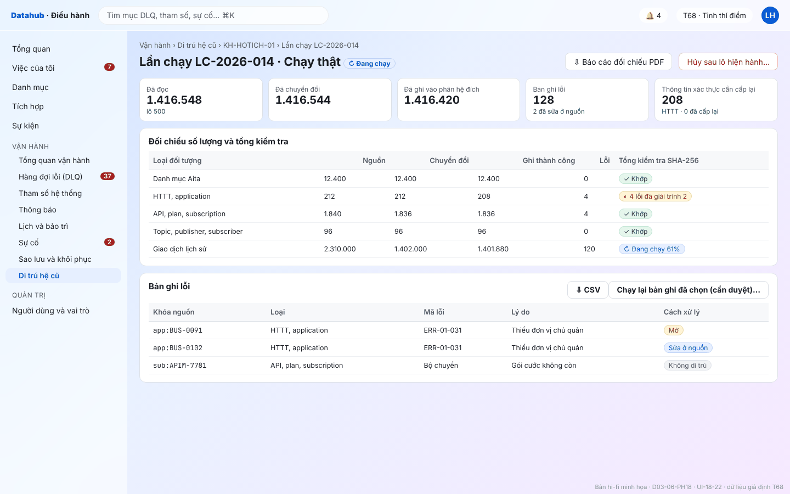

Ảnh cho thấy năm thẻ số, bảng đối chiếu năm loại đối tượng với tổng kiểm tra "Khớp", "4 lỗi đã giải trình", "Đang chạy 61%", và bảng bản ghi lỗi có cột cách xử lý chọn ngay trên dòng.

## 29. UI-18-23 Chạy song song và cắt chuyển

::: dac-ta
**Mục đích.** Cho đội chuyển đổi một màn duy nhất theo dõi từng nhóm dịch vụ chạy song song (cầu nối PH-10, tỷ lệ khớp đối soát bóng, xác thực đã cấp lại), xem danh sách kiểm tra cắt chuyển, đề nghị và duyệt cắt chuyển, quay lui trong cửa sổ 15 phút.

**Đường dẫn, mẫu.** `/van-hanh/di-tru/song-song`, `?nhom={ma}`; PTN-06 Bảng điều khiển.

**Vai trò, quyền.** Người giữ `PERM-18-migration` ● đề nghị, quay lui; người khác có `PERM-18-approve` ● duyệt; TO ○ xem (`PERM-18-read`).

**FR.** 065, 066, 067, 068.

**API.** API-18-173 (nhóm), API-18-174 (chi tiết, mẫu lệch, danh sách kiểm, sổ cắt chuyển), API-18-175 (chuyển trạng thái theo `action`: `REQUEST`, `APPROVE`, `REJECT`, `ROLLBACK`), API-18-184 (quy tắc chuẩn hóa), API-18-185 (xác nhận mục tay), API-18-172 (cấp lại xác thực).

**Dữ liệu nhạy cảm.** Mẫu lệch chỉ có đường dẫn trường, không có giá trị.

**Đợt.** MVP; đầy đủ, ảnh `ui-18-23.png`.
:::

### 29.1. Bố cục

Trên: bảng nhóm dịch vụ. Dưới, khi chọn một nhóm: trái 7/12 danh sách kiểm tra cắt chuyển kèm nút đề nghị; phải 5/12 sổ cắt chuyển với đồng hồ đếm ngược quay lui (dùng tạm CountdownTimer, Phụ lục A) khi nhóm vừa `CUT_OVER`.

```text
┌ Chạy song song và cắt chuyển ─────────────────────────────────────────────────────────────────────┐
│ Nhóm │ Trạng thái │ Cầu nối PH-10 │ Tỷ lệ khớp 7 ngày │ HTTT đã cấp lại │ Lưu lượng sang Datahub     │
│ NHOM-DATDAI │ Song song │ hết hạn 03/12 ⚠ │ 97,10% │ 8/15 │ Chưa                                  │
│ ┌ NHOM-HOTICH · danh sách kiểm tra ───────────┐ ┌ NHOM-DVC · sổ cắt chuyển ────────────────────┐ │
│ │ ✓ DLQ rỗng · ✓ Khớp 99,82% · ✓ Cấp lại 12/12 │ │ 7:12  Còn 7 phút 12 giây để quay lui tự động │ │
│ │ ✓ Đối chiếu · ✕ Đóng băng · ☐ Tay            │ │ 09:34 Cắt chuyển toàn phần · duyệt …         │ │
│ │ [Gửi đề nghị cắt chuyển] ERR-18-067          │ │ [↶ Quay lui về hệ cũ…]                       │ │
│ └──────────────────────────────────────────────┘ └──────────────────────────────────────────────┘ │
└───────────────────────────────────────────────────────────────────────────────────────────────────┘
```

: Wireframe UI-18-23

| Cột nhóm | Nguồn API-18-173 | Ghi chú |
|---|---|---|
| Nhóm dịch vụ | `groupCode` | Liên kết `?nhom=` |
| Trạng thái | `status` | Song song, Bóng đạt, Cắt chuyển một phần, Đã cắt chuyển, Đã quay lui |
| Cầu nối PH-10 | `bridge` | Đang chạy và ngày hết hạn; ⚠ kèm chữ khi còn ≤ 7 ngày mà chưa cắt chuyển; "Không dùng" khi nhóm không có sự kiện |
| Tỷ lệ khớp 7 ngày | `matchRate7d`, `sampleCount` | So `18.migration.parallel.match-threshold-percent` (99,5%), cần ≥ 1.000 mẫu |
| HTTT đã cấp lại xác thực | `reissuedCount`, `totalSystems` | Liên kết tab cấp lại của UI-18-22 |
| Lưu lượng sang Datahub | `trafficPercent` | |

: UI-18-23, cột nhóm dịch vụ

| Trường đề nghị (hộp thoại) | Kiểu | Ràng buộc (FR-18-068), mã lỗi |
|---|---|---|
| Đích | `CMP-RadioCard` | Cắt chuyển một phần, Cắt chuyển toàn phần |
| Tỷ lệ lưu lượng | `CMP-NumberInput` có hậu tố % | Bắt buộc khi một phần, 1 đến 99 |
| Lý do | `CMP-TextArea` | Bắt buộc |

: UI-18-23, trường đề nghị cắt chuyển

Hành động: "Gửi đề nghị cắt chuyển" chỉ bật khi mọi mục tự động đạt và mục tay đã xác nhận; bấm khi còn thiếu hiện ERR-18-067 "Chưa cắt chuyển được nhóm {nhóm}: còn {n} mục kiểm tra chưa đạt." ngay dưới nút; tỷ lệ khớp chưa đạt hiện ERR-18-066; đóng băng hiện ERR-18-051. Duyệt ở `CMP-ApprovalPanel` của Drawer đề nghị (khác người đề nghị: ERR-18-005). "Quay lui về hệ cũ…" (`CMP-ConfirmDialog` kèm lý do) không cần duyệt, hiện trong `18.migration.rollback-window-minutes` (15 phút) kể từ cắt chuyển toàn phần, hoặc bất cứ lúc nào với cắt chuyển một phần; hết cửa sổ thì nút ẩn và hiện ERR-18-068 "Đã quá {phút} phút kể từ khi cắt chuyển nên không quay lui tự động được." Tab "Mẫu lệch" liệt kê đường dẫn trường lệch nhiều nhất (ERR-18-121) và nút "Thêm quy tắc chuẩn hóa".

Trạng thái: chưa có nhóm "Chưa có nhóm dịch vụ nào đang chạy song song."; PH-10 vắng thì cột cầu nối hiện "Chưa cập nhật từ {thời điểm}" (ST-18-B). Truy cập: đồng hồ đếm ngược có nhãn văn bản "Còn 7 phút 12 giây để quay lui tự động", cập nhật cho trình đọc màn hình mỗi phút chứ không mỗi giây (`aria-live="polite"`), và không phải là cách duy nhất biết hết hạn vì nút sẽ ẩn kèm câu ERR-18-068; danh sách kiểm là danh sách có trạng thái bằng chữ.

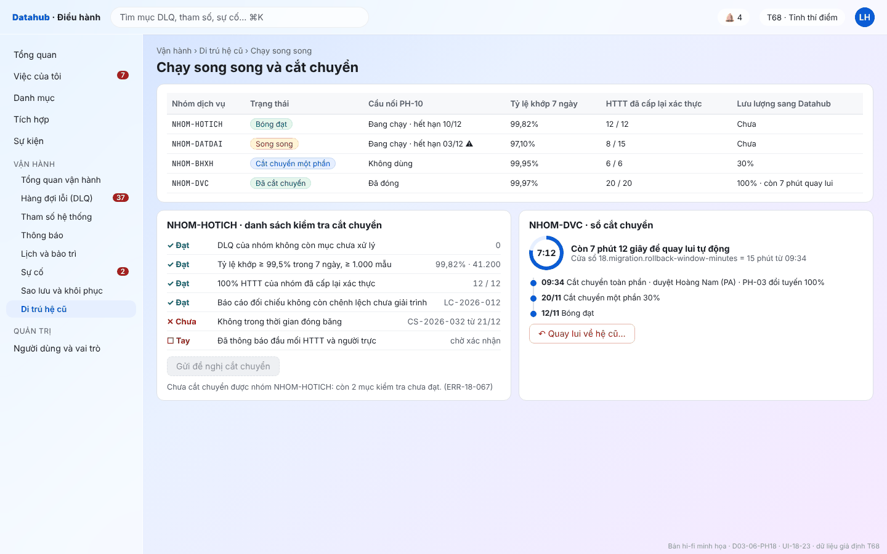

Ảnh cho thấy bốn nhóm dịch vụ ở bốn trạng thái, nhóm đất đai có cầu nối sắp hết hạn; danh sách kiểm tra của nhóm hộ tịch còn một mục đóng băng chưa đạt và một mục tay, nên ERR-18-067 hiện dưới nút; sổ cắt chuyển nhóm DVC với đồng hồ còn 7 phút 12 giây và nút quay lui.

## 30. UI-18-24 Tổng quan vận hành và sức khỏe

::: dac-ta
**Mục đích.** Là trang vào của khu Vận hành: một nhìn cho số mục DLQ chưa xử lý, sự cố đang mở, việc chờ, sao lưu, di trú, đóng băng sắp tới; sức khỏe từng mô-đun của PH-18; nhật ký thao tác vận hành gần đây; báo cáo vận hành định kỳ.

**Đường dẫn, mẫu.** `/van-hanh`, `?tab=bao-cao`, `?tab=nhat-ky`; PTN-06 Bảng điều khiển.

**Vai trò, quyền.** TO, TA, PA, PO, AU ● xem (`PERM-18-read`); PA ● bật, tắt chế độ chỉ đọc qua API-18-187 (`PERM-18-admin`, FR-18-072); PA, PO ● dựng báo cáo (`PERM-18-admin`; TA dựng báo cáo tỉnh).

**FR.** 006, 013, 034, 070, 071, 072.

**API.** API-18-180 (sức khỏe), API-18-177 (nhật ký thao tác), API-18-178, 179 (báo cáo), API-18-081 (thẻ số DLQ), API-18-123 (sự cố), API-18-111 với `?summary=true` (việc), API-18-133 (sao lưu), API-18-165 (lần chạy), API-18-118 (cửa sổ), API-18-186 (sự kiện inbox `FAILED`), API-18-187 (bật, tắt chế độ chỉ đọc; không bị chặn khi đang chỉ đọc).

**Dữ liệu nhạy cảm.** Không; nhật ký thao tác chỉ có tên người, thao tác, mã đối tượng.

**Đợt.** MVP; đầy đủ, ảnh `ui-18-24.png`.
:::

### 30.1. Bố cục

Sáu thẻ số là liên kết sang khu tương ứng; bảng sức khỏe bảy mô-đun; dòng chế độ chỉ đọc; bảng nhật ký thao tác gần đây. Thẻ số được tải độc lập, thẻ lỗi không làm hỏng thẻ khác (ST-18-B).

```text
┌ Tổng quan vận hành                              [Báo cáo vận hành tháng 11 (nháp)] [⇩ Báo cáo tháng 10]┐
│ [DLQ chưa xử lý 1.284] [Sự cố đang mở 4] [Việc chờ tôi 7] [Sao lưu 6/8] [Di trú 61%] [Đóng băng 21/12]│
│ ┌ Sức khỏe các mô-đun PH-18 ────────────────────────────┐ ┌ Nhật ký thao tác vận hành gần đây ────┐ │
│ │ Mô-đun │ Trạng thái │ Ghi chú │ Sự kiện inbox lỗi     │ │ Lúc │ Người │ Thao tác │ Khu         │ │
│ │ notify · thông báo │ ◐ Suy giảm │ SMS gateway thử lại │ │ … Bản chính thức ở kiểm toán PH-13 │ │
│ │ Chế độ chỉ đọc (18.degraded.read-only): tắt           │ │                                     │ │
│ └───────────────────────────────────────────────────────┘ └─────────────────────────────────────┘ │
└───────────────────────────────────────────────────────────────────────────────────────────────────┘
```

: Wireframe UI-18-24

| Cột sức khỏe | Nguồn API-18-180 | Ghi chú |
|---|---|---|
| Mô-đun | `module` | param, dlq, notify, task, incident, backup, migration |
| Trạng thái | `status` | Bình thường (`UP`), Suy giảm (`DEGRADED`), Ngừng (`DOWN`); chữ kèm biểu tượng |
| Ghi chú | `detail` | Ví dụ độ trễ tiêu thụ DLQ, outbox tồn, thành phần phụ lỗi |
| Sự kiện inbox lỗi | `inboxFailed` | Liên kết danh sách sự kiện lỗi (API-18-186); nguồn ERR-18-124 |

: UI-18-24, cột sức khỏe mô-đun

Thông báo hệ thống hiện ở màn này theo khối FR: ERR-18-103 cho PO "Có bản tin lỗi mang tenant {mã} trên topic của tenant khác."; ERR-18-104 "Kho đối tượng của DLQ không ghi được. Bản tin lỗi đang được giữ trong hàng đợi."; ERR-18-124 "Sự kiện đổi tham số đang chậm {phút} phút." và "Có {n} sự kiện mở sự cố chưa xử lý được." Mỗi câu là một dòng `CMP-Alert` trên bảng sức khỏe, có liên kết sang mô-đun.

Hành động: bật, tắt chế độ chỉ đọc (PA; `CMP-ConfirmDialog` có lý do, API-18-187; bật xong toàn khu hiện ST-18-A, nút tắt vẫn dùng được); "Dựng báo cáo…" (`CMP-Modal` chọn kỳ; kỳ chưa kết thúc: ERR-18-072 "Kỳ báo cáo {kỳ} không hợp lệ hoặc chưa kết thúc."); tải báo cáo đã có. Tab "Nhật ký" là PTN-11 Tra log trên API-18-177 với lọc người, khu, thao tác, thời gian; ghi rõ "Bản chính thức ở kiểm toán PH-13".

Trạng thái: PH-18 `DOWN` thì trang hiện ST-09 kèm câu "Phân hệ vận hành đang gián đoạn. Giao dịch của HTTT không bị ảnh hưởng."; thẻ không tải được hiện "Chưa tải được" và nút "Thử lại" trong thẻ. Truy cập: thẻ số là liên kết có nhãn đầy đủ ("DLQ chưa xử lý 1.284, vượt ngưỡng 1.000, mở hàng đợi lỗi"); không tự làm mới nhanh hơn 60 giây.

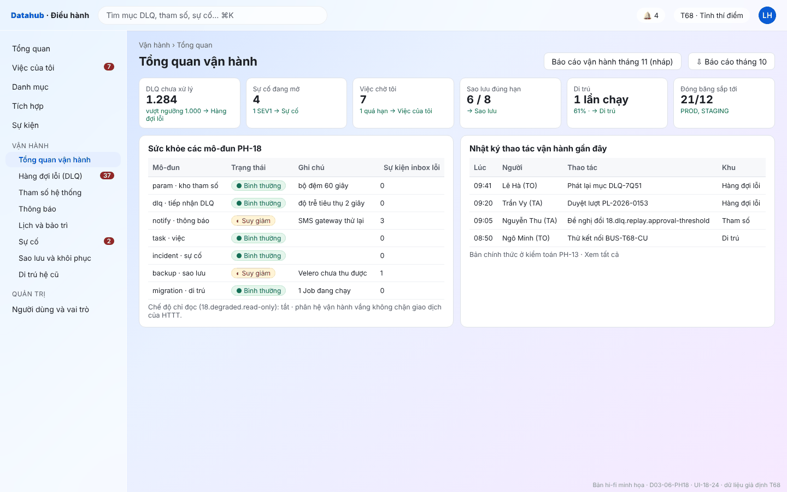

Ảnh cho thấy sáu thẻ số dẫn sang các khu, bảng sức khỏe với hai mô-đun "Suy giảm" (thông báo vì SMS gateway, sao lưu vì Velero), dòng chế độ chỉ đọc đang tắt, và nhật ký thao tác gần đây ghi rõ bản chính thức ở PH-13.

## 31. Luồng màn chính

Chương này nối các màn thành bốn luồng mà người vận hành đi nhiều nhất hoặc có rủi ro cao nhất. Mỗi sơ đồ chỉ nêu bước giao diện và lời gọi API chính; chi tiết điều kiện nằm ở chương của từng màn và ở khối FR tương ứng.

### 31.1. Xem nội dung và sửa bản tin lỗi có duyệt

Người vận hành mở chi tiết mục, khai lý do để xem nội dung, tạo bản sửa; bản sửa chạm trường mức Hạn chế nên chờ người thứ hai duyệt rồi mới phát lại.

```{.mermaid caption="Luồng xem nội dung, sửa và phát lại một mục DLQ"}
sequenceDiagram
  actor TO as Vận hành tỉnh
  participant C as dh-console
  participant O as API vận hành
  actor TA as Quản trị tỉnh
  TO->>C: Mở UI-18-03 từ danh sách
  C->>O: API-18-045 và API-18-048 lấy chi tiết và khung cấu trúc
  TO->>C: Bấm Xem nội dung, nhập mục đích và lý do
  C->>O: API-18-047 mở phiếu xem 15 phút
  O-->>C: Nội dung đã che trường mã hóa ở nguồn
  TO->>C: Bấm Sửa nội dung, sang UI-18-04
  C->>O: API-18-053 tạo bản sửa số 1
  O-->>C: Bản sửa chờ duyệt vì có trường mức Hạn chế
  O-->>TA: Tạo việc duyệt trong Việc của tôi
  TA->>C: Mở UI-18-15, xem khác biệt, bấm Duyệt
  C->>O: API-18-055 duyệt bản sửa
  TO->>C: Bấm Phát lại với bản sửa số 1
  C->>O: API-18-064 với khóa lũy đẳng dlqId và revision
  O-->>C: Mục sang Đang phát lại rồi Đã xử lý
```

### 31.2. Phát lại loạt vượt ngưỡng duyệt

Lượt phát lại có số mục vượt `18.dlq.replay.approval-threshold` tự thành đề nghị; người duyệt không phải người tạo; khi chạy, tỷ lệ lỗi vượt 20% thì lượt tự tạm dừng.

```{.mermaid caption="Luồng tạo, duyệt và theo dõi lượt phát lại loạt"}
sequenceDiagram
  actor TO as Vận hành tỉnh
  participant C as dh-console
  participant O as API vận hành
  actor SO as Cán bộ ATTT
  TO->>C: Chọn bộ lọc ở UI-18-01 hoặc nhóm ở UI-18-02
  TO->>C: Bấm Tạo lượt phát lại, chọn tốc độ 10 mục mỗi giây
  C->>O: API-18-065 tạo lượt nháp, đếm 1.240 mục
  C->>O: API-18-069 gửi lượt
  O-->>C: Lượt Chờ duyệt vì vượt ngưỡng 500 mục
  O-->>SO: Tạo việc duyệt lượt phát lại
  SO->>C: Mở UI-18-05, xem phạm vi và mục bị loại, bấm Duyệt
  C->>O: API-18-070 duyệt lượt
  O-->>C: Lượt Đang chạy, tiến độ cập nhật theo ETag
  O-->>C: Tỷ lệ lỗi vượt 20%, lượt Tạm dừng
  TO->>C: Xem kết quả từng mục, giảm tốc độ, bấm Tiếp tục
  C->>O: API-18-075 đổi tốc độ rồi API-18-073 tiếp tục
```

### 31.3. Khôi phục dữ liệu một tỉnh

Quản trị tỉnh tạo yêu cầu bằng Wizard bốn bước, quản trị nền tảng duyệt, Job chạy tám bước; lỗi ở bước 5 đến 8 thì tự quay lui.

```{.mermaid caption="Luồng yêu cầu, duyệt và theo dõi khôi phục tenant"}
sequenceDiagram
  actor TA as Quản trị tỉnh
  participant C as dh-console
  participant O as API vận hành
  actor PA as Quản trị nền tảng
  TA->>C: Mở UI-18-20, bấm Yêu cầu khôi phục
  TA->>C: Chọn thời điểm đích, phạm vi phân hệ, kho khác
  C->>O: API-18-138 tạo yêu cầu nháp và nhận ước tính
  TA->>C: Đọc cảnh báo tạm ngừng, nhập lý do, xác nhận
  C->>O: API-18-141 gửi duyệt
  O-->>PA: Tạo việc duyệt khôi phục
  PA->>C: Mở UI-18-20 từ việc, đọc phạm vi và cảnh báo, bấm Duyệt
  C->>O: API-18-142 duyệt và tạo Job khôi phục
  O-->>C: Tám bước cập nhật qua API-18-145
  O-->>C: Bước 8 đối chiếu số dòng đạt, yêu cầu Thành công
  O-->>TA: Thông báo khôi phục xong
```

### 31.4. Cắt chuyển một nhóm dịch vụ và quay lui

Nhóm dịch vụ đạt danh sách kiểm tra thì được đề nghị cắt chuyển; người thứ hai duyệt; trong 15 phút sau cắt chuyển toàn phần có thể quay lui một bước.

```{.mermaid caption="Luồng đề nghị, duyệt cắt chuyển và quay lui trong cửa sổ"}
sequenceDiagram
  actor TA as Quản trị tỉnh
  participant C as dh-console
  participant O as API vận hành
  actor PA as Quản trị nền tảng
  TA->>C: Mở UI-18-23, chọn nhóm NHOM-HOTICH
  C->>O: API-18-174 lấy danh sách kiểm tra tự đánh giá
  O-->>C: Đủ mục tự động, còn một mục tay
  TA->>C: Xác nhận mục tay, bấm Gửi đề nghị cắt chuyển toàn phần
  C->>O: API-18-175 với đích CUT_OVER và lý do
  O-->>PA: Tạo việc duyệt cắt chuyển
  PA->>C: Mở UI-18-23 từ việc, bấm Duyệt
  O-->>C: Nhóm Đã cắt chuyển, đồng hồ quay lui 15 phút bắt đầu
  TA->>C: Phát hiện lỗi, bấm Quay lui về hệ cũ trong cửa sổ
  C->>O: API-18-175 với đích ROLLED_BACK
  O-->>C: Nhóm Đã quay lui rồi Song song, sổ cắt chuyển ghi mốc
```

## 32. Ma trận vai trò và màn hình

Bảng dưới tóm quyền của chín vai trò của FRS §3.2 trên 24 màn. Ký hiệu ● là xem và thao tác chính, ○ là xem hoặc thao tác giới hạn (chỉ mục được giao, chỉ ghi chú, chỉ đọc), — là không vào được. Người dùng có tài khoản thuộc mọi vai trò dùng UI-18-14 và UI-18-15.

| Màn | PA | PO | TA | TO | SO | IE | DS | AU | VW |
|---|---|---|---|---|---|---|---|---|---|
| UI-18-01 Danh sách DLQ | ○ | ● | ● | ● | ● | ○ | ○ | ○ | ○ |
| UI-18-02 DLQ theo nhóm lỗi | ○ | ● | ● | ● | ● | ○ | ○ | ○ | ○ |
| UI-18-03 Chi tiết mục DLQ | ○ | ● | ● | ● | ● | ● | ○ | ○ | ○ |
| UI-18-04 Sửa payload | ○ duyệt | — | ● | ● | ● | ● | — | — | — |
| UI-18-05 Lượt phát lại | ● duyệt | ● | ● | ● | ● | ○ | ○ | — | — |
| UI-18-06 Thống kê và nguồn DLQ | ● | ○ | ○ | ○ | ○ | ○ | ○ | ○ | ○ |
| UI-18-07 Sổ tay xử lý lỗi | ● | ○ | ○ | ○ | ○ | ○ | ○ | ○ | ○ |
| UI-18-08 Tham số | ● | ○ | ● | ○ | ○ | ○ | ○ | ○ | ○ |
| UI-18-09 Lịch sử và đề nghị tham số | ● duyệt | ○ | ● | ○ | ● duyệt | ○ | ○ | ○ | ○ |
| UI-18-10 Cờ tính năng và egress | ● | ○ | ● | ○ | ○ | ○ | ○ | ○ | ○ |
| UI-18-11 Mẫu và quy tắc thông báo | ● | ○ | ● | ○ | ○ | ○ | ○ | ○ | ○ |
| UI-18-12 Soạn mẫu | ● duyệt | — | ● | — | ● duyệt | — | — | — | — |
| UI-18-13 Nhật ký gửi | ○ | ○ | ● | ○ | ○ | ○ | ○ | ○ | ○ |
| UI-18-14 Tùy chọn nhận thông báo | ● | ● | ● | ● | ● | ● | ● | ● | ● |
| UI-18-15 Việc của tôi | ● | ● | ● | ● | ● | ● | ● | ● | ● |
| UI-18-16 Lịch, bảo trì, đóng băng | ● | ● | ● | ○ | ○ | ○ | ○ | ○ | ○ |
| UI-18-17 Danh sách sự cố | ● | ● | ● | ● | ● | ○ | ○ | ○ | ○ |
| UI-18-18 Chi tiết sự cố | ● | ● | ● | ● | ● chuyển PH-09 | ○ | ○ | ○ | ○ |
| UI-18-19 Bảng điều khiển sao lưu | ● | ● | ● | — | — | — | — | ○ diễn tập | — |
| UI-18-20 Khôi phục, xuất, sáp nhập | ● duyệt | ○ | ● | — | — | — | — | — | — |
| UI-18-21 Nguồn và kế hoạch di trú | ● | ● | ● | — | — | — | ○ | — | — |
| UI-18-22 Lần chạy di trú | ● duyệt | ● | ● | — | ● duyệt | — | ○ | ○ đối chiếu | — |
| UI-18-23 Chạy song song và cắt chuyển | ● duyệt | ● | ● | ○ | ● duyệt | — | ○ | — | — |
| UI-18-24 Tổng quan vận hành | ● | ● | ● | ● | ● | ○ | ○ | ● | ○ |

: Ma trận vai trò và màn PH-18

Hai điểm cần đọc kèm bảng. Thứ nhất, từ FRS 0.2, API-18-041, 043, 045 nhận `PERM-18-read` (Q18-30 đã chốt) nên AU, VW được xem siêu dữ liệu DLQ ở ba màn DLQ đầu, chỉ đọc, ẩn mọi nút thao tác và nút xem nội dung; ba dòng đầu ghi ○ cho AU, VW. Thứ hai, quyền duyệt của SO ở UI-18-22, UI-18-23 suy từ `PERM-18-approve` của §3.2; thực tế tỉnh có thể chỉ giao duyệt di trú cho TA và PA bằng chính sách của PH-12.

## 33. Ma trận màn, FR và API

Chương này giúp kiểm thử viên và người viết D03-04-PH18 đối chiếu mỗi màn với chức năng và API nó dùng. Bảng thứ nhất đi theo màn; bảng thứ hai đi theo nhóm FR để thấy không FR nào bị bỏ sót.

| Màn | FR | API chính |
|---|---|---|
| UI-18-01 | 013, 014, 015, 016, 017, 019, 023, 028, 031 | API-18-041, 042, 081, 039, 051, 065, 069, 078 |
| UI-18-02 | 020, 023, 028 | API-18-043, 044, 041, 065, 069, 081 |
| UI-18-03 | 015, 016, 021, 022, 023, 024, 025, 027, 030, 031, 032, 070 | API-18-045 đến 050, 058, 052, 064, 077, 079 |
| UI-18-04 | 024 | API-18-047, 052 đến 056 |
| UI-18-05 | 028, 029, 030 | API-18-066 đến 075 |
| UI-18-06 | 012, 018, 033, 034 | API-18-081, 031 đến 033, 037, 038, 080 |
| UI-18-07 | 025 | API-18-057, 058, 059 |
| UI-18-08 | 001 đến 004, 006, 007, 008, 011, 069 | API-18-001 đến 008, 016 đến 019 |
| UI-18-09 | 004, 005 | API-18-003, 009 đến 015 |
| UI-18-10 | 009, 010 | API-18-020 đến 026 |
| UI-18-11 | 035, 039 | API-18-082, 083, 090, 099 đến 101, 104, 105 |
| UI-18-12 | 035 | API-18-084 đến 089 |
| UI-18-13 | 036, 037, 040, 041 | API-18-102 đến 105 |
| UI-18-14 | 036, 038 | API-18-095 đến 098 |
| UI-18-15 | 004, 009, 024, 028, 035, 042, 043, 044, 055, 062, 068 | API-18-111, 112, 181, 108 và API duyệt của đối tượng nguồn |
| UI-18-16 | 045, 046 | API-18-113 đến 115, 118 đến 121 |
| UI-18-17 | 047, 048 | API-18-123, 124 |
| UI-18-18 | 048 đến 051 | API-18-125 đến 131 |
| UI-18-19 | 052, 053, 058 | API-18-133, 134, 136, 154, 155 |
| UI-18-20 | 054 đến 057 | API-18-138 đến 149, 151, 152 |
| UI-18-21 | 059 đến 062 | API-18-156 đến 165 |
| UI-18-22 | 061 đến 065 | API-18-164, 166 đến 172, 182, 183 |
| UI-18-23 | 065 đến 068 | API-18-172 đến 175, 184, 185 |
| UI-18-24 | 006, 013, 034, 070, 071, 072 | API-18-180, 177 đến 179, 081, 123, 111, 133, 165, 118, 186, 187 |

: Ma trận màn, FR và API của PH-18

| Nhóm FR | FR | Màn | Ghi chú |
|---|---|---|---|
| Kho tham số | 001 đến 011, 069 | UI-18-08, 09, 10, 24 | 011 (PH-20 ghi mặc định) chỉ hiện kết quả ở UI-18-08 |
| Tiếp nhận DLQ | 012 đến 018 | UI-18-01, 03, 06, 24 | 013, 014 là đường vào của bản tin; giao diện chỉ hiện kết quả |
| Phân loại, xem, sửa DLQ | 019 đến 027 | UI-18-01 đến 04, 07 | FR-18-026 (API đọc DLQ cho PH-17, PH-13) không cần màn |
| Phát lại | 028 đến 032 | UI-18-01 đến 05 | 030 là gọi lại của phân hệ nguồn, hiện ở kết quả từng mục |
| Lưu giữ, thống kê | 033, 034 | UI-18-06, 24 | |
| Thông báo | 035 đến 041 | UI-18-11 đến 14 | 036, 037 là API gửi; giao diện là nhật ký và hộp thông báo |
| Việc | 042 đến 044 | UI-18-15 | 042, 043 do phân hệ khác gọi |
| Lịch, cửa sổ | 045, 046 | UI-18-16 | |
| Sự cố | 047 đến 051 | UI-18-17, 18 | 047 mở tự động từ sự kiện, hiện ở cột nguồn |
| Sao lưu, khôi phục | 052 đến 058 | UI-18-19, 20 | 057 do PH-20 khởi tạo, màn chỉ đọc |
| Di trú | 059 đến 068 | UI-18-21 đến 23 | |
| Nhật ký, báo cáo, sức khỏe | 070 đến 072 | UI-18-03, 24 | |

: Độ phủ FR của tập màn PH-18

## 34. Kiểm thử giao diện và ảnh hi-fi

Chương này cho kiểm thử viên danh sách điểm phải kiểm trên giao diện và danh mục ảnh hi-fi đi kèm. Mã ca kiểm thử do D05-02-PH18 cấp.

### 34.1. Việc kiểm thử viên phải kiểm

Bảng dưới là đầu vào cho D05-02-PH18, gom theo nhóm điểm kiểm và màn áp dụng.

| Nhóm | Nội dung kiểm | Màn |
|---|---|---|
| Bố cục | Không cuộn ngang ở 320px; bảng chuyển thẻ dưới `bp-md`; Drawer thành toàn màn dưới `bp-md` | Mọi màn |
| Lọc trên URL | Mọi bộ lọc giữ trên URL, mở lại liên kết ra đúng kết quả; tham số không chứa giá trị nhạy cảm | UI-18-01, 02, 13, 17 |
| Nội dung bản tin | Mặc định chỉ hiện khung cấu trúc; xem cần lý do ≥ 10 ký tự; phiếu 15 phút tự che; trường mã hóa ở nguồn luôn che | UI-18-03, 04 |
| Bản sửa | Bản gốc không đổi; khác biệt đọc được bằng chữ; bản sửa có trường Hạn chế cần duyệt | UI-18-04 |
| Bốn mắt | Người đề nghị không bấm duyệt được, câu ERR-18-005 hiện bằng chữ, cả khi mở bằng URL | UI-18-04, 05, 09, 12, 15, 20, 22, 23 |
| Phát lại loạt | Vượt 500 mục thành đề nghị; vượt 10.000 mục bị chặn; tự dừng khi lỗi vượt 20% | UI-18-05 |
| Mẫu thư | Biến mức Hạn chế hoặc Nhạy cảm bị chặn, xem thử hiện "[đã chặn: …]", nút gửi duyệt vô hiệu | UI-18-12 |
| Che người nhận | Nhật ký gửi không bao giờ hiện địa chỉ đầy đủ | UI-18-13 |
| Bí mật | Không có ô mật khẩu; chuỗi JDBC có thông tin đăng nhập bị từ chối với ERR-18-070 | UI-18-21 |
| Tiến trình | Tám bước khôi phục, tiến độ di trú, đồng hồ quay lui đọc được bằng trình đọc màn hình mà không đọc liên tục | UI-18-20, 22, 23 |
| Chế độ chỉ đọc | Dải ST-18-A cố định, nút ghi vô hiệu kèm lý do, nút đọc vẫn dùng được | Mọi màn `/van-hanh` |
| Fail-soft | PH-13, PH-10, Velero vắng thì chỉ khối liên quan báo, phần khác dùng được | UI-18-03, 19, 23, 24 |
| Thông báo | Câu hiển thị đúng từng chữ với câu FRS §9.1 sau khi điền tham số theo ngữ cảnh | Mọi màn |
| Truy cập | Bàn phím toàn bộ; tương phản 4,5:1 chữ và 3:1 thành phần; `prefers-reduced-motion`; trạng thái không chỉ bằng màu | Mọi màn |
| Vật liệu | Glass chỉ ở khung, Drawer, hộp thoại, thanh nổi; bảng và biểu mẫu dày trên nền đặc | Mọi màn |

: Danh sách kiểm giao diện PH-18

### 34.2. Ảnh hi-fi

Hai mươi sáu ảnh ở `ph18/hifi/`: một ảnh cho mỗi màn và hai ảnh trạng thái (`ui-18-01b.png`, `ui-18-03b.png`). Dữ liệu giả định của tỉnh thí điểm T68, không có dữ liệu cá nhân thật. Ảnh sinh từ `gen_hifi.py` theo `hifi.css`, chụp bằng `shot.js` (Playwright Chromium, rộng 1440px, tỷ lệ điểm ảnh 1), nén bằng `nen.py` dưới 150 KB; tệp `.html` cạnh mỗi ảnh là nguồn để sửa và chụp lại.

| Tệp | Nội dung |
|---|---|
| `ui-18-01.png` | Danh sách DLQ: bốn thẻ số, chip lọc, bảng có nhãn trạng thái, thanh thao tác hàng loạt |
| `ui-18-01b.png` | Bốn trạng thái của danh sách: rỗng, đang tải, lỗi tải, không có quyền, kèm dải chỉ đọc |
| `ui-18-02.png` | DLQ theo nhóm lỗi với dấu hiệu nhóm và nút phát lại nhóm |
| `ui-18-03.png` | Chi tiết mục DLQ: khung cấu trúc, chẩn đoán, sổ tay, phiếu xem đang hiệu lực |
| `ui-18-03b.png` | Hộp thoại khai mục đích và lý do xem nội dung, bộ đếm ký tự |
| `ui-18-04.png` | Sửa payload với khác biệt theo đường dẫn trường và yêu cầu duyệt |
| `ui-18-05.png` | Lượt phát lại đang chạy: tiến độ, tốc độ, tạm dừng, kết quả từng mục |
| `ui-18-06.png` | Thống kê DLQ theo nguồn và lớp lỗi, ngưỡng cảnh báo |
| `ui-18-07.png` | Sổ tay xử lý lỗi với Drawer một mã lỗi |
| `ui-18-08.png` | Tham số theo không gian tên, khóa ★, nguồn giá trị |
| `ui-18-09.png` | Lịch sử phiên bản tham số và đề nghị chờ duyệt |
| `ui-18-10.png` | Cờ tính năng và danh sách egress |
| `ui-18-11.png` | Mẫu thông báo và xem nhanh quy tắc |
| `ui-18-12.png` | Soạn mẫu thư với biến bị chặn |
| `ui-18-13.png` | Nhật ký gửi và Drawer lần gửi bị trả lại |
| `ui-18-14.png` | Tùy chọn nhận thông báo, ma trận nhóm và kênh, giờ yên lặng |
| `ui-18-15.png` | Việc của tôi với việc duyệt lượt phát lại quá hạn |
| `ui-18-16.png` | Lịch tháng 12 năm 2026 với bảo trì và đóng băng |
| `ui-18-17.png` | Danh sách sự cố vận hành |
| `ui-18-18.png` | Chi tiết sự cố SEV2 đã giảm thiểu |
| `ui-18-19.png` | Bảng điều khiển sao lưu với một đối tượng trễ |
| `ui-18-20.png` | Yêu cầu khôi phục đang chạy bước 5 trên 8 |
| `ui-18-21.png` | Nguồn và kế hoạch di trú hộ tịch |
| `ui-18-22.png` | Lần chạy di trú thật đang chạy, đối chiếu và bản ghi lỗi |
| `ui-18-23.png` | Chạy song song, danh sách kiểm tra cắt chuyển, đồng hồ quay lui |
| `ui-18-24.png` | Tổng quan vận hành và sức khỏe mô-đun |

: Danh sách ảnh hi-fi PH-18

## Phụ lục A. Đề nghị bổ sung cho D03-05

Mục này liệt kê thành phần chưa có trong D03-05-03, D03-05-04; tập màn dùng tạm tên dưới đây (không có tiền tố `CMP-`) cho đến khi D03-05 chấp nhận. Không có token mới; mọi màu, khoảng cách, bán kính dùng token sẵn có.

| Mã | Tên dùng tạm | Mô tả | Dùng ở |
|---|---|---|---|
| A1 | CalendarMonth | Lịch tháng dạng lưới 7 cột, mỗi ô có nhãn chữ cho ngày lễ, ngày làm bù, bảo trì, đóng băng; vai trò `grid`, phím mũi tên, `PageUp`, `PageDown`; ô nhiều sự kiện gộp "+n" mở Popover | UI-18-16 |
| A2 | CountdownTimer | Đồng hồ đếm ngược có nhãn văn bản đầy đủ, cập nhật trình đọc màn hình mỗi phút, đổi sang trạng thái hết hạn có chữ; không là cách duy nhất báo hết hạn | UI-18-03 (phiếu xem), UI-18-23 (quay lui) |
| A3 | ChannelPreview | Khung xem thử thông báo theo kênh (thư có tiêu đề, người gửi, thân; SMS có số ký tự; trong ứng dụng có thẻ), hiện "[đã chặn: {biến}]" thay giá trị bị chặn | UI-18-12 |

: Thành phần đề nghị bổ sung cho D03-05

## Phụ lục B. Đề nghị bổ sung API cho D03-04-PH18

Bản 0.1 ghi bảy thao tác giao diện mà khối FR mô tả nhưng chưa có API tương ứng. FRS 0.2 và D03-04-PH18 0.2 đã cấp mã cho cả bảy (cột "Trạng thái"); thao tác cắt chuyển dùng thân `action` của API-18-175.

| Mã | Đề nghị | Lý do, FR | Màn | Trạng thái |
|---|---|---|---|---|
| B1 | `PATCH /migration-runs/{runId}/errors` cập nhật cách xử lý bản ghi lỗi (một hoặc nhóm) | FR-18-063 bước 2; API-18-170 chỉ đọc | UI-18-22 | Đã hấp thụ ở 0.2: API-18-182 |
| B2 | `PATCH /credential-reissues/{markerId}` đánh dấu Không cần kèm lý do | FR-18-065 luồng thay thế; API-18-172 chỉ đọc | UI-18-22 | Đã hấp thụ ở 0.2: API-18-183 `POST /credential-reissues/{markerId}:waive`, trạng thái `WAIVED` |
| B3 | `PUT /parallel-groups/{groupCode}/normalization-rules` thêm quy tắc chuẩn hóa | FR-18-067 luồng thay thế | UI-18-23 | Đã hấp thụ ở 0.2: API-18-184 |
| B4 | `POST /parallel-groups/{groupCode}/checklist/{itemCode}:confirm` xác nhận mục kiểm tay | FR-18-068 bước 1 (mục tay) | UI-18-23 | Đã hấp thụ ở 0.2: API-18-185 |
| B5 | `POST /me/tasks/{taskId}:claim` nhận việc, báo người cùng nhận | FR-18-044, chưa có API đổi sang `IN_PROGRESS` | UI-18-15 | Đã hấp thụ ở 0.2: API-18-181 |
| B6 | `GET /inbox-failures` danh sách sự kiện inbox `FAILED` theo mô-đun | FR-18-072 bước 4; API-18-180 chỉ có số đếm | UI-18-24 | Đã hấp thụ ở 0.2: API-18-186 |
| B7 | `POST /degraded-mode` bật, tắt chế độ chỉ đọc có lý do | FR-18-072 bước 3; hiện phải ghi tham số `18.degraded.read-only` qua API-18-006, khó tách quyền `PERM-18-admin` | UI-18-24 | Đã hấp thụ ở 0.2: API-18-187, miễn chặn chỉ đọc |

: Đề nghị bổ sung API cho PH-18

## Phụ lục C. Điểm lệch và đề nghị đồng bộ

Mục này ghi chỗ FRS, D03-06-00 và tập màn chưa khớp nhau. Tập màn theo FRS khi FRS rõ; khi FRS tự mâu thuẫn, tập màn chọn cách an toàn hơn và ghi lại để BA PH-18 sửa ở bản FRS sau. Ở bản 0.2, tám điểm lệch với FRS đã được hấp thụ; LC-01, LC-02, LC-06 và năm đề nghị ĐB-01…05 thuộc D03-06-00 nên giữ cho đợt đồng bộ liên phân hệ.

### C.1. Điểm lệch với FRS

Bảng dưới liệt kê từng điểm lệch, cách tập màn đang xử lý và đề nghị sửa.

| Mã | Điểm lệch | Cách tập màn xử lý | Đề nghị | Trạng thái |
|---|---|---|---|---|
| LC-01 | FRS §10.1 đặt Việc của tôi ở `/ca-nhan/viec`; D03-06-00 mục 2 đã có `/viec-cua-toi` | Theo FRS, ghi đề nghị ĐB-02 | Thống nhất một đường dẫn (Q18-31) | Giữ: chờ D03-06-00 (ĐB-02, Q18-31) |
| LC-02 | FRS dùng `/ca-nhan/thong-bao` cho tùy chọn nhận (PTN-12); D03-06-00 dùng cho lịch sử thông báo (PTN-01) | Một trang hai tab, tùy chọn ở `?tab=tuy-chon` | ĐB-03, Q18-32 | Giữ: chờ D03-06-00 (ĐB-03, Q18-32) |
| LC-03 | FRS §10.1 ghi vai trò MO (UI-18-21 đến 23) và DPO (UI-18-18) không có trong §3 | MO là người giữ `PERM-18-migration`; DPO là SO | Bổ sung vào §3 hoặc sửa §10.1 (Q18-37) | Đã hấp thụ ở 0.2: FRS §10.1 dùng SO, PA, TA |
| LC-04 | UI-18-07 ghi vai trò "PH chủ" (kỹ sư phân hệ chủ mã lỗi) không có trong §3.2 | Đề nghị nội dung qua PA, PA soạn | Làm rõ ở FR-18-025 | Đã hấp thụ ở 0.2: FRS §10.1 ghi UI-18-07 cho TO, IE, PA |
| LC-05 | §3.2 cho `PERM-18-read` xem siêu dữ liệu DLQ, nhưng API-18-041, 043, 045 đòi `PERM-18-dlq` | AU, VW không vào UI-18-01 đến 03 | Sửa một trong hai (Q18-30) | Đã hấp thụ ở 0.2: API-18-041, 043, 045 nhận `PERM-18-read` |
| LC-06 | D03-06-00 mục 40 ghi PTN-01 cho sao lưu; FRS §10.1 ghi PTN-06 | Theo FRS (PTN-06) | ĐB-04 | Giữ: chờ D03-06-00 (ĐB-04) |
| LC-07 | Câu ở §9.1 của ERR-18-001, 005, 006, 007 là câu cụ thể của một trường hợp (ví dụ ERR-18-007 nói 10 ký tự, nhưng lý do khôi phục cần 30) | Dùng câu riêng của khối FR khi có; câu §9.1 chỉ dùng cho đúng trường hợp đó | Đổi §9.1 thành câu có biến | Đã hấp thụ ở 0.2: §9.1 dùng câu chung có tham số |
| LC-08 | FRS §10.1 nói "PTN chuẩn của D03-05", trong khi PTN định nghĩa ở D03-06-00 | Tham chiếu D03-06-00 | Sửa câu ở §10.1 | Đã hấp thụ ở 0.2: §10.1 tham chiếu D03-06-00 |
| LC-09 | Tên tham số không thống nhất: `18.migration.rollback-window-minutes` và `18.migration.cutover.rollback-minutes`; `18.migration.parallel.match-threshold-percent` và `18.migration.shadow.match-threshold-percent`; `18.export.link-ttl-hours` và `18.export.download-ttl-days`; `18.task.reminder.before-hours` và `18.task.reminder-before-hours` | Dùng tên xuất hiện trong khối FR (vế đầu mỗi cặp) | Chốt một tên ở §8.4 | Đã hấp thụ ở 0.2: §8.2 là tên duy nhất, khối FR dùng đúng tên |
| LC-10 | Câu ERR-18-069 ở §9.1 ("chưa nhận lô. Lần chạy tạm dừng.") khác câu ở FR-18-062 (có "tự thử lại sau {phút} phút") | Dùng câu của khối FR vì cho người dùng biết bước tiếp | Đồng bộ §9.1 | Đã hấp thụ ở 0.2: §9.1 dùng câu của FR-18-062 |
| LC-11 | Một số thao tác giao diện chưa có API ghi (Phụ lục B) | Thiết kế nút, ghi đề nghị | D03-04-PH18 cấp mã | Đã hấp thụ ở 0.2: API-18-181…187 (Phụ lục B) |

: Điểm lệch giữa tập màn và FRS PH-18

### C.2. Đề nghị đồng bộ D03-06-00

Các đề nghị dưới đây cần nhóm IA cập nhật vào D03-06-00 để menu và đường dẫn khớp với PH-18.

| Mã | Mục D03-06-00 | Đề nghị |
|---|---|---|
| ĐB-01 | Bảng menu mục 38 đến 41, nhóm Vận hành | Thêm các mục `/van-hanh` (Tổng quan, đứng đầu nhóm), `/van-hanh/thong-bao` (Thông báo), `/van-hanh/su-co` (Sự cố), `/van-hanh/lich` (Lịch và đóng băng); giữ bốn mục cũ; thứ tự theo chương 4.3 |
| ĐB-02 | Mục 2 Việc của tôi `/viec-cua-toi` | Chọn một trong hai đường dẫn với FRS PH-18; đường dẫn còn lại chuyển hướng 301 |
| ĐB-03 | Bảng trang cá nhân, `/ca-nhan/thong-bao` | Ghi trang có hai tab: Thông báo (PTN-01) và Tùy chọn nhận (PTN-12, `?tab=tuy-chon`) |
| ĐB-04 | Mục 40 Sao lưu và khôi phục | Đổi mẫu thành PTN-06 (bảng điều khiển), thêm "PTN-05 cho Wizard khôi phục" |
| ĐB-05 | Bảng chuyển hướng | Thêm `/quan-tri/tham-so?nhom={ns}` chuyển 301 tới `/van-hanh/tham-so?ns={ns}` (FRS §10.3) |

: Đề nghị đồng bộ D03-06-00 từ PH-18

## Câu hỏi mở

Các câu dưới đây cần người có thẩm quyền chốt trước khi kỹ sư giao diện làm phần liên quan; đề xuất của nhóm đã được dùng trong bản thiết kế này.

> **Câu hỏi mở Q18-30 (đã chốt ở 0.2):** Kiểm toán viên và người xem có được vào danh sách DLQ ở mức siêu dữ liệu không (LC-05)? Đề xuất: có, chỉ đọc, ẩn mọi nút thao tác và nút xem nội dung; sửa API-18-041 nhận `PERM-18-read`. Người quyết: SO, PO. Kết quả: FRS 0.2 cho API-18-041, 043, 045 nhận `PERM-18-read`.

> **Câu hỏi mở Q18-31:** Việc của tôi dùng `/ca-nhan/viec` của FRS hay `/viec-cua-toi` của D03-06-00 (LC-01)? Đề xuất: dùng `/viec-cua-toi` vì menu dùng chung và các phân hệ khác đã liên kết tới đó; `/ca-nhan/viec` chuyển hướng 301. Người quyết: UX, PO.

> **Câu hỏi mở Q18-32:** Gộp hộp thông báo và tùy chọn nhận vào một trang hai tab ở `/ca-nhan/thong-bao` có được không (LC-02)? Đề xuất: được, tab mặc định là Thông báo. Người quyết: UX.

> **Câu hỏi mở Q18-33:** Khi người dùng rời trang chi tiết lúc phiếu xem nội dung còn hạn, quay lại có thấy nội dung ngay không? Đề xuất: che ngay khi rời trang; quay lại trong 15 phút thì bấm "Hiện lại" không cần nhập lý do mới, mỗi lần hiện vẫn ghi kiểm toán. Người quyết: SO.

> **Câu hỏi mở Q18-34:** Lượt phát lại dưới ngưỡng duyệt nhưng trên 100 mục có cần gõ lại số mục để xác nhận không? Đề xuất: có, để tránh bấm nhầm trên bộ lọc rộng. Người quyết: PO, TA.

> **Câu hỏi mở Q18-35:** Có cho duyệt khôi phục tenant, chạy di trú thật, cắt chuyển ngay trong Việc của tôi không? Đề xuất: không, buộc mở màn nguồn để thấy đủ phạm vi và cảnh báo (đã thiết kế ở chương 21). Người quyết: PA, UX.

> **Câu hỏi mở Q18-36:** Người dùng bấm "Quay lui" khi đồng hồ còn vài giây và yêu cầu đến máy chủ sau hạn thì xử lý thế nào? Đề xuất: máy chủ quyết theo thời điểm nhận, sau hạn trả ERR-18-068; giao diện hiện câu đó và ẩn nút. Người quyết: PA.

> **Câu hỏi mở Q18-37 (đã chốt ở 0.2):** Vai trò MO và DPO ở FRS §10.1 có phải vai trò riêng của PH-12 không (LC-03)? Đề xuất: không tạo vai trò mới; MO là người giữ `PERM-18-migration`, DPO là SO. Người quyết: BA PH-18, SO. Kết quả: FRS 0.2 bỏ MO, DPO ở §10.1, dùng SO cho UI-18-18 và PA, TA cho UI-18-21 đến 23.

> **Câu hỏi mở Q18-38:** Cột SMS ở tùy chọn nhận khi tỉnh chưa bật SMS nên ẩn hay hiện vô hiệu? Đề xuất: ẩn, để người dùng không nghĩ mình tắt được thứ không tồn tại. Người quyết: UX.

> **Câu hỏi mở Q18-39:** Ai nhập lịch dùng chung năm sau và hạn nhập là khi nào? Đề xuất: PA nhập theo văn bản nghỉ lễ hằng năm trước ngày 1 tháng 12; ngày làm bù trong ảnh UI-18-16 là giả định. Người quyết: PA.

## Lịch sử phiên bản

| Phiên bản | Ngày | Nội dung | Người lập |
|---|---|---|---|
| 0.1 | 27/11/2026 | Bản đầu: 24 màn UI-18-01 đến 24, điều hướng, trạng thái riêng, luồng chính, ma trận vai trò, FR và API, 26 ảnh hi-fi, đề nghị bổ sung D03-05 và API, điểm lệch và đề nghị đồng bộ, câu hỏi mở Q18-30 đến 39 | Nhóm phân hệ PH-18 |
| 0.2 | 27/11/2026 | Đồng bộ nội bộ theo FRS 0.2 và D03-04-PH18 0.2: gắn API-18-181…187 vào UI-18-15, 22, 23, 24 và ma trận chương 33; câu thông báo theo câu chung của FRS §9.1; vai trò SO, PA, TA thay MO, DPO; AU, VW xem siêu dữ liệu DLQ; chốt Q18-30, Q18-37; Phụ lục B, C.1 thêm cột trạng thái, giữ LC-01, 02, 06 và ĐB-01…05 cho D03-06-00 | Nhóm phân hệ PH-18 |
| 0.3 | 27/11/2026 | Đồng bộ chéo cuối: Việc của tôi dùng route chung `/viec-cua-toi`, thêm chuyển hướng 301 từ `/ca-nhan/viec` | Nhóm viết tài liệu (Claude) |

: Lịch sử phiên bản D03-06-PH18

