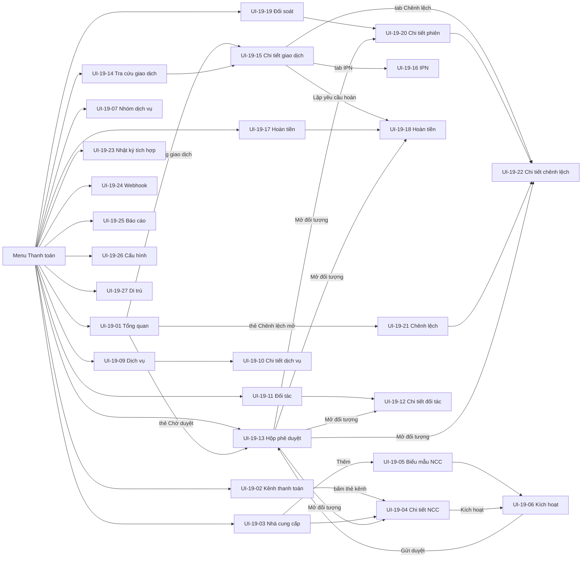

# D03-06-PH19 · Thiết kế giao diện màn hình phân hệ PH-19 Thanh toán

## Tóm tắt cho hội đồng thẩm định

Tài liệu đặc tả 28 màn hình của PH-19: 27 màn quản trị trong ứng dụng điều hành `dh-console` (gói `features/payment`) và một trang công khai cho người nộp tiền (UI-19-28). Các màn của hệ Payment cũ có giá trị vận hành được giữ bố cục và cột quen thuộc: hai dashboard (tổng quan, kênh thanh toán), danh sách và biểu mẫu nhà cung cấp, nhóm dịch vụ, dịch vụ, đối tác, bảng tra cứu giao dịch với tìm kiếm nâng cao theo trạng thái, lĩnh vực, thời gian. Phần mới là hoàn tiền có phê duyệt, đối soát hằng ngày và chênh lệch, theo dõi IPN và webhook, hộp phê duyệt bốn mắt, cấu hình theo tenant và màn di trú chạy song song với hệ cũ. Giao diện theo design system Liquid Glass trên antd v6: kính mờ chỉ ở lớp điều hướng và lớp nổi, bảng số tiền, biểu mẫu và biên bản dùng nền đặc để đạt WCAG 2.2 AA. Màn nào thuộc MVP, màn nào thuộc bản tăng cường Đ2b được ghi ở mục 1.2.

## 1. Mục đích, phạm vi và tài liệu liên quan

### 1.1. Mục đích

Đặc tả đủ để đội giao diện lập trình ngay: mỗi màn có đường dẫn, mẫu bố cục, wireframe, thành phần với nhãn tiếng Việt, cột bảng, trường biểu mẫu kèm kiểm tra hợp lệ, API nguồn dữ liệu, hành động gắn với quyền và trạng thái, các trạng thái màn (đang tải, rỗng, lỗi, không có quyền, xung đột), thông điệp và tiêu chí nghiệm thu. Tài liệu không lặp lại nghiệp vụ của FRS; khi cần thì dẫn mã `FR-19-nnn`, `BR-19-nnn`, `API-19-nnn`, `ERR-19-nnn`, `PERM-19-*`.

Thứ tự ưu tiên khi mâu thuẫn: D02-08 (phân quyền), D03-05 (design system), D03-06-00 (kiến trúc thông tin, mẫu màn), [D02-03-PH19](../../02-yeu-cau/frs/D02-03-PH19-frs-thanh-toan.md) (FRS), [khung truy vết](../../02-yeu-cau/frs/D02-03-PH19-00-khung-truy-vet.md), rồi tài liệu này.

### 1.2. Phạm vi, mẫu bố cục và phát hành

Mẫu bố cục dùng ký hiệu của khung §11. Vì D03-06-00 chưa phát hành, bảng dưới ghi kèm mã mẫu màn chung theo cách đánh số mà D03-06-PH04 đang dùng (giả định GĐ-UI-01: D03-06-00 giữ cách đánh số này; nếu đổi thì chỉ đổi cột mã mẫu). Cột "Phát hành" lấy từ FRS §9.3: màn MVP là màn mà mọi FR chính của nó thuộc MVP; màn "MVP, phần Đ2b" có nút hoặc tab thuộc FR Đ2b, các phần đó được ẩn sau cờ tính năng `payment.{tên}` cho tới khi bật.

| Mã | Màn hình | Mẫu (khung §11) | Mẫu D03-06-00 | Phát hành | Mức chi tiết |
|---|---|---|---|---|---|
| UI-19-01 | Dashboard tổng quan thanh toán | (DB) | PTN-06 Dashboard | MVP | Đầy đủ |
| UI-19-02 | Dashboard kênh thanh toán | (DB) | PTN-06 | MVP | Đầy đủ |
| UI-19-03 | Danh sách nhà cung cấp | (DS) | PTN-01 Danh sách | MVP | Đầy đủ |
| UI-19-04 | Chi tiết nhà cung cấp (7 tab) | (CT) | PTN-02 Chi tiết | MVP, phần Đ2b (xoay khóa FR-19-012) | Rất chi tiết |
| UI-19-05 | Biểu mẫu thêm, sửa nhà cung cấp | (BM) | PTN-04 Biểu mẫu ngăn kéo | MVP | Đầy đủ |
| UI-19-06 | Trình hướng dẫn kích hoạt nhà cung cấp | (HD) | PTN-05 Wizard | MVP | Rất chi tiết |
| UI-19-07 | Danh sách nhóm dịch vụ | (DS) | PTN-01 | MVP | Đầy đủ |
| UI-19-08 | Biểu mẫu nhóm dịch vụ | (BM) | PTN-04 | MVP | Đầy đủ |
| UI-19-09 | Danh sách dịch vụ thanh toán | (DS) | PTN-01 | MVP | Đầy đủ |
| UI-19-10 | Chi tiết, biểu mẫu dịch vụ | (CT) + (BM) | PTN-02 + PTN-04 | MVP | Đầy đủ |
| UI-19-11 | Danh sách đối tác | (DS) | PTN-01 | MVP | Đầy đủ |
| UI-19-12 | Chi tiết đối tác (6 tab) | (CT) | PTN-02 | MVP | Rất chi tiết |
| UI-19-13 | Hộp phê duyệt | (DS) + ngăn kéo | PTN-10 Hộp việc và duyệt | MVP | Rất chi tiết |
| UI-19-14 | Tra cứu giao dịch | (DS) | PTN-01 | MVP, phần Đ2b (xuất FR-19-052) | Rất chi tiết |
| UI-19-15 | Chi tiết giao dịch (8 tab) | (CT) | PTN-02 | MVP, phần Đ2b (hủy FR-19-026, đồng bộ FR-19-037) | Rất chi tiết |
| UI-19-16 | Danh sách và chi tiết IPN | (DS) + ngăn kéo | PTN-01 | MVP, phần Đ2b (xử lý lại) | Đầy đủ |
| UI-19-17 | Danh sách yêu cầu hoàn tiền | (DS) | PTN-01 | MVP | Đầy đủ |
| UI-19-18 | Lập, xem chi tiết yêu cầu hoàn tiền | (CT) + (BM) | PTN-02 + PTN-04 | MVP, phần Đ2b (chế độ `API`) | Rất chi tiết |
| UI-19-19 | Danh sách phiên đối soát | (DS) | PTN-01 | MVP | Đầy đủ |
| UI-19-20 | Chi tiết phiên đối soát | (CT) | PTN-02 | MVP | Rất chi tiết |
| UI-19-21 | Danh sách chênh lệch | (DS) | PTN-01 | MVP | Đầy đủ |
| UI-19-22 | Chi tiết chênh lệch và đề xuất xử lý | (CT) | PTN-02 | MVP | Rất chi tiết |
| UI-19-23 | Nhật ký tích hợp | (DS) + ngăn kéo | PTN-01 | MVP | Đầy đủ |
| UI-19-24 | Theo dõi webhook | (DS) + ngăn kéo | PTN-01 | MVP | Đầy đủ |
| UI-19-25 | Báo cáo định kỳ | (DS) + biểu đồ | PTN-06 | Đ2b | Đầy đủ |
| UI-19-26 | Cấu hình thanh toán của tenant | (CT) + (BM) | PTN-02 + PTN-04 | MVP | Đầy đủ |
| UI-19-27 | Di trú và chạy song song | (CT) | PTN-02 | MVP | Rất chi tiết |
| UI-19-28 | Trang kết quả thanh toán cho người nộp | Trang đơn | PTN-11 Trang công khai | MVP | Rất chi tiết |

Ngoài phạm vi: màn kiểm toán dùng chung của PH-13 (FR-19-053, mở từ tab "Lịch sử"), màn gán vai trò của PH-12, màn tham số chung PH-18 (PH-19 có màn cấu hình riêng UI-19-26 vì tham số có phiên bản và ngày hiệu lực), cổng thanh toán của PayGov (người nộp rời Datahub khi được chuyển hướng).

### 1.3. Tài liệu liên quan

| Mã | Tài liệu | Dùng để |
|---|---|---|
| [D02-03-PH19](../../02-yeu-cau/frs/D02-03-PH19-frs-thanh-toan.md) | FRS PH-19 | Nghiệp vụ, đầu vào, đầu ra, quy tắc |
| [D02-03-PH19-00](../../02-yeu-cau/frs/D02-03-PH19-00-khung-truy-vet.md) | Khung truy vết | Máy trạng thái §7, màn §11, ERR §12, quyền §13 |
| [D02-04-PH19](../../02-yeu-cau/use-case/D02-04-PH19-use-case-thanh-toan.md) | Use case PH-19 | Luồng người dùng, ngoại lệ |
| [D03-02-PH19](../sdd/D03-02-PH19-sdd-thanh-toan.md) | SDD PH-19 | Cấu trúc `features/payment`, đệm truy vấn, đọc sau ghi |
| [D03-04-PH19](../api/D03-04-PH19-api-thanh-toan.md) | API và sự kiện | `openapi-payment-admin.yaml`, `allowedActions`, ERR-19 |
| [D03-06-PH04](D03-06-PH04-man-hinh-tich-hop.md), [D03-06-PH07](D03-06-PH07-man-hinh-danh-muc.md) | Màn hình PH-04, PH-07 | Mẫu trình bày, thành phần dùng chung đã đặc tả |
| [D02-08](../../02-yeu-cau/D02-08-ma-tran-phan-quyen.md) | Ma trận phân quyền | Vai trò, quyền |
| D03-05-01…04, D03-06-00 | Design system, kiến trúc thông tin | Vật liệu, token, `CMP-*`, mẫu màn (chưa phát hành; dẫn theo mã) |

## 2. Nguyên tắc thiết kế áp dụng cho PH-19

### 2.1. Bản đồ vật liệu

PH-19 là phân hệ tiền. Người dùng chính là kế toán và cán bộ vận hành đọc số tiền, mã giao dịch, mã tham chiếu suốt ngày; sai một chữ số là sai sổ. Vì vậy mọi vùng chứa số tiền hoặc mã dùng nền đặc, chữ số dùng kiểu `tabular-nums` để cột thẳng hàng, và không có số tiền nào đặt trên kính.

| Vùng | Thành phần | Vật liệu | Lý do |
|---|---|---|---|
| Thanh trên, sidebar của khung ứng dụng | `CMP-AppShell` | `glass-chrome` (→ `glass-chrome-scrolled` khi cuộn) | Lớp điều hướng |
| Đầu trang chi tiết dính khi cuộn (mã, trạng thái, nút) | `CMP-PageHeader` sticky | `glass-chrome-scrolled` | Lớp điều hướng; chữ ≥ 14 px đậm |
| Thẻ chỉ số dashboard, biểu đồ, bảng, biểu mẫu, dòng thời gian | `CMP-StatCard`, `CMP-Chart`, `CMP-ProTable`, `CMP-Form`, `CMP-Timeline` | **Đặc** `color-surface-solid` | Số tiền, mã phải đọc chắc chắn |
| Khung JSON nguyên văn IPN, nhật ký | `CMP-JsonViewer` | **Đặc** `color-surface-solid-2` | Mã cần tương phản cao |
| Ngăn kéo biểu mẫu, ngăn kéo chi tiết IPN, webhook, nhật ký, bằng chứng phê duyệt | `CMP-Drawer` | Khung `glass-modal`; **vùng nội dung đặc** | Lớp nổi; nội dung dày |
| Hộp xác nhận (tạm dừng, chấm dứt, duyệt, từ chối, chốt phiên, xem dữ liệu cá nhân) | `CMP-ConfirmModal` | Khung `glass-modal`; vùng nội dung đặc | Lớp nổi |
| Thanh chọn nhiều nổi đáy bảng, tooltip, menu thao tác dòng | `CMP-SelectionBar`, `CMP-Popover`, `CMP-DropdownMenu` | `glass-overlay` | Lớp nổi; không chứa số tiền |
| Khay tác vụ nền (xuất, sinh biên bản, di trú) | `CMP-BackgroundTaskTray` | `glass-overlay` | Lớp nổi |
| Trang công khai UI-19-28 | Bố cục riêng | **Đặc** toàn bộ, không kính | Điện thoại cấu hình thấp, ánh sáng ngoài trời |

Khi bật "Giảm trong suốt", `prefers-reduced-transparency` hoặc cơ chế tự hạ cấp trên máy yếu (D03-05-01 §7), mọi lớp glass chuyển sang `glass-lite-tint` hoặc `glass-off-tint`. Không màn nào của PH-19 dùng hiệu ứng trong suốt để truyền thông tin.

### 2.2. Mật độ, số tiền, ngày giờ

- Mật độ thường: điều khiển 32 px, dòng bảng 40 px. Bảng giao dịch, dòng đối soát, IPN, nhật ký cho chọn mật độ gọn (dòng 32 px) qua "Mật độ hiển thị"; lựa chọn lưu `localStorage` khóa `dh.pay.density.{tableId}`.
- Số tiền: kiểu `T-MONEY` (số nguyên đồng). Hiển thị `1.250.000 ₫` theo `vi-VN`, căn phải, `font-variant-numeric: tabular-nums`. Cột tổng có viền trên 1 px. Số âm (chênh lệch, hoàn) có dấu "−" và chữ "(hoàn)" hoặc "(lệch)", không chỉ đổi màu.
- Ô nhập số tiền (`CMP-MoneyInput`): chỉ nhận chữ số, tự chèn dấu chấm ngăn nghìn khi gõ, gửi API số nguyên; dán "1.250.000" hay "1250000" đều hiểu; hiện dòng đọc bằng chữ bên dưới khi số ≥ 1.000.000 ("Một triệu hai trăm năm mươi nghìn đồng") để chống gõ thừa chữ số 0.
- Mã giao dịch, mã tham chiếu NCC, mã đơn hàng: phông đơn cách `CMP-CodeText`, có nút sao chép; mã dài rút gọn giữa (`PAY-T68-…-8F3A`) với tooltip mã đầy đủ.
- Ngày giờ `dd/MM/yyyy HH:mm:ss` theo giờ Việt Nam (máy chủ lưu UTC). "Ngày giao dịch" trong bộ lọc và báo cáo là ngày theo giờ Việt Nam. Thời lượng: `ms` dưới 1 giây, `1,2 s`, `2 phút 05 giây`.

### 2.3. Thuật ngữ

Nhãn tiếng Việt có dấu, viết hoa chữ đầu câu. Thuật ngữ thống nhất: "nhà cung cấp" (NCC, kênh thanh toán; trên dashboard dùng "kênh thanh toán" như hệ cũ), "dịch vụ thanh toán", "nhóm dịch vụ" (tooltip: "hệ cũ gọi là lĩnh vực"), "đối tác" (HTTT gọi PH-19), "giao dịch", "người nộp", "mã đơn hàng", "mã tham chiếu NCC", "IPN" (giữ nguyên, tooltip "thông báo kết quả từ nhà cung cấp"), "webhook", "hoàn tiền", "đối soát", "phiên đối soát", "chênh lệch", "biên bản", "đề nghị phê duyệt", "người lập", "người duyệt", "thông tin xác thực", "giao dịch thử", "chế độ định tuyến". Tên mã trạng thái nội bộ không hiện cho người dùng; chỉ hiện nhãn tiếng Việt ở mục 5.1 (mã gốc có trong tooltip cho cán bộ kỹ thuật).

### 2.4. Hành động theo quyền và trạng thái

Mọi đối tượng có vòng đời (NCC, dịch vụ, đối tác, giao dịch, yêu cầu hoàn, phiên đối soát, chênh lệch, đề nghị phê duyệt, lượt gửi webhook, IPN) có `allowedActions` và `disabledReasons` trong phản hồi API (D03-04-PH19 §1). Giao diện lấy `allowedActions` làm nguồn quyết định chính, không tự suy từ trạng thái:

| Tình huống | Hiển thị |
|---|---|
| Người dùng không có quyền (không có trong `allowedActions` và không có trong `disabledReasons`) | **Ẩn** nút |
| Có quyền nhưng trạng thái hoặc quy tắc chưa cho phép (có trong `disabledReasons`) | **Hiện vô hiệu** kèm tooltip lý do, ví dụ "Checklist kích hoạt còn 2 mục chưa đạt" |
| Có quyền nhưng vi phạm tách nhiệm (người duyệt là người lập) | **Hiện vô hiệu** kèm "Bạn là người lập đề nghị này. Cần một người duyệt khác (tách nhiệm)." |
| Thao tác ghi đang chạy | Nút ở trạng thái `loading`, khóa nút cùng nhóm, không cho bấm lại |

Mã hành động dùng trong `allowedActions` và khóa của `disabledReasons` là chuỗi chữ hoa cố định dưới đây. Tài liệu này là nguồn chính thức của danh sách (D03-04-PH19 §1 dẫn về đây); máy chủ tính mỗi mã từ quyền `PERM-19-*` ở cột 3, máy trạng thái khung §7 và quy tắc tách nhiệm khung §13.4.

| Đối tượng | Mã hành động | Quyền | API |
|---|---|---|---|
| NCC | `EDIT`, `DELETE`, `TEST_CONNECTION`, `TEST_TRANSACTION`, `SUBMIT_ACTIVATION`, `REQUEST_RETIRE`, `SUSPEND`, `RESUME`, `MANAGE_CREDENTIAL`, `ROTATE_CREDENTIAL`, `REQUEST_MAPPING_CHANGE` | `provider-write`, `provider-delete`, `provider-test`, `provider-write`, `provider-delete`, `provider-suspend` (hai mã), `credential-manage` (hai mã), `provider-write` | API-19-004, 005, 009, 010, 012, 012, 013, 014, 007, 008, 092 |
| Nhóm dịch vụ | `EDIT`, `DELETE` | `service-write` | API-19-018, 019 |
| Dịch vụ | `EDIT`, `ACTIVATE`, `SUSPEND`, `RETIRE`, `DELETE` | `service-write`, `service-activate` (bốn mã còn lại) | API-19-023, 025, 026, 027, 024 |
| Đối tác | `EDIT`, `SUBMIT_ONBOARD`, `REQUEST_TERMINATE`, `SUSPEND`, `RESUME`, `MANAGE_CLIENT`, `MANAGE_GRANT`, `MANAGE_WEBHOOK`, `REQUEST_ROUTING_CHANGE` | `partner-write` (ba mã đầu và `MANAGE_GRANT`), `partner-suspend`, `partner-client-manage`, `partner-webhook-manage`, `migration-switch` | API-19-032, 033, 033, 034, 035, 037/038, 040/041, 043…046, 047 |
| Đề nghị phê duyệt | `APPROVE`, `REJECT`, `WITHDRAW` | Quyền duyệt theo loại; `WITHDRAW` chỉ người lập | API-19-050 |
| Giao dịch | `SYNC`, `CANCEL`, `REVEAL_PII`, `CREATE_REFUND` | `transaction-sync`, `transaction-cancel`, `transaction-read-pii`, `refund-create` | API-19-053, 055, 052, 059 |
| IPN | `REPLAY` | `callback-replay` | API-19-058 |
| Yêu cầu hoàn | `WITHDRAW`, `RETRY`, `SWITCH_MANUAL`, `RECORD_MANUAL` | Người lập; `refund-execute` (ba mã còn lại) | API-19-050, 062 |
| Phiên đối soát | `UPLOAD_FILE`, `RECOLLECT`, `RERUN_MATCH`, `CLOSE`, `REQUEST_REOPEN`, `GENERATE_MINUTES` | `recon-upload`, `recon-run` (hai mã), `recon-close` (hai mã), `report-export` | API-19-065, 066, 066, 068, 069, 083 |
| Chênh lệch | `ASSIGN`, `CLAIM`, `ESCALATE`, `PROVIDER_RESPONDED`, `NOTE`, `PROPOSE` | `discrepancy-handle` | API-19-072, 073 |
| Lượt gửi webhook | `RESEND` | `webhook-resend` | API-19-078 |
| Cấu hình | `CREATE_VERSION` | `config-write` | API-19-086 |

Vì thao tác ghi đi kèm `If-Match` (ERR-19-045) và `Idempotency-Key` phía giao diện (mục 2.7), bấm hai lần không sinh hai đề nghị.

### 2.5. Lý do bắt buộc và xác nhận

Mọi thao tác làm đổi trạng thái có ảnh hưởng tiền hoặc kết nối (tạm dừng, mở lại, ngừng hẳn, chấm dứt, hủy giao dịch, đồng bộ, xử lý lại IPN, gửi lại webhook, duyệt, từ chối, rút, chốt, mở lại phiên, đổi chế độ định tuyến, xem dữ liệu cá nhân) mở `CMP-ConfirmModal` có ô "Lý do" bắt buộc 10…1.000 ký tự (kiểu `Reason` của API). Thao tác không hoàn tác được (ngừng hẳn NCC, chấm dứt đối tác, chốt phiên, ghi nhận chứng từ hoàn) yêu cầu gõ lại mã đối tượng vào ô xác nhận. Nút chính của hộp dùng sắc thái `danger` cho thao tác dừng, chấm dứt, từ chối.

### 2.6. Dữ liệu cá nhân người nộp

Mặc định mọi màn hiện dữ liệu cá nhân đã che theo API (`Nguyễn V*** A`, `09******89`, `***@gmail.com`, số định danh `0012******34`). Người có `PERM-19-transaction-read-pii` thấy nút "Hiện thông tin người nộp" (biểu tượng `Eye`) trên UI-19-15. Bấm mở hộp "Lý do tra cứu" (bắt buộc, chọn từ danh sách "Hỗ trợ người nộp", "Xử lý chênh lệch", "Thanh tra, kiểm toán", "Yêu cầu của cơ quan có thẩm quyền", "Khác" kèm ô ghi rõ); giao diện gọi API-19-052 với `reveal=true` và tiêu đề `X-Datahub-Reveal-Reason`. Dữ liệu bỏ che hiện tối đa 5 phút hoặc tới khi rời màn, có dải cảnh báo vàng "Đang hiện dữ liệu cá nhân. Lần xem này đã được ghi nhật ký kiểm toán." Dữ liệu bỏ che không bao giờ lưu vào bộ đệm truy vấn, `localStorage` hay URL (BR-19-031). Không có màn nào hiện số thẻ, số tài khoản, OTP vì PH-19 không lưu (BR-19-032).

### 2.7. Giữ trạng thái trên URL và chống gửi trùng

Bộ lọc, trang, sắp xếp, tab đang mở, phiên bản đang xem phản ánh vào URL (mục 4.2) để cán bộ gửi đường dẫn cho nhau. Mọi API danh sách của PH-19 phân trang bằng con trỏ (`cursor`, `limit`, khối `page` có `total` chính xác tới 10.000 và `totalApprox` khi vượt); tham số `trang` trên URL là chỉ số trang đã đi qua trong phiên, tải lại ở trang > 1 quay về trang 1. Bộ đệm truy vấn TanStack Query theo SDD §8; sau thao tác ghi, giao diện làm mới khóa liên quan và đọc lại với tiêu đề đọc sau ghi theo SDD. Mỗi lần mở hộp thao tác ghi, giao diện sinh một `Idempotency-Key` (UUID v7) và giữ nguyên khi người dùng bấm lại do lỗi mạng; khóa mới chỉ sinh khi đóng và mở lại hộp.

### 2.8. Tác vụ dài chạy nền

Xuất danh sách giao dịch, xuất báo cáo, sinh biên bản đối soát, lô di trú, đối chiếu sau di trú chạy bằng tác vụ nền (API-19-083, 084, 089). Giao diện hiện thông báo "Đã đưa vào hàng đợi", thêm tác vụ vào `CMP-BackgroundTaskTray`, cho rời màn và báo qua trung tâm thông báo khi xong (FR-00-054, FR-00-060). Đường tải có hạn 24 giờ, chỉ người tạo tải được; nút "Tải" hiện thời gian còn hiệu lực.

### 2.9. Bàn phím và khả năng truy cập

Mọi thao tác làm được bằng bàn phím (WCAG 2.1.1). Phím tắt chung trên các màn danh sách: `/` tới ô tìm, `F` mở bộ lọc nâng cao, `↑`/`↓` chuyển dòng, `Enter` mở chi tiết, `Esc` đóng ngăn kéo. Trên màn chi tiết: `1`…`9` chuyển tab. Biểu đồ có bảng dữ liệu thay thế ("Xem dạng bảng") và `aria-describedby` tóm tắt xu hướng. Màu trạng thái luôn đi kèm biểu tượng và chữ (WCAG 1.4.1). Vùng chạm ≥ 24 × 24 px (WCAG 2.5.8), trên UI-19-28 ≥ 44 × 44 px.

## 3. Màn hệ cũ được giữ lại thành gì

Bảng phủ đủ 26 mục `LGC-PAY` (23 mục của D00-03 §4.6 và 3 mục đề xuất 024…026 ở khung §2). Kết luận theo D00-03: Giữ nguyên, Nâng cấp, Thay thế, Loại bỏ. Không mục nào bị loại bỏ.

| Màn, chức năng hệ cũ | LGC-PAY | Kết luận | Màn Datahub | Thay đổi chính |
|---|---|---|---|---|
| Thêm nhà cung cấp, kiểm tra luồng thanh toán thử, đưa vào danh sách khi thử thành công | 001 | Nâng cấp | UI-19-05 → UI-19-06 | Trình hướng dẫn bốn bước có bằng chứng; kích hoạt qua phê duyệt bốn mắt |
| Danh sách nhà cung cấp | 002 | Giữ nguyên | UI-19-03 | Giữ cột tên, ngày bắt đầu, đầu mối, tình trạng; thêm sức khỏe, mạch ngắt, hạn chứng thư |
| Chi tiết nhà cung cấp: ngày bắt đầu, đầu mối, điện thoại, tình trạng, số dịch vụ, biểu đồ giao dịch theo ngày | 003 | Giữ nguyên | UI-19-04 tab Thông tin; thẻ NCC ở UI-19-02 | Giữ khối thông tin và biểu đồ 30 ngày |
| Chỉnh sửa nhà cung cấp | 004 | Giữ nguyên | UI-19-05 chế độ sửa | Thông tin xác thực tách sang tab riêng, chỉ lưu tham chiếu kho bí mật |
| Xóa nhà cung cấp | 005 | Nâng cấp | UI-19-03, UI-19-04 menu "Thêm" | Chỉ xóa cứng khi `DRAFT` chưa có giao dịch; còn lại là "Đề nghị ngừng hẳn" |
| Tìm kiếm nhà cung cấp | 006 | Giữ nguyên | UI-19-03 ô tìm | Tìm theo mã, tên |
| Kích hoạt nhà cung cấp: kiểm tra hiện trạng, kết nối, giao dịch mẫu, phản hồi | 007 | Giữ nguyên | UI-19-06; UI-19-13 | Giữ thứ tự bước của hệ cũ |
| Dừng nhà cung cấp | 008 | Giữ nguyên | UI-19-04 nút "Tạm dừng" | Hiện số giao dịch đang dở trước khi dừng |
| Thông báo lỗi kết nối với nhà cung cấp | 009 | Nâng cấp | UI-19-01 dải cảnh báo; UI-19-04 tab Sức khỏe | Cảnh báo tự động qua PH-13, không chờ người dùng mở màn |
| Nhận kết quả thanh toán từ nhà cung cấp | 010 | Nâng cấp | UI-19-16 | Xem kết quả xác minh chữ ký, chống phát lại, cách ly |
| Lưu dữ liệu quá trình thanh toán | 011 | Nâng cấp | UI-19-15 tab Dòng thời gian | Lịch sử bất biến, không ghi đè |
| Thông báo kết quả cho HTTT gọi | 012 | Nâng cấp | UI-19-24; UI-19-15 tab Webhook; UI-19-28 | Webhook có ký, gửi lại được; trang kết quả cho người nộp |
| Dashboard tổng quan: số giao dịch, số ứng dụng, số dịch vụ, giao dịch theo dịch vụ | 013 | Giữ nguyên | UI-19-01 | Giữ bốn thẻ và biểu đồ theo dịch vụ ở hàng đầu |
| Bảng tra cứu giao dịch: mã giao dịch, mã yêu cầu, tên giao dịch, kênh, lĩnh vực, số tiền, ngày phát sinh, trạng thái, người thanh toán | 014 | Giữ nguyên | UI-19-14 | Giữ đủ 9 cột theo thứ tự hệ cũ làm bộ cột mặc định |
| Tìm nâng cao theo trạng thái (chọn nhiều) | 015 | Giữ nguyên | UI-19-14 bộ lọc | |
| Tìm nâng cao theo lĩnh vực (chọn nhiều) | 016 | Giữ nguyên | UI-19-14 bộ lọc "Nhóm dịch vụ" | |
| Tìm nâng cao theo thời gian | 017 | Giữ nguyên | UI-19-14 bộ lọc thời gian | Thêm mẫu nhanh "Hôm nay", "7 ngày", "30 ngày", "Tháng này" |
| Tìm theo từ khóa, phân trang khi > 20 dòng, sắp xếp | 018 | Giữ nguyên | UI-19-14 | Mặc định 20 dòng mỗi trang như hệ cũ |
| Xem chi tiết giao dịch và lịch sử trạng thái | 019 | Giữ nguyên | UI-19-15 | Thêm IPN, truy vấn NCC, webhook, hoàn tiền, chênh lệch |
| Dashboard kênh thanh toán | 020 | Giữ nguyên | UI-19-02 | Giữ một thẻ mỗi kênh; thêm sức khỏe, độ trễ, hạn khóa |
| Danh sách, lọc, sắp xếp, chi tiết nhật ký giao dịch | 021 | Giữ nguyên | UI-19-23 | Liên kết vết PH-13 |
| Quản lý đối tác, nhóm dịch vụ, dịch vụ | 022 | Giữ nguyên | UI-19-07…12 | Thêm vòng đời, hạn mức, webhook, client |
| Giám sát nhiều nhà cung cấp | 023 | Nâng cấp | UI-19-02, UI-19-03 | Đa kênh; PayGov là kênh đầu tiên |
| Nhận yêu cầu thanh toán, chuyển người dùng sang NCC | 024 | Nâng cấp | UI-19-28 (phần người nộp); UI-19-15 | Phần tạo giao dịch là API, không có màn |
| Ba trạng thái hoàn trả | 025 | Nâng cấp | UI-19-17, UI-19-18 | Quy trình hoàn có phê duyệt hai cấp |
| Số liệu dashboard đệm 10 phút | 026 | Nâng cấp | UI-19-01, 02 | Trễ tối đa 60 giây; hiện "Cập nhật lúc HH:mm:ss" |

## 4. Điều hướng

### 4.1. Sơ đồ điều hướng



### 4.2. Bảng đường dẫn React Router

Đường dẫn tiếng Việt không dấu theo D03-06-00 §2.4, gốc `/thanh-toan`. Tham số truy vấn tên tiếng Việt không dấu, giá trị là mã máy (ví dụ `trang-thai=PENDING,SUCCEEDED`).

| Đường dẫn | Màn | Tham số truy vấn giữ trên URL |
|---|---|---|
| `/thanh-toan` | UI-19-01 | `khoang` (`TODAY`, `7D`, `30D`, `CUSTOM`), `tu`, `den`, `ncc`, `dich-vu` |
| `/thanh-toan/kenh` | UI-19-02 | `ncc` |
| `/thanh-toan/nha-cung-cap` | UI-19-03 | `q`, `trang-thai`, `suc-khoe`, `trang`, `co`, `sap-xep` |
| `/thanh-toan/nha-cung-cap/:id` | UI-19-04 | `tab` (`thong-tin`, `xac-thuc`, `kiem-tra`, `dich-vu`, `suc-khoe`, `anh-xa-ma`, `lich-su`), `moi-truong` |
| `/thanh-toan/nha-cung-cap/:id/kich-hoat` | UI-19-06 | `buoc` (1…4) |
| `/thanh-toan/nhom-dich-vu` | UI-19-07 | `q`, `trang` |
| `/thanh-toan/dich-vu` | UI-19-09 | `q`, `trang-thai`, `nhom`, `ncc`, `trang`, `co`, `sap-xep` |
| `/thanh-toan/dich-vu/:id` | UI-19-10 | `tab`, `sua` (1 = mở biểu mẫu) |
| `/thanh-toan/doi-tac` | UI-19-11 | `q`, `trang-thai`, `che-do`, `trang` |
| `/thanh-toan/doi-tac/:id` | UI-19-12 | `tab` (`ho-so`, `client`, `dich-vu`, `webhook`, `dinh-tuyen`, `lich-su`) |
| `/thanh-toan/phe-duyet` | UI-19-13 | `hop` (`cho-toi`, `toi-lap`, `da-xu-ly`), `loai`, `trang-thai`, `chon` (mã đề nghị mở ngăn kéo) |
| `/thanh-toan/giao-dich` | UI-19-14 | `q`, `trang-thai`, `nhom`, `dich-vu`, `doi-tac`, `ncc`, `doi-soat`, `tu`, `den`, `so-tien-tu`, `so-tien-den`, `co` (`muon`, `chua-ro`, `thu`), `trang`, `co-trang`, `sap-xep`, `cot` (số trang trên URL là chỉ số con trỏ đã nhớ; tải lại ở trang > 1 quay về trang 1 kèm thông báo) |
| `/thanh-toan/giao-dich/:ma` | UI-19-15 | `tab` (`thong-tin`, `dong-thoi-gian`, `ipn`, `truy-van`, `webhook`, `hoan-tien`, `chenh-lech`, `nhat-ky`) |
| `/thanh-toan/ipn` | UI-19-16 | `xac-minh`, `xu-ly`, `ly-do`, `ncc`, `tu`, `den`, `chon` |
| `/thanh-toan/hoan-tien` | UI-19-17 | `trang-thai`, `che-do`, `doi-tac`, `tu`, `den`, `trang` |
| `/thanh-toan/hoan-tien/tao-moi` | UI-19-18 (lập) | `giao-dich` (mã giao dịch, bắt buộc), `chenh-lech` |
| `/thanh-toan/hoan-tien/:ma` | UI-19-18 (xem) | `tab` |
| `/thanh-toan/doi-soat` | UI-19-19 | `ncc`, `trang-thai`, `tu`, `den`, `trang` |
| `/thanh-toan/doi-soat/:id` | UI-19-20 | `tab` (`tong-hop`, `dong`, `chenh-lech`, `tep`, `bien-ban`, `lich-su`), `ket-qua`, `lan-chay` |
| `/thanh-toan/chenh-lech` | UI-19-21 | `loai`, `trang-thai`, `tuoi`, `phu-trach`, `ncc`, `phien`, `trang` |
| `/thanh-toan/chenh-lech/:ma` | UI-19-22 | `tab` |
| `/thanh-toan/nhat-ky` | UI-19-23 | `huong`, `thao-tac`, `ket-qua`, `ncc`, `doi-tac`, `giao-dich`, `vet`, `tu`, `den`, `chon` |
| `/thanh-toan/webhook` | UI-19-24 | `trang-thai`, `doi-tac`, `su-kien`, `tu`, `den`, `chon` |
| `/thanh-toan/bao-cao` | UI-19-25 | `bao-cao` (`RPT-19-01`…`05`), `ky`, `gia-tri-ky`, `doi-tac`, `ncc`, `dich-vu` |
| `/thanh-toan/cau-hinh` | UI-19-26 | `phien-ban` |
| `/thanh-toan/di-tru` | UI-19-27 | `tab` (`lo-nhap`, `doi-chieu`, `dinh-tuyen`) |
| `/api/payment-callback/v1/paygov/{connectionKey}/return` (miền công khai qua `apisix-ext`, không nằm trong `dh-console`) | UI-19-28 | Trang là phản hồi HTML của API-19-202; tham số do PayGov gắn. Trang thăm dò API-19-205 với `t` (mã phiên trang) và `s` (chữ ký phiên, hạn 2 phút) |

Ngăn kéo biểu mẫu (UI-19-05, 08, phần sửa của 10) không có đường dẫn riêng; mở lại khi tải trang nhờ tham số `lop` (`them`, `sua`) trên URL của màn nền.

### 4.3. Menu và phân quyền hiển thị

Nhóm menu "Thanh toán" (biểu tượng `Wallet`) chỉ hiện khi tenant đã bật PH-19 (FR-19-064). Nếu PH-20 tạm ngừng PH-19, nhóm menu vẫn hiện cho người có quyền đọc nhưng mọi màn có dải cảnh báo "Phân hệ thanh toán đang tạm ngừng cho tỉnh, chỉ xem được dữ liệu" và nút ghi bị ẩn (ERR-19-049).

| Mục menu | Màn | Quyền để hiện | Huy hiệu số |
|---|---|---|---|
| Tổng quan | UI-19-01 | `dashboard-read` | — |
| Kênh thanh toán | UI-19-02 | `dashboard-read` | Số NCC `DOWN` hoặc mạch ngắt mở (đỏ) |
| Tra cứu giao dịch | UI-19-14 | `transaction-read` | — |
| Hộp phê duyệt | UI-19-13 | Bất kỳ quyền duyệt (`provider-activate`, `partner-approve`, `refund-approve`, `discrepancy-approve`, `recon-reopen-approve`, `migration-switch`) hoặc quyền lập đề nghị | Số đề nghị `PENDING` người dùng được quyết định |
| Hoàn tiền | UI-19-17 | `refund-read` | Số yêu cầu `AWAITING_MANUAL` và `FAILED` (với người có `refund-execute`) |
| Đối soát | UI-19-19 | `discrepancy-read` | Số phiên `WAITING_DATA`, `FAILED`, `READY_TO_CLOSE` |
| Chênh lệch | UI-19-21 | `discrepancy-read` | Số chênh lệch quá hạn xử lý giao cho người dùng |
| IPN | UI-19-16 | `callback-read` | Số IPN `QUARANTINED` chưa xử lý |
| Webhook | UI-19-24 | `webhook-read` | Số lượt `EXHAUSTED` 24 giờ qua |
| Nhật ký tích hợp | UI-19-23 | `log-read` | — |
| Báo cáo | UI-19-25 | `report-read` | — |
| *Nhóm con "Danh mục thanh toán"* | | | |
| Nhà cung cấp | UI-19-03 | `provider-read` | — |
| Nhóm dịch vụ | UI-19-07 | `service-read` | — |
| Dịch vụ | UI-19-09 | `service-read` | — |
| Đối tác | UI-19-11 | `partner-read` | — |
| *Nhóm con "Quản trị"* | | | |
| Cấu hình | UI-19-26 | `config-read` | Dấu chấm khi có phiên bản chờ hiệu lực |
| Di trú, chạy song song | UI-19-27 | `migration-run` hoặc `migration-switch` | — |

Huy hiệu lấy từ khối `badges` của API-19-080 gọi với `fields=badges` (một lượt gọi nhẹ, đếm theo quyền người gọi), làm mới 60 giây và khi nhận thông báo đẩy.

### 4.4. Breadcrumb và tiêu đề tab trình duyệt

| Màn | Breadcrumb | Tiêu đề tab |
|---|---|---|
| UI-19-01 | Thanh toán › Tổng quan | Tổng quan thanh toán · Datahub |
| UI-19-04 | Thanh toán › Nhà cung cấp › {tên NCC} | {tên NCC} · Nhà cung cấp · Datahub |
| UI-19-06 | Thanh toán › Nhà cung cấp › {tên NCC} › Kích hoạt | Kích hoạt {tên NCC} · Datahub |
| UI-19-12 | Thanh toán › Đối tác › {tên đối tác} | {tên đối tác} · Đối tác · Datahub |
| UI-19-15 | Thanh toán › Tra cứu giao dịch › {mã giao dịch} | {mã giao dịch} · Giao dịch · Datahub |
| UI-19-18 | Thanh toán › Hoàn tiền › {mã yêu cầu} | {mã yêu cầu} · Hoàn tiền · Datahub |
| UI-19-20 | Thanh toán › Đối soát › {NCC} {dd/MM/yyyy} | Đối soát {NCC} {dd/MM} · Datahub |
| UI-19-22 | Thanh toán › Chênh lệch › {mã chênh lệch} | {mã chênh lệch} · Chênh lệch · Datahub |

Tiêu đề tab không bao giờ chứa dữ liệu cá nhân người nộp.

## 5. Quy ước hiển thị dùng chung trong PH-19

### 5.1. Nhãn trạng thái

Mọi nhãn dùng `CMP-StatusTag` với sắc thái của D03-05-02 §4.4, luôn có biểu tượng Lucide và chữ. Tooltip của nhãn hiện mã gốc và thời điểm vào trạng thái.

| Đối tượng | Trạng thái | Nhãn | Sắc thái | Biểu tượng |
|---|---|---|---|---|
| NCC | `DRAFT` | Nháp | neutral | `PencilLine` |
| | `PENDING_ACTIVATION` | Chờ duyệt kích hoạt | info | `Hourglass` |
| | `ACTIVE` | Đang hoạt động | success | `CircleCheck` |
| | `SUSPENDED` | Tạm dừng | warning | `Pause` |
| | `RETIRED` | Đã ngừng hẳn | neutral | `Archive` |
| Sức khỏe NCC | `HEALTHY` | Khỏe | success | `HeartPulse` |
| | `DEGRADED` | Suy giảm | warning | `TriangleAlert` |
| | `DOWN` | Mất kết nối | error | `CircleOff` |
| | `UNKNOWN` | Chưa rõ | neutral | `CircleHelp` |
| Mạch ngắt | `CLOSED` | (không hiện) | | |
| | `OPEN` | Mạch ngắt mở | error | `Unplug` |
| | `HALF_OPEN` | Đang thử lại | warning | `PlugZap` |
| Dịch vụ | `DRAFT`, `ACTIVE`, `SUSPENDED`, `RETIRED` | Nháp, Đang hoạt động, Tạm dừng, Đã ngừng hẳn | như NCC | như NCC |
| Đối tác | `DRAFT` | Nháp | neutral | `PencilLine` |
| | `PENDING_APPROVAL` | Chờ duyệt | info | `Hourglass` |
| | `ACTIVE` | Đang hoạt động | success | `CircleCheck` |
| | `SUSPENDED` | Tạm dừng | warning | `Pause` |
| | `TERMINATED` | Đã chấm dứt | neutral | `Ban` |
| Chế độ định tuyến | `LEGACY` | Hệ cũ | neutral | `Server` |
| | `SHADOW` | Chạy bóng | info | `Copy` |
| | `DATAHUB` | Datahub | success | `Network` |
| Giao dịch | `CREATED` | Đã ghi nhận | neutral | `FilePlus2` |
| | `PENDING` | Chờ thanh toán | info | `Hourglass` |
| | `SUCCEEDED` | Thành công | success | `CircleCheck` |
| | `FAILED` | Thất bại | error | `CircleX` |
| | `EXPIRED` | Hết hạn | neutral | `TimerOff` |
| | `CANCELLED` | Đã hủy | neutral | `Ban` |
| | `PARTIALLY_REFUNDED` | Đã hoàn một phần | warning | `Undo2` |
| | `REFUNDED` | Đã hoàn toàn phần | neutral | `Undo2` |
| Cờ giao dịch (huy hiệu nhỏ cạnh nhãn) | `latePaid` | Thanh toán muộn | warning | `Clock4` |
| | `initUncertain` | Chưa rõ kết quả khởi tạo | warning | `CircleDashed` |
| | `isTest` | Giao dịch thử | neutral | `FlaskConical` |
| Đối soát của giao dịch | `UNRECONCILED` | Chưa đối soát | neutral | `Circle` |
| | `MATCHED` | Khớp | success | `CheckCheck` |
| | `MISMATCHED` | Lệch | error | `Scale` |
| Yêu cầu hoàn | `PENDING_APPROVAL` | Chờ duyệt | info | `Hourglass` |
| | `PENDING_SECOND_APPROVAL` | Chờ duyệt cấp 2 | info | `Hourglass` + "2" |
| | `APPROVED` | Đã duyệt | info | `BadgeCheck` |
| | `PROCESSING` | Đang hoàn tại NCC | info | `RefreshCw` (xoay, tắt khi giảm chuyển động) |
| | `AWAITING_MANUAL` | Chờ hoàn thủ công | warning | `HandCoins` |
| | `SUCCEEDED` | Đã hoàn | success | `CircleCheck` |
| | `FAILED` | Hoàn lỗi | error | `CircleX` |
| | `REJECTED` | Bị từ chối | neutral | `ThumbsDown` |
| | `CANCELLED` | Đã rút | neutral | `Undo` |
| Phiên đối soát | `SCHEDULED` | Đã lên lịch | neutral | `CalendarClock` |
| | `COLLECTING` | Đang thu thập | info | `Download` |
| | `WAITING_DATA` | Chờ dữ liệu NCC | warning | `FileClock` |
| | `MATCHING` | Đang so khớp | info | `GitCompare` |
| | `IN_REVIEW` | Đang xử lý chênh lệch | warning | `Scale` |
| | `READY_TO_CLOSE` | Sẵn sàng chốt | success | `ClipboardCheck` |
| | `CLOSED` | Đã chốt | neutral | `Lock` |
| | `REOPEN_PENDING` | Chờ duyệt mở lại | info | `LockOpen` |
| | `FAILED` | Lỗi thu thập | error | `CircleX` |
| Chênh lệch | `OPEN` | Mới | error | `CircleAlert` |
| | `INVESTIGATING` | Đang xác minh | warning | `Search` |
| | `ESCALATED` | Đã chuyển NCC | warning | `Send` |
| | `PROPOSED` | Chờ duyệt xử lý | info | `Hourglass` |
| | `RESOLVED` | Đã xử lý | success | `CircleCheck` |
| Đề nghị phê duyệt | `PENDING` | Chờ quyết định | info | `Hourglass` |
| | `APPROVED` | Đã duyệt | success | `BadgeCheck` |
| | `REJECTED` | Bị từ chối | error | `ThumbsDown` |
| | `WITHDRAWN` | Người lập đã rút | neutral | `Undo` |
| | `EXPIRED` | Quá hạn 7 ngày | neutral | `TimerOff` |
| Lượt gửi webhook | `PENDING` | Chờ gửi | neutral | `Clock` |
| | `SENDING` | Đang gửi | info | `Send` |
| | `DELIVERED` | Đã nhận | success | `CircleCheck` |
| | `RETRY_SCHEDULED` | Chờ thử lại | warning | `RotateCw` |
| | `EXHAUSTED` | Hết lượt thử | error | `CircleX` |
| | `CANCELLED` | Đã hủy | neutral | `Ban` |
| IPN, xác minh | `VERIFIED` | Hợp lệ | success | `ShieldCheck` |
| | `BAD_SIGNATURE`, `EXPIRED`, `REPLAYED`, `SOURCE_DENIED`, `MALFORMED`, `TENANT_MISMATCH` | Sai chữ ký, Quá hạn, Phát lại, Nguồn không được phép, Sai định dạng, Sai tỉnh | error | `ShieldX` |
| IPN, xử lý | `RECEIVED` | Đã nhận | info | `Inbox` |
| | `PROCESSED` | Đã xử lý | success | `CircleCheck` |
| | `DUPLICATE` | Trùng, bỏ qua | neutral | `Copy` |
| | `QUARANTINED` | Đã cách ly | warning | `ShieldAlert` |
| | `FAILED` | Lỗi xử lý | error | `CircleX` |
| | `REJECTED` | Từ chối | error | `ShieldX` |
| Tác vụ nền | `QUEUED`, `RUNNING`, `SUCCEEDED`, `FAILED`, `CANCELLED` | Trong hàng đợi, Đang chạy (có %), Xong, Lỗi, Đã hủy | neutral, info, success, error, neutral | `Clock`, `Loader`, `CircleCheck`, `CircleX`, `Ban` |

Loại đề nghị phê duyệt (`ApprovalType`) hiện bằng chữ: Kích hoạt NCC, Ngừng hẳn NCC, Duyệt đối tác, Chấm dứt đối tác, Hoàn tiền, Xử lý chênh lệch, Mở lại phiên đối soát, Đổi chế độ định tuyến, Đổi bảng ánh xạ mã kết quả. Loại chênh lệch: Thiếu ở NCC, Thiếu ở Datahub, Lệch trạng thái, Lệch số tiền, Trùng, Thanh toán muộn, Lệch hoàn tiền, IPN không khớp giao dịch.

### 5.2. Thông điệp lỗi ERR-19 sang câu hiển thị

Giao diện không hiện `detail` thô khi đã có câu dưới đây; tham số trong `{}` lấy từ trường mở rộng của lỗi RFC 9457. Mọi thông điệp kèm "Mã lỗi {code} · Mã truy vết {traceId}" và nút "Sao chép" (FR-00-080). Lỗi của API đối tác (ERR-19-002…016) và callback (024…028) không xuất hiện trên console trừ khi hiển thị lại trong nhật ký; câu cho các mã đó dùng ở UI-19-16, UI-19-23.

| Mã | Câu hiển thị | Gợi ý hành động |
|---|---|---|
| ERR-19-001 | Thông tin nhập chưa hợp lệ. Kiểm tra các ô được đánh dấu. | Cuộn tới ô lỗi đầu tiên; lỗi từng trường hiện dưới ô |
| ERR-19-002…016 | Theo tiêu đề khung §12 (hiện trong nhật ký, IPN, chi tiết giao dịch) | — |
| ERR-19-017 | Kênh thanh toán "{provider}" tạm thời không khả dụng. | "Xem sức khỏe kênh" |
| ERR-19-018 | Nhà cung cấp từ chối: {mappedReason} | — |
| ERR-19-019 | Chưa xác định được kết quả tại nhà cung cấp. Hệ thống sẽ tự truy vấn lại. | "Xem dòng thời gian" |
| ERR-19-020 | Không tìm thấy dữ liệu, hoặc bạn không có quyền xem. | "Về danh sách" |
| ERR-19-021 | {object} đang ở trạng thái "{statusLabel}" nên không thể {actionLabel}. | Tải lại để thấy trạng thái mới |
| ERR-19-022 | Thông tin xác thực môi trường {environment} còn thiếu hoặc đã hết hạn: {items}. | "Mở tab Thông tin xác thực" |
| ERR-19-023 | Giao dịch này vừa được đồng bộ. Thử lại sau {retryAfter} giây (tối đa 10 lần mỗi ngày). | Nút tự bật lại khi hết đếm ngược |
| ERR-19-024…028 | Sai chữ ký, quá hạn, phát lại, nguồn không được phép, đã cách ly (nhãn mục 5.1) | — |
| ERR-19-029 | Giao dịch không đủ điều kiện hoàn tiền: {reasonLabel}. | — |
| ERR-19-030 | Số tiền hoàn vượt số còn được hoàn ({remaining}). | Điền sẵn số còn được hoàn |
| ERR-19-031 | Đã quá hạn hoàn tiền {windowDays} ngày kể từ ngày thanh toán {paidAt}. | — |
| ERR-19-032 | Hoàn tiền chưa được bật cho tỉnh, hoặc chế độ thực hiện không phù hợp. | "Xem cấu hình" (người có `config-read`) |
| ERR-19-033 | Bạn đã {role} đề nghị này nên không thể quyết định. Cần một người khác (tách nhiệm). | — |
| ERR-19-034 | Đề nghị này đã được {decisionLabel} bởi {actor} lúc {time}. | Tải lại |
| ERR-19-035 | Checklist kích hoạt chưa đạt: {items}. | "Mở trình hướng dẫn kích hoạt" |
| ERR-19-036 | Còn {pendingTransactions} giao dịch đang dở và {openSessions} phiên đối soát chưa chốt. | Liên kết tới danh sách đã lọc |
| ERR-19-037 | Không thể xóa vì đã có dữ liệu phụ thuộc ({dependents}). Dùng "Đề nghị ngừng hẳn". | Mở hộp ngừng hẳn |
| ERR-19-038 | Mã "{code}" đã được dùng trong tỉnh. | Gợi ý "{code}-2" |
| ERR-19-039 | Mã danh mục "{code}" không còn hiệu lực trong danh mục {catalog}, hoặc chưa kiểm tra được với danh mục dùng chung. | "Chọn lại", "Thử lại" |
| ERR-19-040 | Đã có phiên đối soát cho {provider} ngày {date}. | "Mở phiên" |
| ERR-19-041 | File đối soát không hợp lệ: {reasonLabel}. | Tải file khác |
| ERR-19-042 | Còn {count} chênh lệch chưa xử lý. | "Xem chênh lệch còn mở" |
| ERR-19-043 | Phiên đối soát đã chốt, không thể thay đổi. | "Đề nghị mở lại" |
| ERR-19-044 | Địa chỉ webhook phải dùng https và không trỏ tới mạng nội bộ. | — |
| ERR-19-045 | {actor} đã thay đổi dữ liệu này lúc {time}. Thay đổi của bạn chưa được lưu. | Mở hộp xung đột (mục 6) |
| ERR-19-046 | Bạn không có quyền thực hiện thao tác này. | "Liên hệ quản trị tỉnh" |
| ERR-19-047 | Kết quả có {count} dòng, vượt giới hạn xuất {max}. Thu hẹp bộ lọc. | — |
| ERR-19-048 | Bạn thao tác quá nhanh. Thử lại sau {retryAfter} giây. | — |
| ERR-19-049 | Phân hệ thanh toán đang tạm ngừng cho tỉnh. | — |
| ERR-19-050 | Không ghi được nhật ký kiểm toán nên thao tác đã bị hủy. Thử lại sau ít phút. | "Thử lại" (giữ khóa chống trùng) |
| ERR-19-099 | Có lỗi hệ thống. Thao tác có thể chưa được thực hiện. | "Thử lại", "Sao chép mã truy vết" |

Lỗi thử lại được (cột "Thử lại" của khung §12 là "Có") hiện nút "Thử lại" dùng lại `Idempotency-Key` cũ; khi có `Retry-After`, nút hiện đếm ngược.

## 6. Trạng thái màn hình dùng chung

| Trạng thái | Danh sách | Chi tiết | Dashboard |
|---|---|---|---|
| Đang tải lần đầu | Khung xương 10 dòng đúng số cột | Khung xương đầu trang và tab | Khung xương thẻ và biểu đồ |
| Đang tải lại (đổi bộ lọc) | Giữ dữ liệu cũ mờ 60%, thanh tiến độ mảnh trên bảng | — | Giữ số cũ, biểu tượng xoay nhỏ cạnh "Cập nhật lúc" |
| Rỗng do chưa có dữ liệu | Minh họa nhẹ, câu hướng dẫn và nút chính (ví dụ "Chưa có nhà cung cấp. Thêm nhà cung cấp đầu tiên") | — | Thẻ hiện "0", biểu đồ có chữ "Chưa có giao dịch trong ngày" |
| Rỗng do bộ lọc | "Không có kết quả phù hợp" kèm nút "Xóa bộ lọc" | — | — |
| Lỗi tải | `CMP-ErrorState` có câu mục 5.2, nút "Thử lại" | Như danh sách | Từng thẻ lỗi riêng, các thẻ khác vẫn hiện |
| Không có quyền | Trang 403 dùng chung, không lộ tên đối tượng | Như danh sách (ERR-19-020 trả 404 cho tài nguyên ngoài phạm vi) | — |
| Xung đột (ERR-19-045) | — | Hộp "Dữ liệu đã thay đổi": bảng hai cột "Giá trị của bạn" và "Giá trị hiện tại" theo từng trường khác nhau; nút "Tải lại và nhập lại" (mặc định), "Giữ bản của tôi và lưu đè" (chỉ khi các trường khác nhau không trùng trường người khác vừa sửa) | — |
| Mất kết nối | Dải "Mất kết nối, đang thử lại" trên đầu trang; nút ghi vô hiệu | Như danh sách | Số liệu giữ nguyên, ghi "Có thể đã cũ" |
| Phân hệ tạm ngừng (ERR-19-049) | Dải cảnh báo, ẩn nút ghi | Như danh sách | Như danh sách |

## 7. UI-19-01 Dashboard tổng quan thanh toán

Đường dẫn `/thanh-toan` · Quyền `dashboard-read` · FR-19-056, 059, 011 · API-19-080 · LGC-PAY-009, 013, 026 · MVP.

Trang đầu của nhóm Thanh toán. Hàng đầu giữ nguyên bốn thẻ và biểu đồ "giao dịch theo dịch vụ" của dashboard hệ cũ để người dùng cũ nhận ra ngay; các khối mới nằm bên dưới.

### 7.1. Wireframe

```
┌ glass-chrome ─────────────────────────────────────────────────────────────────────────────┐
│ Thanh toán › Tổng quan                        [Hôm nay ▾] [Kênh: Tất cả ▾] [Dịch vụ ▾] ⟳ │
│ Cập nhật lúc 09:41:07 · trễ tối đa 60 giây                                                │
└───────────────────────────────────────────────────────────────────────────────────────────┘
┌ ⚠ Kênh PayGov đang SUY GIẢM từ 09:12 (tỷ lệ lỗi 18%). Giao dịch mới vẫn được tạo. [Xem kênh]┐
└───────────────────────────────────────────────────────────────────────────────────────────┘
┌ Dịch vụ đang hoạt động ┐┌ Hệ thống áp dụng ┐┌ Tổng giao dịch ┐┌ Giao dịch trong ngày ┐   ← giữ của hệ cũ
│        48               ││       17          ││   1.284.590     ││     3.412  ▲ 6%       │
└─────────────────────────┘└───────────────────┘└─────────────────┘└───────────────────────┘
┌ Tổng tiền thu hôm nay ┐┌ Tỷ lệ thành công ┐┌ Giao dịch treo > 30 phút ┐┌ Chênh lệch mở ┐┌ Chờ tôi duyệt ┐
│  1.732.450.000 ₫       ││   96,8 %          ││        12  →               ││     5  →       ││     2  →      │
└────────────────────────┘└───────────────────┘└────────────────────────────┘└────────────────┘└───────────────┘
┌ Giao dịch trong ngày theo dịch vụ (10 đầu + Khác) ─────┐┌ Giao dịch theo giờ, chia trạng thái ────────┐
│ Lệ phí hộ tịch      ████████████████  812               ││  ▇                                            │
│ Phí cấp phép XD     ███████████  545                    ││  ▇ ▇   ▇                                      │
│ ...                                                      ││  ▇ ▇ ▇ ▇ ▇ ▁ ...  (xếp chồng 4 màu + mẫu nền) │
│                                    [Xem dạng bảng]      ││                              [Xem dạng bảng]  │
└──────────────────────────────────────────────────────────┘└───────────────────────────────────────────────┘
┌ Sức khỏe kênh ─────────────────────┐┌ Giao dịch mới nhất trong ngày (20) ──────────────── [Tra cứu ›] ┐
│ PayGov   ● Suy giảm  lỗi 18%  p95 1,4s ││ Mã giao dịch   Dịch vụ      Đối tác    Số tiền     Trạng thái   Lúc  │
│ MOCK-01  ● Khỏe      lỗi 0%   p95 80ms ││ PAY-…-8F3A    Lệ phí HT     DVC tỉnh   50.000 ₫    ✓ Thành công 09:40 │
└──────────────────────────────────────┘└──────────────────────────────────────────────────────────────────┘
```

### 7.2. Thành phần và nguồn dữ liệu

| Khối | Thành phần | Trường API-19-080 | Nhấp vào |
|---|---|---|---|
| Bộ lọc khoảng | `CMP-RangePicker` mẫu nhanh Hôm nay, 7 ngày, 30 ngày, Tùy chọn (tối đa 92 ngày) | `range`, `from`, `to` | — |
| Bộ lọc kênh, dịch vụ | `CMP-Select` một giá trị | `providerId`, `serviceCode` | — |
| Dải cảnh báo | `CMP-Alert` theo `severity` (`CRITICAL` đỏ, `WARN` vàng, `INFO` xanh) | `alerts[]` | Mở UI-19-02 hoặc UI-19-04 tab Sức khỏe |
| Bốn thẻ hệ cũ | `CMP-StatCard` | `kpis.activeServices`, `activePartners`, `txnAllTime`, `txnCount` | UI-19-09, UI-19-11, UI-19-14 (lọc khoảng) |
| Năm thẻ mới | `CMP-StatCard` có so sánh kỳ trước (`previous`) bằng mũi tên và chữ "tăng 6% so với hôm qua" | `succeededAmount`, `successRate`, `pendingOver30m`, `openDiscrepancies`, `pendingApprovalsForMe` | UI-19-14 lọc `PENDING`, cũ hơn 30 phút; UI-19-21 lọc chưa xử lý; UI-19-13 hộp "Chờ tôi" |
| Biểu đồ theo dịch vụ | `CMP-Chart` thanh ngang, sắp giảm | `topServices[]` | UI-19-14 lọc dịch vụ |
| Biểu đồ theo giờ | `CMP-Chart` cột xếp chồng theo trạng thái, mỗi trạng thái có mẫu nền khác nhau ngoài màu | `series[].byStatus` | UI-19-14 lọc giờ đó |
| Sức khỏe kênh | Danh sách nhỏ | `providers[]` | UI-19-04 tab Sức khỏe |
| Giao dịch mới nhất | `CMP-ProTable` 20 dòng, không phân trang | Gọi API-19-051 `size=20&sort=createdAt,desc` với cùng khoảng | UI-19-15 |

Thẻ số tiền hiện đầy đủ đến đồng; khi chiều rộng thẻ không đủ thì rút "1,73 tỷ ₫" và tooltip số đầy đủ. Thẻ "Chờ tôi duyệt" chỉ hiện với người có quyền duyệt. Giao dịch thử và giao dịch chạy bóng không tính vào số liệu (ghi chú nhỏ dưới tiêu đề).

### 7.3. Làm mới và trạng thái

- Tự làm mới 60 giây khi tab trình duyệt đang hiện (`document.visibilityState`), dừng khi ẩn; nút ⟳ làm mới ngay. Không làm mới khi người dùng đang mở tooltip biểu đồ.
- "Cập nhật lúc" lấy `asOf` của API, không lấy giờ máy người dùng. Khi `asOf` cũ hơn 5 phút, dòng chữ chuyển vàng "Số liệu có thể đã cũ (cập nhật lúc …)".
- Trạng thái rỗng, lỗi theo mục 6; lỗi một khối không làm hỏng các khối khác (mỗi khối có `ErrorBoundary` riêng).

## 8. UI-19-02 Dashboard kênh thanh toán

Đường dẫn `/thanh-toan/kenh` · Quyền `dashboard-read` · FR-19-057, 003 (hiển thị), 023 · API-19-081, 003 · LGC-PAY-003, 020, 023 · MVP.

### 8.1. Wireframe

```
Thanh toán › Kênh thanh toán                                         Cập nhật lúc 09:41:07  ⟳
┌ PayGov ─────────────────────────── ● Đang hoạt động ┐┌ MOCK-01 (môi trường thử) ── ● Đang hoạt động ┐
│ Hiệu lực từ 01/03/2027 · Đầu mối: Trần T*** B        ││ ...                                           │
│ ☎ 024 **** 5678 · 12 dịch vụ                         ││                                               │
│ Sức khỏe ● Suy giảm  · Mạch ngắt: đóng                ││                                               │
│ p95 24 giờ 1,4 s · lỗi 24 giờ 2,1 %                   ││                                               │
│ ⚠ Chứng thư ký hết hạn sau 6 ngày (đỏ)                ││                                               │
│ Số giao dịch theo ngày, 30 ngày                       ││                                               │
│ ▁▂▃▅▇▆▅▃ ... ▇                       [Xem dạng bảng] ││                                               │
│ [Chi tiết ›]                                          ││                                               │
└──────────────────────────────────────────────────────┘└───────────────────────────────────────────────┘
```

### 8.2. Nội dung thẻ

Một thẻ mỗi NCC không ở `RETIRED` (NCC `RETIRED` hiện ở nhóm thu gọn "Kênh đã ngừng" cuối trang). Thứ tự: `DOWN` và mạch ngắt mở lên đầu, sau đó theo số giao dịch 30 ngày giảm dần.

| Dòng | Nguồn | Quy tắc hiển thị |
|---|---|---|
| Tên, trạng thái vòng đời | API-19-003 `name`, `status` | Nhãn mục 5.1 |
| Ngày hiệu lực, đầu mối, điện thoại, số dịch vụ | API-19-003 `effectiveFrom`, `contact`, `activeServiceCount` | Giữ đúng các trường của hệ cũ (LGC-PAY-003); điện thoại đầu mối che giữa |
| Sức khỏe, mạch ngắt | `healthStatus`, `circuitState` | Mạch ngắt chỉ hiện khi khác `CLOSED` |
| p95, tỷ lệ lỗi 24 giờ | API-19-081 | Tỷ lệ lỗi ≥ `19.provider.circuit-error-rate`/2 tô vàng, kèm chữ |
| Hạn khóa, chứng thư gần nhất | `nearestCredentialExpiry` | ≤ 7 ngày đỏ, ≤ 30 ngày vàng, có chữ "hết hạn sau N ngày" |
| Biểu đồ 30 ngày | API-19-081 `channels[].daily` | `CMP-Sparkline` có trục ngày; "Xem dạng bảng" mở bảng 30 dòng |

Thẻ là liên kết tới UI-19-04 (cả thẻ nhận focus, `Enter` mở). Màn chỉ đọc, không có thao tác ghi.

## 9. UI-19-03 Danh sách nhà cung cấp

Đường dẫn `/thanh-toan/nha-cung-cap` · Quyền `provider-read` · FR-19-007, 010 · API-19-001, 005 · LGC-PAY-002, 005, 006, 023 · MVP.

### 9.1. Wireframe

```
Thanh toán › Nhà cung cấp                                                     [+ Thêm nhà cung cấp]
┌ Tất cả 3 │ Nháp 1 │ Chờ duyệt 0 │ Đang hoạt động 2 │ Tạm dừng 0 │ Đã ngừng hẳn 0 ┐   ← facets theo status
[🔍 Tìm theo mã, tên            ] [Sức khỏe ▾] [Xóa bộ lọc]                         [⚙ Cột] [≡ Mật độ]
┌──────────┬───────────────┬────────────┬───────────────┬──────────┬───────────┬────────┬──────────┬───┐
│ Mã       │ Tên           │ Loại       │ Trạng thái    │ Sức khỏe │ Hiệu lực  │ DV hđ  │ GD h.nay │ ⋯ │
├──────────┼───────────────┼────────────┼───────────────┼──────────┼───────────┼────────┼──────────┼───┤
│ PAYGOV   │ Cổng TT QG    │ PayGov     │ ✓ Đang hđ  ⏳ │ ⚠ Suy g. │ 01/03/2027│ 12     │ 3.380    │ ⋯ │
│ MOCK-01  │ NCC giả lập   │ Giả lập    │ ✎ Nháp        │ ? Chưa rõ│ —         │ 0      │ 0        │ ⋯ │
└──────────┴───────────────┴────────────┴───────────────┴──────────┴───────────┴────────┴──────────┴───┘
                                                                        1–3 / 3   ‹ 1 ›  20 / trang
```

### 9.2. Cột bảng

| Cột | Trường | Sắp xếp | Ghi chú |
|---|---|---|---|
| Mã | `code` | Có | Liên kết tới UI-19-04 |
| Tên | `name` | Có (mặc định tăng dần) | |
| Loại kết nối | `adapterType` | — | "PayGov", "Giả lập" (chỉ hiện ở tenant thử nghiệm) |
| Trạng thái | `status` + `hasPendingChange` | Có | Biểu tượng ⏳ nhỏ khi có đề nghị chờ duyệt, tooltip "Đang có đề nghị chờ duyệt" |
| Sức khỏe | `healthStatus`, `circuitState` | Có | |
| Ngày hiệu lực | `effectiveFrom` | Có | Cột "Ngày bắt đầu" của hệ cũ |
| Số dịch vụ | `serviceCount` | — | |
| Giao dịch hôm nay | từ bộ đếm dashboard | — | |
| Hạn thông tin xác thực gần nhất | `nearestCredentialExpiry` | Có | Ẩn mặc định; đỏ, vàng như UI-19-02 |
| Thao tác | menu `⋯` | — | Theo `allowedActions` |

### 9.3. Thao tác

| Thao tác | Vị trí | `allowedActions` | Hành vi |
|---|---|---|---|
| Thêm nhà cung cấp | Nút chính | Quyền `provider-write` | Mở UI-19-05 ngăn kéo |
| Xem chi tiết | Mã, menu | — | UI-19-04 |
| Kích hoạt | Menu | `SUBMIT_ACTIVATION` | Mở UI-19-06 |
| Tạm dừng, mở lại | Menu | `SUSPEND`, `RESUME` | Hộp lý do (mục 2.5), API-19-013, 014 |
| Xóa | Menu, sắc thái `danger` | `DELETE` (chỉ `DRAFT` chưa có giao dịch) | Hộp gõ lại mã, API-19-005; nếu ERR-19-037 thì đề xuất "Đề nghị ngừng hẳn" |
| Đề nghị ngừng hẳn | Menu | `REQUEST_RETIRE` | Mở UI-19-04 hộp ngừng hẳn |

Không có chọn nhiều và thao tác hàng loạt trên NCC (số lượng ít, mỗi thao tác cần lý do riêng).

## 10. UI-19-04 Chi tiết nhà cung cấp

Đường dẫn `/thanh-toan/nha-cung-cap/:id` · Quyền `provider-read` · FR-19-008, 002, 006, 010, 011, 012, 069 · API-19-003, 006, 007, 008, 011, 012, 013, 014, 091, 092 · LGC-PAY-003, 005, 008, 009 · MVP (tab xoay khóa: Đ2b).

### 10.1. Wireframe

```
Thanh toán › Nhà cung cấp › Cổng thanh toán quốc gia
┌ glass-chrome-scrolled (dính) ─────────────────────────────────────────────────────────────────────────┐
│ PAYGOV · Cổng thanh toán quốc gia   ✓ Đang hoạt động  ⚠ Suy giảm                                       │
│ Hiệu lực 01/03/2027 · 12 dịch vụ · Mạch ngắt: đóng · Đầu mối Trần T*** B                              │
│                                           [Kiểm tra kết nối] [Sửa] [Tạm dừng] [⋯ Đề nghị ngừng hẳn]  │
└───────────────────────────────────────────────────────────────────────────────────────────────────────┘
┌ Thông tin │ Thông tin xác thực ●2 │ Kiểm tra │ Dịch vụ │ Sức khỏe │ Ánh xạ mã kết quả │ Lịch sử ┐
├───────────────────────────────────────────────────────────────────┬──────────────────────────────────┤
│ (nội dung tab, nền đặc)                                           │ Dòng thời gian vòng đời          │
│                                                                   │ ● 01/03 Kích hoạt (duyệt: Lê C)  │
│                                                                   │ ● 27/02 Gửi đề nghị (Phạm D)     │
│                                                                   │ ● 20/02 Khai báo                 │
└───────────────────────────────────────────────────────────────────┴──────────────────────────────────┘
```

Khi NCC đang có đề nghị chờ duyệt, dưới đầu trang có dải xanh "Đang chờ duyệt kích hoạt, gửi bởi {người lập} lúc {thời điểm}. [Mở đề nghị] [Rút đề nghị]" (rút chỉ hiện với người lập).

### 10.2. Thanh hành động đầu trang

| Nút | `allowedActions` | Trạng thái cho phép (khung §7.1) | Hành vi |
|---|---|---|---|
| Kích hoạt | `SUBMIT_ACTIVATION` | `DRAFT` | Mở UI-19-06 |
| Kiểm tra kết nối | `TEST_CONNECTION` | `DRAFT`, `ACTIVE`, `SUSPENDED` | Chạy API-19-009, kết quả hiện ở tab Kiểm tra |
| Sửa | `EDIT` | Mọi trạng thái trừ `RETIRED` | Mở UI-19-05 chế độ sửa |
| Tạm dừng | `SUSPEND` | `ACTIVE` | Hộp lý do; hộp hiện "Đang có {n} giao dịch chờ thanh toán. Các giao dịch này vẫn nhận kết quả; chỉ dừng nhận giao dịch mới." (LGC-PAY-008); tùy chọn "Tạm dừng khẩn cấp do lộ khóa" (cho `ROLE-SECURITY_OFFICER`, gắn nhãn sự cố) |
| Mở lại | `RESUME` | `SUSPENDED` | Vô hiệu khi chưa có kiểm tra kết nối đạt trong 1 giờ, tooltip "Chạy kiểm tra kết nối trước khi mở lại" |
| Đề nghị ngừng hẳn | `REQUEST_RETIRE` | `ACTIVE`, `SUSPENDED` | Hộp lý do và gõ lại mã; nếu ERR-19-036 hiện số việc dở và liên kết |
| Xóa | `DELETE` | `DRAFT` chưa có giao dịch | Như UI-19-03 |

### 10.3. Các tab

| Tab | Nội dung | API | Ghi chú |
|---|---|---|---|
| Thông tin | Hai cột mô tả (`CMP-Descriptions`): mã, tên, loại kết nối, mã đơn vị tại NCC, địa chỉ API (theo môi trường), danh sách IP nguồn callback cho phép, năng lực adapter (hủy, hoàn qua API, đối soát qua API/tệp), ngày hiệu lực, đầu mối, điện thoại, thư điện tử, ghi chú; biểu đồ số giao dịch theo ngày 30 ngày (LGC-PAY-003) | API-19-003 | Đường dẫn `connectionKey` callback hiện ở dạng che `…/paygov/••••••••/ipn` với nút "Sao chép đường dẫn đầy đủ" (cần `credential-manage`) |
| Thông tin xác thực | Bảng theo môi trường `SANDBOX`, `PRODUCTION` × mục đích (`SIGNING_KEY`, `VERIFY_CERT`, `MTLS_CLIENT_CERT`, `API_CREDENTIAL`): tham chiếu kho bí mật (đường dẫn OpenBao rút gọn), trạng thái `ACTIVE`/`NEXT`/`RETIRED`, vân tay chứng thư, hiệu lực đến, người gắn; huy hiệu đỏ trên tab khi có mục hết hạn ≤ 7 ngày | API-19-006, 007, 008 | Không bao giờ hiện giá trị bí mật. Nút "Gắn tham chiếu" mở ngăn kéo (ô đường dẫn OpenBao, hiệu lực đến; kiểm tra tồn tại khi lưu). Nút "Xoay khóa" (Đ2b, `credential-manage`) mở hộp: tham chiếu mới, thời gian chuyển tiếp (mặc định `19.provider.credential-transition-days`); trong chuyển tiếp hiện hai dòng `ACTIVE` và `NEXT` |
| Kiểm tra | Checklist kích hoạt (mục 11.3) và bảng lịch sử lần kiểm tra: loại (`CONNECTION`, `TEST_TRANSACTION`), môi trường, kết quả (`RUNNING`, `PASSED`, `PASSED_WITHOUT_IPN`, `FAILED`), thời lượng, người chạy, lúc; mở dòng hiện các bước con và liên kết nhật ký tích hợp | API-19-011 | |
| Dịch vụ | Bảng dịch vụ dùng NCC này: mã, tên, nhóm, trạng thái, số giao dịch 30 ngày | API-19-020 lọc `providerId` | Liên kết UI-19-10 |
| Sức khỏe | Trạng thái hiện tại, mạch ngắt, thời điểm kiểm tra cuối; biểu đồ tỷ lệ lỗi và p95 theo giờ 7 ngày; bảng sự kiện đổi trạng thái sức khỏe (lúc, từ, đến, nguyên nhân); nút "Mở bảng điều khiển PH-13" | API-19-003; PH-13 | Cảnh báo lỗi kết nối (LGC-PAY-009) đã chuyển cho PH-13; tab chỉ hiện lịch sử |
| Ánh xạ mã kết quả | Bảng ánh xạ hiện hành (`ACTIVE`): thao tác (`INIT`, `IPN`, `QUERY`, `CANCEL`, `REFUND`, `REFUND_IPN`, `RECON`), mã NCC, mô tả NCC, kết quả nội bộ (`SUCCEEDED`, `FAILED`, `PENDING`, `UNKNOWN`), lý do hiển thị; lọc theo thao tác; dải đầu tab "Phiên bản {n}, hiệu lực từ {lúc}, duyệt bởi {người}". Nút "Đề nghị thay đổi" mở trình soạn: bảng sửa trực tiếp các dòng (thêm, sửa, ngừng), cột "Thay đổi" tô theo loại (thêm, sửa, ngừng) có chữ; lưu tạo đề nghị `RESULT_MAPPING_CHANGE` (API-19-092). Mã chưa ánh xạ gặp gần đây (từ IPN cách ly `UNMAPPED_CODE`) hiện trong khối "Mã lạ gặp 30 ngày qua" kèm nút "Thêm vào đề nghị" | API-19-091, 092 | Kết quả `SUCCEEDED` mới cần cảnh báo "Dòng này làm giao dịch được coi là thành công. Đối chiếu với tài liệu của NCC trước khi gửi." (AC-19-05) |
| Lịch sử | Bảng kiểm toán đã lọc đối tượng NCC, nhúng từ PH-13 | PH-13 | Nút "Mở trong màn kiểm toán" |

Cột phải "Dòng thời gian vòng đời" (240 px, thu gọn được dưới 1280 px) liệt kê các lần đổi trạng thái kèm người, đề nghị phê duyệt liên quan.

## 11. UI-19-05 Biểu mẫu thêm, sửa nhà cung cấp

Ngăn kéo phải rộng 640 px trên nền UI-19-03 hoặc UI-19-04 · Quyền `provider-write` · FR-19-001, 009 · API-19-002, 004 · LGC-PAY-001, 004 · MVP.

### 11.1. Trường

Trường khớp `ProviderCreate`, `ProviderUpdate` của D03-04-PH19.

| Nhóm | Nhãn | Trường API | Kiểu | Bắt buộc | Kiểm tra | Ghi chú |
|---|---|---|---|---|---|---|
| Định danh | Mã nhà cung cấp | `code` | Ô chữ, viết hoa tự động | Có | `^[A-Z0-9][A-Z0-9_-]{1,31}$`, duy nhất trong tỉnh (ERR-19-038, kiểm tra khi rời ô) | Không sửa được sau khi tạo |
| | Tên | `name` | Ô chữ | Có | 1…255 ký tự | |
| | Loại kết nối | `adapterType` | Chọn | Có | `PAYGOV`, `MOCK` (chỉ tenant thử nghiệm) | Không sửa được sau khi tạo |
| Kết nối | Mã đơn vị tại NCC | `merchantRef` | Ô chữ | Có trước khi gửi duyệt | ≤ 64 | PayGov cấp cho tỉnh |
| | Địa chỉ API môi trường thử | `sandboxBaseUrl` | URL | Có trước khi kiểm tra kết nối | Bắt đầu `https://` | |
| | Địa chỉ API môi trường thật | `productionBaseUrl` | URL | Có trước khi gửi duyệt | Bắt đầu `https://` | |
| | Chế độ hoàn tiền | `refundMode` | Chọn | Không (mặc định `MANUAL`) | `API` chỉ chọn được khi năng lực adapter có hoàn qua API (ERR-19-032) | Chế độ `API` thuộc Đ2b, ẩn sau cờ `payment.refund-api` |
| Liên hệ | Đầu mối kỹ thuật: họ tên, điện thoại, thư điện tử | `techContact` | Nhóm ô | Có họ tên và một cách liên lạc | Điện thoại VN, thư điện tử hợp lệ | Trường "đầu mối, điện thoại" của hệ cũ |
| | Đầu mối nghiệp vụ | `bizContact` | Nhóm ô | Không | Như trên | |
| | Ngày hiệu lực | `effectiveFrom` | Ngày | Không | Không trước hôm nay khi tạo | Cột "Ngày bắt đầu" của hệ cũ; tự điền khi kích hoạt nếu trống |

Danh sách IP nguồn được phép gửi callback không nhập ở biểu mẫu này: nó là cấu hình biên APISIX và chính sách mạng do kỹ sư nền tảng quản lý (D03-09), tab Thông tin của UI-19-04 chỉ hiển thị để đối chiếu. Đường callback cần đăng ký với PayGov (`callbackUrls`) do hệ thống sinh, hiện ở tab Thông tin sau khi tạo.

Chế độ sửa: không mở được khi NCC `PENDING_ACTIVATION`, `RETIRED` (nút "Sửa" vô hiệu kèm lý do). Khi NCC đang `ACTIVE` hoặc `SUSPENDED`, đổi trường kết nối (`sandboxBaseUrl`, `productionBaseUrl`, `merchantRef`) hiện dải vàng "Thay đổi kết nối của nhà cung cấp đang thu tiền chỉ được áp dụng sau khi kiểm tra kết nối môi trường thật với giá trị mới đạt. Trong lúc chờ, hệ thống vẫn dùng giá trị cũ." (BR-19-026). Sau khi lưu, UI-19-04 hiện dải "Có thay đổi kết nối chờ áp dụng" với bảng giá trị cũ, mới và nút "Kiểm tra kết nối để áp dụng". Biểu mẫu chỉ gửi trường thay đổi (JSON Merge Patch) kèm `If-Match`; xung đột theo mục 6.

### 11.2. Sau khi lưu

Tạo mới thành công: đóng ngăn kéo, chuyển tới UI-19-04, thông báo "Đã khai báo nhà cung cấp {mã} ở trạng thái Nháp. Bước tiếp theo: gắn thông tin xác thực và kiểm tra kết nối." kèm nút "Bắt đầu kích hoạt" (UI-19-06).

## 12. UI-19-06 Trình hướng dẫn kích hoạt nhà cung cấp

Đường dẫn `/thanh-toan/nha-cung-cap/:id/kich-hoat` · Quyền `provider-write`, `provider-test` · FR-19-003, 004, 005 · API-19-009, 010, 011, 012 · LGC-PAY-001, 007 · MVP.

Thứ tự bốn bước giữ đúng hệ cũ (kết nối → giao dịch mẫu → nhận phản hồi → đưa vào danh sách), bổ sung bằng chứng và phê duyệt.

### 12.1. Wireframe

```
Thanh toán › Nhà cung cấp › Cổng thanh toán quốc gia › Kích hoạt
 ① Kiểm tra kết nối ─── ② Giao dịch thử ─── ③ Checklist ─── ④ Gửi duyệt
┌─────────────────────────────────────────────────────────────────────────────────┐
│ Môi trường: (•) Thử  ( ) Thật                                                   │
│ [▶ Chạy kiểm tra kết nối]                                                       │
│ ✓ Phân giải tên miền api-sandbox.paygov…            12 ms                        │
│ ✓ Bắt tay TLS 1.3, chứng thư hợp lệ đến 30/06/2028  48 ms                        │
│ ✓ Xác thực mã đơn vị                                 210 ms                       │
│ ✗ Gọi API kiểm tra: HTTP 401 (ERR-19-022 thiếu khóa ký) [Mở thông tin xác thực]  │
│ Lần chạy #4 · 09:12:30 · Phạm D · [Xem nhật ký tích hợp]                         │
└─────────────────────────────────────────────────────────────────────────────────┘
                                             [Hủy]  [‹ Quay lại]  [Tiếp tục ›]
```

### 12.2. Các bước

| Bước | Nội dung | API | Điều kiện "Tiếp tục" |
|---|---|---|---|
| ① Kiểm tra kết nối | Chọn môi trường; chạy; hiện từng bước con (DNS, TLS, xác thực, gọi API kiểm tra) với kết quả, thời lượng, thông điệp; lịch sử 5 lần gần nhất | API-19-009, 011 | Có lần `PASSED` cho môi trường thử trong 24 giờ |
| ② Giao dịch thử | Chọn dịch vụ thử (giá trị cố định "Giao dịch thử kích hoạt"), số tiền (mặc định 10.000 ₫); tạo giao dịch `isTest`; hiện mã giao dịch, nút "Mở trang thanh toán thử" (tab mới), rồi chờ IPN: đồng hồ đếm và trạng thái cập nhật mỗi 5 giây (tối đa 15 phút); khi có IPN hiện kết quả xác minh chữ ký và kết quả ánh xạ | API-19-010, 011 | Kết quả `PASSED` hoặc `PASSED_WITHOUT_IPN` (khi môi trường thử của NCC không gửi IPN, hiện giải thích và yêu cầu đánh dấu "Đã xác nhận bằng truy vấn") |
| ③ Checklist | Danh sách mục BR-19-010 lấy từ `check-runs.checklist`: thông tin xác thực đủ cả hai môi trường và còn hạn ≥ 30 ngày; kiểm tra kết nối thật đạt; giao dịch thử đạt; bảng ánh xạ mã kết quả có phiên bản `ACTIVE`; IP nguồn đã khai; đầu mối đã khai. Mỗi mục ✓/✗ có chữ, liên kết tới chỗ sửa | API-19-011 | Mọi mục đạt (ERR-19-035 nếu không) |
| ④ Gửi duyệt | Tóm tắt bằng chứng (đường dẫn tới các lần kiểm tra), ô "Ghi chú cho người duyệt" (bắt buộc 10…1000 ký tự), ngày hiệu lực đề xuất; nút "Gửi đề nghị kích hoạt" | API-19-012 (`ACTIVATE`) | — |

Sau khi gửi: màn chuyển về UI-19-04 với dải "Đang chờ duyệt kích hoạt". Trình hướng dẫn nhớ bước qua tham số `buoc`; mở lại khi đã có lần đạt thì tự nhảy tới bước đầu tiên chưa đạt. Nếu checklist đổi sau khi gửi (ví dụ khóa hết hạn), người duyệt thấy ở UI-19-13 vì checklist được kiểm tra lại khi duyệt.

## 13. UI-19-07 Danh sách nhóm dịch vụ

Đường dẫn `/thanh-toan/nhom-dich-vu` · Quyền `service-read` · FR-19-013 · API-19-015, 019 · LGC-PAY-022 · MVP.

Bảng đơn giản: mã, tên nhóm (tooltip "hệ cũ gọi là lĩnh vực giao dịch"), mã lĩnh vực trong danh mục dùng chung PH-07 (kèm tên tra từ API-19-028), số dịch vụ, thứ tự hiển thị, người sửa cuối, lúc. Thao tác: "Thêm nhóm" (UI-19-08), "Sửa", "Xóa" (`DELETE`, vô hiệu với tooltip "Nhóm còn {n} dịch vụ" khi còn dịch vụ, ERR-19-037). Kéo thả hoặc `Alt+↑/↓` đổi thứ tự hiển thị (thứ tự dùng cho bộ lọc lĩnh vực ở UI-19-14 và báo cáo).

## 14. UI-19-08 Biểu mẫu nhóm dịch vụ

Ngăn kéo 480 px · Quyền `service-write` · FR-19-013, 016 · API-19-016, 017, 018, 028 · MVP.

| Nhãn | Kiểu | Bắt buộc | Kiểm tra |
|---|---|---|---|
| Mã nhóm | Ô chữ | Có | Mẫu mã như NCC, duy nhất (ERR-19-038); không sửa sau khi tạo |
| Tên nhóm | Ô chữ | Có | 3…255 |
| Lĩnh vực (danh mục dùng chung, `sectorCode`) | `CMP-CatalogSelect` tra API-19-028 danh mục lĩnh vực của PH-07 | Không (khuyến nghị; cần cho báo cáo theo lĩnh vực) | Mã còn hiệu lực (ERR-19-039); hiện "Danh mục dùng chung đang không truy cập được, thử lại sau" khi PH-07 không trả lời và chặn lưu khi tạo mới |
| Thứ tự hiển thị | Số | Không | 1…999 |
| Mô tả | Nhiều dòng | Không | ≤ 1000 |

## 15. UI-19-09 Danh sách dịch vụ thanh toán

Đường dẫn `/thanh-toan/dich-vu` · Quyền `service-read` · FR-19-014, 015, 016 · API-19-020, 024, 025, 026, 027 · LGC-PAY-022 · MVP.

### 15.1. Cột bảng

| Cột | Trường | Ghi chú |
|---|---|---|
| Mã dịch vụ | `code` | Liên kết UI-19-10 |
| Tên dịch vụ | `name` | |
| Nhóm dịch vụ | `groupName` | Lọc nhiều |
| Nhà cung cấp | `providerCode` | Lọc |
| Loại khoản thu | `feeTypeCode` → tên từ danh mục PH-07 | Phí, lệ phí, tiền phạt, khoản thu khác |
| Cơ quan thu | `collectingAgencyCode` → tên (mã ĐVQHNS) | |
| Khoảng số tiền | `minAmount`…`maxAmount` | "10.000 ₫ – 5.000.000 ₫"; "Không giới hạn trên" khi trống |
| Trạng thái | `status` | Facet trên đầu bảng |
| Cảnh báo danh mục | `catalogInvalid` | Biểu tượng ⚠ khi mã danh mục vừa hết hiệu lực (FR-19-016); tooltip mã và ngày |

### 15.2. Thao tác

Theo `allowedActions`: "Thêm dịch vụ" (UI-19-10 chế độ tạo), "Kích hoạt" / "Mở lại" (`ACTIVATE`, API-19-025; vô hiệu khi NCC chưa `ACTIVE` hoặc mã danh mục hết hiệu lực, tooltip nêu lý do cụ thể), "Tạm dừng" (`SUSPEND`, API-19-026, hộp lý do; hộp hiện số đối tác bị ảnh hưởng), "Ngừng hẳn" (`RETIRE`, API-19-027, gõ lại mã; ERR-19-036 hiện việc dở), "Xóa" (`DELETE`, API-19-024). Chọn nhiều dòng cho phép "Tạm dừng" hàng loạt với một lý do chung (cho tình huống dừng cả nhóm khi có sự cố); mỗi dòng gọi API riêng, kết quả hiện bảng "thành công/thất bại kèm lý do".

## 16. UI-19-10 Chi tiết, biểu mẫu dịch vụ thanh toán

Đường dẫn `/thanh-toan/dich-vu/:id` (tạo mới: `/thanh-toan/dich-vu?lop=them`) · Quyền `service-read`, sửa `service-write` · FR-19-014, 015, 016 · API-19-021, 022, 023, 028 · MVP.

Đầu trang: mã, tên, nhãn trạng thái, nút vòng đời như UI-19-09. Tab: "Thông tin" (mô tả hai cột), "Đối tác được gán" (bảng đối tác, hạn mức, liên kết UI-19-12 tab Dịch vụ), "Giao dịch" (bảng 20 giao dịch mới nhất, nút "Tra cứu đầy đủ" mở UI-19-14 lọc dịch vụ), "Lịch sử" (PH-13).

Biểu mẫu (ngăn kéo 640 px), khớp `ServiceCreate`, `ServiceUpdate`:

| Nhãn | Trường API | Kiểu | Bắt buộc | Kiểm tra |
|---|---|---|---|---|
| Mã dịch vụ | `code` | Ô chữ | Có | Mẫu mã, duy nhất (ERR-19-038); không sửa sau khi tạo |
| Tên dịch vụ | `name` | Ô chữ | Có | 1…255 |
| Nhóm dịch vụ | `groupId` | Chọn từ API-19-015 | Có | |
| Nhà cung cấp | `providerId` | Chọn NCC không `RETIRED` | Có | Hiện trạng thái NCC cạnh tên |
| Loại khoản thu | `feeTypeCode` | `CMP-CatalogSelect` (PH-07) | Có | ERR-19-039 |
| Cơ quan thu (mã ĐVQHNS) | `collectingAgencyCode` | `CMP-CatalogSelect` (PH-07) | Có | ERR-19-039 |
| Thủ tục hành chính | `procedureCode` | `CMP-CatalogSelect` (PH-07) | Không | ERR-19-039 |
| Tham chiếu tài khoản thụ hưởng | `beneficiaryRef` | Ô chữ (mã tham chiếu NCC cấp, không phải số tài khoản) | Có trước khi kích hoạt | ≤ 64 |
| Số tiền tối thiểu, tối đa | `minAmount`, `maxAmount` | `CMP-MoneyInput` | Có | Tối thiểu ≥ 1; tối đa ≥ tối thiểu và ≤ trần BR-19-001. Công tắc "Số tiền cố định" đặt tối thiểu = tối đa |
| Thời hạn thanh toán | `expiryMinutes` | Số phút | Không | 5…1.440; trống thì dùng `19.txn.default-expiry-minutes` |
| Mô tả | `description` | Nhiều dòng | Không | ≤ 4.000 |

Dịch vụ có `catalogInvalid = true` (mã danh mục vừa hết hiệu lực, FR-19-016) hiện dải đỏ trên đầu trang và đầu biểu mẫu: "Mã {loại} {mã} đã hết hiệu lực trong danh mục dùng chung từ {ngày}. Dịch vụ không tạo được giao dịch mới cho tới khi chọn mã thay thế." Ô tương ứng được tô viền lỗi và có nút "Chọn mã thay thế".

## 17. UI-19-11 Danh sách đối tác

Đường dẫn `/thanh-toan/doi-tac` · Quyền `partner-read` · FR-19-017, 018 · API-19-029, 034, 035 · LGC-PAY-022 · MVP.

Cột: mã đối tác, tên, cơ quan chủ quản, HTTT thành viên (mã PH-01, liên kết), trạng thái (facet), chế độ định tuyến (nhãn mục 5.1; lọc), số dịch vụ được gán, số client đang hiệu lực, giao dịch hôm nay, tỷ lệ webhook thành công 24 giờ (đỏ khi < 95%, có chữ), người sửa cuối. Thao tác: "Đăng ký đối tác" (ngăn kéo hồ sơ, cùng trường tab Hồ sơ của UI-19-12), "Tạm dừng" (`SUSPEND`, hộp lý do, hiện "Đối tác sẽ không tạo được giao dịch mới nhưng vẫn truy vấn và nhận webhook"), "Mở lại" (`RESUME`). Không có xóa: đối tác chỉ chấm dứt qua phê duyệt.

## 18. UI-19-12 Chi tiết đối tác

Đường dẫn `/thanh-toan/doi-tac/:id` · Quyền `partner-read` · FR-19-017, 018, 019, 020, 021, 066 · API-19-030…047 · LGC-PAY-022 · MVP.

### 18.1. Đầu trang

```
Thanh toán › Đối tác › Cổng dịch vụ công tỉnh
┌ DVC-T68 · Cổng dịch vụ công tỉnh   ✓ Đang hoạt động   ⧉ Chạy bóng ──────────────────────────────┐
│ Chủ quản: Văn phòng UBND tỉnh · HTTT: HT-0012 · 6 dịch vụ · 2 client                              │
│                                     [Gửi duyệt] [Tạm dừng] [⋯ Đề nghị chấm dứt]                   │
└───────────────────────────────────────────────────────────────────────────────────────────────────┘
┌ Hồ sơ │ Client │ Dịch vụ và hạn mức │ Webhook ●1 │ Chế độ định tuyến │ Lịch sử ┐
```

Nút theo `allowedActions`: "Gửi duyệt" (`SUBMIT_ONBOARD`, `DRAFT`; vô hiệu khi thiếu HTTT, đầu mối hoặc chưa gán dịch vụ, tooltip liệt kê mục thiếu), "Tạm dừng" / "Mở lại", "Đề nghị chấm dứt" (`REQUEST_TERMINATE`; hộp lý do, gõ lại mã, cảnh báo "Khi được duyệt, mọi client của đối tác bị thu hồi ngay").

### 18.2. Các tab

| Tab | Nội dung | API | Thao tác |
|---|---|---|---|
| Hồ sơ | Mã (`code`), tên (`name`), cơ quan chủ quản (`agencyCode`, danh mục cơ quan PH-07, bắt buộc), HTTT thành viên (`memberSystemId`, chọn từ PH-01, bắt buộc trước khi gửi duyệt), mã ứng dụng ở hệ cũ (`legacyAppCode`, dùng để nối dữ liệu di trú), đầu mối kỹ thuật (bắt buộc) và nghiệp vụ, danh sách địa chỉ quay về được phép (`allowedReturnUrls`, 1…20 tiền tố URL bắt đầu `https://`, `CMP-TagInput`; ERR-19-016 đối chiếu theo tiền tố) | API-19-031, 032 | "Sửa" (`EDIT`, `If-Match`) |
| Client | Bảng client máy-máy: mã client PH-12, phương thức (`MTLS`, `PRIVATE_KEY_JWT`), vân tay chứng thư hoặc `kid` khóa công khai, hiệu lực đến, trạng thái, người cấp, lúc; nút "Cấp client" mở ngăn kéo (phương thức; với mTLS dán CSR hoặc chứng thư PEM; với `private_key_jwt` dán JWKS URL hoặc khóa công khai PEM), "Thu hồi" (hộp lý do, gõ lại mã client) | API-19-036, 037, 038 | Quyền `partner-client-manage`. Sau khi cấp hiện hộp "Thông tin kết nối" một lần (mã client, đường dẫn token, đường dẫn API, môi trường) với nút sao chép và tải tệp `.json`; hệ thống không giữ khóa riêng của đối tác |
| Dịch vụ và hạn mức | Bảng: dịch vụ, trạng thái dịch vụ, hạn mức mỗi giao dịch, số giao dịch tối đa mỗi ngày, tổng tiền tối đa mỗi ngày, đã dùng hôm nay (thanh tiến độ có chữ "%"), hiệu lực từ, đến | API-19-039, 040, 041 | "Gán dịch vụ" (ngăn kéo: chọn dịch vụ `ACTIVE`/`DRAFT`, ba hạn mức bằng `CMP-MoneyInput`/số, hiệu lực), "Sửa hạn mức", "Bỏ gán" (hộp lý do) |
| Webhook | Bảng đầu nhận: địa chỉ (che phần truy vấn), loại sự kiện nhận (8 loại, `CMP-CheckboxGroup`), trạng thái bật/tắt, tỷ lệ thành công 24 giờ, bí mật ký (chỉ hiện "đã đặt lúc …", vân tay 8 ký tự), lần gửi cuối | API-19-042…046 | "Thêm đầu nhận" (ERR-19-044 kiểm tra khi rời ô và khi lưu), "Gửi thử" (gửi sự kiện mẫu, hiện mã HTTP, thời lượng, 500 ký tự đầu phản hồi), "Xoay bí mật" (hộp: thời gian chuyển tiếp 24 giờ, bí mật mới hiện **một lần** với nút sao chép và cảnh báo "Hệ thống không hiển thị lại bí mật này"), "Vô hiệu" (hộp lý do; lượt gửi đang chờ chuyển `CANCELLED`) |
| Chế độ định tuyến | Chế độ hiện tại (Hệ cũ, Chạy bóng, Datahub) dạng thanh ba nấc có chữ; lịch sử đổi chế độ; kết quả đối chiếu gần nhất của đối tác (liên kết UI-19-27); nút "Đề nghị đổi chế độ" mở hộp: chế độ đích, thời điểm hiệu lực, lý do, lần đối chiếu làm bằng chứng (bắt buộc khi chọn "Datahub"; chỉ chọn được lần đối chiếu `PASSED`) | API-19-047 | Quyền `migration-switch`; người lập ≠ người duyệt |
| Lịch sử | Kiểm toán đối tác (PH-13) | PH-13 | — |

## 19. UI-19-13 Hộp phê duyệt

Đường dẫn `/thanh-toan/phe-duyet` · Quyền: xem đề nghị mình lập hoặc mình có quyền quyết định · FR-19-005, 010, 018, 039, 046, 047, 066, 069 · API-19-048, 049, 050 · LGC-PAY-007 · MVP.

Hộp phê duyệt gom chín loại đề nghị bốn mắt (ADR-046) vào một nơi để người duyệt không phải đi qua từng màn.

### 19.1. Wireframe

```
Thanh toán › Hộp phê duyệt
┌ Chờ tôi quyết định 3 │ Tôi đã lập 2 │ Tất cả ┐   [Loại ▾] [Trạng thái ▾] [Thời gian ▾]
┌──────────┬────────────────────┬──────────────────────────┬─────────────┬───────────┬────────────┬──────────┐
│ Mã       │ Loại               │ Đối tượng                │ Số tiền     │ Người lập │ Gửi lúc    │ Hạn      │
├──────────┼────────────────────┼──────────────────────────┼─────────────┼───────────┼────────────┼──────────┤
│ AR-00412 │ Hoàn tiền (cấp 2)  │ RF-…0091 · PAY-…8F3A     │ 7.500.000 ₫ │ Ng. K     │ 25/11 14:02│ còn 6 ngày│
│ AR-00409 │ Kích hoạt NCC      │ PAYGOV                   │ —           │ Phạm D    │ 25/11 09:30│ còn 6 ngày│
└──────────┴────────────────────┴──────────────────────────┴─────────────┴───────────┴────────────┴──────────┘
                     ┌ glass-modal ngăn kéo 720 px (nội dung đặc) ─────────────────────────────┐
                     │ AR-00412 · Hoàn tiền cấp 2 · ⏳ Chờ quyết định                           │
                     │ Tóm tắt: Hoàn 7.500.000 ₫ / 7.500.000 ₫ cho PAY-…8F3A (Lệ phí XD)        │
                     │ Lý do người lập: …                                                       │
                     │ Bằng chứng: [Tệp đính kèm 2] [Giao dịch gốc ›] [Duyệt cấp 1: Lê C 25/11] │
                     │ Kiểm tra lúc duyệt: ✓ Còn được hoàn 7.500.000 ₫  ✓ Trong hạn 180 ngày   │
                     │ Ý kiến (bắt buộc khi từ chối) [                                       ]  │
                     │                               [Từ chối]  [Duyệt]                         │
                     └──────────────────────────────────────────────────────────────────────────┘
```

### 19.2. Nội dung bằng chứng theo loại đề nghị

| Loại | Khối "Tóm tắt" | Khối "Bằng chứng" | Kiểm tra lại lúc duyệt (máy chủ tính, giao diện chỉ hiện) |
|---|---|---|---|
| Kích hoạt NCC | NCC, môi trường, ngày hiệu lực đề xuất | Các lần kiểm tra kết nối, giao dịch thử (liên kết) | Checklist BR-19-010 |
| Ngừng hẳn NCC | NCC, số dịch vụ | Số giao dịch dở, phiên chưa chốt | BR-19-027 |
| Duyệt đối tác | Đối tác, HTTT, dịch vụ được gán và hạn mức | Hồ sơ, client | Đủ điều kiện gửi duyệt |
| Chấm dứt đối tác | Đối tác, số client sẽ bị thu hồi | Giao dịch chờ thanh toán | — |
| Hoàn tiền | Số tiền, giao dịch gốc, đã hoàn trước đó, cấp duyệt | Tệp đính kèm, người duyệt cấp 1 | BR-19-022 còn được hoàn, hạn hoàn |
| Xử lý chênh lệch | Loại chênh lệch, cách xử lý đề xuất, giao dịch | Ghi chú, tệp, dữ liệu hai phía | Phiên chưa chốt |
| Mở lại phiên đối soát | Phiên, ngày, lý do | Biên bản đã phát hành | Người duyệt ≠ người chốt (BR-19-028) |
| Đổi chế độ định tuyến | Đối tác, từ → đến, thời điểm | Lần đối chiếu (`PASSED`) | Lần đối chiếu còn trong 7 ngày |
| Đổi bảng ánh xạ mã | NCC, số dòng thêm, sửa, ngừng | Bảng khác biệt (`CMP-DiffTable`) | Không có dòng mâu thuẫn |

### 19.3. Quyết định

- "Duyệt", "Từ chối" gọi API-19-050 với `If-Match`; "Từ chối" bắt buộc ý kiến 10…1000 ký tự. Người lập thấy "Rút đề nghị" thay cho hai nút trên.
- Nút "Duyệt" vô hiệu kèm tooltip khi: người xem là người lập hoặc người duyệt cấp trước (ERR-19-033), kiểm tra lại lúc duyệt có mục ✗ (ERR-19-035). Hai nút cách nhau ≥ 24 px, "Từ chối" bên trái để giảm bấm nhầm.
- Duyệt thành công: dòng chuyển sang "Đã xử lý" với hiệu ứng mờ dần (tắt khi giảm chuyển động), ngăn kéo tự chuyển sang đề nghị kế tiếp trong hộp "Chờ tôi" nếu người dùng bật "Tự mở đề nghị tiếp theo".
- Đề nghị quá 7 ngày hiện "Quá hạn" và không quyết định được; cột "Hạn" chuyển vàng khi còn ≤ 1 ngày.

## 20. UI-19-14 Tra cứu giao dịch

Đường dẫn `/thanh-toan/giao-dich` · Quyền `transaction-read`, xuất `transaction-export` · FR-19-049, 050, 052 · API-19-051, 083, 084 · LGC-PAY-014…018 · MVP (xuất: Đ2b).

### 20.1. Wireframe

```
Thanh toán › Tra cứu giao dịch                                                    [⤓ Xuất ▾] (Đ2b)
[🔍 Mã giao dịch, mã đơn hàng, mã tham chiếu NCC                    ] [Hôm nay|7 ngày|30 ngày|Tháng này|⌗]
[Trạng thái: Thành công, Chờ thanh toán ×] [Nhóm dịch vụ (lĩnh vực) ▾] [Bộ lọc nâng cao ▾ (3)]  [Xóa bộ lọc]
┌ Nâng cao (thu gọn được) ──────────────────────────────────────────────────────────────────────────────┐
│ Dịch vụ ▾ Đối tác ▾ Kênh ▾ Đối soát ▾ Số tiền từ [    ] đến [    ] Thanh toán lúc [ – ]                │
│ Người nộp: Họ tên [        ] Số điện thoại [        ] Số định danh [        ]                          │
│ ☐ Chỉ thanh toán muộn  ☐ Chưa rõ kết quả khởi tạo  ☐ Cần đối soát  ☐ Gồm giao dịch thử                │
└───────────────────────────────────────────────────────────────────────────────────────────────────────┘
Tìm thấy 3.412 giao dịch · Tổng tiền 1.732.450.000 ₫                                [⚙ Cột] [≡ Mật độ]
┌──────────────┬────────────┬───────────────┬───────┬──────────┬────────────┬────────────────┬──────────────┬──────────┐
│ Mã giao dịch │ Mã yêu cầu │ Tên giao dịch │ Kênh  │ Lĩnh vực │    Số tiền │ Ngày phát sinh │ Trạng thái   │ Người TT │
├──────────────┼────────────┼───────────────┼───────┼──────────┼────────────┼────────────────┼──────────────┼──────────┤
│ PAY-…-8F3A   │ HS-2026-…  │ Lệ phí HT     │PayGov │ Tư pháp  │   50.000 ₫ │ 26/11 09:40:12 │ ✓ Thành công │ Ng. V*** │
└──────────────┴────────────┴───────────────┴───────┴──────────┴────────────┴────────────────┴──────────────┴──────────┘
                                                                1–20 / 3.412   [‹ Trang trước] [Trang sau ›]  20 / trang
```

### 20.2. Cột

Chín cột mặc định giữ đúng thứ tự bảng tra cứu hệ cũ (LGC-PAY-014); cột thêm ẩn mặc định, bật ở "Cột", lựa chọn lưu theo người dùng (`dh.pay.cols.transactions`).

| Cột | Trường | Mặc định | Sắp xếp |
|---|---|---|---|
| Mã giao dịch | `transactionCode` | Hiện | — |
| Mã yêu cầu (mã đơn hàng của đối tác) | `partnerOrderId` | Hiện | — |
| Tên giao dịch (tên dịch vụ) | `serviceName` | Hiện | — |
| Kênh | `providerCode` | Hiện | — |
| Lĩnh vực (nhóm dịch vụ) | `groupName` | Hiện | — |
| Số tiền | `amount` | Hiện | Có |
| Ngày phát sinh | `createdAt` | Hiện | Có (mặc định giảm dần) |
| Trạng thái | `status` + cờ | Hiện | — |
| Người thanh toán | `payerNameMasked` | Hiện | — |
| Đối tác | `partnerName` | Ẩn | — |
| Thời điểm thanh toán | `paidAt` | Ẩn | Có |
| Mã tham chiếu NCC | `providerReference` | Ẩn | — |
| Đối soát | `reconStatus` | Ẩn | — |
| Đã hoàn | `refundedAmount` | Ẩn | — |

### 20.3. Tìm và lọc

- Ô tìm (`q`, 2…100 ký tự) tìm theo mã giao dịch, mã đơn hàng, mã tham chiếu NCC, khớp chính xác hoặc theo tiền tố; nếu chuỗi khớp mẫu mã giao dịch và có đúng một kết quả thì `Enter` mở thẳng UI-19-15. Tìm theo người nộp nằm ở bộ lọc nâng cao với ba ô "Họ tên", "Số điện thoại", "Số định danh" (`payerName`, `payerPhone`, `payerIdNumber`): so khớp trên giá trị băm chuẩn hóa (ADR-048) nên chỉ khớp nguyên giá trị, có ghi chú dưới ô.
- Trạng thái và nhóm dịch vụ chọn nhiều (LGC-PAY-015, 016); thời gian có mẫu nhanh và khoảng tùy chọn tối đa 366 ngày (LGC-PAY-017). Mặc định "30 ngày".
- Dòng "Tìm thấy …" hiện "Hơn 10.000 giao dịch" khi `totalApprox = true`; tổng tiền chỉ tính trên giao dịch `SUCCEEDED`, `PARTIALLY_REFUNDED`, `REFUNDED` và ghi rõ.
- Phân trang 20 dòng mặc định (LGC-PAY-018), cho chọn 10, 20, 50, 100. API dùng con trỏ (`cursor`, `limit`) nên thanh phân trang có "Trang trước", "Trang sau" và số dòng đang xem; giao diện nhớ con trỏ các trang đã đi qua để quay lại. Sắp xếp theo thời điểm tạo, thời điểm thanh toán, số tiền.
- Giao dịch thử ẩn mặc định; giao dịch chạy bóng chỉ hiện ở UI-19-27.

### 20.4. Xuất (Đ2b)

Nút "Xuất" (`transaction-export`) mở hộp: định dạng CSV/XLSX, cột (mặc định cột đang hiện), "Gồm thông tin người nộp chưa che" (chỉ hiện với người có `transaction-read-pii`, bắt buộc lý do như mục 2.6). Gọi API-19-083 `TRANSACTION_EXPORT`; vượt `19.export.max-rows` thì hiện ERR-19-047 trước khi gửi (dựa vào số đếm). Tác vụ vào khay nền (mục 2.8).

## 21. UI-19-15 Chi tiết giao dịch

Đường dẫn `/thanh-toan/giao-dich/:ma` · Quyền `transaction-read` · FR-19-051, 028, 026, 037, 055 · API-19-052, 053, 054, 055 · LGC-PAY-011, 019 · MVP (hủy, đồng bộ thủ công: Đ2b).

### 21.1. Wireframe

```
Thanh toán › Tra cứu giao dịch › PAY-T68-20261126-0000-8F3A
┌ glass-chrome-scrolled ───────────────────────────────────────────────────────────────────────────────┐
│ PAY-T68-20261126-0000-8F3A ⧉   ✓ Thành công  ⏱ Thanh toán muộn   Đối soát: ✓ Khớp                   │
│ 50.000 ₫ · Lệ phí đăng ký hộ tịch · Cổng DVC tỉnh · PayGov                                            │
│ Mã đơn hàng HS-2026-001234 ⧉ · Mã tham chiếu NCC PG-99812233 ⧉ · Mã truy vết 4bf92f…a3 ⧉            │
│                    [⟳ Đồng bộ với NCC] [Lập yêu cầu hoàn] [⋯ Hủy giao dịch] [Mở vết đầu-cuối]       │
└──────────────────────────────────────────────────────────────────────────────────────────────────────┘
┌ Thông tin │ Dòng thời gian 5 │ IPN 2 │ Truy vấn NCC 1 │ Webhook 1 │ Hoàn tiền 0 │ Chênh lệch 1 │ Nhật ký ┐
├──────────────────────────────────────────────────────────────────────────────────────────────────────┤
│ Số tiền          50.000 ₫            Đã hoàn          0 ₫           Còn được hoàn   50.000 ₫          │
│ Tạo lúc          26/11/2026 09:30:02 Hết hạn lúc      09:45:02      Thanh toán lúc  09:52:40          │
│ Kênh, ngân hàng  QR · VCB            Kết quả NCC      00 → Thành công (bảng ánh xạ v3)                │
│ Người nộp        Nguyễn V*** A · 09******89 · 0012******34          [👁 Hiện thông tin người nộp]      │
│ Nội dung         HS-2026-001234 Le phi dang ky ho tich                                                │
│ Thuộc tính thêm  hoSo=…, linhVuc=…                                                                    │
└──────────────────────────────────────────────────────────────────────────────────────────────────────┘
```

### 21.2. Thanh hành động

| Nút | `allowedActions` | Hành vi | Phát hành |
|---|---|---|---|
| Đồng bộ với NCC | `SYNC` | Hộp lý do; API-19-053; hiện kết quả "Trạng thái trước → sau", "Không thay đổi" hoặc "NCC chưa có kết quả"; ERR-19-023 hiện đếm ngược tới `nextAllowedAt` | Đ2b |
| Lập yêu cầu hoàn | `CREATE_REFUND` | Mở UI-19-18 với `giao-dich` điền sẵn | MVP |
| Hủy giao dịch | `CANCEL` (chỉ `CREATED`, `PENDING`) | Hộp lý do và gõ lại 4 ký tự cuối mã giao dịch; API-19-055; cảnh báo "Nếu người nộp đã thanh toán tại NCC, giao dịch sẽ được ghi nhận thanh toán muộn khi có kết quả" | Đ2b |
| Hiện thông tin người nộp | `REVEAL_PII` | Mục 2.6 | MVP |
| Mở vết đầu-cuối | — | Mở PH-13 với `traceId` (FR-19-055) | MVP |

Giao dịch thử có dải xám "Giao dịch thử, không tính vào số liệu và đối soát". Giao dịch di trú từ hệ cũ có dải "Dữ liệu nhập từ hệ cũ, mã cũ {legacyCode}"; tab IPN, Truy vấn NCC có thể rỗng với chú thích "Hệ cũ không lưu dữ liệu này".

### 21.3. Các tab

| Tab | Nội dung | API |
|---|---|---|
| Thông tin | Như wireframe; thêm "Điều chỉnh số tiền" (`adjustments[]`) khi có quyết định xử lý chênh lệch, mỗi dòng hiện số chênh, lý do, liên kết chênh lệch | API-19-052 |
| Dòng thời gian | `CMP-Timeline` dọc theo `sequence`: từ → đến (nhãn mục 5.1), nguồn (Đối tác, NCC khởi tạo, IPN, Truy vấn tự động, Đồng bộ thủ công, Cán bộ, Tác vụ hết hạn, Hoàn tiền, Xử lý chênh lệch, Di trú), mã kết quả NCC và phiên bản bảng ánh xạ, người, lý do, lúc, mã truy vết. Dòng không xóa, không sửa; tiêu đề tab ghi "Lịch sử bất biến" | API-19-054 |
| IPN | Bảng IPN của giao dịch: nhận lúc, loại, kết quả xác minh, kết quả xử lý, lý do cách ly; bấm mở ngăn kéo UI-19-16 | API-19-056 lọc giao dịch |
| Truy vấn NCC | Nhật ký tích hợp lọc thao tác `QUERY`: lúc, nguồn (tự động hay thủ công), kết quả; dòng "Lần truy vấn tự động kế tiếp lúc {nextPollAt}, đã truy vấn {pollCount} lần" khi giao dịch còn `PENDING` | API-19-075 lọc giao dịch |
| Webhook | Lượt gửi webhook của giao dịch, như UI-19-24 | API-19-077 lọc giao dịch |
| Hoàn tiền | Bảng yêu cầu hoàn: mã, số tiền, trạng thái, chế độ, người lập, lúc | `refunds[]` |
| Chênh lệch | Bảng chênh lệch: mã, loại, trạng thái, phiên đối soát | `discrepancies[]` |
| Nhật ký | Mọi lượt trao đổi với NCC và đối tác của giao dịch (UI-19-23 đã lọc) | API-19-075 |

## 22. UI-19-16 Danh sách và chi tiết IPN

Đường dẫn `/thanh-toan/ipn` · Quyền `callback-read` · FR-19-032, 029, 031 · API-19-056, 057, 058 · LGC-PAY-010 · MVP (xử lý lại: Đ2b).

### 22.1. Danh sách

Mặc định lọc "Cần chú ý" = xử lý `QUARANTINED` hoặc `FAILED`, hoặc xác minh khác `VERIFIED`, trong 7 ngày. Facet theo kết quả xử lý trên đầu bảng.

| Cột | Trường | Ghi chú |
|---|---|---|
| Nhận lúc | `receivedAt` | Mặc định sắp giảm dần |
| NCC | `providerCode` | |
| Loại | `callbackType` | Thanh toán, Hoàn tiền, Thông báo đối soát |
| Mã giao dịch | `transactionCode` | Liên kết UI-19-15; "Không tìm thấy" khi null |
| Mã tham chiếu NCC | `providerReference` | |
| Mã kết quả NCC | `providerResultCode` | |
| Xác minh | `verificationResult` | Nhãn mục 5.1 |
| Xử lý | `processingStatus` + `quarantineReason` | Lý do cách ly: Lệch số tiền, Lệch tham chiếu, Không tìm thấy giao dịch, Mã kết quả chưa ánh xạ, Mâu thuẫn trạng thái cuối |
| IP nguồn | `sourceIp` | Ẩn mặc định |

### 22.2. Ngăn kéo chi tiết (720 px)

Khối tóm tắt (như cột), khối "Kiểm tra" liệt kê từng bước xác minh (nguồn, chữ ký, thời gian ±5 phút, chống phát lại, tenant) với ✓/✗; khối "Nguyên văn đã che" dùng `CMP-JsonViewer` cho `rawHeaders`, `rawBodyMasked`, kèm mã băm `rawHash` và nút sao chép; khối "Lỗi xử lý" (`processingError`); liên kết "Mở vết" (`traceId`).

Nút "Xử lý lại" (`REPLAY`, Đ2b) chỉ hiện cho IPN `QUARANTINED` hoặc `FAILED` đã xác minh hợp lệ; hộp lý do nêu "Hệ thống sẽ xử lý lại nguyên văn đã nhận với bảng ánh xạ hiện hành v{n}. IPN không được sửa." Kết quả hiện ngay trong ngăn kéo. IPN sai chữ ký, phát lại, nguồn không được phép không bao giờ có nút này.

## 23. UI-19-17 Danh sách yêu cầu hoàn tiền

Đường dẫn `/thanh-toan/hoan-tien` · Quyền `refund-read` · FR-19-041 · API-19-060 · LGC-PAY-025 · MVP.

Facet theo trạng thái (gộp: Chờ duyệt = `PENDING_APPROVAL` + `PENDING_SECOND_APPROVAL`; Đang thực hiện = `APPROVED` + `PROCESSING`; Chờ hoàn thủ công; Hoàn lỗi; Đã hoàn; Đã kết thúc khác = `REJECTED` + `CANCELLED`). Cột: mã yêu cầu, mã giao dịch, số tiền hoàn, số tiền giao dịch, trạng thái, chế độ (Thủ công, Qua NCC), nguồn lập (Cán bộ, Đối tác), lý do (danh mục), người lập, lập lúc, hoàn xong lúc. Nút "Lập yêu cầu hoàn" (`refund-create`) mở hộp nhập mã giao dịch rồi chuyển tới UI-19-18. Người có `refund-execute` thấy hộp "Việc của tôi" ở đầu: số yêu cầu `AWAITING_MANUAL` và `FAILED`.

## 24. UI-19-18 Lập, xem chi tiết yêu cầu hoàn tiền

Đường dẫn `/thanh-toan/hoan-tien/tao-moi?giao-dich=…` và `/thanh-toan/hoan-tien/:ma` · Quyền `refund-create` (lập), `refund-read` (xem), `refund-execute` (thực hiện) · FR-19-038, 039, 040, 041 · API-19-059, 061, 062, 087 · MVP (chế độ `API`: Đ2b).

### 24.1. Lập yêu cầu

```
Thanh toán › Hoàn tiền › Lập yêu cầu
┌ Giao dịch gốc ───────────────────────────────────────────────────────────────────┐
│ PAY-…-8F3A · ✓ Thành công · 50.000 ₫ · thanh toán 26/11/2026 · còn hạn hoàn 179 ngày │
│ Đã hoàn: 0 ₫ · Còn được hoàn: 50.000 ₫                                            │
└──────────────────────────────────────────────────────────────────────────────────┘
 Loại hoàn     (•) Toàn phần  ( ) Một phần
 Số tiền hoàn  [ 50.000 ₫            ]  Năm mươi nghìn đồng
 Lý do         [Nộp thừa ▾]  Mô tả [                                             ]
 Cách hoàn     Thủ công (chuyển khoản ngoài hệ thống)   ← theo `19.refund.default-mode` và năng lực NCC
 Ngân hàng nhận [VCB ▾]  Số tài khoản nhận [**************]  (mã hóa ngay khi gửi)
 Tài liệu      [⤒ Tải lên] Đơn đề nghị hoàn.pdf (✓ đã quét) ×
 ⓘ Số tiền ≥ 5.000.000 ₫ cần hai cấp duyệt.
                                                            [Hủy]  [Gửi yêu cầu hoàn]
```

| Trường | API | Kiểm tra |
|---|---|---|
| Giao dịch | `transactionCode` | Phải `SUCCEEDED` hoặc `PARTIALLY_REFUNDED`, không là giao dịch thử, không có yêu cầu hoàn đang mở (ERR-19-029); kiểm tra ngay khi mở màn và vô hiệu biểu mẫu nếu không đạt |
| Số tiền hoàn | `amount` | 1 ≤ số tiền ≤ còn được hoàn (ERR-19-030); "Toàn phần" khóa ô bằng số còn được hoàn |
| Lý do | `reasonCode` (danh mục lý do hoàn PH-07), `reasonText` | Lý do bắt buộc; mô tả bắt buộc khi lý do "Khác", ≤ 2.000 |
| Cách hoàn | `mode` | Chỉ hiện chọn khi tenant cho phép và adapter có năng lực hoàn qua API (Đ2b); MVP luôn `MANUAL` |
| Ngân hàng, số tài khoản nhận | `bankCode`, `accountNo` | Chỉ khi `MANUAL`; số tài khoản 6…32 chữ số, ô kiểu mật khẩu có nút hiện; sau khi gửi chỉ còn bản che |
| Tài liệu | `attachmentFileIds` qua API-19-087 | ≤ 10 tệp, PDF, ảnh, ≤ 20 MB mỗi tệp; tệp phải quét sạch (`scanStatus = CLEAN`) mới gửi được |

Dòng "cần hai cấp duyệt" hiện khi số tiền ≥ `19.refund.two-level-threshold`. Gửi thành công tạo yêu cầu `PENDING_APPROVAL` và đề nghị phê duyệt; màn chuyển sang chế độ xem.

### 24.2. Xem chi tiết

Đầu trang: mã yêu cầu, nhãn trạng thái, số tiền, mã giao dịch (liên kết), chế độ. Thân trang có thanh tiến trình bốn chặng có chữ "Lập → Duyệt (cấp 1, cấp 2 khi có) → Thực hiện → Hoàn xong", chặng hiện tại đậm, chặng lỗi có biểu tượng ✗. Khối thông tin: lý do, ngân hàng và số tài khoản đã che, tài liệu, người lập, đề nghị phê duyệt (liên kết UI-19-13), số lần thực hiện `executionCount`/3, mã hoàn tại NCC, số và ngày chứng từ. Khối "Lịch sử" từ `history[]`.

| Nút | `allowedActions` | Hành vi |
|---|---|---|
| Rút yêu cầu | `WITHDRAW` (người lập, khi chờ duyệt) | Hộp lý do; API-19-050 `WITHDRAW` trên đề nghị |
| Thực hiện lại | `RETRY` (`FAILED`, chế độ `API`, < 3 lần; Đ2b) | Hộp lý do; API-19-062 `RETRY` |
| Chuyển hoàn thủ công | `SWITCH_MANUAL` (`FAILED`) | Hộp lý do và nhập ngân hàng, số tài khoản nếu chưa có; API-19-062 |
| Ghi nhận đã hoàn | `RECORD_MANUAL` (`AWAITING_MANUAL`) | Hộp: số chứng từ (bắt buộc, ≤ 64), ngày chứng từ (không sau hôm nay, không trước ngày duyệt), tệp chứng từ (bắt buộc), ghi chú; gõ lại mã yêu cầu; vô hiệu kèm "Bạn đã duyệt yêu cầu này nên không thể ghi nhận (tách nhiệm)" khi vi phạm BR-19-024 |

## 25. UI-19-19 Danh sách phiên đối soát

Đường dẫn `/thanh-toan/doi-soat` · Quyền `discrepancy-read` · FR-19-042 · API-19-063, 064 · MVP.

### 25.1. Wireframe

```
Thanh toán › Đối soát                                                         [+ Tạo phiên thủ công]
[NCC ▾] [Trạng thái ▾] [Ngày nghiệp vụ: 01/11/2026 – 26/11/2026]
┌ Lịch tháng 11/2026 (chế độ Lịch) ── hoặc ── Bảng (chế độ Bảng, mặc định) ┐
┌──────────┬────────┬────────────────────────┬──────┬───────────┬─────────────┬───────────────┬──────────┬────────┐
│ Ngày     │ NCC    │ Trạng thái             │ Lần  │ GD Datahub│ GD NCC      │ Tiền DH / NCC │ Chênh mở │ Chốt   │
├──────────┼────────┼────────────────────────┼──────┼───────────┼─────────────┼───────────────┼──────────┼────────┤
│ 25/11/26 │ PAYGOV │ ⚖ Đang xử lý chênh lệch│ 2    │ 3.380     │ 3.379       │ 1,71 tỷ/1,71 tỷ│ 1       │ —      │
│ 24/11/26 │ PAYGOV │ 🔒 Đã chốt             │ 1    │ 3.102     │ 3.102       │ = khớp         │ 0       │ 25/11  │
└──────────┴────────┴────────────────────────┴──────┴───────────┴─────────────┴───────────────┴──────────┴────────┘
```

Chế độ "Lịch" hiện lưới tháng, mỗi ô một nhãn trạng thái theo NCC (có chữ), giúp thấy ngày bị bỏ sót. Cột tiền hiện "= khớp" khi hai phía bằng nhau, ngược lại hiện cả hai số và số chênh "(lệch −50.000 ₫)". Nút "Tạo phiên thủ công" (`recon-run`) mở hộp chọn NCC và ngày nghiệp vụ (không sau hôm qua; ERR-19-040 nếu đã có, kèm "Mở phiên").

## 26. UI-19-20 Chi tiết phiên đối soát

Đường dẫn `/thanh-toan/doi-soat/:id` · Quyền `discrepancy-read` · FR-19-043, 044, 047, 048 · API-19-065…070, 083 · MVP.

### 26.1. Wireframe

```
Thanh toán › Đối soát › PAYGOV 25/11/2026
┌ PAYGOV · Ngày nghiệp vụ 25/11/2026 · ⚖ Đang xử lý chênh lệch · Lần chạy 2 ───────────────────────────┐
│ Nguồn: tệp tải từ NCC lúc 06:05 · sha256 9f2c…  · 1 chênh lệch chưa xử lý                           │
│     [⤒ Tải file đối soát] [⟳ Thu thập lại] [▶ Chạy lại so khớp] [🔒 Chốt phiên] [⋯ Đề nghị mở lại]  │
└──────────────────────────────────────────────────────────────────────────────────────────────────────┘
┌ Tổng hợp │ Dòng đối soát 3.381 │ Chênh lệch 1 │ Tệp │ Biên bản │ Lịch sử ┐
┌──────────────────────────────┬───────────────┬───────────────┬────────────────┐
│                              │ Datahub       │ Nhà cung cấp  │ Chênh          │
├──────────────────────────────┼───────────────┼───────────────┼────────────────┤
│ Số giao dịch thành công      │ 3.380         │ 3.379         │ 1              │
│ Tổng tiền thu                │ 1.712.450.000 │ 1.712.400.000 │ 50.000         │
│ Số khoản hoàn                │ 2             │ 2             │ 0              │
│ Tổng tiền hoàn               │ 120.000       │ 120.000       │ 0              │
│ Khớp tự động                 │ 3.379 (99,97 %)                               │
└──────────────────────────────┴───────────────┴───────────────┴────────────────┘
```

### 26.2. Thao tác theo trạng thái

| Nút | `allowedActions` | Trạng thái (khung §7.6) | Hành vi |
|---|---|---|---|
| Tải file đối soát | `UPLOAD_FILE` | `WAITING_DATA`, `FAILED`, `IN_REVIEW` | Hộp tải: tệp ≤ 100 MB; giao diện tính SHA-256 trên trình duyệt (Web Crypto) và gửi kèm; ERR-19-041 hiện lý do (sai định dạng, sai mã băm, sai NCC, sai ngày) |
| Thu thập lại | `RECOLLECT` | `WAITING_DATA`, `FAILED` | API-19-066 `RECOLLECT` |
| Chạy lại so khớp | `RERUN_MATCH` | `IN_REVIEW`, `READY_TO_CLOSE` | Hộp xác nhận "Tạo lần chạy {n+1}; kết quả lần trước được giữ để so sánh"; API-19-066 `REMATCH` |
| Chốt phiên | `CLOSE` | `READY_TO_CLOSE` | Hộp gõ lại ngày nghiệp vụ, ghi chú; cảnh báo "Sau khi chốt, dữ liệu phiên không đổi được. Biên bản sẽ được sinh và lưu ở kho không xóa được (WORM)"; vô hiệu kèm ERR-19-042 khi còn chênh lệch |
| Đề nghị mở lại | `REQUEST_REOPEN` | `CLOSED` | Hộp lý do; tạo đề nghị `RECON_REOPEN` |
| Sinh, tải biên bản | `GENERATE_MINUTES` | `CLOSED` | Tab Biên bản |

Khi phiên đang `COLLECTING` hoặc `MATCHING`, đầu trang có thanh tiến độ không xác định và chữ "Đang so khớp, có thể rời màn"; màn tự làm mới mỗi 10 giây tới khi đổi trạng thái.

### 26.3. Các tab

| Tab | Nội dung | API |
|---|---|---|
| Tổng hợp | Bảng hai phía như wireframe (lấy `dhCount`, `providerCount`, `dhAmount`, `providerAmount`, `matchedCount`, `byStatus`); khối "Thu thập" (nguồn, số lần thử, lần thử kế, lỗi cuối) | API-19-067 |
| Dòng đối soát | `CMP-ProTable` ảo hóa (100.000 dòng): loại (thanh toán, hoàn), mã giao dịch, mã tham chiếu NCC, số tiền hai phía, trạng thái hai phía, kết quả (Khớp, Lệch, Thiếu ở Datahub, Thiếu ở NCC), chênh lệch (liên kết). Lọc theo kết quả; mặc định ẩn dòng khớp. Chọn lần chạy để xem (`lan-chay`) | API-19-070 |
| Chênh lệch | Bảng chênh lệch của phiên như UI-19-21 | API-19-071 lọc phiên |
| Tệp | Tệp nguồn đã nhận (tên, kích thước, mã băm, người tải hoặc "Tải tự động", lúc, trạng thái quét) và tải xuống | API-19-088 |
| Biên bản | Khi `CLOSED`: thông tin biên bản (mã băm `minutesSha256`, người chốt, lúc), nút "Tải PDF", "Tải XLSX"; nếu chưa sinh, nút "Sinh biên bản" chạy API-19-083 `RECON_MINUTES`. Ghi chú "Biên bản ký ngoài hệ thống; ký số trên hệ thống là mở rộng sau (OQ-19-24)" | API-19-083, 084, 088 |
| Lịch sử | Đổi trạng thái phiên và lần chạy | API-19-067 |

## 27. UI-19-21 Danh sách chênh lệch

Đường dẫn `/thanh-toan/chenh-lech` · Quyền `discrepancy-read` · FR-19-045 · API-19-071 · MVP.

Hộp đầu trang: "Giao cho tôi", "Chưa ai nhận", "Quá hạn" (theo `19.recon.discrepancy-due-workdays`), "Tất cả". Cột: mã chênh lệch, loại (nhãn mục 5.1), trạng thái, giao dịch, NCC, ngày nghiệp vụ (liên kết phiên), số tiền Datahub, số tiền NCC, chênh, tuổi (ngày làm việc; vàng khi quá hạn xử lý, đỏ khi quá hạn chuyển cấp `19.recon.escalate-workdays`, có chữ "quá hạn N ngày"), người phụ trách. Chọn nhiều cho phép "Giao cho…" hàng loạt (`ASSIGN`). Không có thao tác xử lý hàng loạt: mỗi chênh lệch cần đề xuất riêng.

## 28. UI-19-22 Chi tiết chênh lệch và đề xuất xử lý

Đường dẫn `/thanh-toan/chenh-lech/:ma` · Quyền `discrepancy-read`, xử lý `discrepancy-handle` · FR-19-045, 046 · API-19-072, 073, 074, 087 · MVP.

### 28.1. Wireframe

```
Thanh toán › Chênh lệch › DC-20261125-0007
┌ DC-20261125-0007 · Lệch số tiền · 🔍 Đang xác minh · phụ trách: Ng. K · tuổi 1 ngày ─────────────┐
│                  [Nhận việc] [Giao cho…] [Chuyển NCC] [Ghi chú] [Đề xuất xử lý]                      │
└─────────────────────────────────────────────────────────────────────────────────────────────────────┘
┌ So sánh hai phía ──────────────────────────────────────────┐┌ Dòng thời gian, ghi chú ─────────────────┐
│               Datahub              NCC                     ││ ● 26/11 08:10 Ng. K nhận việc            │
│ Mã GD         PAY-…-8F3A           PG-99812233             ││ ● 26/11 08:30 Ghi chú: đã gọi PayGov…   │
│ Số tiền       50.000 ₫             0 ₫          ≠          ││   📎 email-paygov.pdf                     │
│ Trạng thái    Thành công           Không có     ≠          ││ ● 25/11 06:12 Phát hiện ở lần chạy 1     │
│ Thời điểm     25/11 09:52          —                       ││                                          │
│ [Mở giao dịch] [Mở IPN] [Mở dòng đối soát]                ││ [Thêm ghi chú…]                          │
└────────────────────────────────────────────────────────────┘└──────────────────────────────────────────┘
```

Hàng khác nhau có dấu "≠" và nền nhấn, không chỉ đổi màu chữ. Ghi chú chỉ thêm, không sửa, không xóa (hàm `append_discrepancy_note` của CSDL).

### 28.2. Đề xuất xử lý

Nút "Đề xuất xử lý" (`PROPOSE`) mở ngăn kéo chọn một trong bốn cách (`ResolutionProposal`). Cách phù hợp loại chênh lệch hiện đầu danh sách với nhãn "Thường dùng cho loại này"; cách không áp dụng được thì vô hiệu kèm lý do.

| Cách xử lý | Khi dùng | Trường thêm | Hệ quả sau khi duyệt |
|---|---|---|---|
| Cập nhật trạng thái theo NCC | Lệch trạng thái, thiếu ở NCC đã xác minh | Ghi chú | Giao dịch đổi trạng thái theo khung §7.4, nguồn "Xử lý chênh lệch" |
| Tạo yêu cầu hoàn | Trùng, nộp thừa, thanh toán muộn mà hồ sơ đã hủy | Số tiền hoàn | Sinh yêu cầu hoàn đi qua phê duyệt hoàn riêng (tách nhiệm quy tắc 4) |
| Chấp nhận số liệu NCC | Lệch số tiền đã xác minh NCC đúng | Ghi chú | Ghi điều chỉnh `PAYMENT_AMOUNT` hoặc `REFUND_AMOUNT` |
| Không xử lý | Chênh lệch kỹ thuật không ảnh hưởng tiền | Ghi chú bắt buộc | Chỉ đóng chênh lệch |

Gửi kèm `targetTransactionVersion` lấy từ giao dịch lúc mở ngăn kéo; nếu giao dịch đã đổi, máy chủ trả ERR-19-045 và giao diện yêu cầu xem lại. Sau khi gửi, chênh lệch chuyển "Chờ duyệt xử lý" và có liên kết tới đề nghị ở UI-19-13. Người đề xuất không thấy nút duyệt của chính đề nghị đó.

## 29. UI-19-23 Nhật ký tích hợp

Đường dẫn `/thanh-toan/nhat-ky` · Quyền `log-read` · FR-19-054, 055 · API-19-075, 076 · LGC-PAY-021 · MVP.

Cột: lúc, hướng (Datahub → NCC, NCC → Datahub, Đối tác → Datahub, Datahub → Đối tác; có mũi tên và chữ), thao tác, NCC hoặc đối tác, mã giao dịch, lần thử, mã HTTP, mã kết quả, độ trễ (ms; vàng > 1 s, đỏ > 5 s, có chữ), mã truy vết. Lọc theo mọi cột trừ độ trễ, khoảng thời gian tối đa 31 ngày (dữ liệu trực tuyến 12 tháng; cũ hơn hiện "Dữ liệu đã lưu trữ, yêu cầu trích xuất qua quản trị"). Ngăn kéo chi tiết: khối yêu cầu và phản hồi đã che (`CMP-JsonViewer`, nút "Sao chép"), kích thước, nút "Mở vết trong PH-13" (`traceUrl`). Không có thao tác ghi.

## 30. UI-19-24 Theo dõi webhook

Đường dẫn `/thanh-toan/webhook` · Quyền `webhook-read`, gửi lại `webhook-resend` · FR-19-062 · API-19-077, 078, 079 · LGC-PAY-012 · MVP.

Mặc định lọc `EXHAUSTED` và `RETRY_SCHEDULED` 24 giờ qua. Cột: tạo lúc, đối tác, loại sự kiện, mã giao dịch, số thứ tự sự kiện (`sequence`), trạng thái, số lần thử, lần thử kế (đếm ngược), mã HTTP cuối, nhận lúc, số lần gửi lại thủ công. Ngăn kéo chi tiết: nội dung sự kiện (CloudEvents, `CMP-JsonViewer`), bảng các lần thử (lúc, mã HTTP, độ trễ, trích đoạn phản hồi), địa chỉ đầu nhận. Nút "Gửi lại" (`RESEND`) cho lượt `EXHAUSTED` hoặc `DELIVERED` (đối tác báo mất dữ liệu); hộp lý do ghi "Sự kiện được gửi lại nguyên nội dung và mã sự kiện; đối tác phải tự chống trùng theo `Webhook-Id`". Chọn nhiều cho phép gửi lại tối đa 100 lượt cùng một lý do.

## 31. UI-19-25 Báo cáo định kỳ

Đường dẫn `/thanh-toan/bao-cao` · Quyền `report-read`, xuất `report-export` · FR-19-058 · API-19-082, 083, 084 · Đ2b (MVP chỉ có biên bản đối soát ở UI-19-20).

Cột trái 240 px liệt kê năm báo cáo; vùng phải có bộ chọn kỳ (Ngày, Tháng, Quý, Năm và giá trị kỳ), bộ lọc đối tác, NCC, dịch vụ, nút "Xem" và "Xuất ▾" (XLSX, CSV, PDF).

| Mã | Tên hiển thị | Biểu đồ đi kèm |
|---|---|---|
| RPT-19-01 | Tổng hợp thu theo dịch vụ, lĩnh vực | Cột chồng tổng tiền, tổng hoàn, thực thu theo lĩnh vực |
| RPT-19-02 | Tổng hợp thu theo đối tác, kênh, ngân hàng | Thanh ngang theo đối tác |
| RPT-19-03 | Hoàn tiền | Tròn theo trạng thái; cột thời gian xử lý trung bình |
| RPT-19-04 | Đối soát | Đường tỷ lệ khớp tự động theo ngày; cột chênh lệch theo loại |
| RPT-19-05 | Chất lượng dịch vụ | Đường tỷ lệ thành công, độ trễ NCC, tỷ lệ webhook thành công lần đầu |

Bảng sinh động từ `columns[]` của API (kiểu `VND` căn phải, `PERCENT` một chữ số thập phân, `DURATION` theo mục 2.2), hàng tổng in đậm. Khi `provisional = true`, dải vàng "Số liệu tạm tính: kỳ còn phiên đối soát chưa chốt" và tệp xuất có chữ "TẠM TÍNH" ở tiêu đề.

## 32. UI-19-26 Cấu hình thanh toán của tenant

Đường dẫn `/thanh-toan/cau-hinh` · Quyền `config-read`, sửa `config-write` · FR-19-063 · API-19-085, 086 · MVP.

### 32.1. Bố cục

Đầu trang: "Phiên bản {n}, hiệu lực từ {lúc}, bởi {người}" và nút "Tạo phiên bản mới". Thân trang nhóm tham số `19.*` theo năm nhóm (Giao dịch, Nhà cung cấp, Hoàn tiền, Đối soát, Webhook và cảnh báo, Lưu trữ và xuất). Mỗi tham số một dòng: nhãn tiếng Việt, mã khóa (`CMP-CodeText`, nhỏ), giá trị hiện hành, mặc định, miền giá trị, FR liên quan. Khối "Phiên bản đã lên lịch" liệt kê phiên bản có `effectiveFrom` tương lai; khối "Lịch sử" liệt kê phiên bản cũ, bấm để xem, chọn hai phiên bản để so sánh (`CMP-DiffTable`).

### 32.2. Tạo phiên bản mới

Ngăn kéo 720 px hiện cùng danh sách tham số ở dạng sửa; tham số đổi được đánh dấu "Đã sửa" và giá trị cũ gạch ngang bên cạnh. Kiểu điều khiển theo kiểu tham số: số nguyên (`InputNumber` có miền), phần trăm, `T-MONEY` (`CMP-MoneyInput`), giờ `HH:mm` (`TimePicker`), boolean (`Switch` có chữ Bật, Tắt), danh sách thời lượng ISO 8601 (trình soạn danh sách có xem trước "10 giây, 30 giây, 1 phút…", kiểm tra tăng dần, tổng ≤ 48 giờ), danh sách tên miền. Ràng buộc chéo được kiểm tại chỗ (giờ hạn thu thập sau giờ chốt; ngày chuyển cấp > ngày hạn xử lý). Trường chung: thời điểm hiệu lực (mặc định ngay; không trước hiện tại), ghi chú thay đổi (bắt buộc ≥ 10 ký tự). Tham số có dấu † ở FRS §7.1 (bật hoàn tiền, hạn hoàn, ngưỡng hai cấp, giờ chốt) hiện cảnh báo "Thay đổi này ảnh hưởng quy trình tài chính; người phê duyệt thanh toán sẽ được thông báo" (OQ-19-22). Gửi chỉ các khóa thay đổi. `moduleEnabled` chỉ hiển thị, không sửa (PH-20 quản lý).

## 33. UI-19-27 Di trú và chạy song song

Đường dẫn `/thanh-toan/di-tru` · Quyền `migration-run`, đổi chế độ `migration-switch` · FR-19-065, 066, 068 · API-19-089, 090, 047, 088 · MVP.

Màn dùng trong giai đoạn chuyển từ hệ cũ (ADR-049, chiến lược strangler theo đối tác). Ba tab.

### 33.1. Tab "Lô nhập"

```
┌ Chạy lô nhập mới ────────────────────────────────────────────────────────────────────────┐
│ Nguồn      (•) CSDL hệ cũ (kết nối chỉ đọc PH-05)   ( ) Tệp CSV theo mẫu D06-01 [⤒]      │
│ Bảng       ☑ Nhà cung cấp ☑ Nhóm dịch vụ ☑ Dịch vụ ☑ Đối tác ☐ Giao dịch                 │
│ Khoảng     từ [01/01/2021] đến [31/10/2026] (chỉ cho Giao dịch)                          │
│ ☑ Chạy thử (không ghi dữ liệu) — mặc định                                                │
│                                                                 [▶ Chạy]                  │
└──────────────────────────────────────────────────────────────────────────────────────────┘
Lịch sử lần chạy: mã, loại, nguồn, bảng, chạy thử?, trạng thái, đọc, nhập mới, cập nhật, bỏ qua, lỗi, [⤓ Báo cáo dòng lỗi]
```

Bỏ chọn "Chạy thử" mở hộp xác nhận "Lần chạy này ghi dữ liệu vào Datahub. Đã có lần chạy thử không lỗi cho cùng phạm vi?" và chỉ cho tiếp tục khi có lần chạy thử `SUCCEEDED` trong 7 ngày cho cùng bảng và khoảng.

### 33.2. Tab "Đối chiếu"

Chạy đối chiếu (`MIGRATION_COMPARE`) theo phạm vi "Dữ liệu đã nhập" hoặc "Giao dịch chạy bóng", đối tác, khoảng tháng. Kết quả: bảng theo tháng × đối tác với số lượng, tổng tiền, phân bố trạng thái của hai bên và cột "Kết luận" (Đạt, Không đạt theo ngưỡng BR-19-034, có chữ và biểu tượng); tải danh sách bản ghi lệch (CSV). Giao dịch chạy bóng chỉ xem được ở đây.

### 33.3. Tab "Chế độ định tuyến"

Bảng mọi đối tác: chế độ hiện tại, đối chiếu gần nhất và kết luận, đề nghị đang chờ, nút "Đề nghị đổi chế độ" (như UI-19-12 tab Chế độ định tuyến). Thanh tóm tắt trên đầu: "Hệ cũ 9 · Chạy bóng 5 · Datahub 3". Chuyển về "Hệ cũ" (quay lui) luôn được phép không cần bằng chứng nhưng vẫn qua phê duyệt, nút có nhãn "Quay lui về hệ cũ" sắc thái `danger`.

## 34. UI-19-28 Trang kết quả thanh toán cho người nộp

Phản hồi HTML của API-19-202 · Không đăng nhập · FR-19-025 · API-19-202, 205 · LGC-PAY-012, 024 · MVP.

Người nộp quay về từ PayGov thấy trang này trước khi được đưa về HTTT đối tác. Trang **không bao giờ** đổi trạng thái giao dịch (BR-19-014, AC-19-03): nó chỉ hiện trạng thái Datahub đang biết, và nếu IPN chưa tới thì hiện "Đang xác nhận".

### 34.1. Wireframe (điện thoại 360 × 740)

```
┌──────────────────────────────┐
│ [Logo tỉnh]  Cổng thanh toán │
│ UBND tỉnh {tên tỉnh}          │
├──────────────────────────────┤
│        ✓  (biểu tượng 64 px) │
│   Thanh toán thành công      │
│                              │
│ Số tiền       50.000 ₫       │
│ Nội dung      Lệ phí đăng ký │
│               hộ tịch        │
│ Mã giao dịch  PAY-…-8F3A  ⧉  │
│ Thời gian     26/11/2026     │
│               09:52          │
│                              │
│ ┌──────────────────────────┐ │
│ │ Quay về Cổng DVC tỉnh (5)│ │  ← tự chuyển sau 5 giây, bấm để đi ngay
│ └──────────────────────────┘ │
│ Lưu mã giao dịch để tra cứu  │
│ khi cần hỗ trợ: 1900 xxxx    │
└──────────────────────────────┘
```

### 34.2. Các trạng thái hiển thị

| Trạng thái Datahub khi mở trang | Tiêu đề | Biểu tượng | Hành vi |
|---|---|---|---|
| `SUCCEEDED` | Thanh toán thành công | `CircleCheck` xanh | Đếm ngược 5 giây rồi chuyển về `returnUrl` của đối tác |
| `PENDING` hoặc `CREATED` | Đang xác nhận kết quả với ngân hàng | `Hourglass`, chuyển động nhẹ (tắt khi giảm chuyển động) | Máy chủ đồng thời yêu cầu truy vấn NCC sớm; trang hỏi lại API-19-205 mỗi 3 giây, tối đa 20 giây (FR-19-025 bước 4); quá 20 giây hiện "Hệ thống chưa nhận được kết quả từ ngân hàng. Bạn không cần thanh toán lại. Kết quả sẽ được gửi về {tên đối tác}." và nút quay về |
| `FAILED` | Thanh toán không thành công | `CircleX` | Lý do đã ánh xạ ở dạng dễ hiểu; nút "Quay về {đối tác} để thử lại" |
| `CANCELLED`, `EXPIRED` | Giao dịch đã hết hạn hoặc đã hủy | `TimerOff` | Câu "Nếu tài khoản đã bị trừ tiền, khoản tiền sẽ được đối soát và xử lý"; nút quay về |
| Chữ ký tham số sai hoặc giao dịch không tồn tại | Không xác nhận được kết quả | `CircleHelp` | "Không xác nhận được kết quả. Vui lòng quay lại cổng dịch vụ để kiểm tra." Không hiện thông tin giao dịch, **không** chuyển tới đối tác; chỉ có nút về trang chủ cấu hình của tỉnh và số hỗ trợ |
| Giao dịch thử | Như trạng thái tương ứng, thêm nhãn "Giao dịch thử" | `FlaskConical` | Nút quay về là bước ② của UI-19-06 |

### 34.3. Yêu cầu riêng

- Trang tĩnh nhẹ (≤ 50 KB JavaScript nén, không tải antd toàn bộ), hiển thị đúng trên trình duyệt di động phổ biến hai phiên bản gần nhất; tải xong p95 ≤ 1,5 s trên mạng 4G.
- Không hiện họ tên, số điện thoại, số định danh người nộp; không đặt cookie theo dõi; không nhúng tài nguyên bên thứ ba.
- Tên tỉnh, logo, số hỗ trợ lấy từ cấu hình tenant (PH-20). Ngôn ngữ tiếng Việt; chữ ≥ 16 px; tương phản ≥ 4.5:1; nút ≥ 44 × 44 px.
- Địa chỉ quay về là `returnUrl` đã lưu của giao dịch (đã đối chiếu `allowedReturnUrls` lúc tạo) cộng `transactionCode`, `status`, `ts`, `sig` (FR-19-025 bước 5); trang không nhận địa chỉ quay về từ tham số URL (chống chuyển hướng mở).

## 35. Khả năng truy cập và kiểm thử giao diện

| Mã | Yêu cầu | Cách kiểm |
|---|---|---|
| A11Y-19-01 | Mọi màn đạt WCAG 2.2 AA; axe-core không có lỗi mức "serious" trở lên | Kiểm thử tự động trong CI (Playwright + axe) cho 28 màn |
| A11Y-19-02 | Bảng số tiền đọc được bằng trình đọc màn hình: tiêu đề cột liên kết `scope`, số tiền có `aria-label` dạng chữ ("năm mươi nghìn đồng") | Kiểm thủ công NVDA, VoiceOver trên UI-19-14, 20 |
| A11Y-19-03 | Biểu đồ có bảng thay thế và mô tả tóm tắt | UI-19-01, 02, 25 |
| A11Y-19-04 | Hộp xác nhận bẫy focus, `Esc` đóng, focus trả về nút đã mở | Mọi `CMP-ConfirmModal` |
| A11Y-19-05 | Trạng thái không chỉ dùng màu | Kiểm ảnh chụp ở chế độ xám |
| A11Y-19-06 | Chế độ giảm trong suốt và giảm chuyển động hiển thị đúng | Chụp ảnh so sánh với `prefers-reduced-transparency`, `prefers-reduced-motion` |

Kiểm thử giao diện dùng kịch bản TS-19-nn của [D05-02-PH19](../../05-kiem-thu/test-case/D05-02-PH19-test-case.md); mỗi màn có ít nhất một ca Playwright cho đường chính và một ca cho trạng thái lỗi hoặc không có quyền.

## 36. Tiêu chí nghiệm thu giao diện

| Mã | Tiêu chí | Màn |
|---|---|---|
| UAC-19-01 | Người dùng hệ cũ tìm được giao dịch theo mã, theo trạng thái nhiều lựa chọn, theo lĩnh vực, theo thời gian, với đủ 9 cột như hệ cũ, không cần hướng dẫn | UI-19-14 |
| UAC-19-02 | Hai dashboard hiện đúng các chỉ số của hệ cũ và trễ không quá 60 giây | UI-19-01, 02 |
| UAC-19-03 | Không có nút nào cho phép một người tự duyệt đề nghị mình lập; thử bằng cách gọi trực tiếp API cũng bị chặn (ERR-19-033) | UI-19-13, 18, 22 |
| UAC-19-04 | Dữ liệu cá nhân chỉ hiện sau khi nhập lý do, tự che lại sau 5 phút, mỗi lần xem có bản ghi kiểm toán | UI-19-15 |
| UAC-19-05 | Kích hoạt NCC đi đúng bốn bước, không gửi duyệt được khi checklist chưa đạt | UI-19-06 |
| UAC-19-06 | Chốt phiên đối soát chỉ được khi hết chênh lệch, biên bản tải về có mã băm trùng mã hiện trên màn | UI-19-20 |
| UAC-19-07 | Trang người nộp không bao giờ hiện "thành công" khi Datahub chưa nhận IPN hợp lệ | UI-19-28 |
| UAC-19-08 | Mọi nút ẩn, hiện, vô hiệu đúng theo `allowedActions` và `disabledReasons` của API cho chín vai trò ở khung §13.3 | Mọi màn |

## 37. Ánh xạ sang mã nguồn `dh-console`

Theo SDD §3.5, mã giao diện nằm ở `apps/console/src/features/payment/`. Mỗi màn là một route lazy-load; tên thư mục theo màn.

| Thư mục | Màn |
|---|---|
| `dashboard/` | UI-19-01, 02 |
| `providers/` (`ProviderList`, `ProviderDetail`, `ProviderForm`, `ActivationWizard`, `ResultMappingEditor`) | UI-19-03…06 |
| `catalog/` (`ServiceGroupList`, `ServiceList`, `ServiceDetail`) | UI-19-07…10 |
| `partners/` (`PartnerList`, `PartnerDetail`, `ClientIssueDrawer`, `WebhookEndpointDrawer`) | UI-19-11, 12 |
| `approvals/` (`ApprovalInbox`, `EvidencePanel/{type}.tsx`) | UI-19-13 |
| `transactions/` (`TransactionSearch`, `TransactionDetail`, `PiiRevealDialog`) | UI-19-14, 15 |
| `callbacks/`, `logs/`, `webhooks/` | UI-19-16, 23, 24 |
| `refunds/` | UI-19-17, 18 |
| `reconciliation/` (`SessionList`, `SessionDetail`, `DiscrepancyList`, `DiscrepancyDetail`) | UI-19-19…22 |
| `reports/`, `config/`, `migration/` | UI-19-25, 26, 27 |
| `apps/pay-result/` (gói tĩnh nhỏ, không thuộc `dh-console`; `dh-payment` vai trò callback nhúng gói này vào trang HTML trả cho API-19-202) | UI-19-28 |

Thành phần dùng chung mới đề xuất cho D03-05-04: `CMP-MoneyInput`, `CMP-MoneyText` (định dạng và đọc bằng chữ), `CMP-DiffTable`, `CMP-ReasonDialog` (biến thể của `CMP-ConfirmModal` có ô lý do và gõ lại mã), `CMP-PiiField` (che, bỏ che có hẹn giờ). Kiểu TypeScript sinh từ `openapi-payment-admin.yaml` bằng `openapi-typescript`; không viết tay kiểu của API.

## 38. Câu hỏi mở

| Mã | Câu hỏi | Người trả lời | Giả định đang dùng |
|---|---|---|---|
| OQ-19-37 | Trang kết quả cho người nộp (UI-19-28) đặt ở miền nào: miền chung của Datahub tỉnh hay miền con riêng cho thanh toán | Chủ đầu tư, đơn vị vận hành | Miền con `pay.{tỉnh}.gov.vn` qua `apisix-ext`, tách khỏi miền console |
| OQ-19-38 | Thời gian hiện dữ liệu cá nhân sau khi bỏ che (5 phút) có phù hợp quy chế bảo vệ dữ liệu của tỉnh | Cán bộ ATTT, pháp chế | 5 phút, ghi kiểm toán mỗi lần |
| OQ-19-39 | Có cần bản in (khổ A4) cho chi tiết giao dịch để đính kèm hồ sơ giải quyết khiếu nại | Kế toán tỉnh thí điểm | Chưa làm; dùng xuất PDF của báo cáo hoặc biên bản |

Giả định GĐ-UI-01 (mục 1.2): D03-06-00 giữ cách đánh số mẫu màn PTN-01…11 như D03-06-PH04 đang dùng.

## Lịch sử phiên bản

| Phiên bản | Ngày | Nội dung | Người lập |
|---|---|---|---|
| 0.1 | 26/11/2026 | Bản đầu: 28 màn, bản đồ vật liệu, mã hành động `allowedActions`, nhãn trạng thái, câu hiển thị ERR-19, ánh xạ 26 mục LGC-PAY | Nhóm phân hệ PH-19 |
