# D03-06-PH20 · Thiết kế màn hình Quản trị tenant và phát hành sản phẩm

Tập màn không tự đặt token, `CMP-*` hay `PTN-*`; dùng tên chuẩn ở D03-05 và D03-06-00. Thành phần hoặc biến thể còn thiếu được ghi ở Phụ lục A, việc cần sửa ở tài liệu khác ghi ở Phụ lục B.

## Tóm tắt cho hội đồng thẩm định

PH-20 là bộ điều khiển (control plane) của cả nền tảng: khai báo và khởi tạo tenant tỉnh trong vòng một giờ, cấu hình, đặt hạn mức, bật tắt phân hệ, tạm ngừng, chấm dứt, sáp nhập tỉnh, giữ danh mục tổ chức và phát hành phiên bản sản phẩm theo sóng. Phân hệ là năng lực mới (REQ-20, hệ cũ không có), nên tập màn thiết kế 22 màn mới (UI-20-01…22) cho hai nhóm người dùng khác hẳn nhau: **quản trị nền tảng** (PA, PO, PAU) làm việc dưới nhánh `/nen-tang/*` ở tenant `PLATFORM`, và **quản trị tỉnh** (TA, TO, SO, AU, DS, VW) làm việc dưới nhánh `/quan-tri/*` ở tenant của mình. Hai nhánh dùng chung ứng dụng `dh-console` nhưng khác menu, khác API (`/api/platform/v1` so với `/api/tenant/v1`) và khác mức rủi ro.

Sáu quyết định giao diện chính:

1. **Mọi thao tác ghi của quản trị nền tảng vào tenant tỉnh đều qua một hộp thoại cố định** có lý do tối thiểu 20 ký tự và mã phiếu (ERR-20-008, BR-20-009), ghi kiểm toán vào chuỗi của tenant bị tác động. Người dùng không phải nhớ quy tắc: nút ghi nào cũng mở cùng một hộp thoại, thiếu thì báo ngay tại trường.
2. **Trạng thái tenant là dải cảnh báo, không phải một nhãn nhỏ.** Tenant `SUSPENDED` hiện dải đỏ không đóng được cho mọi người dùng của tỉnh; `MERGING` hiện dải vàng; `MERGED` chuyển mọi màn sang chỉ đọc; bảo trì nâng cấp hiện dải 72 giờ trước. Nút ghi ở các trạng thái đó bị khóa kèm lý do bằng chữ, máy chủ vẫn là nơi chặn (ERR-20-001, ERR-20-115, ERR-20-118).
3. **Sáp nhập, chấm dứt, hạ hạn mức và đổi cách ly cần hai người khác nhau.** Giao diện nói rõ vì sao nút "Duyệt" khóa khi người xem là người lập (ERR-20-007) và cảnh báo khi cả nền tảng chỉ có một người giữ `PERM-20-approve`, thay vì để người dùng bấm rồi mới thấy lỗi.
4. **Khởi tạo tenant là một sổ bước 17 dòng cập nhật trực tiếp.** UI-20-04 cho PA thấy bước nào đang chạy, bước nào chờ phân hệ nào báo, đồng hồ so với ngưỡng 60 phút (NFR-00-057), nút "Thử lại", "Bỏ qua" (chỉ bước không bắt buộc) và "Bù trừ và hủy" đều đi qua hộp thoại lý do.
5. **Trạng thái luôn bằng chữ cộng biểu tượng, không chỉ bằng màu.** Ma trận sử dụng 34 tenant, sổ bước saga, sóng nâng cấp, so sánh cấu hình đều có nhãn ● ▲ ✕ – kèm chữ; ô thiếu số hiện dấu gạch, không bao giờ hiện số 0 giả.
6. **Tỉnh tự quản phần của mình và nhìn thấy nền tảng làm gì với tỉnh.** TA đặt cài đặt tỉnh trong giới hạn nền tảng (chỉ chặt hơn, không nới), quản lý danh mục tổ chức (cây và bảng, nhập hàng trăm tổ chức có xem trước, giải thể phải có tổ chức kế thừa), đặt chính sách tiếp nhận truy cập liên tenant và xem nhật ký ai của nền tảng đã vào tỉnh (UI-20-22).

Kính Liquid Glass chỉ dùng cho lớp điều hướng và lớp nổi (thanh trên, sidebar, ngăn kéo, hộp thoại, thanh quyết định cố định); bảng, sổ bước, thẻ chỉ số, so sánh cấu hình là nền đặc để đạt WCAG 2.2 AA (ADR-020). Ảnh hi-fi (22 ảnh) nằm ở `ph20/hifi/`, dùng dữ liệu giả định: `T68` (tỉnh thí điểm, tên "Tỉnh Lâm Viên (giả định)"), `T01` (tỉnh đang hoạt động), `T90` (tenant kiểm thử); không tên tỉnh thật làm mã. `ui-20-04.png` và `ui-20-10.png` là hai ảnh FRS §10.2 mô tả.

---

## 1. Mục đích, phạm vi và tài liệu liên quan

Chương này nêu tài liệu đặc tả gì, cho ai, dựa trên tài liệu nào, rồi liệt kê 22 màn của PH-20 trước khi vào quy tắc chung và từng màn.

### 1.1. Mục đích

Tập màn là nguồn chuẩn để kỹ sư `dh-console` dựng giao diện PH-20, để kiểm thử viên viết ca kiểm thử giao diện (D05-02-PH20) và để hội đồng thẩm định thấy mỗi chức năng của FRS có chỗ thể hiện, đúng quyền, đúng thông báo. Mỗi màn có khối đặc tả đầu màn (mã, tên, đường dẫn, mẫu `PTN-*`, vai trò, quyền, FR, API, mục đích), ảnh hi-fi, bố cục vùng, bảng trường và cột, hành động và điều kiện bật, trạng thái, thông báo theo mã `ERR-20`, phím tắt, truy cập và danh sách thành phần `CMP-*` cùng token.

### 1.2. Phạm vi

Trong phạm vi: 22 màn của FRS §10.1 trong `dh-console`, gồm hộp thoại, ngăn kéo, trình hướng dẫn thuộc màn và các dải cảnh báo tenant do PH-20 cung cấp cho mọi màn của nền tảng (qua `GET /api/tenant/v1/context`, API-20-142). Ngoài phạm vi: các FR không có màn (FR-20-006, 014, 020, 028, 037, 044, 057, 065, 066, 069) vì là xử lý nền hoặc API nội bộ; tham số `20.*` hiển thị ở màn "Tham số hệ thống" của PH-18 (`/van-hanh/tham-so`); nhật ký kiểm toán toàn nền tảng dùng khung chung của PH-13 (`/giam-sat/kiem-toan`) ở chế độ lọc `module = PH-20`; cổng công dân `dh-portal`; thiết kế các màn của phân hệ khác.

### 1.3. Tài liệu liên quan

Tài liệu bám theo FRS, khung giao diện chung và các tập màn khác; bảng dưới ghi từng tài liệu và nội dung lấy từ đó.

| Tài liệu | Dùng để |
|---|---|
| D02-03-PH20 FRS | Chức năng (§5), mã lỗi (§9.1), câu thông báo (§9.2), API (§9.4), màn hình (§10.1), giá trị liệt kê (Phụ lục A), tham số (§8.2) |
| D03-10 Thiết kế đa tenant | Vòng đời tenant, saga khởi tạo, chế độ cách ly, hạn mức, kiểm thử rò rỉ |
| D03-06-00 | Khung bố cục, mẫu `PTN-01…14`, route (§2.3, §2.4), chế độ liên tenant (§2.11), trạng thái `ST-*` (§4.2) |
| D03-05-02, 03, 04 | Token, thành phần nguyên tử và phức hợp `CMP-*` |
| D02-08 | Vai trò `ROLE-*`, quyền `PERM-20-*` (hiện có `admin`, `read`; mười quyền còn lại là đề nghị ở FRS Phụ lục B) |
| D03-06-PH16 | Mẫu trình bày tập màn, bộ hi-fi dùng lại |

: Tài liệu liên quan của tập màn PH-20

### 1.4. Thuật ngữ và viết tắt

Bảng dưới giải thích thuật ngữ theo nghĩa người dùng thấy trên giao diện, để nhãn hiển thị ở mọi màn dùng thống nhất.

| Thuật ngữ | Nghĩa trên giao diện |
|---|---|
| Tenant | Một tỉnh dùng nền tảng, có mã dạng `T68`, tách biệt dữ liệu với tỉnh khác. Tenant đặc biệt `PLATFORM` (nền tảng) và `COMMON` (dữ liệu dùng chung) được bảo vệ |
| Trạng thái tenant | Đang khởi tạo (`PROVISIONING`), Đang hoạt động (`ACTIVE`), Tạm ngừng (`SUSPENDED`), Đang sáp nhập (`MERGING`), Đã sáp nhập (`MERGED`), Đã chấm dứt (`DECOMMISSIONED`), Khởi tạo lỗi (`FAILED`) |
| Chế độ cách ly | Dùng chung (`SHARED`), CSDL riêng (`DEDICATED_DB`), Cụm riêng (`DEDICATED_CLUSTER`, Đợt 2) |
| Saga khởi tạo | Chuỗi 17 bước tự động tạo tài nguyên của tenant, có thử lại và bù trừ ngược |
| Bù trừ | Gỡ ngược các bước đã làm để không để lại realm, bucket, topic mồ côi |
| Hạn mức hợp đồng | Mười hai giá trị tối đa theo hợp đồng; hạn mức hiệu lực = hợp đồng hoặc ghi đè tạm thời còn hạn |
| Bốn mắt | Người lập hoặc gửi đề nghị khác người duyệt (BR-20-008, năm cặp loại trừ ở FRS §3.3) |
| Mã phiếu | Số phiếu hỗ trợ hoặc phiếu thay đổi gắn với thao tác của quản trị nền tảng, bắt buộc cùng lý do |
| Cutover | Thời điểm tenant nguồn của sáp nhập chuyển sang chỉ đọc và lượt gọi được chuyển tiếp sang tenant đích |
| Kênh phát hành | `STABLE` cho mọi tỉnh, `PREVIEW` cho tỉnh thí điểm nhận bản trước |
| Sóng nâng cấp | Nhóm tenant được nâng cấp cùng đợt, mỗi tenant đúng cửa sổ bảo trì của mình |
| SSE | Server-Sent Events, luồng đẩy tiến độ từ máy chủ tới trình duyệt |
| GitOps | Cấu hình tenant lưu ở kho Git làm trạng thái mong muốn, Argo CD áp xuống cụm |

: Thuật ngữ và viết tắt của tập màn PH-20

Viết tắt vai trò theo FRS §3.1: PA quản trị nền tảng, PO vận hành nền tảng, PAU kiểm toán nền tảng, TA quản trị tỉnh, TO vận hành tỉnh, SO cán bộ an toàn thông tin, AU kiểm toán viên tỉnh, DS cán bộ quản lý dữ liệu, VW người xem.

### 1.5. Danh sách màn hình

Bảng dưới là 22 màn theo FRS §10.1 kèm mẫu bố cục, mức chi tiết và FR; quyền vào ghi ở khối đặc tả từng màn và chương 27. "Rất chi tiết" thêm giải phẫu vùng, ca biên và trạng thái từng nhánh; "Đầy đủ" có đủ các mục theo khuôn K-MH.

| Mã | Tên | Chương | PTN | Mức chi tiết | FR |
|---|---|---|---|---|---|
| UI-20-01 | Danh sách tenant | 4 | PTN-01 | Đầy đủ | 002 |
| UI-20-02 | Khai báo tenant (wizard 5 bước) | 5 | PTN-05 | **Rất chi tiết** | 001, 007, 008, 017 |
| UI-20-03 | Chi tiết tenant (7 tab) | 6 | PTN-02 | **Rất chi tiết** | 003–005, 008, 017, 019, 020, 025, 043, 060, 068 |
| UI-20-04 | Tiến độ khởi tạo | 7 | PTN-11 | **Rất chi tiết** | 007–013, 016 |
| UI-20-05 | Hạn mức tenant | 8 | PTN-03 | Đầy đủ | 026, 027, 032 |
| UI-20-06 | Sử dụng tài nguyên toàn nền tảng | 9 | PTN-06 | Đầy đủ | 028–031 |
| UI-20-07 | Phân hệ và tính năng của tenant | 10 | PTN-12 | Đầy đủ | 033–036 |
| UI-20-08 | Đổi trạng thái tenant | 11 | PTN-04 | **Rất chi tiết** | 038–042 |
| UI-20-09 | Lập kế hoạch sáp nhập (wizard) | 12 | PTN-05 | **Rất chi tiết** | 045, 046, 047 |
| UI-20-10 | Theo dõi sáp nhập | 13 | PTN-02 | **Rất chi tiết** | 047–052 |
| UI-20-11 | Danh sách sáp nhập | 14 | PTN-01 | Đầy đủ | 045 |
| UI-20-12 | Cài đặt tỉnh | 15 | PTN-12 | Đầy đủ | 018, 061, 063, 064 |
| UI-20-13 | Sử dụng tài nguyên của tỉnh | 16 | PTN-06 | Đầy đủ | 028–030 |
| UI-20-14 | Danh mục tổ chức (cây và bảng) | 17 | PTN-08 | Đầy đủ | 053, 054, 055, 056, 058 |
| UI-20-15 | Chi tiết, biểu mẫu tổ chức | 18 | PTN-02, PTN-03 | Đầy đủ | 053, 054, 058 |
| UI-20-16 | Nhập tổ chức | 19 | PTN-09 | Đầy đủ | 055 |
| UI-20-17 | Phiên bản và lệch cấu hình | 20 | PTN-02 | Đầy đủ | 020–022 |
| UI-20-18 | Phiên bản sản phẩm và kênh | 21 | PTN-01 | Đầy đủ | 059, 060 |
| UI-20-19 | Kế hoạch nâng cấp theo sóng | 22 | PTN-05, PTN-11 | Đầy đủ | 061, 062, 063 |
| UI-20-20 | Bảng điều khiển đa tenant | 23 | PTN-06 | Đầy đủ | 014, 016, 067, 070 |
| UI-20-21 | Mẫu khởi tạo | 24 | PTN-01, PTN-03 | Đầy đủ | 015, 017 |
| UI-20-22 | Truy cập liên tenant vào tỉnh | 25 | PTN-12, PTN-11 | Đầy đủ | 023, 024 |

: Danh sách 22 màn hình PH-20 với mẫu bố cục, mức chi tiết và FR

Số FR trong bảng là phần sau tiền tố `FR-20-` và khớp cột FR của FRS §10.1. UI-20-08 gồm FR-038…042; lịch sử vòng đời (FR-043) hiện ở UI-20-03 (xem Phụ lục B, mục B-1).

### 1.6. Người đọc và cấu trúc tài liệu

Kỹ sư giao diện `dh-console` đọc chương 2 đến 3 rồi chương của màn đang dựng. Thiết kế UX/UI đọc chương 3 và các mục bố cục vùng. PA, PO và quản trị tỉnh đọc phần hành động, trạng thái và chương 27. Kiểm thử viên đọc mục trạng thái, thông báo, phím tắt và truy cập của từng màn. Hội đồng thẩm định đọc phần Tóm tắt, chương 3 và chương 28.

Chương 2 nêu kiến trúc thông tin (vị trí menu, route, sơ đồ điều hướng, quyền hiện mục). Chương 3 gom quy tắc chung của phân hệ. Chương 4 đến 25 đặc tả 22 màn, mỗi chương có bảy mục: ảnh hi-fi, bố cục vùng, trường và cột, hành động, trạng thái và thông báo, phím tắt và truy cập, thành phần và token. Chương 26 là ma trận truy vết UI, FR và API; chương 27 ma trận vai trò; chương 28 kiểm thử giao diện và danh sách ảnh; chương 29 câu hỏi mở Q20-30…39; hai phụ lục ghi đề nghị đồng bộ.

## 2. Kiến trúc thông tin

PH-20 có hai mặt trong cùng ứng dụng `dh-console`: nhánh nền tảng cho vai trò PA, PO, PAU ở tenant `PLATFORM`, và nhánh tỉnh tự quản cho TA và các vai trò tỉnh. Hai nhánh không chia sẻ menu; người dùng chỉ thấy nhánh khớp với tenant và quyền của mình.

### 2.1. Vị trí trong menu

D03-06-00 mục 2.3.2 đã có hai mục của PH-20: mục 45 "Cài đặt tỉnh" (`/quan-tri/cai-dat-tinh`, quản trị tỉnh, PTN-12, MVP) và mục 46 "Tenant" (`/nen-tang/tenant`, quản trị nền tảng, PTN-01, MVP), cùng nhóm cấp 1 "Quản trị". Sáu mục menu còn lại của PH-20 chưa có ở D03-06-00 nên ghi vào Phụ lục B.

| # | Nhóm cấp 1 | Mục cấp 2 | Route | Nhóm người dùng chính | Mẫu chính | Trạng thái ở D03-06-00 |
|---|---|---|---|---|---|---|
| 45 | Quản trị | Cài đặt tỉnh | `/quan-tri/cai-dat-tinh` | Quản trị tỉnh | PTN-12 | Đã có |
| 46 | Quản trị | Tenant | `/nen-tang/tenant` | Quản trị nền tảng | PTN-01 | Đã có |
| 47 | Quản trị | Tổ chức | `/quan-tri/to-chuc` | Quản trị tỉnh, cán bộ quản lý dữ liệu, người xem | PTN-08 | Đề nghị mới |
| 48 | Nền tảng | Sáp nhập | `/nen-tang/sap-nhap` | Quản trị nền tảng | PTN-01 | Đề nghị mới |
| 49 | Nền tảng | Phát hành | `/nen-tang/phat-hanh` | Quản trị nền tảng | PTN-01 | Đề nghị mới |
| 50 | Nền tảng | Tổng quan nền tảng | `/nen-tang/tong-quan` | Quản trị nền tảng | PTN-06 | Đề nghị mới |
| 51 | Nền tảng | Sử dụng tài nguyên | `/nen-tang/su-dung` | Quản trị nền tảng | PTN-06 | Đề nghị mới |
| 52 | Nền tảng | Mẫu khởi tạo | `/nen-tang/mau-khoi-tao` | Quản trị nền tảng | PTN-01 | Đề nghị mới |

: Mục menu của PH-20 (mục 45, 46 đã có, mục 47 đến 52 đề nghị)

Mục 46 hiện nằm trong nhóm "Quản trị" cùng mục của tỉnh. Vì chỉ tenant `PLATFORM` thấy `/nen-tang/*`, tập này đề nghị gom mục 46 và năm mục 48 đến 52 thành nhóm cấp 1 mới "Nền tảng" (hình ảnh hi-fi dùng cách chia này), để người dùng tỉnh không thấy nhóm rỗng và để PA có một chỗ duy nhất cho việc nền tảng. Hai màn con của mục 45 là tab hoặc liên kết trong trang: "Sử dụng tài nguyên" (`/cai-dat-tinh/su-dung`) và "Liên tenant" (`/cai-dat-tinh/lien-tenant`), không có mục menu riêng.

### 2.2. Bảng route và quyền vào

Route chính lấy đúng FRS §10.1. Tab con, tham số truy vấn của từng màn ghi ở khối đặc tả đầu màn; đó là quy ước của tài liệu này theo D03-06-00 mục 2.4.

| Route | Màn | Quyền vào | Tenant được vào |
|---|---|---|---|
| `/nen-tang/tong-quan` | UI-20-20 | `PERM-20-read` | `PLATFORM` |
| `/nen-tang/tenant` | UI-20-01 | `PERM-20-read` | `PLATFORM` |
| `/nen-tang/tenant/moi` | UI-20-02 | `PERM-20-provision` | `PLATFORM` |
| `/nen-tang/tenant/{ma-tenant}` | UI-20-03 | `PERM-20-read` | `PLATFORM` |
| `/nen-tang/tenant/{ma-tenant}/khoi-tao` | UI-20-04 | `PERM-20-read`; thao tác `PERM-20-provision` | `PLATFORM` |
| `/nen-tang/tenant/{ma-tenant}/han-muc` | UI-20-05 | `PERM-20-read`; ghi `PERM-20-quota` | `PLATFORM` |
| `/nen-tang/tenant/{ma-tenant}/phan-he` | UI-20-07 | `PERM-20-read`; ghi `PERM-20-admin` | `PLATFORM` |
| `/nen-tang/tenant/{ma-tenant}/vong-doi` | UI-20-08 | `PERM-20-lifecycle`, `PERM-20-approve` | `PLATFORM` |
| `/nen-tang/tenant/{ma-tenant}/lich-su` | UI-20-17 | `PERM-20-read`; ghi `PERM-20-admin` | `PLATFORM` |
| `/nen-tang/su-dung` | UI-20-06 | `PERM-20-read` | `PLATFORM` |
| `/nen-tang/sap-nhap` | UI-20-11 | `PERM-20-read` | `PLATFORM` |
| `/nen-tang/sap-nhap/moi` | UI-20-09 | `PERM-20-merge` | `PLATFORM` |
| `/nen-tang/sap-nhap/{ma-sap-nhap}` | UI-20-10 | `PERM-20-read`; TA hai tỉnh xem phần của mình | `PLATFORM`; TA (Q20-30) |
| `/nen-tang/phat-hanh` | UI-20-18 | `PERM-20-read`; ghi `PERM-20-release` | `PLATFORM` |
| `/nen-tang/phat-hanh/{phien-ban}/ke-hoach` | UI-20-19 | `PERM-20-read`; ghi `PERM-20-release` | `PLATFORM` |
| `/nen-tang/mau-khoi-tao` | UI-20-21 | `PERM-20-read`; ghi `PERM-20-admin` | `PLATFORM` |
| `/quan-tri/cai-dat-tinh` | UI-20-12 | `PERM-20-org-read`; ghi `PERM-20-settings` | tenant tỉnh |
| `/quan-tri/cai-dat-tinh/su-dung` | UI-20-13 | `PERM-20-usage-read` | tenant tỉnh |
| `/quan-tri/cai-dat-tinh/lien-tenant` | UI-20-22 | `PERM-20-settings`; SO, AU đọc | tenant tỉnh |
| `/quan-tri/to-chuc` | UI-20-14 | `PERM-20-org-read` | tenant tỉnh |
| `/quan-tri/to-chuc/nhap` | UI-20-16 | `PERM-20-org` | tenant tỉnh |
| `/quan-tri/to-chuc/moi`, `/{ma-to-chuc}`, `/{ma-to-chuc}/sua` | UI-20-15 | xem `PERM-20-org-read`; ghi `PERM-20-org` | tenant tỉnh |

: Route và quyền vào của 22 màn PH-20

Đoạn `{ma-tenant}` đúng mẫu `^T\d{2}$`; `{ma-to-chuc}` đúng `^[A-Z0-9][A-Z0-9-]{1,49}$`; `{ma-sap-nhap}` dạng `MG-2026-001`; `{phien-ban}` là SemVer. Các đoạn cố định `moi`, `nhap`, `sua` không trùng mã tổ chức vì mã tổ chức viết hoa còn các đoạn này viết thường. `/nen-tang/*` chỉ mở khi người dùng ở tenant `PLATFORM`; ngoài ra giao diện trả `ST-07` (403) mà không tiết lộ route tồn tại.

### 2.3. Sơ đồ điều hướng

Sơ đồ đầu cho thấy từ nhóm "Nền tảng" PA đi tới 16 màn; các nhánh có màn con vẽ thành nhóm, mũi tên nét liền là điều hướng chính, nét đứt là liên kết ngữ cảnh.

```{.mermaid caption="Cây điều hướng nhánh nền tảng dưới /nen-tang"}
flowchart TB
  M["Nhóm Nền tảng<br/>/nen-tang"] --> TQ["UI-20-20 Bảng điều khiển<br/>/tong-quan"]
  M --> TN["UI-20-01 Danh sách tenant<br/>/tenant"]
  TN --> N2["UI-20-02 Khai báo<br/>/tenant/moi"]
  TN --> N3["UI-20-03 Chi tiết 7 tab<br/>/tenant/T68"]
  N2 -.->|Lưu và khởi tạo| N4
  N3 --> N4["UI-20-04 Tiến độ khởi tạo<br/>/khoi-tao"]
  N3 --> N5["UI-20-05 Hạn mức<br/>/han-muc"]
  N3 --> N7["UI-20-07 Phân hệ<br/>/phan-he"]
  N3 --> N8["UI-20-08 Vòng đời<br/>/vong-doi"]
  N3 --> N17["UI-20-17 Cấu hình<br/>/lich-su"]
  M --> SD["UI-20-06 Sử dụng<br/>/su-dung"]
  M --> SN["UI-20-11 Danh sách sáp nhập<br/>/sap-nhap"]
  SN --> S9["UI-20-09 Lập kế hoạch<br/>/sap-nhap/moi"]
  SN --> S10["UI-20-10 Theo dõi<br/>/sap-nhap/MG-2026-001"]
  M --> PH["UI-20-18 Phiên bản và kênh<br/>/phat-hanh"]
  PH --> P19["UI-20-19 Kế hoạch sóng<br/>/phat-hanh/2.4.1/ke-hoach"]
  M --> MK["UI-20-21 Mẫu khởi tạo<br/>/mau-khoi-tao"]
```

Hình cho thấy tenant là trục: từ danh sách mở chi tiết, từ chi tiết đi tới sáu màn con (khởi tạo, hạn mức, phân hệ, vòng đời, cấu hình) và các màn toàn nền tảng (sử dụng, sáp nhập, phát hành, mẫu) đứng cạnh danh sách. UI-20-02 có liên kết ngữ cảnh sang UI-20-04 khi chọn "Lưu và khởi tạo".

```{.mermaid caption="Cây điều hướng nhánh tỉnh tự quản dưới /quan-tri"}
flowchart TB
  Q["Nhóm Quản trị<br/>/quan-tri"] --> CD["UI-20-12 Cài đặt tỉnh<br/>/cai-dat-tinh"]
  CD --> SD13["UI-20-13 Sử dụng tài nguyên<br/>/cai-dat-tinh/su-dung"]
  CD --> LT["UI-20-22 Liên tenant<br/>/cai-dat-tinh/lien-tenant"]
  Q --> TC["UI-20-14 Danh mục tổ chức<br/>/to-chuc"]
  TC --> TC15["UI-20-15 Chi tiết, biểu mẫu<br/>/to-chuc/SO-KHCN/sua"]
  TC --> TC16["UI-20-16 Nhập tổ chức<br/>/to-chuc/nhap"]
```

Nhánh tỉnh chỉ có hai trục là cài đặt và tổ chức; UI-20-13 và UI-20-22 mở từ hàng liên kết trong UI-20-12, còn UI-20-15 và UI-20-16 mở từ UI-20-14.

### 2.4. Quyền hiện mục menu và tab

Bảng dưới ghi điều kiện để mỗi mục menu và tab xuất hiện, nên người thiếu quyền không thấy mục mình không dùng được. Máy chủ luôn kiểm quyền; giao diện chỉ ẩn để tránh nhầm. Gọi vào dữ liệu ngoài phạm vi trả ERR-20-002 hoặc 403 và hiện `ST-07`.

| Phần tử | Điều kiện hiện |
|---|---|
| Nhóm "Nền tảng" và mục 46, 48 đến 52 | Tenant hiện tại là `PLATFORM` và có `PERM-20-read` (PA, PO, PAU) |
| Nút "Khai báo tenant", "Lập kế hoạch sáp nhập" | `PERM-20-provision` hoặc `PERM-20-merge` (PA) |
| Mục "Mẫu khởi tạo" | PA (ghi), PO xem; PAU không thấy |
| Mục "Cài đặt tỉnh" (45) | `PERM-20-org-read` (mọi vai trò tỉnh xem phần hiển thị); tab ghi `PERM-20-settings` (TA) |
| Tab "Sử dụng tài nguyên" của tỉnh | `PERM-20-usage-read` (TA, TO, AU) |
| Tab "Liên tenant" | TA, SO, AU |
| Mục "Tổ chức" (47) | `PERM-20-org-read`; nút "Tạo", "Nhập", "Giải thể" cần `PERM-20-org` |
| Tab "Hạn mức", "Phân hệ", "Cấu hình" của tenant | `PERM-20-read`; nút ghi theo quyền tương ứng |
| Nút "Duyệt", "Từ chối" đề nghị | `PERM-20-approve` và khác người lập |
| Nút "Dừng sóng" | `PERM-20-release` (PA, PO); các nút còn lại của UI-20-19 chỉ PA |

: Điều kiện hiện mục menu và tab của PH-20

### 2.5. Breadcrumb và tiêu đề tab

Breadcrumb đi theo cây ở mục 2.3 và dùng mã tenant làm nút giữa. Tiêu đề tab trình duyệt có dạng `{Tên màn} · {mã tenant} · Datahub`, thêm tiền tố `[Liên tenant]` khi PA ở chế độ liên tenant theo D03-06-00 mục 2.5; không chứa lý do, mã phiếu hay số liệu hạn mức.

| Màn | Breadcrumb | `document.title` |
|---|---|---|
| UI-20-03 | Nền tảng › Tenant › T01 | Chi tiết tenant · T01 · Datahub |
| UI-20-04 | Nền tảng › Tenant › T68 › Khởi tạo | Tiến độ khởi tạo · T68 · Datahub |
| UI-20-10 | Nền tảng › Sáp nhập › MG-2026-001 | Sáp nhập MG-2026-001 · Datahub |
| UI-20-15 | Quản trị › Tổ chức › SO-TTTT › Sửa | Sửa tổ chức SO-TTTT · Datahub |

: Breadcrumb và tiêu đề tab trình duyệt tiêu biểu

## 3. Quy tắc chung của phân hệ

Chương này gom các quy tắc mà nhiều màn PH-20 dùng chung; từng màn chỉ nêu phần khác biệt. Sáu quy tắc đầu là đặc thù PH-20: vật liệu, dải cảnh báo tenant, chế độ chỉ đọc, hộp thoại lý do và mã phiếu, duyệt bốn mắt, tiến độ saga thời gian thực; sau đó là nhãn trạng thái, bộ trạng thái chung và cách hiển thị lỗi.

### 3.1. Bản đồ vật liệu

Bảng dưới cho biết mỗi vùng giao diện dùng vật liệu nào, kính mờ cho điều hướng hay nền đặc cho nội dung, và lý do chọn.

| Vùng | Thành phần | Vật liệu | Lý do |
|---|---|---|---|
| Thanh trên, sidebar | `CMP-AppShell`, `CMP-Topbar`, `CMP-Sidebar`, `CMP-TenantSwitcher` | `glass-chrome` | Lớp điều hướng |
| Tiêu đề trang, tab, bảng, thẻ chỉ số | `CMP-PageHeader`, `CMP-Tabs`, `CMP-DataTable`, `CMP-KpiCard` | Đặc `color-surface-solid` trên `color-canvas` | Nội dung dày |
| Sổ bước saga, sóng nâng cấp | `CMP-Steps`, `CMP-DataTable`, `CMP-Card` | Đặc `color-surface-solid` | Trạng thái phải đọc chắc |
| So sánh cấu hình, xung đột sáp nhập | `CMP-DiffViewer` | Đặc, màu `color-diff-added`, `color-diff-changed`, `color-diff-removed` kèm ký hiệu | Mã nguồn cần tương phản |
| Hộp thoại lý do, xác nhận | `CMP-ReasonDialog`, `CMP-ConfirmDialog` | Khung `glass-modal`, giếng nội dung đặc | Lớp nổi chứa nội dung dày |
| Thanh quyết định, thanh chọn nhiều dòng | `CMP-DecisionPanel`, `CMP-BulkActionBar` | `glass-overlay` cố định, nội dung đặc | Lớp nổi luôn thấy khi cuộn |
| Dải cảnh báo tenant | `CMP-Banner` | Đặc `color-error`, `color-warning` | Thông tin an toàn, không dựa vào độ trong |
| Ngăn kéo (đề xuất đồng bộ, chi tiết bước) | `CMP-Drawer` | `glass-modal` khung, giếng đặc | Lớp nổi |

: Bản đồ vật liệu Liquid Glass theo vùng màn PH-20

### 3.2. Dải cảnh báo tenant

`dh-console` gọi `GET /api/tenant/v1/context` (API-20-142) khi vào và mỗi 60 giây (bằng `20.registry.cache-seconds`); kết quả quyết định dải cảnh báo ngay dưới thanh trên của mọi màn trong nền tảng, kể cả màn của phân hệ khác. Dải là `CMP-Banner`, nền đặc, có biểu tượng và chữ, cao tối thiểu 40 px, xếp sau dải liên tenant (D03-06-00 mục 3.8) và tối đa hai dải cùng lúc.

| Trạng thái hoặc điều kiện | Mức | Nội dung dải | Đóng được | Hiệu ứng lên màn |
|---|---|---|---|---|
| `SUSPENDED` | Lỗi | "Tỉnh đang tạm ngừng hoạt động trên Datahub. Liên hệ quản trị tỉnh." (ERR-20-001) kèm liên hệ hỗ trợ của tỉnh | Chỉ thu gọn một dòng | Chế độ chỉ đọc (mục 3.3); API ghi và gọi dữ liệu trả ERR-20-001 |
| `MERGING` | Cảnh báo | Câu đề nghị ở Phụ lục B: "Tỉnh đang trong quá trình sáp nhập vào {đích}. Một số thao tác có thể bị hạn chế." | Chỉ thu gọn | Tạo mới HTTT, tổ chức, API bị khóa theo từng phân hệ; xem bình thường |
| `MERGED` | Lỗi | "Tỉnh đã sáp nhập vào {đích}. Dữ liệu chỉ còn để tra cứu." (ERR-20-115) kèm liên kết sang tỉnh đích | Không | Mọi màn chỉ đọc |
| `DECOMMISSIONED` | Lỗi | "Tỉnh đã chấm dứt sử dụng Datahub." (ERR-20-102) | Không | Trang `PTN-13` thay nội dung, không đăng nhập được |
| `PROVISIONING`, `FAILED` | Thông tin hoặc lỗi | "Tỉnh chưa sẵn sàng phục vụ." (ERR-20-101); chỉ quản trị nền tảng thấy, tỉnh chưa đăng nhập được | Không | Không áp dụng cho tỉnh |
| Phân hệ chưa bật | Thông tin (trong màn) | "Chức năng này chưa được bật cho tỉnh." (ERR-20-103) trong `CMP-ResultPage`, không phải dải | Không | Mục menu ẩn theo `modules` của context |
| Bảo trì nâng cấp trong 72 giờ | Cảnh báo | Thời gian bảo trì, phiên bản mới, liên kết ghi chú phát hành (FR-20-063) | Thu gọn, ghi nhớ theo mã kế hoạch | Không đổi |
| Đang bảo trì nâng cấp | Cảnh báo | "Tỉnh đang bảo trì nâng cấp đến {giờ}. Thao tác ghi tạm dừng." (ERR-20-118) | Không | Nút ghi khóa như chế độ chỉ đọc |

: Dải cảnh báo tenant theo trạng thái và điều kiện

Đối với PA đang xem một tenant tỉnh qua `/nen-tang/*`, trạng thái của tenant được xem hiện ở đầu trang chi tiết (nhãn `CMP-StatusTag` cạnh tiêu đề và dải riêng trong trang, ví dụ ở UI-20-08), không đẩy lên dải toàn cục, vì dải toàn cục thuộc về tenant mà người dùng đang đăng nhập. Chỉ khi PA bước vào chế độ liên tenant (D03-06-00 mục 2.11) thì dải toàn cục của tenant đích hiện cùng dải liên tenant.

### 3.3. Chế độ chỉ đọc

Chế độ chỉ đọc áp dụng khi tenant `SUSPENDED`, `MERGED`, đang bảo trì nâng cấp, hoặc người dùng chỉ có quyền xem (PO ở màn ghi của PA, PAU, TO, AU, DS, VW). Giao diện không suy diễn từ vai trò mà đọc `allowedActions[]` và `disabledReasons` từ máy chủ (API-20-003, API-20-142), theo `CMP-DecisionPanel`: hành động không có quyền bị ẩn, hành động có quyền nhưng chưa đủ điều kiện hiện khóa kèm lý do bằng chữ liền kề (không chỉ tooltip).

| Tình huống | Hiển thị |
|---|---|
| Thiếu quyền ghi | Nút ghi ẩn; biểu mẫu hiển thị dạng `CMP-DescriptionList`; `ST-15` |
| Có quyền nhưng tenant `SUSPENDED` | Nút ghi hiện khóa, chữ dưới nút "Tỉnh đang tạm ngừng, chỉ khôi phục hoặc đề nghị chấm dứt được" |
| Có quyền nhưng tenant `MERGED` | Mọi nút ghi khóa, chữ "Tỉnh đã sáp nhập, dữ liệu chỉ còn để tra cứu" (ERR-20-115) |
| Phiên bản đã phát hành, kế hoạch đã chạy | Trường khóa, chữ nêu nguyên nhân (ví dụ ERR-20-063) |
| PA ở chế độ liên tenant | Nút ghi khóa với tooltip "Chế độ liên tenant chỉ cho phép xem" theo D03-06-00 mục 2.11 |

: Chế độ chỉ đọc theo tình huống

Khi người dùng chỉ đọc mở biểu mẫu qua đường dẫn trực tiếp (`/sua`), giao diện chuyển sang trang chi tiết và hiện `CMP-Toast` thay vì để biểu mẫu trống.

### 3.4. Hộp thoại lý do và mã phiếu

Mọi thao tác ghi của PA vào một tenant tỉnh phải có lý do tối thiểu 20 ký tự (`20.lifecycle.reason-min-length`) và mã phiếu (BR-20-009), ghi vào kiểm toán của chuỗi tenant bị tác động (SEC-85). Giao diện dùng một hộp thoại duy nhất: `CMP-ReasonDialog` biến thể `operational` mở rộng thành `tenant-action` (đề nghị A-01 ở Phụ lục A), gọi qua `useDhReason()`.

| Thành phần của hộp thoại | Quy tắc |
|---|---|
| Tiêu đề, mô tả hậu quả | Nêu đúng thao tác và tenant, kèm số liệu ảnh hưởng (số HTTT, người dùng) khi có |
| Lý do | `CMP-TextArea`, 20 đến 1.000 ký tự sau khi cắt khoảng trắng, bộ đếm "Còn thiếu {n} ký tự" |
| Mã phiếu | `CMP-Input` bắt buộc, mẫu do hệ phiếu quy định (Q20-31); kiểm mẫu ở giao diện, kiểm tồn tại không có |
| Văn bản quyết định | Số, ngày, tệp: chỉ hiện khi thao tác cần (tạm ngừng do quyết định quản lý, chấm dứt, sáp nhập) |
| Ghi chú kiểm toán | "Lý do và mã phiếu được ghi vào nhật ký kiểm toán của tenant {mã} và không sửa được." |
| Nút chính | Nhãn là động từ của thao tác; phá hủy dùng kiểu viền đỏ; thao tác không hoàn tác dùng `CMP-ConfirmDialog` biến thể `dangerous` bắt gõ lại mã tenant hoặc mã kế hoạch |
| Lỗi | Thiếu lý do hoặc phiếu: ERR-20-008 ngay tại trường; ERR-20-004 khi gõ sai mã xác nhận |

: Hộp thoại lý do và mã phiếu của PH-20

Câu hiển thị khi thiếu: "Thao tác trên tenant tỉnh cần lý do tối thiểu 20 ký tự và mã phiếu." (ERR-20-008). Ngoài PA, quản trị tỉnh tự thao tác trên tenant của mình (cài đặt tỉnh, tổ chức) không cần mã phiếu và dùng `CMP-ReasonDialog` chuẩn (10 ký tự) chỉ ở các thao tác ảnh hưởng vận hành như giải thể tổ chức.

### 3.5. Duyệt bốn mắt

Năm thao tác cần hai người khác nhau (FRS §3.3): chấm dứt tenant, sáp nhập, đổi chế độ cách ly, hạ hạn mức dưới mức đang dùng, và xác nhận bàn giao gói dữ liệu của chính người duyệt chấm dứt. Giao diện dùng `CMP-ApprovalPanel` ở chi tiết đề nghị và `CMP-DecisionPanel` ở thanh quyết định; việc duyệt cũng vào "Việc của tôi" (PH-18, PTN-10).

```{.mermaid caption="Trình tự duyệt bốn mắt của một đề nghị vòng đời"}
sequenceDiagram
  actor L as PA người lập
  participant UI as dh-console
  participant API as API PH-20
  actor D as PA người duyệt
  L->>UI: Bấm Gửi duyệt và nhập lý do, mã phiếu
  UI->>API: POST lifecycle-requests submit
  API-->>UI: 202, trạng thái PENDING_APPROVAL
  API-->>D: Việc duyệt vào hộp Việc của tôi
  D->>UI: Mở đề nghị, đọc tóm tắt dữ liệu sẽ mất
  alt Người xem là người lập
    UI-->>L: Nút Duyệt khóa, chữ giải thích ERR-20-007
  else Người xem khác người lập
    D->>UI: Bấm Duyệt kèm ý kiến
    UI->>API: POST lifecycle-requests approve
    API-->>UI: 200, trạng thái APPROVED
  end
```

Hình cho thấy hai lớp bảo đảm: máy chủ từ chối người lập tự duyệt (ERR-20-007, 403), còn giao diện giải thích trước bằng chữ và khóa nút, không để người dùng bấm rồi mới biết. Khi nền tảng chỉ có một người giữ `PERM-20-approve`, UI-20-08 và UI-20-09 hiện `CMP-Alert` "Nền tảng mới có một quản trị nền tảng có quyền duyệt. Đề nghị này sẽ không duyệt được cho đến khi có người thứ hai." (câu đề nghị, Q20-32) và chặn "Gửi duyệt".

Câu hiển thị khi vi phạm: "Anh/chị là người {vai} nên không được {thao tác}. Cần một quản trị nền tảng khác duyệt." (ERR-20-007).

### 3.6. Trạng thái saga thời gian thực

Tiến độ khởi tạo, chuyển dữ liệu sáp nhập, thu thập gói bàn giao và nâng cấp theo sóng đều là tác vụ dài có nhiều bên báo về. Giao diện nhận cập nhật bằng SSE (API-20-016 cho saga khởi tạo) và không thăm dò liên tục.

```{.mermaid caption="Cập nhật tiến độ saga từ phân hệ tới màn hình"}
sequenceDiagram
  participant PH as Phân hệ tham gia
  participant API as API PH-20
  participant UI as UI-20-04
  PH->>API: Báo tiến độ bước S06 SUCCEEDED
  API->>API: Cập nhật sổ bước, tăng eventId
  API-->>UI: SSE step-changed kèm eventId
  UI->>UI: Cập nhật dòng bước, thanh tiến độ, đồng hồ
  Note over UI: Mất kết nối thì nối lại với Last-Event-ID
  UI->>API: GET stream với Last-Event-ID
  API-->>UI: Chuỗi bù hoặc ảnh chụp đầy đủ nếu quá 1 giờ
```

Hình cho thấy ba quy tắc giao diện: dòng bước đổi tại chỗ không tải lại trang (giữ focus và vị trí cuộn); khi mất kết nối hiện chỉ báo "Đang nối lại…" và thăm dò dự phòng mỗi 5 giây (`CMP-JobProgress` dự phòng 3 giây), `Last-Event-ID` quá cũ thì nhận ảnh chụp đầy đủ và không báo lỗi; thay đổi trạng thái được thông báo cho trình đọc màn hình bằng vùng `aria-live="polite"` chỉ đọc bước đổi trạng thái chứ không đọc lại toàn bảng.

### 3.7. Nhãn trạng thái và giá trị liệt kê

Mỗi giá trị liệt kê có nhãn tiếng Việt, biểu tượng và màu; màu không bao giờ là kênh duy nhất. Nhãn dùng `CMP-StatusTag`.

| Liệt kê | Giá trị và nhãn hiển thị |
|---|---|
| `TenantStatus` | `PROVISIONING` ◔ Đang khởi tạo (xanh dương) · `ACTIVE` ● Đang hoạt động (xanh lục) · `SUSPENDED` ⏸ Tạm ngừng (đỏ) · `MERGING` ⇄ Đang sáp nhập (vàng) · `MERGED` ⇥ Đã sáp nhập (xám) · `DECOMMISSIONED` ✕ Đã chấm dứt (xám) · `FAILED` ✕ Khởi tạo lỗi (đỏ) |
| `ProvisioningRunStatus` | `PENDING` ○ Chờ chạy · `RUNNING` ▶ Đang chạy · `WAITING` ◔ Chờ báo cáo · `FAILED` ✕ Lỗi · `COMPENSATING` ↶ Đang bù trừ · `COMPENSATED` ↶ Đã bù trừ · `SUCCEEDED` ✓ Thành công · `CANCELLED` – Đã hủy |
| `ProvisioningStepStatus` | `PENDING` ○ Chưa tới · `RUNNING` ▶ Đang chạy · `WAITING_REPORT` ◔ Chờ báo · `SUCCEEDED` ✓ Thành công · `FAILED` ✕ Lỗi · `SKIPPED` – Bỏ qua · `COMPENSATING` ↶ Đang bù trừ · `COMPENSATED` ↶ Đã bù trừ |
| `RequestStatus` | `DRAFT` ✎ Bản nháp · `PENDING_APPROVAL` ⏳ Chờ duyệt · `APPROVED` ✓ Đã duyệt · `REJECTED` ✕ Từ chối · `EXECUTING` ▶ Đang thực hiện · `DONE` ✓ Hoàn tất · `CANCELLED` – Đã rút |
| `ModuleState` | `ENABLED` ● Đang bật · `DISABLED` – Đã tắt · `ENABLING` ◔ Đang bật · `DISABLING` ◔ Đang tắt · `SUSPENDED` ⏸ Tạm ngừng · `FAILED` ✕ Lỗi |
| `MergeStatus` | `DRAFT` ✎ Bản nháp · `PENDING_APPROVAL` ⏳ Chờ duyệt · `APPROVED` ✓ Đã duyệt · `DRY_RUN` ◔ Chạy thử · `TRANSFERRING` ▶ Đang chuyển dữ liệu · `CONFLICT_REVIEW` ⚑ Xử lý xung đột · `IDENTITY_TRANSFER` ▶ Chuyển định danh · `CUTOVER` ⇥ Cutover · `TRANSITION` ● Đang chuyển tiếp · `COMPLETED` ✓ Hoàn tất · `CANCELLED` – Đã hủy · `FAILED` ✕ Lỗi |
| `OrgStatus` | `ACTIVE` ● Hoạt động · `INACTIVE` – Ngừng · `DISSOLVED` ✕ Đã giải thể · `MERGED` ⇥ Đã sáp nhập |
| `ReleaseStatus` | `DRAFT` ✎ Bản nháp · `PREVIEW` ◔ PREVIEW · `STABLE` ● STABLE · `DEPRECATED` ▲ Ngoài hỗ trợ · `WITHDRAWN` ✕ Đã rút |
| `UpgradePlanStatus` | `DRAFT` ✎ · `SCHEDULED` ○ Lên lịch · `RUNNING` ▶ Đang chạy · `PAUSED` ⏸ Tạm dừng · `COMPLETED` ✓ Hoàn tất · `ROLLED_BACK` ↶ Đã quay lui · `CANCELLED` – Đã hủy |
| `TenantUpgradeStatus` | `PENDING` ○ Chờ · `IN_WINDOW` ◔ Trong cửa sổ · `UPGRADING` ▶ Đang nâng cấp · `VERIFYING` ◔ Đang kiểm tra · `DONE` ✓ Xong · `FAILED` ✕ Lỗi · `ROLLED_BACK` ↶ Đã quay lui · `SKIPPED` – Bỏ qua |
| `DriftStatus` | `IN_SYNC` ● Khớp · `DRIFTED` ▲ Lệch · `RECONCILING` ◔ Đang đối chiếu · `UNKNOWN` ? Chưa rõ |
| `QuotaAlertLevel` | `WARN_80` ▲ Từ 80 % · `LIMIT_100` ✕ Chạm 100 % |
| `ExportPackageStatus` | `REQUESTED` ○ Đã yêu cầu · `COLLECTING` ◔ Đang thu thập · `READY` ✓ Sẵn sàng · `DELIVERED` ✓ Đã bàn giao · `EXPIRED` – Hết hạn · `FAILED` ✕ Lỗi |

: Nhãn hiển thị của các giá trị liệt kê PH-20

### 3.8. Trạng thái màn hình dùng chung

Mọi màn xử lý bộ `ST-01…ST-15` của D03-06-00 mục 4.2; từng màn chỉ nêu phần khác biệt. Ba quy tắc riêng PH-20:

1. **`ST-07` thay cả nội dung** khi 403 do thiếu quyền hoặc ngoài tenant; không hiện dữ liệu một phần. Không tìm thấy tenant, đề nghị, kế hoạch (ERR-20-002) dùng `ST-08` với câu "Không tìm thấy {đối tượng} {mã} trong phạm vi được xem." Câu không phân biệt "không tồn tại" và "ngoài quyền xem" để không lộ sự tồn tại của tenant.
2. **Dữ liệu điều khiển phải mới.** Danh sách tenant và bảng điều khiển có `staleTime` 30 giây; sổ bước saga, tiến độ sáp nhập, sóng nâng cấp nhận SSE nên `staleTime` 0; hạn mức và sử dụng 60 giây (ảnh chụp mỗi giờ); danh mục tổ chức 120 giây; mọi bản nháp và biểu mẫu `staleTime` 0.
3. **`ST-13` (xung đột phiên bản, 412)** dùng `CMP-ConflictDialog` cho mọi thao tác dùng `If-Match`: sửa hồ sơ, hạn mức, cài đặt tỉnh, tổ chức, mẫu khởi tạo, ghi chú phát hành. Câu: "{Đối tượng} đã được người khác sửa. Tải lại để xem thay đổi." (ERR-20-005). Thiếu `If-Match` trả ERR-00-428 và giao diện tự lấy `ETag` mới rồi thử lại một lần.

| Mã | Dùng ở PH-20 khi |
|---|---|
| `ST-01`, `ST-02` | Tải danh sách, đổi trang, lọc; SSE làm mới sổ bước (giữ khung, chỉ đổi dòng) |
| `ST-03`, `ST-04` | Nền tảng chưa có sáp nhập, kế hoạch, mẫu; tỉnh chưa có tổ chức; lọc không kết quả (kèm "Xóa bộ lọc") |
| `ST-05`, `ST-06` | Lỗi tải theo khối ở UI-20-06, 13, 20; mất kết nối khi đang theo dõi saga (giữ bảng, chỉ báo "Đang nối lại…") |
| `ST-07`, `ST-08` | Ngoài tenant `PLATFORM`, không quyền; mã tenant, kế hoạch, tổ chức không tồn tại |
| `ST-09` đến `ST-12` | Lưu, thành công, kiểm tra hợp lệ, lỗi nghiệp vụ (mã ERR-20) |
| `ST-13` | Xung đột `If-Match` ở UI-20-03, 05, 12, 15, 18, 21 |
| `ST-14` | Hết phiên: giữ bản nháp lý do, mô tả; không giữ mã phiếu và văn bản đính kèm trong bộ nhớ trình duyệt |
| `ST-15` | Chỉ đọc theo mục 3.3 |

: Trạng thái `ST-*` và cách PH-20 dùng

### 3.9. Hiển thị lỗi theo loại

Bảng dưới gom các loại lỗi của FRS §9.1 theo chỗ hiển thị, để từng màn chỉ liệt kê câu cụ thể.

| Loại lỗi | Mã tiêu biểu | Chỗ hiển thị |
|---|---|---|
| Không tìm thấy, ngoài phạm vi | ERR-20-002 | `ST-08` cả trang |
| Dữ liệu sai, trùng, hợp đồng | ERR-20-003, 004, 011, 012, 022, 047 | Dưới trường, `CMP-Alert` tóm tắt đầu biểu mẫu (`ST-11`) |
| Trạng thái không cho phép, bốn mắt | ERR-20-006, 007, 010, 016, 037 | `CMP-Alert` mức lỗi trong ngữ cảnh thao tác hoặc ngay trong hộp thoại (`ST-12`) |
| Thiếu lý do, phiếu | ERR-20-008 | Dưới hai trường của hộp thoại |
| Thao tác bị chặn theo trạng thái tenant | ERR-20-001, 101, 102, 103, 115, 118 | Dải cảnh báo tenant hoặc `CMP-ResultPage` |
| Phụ thuộc không khả dụng | ERR-20-062 | `CMP-Alert` kèm "Thử lại", không mất dữ liệu đã nhập |
| Lỗi chạy nền không có HTTP (`—`) | ERR-20-106 đến 113, 116, 117 | Dòng bước, dòng cảnh báo, `CMP-Banner` trong màn theo dõi |
| Xung đột phiên bản | ERR-20-005 | `CMP-ConflictDialog` |

: Hiển thị lỗi theo loại

Lỗi 5xx không có mã ERR-20 dùng `ST-05` với mã truy vết. Giao diện không bao giờ hiện chuỗi lỗi kỹ thuật, tên bảng hay đường dẫn tệp.

## 4. UI-20-01 Danh sách tenant

Màn đầu của quản trị nền tảng: một danh sách trả lời "tỉnh nào đang khởi tạo, lỗi, tạm ngừng, sáp nhập, chạy phiên bản nào, dùng bao nhiêu hạn mức" để ưu tiên việc cần làm trong ngày.

::: dac-ta
**Mã, tên.** UI-20-01 · Danh sách tenant.

**Mục đích.** Cho PA, PO, PAU tìm, lọc và mở mọi tenant tỉnh trên một màn; thấy ngay tenant cần xử lý nhờ nhãn trạng thái, lần chạy saga gần nhất, phiên bản và cảnh báo hạn mức; khởi đầu việc khai báo tenant mới và xuất danh sách.

**Đường dẫn, mẫu.** `/nen-tang/tenant` (tham số `q`, `status`, `cachly`, `quymo`, `kenh`, `phienban`, `canhbao`, `loai`, `kiemthu`, `trang`, `sort`); PTN-01 Danh sách.

**Vai trò, quyền.** PA, PO, PAU (`PERM-20-read`); nút "Khai báo tenant" cần `PERM-20-provision` (PA).

**FR.** FR-20-002.

**API.** API-20-001 (`GET /api/platform/v1/tenants`, kèm `facets`, `format=csv`).

**Thông báo.** ERR-20-004 (tham số lọc sai, `size` lớn hơn 200); ERR-20-002 khi mở mã không có.
:::

### 4.1. Bản hi-fi

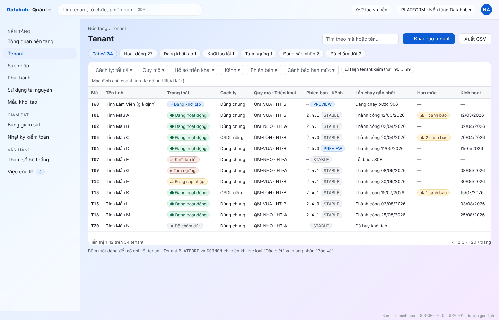

Hình 1. UI-20-01 Danh sách tenant (dữ liệu giả định, 34 tenant)

Ảnh cho thấy hàng ô lọc nhanh theo trạng thái với số đếm lấy từ `facets`, thanh công cụ lọc (cách ly, quy mô, hồ sơ triển khai, kênh, phiên bản, cảnh báo hạn mức), bảng 12 dòng mỗi dòng một tenant với nhãn trạng thái có chữ và biểu tượng, và dòng `T68` ở "Đang khởi tạo", `T07` ở "Khởi tạo lỗi", `T09` ở "Tạm ngừng", `T12` ở "Đang sáp nhập".

### 4.2. Bố cục vùng

Bố cục theo PTN-01: tiêu đề kèm nút chính, hàng ô lọc nhanh, thanh công cụ, bảng, phân trang.

| # | Vùng | `CMP-*` | Nội dung | Ghi chú |
|---|---|---|---|---|
| 1 | Tiêu đề trang | `CMP-PageHeader` | "Tenant"; ô tìm; nút "＋ Khai báo tenant" (chính), "Xuất CSV" | Nút chính chỉ hiện với `PERM-20-provision` |
| 2 | Ô lọc nhanh theo trạng thái | `CMP-FilterChips` | Tất cả, Hoạt động, Đang khởi tạo, Khởi tạo lỗi, Tạm ngừng, Đang sáp nhập, Đã chấm dứt, kèm số đếm từ `facets` | Chọn nhiều; ghi lên URL |
| 3 | Thanh lọc | `CMP-FilterBar` | Cách ly, quy mô, hồ sơ triển khai, kênh, phiên bản, cảnh báo hạn mức, hộp "Hiện tenant kiểm thử T90…T99" | Mặc định `kind = PROVINCE`, `testTenant = false` |
| 4 | Bảng tenant | `CMP-DataTable` | Cột ở mục 4.3; bấm dòng mở UI-20-03; dòng lỗi và tạm ngừng có viền trái đậm | `size-table-row` 32 px, mật độ gọn |
| 5 | Phân trang | `CMP-Pagination` | 20, 50, 100, 200 dòng mỗi trang | `size` tối đa 200 |

: UI-20-01 Danh sách tenant, bố cục vùng

### 4.3. Trường và cột

| Cột | Kiểu | Nguồn API | Ghi chú |
|---|---|---|---|
| Mã | T-TENANT, `CMP-Identifier` | `items[].tenantCode` | Đơn cách, bấm để mở chi tiết |
| Tên tỉnh | T-NAME | `items[].name` | Tìm không dấu theo `q` |
| Trạng thái | `TenantStatus` | `items[].status` | `CMP-StatusTag` chữ và biểu tượng (mục 3.7) |
| Cách ly | `IsolationMode` | `items[].isolationMode` | "Dùng chung", "CSDL riêng", "Cụm riêng" |
| Quy mô, triển khai | enum | `scaleProfile`, `deploymentProfile` | `QM-VUA · HT-B` |
| Phiên bản, kênh | SemVer, `ReleaseChannel` | `currentVersion`, `channel` | Kênh `PREVIEW` có nhãn xanh dương |
| Lần chạy gần nhất | text | `lastRun.status`, `lastRun.failedStep` | Lỗi hiện bước lỗi ("Lỗi bước S08") |
| Hạn mức | số | `openAlerts` | "▲ 1 cảnh báo" khi lớn hơn 0 |
| Kích hoạt | ngày | `activatedAt` | `dd/MM/yyyy`; trống hiện dấu gạch |

: UI-20-01 Danh sách tenant, trường và cột

Tenant `PLATFORM`, `COMMON` chỉ hiện khi lọc loại "Đặc biệt" và mang nhãn "Bảo vệ" (FR-20-006); dòng đó không có hành động ghi.

### 4.4. Hành động

| Hành động | Điều kiện | API | Kết quả |
|---|---|---|---|
| Tìm, lọc, đổi trang, sắp xếp | `PERM-20-read` | API-20-001 | Dữ liệu làm mới giữ khung (`ST-02`), URL cập nhật |
| Bấm dòng | `PERM-20-read` | — | Mở UI-20-03; dòng `PROVISIONING` mở thẳng tab Tổng quan có liên kết UI-20-04 |
| Khai báo tenant | `PERM-20-provision` | — | Mở UI-20-02 |
| Xuất CSV | `PERM-20-read` | API-20-001 với `format=csv` | Tối đa 1.000 dòng, UTF-8, không dữ liệu cá nhân; vượt thì báo "Thu hẹp bộ lọc để xuất" |
| Lưu bộ lọc | `PERM-20-read` | — | Bộ lọc đã lưu của người dùng (FR-00-024) |

: UI-20-01 Danh sách tenant, hành động

### 4.5. Trạng thái và thông báo

| Trạng thái | Hiển thị |
|---|---|
| Đang tải | Skeleton đúng hình: hàng ô lọc, 8 dòng bảng; hiện sau 200 ms (`ST-01`) |
| Rỗng | Không xảy ra thực tế vì luôn có `PLATFORM`; nếu bộ lọc mặc định trả 0 (nền tảng mới): `CMP-EmptyState` "Chưa có tenant tỉnh nào. Khai báo tenant đầu tiên để bắt đầu." kèm nút "Khai báo tenant" cho PA |
| Không có kết quả | "Không tìm thấy tenant phù hợp" kèm điều kiện đang áp dụng và "Xóa bộ lọc" (`ST-04`) |
| Lỗi | `CMP-Alert` kèm "Thử lại" và mã truy vết (`ST-05`); ô lọc nhanh vẫn dùng được |
| Không có quyền | `ST-07` bằng `CMP-ResultPage` 403 |
| Chỉ đọc | PO, PAU: không có nút "Khai báo tenant" |

: UI-20-01 Danh sách tenant, trạng thái màn

| Mã | HTTP | Câu hiển thị (FRS §9.2) | Nơi hiện |
|---|---|---|---|
| ERR-20-004 | 400 | "{Trường} chưa hợp lệ: {yêu cầu}." | `CMP-Alert` đầu bảng, ô lọc sai được tô viền |

: UI-20-01 Danh sách tenant, thông báo theo mã lỗi

### 4.6. Phím tắt và truy cập

Phím tắt: `/` focus ô tìm, `Alt+N` mở khai báo tenant (khi có quyền), `[` và `]` chuyển trang (có thể tắt theo WCAG 2.1.4), `Ctrl+K` tìm toàn cục. Thứ tự focus: tiêu đề, ô tìm, nút chính, ô lọc nhanh, thanh lọc, bảng, phân trang. Bảng là `role="grid"` có `aria-label="Danh sách tenant"`; trạng thái đọc đủ ("T09, Tạm ngừng"); số đếm của ô lọc nhanh nằm trong nhãn nút. Tương phản chữ nhãn trạng thái đạt 4,5:1 trên nền đặc; không dùng màu một mình.

### 4.7. Thành phần và token

`CMP-PageHeader`, `CMP-FilterChips`, `CMP-FilterBar`, `CMP-DataTable`, `CMP-Pagination`, `CMP-StatusTag`, `CMP-Identifier`, `CMP-EmptyState`, `CMP-Alert`, `CMP-ResultPage`, `CMP-Button`. Token: `color-surface-solid`, `color-canvas`, `color-text-primary`, `color-text-secondary`, `color-success`, `color-warning`, `color-error`, `color-info`, `size-table-row`, `font-body`, `font-caption`, `font-mono-sm`, `space-4`, `radius-lg`.

## 5. UI-20-02 Khai báo tenant (wizard 5 bước)

Màn khai báo một tỉnh mới: năm bước từ hồ sơ tới rà soát, kết thúc bằng kiểm tra sẵn sàng 9 mục để PA xử lý trước khi tạo bất kỳ tài nguyên thật nào.

::: dac-ta
**Mã, tên.** UI-20-02 · Khai báo tenant.

**Mục đích.** Cho PA khai báo tenant mới (mã, tên, đơn vị hành chính, cách ly, quy mô, hồ sơ triển khai, mẫu khởi tạo, phân hệ, đầu mối), chạy kiểm tra sẵn sàng và lưu bản ghi `PROVISIONING`, tùy chọn chạy ngay saga. Hỗ trợ chọn cụm đích cho `DEDICATED_CLUSTER` ở Đợt 2.

**Đường dẫn, mẫu.** `/nen-tang/tenant/moi` (tham số `buoc` từ 1 đến 5); PTN-05 Wizard.

**Vai trò, quyền.** PA (`PERM-20-provision`).

**FR.** FR-20-001, FR-20-007, FR-20-008, FR-20-017.

**API.** API-20-002 (khai báo), API-20-005 (kiểm tra sẵn sàng hồ sơ chưa lưu), API-20-006 (kiểm tra lại), API-20-013 (chạy saga khi "Lưu và khởi tạo"), API-20-025 và API-20-027 (mẫu), API-20-035 (cụm đích), API-20-063 (danh mục phân hệ).

**Thông báo.** ERR-20-003, 004, 011, 012, 013, 014, 015, 017, 021, 062, 064, 067.
:::

### 5.1. Bản hi-fi

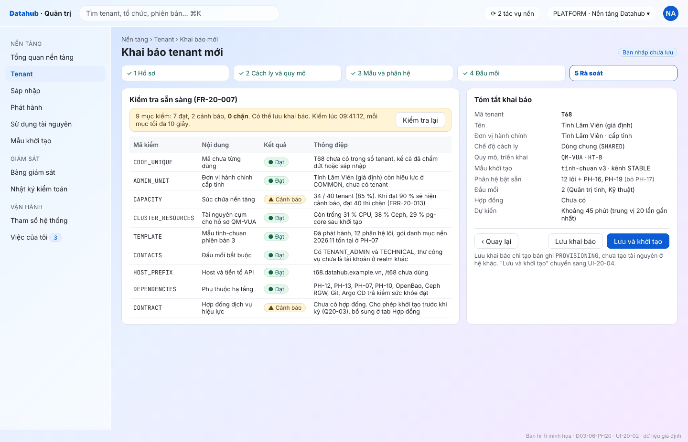

Hình 2. UI-20-02 Khai báo tenant, bước 5 Rà soát và kiểm tra sẵn sàng

Ảnh cho thấy bước 5: thanh năm bước (bốn bước đầu có dấu tích), bảng chín mục kiểm tra với kết quả có chữ ("Đạt", "Cảnh báo", "Chặn") kèm biểu tượng, dải tóm tắt "7 đạt, 2 cảnh báo, 0 chặn", khối tóm tắt khai báo và hai nút "Lưu khai báo", "Lưu và khởi tạo".

### 5.2. Bố cục vùng

Bố cục PTN-05: `CMP-Steps` biến thể `wizard` ở trên, nội dung bước ở giữa (một cột tối đa `size-form-max` ở bước 1 đến 4, hai cột ở bước 5), thanh hành động dính đáy.

| # | Vùng | `CMP-*` | Nội dung | Ghi chú |
|---|---|---|---|---|
| 1 | Thanh bước | `CMP-Steps` `wizard` | 1 Hồ sơ · 2 Cách ly và quy mô · 3 Mẫu và phân hệ · 4 Đầu mối · 5 Rà soát | Bước đã xong bấm được để sửa; không nhảy tới bước chưa tới |
| 2 | Bước 1 Hồ sơ | `CMP-Form`, `CMP-FormField`, `CMP-Input`, `CMP-ResourceSelect` | Mã tenant, tên, đơn vị hành chính cấp tỉnh (chọn từ `COMMON`), ghi chú, hộp "Tenant kiểm thử" khi mã T90…T99 | Kiểm mã khi rời trường |
| 3 | Bước 2 Cách ly và quy mô | `CMP-RadioCard`, `CMP-Select` | Chế độ cách ly (thẻ chọn), hồ sơ quy mô `QM-*`, hồ sơ triển khai `HT-A` hoặc `HT-B`, cụm đích khi `DEDICATED_CLUSTER` | `DEDICATED_CLUSTER` khóa khi `20.dedicated-cluster.enabled = false` |
| 4 | Bước 3 Mẫu và phân hệ | `CMP-Select`, `CMP-Checkbox`, `CMP-DataTable` | Mẫu và phiên bản, danh sách phân hệ bật sẵn (lõi khóa), hạn mức mặc định theo quy mô, hợp đồng tham chiếu | Bỏ chọn phân hệ không lõi |
| 5 | Bước 4 Đầu mối | `CMP-EditableTable` | Vai trò, họ tên, chức vụ, thư công vụ, điện thoại, đơn vị | Tối thiểu `TENANT_ADMIN` và `TECHNICAL` |
| 6 | Bước 5 Rà soát | `CMP-DataTable`, `CMP-Alert`, `CMP-DescriptionList` | Chín mục kiểm tra, tóm tắt khai báo, dự kiến thời gian | Mục `BLOCKER` khóa nút lưu |
| 7 | Thanh hành động | `CMP-Wizard` | "Quay lại", "Lưu khai báo", "Lưu và khởi tạo", "Hủy" | Nút chính theo bước |

: UI-20-02 Khai báo tenant, bố cục vùng

Bước 5 là phần giải phẫu kỹ nhất: tám mục kiểm chạy song song tối đa 10 giây mỗi mục; kết quả hiện theo thứ tự `BLOCKER`, `WARN`, `PASS`; mục `WARN` không chặn nhưng hiện gợi ý (ví dụ `CAPACITY` ở 85 % và `CONTRACT` chưa có hợp đồng, Q20-03).

### 5.3. Trường và cột

| Trường | Kiểu | Bắt buộc | Ràng buộc | Nguồn API |
|---|---|---|---|---|
| Mã tenant (`tenantCode`) | T-TENANT | Có | `^T\d{2}$`, chưa từng dùng; T90…T99 chỉ khi tenant kiểm thử | API-20-002 |
| Tên (`name`) | T-NAME | Có | 1…255 ký tự | API-20-002 |
| Đơn vị hành chính (`adminUnitId`) | T-ID | Có (trừ kiểm thử) | Cấp tỉnh, còn hiệu lực ở `COMMON`, chưa có tenant | API-20-002 |
| Chế độ cách ly (`isolationMode`) | enum | Có | `SHARED`, `DEDICATED_DB`, `DEDICATED_CLUSTER` | API-20-002 |
| Hồ sơ quy mô (`scaleProfile`) | enum | Có | `QM-NHO`, `QM-VUA`, `QM-LON`, `QM-CHUNG` | API-20-002 |
| Hồ sơ triển khai (`deploymentProfile`) | enum | Có | `HT-A`, `HT-B` | API-20-002 |
| Cụm đích (`clusterCode`) | T-CODE | Khi cụm riêng | Cụm đã `VERIFIED` | API-20-035 |
| Mẫu (`templateCode`, `templateVersion`) | T-CODE, số | Có | Phiên bản đã phát hành | API-20-025, 027 |
| Phân hệ loại trừ (`modulesExcluded`) | T-CODE[] | Không | Chỉ phân hệ không lõi trong mẫu | API-20-063 |
| Đầu mối (`contacts[]`) | đối tượng | Có | Tối thiểu 1 `TENANT_ADMIN`, 1 `TECHNICAL`; thư công vụ | API-20-002 |
| Số hợp đồng (`contractRef`) | T-CODE | Không | Nếu đã ký | API-20-002 |
| Tenant kiểm thử (`testTenant`) | T-BOOL | Không | Chỉ mã T90…T99 | API-20-002 |
| Ghi chú (`note`) | T-TEXT | Không | Tối đa 2.000 ký tự | API-20-002 |

: UI-20-02 Khai báo tenant, trường nhập

Kết quả kiểm tra sẵn sàng hiện các cột: `checkCode`, nội dung, kết quả (`PASS`, `WARN`, `BLOCKER`), thông điệp, gợi ý; nguồn `items[]` của API-20-005 và API-20-006.

### 5.4. Hành động

| Hành động | Điều kiện | API | Kết quả |
|---|---|---|---|
| Tiếp tục | Bước hợp lệ | — | Kiểm trường bước hiện tại; lỗi thì ở lại bước, focus vào trường lỗi đầu tiên |
| Kiểm tra lại | Bước 5 | API-20-005 | Làm mới bảng kiểm, giữ vị trí cuộn |
| Lưu khai báo | `PERM-20-provision`, không còn `BLOCKER` | API-20-002 kèm `Idempotency-Key` | Tạo bản ghi `PROVISIONING`, `Toast` "Đã lưu tenant T68", mở UI-20-03 |
| Lưu và khởi tạo | Như trên, tenant ở `PROVISIONING` | API-20-002 rồi API-20-013 (hậu tố khóa `:run`) | Chuyển UI-20-04 |
| Quay lại, bấm bước đã qua | Luôn | — | Giữ giá trị đã nhập; bước sau bị đánh dấu "cần rà lại" nếu dữ liệu đổi |
| Hủy | Luôn | — | `CMP-ConfirmDialog` nếu có thay đổi chưa lưu |

: UI-20-02 Khai báo tenant, hành động

### 5.5. Trạng thái và thông báo

| Trạng thái | Hiển thị |
|---|---|
| Đang tải | Skeleton theo lưới trường của bước; danh sách mẫu và cụm tải riêng (`ST-01`) |
| Rỗng | Chưa có mẫu đã phát hành: `CMP-EmptyState` "Chưa có mẫu khởi tạo nào để dùng. Phát hành một mẫu trước." kèm liên kết UI-20-21 |
| Lỗi | Dịch vụ phụ thuộc không phản hồi (PH-07, PH-12…): `CMP-Alert` ERR-20-062 kèm "Thử lại"; dữ liệu đã nhập được giữ |
| Không có quyền | `ST-07` (403) cho người không có `PERM-20-provision` |
| Chỉ đọc | Không áp dụng (wizard chỉ cho PA) |
| Bản nháp | Dữ liệu giữ trong bộ nhớ tab, mất khi đóng; không lưu thư công vụ vào bộ nhớ trình duyệt (Q20-36) |

: UI-20-02 Khai báo tenant, trạng thái màn

| Mã | HTTP | Câu hiển thị (FRS §9.2) | Nơi hiện |
|---|---|---|---|
| ERR-20-003 | 409 | "{Đối tượng} {mã} đã tồn tại. Chọn mã khác." | Dưới trường mã |
| ERR-20-004 | 400 | "{Trường} chưa hợp lệ: {yêu cầu}." | Dưới trường sai |
| ERR-20-011 | 409 | "Đơn vị hành chính {tên} đã có tenant {mã} đang sử dụng." | Dưới trường đơn vị hành chính |
| ERR-20-012 | 422 | "Đơn vị hành chính {mã} không phải cấp tỉnh hoặc đã hết hiệu lực." | Dưới trường đơn vị hành chính |
| ERR-20-013 | 422 | "Nền tảng đã đạt sức chứa {số} tenant. Liên hệ vận hành hạ tầng để mở rộng." | Dòng `CAPACITY` bước 5 |
| ERR-20-014 | 422 | "Cụm chưa đủ tài nguyên cho hồ sơ {hồ sơ}: thiếu {tài nguyên}." | Dòng `CLUSTER_RESOURCES` |
| ERR-20-015 | 422 | "Mẫu khởi tạo {mã} phiên bản {n} không dùng được: {lý do}." | Dưới trường mẫu |
| ERR-20-017 | 422 | "Kiểm tra sẵn sàng chưa đạt: {số} mục cần xử lý." | `CMP-Alert` bước 5 |
| ERR-20-021 | 422 | "Cần đủ đầu mối {vai trò} trước khi {thao tác}." | Dưới bảng đầu mối |
| ERR-20-062 | 503 | "Dịch vụ {tên} tạm thời không khả dụng. Thử lại sau." | Dòng `DEPENDENCIES` |
| ERR-20-064 | 422 | "Cụm {mã} chưa đạt yêu cầu: {danh sách thiếu}." | Dưới trường cụm đích |
| ERR-20-067 | 409 | "Tên miền hoặc tiền tố {giá trị} đã được tenant khác dùng." | Dòng `HOST_PREFIX` |

: UI-20-02 Khai báo tenant, thông báo theo mã lỗi

### 5.6. Phím tắt và truy cập

Phím tắt: `Alt+→` tiếp tục, `Alt+←` quay lại (theo PTN-05), `Ctrl+Enter` lưu khai báo khi ở bước 5. Khi bấm "Tiếp tục" mà có lỗi, focus chuyển tới `CMP-Alert` tóm tắt rồi tới trường lỗi đầu tiên (theo `ST-11`). Bảng kiểm tra là `role="table"`; kết quả đọc đủ "CAPACITY, Cảnh báo, 34 trên 40 tenant". `CMP-Steps` có `aria-current="step"`; bước đã xong là nút có nhãn "Bước 1, đã hoàn tất, bấm để sửa".

### 5.7. Thành phần và token

`CMP-Wizard`, `CMP-Steps`, `CMP-Form`, `CMP-FormField`, `CMP-Input`, `CMP-ResourceSelect`, `CMP-RadioCard`, `CMP-Select`, `CMP-Checkbox`, `CMP-EditableTable`, `CMP-DataTable`, `CMP-DescriptionList`, `CMP-Alert`, `CMP-ConfirmDialog`, `CMP-StatusTag`, `CMP-Toast`. Token: `color-surface-solid`, `color-success-text`, `color-warning-text`, `color-error-text`, `color-accent`, `size-form-max`, `space-4`, `space-6`, `font-title-3`, `radius-lg`, `glass-overlay` (thanh hành động dính đáy).

## 6. UI-20-03 Chi tiết tenant (7 tab)

Màn gốc cho mọi thao tác trên một tenant: bảy tab gom hồ sơ, cấu hình, hợp đồng, phân hệ, hạn mức, lịch sử vòng đời và kiểm toán, cùng các hành động nguy hiểm gom ở đầu trang.

::: dac-ta
**Mã, tên.** UI-20-03 · Chi tiết tenant.

**Mục đích.** Cho PA, PO, PAU xem toàn bộ thông tin một tenant và là điểm xuất phát của mọi thao tác: sửa hồ sơ hành chính, quản lý đầu mối và hợp đồng, sửa cấu hình nền tảng (host, tiền tố, hồ sơ triển khai, vùng DR), đề nghị đổi chế độ cách ly, xem lịch sử vòng đời và nhật ký kiểm toán.

**Đường dẫn, mẫu.** `/nen-tang/tenant/{ma-tenant}` (tab `tong-quan`, `cau-hinh`, `hop-dong`, `phan-he`, `han-muc`, `vong-doi`, `kiem-toan`); PTN-02 Chi tiết.

**Vai trò, quyền.** PA, PO, PAU (`PERM-20-read`); sửa hồ sơ, đầu mối, hợp đồng, cấu hình `PERM-20-admin`; tạm ngừng, đổi cách ly `PERM-20-lifecycle`; kiểm toán toàn nền tảng PA, PAU.

**FR.** FR-20-003, 004, 005, 008, 017, 019, 020, 025, 043, 060, 068.

**API.** API-20-003 (chi tiết, `allowedActions[]`, `ETag`), API-20-004 (sửa hồ sơ), API-20-007 đến 012 (đầu mối, hợp đồng), API-20-039, 040 (cấu hình nền tảng), API-20-047 (đề nghị đổi cách ly), API-20-064 (phân hệ), API-20-048 (hạn mức), API-20-072, 085 (lịch sử), API-20-130 (kiểm toán).

**Thông báo.** ERR-20-002, 004, 005, 008, 010, 021, 022, 025, 028, 067, 068.
:::

### 6.1. Bản hi-fi

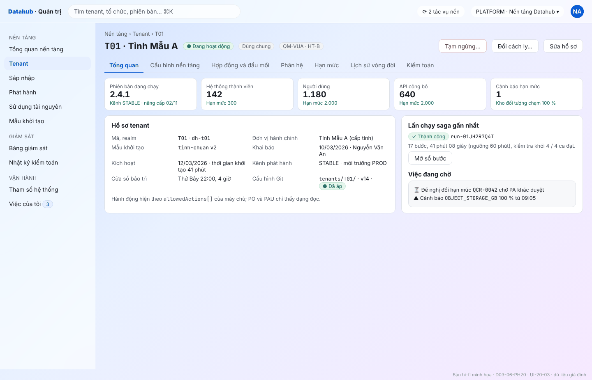

Hình 3. UI-20-03 Chi tiết tenant T01, tab Tổng quan

Ảnh cho thấy đầu trang có mã, tên, nhãn trạng thái, cách ly, quy mô và ba nút hành động; hàng bảy tab; năm thẻ chỉ số; khối hồ sơ (realm, đơn vị hành chính, mẫu, kênh, cửa sổ bảo trì, phiên bản cấu hình Git); khối lần chạy saga gần nhất và danh sách việc đang chờ (đề nghị đổi hạn mức, cảnh báo kho đối tượng).

### 6.2. Bố cục vùng

| # | Vùng | `CMP-*` | Nội dung | Ghi chú |
|---|---|---|---|---|
| 1 | Đầu trang | `CMP-PageHeader`, `CMP-StatusTag` | Mã, tên, trạng thái, cách ly, hồ sơ; nút "Tạm ngừng…", "Đổi cách ly…", "Sửa hồ sơ" | Nút theo `allowedActions[]`; tenant `PLATFORM`, `COMMON` không có nút |
| 2 | Dải trạng thái trong trang | `CMP-Alert` | `MERGED`: "Đã sáp nhập vào {đích} từ {ngày}, chuyển tiếp tới {ngày}" kèm liên kết UI-20-10; `SUSPENDED`: lý do và hạn | Không đẩy lên dải toàn cục (mục 3.2) |
| 3 | Hàng tab | `CMP-Tabs` | Tổng quan, Cấu hình nền tảng, Hợp đồng và đầu mối, Phân hệ, Hạn mức, Lịch sử vòng đời, Kiểm toán | Tab ghi lên URL; tab Phân hệ, Hạn mức mở UI-20-07, UI-20-05 |
| 4 | Thẻ chỉ số | `CMP-KpiCard` | Phiên bản đang chạy, số HTTT, người dùng, API công bố, cảnh báo hạn mức | Dữ liệu từ khối `summary` |
| 5 | Khối hồ sơ | `CMP-DescriptionList` | Mã, realm, đơn vị hành chính, mẫu và phiên bản, ngày khai báo, kích hoạt, kênh, cửa sổ bảo trì, cấu hình Git | Realm và mã không sửa được (ERR-20-068) |
| 6 | Lần chạy saga, việc chờ | `CMP-Card`, `CMP-StatusTag` | Lần chạy gần nhất, kiểm tra khói, đề nghị chờ duyệt, cảnh báo mở | Liên kết UI-20-04, UI-20-05, UI-20-08 |

: UI-20-03 Chi tiết tenant, bố cục vùng

Các tab còn lại, mô tả nội dung để kỹ sư dựng:

| Tab | Nội dung | API | Ghi chú |
|---|---|---|---|
| Cấu hình nền tảng | Host công bố, tiền tố API, hồ sơ triển khai, vùng DR, chế độ namespace runtime; trạng thái ghi Git (`COMMITTED`, `APPLIED`) và đồng bộ Argo CD; liên kết sang UI-20-17 | API-20-039, 040 | Sửa mở `CMP-ReasonDialog` (mục 3.4); thuộc tính bất biến khóa kèm chữ (ERR-20-068) |
| Hợp đồng và đầu mối | Bảng đầu mối (vai trò, họ tên, thư, điện thoại), bảng hợp đồng (số, hiệu lực, hạn mức cam kết), nhắc hết hạn 60, 30, 7 ngày | API-20-007 đến 012 | Ngừng đầu mối cuối cùng của một vai trò bắt buộc bị chặn (ERR-20-021) |
| Phân hệ | Tóm tắt trạng thái phân hệ, liên kết "Quản lý phân hệ" | API-20-064 | Chi tiết ở UI-20-07 |
| Hạn mức | Tóm tắt 12 tài nguyên và đề nghị chờ duyệt | API-20-048 | Chi tiết ở UI-20-05 |
| Lịch sử vòng đời | `CMP-Timeline`: trạng thái trước sau, thời điểm, nguyên nhân, người, văn bản, đề nghị | API-20-085, 072 | Chỉ thêm, không sửa; mỗi dòng có liên kết tới đề nghị hoặc lần chạy |
| Kiểm toán | `CMP-AuditTimeline` lọc theo người, hành động, khoảng thời gian (tối đa 366 ngày), mã phiếu | API-20-130 | Hiển thị lý do và mã phiếu; PAU chỉ đọc; xuất CSV |

: UI-20-03 Chi tiết tenant, nội dung bảy tab

### 6.3. Trường và cột

| Trường | Kiểu | Nguồn API | Ghi chú |
|---|---|---|---|
| Mã, realm | T-TENANT, text | `tenantCode`, `realm` | Bất biến, `CMP-CopyButton` |
| Trạng thái | `TenantStatus` | `status` | Mục 3.7 |
| Cách ly, quy mô, triển khai | enum | `isolationMode`, `scaleProfile`, `deploymentProfile` | Đổi cách ly cần đề nghị bốn mắt (FR-20-025) |
| Phiên bản đang chạy, kênh | SemVer, enum | `currentVersion`, `channel` | Kênh đổi ở UI-20-18 |
| `publicHost`, `apiPathPrefix` | text | API-20-039 | Trùng tenant khác: ERR-20-067 |
| `drRegion`, `runtimeNamespaceMode` | enum | API-20-039 | Đổi có lý do và mã phiếu |
| Đầu mối: `role`, `fullName`, `officialEmail`, `phone` | text | API-20-007 | Thư công vụ, che một phần ở bảng (`CMP-MaskedValue`) |
| Hợp đồng: `contractNo`, `validFrom`, `validTo`, `committedQuota` | text, ngày, JSON | API-20-010 | Không chồng thời hạn (ERR-20-022) |
| `allowedActions[]` | mảng | API-20-003 | Quyết định nút hiện |

: UI-20-03 Chi tiết tenant, trường và cột

### 6.4. Hành động

| Hành động | Điều kiện | API | Kết quả |
|---|---|---|---|
| Sửa hồ sơ hành chính | `PERM-20-admin`, tenant không `DECOMMISSIONED` | API-20-004 (`If-Match`) | Hộp thoại lý do và mã phiếu; `Toast`; ERR-20-005 mở `CMP-ConflictDialog` |
| Thêm, sửa, ngừng đầu mối | `PERM-20-admin` | API-20-008, 009 | Bảng cập nhật; ngừng đầu mối bắt buộc cuối cùng bị chặn |
| Thêm, sửa, gia hạn hợp đồng | `PERM-20-admin` | API-20-011, 012 | Gợi ý "Đổi hạn mức theo hợp đồng" mở UI-20-05 khi có `committedQuota` |
| Sửa cấu hình nền tảng | `PERM-20-admin`; tenant không `SUSPENDED` | API-20-040 (`If-Match`) | Ghi Git rồi áp Argo CD; trạng thái "Đang áp" hiện tại chỗ; lỗi ERR-20-024, 109 |
| Tạm ngừng… | `PERM-20-lifecycle`, tenant `ACTIVE` | — | Mở UI-20-08 |
| Đổi cách ly… | `PERM-20-lifecycle`, Đợt 2 | API-20-047 | Tạo đề nghị `ISOLATION_CHANGE` chờ người duyệt khác |
| Xuất nhật ký kiểm toán | PA, PAU | API-20-130 | CSV, không dữ liệu cá nhân |

: UI-20-03 Chi tiết tenant, hành động

### 6.5. Trạng thái và thông báo

| Trạng thái | Hiển thị |
|---|---|
| Đang tải | Skeleton đầu trang, hàng tab, năm thẻ, khối hồ sơ; mỗi tab tải riêng (`ST-01`) |
| Rỗng | Tab chưa có dữ liệu: hợp đồng "Chưa có hợp đồng nào. Thêm hợp đồng để làm căn cứ hạn mức."; kiểm toán "Chưa có thao tác nào trong khoảng đã chọn." |
| Lỗi | Khối lỗi hiện `CMP-Alert` kèm "Thử lại", khối còn lại dùng được (`ST-05`) |
| Không có quyền | `ST-07`; mã không có `ST-08` |
| Chỉ đọc | PO, PAU: không có nút ghi; tenant `PLATFORM`, `COMMON`: chỉ tab Tổng quan và Kiểm toán, `allowedActions = []` |

: UI-20-03 Chi tiết tenant, trạng thái màn

| Mã | HTTP | Câu hiển thị (FRS §9.2) | Nơi hiện |
|---|---|---|---|
| ERR-20-002 | 404 | "Không tìm thấy {đối tượng} {mã} trong phạm vi được xem." | `ST-08` |
| ERR-20-005 | 412 | "{Đối tượng} đã được người khác sửa. Tải lại để xem thay đổi." | `CMP-ConflictDialog` |
| ERR-20-008 | 422 | "Thao tác trên tenant tỉnh cần lý do tối thiểu 20 ký tự và mã phiếu." | Hộp thoại lý do |
| ERR-20-010 | 403 | "Tenant {mã} là tenant đặc biệt của nền tảng, không thực hiện được thao tác này." | `CMP-Alert` |
| ERR-20-021 | 422 | "Cần đủ đầu mối {vai trò} trước khi {thao tác}." | Dưới bảng đầu mối |
| ERR-20-022 | 422 | "Hợp đồng {số}: {lý do}." | Dưới trường hợp đồng |
| ERR-20-024 | 502 | "Không ghi được cấu hình vào kho GitOps. Thử lại sau, nếu lặp lại báo vận hành nền tảng." | `CMP-Alert` tab Cấu hình |
| ERR-20-025 | 409 | "Cấu hình tenant {mã} đang lệch chưa xử lý. Đối chiếu trước khi sửa." | `CMP-Alert` kèm liên kết UI-20-17 |
| ERR-20-028 | 422 | "Không chuyển được từ chế độ {từ} sang {tới}: {lý do}." | Hộp thoại đổi cách ly |
| ERR-20-067 | 409 | "Tên miền hoặc tiền tố {giá trị} đã được tenant khác dùng." | Dưới trường host |
| ERR-20-068 | 422 | "Không đổi được {thuộc tính} của tenant sau khai báo." | Tooltip và chữ ở trường khóa |

: UI-20-03 Chi tiết tenant, thông báo theo mã lỗi

### 6.6. Phím tắt và truy cập

Phím tắt theo PTN-02: `E` sửa khi có quyền, `[` và `]` chuyển tab, `H` mở tab Lịch sử vòng đời, `Alt+←` về danh sách. `CMP-Tabs` là `role="tablist"`, mũi tên trái phải đổi tab; nút nguy hiểm ("Tạm ngừng…") đứng sau nút thường trong thứ tự focus. Thẻ chỉ số có `aria-labelledby`; trạng thái tenant đọc kèm chữ. Dòng thời gian vòng đời là danh sách có thứ tự, mỗi mục đọc đủ "ngày, từ trạng thái, sang trạng thái, người, lý do".

### 6.7. Thành phần và token

`CMP-PageHeader`, `CMP-Tabs`, `CMP-KpiCard`, `CMP-DescriptionList`, `CMP-Card`, `CMP-StatusTag`, `CMP-Timeline`, `CMP-AuditTimeline`, `CMP-DataTable`, `CMP-EditableTable`, `CMP-ReasonDialog`, `CMP-ConflictDialog`, `CMP-MaskedValue`, `CMP-CopyButton`, `CMP-Alert`, `CMP-Toast`. Token: `color-surface-solid`, `color-success`, `color-warning`, `color-error`, `font-title-2`, `font-mono`, `font-caption`, `space-4`, `space-6`, `radius-lg`, `shadow-1`.

## 7. UI-20-04 Tiến độ khởi tạo

Màn quan trọng nhất của lần khởi tạo: sổ 17 bước cập nhật trực tiếp, đồng hồ so với ngưỡng một giờ và các nút can thiệp. Khởi tạo một tỉnh trong một giờ chỉ đạt khi PA thấy lỗi ngay lúc nó xảy ra, không đợi hết giờ.

::: dac-ta
**Mã, tên.** UI-20-04 · Tiến độ khởi tạo.

**Mục đích.** Cho PA, PO theo dõi saga khởi tạo (`INITIAL`), khởi tạo bổ sung (`SUPPLEMENT`) và chuyển chế độ cách ly (`ISOLATION_CHANGE`) theo thời gian thực: bước nào đang chạy, chờ phân hệ nào báo, mất bao lâu, lỗi gì; thử lại, bỏ qua bước không bắt buộc, bù trừ và hủy, chạy lại kiểm tra khói, kích hoạt và bàn giao.

**Đường dẫn, mẫu.** `/nen-tang/tenant/{ma-tenant}/khoi-tao` (tham số `run` để chọn lần chạy, `buoc` để mở chi tiết bước); PTN-11 Giám sát thời gian thực.

**Vai trò, quyền.** PA, PO xem (`PERM-20-read`); thử lại, bỏ qua, bù trừ, hủy, kích hoạt `PERM-20-provision` (PA).

**FR.** FR-20-007, 008, 009, 010, 011, 012, 013, 016.

**API.** API-20-014, 015 (lần chạy, sổ bước), API-20-016 (SSE), API-20-017, 018 (thử lại), API-20-019 (bỏ qua), API-20-020, 021 (bù trừ, hủy), API-20-022 (kiểm tra khói), API-20-023 (kích hoạt), API-20-006 (kiểm tra lại sẵn sàng), API-20-033, 034 (khởi tạo bổ sung).

**Thông báo.** ERR-20-006, 016, 017, 018, 019, 020, 106, 107, 108, 117; ERR-20-008 ở hộp thoại lý do.
:::

### 7.1. Bản hi-fi

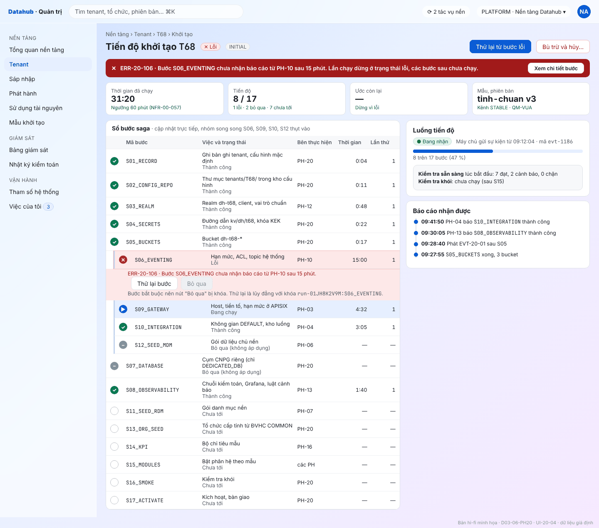

Hình 4. UI-20-04 Tiến độ khởi tạo T68, bước S06 quá hạn chờ báo cáo

Ảnh cho thấy: đầu trang có mã tenant, nhãn lần chạy "Lỗi", nút "Thử lại từ bước lỗi" và "Bù trừ và hủy…"; dải đỏ nêu ERR-20-106; bốn thẻ (đồng hồ 31:20 so ngưỡng 60 phút, tiến độ 8/17, ước còn lại, mẫu và phiên bản); sổ 17 bước trong đó nhóm song song S06, S09, S10, S12 thụt vào có viền trái, dòng S06 lỗi nền đỏ kèm hai nút "Thử lại bước" và "Bỏ qua" (khóa vì bước bắt buộc); cột phải là luồng tiến độ SSE và danh sách báo cáo nhận được.

### 7.2. Bố cục vùng

| # | Vùng | `CMP-*` | Nội dung | Ghi chú |
|---|---|---|---|---|
| 1 | Đầu trang | `CMP-PageHeader`, `CMP-StatusTag` | Mã tenant, trạng thái lần chạy, loại chạy (`INITIAL`, `SUPPLEMENT`, `ISOLATION_CHANGE`); nút "Thử lại từ bước lỗi", "Bù trừ và hủy…" | Mỗi nút mở `CMP-ReasonDialog` (mục 3.4) |
| 2 | Dải lỗi | `CMP-Banner` mức lỗi | Câu ERR-20-106, 107 hoặc 108 kèm gợi ý thao tác | Chỉ hiện khi lần chạy `FAILED` |
| 3 | Bốn thẻ số | `CMP-KpiCard` | Thời gian đã chạy so ngưỡng `20.provision.timeout-minutes`; tiến độ `n/17`; ước còn lại (trung vị 20 lần chạy `SUCCEEDED` gần nhất); mẫu và phiên bản mẫu | Đồng hồ chuyển vàng khi vượt 45 phút, đỏ khi vượt 60 |
| 4 | Sổ bước saga | `CMP-Steps` biến thể `ledger` (A-02), `CMP-DataTable` | 17 dòng: biểu tượng trạng thái, mã bước, việc, bên thực hiện, thời gian, số lần thử, mã lỗi gốc; nhóm song song `S06`, `S09`, `S10`, `S12` thụt vào | Dòng lỗi nền `color-error` nhạt, viền trái đậm; dòng bước bỏ qua hiện lý do |
| 5 | Chi tiết bước | `CMP-Drawer` | Đầu vào, `outputRef`, nhật ký thử lại, khóa lũy đẳng `{runId}:{stepCode}`, thân báo tiến độ | Mở khi bấm dòng bước |
| 6 | Luồng tiến độ | `CMP-JobProgress` `card` | Chỉ báo SSE ("Đang nhận" hoặc "Đang nối lại…"), thanh tiến độ, kết quả kiểm tra sẵn sàng và kiểm tra khói | Nhận API-20-016 |
| 7 | Báo cáo nhận được | `CMP-Timeline` | Các lần phân hệ báo qua API-20-166, EVT-20-01 đã phát, theo giờ giảm dần | Cuối trang trên màn hẹp |
| 8 | Kiểm tra khói | `CMP-DataTable` | Bốn ca `LOGIN_ADMIN`, `API_SAMPLE`, `EVENT_SAMPLE`, `CROSS_TENANT_LEAK` với kết quả | Hiện từ bước `S16` |

: UI-20-04 Tiến độ khởi tạo, bố cục vùng

Giải phẫu dòng bước: cột 1 biểu tượng trạng thái 20 px (✓ xanh lục, ▶ xanh dương, ◔ vàng, ✕ đỏ, – xám, vòng rỗng cho bước chưa tới); cột 2 mã bước đơn cách; cột 3 việc và nhãn trạng thái bằng chữ; cột 4 bên thực hiện (PH-12, PH-10…); cột 5 thời gian `m:ss`; cột 6 số lần thử. Nhóm song song nhận biết bằng thụt 18 px và viền trái 3 px màu `color-info`, chú thích "chạy song song" ở đầu nhóm cho trình đọc màn hình.

### 7.3. Trường và cột

| Trường | Kiểu | Nguồn API | Ghi chú |
|---|---|---|---|
| `runId`, `runKind`, `status` | text, enum | API-20-015 | `ProvisioningRunStatus` mục 3.7 |
| `startedAt`, `elapsedSeconds`, `etaSeconds`, `attempt` | thời điểm, số | API-20-015 | Đồng hồ chạy ở giao diện giữa hai sự kiện SSE |
| `steps[].stepCode`, `order` | T-CODE, số | API-20-015 | 17 mã `S01_RECORD` đến `S17_ACTIVATE` |
| `steps[].executor`, `mode` | text, enum | API-20-015 | `mode` đồng bộ hoặc bất đồng bộ (chờ báo) |
| `steps[].status` | `ProvisioningStepStatus` | API-20-015, 016 | `SKIPPED` cho `S07` khi `SHARED`, `S12` khi PH-06 không bật, `S14` khi PH-16 không bật |
| `steps[].durationSeconds`, `attempt` | số | API-20-015 | Tối đa `20.provision.step-retry-max` lần thử tự động |
| `steps[].errorCode`, `errorDetail` | text | API-20-015 | Hiện câu ERR-20-106 hoặc 107 tương ứng |
| `smoke[]` | mảng | API-20-015 | Kết quả bốn ca kiểm tra khói |
| `Last-Event-ID`, `eventId` | số | API-20-016 | Nối lại khi mất kết nối |

: UI-20-04 Tiến độ khởi tạo, trường và cột

### 7.4. Hành động

| Hành động | Điều kiện | API | Kết quả |
|---|---|---|---|
| Thử lại từ bước lỗi | `PERM-20-provision`, lần chạy `FAILED` | API-20-017 | Hộp thoại lý do và phiếu; lần chạy về `RUNNING`; ERR-20-018 nếu không thử lại được |
| Thử lại một bước | `PERM-20-provision`, bước `FAILED` | API-20-018 | Lũy đẳng với khóa `{runId}:{stepCode}`; bước về `RUNNING` |
| Bỏ qua bước | `PERM-20-provision`, bước không bắt buộc | API-20-019 | Hộp thoại lý do; bước bắt buộc: nút khóa kèm chữ "Bước bắt buộc, không bỏ qua được" |
| Bù trừ và hủy | `PERM-20-provision`, tenant chưa từng `ACTIVE` | API-20-020, 021 | `CMP-ConfirmDialog` `dangerous` bắt gõ lại mã tenant `T68`; ERR-20-019 nếu tenant đã hoạt động |
| Chạy lại kiểm tra khói | `PERM-20-provision`, tenant `PROVISIONING` | API-20-022 | Hiện kết quả từng ca; lỗi ERR-20-117 |
| Kích hoạt và bàn giao | `PERM-20-provision`, khói đạt | API-20-023 | Có thể hẹn giờ tối đa 30 ngày; ERR-20-020 nếu khói chưa đạt |
| Mở chi tiết bước | `PERM-20-read` | — | `CMP-Drawer` |
| Chọn lần chạy khác | `PERM-20-read` | API-20-014 | Danh sách lần chạy mới nhất trước |

: UI-20-04 Tiến độ khởi tạo, hành động

### 7.5. Trạng thái và thông báo

| Trạng thái | Hiển thị |
|---|---|
| Đang tải | Skeleton bốn thẻ và 17 dòng bước; sau đó mở SSE (`ST-01`) |
| Rỗng | Tenant chưa có lần chạy: `CMP-EmptyState` "Tenant này chưa có lần khởi tạo nào." kèm nút "Chạy khởi tạo" (PA) |
| Lỗi | Dải ERR-20-106, 107 hoặc 108 trên đầu; lỗi tải trang là `ST-05`; SSE đứt: chỉ báo "Đang nối lại…" và thăm dò dự phòng 5 giây (`ST-06`) |
| Không có quyền | `ST-07` cho người không thuộc PA, PO |
| Chỉ đọc | PO: không có nút thử lại, bỏ qua, bù trừ, kích hoạt |
| Đang bù trừ | Dòng bước `COMPENSATING` hiện ↶; không cho thử lại cho tới khi xong |
| Đã thành công | Dải xanh "Tenant đã kích hoạt, thư bàn giao đã gửi tới 3 đầu mối", liên kết UI-20-03 |

: UI-20-04 Tiến độ khởi tạo, trạng thái màn

| Mã | HTTP | Câu hiển thị (FRS §9.2) | Nơi hiện |
|---|---|---|---|
| ERR-20-006 | 409 | "Không thể {thao tác} khi {đối tượng} đang ở trạng thái {trạng thái}." | `CMP-Alert` trong hộp thoại |
| ERR-20-016 | 409 | "Tenant {mã} đang có lần khởi tạo {runId} chưa kết thúc." | `CMP-Alert` khi chạy bổ sung |
| ERR-20-017 | 422 | "Kiểm tra sẵn sàng chưa đạt: {số} mục cần xử lý." | `CMP-Alert` kèm liên kết kiểm tra lại |
| ERR-20-018 | 409 | "Không thể thử lại bước {bước}: {lý do}." | `CMP-Alert` trong hộp thoại |
| ERR-20-019 | 409 | "Không thể bù trừ: {lý do}." | `CMP-Alert` trong hộp thoại |
| ERR-20-020 | 422 | "Kiểm tra khói chưa đạt ({số} ca lỗi). Không thể kích hoạt tenant." | `CMP-Alert` cạnh nút kích hoạt |
| ERR-20-106 | — | "Bước {bước} chưa nhận báo cáo từ {bên thực hiện} sau {phút} phút." | Dải lỗi và dòng bước |
| ERR-20-107 | — | "Bước {bước} lỗi tại {bên thực hiện}: {mã lỗi gốc}." | Dải lỗi và dòng bước |
| ERR-20-108 | — | "Khởi tạo vượt thời gian cho phép {phút} phút." | Dải lỗi; lần chạy không tự hủy |
| ERR-20-117 | — | "Ca kiểm tra khói {ca} lỗi: {chi tiết}." | Dòng ca khói |

: UI-20-04 Tiến độ khởi tạo, thông báo theo mã lỗi

### 7.6. Phím tắt và truy cập

Phím tắt: `Alt+R` thử lại từ bước lỗi (mở hộp thoại, không thực hiện ngay), `↑` `↓` di chuyển giữa dòng bước, `Enter` mở chi tiết bước, `Esc` đóng ngăn kéo. Sổ bước là `role="list"`; mỗi dòng đọc "Bước S06_EVENTING, Eventing, PH-10, lỗi, 15 phút 0 giây, lần thử 1". Vùng `aria-live="polite"` chỉ thông báo bước đổi trạng thái ("S09_GATEWAY thành công"), không đọc lại toàn sổ; đồng hồ không phải vùng live. Dải lỗi `role="alert"`. Màu dòng lỗi đi kèm biểu tượng ✕ và chữ "Lỗi", đạt tương phản 4,5:1.

### 7.7. Thành phần và token

`CMP-PageHeader`, `CMP-StatusTag`, `CMP-Banner`, `CMP-KpiCard`, `CMP-Steps` (biến thể `ledger` đề nghị A-02), `CMP-DataTable`, `CMP-Drawer`, `CMP-JobProgress`, `CMP-Timeline`, `CMP-ReasonDialog`, `CMP-ConfirmDialog`, `CMP-Duration`, `CMP-Timestamp`, `CMP-Alert`. Token: `color-surface-solid`, `color-success`, `color-info`, `color-warning`, `color-error`, `color-error-text`, `font-mono`, `font-display`, `space-3`, `space-4`, `radius-md`, `motion-duration-fast`.

## 8. UI-20-05 Hạn mức tenant

Màn đặt và đổi hạn mức hợp đồng cho mười hai tài nguyên, với ghi đè tạm thời và duyệt bốn mắt khi hạ dưới mức đang dùng.

::: dac-ta
**Mã, tên.** UI-20-05 · Hạn mức tenant.

**Mục đích.** Cho PA đặt hạn mức hợp đồng của một tenant, lập đề nghị đổi (kể cả hạ dưới mức đang dùng, cần người thứ hai duyệt), ghi đè tạm thời có thời hạn cho đợt cao điểm, và xem nơi thực thi (PH-03, PH-04, PH-10) đã nhận giá trị mới chưa.

**Đường dẫn, mẫu.** `/nen-tang/tenant/{ma-tenant}/han-muc` (tham số `tab`: `hop-dong`, `de-nghi`, `ghi-de`); PTN-03 Biểu mẫu trang.

**Vai trò, quyền.** PA (`PERM-20-quota` ghi; `PERM-20-approve` duyệt người khác); PO, PAU xem qua UI-20-03.

**FR.** FR-20-026, 027, 032.

**API.** API-20-048 (hạn mức hiệu lực), API-20-049 (đặt, tăng trong trần), API-20-050, 051 (đề nghị đổi), API-20-052, 053 (duyệt, từ chối), API-20-054, 055 (ghi đè, thu hồi), API-20-057 (mức dùng).

**Thông báo.** ERR-20-007, 008, 022, 029, 030, 031.
:::

### 8.1. Bản hi-fi

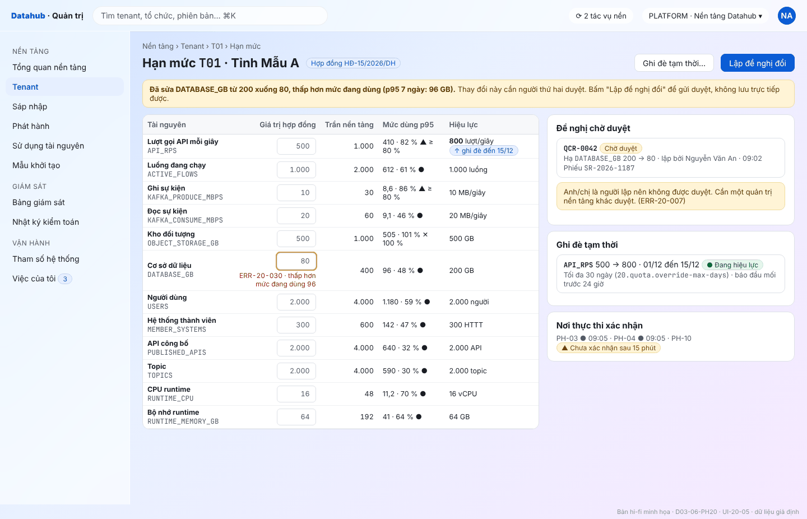

Hình 5. UI-20-05 Hạn mức tenant T01 với đề nghị hạ DATABASE_GB chờ duyệt

Ảnh cho thấy bảng 12 tài nguyên với giá trị hợp đồng sửa được, trần nền tảng, mức dùng p95 kèm nhãn (▲ từ 80 %, ✕ 100 %), dải vàng giải thích ô `DATABASE_GB` hạ xuống 80 thấp hơn mức dùng 96; cột phải có đề nghị chờ duyệt `QCR-0042` với câu ERR-20-007, ghi đè `API_RPS` 500 lên 800 đến 15/12 và trạng thái xác nhận của nơi thực thi (PH-10 chưa xác nhận sau 15 phút).

### 8.2. Bố cục vùng

| # | Vùng | `CMP-*` | Nội dung | Ghi chú |
|---|---|---|---|---|
| 1 | Đầu trang | `CMP-PageHeader` | Mã tenant, hợp đồng căn cứ; nút "Ghi đè tạm thời…", "Lập đề nghị đổi" | |
| 2 | Dải giải thích | `CMP-Alert` vàng | Khi có dòng hạ dưới mức dùng: nói rõ cần duyệt | Không lưu trực tiếp (ERR-20-030) |
| 3 | Bảng hạn mức | `CMP-EditableTable` | Tài nguyên, giá trị hợp đồng, trần nền tảng, mức dùng p95 7 ngày, hạn mức hiệu lực | Ô sửa kiểm miền khi rời ô |
| 4 | Đề nghị chờ duyệt | `CMP-ApprovalPanel` `compact` | Người lập, thời điểm, phiếu, nút "Duyệt", "Từ chối…" | Người lập không thấy nút (ERR-20-007) |
| 5 | Ghi đè tạm thời | `CMP-Card`, `CMP-DataTable` | Tài nguyên, giá trị, từ ngày, đến ngày, trạng thái | "Thu hồi" khi đang hiệu lực |
| 6 | Xác nhận nơi thực thi | `CMP-StatusDot`, `CMP-Timestamp` | PH-03, PH-04, PH-10 đã áp hay chưa, thời điểm | Cảnh báo khi quá 15 phút chưa xác nhận |

: UI-20-05 Hạn mức tenant, bố cục vùng

### 8.3. Trường và cột

| Trường | Kiểu | Ràng buộc | Nguồn API |
|---|---|---|---|
| `resource` | enum `QuotaResource` | 12 giá trị (mục 3.7 và FRS Phụ lục A) | API-20-048 |
| `contractValue` | số nguyên hoặc thập phân | Trong khoảng từ mức tối thiểu đến trần theo hồ sơ quy mô (ERR-20-029) | API-20-049 |
| `newValue`, `effectiveAt` | số, thời điểm | Hạ dưới mức dùng p95: cần duyệt | API-20-050 |
| `contractId` | T-ID | Hợp đồng hiệu lực (ERR-20-022) | API-20-050 |
| Ghi đè: `value`, `validFrom`, `validTo` | số, ngày | Tối đa `20.quota.override-max-days` ngày, cao hơn hợp đồng, không quá trần | API-20-054 |
| `reason`, `ticketRef` | text | Hộp thoại lý do (mục 3.4) | mọi API ghi |
| Mức dùng p95 | số, % | Chỉ đọc, ảnh chụp mỗi giờ | API-20-057 |
| `appliedAt` theo nơi thực thi | thời điểm | Chỉ đọc | API-20-048 |

: UI-20-05 Hạn mức tenant, trường và cột

### 8.4. Hành động

| Hành động | Điều kiện | API | Kết quả |
|---|---|---|---|
| Lưu tăng trong trần | `PERM-20-quota`, mọi giá trị không thấp hơn mức dùng | API-20-049 (`If-Match`) | Áp ngay, ghi Git, phát sự kiện; `Toast` |
| Lập đề nghị đổi | `PERM-20-quota` | API-20-050 | Có dòng hạ dưới mức dùng: `PENDING_APPROVAL` và vào hộp việc PA khác |
| Duyệt, từ chối | `PERM-20-approve`, khác người lập | API-20-052, 053 | Duyệt áp vào `effectiveAt`; từ chối cần ý kiến |
| Ghi đè tạm thời | `PERM-20-quota` | API-20-054 | Thêm dòng `SCHEDULED` hoặc `ACTIVE`; tự hết hạn, báo đầu mối trước 24 giờ |
| Thu hồi ghi đè | `PERM-20-quota` | API-20-055 | Hạn mức hiệu lực về hợp đồng |

: UI-20-05 Hạn mức tenant, hành động

### 8.5. Trạng thái và thông báo

| Trạng thái | Hiển thị |
|---|---|
| Đang tải | Skeleton 12 dòng và hai khối phải (`ST-01`) |
| Rỗng | Tenant mới chưa có hạn mức: giá trị mặc định theo mẫu và quy mô hiện ở ô, nút "Lưu hạn mức ban đầu" |
| Lỗi | `CMP-Alert` kèm "Thử lại" ở khối lỗi (`ST-05`); thiếu số sử dụng của một tài nguyên hiện dấu gạch và ERR-20-110 ở ô |
| Không có quyền | `ST-07` |
| Chỉ đọc | Tenant `SUSPENDED` hoặc `MERGED`: ô khóa, chữ giải thích (mục 3.3) |

: UI-20-05 Hạn mức tenant, trạng thái màn

| Mã | HTTP | Câu hiển thị (FRS §9.2) | Nơi hiện |
|---|---|---|---|
| ERR-20-007 | 403 | "Anh/chị là người {vai} nên không được {thao tác}. Cần một quản trị nền tảng khác duyệt." | Thay nút "Duyệt" của người lập |
| ERR-20-008 | 422 | "Thao tác trên tenant tỉnh cần lý do tối thiểu 20 ký tự và mã phiếu." | Hộp thoại lý do |
| ERR-20-022 | 422 | "Hợp đồng {số}: {lý do}." | Dưới trường hợp đồng |
| ERR-20-029 | 422 | "Hạn mức {tài nguyên} phải trong khoảng {min} đến {trần} {đơn vị}." | Dưới ô giá trị |
| ERR-20-030 | 422 | "Hạ hạn mức {tài nguyên} xuống {giá trị} thấp hơn mức đang dùng {dùng} cần được duyệt." | Dưới ô giá trị, dải vàng |
| ERR-20-031 | 422 | "Ghi đè hạn mức tối đa {số} ngày." | Dưới trường ngày kết thúc |
| ERR-20-110 | — | "Thiếu số liệu sử dụng {tài nguyên} của {tenant} từ {giờ}." | Ô mức dùng |

: UI-20-05 Hạn mức tenant, thông báo theo mã lỗi

### 8.6. Phím tắt và truy cập

Phím tắt: `Ctrl+S` lưu (khi hợp lệ), `Esc` hủy ô đang sửa, `Tab` qua ô giá trị. Ô sửa có nhãn tài nguyên làm tên truy cập và `aria-describedby` trỏ thông báo miền; mỗi dòng đọc "Kho đối tượng, hợp đồng 500 GB, đang dùng 505, chạm 100 phần trăm". Dải vàng `role="status"`. Thanh tiến độ mức dùng kèm chữ, không dùng màu một mình.

### 8.7. Thành phần và token

`CMP-PageHeader`, `CMP-EditableTable`, `CMP-NumberInput`, `CMP-DatePicker`, `CMP-ApprovalPanel`, `CMP-DataTable`, `CMP-ProgressBar`, `CMP-StatusDot`, `CMP-Timestamp`, `CMP-ReasonDialog`, `CMP-Alert`, `CMP-Toast`. Token: `color-surface-solid`, `color-warning`, `color-warning-text`, `color-error`, `color-success`, `font-body`, `font-footnote`, `space-3`, `space-4`, `radius-md`.

## 9. UI-20-06 Sử dụng tài nguyên toàn nền tảng

Màn cho PA và PO nhìn cả 34 tenant theo mức dùng so hạn mức, để thấy tenant sắp chạm trần trước khi nơi thực thi chặn.

::: dac-ta
**Mã, tên.** UI-20-06 · Sử dụng tài nguyên toàn nền tảng.

**Mục đích.** Cho PA, PO xem mức dùng mười hai tài nguyên so hạn mức hiệu lực theo tenant, cảnh báo ngưỡng 80 % và 100 % đang mở, xu hướng, và lập báo cáo sử dụng theo kỳ để xuất tệp.

**Đường dẫn, mẫu.** `/nen-tang/su-dung` (tham số `ky`, `tenant`, `taiNguyen`, `canhbao`); PTN-06 Dashboard.

**Vai trò, quyền.** PA, PO (`PERM-20-read`); xác nhận cảnh báo `PERM-20-quota` (PA).

**FR.** FR-20-028, 029, 030, 031.

**API.** API-20-056 (sử dụng toàn nền tảng), API-20-058 (cảnh báo), API-20-059 (xác nhận), API-20-060, 061, 062 (báo cáo kỳ, tải tệp).

**Thông báo.** ERR-20-032, 066, 110.
:::

### 9.1. Bản hi-fi

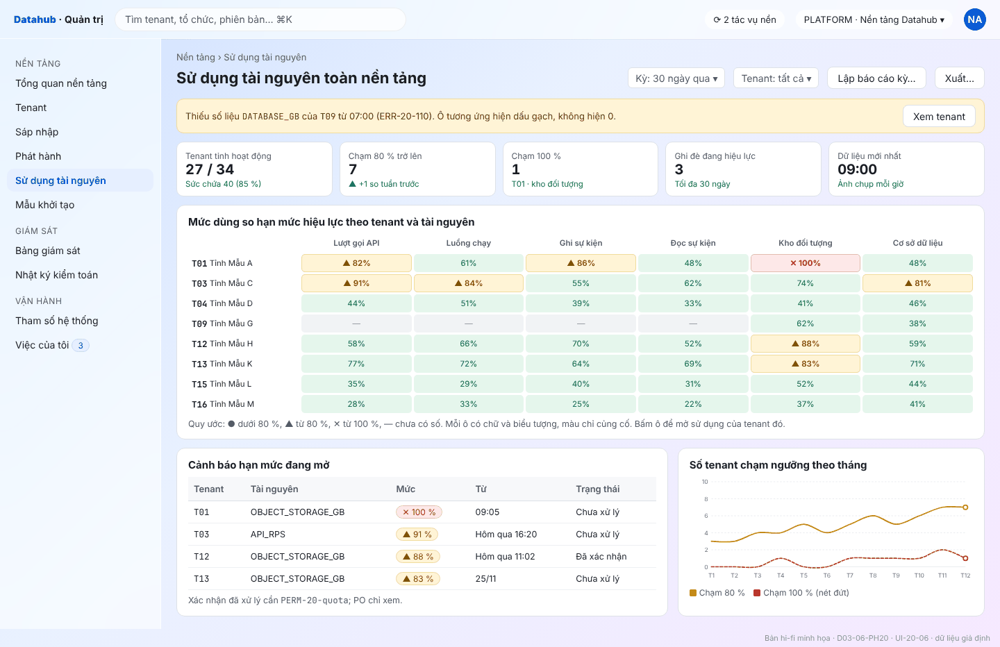

Hình 6. UI-20-06 Sử dụng tài nguyên toàn nền tảng

Ảnh cho thấy dải vàng thiếu số liệu của T09, năm thẻ số, ma trận tenant theo tài nguyên với ô có chữ và biểu tượng (▲ từ 80 %, ✕ 100 %, dấu gạch cho ô chưa có số), bảng cảnh báo đang mở và biểu đồ số tenant chạm ngưỡng theo tháng.

### 9.2. Bố cục vùng

| # | Vùng | `CMP-*` | Nội dung | Ghi chú |
|---|---|---|---|---|
| 1 | Thanh lọc | `CMP-DateRangePicker`, `CMP-Select` | Kỳ (mặc định 30 ngày), tenant, tài nguyên; nút "Lập báo cáo kỳ…", "Xuất…" | Khoảng tối đa theo ERR-20-032 |
| 2 | Dải thiếu số | `CMP-Alert` vàng | "Thiếu số liệu {tài nguyên} của {tenant} từ {giờ}." | Hiện khi có ô thiếu |
| 3 | Thẻ số | `CMP-KpiCard` | Tenant hoạt động, số chạm 80 %, số chạm 100 %, ghi đè hiệu lực, thời điểm dữ liệu mới nhất | Ảnh chụp mỗi giờ |
| 4 | Ma trận sử dụng | `CMP-Chart` `heatmap` (A-03) kèm `CMP-DataTable` thay thế | Hàng tenant, cột tài nguyên, ô "% mức dùng" kèm biểu tượng | Bấm ô mở UI-20-05 hoặc UI-20-03 |
| 5 | Cảnh báo đang mở | `CMP-DataTable` | Tenant, tài nguyên, mức, từ, trạng thái; nút "Xác nhận đã xử lý" | PO chỉ xem |
| 6 | Xu hướng | `CMP-Chart` `line` | Số tenant chạm 80 %, 100 % theo tháng; có bảng thay thế | Đường 100 % nét đứt |

: UI-20-06 Sử dụng tài nguyên toàn nền tảng, bố cục vùng

### 9.3. Trường và cột

| Trường | Kiểu | Hiển thị | Nguồn API |
|---|---|---|---|
| `tenantCode`, `name` | text | Cột đầu ma trận | API-20-056 |
| `resource`, `used`, `limit`, `percent` | enum, số | Ô: "% (biểu tượng)"; mức dưới 80 % chỉ hiện số | API-20-056 |
| `QuotaAlertLevel` | enum | ▲ Từ 80 %, ✕ Chạm 100 % | API-20-058 |
| `openedAt`, `lastAt`, `status` | thời điểm, enum | Bảng cảnh báo | API-20-058 |
| `snapshotAt` | thời điểm | "Cập nhật 09:00" | API-20-056 |
| Báo cáo: `period`, `format`, `tenants[]` | ngày, enum | Hộp thoại lập báo cáo | API-20-060 |

: UI-20-06 Sử dụng tài nguyên toàn nền tảng, trường và cột

Ma trận mặc định hiện sáu tài nguyên chính (lượt gọi API, luồng chạy, ghi sự kiện, đọc sự kiện, kho đối tượng, cơ sở dữ liệu); nút "Xem đủ 12 tài nguyên" mở rộng (Q20-38).

### 9.4. Hành động

| Hành động | Điều kiện | API | Kết quả |
|---|---|---|---|
| Đổi kỳ, lọc | `PERM-20-read` | API-20-056 | Làm mới giữ khung |
| Bấm ô ma trận | `PERM-20-read` | — | Mở UI-20-05 của tenant, lọc tài nguyên |
| Xác nhận đã xử lý | `PERM-20-quota` | API-20-059 | Cảnh báo chuyển "Đã xác nhận"; không gửi lặp (BR-20-016) |
| Lập báo cáo kỳ | `PERM-20-read` | API-20-060, 062 | `CMP-JobProgress` chạy nền, sau đó tải tệp (CSV hoặc XLSX) |
| Xem dạng bảng | Mọi người | — | Bảng thay thế cho ma trận và biểu đồ |

: UI-20-06 Sử dụng tài nguyên toàn nền tảng, hành động

### 9.5. Trạng thái và thông báo

| Trạng thái | Hiển thị |
|---|---|
| Đang tải | Skeleton thẻ, ma trận 8 hàng, bảng cảnh báo (`ST-01`) |
| Rỗng | Chưa có ảnh chụp sử dụng (nền tảng mới): "Chưa có số liệu sử dụng. Số liệu xuất hiện sau lần thu thập đầu tiên (mỗi giờ)." |
| Lỗi | Mỗi khối tải độc lập, khối lỗi có "Thử lại" (`ST-05`) |
| Không có quyền | `ST-07` |
| Chỉ đọc | PO: không có nút "Xác nhận đã xử lý" |

: UI-20-06 Sử dụng tài nguyên toàn nền tảng, trạng thái màn

| Mã | HTTP | Câu hiển thị (FRS §9.2) | Nơi hiện |
|---|---|---|---|
| ERR-20-032 | 400 | "Khoảng thời gian tối đa là {số} ngày." | Dưới bộ chọn kỳ |
| ERR-20-066 | 422 | "Không lập được báo cáo sử dụng: {lý do}." | Hộp thoại lập báo cáo |
| ERR-20-110 | — | "Thiếu số liệu sử dụng {tài nguyên} của {tenant} từ {giờ}." | Dải vàng và ô thiếu |

: UI-20-06 Sử dụng tài nguyên toàn nền tảng, thông báo theo mã lỗi

### 9.6. Phím tắt và truy cập

Ma trận có `role="grid"`, mũi tên di chuyển giữa ô, `Enter` mở màn hạn mức; mỗi ô đọc "T01, Kho đối tượng, 100 phần trăm, chạm hạn mức". Mọi ô có nhãn chữ trong ô, màu chỉ củng cố; ô thiếu số đọc "chưa có số liệu". Biểu đồ có nút "Xem dạng bảng" và mô tả `aria-label`.

### 9.7. Thành phần và token

`CMP-PageHeader`, `CMP-DateRangePicker`, `CMP-Select`, `CMP-KpiCard`, `CMP-Chart` (`heatmap`, `line`), `CMP-DataTable`, `CMP-JobProgress`, `CMP-Alert`, `CMP-StatusTag`. Token: `color-chart-1`, `color-chart-2`, `color-success`, `color-warning`, `color-error`, `color-surface-solid`, `font-display`, `font-caption`, `space-3`, `radius-lg`.

## 10. UI-20-07 Phân hệ và tính năng của tenant

Màn bật, tắt, tạm ngừng phân hệ cho một tỉnh và đặt cờ tính năng, kèm đồ thị phụ thuộc để PA biết trước vì sao thao tác bị chặn.

::: dac-ta
**Mã, tên.** UI-20-07 · Phân hệ và tính năng của tenant.

**Mục đích.** Cho PA xem hai mươi phân hệ của nền tảng (lõi hay không, đợt nào, phụ thuộc gì), bật phân hệ cho tỉnh khi tỉnh ký phụ lục, tắt hoặc tạm ngừng khi cần, và đặt cờ tính năng nhỏ theo tỉnh.

**Đường dẫn, mẫu.** `/nen-tang/tenant/{ma-tenant}/phan-he` (tab `cua-tinh`, `danh-muc`, `co`); PTN-12 Cài đặt.

**Vai trò, quyền.** PA (`PERM-20-admin` ghi); PO, PAU xem (`PERM-20-read`).

**FR.** FR-20-033, 034, 035, 036.

**API.** API-20-063 (danh mục và phụ thuộc), API-20-064 (phân hệ theo tenant), API-20-065 (bật), API-20-066 (tắt), API-20-067 (tạm ngừng), API-20-068 (tiếp tục), API-20-069, 070 (cờ).

**Thông báo.** ERR-20-008, 033, 034, 035, 036, 055, 106, 107.
:::

### 10.1. Bản hi-fi

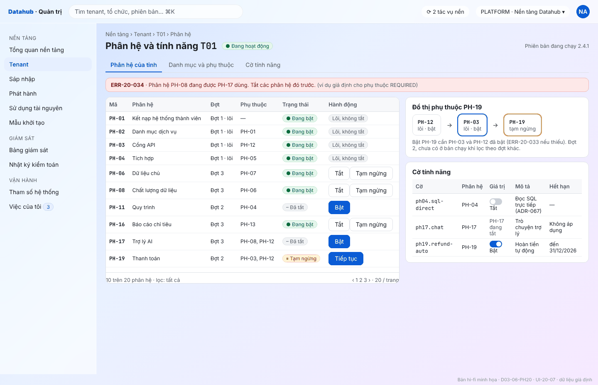

Hình 7. UI-20-07 Phân hệ và tính năng của tenant T01

Ảnh cho thấy ba tab, dải lỗi ERR-20-034 (ví dụ giả định), bảng phân hệ với trạng thái có chữ và nút theo điều kiện (lõi không có nút tắt), đồ thị phụ thuộc của PH-19 và bảng cờ tính năng.

### 10.2. Bố cục vùng

| # | Vùng | `CMP-*` | Nội dung | Ghi chú |
|---|---|---|---|---|
| 1 | Hàng tab | `CMP-Tabs` | Phân hệ của tỉnh, Danh mục và phụ thuộc, Cờ tính năng | Tab ghi lên URL |
| 2 | Dải lỗi | `CMP-Alert` | Câu ERR-20-033 hoặc 034 khi thao tác bị chặn | Đóng khi đổi thao tác |
| 3 | Bảng phân hệ | `CMP-DataTable` | Mã, tên, đợt, phụ thuộc, trạng thái, hành động | Phân hệ lõi: nhãn "Lõi, không tắt" |
| 4 | Đồ thị phụ thuộc | `CMP-DependencyGraph` | Phân hệ đang chọn và phụ thuộc `REQUIRED`, `OPTIONAL` | Có bảng ma trận thay thế |
| 5 | Cờ tính năng | `CMP-DataTable`, `CMP-Switch` | Cờ, phân hệ, giá trị, mô tả, hạn | Cờ của phân hệ đang tắt khóa |

: UI-20-07 Phân hệ và tính năng, bố cục vùng

### 10.3. Trường và cột

| Trường | Kiểu | Nguồn API | Ghi chú |
|---|---|---|---|
| `moduleCode`, `name` | T-CODE, text | API-20-063 | `PH-01`…`PH-20` |
| `core`, `wave` | bool, số | API-20-063 | Lõi không tắt được (ERR-20-035) |
| `dependsOn[]` | mảng | API-20-063 | Kèm loại `REQUIRED`, `OPTIONAL` |
| `ModuleState` | enum | API-20-064 | Mục 3.7; `ENABLING`, `DISABLING` có vòng xoay |
| `tenantCounts` | số | API-20-063 | Số tenant đang bật, tạm ngừng, lỗi |
| `flagCode`, `enabled`, `validTo` | T-CODE, bool, ngày | API-20-069, 070 | Cờ không áp dụng: ERR-20-036 |
| `reason`, `ticketRef` | text | mọi API ghi | Hộp thoại lý do |

: UI-20-07 Phân hệ và tính năng, trường và cột

### 10.4. Hành động

| Hành động | Điều kiện | API | Kết quả |
|---|---|---|---|
| Bật | `PERM-20-admin`, phụ thuộc `REQUIRED` đã bật | API-20-065 | Phân hệ `ENABLING`, chờ báo xong; ERR-20-033 nếu thiếu phụ thuộc |
| Tắt | `PERM-20-admin`, không lõi, không bị phụ thuộc | API-20-066 | `CMP-ConfirmDialog` nêu ảnh hưởng; ERR-20-034, 035 |
| Tạm ngừng, tiếp tục | `PERM-20-admin` | API-20-067, 068 | Trạng thái đổi; hộp thoại lý do |
| Đặt cờ | `PERM-20-admin`, phân hệ của cờ đang bật | API-20-070 (`If-Match`) | Ghi Git, phát sự kiện; `validTo` tùy chọn |

: UI-20-07 Phân hệ và tính năng, hành động

### 10.5. Trạng thái và thông báo

| Trạng thái | Hiển thị |
|---|---|
| Đang tải | Skeleton 10 dòng và khối phụ thuộc (`ST-01`) |
| Rỗng | Không có cờ: "Phân hệ đang bật chưa có cờ tính năng nào." |
| Lỗi | Dịch vụ danh mục chưa nạp: ERR-20-062 kèm "Thử lại" |
| Không có quyền | `ST-07` |
| Chỉ đọc | PO, PAU: chỉ cột trạng thái, không có nút; tenant `SUSPENDED`: nút khóa kèm chữ |

: UI-20-07 Phân hệ và tính năng, trạng thái màn

| Mã | HTTP | Câu hiển thị (FRS §9.2) | Nơi hiện |
|---|---|---|---|
| ERR-20-033 | 422 | "Phân hệ {phân hệ} cần {phụ thuộc} được bật trước." | Dải lỗi |
| ERR-20-034 | 409 | "Phân hệ {phân hệ} đang được {danh sách} dùng. Tắt các phân hệ đó trước." | Dải lỗi |
| ERR-20-035 | 403 | "Phân hệ {phân hệ} là phân hệ lõi, không tắt được." | Dải lỗi, tooltip ở nhãn "Lõi" |
| ERR-20-036 | 422 | "Cờ {cờ} không áp dụng được: {lý do}." | Dưới công tắc cờ |
| ERR-20-055 | 422 | "Phiên bản {phiên bản} không dùng được cho thao tác này: {lý do}." | Dải lỗi khi phân hệ không có ở bản đang chạy |
| ERR-20-106, 107 | — | Như UI-20-04 | Dòng phân hệ `FAILED` |

: UI-20-07 Phân hệ và tính năng, thông báo theo mã lỗi

### 10.6. Phím tắt và truy cập

Phím tắt: `[` và `]` chuyển tab, `Space` đổi công tắc cờ, `Ctrl+Enter` gửi hộp thoại. Bảng đọc "PH-19 Thanh toán, Đợt 2, tạm ngừng, nút Tiếp tục"; nút khóa có `aria-disabled` và chữ lý do liền kề. Đồ thị phụ thuộc có bảng ma trận thay thế để người không dùng chuột vẫn đọc được quan hệ.

### 10.7. Thành phần và token

`CMP-Tabs`, `CMP-DataTable`, `CMP-DependencyGraph`, `CMP-Switch`, `CMP-StatusTag`, `CMP-ConfirmDialog`, `CMP-ReasonDialog`, `CMP-Alert`, `CMP-Tag`. Token: `color-surface-solid`, `color-success`, `color-warning`, `color-error`, `font-body`, `font-mono-sm`, `space-3`, `radius-md`.

## 11. UI-20-08 Đổi trạng thái tenant

Màn gom bốn việc nặng nhất của vòng đời tenant: tạm ngừng, khôi phục, đề nghị và duyệt chấm dứt, xuất gói bàn giao dữ liệu. Mỗi việc cần lý do và mã phiếu; chấm dứt cần thêm văn bản quyết định và hai người.

::: dac-ta
**Mã, tên.** UI-20-08 · Đổi trạng thái tenant.

**Mục đích.** Cho PA tạm ngừng tenant khi có quyết định quản lý, sự cố an ninh, hết hợp đồng hoặc tỉnh đề nghị; khôi phục khi đã xử lý; lập, gửi, duyệt đề nghị chấm dứt; xuất, cấp liên kết và xác nhận bàn giao gói dữ liệu; thực hiện chấm dứt sau thời gian nguội; xem lịch sử vòng đời.

**Đường dẫn, mẫu.** `/nen-tang/tenant/{ma-tenant}/vong-doi` (tab `hanh-dong`, `de-nghi`, `ban-giao`, `lich-su`); PTN-04 Biểu mẫu nhanh (hộp thoại) trong trang chi tiết.

**Vai trò, quyền.** PA: đề nghị và thực hiện `PERM-20-lifecycle`; duyệt `PERM-20-approve`.

**FR.** FR-20-038, 039, 040, 041, 042.

**API.** API-20-071 (lập đề nghị), API-20-072, 073, 074 (danh sách, hộp duyệt, chi tiết), API-20-075 (gửi duyệt), API-20-076, 077 (duyệt, từ chối), API-20-078 (rút), API-20-079 (thực hiện), API-20-080 đến 084 (gói bàn giao), API-20-085 (lịch sử).

**Thông báo.** ERR-20-006, 007, 008, 010, 037, 038, 039, 116; ERR-20-004 khi gõ sai mã xác nhận.
:::

### 11.1. Bản hi-fi

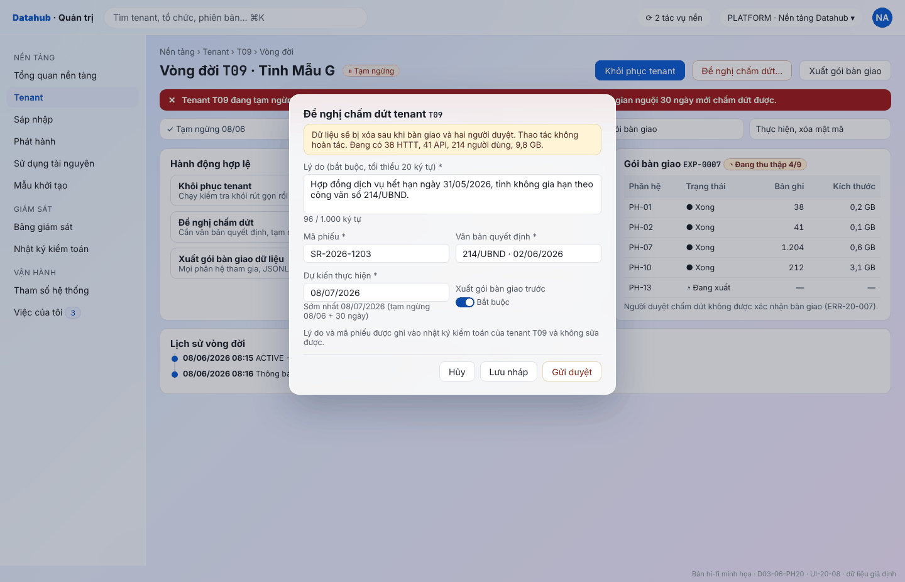

Hình 8. UI-20-08 Vòng đời tenant T09 đang tạm ngừng, hộp thoại đề nghị chấm dứt

Ảnh cho thấy trang nền (dải đỏ T09 đang tạm ngừng, thanh năm bước vòng đời, hành động hợp lệ, gói bàn giao `EXP-0007` thu thập 4 trên 9 phân hệ, lịch sử) và hộp thoại `CMP-ReasonDialog` biến thể `tenant-action`: mô tả hậu quả có số liệu (38 HTTT, 41 API, 214 người dùng, 9,8 GB), lý do 96 ký tự, mã phiếu, văn bản quyết định, ngày dự kiến sớm nhất (tạm ngừng cộng 30 ngày) và nút "Gửi duyệt" kiểu phá hủy.

### 11.2. Bố cục vùng

| # | Vùng | `CMP-*` | Nội dung | Ghi chú |
|---|---|---|---|---|
| 1 | Đầu trang | `CMP-PageHeader`, `CMP-StatusTag` | Mã, tên, trạng thái; nút "Khôi phục tenant", "Đề nghị chấm dứt…", "Xuất gói bàn giao" | Hiện theo `allowedActions[]` |
| 2 | Dải trạng thái | `CMP-Banner` | Tenant đang tạm ngừng từ ngày, lý do, "chờ hết thời gian nguội 30 ngày" | Nền đặc, không đóng |
| 3 | Thanh vòng đời | `CMP-Steps` `status` | Tạm ngừng, Đề nghị chấm dứt, Duyệt (PA khác), Gói bàn giao, Thực hiện và xóa mật mã | Chỉ đọc, thể hiện vị trí |
| 4 | Hành động hợp lệ | `CMP-DecisionPanel` | Mỗi hành động có mô tả; hành động chưa đủ điều kiện hiện khóa kèm lý do (ví dụ ERR-20-038) | Tối đa một nút chính |
| 5 | Đề nghị và duyệt | `CMP-ApprovalPanel` | Tóm tắt dữ liệu sẽ mất, ngày sớm nhất, trạng thái gói bàn giao, nút "Duyệt", "Từ chối…" | Người lập không thấy nút (ERR-20-007) |
| 6 | Gói bàn giao | `CMP-DataTable`, `CMP-JobProgress` | Tiến độ theo phân hệ (bản ghi, kích thước, băm); "Cấp liên kết tải", "Xác nhận đã bàn giao" | Người duyệt chấm dứt không xác nhận bàn giao (ERR-20-007) |
| 7 | Lịch sử vòng đời | `CMP-Timeline` | Trạng thái trước sau, nguyên nhân, người, văn bản, đề nghị | Lấy từ API-20-085 |

: UI-20-08 Đổi trạng thái tenant, bố cục vùng

### 11.3. Trường và cột

| Trường | Kiểu | Bắt buộc | Ràng buộc | Nguồn API |
|---|---|---|---|---|
| `reason` | `SuspendReason` | Khi tạm ngừng | `MANAGEMENT_DECISION`, `SECURITY_INCIDENT`, `CONTRACT_EXPIRED`, `TENANT_REQUEST`, `OTHER` | API-20-071 |
| `reasonText` | T-TEXT | Có | 20…1.000 ký tự | API-20-071 |
| `ticketRef` | T-CODE | Có | Mã phiếu | API-20-071 |
| `decisionDocNo`, `decisionDocDate`, `decisionFileId` | text, ngày, T-ID | Khi quyết định quản lý, hết hợp đồng, chấm dứt | Số, ngày, tệp quyết định | API-20-071 |
| `scheduledAt`, `plannedAt` | thời điểm | Tạm ngừng tùy chọn; chấm dứt có | Chấm dứt không sớm hơn ngày tạm ngừng cộng `20.terminate.cooling-days` | API-20-071 |
| `essentialApisAllowed` | bool | Không | Chỉ hiện khi `20.suspend.essential-api-allowed = true` | API-20-071 |
| `exportRequired` | bool | Không | Mặc định bật, nên giữ | API-20-071 |
| `modules[]`, `format`, `includeAudit` | T-CODE[], enum, bool | Gói bàn giao | `JSONL` hoặc `CSV` kèm lược đồ | API-20-080 |
| `recipientEmail` | T-EMAIL | Khi cấp liên kết | Đầu mối của tỉnh | API-20-083 |
| `confirmTenantCode` | T-TENANT | Khi thực hiện chấm dứt | Gõ đúng mã tenant | API-20-079 |

: UI-20-08 Đổi trạng thái tenant, trường nhập

### 11.4. Hành động

| Hành động | Điều kiện | API | Kết quả |
|---|---|---|---|
| Tạm ngừng | `PERM-20-lifecycle`, tenant `ACTIVE`, không đặc biệt | API-20-071, 079 | Hộp thoại lý do; thực hiện ngay hoặc theo lịch; dải đỏ hiện cho người dùng tỉnh |
| Khôi phục | `PERM-20-lifecycle`, tenant `SUSPENDED`, không có đề nghị chấm dứt đang chờ | API-20-071, 079 | Kiểm tra khói rút gọn rồi về `ACTIVE`; ERR-20-037 nếu có đề nghị chờ |
| Lập, gửi duyệt đề nghị chấm dứt | `PERM-20-lifecycle`, tenant `SUSPENDED` | API-20-071, 075 | `PENDING_APPROVAL`; việc duyệt vào hộp PA khác |
| Duyệt, từ chối | `PERM-20-approve`, khác người lập | API-20-076, 077 | Duyệt thì tự yêu cầu gói bàn giao nếu chưa có |
| Rút đề nghị | Người lập | API-20-078 | Về `CANCELLED` |
| Yêu cầu gói bàn giao | `PERM-20-lifecycle` | API-20-080 | `COLLECTING`, tiến độ theo phân hệ |
| Cấp liên kết, xác nhận bàn giao | `PERM-20-lifecycle`, gói `READY`; người xác nhận khác người duyệt | API-20-083, 084 | Liên kết có hạn gửi đầu mối; biên bản bàn giao; `DELIVERED` |
| Thực hiện chấm dứt | `PERM-20-lifecycle`; đủ ba điều kiện (đã duyệt, đã bàn giao, hết thời gian nguội) | API-20-079 | `CMP-ConfirmDialog` `dangerous` gõ lại `T09`; xóa mật mã tenant, chờ xác nhận; ERR-20-037, 038 nếu thiếu |

: UI-20-08 Đổi trạng thái tenant, hành động

### 11.5. Trạng thái và thông báo

| Trạng thái | Hiển thị |
|---|---|
| Đang tải | Skeleton dải, thanh năm bước, hai khối (`ST-01`) |
| Rỗng | Chưa có gói bàn giao: "Chưa xuất gói bàn giao. Xuất gói trước khi chấm dứt." kèm nút "Xuất gói bàn giao" |
| Lỗi | `CMP-Alert` kèm "Thử lại"; thu thập một phân hệ lỗi thì dòng đó đỏ và gói `FAILED` có nút "Lập gói mới" |
| Không có quyền | `ST-07` |
| Chỉ đọc | Tenant `DECOMMISSIONED`: mọi nút khóa; PO, PAU không thấy nút |
| Nền tảng chỉ có một PA duyệt được | Dải vàng cảnh báo và nút "Gửi duyệt" khóa (mục 3.5) |

: UI-20-08 Đổi trạng thái tenant, trạng thái màn

| Mã | HTTP | Câu hiển thị (FRS §9.2) | Nơi hiện |
|---|---|---|---|
| ERR-20-006 | 409 | "Không thể {thao tác} khi {đối tượng} đang ở trạng thái {trạng thái}." | `CMP-Alert` trong hộp thoại |
| ERR-20-007 | 403 | "Anh/chị là người {vai} nên không được {thao tác}. Cần một quản trị nền tảng khác duyệt." | Thay nút duyệt, xác nhận bàn giao |
| ERR-20-008 | 422 | "Thao tác trên tenant tỉnh cần lý do tối thiểu 20 ký tự và mã phiếu." | Dưới hai trường |
| ERR-20-010 | 403 | "Tenant {mã} là tenant đặc biệt của nền tảng, không thực hiện được thao tác này." | `CMP-Alert` |
| ERR-20-037 | 422 | "Chưa đủ điều kiện chấm dứt hoặc khôi phục tenant {mã}: {lý do}." | `CMP-Alert` cạnh nút |
| ERR-20-038 | 422 | "Chưa hết thời gian chờ {số} ngày kể từ khi tạm ngừng (đến {ngày})." | Chữ dưới nút "Thực hiện chấm dứt" |
| ERR-20-039 | 410 | "Gói bàn giao {mã} đã hết hạn lưu. Lập gói mới." | Dòng gói, nút "Lập gói mới" |
| ERR-20-116 | — | "Chưa nhận xác nhận xóa mật mã của {tenant}." | Dòng bước cuối của chấm dứt |
| ERR-20-001 | 403 | "Tỉnh đang tạm ngừng hoạt động trên Datahub. Liên hệ quản trị tỉnh." | Dải trong trang và phía người dùng tỉnh |

: UI-20-08 Đổi trạng thái tenant, thông báo theo mã lỗi

### 11.6. Phím tắt, truy cập, thành phần

Phím tắt: `Esc` đóng hộp thoại, `Ctrl+Enter` gửi khi con trỏ ở ô lý do; không có phím tắt thực hiện thao tác phá hủy. Hộp thoại giữ focus bên trong, trả focus về nút gọi khi đóng; ô lý do `aria-required`, bộ đếm `aria-live="polite"` đọc "Còn thiếu 14 ký tự"; nút "Gửi duyệt" chưa đủ điều kiện vẫn bấm được và nêu lỗi tại trường (theo `CMP-ReasonDialog`). Thành phần: `CMP-PageHeader`, `CMP-Banner`, `CMP-Steps`, `CMP-DecisionPanel`, `CMP-ApprovalPanel`, `CMP-ReasonDialog`, `CMP-ConfirmDialog`, `CMP-DataTable`, `CMP-JobProgress`, `CMP-Timeline`, `CMP-StatusTag`, `CMP-Alert`. Token: `glass-modal`, `color-error`, `color-error-text`, `color-warning`, `color-surface-solid`, `font-title-3`, `font-footnote`, `size-modal-sm`, `space-4`, `radius-xl`.

## 12. UI-20-09 Lập kế hoạch sáp nhập (wizard)

Wizard lập kế hoạch sáp nhập tỉnh: nguồn và đích, căn cứ văn bản, bảng ánh xạ, chạy thử, gửi duyệt. Không dữ liệu nào chuyển trước khi hai quản trị nền tảng duyệt.

::: dac-ta
**Mã, tên.** UI-20-09 · Lập kế hoạch sáp nhập.

**Mục đích.** Cho PA ghi nhận quyết định sáp nhập thành kế hoạch có căn cứ, lập bảng ánh xạ từng tổ chức, HTTT, mã danh mục, tiền tố API, người dùng, topic từ tỉnh nguồn sang đích, chạy thử không ghi gì vào đích, rồi gửi duyệt bốn mắt.

**Đường dẫn, mẫu.** `/nen-tang/sap-nhap/moi` (tham số `buoc`, `ke-hoach` khi sửa bản nháp); PTN-05 Wizard.

**Vai trò, quyền.** PA (`PERM-20-merge`); duyệt `PERM-20-approve` (PA khác).

**FR.** FR-20-045, 046, 047.

**API.** API-20-086 (lập), API-20-089 (sửa bản nháp), API-20-094 (bảng ánh xạ), API-20-095 (gợi ý tự động), API-20-096 (sửa dòng), API-20-097 (chạy thử), API-20-090 (gửi duyệt), API-20-093 (hủy).

**Thông báo.** ERR-20-002, 003, 007, 040, 041, 042, 043, 045.
:::

### 12.1. Bản hi-fi

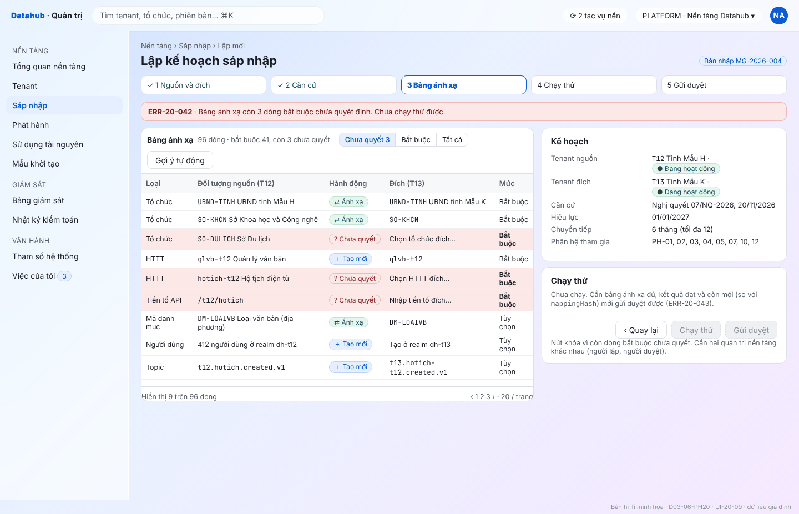

Hình 9. UI-20-09 Lập kế hoạch sáp nhập, bước 3 Bảng ánh xạ

Ảnh cho thấy thanh năm bước, dải lỗi ERR-20-042 (còn 3 dòng bắt buộc chưa quyết), bảng ánh xạ 96 dòng lọc "Chưa quyết" với chip hành động (Ánh xạ, Tạo mới, Bỏ qua, Chưa quyết) và dòng chưa quyết nền đỏ nhạt kèm chữ, cột phải tóm tắt kế hoạch (T12 sang T13, căn cứ, hiệu lực, chuyển tiếp 6 tháng) và hai nút "Chạy thử", "Gửi duyệt" đang khóa.

### 12.2. Bố cục vùng

| # | Vùng | `CMP-*` | Nội dung | Ghi chú |
|---|---|---|---|---|
| 1 | Thanh bước | `CMP-Steps` `wizard` | 1 Nguồn và đích · 2 Căn cứ · 3 Bảng ánh xạ · 4 Chạy thử · 5 Gửi duyệt | |
| 2 | Bước 1 | `CMP-ResourceSelect` | Tenant nguồn (nhiều), tenant đích; kiểm nguồn khác đích, đều `ACTIVE`, đều tỉnh | Tenant thuộc kế hoạch khác: ERR-20-041 |
| 3 | Bước 2 | `CMP-Form`, `CMP-FileDropzone` | Số, ngày, tệp quyết định; ngày hiệu lực; số tháng chuyển tiếp; phân hệ tham gia | `transitionMonths` tối đa theo `20.merge.transition-max-months` |
| 4 | Bước 3 | `CMP-EditableTable`, `CMP-FilterBar` | Bảng ánh xạ: loại, đối tượng nguồn, hành động, đích, mức bắt buộc; lọc "Chưa quyết", "Bắt buộc", "Tất cả"; nút "Gợi ý tự động" | Người dùng gộp một dòng theo nhóm (Q20-37) |
| 5 | Bước 4 | `CMP-JobProgress`, `CMP-DataTable` | Kết quả chạy thử theo phân hệ: số bản ghi, xung đột dự kiến, thời gian ước tính | Kết quả gắn `mappingHash` |
| 6 | Bước 5 | `CMP-DescriptionList`, `CMP-Alert` | Tóm tắt, cảnh báo thiếu người duyệt thứ hai | |
| 7 | Cột phải | `CMP-Card` | Tóm tắt kế hoạch, trạng thái chạy thử, nút | Dính khi cuộn |

: UI-20-09 Lập kế hoạch sáp nhập, bố cục vùng

### 12.3. Trường và cột

| Trường | Kiểu | Ràng buộc | Nguồn API |
|---|---|---|---|
| `sourceTenants[]`, `targetTenant` | T-TENANT | Nguồn khác đích, đều `ACTIVE`, đều `PROVINCE` (ERR-20-040, 041) | API-20-086 |
| `decisionDocNo`, `decisionDocDate`, `decisionFileId` | text, ngày, T-ID | Bắt buộc | API-20-086 |
| `effectiveDate`, `transitionMonths` | ngày, số | Chuyển tiếp tối đa 12 tháng mặc định (ERR-20-045) | API-20-086 |
| `modules[]` | T-CODE[] | Phân hệ tham gia; phân hệ bật ở nguồn mà thiếu ở đích hiện cảnh báo | API-20-086 |
| Ánh xạ: `MergeMappingType` | enum | `ORGANIZATION`, `MEMBER_SYSTEM`, `CATALOG_CODE`, `API_CONTEXT_PATH`, `USER`, `TOPIC` | API-20-094 |
| Ánh xạ: `action`, `targetCode` | enum, T-CODE | `MAP`, `CREATE`, `SKIP`; `MAP` thì đích phải tồn tại; hai nguồn không cùng `CREATE` một mã | API-20-096 |
| Kết quả chạy thử | `dryRunResult` | `PASSED` khi không phân hệ nào lỗi; gắn `mappingHash` | API-20-097 |

: UI-20-09 Lập kế hoạch sáp nhập, trường và cột

### 12.4. Hành động

| Hành động | Điều kiện | API | Kết quả |
|---|---|---|---|
| Lưu kế hoạch bản nháp | `PERM-20-merge` | API-20-086, 089 | Mã `MG-{năm}-{số}` |
| Gợi ý tự động | `PERM-20-merge` | API-20-095 | Điền hành động đề xuất cho từng dòng; không ghi đè dòng đã sửa tay |
| Sửa dòng ánh xạ | `PERM-20-merge` | API-20-096 | Kiểm tại chỗ; ERR-20-002, 003 |
| Chạy thử | Không còn dòng bắt buộc chưa quyết | API-20-097 | Tác vụ nền; ERR-20-042 nếu còn dòng |
| Gửi duyệt | Chạy thử `PASSED` và còn mới | API-20-090 | `PENDING_APPROVAL`; ERR-20-043 nếu cũ; người lập không tự duyệt |
| Hủy kế hoạch | `PERM-20-merge`, chưa cutover | API-20-093 | `CMP-ConfirmDialog`; nếu đã `MERGING` thì về `ACTIVE` |

: UI-20-09 Lập kế hoạch sáp nhập, hành động

### 12.5. Trạng thái và thông báo

| Trạng thái | Hiển thị |
|---|---|
| Đang tải | Skeleton thanh bước và bảng 8 dòng (`ST-01`); bảng lớn dùng cuộn ảo |
| Rỗng | Chưa có dòng ánh xạ: "Bảng ánh xạ trống. Bấm 'Gợi ý tự động' để sinh từ dữ liệu hai tỉnh." |
| Lỗi | Phân hệ tham gia không trả lời: ERR-20-062 kèm "Thử lại" |
| Không có quyền | `ST-07` |
| Chỉ đọc | Kế hoạch đã gửi duyệt: bảng ánh xạ khóa, chỉ xem |

: UI-20-09 Lập kế hoạch sáp nhập, trạng thái màn

| Mã | HTTP | Câu hiển thị (FRS §9.2) | Nơi hiện |
|---|---|---|---|
| ERR-20-040 | 422 | "Kế hoạch sáp nhập không hợp lệ: {lý do}." | `CMP-Alert` bước 1 |
| ERR-20-041 | 409 | "Tenant {mã} đang thuộc kế hoạch sáp nhập {kế hoạch}." | Dưới ô chọn tenant |
| ERR-20-042 | 422 | "Bảng ánh xạ còn {số} dòng bắt buộc chưa quyết định." | Dải lỗi bước 3 |
| ERR-20-043 | 422 | "Chạy thử sáp nhập chưa đạt hoặc đã cũ so với bảng ánh xạ hiện hành." | `CMP-Alert` bước 4 và 5 |
| ERR-20-045 | 422 | "Thời gian chuyển tiếp tối đa {số} tháng." | Dưới trường chuyển tiếp |
| ERR-20-003 | 409 | "{Đối tượng} {mã} đã tồn tại. Chọn mã khác." | Dưới ô đích khi trùng |
| ERR-20-007 | 403 | "Anh/chị là người {vai} nên không được {thao tác}. Cần một quản trị nền tảng khác duyệt." | Bước 5 |

: UI-20-09 Lập kế hoạch sáp nhập, thông báo theo mã lỗi

### 12.6. Phím tắt, truy cập, thành phần

Phím tắt: `Alt+→`, `Alt+←` chuyển bước; trong bảng ánh xạ `Enter` sửa ô, `Esc` hủy, mũi tên di chuyển. Bảng có `aria-rowcount` cho 96 dòng, lọc "Chưa quyết" nhảy focus tới dòng chưa quyết đầu tiên; chip hành động đọc đủ "Chưa quyết" (không chỉ màu đỏ). Thành phần: `CMP-Wizard`, `CMP-Steps`, `CMP-ResourceSelect`, `CMP-Form`, `CMP-FileDropzone`, `CMP-EditableTable`, `CMP-FilterBar`, `CMP-JobProgress`, `CMP-DataTable`, `CMP-DescriptionList`, `CMP-ConfirmDialog`, `CMP-Alert`. Token: `color-surface-solid`, `color-diff-removed`, `color-diff-added`, `color-error-text`, `color-info`, `size-form-max`, `font-mono-sm`, `space-4`, `radius-lg`.

## 13. UI-20-10 Theo dõi sáp nhập

Màn theo dõi một kế hoạch sáp nhập từ chuyển dữ liệu đến chuyển tiếp và kết thúc; là nơi xử lý xung đột và là màn duy nhất quản trị tỉnh nguồn, tỉnh đích được xem một phần.

::: dac-ta
**Mã, tên.** UI-20-10 · Theo dõi sáp nhập.

**Mục đích.** Cho PA, PO thấy tiến độ chuyển dữ liệu theo từng phân hệ, kiểm đếm, xử lý xung đột (so hai bản, chọn cách xử lý), chuyển định danh và cấp song song thông tin xác thực HTTT, thực hiện cutover, theo dõi chuyển tiếp, gia hạn và kết thúc. TA của hai tỉnh xem phần tỉnh mình.

**Đường dẫn, mẫu.** `/nen-tang/sap-nhap/{ma-sap-nhap}` (tab `phan-he`, `xung-dot`, `chuyen-tiep`, `kiem-toan`); PTN-02 Chi tiết.

**Vai trò, quyền.** PA, PO (`PERM-20-read`); thao tác `PERM-20-merge`; TA hai tỉnh chỉ đọc tab Chuyển tiếp của tỉnh mình (Q20-30).

**FR.** FR-20-047, 048, 049, 050, 051, 052.

**API.** API-20-088 (chi tiết), API-20-098 (bắt đầu chuyển), API-20-099, 100 (tiến độ, chạy lại phân hệ), API-20-101, 102, 103 (xung đột), API-20-104, 105 (định danh, thông tin xác thực), API-20-106 (cutover), API-20-107 (gia hạn), API-20-108 (kết thúc), API-20-130 (kiểm toán).

**Thông báo.** ERR-20-007, 008, 042, 043, 044, 045, 046, 113, 114.
:::

### 13.1. Bản hi-fi

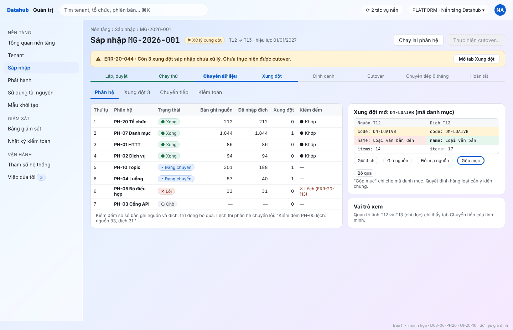

Hình 10. UI-20-10 Theo dõi sáp nhập MG-2026-001, đang xử lý xung đột

Ảnh cho thấy đầu trang với nhãn "Xử lý xung đột" và nút "Thực hiện cutover…" đang khóa, dải vàng ERR-20-044, thanh tiến trình tám giai đoạn ngang, bốn tab, bảng tám phân hệ (thứ tự, trạng thái, bản ghi nguồn, đã nhập đích, xung đột, kiểm đếm trong đó PH-05 lệch) và khối xung đột `DM-LOAIVB` với `CMP-DiffViewer` hai bản và năm cách xử lý.

### 13.2. Bố cục vùng

| # | Vùng | `CMP-*` | Nội dung | Ghi chú |
|---|---|---|---|---|
| 1 | Đầu trang | `CMP-PageHeader`, `CMP-StatusTag` | Mã kế hoạch, nguồn, đích, `MergeStatus`; nút "Chạy lại phân hệ", "Thực hiện cutover…" | Cutover khóa khi còn xung đột (ERR-20-044) |
| 2 | Dải trạng thái | `CMP-Banner` | Câu ERR-20-044, 043 hoặc 113 theo tình huống | |
| 3 | Tiến trình | `CMP-Steps` `status` ngang | Lập duyệt, Chạy thử, Chuyển dữ liệu, Xung đột, Định danh, Cutover, Chuyển tiếp, Hoàn tất | Theo máy trạng thái 4.9 của FRS |
| 4 | Hàng tab | `CMP-Tabs` | Phân hệ, Xung đột (số mở), Chuyển tiếp, Kiểm toán | |
| 5 | Tab Phân hệ | `CMP-DataTable` | Thứ tự, phân hệ, trạng thái, bản ghi nguồn, đã nhập đích, xung đột, kiểm đếm; nút "Chạy lại phân hệ" | Lệch: "Kiểm đếm PH-05 lệch: nguồn 33, đích 31." |
| 6 | Tab Xung đột | `CMP-DataTable`, `CMP-DiffViewer` | Lọc theo loại; hai bản cạnh nhau; chọn cách xử lý; xử lý hàng loạt | Cách `MERGE_ITEMS` chỉ cho danh mục |
| 7 | Tab Chuyển tiếp | `CMP-DataTable` | HTTT, trạng thái thông tin xác thực song song (`ISSUED`, `IN_USE_NEW`, `OLD_ONLY`), hạn; nút "Gia hạn" | TA hai tỉnh chỉ thấy HTTT của tỉnh mình |
| 8 | Cutover | `CMP-ConfirmDialog` `dangerous` | Gõ lại mã kế hoạch `MG-2026-001`, lý do và mã phiếu | Theo FRS §10.2 |

: UI-20-10 Theo dõi sáp nhập, bố cục vùng

### 13.3. Trường và cột

| Trường | Kiểu | Nguồn API | Ghi chú |
|---|---|---|---|
| `mergePlanId`, `MergeStatus` | text, enum | API-20-088 | Mục 3.7 |
| `participants[].module`, `order`, `status` | T-CODE, số, enum | API-20-099 | Thứ tự theo phụ thuộc |
| `sourceCount`, `targetCount`, `conflictCount` | số | API-20-099 | Lệch: ERR-20-113 |
| `conflicts[].type`, `sourceValue`, `targetValue` | enum, JSON | API-20-101 | Hiện bằng `CMP-DiffViewer` |
| `resolution` | `ConflictResolution` | API-20-102, 103 | `KEEP_TARGET`, `KEEP_SOURCE`, `RENAME_SOURCE`, `MERGE_ITEMS`, `SKIP`; `newCode` khi đổi mã |
| `credentials[].status` | enum | API-20-105 | `ISSUED`, `IN_USE_NEW`, `OLD_ONLY` |
| `transitionEndsAt`, `extendMonths` | ngày, số | API-20-088, 107 | Nhắc 30, 7, 1 ngày trước |
| `confirmCode` | text | API-20-106, 108 | Gõ đúng mã kế hoạch |

: UI-20-10 Theo dõi sáp nhập, trường và cột

### 13.4. Hành động

| Hành động | Điều kiện | API | Kết quả |
|---|---|---|---|
| Bắt đầu chuyển dữ liệu | Kế hoạch `APPROVED` | API-20-098 | Nguồn sang `MERGING`; hộp thoại lý do và phiếu |
| Chạy lại phân hệ | `PERM-20-merge`, phân hệ lỗi | API-20-100 | Phân hệ về `RUNNING`; ERR-20-114 nếu sai trạng thái |
| Xử lý xung đột | `PERM-20-merge` | API-20-102, 103 | Lưu quyết định; hết xung đột thì về chuyển dữ liệu |
| Chuyển định danh | Mọi phân hệ xong | API-20-104 | Tạo người dùng ở realm đích, cấp thông tin xác thực song song, gửi thư đầu mối kỹ thuật |
| Thực hiện cutover | `PERM-20-merge`, không còn xung đột | API-20-106 | Gõ lại mã kế hoạch; nguồn `MERGED`, chuyển tiếp bật; theo dõi 60 phút tỷ lệ lỗi chuyển tiếp |
| Gia hạn chuyển tiếp | `PERM-20-merge` | API-20-107 | Lý do; không quá tối đa (ERR-20-045) |
| Kết thúc sáp nhập | `PERM-20-merge`; hết chuyển tiếp hoặc không còn `OLD_ONLY` | API-20-108 | Nguồn `DECOMMISSIONED`; ERR-20-046 nếu chưa đủ |

: UI-20-10 Theo dõi sáp nhập, hành động

### 13.5. Trạng thái và thông báo

| Trạng thái | Hiển thị |
|---|---|
| Đang tải | Skeleton đầu trang, thanh tiến trình, bảng 8 dòng; SSE sau đó (`ST-01`) |
| Rỗng | Chưa có xung đột: "Không có xung đột sáp nhập." |
| Lỗi | Phân hệ lỗi đỏ kèm "Chạy lại"; PH-18 không phản hồi: ERR-20-062 |
| Không có quyền | `ST-07`; TA không thuộc hai tỉnh: `ST-08` |
| Chỉ đọc | PO và TA hai tỉnh: không có nút thao tác; kế hoạch `COMPLETED` hoặc `CANCELLED` chỉ xem |

: UI-20-10 Theo dõi sáp nhập, trạng thái màn

| Mã | HTTP | Câu hiển thị (FRS §9.2) | Nơi hiện |
|---|---|---|---|
| ERR-20-043 | 422 | "Chạy thử sáp nhập chưa đạt hoặc đã cũ so với bảng ánh xạ hiện hành." | Dải đầu trang |
| ERR-20-044 | 409 | "Còn {số} xung đột sáp nhập chưa xử lý." | Dải đầu trang, chữ dưới nút cutover |
| ERR-20-045 | 422 | "Thời gian chuyển tiếp tối đa {số} tháng." | Hộp thoại gia hạn |
| ERR-20-046 | 409 | "Chưa hết thời gian chuyển tiếp (đến {ngày}) và còn {số} HTTT dùng địa chỉ cũ." | Hộp thoại kết thúc |
| ERR-20-113 | — | "Kiểm đếm {phân hệ} lệch: nguồn {n1}, đích {n2}." | Ô kiểm đếm và dòng phân hệ |
| ERR-20-114 | 409 | "Báo tiến độ sáp nhập không khớp trạng thái của {phân hệ}." | `CMP-Alert` ở dòng phân hệ |
| ERR-20-115 | 409 | "Tỉnh đã sáp nhập vào {đích}. Dữ liệu chỉ còn để tra cứu." | Dải ở tenant nguồn sau cutover |

: UI-20-10 Theo dõi sáp nhập, thông báo theo mã lỗi

### 13.6. Phím tắt, truy cập, thành phần

Phím tắt: `[` và `]` chuyển tab, `Alt+1` và `Alt+2` đổi focus giữa bảng xung đột và khung so sánh. `CMP-DiffViewer` đọc "Nguồn: Loại văn bản đến. Đích: Loại văn bản"; khác biệt có ký hiệu (+, −, ~) ngoài màu. Ô gõ lại mã kế hoạch có nhãn rõ ràng và `autocomplete="off"`, không cho dán (Q20-33 xác nhận). Thanh tiến trình có `aria-current` ở giai đoạn đang chạy. Thành phần: `CMP-PageHeader`, `CMP-StatusTag`, `CMP-Banner`, `CMP-Steps`, `CMP-Tabs`, `CMP-DataTable`, `CMP-DiffViewer`, `CMP-ConfirmDialog`, `CMP-ReasonDialog`, `CMP-JobProgress`, `CMP-Alert`. Token: `color-diff-added`, `color-diff-changed`, `color-diff-removed`, `color-surface-solid`, `color-warning`, `color-error`, `font-mono`, `space-4`, `radius-lg`.

## 14. UI-20-11 Danh sách sáp nhập

Danh sách mọi kế hoạch sáp nhập của nền tảng, là điểm vào của UI-20-09 và UI-20-10.

::: dac-ta
**Mã, tên.** UI-20-11 · Danh sách sáp nhập.

**Mục đích.** Cho PA, PO thấy các kế hoạch sáp nhập theo trạng thái, tiến độ, số xung đột mở, người lập; mở kế hoạch để theo dõi hoặc lập kế hoạch mới.

**Đường dẫn, mẫu.** `/nen-tang/sap-nhap` (tham số `trang-thai`, `q`, `trang`); PTN-01 Danh sách.

**Vai trò, quyền.** PA, PO, PAU (`PERM-20-read`); nút lập mới `PERM-20-merge` (PA).

**FR.** FR-20-045.

**API.** API-20-087 (danh sách), API-20-093 (hủy từ hàng).

**Thông báo.** ERR-20-002, 006, 062.
:::

### 14.1. Bản hi-fi

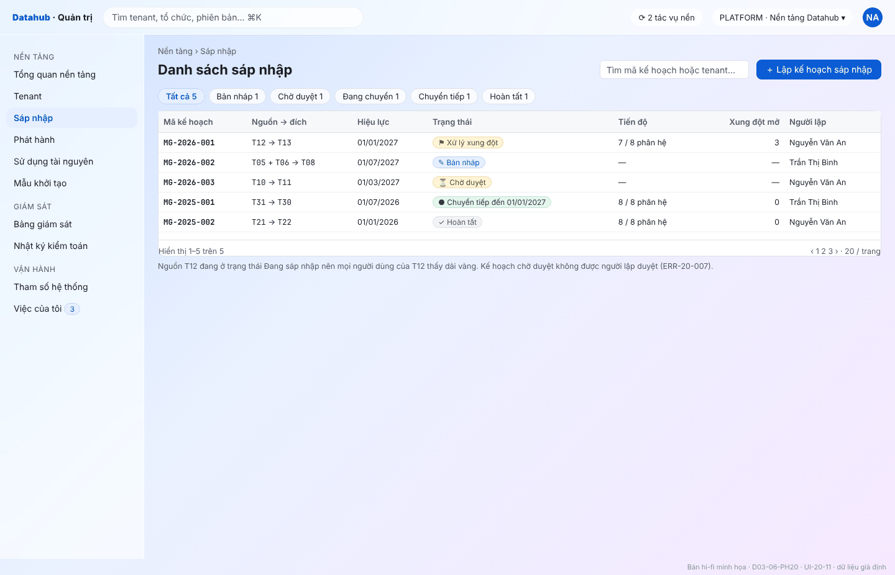

Hình 11. UI-20-11 Danh sách sáp nhập với năm kế hoạch ở các trạng thái khác nhau

Ảnh cho thấy thanh lọc theo trạng thái có số đếm (Tất cả 5, Bản nháp 1, Chờ duyệt 1, Đang chuyển 1, Chuyển tiếp 1, Hoàn tất 1) và bảng với `MG-2026-001` T12 sang T13 đang "Xử lý xung đột", 7 trên 8 phân hệ, 3 xung đột mở. Trạng thái luôn có biểu tượng và chữ cạnh màu.

### 14.2. Bố cục vùng

| # | Vùng | `CMP-*` | Nội dung | Ghi chú |
|---|---|---|---|---|
| 1 | Đầu trang | `CMP-PageHeader` | Tên, ô tìm, nút "Lập kế hoạch sáp nhập" | Nút ẩn với PO, PAU |
| 2 | Lọc | `CMP-FilterChips` | Chip trạng thái kèm số đếm | Một lựa chọn tại một thời điểm |
| 3 | Bảng | `CMP-DataTable` | Mã, nguồn sang đích, hiệu lực, trạng thái, tiến độ, xung đột mở, người lập | Nhấp hàng mở UI-20-10, hoặc UI-20-09 nếu bản nháp |
| 4 | Phân trang | `CMP-Pagination` | 20 dòng mỗi trang | |

: UI-20-11 Danh sách sáp nhập, bố cục vùng

### 14.3. Trường và cột

| Cột | Kiểu | Sắp xếp | Nguồn API |
|---|---|---|---|
| Mã kế hoạch | T-CODE `MG-{năm}-{số}` | Có | API-20-087 |
| Nguồn sang đích | T-TENANT, T-TENANT | Không | API-20-087 |
| Hiệu lực | ngày | Có | API-20-087 |
| Trạng thái | `MergeStatus` | Có | API-20-087 |
| Tiến độ | "x / y phân hệ" | Không | API-20-087 |
| Xung đột mở | số | Có | API-20-087 |
| Người lập | text | Không | API-20-087 |

: UI-20-11 Danh sách sáp nhập, cột bảng

### 14.4. Hành động

| Hành động | Điều kiện | API | Kết quả |
|---|---|---|---|
| Lập kế hoạch sáp nhập | `PERM-20-merge` | — | Mở UI-20-09 |
| Mở kế hoạch | `PERM-20-read` | API-20-088 | UI-20-10 hoặc UI-20-09 |
| Hủy kế hoạch (menu hàng) | `PERM-20-merge`, chưa cutover | API-20-093 | `CMP-ConfirmDialog`; ERR-20-006 nếu sai trạng thái |
| Lọc, tìm | Mọi vai trò | API-20-087 | Cập nhật tham số URL |

: UI-20-11 Danh sách sáp nhập, hành động

### 14.5. Trạng thái và thông báo

| Trạng thái | Hiển thị |
|---|---|
| Đang tải | Skeleton 6 dòng (`ST-01`) |
| Rỗng | `CMP-EmptyState` "Chưa có kế hoạch sáp nhập." kèm nút lập mới nếu có quyền (`ST-02`) |
| Lỗi | `CMP-Alert` "Thử lại" (`ST-05`); ERR-20-062 khi dịch vụ phụ thuộc lỗi |
| Không có quyền | `ST-07` |
| Chỉ đọc | PO, PAU: không có nút lập, hủy |

: UI-20-11 Danh sách sáp nhập, trạng thái màn

| Mã | HTTP | Câu hiển thị (FRS §9.2) | Nơi hiện |
|---|---|---|---|
| ERR-20-002 | 404 | "Không tìm thấy {đối tượng} {mã} trong phạm vi được xem." | Khi mở liên kết kế hoạch đã xóa |
| ERR-20-006 | 409 | "Không thể {thao tác} khi {đối tượng} đang ở trạng thái {trạng thái}." | Hộp thoại hủy |
| ERR-20-062 | 503 | "Dịch vụ {tên} tạm thời không khả dụng. Thử lại sau." | `CMP-Alert` |

: UI-20-11 Danh sách sáp nhập, thông báo theo mã lỗi

### 14.6. Phím tắt, truy cập, thành phần

Phím tắt: `/` đưa focus vào ô tìm, `N` mở lập kế hoạch (khi có quyền), mũi tên chọn hàng, `Enter` mở. Bảng có `<caption>` và `aria-sort`; số đếm trong chip đọc cùng nhãn. Thành phần: `CMP-PageHeader`, `CMP-FilterChips`, `CMP-DataTable`, `CMP-StatusTag`, `CMP-Pagination`, `CMP-EmptyState`, `CMP-Skeleton`, `CMP-Alert`, `CMP-ConfirmDialog`. Token: `color-surface-solid`, `color-warning`, `color-success`, `font-callout`, `space-3`, `radius-md`.

## 15. UI-20-12 Cài đặt tỉnh

Màn của quản trị tỉnh: đặt thông tin hiển thị, chủ quản CNTT, an toàn đăng nhập, cửa sổ bảo trì ưa thích, trong giới hạn nền tảng cho phép (chỉ chặt hơn, không nới). Cửa sổ ưa thích do TA đặt riêng ở tab Phiên bản bằng API-20-160; API-20-136 lưu trọn bộ cài đặt nên mang cùng trường `maintenanceWindowPref` và áp cùng kiểm tra 2…6 giờ; lịch cụ thể của từng kế hoạch nâng cấp do PA đặt ở UI-20-19 (API-20-121) và không đổi cửa sổ ưa thích.

::: dac-ta
**Mã, tên.** UI-20-12 · Cài đặt tỉnh.

**Mục đích.** Cho TA đặt cài đặt của tỉnh, xem phiên bản đang chạy và lịch bảo trì, biết giới hạn nền tảng áp lên từng thiết lập; SO, AU xem chỉ đọc.

**Đường dẫn, mẫu.** `/quan-tri/cai-dat-tinh` (tab `thong-tin`, `chu-quan`, `an-toan`, `phien-ban`); PTN-12 Cài đặt.

**Vai trò, quyền.** TA ghi `PERM-20-settings`; SO, AU đọc `PERM-20-org-read`.

**FR.** FR-20-018, 061, 063, 064.

**API.** API-20-135 (đọc), API-20-136 (ghi, `If-Match`), API-20-159 (phiên bản, ghi chú, lịch bảo trì), API-20-160 (cửa sổ bảo trì).

**Thông báo.** ERR-20-004, 005, 023, 059, 118.
:::

### 15.1. Bản hi-fi

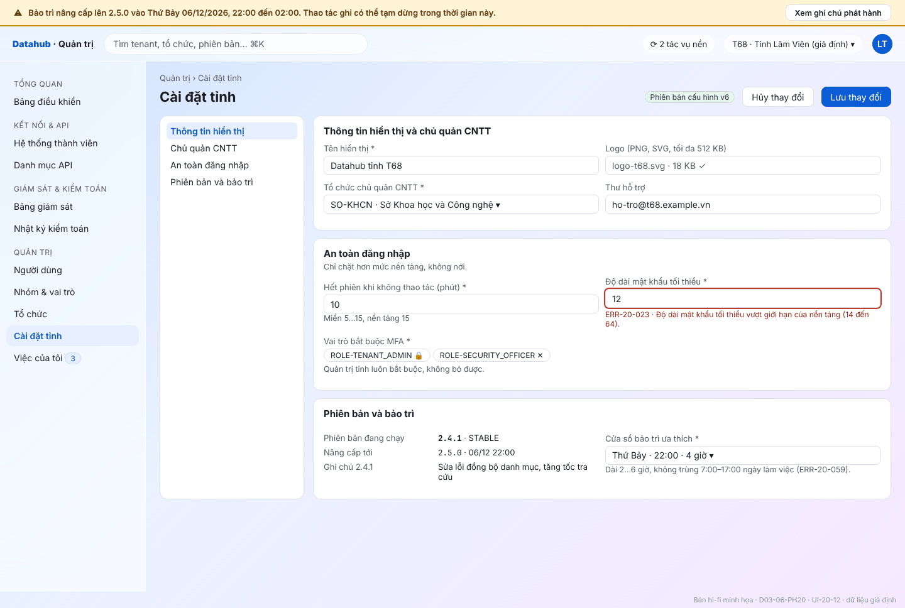

Hình 12. UI-20-12 Cài đặt tỉnh T68 phiên bản cấu hình v6

Ảnh cho thấy dải vàng phía trên cùng báo bảo trì nâng cấp lên 2.5.0 vào Thứ Bảy 06/12/2026, 22:00 đến 02:00, bốn tab và biểu mẫu "Thông tin hiển thị và chủ quản CNTT" với nhãn trường, ghi chú giới hạn nền tảng dưới từng trường và hai nút "Hủy thay đổi", "Lưu thay đổi".

### 15.2. Bố cục vùng

| # | Vùng | `CMP-*` | Nội dung | Ghi chú |
|---|---|---|---|---|
| 1 | Dải bảo trì | `CMP-Banner` | Lịch bảo trì nâng cấp sắp tới kèm liên kết ghi chú phát hành | Hiện từ khi có thông báo (FR-063) |
| 2 | Đầu trang | `CMP-PageHeader`, `CMP-SaveIndicator` | Phiên bản cấu hình `v6`; nút hủy, lưu | Lưu khóa khi không đổi gì |
| 3 | Tab | `CMP-Tabs` | Thông tin hiển thị, Chủ quản CNTT, An toàn đăng nhập, Phiên bản và bảo trì | Dấu chấm ở tab có thay đổi chưa lưu |
| 4 | Biểu mẫu | `CMP-Form`, `CMP-FormField` | Trường kèm ghi chú "Giới hạn nền tảng: …" | Trường vượt giới hạn: ERR-20-023 |
| 5 | Tab Phiên bản | `CMP-DescriptionList`, `CMP-DateRangePicker` | Phiên bản đang chạy, kênh, ghi chú phát hành, cửa sổ bảo trì ưa thích | Cửa sổ ghi bằng API-20-160 |
| 6 | Liên kết | `CMP-Link` | "Sử dụng tài nguyên" (UI-20-13), "Truy cập liên tenant" (UI-20-22) | |

: UI-20-12 Cài đặt tỉnh, bố cục vùng

### 15.3. Trường và cột

| Trường | Kiểu | Ràng buộc | Nguồn API |
|---|---|---|---|
| `displayName` | T-NAME | Bắt buộc, tối đa 200 ký tự | API-20-135, 136 |
| `logoFileId` | T-ID | PNG, SVG, tối đa 512 KB | API-20-136 |
| `itOwnerOrgCode` | T-CODE | Tổ chức đang hoạt động trong danh mục | API-20-136 |
| `sessionTimeoutMinutes` | số | Không vượt trần nền tảng (chỉ chặt hơn) | API-20-136 |
| `mfaRequired` | bool | Không tắt được nếu nền tảng bắt buộc | API-20-136 |
| `maintenanceWindow` | khung giờ, thứ | Trong khoảng nền tảng cho phép (ERR-20-059) | API-20-160 |
| `releaseInfo` | `currentVersion`, `channel`, ghi chú | Chỉ đọc; đổi kênh ở UI-20-18 | API-20-159 |
| Phiên bản cấu hình | số | `If-Match` | API-20-135 |

: UI-20-12 Cài đặt tỉnh, trường nhập

### 15.4. Hành động

| Hành động | Điều kiện | API | Kết quả |
|---|---|---|---|
| Lưu thay đổi | TA, có thay đổi | API-20-136 | Phiên bản cấu hình tăng; ERR-20-005 nếu có người sửa trước |
| Hủy thay đổi | Có thay đổi | — | Khôi phục theo bản đã tải |
| Đặt cửa sổ bảo trì | TA | API-20-160 | Dùng khi lập sóng nâng cấp; ERR-20-059 nếu ngoài khoảng cho phép |
| Mở ghi chú phát hành | Mọi vai trò xem được | API-20-159 | Mở ngăn bên |

: UI-20-12 Cài đặt tỉnh, hành động

### 15.5. Trạng thái và thông báo

| Trạng thái | Hiển thị |
|---|---|
| Đang tải | Skeleton biểu mẫu (`ST-01`) |
| Rỗng | Không áp dụng: luôn có giá trị mặc định của nền tảng |
| Lỗi | `CMP-Alert` "Thử lại"; lưu lỗi giữ nguyên dữ liệu đã nhập |
| Không có quyền | `ST-07` |
| Chỉ đọc | SO, AU, và mọi người khi tỉnh `MERGED`, `SUSPENDED`: trường khóa, không có nút lưu |
| Đang bảo trì nâng cấp | Dải ERR-20-118, nút lưu khóa |

: UI-20-12 Cài đặt tỉnh, trạng thái màn

| Mã | HTTP | Câu hiển thị (FRS §9.2) | Nơi hiện |
|---|---|---|---|
| ERR-20-004 | 400 | "{Trường} chưa hợp lệ: {yêu cầu}." | Dưới trường |
| ERR-20-005 | 412 | "{Đối tượng} đã được người khác sửa. Tải lại để xem thay đổi." | `CMP-ConflictDialog` |
| ERR-20-023 | 422 | "{Thiết lập} vượt giới hạn của nền tảng ({giới hạn})." | Dưới trường |
| ERR-20-059 | 422 | "Cửa sổ bảo trì không hợp lệ: {lý do}." | Dưới trường cửa sổ |
| ERR-20-118 | 503 | "Tỉnh đang bảo trì nâng cấp đến {giờ}. Thao tác ghi tạm dừng." | Dải đầu trang |

: UI-20-12 Cài đặt tỉnh, thông báo theo mã lỗi

### 15.6. Phím tắt, truy cập, thành phần

Phím tắt: `Ctrl+S` lưu, `Esc` hủy thay đổi (có xác nhận khi có thay đổi), `[` và `]` chuyển tab. Mỗi trường có nhãn và ghi chú giới hạn gắn `aria-describedby`; dải bảo trì là vùng `role="status"`. Rời trang khi còn thay đổi chưa lưu hiện `CMP-ConfirmDialog`. Thành phần: `CMP-PageHeader`, `CMP-SaveIndicator`, `CMP-Tabs`, `CMP-Form`, `CMP-FormField`, `CMP-Switch`, `CMP-NumberInput`, `CMP-Upload`, `CMP-TreeSelect`, `CMP-DescriptionList`, `CMP-Banner`, `CMP-ConflictDialog`. Token: `color-surface-solid`, `color-warning`, `size-form-max`, `font-body`, `font-footnote`, `space-4`, `radius-lg`.

## 16. UI-20-13 Sử dụng tài nguyên của tỉnh

Màn chỉ đọc cho tỉnh thấy mức dùng so với hạn mức hợp đồng; hạn mức do nền tảng đặt, tỉnh không sửa.

::: dac-ta
**Mã, tên.** UI-20-13 · Sử dụng tài nguyên của tỉnh.

**Mục đích.** Cho TA, SO, AU xem mười hai tài nguyên so với hạn mức hiệu lực (kể cả ghi đè tạm thời), cảnh báo 80% và 100%, xu hướng theo kỳ, xuất CSV.

**Đường dẫn, mẫu.** `/quan-tri/cai-dat-tinh/su-dung` (tham số `ky`); PTN-06 Bảng điều khiển.

**Vai trò, quyền.** TA, SO, AU (`PERM-20-usage-read`).

**FR.** FR-20-028, 029, 030.

**API.** API-20-140 (sử dụng), API-20-141 (hạn mức hiệu lực và cảnh báo).

**Thông báo.** ERR-20-032, 110.
:::

### 16.1. Bản hi-fi

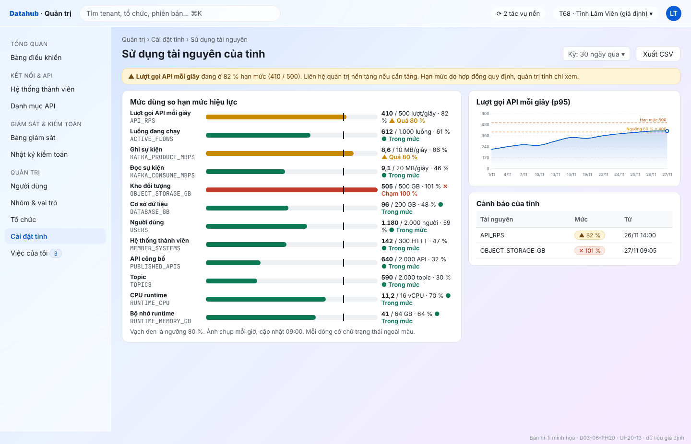

Hình 13. UI-20-13 Sử dụng tài nguyên của tỉnh T68 trong 30 ngày qua

Ảnh cho thấy dải vàng "Lượt gọi API mỗi giây đang ở 82 % hạn mức (410 / 500)", dòng nhắc "Hạn mức do hợp đồng quy định, quản trị tỉnh chỉ xem" và các thẻ tài nguyên có thanh tiến độ, số đã dùng trên hạn mức, phần trăm và nhãn "Quá 80 %" bằng chữ.

### 16.2. Bố cục vùng

| # | Vùng | `CMP-*` | Nội dung | Ghi chú |
|---|---|---|---|---|
| 1 | Đầu trang | `CMP-PageHeader`, `CMP-Select` | Chọn kỳ (7, 30, 90 ngày); nút "Xuất CSV" | Tối đa `20.usage.max-range-days` (ERR-20-032) |
| 2 | Dải cảnh báo | `CMP-Banner` | Tài nguyên đã quá 80% hoặc chạm 100% | Liệt kê tối đa 3, còn lại "và n tài nguyên khác" |
| 3 | Lưới tài nguyên | `CMP-StatCard`, `CMP-ProgressBar` | 12 thẻ: tên, đã dùng, hạn mức, phần trăm, nhãn ngưỡng | Ghi đè tạm thời hiện "Đang tăng đến {ngày}" |
| 4 | Xu hướng | `CMP-Chart` đường | Tài nguyên chọn theo kỳ, đường hạn mức nét đứt | Có bảng dữ liệu thay thế |

: UI-20-13 Sử dụng tài nguyên của tỉnh, bố cục vùng

### 16.3. Trường và cột

| Trường | Kiểu | Nguồn API | Ghi chú |
|---|---|---|---|
| `resourceCode` | enum 12 giá trị | API-20-140 | Ví dụ `API_RPS`, `STORAGE_GB` |
| `used`, `limit`, `unit` | số, số, text | API-20-140, 141 | `limit` là hạn mức hiệu lực |
| `percent` | số | API-20-141 | Làm tròn một chữ số |
| `threshold` | `OK`, `WARN_80`, `FULL_100` | API-20-141 | Ba nhãn chữ khác nhau |
| `override` | `{until, reason}` | API-20-141 | Chỉ hiện ngày hết, không hiện lý do nội bộ |
| `series[]` | điểm theo giờ hoặc ngày | API-20-140 | Thiếu số liệu: ERR-20-110 |

: UI-20-13 Sử dụng tài nguyên của tỉnh, trường dữ liệu

### 16.4. Hành động

| Hành động | Điều kiện | API | Kết quả |
|---|---|---|---|
| Đổi kỳ | Mọi vai trò | API-20-140 | Tải lại biểu đồ và thẻ |
| Xuất CSV | `PERM-20-usage-read` | API-20-140 (`format=csv`) | Tải tệp, có dòng đơn vị |
| Chọn tài nguyên cho biểu đồ | Mọi vai trò | — | Nhấp thẻ hoặc chọn trong danh sách |

: UI-20-13 Sử dụng tài nguyên của tỉnh, hành động

### 16.5. Trạng thái và thông báo

| Trạng thái | Hiển thị |
|---|---|
| Đang tải | Skeleton 12 thẻ và biểu đồ (`ST-01`) |
| Rỗng | Tỉnh mới chưa có số liệu: "Chưa có số liệu sử dụng. Số liệu xuất hiện sau giờ đo đầu tiên." |
| Lỗi | `CMP-Alert` "Thử lại"; thiếu số liệu một tài nguyên thì thẻ đó xám kèm ERR-20-110 |
| Không có quyền | `ST-07` |
| Chỉ đọc | Toàn màn chỉ đọc theo thiết kế |

: UI-20-13 Sử dụng tài nguyên của tỉnh, trạng thái màn

| Mã | HTTP | Câu hiển thị (FRS §9.2) | Nơi hiện |
|---|---|---|---|
| ERR-20-032 | 400 | "Khoảng thời gian tối đa là {số} ngày." | Dưới ô chọn kỳ |
| ERR-20-110 | — | "Thiếu số liệu sử dụng {tài nguyên} của {tenant} từ {giờ}." | Trên thẻ tài nguyên |

: UI-20-13 Sử dụng tài nguyên của tỉnh, thông báo theo mã lỗi

### 16.6. Phím tắt, truy cập, thành phần

Phím tắt: `Tab` đi qua các thẻ, `Enter` chọn thẻ làm nguồn biểu đồ, `Shift+E` xuất CSV. Thanh tiến độ có `role="progressbar"` kèm `aria-valuenow` và nhãn "82 phần trăm, quá 80 phần trăm"; biểu đồ có bảng dữ liệu ẩn bên dưới cho trình đọc màn hình. Màu ngưỡng luôn đi kèm chữ (A-03 không áp dụng cho màn này). Thành phần: `CMP-PageHeader`, `CMP-Select`, `CMP-Banner`, `CMP-StatCard`, `CMP-ProgressBar`, `CMP-Chart`, `CMP-Alert`, `CMP-EmptyState`. Token: `color-warning`, `color-error`, `color-success`, `color-surface-solid`, `font-title-2`, `space-4`, `radius-lg`.

## 17. UI-20-14 Danh mục tổ chức (cây và bảng)

Danh mục tổ chức của tỉnh là nguồn tham chiếu cho các phân hệ khác. Giải thể một tổ chức còn dữ liệu tham chiếu bắt buộc chọn tổ chức kế thừa.

::: dac-ta
**Mã, tên.** UI-20-14 · Danh mục tổ chức.

**Mục đích.** Cho TA xem danh mục dạng cây hoặc bảng, tìm, lọc, mở chi tiết, ngừng hoặc hoạt động lại, giải thể có kế thừa, sáp nhập nhiều tổ chức, xử lý đề xuất đồng bộ do sắp xếp đơn vị hành chính; SO, AU xem.

**Đường dẫn, mẫu.** `/quan-tri/to-chuc` (tham số `dang` = `cay` hoặc `bang`, `q`, `trang-thai`); PTN-08 Cây và bảng.

**Vai trò, quyền.** TA ghi `PERM-20-org`; SO, AU đọc `PERM-20-org-read`.

**FR.** FR-20-053, 054, 055, 056, 058.

**API.** API-20-143 (danh mục), API-20-147, 148 (ngừng, hoạt động lại), API-20-149 (giải thể), API-20-150 (sáp nhập tổ chức), API-20-152 (chủ quản dữ liệu), API-20-156 (xuất), API-20-157, 158 (đề xuất đồng bộ).

**Thông báo.** ERR-20-006, 047, 048, 049, 052.
:::

### 17.1. Bản hi-fi

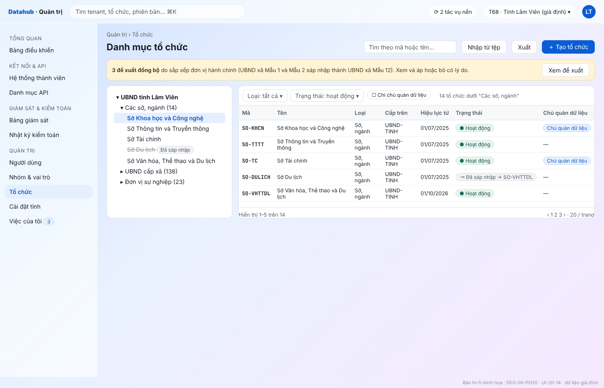

Hình 14. UI-20-14 Danh mục tổ chức tỉnh T68 dạng cây

Ảnh cho thấy dải thông tin "3 đề xuất đồng bộ do sắp xếp đơn vị hành chính" kèm nút "Xem đề xuất", cây từ UBND tỉnh xuống nhóm "Các sở, ngành (14)", mỗi nút có tên, mã, nhãn trạng thái (ví dụ "Đã sáp nhập" cho Sở Du lịch) và biểu tượng chủ quản dữ liệu.

### 17.2. Bố cục vùng

| # | Vùng | `CMP-*` | Nội dung | Ghi chú |
|---|---|---|---|---|
| 1 | Đầu trang | `CMP-PageHeader`, `CMP-SearchInput` | Ô tìm theo mã, tên; nút "Nhập từ tệp", "Xuất", "Tạo tổ chức" | Nút ghi chỉ TA |
| 2 | Dải đồng bộ | `CMP-Banner` | Số đề xuất đồng bộ chờ quyết, nút "Xem đề xuất" | Mở ngăn bên các đề xuất |
| 3 | Chuyển dạng | `CMP-Segmented` | Cây hoặc Bảng | Nhớ lựa chọn của người dùng |
| 4 | Cây | `CMP-TreeGrid` | Tên, mã, loại, trạng thái, cờ chủ quản dữ liệu; mở rộng theo nhánh | Kéo thả đổi cấp trên (kiểm chu trình, ERR-20-047) |
| 5 | Bảng | `CMP-DataTable` | Cùng cột, thêm cấp trên, hiệu lực | Cho lọc, sắp xếp, chọn nhiều |
| 6 | Thanh chọn nhiều | `CMP-BulkActionBar` | Ngừng, Hoạt động lại, Sáp nhập tổ chức… | Hiện khi chọn từ hai dòng |
| 7 | Ngăn đề xuất | `CMP-Drawer` | Từng đề xuất: trước sau, nút "Áp dụng", "Bỏ qua…" (có lý do) | API-20-158 |

: UI-20-14 Danh mục tổ chức, bố cục vùng

### 17.3. Trường và cột

| Cột | Kiểu | Nguồn API | Ghi chú |
|---|---|---|---|
| Tên, mã | text, T-CODE | API-20-143 | Mã không đổi |
| Loại | `OrgType` | API-20-143 | `PROVINCE_COMMITTEE`, `DEPARTMENT`, `DISTRICT`, `COMMUNE` và các loại khác theo FRS |
| Cấp trên | T-CODE | API-20-143 | Chỉ ở dạng bảng |
| Trạng thái | `OrgStatus` | API-20-143 | `ACTIVE`, `INACTIVE`, `MERGED`, `DISSOLVED` |
| Hiệu lực | khoảng ngày | API-20-143 | Hết hiệu lực không trước bắt đầu (ERR-20-052) |
| Chủ quản dữ liệu | bool | API-20-152 | Biểu tượng cộng chữ "Chủ quản dữ liệu" |
| Số tham chiếu | số | API-20-143 | Dùng cho cảnh báo giải thể (ERR-20-049) |

: UI-20-14 Danh mục tổ chức, cột

### 17.4. Hành động

| Hành động | Điều kiện | API | Kết quả |
|---|---|---|---|
| Tạo, sửa | `PERM-20-org` | API-20-144, 146 | Mở UI-20-15 |
| Ngừng, hoạt động lại | `PERM-20-org`, đúng trạng thái | API-20-147, 148 | `CMP-ConfirmDialog`; ERR-20-006 |
| Giải thể có kế thừa | `PERM-20-org` | API-20-149 | Hộp thoại chọn tổ chức kế thừa (`CMP-TreeSelect`); ERR-20-048, 049 |
| Sáp nhập tổ chức | Chọn từ hai tổ chức | API-20-150 | Chọn tổ chức đích, ngày hiệu lực; tổ chức nguồn thành `MERGED` |
| Đánh dấu chủ quản dữ liệu | `PERM-20-org` | API-20-152 | Công tắc trong chi tiết; từ danh sách bằng menu hàng |
| Áp, bỏ đề xuất đồng bộ | `PERM-20-org` | API-20-158 | Bỏ phải có lý do |
| Xuất | `PERM-20-org-read` | API-20-156 | Tải tệp |

: UI-20-14 Danh mục tổ chức, hành động

### 17.5. Trạng thái và thông báo

| Trạng thái | Hiển thị |
|---|---|
| Đang tải | Skeleton cây 8 nút hoặc bảng 8 dòng (`ST-01`) |
| Rỗng | Chưa có tổ chức: "Danh mục tổ chức trống. Tạo tổ chức đầu tiên hoặc nhập từ tệp." |
| Lỗi | `CMP-Alert` "Thử lại" |
| Không có quyền | `ST-07` |
| Chỉ đọc | SO, AU: không có nút ghi, không kéo thả; tỉnh `MERGED`: chỉ đọc kèm dải ERR-20-115 |

: UI-20-14 Danh mục tổ chức, trạng thái màn

| Mã | HTTP | Câu hiển thị (FRS §9.2) | Nơi hiện |
|---|---|---|---|
| ERR-20-006 | 409 | "Không thể {thao tác} khi {đối tượng} đang ở trạng thái {trạng thái}." | Hộp thoại xác nhận |
| ERR-20-047 | 422 | "Tổ chức cấp trên {mã} không hợp lệ: {lý do}." | Toast khi kéo thả sai |
| ERR-20-048 | 422 | "Tổ chức kế thừa {mã} không hợp lệ: {lý do}." | Dưới ô chọn kế thừa |
| ERR-20-049 | 409 | "Tổ chức {mã} còn {số} đối tượng tham chiếu. Chọn tổ chức kế thừa." | Hộp thoại giải thể |
| ERR-20-052 | 422 | "Ngày hết hiệu lực phải sau hoặc bằng ngày bắt đầu hiệu lực." | Hộp thoại sáp nhập tổ chức |

: UI-20-14 Danh mục tổ chức, thông báo theo mã lỗi

### 17.6. Phím tắt, truy cập, thành phần

Phím tắt: trong cây dùng mũi tên (lên, xuống, phải mở, trái đóng), `Enter` mở chi tiết, `Space` chọn, `Ctrl+Shift+↓` hạ cấp theo bàn phím thay cho kéo thả. Cây dùng `role="treegrid"` với `aria-level`, `aria-expanded`; kéo thả luôn có lệnh thay thế "Chuyển đến…" trong menu hàng (WCAG 2.5.7). Thành phần: `CMP-PageHeader`, `CMP-SearchInput`, `CMP-Segmented`, `CMP-TreeGrid`, `CMP-DataTable`, `CMP-BulkActionBar`, `CMP-Drawer`, `CMP-TreeSelect`, `CMP-ConfirmDialog`, `CMP-Banner`, `CMP-StatusTag`. Token: `color-surface-solid`, `color-info`, `color-diff-changed`, `size-row-compact`, `font-callout`, `space-2`, `radius-md`.

## 18. UI-20-15 Chi tiết, biểu mẫu tổ chức

Một màn dùng hai chế độ: xem chi tiết và sửa, tạo mới. Mã tổ chức không đổi sau khi tạo.

::: dac-ta
**Mã, tên.** UI-20-15 · Chi tiết, biểu mẫu tổ chức.

**Mục đích.** Cho TA tạo, sửa tổ chức (loại, tên, cấp trên, đơn vị hành chính, mã định danh điện tử, hiệu lực, chủ quản dữ liệu), xem lịch sử hiệu lực và kế thừa, ngừng hoặc giải thể; SO, AU xem chi tiết.

**Đường dẫn, mẫu.** `/quan-tri/to-chuc/moi`, `/quan-tri/to-chuc/{ma-to-chuc}`, `/quan-tri/to-chuc/{ma-to-chuc}/sua`; PTN-02 Chi tiết, PTN-03 Biểu mẫu.

**Vai trò, quyền.** Xem `PERM-20-org-read`; ghi `PERM-20-org`.

**FR.** FR-20-053, 054, 058.

**API.** API-20-144 (tạo), API-20-145 (chi tiết), API-20-146 (sửa, `If-Match`), API-20-147, 148, 149 (ngừng, hoạt động lại, giải thể), API-20-151 (lịch sử), API-20-152 (chủ quản dữ liệu).

**Thông báo.** ERR-20-003, 004, 005, 012, 047, 048, 049, 052.
:::

### 18.1. Bản hi-fi

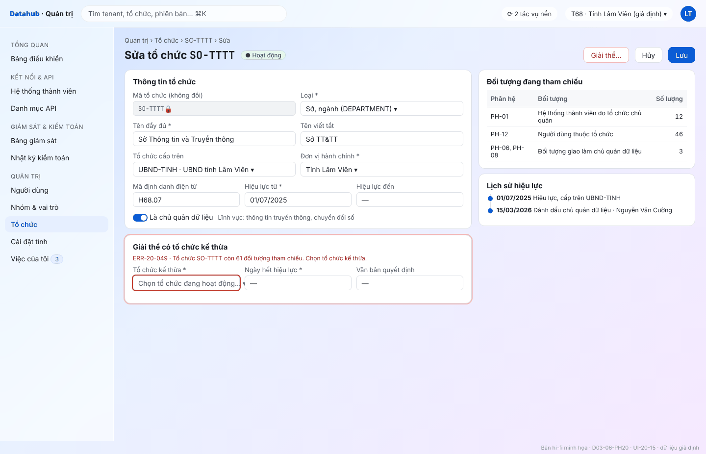

Hình 15. UI-20-15 Sửa tổ chức SO-TTTT

Ảnh cho thấy tiêu đề "Sửa tổ chức SO-TTTT" kèm nhãn "Hoạt động", ba nút "Giải thể…", "Hủy", "Lưu"; biểu mẫu với mã tổ chức khóa kèm biểu tượng khóa và chữ "không đổi", loại, tên đầy đủ, tên viết tắt, cấp trên, đơn vị hành chính, mã định danh điện tử, hiệu lực.

### 18.2. Bố cục vùng

| # | Vùng | `CMP-*` | Nội dung | Ghi chú |
|---|---|---|---|---|
| 1 | Đầu trang | `CMP-PageHeader`, `CMP-StatusTag` | Tên, mã, trạng thái; nút theo chế độ | Chế độ xem: "Sửa", "Ngừng", "Giải thể…" |
| 2 | Biểu mẫu | `CMP-Form`, `CMP-FormField` | Nhóm "Thông tin tổ chức" và "Hiệu lực và chủ quản dữ liệu" | Một cột, `size-form-max` |
| 3 | Chọn cấp trên | `CMP-TreeSelect` | Cây tổ chức, loại bản thân và con cháu | ERR-20-047 nếu tạo chu trình |
| 4 | Chọn ĐVHC | `CMP-Select` | Đơn vị hành chính thuộc tỉnh | Từ danh mục dùng chung |
| 5 | Lịch sử | `CMP-Timeline` | Thay đổi hiệu lực, kế thừa, sáp nhập | API-20-151; chỉ ở chế độ xem và sửa |
| 6 | Đối tượng tham chiếu | `CMP-DescriptionList` | Số đối tượng của từng phân hệ đang tham chiếu tổ chức | Dùng cho hộp thoại giải thể |

: UI-20-15 Chi tiết, biểu mẫu tổ chức, bố cục vùng

### 18.3. Trường và cột

| Trường | Kiểu | Bắt buộc | Ràng buộc | Nguồn API |
|---|---|---|---|---|
| `orgCode` | T-CODE | Có khi tạo | Duy nhất trong tenant, không đổi (ERR-20-003) | API-20-144 |
| `orgType` | `OrgType` | Có | Theo danh mục loại | API-20-144, 146 |
| `fullName`, `shortName` | T-NAME | Tên đầy đủ có | Tối đa 300, 60 ký tự | API-20-146 |
| `parentOrgCode` | T-CODE | Không | Không chu trình, đang hoạt động | API-20-146 |
| `adminUnitCode` | T-CODE | Có | Đơn vị hành chính thuộc tỉnh (ERR-20-012) | API-20-146 |
| `eId` | text | Không | Mã định danh điện tử dạng `H68.07` | API-20-146 |
| `validFrom`, `validTo` | ngày | `validFrom` có | `validTo` không trước `validFrom` (ERR-20-052) | API-20-146 |
| `isDataOwner` | bool | Không | Chủ quản dữ liệu | API-20-152 |
| `successorOrgCode` | T-CODE | Khi giải thể còn tham chiếu | Hoạt động, khác tổ chức bị giải thể (ERR-20-048) | API-20-149 |

: UI-20-15 Chi tiết, biểu mẫu tổ chức, trường nhập

### 18.4. Hành động

| Hành động | Điều kiện | API | Kết quả |
|---|---|---|---|
| Lưu (tạo) | `PERM-20-org` | API-20-144 | Mở chi tiết tổ chức mới; ERR-20-003 nếu trùng mã |
| Lưu (sửa) | `PERM-20-org`, có thay đổi | API-20-146 | `If-Match`; ERR-20-005 mở `CMP-ConflictDialog` |
| Ngừng, hoạt động lại | `PERM-20-org` | API-20-147, 148 | `CMP-ConfirmDialog` |
| Giải thể… | `PERM-20-org`, tổ chức hoạt động | API-20-149 | Hộp thoại: ngày, tổ chức kế thừa nếu còn tham chiếu (ERR-20-049) |
| Đổi chủ quản dữ liệu | `PERM-20-org` | API-20-152 | Công tắc, lưu riêng |

: UI-20-15 Chi tiết, biểu mẫu tổ chức, hành động

### 18.5. Trạng thái và thông báo

| Trạng thái | Hiển thị |
|---|---|
| Đang tải | Skeleton biểu mẫu (`ST-01`) |
| Rỗng | Chế độ tạo: biểu mẫu trống; lịch sử "Chưa có thay đổi." |
| Lỗi | Lỗi theo trường dưới trường, tóm tắt ở đầu biểu mẫu (`CMP-Alert`) |
| Không có quyền | `ST-07`; ERR-20-002 khi mã không có trong tenant |
| Chỉ đọc | Tổ chức `DISSOLVED` hoặc `MERGED`, vai trò SO, AU: trường khóa, nút ghi ẩn |

: UI-20-15 Chi tiết, biểu mẫu tổ chức, trạng thái màn

| Mã | HTTP | Câu hiển thị (FRS §9.2) | Nơi hiện |
|---|---|---|---|
| ERR-20-003 | 409 | "{Đối tượng} {mã} đã tồn tại. Chọn mã khác." | Dưới ô mã |
| ERR-20-004 | 400 | "{Trường} chưa hợp lệ: {yêu cầu}." | Dưới trường |
| ERR-20-005 | 412 | "{Đối tượng} đã được người khác sửa. Tải lại để xem thay đổi." | `CMP-ConflictDialog` |
| ERR-20-012 | 422 | "Đơn vị hành chính {mã} không phải cấp tỉnh hoặc đã hết hiệu lực." | Dưới ô đơn vị hành chính |
| ERR-20-047 | 422 | "Tổ chức cấp trên {mã} không hợp lệ: {lý do}." | Dưới ô cấp trên |
| ERR-20-048 | 422 | "Tổ chức kế thừa {mã} không hợp lệ: {lý do}." | Hộp thoại giải thể |
| ERR-20-049 | 409 | "Tổ chức {mã} còn {số} đối tượng tham chiếu. Chọn tổ chức kế thừa." | Hộp thoại giải thể |
| ERR-20-052 | 422 | "Ngày hết hiệu lực phải sau hoặc bằng ngày bắt đầu hiệu lực." | Dưới ô ngày hết |

: UI-20-15 Chi tiết, biểu mẫu tổ chức, thông báo theo mã lỗi

### 18.6. Phím tắt, truy cập, thành phần

Phím tắt: `Ctrl+S` lưu, `Esc` hủy, `Ctrl+Enter` lưu và đóng. Trường khóa dùng `aria-readonly` và nêu lý do bằng chữ; lỗi trường có `aria-invalid` và liên kết `aria-describedby`; khi gửi lỗi, focus chuyển tới trường lỗi đầu tiên (WCAG 3.3.1, 3.3.3). Thành phần: `CMP-PageHeader`, `CMP-StatusTag`, `CMP-Form`, `CMP-FormField`, `CMP-TreeSelect`, `CMP-Select`, `CMP-DatePicker`, `CMP-Switch`, `CMP-Timeline`, `CMP-DescriptionList`, `CMP-ConfirmDialog`, `CMP-ConflictDialog`. Token: `color-surface-solid`, `color-error-text`, `size-form-max`, `font-body`, `space-4`, `radius-lg`.

## 19. UI-20-16 Nhập tổ chức

::: dac-ta
**Mã, tên.** UI-20-16 · Nhập tổ chức.

**Mục đích.** Cho TA nhập hàng trăm tổ chức từ tệp Excel hoặc CSV qua ba bước tải, xem trước từng dòng, xác nhận; không ghi gì trước khi xác nhận.

**Đường dẫn, mẫu.** `/quan-tri/to-chuc/nhap` (tham số `lo`); PTN-09 Nhập có xem trước.

**Vai trò, quyền.** TA (`PERM-20-org`).

**FR.** FR-20-055.

**API.** API-20-153 (tải, sinh xem trước), API-20-154 (kết quả từng dòng), API-20-155 (xác nhận), API-20-156 (tệp mẫu).

**Thông báo.** ERR-20-004, 050, 051.
:::

### 19.1. Bản hi-fi

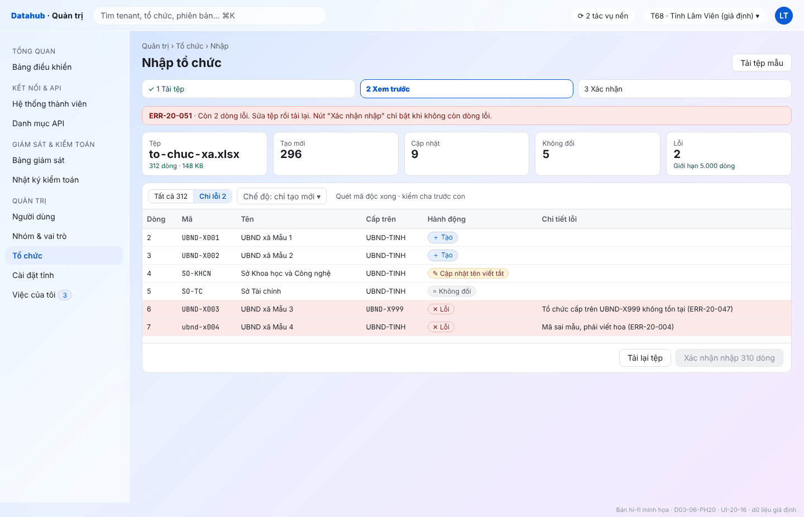

Hình 16. UI-20-16 Nhập tổ chức, bước 2 Xem trước tệp to-chuc-xa.xlsx

Ảnh cho thấy thanh ba bước, dải lỗi ERR-20-051 "Còn 2 dòng lỗi. Sửa tệp rồi tải lại.", tệp 312 dòng, bốn ô tổng (Tạo mới 296, Cập nhật 9, Không đổi 5, Lỗi 2) và bảng xem trước có cột Dòng, Hành động, Mã, Tên, Cấp trên, Kết quả kiểm; dòng lỗi có biểu tượng, chữ mô tả lỗi và nền đỏ nhạt.

### 19.2. Bố cục vùng

| # | Vùng | `CMP-*` | Nội dung |
|---|---|---|---|
| 1 | Thanh bước | `CMP-Steps` `wizard` | 1 Tải tệp, 2 Xem trước, 3 Xác nhận |
| 2 | Tải tệp | `CMP-FileDropzone` | Kéo thả hoặc chọn; liên kết "Tải tệp mẫu"; giới hạn 5.000 dòng, định dạng `.xlsx`, `.csv` |
| 3 | Tóm tắt | `CMP-StatCard` | Bốn ô tổng; chế độ "chỉ tạo mới" hoặc "tạo và cập nhật" |
| 4 | Bảng xem trước | `CMP-DataTable`, `CMP-FilterChips` | Lọc "Tất cả", "Chỉ lỗi"; kiểm cha trước con |
| 5 | Thanh hành động | `CMP-PageHeader` | "Tải lại tệp", "Xác nhận nhập" (khóa khi còn lỗi) |

: UI-20-16 Nhập tổ chức, bố cục vùng

### 19.3. Trường và cột

| Trường | Kiểu | Ràng buộc | Nguồn API |
|---|---|---|---|
| `file` | tệp | `.xlsx`, `.csv`, đến 5.000 dòng, quét mã độc | API-20-153 |
| `mode` | enum | `CREATE_ONLY`, `CREATE_UPDATE` | API-20-153 |
| Dòng: `action` | enum | `CREATE`, `UPDATE`, `UNCHANGED`, `ERROR` | API-20-154 |
| Dòng: `orgCode`, `fullName`, `parentOrgCode` | T-CODE, T-NAME, T-CODE | Cha phải có trước con trong tệp hoặc đã có trong danh mục | API-20-154 |
| Dòng: `errors[]` | text | Mô tả lỗi theo ô | API-20-154 |

: UI-20-16 Nhập tổ chức, trường và cột

### 19.4. Hành động

| Hành động | Điều kiện | API | Kết quả |
|---|---|---|---|
| Tải tệp | `PERM-20-org` | API-20-153 | Sinh xem trước; ERR-20-050 nếu tệp hỏng |
| Tải tệp mẫu | `PERM-20-org-read` | API-20-156 | Tệp có tiêu đề cột |
| Xác nhận nhập | Không còn dòng lỗi | API-20-155 | Ghi một lô; ERR-20-051 nếu còn lỗi; mở danh mục |
| Tải lại tệp | Mọi lúc trước xác nhận | API-20-153 | Bỏ lô cũ |

: UI-20-16 Nhập tổ chức, hành động

### 19.5. Trạng thái và thông báo

| Trạng thái | Hiển thị |
|---|---|
| Đang tải | `CMP-JobProgress` "Đang kiểm tra 312 dòng" |
| Rỗng | Bước 1 chưa có tệp |
| Lỗi | Tệp hỏng, quá lớn: ERR-20-050 tại vùng tải; có dòng lỗi: ERR-20-051 |
| Không có quyền | `ST-07` |
| Chỉ đọc | Lô đã xác nhận: chỉ xem kết quả |

: UI-20-16 Nhập tổ chức, trạng thái màn

| Mã | HTTP | Câu hiển thị (FRS §9.2) | Nơi hiện |
|---|---|---|---|
| ERR-20-004 | 400 | "{Trường} chưa hợp lệ: {yêu cầu}." | Ô kết quả kiểm của dòng |
| ERR-20-050 | 422 | "Tệp nhập không hợp lệ: {lý do}." | Vùng tải tệp |
| ERR-20-051 | 422 | "Còn {số} dòng lỗi. Sửa tệp rồi tải lại." | Dải lỗi và chữ cạnh nút xác nhận |

: UI-20-16 Nhập tổ chức, thông báo theo mã lỗi

### 19.6. Phím tắt, truy cập, thành phần

Phím tắt: `Alt+→`, `Alt+←` chuyển bước, `E` nhảy tới dòng lỗi kế tiếp. Vùng thả tệp có nút chọn tệp bằng bàn phím; kết quả tải được thông báo qua `aria-live`; dòng lỗi nêu chữ chứ không chỉ màu. Thành phần: `CMP-Wizard`, `CMP-Steps`, `CMP-FileDropzone`, `CMP-StatCard`, `CMP-DataTable`, `CMP-FilterChips`, `CMP-JobProgress`, `CMP-Alert`. Token: `color-surface-solid`, `color-error-text`, `color-success`, `font-mono-sm`, `space-4`, `radius-lg`.

## 20. UI-20-17 Phiên bản và lệch cấu hình

::: dac-ta
**Mã, tên.** UI-20-17 · Phiên bản và lệch cấu hình.

**Mục đích.** Cho PA xem lịch sử phiên bản cấu hình của tenant (kho GitOps `dh-tenant-config`), so sánh hai phiên bản, khôi phục, xem và xử lý lệch giữa Git và trạng thái chạy.

**Đường dẫn, mẫu.** `/nen-tang/tenant/{ma-tenant}/lich-su` (tab `phien-ban`, `lech`); PTN-02 Chi tiết.

**Vai trò, quyền.** Xem `PERM-20-read`; ghi `PERM-20-admin` (PA).

**FR.** FR-20-020, 021, 022.

**API.** API-20-041, 042, 043 (phiên bản, nội dung, khôi phục), API-20-044, 045, 046 (lệch, đối chiếu, xử lý).

**Thông báo.** ERR-20-024, 025, 026, 109.
:::

### 20.1. Bản hi-fi

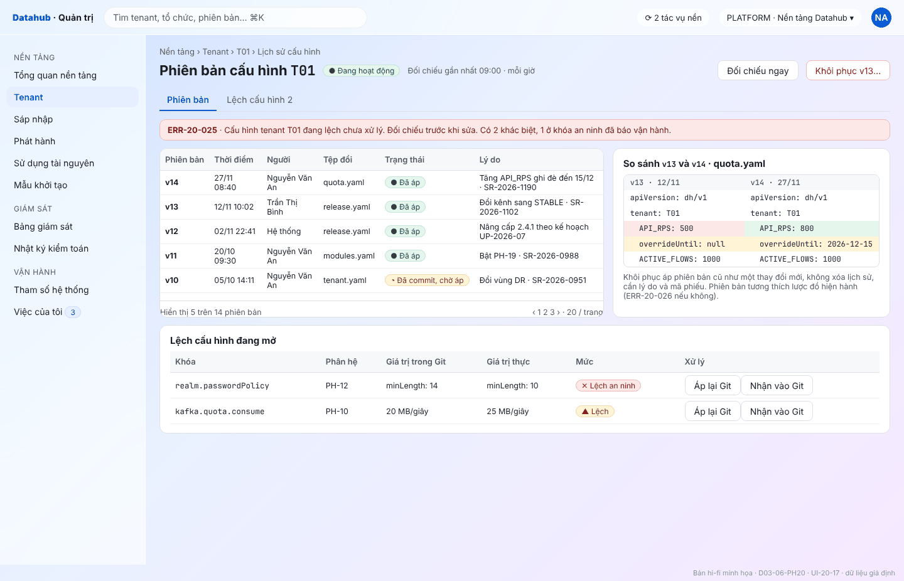

Hình 17. UI-20-17 Phiên bản cấu hình T01 với dải lệch ERR-20-025

Ảnh cho thấy đầu trang "Đối chiếu gần nhất 09:00 · mỗi giờ" với nút "Đối chiếu ngay", "Khôi phục v13…", hai tab (Phiên bản, Lệch cấu hình 2), dải vàng ERR-20-025 và bảng phiên bản v14 trở xuống gồm thời điểm, người, tệp đổi, trạng thái và lý do.

### 20.2. Bố cục vùng

| # | Vùng | `CMP-*` | Nội dung |
|---|---|---|---|
| 1 | Đầu trang | `CMP-PageHeader`, `CMP-StatusTag` | Mã tenant, trạng thái; thời điểm đối chiếu; hai nút |
| 2 | Dải cảnh báo | `CMP-Banner` | ERR-20-025 khi còn lệch; ERR-20-109 khi Argo CD lỗi |
| 3 | Tab | `CMP-Tabs` | Phiên bản, Lệch cấu hình (số đếm) |
| 4 | Tab Phiên bản | `CMP-VersionTimeline` hoặc `CMP-DataTable` | Phiên bản, thời điểm, người, tệp đổi, trạng thái ghi Git (`COMMITTED`, `APPLIED`), lý do |
| 5 | So sánh | `CMP-DiffViewer` | Chọn hai phiên bản; so theo khóa YAML (đề nghị bổ sung ở Phụ lục A) |
| 6 | Tab Lệch | `CMP-DataTable` | Khóa, giá trị trong Git, giá trị đang chạy, mức (`SECURITY` đánh dấu), nút xử lý |

: UI-20-17 Phiên bản và lệch cấu hình, bố cục vùng

### 20.3. Trường và cột

| Trường | Kiểu | Nguồn API | Ghi chú |
|---|---|---|---|
| `versionNo` | số | API-20-041 | Tăng dần theo tenant |
| `changedFiles[]` | text[] | API-20-041 | Ví dụ `quota.yaml` |
| `gitState` | enum | API-20-041 | `COMMITTED`, `APPLIED`, `FAILED` |
| `reason`, `ticketRef` | text, T-CODE | API-20-041 | Lý do và phiếu lúc đổi |
| `drifts[].key`, `gitValue`, `liveValue` | text | API-20-044 | Giá trị nhạy cảm hiện `<đã che>` |
| `drifts[].severity` | enum | API-20-044 | `NORMAL`, `SECURITY` |
| `resolution` | enum | API-20-046 | `REAPPLY` (áp lại từ Git), `ADOPT` (nhận vào Git) |

: UI-20-17 Phiên bản và lệch cấu hình, trường và cột

### 20.4. Hành động

| Hành động | Điều kiện | API | Kết quả |
|---|---|---|---|
| Đối chiếu ngay | `PERM-20-admin` | API-20-045 | Tác vụ nền, cập nhật tab Lệch |
| So sánh hai phiên bản | `PERM-20-read` | API-20-042 | Mở khung so sánh |
| Khôi phục phiên bản | `PERM-20-admin` | API-20-043 | `CMP-ReasonDialog` `tenant-action` (A-01); phiên bản mới ghi Git; ERR-20-026 nếu không được |
| Xử lý lệch (áp lại, nhận vào Git) | `PERM-20-admin` | API-20-046 | Lệch an ninh cần lý do; ERR-20-024 nếu ghi Git lỗi |

: UI-20-17 Phiên bản và lệch cấu hình, hành động

### 20.5. Trạng thái và thông báo

| Trạng thái | Hiển thị |
|---|---|
| Đang tải | Skeleton bảng (`ST-01`) |
| Rỗng | Tab Lệch không có lệch: "Cấu hình đang khớp với Git." |
| Lỗi | `CMP-Alert` "Thử lại"; ERR-20-109 khi Argo CD không áp được |
| Không có quyền | `ST-07` |
| Chỉ đọc | PO, PAU: không có nút khôi phục, xử lý, đối chiếu |

: UI-20-17 Phiên bản và lệch cấu hình, trạng thái màn

| Mã | HTTP | Câu hiển thị (FRS §9.2) | Nơi hiện |
|---|---|---|---|
| ERR-20-024 | 502 | "Không ghi được cấu hình vào kho GitOps. Thử lại sau, nếu lặp lại báo vận hành nền tảng." | `CMP-Alert` trong hộp thoại |
| ERR-20-025 | 409 | "Cấu hình tenant {mã} đang lệch chưa xử lý. Đối chiếu trước khi sửa." | Dải đầu trang |
| ERR-20-026 | 422 | "Không khôi phục được phiên bản cấu hình {n}: {lý do}." | Hộp thoại khôi phục |
| ERR-20-109 | — | "Argo CD không áp được cấu hình {phiên bản}: {lý do}." | Dòng phiên bản `FAILED` |

: UI-20-17 Phiên bản và lệch cấu hình, thông báo theo mã lỗi

### 20.6. Phím tắt, truy cập, thành phần

Phím tắt: `R` đối chiếu ngay, `C` bật so sánh hai dòng đã chọn, `[` và `]` chuyển tab. Khung so sánh dùng ký hiệu (+, −, ~) ngoài màu; giá trị nhạy cảm không bao giờ hiện thành chữ. Thành phần: `CMP-PageHeader`, `CMP-StatusTag`, `CMP-Banner`, `CMP-Tabs`, `CMP-VersionTimeline`, `CMP-DataTable`, `CMP-DiffViewer`, `CMP-ReasonDialog`, `CMP-MaskedValue`, `CMP-Alert`. Token: `color-diff-added`, `color-diff-removed`, `color-diff-changed`, `color-warning`, `font-mono`, `space-4`, `radius-lg`.

## 21. UI-20-18 Phiên bản sản phẩm và kênh

::: dac-ta
**Mã, tên.** UI-20-18 · Phiên bản sản phẩm và kênh phát hành.

**Mục đích.** Cho PA, PO quản lý danh mục phiên bản sản phẩm, đưa lên kênh `PREVIEW`, nâng lên `STABLE` khi đủ thời gian thí điểm, đánh dấu ngoài hỗ trợ, rút phiên bản lỗi; xem tenant đang chạy mỗi phiên bản.

**Đường dẫn, mẫu.** `/nen-tang/phat-hanh` (tham số `kenh`, `q`); PTN-01 Danh sách, chi tiết phiên bản trong ngăn bên.

**Vai trò, quyền.** Xem `PERM-20-read`; ghi `PERM-20-release` (PA, PO).

**FR.** FR-20-059, 060.

**API.** API-20-109, 110, 111, 112 (danh mục, đăng ký, chi tiết, ghi chú), API-20-113, 114 (preview, promote), API-20-115, 116 (deprecate, withdraw), API-20-117 (kênh của tenant).

**Thông báo.** ERR-20-003, 053, 054, 055, 061.
:::

### 21.1. Bản hi-fi

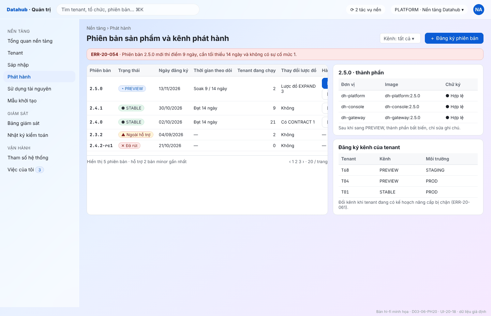

Hình 18. UI-20-18 Phiên bản sản phẩm với 2.5.0 đang thí điểm 9 trên 14 ngày

Ảnh cho thấy bộ lọc kênh, nút "Đăng ký phiên bản", dải ERR-20-054 và bảng: 2.5.0 `PREVIEW` thời gian theo dõi "9 / 14 ngày", 2 tenant, lược đồ `EXPAND`, nút "Nâng lên STABLE" và "Rút"; 2.4.1 `STABLE` và các phiên bản cũ.

### 21.2. Bố cục vùng

| # | Vùng | `CMP-*` | Nội dung |
|---|---|---|---|
| 1 | Đầu trang | `CMP-PageHeader`, `CMP-Select` | Lọc kênh; nút "Đăng ký phiên bản" |
| 2 | Dải lỗi | `CMP-Banner` | Câu ERR-20-054 sau khi bấm nâng lên `STABLE` sớm |
| 3 | Bảng | `CMP-DataTable` | Phiên bản, trạng thái, ngày đăng ký, thời gian theo dõi (`CMP-ProgressBar`), số tenant đang chạy, thay đổi lược đồ, hành động |
| 4 | Ngăn chi tiết | `CMP-Drawer`, `CMP-DescriptionList` | Thành phần, ghi chú phát hành, danh sách tenant đang chạy, nút "Lập kế hoạch nâng cấp" mở UI-20-19 |

: UI-20-18 Phiên bản sản phẩm và kênh, bố cục vùng

### 21.3. Trường và cột

| Trường | Kiểu | Ràng buộc | Nguồn API |
|---|---|---|---|
| `releaseVersion` | SemVer | Duy nhất (ERR-20-003), đúng định dạng (ERR-20-053) | API-20-110 |
| `status` | `ReleaseStatus` | `DRAFT`, `PREVIEW`, `STABLE`, `DEPRECATED`, `WITHDRAWN` | API-20-109 |
| `soakDays` | số | So với `20.release.soak-days` (14) | API-20-109 |
| `runningTenants` | số | | API-20-111 |
| `schemaChange` | enum | `NONE`, `EXPAND`, `CONTRACT` | API-20-111 |
| `releaseNotes` | text dài | Markdown giới hạn | API-20-112 |

: UI-20-18 Phiên bản sản phẩm và kênh, trường và cột

### 21.4. Hành động

| Hành động | Điều kiện | API | Kết quả |
|---|---|---|---|
| Đăng ký phiên bản | `PERM-20-release` | API-20-110 | `DRAFT` |
| Đưa lên PREVIEW | Phiên bản `DRAFT` | API-20-113 | Đổi kênh |
| Nâng lên STABLE | Đủ thí điểm, không sự cố mức 1 | API-20-114 | ERR-20-054 nếu chưa đủ; hộp thoại xác nhận |
| Ngoài hỗ trợ, rút | `PERM-20-release` | API-20-115, 116 | `CMP-ReasonDialog`; ERR-20-055 nếu đang dùng |
| Đổi kênh tenant | `PERM-20-release` | API-20-117 | ERR-20-061 nếu tenant đang nâng cấp |

: UI-20-18 Phiên bản sản phẩm và kênh, hành động

### 21.5. Trạng thái và thông báo

| Trạng thái | Hiển thị |
|---|---|
| Đang tải | Skeleton 6 dòng (`ST-01`) |
| Rỗng | "Chưa có phiên bản nào được đăng ký." kèm nút đăng ký |
| Lỗi | `CMP-Alert` "Thử lại" |
| Không có quyền | `ST-07` |
| Chỉ đọc | PAU: không có nút hành động |

: UI-20-18 Phiên bản sản phẩm và kênh, trạng thái màn

| Mã | HTTP | Câu hiển thị (FRS §9.2) | Nơi hiện |
|---|---|---|---|
| ERR-20-053 | 422 | "Phiên bản sản phẩm {phiên bản} không hợp lệ: {lý do}." | Hộp thoại đăng ký |
| ERR-20-054 | 422 | "Phiên bản {phiên bản} mới thí điểm {số} ngày, cần tối thiểu {ngưỡng} ngày và không có sự cố mức 1." | Dải đầu trang |
| ERR-20-055 | 422 | "Phiên bản {phiên bản} không dùng được cho thao tác này: {lý do}." | Hộp thoại |
| ERR-20-061 | 409 | "Tenant {mã} đang có kế hoạch nâng cấp {kế hoạch}. Đổi kênh sau khi kế hoạch kết thúc." | Hộp thoại đổi kênh |

: UI-20-18 Phiên bản sản phẩm và kênh, thông báo theo mã lỗi

### 21.6. Phím tắt, truy cập, thành phần

Phím tắt: `/` tìm, `N` đăng ký, `Enter` mở ngăn chi tiết, `Esc` đóng. Thanh theo dõi thí điểm có nhãn chữ "9 trên 14 ngày"; trạng thái luôn kèm chữ. Thành phần: `CMP-PageHeader`, `CMP-Select`, `CMP-Banner`, `CMP-DataTable`, `CMP-ProgressBar`, `CMP-StatusTag`, `CMP-Drawer`, `CMP-DescriptionList`, `CMP-ReasonDialog`, `CMP-ConfirmDialog`. Token: `color-info`, `color-success`, `color-warning`, `color-surface-solid`, `font-callout`, `space-3`, `radius-md`.

## 22. UI-20-19 Kế hoạch nâng cấp theo sóng

::: dac-ta
**Mã, tên.** UI-20-19 · Kế hoạch nâng cấp theo sóng.

**Mục đích.** Cho PA lập, lên lịch kế hoạch nâng cấp tenant theo sóng (thí điểm, tenant nhỏ, còn lại), theo dõi theo thời gian thực, dừng sóng, xác nhận xử lý khi vượt ngưỡng lỗi, quay lui, thông báo cho tỉnh.

**Đường dẫn, mẫu.** `/nen-tang/phat-hanh/{phien-ban}/ke-hoach` (tham số `ke-hoach`); PTN-05 Wizard khi lập, PTN-11 Theo dõi tác vụ khi chạy.

**Vai trò, quyền.** Xem `PERM-20-read`; ghi PA `PERM-20-release`; "Dừng sóng" cả PO.

**FR.** FR-20-061, 062, 063.

**API.** API-20-118, 119, 120 (lập, chi tiết, sửa), API-20-121 đến 125 (lên lịch, dừng, tiếp tục, quay lui, hủy), API-20-126, 127 (theo tenant, thử lại), API-20-128 (thông báo).

**Thông báo.** ERR-20-055, 056, 057, 058, 059, 112, 118.
:::

### 22.1. Bản hi-fi

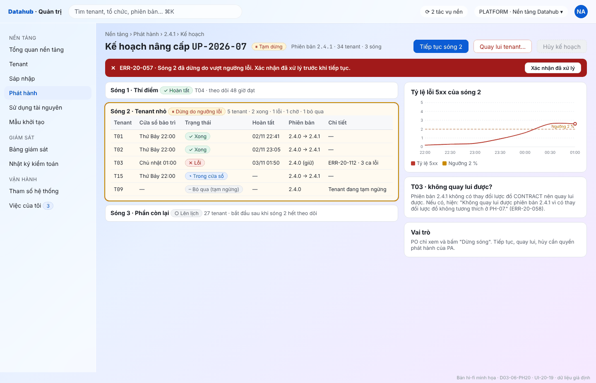

Hình 19. UI-20-19 Kế hoạch nâng cấp UP-2026-07 phiên bản 2.4.1 tạm dừng ở sóng 2

Ảnh cho thấy đầu trang "Tạm dừng", dải ERR-20-057 với nút "Xác nhận đã xử lý", ba cột sóng (Sóng 1 Thí điểm hoàn tất, Sóng 2 Tenant nhỏ dừng do ngưỡng lỗi với 2 xong và 1 lỗi, Sóng 3 chờ) và biểu đồ tỷ lệ lỗi so ngưỡng 2%.

### 22.2. Bố cục vùng

| # | Vùng | `CMP-*` | Nội dung |
|---|---|---|---|
| 1 | Đầu trang | `CMP-PageHeader`, `CMP-StatusTag` | Mã kế hoạch, phiên bản, số tenant, số sóng; nút "Tiếp tục sóng", "Quay lui tenant…", "Hủy kế hoạch" |
| 2 | Dải dừng | `CMP-Banner` | ERR-20-057, nút "Xác nhận đã xử lý" |
| 3 | Dải sóng | `CMP-Steps` ngang | Mỗi sóng một bước kèm trạng thái và số tenant |
| 4 | Bảng tenant | `CMP-DataTable` | Tenant, sóng, trạng thái nâng cấp, kết quả kiểm tra sau nâng cấp (ERR-20-112), thời gian; nút "Thử lại" |
| 5 | Biểu đồ lỗi | `CMP-Chart` đường | Tỷ lệ lỗi theo thời gian, đường ngưỡng 2% nét đứt |
| 6 | Lập kế hoạch | `CMP-Wizard` | Chọn phiên bản, chia sóng, cửa sổ bảo trì, thông báo |

: UI-20-19 Kế hoạch nâng cấp theo sóng, bố cục vùng

### 22.3. Trường và cột

| Trường | Kiểu | Ràng buộc | Nguồn API |
|---|---|---|---|
| `releaseVersion` | SemVer | `STABLE` hoặc `PREVIEW` cho tenant chọn kênh (ERR-20-055) | API-20-118 |
| `waves[]` | `{name, tenants[], startAt}` | Sóng 1 gồm tenant thí điểm | API-20-118, 120 |
| `maintenanceWindow` | khung giờ | Trong cửa sổ cho phép (ERR-20-059) | API-20-118 |
| `errorThresholdPercent` | số | Mặc định `20.release.wave-error-threshold-percent` (2) | API-20-119 |
| `tenantUpgrade.status` | enum | `PENDING`, `RUNNING`, `DONE`, `FAILED`, `ROLLED_BACK` | API-20-126 |
| `postCheck` | `{passed, failed}` | Ca lỗi: ERR-20-112 | API-20-126 |

: UI-20-19 Kế hoạch nâng cấp theo sóng, trường và cột

### 22.4. Hành động

| Hành động | Điều kiện | API | Kết quả |
|---|---|---|---|
| Lập, sửa kế hoạch | PA, `DRAFT` | API-20-118, 120 | ERR-20-056 nếu không hợp lệ |
| Lên lịch | PA, `DRAFT` | API-20-121 | Gửi thông báo cho tỉnh (API-20-128) |
| Dừng sóng | PA, PO; đang chạy | API-20-122 | Sóng hiện tại dừng |
| Tiếp tục sóng | PA; sau xác nhận xử lý | API-20-123 | ERR-20-057 nếu chưa xác nhận |
| Quay lui tenant | PA | API-20-124 | Hộp thoại lý do; ERR-20-058 nếu lược đồ không tương thích |
| Hủy, thử lại | PA | API-20-125, 127 | Hủy chỉ khi chưa chạy |

: UI-20-19 Kế hoạch nâng cấp theo sóng, hành động

### 22.5. Trạng thái và thông báo

| Trạng thái | Hiển thị |
|---|---|
| Đang tải | Skeleton ba cột sóng (`ST-01`); sau đó SSE cập nhật (mục 3.6) |
| Rỗng | Chưa có kế hoạch cho phiên bản: nút "Lập kế hoạch" |
| Lỗi | `CMP-Alert` "Thử lại"; mất SSE: "Đang kết nối lại" và hạ về tải lại 15 giây |
| Không có quyền | `ST-07` |
| Chỉ đọc | PAU: không có nút; kế hoạch `COMPLETED`, `CANCELLED` chỉ xem |

: UI-20-19 Kế hoạch nâng cấp theo sóng, trạng thái màn

| Mã | HTTP | Câu hiển thị (FRS §9.2) | Nơi hiện |
|---|---|---|---|
| ERR-20-055 | 422 | "Phiên bản {phiên bản} không dùng được cho thao tác này: {lý do}." | Bước chọn phiên bản |
| ERR-20-056 | 422 | "Kế hoạch nâng cấp không hợp lệ: {lý do}." | Dải đầu wizard |
| ERR-20-057 | 409 | "Sóng {sóng} đã dừng do vượt ngưỡng lỗi. Xác nhận đã xử lý trước khi tiếp tục." | Dải đầu trang |
| ERR-20-058 | 422 | "Không quay lui được phiên bản {phiên bản} vì có thay đổi lược đồ không tương thích ở {phân hệ}." | Hộp thoại quay lui |
| ERR-20-059 | 422 | "Cửa sổ bảo trì không hợp lệ: {lý do}." | Dưới ô cửa sổ |
| ERR-20-112 | — | "Kiểm tra sau nâng cấp của {tenant} không đạt: {số} ca lỗi." | Dòng tenant |
| ERR-20-118 | 503 | "Tỉnh đang bảo trì nâng cấp đến {giờ}. Thao tác ghi tạm dừng." | Dòng tenant đang nâng cấp |

: UI-20-19 Kế hoạch nâng cấp theo sóng, thông báo theo mã lỗi

### 22.6. Phím tắt, truy cập, thành phần

Phím tắt: `P` dừng sóng (có xác nhận), `[` và `]` chuyển sóng. Thay đổi trạng thái sóng báo qua `role="status"`; biểu đồ có bảng dữ liệu thay thế. Thành phần: `CMP-PageHeader`, `CMP-StatusTag`, `CMP-Banner`, `CMP-Steps`, `CMP-DataTable`, `CMP-Chart`, `CMP-Wizard`, `CMP-ReasonDialog`, `CMP-ConfirmDialog`, `CMP-Alert`. Token: `color-warning`, `color-error`, `color-success`, `color-surface-solid`, `font-callout`, `space-4`, `radius-lg`.

## 23. UI-20-20 Bảng điều khiển đa tenant

::: dac-ta
**Mã, tên.** UI-20-20 · Bảng điều khiển đa tenant.

**Mục đích.** Cho PA, PO, PAU thấy sức khỏe toàn nền tảng: số tenant, sức chứa, thời gian khởi tạo p95, KPI-12, cảnh báo hạn mức, lệch cấu hình, nâng cấp đang chạy, danh sách việc cần xử lý, bản đồ nhiệt sử dụng theo tenant; PA chạy kiểm thử rò rỉ trên T90…T99.

**Đường dẫn, mẫu.** `/nen-tang/tong-quan` (tham số `moi-truong` = `PROD` hoặc `STAGING`); PTN-06 Bảng điều khiển.

**Vai trò, quyền.** PA, PO, PAU (`PERM-20-read`); "Chạy kiểm thử rò rỉ" PA (`PERM-20-admin`).

**FR.** FR-20-014, 016, 067, 070.

**API.** API-20-129 (bảng điều khiển), API-20-132, 133, 134 (kiểm thử rò rỉ).

**Thông báo.** ERR-20-062, 065, 111.
:::

### 23.1. Bản hi-fi

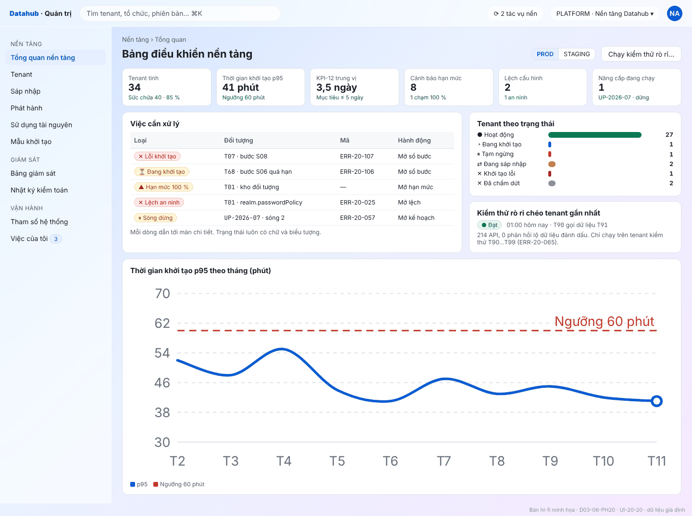

Hình 20. UI-20-20 Bảng điều khiển nền tảng, môi trường PROD

Ảnh cho thấy sáu thẻ KPI (Tenant tỉnh 34 trên sức chứa 40, p95 khởi tạo 41 phút, KPI-12 trung vị 3,5 ngày, cảnh báo hạn mức 8, lệch cấu hình 2, nâng cấp đang chạy 1) và bảng "Việc cần xử lý" gồm lỗi khởi tạo T07 bước S08 với liên kết "Mở sổ bước".

### 23.2. Bố cục vùng

| # | Vùng | `CMP-*` | Nội dung |
|---|---|---|---|
| 1 | Đầu trang | `CMP-PageHeader`, `CMP-Segmented` | Tên, chọn PROD hoặc STAGING; nút "Chạy kiểm thử rò rỉ…" |
| 2 | Hàng KPI | `CMP-KpiCard` | Sáu thẻ, mỗi thẻ có giá trị, ngưỡng, ghi chú phụ |
| 3 | Việc cần xử lý | `CMP-DataTable` | Loại, đối tượng, mã lỗi, hành động; sắp theo mức |
| 4 | Bản đồ nhiệt | `CMP-Chart` heatmap | Tenant theo 12 tài nguyên, chữ phần trăm trong ô (A-03, Q20-38) |
| 5 | Kiểm thử rò rỉ | `CMP-DataTable` | Lần chạy gần nhất, kết quả từng ca |

: UI-20-20 Bảng điều khiển đa tenant, bố cục vùng

### 23.3. Trường và cột

| Trường | Kiểu | Nguồn API | Ghi chú |
|---|---|---|---|
| `tenantCount`, `capacity` | số | API-20-129 | Cảnh báo từ 80% |
| `provisionP95Minutes` | số | API-20-129 | Ngưỡng 60 phút |
| `kpi12MedianDays` | số | API-20-129 | Mục tiêu 5 ngày |
| `quotaAlerts`, `drifts`, `runningUpgrades` | số | API-20-129 | Mở trang tương ứng |
| `actionItems[]` | `{type, tenant, errCode, link}` | API-20-129 | Không quá 50 dòng |
| `heatmap[]` | `{tenant, resource, percent}` | API-20-129 | Kèm bảng dữ liệu thay thế |
| `leakTest` | `{runId, passed, failed}` | API-20-133, 134 | Ca lỗi: ERR-20-111 |

: UI-20-20 Bảng điều khiển đa tenant, trường dữ liệu

### 23.4. Hành động

| Hành động | Điều kiện | API | Kết quả |
|---|---|---|---|
| Đổi môi trường | Mọi vai trò | API-20-129 | Tải lại |
| Mở việc cần xử lý | `PERM-20-read` | — | Đến UI-20-03, 04, 17, 19, 10 theo loại |
| Chạy kiểm thử rò rỉ | `PERM-20-admin`, tenant T90…T99 | API-20-132 | Tác vụ nền; ERR-20-065 nếu chọn sai tenant |
| Xem kết quả kiểm thử | `PERM-20-read` | API-20-134 | Ngăn bên từng ca |

: UI-20-20 Bảng điều khiển đa tenant, hành động

### 23.5. Trạng thái và thông báo

| Trạng thái | Hiển thị |
|---|---|
| Đang tải | Skeleton sáu thẻ và bảng (`ST-01`) |
| Rỗng | Không có việc cần xử lý: "Không có việc cần xử lý." |
| Lỗi | Từng khối lỗi riêng kèm "Thử lại"; ERR-20-062 |
| Không có quyền | `ST-07` |
| Chỉ đọc | PO, PAU: không có nút kiểm thử rò rỉ |

: UI-20-20 Bảng điều khiển đa tenant, trạng thái màn

| Mã | HTTP | Câu hiển thị (FRS §9.2) | Nơi hiện |
|---|---|---|---|
| ERR-20-062 | 503 | "Dịch vụ {tên} tạm thời không khả dụng. Thử lại sau." | Khối bị ảnh hưởng |
| ERR-20-065 | 422 | "Kiểm thử rò rỉ chỉ chạy trên tenant kiểm thử T90…T99." | Hộp thoại chọn tenant |
| ERR-20-111 | — | "Phát hiện rò rỉ chéo tenant ở {API}." | Dòng kết quả kiểm thử, dải đỏ |

: UI-20-20 Bảng điều khiển đa tenant, thông báo theo mã lỗi

### 23.6. Phím tắt, truy cập, thành phần

Phím tắt: `1` đến `6` nhảy tới thẻ KPI, `H` nhảy tới bản đồ nhiệt, `R` làm mới. Mỗi thẻ KPI có nhãn đầy đủ gồm giá trị và ngưỡng; bản đồ nhiệt luôn có bảng dữ liệu thay thế và chữ phần trăm trong ô. Thành phần: `CMP-PageHeader`, `CMP-Segmented`, `CMP-KpiCard`, `CMP-DataTable`, `CMP-Chart`, `CMP-Drawer`, `CMP-Alert`. Token: `color-surface-solid`, `color-warning`, `color-error`, `color-success`, `font-title-1`, `space-4`, `radius-lg`.

## 24. UI-20-21 Mẫu khởi tạo

::: dac-ta
**Mã, tên.** UI-20-21 · Mẫu khởi tạo.

**Mục đích.** Cho PA quản lý mẫu khởi tạo có phiên bản (danh sách mẫu, mở phiên bản mới, sửa bản nháp, so sánh, phát hành, ngừng); mẫu đã phát hành không sửa.

**Đường dẫn, mẫu.** `/nen-tang/mau-khoi-tao` (tham số `mau`, `phien-ban`); PTN-01 Danh sách và PTN-03 Biểu mẫu.

**Vai trò, quyền.** Xem `PERM-20-read`; ghi `PERM-20-admin` (PA).

**FR.** FR-20-015, 017.

**API.** API-20-025, 026, 027 (danh sách, tạo, chi tiết), API-20-028, 029, 030 (phiên bản mới, nội dung, sửa nháp), API-20-031, 032 (phát hành, ngừng).

**Thông báo.** ERR-20-003, 005, 015, 063.
:::

### 24.1. Bản hi-fi

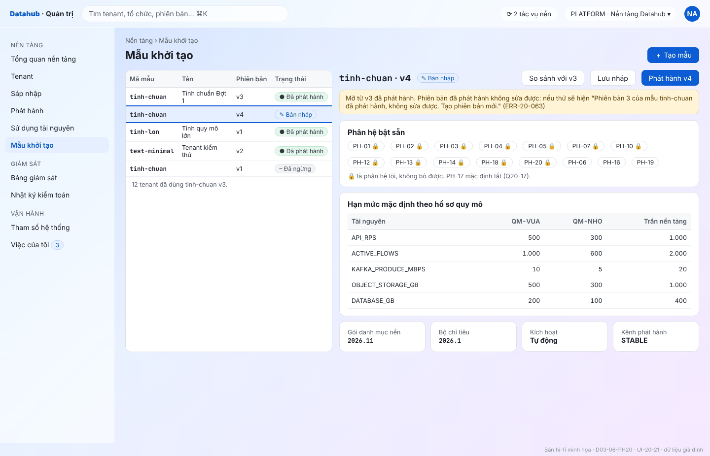

Hình 21. UI-20-21 Mẫu khởi tạo tinh-chuan phiên bản 4 đang bản nháp

Ảnh cho thấy cột trái danh sách mẫu (mã, tên, phiên bản, trạng thái), bên phải chi tiết `tinh-chuan` v4 "Bản nháp" với nút "So sánh với v3", "Lưu nháp", "Phát hành v4", dòng nhắc "Mở từ v3 đã phát hành" và dòng "12 tenant đã dùng tinh-chuan v3".

### 24.2. Bố cục vùng

| # | Vùng | `CMP-*` | Nội dung |
|---|---|---|---|
| 1 | Đầu trang | `CMP-PageHeader` | Tên, nút "Tạo mẫu" |
| 2 | Danh sách mẫu | `CMP-DataTable` | Mã mẫu, tên, phiên bản, trạng thái (`DRAFT`, `PUBLISHED`, `RETIRED`) |
| 3 | Chi tiết phiên bản | `CMP-Tabs`, `CMP-EditableTable` | Phân hệ bật, hạn mức mặc định, cờ tính năng, hồ sơ cách ly |
| 4 | So sánh | `CMP-DiffViewer` | v4 với v3 |
| 5 | Dải thông tin | `CMP-Alert` | "Phiên bản đã phát hành không sửa được", số tenant đã dùng |

: UI-20-21 Mẫu khởi tạo, bố cục vùng

### 24.3. Trường và cột

| Trường | Kiểu | Ràng buộc | Nguồn API |
|---|---|---|---|
| `templateCode` | T-CODE | Duy nhất (ERR-20-003) | API-20-026 |
| `version` | số | Tăng dần | API-20-028 |
| `status` | enum | `DRAFT`, `PUBLISHED`, `RETIRED` | API-20-027 |
| `modules[]`, `quotas[]`, `featureFlags[]` | danh sách | Phụ thuộc phân hệ hợp lệ | API-20-029, 030 |
| `isolationMode` | enum | `SHARED`, `DEDICATED_DB`, `DEDICATED_CLUSTER` | API-20-030 |
| `usedByTenants` | số | | API-20-027 |

: UI-20-21 Mẫu khởi tạo, trường và cột

### 24.4. Hành động

| Hành động | Điều kiện | API | Kết quả |
|---|---|---|---|
| Tạo mẫu | PA | API-20-026 | Phiên bản 1 `DRAFT` |
| Mở phiên bản mới | PA, từ bản đã phát hành | API-20-028 | Bản nháp sao chép |
| Lưu nháp | PA, `DRAFT` | API-20-030 | ERR-20-005 nếu có người sửa trước; ERR-20-063 nếu đã phát hành |
| Phát hành | PA, `DRAFT` | API-20-031 | `CMP-ConfirmDialog`; ERR-20-015 nếu không dùng được |
| Ngừng phiên bản | PA | API-20-032 | Không còn chọn được khi khai báo tenant |

: UI-20-21 Mẫu khởi tạo, hành động

### 24.5. Trạng thái và thông báo

| Trạng thái | Hiển thị |
|---|---|
| Đang tải | Skeleton hai cột (`ST-01`) |
| Rỗng | `CMP-EmptyState` "Chưa có mẫu khởi tạo nào." kèm nút "Tạo mẫu" |
| Lỗi | `CMP-Alert` "Thử lại" |
| Không có quyền | `ST-07` |
| Chỉ đọc | Phiên bản `PUBLISHED`, `RETIRED` hoặc vai trò PO, PAU: trường khóa |

: UI-20-21 Mẫu khởi tạo, trạng thái màn

| Mã | HTTP | Câu hiển thị (FRS §9.2) | Nơi hiện |
|---|---|---|---|
| ERR-20-003 | 409 | "{Đối tượng} {mã} đã tồn tại. Chọn mã khác." | Dưới ô mã mẫu |
| ERR-20-005 | 412 | "{Đối tượng} đã được người khác sửa. Tải lại để xem thay đổi." | `CMP-ConflictDialog` |
| ERR-20-015 | 422 | "Mẫu khởi tạo {mã} phiên bản {n} không dùng được: {lý do}." | Hộp thoại phát hành |
| ERR-20-063 | 409 | "Phiên bản {n} của mẫu {mã} đã phát hành, không sửa được. Tạo phiên bản mới." | `CMP-Alert` |

: UI-20-21 Mẫu khởi tạo, thông báo theo mã lỗi

### 24.6. Phím tắt, truy cập, thành phần

Phím tắt: `Ctrl+S` lưu nháp, `D` bật so sánh, `Esc` đóng so sánh. Trạng thái mẫu luôn có chữ; khung so sánh có ký hiệu ngoài màu. Thành phần: `CMP-PageHeader`, `CMP-DataTable`, `CMP-Tabs`, `CMP-EditableTable`, `CMP-DiffViewer`, `CMP-ConfirmDialog`, `CMP-ConflictDialog`, `CMP-EmptyState`, `CMP-Alert`. Token: `color-diff-added`, `color-diff-removed`, `color-surface-solid`, `font-mono-sm`, `space-4`, `radius-lg`.

## 25. UI-20-22 Truy cập liên tenant vào tỉnh

::: dac-ta
**Mã, tên.** UI-20-22 · Truy cập liên tenant vào tỉnh.

**Mục đích.** Cho TA đặt chính sách tiếp nhận truy cập của quản trị nền tảng vào tỉnh (đọc, ghi, cần tỉnh chấp thuận trước, thời hạn tối đa mỗi phiên) và xem nhật ký ai của nền tảng đã vào tỉnh; SO, AU chỉ đọc.

**Đường dẫn, mẫu.** `/quan-tri/cai-dat-tinh/lien-tenant` (tab `chinh-sach`, `nhat-ky`); PTN-12 Cài đặt, PTN-11 Nhật ký.

**Vai trò, quyền.** TA ghi `PERM-20-settings`; SO, AU đọc.

**FR.** FR-20-023, 024.

**API.** API-20-137, 138 (chính sách), API-20-139 (nhật ký).

**Thông báo.** ERR-20-004, 005, 027, 032.
:::

### 25.1. Bản hi-fi

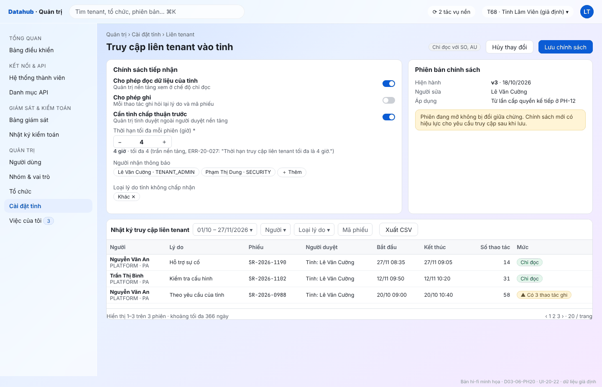

Hình 22. UI-20-22 Chính sách tiếp nhận truy cập liên tenant của T68

Ảnh cho thấy nhãn "Chỉ đọc với SO, AU", ba công tắc (Cho phép đọc, Cho phép ghi, Cần tỉnh chấp thuận trước) kèm mô tả ngắn, trường thời hạn tối đa mỗi phiên dạng ô số có nút tăng giảm và nhật ký truy cập bên dưới.

### 25.2. Bố cục vùng

| # | Vùng | `CMP-*` | Nội dung |
|---|---|---|---|
| 1 | Đầu trang | `CMP-PageHeader` | Tên, nhãn chỉ đọc, nút "Hủy thay đổi", "Lưu chính sách" |
| 2 | Chính sách | `CMP-Form`, `CMP-Switch`, `CMP-NumberInput` | Ba công tắc, thời hạn tối đa (giờ) |
| 3 | Nhật ký | `CMP-DataTable`, `CMP-FilterBar` | Thời điểm, người (tên, tenant gốc), thao tác, lý do, mã phiếu, kết quả |
| 4 | Lọc nhật ký | `CMP-DateRangePicker` | Khoảng ngày tối đa theo ERR-20-032 |

: UI-20-22 Truy cập liên tenant vào tỉnh, bố cục vùng

### 25.3. Trường và cột

| Trường | Kiểu | Ràng buộc | Nguồn API |
|---|---|---|---|
| `allowRead`, `allowWrite` | bool | Không vượt trần nền tảng | API-20-137, 138 |
| `requireTenantApproval` | bool | | API-20-138 |
| `maxSessionHours` | số | Không quá `20.crosstenant.max-hours` (ERR-20-027) | API-20-138 |
| Nhật ký: `at`, `actor`, `action`, `reason`, `ticketRef`, `result` | thời điểm, text | Chỉ đọc, không sửa, không xóa | API-20-139 |

: UI-20-22 Truy cập liên tenant vào tỉnh, trường và cột

### 25.4. Hành động

| Hành động | Điều kiện | API | Kết quả |
|---|---|---|---|
| Lưu chính sách | TA, có thay đổi | API-20-138 | Hiệu lực cho phiên mới; ERR-20-027, 005 |
| Lọc nhật ký | SO, AU, TA | API-20-139 | ERR-20-032 nếu khoảng quá dài |
| Xuất nhật ký | SO, AU, TA | API-20-139 | Tải tệp CSV |

: UI-20-22 Truy cập liên tenant vào tỉnh, hành động

### 25.5. Trạng thái và thông báo

| Trạng thái | Hiển thị |
|---|---|
| Đang tải | Skeleton biểu mẫu và bảng (`ST-01`) |
| Rỗng | Nhật ký: "Chưa có truy cập nào của quản trị nền tảng trong khoảng này." |
| Lỗi | `CMP-Alert` "Thử lại" |
| Không có quyền | `ST-07` |
| Chỉ đọc | SO, AU: công tắc khóa, nhãn "Chỉ đọc với SO, AU" |

: UI-20-22 Truy cập liên tenant vào tỉnh, trạng thái màn

| Mã | HTTP | Câu hiển thị (FRS §9.2) | Nơi hiện |
|---|---|---|---|
| ERR-20-004 | 400 | "{Trường} chưa hợp lệ: {yêu cầu}." | Dưới trường |
| ERR-20-005 | 412 | "{Đối tượng} đã được người khác sửa. Tải lại để xem thay đổi." | `CMP-ConflictDialog` |
| ERR-20-027 | 422 | "Thời hạn truy cập liên tenant tối đa là {giờ} giờ." | Dưới ô thời hạn |
| ERR-20-032 | 400 | "Khoảng thời gian tối đa là {số} ngày." | Dưới ô khoảng ngày |

: UI-20-22 Truy cập liên tenant vào tỉnh, thông báo theo mã lỗi

### 25.6. Phím tắt, truy cập, thành phần

Phím tắt: `Ctrl+S` lưu, `Space` bật tắt công tắc khi focus, `[` và `]` chuyển tab. Công tắc có nhãn và mô tả `aria-describedby`; trạng thái bật tắt nêu bằng chữ "Bật", "Tắt". Ô số thay cho thanh trượt vì thanh trượt chưa có trong D03-05. Thành phần: `CMP-PageHeader`, `CMP-Form`, `CMP-Switch`, `CMP-NumberInput`, `CMP-DataTable`, `CMP-FilterBar`, `CMP-DateRangePicker`, `CMP-ConflictDialog`. Token: `color-surface-solid`, `color-info`, `size-form-max`, `font-body`, `space-4`, `radius-lg`.

## 26. Ma trận UI, FR, API

| UI | FR | API chính |
|---|---|---|
| UI-20-01 đến 07 | FR-20-001…005, 007…013, 016, 017, 019, 020, 025…036, 043, 060, 068 | API-20-001…040, 047…070 |
| UI-20-08 | FR-20-038…042 | API-20-071…085 |
| UI-20-09 | FR-20-045…047 | API-20-086, 089, 090, 093…097 |
| UI-20-10 | FR-20-047…052 | API-20-088, 098…108, 130 |
| UI-20-11 | FR-20-045 | API-20-087, 093 |
| UI-20-12 | FR-20-018, 061, 063, 064 | API-20-135, 136, 159, 160 |
| UI-20-13 | FR-20-028…030 | API-20-140, 141 |
| UI-20-14 | FR-20-053…056, 058 | API-20-143, 147…152, 156…158 |
| UI-20-15 | FR-20-053, 054, 058 | API-20-144…146, 151, 152 |
| UI-20-16 | FR-20-055 | API-20-153…156 |
| UI-20-17 | FR-20-020…022 | API-20-041…046 |
| UI-20-18 | FR-20-059, 060 | API-20-109…117 |
| UI-20-19 | FR-20-061…063 | API-20-118…128 |
| UI-20-20 | FR-20-014, 016, 067, 070 | API-20-129, 132…134 |
| UI-20-21 | FR-20-015, 017 | API-20-025…032 |
| UI-20-22 | FR-20-023, 024 | API-20-137…139 |

: Ma trận UI, FR, API (các mã chi tiết của UI-20-01 đến 07 nằm trong từng chương)

Các FR không có màn riêng: FR-20-037, 044, 057, 065, 066, 068, 069 (API nội bộ, thông báo, kiểm toán và tham số xem qua màn dùng chung của nền tảng). FR-20-068 (kiểm toán tỉnh, API-20-161) chưa có màn, nêu ở Q20-35.

## 27. Ma trận vai trò theo màn

| Màn | PA | PO | PAU | TA | SO | AU |
|---|---|---|---|---|---|---|
| UI-20-01 đến 07 | Ghi | Xem | Xem | — | — | — |
| UI-20-08 | Ghi, duyệt | Xem | Xem | — | — | — |
| UI-20-09 | Ghi | — | — | — | — | — |
| UI-20-10 | Ghi | Xem | Xem | Xem phần tỉnh mình (Q20-30) | — | — |
| UI-20-11 | Ghi | Xem | Xem | — | — | — |
| UI-20-12 | — | — | — | Ghi | Xem | Xem |
| UI-20-13 | — | — | — | Xem | Xem | Xem |
| UI-20-14, 15, 16 | — | — | — | Ghi | Xem | Xem |
| UI-20-17 | Ghi | Xem | Xem | — | — | — |
| UI-20-18 | Ghi | Ghi | Xem | — | — | — |
| UI-20-19 | Ghi | Dừng sóng | Xem | — | — | — |
| UI-20-20 | Ghi (kiểm thử rò rỉ) | Xem | Xem | — | — | — |
| UI-20-21 | Ghi | Xem | Xem | — | — | — |
| UI-20-22 | — | — | — | Ghi | Xem | Xem |

: Quyền hiển thị theo vai trò, "—" nghĩa là không thấy mục menu và màn trả `ST-07`

## 28. Kiểm thử giao diện và danh sách ảnh

Mỗi màn kiểm các điểm sau, bằng tay trước và bằng Playwright khi có bản dựng: (1) menu và breadcrumb đúng vai trò; (2) bốn trạng thái tải, rỗng, lỗi, không quyền; (3) mọi ERR của màn hiện đúng câu FRS, cùng nơi hiện; (4) thao tác ghi trên tenant tỉnh luôn hỏi lý do và phiếu; (5) người lập không duyệt được việc của mình; (6) điều hướng hoàn toàn bằng bàn phím, focus thấy rõ; (7) tương phản và thu phóng 200% không mất nội dung; (8) cả hai chế độ sáng, tối.

| Ảnh | Màn | Dữ liệu mẫu |
|---|---|---|
| `ui-20-01.png` … `ui-20-07.png` | UI-20-01 đến 07 | T68, T01, T90 |
| `ui-20-08.png` | UI-20-08 | T09 tạm ngừng, gói EXP-0007 |
| `ui-20-09.png`, `ui-20-10.png`, `ui-20-11.png` | UI-20-09 đến 11 | MG-2026-001, T12 sang T13 |
| `ui-20-12.png`, `ui-20-13.png` | UI-20-12, 13 | T68 |
| `ui-20-14.png`, `ui-20-15.png`, `ui-20-16.png` | UI-20-14 đến 16 | T68, SO-TTTT |
| `ui-20-17.png` | UI-20-17 | T01 |
| `ui-20-18.png`, `ui-20-19.png` | UI-20-18, 19 | 2.5.0, UP-2026-07 |
| `ui-20-20.png`, `ui-20-21.png`, `ui-20-22.png` | UI-20-20 đến 22 | PROD, tinh-chuan, T68 |

: Danh sách 22 ảnh hi-fi trong `ph20/hifi/`, sinh bằng `gen_hifi.py` rồi `shot.js`

## 29. Câu hỏi mở

| Mã | Câu hỏi | Đề xuất của nhóm thiết kế |
|---|---|---|
| Q20-30 | TA hai tỉnh xem UI-20-10 dưới `/nen-tang/*` nhưng API nền tảng chỉ phục vụ tenant PLATFORM | Thêm API phía tenant chỉ đọc phần chuyển tiếp của tỉnh mình, hoặc bỏ quyền xem của TA |
| Q20-31 | Định dạng mã phiếu | Cho nhập tự do, kiểm độ dài 3 đến 64 ký tự, nối hệ thống phiếu về sau |
| Q20-32 | Chỉ còn một PA duyệt được | Khóa "Gửi duyệt" và cảnh báo (mục 3.5), hay cho tự duyệt có ghi nhận? Đề xuất khóa |
| Q20-33 | Cấm dán khi gõ lại mã xác nhận | Giữ cấm dán cho thao tác phá hủy |
| Q20-34 | Không có hộp thư duyệt tập trung | Thêm màn "Việc của tôi" cho PA, dùng API-20-073 và hộp duyệt sáp nhập |
| Q20-35 | API-20-161 (kiểm toán tỉnh) chưa có màn | Thêm tab "Nhật ký PH-20" vào UI-20-12 |
| Q20-36 | Lưu nháp wizard khai báo tenant | Lưu phía máy chủ theo `idempotency key`, hết hạn 7 ngày |
| Q20-37 | Ánh xạ người dùng khi sáp nhập hàng nghìn dòng | Cho gộp theo nhóm và theo tổ chức |
| Q20-38 | Bản đồ nhiệt 34 tenant nhân 12 tài nguyên | Hiển thị 12 cột, cuộn ngang trên màn hẹp, hoặc chuyển thành danh sách |
| Q20-39 | Cửa sổ bảo trì ghi bởi cả API-20-136 và API-20-160 | Đã đóng ở 0.2: giữ cả hai với phân vai rõ, API-20-160 là nơi TA đặt riêng cửa sổ ưa thích và là API mà tab Phiên bản gọi, API-20-136 lưu trọn bộ cài đặt cùng giá trị; lịch của kế hoạch nâng cấp do PA đặt ở API-20-121 |

: Câu hỏi mở của PH-20, Q20-30 đến Q20-39

## Phụ lục A. Đề nghị bổ sung cho D03-05 và D03-06-00

| # | Đối tượng | Đề nghị |
|---|---|---|
| A-01 | `CMP-ReasonDialog` | Thêm biến thể `tenant-action`: trường mã phiếu, tối thiểu 20 ký tự cho lý do, bộ đếm còn thiếu |
| A-02 | `CMP-Steps` | Thêm biến thể `ledger` cho sổ bước S01 đến S17 có nhóm chạy song song |
| A-03 | `CMP-Chart` | Thêm heatmap có chữ trong ô |
| A-04 | `CMP-DiffViewer` | Thêm chế độ so theo khóa YAML |
| A-05 | Bộ chọn khung giờ (TimePicker) | Thành phần mới, chưa có trong D03-05, dùng cho cửa sổ bảo trì |
| A-06 | D03-06-00 | Thêm mục menu 47 đến 52 của nhóm Nền tảng (Sáp nhập, Phát hành, Sử dụng tài nguyên, Mẫu khởi tạo, Tổ chức, Cài đặt tỉnh) |
| A-07 | Thanh trượt (Slider) | Thêm thanh trượt (Slider) nếu cần chọn giá trị theo thanh (hiện thay bằng `CMP-NumberInput`) |

: Đề nghị đồng bộ cho D03-05 và D03-06-00

## Phụ lục B. Sai khác so với FRS

| # | Nội dung | Xử lý trong tài liệu này |
|---|---|---|
| B-1 | FRS §10.1 gán FR-045 cho UI-20-08 | Đã đồng bộ ở 0.2: UI-20-08 gồm FR-038…042 ở cả FRS và tập này; FR-043 (lịch sử vòng đời) ở UI-20-03 |
| B-2 | TA xem UI-20-10 dưới `/nen-tang/*` nhưng API nền tảng chỉ phục vụ PLATFORM | Nêu ở Q20-30, màn chỉ cho PA, PO, PAU cho đến khi có quyết định |
| B-3 | API-20-161 không có màn | Q20-35 |
| B-4 | Không có giao diện hộp duyệt tập trung | Q20-34 |
| B-5 | Không có mã lỗi cho dải MERGING | Đề nghị câu ở mục 3.2 |
| B-6 | Cửa sổ bảo trì ghi ở hai API | Đã đóng Q20-39 ở 0.2 (phân vai API-20-160 và API-20-136) |

: Sai khác giữa thiết kế màn và FRS

## Lịch sử phiên bản

| Phiên bản | Ngày | Người | Nội dung |
|---|---|---|---|
| 0.1 | 27/11/2026 | Nhóm PH-20 | Bản đầu: 22 màn UI-20-01 đến 22, 22 ảnh hi-fi, ma trận, câu hỏi mở |
| 0.2 | 27/11/2026 | Nhóm PH-20 | Đồng bộ với FRS 0.2: cột FR khớp FRS §10.1, UI-20-08 gồm FR-038…042, tên ca kiểm tra khói, câu ERR-20-051 nguyên văn, đóng Q20-39 |

: Lịch sử phiên bản
