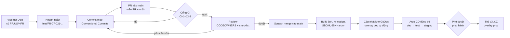
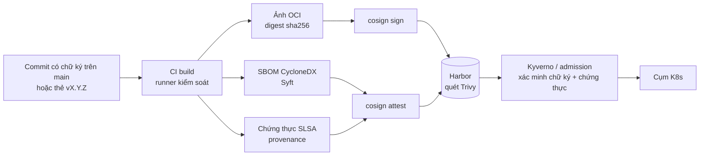
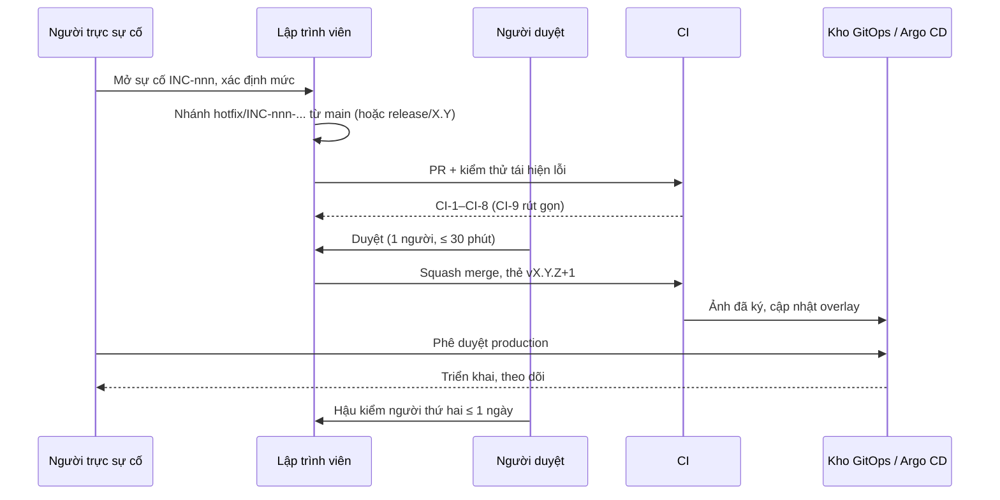
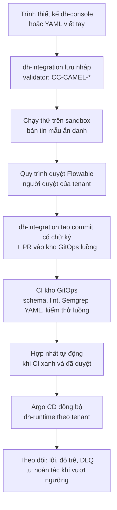

# D04-02 · Quy trình kỹ thuật

## 1. Mục đích và phạm vi

Tài liệu này quy định cách mã nguồn Datahub đi từ ý tưởng tới môi trường sản xuất: cách tổ chức nhánh Git, cách viết commit, cách mở và duyệt yêu cầu hợp nhất (pull request, PR), các cổng chất lượng tự động trong tích hợp liên tục (CI), cách quản lý và ghim phiên bản phụ thuộc, cách đánh số và phát hành phiên bản, cách ký ảnh container và lập danh mục thành phần phần mềm (SBOM), định nghĩa Ready và Done, quy trình sửa nóng (hotfix), quản lý bí mật trong phát triển, môi trường phát triển cục bộ, quy trình thay đổi hợp đồng API và sự kiện, và quy trình phát hành luồng tích hợp Camel qua GitOps. Quyết định nền của các quy trình này được ghi ở ADR-037.

D04-01 (quy chuẩn lập trình) nói **mã phải viết thế nào**; D04-02 nói **mã được đưa vào và phát hành thế nào**. Hai tài liệu tham chiếu chéo nhau: mỗi quy tắc đánh dấu [tự động] trong D04-01 được thực thi ở một cổng của mục 6. Chiến lược kiểm thử nằm ở D05-01 và ADR-038; hạ tầng triển khai, Argo CD, Harbor và hai hồ sơ triển khai nằm ở D03-09. Tài liệu này cũng là nơi ghim số phiên bản cụ thể của ngăn xếp công nghệ theo yêu cầu của SAD §6.

Quy trình áp dụng cho mọi kho mã của Datahub: kho mã nguồn sản phẩm (monorepo), kho cấu hình GitOps (manifest triển khai, luồng Camel, chính sách OPA) và kho tài liệu. Nó áp dụng cho cả nhân sự của nhà thầu, nhà thầu phụ và cán bộ kỹ thuật của tỉnh khi đóng góp mã. Các bước kiểm soát trong tài liệu là bằng chứng cho nhóm yêu cầu "phát triển ứng dụng an toàn" và "quản lý cấu hình" của TCVN 14423:2026 ở cấp độ 3 (số mục cần đối chiếu) và cho các biện pháp thuộc dải SEC-40–49 và SEC-50–59 của D03-07.

## 2. Tổng quan luồng làm việc

Sơ đồ dưới đây cho thấy vòng đời một thay đổi từ việc được giao tới khi chạy ở sản xuất.



Luồng trên có ba đặc điểm. Thứ nhất, mọi thay đổi đi qua một PR vào nhánh chính `main` (trunk), không có đường tắt; kể cả sửa nóng cũng đi qua PR, chỉ rút ngắn thời gian duyệt (mục 11). Thứ hai, máy kiểm tra trước, người duyệt sau: người duyệt không phải tốn thời gian vào lỗi định dạng hay lỗi mà công cụ phát hiện được. Thứ ba, môi trường được thay đổi bằng commit vào kho GitOps và Argo CD đồng bộ (ADR-009); không ai `kubectl apply` tay lên môi trường dùng chung, nên mọi thay đổi trên cụm đều có dấu vết trong Git.

## 3. Mô hình nhánh trunk-based

### 3.1. Nhánh chính và nhánh ngắn

Datahub dùng mô hình phát triển dựa trên nhánh chính (trunk-based development) với nhánh tính năng ngắn ngày. Nhánh `main` là nhánh duy nhất tồn tại lâu dài, luôn ở trạng thái build được, kiểm thử xanh và triển khai được lên môi trường dev. Mọi công việc được làm trên nhánh ngắn tách từ `main` và hợp nhất trở lại `main` qua PR.

Lý do chọn trunk-based thay vì Git Flow: Datahub có nhiều phân hệ phát triển song song trong cùng monorepo, ranh giới module được kiểm tra tự động, và sản phẩm phải phát hành thường xuyên cho nhiều tỉnh. Nhánh sống lâu làm xung đột tích tụ, che giấu lỗi tích hợp giữa module tới phút cuối, và làm cổng CI mất ý nghĩa vì thứ được kiểm tra không phải thứ sẽ phát hành. So sánh chi tiết các phương án ở ADR-037.

**QT-BR-01 · Tên nhánh theo D00-01 §6.** Nhánh ngắn đặt tên `{loại}/{mã-việc}-{mô-tả-ngắn}` viết thường, gạch nối, không dấu, tối đa 60 ký tự. `{loại}` dùng cùng tập loại với Conventional Commits (mục 4): `feat`, `fix`, `refactor`, `perf`, `test`, `docs`, `build`, `ci`, `chore`, `sec`, cộng thêm `hotfix` cho sửa nóng và `release` cho nhánh phát hành dài hạn (mục 9.4). `{mã-việc}` là mã FR, US, NFR, mã lỗi trên hệ thống theo dõi công việc hoặc mã gói việc trong kế hoạch phát triển. Ví dụ: `feat/FR-07-021-import-excel`, `fix/BUG-312-sai-mui-gio-xuat-csv`, `sec/NFR-00-029-che-so-dinh-danh-log`, `hotfix/INC-045-rls-thieu-chinh-sach`. Quy tắc kiểm tra tự động bằng luật bảo vệ nhánh (tên nhánh được phép đẩy) và bước kiểm tra trong CI.

**QT-BR-02 · Nhánh sống tối đa 3 ngày làm việc.** Nhánh ngắn nên được hợp nhất trong vòng 1–2 ngày và không quá 3 ngày làm việc. Công việc lớn hơn được chia thành nhiều PR nhỏ hợp nhất dần, phần chưa hoàn thiện được ẩn sau cờ tính năng (feature flag) tắt mặc định hoặc chưa được nối vào route giao diện. Bot báo nhánh quá 3 ngày trên kênh của đội; nhánh không có hoạt động 30 ngày bị xóa tự động (sau khi thông báo).

**QT-BR-03 · Cờ tính năng thay cho nhánh tính năng dài.** Cờ tính năng được khai báo trong bảng tham số của PH-18 (theo tenant), có tên `ff.{module}.{tính-năng}`, có chủ sở hữu và ngày dự kiến gỡ. Cờ đã bật cho mọi tenant hơn một phiên bản phát hành phải được gỡ khỏi mã. Cờ không bao giờ được dùng để tắt kiểm tra bảo mật hay cách ly tenant.

### 3.2. Bảo vệ nhánh chính

**QT-BR-04 · Luật bảo vệ `main`.** Nhánh `main` được cấu hình trên nền tảng Git với các luật sau, và các luật này áp dụng cho cả quản trị viên kho mã:

- cấm đẩy trực tiếp, cấm đẩy ép (force push), cấm xóa nhánh;
- bắt buộc PR với số người duyệt theo mục 5.2, bắt buộc duyệt của CODEOWNERS, duyệt cũ bị hủy khi có commit mới;
- bắt buộc mọi cổng CI ở mục 6 có trạng thái thành công, và nhánh PR phải được cập nhật theo `main` trước khi hợp nhất (hoặc dùng hàng đợi hợp nhất, merge queue);
- bắt buộc mọi luồng thảo luận trên PR đã được giải quyết;
- bắt buộc commit có chữ ký được xác minh (mục 4.3);
- lịch sử tuyến tính: chỉ cho phép squash merge.

**QT-BR-05 · Hàng đợi hợp nhất.** Khi số PR hợp nhất mỗi ngày vượt khoảng 15, đội bật hàng đợi hợp nhất (merge queue) để mỗi PR được kiểm tra trên đỉnh `main` mới nhất cộng các PR xếp trước, tránh tình trạng hai PR cùng xanh riêng lẻ nhưng làm `main` đỏ khi gộp. `main` đỏ là sự cố mức ưu tiên cao nhất của đội: người hợp nhất sau cùng hoàn tác (revert) ngay nếu không sửa được trong 30 phút.

## 4. Commit theo Conventional Commits

### 4.1. Định dạng

**QT-CM-01 · Thông điệp commit theo Conventional Commits 1.0.** Thông điệp commit có cấu trúc:

```text
{loại}({phạm-vi}): {mô tả ngắn, tiếng Việt, không chấm cuối}

{thân: giải thích vì sao thay đổi, ảnh hưởng gì; dòng ≤ 100 ký tự}

Refs: FR-07-021, ADR-003
BREAKING CHANGE: {mô tả thay đổi phá vỡ và cách chuyển đổi}
```

Loại commit và ý nghĩa được liệt kê trong bảng dưới đây; bảng cũng nêu loại nào làm tăng số phiên bản khi phát hành tự động (mục 9).

| Loại | Dùng khi | Ảnh hưởng SemVer |
|---|---|---|
| `feat` | Thêm chức năng cho người dùng hoặc HTTT | Tăng MINOR |
| `fix` | Sửa lỗi | Tăng PATCH |
| `sec` | Sửa lỗ hổng hoặc tăng cường bảo mật | Tăng PATCH (hoặc MINOR nếu thêm chức năng) |
| `perf` | Cải thiện hiệu năng không đổi hành vi | Tăng PATCH |
| `refactor` | Tái cấu trúc không đổi hành vi | Không |
| `test` | Thêm, sửa kiểm thử | Không |
| `docs` | Tài liệu | Không |
| `build` | Hệ thống build, phụ thuộc | Không (PATCH nếu nâng phụ thuộc có bản vá bảo mật) |
| `ci` | Cấu hình CI | Không |
| `chore` | Việc vặt khác | Không |
| `revert` | Hoàn tác commit trước | Theo commit bị hoàn tác |
| Bất kỳ loại nào có `!` sau phạm vi hoặc chân `BREAKING CHANGE:` | Thay đổi phá vỡ hợp đồng | Tăng MAJOR |

`{phạm-vi}` là mã phân hệ viết thường (`ph07`), tên DU (`dh-data`), tên gói giao diện (`ui`, `console`) hoặc chủ đề hạ tầng (`deps`, `ci`, `gitops`). Mô tả ngắn viết tiếng Việt có dấu theo D04-01 CC-GEN-07, bắt đầu bằng động từ, ví dụ `feat(ph07): thêm nhập danh mục từ tệp Excel có xem trước`. Chân `Refs:` liệt kê mã truy vết; chân này bắt buộc với `feat`, `fix`, `sec`.

**QT-CM-02 · Kiểm tra tự động.** commitlint với cấu hình `@commitlint/config-conventional` mở rộng (thêm loại `sec`, danh sách phạm vi cho phép, bắt buộc `Refs:` với `feat|fix|sec`) chạy trên tiêu đề PR và mọi commit trong PR. Vì hợp nhất bằng squash, tiêu đề PR trở thành thông điệp commit trên `main`, nên tiêu đề PR là thứ quan trọng nhất phải đúng định dạng.

**QT-CM-03 · Một commit một ý.** Trong nhánh, lập trình viên nên commit theo từng bước logic để người duyệt đọc được tiến trình; không trộn định dạng lại toàn tệp với thay đổi logic. Thông điệp commit không chứa bí mật, dữ liệu cá nhân, địa chỉ IP thật hay tên máy chủ sản xuất.

### 4.2. Ví dụ

Ví dụ dưới đây cho thấy một commit đúng và một commit sai.

```text
ĐÚNG
fix(ph07): chặn chèn công thức khi xuất danh mục ra CSV

Giá trị bắt đầu bằng =, +, -, @ được thêm dấu nháy đơn theo CC-SEC-16.
Trước đây ô "=HYPERLINK(...)" do người dùng nhập bị Excel thực thi.

Refs: FR-00-030, BUG-287

SAI
update code
```

### 4.3. Ký commit

**QT-CM-04 · Commit có chữ ký được xác minh.** Mọi commit vào `main` phải có chữ ký được nền tảng Git xác minh, bằng khóa SSH hoặc GPG đăng ký với tài khoản, hoặc bằng ký không khóa (keyless) gitsign của Sigstore nếu hạ tầng hỗ trợ. Commit squash do nền tảng tạo khi hợp nhất được ký bởi khóa của nền tảng. Chữ ký gắn mỗi thay đổi với một danh tính đã xác thực, là bằng chứng cho kiểm soát toàn vẹn mã nguồn và mức SLSA nguồn (mục 10). Danh tính phải là tài khoản cá nhân có MFA, không dùng tài khoản dùng chung (Q357).

## 5. PR và review code

### 5.1. Quy tắc PR

**QT-PR-01 · PR nhỏ.** PR nên thay đổi ≤ 400 dòng (không tính mã sinh, tệp khóa phụ thuộc, dữ liệu kiểm thử) và không được vượt 800 dòng trừ trường hợp được ghi lý do (đổi tên hàng loạt bằng công cụ, migration dữ liệu sinh tự động). Bot gắn nhãn kích thước `size/S` (≤ 100), `size/M` (≤ 400), `size/L` (≤ 800), `size/XL` (> 800); PR `size/XL` cần trưởng nhóm kỹ thuật đồng ý chia hay giữ. Lý do: hiệu quả phát hiện lỗi của review giảm mạnh khi PR lớn, và PR nhỏ hợp nhất nhanh, phù hợp nhánh ngắn.

**QT-PR-02 · Mô tả PR theo mẫu.** Kho mã có mẫu PR (`.github/pull_request_template.md` hoặc tương đương) với các mục bắt buộc: tóm tắt thay đổi và lý do; mã truy vết (FR, US, NFR, ADR, mã lỗi); phân hệ bị ảnh hưởng; thay đổi hợp đồng API hoặc sự kiện (có hay không, liên kết PR hợp đồng); thay đổi lược đồ CSDL (có hay không, có tương thích với phiên bản liền trước không); ảnh hưởng bảo mật và đa tenant; cách kiểm thử (kiểm thử tự động đã thêm, bước kiểm tra tay nếu có); ảnh chụp màn hình hoặc video cho thay đổi giao diện; ghi chú triển khai (biến cấu hình mới, cờ tính năng, thứ tự triển khai). PR chưa sẵn sàng mở ở trạng thái nháp (draft).

**QT-PR-03 · Liên kết truy vết bắt buộc.** Tiêu đề hoặc mô tả PR phải chứa ít nhất một mã `FR-`, `US-`, `NFR-`, `ADR-`, `BUG-`, `INC-` hoặc mã gói việc; bước kiểm tra CI đọc mô tả và chặn nếu thiếu (D04-01 CC-GEN-01). Liên kết hai chiều với hệ thống theo dõi công việc được tạo tự động từ mã.

**QT-PR-04 · Nhãn PR.** Bot và tác giả gắn nhãn: phân hệ (`ph07`…), kích thước, `contract-change` (đụng `contracts/`), `db-migration` (đụng changelog), `security-impact` (đụng xác thực, phân quyền, mật mã, xử lý tệp, gọi ra ngoài, dữ liệu Nhạy cảm, cấu hình bảo mật, tệp loại trừ phát hiện), `tenant-impact` (đụng `TenantContext`, RLS, hàm tạo tên có tenant, API nền tảng), `breaking`. Một số nhãn được gắn tự động theo đường dẫn tệp và kích hoạt người duyệt bắt buộc ở mục 5.2.

**QT-PR-05 · Tác giả tự kiểm trước khi yêu cầu duyệt.** Tác giả tự đọc lại toàn bộ diff, chạy kiểm thử cục bộ, đánh dấu từng mục danh mục kiểm tra của mẫu PR, và chỉ chuyển PR khỏi trạng thái nháp khi CI xanh. PR có CI đỏ không được giao cho người duyệt.

### 5.2. Người duyệt và CODEOWNERS

Quyền duyệt được tổ chức theo phân hệ và theo loại thay đổi. Tệp `CODEOWNERS` ở gốc kho mã ánh xạ đường dẫn tới nhóm sở hữu; nền tảng Git tự yêu cầu duyệt của nhóm sở hữu khi PR chạm đường dẫn đó. Các nhóm sở hữu được định nghĩa trong bảng dưới đây; tên nhóm là ví dụ và được đặt theo tổ chức thật của dự án.

| Đường dẫn | Nhóm sở hữu | Ghi chú |
|---|---|---|
| `apps/{du}/src/main/java/vn/datahub/{du}/{module}/**` | Nhóm phân hệ tương ứng (`@datahub/team-ph07`…) | Mỗi phân hệ một nhóm, tối thiểu 2 người |
| `**/shared/**`, `libs/common-java/**`, `packages/ui/**`, `packages/api-client/**` | Nhóm nền tảng kỹ thuật (`@datahub/platform-core`) | Thư viện dùng chung ảnh hưởng mọi DU |
| `**/package-info.java` (khai báo module), `**/archtest/**` | Nhóm kiến trúc (`@datahub/architects`) | Thay đổi ranh giới module |
| `contracts/**` | Nhóm kiến trúc + nhóm phân hệ sở hữu hợp đồng | Mục 13 |
| `**/db/changelog/**` | Nhóm phân hệ + người duyệt CSDL (`@datahub/dba`) | |
| `**/security/**`, `**/crypto/**`, `**/tenant/**`, `contracts/opa/**`, `.semgrep/**`, `.quality/baseline/**`, `docs/exemptions.yaml`, `.gitleaks.toml` | Nhóm ATTT (`@datahub/security`) | Người duyệt bảo mật bắt buộc |
| `.github/**` (hoặc `.gitlab-ci.yml`), `renovate.json`, `CODEOWNERS` | Nhóm DevSecOps (`@datahub/devsecops`) + trưởng nhóm kỹ thuật | Thay đổi cổng chất lượng |
| `deploy/**`, kho GitOps | Nhóm vận hành nền tảng (`@datahub/platform-ops`) | |
| `routes/**` (luồng Camel) | Nhóm PH-04 + chủ quản luồng của tenant | Mục 14 |

**QT-RV-01 · Số người duyệt.** Số người duyệt tối thiểu phụ thuộc mức rủi ro của PR, được chốt trong bảng sau. Tác giả không tự duyệt PR của mình; người duyệt bảo mật không được là tác giả hay người cùng cặp lập trình (pair) với tác giả.

| Loại PR | Số người duyệt tối thiểu | Trong đó bắt buộc |
|---|---|---|
| Tài liệu, kiểm thử, `chore` không đụng mã chạy | 1 | — |
| Thay đổi mã thông thường | 2 | 1 CODEOWNER của phân hệ |
| Nhãn `security-impact` hoặc `tenant-impact` | 2 | 1 CODEOWNER phân hệ + 1 người duyệt bảo mật |
| Nhãn `contract-change` có thay đổi phá vỡ, hoặc thay đổi khai báo module | 2 | 1 người nhóm kiến trúc |
| Thay đổi cổng CI, luật bảo vệ nhánh, tệp loại trừ phát hiện | 2 | Trưởng nhóm kỹ thuật + 1 người duyệt bảo mật |
| Sửa nóng (mục 11) | 1 trước hợp nhất | Người duyệt thứ hai hậu kiểm trong 1 ngày làm việc |

**QT-RV-02 · Nhân sự duyệt bảo mật.** Mỗi nhóm phân hệ có ít nhất một "đại diện bảo mật" (security champion) đã qua đào tạo lập trình an toàn theo D04-01 mục 9, được nhóm ATTT cấp quyền duyệt bảo mật cho phân hệ của mình; PR thuộc dải rủi ro cao nhất (mật mã, xác thực, `TenantContext`, RLS, API nền tảng liên tenant) cần người của nhóm ATTT trung tâm.

### 5.3. Danh mục kiểm tra review chung

Người duyệt đọc PR theo danh mục dưới đây. Danh mục không lặp lại những gì công cụ đã kiểm tra (định dạng, lint, độ phủ); nó tập trung vào thứ máy khó đánh giá.

1. Thay đổi có đúng phạm vi của mã truy vết không, có làm thêm việc không được yêu cầu không (D04-01 CC-GEN-01).
2. Thiết kế có khớp SDD và ADR liên quan không; có tạo phụ thuộc mới giữa module hay giữa DU không.
3. Tên lớp, hàm, biến có tự giải thích không; hàm có quá dài, quá nhiều nhánh không.
4. Lỗi có được xử lý đúng không: mã `ERR` đúng, trạng thái HTTP đúng (D04-01 CC-ERR-04), không nuốt ngoại lệ.
5. Giao dịch đặt đúng chỗ, không gọi ra ngoài trong giao dịch, sự kiện đi qua outbox, consumer idempotent.
6. Kiểm thử có kiểm tra hành vi thật không (không chỉ để đạt độ phủ), có ca âm tính, có ca rò rỉ chéo tenant cho API mới.
7. Migration có tương thích với phiên bản ứng dụng liền trước không, có khóa bảng lâu không.
8. Hợp đồng và mã có khớp nhau không; thay đổi hợp đồng có được duyệt riêng không.
9. Log có đủ để chẩn đoán và không chứa dữ liệu Nhạy cảm không.
10. Giao diện dùng thành phần `@datahub/ui`, token, chuỗi i18n; có ảnh chụp; đạt kiểm tra truy cập.
11. Tài liệu (README của module, ghi chú triển khai, changelog) đã cập nhật nếu cần.

### 5.4. Danh mục kiểm tra review bảo mật

Người duyệt bảo mật dùng thêm danh mục dưới đây, rút từ bảng ánh xạ ASVS 5.0 ở D04-01 §9.2.

1. Mọi endpoint mới có quyền `PERM` tường minh; cấu hình mặc định vẫn từ chối (CC-SEC-08).
2. Mọi truy cập theo `id` kiểm tra quyền trên chính đối tượng, không chỉ trên loại tài nguyên (IDOR/BOLA, CC-SEC-20); lệnh hành động có quyền riêng (CC-SEC-22).
3. Đầu vào được kiểm tra bằng danh sách cho phép, có giới hạn kích thước; record yêu cầu không chứa trường không được sửa (CC-SEC-21).
4. Không ghép chuỗi vào SQL, JPQL, đường dẫn tệp, URL, biểu thức Camel, lệnh hệ thống (CC-SEC-10, 14, 15, 17, CC-CAMEL-10).
5. Gọi ra ngoài đi qua factory hoặc Kamelet có chống SSRF; không tắt kiểm tra chứng chỉ (CC-SEC-15, V12).
6. XML, YAML, JSON đa hình được phân tích an toàn (CC-SEC-12, 13); tệp tải lên kiểm tra kiểu thật và quét mã độc (CC-SEC-18); xuất tệp chống chèn công thức (CC-SEC-16).
7. Mật mã chỉ qua thư viện chung, số ngẫu nhiên bảo mật dùng `SecureRandom` (CC-SEC-25, 26); JWT xác minh đầy đủ (CC-SEC-27).
8. Không có bí mật, giá trị mặc định cho bí mật, dữ liệu cá nhân thật trong mã, kiểm thử, cấu hình (CC-GEN-05, CC-CFG-02).
9. Lỗi không lộ chi tiết nội bộ; log không chứa dữ liệu Nhạy cảm, có chống chèn log (CC-ERR-03, CC-LOG-04, 05).
10. Thao tác thuộc diện kiểm toán ghi qua `AuditRecorder` (CC-LOG-07).
11. Phụ thuộc mới có lý do, giấy phép hợp lệ, không có lỗ hổng HIGH/CRITICAL (CC-GEN-09).
12. Mọi loại trừ phát hiện có lý do, mã việc và ngày hết hạn (CC-SEC-40).

### 5.5. Danh mục kiểm tra review đa tenant

PR có nhãn `tenant-impact` hoặc chạm dữ liệu nghiệp vụ được kiểm theo sáu quy tắc của D03-10 §6 (D04-01 mục 8):

1. Tenant chỉ lấy từ `TenantContext` (đặt từ token), không từ tham số, query, thân yêu cầu (CC-TEN-01).
2. Không có truy vấn native vượt RLS, không có kết nối CSDL ngoài `DataSource` được quản lý (CC-TEN-02).
3. Bảng mới có `tenant_id NOT NULL` và RLS trong cùng changeset; tính duy nhất tính trong tenant (CC-TEN-03, CC-SQL-02).
4. Khóa bộ đệm, topic, khóa đối tượng dùng hàm tạo tên có tenant (CC-TEN-04).
5. Tác vụ nền, listener được bọc `TenantContext.runAs` (CC-TEN-05).
6. API mới có kiểm thử rò rỉ chéo tenant kỳ vọng `404` (CC-TEN-06).
7. Sự kiện kiểm tra `dhtenant` khớp tên topic (CC-TEN-07); truy cập liên tenant chỉ qua API nền tảng có lý do và kiểm toán (CC-TEN-08).

### 5.6. Cách review và thời hạn phản hồi

**QT-RV-03 · Thời hạn phản hồi (SLA).** Người được yêu cầu duyệt phản hồi lần đầu (duyệt, yêu cầu sửa hoặc bình luận) trong vòng **4 giờ làm việc** với PR `size/S` và `size/M`, **1 ngày làm việc** với PR `size/L` trở lên; PR sửa nóng trong **30 phút** trong giờ làm việc và theo lịch trực ngoài giờ. Tác giả phản hồi bình luận trong 1 ngày làm việc. PR không có phản hồi quá thời hạn được bot nhắc và chuyển cho người duyệt dự phòng trong nhóm CODEOWNERS. Chỉ số "thời gian từ mở PR tới hợp nhất" (trung vị mục tiêu ≤ 1 ngày làm việc) được theo dõi hằng tuần.

**QT-RV-04 · Ngôn ngữ bình luận.** Bình luận viết tiếng Việt, hướng vào mã, không vào người; dùng tiền tố để rõ mức độ: `[chặn]` (phải sửa trước khi hợp nhất, nên trích mã quy tắc `CC-…`), `[đề xuất]` (nên sửa), `[hỏi]`, `[nhỏ]` (có thể bỏ qua). Bất đồng không giải quyết được trong hai lượt trao đổi được chuyển cho trưởng nhóm kỹ thuật quyết định.

**QT-RV-05 · Học từ lỗi lặp lại.** Lỗi review lặp lại từ hai lần trở lên trong một tháng được biến thành luật tự động (Semgrep, ArchUnit, ESLint) hoặc bổ sung vào D04-01, theo nguyên tắc "học sau sửa tay" của IP-02.

## 6. Cổng chất lượng CI

### 6.1. Danh sách cổng

Cổng chất lượng (quality gate) là bước kiểm tra tự động mà PR phải vượt qua trước khi được hợp nhất. Datahub có chín cổng, đánh số CI-1 đến CI-9 (tiền tố `CI-` để không nhầm với các cổng quản lý dự án G1, G2… của D01-02 và cổng phát hành kiểm thử RG-1…RG-5 của D05-01), thay cho cách gọi Gate A, B, C, D, S của IP-02 (bảng đối chiếu ở mục 6.3). Bảng dưới đây liệt kê từng cổng, nội dung kiểm tra, ngưỡng đạt, căn cứ và thời điểm chạy. Cổng chạy theo phạm vi thay đổi: PR chỉ đụng giao diện không chạy kiểm thử Java và ngược lại, nhưng PR đụng thư viện dùng chung chạy toàn bộ.

| Cổng | Nội dung | Ngưỡng đạt (chặn merge) | Căn cứ | Chạy khi |
|---|---|---|---|---|
| CI-1 Build và kiểm tra tĩnh cơ bản | Biên dịch Maven với Error Prone + NullAway; `spotless:check`; commitlint tiêu đề PR; kiểm tra mã truy vết trong PR; kiểm tra tên nhánh | Biên dịch không lỗi, không cảnh báo NullAway; định dạng đúng | D04-01 CC-JAVA-01, 06; QT-CM-02; QT-PR-03 | Mọi PR |
| CI-2 Kiểm thử đơn vị và kiến trúc | JUnit (Surefire); `ApplicationModules.verify()`; bộ luật ArchUnit Datahub; lint migration (Squawk + luật tùy biến); kiểm thử đơn vị Rego (`opa test`) | 100% kiểm thử qua; Modulith verify xanh (NFR-00-054); không vi phạm ArchUnit, lint migration | D04-01 CC-MOD-02, 05; CC-SQL-11; CC-TEN-02, 03, 05 | Mọi PR có mã Java, changelog hoặc Rego |
| CI-3 Kiểm thử tích hợp | Failsafe với Testcontainers (PostgreSQL 18, Kafka, Keycloak, Valkey); kiểm tra RLS sau migration; **bộ kiểm thử rò rỉ chéo tenant**; kiểm thử meta độ phủ kiểm thử rò rỉ theo endpoint; kiểm thử luồng Camel (JVM) | 100% qua; mọi endpoint có kiểm thử rò rỉ; mọi bảng có RLS | D04-01 CC-TEST-01, 03; CC-TEN-03, 06; FR-00-011 | Mọi PR có mã backend hoặc luồng |
| CI-4 Độ phủ | JaCoCo (backend), Vitest coverage (giao diện); độ phủ trên phần thay đổi | Backend ≥ 80% dòng mã nghiệp vụ, giao diện ≥ 70% (NFR-00-053); phần thay đổi ≥ 80% | NFR-00-053 | Kèm CI-2, CI-6 |
| CI-5 Hợp đồng | Spectral với bộ luật Datahub và luật OWASP API; oasdiff phát hiện thay đổi phá vỡ; kiểm tra tương thích schema với Apicurio (chế độ `BACKWARD`/`FULL`); kiểm thử hợp đồng phía nhà cung cấp và phía tiêu dùng; sinh lại mã khách và kiểm tra không lệch | Không lỗi Spectral; không thay đổi phá vỡ khi chưa tăng phiên bản chính (NFR-00-055); kiểm thử hợp đồng qua | D04-01 CC-API-01…04 | PR có nhãn `contract-change` hoặc đụng controller |
| CI-6 Giao diện | `tsc --noEmit`; ESLint `--max-warnings 0` (gồm `jsx-a11y`, `security`, luật không CSS tự do); Prettier; Stylelint; Vitest + Testing Library; build Vite; kiểm tra kích thước gói | Không lỗi; kích thước gói khởi đầu không tăng quá 5% so với `main` nếu không có lý do | D04-01 CC-FE-*; NFR-00-045 | PR đụng `apps/console`, `apps/portal`, `packages/` |
| CI-7 Bảo mật mã và phụ thuộc | SAST: Semgrep, CodeQL, SpotBugs FindSecBugs; SCA: Trivy `fs` trên `pom.xml` và lockfile npm, kiểm tra giấy phép; quét bí mật: gitleaks trên diff và toàn lịch sử; quét IaC: Trivy `config` (hoặc Checkov) trên Kustomize, Helm values, Dockerfile | Không phát hiện mức chặn theo D04-01 §9.4; 0 bí mật (NFR-00-022); 0 CRITICAL, 0 HIGH chưa có ngoại lệ (NFR-00-023); giấy phép trong danh sách cho phép | D04-01 mục 9; SEC-40–49, SEC-50–59 | Mọi PR |
| CI-8 Ảnh container | Build ảnh (Jib hoặc Dockerfile đa tầng trên ảnh nền tối thiểu đã duyệt); build native cho `dh-runtime`; Trivy `image`; kiểm tra chạy không root, không công cụ shell thừa | 0 CRITICAL; 0 HIGH chưa có ngoại lệ; ảnh nền từ Harbor nội bộ | D03-09; SEC-50–59 | Trên `main` sau hợp nhất; trên PR khi đụng Dockerfile, POM DU, phụ thuộc |
| CI-9 E2E, truy cập, hiệu năng giao diện | Playwright E2E luồng chính trên môi trường tạm (ephemeral) dựng bằng Testcontainers hoặc namespace riêng; axe-core trên mọi màn được chạm; Lighthouse CI | 0 lỗi axe mức A/AA (NFR-00-040); LCP ≤ 2,5 giây, INP ≤ 200 ms (NFR-00-005) | NFR-00-005, 040 | PR đụng giao diện (bắt buộc); hằng đêm trên `main` (toàn bộ) |

Ngoài chín cổng chặn trên PR, các kiểm tra sau chạy định kỳ trên `main` hoặc môi trường kiểm thử và mở việc tự động khi thất bại, không chặn PR nhưng chặn phát hành (mục 9.3): quét DAST OWASP ZAP hằng đêm trên môi trường test; quét lại toàn bộ ảnh đang chạy và SBOM đã lưu với cơ sở dữ liệu lỗ hổng mới mỗi ngày; kiểm thử tải k6 theo NFR-00-001…008 hằng tuần và trước phát hành; bộ quét mẫu dữ liệu cá nhân trên log của môi trường test (NFR-00-029); kiểm thử hỗn loạn theo D05-01.

### 6.2. Nguyên tắc vận hành CI

**QT-CI-01 · Thời gian phản hồi.** Tổng thời gian các cổng CI-1–CI-7 trên một PR điển hình nên ≤ 15 phút, CI-1–CI-2 ≤ 5 phút để lập trình viên nhận phản hồi nhanh. Đạt bằng chạy song song, bộ đệm Maven và npm, chạy theo phạm vi thay đổi (Maven `-pl` với `-amd`, Nx/Turborepo affected cho giao diện) và tái sử dụng container Testcontainers. Thời gian CI được theo dõi; vượt ngưỡng hai tuần liên tiếp thì nhóm DevSecOps tối ưu.

**QT-CI-02 · Kiểm thử chập chờn không được bỏ qua lặng lẽ.** Kiểm thử thất bại ngẫu nhiên (flaky) được cách ly bằng nhãn `@Tag("quarantine")` có mã việc, chạy riêng và không chặn PR tối đa 10 ngày làm việc; sau thời hạn phải sửa hoặc xóa. Không cho phép chạy lại CI nhiều lần cho tới khi xanh mà không ghi nhận.

**QT-CI-03 · Chuỗi cung ứng của chính CI.** Action và ảnh dùng trong CI được ghim theo SHA commit hoặc digest, không theo thẻ trôi (`@v4`, `:latest`); Renovate cập nhật các ghim này. Runner CI cho kho sản phẩm chạy trên hạ tầng do dự án kiểm soát, quyền của token CI là tối thiểu (`contents: read` mặc định, cấp thêm theo job). Bí mật CI (khóa đẩy Harbor, khóa ký) chỉ cấp cho job chạy trên `main` hoặc thẻ phát hành, không cho PR từ kho phân nhánh (fork). Cấu hình CI nằm trong kho mã và thuộc CODEOWNERS của nhóm DevSecOps.

**QT-CI-04 · Không tắt cổng để hợp nhất.** Không ai, kể cả quản trị viên, được bỏ qua cổng chặn để hợp nhất. Trường hợp công cụ quét hỏng (ví dụ máy chủ cơ sở dữ liệu lỗ hổng không truy cập được), trưởng nhóm kỹ thuật và người duyệt bảo mật có thể cho phép hợp nhất bằng nhãn `gate-override` có lý do; mọi lần dùng được ghi lại, kiểm tra lại khi công cụ phục hồi và báo cáo trong họp rà soát hằng tháng.

### 6.3. Đối chiếu với cổng của IP-02

Bảng dưới đây đối chiếu tên cổng cũ trong IP-02 và quy trình CI hiện có của kho mã với hệ cổng CI-1–CI-9, để đội chuyển đổi cấu hình mà không mất kiểm tra nào.

| IP-02 / CI hiện có | Nội dung cũ | Tương ứng mới | Thay đổi chính |
|---|---|---|---|
| Gate A (`gate-a.yml`) | Biên dịch, kiểm thử đơn vị, ArchUnit, kiểm thử luồng Camel | CI-1, CI-2, CI-3 | Thêm Error Prone/NullAway, Spotless, ArchUnit đầy đủ, lint migration, kiểm thử tích hợp và rò rỉ chéo tenant |
| Gate B | Lint OpenAPI, phát hiện thay đổi phá vỡ | CI-5 | Thêm AsyncAPI, Apicurio, kiểm thử hợp đồng |
| Gate C | Lint, kiểm tra kiểu, kiểm thử thành phần giao diện | CI-6 | Thêm Stylelint, luật không CSS tự do, kích thước gói |
| Gate D | Kiểm tra truy cập thử nghiệm (cảnh báo) | CI-9 | Chuyển thành chặn với màn bị chạm; thêm Lighthouse CI |
| Gate S (`gate-s.yml`) | gitleaks, SAST, Trivy ảnh | CI-7, CI-8 | Thêm CodeQL, FindSecBugs, SCA, quét IaC; ghim action theo SHA |
| `camel-native.yml`, `at-ph04.yml` | Build native, kiểm thử chấp nhận PH-04 | CI-8, CI-9 | Native build chạy trước phát hành `dh-runtime`; AT chạy hằng đêm |

## 7. Định nghĩa Ready và Done

### 7.1. Định nghĩa Ready (DoR)

Một việc (user story, yêu cầu sửa lỗi, việc kỹ thuật) chỉ được kéo vào kế hoạch lặp (sprint) khi đạt các điều kiện dưới đây. DoR ngăn việc bắt đầu viết mã khi yêu cầu còn mơ hồ, nguyên nhân chính của "vibe coding" mà `AGENTS.md` cấm.

1. Có mã truy vết: `US`/`FR` có trong D02-03, D02-05, hoặc `NFR`, `ADR`, mã lỗi; mức ưu tiên M/S/C đã rõ.
2. Có tiêu chí chấp nhận kiểm chứng được (Given–When–Then hoặc danh sách điều kiện), gồm ít nhất một ca âm tính.
3. Quyền (`PERM`), mã lỗi (`ERR`), sự kiện (`EVT`), màn hình (`UI`) liên quan đã được định nghĩa hoặc có trong phạm vi việc.
4. Nếu đổi hợp đồng API hoặc sự kiện: bản nháp thay đổi hợp đồng đã được nhóm kiến trúc xem sơ bộ (mục 13).
5. Nếu đụng dữ liệu cá nhân: đã xác định mức phân loại trường (SAD §8.2) và ảnh hưởng tới hồ sơ đánh giá tác động xử lý dữ liệu cá nhân.
6. Phụ thuộc vào việc khác, vào hạ tầng hoặc vào bên ngoài (HTTT, NDXP) đã được xác định và không chặn.
7. Đủ nhỏ để hoàn thành trong một lần lặp; ước lượng không vượt 5 ngày công, nếu vượt thì chia.
8. Với việc thiết kế giao diện: thiết kế màn đã có trong D03-06 hoặc bản thiết kế được duyệt.

### 7.2. Định nghĩa Done (DoD)

Một việc được coi là xong khi đạt toàn bộ điều kiện dưới đây. DoD này thay và mở rộng mục 7 của `AGENTS.md`.

1. Mã đã hợp nhất vào `main` qua PR, đủ người duyệt theo mục 5.2, mọi cổng CI-1–CI-9 áp dụng đều xanh.
2. Tiêu chí chấp nhận được kiểm chứng bằng kiểm thử tự động; FR mức M có ít nhất một ca dương tính và một ca âm tính (D00-01 §3.2); API mới có kiểm thử rò rỉ chéo tenant và kiểm thử phân quyền âm tính.
3. Độ phủ đạt ngưỡng NFR-00-053 và không giảm.
4. Hợp đồng OpenAPI/AsyncAPI cập nhật và đăng ký Apicurio nếu đổi hợp đồng; mã khách giao diện đã sinh lại.
5. Không có bí mật; gitleaks, SAST, SCA sạch hoặc có loại trừ được duyệt.
6. Migration CSDL tương thích phiên bản liền trước; có rollback hoặc ghi rõ lý do.
7. Log, chỉ số, trace cho tính năng mới có mặt; cảnh báo vận hành được thêm nếu tính năng ảnh hưởng SLO.
8. Thao tác thuộc diện kiểm toán sinh bản ghi kiểm toán (FR-00-040).
9. Màn hình mới đạt axe-core 0 lỗi mức A/AA, dùng thành phần `@datahub/ui`, chuỗi tiếng Việt qua i18n.
10. Tài liệu cập nhật: ghi chú phát hành (từ commit), README module nếu đổi cách dùng, ghi chú thay đổi phá vỡ, cập nhật RTM (D00-03) nếu đổi truy vết.
11. Đã triển khai lên môi trường dev qua GitOps và qua kiểm tra khói; chủ sản phẩm hoặc người được ủy quyền đã nghiệm thu trên môi trường test với việc có giao diện.
12. Cờ tính năng (nếu có) đã đăng ký với chủ sở hữu và ngày gỡ.

## 8. Quản lý phụ thuộc và ghim phiên bản

### 8.1. Nguyên tắc

SAD §6 chỉ ghi dòng phiên bản chính và giao cho D04-02 ghim số phiên bản cụ thể. Ghim phiên bản có hai mục đích: build lặp lại được (cùng mã nguồn cho cùng sản phẩm, điều kiện để ký và lập SBOM có ý nghĩa), và kiểm soát được khi nào, vì sao một thành phần thay đổi. Nhưng ghim mà không cập nhật thì sau vài tháng sẽ chạy phiên bản hết hỗ trợ, không còn bản vá bảo mật, không qua được hồ sơ cấp độ. Vì vậy chính sách gồm hai nửa: ghim chính xác, và cập nhật có lịch bằng công cụ tự động.

**QT-DEP-01 · Ghim chính xác ở mọi tầng.** Phụ thuộc Maven quản lý tập trung trong `dependencyManagement` của POM gốc qua BOM (Spring Boot, Spring Modulith, Quarkus, Camel Quarkus, AWS SDK…) với phiên bản cụ thể; mô-đun con không khai báo phiên bản. Hai mô-đun Camel hiện nằm ngoài reactor phải được đưa vào POM gốc hoặc dùng chung một BOM nội bộ `datahub-bom`. Plugin Maven ghim phiên bản; Maven Wrapper ghim phiên bản Maven; bật `maven-enforcer-plugin` với `requireMavenVersion`, `requireJavaVersion`, `dependencyConvergence`, `banDuplicatePomDependencyVersions`. Phụ thuộc giao diện dùng lockfile (`pnpm-lock.yaml` hoặc `package-lock.json`) được commit và cài bằng `--frozen-lockfile`/`npm ci`; trong `package.json` dùng phiên bản chính xác (không `^`, `~`) cho phụ thuộc trực tiếp. Ảnh container (ảnh nền, ảnh thành phần bên thứ ba trong Kustomize/Helm) ghim theo digest `@sha256:`, có thẻ phiên bản bên cạnh để đọc được. Action CI ghim theo SHA (QT-CI-03).

**QT-DEP-02 · Chỉ dùng phiên bản còn hỗ trợ.** Mọi thành phần trong bảng 8.2 phải ở dòng phiên bản còn được nhà phát triển hỗ trợ bản vá bảo mật trong ít nhất 6 tháng tính từ ngày phát hành Datahub; ưu tiên dòng hỗ trợ dài hạn (LTS) khi có. Thành phần sắp hết hỗ trợ trong 6 tháng phải có việc nâng cấp trong kế hoạch. Đây cũng là nguyên tắc ghim của IP-03.

**QT-DEP-03 · Nguồn phụ thuộc kiểm soát được.** Build lấy phụ thuộc qua kho trung gian của dự án (Harbor cho ảnh; Nexus, Artifactory hoặc Reposilite cho Maven và npm) có bộ nhớ đệm và quét, không lấy trực tiếp từ Internet ở CI phát hành. Điều này đồng thời là điều kiện cho gói phân phối air-gapped (ADR-036). Bật kiểm tra checksum (Maven `checksumPolicy=fail`, npm integrity trong lockfile).

### 8.2. Bảng phiên bản chính

Bảng dưới đây là bảng ghim phiên bản của Datahub tại thời điểm lập tài liệu, khớp với bảng baseline của IP-03 và mã hiện có trong kho. Cột "Ghim" là phiên bản dùng cho build; ký hiệu `.x` nghĩa là bản vá mới nhất của dòng đó do Renovate cập nhật tự động, còn số cụ thể nằm trong POM hoặc lockfile. Cột "Vòng đời" nêu tình trạng hỗ trợ đã biết; những điểm chưa xác minh được ghi rõ và đưa vào câu hỏi mở Q354. Bảng được rà soát mỗi quý và trước mỗi lần phát hành MINOR.

| Thành phần | Dòng | Ghim | Vòng đời và ghi chú |
|---|---|---|---|
| Java (Eclipse Temurin JDK) | 21 LTS | 21.0.x | LTS, hỗ trợ cộng đồng tới khoảng 2029; chọn 21 có chủ đích theo IP-03, đánh giá chuyển 25 LTS ở lần nâng cấp lớn tiếp theo |
| Maven | 3.9 | 3.9.x (qua Maven Wrapper) | — |
| Spring Boot | 4.0 | 4.0.x (hiện 4.0.2) | Mỗi dòng MINOR của Spring Boot có thời gian hỗ trợ bản vá miễn phí giới hạn (khoảng 12–13 tháng); dòng 4.0 phát hành 11/2025 nên **cần xác minh ngày hết hỗ trợ và lên kế hoạch nâng dòng MINOR mới hơn** (Q354) |
| Spring Modulith | 2.0 | 2.0.x (hiện 2.0.1) | Đi kèm dòng Spring Boot; nâng cùng Spring Boot |
| Apache Camel | 4.18 LTS | 4.18.x | LTS, hỗ trợ tới 02/2027 theo IP-03; không dùng dòng không-LTS. **Phải lên kế hoạch chuyển sang dòng LTS kế tiếp trước 02/2027** |
| Quarkus / Camel Quarkus platform | 3.33 | 3.33.x (hiện 3.33.2) | Khớp Camel 4.18; xác minh 3.33 thuộc dòng LTS của Quarkus |
| GraalVM / Mandrel (build native) | Java 21 | Chưa khóa | Phải khớp Camel Quarkus 3.33; khóa khi bật native ở CI phát hành (IP-03) |
| Liquibase | 4.x | Theo BOM Spring Boot | Cần xác minh điều khoản giấy phép của dòng mới trước khi nâng dòng chính (Q354) |
| Node.js (công cụ giao diện) | 22 LTS | 22.x | LTS đang ở pha bảo trì; đánh giá chuyển 24 LTS (Q354) |
| TypeScript | 5 | 5.8.x | — |
| React | 19 | 19.x | — |
| Ant Design | 6 | 6.x | — |
| Vite | 6 | 6.x | Đánh giá nâng dòng chính khi Vitest và plugin tương thích |
| TanStack Query | 5 | 5.x | Chưa có trong mã hiện tại, thêm theo D04-01 CC-FE-05 |
| React Router | 7 | 7.x | — |
| PostgreSQL | 18 | 18.x | Ưu tiên 18 nếu CloudNativePG trên cụm đích hỗ trợ; tối thiểu 17; không khởi tạo mới trên 16 (IP-03) |
| CloudNativePG | — | Chưa khóa | Phụ thuộc cụm đích (IP-03, D03-09) |
| Apache Kafka (Strimzi, KRaft) | 4 | Theo phiên bản Strimzi hỗ trợ | Chưa khóa Strimzi (IP-03) |
| Apicurio Registry | 3 | 3.x | — |
| Apache APISIX | 3 | 3.x | Ghim bản LTS của APISIX nếu có |
| Keycloak | 26 | 26.x | — |
| Open Policy Agent | 1 | 1.x | — |
| OpenBao | 2 | 2.x | — |
| Valkey | 8 | 8.x | — |
| Flowable (nhúng) | 7 | 7.x | Kiểm tra tương thích Spring Boot 4 |
| Kubernetes | ≥ 1.31 | Theo cụm đích | Chỉ hỗ trợ các bản K8s còn trong vòng hỗ trợ upstream |
| Argo CD | — | Theo D03-09 | — |
| Công cụ CI: Semgrep, CodeQL, SpotBugs + FindSecBugs, Trivy, gitleaks, Spectral, oasdiff, Squawk, commitlint, cosign, Syft | — | Ghim phiên bản chính xác trong cấu hình CI | Renovate cập nhật |

### 8.3. Renovate và chính sách cập nhật

**QT-DEP-04 · Renovate là công cụ cập nhật duy nhất.** Renovate (tự vận hành, chạy được on-prem) quét kho mã và kho GitOps, mở PR cập nhật cho Maven, npm, ảnh container, Kustomize, Helm, action CI và Maven Wrapper. Cấu hình `renovate.json` ở gốc kho thuộc CODEOWNERS của nhóm DevSecOps. Không dùng song song Dependabot để tránh PR trùng. Chính sách tự hợp nhất và nhóm cập nhật được chốt trong bảng sau.

| Loại cập nhật | Gom nhóm | Tự hợp nhất | Lịch |
|---|---|---|---|
| Bản vá (PATCH) của phụ thuộc thư viện và công cụ | Theo hệ sinh thái (một PR Maven, một PR npm) | Có, nếu mọi cổng xanh và không phải thành phần lõi trong danh sách giữ tay (Spring Boot, Camel, Quarkus, Keycloak, PostgreSQL) | Hằng tuần, sáng thứ Hai |
| Bản vá có công bố lỗ hổng (CVE) | Riêng từng phụ thuộc | Không; ưu tiên duyệt trong 1 ngày làm việc (CRITICAL) hoặc 5 ngày (HIGH) | Ngay khi có |
| MINOR | Theo nhóm BOM (ví dụ cả họ Spring) | Không; 1 người duyệt nhóm nền tảng kỹ thuật | Hằng tuần |
| MAJOR | Riêng từng thành phần | Không; cần đánh giá tác động, có thể cần ADR (nếu đổi dòng của thành phần trong SAD §6) | Hằng tháng, đưa vào kế hoạch |
| Digest ảnh nền | Gom | Có, nếu CI-8 xanh | Hằng ngày |
| Action CI (SHA) | Gom | Có | Hằng tuần |

Renovate được cấu hình độ chờ tối thiểu (`minimumReleaseAge`) 3 ngày với bản phát hành mới không phải bản vá bảo mật, để tránh nhận phải gói bị chiếm quyền mới đăng, và chặn phiên bản không-LTS của các thành phần có chính sách LTS (Camel, Quarkus, Node).

**QT-DEP-05 · Thêm phụ thuộc mới.** PR thêm phụ thuộc trực tiếp mới phải nêu: mục đích, phương án đã cân nhắc, giấy phép, tình trạng bảo trì, kết quả SCA (D04-01 CC-GEN-09); cần duyệt của nhóm nền tảng kỹ thuật. Danh sách giấy phép cho phép mặc định: Apache-2.0, MIT, BSD-2/3-Clause, EPL-2.0, MPL-2.0, ISC, PostgreSQL, CC0; giấy phép copyleft mạnh (GPL, AGPL) hoặc giấy phép nguồn mở có điều kiện thương mại (BUSL, SSPL, FSL) cần ý kiến pháp chế của chủ đầu tư.

**QT-DEP-06 · Ngoại lệ lỗ hổng có thời hạn.** Lỗ hổng HIGH chưa có bản vá hoặc không khai thác được trong ngữ cảnh Datahub được ghi ngoại lệ trong tệp `.trivyignore.yaml` (hoặc VEX) kèm mã CVE, lý do, người duyệt bảo mật, ngày hết hạn ≤ 90 ngày. Ngoại lệ hết hạn làm CI-7 đỏ trở lại.

## 9. Phiên bản phát hành và changelog

### 9.1. Đánh số phiên bản

**QT-REL-01 · SemVer 2.0 cho sản phẩm và cho hợp đồng.** Sản phẩm Datahub phát hành theo số phiên bản `MAJOR.MINOR.PATCH` của Semantic Versioning 2.0. Mọi DU, gói giao diện và ảnh `dh-runtime` trong cùng monorepo dùng chung một số phiên bản sản phẩm để tỉnh triển khai một bộ đồng nhất (một "bộ phát hành"); thư viện công bố cho bên ngoài (nếu có SDK cho HTTT) có thể có số riêng. Ý nghĩa: MAJOR khi có thay đổi phá vỡ hợp đồng API, sự kiện hoặc yêu cầu nâng cấp hạ tầng không tương thích; MINOR khi thêm chức năng tương thích ngược; PATCH khi chỉ sửa lỗi và bản vá bảo mật. Phiên bản API trong đường dẫn (`/v1`) tách biệt với phiên bản sản phẩm và chỉ tăng khi API đó có thay đổi phá vỡ (NFR-00-055).

**QT-REL-02 · Số phiên bản sinh từ commit.** Công cụ release-please (hoặc semantic-release) đọc commit Conventional Commits trên `main` kể từ thẻ trước, đề xuất số phiên bản kế tiếp và mở một PR phát hành chứa cập nhật số phiên bản và changelog. Hợp nhất PR phát hành tạo thẻ có chữ ký `vX.Y.Z` và kích hoạt quy trình phát hành. Bản thử nghiệm dùng hậu tố `-rc.N`; ảnh build từ `main` chưa phát hành mang thẻ `{phiên-bản-kế}-dev.{số-build}+{sha-ngắn}` và không bao giờ được triển khai lên production.

### 9.2. Changelog và ghi chú phát hành

**QT-REL-03 · Changelog tự động, ghi chú phát hành do người biên tập.** `CHANGELOG.md` ở gốc kho mã sinh tự động từ commit, nhóm theo loại (Tính năng, Sửa lỗi, Bảo mật, Hiệu năng, Thay đổi phá vỡ), mỗi dòng kèm mã truy vết. Ghi chú phát hành cho tỉnh (tiếng Việt, cho người vận hành và chủ quản) do trưởng nhóm kỹ thuật biên tập từ changelog, bổ sung: thay đổi phá vỡ và hướng dẫn chuyển đổi, migration CSDL dài, biến cấu hình mới, thứ tự nâng cấp, lỗ hổng đã vá (mã CVE, mức độ), danh sách FR và LGC mới đáp ứng, và giới hạn đã biết. Ghi chú bảo mật không mô tả chi tiết khai thác trước khi đa số tỉnh đã nâng cấp.

### 9.3. Điều kiện phát hành

**QT-REL-04 · Cổng phát hành.** Một thẻ phát hành chỉ được đưa lên môi trường production của bất kỳ tỉnh nào khi: mọi cổng CI-1–CI-9 xanh trên commit được gắn thẻ; DAST không có cảnh báo High; không có lỗ hổng CRITICAL và không có HIGH chưa có ngoại lệ trong SBOM tại thời điểm phát hành (NFR-00-023); kiểm thử tải đạt NFR-00-001…008; kiểm thử chấp nhận và hồi quy của D05-01 đạt; ảnh đã ký và có SBOM, có chứng thực nguồn gốc (mục 10); ghi chú phát hành đã duyệt; người có thẩm quyền phê duyệt phát hành (chủ sản phẩm và đại diện vận hành) đã ký duyệt trên PR cập nhật overlay production của kho GitOps.

### 9.4. Nhánh hỗ trợ phiên bản

**QT-REL-05 · Nhánh `release/X.Y` chỉ khi cần vá phiên bản cũ.** Vì các tỉnh on-prem có thể không nâng cấp đồng thời, sản phẩm duy trì hai dòng MINOR gần nhất (hiện hành và liền trước) nhận bản vá bảo mật trong tối thiểu 6 tháng. Khi cần vá một dòng cũ, tạo nhánh `release/X.Y` từ thẻ `vX.Y.0` (nếu chưa có), sửa trên `main` trước rồi cherry-pick sang nhánh phát hành; không sửa trên nhánh phát hành mà không có trên `main`, trừ khi mã đã không còn trên `main` (khi đó ghi rõ trong PR). Nhánh `release/*` được bảo vệ như `main`.

## 10. Ký ảnh, SBOM và chứng thực nguồn gốc

Chuỗi cung ứng phần mềm là bề mặt tấn công mà cấp độ 3 yêu cầu kiểm soát: kẻ tấn công không cần xâm nhập Datahub nếu có thể chèn mã vào một thư viện hay ảnh mà Datahub tin dùng. Mục này mô tả cách mỗi sản phẩm build được gắn với mã nguồn đã duyệt và cách cụm Kubernetes chỉ chạy những sản phẩm đó.



Sơ đồ cho thấy ba sản phẩm đi kèm mỗi ảnh: chữ ký, SBOM và chứng thực nguồn gốc. Cả ba được lưu cạnh ảnh trong Harbor dưới dạng tạo tác OCI (OCI artifact), nên khi sao chép ảnh sang Harbor của tỉnh on-prem hoặc vào gói air-gapped (ADR-036), chữ ký và SBOM đi theo. Ở cụm, bộ kiểm soát tiếp nhận (admission controller) từ chối pod có ảnh không có chữ ký hợp lệ của khóa phát hành Datahub, nên kể cả người có quyền quản trị cụm cũng không chạy được ảnh lạ trong namespace của Datahub.

**QT-SC-01 · Ký mọi ảnh bằng cosign.** Mọi ảnh do Datahub build được ký bằng cosign ngay trong job CI tạo ra ảnh, theo digest (không theo thẻ). Khóa ký phát hành nằm trong OpenBao transit hoặc KMS/HSM, CI chỉ có quyền ký qua chính sách, không đọc được khóa; ở môi trường có kết nối, có thể dùng ký không khóa của Sigstore với danh tính OIDC của CI, nhưng hồ sơ on-prem và air-gapped dùng khóa do dự án quản lý (D03-09). Ảnh bên thứ ba được Harbor sao về, quét, và ký lại bằng khóa "đã duyệt" của dự án sau khi qua quét.

**QT-SC-02 · SBOM cho mọi sản phẩm phát hành.** Syft sinh SBOM định dạng CycloneDX JSON (kèm SPDX nếu chủ đầu tư yêu cầu) cho mỗi ảnh và cho mã nguồn (`cyclonedx-maven-plugin`, `@cyclonedx/cyclonedx-npm`), đính kèm vào ảnh bằng `cosign attest --type cyclonedx`, và lưu vào kho SBOM (Dependency-Track hoặc tương đương) để quét lại hằng ngày với cơ sở dữ liệu lỗ hổng mới. Mỗi bộ phát hành giao cho tỉnh kèm SBOM tổng hợp.

**QT-SC-03 · Chứng thực nguồn gốc mức SLSA Build L2, hướng tới L3.** CI sinh chứng thực nguồn gốc (provenance) theo định dạng in-toto/SLSA cho mỗi ảnh, ghi kho mã, commit, quy trình build, tham số; ký và đính kèm bằng cosign. Mục tiêu ban đầu là SLSA Build L2 (build trên dịch vụ được lưu trữ, chứng thực có chữ ký); hướng tới L3 (build cô lập, chứng thực không giả mạo được bởi người viết quy trình) khi chuẩn bị nâng cấp độ 4.

**QT-SC-04 · Xác minh khi triển khai.** Chính sách Kyverno (hoặc Sigstore policy-controller) trong mọi namespace của Datahub yêu cầu: ảnh từ Harbor của dự án, có chữ ký hợp lệ của khóa phát hành, có chứng thực SBOM và provenance, tham chiếu theo digest. Chính sách ở chế độ thực thi (enforce) trên staging và production, chế độ kiểm tra (audit) trên dev. Chi tiết cấu hình ở D03-09.

## 11. Quy trình sửa nóng

Sửa nóng (hotfix) là thay đổi khẩn cấp để khắc phục sự cố đang ảnh hưởng production: lỗi làm gián đoạn data plane, lỗ hổng đang bị khai thác hoặc có mức CRITICAL, rò rỉ dữ liệu, hoặc lỗi làm sai dữ liệu nghiệp vụ. Sửa nóng vẫn đi qua PR và các cổng tự động; cái được rút ngắn là thời gian chờ con người, không phải các bước kiểm tra.



Sơ đồ trên mô tả các bước. Những điểm khác với quy trình thường được nêu dưới đây.

**QT-HF-01 · Khi nào được dùng.** Chỉ dùng cho sự cố có mã `INC` mức nghiêm trọng 1 hoặc 2 theo quy trình ứng phó sự cố của D03-07 (dải SEC-70–79), do người trực sự cố hoặc trưởng nhóm kỹ thuật xác nhận. Lỗi khác đi theo quy trình thường.

**QT-HF-02 · Sửa trên `main` trước.** Nhánh `hotfix/INC-{nnn}-{mô-tả}` tách từ `main`; nếu tỉnh bị ảnh hưởng chạy dòng cũ, cherry-pick sang `release/X.Y` sau khi hợp nhất vào `main`. Ngoại lệ duy nhất là khi `main` đã thay đổi tới mức bản sửa không áp dụng được, lúc đó sửa trên `release/X.Y` và mở ngay PR đưa thay đổi tương đương về `main`.

**QT-HF-03 · Kiểm thử tái hiện bắt buộc.** PR sửa nóng phải có kiểm thử tự động tái hiện lỗi (đỏ trước khi sửa, xanh sau khi sửa); không có ngoại lệ, vì đây là cách duy nhất bảo đảm lỗi không quay lại.

**QT-HF-04 · Rút gọn có kiểm soát.** Một người duyệt trước hợp nhất (là người duyệt bảo mật nếu sự cố là lỗ hổng); CI-9 chỉ chạy bộ E2E khói; mọi cổng khác chạy đầy đủ. Người duyệt thứ hai hậu kiểm trong 1 ngày làm việc; phát hiện của hậu kiểm được xử lý như lỗi mức cao.

**QT-HF-05 · Ghi nhận sau sự cố.** Trong 5 ngày làm việc sau sửa nóng, nhóm lập báo cáo sau sự cố (không đổ lỗi, blameless) nêu nguyên nhân gốc, vì sao các cổng không chặn được, và hành động phòng ngừa (thường là luật tự động mới theo QT-RV-05). Lỗ hổng bảo mật được đánh giá nghĩa vụ thông báo theo quy định (báo vi phạm dữ liệu cá nhân trong 72 giờ theo Luật Bảo vệ dữ liệu cá nhân 91/2025/QH15 và Nghị định 356/2025/NĐ-CP nếu có ảnh hưởng dữ liệu cá nhân), phối hợp với quy trình của D03-07.

## 12. Môi trường phát triển cục bộ và bí mật trong phát triển

### 12.1. Môi trường cục bộ

**QT-DEV-01 · Một lệnh để chạy.** Lập trình viên mới phải chạy được DU mình phụ trách và kiểm thử của nó trong vòng một ngày từ khi có máy. Kho mã cung cấp: cấu hình devcontainer (`.devcontainer/devcontainer.json`) với JDK 21, Maven, Node 22, pnpm, công cụ CLI (kubectl, kustomize, cosign, trivy, gitleaks, semgrep) ở đúng phiên bản bảng 8.2; `Makefile` với các mục tiêu `make bootstrap`, `make dev-up`, `make test`, `make verify` (chạy cục bộ tương đương CI-1–CI-7); và `deploy/compose/docker-compose.yml` dựng PostgreSQL 18, Kafka KRaft, Apicurio, Keycloak (realm mẫu `dh-t01`, `dh-t02` với người dùng giả), Valkey, Garage, OpenBao chế độ dev, OTel Collector và Grafana nhẹ.

**QT-DEV-02 · Testcontainers cho kiểm thử, Spring Boot dev services cho chạy thử.** Kiểm thử tích hợp tự dựng phụ thuộc bằng Testcontainers (D04-01 CC-TEST-01), không giả định có compose đang chạy. Khi chạy ứng dụng cục bộ, có thể dùng hỗ trợ Docker Compose hoặc Testcontainers lúc phát triển của Spring Boot (`spring-boot-docker-compose`, `spring-boot-testcontainers`) và dev services của Quarkus để tự dựng phụ thuộc. Ảnh dùng trong Testcontainers và compose lấy từ Harbor (hoặc bản sao), ghim phiên bản như ở production.

**QT-DEV-03 · Đa tenant ngay ở cục bộ.** Môi trường cục bộ luôn có ít nhất hai tenant giả (`T01`, `T02`) để lập trình viên tự thấy hành vi cách ly; dữ liệu mẫu do bộ sinh dữ liệu giả tạo ra, không dùng dữ liệu thật hay bản sao production.

**QT-DEV-04 · Môi trường xem trước theo PR.** PR có nhãn `preview` được dựng môi trường tạm trong namespace riêng trên cụm dev (qua Argo CD ApplicationSet theo PR), tự hủy khi PR đóng hoặc sau 72 giờ, dùng cho kiểm thử E2E (CI-9) và cho chủ sản phẩm xem trước.

### 12.2. Bí mật trong phát triển

**QT-SEC-01 · Không có bí mật thật ở máy lập trình viên.** Bí mật của môi trường test, staging, production không bao giờ được cấp cho máy cá nhân. Môi trường cục bộ dùng thông tin xác thực sinh ngẫu nhiên lúc dựng compose (script `make dev-up` sinh mật khẩu vào tệp `.env` không commit) hoặc do Testcontainers tạo. Tệp `.env.example` chỉ chứa tên biến và chú thích, không giá trị.

**QT-SEC-02 · Chặn bí mật trước khi tới kho.** Pre-commit hook (`pre-commit` framework hoặc lefthook) chạy gitleaks trên thay đổi đã stage; nền tảng Git bật chặn đẩy bí mật (push protection) nếu có; CI-7 chạy gitleaks trên PR và toàn lịch sử (NFR-00-022). Cấu hình `.gitleaks.toml` bổ sung luật cho định dạng bí mật đặc thù (khóa OpenBao, client secret Keycloak, khóa PayGov, chuỗi kết nối JDBC có mật khẩu).

**QT-SEC-03 · Lộ bí mật là sự cố.** Bí mật bị commit (kể cả lên nhánh chưa hợp nhất, kể cả đã xóa ở commit sau) được coi là đã lộ: thu hồi và xoay vòng ngay trong OpenBao, mở sự cố `INC`, rồi mới làm sạch lịch sử nếu cần. Không coi việc xóa commit là đủ.

**QT-SEC-04 · Bí mật CI và GitOps.** CI truy cập bí mật qua OIDC liên kết với OpenBao (thông tin xác thực ngắn hạn theo job), không lưu bí mật dài hạn trong cấu hình CI khi tránh được. Kho GitOps không chứa bí mật; chỉ chứa `ExternalSecret` trỏ tới đường dẫn `kv/dh/{tenant}/...` (ADR-012, D03-10 §4).

## 13. Quy trình thay đổi hợp đồng API và sự kiện

Hợp đồng API và sự kiện là cam kết với HTTT thành viên của nhiều tỉnh, nhiều đơn vị phát triển khác nhau; một thay đổi phá vỡ không báo trước làm gãy tích hợp ở nơi Datahub không kiểm soát. Vì vậy thay đổi hợp đồng có quy trình riêng, tách khỏi thay đổi hiện thực (nguyên tắc "hợp đồng trước" NT-04 của SAD, D04-01 CC-GEN-02).

**QT-CT-01 · PR hợp đồng đi trước.** Thay đổi hợp đồng nằm trong một PR riêng chỉ đụng `contracts/` (nhãn `contract-change`), được duyệt bởi nhóm kiến trúc và nhóm sở hữu hợp đồng, và nếu có bên tiêu dùng nội bộ khác DU thì đại diện bên tiêu dùng. Sau khi hợp nhất, mã máy chủ và mã khách được sinh lại; PR hiện thực tham chiếu PR hợp đồng. Với thay đổi nhỏ chỉ thêm trường tùy chọn, được phép gộp hợp đồng và hiện thực trong cùng PR.

**QT-CT-02 · Phân loại thay đổi.** oasdiff (OpenAPI) và kiểm tra tương thích của Apicurio (schema sự kiện) tự phân loại thay đổi. Cách xử lý từng loại được chốt trong bảng sau.

| Loại thay đổi | Ví dụ | Xử lý |
|---|---|---|
| Tương thích ngược | Thêm endpoint, thêm trường tùy chọn ở yêu cầu, thêm trường ở phản hồi, thêm giá trị enum ở yêu cầu | PR hợp đồng thường; tăng MINOR sản phẩm |
| Phá vỡ API | Xóa hoặc đổi tên trường, đổi kiểu, thêm trường bắt buộc ở yêu cầu, thêm giá trị enum ở phản hồi khi bên nhận dùng enum đóng, đổi ngữ nghĩa | Tạo phiên bản mới trong đường dẫn (`/v2`) song song `/v1`; `/v1` gắn `Deprecation` và `Sunset` ≥ 6 tháng (NFR-00-055); thông báo cho HTTT qua cổng nhà phát triển và thư điện tử đầu mối; ghi chú phát hành; tăng MAJOR nếu là API công bố cho HTTT |
| Phá vỡ sự kiện | Xóa trường, đổi kiểu | Topic phiên bản mới `.v{n+1}`; bên phát phát song song hai topic trong thời gian chuyển tiếp ≥ 6 tháng; schema mới đăng ký nhóm mới trong Apicurio |
| Gỡ bỏ phiên bản cũ | Hết thời hạn `Sunset` | Kiểm tra chỉ số sử dụng tại APISIX/Kafka bằng 0 trong 30 ngày hoặc được chủ quản chấp thuận; PR gỡ có duyệt kiến trúc |

**QT-CT-03 · Kiểm thử hợp đồng hai phía.** Phía nhà cung cấp kiểm tra mã thật khớp hợp đồng (kiểm thử sinh từ OpenAPI chạy trên `@SpringBootTest`, hoặc Spring Cloud Contract); phía tiêu dùng nội bộ (giao diện, DU khác, luồng Camel) dùng kiểu sinh từ hợp đồng và kiểm thử với máy chủ giả sinh từ hợp đồng (Prism hoặc MSW). Chi tiết chiến lược ở ADR-038 và D05-01. CI-5 chạy cả hai phía.

**QT-CT-04 · Hợp đồng là tài liệu công bố.** Hợp đồng đã hợp nhất được xuất bản tự động lên cổng nhà phát triển (PH-15) và đăng ký Apicurio khi phát hành, với lịch sử phiên bản và changelog theo hợp đồng, để HTTT thành viên tự tra cứu.

## 14. Quy trình phát hành luồng Camel qua GitOps

Luồng tích hợp khác mã sản phẩm ở chỗ nó là **cấu hình theo tenant** do cán bộ tích hợp của tỉnh thiết kế, không phải mã do đội sản phẩm viết, và nó thay đổi thường xuyên hơn nhiều so với chu kỳ phát hành sản phẩm. Vì vậy luồng có quy trình riêng nhưng vẫn theo cùng nguyên tắc: mọi thay đổi có dấu vết trong Git, được kiểm tra tự động, được người có thẩm quyền duyệt, và chỉ Argo CD được thay đổi runtime (ADR-009, ADR-013, SAD §5).



Sơ đồ trên cho thấy luồng đi từ trình thiết kế tới runtime. Điểm quan trọng là `dh-integration` không bao giờ ra lệnh trực tiếp cho `dh-runtime`: nó chỉ tạo commit vào kho GitOps, và chỉ sau khi CI của kho GitOps kiểm tra xong thì Argo CD mới đồng bộ. Nhờ đó luồng do trình thiết kế sinh và luồng viết tay chịu cùng một bộ kiểm tra, và lịch sử Git là nhật ký đầy đủ ai đã thay đổi luồng nào, khi nào, ai duyệt.

**QT-RT-01 · Cấu trúc kho GitOps luồng.** Luồng nằm ở `routes/{tenant}/{mã-luồng}/` theo D04-01 CC-CAMEL-01; tệp `CODEOWNERS` của kho GitOps gán thư mục `routes/{tenant}/` cho nhóm duyệt luồng của tenant đó, nên tenant này không duyệt được luồng của tenant khác. Thư mục `routes/_templates/` và danh mục Kamelet thuộc nhóm PH-04/PH-05 của đội sản phẩm.

**QT-RT-02 · Kiểm tra tự động trước khi hợp nhất.** CI kho GitOps chạy: kiểm tra lược đồ YAML DSL; validator luồng (routeId, errorHandler DLQ, Kamelet trong danh mục cho phép, ngôn ngữ biểu thức bị cấm, không bí mật, tenant trong `route.meta.yaml` khớp thư mục); Semgrep với luật YAML; gitleaks; kiểm thử luồng với bản tin mẫu trong `test/` trên ảnh `dh-runtime` cùng phiên bản đang chạy ở tenant; kiểm tra hạn mức số luồng của tenant (D03-10 §5.3).

**QT-RT-03 · Duyệt theo phân tách nhiệm vụ.** Người thiết kế luồng không tự duyệt luồng của mình. Luồng có phân loại dữ liệu cao nhất là Nhạy cảm hoặc kết nối tới đích mới chưa có trong danh sách đích đăng ký cần thêm người duyệt có vai trò an toàn thông tin của tenant. Quyết định duyệt ghi trong Flowable và trong mô tả commit (mã yêu cầu duyệt, người duyệt), là bản ghi kiểm toán (FR-00-040).

**QT-RT-04 · Triển khai tiến dần và hoàn tác.** Argo CD đồng bộ luồng mới lên `dh-runtime` của tenant theo chiến lược cuốn chiếu; luồng có lưu lượng lớn có thể dùng phát hành thử (canary) theo tỉ lệ tại APISIX. Nếu trong 15 phút đầu tỉ lệ lỗi của luồng vượt ngưỡng cấu hình (mặc định 5% hoặc gấp 3 lần mức trước đó) hoặc DLQ tăng bất thường, hệ thống tự tạo commit hoàn tác về phiên bản trước và cảnh báo người thiết kế. Hoàn tác thủ công cũng là một commit hoàn tác, không sửa tay trên cụm.

**QT-RT-05 · Tương thích phiên bản runtime.** `route.meta.yaml` ghi phiên bản `dh-runtime` tối thiểu mà luồng cần. Khi nâng cấp `dh-runtime` (bản phát hành sản phẩm), CI chạy lại kiểm thử của toàn bộ luồng của mọi tenant trên ảnh mới trước khi phát hành; luồng thất bại được báo cho tenant trước khi nâng cấp.

## 15. Mã và thuật ngữ mới đề xuất bổ sung D00-01

Tài liệu đề xuất bổ sung các mục trong bảng dưới đây vào D00-01; luồng lõi gộp theo D00-01 §9.3.

| Loại | Đề xuất | Vị trí |
|---|---|---|
| Mã | `QT-{nhóm}-{nn}`: quy tắc quy trình kỹ thuật, định nghĩa tại D04-02. Nhóm ∈ `BR` (nhánh), `CM` (commit), `PR`, `RV` (review), `CI`, `DEP` (phụ thuộc), `REL` (phát hành), `SC` (chuỗi cung ứng), `HF` (sửa nóng), `DEV`, `SEC` (bí mật trong phát triển), `CT` (hợp đồng), `RT` (luồng Camel) | §3.1 |
| Mã | `CI-1`…`CI-9`: cổng chất lượng CI, định nghĩa tại D04-02 §6 | §3.1 |
| Mã | `INC-{nnn}`, `BUG-{nnn}`: mã sự cố và mã lỗi trên hệ thống theo dõi công việc, được phép dùng làm `{mã-việc}` trong tên nhánh | §3.1, §6 |
| Thuật ngữ | **Phát triển dựa trên nhánh chính** (Trunk-based development), **Cổng chất lượng** (Quality gate), **Hàng đợi hợp nhất** (Merge queue), **Cờ tính năng** (Feature flag), **Sửa nóng** (Hotfix), **Đại diện bảo mật** (Security champion) | §2.2 |
| Thuật ngữ | **SBOM** (Software Bill of Materials), **SLSA** (Supply-chain Levels for Software Artifacts), **Chứng thực nguồn gốc** (Provenance attestation), **VEX** (Vulnerability Exploitability eXchange) | §2.2, §2.3 |
| Thuật ngữ | **DoR / DoD** (Definition of Ready / Definition of Done) | §2.3 |
| Quy ước | Bổ sung loại `sec`, `hotfix`, `release` cho tên nhánh; tên cờ tính năng `ff.{module}.{tính-năng}` | §6 |

## 16. Truy vết

Bảng dưới đây ánh xạ yêu cầu, quyết định và tài liệu liên quan tới mục đáp ứng.

| Yêu cầu, ADR, tài liệu | Đáp ứng tại |
|---|---|
| NFR-00-005 (hiệu năng giao diện) | CI-9 |
| NFR-00-013 (nâng cấp không gián đoạn) | 9.3, 14 (QT-RT-04) |
| NFR-00-022 (không bí mật) | CI-7, 12.2 |
| NFR-00-023 (lỗ hổng phụ thuộc) | CI-7, CI-8, 8.3, QT-DEP-06, 9.3 |
| NFR-00-024 (ASVS 5.0 mức 2) | 5.4, CI-7, 9.3 (DAST) |
| NFR-00-040 (WCAG 2.2 AA) | CI-9 |
| NFR-00-045 (thống nhất giao diện) | CI-6 |
| NFR-00-053 (độ phủ) | CI-4 |
| NFR-00-054 (ranh giới module) | CI-2 |
| NFR-00-055 (tương thích ngược API) | CI-5, 13 |
| FR-00-011 (không rò rỉ chéo tenant) | CI-3, 5.5 |
| FR-00-040 (kiểm toán) | 7.2, QT-RT-03 |
| ADR-009 (GitOps Argo CD) | 2, 14 |
| ADR-010, ADR-002 (Camel YAML DSL, Camel Quarkus) | 14, CI-8 (native) |
| ADR-012 (OpenBao) | 12.2, QT-SC-01 |
| ADR-013 (tách control/data plane) | 14 |
| ADR-036 (gói air-gapped) | QT-DEP-03, 10 |
| ADR-037 (quy trình Git, cổng CI) | Toàn bộ tài liệu |
| ADR-038 (chiến lược kiểm thử) | CI-3, CI-5, QT-CT-03 |
| SAD §6 (ghim phiên bản tại D04-02) | 8.2 |
| D03-10 §6 (quy tắc đa tenant) | 5.5, CI-2, CI-3 |
| D04-01 (quy chuẩn lập trình) | 5.3, 5.4, 6 |
| SEC-40–49, SEC-50–59, SEC-70–79 (D03-07) | 5.4, 6, 10, 11 |
| TCVN 14423:2026 cấp độ 3: phát triển ứng dụng an toàn, quản lý cấu hình, quản lý lỗ hổng (cần đối chiếu số mục) | 1, 6, 8, 10 |

## 17. Câu hỏi mở

> **Câu hỏi mở Q353:** Nền tảng Git và CI chính thức của dự án là GitHub (đang dùng GitHub Actions trong kho mã) hay GitLab tự vận hành on-prem (phù hợp hơn với hồ sơ air-gapped và yêu cầu lưu mã nguồn trong nước)? Lựa chọn ảnh hưởng cú pháp CODEOWNERS, luật bảo vệ nhánh, hàng đợi hợp nhất, ký commit do nền tảng, và khả năng dùng CodeQL (Q355 ở D04-01).

> **Câu hỏi mở Q354:** Cần xác minh với nguồn chính thức tại thời điểm khóa phiên bản: ngày hết hỗ trợ bản vá miễn phí của Spring Boot 4.0 và Spring Modulith 2.0 (để quyết định nâng lên dòng MINOR mới hơn trước phát hành MVP); Quarkus 3.33 có thuộc dòng LTS không; điều khoản giấy phép của Liquibase ở dòng chính mới; chuyển Node 22 sang Node 24 LTS cho công cụ giao diện; và kế hoạch chuyển Camel 4.18 LTS sang dòng LTS kế tiếp trước 02/2027.

> **Câu hỏi mở Q357:** Chủ đầu tư có yêu cầu bắt buộc ký commit cho mọi người đóng góp, kể cả nhà thầu phụ và cán bộ kỹ thuật tỉnh, và cơ chế quản lý khóa ký (khóa SSH cá nhân, GPG, hay gitsign không khóa) không? Đồng thời cần xác nhận nhân sự cho vai trò người duyệt bảo mật trung tâm và đại diện bảo mật mỗi nhóm (QT-RV-02).

Các câu hỏi Q350–Q352, Q355, Q356, Q358, Q359 nằm ở D04-01.
