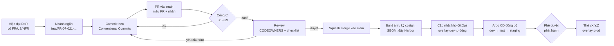

# D04-02 · Quy trình kỹ thuật

## 1. Mục đích và phạm vi

Tài liệu này quy định cách mã nguồn Datahub đi từ ý tưởng tới môi trường sản xuất: cách tổ chức nhánh Git, cách viết commit, cách mở và duyệt yêu cầu hợp nhất (pull request, PR), các cổng chất lượng tự động trong tích hợp liên tục (CI), cách quản lý và ghim phiên bản phụ thuộc, cách đánh số và phát hành phiên bản, cách ký ảnh container và lập danh mục thành phần phần mềm (SBOM), định nghĩa Ready và Done, quy trình sửa nóng (hotfix), quản lý bí mật trong phát triển, môi trường phát triển cục bộ, quy trình thay đổi hợp đồng API và sự kiện, và quy trình phát hành luồng tích hợp Camel qua GitOps. Quyết định nền của các quy trình này được ghi ở ADR-037.

D04-01 (quy chuẩn lập trình) nói **mã phải viết thế nào**; D04-02 nói **mã được đưa vào và phát hành thế nào**. Hai tài liệu tham chiếu chéo nhau: mỗi quy tắc đánh dấu [tự động] trong D04-01 được thực thi ở một cổng của mục 6. Chiến lược kiểm thử nằm ở D05-01 và ADR-038; hạ tầng triển khai, Argo CD, Harbor và hai hồ sơ triển khai nằm ở D03-09. Tài liệu này cũng là nơi ghim số phiên bản cụ thể của ngăn xếp công nghệ theo yêu cầu của SAD §6.

Quy trình áp dụng cho mọi kho mã của Datahub: kho mã nguồn sản phẩm (monorepo), kho cấu hình GitOps (manifest triển khai, luồng Camel, chính sách OPA) và kho tài liệu. Nó áp dụng cho cả nhân sự của nhà thầu, nhà thầu phụ và cán bộ kỹ thuật của tỉnh khi đóng góp mã. Các bước kiểm soát trong tài liệu là bằng chứng cho nhóm yêu cầu "phát triển ứng dụng an toàn" và "quản lý cấu hình" của TCVN 14423:2026 ở cấp độ 3 (số mục cần đối chiếu) và cho các biện pháp thuộc dải SEC-40–49 và SEC-50–59 của D03-07.

## 2. Tổng quan luồng làm việc

Sơ đồ dưới đây cho thấy vòng đời một thay đổi từ việc được giao tới khi chạy ở sản xuất.



Luồng trên có ba đặc điểm. Thứ nhất, mọi thay đổi đi qua một PR vào nhánh chính `main` (trunk), không có đường tắt; kể cả sửa nóng cũng đi qua PR, chỉ rút ngắn thời gian duyệt (mục 11). Thứ hai, máy kiểm tra trước, người duyệt sau: người duyệt không phải tốn thời gian vào lỗi định dạng hay lỗi mà công cụ phát hiện được. Thứ ba, môi trường được thay đổi bằng commit vào kho GitOps và Argo CD đồng bộ (ADR-009); không ai `kubectl apply` tay lên môi trường dùng chung, nên mọi thay đổi trên cụm đều có dấu vết trong Git.

## 3. Mô hình nhánh trunk-based

### 3.1. Nhánh chính và nhánh ngắn

Datahub dùng mô hình phát triển dựa trên nhánh chính (trunk-based development) với nhánh tính năng ngắn ngày. Nhánh `main` là nhánh duy nhất tồn tại lâu dài, luôn ở trạng thái build được, kiểm thử xanh và triển khai được lên môi trường dev. Mọi công việc được làm trên nhánh ngắn tách từ `main` và hợp nhất trở lại `main` qua PR.

Lý do chọn trunk-based thay vì Git Flow: Datahub có nhiều phân hệ phát triển song song trong cùng monorepo, ranh giới module được kiểm tra tự động, và sản phẩm phải phát hành thường xuyên cho nhiều tỉnh. Nhánh sống lâu làm xung đột tích tụ, che giấu lỗi tích hợp giữa module tới phút cuối, và làm cổng CI mất ý nghĩa vì thứ được kiểm tra không phải thứ sẽ phát hành. So sánh chi tiết các phương án ở ADR-037.

**QT-BR-01 · Tên nhánh theo D00-01 §6.** Nhánh ngắn đặt tên `{loại}/{mã-việc}-{mô-tả-ngắn}` viết thường, gạch nối, không dấu, tối đa 60 ký tự. `{loại}` dùng cùng tập loại với Conventional Commits (mục 4): `feat`, `fix`, `refactor`, `perf`, `test`, `docs`, `build`, `ci`, `chore`, `sec`, cộng thêm `hotfix` cho sửa nóng và `release` cho nhánh phát hành dài hạn (mục 9.4). `{mã-việc}` là mã FR, US, NFR, mã lỗi trên hệ thống theo dõi công việc hoặc mã gói việc trong kế hoạch phát triển. Ví dụ: `feat/FR-07-021-import-excel`, `fix/BUG-312-sai-mui-gio-xuat-csv`, `sec/NFR-00-029-che-so-dinh-danh-log`, `hotfix/INC-045-rls-thieu-chinh-sach`. Quy tắc kiểm tra tự động bằng luật bảo vệ nhánh (tên nhánh được phép đẩy) và bước kiểm tra trong CI.

**QT-BR-02 · Nhánh sống tối đa 3 ngày làm việc.** Nhánh ngắn nên được hợp nhất trong vòng 1–2 ngày và không quá 3 ngày làm việc. Công việc lớn hơn được chia thành nhiều PR nhỏ hợp nhất dần, phần chưa hoàn thiện được ẩn sau cờ tính năng (feature flag) tắt mặc định hoặc chưa được nối vào route giao diện. Bot báo nhánh quá 3 ngày trên kênh của đội; nhánh không có hoạt động 30 ngày bị xóa tự động (sau khi thông báo).

**QT-BR-03 · Cờ tính năng thay cho nhánh tính năng dài.** Cờ tính năng được khai báo trong bảng tham số của PH-18 (theo tenant), có tên `ff.{module}.{tính-năng}`, có chủ sở hữu và ngày dự kiến gỡ. Cờ đã bật cho mọi tenant hơn một phiên bản phát hành phải được gỡ khỏi mã. Cờ không bao giờ được dùng để tắt kiểm tra bảo mật hay cách ly tenant.

### 3.2. Bảo vệ nhánh chính

**QT-BR-04 · Luật bảo vệ `main`.** Nhánh `main` được cấu hình trên nền tảng Git với các luật sau, và các luật này áp dụng cho cả quản trị viên kho mã:

- cấm đẩy trực tiếp, cấm đẩy ép (force push), cấm xóa nhánh;
- bắt buộc PR với số người duyệt theo mục 5.2, bắt buộc duyệt của CODEOWNERS, duyệt cũ bị hủy khi có commit mới;
- bắt buộc mọi cổng CI ở mục 6 có trạng thái thành công, và nhánh PR phải được cập nhật theo `main` trước khi hợp nhất (hoặc dùng hàng đợi hợp nhất, merge queue);
- bắt buộc mọi luồng thảo luận trên PR đã được giải quyết;
- bắt buộc commit có chữ ký được xác minh (mục 4.3);
- lịch sử tuyến tính: chỉ cho phép squash merge.

**QT-BR-05 · Hàng đợi hợp nhất.** Khi số PR hợp nhất mỗi ngày vượt khoảng 15, đội bật hàng đợi hợp nhất (merge queue) để mỗi PR được kiểm tra trên đỉnh `main` mới nhất cộng các PR xếp trước, tránh tình trạng hai PR cùng xanh riêng lẻ nhưng làm `main` đỏ khi gộp. `main` đỏ là sự cố mức ưu tiên cao nhất của đội: người hợp nhất sau cùng hoàn tác (revert) ngay nếu không sửa được trong 30 phút.

## 4. Commit theo Conventional Commits

### 4.1. Định dạng

**QT-CM-01 · Thông điệp commit theo Conventional Commits 1.0.** Thông điệp commit có cấu trúc:

```text
{loại}({phạm-vi}): {mô tả ngắn, tiếng Việt, không chấm cuối}

{thân: giải thích vì sao thay đổi, ảnh hưởng gì; dòng ≤ 100 ký tự}

Refs: FR-07-021, ADR-003
BREAKING CHANGE: {mô tả thay đổi phá vỡ và cách chuyển đổi}
```

Loại commit và ý nghĩa được liệt kê trong bảng dưới đây; bảng cũng nêu loại nào làm tăng số phiên bản khi phát hành tự động (mục 9).

| Loại | Dùng khi | Ảnh hưởng SemVer |
|---|---|---|
| `feat` | Thêm chức năng cho người dùng hoặc HTTT | Tăng MINOR |
| `fix` | Sửa lỗi | Tăng PATCH |
| `sec` | Sửa lỗ hổng hoặc tăng cường bảo mật | Tăng PATCH (hoặc MINOR nếu thêm chức năng) |
| `perf` | Cải thiện hiệu năng không đổi hành vi | Tăng PATCH |
| `refactor` | Tái cấu trúc không đổi hành vi | Không |
| `test` | Thêm, sửa kiểm thử | Không |
| `docs` | Tài liệu | Không |
| `build` | Hệ thống build, phụ thuộc | Không (PATCH nếu nâng phụ thuộc có bản vá bảo mật) |
| `ci` | Cấu hình CI | Không |
| `chore` | Việc vặt khác | Không |
| `revert` | Hoàn tác commit trước | Theo commit bị hoàn tác |
| Bất kỳ loại nào có `!` sau phạm vi hoặc chân `BREAKING CHANGE:` | Thay đổi phá vỡ hợp đồng | Tăng MAJOR |

`{phạm-vi}` là mã phân hệ viết thường (`ph07`), tên DU (`dh-data`), tên gói giao diện (`ui`, `console`) hoặc chủ đề hạ tầng (`deps`, `ci`, `gitops`). Mô tả ngắn viết tiếng Việt có dấu theo D04-01 CC-GEN-07, bắt đầu bằng động từ, ví dụ `feat(ph07): thêm nhập danh mục từ tệp Excel có xem trước`. Chân `Refs:` liệt kê mã truy vết; chân này bắt buộc với `feat`, `fix`, `sec`.

**QT-CM-02 · Kiểm tra tự động.** commitlint với cấu hình `@commitlint/config-conventional` mở rộng (thêm loại `sec`, danh sách phạm vi cho phép, bắt buộc `Refs:` với `feat|fix|sec`) chạy trên tiêu đề PR và mọi commit trong PR. Vì hợp nhất bằng squash, tiêu đề PR trở thành thông điệp commit trên `main`, nên tiêu đề PR là thứ quan trọng nhất phải đúng định dạng.

**QT-CM-03 · Một commit một ý.** Trong nhánh, lập trình viên nên commit theo từng bước logic để người duyệt đọc được tiến trình; không trộn định dạng lại toàn tệp với thay đổi logic. Thông điệp commit không chứa bí mật, dữ liệu cá nhân, địa chỉ IP thật hay tên máy chủ sản xuất.

### 4.2. Ví dụ

Ví dụ dưới đây cho thấy một commit đúng và một commit sai.

```text
ĐÚNG
fix(ph07): chặn chèn công thức khi xuất danh mục ra CSV

Giá trị bắt đầu bằng =, +, -, @ được thêm dấu nháy đơn theo CC-SEC-16.
Trước đây ô "=HYPERLINK(...)" do người dùng nhập bị Excel thực thi.

Refs: FR-00-030, BUG-287

SAI
update code
```

### 4.3. Ký commit

**QT-CM-04 · Commit có chữ ký được xác minh.** Mọi commit vào `main` phải có chữ ký được nền tảng Git xác minh, bằng khóa SSH hoặc GPG đăng ký với tài khoản, hoặc bằng ký không khóa (keyless) gitsign của Sigstore nếu hạ tầng hỗ trợ. Commit squash do nền tảng tạo khi hợp nhất được ký bởi khóa của nền tảng. Chữ ký gắn mỗi thay đổi với một danh tính đã xác thực, là bằng chứng cho kiểm soát toàn vẹn mã nguồn và mức SLSA nguồn (mục 10). Danh tính phải là tài khoản cá nhân có MFA, không dùng tài khoản dùng chung (Q357).

## 5. PR và review code

### 5.1. Quy tắc PR

**QT-PR-01 · PR nhỏ.** PR nên thay đổi ≤ 400 dòng (không tính mã sinh, tệp khóa phụ thuộc, dữ liệu kiểm thử) và không được vượt 800 dòng trừ trường hợp được ghi lý do (đổi tên hàng loạt bằng công cụ, migration dữ liệu sinh tự động). Bot gắn nhãn kích thước `size/S` (≤ 100), `size/M` (≤ 400), `size/L` (≤ 800), `size/XL` (> 800); PR `size/XL` cần trưởng nhóm kỹ thuật đồng ý chia hay giữ. Lý do: hiệu quả phát hiện lỗi của review giảm mạnh khi PR lớn, và PR nhỏ hợp nhất nhanh, phù hợp nhánh ngắn.

**QT-PR-02 · Mô tả PR theo mẫu.** Kho mã có mẫu PR (`.github/pull_request_template.md` hoặc tương đương) với các mục bắt buộc: tóm tắt thay đổi và lý do; mã truy vết (FR, US, NFR, ADR, mã lỗi); phân hệ bị ảnh hưởng; thay đổi hợp đồng API hoặc sự kiện (có hay không, liên kết PR hợp đồng); thay đổi lược đồ CSDL (có hay không, có tương thích với phiên bản liền trước không); ảnh hưởng bảo mật và đa tenant; cách kiểm thử (kiểm thử tự động đã thêm, bước kiểm tra tay nếu có); ảnh chụp màn hình hoặc video cho thay đổi giao diện; ghi chú triển khai (biến cấu hình mới, cờ tính năng, thứ tự triển khai). PR chưa sẵn sàng mở ở trạng thái nháp (draft).

**QT-PR-03 · Liên kết truy vết bắt buộc.** Tiêu đề hoặc mô tả PR phải chứa ít nhất một mã `FR-`, `US-`, `NFR-`, `ADR-`, `BUG-`, `INC-` hoặc mã gói việc; bước kiểm tra CI đọc mô tả và chặn nếu thiếu (D04-01 CC-GEN-01). Liên kết hai chiều với hệ thống theo dõi công việc được tạo tự động từ mã.

**QT-PR-04 · Nhãn PR.** Bot và tác giả gắn nhãn: phân hệ (`ph07`…), kích thước, `contract-change` (đụng `contracts/`), `db-migration` (đụng changelog), `security-impact` (đụng xác thực, phân quyền, mật mã, xử lý tệp, gọi ra ngoài, dữ liệu Nhạy cảm, cấu hình bảo mật, tệp loại trừ phát hiện), `tenant-impact` (đụng `TenantContext`, RLS, hàm tạo tên có tenant, API nền tảng), `breaking`. Một số nhãn được gắn tự động theo đường dẫn tệp và kích hoạt người duyệt bắt buộc ở mục 5.2.

**QT-PR-05 · Tác giả tự kiểm trước khi yêu cầu duyệt.** Tác giả tự đọc lại toàn bộ diff, chạy kiểm thử cục bộ, đánh dấu từng mục danh mục kiểm tra của mẫu PR, và chỉ chuyển PR khỏi trạng thái nháp khi CI xanh. PR có CI đỏ không được giao cho người duyệt.

### 5.2. Người duyệt và CODEOWNERS

Quyền duyệt được tổ chức theo phân hệ và theo loại thay đổi. Tệp `CODEOWNERS` ở gốc kho mã ánh xạ đường dẫn tới nhóm sở hữu; nền tảng Git tự yêu cầu duyệt của nhóm sở hữu khi PR chạm đường dẫn đó. Các nhóm sở hữu được định nghĩa trong bảng dưới đây; tên nhóm là ví dụ và được đặt theo tổ chức thật của dự án.

| Đường dẫn | Nhóm sở hữu | Ghi chú |
|---|---|---|
| `apps/{du}/src/main/java/vn/datahub/{du}/{module}/**` | Nhóm phân hệ tương ứng (`@datahub/team-ph07`…) | Mỗi phân hệ một nhóm, tối thiểu 2 người |
| `**/shared/**`, `libs/common-java/**`, `packages/ui/**`, `packages/api-client/**` | Nhóm nền tảng kỹ thuật (`@datahub/platform-core`) | Thư viện dùng chung ảnh hưởng mọi DU |
| `**/package-info.java` (khai báo module), `**/archtest/**` | Nhóm kiến trúc (`@datahub/architects`) | Thay đổi ranh giới module |
| `contracts/**` | Nhóm kiến trúc + nhóm phân hệ sở hữu hợp đồng | Mục 13 |
| `**/db/changelog/**` | Nhóm phân hệ + người duyệt CSDL (`@datahub/dba`) | |
| `**/security/**`, `**/crypto/**`, `**/tenant/**`, `contracts/opa/**`, `.semgrep/**`, `.quality/baseline/**`, `docs/exemptions.yaml`, `.gitleaks.toml` | Nhóm ATTT (`@datahub/security`) | Người duyệt bảo mật bắt buộc |
| `.github/**` (hoặc `.gitlab-ci.yml`), `renovate.json`, `CODEOWNERS` | Nhóm DevSecOps (`@datahub/devsecops`) + trưởng nhóm kỹ thuật | Thay đổi cổng chất lượng |
| `deploy/**`, kho GitOps | Nhóm vận hành nền tảng (`@datahub/platform-ops`) | |
| `routes/**` (luồng Camel) | Nhóm PH-04 + chủ quản luồng của tenant | Mục 14 |

**QT-RV-01 · Số người duyệt.** Số người duyệt tối thiểu phụ thuộc mức rủi ro của PR, được chốt trong bảng sau. Tác giả không tự duyệt PR của mình; người duyệt bảo mật không được là tác giả hay người cùng cặp lập trình (pair) với tác giả.

| Loại PR | Số người duyệt tối thiểu | Trong đó bắt buộc |
|---|---|---|
| Tài liệu, kiểm thử, `chore` không đụng mã chạy | 1 | — |
| Thay đổi mã thông thường | 2 | 1 CODEOWNER của phân hệ |
| Nhãn `security-impact` hoặc `tenant-impact` | 2 | 1 CODEOWNER phân hệ + 1 người duyệt bảo mật |
| Nhãn `contract-change` có thay đổi phá vỡ, hoặc thay đổi khai báo module | 2 | 1 người nhóm kiến trúc |
| Thay đổi cổng CI, luật bảo vệ nhánh, tệp loại trừ phát hiện | 2 | Trưởng nhóm kỹ thuật + 1 người duyệt bảo mật |
| Sửa nóng (mục 11) | 1 trước hợp nhất | Người duyệt thứ hai hậu kiểm trong 1 ngày làm việc |

**QT-RV-02 · Nhân sự duyệt bảo mật.** Mỗi nhóm phân hệ có ít nhất một "đại diện bảo mật" (security champion) đã qua đào tạo lập trình an toàn theo D04-01 mục 9, được nhóm ATTT cấp quyền duyệt bảo mật cho phân hệ của mình; PR thuộc dải rủi ro cao nhất (mật mã, xác thực, `TenantContext`, RLS, API nền tảng liên tenant) cần người của nhóm ATTT trung tâm.

### 5.3. Danh mục kiểm tra review chung

Người duyệt đọc PR theo danh mục dưới đây. Danh mục không lặp lại những gì công cụ đã kiểm tra (định dạng, lint, độ phủ); nó tập trung vào thứ máy khó đánh giá.

1. Thay đổi có đúng phạm vi của mã truy vết không, có làm thêm việc không được yêu cầu không (D04-01 CC-GEN-01).
2. Thiết kế có khớp SDD và ADR liên quan không; có tạo phụ thuộc mới giữa module hay giữa DU không.
3. Tên lớp, hàm, biến có tự giải thích không; hàm có quá dài, quá nhiều nhánh không.
4. Lỗi có được xử lý đúng không: mã `ERR` đúng, trạng thái HTTP đúng (D04-01 CC-ERR-04), không nuốt ngoại lệ.
5. Giao dịch đặt đúng chỗ, không gọi ra ngoài trong giao dịch, sự kiện đi qua outbox, consumer idempotent.
6. Kiểm thử có kiểm tra hành vi thật không (không chỉ để đạt độ phủ), có ca âm tính, có ca rò rỉ chéo tenant cho API mới.
7. Migration có tương thích với phiên bản ứng dụng liền trước không, có khóa bảng lâu không.
8. Hợp đồng và mã có khớp nhau không; thay đổi hợp đồng có được duyệt riêng không.
9. Log có đủ để chẩn đoán và không chứa dữ liệu Nhạy cảm không.
10. Giao diện dùng thành phần `@datahub/ui`, token, chuỗi i18n; có ảnh chụp; đạt kiểm tra truy cập.
11. Tài liệu (README của module, ghi chú triển khai, changelog) đã cập nhật nếu cần.

### 5.4. Danh mục kiểm tra review bảo mật

Người duyệt bảo mật dùng thêm danh mục dưới đây, rút từ bảng ánh xạ ASVS 5.0 ở D04-01 §9.2.

1. Mọi endpoint mới có quyền `PERM` tường minh; cấu hình mặc định vẫn từ chối (CC-SEC-08).
2. Mọi truy cập theo `id` kiểm tra quyền trên chính đối tượng, không chỉ trên loại tài nguyên (IDOR/BOLA, CC-SEC-20); lệnh hành động có quyền riêng (CC-SEC-22).
3. Đầu vào được kiểm tra bằng danh sách cho phép, có giới hạn kích thước; record yêu cầu không chứa trường không được sửa (CC-SEC-21).
4. Không ghép chuỗi vào SQL, JPQL, đường dẫn tệp, URL, biểu thức Camel, lệnh hệ thống (CC-SEC-10, 14, 15, 17, CC-CAMEL-10).
5. Gọi ra ngoài đi qua factory hoặc Kamelet có chống SSRF; không tắt kiểm tra chứng chỉ (CC-SEC-15, V12).
6. XML, YAML, JSON đa hình được phân tích an toàn (CC-SEC-12, 13); tệp tải lên kiểm tra kiểu thật và quét mã độc (CC-SEC-18); xuất tệp chống chèn công thức (CC-SEC-16).
7. Mật mã chỉ qua thư viện chung, số ngẫu nhiên bảo mật dùng `SecureRandom` (CC-SEC-25, 26); JWT xác minh đầy đủ (CC-SEC-27).
8. Không có bí mật, giá trị mặc định cho bí mật, dữ liệu cá nhân thật trong mã, kiểm thử, cấu hình (CC-GEN-05, CC-CFG-02).
9. Lỗi không lộ chi tiết nội bộ; log không chứa dữ liệu Nhạy cảm, có chống chèn log (CC-ERR-03, CC-LOG-04, 05).
10. Thao tác thuộc diện kiểm toán ghi qua `AuditRecorder` (CC-LOG-07).
11. Phụ thuộc mới có lý do, giấy phép hợp lệ, không có lỗ hổng HIGH/CRITICAL (CC-GEN-09).
12. Mọi loại trừ phát hiện có lý do, mã việc và ngày hết hạn (CC-SEC-40).

### 5.5. Danh mục kiểm tra review đa tenant

PR có nhãn `tenant-impact` hoặc chạm dữ liệu nghiệp vụ được kiểm theo sáu quy tắc của D03-10 §6 (D04-01 mục 8):

1. Tenant chỉ lấy từ `TenantContext` (đặt từ token), không từ tham số, query, thân yêu cầu (CC-TEN-01).
2. Không có truy vấn native vượt RLS, không có kết nối CSDL ngoài `DataSource` được quản lý (CC-TEN-02).
3. Bảng mới có `tenant_id NOT NULL` và RLS trong cùng changeset; tính duy nhất tính trong tenant (CC-TEN-03, CC-SQL-02).
4. Khóa bộ đệm, topic, khóa đối tượng dùng hàm tạo tên có tenant (CC-TEN-04).
5. Tác vụ nền, listener được bọc `TenantContext.runAs` (CC-TEN-05).
6. API mới có kiểm thử rò rỉ chéo tenant kỳ vọng `404` (CC-TEN-06).
7. Sự kiện kiểm tra `dhtenant` khớp tên topic (CC-TEN-07); truy cập liên tenant chỉ qua API nền tảng có lý do và kiểm toán (CC-TEN-08).

### 5.6. Cách review và thời hạn phản hồi

**QT-RV-03 · Thời hạn phản hồi (SLA).** Người được yêu cầu duyệt phản hồi lần đầu (duyệt, yêu cầu sửa hoặc bình luận) trong vòng **4 giờ làm việc** với PR `size/S` và `size/M`, **1 ngày làm việc** với PR `size/L` trở lên; PR sửa nóng trong **30 phút** trong giờ làm việc và theo lịch trực ngoài giờ. Tác giả phản hồi bình luận trong 1 ngày làm việc. PR không có phản hồi quá thời hạn được bot nhắc và chuyển cho người duyệt dự phòng trong nhóm CODEOWNERS. Chỉ số "thời gian từ mở PR tới hợp nhất" (trung vị mục tiêu ≤ 1 ngày làm việc) được theo dõi hằng tuần.

**QT-RV-04 · Ngôn ngữ bình luận.** Bình luận viết tiếng Việt, hướng vào mã, không vào người; dùng tiền tố để rõ mức độ: `[chặn]` (phải sửa trước khi hợp nhất, nên trích mã quy tắc `CC-…`), `[đề xuất]` (nên sửa), `[hỏi]`, `[nhỏ]` (có thể bỏ qua). Bất đồng không giải quyết được trong hai lượt trao đổi được chuyển cho trưởng nhóm kỹ thuật quyết định.

**QT-RV-05 · Học từ lỗi lặp lại.** Lỗi review lặp lại từ hai lần trở lên trong một tháng được biến thành luật tự động (Semgrep, ArchUnit, ESLint) hoặc bổ sung vào D04-01, theo nguyên tắc "học sau sửa tay" của IP-02.

## 6. Cổng chất lượng CI

### 6.1. Danh sách cổng

Cổng chất lượng (quality gate) là bước kiểm tra tự động mà PR phải vượt qua trước khi được hợp nhất. Datahub có chín cổng, đánh số G1 đến G9, thay cho cách gọi Gate A, B, C, D, S của IP-02 (bảng đối chiếu ở mục 6.3). Bảng dưới đây liệt kê từng cổng, nội dung kiểm tra, ngưỡng đạt, căn cứ và thời điểm chạy. Cổng chạy theo phạm vi thay đổi: PR chỉ đụng giao diện không chạy kiểm thử Java và ngược lại, nhưng PR đụng thư viện dùng chung chạy toàn bộ.

| Cổng | Nội dung | Ngưỡng đạt (chặn merge) | Căn cứ | Chạy khi |
|---|---|---|---|---|
| G1 Build và kiểm tra tĩnh cơ bản | Biên dịch Maven với Error Prone + NullAway; `spotless:check`; commitlint tiêu đề PR; kiểm tra mã truy vết trong PR; kiểm tra tên nhánh | Biên dịch không lỗi, không cảnh báo NullAway; định dạng đúng | D04-01 CC-JAVA-01, 06; QT-CM-02; QT-PR-03 | Mọi PR |
| G2 Kiểm thử đơn vị và kiến trúc | JUnit (Surefire); `ApplicationModules.verify()`; bộ luật ArchUnit Datahub; lint migration (Squawk + luật tùy biến); kiểm thử đơn vị Rego (`opa test`) | 100% kiểm thử qua; Modulith verify xanh (NFR-00-054); không vi phạm ArchUnit, lint migration | D04-01 CC-MOD-02, 05; CC-SQL-11; CC-TEN-02, 03, 05 | Mọi PR có mã Java, changelog hoặc Rego |
| G3 Kiểm thử tích hợp | Failsafe với Testcontainers (PostgreSQL 18, Kafka, Keycloak, Valkey); kiểm tra RLS sau migration; **bộ kiểm thử rò rỉ chéo tenant**; kiểm thử meta độ phủ kiểm thử rò rỉ theo endpoint; kiểm thử luồng Camel (JVM) | 100% qua; mọi endpoint có kiểm thử rò rỉ; mọi bảng có RLS | D04-01 CC-TEST-01, 03; CC-TEN-03, 06; FR-00-011 | Mọi PR có mã backend hoặc luồng |
| G4 Độ phủ | JaCoCo (backend), Vitest coverage (giao diện); độ phủ trên phần thay đổi | Backend ≥ 80% dòng mã nghiệp vụ, giao diện ≥ 70% (NFR-00-053); phần thay đổi ≥ 80% | NFR-00-053 | Kèm G2, G6 |
| G5 Hợp đồng | Spectral với bộ luật Datahub và luật OWASP API; oasdiff phát hiện thay đổi phá vỡ; kiểm tra tương thích schema với Apicurio (chế độ `BACKWARD`/`FULL`); kiểm thử hợp đồng phía nhà cung cấp và phía tiêu dùng; sinh lại mã khách và kiểm tra không lệch | Không lỗi Spectral; không thay đổi phá vỡ khi chưa tăng phiên bản chính (NFR-00-055); kiểm thử hợp đồng qua | D04-01 CC-API-01…04 | PR có nhãn `contract-change` hoặc đụng controller |
| G6 Giao diện | `tsc --noEmit`; ESLint `--max-warnings 0` (gồm `jsx-a11y`, `security`, luật không CSS tự do); Prettier; Stylelint; Vitest + Testing Library; build Vite; kiểm tra kích thước gói | Không lỗi; kích thước gói khởi đầu không tăng quá 5% so với `main` nếu không có lý do | D04-01 CC-FE-*; NFR-00-045 | PR đụng `apps/console`, `apps/portal`, `packages/` |
| G7 Bảo mật mã và phụ thuộc | SAST: Semgrep, CodeQL, SpotBugs FindSecBugs; SCA: Trivy `fs` trên `pom.xml` và lockfile npm, kiểm tra giấy phép; quét bí mật: gitleaks trên diff và toàn lịch sử; quét IaC: Trivy `config` (hoặc Checkov) trên Kustomize, Helm values, Dockerfile | Không phát hiện mức chặn theo D04-01 §9.4; 0 bí mật (NFR-00-022); 0 CRITICAL, 0 HIGH chưa có ngoại lệ (NFR-00-023); giấy phép trong danh sách cho phép | D04-01 mục 9; SEC-40–49, SEC-50–59 | Mọi PR |
| G8 Ảnh container | Build ảnh (Jib hoặc Dockerfile đa tầng trên ảnh nền tối thiểu đã duyệt); build native cho `dh-runtime`; Trivy `image`; kiểm tra chạy không root, không công cụ shell thừa | 0 CRITICAL; 0 HIGH chưa có ngoại lệ; ảnh nền từ Harbor nội bộ | D03-09; SEC-50–59 | Trên `main` sau hợp nhất; trên PR khi đụng Dockerfile, POM DU, phụ thuộc |
| G9 E2E, truy cập, hiệu năng giao diện | Playwright E2E luồng chính trên môi trường tạm (ephemeral) dựng bằng Testcontainers hoặc namespace riêng; axe-core trên mọi màn được chạm; Lighthouse CI | 0 lỗi axe mức A/AA (NFR-00-040); LCP ≤ 2,5 giây, INP ≤ 200 ms (NFR-00-005) | NFR-00-005, 040 | PR đụng giao diện (bắt buộc); hằng đêm trên `main` (toàn bộ) |

Ngoài chín cổng chặn trên PR, các kiểm tra sau chạy định kỳ trên `main` hoặc môi trường kiểm thử và mở việc tự động khi thất bại, không chặn PR nhưng chặn phát hành (mục 9.3): quét DAST OWASP ZAP hằng đêm trên môi trường test; quét lại toàn bộ ảnh đang chạy và SBOM đã lưu với cơ sở dữ liệu lỗ hổng mới mỗi ngày; kiểm thử tải k6 theo NFR-00-001…008 hằng tuần và trước phát hành; bộ quét mẫu dữ liệu cá nhân trên log của môi trường test (NFR-00-029); kiểm thử hỗn loạn theo D05-01.

### 6.2. Nguyên tắc vận hành CI

**QT-CI-01 · Thời gian phản hồi.** Tổng thời gian các cổng G1–G7 trên một PR điển hình nên ≤ 15 phút, G1–G2 ≤ 5 phút để lập trình viên nhận phản hồi nhanh. Đạt bằng chạy song song, bộ đệm Maven và npm, chạy theo phạm vi thay đổi (Maven `-pl` với `-amd`, Nx/Turborepo affected cho giao diện) và tái sử dụng container Testcontainers. Thời gian CI được theo dõi; vượt ngưỡng hai tuần liên tiếp thì nhóm DevSecOps tối ưu.

**QT-CI-02 · Kiểm thử chập chờn không được bỏ qua lặng lẽ.** Kiểm thử thất bại ngẫu nhiên (flaky) được cách ly bằng nhãn `@Tag("quarantine")` có mã việc, chạy riêng và không chặn PR tối đa 10 ngày làm việc; sau thời hạn phải sửa hoặc xóa. Không cho phép chạy lại CI nhiều lần cho tới khi xanh mà không ghi nhận.

**QT-CI-03 · Chuỗi cung ứng của chính CI.** Action và ảnh dùng trong CI được ghim theo SHA commit hoặc digest, không theo thẻ trôi (`@v4`, `:latest`); Renovate cập nhật các ghim này. Runner CI cho kho sản phẩm chạy trên hạ tầng do dự án kiểm soát, quyền của token CI là tối thiểu (`contents: read` mặc định, cấp thêm theo job). Bí mật CI (khóa đẩy Harbor, khóa ký) chỉ cấp cho job chạy trên `main` hoặc thẻ phát hành, không cho PR từ kho phân nhánh (fork). Cấu hình CI nằm trong kho mã và thuộc CODEOWNERS của nhóm DevSecOps.

**QT-CI-04 · Không tắt cổng để hợp nhất.** Không ai, kể cả quản trị viên, được bỏ qua cổng chặn để hợp nhất. Trường hợp công cụ quét hỏng (ví dụ máy chủ cơ sở dữ liệu lỗ hổng không truy cập được), trưởng nhóm kỹ thuật và người duyệt bảo mật có thể cho phép hợp nhất bằng nhãn `gate-override` có lý do; mọi lần dùng được ghi lại, kiểm tra lại khi công cụ phục hồi và báo cáo trong họp rà soát hằng tháng.

### 6.3. Đối chiếu với cổng của IP-02

Bảng dưới đây đối chiếu tên cổng cũ trong IP-02 và quy trình CI hiện có của kho mã với hệ cổng G1–G9, để đội chuyển đổi cấu hình mà không mất kiểm tra nào.

| IP-02 / CI hiện có | Nội dung cũ | Tương ứng mới | Thay đổi chính |
|---|---|---|---|
| Gate A (`gate-a.yml`) | Biên dịch, kiểm thử đơn vị, ArchUnit, kiểm thử luồng Camel | G1, G2, G3 | Thêm Error Prone/NullAway, Spotless, ArchUnit đầy đủ, lint migration, kiểm thử tích hợp và rò rỉ chéo tenant |
| Gate B | Lint OpenAPI, phát hiện thay đổi phá vỡ | G5 | Thêm AsyncAPI, Apicurio, kiểm thử hợp đồng |
| Gate C | Lint, kiểm tra kiểu, kiểm thử thành phần giao diện | G6 | Thêm Stylelint, luật không CSS tự do, kích thước gói |
| Gate D | Kiểm tra truy cập thử nghiệm (cảnh báo) | G9 | Chuyển thành chặn với màn bị chạm; thêm Lighthouse CI |
| Gate S (`gate-s.yml`) | gitleaks, SAST, Trivy ảnh | G7, G8 | Thêm CodeQL, FindSecBugs, SCA, quét IaC; ghim action theo SHA |
| `camel-native.yml`, `at-ph04.yml` | Build native, kiểm thử chấp nhận PH-04 | G8, G9 | Native build chạy trước phát hành `dh-runtime`; AT chạy hằng đêm |

## 7. Định nghĩa Ready và Done

### 7.1. Định nghĩa Ready (DoR)

Một việc (user story, yêu cầu sửa lỗi, việc kỹ thuật) chỉ được kéo vào kế hoạch lặp (sprint) khi đạt các điều kiện dưới đây. DoR ngăn việc bắt đầu viết mã khi yêu cầu còn mơ hồ, nguyên nhân chính của "vibe coding" mà `AGENTS.md` cấm.

1. Có mã truy vết: `US`/`FR` có trong D02-03, D02-05, hoặc `NFR`, `ADR`, mã lỗi; mức ưu tiên M/S/C đã rõ.
2. Có tiêu chí chấp nhận kiểm chứng được (Given–When–Then hoặc danh sách điều kiện), gồm ít nhất một ca âm tính.
3. Quyền (`PERM`), mã lỗi (`ERR`), sự kiện (`EVT`), màn hình (`UI`) liên quan đã được định nghĩa hoặc có trong phạm vi việc.
4. Nếu đổi hợp đồng API hoặc sự kiện: bản nháp thay đổi hợp đồng đã được nhóm kiến trúc xem sơ bộ (mục 13).
5. Nếu đụng dữ liệu cá nhân: đã xác định mức phân loại trường (SAD §8.2) và ảnh hưởng tới hồ sơ đánh giá tác động xử lý dữ liệu cá nhân.
6. Phụ thuộc vào việc khác, vào hạ tầng hoặc vào bên ngoài (HTTT, NDXP) đã được xác định và không chặn.
7. Đủ nhỏ để hoàn thành trong một lần lặp; ước lượng không vượt 5 ngày công, nếu vượt thì chia.
8. Với việc thiết kế giao diện: thiết kế màn đã có trong D03-06 hoặc bản thiết kế được duyệt.

### 7.2. Định nghĩa Done (DoD)

Một việc được coi là xong khi đạt toàn bộ điều kiện dưới đây. DoD này thay và mở rộng mục 7 của `AGENTS.md`.

1. Mã đã hợp nhất vào `main` qua PR, đủ người duyệt theo mục 5.2, mọi cổng G1–G9 áp dụng đều xanh.
2. Tiêu chí chấp nhận được kiểm chứng bằng kiểm thử tự động; FR mức M có ít nhất một ca dương tính và một ca âm tính (D00-01 §3.2); API mới có kiểm thử rò rỉ chéo tenant và kiểm thử phân quyền âm tính.
3. Độ phủ đạt ngưỡng NFR-00-053 và không giảm.
4. Hợp đồng OpenAPI/AsyncAPI cập nhật và đăng ký Apicurio nếu đổi hợp đồng; mã khách giao diện đã sinh lại.
5. Không có bí mật; gitleaks, SAST, SCA sạch hoặc có loại trừ được duyệt.
6. Migration CSDL tương thích phiên bản liền trước; có rollback hoặc ghi rõ lý do.
7. Log, chỉ số, trace cho tính năng mới có mặt; cảnh báo vận hành được thêm nếu tính năng ảnh hưởng SLO.
8. Thao tác thuộc diện kiểm toán sinh bản ghi kiểm toán (FR-00-040).
9. Màn hình mới đạt axe-core 0 lỗi mức A/AA, dùng thành phần `@datahub/ui`, chuỗi tiếng Việt qua i18n.
10. Tài liệu cập nhật: ghi chú phát hành (từ commit), README module nếu đổi cách dùng, ghi chú thay đổi phá vỡ, cập nhật RTM (D00-03) nếu đổi truy vết.
11. Đã triển khai lên môi trường dev qua GitOps và qua kiểm tra khói; chủ sản phẩm hoặc người được ủy quyền đã nghiệm thu trên môi trường test với việc có giao diện.
12. Cờ tính năng (nếu có) đã đăng ký với chủ sở hữu và ngày gỡ.
