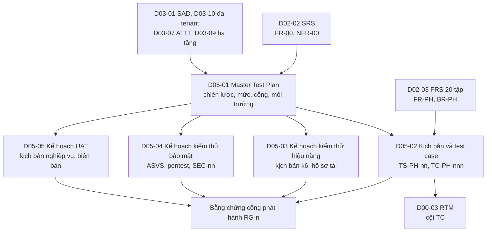
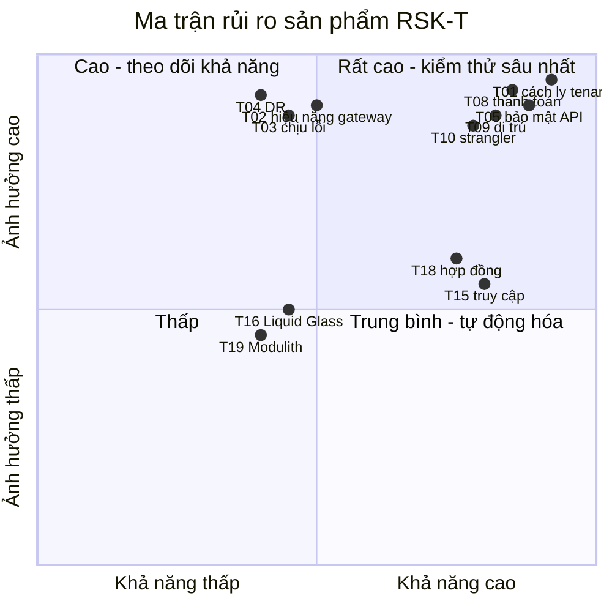
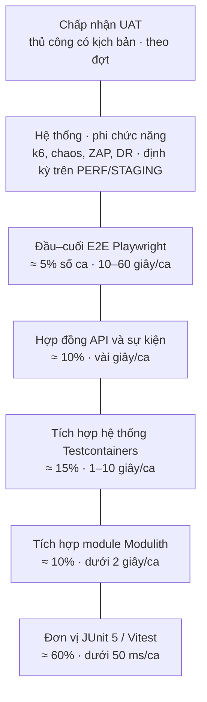

# D05-01 · Kế hoạch kiểm thử tổng thể (Master Test Plan)

## 1. Giới thiệu

### 1.1. Mục đích

Tài liệu này là kế hoạch kiểm thử cấp cao nhất của dự án Datahub. Nó trả lời bốn câu hỏi mà mọi kế hoạch kiểm thử theo ISO/IEC/IEEE 29119-3 phải trả lời: **kiểm thử cái gì** (hạng mục và phạm vi), **kiểm thử đến mức nào** (chiến lược dựa trên rủi ro, mức và loại kiểm thử, tiêu chí vào và ra), **kiểm thử bằng gì và ở đâu** (công cụ, môi trường, dữ liệu kiểm thử) và **ai làm, khi nào** (tổ chức, vai trò, lịch theo mốc). Mọi kế hoạch kiểm thử chuyên đề phía sau — test case theo phân hệ (D05-02), kế hoạch kiểm thử hiệu năng (D05-03), kế hoạch kiểm thử bảo mật (D05-04) và kế hoạch kiểm thử chấp nhận (D05-05) — kế thừa các quyết định ở đây và chỉ được chặt hơn, không được lỏng hơn.

Kế hoạch phục vụ ba nhóm người đọc. Hội đồng thẩm định dùng mục 3, mục 5, mục 6 và mục 17 để đánh giá rằng mọi yêu cầu phi chức năng ở SRS (D02-02) đều có phương pháp kiểm chứng cụ thể, gắn với công cụ, môi trường và cổng phát hành. Quản lý dự án và chủ đầu tư dùng mục 6, mục 13 và mục 14 để biết cổng nào chặn phát hành và lịch kiểm thử theo từng đợt. Đội phát triển và đội kiểm thử dùng mục 4, mục 7 đến mục 12 làm luật làm việc hằng ngày: viết kiểm thử ở mức nào, dùng dữ liệu gì, pipeline chạy gì, ghi lỗi ra sao.

### 1.2. Phạm vi tài liệu

Tài liệu bao phủ toàn bộ vòng đời kiểm thử của sản phẩm Datahub từ mốc khởi động T0 tới khi đợt 3 được nghiệm thu, cho cả hai hồ sơ triển khai (tỉnh độc lập on-prem và nền tảng dùng chung trên cloud Chính phủ, D03-01 §10). Kiểm thử của hạ tầng phần cứng, đường truyền và hệ thống của bên thứ ba (NDXP, PayGov, HTTT của sở) không thuộc phạm vi; Datahub chỉ kiểm thử phần tích hợp với chúng thông qua giả lập và môi trường thử của bên cung cấp.

Tài liệu không chứa test case chi tiết. Test case nằm ở D05-02, mỗi phân hệ một tập. Kịch bản tải chi tiết nằm ở D05-03; kịch bản kiểm thử xâm nhập và bảng kiểm ASVS chi tiết nằm ở D05-04; kịch bản UAT và biên bản nghiệm thu nằm ở D05-05.

### 1.3. Căn cứ

Kế hoạch được lập dựa trên các tài liệu và tiêu chuẩn dưới đây. Bảng cho biết mỗi căn cứ chi phối phần nào của kế hoạch, để khi căn cứ thay đổi người đọc biết phải rà lại mục nào.

| Căn cứ | Nội dung chi phối kế hoạch | Mục bị ảnh hưởng |
|---|---|---|
| D02-01 BRD | Mục tiêu `BO`, chỉ số `KPI-01…18`, yêu cầu `REQ-01…22`, phân đợt MVP / đợt 2 / đợt 3, tiêu chí thành công §11 | 2, 3, 6, 14 |
| D02-02 SRS | Yêu cầu dùng chung `FR-00-001…093`, phi chức năng `NFR-00-001…062` kèm phương pháp đo, hồ sơ quy mô "tỉnh vừa" | 5, 17 |
| D03-01 SAD | Phân hệ, đơn vị triển khai (DU), control/data plane, mẫu tích hợp, rủi ro kiến trúc `RSK-A01…A05` | 2, 3, 4 |
| D03-10 Thiết kế đa tenant | Cơ chế cách ly theo tầng, quy tắc phát triển §6 (quy tắc 6: kiểm thử rò rỉ chéo tenant, kỳ vọng `404`), saga khởi tạo tenant | 5.6 |
| D03-07 Thiết kế ATTT | Danh mục biện pháp `SEC-nn` theo cấp độ 3 | 5.5 |
| D03-09 Hạ tầng, triển khai, DR | Hồ sơ quy mô, quy trình diễn tập DR hằng quý, kiến trúc hai site | 5.3, 5.4, 7 |
| D00-01 Thuật ngữ và quy ước | Mã `TS-{PH}-{nn}`, `TC-{PH}-{nnn}`, quy tắc truy vết §3.2 (quy tắc 4: FR mức M có ít nhất hai TC dương và âm) | 12 |
| D00-03 Ma trận truy vết | 183 mục `LGC` của hệ cũ và kết luận Giữ nguyên / Nâng cấp / Thay thế / Loại bỏ | 5.1, 5.9 |
| ISO/IEC/IEEE 29119-3 (STD-02) | Cấu trúc tài liệu kế hoạch kiểm thử | Toàn tài liệu |
| OWASP ASVS 5.0 mức 2, OWASP API Security Top 10 2023 | Tiêu chí kiểm thử bảo mật ứng dụng và API (NFR-00-024) | 5.5 |
| WCAG 2.2 mức AA (STD-04) | Tiêu chí kiểm thử khả năng truy cập (NFR-00-040…045) | 5.7 |
| Luật An ninh mạng 116/2025/QH15, Nghị định 331/2026/NĐ-CP, TCVN 14423:2026 | Yêu cầu kiểm tra an ninh mạng định kỳ ở cấp độ 3 (nhóm "quản lý kiểm tra an ninh mạng" và "phát triển ứng dụng an toàn"; số mục cụ thể cần đối chiếu) | 5.5, 6 |
| Luật Bảo vệ dữ liệu cá nhân 91/2025/QH15, Nghị định 356/2025/NĐ-CP | Cấm dùng dữ liệu cá nhân thật trong môi trường kiểm thử nếu không có căn cứ; che dữ liệu | 8 |
| `docs/08-implementation/04-ke-hoach-phat-trien.md`, `02-huong-dan-lap-trinh.md` (repo) | Các wave W0–W6, lane `L-QA`, cổng CI hiện có Gate A/B/C/D/S | 9, 14 |

> **Câu hỏi mở Q360:** Các nhóm yêu cầu "quản lý kiểm tra an ninh mạng" và "phát triển ứng dụng an toàn" ở cấp độ 3 của TCVN 14423:2026 (dự kiến mục 5.17 và 5.18) chưa được đối chiếu toàn văn. Cần xác nhận tần suất kiểm tra, đánh giá an ninh mạng bắt buộc (ví dụ kiểm thử xâm nhập trước vận hành và định kỳ hằng năm) để chốt lịch ở mục 14 và D05-04.

### 1.4. Quan hệ với các tài liệu kiểm thử khác

Bộ tài liệu kiểm thử được tổ chức thành năm tài liệu. Sơ đồ dưới đây cho thấy chiều kế thừa và chiều cung cấp bằng chứng giữa chúng.

Sơ đồ cho thấy D05-01 đứng giữa phần yêu cầu, thiết kế và các tài liệu kiểm thử chuyên đề. D05-02 nhận yêu cầu chức năng từ FRS nhưng nhận quy ước, mức kiểm thử và tiêu chí ra từ D05-01; mỗi test case khi được viết xong cập nhật cột TC trong RTM. D05-03, D05-04 và D05-05 chi tiết hóa ba loại kiểm thử có quy trình và bên tham gia riêng (đội hiệu năng, đơn vị kiểm thử bảo mật độc lập, người dùng nghiệp vụ của tỉnh). Kết quả của cả bốn tài liệu là bằng chứng để mở các cổng phát hành `RG-n` định nghĩa ở mục 6.

Phân chia trách nhiệm cụ thể giữa các tài liệu được ghi ở bảng dưới đây; nguyên tắc chung là D05-01 quyết định "làm gì và đạt bao nhiêu", tài liệu chuyên đề quyết định "làm cụ thể ra sao".

| Tài liệu | D05-01 quyết định | Tài liệu chuyên đề quyết định |
|---|---|---|
| D05-02 Test case | Quy ước mã, mẫu test case, số TC tối thiểu theo mức ưu tiên FR, kỹ thuật thiết kế bắt buộc | Từng `TS`, `TC` cụ thể, dữ liệu đầu vào, kết quả mong đợi |
| D05-03 Hiệu năng | Chỉ tiêu từ NFR-00-001…008, 060…062; hồ sơ "tỉnh vừa"; môi trường PERF; loại kiểm thử tải bắt buộc | Kịch bản k6, mô hình tải chi tiết, cách sinh dữ liệu khối lượng lớn, phân tích nút thắt |
| D05-04 Bảo mật | Phạm vi ASVS 5.0 L2, công cụ SAST/DAST, bộ kiểm thử rò rỉ chéo tenant, tần suất pentest, ngưỡng chặn | Bảng kiểm ASVS từng mục, kịch bản pentest, ánh xạ chi tiết `SEC-nn` → ca kiểm thử |
| D05-05 UAT | Tiêu chí vào/ra UAT, vai trò người dùng tham gia, gắn với KPI "Từ nghiệm thu" | Kịch bản nghiệp vụ theo `BP`, lịch buổi UAT, mẫu biên bản |

### 1.5. Thuật ngữ dùng trong tài liệu

Tài liệu dùng thuật ngữ đã định nghĩa ở D00-01. Một số thuật ngữ kiểm thử dưới đây chưa có trong D00-01 và được đề xuất bổ sung (mục 20).

| Thuật ngữ | Tiếng Anh | Nghĩa trong tài liệu này |
|---|---|---|
| Mức kiểm thử | Test level | Nhóm hoạt động kiểm thử theo phạm vi đối tượng: đơn vị, tích hợp module, tích hợp hệ thống, hợp đồng, đầu–cuối, hệ thống, chấp nhận |
| Loại kiểm thử | Test type | Nhóm hoạt động kiểm thử theo đặc tính chất lượng: chức năng, hiệu năng, bảo mật, khả năng truy cập… |
| Tháp kiểm thử | Test pyramid | Phân bổ số lượng kiểm thử: nhiều kiểm thử đơn vị nhanh ở đáy, ít kiểm thử đầu–cuối chậm ở đỉnh |
| Kiểm thử hợp đồng | Contract testing | Kiểm tra bên cung cấp và bên dùng một API hoặc sự kiện cùng tuân thủ một hợp đồng (OpenAPI, AsyncAPI, schema) mà không cần chạy cả hai cùng lúc |
| Kiểm thử rò rỉ chéo tenant | Cross-tenant leakage test | Ca kiểm thử tạo dữ liệu ở tenant A rồi truy cập bằng danh tính của tenant B, kỳ vọng không đọc, sửa, xóa, liệt kê hay suy ra được dữ liệu (D03-10 §6) |
| Kiểm thử hỗn loạn | Chaos engineering / chaos test | Chủ động gây lỗi hạ tầng (tắt pod, nút, mạng) trong môi trường kiểm soát để kiểm chứng khả năng chịu lỗi |
| Lưu lượng bóng | Shadow traffic | Bản sao lưu lượng thật của hệ cũ được gửi song song tới hệ mới; kết quả của hệ mới chỉ dùng để so sánh, không trả cho bên gọi |
| Kiểm thử hồi quy giao diện | Visual regression test | So sánh ảnh chụp giao diện với ảnh chuẩn đã duyệt để phát hiện thay đổi hiển thị ngoài ý muốn |
| Cổng phát hành | Release gate | Điểm kiểm soát chất lượng mà một bản dựng phải vượt qua trước khi được đưa lên môi trường hoặc giai đoạn tiếp theo; mã `RG-n` |
| Kiểm thử khói | Smoke test | Bộ kiểm thử ngắn kiểm tra các chức năng thiết yếu còn chạy sau khi triển khai |
| Ca kiểm thử bất ổn | Flaky test | Ca kiểm thử cho kết quả khác nhau qua các lần chạy mà mã không đổi |

## 2. Bối cảnh kiểm thử

### 2.1. Đối tượng kiểm thử

Đối tượng kiểm thử (test item) của Datahub được chia theo ba chiều. Theo **phân hệ**, có 20 phân hệ `PH-01…PH-20`, mỗi phân hệ có FRS, SDD và tập test case riêng. Theo **đơn vị triển khai**, có sáu DU Spring Boot (`dh-connect`, `dh-integration`, `dh-data`, `dh-platform`, `dh-payment`, `dh-assist`), một DU Camel Quarkus (`dh-runtime`), hai ứng dụng giao diện (`dh-console`, `dh-portal`) và các thành phần bên thứ ba được cấu hình (APISIX, Kafka, Keycloak, OPA, PostgreSQL, OpenBao, Garage, Valkey). Theo **hồ sơ triển khai**, có hồ sơ tỉnh độc lập và hồ sơ nền tảng dùng chung, với ba chế độ cách ly tenant `SHARED`, `DEDICATED_DB`, `DEDICATED_CLUSTER` (D03-10 §2).

Bảng dưới đây liệt kê 20 phân hệ cùng đợt phát hành (theo D02-01 §8.3) và mức rủi ro sản phẩm được gán ở mục 3. Mức rủi ro quyết định cường độ kiểm thử: phân hệ rủi ro **Rất cao** bắt buộc đủ mọi mức kiểm thử ở mục 4 và các loại kiểm thử chuyên đề tương ứng; phân hệ rủi ro **Trung bình** được phép giảm kiểm thử đầu–cuối xuống luồng chính.

| PH | Tên | DU | Đợt | Mức rủi ro | Loại kiểm thử chuyên đề nổi bật |
|---|---|---|---|---|---|
| PH-01 | Kết nạp HTTT | `dh-connect` | **MVP** | Cao | Saga có bù trừ, cấp và thu hồi thông tin xác thực |
| PH-02 | Danh mục dịch vụ | `dh-connect` | **MVP** | Cao | Hợp đồng OpenAPI nhập vào, vòng đời API, gói sử dụng |
| PH-03 | Cổng API | `apisix`, `dh-connect` | **MVP** | Rất cao | Hiệu năng NFR-00-001/002, bảo mật API, đồng bộ cấu hình, chịu lỗi control plane |
| PH-04 | Lõi tích hợp, trình thiết kế luồng | `dh-integration`, `dh-runtime` | **MVP** | Rất cao | Kiểm thử luồng Camel, NFR-00-007, di trú luồng XML, song song strangler |
| PH-05 | Bộ điều hợp | `dh-integration`, `dh-runtime` | **MVP** | Cao | Kiểm thử Kamelet với Testcontainers (CSDL, SFTP, SOAP giả lập) |
| PH-06 | Dữ liệu chủ | `dh-data` | Đợt 3 | Trung bình | Độ chính xác đối sánh, hiệu năng lô |
| PH-07 | Danh mục dùng chung | `dh-data` | **MVP** | Cao | NFR-00-008, nhập xuất, di trú Aita, đồng bộ quốc gia |
| PH-08 | Chất lượng dữ liệu | `dh-data` | Đợt 3 | Trung bình | Đúng đắn quy tắc, lịch đo |
| PH-09 | Quyền riêng tư | `dh-data` | Đợt 2 | Rất cao | Che dữ liệu NFR-00-029, mục đích khai thác, kiểm toán |
| PH-10 | Sự kiện | `dh-integration`, Kafka | **MVP** | Rất cao | NFR-00-006, hợp đồng AsyncAPI, ACL Kafka theo tenant, cầu nối Pulsar |
| PH-11 | Quy trình liên thông | `dh-platform` | Đợt 2 | Trung bình | Kiểm thử BPMN với Flowable nhúng, hạn xử lý với đồng hồ giả lập |
| PH-12 | Định danh và phân quyền | Keycloak, OPA, `dh-platform` | **MVP** | Rất cao | Kiểm thử chính sách Rego, MFA, phiên, khóa tài khoản |
| PH-13 | Giám sát và kiểm toán | `dh-platform`, LGTM | **MVP** | Cao | Toàn vẹn chuỗi băm FR-00-042, nhãn tenant trên dữ liệu quan sát |
| PH-14 | Kết nối quốc gia | `dh-runtime`, `dh-integration` | **MVP** | Rất cao | Adapter NDXP bằng giả lập, kiểm thử hợp đồng định kỳ với môi trường thử |
| PH-15 | Cổng nhà phát triển | `dh-portal`, `dh-connect` | Đợt 2 | Trung bình | Khả năng truy cập ở 360 px, sandbox cách ly |
| PH-16 | Báo cáo chỉ tiêu | `dh-platform` | Đợt 3 | Thấp | Đúng đắn số liệu tổng hợp |
| PH-17 | Trợ lý AI | `dh-assist` | Đợt 3 | Trung bình | Đánh giá chất lượng câu trả lời, chống rò rỉ dữ liệu qua lời nhắc, tắt theo tenant |
| PH-18 | Vận hành, xử lý lỗi | `dh-platform` | **MVP** | Cao | DLQ, xử lý lại idempotent, công cụ di trú và đối chiếu |
| PH-19 | Thanh toán | `dh-payment` | Đợt 2 | Rất cao | Sandbox PayGov, chữ ký callback, idempotency, đối soát, `T-MONEY` |
| PH-20 | Quản trị tenant | `dh-platform` | **MVP** | Rất cao | Saga khởi tạo NFR-00-057, sáp nhập tenant, kiểm tra cách ly sau khởi tạo |

Ngoài 20 phân hệ, các **thành phần xuyên suốt** cũng là đối tượng kiểm thử riêng: thư viện dùng chung `libs/common-java` (bộ lọc tenant, Problem Details, `trace_id`), design system `@datahub/ui`, bộ manifest Kustomize và cấu hình Argo CD, chính sách mạng Cilium, cấu hình Istio ambient, cấu hình sao lưu và DR. Các thành phần này được kiểm thử theo cùng chiến lược nhưng không gắn mã phân hệ; test case của chúng dùng mã `PH` = `00` (ví dụ `TC-00-015`).

### 2.2. Trong phạm vi

Phạm vi kiểm thử gồm mọi yêu cầu `FR-00`, `NFR-00`, `FR-{PH}`, `NFR-{PH}`, `BR-{PH}` của 20 phân hệ theo đợt phát hành; mọi mục `LGC` có kết luận Giữ nguyên, Nâng cấp hoặc Thay thế trong D00-03 (179 mục), được kiểm chứng gián tiếp qua FR tương ứng; công cụ di trú dữ liệu và luồng từ hệ cũ (FR-00-090…093); cầu nối tạm và cơ chế chạy song song trong giai đoạn strangler; quy trình triển khai, nâng cấp, sao lưu, khôi phục và DR như những đối tượng kiểm thử có tiêu chí đạt riêng; tài liệu hướng dẫn cài đặt, vận hành và sử dụng ở mức kiểm tra thao tác theo tài liệu được (một người không thuộc đội phát triển làm theo tài liệu và đạt kết quả).

### 2.3. Ngoài phạm vi

Bảng dưới đây liệt kê những gì kế hoạch không kiểm thử, kèm lý do, để hội đồng thẩm định thấy ranh giới trách nhiệm là có chủ ý chứ không phải bỏ sót.

| Nội dung | Lý do | Cách xử lý phần giao |
|---|---|---|
| Chức năng nội tại của NDXP, CSDL quốc gia, PayGov, VNeID | Hệ thống của bên khác, Datahub không kiểm soát | Kiểm thử adapter bằng giả lập và kiểm thử hợp đồng với môi trường thử của bên cung cấp (mục 5.11, 5.12) |
| HTTT nghiệp vụ của sở, ngành | Ngoài phạm vi dự án (D02-01 §8.2) | Dùng HTTT giả lập; kiểm thử kết nối thật chỉ trong UAT và giai đoạn chuyển đổi |
| Phần cứng, đường truyền, ảo hóa của TTDL tỉnh | Thuộc dự án hạ tầng của tỉnh | Kiểm tra cụm K8s đạt yêu cầu tối thiểu D03-09 bằng bộ kiểm tra tiền triển khai trước khi cài |
| Ba chức năng hệ cũ loại bỏ (LGC-TOOL-022, LGC-TOOL-027, LGC-IAM-007) | Chủ đầu tư đã chấp thuận loại bỏ (D00-03 §5.1) | Có ca kiểm thử âm chứng minh chức năng không tồn tại (ví dụ không nạp được JAR vào runtime) |
| Hiệu năng và chất lượng của mô hình ngôn ngữ bên ngoài cho PH-17 | Không thuộc Datahub | Chỉ kiểm thử lớp cổng AI: giới hạn, che dữ liệu, khả năng tắt |
| Kiểm thử chứng nhận cấp độ ATTT của cơ quan có thẩm quyền | Do đơn vị thẩm định thực hiện | D05-04 cung cấp bằng chứng đầu vào cho hồ sơ D03-08 |

## 3. Chiến lược kiểm thử dựa trên rủi ro

### 3.1. Nguyên tắc

Datahub là hạ tầng dùng chung của nhiều tỉnh. Một lỗi ở gateway hoặc ở lớp cách ly tenant không làm hỏng một màn hình mà làm gián đoạn dịch vụ công của hàng trăm HTTT, hoặc làm lộ dữ liệu của tỉnh này cho tỉnh khác. Vì vậy kế hoạch không chia đều công sức kiểm thử cho mọi chức năng mà phân bổ theo rủi ro sản phẩm: chỗ nào hậu quả lỗi càng nặng và khả năng lỗi càng cao thì kiểm thử càng sâu, càng sớm và càng tự động.

Chiến lược dựa trên năm nguyên tắc. Thứ nhất, **kiểm thử sớm và dịch trái** (shift-left): hợp đồng API và sự kiện được kiểm tra ngay khi viết (NT-04 của SAD), quy tắc cách ly tenant được kiểm tra ở mức đơn vị và tích hợp, không chờ tới kiểm thử hệ thống. Thứ hai, **tự động hóa là mặc định**: mọi kiểm thử lặp lại được phải chạy trong CI; kiểm thử thủ công chỉ dành cho kiểm thử khám phá, kiểm tra trình đọc màn hình, UAT và kiểm thử xâm nhập. Thứ ba, **kiểm thử trên hạ tầng thật thay vì giả lập nội bộ**: PostgreSQL, Kafka, Keycloak, OPA, Valkey được chạy thật bằng Testcontainers thay vì cơ sở dữ liệu nhúng, vì nhiều rủi ro lớn nhất (RLS, ACL Kafka, chính sách OPA) chỉ lộ ra trên thành phần thật. Thứ tư, **giả lập chỉ ở biên ngoài hệ thống**: NDXP, PayGov, HTTT của sở, máy chủ thư được giả lập bằng WireMock hoặc Microcks; không giả lập các phân hệ của chính Datahub ở mức tích hợp hệ thống. Thứ năm, **mỗi chỉ tiêu phi chức năng có một kiểm thử đo được**: không có NFR nào được nghiệm thu bằng nhận định chủ quan.

### 3.2. Phương pháp đánh giá rủi ro

Mỗi rủi ro sản phẩm được chấm theo hai thang 1–3. **Ảnh hưởng** (I) đo hậu quả nếu lỗi lọt ra môi trường thật: 3 là lộ dữ liệu, vi phạm pháp luật, sai lệch tài chính hoặc gián đoạn data plane; 2 là mất một chức năng quản trị hoặc sai số liệu báo cáo; 1 là bất tiện có cách làm thay. **Khả năng** (L) đo xác suất lỗi tồn tại: 3 là công nghệ mới với đội, logic phức tạp, phụ thuộc bên ngoài thay đổi; 2 là logic trung bình; 1 là chức năng đơn giản, đã có mẫu. Điểm rủi ro bằng I × L. Điểm 7–9 là **Rất cao**, 5–6 là **Cao**, 3–4 là **Trung bình**, 1–2 là **Thấp**.

Bảng sau ánh xạ mức rủi ro sang cường độ kiểm thử tối thiểu. Đây là ràng buộc cho D05-02: tập test case của một phân hệ phải đạt cường độ tương ứng với mức rủi ro cao nhất của các rủi ro gắn với phân hệ đó.

| Mức rủi ro | Kỹ thuật thiết kế test case bắt buộc | Mức kiểm thử bắt buộc | Tự động hóa | Rà soát độc lập |
|---|---|---|---|---|
| Rất cao | Phân hoạch tương đương, giá trị biên, bảng quyết định, chuyển trạng thái, đoán lỗi; kiểm thử dựa trên tấn công cho phần bảo mật | Đơn vị, tích hợp module, tích hợp hệ thống, hợp đồng, E2E luồng chính và luồng ngoại lệ, hệ thống, chấp nhận | 100% ca hồi quy tự động | Test case được người thứ hai (không phải tác giả FR) rà soát; kết quả kiểm thử chuyên đề được bên độc lập xác nhận |
| Cao | Phân hoạch tương đương, giá trị biên, chuyển trạng thái | Đơn vị, tích hợp module, tích hợp hệ thống, hợp đồng, E2E luồng chính | ≥ 90% ca hồi quy tự động | Rà soát chéo trong nhóm |
| Trung bình | Phân hoạch tương đương, giá trị biên | Đơn vị, tích hợp hệ thống, E2E luồng chính | ≥ 70% ca hồi quy tự động | Tự rà soát theo bảng kiểm |
| Thấp | Phân hoạch tương đương | Đơn vị, tích hợp hệ thống | Tùy chọn | Tự rà soát |

### 3.3. Bảng rủi ro sản phẩm

Bảng dưới đây là danh sách rủi ro sản phẩm ban đầu, mã `RSK-T{nn}` (theo cùng cách đặt mã rủi ro chuyên đề như `RSK-A{nn}` ở SAD §12). Mỗi rủi ro được gắn với yêu cầu bị đe dọa, điểm I × L, và đáp ứng kiểm thử — tức là loại kiểm thử và mức kiểm thử được dùng để giảm rủi ro. Bảng được rà lại ở mỗi cổng phát hành; rủi ro mới phát sinh từ lỗi thực tế (ví dụ một lớp lỗi lặp lại) được bổ sung.

| Mã | Rủi ro sản phẩm | Yêu cầu bị đe dọa | I | L | Điểm | Đáp ứng kiểm thử |
|---|---|---|---|---|---|---|
| RSK-T01 | Dữ liệu tenant này đọc, sửa hoặc liệt kê được từ tenant khác do quên đặt biến phiên, vai trò CSDL có `BYPASSRLS`, truy vấn native, khóa bộ nhớ đệm hoặc topic không có tiền tố | FR-00-010, 011; RSK-A03 | 3 | 3 | 9 | Bộ kiểm thử rò rỉ chéo tenant tự động sinh theo mọi endpoint (mục 5.6); ArchUnit chặn truy vấn native; kiểm tra khởi động DU; kiểm thử ACL Kafka, khóa Valkey, bucket; chạy ở mọi PR và trước mọi cổng |
| RSK-T02 | Gateway thêm độ trễ hoặc giảm thông lượng dưới tải, làm chậm dịch vụ công | NFR-00-001, 002; KPI-04 | 3 | 2 | 6 | Kiểm thử tải, chịu tải, bền với k6 trên PERF (mục 5.3); đo từ chỉ số APISIX |
| RSK-T03 | Data plane ngừng khi control plane, một nút hoặc một vùng sự cố; nâng cấp gây lỗi lượt gọi | NFR-00-010…013, 015; KPI-03 | 3 | 2 | 6 | Kiểm thử hỗn loạn với Chaos Mesh, kiểm thử nâng cấp cuốn chiếu dưới tải (mục 5.4) |
| RSK-T04 | Mất dữ liệu quá RPO hoặc khôi phục quá RTO khi mất site | NFR-00-014; KPI-16 | 3 | 2 | 6 | Diễn tập DR hằng quý có đo thời gian và đối chiếu dữ liệu (mục 5.4.4) |
| RSK-T05 | Lỗ hổng ứng dụng hoặc API (OWASP API Top 10: BOLA, xác thực hỏng, cấp quyền mức hàm) | NFR-00-024; REQ-03, REQ-12 | 3 | 3 | 9 | SAST Semgrep, DAST OWASP ZAP, bảng kiểm ASVS 5.0 L2, kiểm thử xâm nhập độc lập (mục 5.5) |
| RSK-T06 | Lộ thông tin xác thực hoặc bí mật trong mã, ảnh container, log; thành phần có lỗ hổng đã biết | NFR-00-022, 023; KPI-09 | 3 | 2 | 6 | gitleaks, Trivy chặn ở CI; quét log bằng bộ mẫu dữ liệu (mục 5.5) |
| RSK-T07 | Giá trị trường Nhạy cảm xuất hiện trong log, thư thông báo, tệp xuất | NFR-00-029; FR-00-034, 062 | 3 | 2 | 6 | Bộ quét mẫu dữ liệu canary trên log của mọi môi trường kiểm thử (mục 8.4); E2E kiểm tra tệp xuất |
| RSK-T08 | Sai lệch tiền, giao dịch trùng hoặc mất kết quả thanh toán; callback giả mạo | REQ-19; KPI-13, 14; FR-00-091 | 3 | 3 | 9 | Kiểm thử PH-19 với sandbox PayGov và giả lập, kiểm thử idempotency, chữ ký, đối soát (mục 5.10) |
| RSK-T09 | Di trú làm mất, nhân đôi hoặc biến dạng dữ liệu (tràn `int(10)`, ngày dạng chuỗi, EAV) | FR-00-090…093; REQ-22 | 3 | 3 | 9 | Kiểm thử di trú có đối chiếu số lượng và tổng kiểm tra, diễn tập di trú trên bản sao dữ liệu đã che (mục 5.8) |
| RSK-T10 | Hệ mới trả kết quả khác hệ cũ cho cùng yêu cầu khi chuyển lưu lượng theo strangler | REQ-22; BP-09 | 3 | 3 | 9 | Kiểm thử song song bằng lưu lượng bóng và so sánh phản hồi (mục 5.9) |
| RSK-T11 | Đặc tả NDXP hoặc PayGov thay đổi làm hỏng adapter | REQ-14, REQ-19; RSK-A04 | 3 | 2 | 6 | Kiểm thử hợp đồng định kỳ hằng đêm với môi trường thử của bên cung cấp; giả lập theo đặc tả (mục 5.11) |
| RSK-T12 | Luồng Camel chuyển đổi sai dữ liệu, không xử lý lỗi, mất bản tin; biên dịch native thiếu component | REQ-04, REQ-05; NFR-00-007; RSK-A02 | 3 | 2 | 6 | Kiểm thử luồng Camel ở cả chế độ JVM và native, kiểm thử bộ xử lý lỗi và DLQ (mục 5.13) |
| RSK-T13 | Sự kiện bị mất, trùng hoặc sai tenant giữa outbox, Kafka và subscriber | REQ-10; NFR-00-006 | 3 | 2 | 6 | Kiểm thử tích hợp outbox–Debezium–Kafka, kiểm thử hợp đồng AsyncAPI, kiểm thử kiểm tra header `dhtenant` |
| RSK-T14 | Nhật ký kiểm toán thiếu bản ghi hoặc bị sửa không phát hiện | FR-00-040…042; KPI-07 | 3 | 2 | 6 | Kiểm thử tích hợp sinh bản ghi cho mọi thao tác trong FR-00-040; kiểm thử công cụ kiểm tra toàn vẹn chuỗi băm |
| RSK-T15 | Giao diện không dùng được cho người khuyết tật hoặc không đạt tương phản trên nền glass | NFR-00-040…045; REQ-21 | 2 | 3 | 6 | axe-core tự động trên mọi màn, kiểm tra NVDA thủ công 10 luồng chính, kiểm tra tương phản trên nền glass (mục 5.7) |
| RSK-T16 | Giao diện Liquid Glass chậm hoặc hiển thị lệch giữa trình duyệt, chế độ sáng tối | NFR-00-005, 043, 044; RSK-A05 | 2 | 2 | 4 | Lighthouse CI, visual regression đa trình duyệt (mục 5.14, 5.15) |
| RSK-T17 | Khởi tạo tenant vượt thời gian hoặc để lại tài nguyên mồ côi khi lỗi giữa saga; sáp nhập tenant làm lẫn dữ liệu | NFR-00-057; REQ-20; KPI-12 | 3 | 2 | 6 | Kiểm thử saga có tiêm lỗi từng bước, đo thời gian, kiểm tra cách ly sau khởi tạo và sau sáp nhập |
| RSK-T18 | Thay đổi phá vỡ hợp đồng API giữa các DU hoặc với HTTT trong cùng phiên bản chính | NFR-00-055 | 2 | 3 | 6 | Kiểm thử hợp đồng do bên dùng dẫn dắt, kiểm tra thay đổi phá vỡ OpenAPI ở CI (mục 4.4) |
| RSK-T19 | Vi phạm ranh giới module làm mục ruỗng kiến trúc Modulith | NFR-00-054 | 2 | 2 | 4 | `ApplicationModules.verify()` và ArchUnit ở mọi PR |
| RSK-T20 | Trợ lý AI tiết lộ dữ liệu ngoài quyền người hỏi hoặc dữ liệu tenant khác | REQ-17 | 3 | 2 | 6 | Kiểm thử chống tiêm lời nhắc (prompt injection), kiểm thử rò rỉ chéo tenant trên kho vector |
| RSK-T21 | Hạn mức tenant không chặn được tenant "hàng xóm ồn ào" | D03-10 §5.3; NFR-00-060 | 2 | 2 | 4 | Kiểm thử tải nhiều tenant: một tenant vượt hạn mức, đo ảnh hưởng tới tenant khác |

Sơ đồ dưới đây xếp các rủi ro trên vào ma trận ảnh hưởng – khả năng, để thấy vùng tập trung công sức kiểm thử.

Ma trận cho thấy năm rủi ro điểm 9 (cách ly tenant, bảo mật API, thanh toán, di trú, strangler) nằm ở góc phải trên; đây là nơi kế hoạch đặt kiểm thử tự động chạy ở mọi PR (với RSK-T01, RSK-T05) hoặc bộ kiểm thử chuyên đề có bên độc lập xác nhận (RSK-T08, T09, T10). Nhóm rủi ro hạ tầng (hiệu năng, chịu lỗi, DR) có ảnh hưởng rất cao nhưng khả năng trung bình nhờ kiến trúc tách control/data plane; chúng được kiểm chứng bằng kiểm thử phi chức năng định kỳ trên môi trường PERF và STAGING thay vì ở mọi PR. Nhóm giao diện có khả năng cao nhưng ảnh hưởng vừa; chúng được tự động hóa rộng (axe-core, visual regression) để chi phí mỗi lần kiểm tra gần bằng không.

## 4. Các mức kiểm thử

### 4.1. Tổng quan và tháp kiểm thử

Datahub dùng bảy mức kiểm thử. Bốn mức dưới (đơn vị, tích hợp module, tích hợp hệ thống, hợp đồng) do đội phát triển viết và chạy trong pipeline của mỗi PR; ba mức trên (đầu–cuối, hệ thống, chấp nhận) do đội kiểm thử dẫn dắt và chạy trên môi trường dùng chung. Sơ đồ dưới đây thể hiện tháp kiểm thử cùng tỷ lệ số lượng ca mục tiêu và thời gian chạy điển hình mỗi ca.

Tháp đọc từ dưới lên: càng xuống đáy, ca kiểm thử càng nhiều, càng nhanh, càng rẻ và càng khoanh vùng lỗi chính xác; càng lên đỉnh, ca càng ít, càng chậm nhưng càng gần trải nghiệm thật. Tỷ lệ phần trăm là mục tiêu theo số ca của bộ tự động và được theo dõi bằng chỉ số ở mục 11; nếu tỷ lệ E2E vượt 10%, trưởng nhóm kiểm thử yêu cầu đẩy các kiểm tra logic xuống mức thấp hơn. Datahub khác tháp kinh điển ở chỗ tầng tích hợp hệ thống dày hơn thường lệ: lý do là nhiều quy tắc an toàn quan trọng nhất (RLS, ACL Kafka, chính sách OPA, chữ ký callback) nằm trong cấu hình thành phần hạ tầng, chỉ kiểm chứng được khi chạy thành phần thật. Lựa chọn này được ghi tại ADR-038.

Mỗi mức dưới đây được mô tả theo cùng khung: mục tiêu, đối tượng, người chịu trách nhiệm, công cụ, môi trường, tiêu chí vào và tiêu chí ra.

### 4.2. Kiểm thử đơn vị

**Mục tiêu.** Kiểm chứng logic của từng lớp, hàm, component một cách cô lập: quy tắc nghiệp vụ `BR`, kiểm tra hợp lệ đầu vào, ánh xạ dữ liệu, máy trạng thái, hàm tạo tên có tenant (D03-10 §6 quy tắc 4), hàm che dữ liệu, bộ xử lý `T-MONEY`.

**Đối tượng và cách làm.** Ở backend Java, mỗi lớp dịch vụ miền và lớp tiện ích có kiểm thử JUnit 5 với AssertJ; phụ thuộc ra ngoài module được thay bằng Mockito. Kiểm thử dựa trên thuộc tính (property-based testing) bằng jqwik được dùng cho các hàm có không gian đầu vào lớn: chuẩn hóa tìm kiếm không dấu (FR-00-020), chuyển đổi số tiền từ `int(10)` sang `numeric(19,0)`, phân tích ngày tháng hệ cũ. Chính sách OPA viết bằng Rego được kiểm thử bằng `opa test` với độ phủ quy tắc 100%, mỗi quy tắc có ca cho phép và ca từ chối, và mọi chính sách có ca kiểm tra điều kiện `input.tenant == data.resource.tenant` (D03-10 §4). Ở giao diện, component React và hook được kiểm thử bằng Vitest và Testing Library; lời gọi mạng được giả lập bằng MSW (Mock Service Worker) sinh từ OpenAPI. Luồng Camel có kiểm thử đơn vị cho từng processor và biểu thức JQ.

**Trách nhiệm.** Lập trình viên viết cùng PR với mã nguồn. Người rà soát PR kiểm tra có kiểm thử cho nhánh logic mới.

**Công cụ và môi trường.** JUnit 5, AssertJ, Mockito, jqwik, `opa test`, Vitest, Testing Library, MSW; chạy trên máy lập trình viên và runner CI, không cần môi trường dùng chung.

**Tiêu chí vào.** Mã biên dịch được; hợp đồng của module đã có.

**Tiêu chí ra.** 100% ca đạt; độ phủ dòng ≥ 80% cho mã nghiệp vụ backend và ≥ 70% cho giao diện (NFR-00-053), đo bằng JaCoCo và V8 coverage, tính trên mã mới của PR không được thấp hơn ngưỡng; độ phủ quy tắc Rego 100%; điểm đột biến (mutation score) bằng PIT ≥ 60% cho các gói `domain` của phân hệ rủi ro Rất cao, chạy hằng đêm thay vì ở PR để giữ ngân sách thời gian.

### 4.3. Kiểm thử tích hợp module (Spring Modulith)

**Mục tiêu.** Kiểm chứng mỗi module Spring Modulith hoạt động đúng với các module nó phụ thuộc trong cùng DU, chỉ giao tiếp qua `api` và `events`, và tôn trọng ranh giới kiến trúc (NT-05, NFR-00-054).

**Đối tượng và cách làm.** Có ba loại kiểm thử ở mức này. Loại thứ nhất là **kiểm tra cấu trúc**: một lớp kiểm thử mỗi DU gọi `ApplicationModules.of(...).verify()` để phát hiện phụ thuộc vòng và truy cập vào gói `internal` của module khác; bổ sung các quy tắc ArchUnit dự án như cấm `@Query(nativeQuery = true)` ngoài danh sách cho phép đã duyệt (D03-10 §6 quy tắc 2), cấm tạo `DataSource` ngoài cấu hình chung, cấm gọi `TenantContext.set` ngoài thư viện dùng chung, cấm đọc tenant từ `@PathVariable`, `@RequestParam`, `@RequestBody` (quy tắc 1), bắt buộc tác vụ `@Scheduled` đi qua `TenantContext.runAs` (quy tắc 5). Loại thứ hai là **kiểm thử module cô lập** bằng `@ApplicationModuleTest`: khởi động riêng một module với chế độ `STANDALONE` hoặc `DIRECT_DEPENDENCIES`, kiểm tra luồng nghiệp vụ trong module với CSDL thật (Testcontainers). Loại thứ ba là **kiểm thử sự kiện giữa module** bằng `Scenario` của Spring Modulith: kích hoạt một lệnh, chờ sự kiện miền được phát (ví dụ `CatalogPublished`), kiểm tra module nghe sự kiện xử lý đúng; kiểm tra bản ghi `event_publication` chuyển trạng thái hoàn tất, đảm bảo không mất sự kiện khi bên nghe lỗi.

**Trách nhiệm.** Lập trình viên của module; trưởng nhóm kỹ thuật duy trì bộ quy tắc ArchUnit.

**Công cụ và môi trường.** Spring Modulith Test, ArchUnit, JUnit 5, Testcontainers PostgreSQL; runner CI.

**Tiêu chí vào.** Kiểm thử đơn vị của module đạt.

**Tiêu chí ra.** `verify()` đạt; 0 vi phạm ArchUnit (không có cơ chế "đóng băng" vi phạm cũ, trừ ngoại lệ có ADR); mỗi sự kiện miền công bố có ít nhất một kiểm thử `Scenario`.

### 4.4. Kiểm thử tích hợp hệ thống với Testcontainers

**Mục tiêu.** Kiểm chứng một DU hoạt động đúng với các thành phần hạ tầng thật mà nó dùng: PostgreSQL 18 có RLS, Kafka (KRaft) và Apicurio, Keycloak, OPA, Valkey, OpenBao, kho S3 tương thích. Đây là mức phát hiện các lỗi mà giả lập không thấy được: chính sách RLS sai, migration Liquibase thiếu changeset chính sách, ACL Kafka không chặn, cấu hình xác thực token sai realm.

**Đối tượng và cách làm.** Mỗi DU có một lớp cơ sở kiểm thử dùng chung (`AbstractSystemIT`) khởi động một bộ container dùng lại giữa các lớp kiểm thử (Testcontainers chế độ tái sử dụng trong một lần chạy) để giảm thời gian. CSDL được khởi tạo bằng chính migration Liquibase sản xuất, với vai trò kết nối ứng dụng không có `BYPASSRLS` và không là chủ sở hữu bảng — giống hệt môi trường thật. Hai tenant kiểm thử `T90` và `T91` (mã giả, ngoài dải mã tỉnh thật) được tạo sẵn trong realm Keycloak container, với người dùng và client máy mỗi vai trò. API được gọi bằng REST Assured qua máy chủ thật (`@SpringBootTest(webEnvironment = RANDOM_PORT)`) hoặc MockMvc khi cần kiểm soát bộ lọc bảo mật; token được lấy thật từ Keycloak container, không giả mạo JWT, để kiểm tra đúng chuỗi xác thực.

Các nhóm kiểm thử bắt buộc ở mức này gồm: kiểm thử rò rỉ chéo tenant sinh tự động cho mọi endpoint (mục 5.6); kiểm tra khởi động DU từ chối chạy khi vai trò CSDL có `BYPASSRLS` hoặc bảng thiếu chính sách (D03-10 §4); kiểm thử outbox (ghi nghiệp vụ và sự kiện cùng giao dịch, rollback thì không có sự kiện); kiểm thử idempotency với header `Idempotency-Key` gửi lặp đồng thời; kiểm thử khóa lạc quan với `If-Match` (FR-00-052); kiểm thử nhật ký kiểm toán cho mọi loại thao tác ở FR-00-040; kiểm thử Problem Details RFC 9457 và mã `ERR-{PH}-{nnn}` cho mọi ngoại lệ đặc tả trong FRS.

Với `dh-runtime` (Camel Quarkus), mức này dùng `@QuarkusTest` kết hợp Testcontainers (Quarkus Dev Services bị tắt trong CI để cấu hình tường minh) và chạy lại một tập con trên ảnh native bằng `@QuarkusIntegrationTest` (mục 5.13).

**Trách nhiệm.** Lập trình viên viết; đội kiểm thử rà soát độ phủ các nhóm bắt buộc.

**Công cụ và môi trường.** Testcontainers (PostgreSQL, Kafka, Keycloak, Valkey, MinIO hoặc Garage cho S3, OpenBao chế độ dev), REST Assured, MockMvc, Awaitility cho kiểm tra bất đồng bộ; runner CI có Docker hoặc môi trường container tương thích. Ảnh container cho kiểm thử được kéo từ Harbor nội bộ (không kéo trực tiếp từ Internet) và ghim phiên bản trùng với phiên bản triển khai.

**Tiêu chí vào.** Mức đơn vị và tích hợp module đạt; migration chạy được trên CSDL trống.

**Tiêu chí ra.** 100% ca đạt; mỗi endpoint mới có ca rò rỉ chéo tenant đạt; mỗi ngoại lệ trong FRS có ca kiểm thử; tỷ lệ ca bất ổn < 1% (mục 9.5).

### 4.5. Kiểm thử hợp đồng API và sự kiện

**Mục tiêu.** Bảo đảm bên cung cấp và bên dùng mỗi API, mỗi sự kiện luôn tương thích, để các DU, giao diện, HTTT và adapter tiến hóa độc lập mà không vỡ nhau (NT-04, NFR-00-055).

**Phương án và lựa chọn.** Datahub đã có hợp đồng viết trước ở thư mục `contracts/` (OpenAPI 3.1, AsyncAPI 3.0 hoặc JSON Schema sự kiện, gói Rego). Kiểm thử hợp đồng vì vậy theo hướng **hợp đồng làm trung tâm** (contract-first), gồm ba lớp:

1. **Kiểm tra tĩnh hợp đồng.** Spectral lint OpenAPI và AsyncAPI theo bộ luật dự án (đường dẫn `/api/{nhóm}/v{n}`, lỗi `application/problem+json`, có `Idempotency-Key` ở lệnh tạo, không có tham số tên `tenant`). oasdiff so sánh với phiên bản đã phát hành trên nhánh chính và chặn merge khi có thay đổi phá vỡ trong cùng phiên bản chính (tương ứng Gate B hiện có của repo). Schema sự kiện được kiểm tra tương thích theo luật `BACKWARD_TRANSITIVE` của Apicurio trước khi đăng ký.
2. **Kiểm chứng bên cung cấp so với hợp đồng.** Mỗi DU chạy bộ kiểm thử xác thực phản hồi thật so với OpenAPI (thư viện kiểm tra hợp lệ OpenAPI gắn vào REST Assured ở mức 4.4): mọi phản hồi trong kiểm thử tích hợp được đối chiếu tự động với schema, sai khác làm ca thất bại. Với sự kiện, bên phát kiểm tra bản tin phát ra hợp lệ với schema đã đăng ký và có đủ thuộc tính CloudEvents (`dhtenant`, `traceparent`).
3. **Hợp đồng do bên dùng dẫn dắt** (consumer-driven contract) cho các cặp giao tiếp nội bộ có rủi ro cao: giao diện `dh-console` với từng DU, `dh-integration` với `dh-connect`, `dh-runtime` với API của PH-07, `dh-payment` với PH-13. Datahub dùng **Pact** cho lớp này vì hỗ trợ cả bên dùng TypeScript (giao diện) lẫn Java, và có Pact Broker để kiểm tra "có thể triển khai được không" (`can-i-deploy`) trước khi đưa một DU lên môi trường. Spring Cloud Contract được cân nhắc nhưng không chọn vì chỉ thuận lợi khi cả hai phía là Spring, trong khi phía dùng quan trọng nhất là giao diện React (ADR-038).

Với **hợp đồng ra bên ngoài** (NDXP, PayGov, VNeID), không thể yêu cầu bên cung cấp chạy kiểm chứng Pact. Datahub thay bằng giả lập sinh từ đặc tả bên cung cấp (Microcks nạp OpenAPI/WSDL) dùng trong CI, cộng với kiểm thử hợp đồng định kỳ gọi môi trường thử thật của bên cung cấp (mục 5.11, 5.10).

**Trách nhiệm.** Nhóm sở hữu hợp đồng (bên cung cấp) duy trì đặc tả; bên dùng viết kỳ vọng Pact; trưởng nhóm kỹ thuật duyệt thay đổi hợp đồng.

**Tiêu chí vào.** Hợp đồng đã có trong `contracts/` và được gắn phiên bản.

**Tiêu chí ra.** 0 lỗi lint mức `error`; 0 thay đổi phá vỡ chưa tăng phiên bản chính; `can-i-deploy` trả đạt cho DU sắp triển khai; mọi sự kiện công bố có schema đăng ký và ví dụ hợp lệ.

### 4.6. Kiểm thử đầu–cuối (E2E) với Playwright

**Mục tiêu.** Kiểm chứng các hành trình người dùng và hành trình máy–máy xuyên qua nhiều DU trên môi trường triển khai giống thật: đăng nhập qua Keycloak, thao tác giao diện, qua APISIX, tới DU, phát sự kiện, nhận ở subscriber giả lập.

**Đối tượng và cách làm.** Bộ E2E tập trung vào **luồng nghiệp vụ chính** theo `BP` của BRD và **luồng ngoại lệ quan trọng**, không lặp lại các kiểm tra đã có ở mức thấp. Ví dụ hành trình bắt buộc: kết nạp một HTTT tới khi HTTT gọi được API qua gateway (gắn KPI-05); thiết kế, chạy thử, duyệt, phát hành một luồng và gọi được luồng qua gateway (KPI-06); công bố danh mục và subscriber nhận sự kiện; khởi tạo một tenant mới và kiểm tra khói (KPI-12); với đợt 2, tạo giao dịch thanh toán qua sandbox tới khi đối soát khớp. Playwright chạy giao diện trên Chromium, Firefox và WebKit; phần máy–máy dùng API request context của Playwright hoặc kịch bản k6 ở chế độ chức năng. Mỗi ca E2E dùng tenant kiểm thử riêng sinh theo lần chạy để chạy song song không đụng nhau, và dọn dẹp bằng API quản trị nền tảng sau khi chạy. Bộ chọn phần tử dùng vai trò và nhãn truy cập (`getByRole`, `getByLabel`) thay vì lớp CSS, vừa ổn định vừa gián tiếp kiểm tra khả năng truy cập.

**Trách nhiệm.** Đội kiểm thử (lane `L-QA`) viết và duy trì; lập trình viên giao diện bảo đảm phần tử có nhãn truy cập.

**Công cụ và môi trường.** Playwright Test (TypeScript), trình ghi trace của Playwright làm bằng chứng; môi trường TEST (mỗi lần hợp nhất vào nhánh chính) và STAGING (trước cổng).

**Tiêu chí vào.** Bản dựng đã qua các mức 4.2–4.5; triển khai lên TEST thành công và kiểm thử khói đạt.

**Tiêu chí ra.** 100% hành trình mức ưu tiên M đạt; ca thất bại có trace, ảnh chụp và `trace_id` phía máy chủ đính kèm báo cáo lỗi.

### 4.7. Kiểm thử hệ thống

**Mục tiêu.** Kiểm chứng toàn hệ thống như một sản phẩm hoàn chỉnh so với SRS và FRS, gồm cả đặc tính phi chức năng: hiệu năng, sẵn sàng, bảo mật, khả năng truy cập, tương thích, cài đặt, nâng cấp, sao lưu, DR, vận hành theo tài liệu.

**Đối tượng và cách làm.** Kiểm thử hệ thống gồm hai phần. Phần chức năng là chạy toàn bộ tập test case của D05-02 cho các phân hệ trong đợt phát hành (tự động phần lớn, thủ công cho ca khám phá và ca cần phán đoán), cộng với kiểm thử khám phá theo phiên (session-based exploratory testing) có điều lệ (charter) cho mỗi phân hệ rủi ro Cao trở lên. Phần phi chức năng là các loại kiểm thử ở mục 5.3 đến 5.15, chạy trên PERF và STAGING theo lịch ở mục 14. Kiểm thử hệ thống được thực hiện trên **cả hai hồ sơ triển khai**: hồ sơ nền tảng dùng chung với ít nhất ba tenant chế độ `SHARED` và một tenant `DEDICATED_DB`, và hồ sơ tỉnh độc lập cài từ gói phân phối air-gapped trên một cụm sạch, để kiểm chứng NFR-00-056 (triển khai mới một tỉnh ≤ 3 ngày làm việc) bằng một người vận hành không thuộc đội phát triển làm theo tài liệu cài đặt.

**Trách nhiệm.** Trưởng nhóm kiểm thử chủ trì; đội vận hành tham gia các kiểm thử cài đặt, nâng cấp, DR; đơn vị kiểm thử bảo mật độc lập thực hiện kiểm thử xâm nhập.

**Tiêu chí vào.** Cổng `RG-2` đạt (mục 6); STAGING ổn định, cấu hình giống sản xuất về số bản sao và chính sách mạng.

**Tiêu chí ra.** Tiêu chí của cổng `RG-3` (mục 6).

### 4.8. Kiểm thử chấp nhận (UAT)

**Mục tiêu.** Người dùng nghiệp vụ và chủ đầu tư xác nhận hệ thống đáp ứng nhu cầu nghiệp vụ, đạt các KPI có thời điểm đo "Từ nghiệm thu" (D02-01 §3, §11) và có thể đưa vào vận hành.

**Đối tượng và cách làm.** UAT được tổ chức theo từng đợt phát hành, trên môi trường UAT với dữ liệu tổng hợp có hình dạng giống dữ liệu tỉnh thí điểm. Kịch bản UAT được viết theo quy trình nghiệp vụ `BP` chứ không theo màn hình, do người dùng thật của từng nhóm ở SRS §2.1 thực hiện (quản trị tỉnh, kỹ sư tích hợp, cán bộ nghiệp vụ, chủ quản dữ liệu, cán bộ đối soát với đợt 2). Ngoài UAT chức năng, UAT vận hành (operational acceptance) do đội vận hành TTDL tỉnh thực hiện trên tài liệu HDVH: khởi động, dừng, giám sát, xử lý sự cố mẫu, khôi phục. Đo KPI-18 (điểm SUS ≥ 75) bằng bảng hỏi SUS sau mỗi đợt UAT. Chi tiết ở D05-05.

**Trách nhiệm.** Chủ đầu tư và người dùng nghiệp vụ thực hiện, ký biên bản; đội kiểm thử chuẩn bị môi trường, dữ liệu, hướng dẫn và ghi nhận lỗi.

**Tiêu chí vào.** Cổng `RG-3` đạt; tài liệu HDSD bản dự thảo sẵn sàng; người dùng UAT đã được đào tạo.

**Tiêu chí ra.** Tiêu chí của cổng `RG-4` (mục 6).

### 4.9. Tóm tắt các mức

Bảng tóm tắt dưới đây gom các mức kiểm thử để tra nhanh khi lập kế hoạch sprint.

| Mức | Ai viết | Ai chạy | Khi nào | Môi trường | Công cụ chính | Chặn |
|---|---|---|---|---|---|---|
| Đơn vị | Lập trình viên | CI | Mọi PR | Runner CI | JUnit 5, AssertJ, jqwik, `opa test`, Vitest, Testing Library | Merge |
| Tích hợp module | Lập trình viên | CI | Mọi PR | Runner CI | Spring Modulith Test, ArchUnit | Merge |
| Tích hợp hệ thống | Lập trình viên | CI | Mọi PR (tập theo module bị đổi), toàn bộ khi merge | Runner CI | Testcontainers, REST Assured, MockMvc, Awaitility | Merge |
| Hợp đồng | Bên cung cấp và bên dùng | CI | Mọi PR đụng hợp đồng hoặc bên dùng; trước triển khai | Runner CI, Pact Broker | Spectral, oasdiff, Pact, Microcks | Merge, triển khai |
| E2E | Đội kiểm thử | CI | Mỗi lần merge (tập khói), hằng đêm (đầy đủ) | TEST, STAGING | Playwright | Lên STAGING |
| Hệ thống | Đội kiểm thử, vận hành, đơn vị độc lập | Đội kiểm thử | Mỗi bản ứng viên phát hành | STAGING, PERF | Toàn bộ mục 16 | `RG-3` |
| Chấp nhận | Đội kiểm thử chuẩn bị | Người dùng, chủ đầu tư | Mỗi đợt | UAT | Kịch bản D05-05, bảng hỏi SUS | `RG-4` |

## 5. Các loại kiểm thử

Mục này mô tả từng loại kiểm thử: nó kiểm chứng yêu cầu nào, làm thế nào, đạt khi nào. Loại kiểm thử nào có tài liệu chuyên đề thì mục này chỉ chốt phạm vi, chỉ tiêu và công cụ.

### 5.1. Kiểm thử chức năng

Kiểm thử chức năng kiểm chứng mọi `FR` và `BR`. Mỗi FR mức M có ít nhất hai test case, một dương tính và một âm tính (D00-01 §3.2 quy tắc 4); FR có ngoại lệ đặc tả thì mỗi ngoại lệ có một ca âm riêng kiểm tra đúng mã `ERR`, mã HTTP và hành vi. Các yêu cầu dùng chung `FR-00` được kiểm thử theo hai tầng: một bộ **kiểm thử khung dùng chung** (TS-00-nn) kiểm tra cơ chế một lần ở thư viện hoặc design system (phân trang, tìm không dấu, xuất Excel, xác nhận thao tác, Problem Details), và mỗi phân hệ có ca kiểm tra áp dụng đúng cơ chế đó trên màn và API của mình. Mục `LGC` được kiểm chứng gián tiếp: test case ghi cột "LGC" khi FR mà nó kiểm thử thay thế chức năng hệ cũ, nhờ đó RTM tính được độ phủ 179 mục LGC cần giữ.

Bộ tiêu chí chấp nhận `AT-{PH}-{nnn}` đã có trong SRS phân hệ của repo (`docs/07-srs/`, mục M10) được dùng làm đầu vào: D05-02 chuyển mỗi AT thành một hoặc nhiều TC, ghi mã AT gốc ở trường "Nguồn" để không mất truy vết với tài liệu cũ.

Các yêu cầu có tiêu chí thời gian (FR-00-003 tự đăng xuất sau 30 phút, hạn xử lý ở PH-11, hạn tải tệp 24 giờ ở FR-00-031) được kiểm thử bằng đồng hồ giả lập (`Clock` tiêm vào ở backend, `page.clock` của Playwright ở giao diện), không chờ thời gian thật.

### 5.2. Kiểm thử hồi quy

Mọi ca tự động ở mục 4 là bộ hồi quy. Bộ hồi quy được chia ba tầng theo thời gian chạy: **tầng PR** (đơn vị, module, tích hợp hệ thống của module bị đổi, hợp đồng) chạy ở mọi PR; **tầng hợp nhất** (toàn bộ tích hợp hệ thống, E2E khói) chạy mỗi lần merge vào nhánh chính; **tầng đêm** (E2E đầy đủ trên ba trình duyệt, visual regression, kiểm thử đột biến, DAST cơ bản, quét log) chạy hằng đêm trên TEST. Việc chọn ca theo module bị đổi dựa vào bản đồ phụ thuộc Modulith: đổi module A thì chạy ca của A và của các module phụ thuộc A. Trước mỗi cổng `RG-2` trở lên, toàn bộ bộ hồi quy chạy lại không chọn lọc. Lỗi đã sửa ở mức nghiêm trọng S1, S2 bắt buộc có ca hồi quy tự động trước khi đóng lỗi.

### 5.3. Kiểm thử hiệu năng

#### 5.3.1. Hồ sơ tải "tỉnh vừa" và các loại kiểm thử

Mọi chỉ tiêu hiệu năng đo trên hồ sơ quy mô "tỉnh vừa" của SRS §6.1: 200 HTTT thành viên, 2.000 API, 500 luồng, 5 triệu lượt gọi API mỗi ngày, cao điểm 300 lượt/giây, 200 người dùng giao diện đồng thời mỗi tenant. Dữ liệu nền được sinh tổng hợp (mục 8) với 1 triệu bản ghi cho màn danh sách lớn nhất. Mô hình lưu lượng hằng ngày được dựng theo hình dạng giờ hành chính (đỉnh 9–11 giờ và 14–16 giờ) với phân bố 80% đọc, 20% ghi, phân bố kích thước bản tin 1 KB / 10 KB / 100 KB theo tỷ lệ 70/25/5 cho tới khi có số liệu thật của tỉnh thí điểm (Q07 của SRS).

Bốn loại kiểm thử hiệu năng được dùng, định nghĩa như sau để mọi bên hiểu thống nhất. **Kiểm thử tải** (load test) chạy ở mức cao điểm danh định để đo chỉ tiêu. **Kiểm thử chịu tải** (stress test) tăng dần quá danh định tới khi hỏng để tìm điểm gãy và kiểm tra hệ suy giảm có kiểm soát (trả `429`/`503` thay vì treo). **Kiểm thử đột biến tải** (spike test) tăng vọt gấp 3 lần trong 1 phút để kiểm tra tự co giãn HPA/KEDA. **Kiểm thử bền** (soak test) chạy ở 70% danh định trong 8 giờ (24 giờ trước `RG-3` của MVP) để phát hiện rò rỉ bộ nhớ, tăng trưởng kết nối, phân mảnh.

#### 5.3.2. Kiểm chứng từng NFR hiệu năng

Bảng dưới đây hiện thực hóa phương pháp đo ở SRS cho từng NFR: kịch bản, điểm đo, điều kiện đạt. Mọi kịch bản k6 xuất kết quả lên Mimir (k6 output Prometheus remote write) để đối chiếu với chỉ số phía máy chủ trên cùng bảng Grafana.

| NFR | Kịch bản kiểm thử | Điểm đo | Điều kiện đạt |
|---|---|---|---|
| NFR-00-001 | k6 tải hằng số 300 lượt/giây trong 30 phút qua APISIX tới backend giả lập phản hồi cố định 20 ms; trộn xác thực token, rate limit, OPA | Chênh lệch giữa `apisix_http_latency{type="request"}` và `{type="upstream"}` (độ trễ do APISIX), đối chiếu với độ trễ phía k6 trừ độ trễ backend | p95 ≤ 50 ms, p99 ≤ 100 ms |
| NFR-00-002 | k6 tăng dần tới 1.000 lượt/giây, giữ 30 phút, APISIX 3 bản sao | Tỷ lệ lỗi `5xx` không do backend; thông lượng duy trì | ≥ 1.000 lượt/giây, lỗi do nền tảng < 0,1% |
| NFR-00-003 | k6 mô phỏng 200 người dùng đồng thời gọi API danh sách có lọc, sắp xếp, phân trang trên bảng 1 triệu bản ghi; đồng thời Playwright đo thời gian hiển thị màn danh sách (từ điều hướng tới khi bảng có dữ liệu) cho 20 phiên mẫu | Phía API: k6; phía giao diện: Playwright `performance.mark` | p95 ≤ 1,5 giây cả hai phía |
| NFR-00-004 | Như trên cho màn chi tiết và lệnh lưu biểu mẫu | Như trên | p95 ≤ 1 giây |
| NFR-00-005 | Lighthouse CI chạy 5 lần mỗi trang trên hồ sơ máy 4 nhân, 8 GB, giới hạn mạng 20 Mbps; INP đo bằng thư viện web-vitals trong kịch bản Playwright thao tác thật | LCP, INP trung vị 5 lần | LCP ≤ 2,5 giây, INP ≤ 200 ms |
| NFR-00-006 | k6 với phần mở rộng Kafka (xk6-kafka) phát 500 sự kiện/giây vào 50 topic; subscriber giả lập kiểu đẩy ghi thời điểm nhận; đồng hồ các nút đồng bộ NTP | Hiệu thời điểm nhận và thời điểm phát (dấu thời gian trong bản tin) | p95 ≤ 2 giây |
| NFR-00-007 | k6 gọi luồng chuẩn (nhận REST, chuyển đổi JSON bằng JQ, gửi tới đích giả lập) 300 lượt/giây; ảnh native | Chỉ số `camel_exchange_processing_seconds` của route trừ thời gian gọi đích | p95 ≤ 30 ms |
| NFR-00-008 | Kiểm thử chức năng có đo thời gian: nhập tệp 100.000 dòng hợp lệ qua API nhập PH-07, đo từ khi tải lên tới khi tác vụ nền hoàn tất | Thời điểm bản ghi tác vụ chuyển `COMPLETED` | ≤ 2 phút; đúng 100.000 bản ghi được ghi |
| NFR-00-060 | Nền tảng dùng chung khởi tạo 34 tenant; chạy kiểm thử tải trên 5 tenant đồng thời, 29 tenant ở mức nền | Chỉ tiêu NFR-00-001 của từng tenant | Đạt chỉ tiêu ở mọi tenant tải |
| NFR-00-061 | Chạy NFR-00-002 với N bản sao data plane rồi 2N bản sao | Thông lượng tối đa giữ lỗi < 0,1% | Tỷ lệ ≥ 1,8 |
| NFR-00-062 | Sinh 5 triệu bản ghi siêu dữ liệu/ngày × 365 ngày cho 1 tenant (dữ liệu tổng hợp); chạy truy vấn báo cáo chuẩn của PH-13 | Thời gian truy vấn, dung lượng | Truy vấn trả kết quả; ngưỡng thời gian chốt ở D05-03 |
| RSK-T21 | Một tenant phát gấp 3 hạn mức 500 lượt/giây, tenant khác ở tải danh định | Độ trễ và lỗi của tenant khác | Tenant khác vẫn đạt NFR-00-001; tenant vượt nhận `429` |

> **Câu hỏi mở Q361:** NFR-00-062 chưa có chỉ tiêu thời gian truy vấn trên tập 12 tháng (khoảng 1,8 tỷ bản ghi mỗi tenant). Đề nghị bổ sung vào SRS (ví dụ truy vấn tổng hợp theo ngày cho một API trong 30 ngày ≤ 5 giây) để D05-03 có điều kiện đạt.

Chạy hiệu năng trên môi trường PERF có cấu hình bằng hồ sơ "tỉnh vừa" ở D03-09. Mỗi lần chạy ghi lại phiên bản phần mềm, cấu hình tài nguyên, kết quả và so sánh với đường cơ sở (baseline) lần trước; suy giảm quá 10% ở chỉ số p95 bất kỳ là lỗi mức S2 dù chưa vượt chỉ tiêu. Một kịch bản tải rút gọn (5 phút, 100 lượt/giây) chạy hằng đêm trên TEST để phát hiện suy giảm sớm.

### 5.4. Kiểm thử sẵn sàng, hỗn loạn và DR

#### 5.4.1. Đo sẵn sàng (NFR-00-010, 011)

Sẵn sàng không kiểm thử được bằng một lần chạy mà đo liên tục. Trên STAGING và sau này trên PROD, bộ kiểm tra tổng hợp (synthetic probe) bằng Grafana Synthetic Monitoring hoặc Blackbox Exporter gọi mỗi phút một API mẫu qua APISIX, một luồng mẫu trên `dh-runtime`, phát–nhận một sự kiện mẫu, và mở trang đăng nhập `dh-console`. Tỷ lệ phút thành công trên tổng phút (trừ thời gian bảo trì báo trước) là độ sẵn sàng. Trước `RG-4`, STAGING phải có ít nhất 14 ngày đo liên tục đạt ≥ 99,9% cho data plane và ≥ 99,5% cho control plane, như bằng chứng thiết kế đạt; cam kết chính thức đo trên PROD.

#### 5.4.2. Kiểm thử hỗn loạn

Kiểm thử hỗn loạn dùng **Chaos Mesh** (lựa chọn mặc định vì có sẵn các loại lỗi pod, mạng, IO, thời gian và lập lịch thí nghiệm bằng CRD, quản lý được qua GitOps); Litmus là phương án thay thế khi tỉnh đã dùng. Mỗi thí nghiệm có giả thuyết trạng thái ổn định (steady-state hypothesis) đo bằng chỉ số, phạm vi ảnh hưởng giới hạn bằng nhãn namespace, và điều kiện hủy tự động. Thí nghiệm chạy trên STAGING dưới tải nền k6 ở 50% danh định để thấy ảnh hưởng tới người dùng.

| Thí nghiệm | Yêu cầu | Cách gây lỗi | Giả thuyết trạng thái ổn định / điều kiện đạt |
|---|---|---|---|
| CX-01 Control plane ngừng 24 giờ | NFR-00-012 | Thu nhỏ mọi DU control plane (`dh-connect`, `dh-integration`, `dh-data`, `dh-platform`) về 0 bản sao và chặn mạng tới Keycloak admin; giữ 24 giờ (kiểm thử rút gọn 2 giờ mỗi tuần, bản đủ 24 giờ trước `RG-3`) | APISIX, `dh-runtime`, Kafka tiếp tục phục vụ với cấu hình đã nạp; tỷ lệ lỗi của lưu lượng nền không tăng quá 0,1 điểm phần trăm; token máy mới vẫn được cấp (Keycloak runtime vẫn chạy) |
| CX-02 Nâng cấp cuốn chiếu dưới tải | NFR-00-013 | Triển khai phiên bản mới qua Argo CD cho APISIX, `dh-runtime` và Kafka (Strimzi rolling) trong khi k6 chạy 300 lượt/giây | 0 lượt gọi lỗi do nâng cấp (k6 ghi mọi phản hồi khác 2xx của lưu lượng hợp lệ) |
| CX-03 Mất một nút | NFR-00-015 | Chaos Mesh `PodChaos` kiểu `pod-kill` cho mọi pod trên một nút, sau đó cách ly nút (cordon, drain mất kiểm soát hoặc tắt máy ảo) | Không mất dịch vụ ở probe tổng hợp; pod được lập lịch lại và sẵn sàng ≤ 5 phút |
| CX-04 Mất primary PostgreSQL | NFR-00-010, 014 | Xóa pod primary CloudNativePG | Chuyển đổi dự phòng tự động; không mất giao dịch đã xác nhận (đồng bộ); control plane phục hồi ≤ 5 phút |
| CX-05 Mất một broker Kafka | NFR-00-006, 010 | `pod-kill` một broker | Không mất sự kiện (kiểm đếm phát–nhận khớp), p95 độ trễ sự kiện tạm vượt nhưng về ≤ 2 giây trong 5 phút |
| CX-06 Trễ và mất gói tới đích ngoài | REQ-14, REQ-19 | `NetworkChaos` trễ 2 giây, mất 30% gói tới giả lập NDXP và PayGov | Circuit breaker mở, lỗi trả nhanh với mã `ERR` đúng, bản tin vào DLQ đúng chính sách, không cạn luồng xử lý |
| CX-07 OpenBao không truy cập được | ADR-012 | Chặn mạng tới OpenBao 30 phút | DU đang chạy tiếp tục phục vụ với bí mật đã nạp; cảnh báo phát trong ≤ 5 phút (KPI-15) |
| CX-08 Lệch đồng hồ | FR-00-042, chữ ký callback | `TimeChaos` lệch 10 phút trên một pod | Chữ ký callback quá cửa sổ thời gian bị từ chối; chuỗi băm kiểm toán không bị phá |

#### 5.4.3. Kiểm thử phục hồi ở mức thành phần

Ngoài thí nghiệm hỗn loạn, mỗi bản ứng viên phát hành chạy kiểm thử khôi phục: khôi phục CSDL tại một thời điểm (PITR) từ bản sao lưu Barman Cloud vào cụm mới và đối chiếu số dòng, tổng kiểm tra với nguồn ở thời điểm đó; khôi phục namespace bằng Velero; khôi phục bucket Garage. Đây cũng là kiểm chứng FR liên quan tới sao lưu ở PH-18.

#### 5.4.4. Diễn tập DR (NFR-00-014)

Diễn tập DR được thực hiện **hằng quý** trên kiến trúc hai site của D03-09 (site chính và site dự phòng của STAGING trước vận hành; của PROD sau vận hành, trong khung giờ bảo trì được duyệt). Kịch bản chuẩn: ghi lưu lượng nghiệp vụ tổng hợp có đánh số tuần tự liên tục; tại thời điểm T_x cắt toàn bộ site chính (mạng và nguồn ở mức mô phỏng); thực hiện quy trình chuyển site theo HDVH; đo **RTO** là thời gian từ T_x tới khi probe tổng hợp data plane xanh trở lại (đạt ≤ 1 giờ) và control plane xanh trở lại (đạt ≤ 4 giờ); đo **RPO** bằng cách tìm số tuần tự cuối cùng có mặt ở site dự phòng và quy đổi ra thời gian (đạt ≤ 15 phút). Diễn tập kết thúc bằng chuyển ngược về site chính và đối chiếu dữ liệu. Biên bản diễn tập là bằng chứng cho hồ sơ cấp độ (D03-08) và thuộc nhóm biện pháp SEC-70–79.

### 5.5. Kiểm thử bảo mật

Kiểm thử bảo mật được chia thành các lớp chạy ở tần suất khác nhau. Bảng dưới đây chốt từng lớp, công cụ, thời điểm, ngưỡng chặn và nhóm biện pháp `SEC-nn` (định nghĩa ở D03-07) được kiểm chứng. Kịch bản chi tiết, bảng kiểm ASVS từng mục và ánh xạ từng `SEC-nn` cụ thể nằm ở D05-04.

| Lớp | Công cụ | Thời điểm | Ngưỡng chặn | Nhóm SEC kiểm chứng |
|---|---|---|---|---|
| Quét bí mật | gitleaks (mã, lịch sử commit), Trivy secret scan (ảnh container) | Mọi PR; mọi ảnh trước khi đẩy lên Harbor | 0 phát hiện (NFR-00-022) | SEC-30–39 |
| SAST | Semgrep với bộ luật Java, TypeScript, YAML, Kubernetes và luật dự án (ví dụ cấm `nativeQuery`, cấm log trường được gắn chú thích `@Sensitive`); CodeQL tùy chọn | Mọi PR | 0 phát hiện mức ERROR chưa có ngoại lệ được duyệt | SEC-40–49 |
| Phân tích thành phần (SCA) và SBOM | Trivy (thư viện, ảnh, IaC), sinh SBOM CycloneDX; kiểm tra giấy phép | Mọi PR; hằng đêm quét lại kho ảnh | 0 CRITICAL, 0 HIGH chưa có ngoại lệ (NFR-00-023); giấy phép trong danh sách cho phép (RB-04) | SEC-50–59 |
| Quét cấu hình hạ tầng | Trivy config / Checkov cho Kustomize, Helm; kube-bench theo CIS Kubernetes Benchmark; Kyverno hoặc OPA Gatekeeper chính sách tuyển nhận | Mọi PR đụng `deploy/`; hằng tuần trên cụm | 0 vi phạm mức cao | SEC-10–19, SEC-50–59 |
| DAST | OWASP ZAP: quét cơ bản (baseline) giao diện hằng đêm; quét API theo OpenAPI (ZAP API scan) có xác thực bằng token kiểm thử cho mọi API nhóm `/api` | Hằng đêm trên TEST; quét đầy đủ trước `RG-3` | 0 cảnh báo High; Medium phải phân loại | SEC-40–49 |
| Kiểm thử ủy quyền tự động | Bộ kiểm thử rò rỉ chéo tenant (mục 5.6), ma trận vai trò × endpoint sinh từ D02-08 (mỗi cặp vai trò–quyền có ca cho phép và ca từ chối) | Mọi PR | 100% đạt | SEC-20–29, SEC-80–89 |
| Kiểm thử xác thực, phiên | Ca tích hợp cho MFA (FR-00-002), khóa tài khoản sau 5 lần sai (NFR-00-025), chính sách mật khẩu (NFR-00-026), tự đăng xuất, thu hồi token, client_credentials + mTLS / private_key_jwt (RFC 8705, RFC 7523) | Mọi PR đụng PH-12; trước cổng | 100% đạt | SEC-20–29 |
| Kiểm tra mã hóa đường truyền | testssl.sh vào biên và các điểm cuối mTLS; kiểm tra Istio `PeerAuthentication` chế độ STRICT | Trước `RG-3`; hằng tháng | TLS 1.3 ở biên, chỉ bộ mã an toàn cho 1.2 (NFR-00-020) | SEC-10–19 |
| Kiểm tra nhật ký và giám sát | Kiểm thử phát hiện: tạo sự kiện an ninh mẫu (đăng nhập sai liên tiếp, header `dhtenant` không khớp) và kiểm tra cảnh báo tới đích trong ≤ 5 phút | Trước `RG-3` | Cảnh báo đúng | SEC-60–69 |
| Bảng kiểm ASVS 5.0 L2 | Đánh giá theo từng yêu cầu L2, kết hợp bằng chứng tự động và kiểm tra thủ công | Trước `RG-3` mỗi đợt | 100% yêu cầu L2 áp dụng được ở trạng thái Đạt hoặc Ngoại lệ được duyệt (NFR-00-024) | SEC-40–49 |
| Kiểm thử xâm nhập | Đơn vị độc lập với đội phát triển, hộp xám, theo OWASP WSTG và API Security Top 10 2023, gồm kịch bản leo thang liên tenant | Trước vận hành chính thức mỗi đợt; định kỳ ít nhất hằng năm và khi thay đổi lớn (Q360) | 0 phát hiện Critical/High còn mở khi phát hành | Mọi nhóm |
| Kiểm tra bổ sung cấp độ 4 | Chỉ khi tenant hoặc hồ sơ nâng cấp | Theo D05-04 | Theo D03-07 | SEC-90–99 |

Các kiểm thử bảo mật tự động đều xuất kết quả ở định dạng SARIF về một nơi tập trung (DefectDojo hoặc trang bảo mật của nền tảng Git) để theo dõi ngoại lệ, hạn xử lý và xu hướng. Ngoại lệ (chấp nhận rủi ro tạm thời) phải có người duyệt là trưởng nhóm ATTT, hạn hết hiệu lực tối đa 90 ngày và lý do.

> **Câu hỏi mở Q362:** Cần xác định đơn vị kiểm thử xâm nhập độc lập (đơn vị chuyên trách an ninh mạng của tỉnh, doanh nghiệp được cấp phép, hay đơn vị do Bộ Công an chỉ định cho hồ sơ cấp độ) và yêu cầu năng lực, giấy phép của đơn vị đó theo NĐ 331/2026.

### 5.6. Kiểm thử rò rỉ chéo tenant (bắt buộc)

#### 5.6.1. Mục tiêu và luật kỳ vọng

FR-00-011 yêu cầu người dùng và hệ thống của tenant A không được đọc, sửa, xóa, liệt kê hay **suy ra sự tồn tại** của dữ liệu tenant B, với tiêu chí chấp nhận "bộ kiểm thử rò rỉ chéo tenant đạt 100% trên mọi API". D03-10 §6 quy tắc 6 quy định kỳ vọng `404` (không phải `403`), vì `403` tiết lộ rằng tài nguyên tồn tại. Đây là loại kiểm thử quan trọng nhất của kế hoạch (RSK-T01, điểm 9) và là cổng chặn merge.

Luật kỳ vọng của bộ kiểm thử được chốt như bảng dưới đây; mọi ngoại lệ phải ghi trong FRS và được trưởng nhóm ATTT duyệt.

| Thao tác của tenant B lên tài nguyên của tenant A | Kỳ vọng |
|---|---|
| `GET /…/{id}` đọc theo định danh | `404`, thân Problem Details không chứa định danh, tên hay bất kỳ thuộc tính nào của tài nguyên |
| `PUT`, `PATCH`, `DELETE`, `POST /…/{id}:{hành-động}` | `404`; dữ liệu của A không đổi (kiểm tra lại bằng token A: `version` giữ nguyên) |
| `GET` danh sách, tìm kiếm, xuất | `200` với danh sách không chứa bản ghi nào của A; tổng số (`totalElements`) không tính bản ghi của A |
| `POST` tạo với tham chiếu tới khóa của A (ví dụ gắn API của A vào gói của B) | `404` hoặc `422` với mã lỗi chung "tham chiếu không tồn tại", giống hệt khi tham chiếu tới định danh ngẫu nhiên |
| Tạo trùng mã nghiệp vụ `T-CODE` đã có ở A | Thành công (mã nghiệp vụ duy nhất trong phạm vi tenant); nếu bị từ chối với "đã tồn tại" thì là rò rỉ |
| Gửi `tenant_id` của A trong thân hoặc header `X-DH-Tenant` từ ngoài | Bị bỏ qua hoặc `ERR-00-003` (FR-00-010); bản ghi được tạo thuộc B |
| Thời gian phản hồi của định danh tồn tại ở A so với định danh ngẫu nhiên | Không phân biệt được về thống kê (kiểm tra kênh phụ ở D05-04, không chặn PR) |

#### 5.6.2. Bộ kiểm thử tự động sinh theo mọi endpoint

Viết tay một ca rò rỉ cho mỗi endpoint là cần nhưng không đủ, vì dễ quên khi thêm endpoint. Datahub vì vậy có một **bộ kiểm thử sinh tự động** (`CrossTenantLeakageSuite`) trong thư viện kiểm thử dùng chung, chạy ở mức tích hợp hệ thống của mỗi DU, hoạt động như sau:

1. **Khám phá endpoint.** Bộ kiểm thử đọc toàn bộ ánh xạ endpoint lúc chạy (`RequestMappingHandlerMapping` của Spring, hoặc danh sách route của Quarkus) và đối chiếu với OpenAPI trong `contracts/`. Endpoint có trong mã mà không có trong hợp đồng, hoặc ngược lại, làm bộ kiểm thử thất bại — nhờ đó không endpoint nào "trốn" được.
2. **Phân loại.** Mỗi endpoint được phân loại theo phương thức và mẫu đường dẫn: đọc theo định danh, danh sách, ghi theo định danh, hành động, tạo. Endpoint nhóm `/api/platform/` (liên tenant, FR-00-012) và endpoint công khai không cần xác thực được đánh dấu bằng chú thích `@CrossTenantExempt(reason=…)`; danh sách miễn trừ được in vào báo cáo và được rà ở mỗi cổng.
3. **Gieo dữ liệu.** Với mỗi loại tài nguyên, bộ kiểm thử dùng "bộ gieo" (fixture factory) do phân hệ cung cấp — hợp đồng bắt buộc của mỗi module — để tạo một bản ghi hợp lệ dưới tenant `T90` và lấy định danh. Thiếu bộ gieo cho một loại tài nguyên có endpoint thì bộ kiểm thử thất bại với thông báo chỉ rõ module cần bổ sung.
4. **Tấn công.** Lấy token thật từ realm của tenant `T91` với vai trò mạnh nhất trong tenant (quản trị tenant) và với client máy; gọi mọi endpoint trên định danh của `T90` theo luật ở 5.6.1. Với danh sách và tìm kiếm, tìm kiếm thêm theo mã và tên của bản ghi `T90`.
5. **Kiểm tra phụ.** Sau mỗi thao tác ghi, kiểm tra lại bằng token `T90` rằng dữ liệu không đổi; kiểm tra bảng kiểm toán có bản ghi thất bại của `T91` mà không có dữ liệu `T90` trong trường giá trị.
6. **Báo cáo.** Xuất ma trận endpoint × thao tác × kết quả ở dạng JUnit XML và HTML, lưu làm bằng chứng cổng.

Bên cạnh bộ sinh tự động, các ca viết tay theo quy tắc 6 của D03-10 vẫn bắt buộc cho logic không suy ra được từ đường dẫn (ví dụ tham chiếu lồng trong thân yêu cầu, tham số lọc theo khóa ngoại, tệp đính kèm theo khóa đối tượng).

#### 5.6.3. Cách ly ở các tầng khác

Rò rỉ không chỉ qua REST. Bảng dưới đây liệt kê các kiểm thử cách ly theo tầng ở D03-10 §4, đều tự động.

| Tầng | Ca kiểm thử | Mức |
|---|---|---|
| PostgreSQL | Kết nối bằng vai trò ứng dụng, đặt `app.tenant_id = 'T91'`, `SELECT` mọi bảng nghiệp vụ (sinh từ `information_schema`) không thấy dòng của `T90`; không đặt biến phiên thì truy vấn lỗi; DU từ chối khởi động khi vai trò có `BYPASSRLS` | Tích hợp hệ thống |
| Migration | Lint migration: mọi bảng mới có `tenant_id NOT NULL` và chính sách RLS cùng changeset | PR (tĩnh) |
| Kafka | Principal của HTTT tenant `T91` không sản xuất, không tiêu thụ được topic `t90.*`; bản tin có header `dhtenant` không khớp tiền tố topic bị chuyển DLQ và phát cảnh báo | Tích hợp hệ thống; sau khởi tạo tenant |
| Valkey | Khóa luôn có tiền tố `{tenant}:` (kiểm thử hàm tạo tên); người dùng ACL của tenant không đọc khóa tenant khác | Đơn vị, tích hợp |
| Kho đối tượng | Khóa truy cập của `T91` không đọc, liệt kê được bucket `dh-t90-*`; URL ký sẵn của `T90` không dùng được để truy cập đối tượng khác | Tích hợp hệ thống |
| OPA | Mọi chính sách có ca `input.tenant != data.resource.tenant` cho kết quả từ chối | Đơn vị (`opa test`) |
| Keycloak, APISIX | Token realm `dh-t91` gọi route gắn nhãn tenant `T90` bị từ chối; header `X-DH-Tenant` do client gửi bị xóa | E2E |
| Quan sát | Người dùng quản trị tỉnh `T91` trên Grafana không thấy chỉ số, log, trace có nhãn `tenant="T90"` | E2E |
| Kho bí mật | Chính sách OpenBao của `T91` không đọc được `kv/dh/t90/*` | Tích hợp hệ thống |
| Tác vụ nền | Tác vụ chạy cho `T91` chỉ xử lý dữ liệu `T91` (gieo dữ liệu cả hai tenant, kiểm tra kết quả) | Tích hợp module |
| Trợ lý AI | Truy vấn ngữ nghĩa của `T91` không trả đoạn văn bản nhúng của `T90`; lời nhắc tiêm yêu cầu dữ liệu tenant khác bị từ chối | Tích hợp hệ thống |
| Sáp nhập tenant | Sau sáp nhập `T90` vào `T92`, `T91` vẫn không thấy dữ liệu nào; dữ liệu có `origin_tenant_id` đúng | Hệ thống |

Saga khởi tạo tenant (D03-10 §5.2) chạy chính bộ kiểm thử cách ly ở bước 9 (kiểm tra khói) dưới dạng rút gọn, để một tenant mới không bao giờ được chuyển `ACTIVE` khi ACL hay chính sách thiếu.

