# 02 — Tài liệu Thiết kế Kiến trúc LGSP

> **Vai trò tài liệu**: thiết kế kiến trúc chi tiết của nền tảng tích hợp dữ liệu LGSP.
> Yêu cầu pháp lý → xem [01-legal](../01-legal/README.md). Lý do chọn công nghệ → xem [05-adr](../05-adr/README.md). Luồng nghiệp vụ → xem [03-flows](../03-flows/README.md).

## Mục lục

1. [Tổng quan & nguyên tắc kiến trúc](#1-tổng-quan--nguyên-tắc-kiến-trúc)
2. [Kiến trúc ngữ cảnh (C4 Level 1)](#2-kiến-trúc-ngữ-cảnh-c4-level-1)
3. [Kiến trúc phân lớp tổng thể](#3-kiến-trúc-phân-lớp-tổng-thể)
4. [Kiến trúc ứng dụng — phân rã thành phần](#4-kiến-trúc-ứng-dụng--phân-rã-thành-phần)
5. [Kiến trúc tích hợp — lõi Apache Camel](#5-kiến-trúc-tích-hợp--lõi-apache-camel)
6. [Kiến trúc dữ liệu](#6-kiến-trúc-dữ-liệu)
7. [Kiến trúc hạ tầng & triển khai](#7-kiến-trúc-hạ-tầng--triển-khai)
8. [Kiến trúc an toàn thông tin](#8-kiến-trúc-an-toàn-thông-tin)
9. [Kiến trúc giám sát & vận hành](#9-kiến-trúc-giám-sát--vận-hành)
10. [Khả năng mở rộng & hiệu năng](#10-khả-năng-mở-rộng--hiệu-năng)
11. [Ngăn xếp công nghệ tổng hợp](#11-ngăn-xếp-công-nghệ-tổng-hợp)

---

## 1. Tổng quan & nguyên tắc kiến trúc

### 1.1. Mục tiêu hệ thống

LGSP là **trục tích hợp nội bộ** của một bộ/tỉnh, giữ ba vai trò không thể tách rời:

1. **Trung gian bắt buộc** — mọi trao đổi dữ liệu giữa các HTTT nội bộ đi qua LGSP; cấm kết nối điểm-điểm (CMP-01).
2. **Cổng duy nhất ra bên ngoài** — điểm kết nối tập trung tới NDXP/NGSP, CSDLQG, Trung tâm Dữ liệu quốc gia.
3. **Nơi quản trị dữ liệu dùng chung** — dữ liệu chủ, danh mục dùng chung, chất lượng dữ liệu của toàn bộ/tỉnh.

### 1.2. Nguyên tắc kiến trúc

| # | Nguyên tắc | Diễn giải | Hệ quả thiết kế |
|---|---|---|---|
| **NT-01** | **API-first** | Mọi năng lực bộc lộ qua API có hợp đồng rõ ràng | OpenAPI 3.1 là artifact bắt buộc trước khi code |
| **NT-02** | **Cấu hình hơn lập trình** | Luồng tích hợp mô tả khai báo, không viết mã thủ công cho từng kết nối | Camel DSL (YAML/XML) + Kamelet tái sử dụng |
| **NT-03** | **Cloud-native mặc định** | Không phụ thuộc máy chủ vật lý cụ thể | Stateless, 12-factor, container, K8s |
| **NT-04** | **Zero-trust nội bộ** | Không tin cậy mặc định kể cả trong mạng nội bộ | mTLS toàn cụm, xác thực mọi lời gọi |
| **NT-05** | **Tách biệt control-plane / data-plane** | Quản trị tách khỏi đường dữ liệu | Sự cố quản trị không làm gián đoạn luồng dữ liệu |
| **NT-06** | **Bất biến & khai báo** | Hạ tầng và cấu hình mô tả bằng mã | GitOps — Git là nguồn sự thật |
| **NT-07** | **Quan sát được từ thiết kế** | Không "gắn thêm" giám sát về sau | OpenTelemetry nhúng từ đầu, correlation ID xuyên suốt |
| **NT-08** | **Suy giảm có kiểm soát** | Một HTTT thành viên hỏng không kéo sập trục | Circuit breaker, bulkhead, fallback |
| **NT-09** | **Mở & không khóa nhà cung cấp** | Toàn bộ open-source, chuẩn mở | Không dùng thành phần thương mại độc quyền |
| **NT-10** | **Tuân thủ có thể kiểm chứng** | Mỗi yêu cầu pháp lý có cơ chế chứng minh | Ma trận truy vết CMP-01…28 |

### 1.3. Thuộc tính chất lượng mục tiêu

| Thuộc tính | Chỉ tiêu | Cơ chế bảo đảm |
|---|---|---|
| Sẵn sàng | ≥ 99,9%/năm (24/7) | Multi-replica, multi-AZ, PDB, health probe |
| Hiệu năng | P99 ≤ 3s (quy định trần 30s) | Quarkus native, cache, kết nối bất đồng bộ |
| Thông lượng | ≥ 5.000 TPS (mở rộng ngang) | HPA/KEDA theo tải |
| Khôi phục | RPO ≤ 15 phút, RTO ≤ 30 phút | WAL streaming, backup hằng ngày |
| Bảo mật | TLS 1.3 (tối thiểu 1.2), zero-trust | Istio mTLS, Keycloak, Vault |
| Mở rộng | Thêm HTTT mới không sửa lõi | Kiến trúc adapter + Kamelet |

---

## 2. Kiến trúc ngữ cảnh (C4 Level 1)

### 2.1. Sơ đồ ngữ cảnh

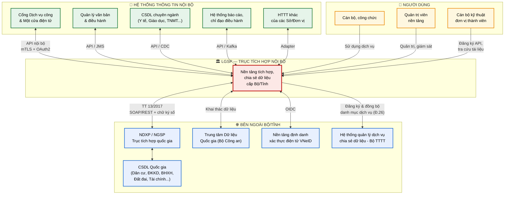

### 2.2. Thuyết minh sơ đồ ngữ cảnh

**Vị trí của LGSP.** LGSP nằm ở vị trí "cổ chai có chủ đích" giữa ba nhóm tác nhân. Đây là lựa chọn thiết kế bắt buộc theo NĐ 47/2020 Điều 24: mọi kết nối phải đi qua dịch vụ chia sẻ dữ liệu. Ý nghĩa thực tiễn là khi cần bổ sung một HTTT mới, đơn vị chỉ kết nối một lần vào LGSP thay vì phải tích hợp N-1 lần với từng hệ thống còn lại — độ phức tạp giảm từ O(n²) xuống O(n).

**Ba nhóm giao diện.**

| Nhóm | Đặc điểm kỹ thuật | Ràng buộc |
|---|---|---|
| **Hướng nội bộ** (INT) | Giao thức đa dạng do hệ thống cũ/mới lẫn lộn: REST, SOAP, JMS, file, CDC từ CSDL | LGSP phải "chịu đựng" sự đa dạng — đây là lý do cần Camel với hơn 300 component |
| **Hướng quốc gia** (EXT) | Chuẩn hóa nghiêm ngặt theo TT 13/2017: định dạng bản tin, chữ ký số, xác thực hai chiều | Không thương lượng được — LGSP phải thích ứng, thể hiện qua **NDXP Adapter** chuyên biệt |
| **Hướng người dùng** (USR) | Giao diện quản trị, cổng API cho lập trình viên | Tách khỏi đường dữ liệu (NT-05) |

**Chiều đăng ký danh mục.** Mũi tên một chiều từ LGSP tới hệ thống của Bộ TTTT thể hiện nghĩa vụ tại Điều 26 — LGSP chủ động đẩy danh mục dịch vụ lên trung ương để các cơ quan khác tra cứu được. Đây là luồng thường bị bỏ sót trong các triển khai thực tế.

---

## 3. Kiến trúc phân lớp tổng thể

### 3.1. Sơ đồ phân lớp

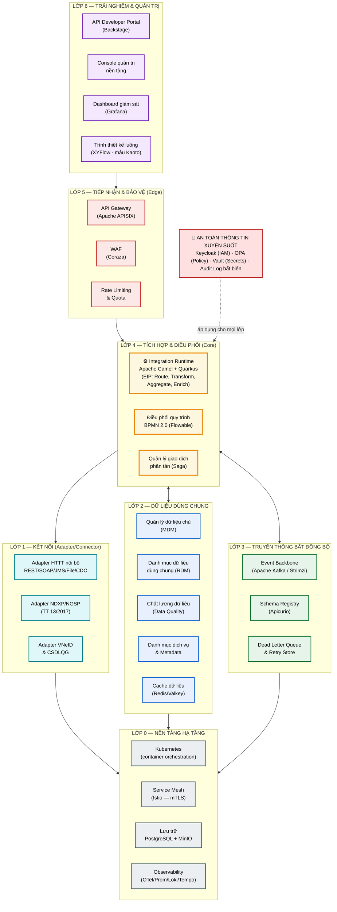

### 3.2. Thuyết minh kiến trúc phân lớp

**Logic phân lớp.** Bảy lớp được chia theo *trách nhiệm thay đổi* chứ không theo công nghệ. Nguyên tắc: thứ gì thay đổi cùng nhịp thì nằm cùng lớp. Adapter (L1) thay đổi mỗi khi có HTTT mới; luồng tích hợp (L4) thay đổi khi nghiệp vụ đổi; hạ tầng (L0) gần như bất biến. Cách chia này khiến việc thêm một sở/ngành mới chỉ chạm vào L1 và cấu hình L4, không đụng phần còn lại.

**Chi tiết từng lớp:**

| Lớp | Trách nhiệm | Vì sao tách riêng | Nhịp thay đổi |
|---|---|---|---|
| **L6 — Trải nghiệm** | Giao diện cho người dùng và lập trình viên | Sự cố giao diện không được ảnh hưởng luồng dữ liệu (NT-05) | Trung bình |
| **L5 — Edge** | Chốt chặn bảo vệ: xác thực, chống DDoS, giới hạn tần suất | Tách bảo vệ khỏi xử lý — đáp ứng CMP-19 | Thấp |
| **L4 — Tích hợp** | **Lõi hệ thống**: định tuyến, chuyển đổi, làm giàu, điều phối | Đây là nơi chứa "trí tuệ nghiệp vụ" của trục | **Cao** |
| **L3 — Bất đồng bộ** | Đệm tải, tách khớp nối theo thời gian, phát lại sự kiện | Cho phép bên gửi và bên nhận hoạt động độc lập nhau | Thấp |
| **L2 — Dữ liệu dùng chung** | Dữ liệu chủ, danh mục, chất lượng, metadata | Đáp ứng trực tiếp CMP-20/21/22 của NĐ 47 | Trung bình |
| **L1 — Kết nối** | Che giấu sự khác biệt kỹ thuật của từng hệ thống | Cô lập "sự hỗn loạn" của hệ thống cũ khỏi lõi sạch | **Cao** |
| **L0 — Hạ tầng** | Điều phối container, mạng, lưu trữ, quan sát | Nền tảng chung, thay đổi hiếm | Rất thấp |

**Vì sao an toàn thông tin vẽ xuyên suốt.** Bảo mật không phải một lớp vì nếu là lớp thì sẽ có "phía trong" và "phía ngoài" — mâu thuẫn với nguyên tắc zero-trust (NT-04). Mọi lời gọi ở mọi lớp đều phải qua xác thực và ủy quyền, kể cả lời gọi giữa hai thành phần nội bộ.

**Hai đường dữ liệu song song.** Lớp L4 nối với L3 bằng mũi tên hai chiều: luồng đồng bộ (yêu cầu-phản hồi, dùng cho tra cứu cần kết quả ngay) đi thẳng L5→L4→L1; luồng bất đồng bộ (thông báo, đồng bộ dữ liệu lớn) đi L4→L3→L4. Việc tồn tại cả hai là bắt buộc vì thời gian phản hồi trần 30 giây (CMP-16) không thể đáp ứng nếu mọi thứ đều đồng bộ.

---

## 4. Kiến trúc ứng dụng — phân rã thành phần

### 4.1. Sơ đồ thành phần (C4 Level 2)

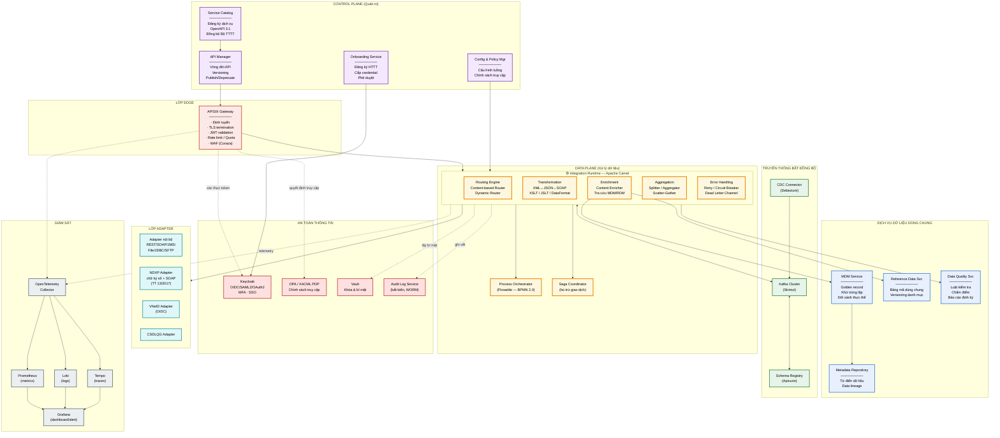

### 4.2. Thuyết minh phân rã thành phần

**Tách Control Plane khỏi Data Plane.** Đây là quyết định kiến trúc quan trọng nhất ở tầng ứng dụng. Control Plane (quản lý API, danh mục, cấu hình) và Data Plane (xử lý bản tin thực tế) chạy trên các pod riêng, có vòng đời triển khai riêng. Hệ quả thực tiễn: khi quản trị viên cập nhật cấu hình hay khi Control Plane gặp sự cố, các luồng dữ liệu đang chạy **không bị gián đoạn** — điều kiện cần để đạt 24/7 (CMP-15). APISIX đọc cấu hình từ etcd và cache tại chỗ, nên vẫn phục vụ được khi Control Plane offline.

**Đặc tả trách nhiệm từng thành phần:**

| Thành phần | Trách nhiệm | Đáp ứng | Trạng thái |
|---|---|---|---|
| **APISIX Gateway** | Điểm vào duy nhất; chấm dứt TLS, kiểm tra JWT, giới hạn tần suất, chặn tấn công | CMP-05, 13, 19 | Stateless |
| **API Manager** | Vòng đời API: thiết kế → thử nghiệm → phát hành → ngừng dùng | CMP-05 | Có trạng thái |
| **Service Catalog** | Đăng ký dịch vụ + tài liệu OpenAPI; đồng bộ danh mục lên Bộ TTTT | CMP-02, 03 | Có trạng thái |
| **Onboarding Service** | Quy trình đăng ký HTTT thành viên, cấp và thu hồi credential | — | Có trạng thái |
| **Integration Runtime (Camel)** | **Lõi**: định tuyến, chuyển đổi, làm giàu, gộp/tách, xử lý lỗi | CMP-04, 11, 12 | Stateless |
| **Process Orchestrator** | Quy trình nghiệp vụ dài hạn, nhiều bước, có tác vụ người dùng | CMP-09 | Có trạng thái |
| **Saga Coordinator** | Bảo đảm nhất quán cuối cùng khi giao dịch trải nhiều hệ thống | — | Có trạng thái |
| **MDM Service** | Tạo bản ghi vàng, đối sánh và khử trùng lặp thực thể | CMP-20 | Có trạng thái |
| **Reference Data Service** | Bảng mã dùng chung, quản lý phiên bản danh mục | CMP-21 | Có trạng thái |
| **Data Quality Service** | Luật kiểm tra, chấm điểm chất lượng, báo cáo định kỳ hằng năm | CMP-22 | Có trạng thái |
| **Metadata Repository** | Từ điển dữ liệu, truy vết nguồn gốc dữ liệu (lineage) | CMP-28 | Có trạng thái |
| **Kafka + Schema Registry** | Xương sống sự kiện; quản lý phiên bản schema, kiểm tra tương thích | — | Có trạng thái |
| **Debezium CDC** | Bắt thay đổi dữ liệu từ CSDL hệ thống cũ mà không sửa mã nguồn | — | Có trạng thái |
| **Keycloak** | SSO, OIDC/SAML2/OAuth2, MFA, quản lý danh tính | CMP-06, 07 | Có trạng thái |
| **OPA / XACML PDP** | Điểm quyết định chính sách truy cập tập trung | CMP-08, 23 | Stateless |
| **Vault** | Quản lý khóa mã hóa, chứng thư số, bí mật; xoay vòng tự động | CMP-24 | Có trạng thái |
| **Audit Log Service** | Ghi vết bất biến (WORM) mọi truy cập dữ liệu | CMP-28 | Có trạng thái |

**Vì sao Debezium là mảnh ghép bắt buộc.** Thực tế triển khai LGSP luôn gặp các HTTT cũ không có API và không thể sửa. Debezium đọc nhật ký giao dịch của CSDL (WAL/binlog) để phát hiện thay đổi, đẩy vào Kafka mà **không cần chạm vào ứng dụng cũ**. Đây là con đường khả thi duy nhất để đưa các hệ thống di sản lên trục mà không phải viết lại chúng.

**Vì sao có cả Camel lẫn Flowable.** Hai công cụ giải hai bài toán khác nhau về bản chất:

| Tiêu chí | Apache Camel | Flowable (BPMN) |
|---|---|---|
| Thời gian sống của luồng | Mili giây → giây | Giờ → tháng |
| Trạng thái | Không lưu (stateless) | Lưu bền vững |
| Có tác vụ con người | Không | Có |
| Ví dụ | Tra cứu dữ liệu dân cư | Quy trình cấp phép nhiều cấp phê duyệt |

Dùng Camel cho quy trình dài sẽ mất trạng thái khi pod khởi động lại; dùng BPMN cho mọi lời gọi tra cứu sẽ tạo gánh nặng ghi CSDL không cần thiết. Ranh giới: **Camel điều phối kỹ thuật, Flowable điều phối nghiệp vụ**.

---

## 5. Kiến trúc tích hợp — lõi Apache Camel

### 5.1. Vì sao Apache Camel là lựa chọn lõi

| Yêu cầu từ CV 631 | Camel đáp ứng thế nào |
|---|---|
| Đa giao thức: HTTP/S, WebSocket, JMS, AMQP, MQTT, SMTP/POP/IMAP | Hơn 300 component sẵn có, phủ toàn bộ danh sách bắt buộc — **không phải viết mã** |
| Định dạng JSON, XML, SOAP | Data format tích hợp sẵn: Jackson, JAXB, SOAP DataFormat |
| Định tuyến, chuyển đổi, mediation | Cài đặt đầy đủ 65+ mẫu EIP chuẩn |
| Kiến trúc SOA, module hóa | Mỗi route là đơn vị độc lập, đóng gói lại được thành Kamelet |
| Cluster xử lý song song | Camel Quarkus chạy nhiều replica trên K8s, không chia sẻ trạng thái |

Camel còn là chuẩn mực công nghiệp cho EIP với hệ sinh thái trưởng thành và cộng đồng ASF hậu thuẫn lâu dài — phù hợp nguyên tắc NT-09 (không khóa nhà cung cấp).

### 5.2. Mô hình luồng tích hợp

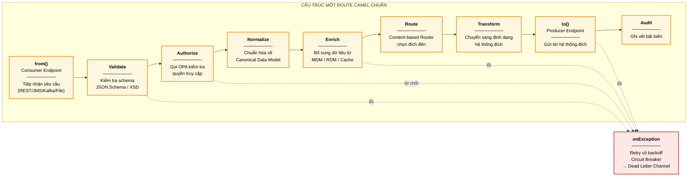

### 5.3. Thuyết minh mô hình luồng

**Vì sao chuẩn hóa thứ tự các bước.** Mọi route trong LGSP tuân theo cùng một khung xương chín bước. Đây không phải hình thức: nó bảo đảm không có route nào "quên" kiểm tra quyền hay quên ghi vết — hai lỗi phổ biến nhất và cũng là hai điểm bị bắt lỗi nặng nhất khi kiểm định tuân thủ. Khung này được đóng gói thành **template Camel** để lập trình viên chỉ điền phần khác biệt.

**Điểm mấu chốt — Canonical Data Model (bước Normalize).** Thay vì chuyển đổi trực tiếp giữa từng cặp hệ thống (cần n×(n-1) bộ chuyển đổi), mọi bản tin được chuẩn hóa về **một mô hình dữ liệu chuẩn nội bộ** rồi mới chuyển sang định dạng đích (chỉ cần 2n bộ chuyển đổi).

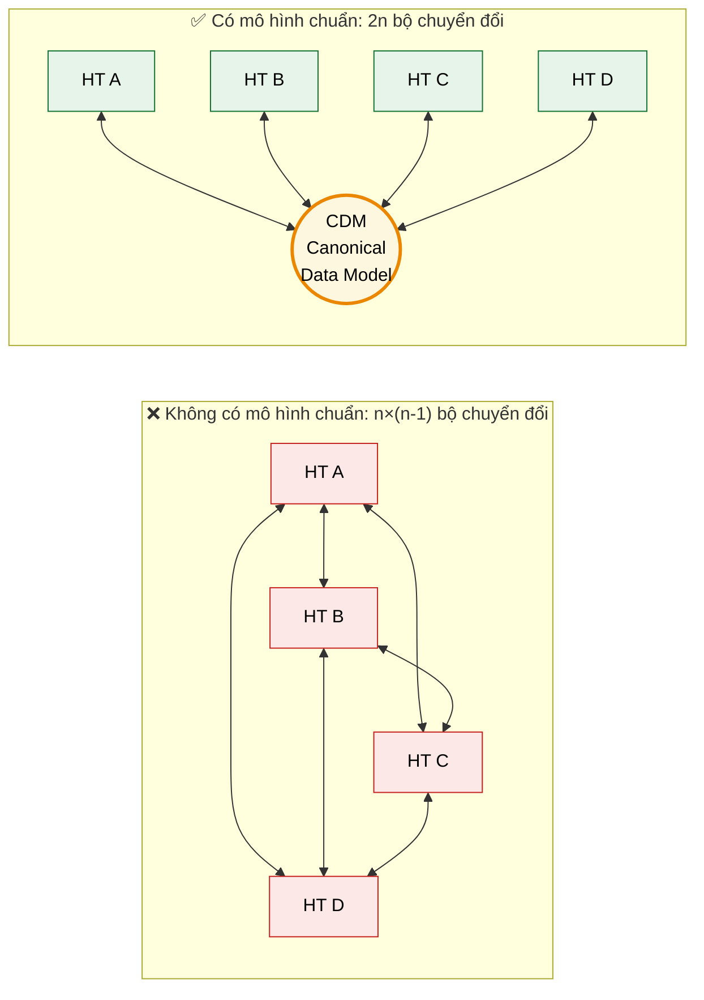

Với 20 HTTT thành viên: không có CDM cần 380 bộ chuyển đổi, có CDM chỉ cần 40. Khác biệt này quyết định khả năng bảo trì của toàn nền tảng về lâu dài.

**Xử lý lỗi phân tầng.** Khối `onException` áp dụng chiến lược ba tầng:

| Tình huống | Cơ chế | Tham số |
|---|---|---|
| Lỗi tạm thời (mạng chập chờn) | Thử lại có độ trễ tăng dần | 3 lần, backoff 2× (1s→2s→4s) |
| Hệ thống đích hỏng kéo dài | Circuit breaker ngắt mạch | Mở khi 50% lỗi/20 lời gọi, thử lại sau 30s |
| Lỗi không phục hồi được | Dead Letter Channel | Lưu để xử lý thủ công + cảnh báo |

Cơ chế ngắt mạch trực tiếp hiện thực nguyên tắc NT-08 — khi CSDL đất đai treo, các luồng khác vẫn chạy bình thường thay vì cạn kiệt luồng xử lý chung.

### 5.4. Ví dụ route minh họa (Camel YAML DSL)

```yaml
# Route: Tra cứu thông tin công dân từ CSDL Dân cư qua NDXP
- route:
    id: tra-cuu-cong-dan
    from:
      uri: "platform-http:/api/v1/cong-dan/{soDinhDanh}"
      steps:
        # 1. Kiểm tra định dạng đầu vào
        - to: "bean:validator?method=validateSoDinhDanh"

        # 2. Kiểm tra quyền truy cập qua OPA (CMP-08)
        - to: "http:opa-service/v1/data/lgsp/authz"
        - choice:
            when:
              - simple: "${body[result][allow]} == false"
                steps:
                  - throwException:
                      exceptionType: java.lang.SecurityException
                      message: "Không có quyền truy cập dữ liệu công dân"

        # 3. Kiểm tra cache trước khi gọi ra ngoài (giảm tải NDXP)
        - to: "caffeine-cache://congDanCache?action=GET&key=${header.soDinhDanh}"
        - choice:
            when:
              - simple: "${body} == null"
                steps:
                  # 4. Chuyển sang định dạng SOAP theo TT 13/2017
                  - to: "xslt:transforms/congdan-to-ndxp.xsl"
                  # 5. Ký số bản tin
                  - to: "bean:digitalSigner?method=sign"
                  # 6. Gọi NDXP với circuit breaker
                  - circuitBreaker:
                      resilience4jConfiguration:
                        failureRateThreshold: 50
                        waitDurationInOpenState: 30000
                      steps:
                        - to: "https:ndxp.gov.vn/services/dancu?sslContextParameters=#ndxpSSL"
                      onFallback:
                        steps:
                          - setBody:
                              constant: '{"error":"Hệ thống CSDL Dân cư tạm thời không khả dụng"}'
                  # 7. Chuẩn hóa về CDM
                  - to: "xslt:transforms/ndxp-to-cdm.xsl"
                  # 8. Lưu cache
                  - to: "caffeine-cache://congDanCache?action=PUT&key=${header.soDinhDanh}"

        # 9. Ghi vết truy cập bất biến (CMP-28)
        - wireTap:
            uri: "kafka:audit-log-topic"
    onException:
      - exception: java.lang.Exception
        redeliveryPolicy:
          maximumRedeliveries: 3
          redeliveryDelay: 1000
          backOffMultiplier: 2
        handled: true
        steps:
          - to: "kafka:dead-letter-topic"
```

**Thuyết minh ví dụ.** Route này thể hiện đồng thời nhiều yêu cầu tuân thủ trong một đơn vị mã khai báo: kiểm tra quyền tập trung (CMP-08), chữ ký số theo TT 13/2017 (CMP-25), TLS tới NDXP (CMP-13), ghi vết bất biến (CMP-28), chống lỗi lan truyền (NT-08). Đáng chú ý là `wireTap` — ghi vết chạy **bất đồng bộ**, không làm chậm đường phản hồi chính, giúp giữ P99 trong ngưỡng.

### 5.5. Thiết kế luồng bằng giao diện

Đoạn YAML ở mục 5.4 là **kết quả**, không nhất thiết là thứ phải gõ bằng tay. Nền tảng cung cấp trình thiết kế trực quan trong console PH-04 — sơ đồ kéo thả bằng **XYFlow** ([ADR-017](../05-adr/README.md#adr-017)), catalog và ngữ nghĩa YAML theo mẫu **Kaoto** ([ADR-015](../05-adr/README.md#adr-015)) — để dựng luồng trên khung xương chín bước ở mục 5.2, rồi sinh định nghĩa Camel YAML DSL tương đương.

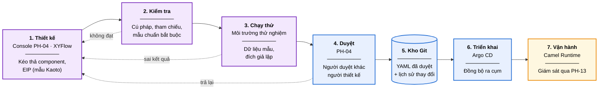

**Vì sao trình thiết kế không được phép triển khai thẳng.** Điểm dễ sai nhất khi đưa công cụ đồ họa vào là để nó tự đẩy cấu hình xuống cụm — khi đó tồn tại hai đường triển khai song song, và trạng thái thật của hệ thống không còn khớp với kho Git. Ở đây canvas chỉ sinh ra YAML; mọi thứ sau đó đi qua đúng một đường GitOps đã chốt tại [ADR-010](../05-adr/README.md#adr-010). Hệ quả là một luồng do cán bộ dựng bằng giao diện và một luồng do lập trình viên viết tay chịu **cùng một quy trình duyệt, cùng một lịch sử thay đổi và cùng một cách quay lui**.

**Hai cách làm sống chung.** Trình thiết kế đọc được YAML viết tay và ngược lại (cùng Camel YAML DSL), nên không có sự chia rẽ giữa "luồng đồ họa" và "luồng mã nguồn". Thực tế các luồng phổ thông — tra cứu, đồng bộ một chiều, chuyển tiếp có lọc — dựng bằng giao diện là đủ; các luồng cần logic đặc thù vẫn viết tay rồi mở lại trên sơ đồ để xem.

Đặc tả chi tiết chức năng thiết kế, chạy thử và duyệt luồng nằm ở [SRS PH-04](../07-srs/SRS-PH-04-integration-core.md#36-nhóm-f--thiết-kế-và-quản-lý-vòng-đời-route) (`FR-04-026…030`).

---

## 6. Kiến trúc dữ liệu

### 6.1. Phân loại dữ liệu trong LGSP

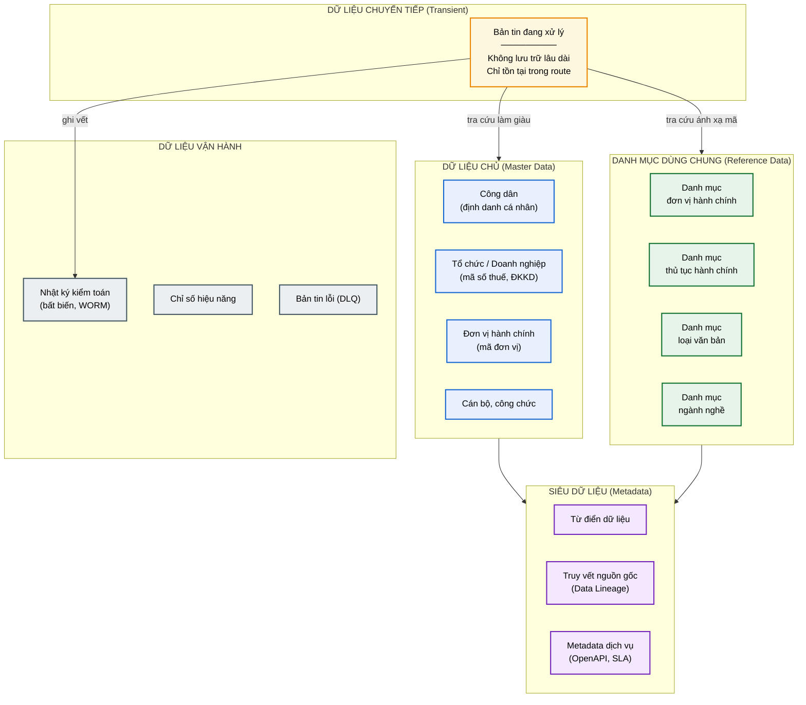

### 6.2. Thuyết minh kiến trúc dữ liệu

**Nguyên tắc nền tảng: LGSP không sở hữu dữ liệu nghiệp vụ.** LGSP là trục truyền dẫn, không phải kho lưu trữ. Dữ liệu nghiệp vụ vẫn thuộc về HTTT nguồn — điều này tôn trọng nguyên tắc "chủ quản CSDL" tại NĐ 47. Chỉ năm loại dữ liệu sau được phép tồn tại trong LGSP:

| Loại | Có lưu bền? | Lý do tồn tại | Chính sách giữ |
|---|---|---|---|
| **Chuyển tiếp** | Không | Bản tin đang xử lý trong route | Xóa ngay sau khi xử lý xong |
| **Dữ liệu chủ** | Có | Bắt buộc theo NĐ 47 (CMP-20) — tạo bản ghi vàng | Vĩnh viễn, có phiên bản |
| **Danh mục dùng chung** | Có | Bắt buộc theo NĐ 47 (CMP-21) — bảng mã chuẩn | Vĩnh viễn, có phiên bản |
| **Siêu dữ liệu** | Có | Phục vụ quản trị, truy vết nguồn gốc | Vĩnh viễn |
| **Vận hành** | Có | Ghi vết (CMP-28), giám sát | Nhật ký ≥ 5 năm; chỉ số 90 ngày |

**Vì sao dữ liệu chủ phải nằm ở LGSP.** Câu hỏi "ông Nguyễn Văn A trong hệ thống y tế và ông Nguyễn Văn A trong hệ thống đất đai có phải cùng một người không?" chỉ trả lời được ở tầng trục, nơi nhìn thấy đồng thời nhiều nguồn. MDM Service thực hiện đối sánh thực thể dựa trên số định danh cá nhân làm khóa liên kết, tạo ra **bản ghi vàng** — cơ sở kỹ thuật để thực hiện nguyên tắc "không yêu cầu người dân cung cấp lại dữ liệu đã có".

**Mô hình dữ liệu chuẩn (CDM).** CDM được xây trên cơ sở dữ liệu chủ, sử dụng danh mục dùng chung làm bảng mã. Ví dụ cấu trúc thực thể Công dân:

```json
{
  "$schema": "https://lgsp.local/schemas/cong-dan/v1.json",
  "soDinhDanh": "001199001234",
  "hoTen": "Nguyễn Văn A",
  "ngaySinh": "1990-01-15",
  "gioiTinh": { "ma": "1", "ten": "Nam", "danhMuc": "GIOI_TINH_v2" },
  "noiThuongTru": {
    "maDonViHanhChinh": "01001",
    "tenDayDu": "Phường Phúc Xá, Quận Ba Đình, TP Hà Nội",
    "danhMuc": "DVHC_v2025"
  },
  "_metadata": {
    "nguonDuLieu": "CSDLQG_DANCU",
    "thoiDiemCapNhat": "2026-08-03T10:15:00+07:00",
    "mucDoTinCay": "CAO",
    "phanLoaiMat": "NOI_BO"
  }
}
```

Khối `_metadata` là bắt buộc trên mọi thực thể CDM: `nguonDuLieu` phục vụ truy vết nguồn gốc, `phanLoaiMat` là đầu vào cho Policy Engine chặn dữ liệu mật (CMP-23), `thoiDiemCapNhat` phục vụ đánh giá độ tươi trong chấm điểm chất lượng.

### 6.3. Quản lý chất lượng dữ liệu

NĐ 47 buộc kiểm tra, đánh giá chất lượng **định kỳ hằng năm** (CMP-22). Data Quality Service chấm điểm theo sáu chiều:

| Chiều | Câu hỏi kiểm tra | Ví dụ luật |
|---|---|---|
| **Đầy đủ** | Trường bắt buộc có bị trống? | `soDinhDanh` không null |
| **Chính xác** | Giá trị có đúng định dạng, đúng miền? | Số định danh đủ 12 chữ số, checksum hợp lệ |
| **Nhất quán** | Các nguồn có mâu thuẫn nhau? | Ngày sinh ở hệ thống A và B phải trùng |
| **Kịp thời** | Dữ liệu có còn tươi? | Cập nhật trong vòng 30 ngày |
| **Duy nhất** | Có bản ghi trùng lặp? | Một số định danh chỉ ứng một bản ghi vàng |
| **Hợp lệ** | Mã danh mục có tồn tại? | `maDonViHanhChinh` phải có trong RDM |

Kết quả xuất thành báo cáo chất lượng dữ liệu — vừa là nghĩa vụ tuân thủ, vừa là đầu vào để cải thiện HTTT nguồn.

---

## 7. Kiến trúc hạ tầng & triển khai

### 7.1. Sơ đồ triển khai Kubernetes

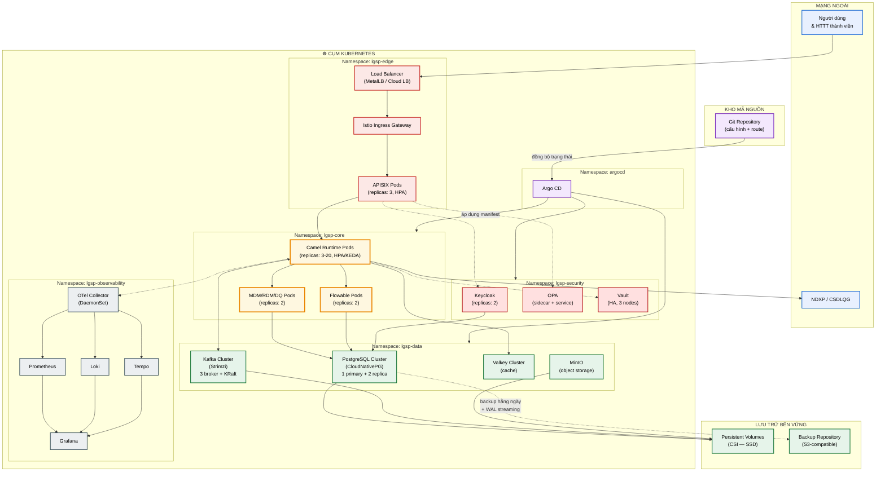

### 7.2. Thuyết minh kiến trúc triển khai

**Phân tách namespace theo miền tin cậy.** Năm namespace không chỉ để gọn gàng mà là **ranh giới an ninh**. Mỗi namespace có NetworkPolicy riêng theo mặc định từ chối, chỉ mở đúng cổng cần thiết:

| Namespace | Được gọi đến từ | Ý nghĩa an ninh |
|---|---|---|
| `lgsp-edge` | Mạng ngoài | Vùng phi quân sự — chịu tấn công trực diện |
| `lgsp-core` | Chỉ từ `lgsp-edge` | Không thể truy cập trực tiếp từ ngoài |
| `lgsp-data` | Chỉ từ `lgsp-core` | CSDL không bao giờ lộ ra biên |
| `lgsp-security` | Từ `edge` và `core` | Dịch vụ xác thực dùng chung |
| `lgsp-observability` | Nhận đẩy telemetry | Một chiều, không gọi ngược |

Nếu kẻ tấn công chiếm được pod ở `lgsp-edge`, họ vẫn không thể mở kết nối thẳng tới PostgreSQL — phải vượt thêm lớp `lgsp-core` với mTLS và xác thực.

**Chiến lược mở rộng theo từng thành phần:**

| Thành phần | Cách mở rộng | Kích hoạt bởi | Khoảng replica |
|---|---|---|---|
| APISIX | Ngang, tự động | CPU > 70% | 3 → 10 |
| Camel Runtime | Ngang, tự động | CPU + độ trễ Kafka (KEDA) | 3 → 20 |
| Flowable | Ngang, thủ công | Số quy trình đang chạy | 2 → 6 |
| PostgreSQL | Dọc + read replica | Dung lượng, tải đọc | 1 primary + 2 replica |
| Kafka | Ngang (thêm broker + phân vùng) | Thông lượng, dung lượng | 3 → 9 broker |

**Vì sao Camel Runtime mở rộng theo độ trễ Kafka chứ không chỉ CPU.** Với luồng bất đồng bộ, CPU có thể thấp trong khi hàng đợi đang dồn ứ — dấu hiệu thực sự của quá tải là **consumer lag**. KEDA đọc trực tiếp chỉ số này từ Kafka để quyết định tăng pod, phản ứng sớm hơn HPA thuần CPU.

**GitOps qua Argo CD.** Git là nguồn sự thật duy nhất (NT-06). Không ai được phép `kubectl apply` thủ công lên môi trường chính thức. Lợi ích: mọi thay đổi đều có người phê duyệt qua pull request, quay lui chỉ là revert commit, và trạng thái thực tế luôn khớp với mã nguồn — Argo CD tự phát hiện và sửa sai lệch.

**Bảo đảm sao lưu (CMP-17).** CloudNativePG thực hiện đồng thời hai lớp: sao lưu toàn phần hằng ngày (đáp ứng đúng chữ của quy định) và truyền WAL liên tục (cho phép khôi phục về bất kỳ thời điểm nào, RPO ≤ 15 phút). Diễn tập khôi phục phải chạy định kỳ — sao lưu chưa từng được kiểm chứng phục hồi thì không tính là sao lưu.

### 7.3. Cấu trúc triển khai đa vùng

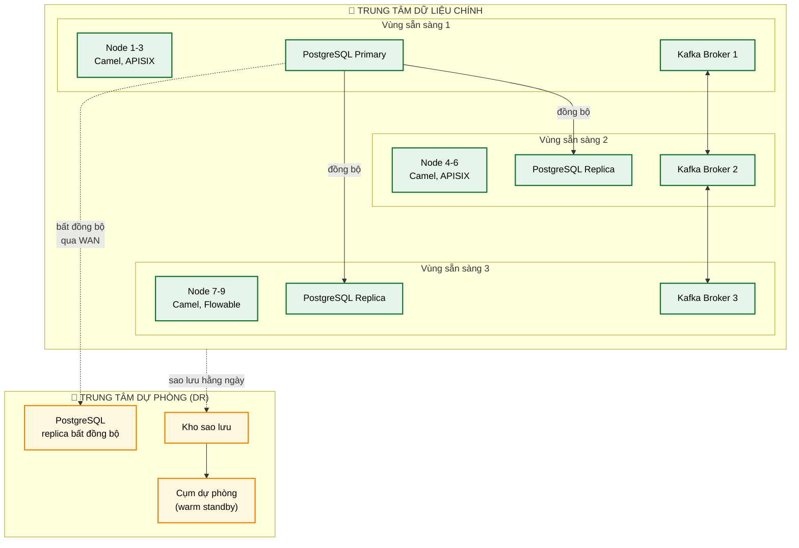

**Thuyết minh.** Ba vùng sẵn sàng trong trung tâm chính cho phép mất trọn một vùng mà dịch vụ không gián đoạn — PostgreSQL sao chép đồng bộ tới hai replica nên không mất dữ liệu khi primary hỏng; Kafka đặt hệ số nhân bản 3 với `min.insync.replicas=2`. Trung tâm dự phòng sao chép bất đồng bộ qua WAN, chấp nhận RPO cao hơn để đổi lấy chi phí hợp lý, dùng cho tình huống thảm họa toàn trung tâm chính. Đây là cấu hình đáp ứng yêu cầu hoạt động 24/7 (CMP-15).

---

## 8. Kiến trúc an toàn thông tin

### 8.1. Mô hình bảo mật nhiều lớp

```mermaid
graph TB
    subgraph L_NET["LỚP 1 — MẠNG"]
        FW["Tường lửa biên"]
        DDOS["Chống DDoS"]
        NP["NetworkPolicy<br/>(mặc định từ chối)"]
    end

    subgraph L_EDGE["LỚP 2 — BIÊN"]
        WAFC["WAF Coraza<br/>(OWASP CRS)"]
        TLS_T["TLS 1.3 termination"]
        RL["Rate limit / Quota<br/>theo client"]
    end

    subgraph L_IDENT["LỚP 3 — ĐỊNH DANH & XÁC THỰC"]
        SSO["Keycloak SSO<br/>OIDC · SAML2 · OAuth2"]
        MFA_C["Xác thực đa yếu tố<br/>(TOTP / WebAuthn)"]
        MTLS_C["mTLS giữa các dịch vụ<br/>(Istio, chứng thư tự xoay)"]
        VNEID_C["Liên kết VNeID"]
    end

    subgraph L_AUTHZ["LỚP 4 — ỦY QUYỀN"]
        RBAC["RBAC theo vai trò"]
        ABAC["ABAC theo thuộc tính<br/>(OPA / XACML 3.0)"]
        SCOPE["OAuth2 scope<br/>theo từng API"]
    end

    subgraph L_DATA["LỚP 5 — DỮ LIỆU"]
        ENC_T["Mã hóa đường truyền<br/>(TLS 1.3)"]
        ENC_R["Mã hóa lưu trữ<br/>(AES-256)"]
        MASK["Che dữ liệu nhạy cảm<br/>(masking/tokenization)"]
        SIGN["Chữ ký số bản tin<br/>(TT 13/2017)"]
        CLASS["Phân loại mức độ mật"]
    end

    subgraph L_AUDIT["LỚP 6 — GIÁM SÁT & GHI VẾT"]
        ALOG["Nhật ký kiểm toán bất biến<br/>(WORM, hash chain)"]
        SIEM["Phát hiện bất thường"]
        ALERT["Cảnh báo an ninh"]
    end

    L_NET --> L_EDGE --> L_IDENT --> L_AUTHZ --> L_DATA
    L_DATA -.->|"mọi hành vi"| L_AUDIT

    classDef net fill:#eceff1,stroke:#455a64,stroke-width:2px,color:#000
    classDef edge fill:#fce8e6,stroke:#c5221f,stroke-width:2px,color:#000
    classDef ident fill:#e8f0fe,stroke:#1967d2,stroke-width:2px,color:#000
    classDef authz fill:#f3e8fd,stroke:#7627bb,stroke-width:2px,color:#000
    classDef data fill:#e6f4ea,stroke:#137333,stroke-width:2px,color:#000
    classDef aud fill:#fef7e0,stroke:#ea8600,stroke-width:2px,color:#000
    class FW,DDOS,NP net
    class WAFC,TLS_T,RL edge
    class SSO,MFA_C,MTLS_C,VNEID_C ident
    class RBAC,ABAC,SCOPE authz
    class ENC_T,ENC_R,MASK,SIGN,CLASS data
    class ALOG,SIEM,ALERT aud
```

### 8.2. Thuyết minh kiến trúc an toàn

**Nguyên tắc zero-trust.** Không có khái niệm "mạng nội bộ đáng tin". Mọi lời gọi, kể cả giữa hai pod cạnh nhau trong cùng namespace, đều phải: (1) mã hóa mTLS, (2) mang danh tính xác minh được, (3) qua kiểm tra quyền. Istio thực thi mTLS ở tầng sidecar nên ứng dụng **không cần viết mã bảo mật** — giảm rủi ro lập trình viên cài đặt sai.

**Phân biệt xác thực và ủy quyền:**

| Khía cạnh | Xác thực (Authentication) | Ủy quyền (Authorization) |
|---|---|---|
| Câu hỏi | "Anh là ai?" | "Anh được làm gì?" |
| Thành phần | Keycloak | OPA / XACML PDP |
| Kết quả | Token JWT có danh tính | Quyết định Permit / Deny |
| Thay đổi | Hiếm | Thường xuyên theo nghiệp vụ |

Tách hai chức năng cho phép thay đổi chính sách truy cập mà không đụng tới hệ thống định danh — chính sách viết bằng Rego (OPA) nạp nóng, không cần triển khai lại.

**Ví dụ chính sách ủy quyền (OPA Rego):**

```rego
package lgsp.authz

default allow := false

# Cho phép nếu: có scope đúng + dữ liệu không thuộc diện mật + trong giờ hành chính
allow if {
    input.token.scope[_] == "congdan.read"
    input.resource.phanLoaiMat != "MAT"
    input.request.donVi in data.donvi_duoc_phep[input.token.client_id]
}

# Chặn tuyệt đối dữ liệu bí mật nhà nước (CMP-23)
deny_reason := "Dữ liệu thuộc phạm vi bí mật nhà nước" if {
    input.resource.phanLoaiMat == "MAT"
}
```

**Chính sách này hiện thực trực tiếp CMP-23** — chặn chia sẻ dữ liệu mật ngay tại tầng quyết định tập trung, không phụ thuộc vào việc từng route có nhớ kiểm tra hay không.

**Ghi vết bất biến.** Nhật ký kiểm toán dùng chuỗi băm liên kết (mỗi bản ghi chứa hash của bản ghi trước) và lưu trên MinIO bật chế độ WORM. Kết quả: không ai — kể cả quản trị viên hệ thống — có thể sửa hoặc xóa lịch sử truy cập mà không để lại dấu vết. Đây là yêu cầu bắt buộc để truy vết "ai truy cập dữ liệu gì, khi nào" theo Luật Dữ liệu 2024 (CMP-28).

**Quản lý bí mật.** Không có mật khẩu hay khóa nào nằm trong mã nguồn hoặc ConfigMap. Vault cấp thông tin xác thực CSDL động, thời hạn ngắn, tự xoay vòng; External Secrets Operator đồng bộ vào K8s Secret. Chứng thư số dùng cho ký bản tin gửi NDXP lưu trong Vault, thao tác ký thực hiện **bên trong** Vault nên khóa riêng không bao giờ rời khỏi ranh giới bảo mật.

---

## 9. Kiến trúc giám sát & vận hành

### 9.1. Sơ đồ luồng telemetry

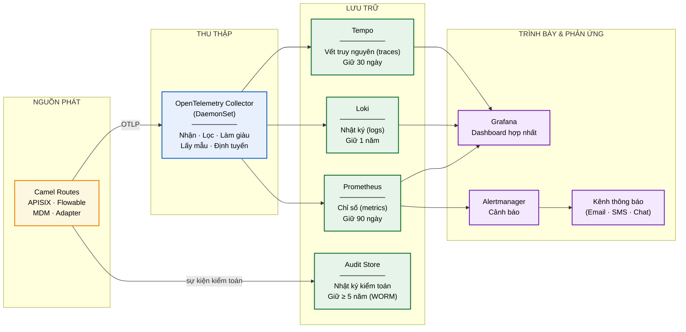

### 9.2. Thuyết minh giám sát

**Ba trụ cột quan sát và vai trò khác nhau:**

| Trụ cột | Trả lời câu hỏi | Ví dụ trong LGSP |
|---|---|---|
| **Metrics** | "Hệ thống có khỏe không?" | Tỷ lệ lỗi route, độ trễ P99, consumer lag |
| **Logs** | "Chuyện gì đã xảy ra?" | Bản tin lỗi validate, ngoại lệ chi tiết |
| **Traces** | "Chậm ở khâu nào?" | Lời gọi mất 8s: 7,5s chờ NDXP phản hồi |

**Correlation ID xuyên suốt — điểm cốt lõi.** Mỗi yêu cầu vào LGSP được gán một `traceId` tại APISIX, truyền qua mọi chặng: Camel route → Kafka header → hệ thống đích → nhật ký kiểm toán. Khi một sở báo "hồ sơ số X bị lỗi", quản trị viên chỉ cần tra `traceId` để thấy toàn bộ hành trình bản tin qua các thành phần. Không có cơ chế này, việc gỡ lỗi trên hệ thống phân tán gần như bất khả thi.

**Chỉ số nghiệp vụ bên cạnh chỉ số kỹ thuật.** CV 631 yêu cầu "thống kê, báo cáo, phân tích hoạt động **nghiệp vụ** thời gian thực" (CMP-10) — không chỉ chỉ số hạ tầng. Bốn nhóm dashboard bắt buộc:

| Dashboard | Đối tượng xem | Nội dung |
|---|---|---|
| **Sức khỏe nền tảng** | Vận hành | CPU, bộ nhớ, tình trạng pod, hàng đợi |
| **Chất lượng dịch vụ** | Quản trị nền tảng | Tỷ lệ thành công, độ trễ theo API, vi phạm SLA |
| **Hoạt động nghiệp vụ** | Lãnh đạo | Số giao dịch theo đơn vị, theo loại dịch vụ, xu hướng |
| **An ninh** | Cán bộ ATTT | Đăng nhập thất bại, truy cập bị từ chối, truy cập dữ liệu nhạy cảm |

**Chính sách cảnh báo dựa trên triệu chứng.** Cảnh báo phát khi **người dùng bị ảnh hưởng**, không phát khi chỉ số kỹ thuật lệch:

| Mức | Điều kiện | Phản ứng |
|---|---|---|
| **Nghiêm trọng** | Tỷ lệ lỗi > 5% trong 5 phút, hoặc dịch vụ ngừng | Gọi trực ngay |
| **Cảnh báo** | P99 > 10s trong 15 phút, consumer lag tăng liên tục | Xử lý trong giờ làm việc |
| **Thông tin** | Sắp chạm hạn mức tài nguyên | Ghi nhận, lập kế hoạch |

---

## 10. Khả năng mở rộng & hiệu năng

### 10.1. Chiến lược mở rộng

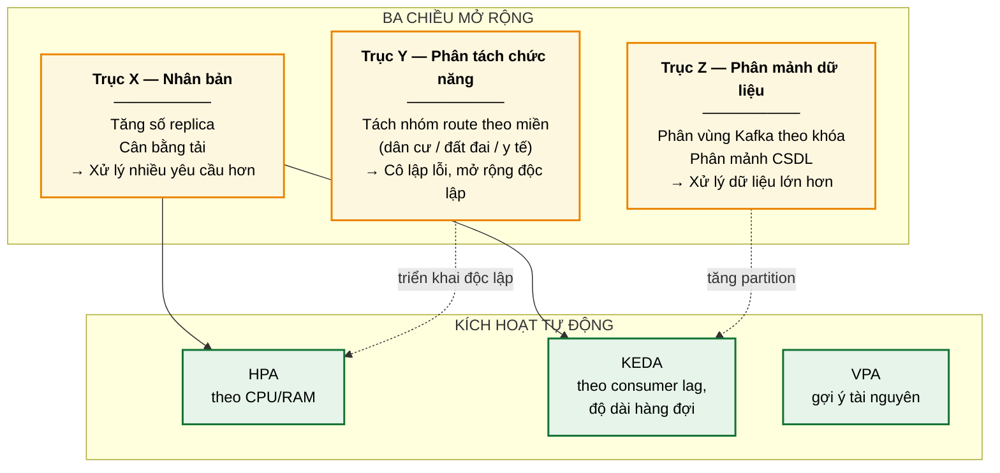

### 10.2. Thuyết minh mở rộng

**Trục Y quan trọng nhất về lâu dài.** Khi số lượng luồng tích hợp tăng lên hàng trăm, việc gom tất cả vào một ứng dụng Camel duy nhất sẽ gây ba vấn đề: thời gian khởi động dài, một route lỗi ảnh hưởng toàn bộ, và không thể mở rộng riêng phần nóng. Giải pháp là **nhóm route theo miền nghiệp vụ**, đóng gói thành các deployment riêng:

| Nhóm | Ví dụ route | Đặc điểm tải |
|---|---|---|
| `lgsp-dancu` | Tra cứu dân cư, hộ tịch | Rất cao, đột biến giờ hành chính |
| `lgsp-datdai` | Thông tin thửa đất | Trung bình, bản tin lớn |
| `lgsp-vanban` | Liên thông văn bản | Đều, nhạy cảm thứ tự |
| `lgsp-dvc` | Dịch vụ công trực tuyến | Cao, nhạy cảm độ trễ |

Mỗi nhóm mở rộng theo nhịp riêng: `lgsp-dancu` có thể chạy 20 replica trong khi `lgsp-datdai` chỉ cần 2.

**Kỹ thuật tối ưu hiệu năng chủ đạo:**

| Kỹ thuật | Cách áp dụng | Lợi ích đo được |
|---|---|---|
| **Quarkus native** | Biên dịch GraalVM sang mã máy | Khởi động < 50ms (so với ~5s JVM), RAM giảm ~70% |
| **Cache nhiều tầng** | Caffeine tại pod + Valkey chia sẻ | Giảm 60–80% lời gọi ra NDXP |
| **Xử lý bất đồng bộ** | Kafka cho luồng không cần phản hồi ngay | Tách khớp nối, chịu tải đột biến |
| **Gộp bản tin** | Camel Aggregator gom yêu cầu nhỏ | Giảm số lời gọi mạng |
| **Nén dữ liệu** | gzip cho HTTP, snappy cho Kafka | Giảm băng thông ~70% |
| **Nhóm kết nối** | HikariCP cho JDBC, pool HTTP | Tránh chi phí thiết lập kết nối |

**Vì sao Quarkus native đặc biệt phù hợp.** Thời gian khởi động dưới 50ms cho phép mở rộng phản ứng thật sự — khi tải tăng đột ngột, pod mới phục vụ được gần như tức thì thay vì mất vài giây "khởi động nguội". Với hệ thống hành chính công có đỉnh tải rõ rệt theo giờ làm việc, đặc tính này chuyển hóa trực tiếp thành tiết kiệm tài nguyên: quy mô cụm bám sát tải thực thay vì phải dự phòng thường trực.

### 10.3. Chỉ tiêu hiệu năng mục tiêu

| Chỉ tiêu | Mục tiêu thiết kế | Trần quy định (CV 631) |
|---|---|---|
| Độ trễ P50 | ≤ 200ms | — |
| Độ trễ P95 | ≤ 1s | — |
| Độ trễ P99 | ≤ 3s | **≤ 30s** |
| Thông lượng | ≥ 5.000 TPS | — |
| Người dùng đồng thời | ≥ 10.000 | — |
| Sẵn sàng | ≥ 99,9% | 24/7 |
| Thời gian khởi động pod | ≤ 5s (đến khi sẵn sàng nhận tải) | — |

Mục tiêu thiết kế đặt thấp hơn nhiều so với trần quy định để có biên an toàn: khi hệ thống đích bên ngoài (NDXP) chậm bất thường, LGSP vẫn còn dư địa trước khi chạm ngưỡng vi phạm.

---

## 11. Ngăn xếp công nghệ tổng hợp

| Hạng mục | Công nghệ | Giấy phép | Lý do chọn | ADR |
|---|---|---|---|---|
| **Integration engine** | Apache Camel 4.x | Apache-2.0 | Yêu cầu bắt buộc; 300+ component, 65+ EIP | [ADR-001](../05-adr/README.md#adr-001) |
| **Runtime** | Quarkus (native, GraalVM) | Apache-2.0 | Khởi động cực nhanh, tiêu thụ RAM thấp, tối ưu cho K8s | [ADR-002](../05-adr/README.md#adr-002) |
| **API Gateway** | Apache APISIX | Apache-2.0 | Hiệu năng cao, nạp nóng plugin, hỗ trợ đầy đủ OIDC/OAuth2 | [ADR-003](../05-adr/README.md#adr-003) |
| **IAM / SSO** | Keycloak | Apache-2.0 | Đủ OIDC + SAML2 + OAuth2 + MFA theo CV 631 | [ADR-004](../05-adr/README.md#adr-004) |
| **Event backbone** | Apache Kafka (Strimzi) | Apache-2.0 | Chuẩn công nghiệp, toán tử K8s trưởng thành | [ADR-005](../05-adr/README.md#adr-005) |
| **Schema Registry** | Apicurio Registry | Apache-2.0 | Quản lý phiên bản schema, kiểm tra tương thích | [ADR-005](../05-adr/README.md#adr-005) |
| **CDC** | Debezium | Apache-2.0 | Đưa hệ thống cũ lên trục không cần sửa mã | [ADR-005](../05-adr/README.md#adr-005) |
| **API Portal** | Backstage | Apache-2.0 | Danh mục dịch vụ + tài liệu cho lập trình viên | [ADR-006](../05-adr/README.md#adr-006) |
| **Observability** | OpenTelemetry, Prometheus, Loki, Tempo, Grafana | Apache-2.0 | Chuẩn mở, không khóa nhà cung cấp | [ADR-007](../05-adr/README.md#adr-007) |
| **CSDL quan hệ** | PostgreSQL + CloudNativePG | PostgreSQL / Apache-2.0 | HA, sao lưu tự động, khôi phục theo thời điểm | [ADR-008](../05-adr/README.md#adr-008) |
| **Object storage** | **Garage** *(ưu tiên)* / SeaweedFS / Ceph RGW — **không dùng MinIO** | AGPL-3.0 / Apache-2.0 / LGPL | Tương thích S3, hỗ trợ WORM cho nhật ký kiểm toán | [ADR-020](../05-adr/README.md#adr-020) |
| **Cache** | Valkey | BSD-3 | Nhánh cộng đồng của Redis, giấy phép mở thực sự | [ADR-008](../05-adr/README.md#adr-008) |
| **BPM** | Flowable | Apache-2.0 | BPMN 2.0 đầy đủ, nhẹ, nhúng được | [ADR-009](../05-adr/README.md#adr-009) |
| **GitOps** | Argo CD + Kustomize | Apache-2.0 | Triển khai khai báo, tự sửa sai lệch | [ADR-010](../05-adr/README.md#adr-010) |
| **Service Mesh** | Istio (chế độ ambient) | Apache-2.0 | mTLS tự động, không cần sửa ứng dụng | [ADR-011](../05-adr/README.md#adr-011) |
| **Secrets** | HashiCorp Vault + External Secrets | BUSL / Apache-2.0 | Bí mật động, ký số trong ranh giới bảo mật | [ADR-012](../05-adr/README.md#adr-012) |
| **Policy** | Open Policy Agent | Apache-2.0 | Chính sách khai báo, tách khỏi mã ứng dụng | [ADR-004](../05-adr/README.md#adr-004) |
| **WAF** | Coraza + OWASP CRS | Apache-2.0 | Tương thích ModSecurity, nhúng vào APISIX | [ADR-003](../05-adr/README.md#adr-003) |
| **Trình thiết kế luồng** | Kaoto (mẫu) + XYFlow | Apache-2.0 / MIT | UX và catalog theo Kaoto; sơ đồ kéo thả bằng `@xyflow/react` trong console PH-04; sinh Camel YAML DSL đưa vào GitOps | [ADR-015](../05-adr/README.md#adr-015), [ADR-017](../05-adr/README.md#adr-017) |
| **Bộ thành phần giao diện** | Ant Design v6 | MIT | Bảng dữ liệu và biểu mẫu cấp quản trị; token tinh chỉnh theo phong cách shadcn, có chế độ sáng/tối | [ADR-016](../05-adr/README.md#adr-016) |
| **Autoscaling** | KEDA | Apache-2.0 | Mở rộng theo chỉ số nghiệp vụ, không chỉ CPU | [ADR-002](../05-adr/README.md#adr-002) |

**Lưu ý về giấy phép.** Vault dùng BUSL từ v1.15 (nếu tổ chức yêu cầu giấy phép mở tuyệt đối, thay bằng **OpenBao** — nhánh cộng đồng dưới MPL-2.0, tương thích API). Nếu chọn Garage cho lưu trữ đối tượng thì đó là AGPL-3.0 — chấp nhận được vì triển khai nội bộ, không phân phối phần mềm; muốn giấy phép thoáng hơn thì dùng SeaweedFS (Apache-2.0). Toàn bộ phần còn lại là Apache-2.0 hoặc BSD, không có ràng buộc thương mại.

> **Quy ước đọc tài liệu — "MinIO" trong các tài liệu SRS.** Nhiều tài liệu SRS và luồng nghiệp vụ viết trước 2026-08-04 còn nhắc tên **MinIO** khi nói về lưu trữ đối tượng (Claim Check, WORM kiểm toán, kho lạnh). Kể từ [ADR-020](../05-adr/README.md#adr-020), **hãy đọc "MinIO" ở các tài liệu đó là "lưu trữ đối tượng tương thích S3"** — mọi yêu cầu chức năng (S3 API, Object Lock/WORM, mã hóa lúc nghỉ) **giữ nguyên hiệu lực**, chỉ sản phẩm hiện thực là thay. Không cần sửa từng SRS; khi nào sửa vì lý do khác thì đổi tên luôn.

---

## Liên kết

- Yêu cầu pháp lý và ma trận truy vết → [01-legal](../01-legal/README.md)
- Luồng nghiệp vụ chi tiết → [03-flows](../03-flows/README.md)
- Các bước triển khai → [04-deployment](../04-deployment/README.md)
- Quyết định kiến trúc → [05-adr](../05-adr/README.md)
