# 03 — Luồng nghiệp vụ chính của LGSP

> **Vai trò tài liệu**: mô tả các luồng nghiệp vụ cốt lõi kèm sơ đồ tuần tự và thuyết minh từng bước.
> Thành phần tham gia đã định nghĩa tại [02-architecture](../02-architecture/README.md#4-kiến-trúc-ứng-dụng--phân-rã-thành-phần).

## Danh mục luồng

| Mã | Luồng | Kiểu | Tần suất | Mức quan trọng |
|---|---|---|---|---|
| [F-01](#f-01--đăng-ký-và-kết-nạp-httt-thành-viên) | Đăng ký & kết nạp HTTT thành viên | Quản trị | Thấp | Cao |
| [F-02](#f-02--công-bố-và-đăng-ký-dịch-vụ-chia-sẻ-dữ-liệu) | Công bố & đăng ký dịch vụ chia sẻ dữ liệu | Quản trị | Trung bình | Cao |
| [F-03](#f-03--khai-thác-dữ-liệu-đồng-bộ-nội-bộ) | Khai thác dữ liệu đồng bộ (nội bộ) | Nghiệp vụ | Rất cao | Rất cao |
| [F-04](#f-04--khai-thác-dữ-liệu-từ-csdl-quốc-gia-qua-ndxp) | Khai thác dữ liệu từ CSDLQG qua NDXP | Nghiệp vụ | Cao | Rất cao |
| [F-05](#f-05--đồng-bộ-dữ-liệu-bất-đồng-bộ-theo-sự-kiện) | Đồng bộ dữ liệu bất đồng bộ theo sự kiện | Nghiệp vụ | Cao | Cao |
| [F-06](#f-06--liên-thông-văn-bản-điện-tử) | Liên thông văn bản điện tử | Nghiệp vụ | Cao | Cao |
| [F-07](#f-07--giải-quyết-thủ-tục-hành-chính-liên-thông) | Giải quyết TTHC liên thông đa cấp | Nghiệp vụ | Trung bình | Rất cao |
| [F-08](#f-08--xác-thực-người-dùng-qua-vneid-sso) | Xác thực người dùng qua VNeID / SSO | Nền tảng | Rất cao | Rất cao |
| [F-09](#f-09--quản-lý-dữ-liệu-chủ-và-đối-sánh-thực-thể) | Quản lý dữ liệu chủ & đối sánh thực thể | Dữ liệu | Trung bình | Cao |
| [F-10](#f-10--xử-lý-lỗi-và-phát-lại-bản-tin) | Xử lý lỗi & phát lại bản tin | Vận hành | Theo sự cố | Cao |
| [F-11](#f-11--đánh-giá-chất-lượng-dữ-liệu-định-kỳ) | Đánh giá chất lượng dữ liệu định kỳ | Tuân thủ | Định kỳ | Trung bình |
| [F-12](#f-12--giám-sát-và-cảnh-báo-vận-hành) | Giám sát & cảnh báo vận hành | Vận hành | Liên tục | Cao |

---

## F-01 — Đăng ký và kết nạp HTTT thành viên

**Mục đích.** Kết nạp một hệ thống thông tin của sở/ngành vào trục LGSP, cấp danh tính và quyền truy cập.

**Tác nhân.** Cán bộ kỹ thuật đơn vị thành viên, Quản trị viên LGSP, hệ thống Onboarding, Keycloak, Service Catalog.

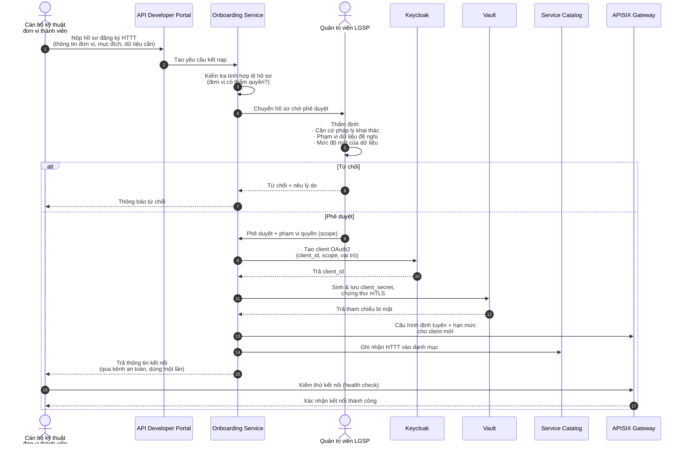

### Thuyết minh F-01

| Bước | Điểm cần lưu ý |
|---|---|
| 3 | Kiểm tra tự động: đơn vị phải tồn tại trong danh mục đơn vị hành chính (RDM) và người nộp phải có vai trò hợp lệ |
| 5 | **Khâu then chốt** — thẩm định của con người không thể tự động hóa. Quản trị viên đối chiếu căn cứ pháp lý: đơn vị này có quyền khai thác dữ liệu này theo văn bản nào? Đây là chốt chặn thực thi CMP-23 (không chia sẻ dữ liệu vượt thẩm quyền) |
| 8 | Nguyên tắc đặc quyền tối thiểu: scope cấp đúng phạm vi được duyệt, không cấp rộng "cho tiện" |
| 10 | Bí mật sinh ra và lưu tại Vault, **không bao giờ** lưu ở CSDL ứng dụng hay gửi qua email thường |
| 13 | Trả thông tin qua liên kết dùng một lần, hết hạn sau 24 giờ |

**Kết quả.** HTTT thành viên có danh tính OAuth2 riêng, chứng thư mTLS, phạm vi quyền xác định và hạn mức tần suất — đủ điều kiện gọi dịch vụ trên trục.

**Xử lý ngoại lệ.** Hồ sơ bị từ chối phải nêu rõ lý do và điều khoản pháp lý viện dẫn để đơn vị bổ sung. Nếu quá 15 ngày không có phản hồi phê duyệt, hệ thống tự động nhắc quản trị viên.

---

## F-02 — Công bố và đăng ký dịch vụ chia sẻ dữ liệu

**Mục đích.** Chủ quản CSDL công bố dịch vụ chia sẻ dữ liệu của mình lên trục và đồng bộ danh mục lên hệ thống trung ương của Bộ TTTT.

**Căn cứ.** NĐ 47/2020 Điều 24 (thiết lập và công bố dịch vụ), Điều 25 (công khai thông tin), Điều 26 (đăng ký lên hệ thống trung ương) → CMP-02, CMP-03.

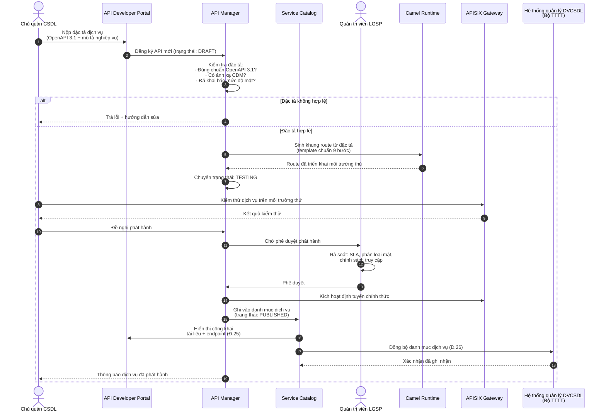

### Thuyết minh F-02

**Vì sao bắt buộc OpenAPI 3.1 trước khi triển khai.** Đây là hiện thực nguyên tắc API-first (NT-01). Đặc tả là hợp đồng: bên cung cấp cam kết cấu trúc dữ liệu, bên khai thác lập trình dựa trên đó. Không có đặc tả chuẩn thì không thể sinh tài liệu tự động, không kiểm chứng được tương thích khi nâng phiên bản, và vi phạm nghĩa vụ "công bố tài liệu kỹ thuật" tại Điều 24.

**Sinh khung route tự động (bước 5).** API Manager không sinh mã hoàn chỉnh mà sinh **khung route theo template chuẩn chín bước** đã mô tả tại [kiến trúc tích hợp](../02-architecture/README.md#52-mô-hình-luồng-tích-hợp). Chủ quản chỉ điền phần logic riêng. Cách này bảo đảm mọi dịch vụ đều có kiểm tra quyền, ghi vết và xử lý lỗi — không thể "quên".

**Vòng đời dịch vụ:**

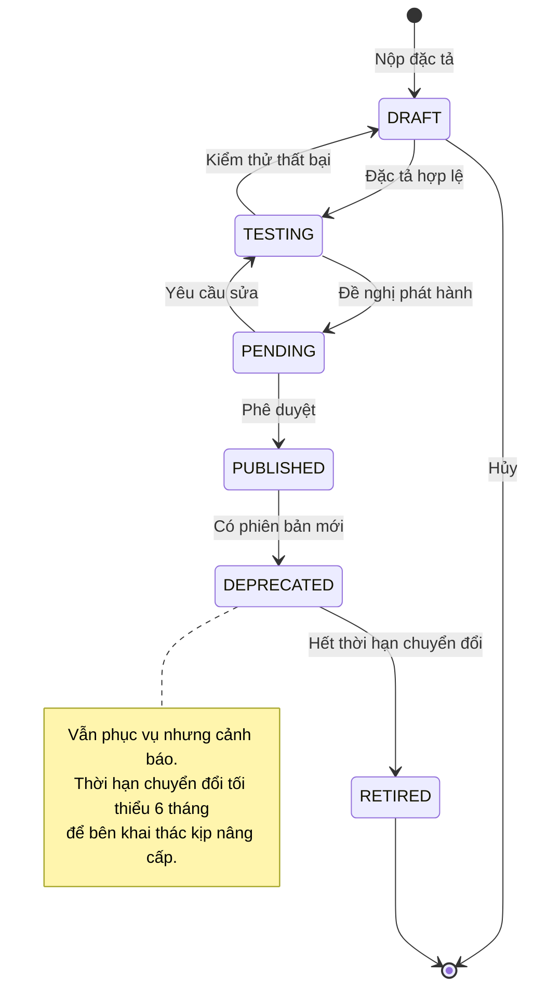

**Bước 18 — nghĩa vụ thường bị bỏ sót.** Đồng bộ danh mục lên hệ thống của Bộ TTTT là bắt buộc theo Điều 26 nhưng nhiều triển khai thực tế bỏ qua. Thiết kế này đưa nó vào luồng tự động, chạy ngay khi dịch vụ được phát hành, kèm cơ chế thử lại nếu hệ thống trung ương tạm thời không phản hồi.

---

## F-03 — Khai thác dữ liệu đồng bộ (nội bộ)

**Mục đích.** Một HTTT tra cứu dữ liệu từ HTTT khác trong cùng bộ/tỉnh, cần kết quả ngay.

**Đặc điểm.** Luồng có tần suất cao nhất trên trục — chiếm phần lớn lưu lượng. Nhạy cảm về độ trễ.

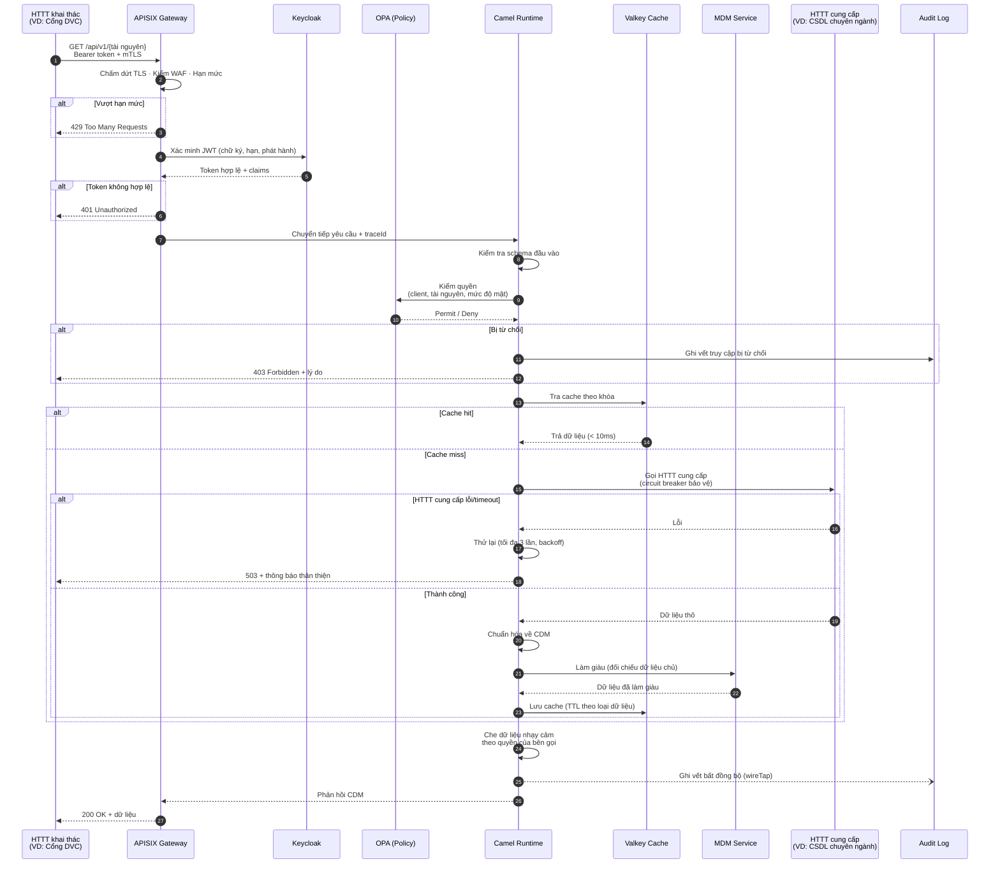

### Thuyết minh F-03

**Bốn chốt kiểm soát trước khi chạm dữ liệu.** Yêu cầu phải vượt qua: hạn mức (bước 3) → xác thực (bước 5) → kiểm tra schema (bước 10) → ủy quyền (bước 11). Thứ tự này cố ý: các kiểm tra rẻ tiền đặt trước để loại bỏ yêu cầu xấu sớm, tiết kiệm tài nguyên cho yêu cầu hợp lệ.

**Cache — yếu tố quyết định hiệu năng.** Thời gian sống của cache đặt theo bản chất dữ liệu:

| Loại dữ liệu | TTL | Lý do |
|---|---|---|
| Danh mục dùng chung (mã đơn vị hành chính, ngành nghề) | 24 giờ | Gần như bất biến |
| Dữ liệu chủ (thông tin công dân, doanh nghiệp) | 15 phút | Thay đổi chậm, cần độ tươi vừa phải |
| Dữ liệu giao dịch (trạng thái hồ sơ) | Không cache | Phải luôn chính xác thời điểm |

Với tỷ lệ trúng cache 70%, độ trễ trung bình giảm khoảng 60% và tải lên các HTTT cung cấp giảm tương ứng — đặc biệt quan trọng với hệ thống cũ có năng lực xử lý hạn chế.

**Che dữ liệu theo ngữ cảnh (bước 24).** Cùng một API, hai bên gọi khác nhau nhận mức chi tiết khác nhau. Ví dụ tra cứu công dân: cơ quan y tế thấy đầy đủ, đơn vị chỉ cần xác minh danh tính chỉ thấy họ tên và năm sinh, các trường còn lại bị che. Quy tắc che định nghĩa trong OPA, áp dụng ở tầng Camel — bên cung cấp dữ liệu không cần biết đến logic này.

**Ghi vết bất đồng bộ (bước 25).** Dùng `wireTap` của Camel: bản tin được sao chép sang nhánh ghi vết chạy song song, đường phản hồi chính không phải chờ. Ghi vết vẫn đầy đủ (CMP-28) nhưng không tính vào độ trễ người dùng cảm nhận.

**Ngân sách độ trễ mục tiêu:**

| Chặng | Ngân sách |
|---|---|
| Gateway (TLS, WAF, xác thực) | ≤ 20ms |
| Kiểm tra quyền OPA | ≤ 10ms |
| Tra cache (khi trúng) | ≤ 10ms |
| Gọi HTTT cung cấp (khi trượt cache) | ≤ 500ms |
| Chuẩn hóa + làm giàu | ≤ 50ms |
| **Tổng P95** | **≤ 1s** |

---

## F-04 — Khai thác dữ liệu từ CSDL Quốc gia qua NDXP

**Mục đích.** Khai thác dữ liệu từ các CSDLQG (Dân cư, Đăng ký doanh nghiệp, BHXH, Đất đai…) thông qua trục quốc gia NDXP/NGSP.

**Đặc thù so với F-03.** Phải tuân thủ TT 13/2017: định dạng bản tin riêng, **chữ ký số bắt buộc**, xác thực hai chiều với NDXP. LGSP là điểm kết nối duy nhất — HTTT nội bộ không được gọi thẳng NDXP.

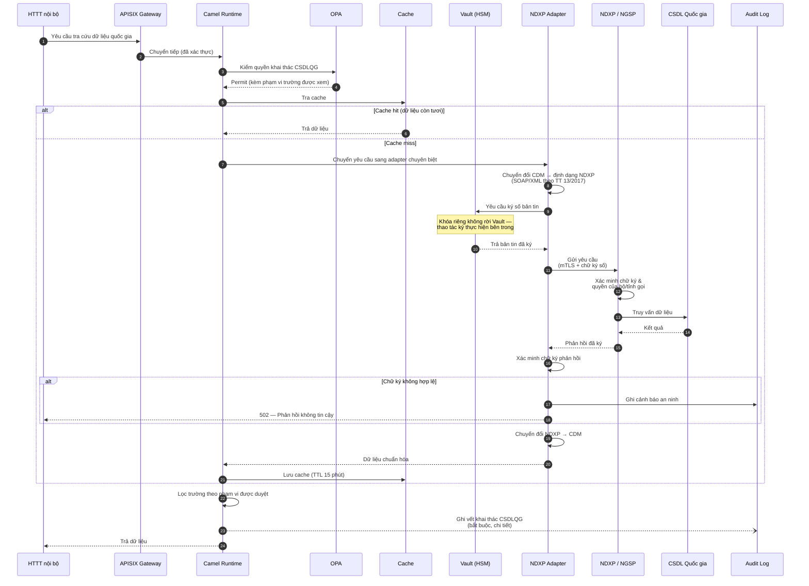

### Thuyết minh F-04

**Vì sao cần adapter chuyên biệt.** NDXP quy định định dạng bản tin cứng theo TT 13/2017 — không thương lượng được. Nếu để logic chuyển đổi này rải rác trong các route nghiệp vụ, mỗi lần trung ương thay đổi đặc tả sẽ phải sửa hàng chục nơi. NDXP Adapter cô lập toàn bộ đặc thù đó: các route nghiệp vụ chỉ làm việc với CDM, không biết NDXP tồn tại.

**Ký số trong ranh giới bảo mật (bước 10-11).** Khóa riêng của bộ/tỉnh dùng ký bản tin gửi NDXP là tài sản nhạy cảm bậc nhất. Thiết kế này gửi **bản tin vào Vault để ký** thay vì lấy khóa ra ngoài — kể cả khi pod ứng dụng bị chiếm quyền, kẻ tấn công không lấy được khóa, chỉ có thể yêu cầu ký trong thời gian còn giữ được quyền, và mọi yêu cầu ký đều bị ghi vết.

**Xác minh chữ ký hai chiều (bước 17).** Không chỉ LGSP ký khi gửi — phản hồi từ NDXP cũng phải được xác minh chữ ký trước khi tin dùng. Bỏ qua bước này tạo lỗ hổng cho tấn công xen giữa. Chữ ký sai được xử lý như sự cố an ninh, không phải lỗi kỹ thuật thông thường.

**Cache có ý nghĩa đặc biệt ở luồng này.** Các CSDLQG thường áp hạn mức truy vấn cho từng bộ/tỉnh. Cache 15 phút cho dữ liệu công dân giúp tránh chạm hạn mức trong giờ cao điểm — khi hàng nghìn hồ sơ dịch vụ công cùng tra cứu một số ít công dân. Đây là biện pháp thiết yếu chứ không phải tối ưu tùy chọn.

**Ghi vết chi tiết hơn luồng nội bộ.** Khai thác dữ liệu quốc gia phải ghi: ai gọi, tra cứu về ai, mục đích (hồ sơ nào), thời điểm, kết quả. Đây là yêu cầu truy vết của Luật Dữ liệu 2024 và cũng là căn cứ giải trình khi có khiếu nại về sử dụng dữ liệu cá nhân.

---

## F-05 — Đồng bộ dữ liệu bất đồng bộ theo sự kiện

**Mục đích.** Khi dữ liệu ở một HTTT thay đổi, tự động lan truyền tới các HTTT quan tâm mà không cần chúng liên tục hỏi.

**Khi nào dùng.** Đồng bộ khối lượng lớn, thông báo thay đổi, các trường hợp không cần phản hồi tức thì.

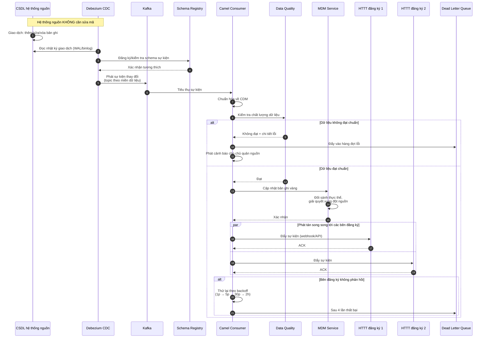

### Thuyết minh F-05

**Debezium giải bài toán hệ thống cũ.** Điểm mấu chốt ở bước 2-3: CDC đọc **nhật ký giao dịch** của CSDL, không truy vấn bảng và không cần trigger. Hệ quả: hệ thống nguồn hoàn toàn không biết mình đang bị theo dõi, không chịu thêm tải, không phải sửa một dòng mã. Đây thường là con đường khả thi duy nhất để đưa các HTTT cũ — vốn không có API và không còn nhà thầu bảo trì — lên trục.

**Schema Registry ngăn sự cố lan rộng.** Khi chủ quản hệ thống nguồn đổi cấu trúc bảng, Apicurio kiểm tra tương thích trước khi cho phép phát sự kiện. Thay đổi phá vỡ tương thích bị chặn ngay tại nguồn thay vì làm hỏng hàng loạt bên tiêu thụ ở hạ nguồn.

**Mô hình xuất bản – đăng ký.** Bên phát không biết ai đang nghe. Thêm một sở mới muốn nhận thông báo thay đổi dữ liệu dân cư chỉ cần đăng ký vào topic — không sửa gì ở phía nguồn, không phải thông báo cho ai. Đây là điều kiện để trục mở rộng mà không tăng độ phức tạp (NT-08).

**Bảo đảm giao nhận.** Kafka cấu hình `acks=all` với `min.insync.replicas=2`, Camel commit offset chỉ sau khi xử lý thành công. Kết quả là **at-least-once**: sự kiện không bao giờ mất, nhưng có thể lặp. Vì vậy các bên tiêu thụ **bắt buộc** xử lý idempotent — dùng khóa nghiệp vụ để nhận biết sự kiện đã xử lý. Yêu cầu này ghi rõ trong tài liệu kết nạp HTTT thành viên.

**Thứ tự sự kiện.** Kafka chỉ bảo đảm thứ tự trong cùng một phân vùng. Do đó khóa phân vùng chọn theo **định danh thực thể** (số định danh công dân, mã doanh nghiệp) — mọi thay đổi của cùng một công dân luôn vào cùng phân vùng, giữ đúng trình tự. Chọn sai khóa phân vùng sẽ gây hiện tượng cập nhật cũ ghi đè cập nhật mới.

---

## F-06 — Liên thông văn bản điện tử

**Mục đích.** Gửi/nhận văn bản điện tử giữa các cơ quan trong bộ/tỉnh và liên thông ra trục quốc gia.

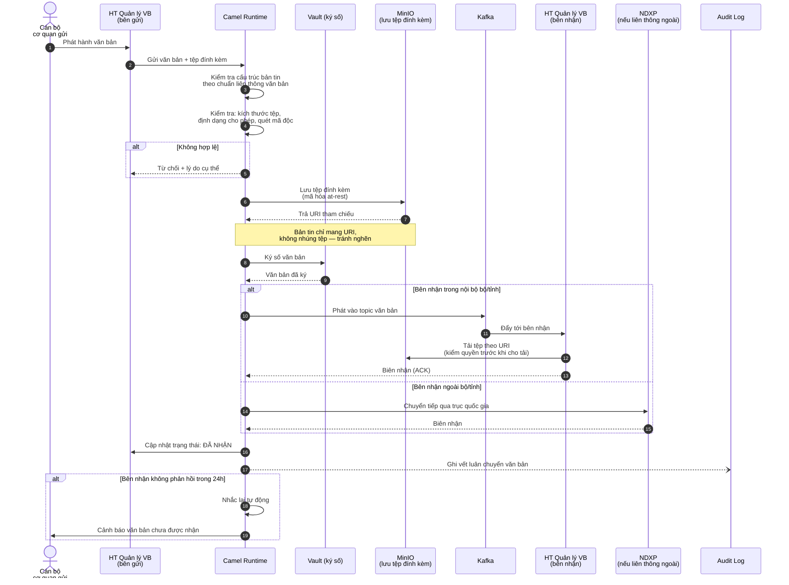

### Thuyết minh F-06

**Tách tệp đính kèm khỏi bản tin (bước 7-9).** Văn bản hành chính thường kèm tệp quét nặng hàng chục MB. Nếu nhúng trực tiếp vào bản tin, Kafka sẽ nghẽn và bộ nhớ các pod bị đẩy lên cao. Giải pháp là mẫu **Claim Check** của EIP: tệp lưu ở MinIO, bản tin chỉ mang URI tham chiếu. Bên nhận tự tải khi cần, có kiểm tra quyền tại thời điểm tải.

**Quét mã độc là bắt buộc (bước 5).** Văn bản đính kèm là véc-tơ lây nhiễm phổ biến trong mạng cơ quan nhà nước. Camel gọi ClamAV qua tích hợp, tệp nhiễm bị chặn ngay tại trục — không lan sang cơ quan nhận.

**Biên nhận và cơ chế nhắc.** Văn bản hành chính có giá trị pháp lý nên phải xác nhận đã nhận. Cơ chế nhắc tự động sau 24 giờ giải quyết tình huống hệ thống bên nhận gặp sự cố mà không ai biết — vấn đề thường gặp trong thực tế vận hành.

---

## F-07 — Giải quyết thủ tục hành chính liên thông

**Mục đích.** Điều phối một thủ tục hành chính cần nhiều cơ quan xử lý tuần tự hoặc song song.

**Đặc điểm.** Quy trình dài (ngày đến tháng), có tác vụ con người, cần lưu trạng thái bền vững → dùng BPMN thay vì Camel route thuần.

**Ví dụ minh họa.** Đăng ký khai sinh liên thông: khai sinh → nhập hộ khẩu → cấp thẻ BHYT trẻ em.

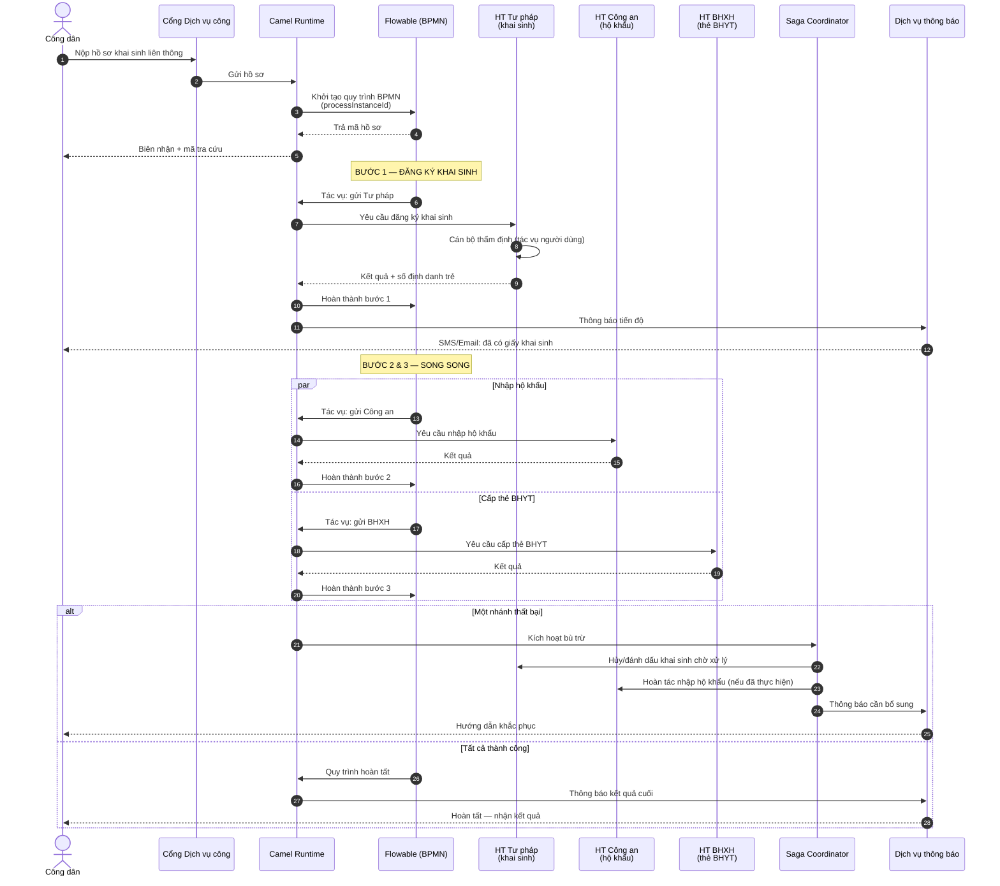

### Thuyết minh F-07

**Vì sao BPMN chứ không phải Camel route.** Quy trình này kéo dài nhiều ngày và có tác vụ chờ cán bộ xử lý. Camel route là stateless, sống trong bộ nhớ — pod khởi động lại là mất. Flowable ghi trạng thái quy trình xuống PostgreSQL sau mỗi bước, nên quy trình sống sót qua mọi sự cố hạ tầng và có thể tiếp tục đúng chỗ đang dở.

**Phân vai rõ ràng.** Flowable quyết định **"làm gì tiếp theo"** (logic nghiệp vụ, điều kiện rẽ nhánh, song song, chờ đợi); Camel thực hiện **"làm bằng cách nào"** (gọi hệ thống nào, giao thức gì, chuyển đổi ra sao). Ranh giới này giữ cho quy trình nghiệp vụ đọc được bởi người làm nghiệp vụ, còn chi tiết kỹ thuật nằm gọn ở tầng tích hợp.

**Saga — nhất quán không cần giao dịch phân tán.** Không thể dùng giao dịch hai pha (2PC) trên các hệ thống độc lập của nhiều cơ quan. Mẫu Saga giải bằng cách: mỗi bước có một **hành động bù trừ** tương ứng. Nếu bước cấp thẻ BHYT thất bại, Saga Coordinator lần ngược gọi các hành động bù trừ của những bước đã hoàn tất. Trạng thái cuối cùng nhất quán, dù trải qua giai đoạn trung gian không nhất quán.

| Bước xuôi | Hành động bù trừ |
|---|---|
| Đăng ký khai sinh | Đánh dấu hồ sơ chờ xử lý (không xóa — văn bản đã có giá trị pháp lý) |
| Nhập hộ khẩu | Hoàn tác bản ghi nhập khẩu |
| Cấp thẻ BHYT | Hủy thẻ đã cấp |

Lưu ý về bù trừ khai sinh: không xóa mà chỉ đánh dấu, vì giấy khai sinh đã phát hành là văn bản pháp lý. Đây là ví dụ cho thấy hành động bù trừ phải do **nghiệp vụ** định nghĩa, không suy ra máy móc từ hành động xuôi.

**Thông báo tiến độ liên tục.** Người dân được thông báo sau mỗi bước hoàn thành thay vì chỉ biết kết quả cuối. Yêu cầu này hiện thực tinh thần "lấy người dân làm trung tâm" của Khung Kiến trúc CPĐT 3.0.

---

## F-08 — Xác thực người dùng qua VNeID / SSO

**Mục đích.** Đăng nhập một lần, dùng chung cho mọi ứng dụng trên trục; liên kết với nền tảng định danh quốc gia VNeID.

**Căn cứ.** CV 631 (SSO, SAML2, OIDC, MFA → CMP-06, CMP-07); QĐ 1729 bổ sung nền tảng định danh điện tử (CMP-27).

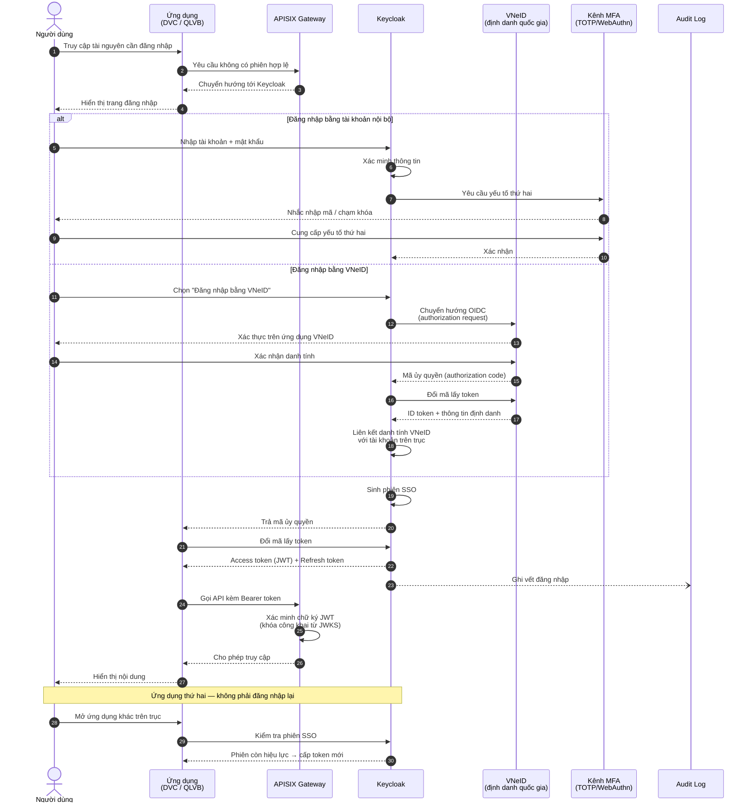

### Thuyết minh F-08

**Keycloak làm cầu nối định danh.** Keycloak vừa là nhà cung cấp định danh cho các ứng dụng nội bộ, vừa là bên tin cậy (relying party) của VNeID. Cách bố trí này cho phép thêm nguồn định danh mới (chứng thư số, tài khoản của bộ ngành khác) mà **không ứng dụng nào phải sửa mã** — tất cả đều chỉ nói chuyện với Keycloak.

**Vòng đời token — cân bằng an toàn và trải nghiệm:**

| Loại token | Thời hạn | Lý do |
|---|---|---|
| Access token | 5 phút | Ngắn để giảm thiệt hại nếu rò rỉ |
| Refresh token | 8 giờ | Đủ một ca làm việc, không phải đăng nhập lại |
| Phiên SSO | 8 giờ (nghỉ 30 phút thì hết) | Cân bằng tiện dụng và an toàn |

**Xác thực token không cần gọi Keycloak (bước 25).** APISIX xác minh chữ ký JWT bằng khóa công khai lấy từ điểm cuối JWKS và lưu cache. Nghĩa là mỗi lời gọi API **không** phát sinh một lượt hỏi Keycloak — Keycloak không trở thành nút thắt cổ chai, và sự cố tạm thời của Keycloak không làm sập toàn bộ trục (token đang hiệu lực vẫn dùng được).

**MFA bắt buộc theo mức nhạy cảm.** Không áp dụng máy móc cho mọi người dùng: tra cứu dữ liệu công khai chỉ cần một yếu tố; truy cập dữ liệu công dân, thao tác quản trị và mọi hành vi ghi dữ liệu bắt buộc hai yếu tố. Chính sách phân tầng này định nghĩa trong Keycloak Authentication Flow.

---

## F-09 — Quản lý dữ liệu chủ và đối sánh thực thể

**Mục đích.** Tạo và duy trì bản ghi vàng cho các thực thể cốt lõi (công dân, doanh nghiệp, đơn vị) từ nhiều nguồn dữ liệu khác nhau.

**Căn cứ.** NĐ 47/2020 — dữ liệu chủ (CMP-20).

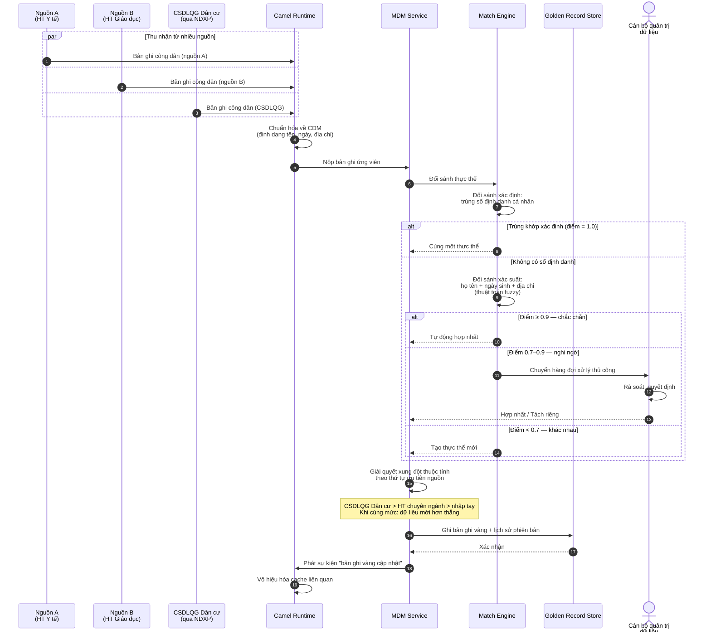

### Thuyết minh F-09

**Hai chế độ đối sánh.** Số định danh cá nhân là khóa vàng — khi có, đối sánh là xác định, không cần suy đoán. Nhưng dữ liệu cũ thường thiếu số định danh, buộc phải đối sánh xác suất dựa trên tổ hợp họ tên, ngày sinh, địa chỉ với thuật toán so khớp mờ để chịu được sai khác chính tả và dấu tiếng Việt.

**Vùng xám cần con người quyết định.** Khoảng điểm 0,7–0,9 cố ý không tự động hóa. Hợp nhất sai hai công dân khác nhau gây hậu quả nghiêm trọng — hồ sơ y tế, quyền lợi bảo hiểm bị trộn lẫn. Chi phí một lượt rà soát thủ công rẻ hơn nhiều so với chi phí khắc phục một lần hợp nhất sai.

**Thứ tự ưu tiên nguồn — chính sách chứ không phải kỹ thuật.** Khi nguồn A ghi "Nguyễn Văn A" và CSDLQG ghi "Nguyễn Văn Á", chọn giá trị nào? Nguyên tắc: nguồn có thẩm quyền pháp lý cao hơn thắng. CSDLQG Dân cư là nguồn xác thực về nhân thân, nên luôn được ưu tiên. Thứ tự này phải được lãnh đạo phê duyệt, không do đội kỹ thuật tự quyết.

**Lịch sử phiên bản bắt buộc.** Mọi thay đổi bản ghi vàng lưu lại phiên bản cũ. Khi phát hiện hợp nhất sai, có thể tách ngược. Không có lịch sử thì sai lầm là vĩnh viễn.

---

## F-10 — Xử lý lỗi và phát lại bản tin

**Mục đích.** Bảo đảm không mất bản tin khi có sự cố, và có công cụ xử lý bản tin lỗi.

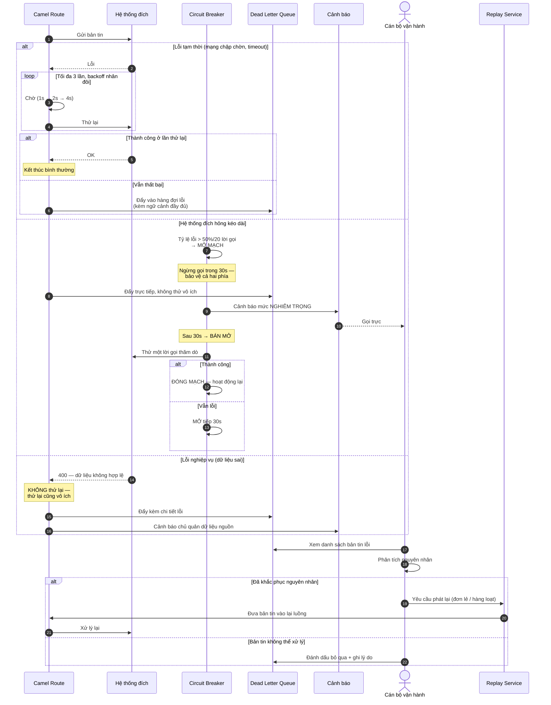

### Thuyết minh F-10

**Phân loại lỗi quyết định cách xử lý.** Đây là điểm cốt lõi của luồng này:

| Loại lỗi | Ví dụ | Chiến lược | Vì sao |
|---|---|---|---|
| **Tạm thời** | Timeout, mất gói, 503 | Thử lại có backoff | Có khả năng tự khỏi |
| **Kéo dài** | Hệ thống đích sập | Ngắt mạch + cảnh báo | Thử lại chỉ làm hại thêm |
| **Nghiệp vụ** | Dữ liệu sai định dạng | **Không thử lại**, chuyển DLQ | Thử lại 1000 lần vẫn sai |

Nhầm lẫn ba loại này là lỗi thiết kế phổ biến: thử lại lỗi nghiệp vụ gây lãng phí và làm nhiễu cảnh báo; không thử lại lỗi tạm thời gây mất bản tin không đáng có.

**Circuit breaker bảo vệ cả hai phía.** Khi hệ thống đích quá tải, việc tiếp tục gửi yêu cầu khiến nó càng khó phục hồi. Ngắt mạch cho hệ thống đích "thở" đồng thời giải phóng luồng xử lý ở phía LGSP — ngăn hiệu ứng domino lan sang các luồng khác đang khỏe mạnh (NT-08).

**DLQ phải chứa đủ ngữ cảnh.** Bản tin trong DLQ đi kèm: nội dung gốc, traceId, thời điểm, thông báo lỗi đầy đủ, số lần đã thử, tên route. Thiếu bất kỳ thông tin nào trong số này thì cán bộ vận hành không thể chẩn đoán, và bản tin lỗi trở thành rác không xử lý được.

**Phát lại phải idempotent.** Vì bản tin có thể đã được xử lý một phần trước khi lỗi, thao tác phát lại phải an toàn khi lặp. Đây là lý do yêu cầu idempotent với mọi bên tiêu thụ đã nêu ở F-05.

---

## F-11 — Đánh giá chất lượng dữ liệu định kỳ

**Mục đích.** Thực hiện nghĩa vụ kiểm tra, đánh giá chất lượng dữ liệu định kỳ hằng năm.

**Căn cứ.** NĐ 47/2020 (CMP-22).

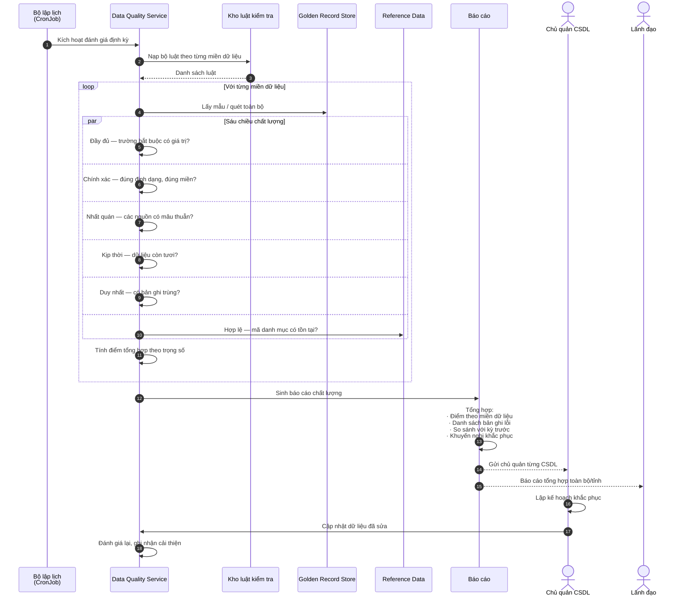

### Thuyết minh F-11

**Đánh giá liên tục thay vì chỉ mỗi năm một lần.** Quy định yêu cầu tối thiểu hằng năm, nhưng thiết kế này chạy đánh giá hằng tháng và báo cáo chính thức hằng năm. Lý do thực tiễn: phát hiện suy giảm chất lượng sớm rẻ hơn nhiều so với sửa chữa sau một năm tích lũy lỗi.

**Điểm chất lượng có trọng số theo mức quan trọng.** Không phải mọi trường đều ngang nhau — thiếu số định danh cá nhân nghiêm trọng hơn thiếu số điện thoại. Trọng số do chủ quản dữ liệu xác lập dựa trên tác động nghiệp vụ.

**Báo cáo hướng hành động.** Báo cáo không chỉ nêu "chất lượng đạt 82%" mà phải chỉ rõ: bản ghi nào lỗi, lỗi gì, nguồn nào gây ra, cách khắc phục. Báo cáo không kèm khuyến nghị cụ thể sẽ nằm im trong ngăn kéo.

---

## F-12 — Giám sát và cảnh báo vận hành

**Mục đích.** Phát hiện sớm sự cố và bảo đảm khả năng chẩn đoán trên hệ thống phân tán.

**Căn cứ.** CV 631 — giám sát, thống kê, báo cáo, phân tích nghiệp vụ thời gian thực (CMP-10).

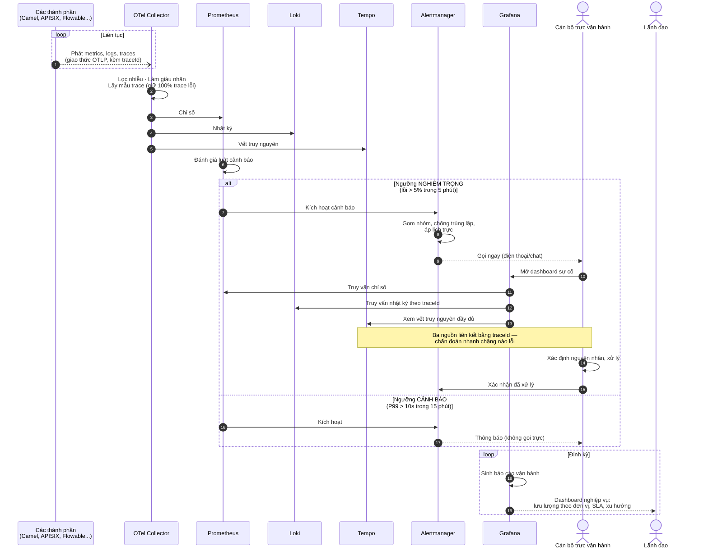

### Thuyết minh F-12

**traceId là sợi chỉ xuyên suốt.** Giá trị lớn nhất của thiết kế này nằm ở bước 14-16: từ một cảnh báo, cán bộ vận hành lấy traceId của yêu cầu lỗi, rồi dùng chính traceId đó để lọc nhật ký (Loki) và xem toàn bộ hành trình (Tempo). Không phải đoán mò "chắc là do hệ thống X" — thấy chính xác chặng nào chậm, chặng nào lỗi, mất bao lâu.

**Chiến lược lấy mẫu trace.** Lưu 100% trace sẽ tốn dung lượng khổng lồ. Chính sách: giữ **toàn bộ** trace có lỗi hoặc chậm bất thường, lấy mẫu 1–5% trace thành công. Nghịch lý cần tránh: lấy mẫu ngẫu nhiên đều thường bỏ sót đúng những trace cần nhất.

**Cảnh báo dựa trên triệu chứng người dùng, không dựa trên nguyên nhân.** Cảnh báo "CPU 90%" ít giá trị — CPU cao mà người dùng không bị ảnh hưởng thì không phải sự cố. Cảnh báo "tỷ lệ lỗi API vượt 5%" mới đáng gọi trực lúc nửa đêm. Nguyên tắc này giảm mạnh mệt mỏi cảnh báo, giữ cho cán bộ trực nghiêm túc với mỗi lần bị gọi.

**Dashboard nghiệp vụ cho lãnh đạo.** CV 631 yêu cầu "phân tích hoạt động nghiệp vụ" — không chỉ chỉ số kỹ thuật. Dashboard cho lãnh đạo trả lời các câu hỏi quản lý: đơn vị nào dùng trục nhiều nhất, dịch vụ nào có nhu cầu cao, đơn vị nào chưa kết nối, xu hướng tăng trưởng ra sao. Đây là đầu vào cho quyết định đầu tư và điều hành.

---

## Liên kết

- Kiến trúc thành phần → [02-architecture](../02-architecture/README.md)
- Yêu cầu pháp lý tương ứng → [01-legal](../01-legal/README.md)
- Các bước triển khai → [04-deployment](../04-deployment/README.md)
