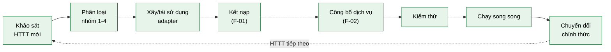
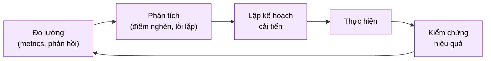

# 04 — Kế hoạch triển khai LGSP

> **Vai trò tài liệu**: mô tả **các bước tiến hành** để xây dựng và đưa nền tảng vào vận hành.
> Tài liệu này tổ chức theo **trình tự công việc và điều kiện chuyển bước**, không theo mốc thời gian — bước sau chỉ bắt đầu khi tiêu chí ra của bước trước được thỏa mãn.

## Cách đọc tài liệu

Mỗi bước được mô tả theo cùng một cấu trúc:

| Mục | Ý nghĩa |
|---|---|
| **Mục tiêu** | Kết quả cần đạt |
| **Điều kiện vào** | Phải có gì trước khi bắt đầu |
| **Công việc** | Các việc cụ thể phải làm |
| **Sản phẩm** | Artifact bàn giao được |
| **Tiêu chí ra** | Điều kiện kiểm chứng để chuyển bước tiếp |

---

## Bản đồ tổng thể các bước

```mermaid
graph TB
    subgraph GD1["GIAI ĐOẠN A — CHUẨN BỊ"]
        B1["Bước 1<br/>Khảo sát hiện trạng<br/>& lập danh mục tích hợp"]
        B2["Bước 2<br/>Chuẩn hóa yêu cầu<br/>& thiết kế chi tiết"]
        B3["Bước 3<br/>Thiết lập nền tảng<br/>kỹ thuật & quy trình"]
    end

    subgraph GD2["GIAI ĐOẠN B — XÂY DỰNG LÕI"]
        B4["Bước 4<br/>Dựng hạ tầng K8s<br/>& thành phần nền"]
        B5["Bước 5<br/>Triển khai lớp<br/>an toàn thông tin"]
        B6["Bước 6<br/>Triển khai lõi<br/>tích hợp Camel"]
        B7["Bước 7<br/>Triển khai lớp<br/>dữ liệu dùng chung"]
        B8["Bước 8<br/>Triển khai giám sát<br/>& vận hành"]
    end

    subgraph GD3["GIAI ĐOẠN C — TÍCH HỢP"]
        B9["Bước 9<br/>Xây dựng CDM<br/>& bộ adapter"]
        B10["Bước 10<br/>Kết nối HTTT<br/>thí điểm"]
        B11["Bước 11<br/>Kết nối NDXP<br/>& CSDLQG"]
        B12["Bước 12<br/>Triển khai luồng<br/>nghiệp vụ"]
    end

    subgraph GD4["GIAI ĐOẠN D — KIỂM CHỨNG"]
        B13["Bước 13<br/>Kiểm thử toàn diện"]
        B14["Bước 14<br/>Kiểm định an toàn<br/>& hồ sơ cấp độ"]
        B15["Bước 15<br/>Nghiệm thu<br/>tuân thủ pháp lý"]
    end

    subgraph GD5["GIAI ĐOẠN E — VẬN HÀNH"]
        B16["Bước 16<br/>Chuyển giao<br/>& đào tạo"]
        B17["Bước 17<br/>Đưa vào vận hành<br/>chính thức"]
        B18["Bước 18<br/>Mở rộng diện<br/>kết nối"]
        B19["Bước 19<br/>Vận hành liên tục<br/>& cải tiến"]
    end

    B1 --> B2 --> B3 --> B4
    B4 --> B5 --> B6
    B6 --> B7
    B6 --> B8
    B7 --> B9
    B8 --> B9
    B9 --> B10 --> B11 --> B12
    B12 --> B13 --> B14 --> B15
    B15 --> B16 --> B17 --> B18 --> B19
    B19 -.->|"vòng lặp cải tiến"| B9

    classDef gd1 fill:#e8f0fe,stroke:#1967d2,stroke-width:2px,color:#000
    classDef gd2 fill:#fef7e0,stroke:#ea8600,stroke-width:2px,color:#000
    classDef gd3 fill:#e6f4ea,stroke:#137333,stroke-width:2px,color:#000
    classDef gd4 fill:#fce8e6,stroke:#c5221f,stroke-width:2px,color:#000
    classDef gd5 fill:#f3e8fd,stroke:#7627bb,stroke-width:2px,color:#000
    class B1,B2,B3 gd1
    class B4,B5,B6,B7,B8 gd2
    class B9,B10,B11,B12 gd3
    class B13,B14,B15 gd4
    class B16,B17,B18,B19 gd5
```

**Thuyết minh trình tự.** Đồ thị trên là đồ thị phụ thuộc, không phải lịch. Ba điểm cần lưu ý:

- **Bước 7 và 8 chạy song song** sau bước 6 — lớp dữ liệu và lớp giám sát độc lập nhau, không cần chờ nhau.
- **Bước 5 phải trước bước 6**: lõi tích hợp cần Keycloak, Vault, OPA sẵn sàng để không phải "gắn bảo mật vào sau" — vi phạm nguyên tắc NT-04.
- **Vòng lặp từ bước 19 về bước 9**: mỗi HTTT mới kết nạp đều quay lại chu trình xây adapter → kết nối → kiểm thử. Đây là trạng thái thường trực của nền tảng, không phải ngoại lệ.

---

# GIAI ĐOẠN A — CHUẨN BỊ

## Bước 1 — Khảo sát hiện trạng và lập danh mục tích hợp

**Mục tiêu.** Có bức tranh đầy đủ về các HTTT hiện có, dữ liệu chúng nắm giữ và nhu cầu trao đổi thực tế.

**Điều kiện vào.** Có quyết định phê duyệt chủ trương triển khai; có đầu mối tại các sở/ngành.

**Công việc:**

| # | Việc | Cách làm |
|---|---|---|
| 1.1 | Kiểm kê toàn bộ HTTT trong bộ/tỉnh | Phiếu khảo sát + phỏng vấn trực tiếp từng đơn vị |
| 1.2 | Xác định năng lực kỹ thuật từng HTTT | Có API không? Giao thức gì? CSDL loại nào? Còn nhà thầu bảo trì không? |
| 1.3 | Lập danh mục dữ liệu mỗi HTTT nắm giữ | Đối chiếu với danh mục dữ liệu dùng chung của bộ/tỉnh |
| 1.4 | Thu thập nhu cầu trao đổi dữ liệu | Đơn vị nào cần dữ liệu gì của đơn vị nào, tần suất, khối lượng |
| 1.5 | Xác định mức độ mật của từng nhóm dữ liệu | Phối hợp bộ phận bảo vệ bí mật nhà nước |
| 1.6 | Rà soát căn cứ pháp lý khai thác | Mỗi nhu cầu khai thác phải có căn cứ văn bản |
| 1.7 | Đánh giá hạ tầng sẵn có | Trung tâm dữ liệu, mạng, năng lực đội ngũ |

**Phân loại HTTT — quyết định cách tích hợp về sau:**

| Nhóm | Đặc điểm | Chiến lược kết nối |
|---|---|---|
| **Nhóm 1 — Hiện đại** | Có REST API, tài liệu đầy đủ, đang được bảo trì | Kết nối trực tiếp qua adapter chuẩn |
| **Nhóm 2 — Có API hạn chế** | Có SOAP/API cũ, tài liệu thiếu | Adapter chuyên biệt + chuẩn hóa về CDM |
| **Nhóm 3 — Di sản** | Không API, không còn nhà thầu, không sửa được | **CDC qua Debezium** — đọc trực tiếp từ CSDL |
| **Nhóm 4 — Sắp thay thế** | Đang có kế hoạch thay mới | Không đầu tư tích hợp sâu; chờ hệ thống mới |

**Sản phẩm:**
- Báo cáo hiện trạng HTTT (kèm phân loại 4 nhóm).
- Danh mục dữ liệu và ma trận nhu cầu trao đổi (ai cần gì của ai).
- Danh mục dữ liệu phân theo mức độ mật.
- Đánh giá năng lực hạ tầng và nhân lực.

**Tiêu chí ra:**
- ✅ Kiểm kê đủ 100% HTTT đang vận hành trong bộ/tỉnh.
- ✅ Mỗi HTTT được xếp vào đúng một trong bốn nhóm.
- ✅ Ma trận nhu cầu trao đổi được các đơn vị liên quan xác nhận.
- ✅ Mỗi nhu cầu khai thác có căn cứ pháp lý rõ ràng.

---

## Bước 2 — Chuẩn hóa yêu cầu và thiết kế chi tiết

**Mục tiêu.** Chuyển kết quả khảo sát thành đặc tả kỹ thuật đủ chi tiết để thi công.

**Điều kiện vào.** Hoàn thành bước 1.

**Công việc:**

| # | Việc | Kết quả |
|---|---|---|
| 2.1 | Xác định phạm vi triển khai theo đợt | Danh sách HTTT ưu tiên đợt đầu |
| 2.2 | Thiết kế Canonical Data Model | Lược đồ CDM cho các thực thể cốt lõi |
| 2.3 | Đặc tả từng dịch vụ chia sẻ | Tài liệu OpenAPI 3.1 cho mỗi API |
| 2.4 | Thiết kế chính sách truy cập | Ma trận quyền: ai được truy cập dữ liệu nào |
| 2.5 | Xác lập SLA cho từng dịch vụ | Độ trễ, tỷ lệ sẵn sàng, hạn mức tần suất |
| 2.6 | Thiết kế mô hình triển khai hạ tầng | Số node, cấu hình, phân bổ tài nguyên |
| 2.7 | Lập kế hoạch kiểm thử | Kịch bản cho từng luồng nghiệp vụ F-01…F-12 |
| 2.8 | Rà soát đối chiếu ma trận tuân thủ | Mỗi mục CMP-01…28 có giải pháp tương ứng |

**Nguyên tắc chọn HTTT cho đợt đầu:**

Ưu tiên hệ thống thỏa mãn đồng thời: (a) thuộc Nhóm 1 về kỹ thuật, (b) có nhu cầu trao đổi rõ ràng và thường xuyên, (c) đơn vị chủ quản sẵn sàng phối hợp. Tránh chọn hệ thống phức tạp nhất làm thí điểm — mục đích đợt đầu là chứng minh nền tảng chạy được và tạo niềm tin, không phải giải bài toán khó nhất.

**Sản phẩm:**
- Tài liệu thiết kế chi tiết (bổ sung cho [02-architecture](../02-architecture/README.md) với đặc thù của bộ/tỉnh).
- Bộ đặc tả OpenAPI cho các dịch vụ đợt đầu.
- Lược đồ CDM.
- Ma trận phân quyền truy cập.
- Kế hoạch và kịch bản kiểm thử.

**Tiêu chí ra:**
- ✅ Mọi yêu cầu CMP-01…28 có giải pháp thiết kế tương ứng.
- ✅ Đặc tả OpenAPI vượt qua kiểm tra cú pháp tự động.
- ✅ CDM được các chủ quản dữ liệu liên quan thống nhất.
- ✅ Thiết kế được hội đồng kỹ thuật thông qua.

---

## Bước 3 — Thiết lập nền tảng kỹ thuật và quy trình làm việc

**Mục tiêu.** Có môi trường làm việc, quy trình và công cụ trước khi viết dòng mã đầu tiên.

**Điều kiện vào.** Hoàn thành bước 2.

**Công việc:**

| # | Việc | Chi tiết |
|---|---|---|
| 3.1 | Thiết lập kho mã nguồn | Git, cấu trúc thư mục, quy ước nhánh |
| 3.2 | Thiết lập quy trình CI/CD | Build, kiểm thử tự động, quét bảo mật, đóng gói ảnh |
| 3.3 | Thiết lập kho lưu ảnh container | Harbor (nội bộ, có quét lỗ hổng) |
| 3.4 | Thiết lập môi trường | DEV → TEST → STAGING → PROD |
| 3.5 | Xác lập quy ước mã nguồn | Đặt tên route, cấu trúc thư mục, chuẩn ghi nhật ký |
| 3.6 | Thiết lập quy trình quản lý thay đổi | Pull request, người duyệt bắt buộc, quy tắc gộp |
| 3.7 | Chuẩn bị template route Camel | Khung chuẩn chín bước (xem [kiến trúc tích hợp](../02-architecture/README.md#52-mô-hình-luồng-tích-hợp)) |

**Sơ đồ luồng CI/CD:**

```mermaid
graph LR
    DEV["Lập trình viên<br/>commit"] --> PR["Pull Request"]
    PR --> CI1["Kiểm tra tĩnh<br/>(lint, format)"]
    CI1 --> CI2["Kiểm thử đơn vị<br/>+ Camel route test"]
    CI2 --> CI3["Quét bảo mật<br/>(SAST, phụ thuộc)"]
    CI3 --> CI4["Đóng gói ảnh<br/>container"]
    CI4 --> CI5["Quét lỗ hổng ảnh<br/>(Trivy)"]
    CI5 --> REG["Đẩy lên Harbor"]
    REG --> ARGO["Argo CD<br/>đồng bộ"]
    ARGO --> ENV1["DEV<br/>tự động"]
    ENV1 --> ENV2["TEST<br/>tự động"]
    ENV2 --> ENV3["STAGING<br/>cần duyệt"]
    ENV3 --> ENV4["PROD<br/>cần duyệt + cửa sổ thay đổi"]

    classDef ci fill:#e8f0fe,stroke:#1967d2,color:#000
    classDef env fill:#e6f4ea,stroke:#137333,color:#000
    classDef prod fill:#fce8e6,stroke:#c5221f,stroke-width:2px,color:#000
    class CI1,CI2,CI3,CI4,CI5,REG,ARGO ci
    class ENV1,ENV2,ENV3 env
    class ENV4 prod
```

**Thuyết minh.** Cổng kiểm soát tăng dần theo mức độ quan trọng của môi trường: DEV và TEST triển khai tự động để đội phát triển làm việc nhanh; STAGING và PROD cần người phê duyệt. Riêng PROD chỉ triển khai trong cửa sổ thay đổi đã công bố, tránh gây gián đoạn giờ hành chính.

**Sản phẩm:**
- Kho mã nguồn với cấu trúc chuẩn.
- Đường ống CI/CD hoạt động.
- Bốn môi trường sẵn sàng.
- Tài liệu quy ước phát triển.

**Tiêu chí ra:**
- ✅ Một thay đổi mẫu đi trọn vẹn từ commit tới môi trường DEV tự động.
- ✅ Quét bảo mật chặn được lỗ hổng nghiêm trọng (thử nghiệm bằng phụ thuộc có lỗ hổng đã biết).
- ✅ Toàn đội truy cập được các môi trường theo đúng quyền.

---

# GIAI ĐOẠN B — XÂY DỰNG LÕI NỀN TẢNG

## Bước 4 — Dựng hạ tầng Kubernetes và thành phần nền

**Mục tiêu.** Có cụm K8s vận hành được với các dịch vụ hạ tầng cơ bản.

**Điều kiện vào.** Hoàn thành bước 3; hạ tầng vật lý/đám mây sẵn sàng.

**Công việc theo trình tự:**

| # | Việc | Ghi chú |
|---|---|---|
| 4.1 | Cài đặt cụm Kubernetes | Tối thiểu 3 node control-plane + 3 node worker; bật dual-stack IPv4/IPv6 (CMP-14) |
| 4.2 | Cấu hình CNI mạng | Cilium (hỗ trợ NetworkPolicy nâng cao, eBPF) |
| 4.3 | Cấu hình CSI lưu trữ | Lớp lưu trữ SSD cho CSDL, HDD cho sao lưu |
| 4.4 | Cài Ingress + Load Balancer | Istio Ingress Gateway + MetalLB (nếu tại chỗ) |
| 4.5 | Tạo namespace + NetworkPolicy | Năm namespace theo thiết kế, chính sách mặc định từ chối |
| 4.6 | Cài Argo CD | Kết nối kho Git, cấu hình đồng bộ tự động |
| 4.7 | Cài PostgreSQL qua CloudNativePG | 1 primary + 2 replica; bật sao lưu hằng ngày + WAL (CMP-17) |
| 4.8 | Cài MinIO | Bật chế độ WORM cho bucket nhật ký kiểm toán |
| 4.9 | Cài Kafka qua Strimzi | 3 broker, chế độ KRaft, hệ số nhân bản 3 |
| 4.10 | Cài Valkey | Chế độ cụm cho cache |
| 4.11 | Kiểm chứng khôi phục dữ liệu | **Diễn tập restore thực tế** từ bản sao lưu |

**Lưu ý về bước 4.11.** Đây là bước dễ bị bỏ qua nhất và cũng nguy hiểm nhất khi bỏ qua. Sao lưu chưa từng được khôi phục thử không phải là sao lưu — chỉ là niềm tin. Phải thực hiện khôi phục thật vào môi trường riêng và đối chiếu dữ liệu.

**Sản phẩm:**
- Cụm K8s vận hành với tài liệu cấu hình.
- Toàn bộ manifest hạ tầng trong Git.
- Biên bản diễn tập khôi phục dữ liệu.

**Tiêu chí ra:**
- ✅ Cụm chịu được mất một node mà không gián đoạn dịch vụ (kiểm chứng bằng thử nghiệm thực tế).
- ✅ NetworkPolicy chặn đúng: pod ở `lgsp-edge` không kết nối được trực tiếp tới PostgreSQL.
- ✅ Khôi phục dữ liệu từ sao lưu thành công, dữ liệu toàn vẹn.
- ✅ Truy cập được qua IPv6.

---

## Bước 5 — Triển khai lớp an toàn thông tin

**Mục tiêu.** Có nền tảng định danh, ủy quyền và quản lý bí mật trước khi triển khai ứng dụng.

**Điều kiện vào.** Hoàn thành bước 4.

**Công việc:**

| # | Việc | Đáp ứng |
|---|---|---|
| 5.1 | Cài Keycloak (HA, 2+ replica) | CMP-06 |
| 5.2 | Cấu hình realm, client, vai trò | — |
| 5.3 | Bật OIDC, SAML2, OAuth2 | CMP-06 |
| 5.4 | Cấu hình MFA (TOTP + WebAuthn) | CMP-07 |
| 5.5 | Cài Vault (HA 3 node) + External Secrets | CMP-24 |
| 5.6 | Cấu hình bí mật động cho CSDL | — |
| 5.7 | Nạp chứng thư số ký bản tin NDXP vào Vault | CMP-25 |
| 5.8 | Cài OPA + xây bộ chính sách nền | CMP-08, CMP-23 |
| 5.9 | Bật mTLS toàn cụm qua Istio | CMP-13 |
| 5.10 | Cài APISIX + WAF Coraza | CMP-05, CMP-19 |
| 5.11 | Cấu hình hạn mức và chống DDoS | CMP-19 |
| 5.12 | Triển khai dịch vụ ghi vết bất biến | CMP-28 |

**Thứ tự có chủ đích.** Keycloak trước OPA vì chính sách ủy quyền cần danh tính làm đầu vào. Vault trước mọi thứ khác cần bí mật. Istio mTLS bật sau khi các dịch vụ cơ bản đã chạy để dễ chẩn đoán nếu có sự cố kết nối.

**Sản phẩm:**
- Keycloak với realm cấu hình đầy đủ.
- Vault vận hành với chính sách truy cập.
- Bộ chính sách OPA nền tảng.
- APISIX với WAF hoạt động.

**Tiêu chí ra:**
- ✅ Đăng nhập thành công qua cả OIDC và SAML2 (CMP-06).
- ✅ MFA hoạt động với ít nhất hai phương thức (CMP-07).
- ✅ Chính sách OPA trả về Deny đúng khi thử truy cập vượt quyền (CMP-08).
- ✅ Quét TLS đạt mức A trở lên, không còn TLS < 1.2 (CMP-13).
- ✅ Không có bí mật nào nằm trong mã nguồn hoặc ConfigMap (kiểm chứng bằng quét tự động).
- ✅ Nhật ký kiểm toán không sửa/xóa được (thử nghiệm thực tế).

---

## Bước 6 — Triển khai lõi tích hợp Apache Camel

**Mục tiêu.** Lõi tích hợp vận hành, sẵn sàng nhận route nghiệp vụ.

**Điều kiện vào.** Hoàn thành bước 5.

**Công việc:**

| # | Việc | Chi tiết |
|---|---|---|
| 6.1 | Dựng ứng dụng Camel Quarkus khung | Cấu hình biên dịch native GraalVM |
| 6.2 | Tích hợp OpenTelemetry | Sinh và truyền traceId xuyên suốt |
| 6.3 | Cấu hình kết nối Vault | Lấy bí mật lúc chạy |
| 6.4 | Cấu hình kết nối OPA | Kiểm quyền tập trung |
| 6.5 | Xây template route chuẩn | Khung chín bước tái sử dụng |
| 6.6 | Cài đặt bộ xử lý lỗi dùng chung | Thử lại, ngắt mạch, DLQ (F-10) |
| 6.7 | Xây thư viện chuyển đổi dùng chung | XML↔JSON↔SOAP, che dữ liệu nhạy cảm |
| 6.8 | Cấu hình HPA + KEDA | Mở rộng theo CPU và consumer lag |
| 6.9 | Triển khai một route mẫu đầu-cuối | Chứng minh toàn bộ chuỗi hoạt động |
| 6.10 | Cài Flowable (BPM) | CMP-09 |
| 6.11 | Cài trình thiết kế luồng Kaoto | Nhúng vào console quản trị, đồng bộ catalog đúng phiên bản Camel đang chạy ([ADR-015](../05-adr/README.md#adr-015)) |
| 6.12 | Nối trình thiết kế vào kho Git | Luồng đã duyệt sinh commit vào kho cấu hình, Argo CD triển khai — không cho công cụ ghi thẳng vào cụm |
| 6.13 | Dựng môi trường chạy thử luồng | Không gian tách biệt, đích giả lập, dữ liệu mẫu để kiểm chứng luồng trước khi duyệt |
| 6.14 | Cấu hình quy trình duyệt luồng | Tách vai trò người thiết kế và người duyệt, gắn với nhóm Keycloak |

**Route mẫu ở bước 6.9 — vai trò then chốt.** Route này không phải nghiệp vụ thật mà là **chứng minh kiến trúc**: đi qua đủ gateway → xác thực → ủy quyền → chuyển đổi → gọi hệ thống giả lập → ghi vết → trả kết quả. Nếu route mẫu chạy trọn vẹn, mọi route nghiệp vụ về sau chỉ là biến thể. Đây là điểm kiểm chứng rẻ nhất để phát hiện lỗi kiến trúc trước khi nhân rộng.

**Các bước 6.11–6.14 phải làm liền một mạch.** Cài trình thiết kế mà chưa nối vào Git và chưa có chốt duyệt sẽ tạo ra thói quen sửa luồng trực tiếp trên môi trường chạy — rất khó bỏ về sau. Trình tự đúng là dựng đủ đường đi *thiết kế → chạy thử → duyệt → Git → Argo CD* rồi mới mở quyền cho cán bộ tích hợp sử dụng.

**Sản phẩm:**
- Ứng dụng Camel Quarkus triển khai trên K8s.
- Template route chuẩn.
- Thư viện dùng chung (chuyển đổi, xử lý lỗi).
- Route mẫu hoạt động đầu-cuối.
- Trình thiết kế luồng đã nối vào kho Git và quy trình duyệt.

**Tiêu chí ra:**
- ✅ Route mẫu chạy thành công qua đủ chuỗi thành phần.
- ✅ traceId xuyên suốt từ gateway tới hệ thống đích.
- ✅ Kiểm thử đủ các giao thức bắt buộc: HTTP/S, WebSocket, JMS, AMQP, MQTT, SMTP (CMP-11).
- ✅ Kiểm thử marshal/unmarshal JSON, XML, SOAP (CMP-12).
- ✅ Ngắt mạch hoạt động đúng khi hệ thống đích lỗi.
- ✅ Thời gian khởi động pod < 5s; HPA tăng/giảm replica đúng theo tải.
- ✅ Triển khai và chạy được một quy trình BPMN 2.0 mẫu (CMP-09).
- ✅ Dựng trọn một luồng **chỉ bằng giao diện**, chạy thử đạt, qua duyệt, sinh commit và được Argo CD triển khai thành công.
- ✅ Người thiết kế không tự duyệt được luồng của chính mình.

---

## Bước 7 — Triển khai lớp dữ liệu dùng chung

**Mục tiêu.** Có các dịch vụ quản lý dữ liệu chủ, danh mục và chất lượng dữ liệu.

**Điều kiện vào.** Hoàn thành bước 6.

**Công việc:**

| # | Việc | Đáp ứng |
|---|---|---|
| 7.1 | Triển khai Reference Data Service | CMP-21 |
| 7.2 | Nạp các danh mục dùng chung ban đầu | Đơn vị hành chính, TTHC, loại văn bản, ngành nghề |
| 7.3 | Thiết lập cơ chế quản lý phiên bản danh mục | — |
| 7.4 | Triển khai MDM Service | CMP-20 |
| 7.5 | Cài đặt Match Engine | Đối sánh xác định + xác suất (F-09) |
| 7.6 | Xây quy tắc ưu tiên nguồn dữ liệu | Cần lãnh đạo phê duyệt |
| 7.7 | Triển khai Data Quality Service | CMP-22 |
| 7.8 | Xây bộ luật kiểm tra chất lượng | Sáu chiều chất lượng |
| 7.9 | Triển khai Metadata Repository | Từ điển dữ liệu, truy vết nguồn gốc |
| 7.10 | Triển khai Service Catalog | CMP-02 |
| 7.11 | Xây connector đồng bộ danh mục lên Bộ TTTT | CMP-03 |

**Lưu ý về bước 7.6.** Quy tắc ưu tiên nguồn khi có xung đột dữ liệu là **quyết định quản lý**, không phải kỹ thuật. Phải có văn bản phê duyệt của lãnh đạo bộ/tỉnh, vì nó xác định nguồn nào là "sự thật" khi các hệ thống mâu thuẫn nhau.

**Sản phẩm:**
- MDM, RDM, DQ, Metadata Repository vận hành.
- Danh mục dùng chung đã nạp dữ liệu.
- Service Catalog kèm cơ chế đồng bộ trung ương.

**Tiêu chí ra:**
- ✅ Tra cứu danh mục dùng chung qua API thành công (CMP-21).
- ✅ MDM tạo được bản ghi vàng từ ba nguồn có dữ liệu chồng lấn (CMP-20).
- ✅ Match Engine phân loại đúng ba mức: tự động hợp nhất / chờ xử lý thủ công / thực thể khác nhau.
- ✅ Sinh được báo cáo chất lượng dữ liệu mẫu (CMP-22).
- ✅ Đồng bộ danh mục dịch vụ lên hệ thống Bộ TTTT thành công (CMP-03).

---

## Bước 8 — Triển khai giám sát và công cụ vận hành

**Mục tiêu.** Nhìn thấy được mọi thứ đang diễn ra trong nền tảng.

**Điều kiện vào.** Hoàn thành bước 6 (song song được với bước 7).

**Công việc:**

| # | Việc | Chi tiết |
|---|---|---|
| 8.1 | Cài OpenTelemetry Collector | Chế độ DaemonSet |
| 8.2 | Cài Prometheus | Giữ chỉ số 90 ngày |
| 8.3 | Cài Loki | Giữ nhật ký 1 năm |
| 8.4 | Cài Tempo | Giữ vết truy nguyên 30 ngày |
| 8.5 | Cài Grafana | Kết nối cả ba nguồn |
| 8.6 | Xây bốn nhóm dashboard | Sức khỏe / SLA / Nghiệp vụ / An ninh |
| 8.7 | Cấu hình Alertmanager | Luật cảnh báo theo triệu chứng |
| 8.8 | Thiết lập lịch trực và kênh thông báo | — |
| 8.9 | Xây công cụ quản lý DLQ và phát lại | F-10 |
| 8.10 | Viết sổ tay xử lý sự cố (runbook) | Cho từng loại cảnh báo |

**Về bước 8.10.** Mỗi luật cảnh báo phải kèm một runbook trả lời: cảnh báo này nghĩa là gì, kiểm tra gì đầu tiên, các nguyên nhân thường gặp, cách xử lý, khi nào leo thang. Cảnh báo không có runbook sẽ khiến cán bộ trực lúng túng lúc nửa đêm.

**Sản phẩm:**
- Ngăn xếp giám sát vận hành.
- Bốn nhóm dashboard.
- Bộ luật cảnh báo kèm runbook.
- Công cụ quản lý DLQ.

**Tiêu chí ra:**
- ✅ Truy được toàn bộ hành trình một yêu cầu bằng traceId qua cả ba nguồn (CMP-10).
- ✅ Dashboard nghiệp vụ hiển thị dữ liệu trễ dưới 15 giây.
- ✅ Cảnh báo thử nghiệm đến đúng người trực.
- ✅ Phát lại thành công một bản tin từ DLQ.

---

# GIAI ĐOẠN C — TÍCH HỢP HỆ THỐNG

## Bước 9 — Xây dựng CDM và bộ adapter

**Mục tiêu.** Có mô hình dữ liệu chuẩn và các bộ điều hợp kết nối tới HTTT thành viên.

**Điều kiện vào.** Hoàn thành bước 7 và 8.

**Công việc:**

| # | Việc | Chi tiết |
|---|---|---|
| 9.1 | Hoàn thiện lược đồ CDM | JSON Schema cho từng thực thể cốt lõi |
| 9.2 | Đăng ký lược đồ vào Apicurio | Bật kiểm tra tương thích |
| 9.3 | Xây adapter cho HTTT Nhóm 1 | REST — dùng template chuẩn |
| 9.4 | Xây adapter cho HTTT Nhóm 2 | SOAP/API cũ — chuyển đổi chuyên biệt |
| 9.5 | Cấu hình Debezium cho HTTT Nhóm 3 | CDC từ CSDL, không sửa hệ thống nguồn |
| 9.6 | Xây bộ chuyển đổi CDM ↔ định dạng từng HTTT | XSLT / JSLT |
| 9.7 | Đóng gói adapter tái sử dụng thành Kamelet | Cho các mẫu kết nối lặp lại |
| 9.8 | Kiểm thử từng adapter độc lập | Với dữ liệu mẫu |

**Nguyên tắc thiết kế adapter.** Adapter chỉ làm hai việc: **giao tiếp kỹ thuật** với hệ thống bên ngoài và **chuyển đổi định dạng** về CDM. Không chứa logic nghiệp vụ — logic nghiệp vụ thuộc về route. Giữ ranh giới này khiến adapter thay thế được khi hệ thống nguồn được nâng cấp mà không ảnh hưởng nghiệp vụ.

**Sản phẩm:**
- Lược đồ CDM đăng ký trong Schema Registry.
- Bộ adapter cho các HTTT đợt đầu.
- Thư viện Kamelet tái sử dụng.

**Tiêu chí ra:**
- ✅ Mỗi adapter kết nối và lấy được dữ liệu thật từ HTTT tương ứng.
- ✅ Dữ liệu qua adapter đúng lược đồ CDM (kiểm chứng bằng validate schema).
- ✅ CDC bắt được thay đổi từ HTTT Nhóm 3 mà hệ thống nguồn không bị ảnh hưởng hiệu năng.

---

## Bước 10 — Kết nối các HTTT thí điểm

**Mục tiêu.** Đưa nhóm HTTT đầu tiên lên trục và chạy thật.

**Điều kiện vào.** Hoàn thành bước 9.

**Công việc:**

| # | Việc | Tham chiếu |
|---|---|---|
| 10.1 | Thực hiện quy trình kết nạp cho từng HTTT | Luồng [F-01](../03-flows/README.md#f-01--đăng-ký-và-kết-nạp-httt-thành-viên) |
| 10.2 | Cấp credential và cấu hình quyền | — |
| 10.3 | Công bố dịch vụ chia sẻ của từng HTTT | Luồng [F-02](../03-flows/README.md#f-02--công-bố-và-đăng-ký-dịch-vụ-chia-sẻ-dữ-liệu) |
| 10.4 | Triển khai route khai thác đồng bộ | Luồng [F-03](../03-flows/README.md#f-03--khai-thác-dữ-liệu-đồng-bộ-nội-bộ) |
| 10.5 | Triển khai luồng đồng bộ theo sự kiện | Luồng [F-05](../03-flows/README.md#f-05--đồng-bộ-dữ-liệu-bất-đồng-bộ-theo-sự-kiện) |
| 10.6 | Kiểm thử kết nối đầu-cuối với đơn vị chủ quản | — |
| 10.7 | Chạy song song với cách làm cũ | Đối chiếu kết quả |
| 10.8 | Hướng dẫn kỹ thuật cho đơn vị thành viên | — |

**Về bước 10.7 — chạy song song.** Trong giai đoạn đầu, giữ nguyên cách trao đổi dữ liệu cũ song song với trục mới, đối chiếu kết quả hai bên. Chỉ ngắt cách cũ khi trục đã chứng minh cho kết quả nhất quán qua một chu kỳ đủ dài. Đây là biện pháp giảm rủi ro quan trọng nhất khi đưa vào vận hành thực tế.

**Sản phẩm:**
- Các HTTT thí điểm đã kết nối và hoạt động.
- Dịch vụ chia sẻ đã công bố trên Catalog.
- Biên bản đối chiếu kết quả chạy song song.

**Tiêu chí ra:**
- ✅ Mỗi HTTT thí điểm gọi và được gọi thành công qua trục.
- ✅ Kết quả trên trục khớp với cách làm cũ (sai lệch 0%).
- ✅ Không phát hiện kết nối điểm-điểm nào còn tồn tại giữa các HTTT đã lên trục (CMP-01).
- ✅ Đơn vị chủ quản xác nhận nghiệm thu kết nối.

---

## Bước 11 — Kết nối NDXP và CSDL Quốc gia

**Mục tiêu.** Thông tuyến ra trục quốc gia, khai thác được các CSDLQG.

**Điều kiện vào.** Hoàn thành bước 10; đã có văn bản chấp thuận kết nối từ đơn vị quản lý NDXP.

**Công việc:**

| # | Việc | Ghi chú |
|---|---|---|
| 11.1 | Làm thủ tục đăng ký kết nối NDXP | Thủ tục hành chính — cần khởi động sớm |
| 11.2 | Chuẩn bị chứng thư số của bộ/tỉnh | Nạp vào Vault |
| 11.3 | Xây NDXP Adapter theo TT 13/2017 | CMP-25 |
| 11.4 | Cài đặt ký số và xác minh chữ ký hai chiều | Luồng [F-04](../03-flows/README.md#f-04--khai-thác-dữ-liệu-từ-csdl-quốc-gia-qua-ndxp) |
| 11.5 | Kiểm thử kết nối trên môi trường thử của NDXP | — |
| 11.6 | Xây route khai thác từng CSDLQG | Dân cư, ĐKKD, BHXH… theo nhu cầu |
| 11.7 | Cấu hình cache và quản lý hạn mức | Tránh chạm hạn mức của CSDLQG |
| 11.8 | Tích hợp VNeID | CMP-27, luồng [F-08](../03-flows/README.md#f-08--xác-thực-người-dùng-qua-vneid-sso) |
| 11.9 | Kiểm thử trên môi trường thật | — |

**Về bước 11.1.** Thủ tục đăng ký kết nối NDXP là công việc hành chính, không phụ thuộc tiến độ kỹ thuật, và thường mất thời gian. Nên khởi động ngay từ giai đoạn A để không trở thành điểm nghẽn khi phần kỹ thuật đã sẵn sàng.

**Sản phẩm:**
- NDXP Adapter hoạt động.
- Các route khai thác CSDLQG.
- Tích hợp VNeID hoàn tất.

**Tiêu chí ra:**
- ✅ Gửi và nhận bản tin với NDXP thành công, chữ ký số được xác minh hai chiều (CMP-25).
- ✅ Khai thác được dữ liệu thật từ ít nhất một CSDLQG.
- ✅ Đăng nhập qua VNeID thành công (CMP-27).
- ✅ Cache hoạt động, không chạm hạn mức truy vấn của CSDLQG.

---

## Bước 12 — Triển khai các luồng nghiệp vụ

**Mục tiêu.** Đưa các luồng nghiệp vụ thực tế lên trục.

**Điều kiện vào.** Hoàn thành bước 11.

**Công việc:**

| # | Việc | Luồng |
|---|---|---|
| 12.1 | Triển khai liên thông văn bản điện tử | [F-06](../03-flows/README.md#f-06--liên-thông-văn-bản-điện-tử) |
| 12.2 | Triển khai TTHC liên thông (BPMN) | [F-07](../03-flows/README.md#f-07--giải-quyết-thủ-tục-hành-chính-liên-thông) |
| 12.3 | Cấu hình Saga cho quy trình đa hệ thống | [F-07](../03-flows/README.md#f-07--giải-quyết-thủ-tục-hành-chính-liên-thông) |
| 12.4 | Triển khai luồng MDM đối sánh thực thể | [F-09](../03-flows/README.md#f-09--quản-lý-dữ-liệu-chủ-và-đối-sánh-thực-thể) |
| 12.5 | Cấu hình đánh giá chất lượng định kỳ | [F-11](../03-flows/README.md#f-11--đánh-giá-chất-lượng-dữ-liệu-định-kỳ) |
| 12.6 | Kiểm thử nghiệp vụ với người dùng thật | — |

**Sản phẩm:** Các luồng nghiệp vụ vận hành trên môi trường STAGING.

**Tiêu chí ra:**
- ✅ Mỗi luồng chạy đúng kịch bản nghiệp vụ đã thiết kế.
- ✅ Saga bù trừ đúng khi có bước thất bại (kiểm chứng bằng thử nghiệm chủ động gây lỗi).
- ✅ Người dùng nghiệp vụ xác nhận luồng đáp ứng yêu cầu thực tế.

---

# GIAI ĐOẠN D — KIỂM CHỨNG

## Bước 13 — Kiểm thử toàn diện

**Mục tiêu.** Chứng minh hệ thống đạt yêu cầu chức năng và phi chức năng.

**Điều kiện vào.** Hoàn thành bước 12.

**Các loại kiểm thử:**

| Loại | Nội dung | Tiêu chí đạt |
|---|---|---|
| **Chức năng** | Toàn bộ kịch bản F-01…F-12 | 100% kịch bản đạt |
| **Tích hợp** | Kết nối với mọi HTTT và NDXP | Không lỗi kết nối |
| **Hiệu năng** | Đo độ trễ và thông lượng | P99 ≤ 3s; ≥ 5.000 TPS |
| **Chịu tải** | Tải cao kéo dài 8 giờ | Không rò rỉ bộ nhớ, không suy giảm |
| **Đột biến** | Tải tăng đột ngột gấp 5 lần | Tự mở rộng kịp, không lỗi |
| **Chịu lỗi (chaos)** | Chủ động giết pod, ngắt mạng, dừng node | Dịch vụ không gián đoạn |
| **Khôi phục** | Diễn tập thảm họa | RPO ≤ 15 phút, RTO ≤ 30 phút |
| **Bảo mật** | Kiểm thử xâm nhập, quét lỗ hổng | Không lỗ hổng mức Cao/Nghiêm trọng |
| **Tương thích** | IPv6, các trình duyệt, các phiên bản giao thức | Đạt yêu cầu CMP-14 |

**Kiểm thử chaos — nội dung cụ thể:**

| Kịch bản | Kỳ vọng |
|---|---|
| Giết ngẫu nhiên pod Camel | Yêu cầu chuyển sang pod khác, không lỗi người dùng |
| Dừng PostgreSQL primary | Replica được đề bạt tự động trong dưới 30 giây |
| Ngắt mạng tới một HTTT thành viên | Ngắt mạch kích hoạt, các luồng khác không ảnh hưởng |
| Dừng một node K8s | Pod được lập lịch lại sang node khác |
| Dừng Keycloak | Token đang hiệu lực vẫn dùng được; chỉ đăng nhập mới bị ảnh hưởng |
| NDXP không phản hồi | Trả lỗi thân thiện, cache vẫn phục vụ dữ liệu cũ |

**Sản phẩm:** Báo cáo kiểm thử đầy đủ kèm bằng chứng.

**Tiêu chí ra:**
- ✅ Toàn bộ kịch bản chức năng đạt.
- ✅ Chỉ tiêu hiệu năng đạt mục tiêu thiết kế (không chỉ đạt trần quy định).
- ✅ Kiểm thử chaos: mọi kịch bản đều phục hồi đúng kỳ vọng.
- ✅ Không còn lỗ hổng bảo mật mức Cao trở lên.

---

## Bước 14 — Kiểm định an toàn thông tin và hồ sơ cấp độ

**Mục tiêu.** Hoàn tất nghĩa vụ pháp lý về an toàn hệ thống thông tin.

**Điều kiện vào.** Hoàn thành bước 13.

**Công việc:**

| # | Việc | Căn cứ |
|---|---|---|
| 14.1 | Xác định cấp độ an toàn của hệ thống | NĐ 85/2016 |
| 14.2 | Lập hồ sơ đề xuất cấp độ | CMP-18 |
| 14.3 | Xây phương án bảo đảm an toàn theo cấp độ | — |
| 14.4 | Trình thẩm định và phê duyệt | Cơ quan có thẩm quyền |
| 14.5 | Khắc phục các khuyến nghị sau thẩm định | — |
| 14.6 | Thiết lập quy chế quản lý vận hành | Quyết định của lãnh đạo bộ/tỉnh |
| 14.7 | Thiết lập quy trình ứng cứu sự cố | — |

**Về bước 14.6.** Quy chế quản lý, vận hành và khai thác LGSP phải được lãnh đạo bộ/tỉnh ban hành bằng quyết định. Quy chế quy định: quyền và trách nhiệm các bên, quy trình kết nạp, quy trình xử lý sự cố, chế độ báo cáo. Không có quy chế thì vận hành sẽ tùy tiện và không có căn cứ xử lý khi xảy ra tranh chấp.

**Sản phẩm:**
- Hồ sơ đề xuất cấp độ an toàn được phê duyệt.
- Quy chế quản lý vận hành đã ban hành.
- Quy trình ứng cứu sự cố.

**Tiêu chí ra:**
- ✅ Hồ sơ cấp độ được cơ quan có thẩm quyền phê duyệt (CMP-18).
- ✅ Quy chế vận hành đã có quyết định ban hành.
- ✅ Đã khắc phục toàn bộ khuyến nghị bắt buộc.

---

## Bước 15 — Nghiệm thu tuân thủ pháp lý

**Mục tiêu.** Chứng minh nền tảng đáp ứng đầy đủ quy định.

**Điều kiện vào.** Hoàn thành bước 14.

**Công việc.** Rà soát và chứng minh từng mục trong [ma trận truy vết CMP-01…28](../01-legal/README.md#3-ma-trận-truy-vết-tuân-thủ), mỗi mục kèm bằng chứng cụ thể:

| Nhóm | Cách chứng minh |
|---|---|
| Chức năng bắt buộc (CMP-04…12) | Biên bản kiểm thử + ảnh chụp màn hình |
| Bảo mật (CMP-13, 18, 19, 24) | Báo cáo quét bảo mật + hồ sơ cấp độ |
| Phi chức năng (CMP-15, 16, 17) | Báo cáo đo hiệu năng + biên bản diễn tập khôi phục |
| Dữ liệu (CMP-20…23) | Báo cáo chất lượng + minh chứng bản ghi vàng |
| Kết nối (CMP-01, 03, 25, 27) | Nhật ký kết nối thực tế với NDXP, Bộ TTTT, VNeID |
| Ghi vết (CMP-28) | Trích xuất nhật ký kiểm toán mẫu |

**Sản phẩm:** Hồ sơ nghiệm thu tuân thủ với đầy đủ bằng chứng cho 28 mục.

**Tiêu chí ra:**
- ✅ 28/28 mục tuân thủ có bằng chứng được hội đồng nghiệm thu chấp nhận.
- ✅ Không còn mục nào ở trạng thái "chưa đáp ứng".

---

# GIAI ĐOẠN E — VẬN HÀNH

## Bước 16 — Chuyển giao và đào tạo

**Mục tiêu.** Đội vận hành và các đơn vị thành viên đủ năng lực tự chủ.

**Điều kiện vào.** Hoàn thành bước 15.

**Chương trình đào tạo theo đối tượng:**

| Đối tượng | Nội dung | Kết quả cần đạt |
|---|---|---|
| **Quản trị viên nền tảng** | Kiến trúc, vận hành K8s, xử lý sự cố, quản lý cấu hình | Tự xử lý được sự cố mức 1 và 2 |
| **Cán bộ phát triển tích hợp** | Tư duy EIP, thiết kế luồng bằng Kaoto, template chuẩn, quy trình chạy thử và duyệt; Camel DSL cho ca phức tạp | Tự dựng được luồng tích hợp mới bằng giao diện và đưa qua duyệt |
| **Cán bộ kỹ thuật đơn vị thành viên** | Quy trình kết nạp, gọi API, xử lý lỗi thường gặp | Tự kết nối HTTT của đơn vị |
| **Cán bộ quản trị dữ liệu** | MDM, xử lý hàng đợi đối sánh, đọc báo cáo chất lượng | Tự xử lý vùng xám đối sánh |
| **Cán bộ an toàn thông tin** | Giám sát an ninh, đọc nhật ký kiểm toán, ứng cứu | Tự điều tra sự cố an ninh |
| **Lãnh đạo** | Đọc dashboard nghiệp vụ, hiểu năng lực nền tảng | Ra quyết định dựa trên dữ liệu |

**Bộ tài liệu bàn giao:**

| Tài liệu | Nội dung |
|---|---|
| Tài liệu kiến trúc | [02-architecture](../02-architecture/README.md) |
| Tài liệu luồng nghiệp vụ | [03-flows](../03-flows/README.md) |
| Sổ tay vận hành | Quy trình hằng ngày, kiểm tra định kỳ |
| Sổ tay xử lý sự cố | Runbook cho từng loại cảnh báo |
| Hướng dẫn kết nối | Dành cho đơn vị thành viên |
| Tài liệu API | Trên Developer Portal, luôn cập nhật |
| Hồ sơ tuân thủ | Ma trận CMP + bằng chứng |

**Tiêu chí ra:**
- ✅ Đội vận hành xử lý được sự cố mô phỏng mà không cần hỗ trợ từ đơn vị triển khai.
- ✅ Cán bộ phát triển tự xây được một route mới hoàn chỉnh.
- ✅ Toàn bộ tài liệu đã bàn giao và được xác nhận.

---

## Bước 17 — Đưa vào vận hành chính thức

**Mục tiêu.** Chuyển nền tảng sang trạng thái vận hành chính thức.

**Điều kiện vào.** Hoàn thành bước 16.

**Công việc theo trình tự:**

| # | Việc | Ghi chú |
|---|---|---|
| 17.1 | Rà soát danh mục kiểm tra trước vận hành | Toàn bộ hạng mục phải đạt |
| 17.2 | Sao lưu toàn bộ trạng thái hiện tại | Điểm quay lui |
| 17.3 | Công bố cửa sổ chuyển đổi | Thông báo trước cho các đơn vị |
| 17.4 | Chuyển lưu lượng theo tỷ lệ tăng dần | 10% → 50% → 100% |
| 17.5 | Theo dõi tăng cường sau mỗi mức | Chỉ tăng tiếp khi mức hiện tại ổn định |
| 17.6 | Ngắt các kết nối điểm-điểm cũ | Sau khi trục ổn định (CMP-01) |
| 17.7 | Xác nhận vận hành chính thức | Biên bản |

**Về bước 17.4 — chuyển lưu lượng tăng dần.** Không chuyển toàn bộ lưu lượng cùng lúc. Mỗi mức duy trì đủ lâu để quan sát hành vi dưới tải thật. Nếu phát hiện bất thường, quay lui mức trước ngay — chi phí quay lui ở mức 10% nhỏ hơn nhiều so với ở mức 100%.

**Điều kiện quay lui.** Xác định trước và công bố: tỷ lệ lỗi vượt 1%, P99 vượt 10 giây, hoặc phát hiện sai lệch dữ liệu — bất kỳ điều kiện nào xảy ra thì quay lui ngay, không chờ họp bàn.

**Tiêu chí ra:**
- ✅ 100% lưu lượng chạy qua trục ổn định trong giai đoạn theo dõi.
- ✅ Không còn kết nối điểm-điểm giữa các HTTT đã lên trục.
- ✅ Có biên bản xác nhận vận hành chính thức.

---

## Bước 18 — Mở rộng diện kết nối

**Mục tiêu.** Kết nạp phần còn lại của các HTTT trong bộ/tỉnh.

**Điều kiện vào.** Hoàn thành bước 17.

**Cách tiến hành.** Mỗi HTTT mới lặp lại chu trình rút gọn:

**Điểm khác biệt so với đợt thí điểm.** Đợt đầu phải xây mọi thứ từ đầu; các đợt sau chủ yếu **tái sử dụng** Kamelet và template đã có. Chi phí kết nạp giảm dần theo số lượng — đây là lợi ích kép của việc đầu tư nghiêm túc vào template ở bước 6 và Kamelet ở bước 9.

**Thứ tự ưu tiên kết nạp:**

1. HTTT có nhu cầu trao đổi dữ liệu cao nhất (giá trị mang lại lớn nhất).
2. HTTT thuộc Nhóm 1 và 2 (chi phí thấp).
3. HTTT thuộc Nhóm 3 (cần CDC, phức tạp hơn).
4. HTTT thuộc Nhóm 4 — chờ hệ thống thay thế, không đầu tư tích hợp sâu.

**Tiêu chí ra:**
- ✅ Toàn bộ HTTT thuộc Nhóm 1, 2, 3 đã kết nối.
- ✅ Không còn kết nối điểm-điểm nào trong bộ/tỉnh (CMP-01).

---

## Bước 19 — Vận hành liên tục và cải tiến

**Mục tiêu.** Duy trì và nâng cao chất lượng nền tảng theo thời gian.

**Hoạt động định kỳ:**

| Chu kỳ | Hoạt động |
|---|---|
| **Hằng ngày** | Kiểm tra dashboard sức khỏe; xử lý DLQ; rà soát cảnh báo |
| **Hằng tuần** | Rà soát chỉ số SLA; phân tích xu hướng; xử lý hàng đợi đối sánh MDM |
| **Hằng tháng** | Đánh giá chất lượng dữ liệu; rà soát quyền truy cập; cập nhật bản vá bảo mật |
| **Hằng quý** | Diễn tập khôi phục thảm họa; kiểm thử chaos; rà soát dung lượng |
| **Hằng năm** | Báo cáo chất lượng dữ liệu chính thức (CMP-22); kiểm định lại an toàn; rà soát kiến trúc |

**Chu trình cải tiến:**

**Các hạng mục cần theo dõi để quyết định cải tiến:**

| Tín hiệu | Hành động khả dĩ |
|---|---|
| Một route thường xuyên chạm ngưỡng độ trễ | Tối ưu, tăng cache, hoặc tách riêng deployment |
| DLQ tích tụ bản tin từ một nguồn | Làm việc với chủ quản nguồn về chất lượng dữ liệu |
| Một HTTT thường xuyên gây ngắt mạch | Đánh giá lại năng lực HTTT đó, cân nhắc nâng cấp |
| Điểm chất lượng dữ liệu giảm | Rà soát quy trình nhập liệu tại nguồn |
| Tài nguyên cụm chạm 70% thường xuyên | Lập kế hoạch mở rộng hạ tầng |
| Xuất hiện phiên bản mới của thành phần | Đánh giá, thử nghiệm, nâng cấp theo lộ trình |

**Quản lý phiên bản thành phần.** Các thành phần open-source đều có chu kỳ phát hành riêng. Nguyên tắc: bám sát bản LTS, nâng cấp bản vá bảo mật ngay, nâng cấp phiên bản lớn theo kế hoạch có kiểm thử đầy đủ. Không chạy theo phiên bản mới nhất, cũng không để tụt hậu quá hai phiên bản lớn.

---

## Tổng hợp rủi ro và biện pháp ứng phó

| Rủi ro | Mức độ | Biện pháp ứng phó |
|---|---|---|
| Đơn vị thành viên không hợp tác kết nối | **Cao** | Có văn bản chỉ đạo của lãnh đạo bộ/tỉnh từ đầu; đưa vào chỉ tiêu đánh giá |
| HTTT di sản không thể tích hợp | **Cao** | Dùng CDC qua Debezium; nếu vẫn không được thì đưa vào lộ trình thay thế |
| Thủ tục kết nối NDXP kéo dài | **Trung bình** | Khởi động thủ tục từ giai đoạn A, song song với xây dựng |
| Chất lượng dữ liệu nguồn kém | **Cao** | Data Quality Service phát hiện sớm; làm việc với chủ quản; không để dữ liệu bẩn lan ra trục |
| Thiếu nhân lực vận hành | **Trung bình** | Đào tạo từ sớm (bước 16); tự động hóa tối đa; runbook chi tiết |
| Quá tải khi mở rộng diện kết nối | **Trung bình** | Kiến trúc mở rộng ngang; theo dõi dung lượng hằng quý |
| Thay đổi quy định pháp lý | **Trung bình** | Kiến trúc module hóa; ma trận truy vết giúp xác định nhanh phạm vi ảnh hưởng |
| Phụ thuộc một nhà thầu triển khai | **Cao** | Toàn bộ open-source, chuẩn mở; bàn giao mã nguồn và tài liệu đầy đủ; đào tạo đội nội bộ |

---

## Danh mục kiểm tra trước khi vận hành chính thức

| # | Hạng mục | Đạt |
|---|---|---|
| 1 | 28/28 mục tuân thủ CMP có bằng chứng | ☐ |
| 2 | Hồ sơ cấp độ an toàn được phê duyệt | ☐ |
| 3 | Quy chế quản lý vận hành đã ban hành | ☐ |
| 4 | Kiểm thử hiệu năng đạt chỉ tiêu | ☐ |
| 5 | Kiểm thử chaos toàn bộ kịch bản đạt | ☐ |
| 6 | Diễn tập khôi phục dữ liệu thành công | ☐ |
| 7 | Không còn lỗ hổng bảo mật mức Cao trở lên | ☐ |
| 8 | Giám sát và cảnh báo hoạt động, có runbook | ☐ |
| 9 | Đội vận hành hoàn thành đào tạo và kiểm chứng năng lực | ☐ |
| 10 | Toàn bộ tài liệu đã bàn giao | ☐ |
| 11 | Kết nối NDXP hoạt động ổn định | ☐ |
| 12 | Danh mục dịch vụ đã đồng bộ lên Bộ TTTT | ☐ |
| 13 | Kế hoạch quay lui đã chuẩn bị và thử nghiệm | ☐ |
| 14 | Kênh hỗ trợ cho đơn vị thành viên đã thiết lập | ☐ |

---

## Liên kết

- Kiến trúc hệ thống → [02-architecture](../02-architecture/README.md)
- Luồng nghiệp vụ → [03-flows](../03-flows/README.md)
- Yêu cầu pháp lý → [01-legal](../01-legal/README.md)
- Quyết định công nghệ → [05-adr](../05-adr/README.md)
