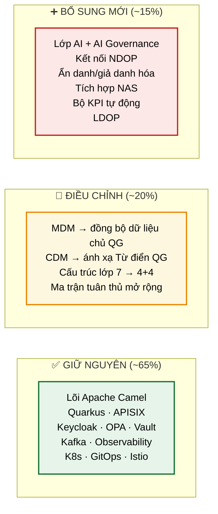
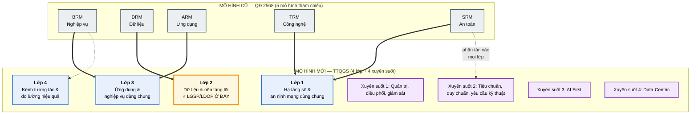
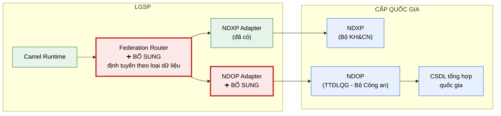
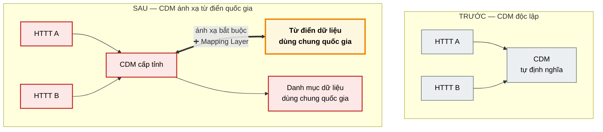
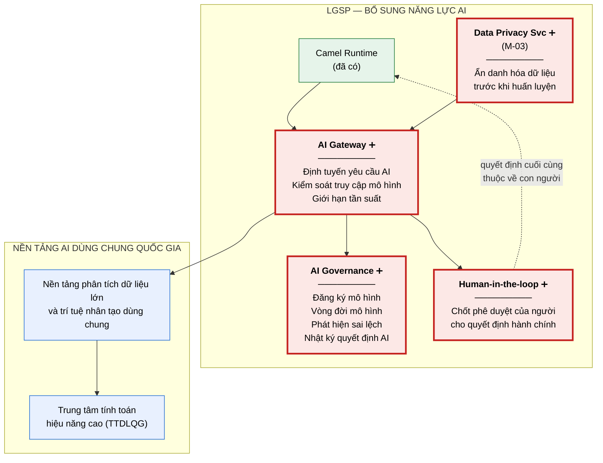
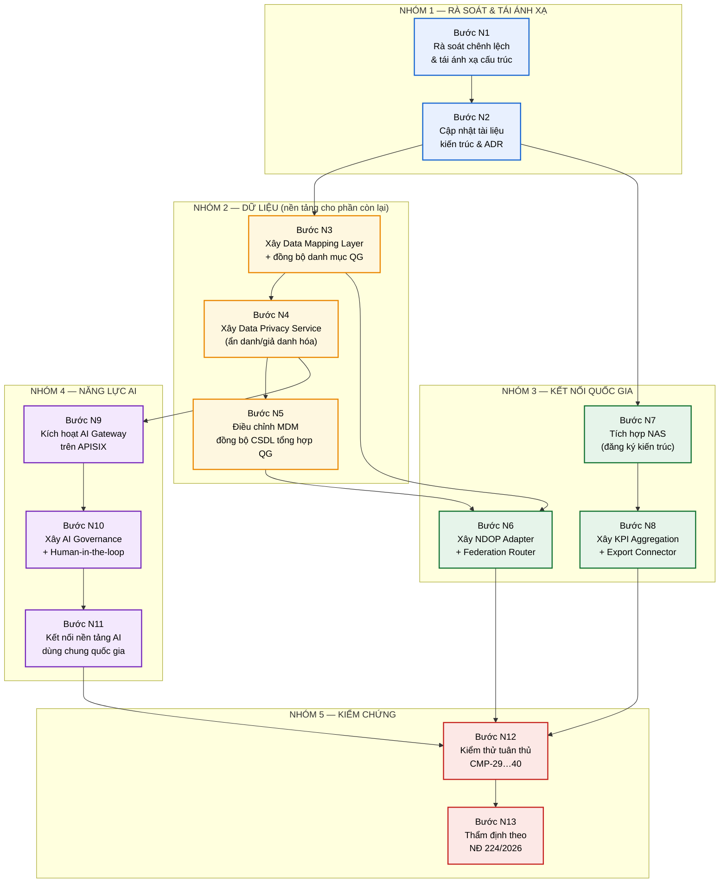

# 06 — Phân tích tác động Khung Kiến trúc tổng thể quốc gia số (TTQGS) và Kế hoạch nâng cấp

> **Nguồn**: `docs/4.DUTHAO_KHUNG_KIEN_TRUC_TTQGS_f1.docx` — Dự thảo Khung Kiến trúc tổng thể quốc gia số.
> **Vai trò tài liệu**: xác định chính xác những gì phải thay đổi trong thiết kế LGSP tại [02-architecture](../02-architecture/README.md), [03-flows](../03-flows/README.md), [04-deployment](../04-deployment/README.md), [05-adr](../05-adr/README.md).

---

## 1. Đánh giá tổng quan

### 1.1. Bản chất văn bản

| Tiêu chí | QĐ 2568/QĐ-BTTTT (đang dùng) | Dự thảo TTQGS (mới) |
|---|---|---|
| **Tên** | Khung Kiến trúc Chính phủ điện tử 3.0 | Khung Kiến trúc **tổng thể quốc gia số** |
| **Phạm vi** | Chính phủ (bộ, ngành, địa phương) | **Toàn hệ thống chính trị**: Đảng, Quốc hội, MTTQ, Chính phủ, TAND, VKSND, VP Chủ tịch nước |
| **Cấu trúc** | 5 mô hình tham chiếu (BRM, DRM, ARM, TRM, SRM) | **4 lớp + 4 thành phần xuyên suốt** |
| **Cơ quan chủ trì** | Bộ TT&TT | **Bộ Khoa học và Công nghệ** (phối hợp Bộ Công an) |
| **Định hướng công nghệ** | Không nêu rõ | **AI First**, **Data-Centric**, **Cloud First** |
| **Giám sát tuân thủ** | Không có công cụ tập trung | **Hệ thống NAS** + **Bộ KPI** thu thập tự động |

**Kết luận đánh giá.** Đây **không phải bản cập nhật nhỏ** mà là thay đổi mô hình kiến trúc nền tảng. Thiết kế LGSP hiện tại vẫn đúng về mặt kỹ thuật nhưng cần **tái ánh xạ cấu trúc**, **bổ sung 6 nhóm năng lực mới** và **điều chỉnh vai trò của 2 thành phần đã có**.

### 1.2. Mức độ tác động tổng hợp

**Điểm tích cực quan trọng.** Các nguyên tắc thiết kế mà TTQGS đặt ra — **API First, Security by Design, Privacy by Design, Modular Design, Cloud First, Open Standard** — đã được thiết kế hiện tại đáp ứng đầy đủ (xem NT-01…NT-10 tại [kiến trúc](../02-architecture/README.md#12-nguyên-tắc-kiến-trúc)). Toàn bộ lựa chọn công nghệ tại [ADR](../05-adr/README.md) không phải thay đổi. Đây là bằng chứng cho thấy nền tảng kiến trúc đã chọn đúng hướng.

---

## 2. Thay đổi cấu trúc: từ 5 mô hình tham chiếu sang 4 lớp

### 2.1. Sơ đồ ánh xạ cấu trúc

### 2.2. Thuyết minh thay đổi cấu trúc

**Ý nghĩa của việc chuyển mô hình.** Năm mô hình tham chiếu cũ là cách **mô tả** kiến trúc theo góc nhìn (view). Bốn lớp mới là cách **tổ chức** thành phần theo chức năng. Khác biệt thực tiễn: mô hình cũ trả lời "hãy mô tả hệ thống của anh theo 5 góc nhìn"; mô hình mới trả lời "thành phần của anh nằm ở lớp nào và dùng chung được với ai".

**Vị trí LGSP được xác định rõ ràng hơn.** Văn bản ghi trực tiếp tại Lớp 2 cấp tỉnh: *"Hạ tầng kết nối, chia sẻ dữ liệu cấp tỉnh phục vụ kết nối, chia sẻ dữ liệu giữa các hệ thống thông tin, cơ sở dữ liệu trong cùng cơ quan cấp tỉnh hoặc trong cùng trung tâm dữ liệu của cơ quan nhà nước **(LGSP/LDOP)**"*. Đây là lần đầu LGSP được đặt cạnh khái niệm **LDOP** (nền tảng điều phối dữ liệu cấp tỉnh).

**Ánh xạ kiến trúc 7 lớp hiện tại vào 4 lớp TTQGS:**

| Lớp hiện tại (thiết kế LGSP) | Ánh xạ vào TTQGS | Ghi chú |
|---|---|---|
| L0 — Hạ tầng (K8s, mesh, storage) | **Lớp 1** | Trực tiếp |
| L1 — Kết nối (Adapter) | **Lớp 2** | Thuộc nền tảng lõi |
| L2 — Dữ liệu dùng chung (MDM/RDM/DQ) | **Lớp 2** | Trực tiếp |
| L3 — Bất đồng bộ (Kafka) | **Lớp 2** | Thuộc nền tảng lõi |
| L4 — Tích hợp (Camel, BPM) | **Lớp 2** | **Lõi của LGSP** |
| L5 — Edge (APISIX, WAF) | **Lớp 1** (an ninh mạng) + **Lớp 2** | Chia đôi vai trò |
| L6 — Trải nghiệm (Portal, Dashboard) | **Lớp 4** | Trực tiếp |
| An toàn thông tin xuyên suốt | **Xuyên suốt 2** + Lớp 1 | Giữ tính xuyên suốt |

**Kết luận.** Kiến trúc 7 lớp hiện tại **không sai** — nó là phân rã chi tiết hơn bên trong Lớp 2 của TTQGS. Việc cần làm là **bổ sung bảng ánh xạ** để chứng minh tuân thủ khi thẩm định, không phải thiết kế lại.

---

## 3. Sáu nhóm năng lực phải bổ sung

### 3.1. Bảng tổng hợp

| # | Năng lực mới | Căn cứ trong TTQGS | Mức ưu tiên | Tác động |
|---|---|---|---|---|
| **M-01** | Kết nối **NDOP** (Nền tảng chia sẻ, điều phối dữ liệu của TTDLQG) | Lớp 2, thành phần nền tảng lõi | **Bắt buộc** | Thêm adapter mới |
| **M-02** | Tuân thủ **Từ điển dữ liệu dùng chung** + Khung kiến trúc dữ liệu QG | Nguyên tắc đồng bộ dữ liệu; yêu cầu Lớp 2 | **Bắt buộc** | Thay đổi CDM |
| **M-03** | **Ẩn danh hóa / giả danh hóa** dữ liệu | Yêu cầu Lớp 2 | **Bắt buộc** | Thêm dịch vụ mới |
| **M-04** | Tích hợp **NAS** (Hệ thống quản lý kiến trúc số quốc gia) | Nguyên tắc quản trị, giám sát tuân thủ | **Bắt buộc** | Thêm connector |
| **M-05** | **Bộ KPI** thu thập tự động (5 nhóm chỉ số) | Mục III.4 | **Bắt buộc** | Mở rộng giám sát |
| **M-06** | **Lớp AI + AI Governance by Design** | Xuyên suốt AI First; nguyên tắc thiết kế | **Cao** | Thành phần mới |

### 3.2. M-01 — Kết nối NDOP

**Yêu cầu.** TTQGS xác định hai nền tảng trung gian ở cấp quốc gia:

| Nền tảng | Chủ quản | Vai trò |
|---|---|---|
| **NDXP** | Bộ KH&CN (trước là Bộ TT&TT) | Nền tảng tích hợp, chia sẻ dữ liệu quốc gia |
| **NDOP** | **Trung tâm Dữ liệu quốc gia (Bộ Công an)** | Nền tảng **chia sẻ, điều phối** dữ liệu |

**Tác động thiết kế.** Kiến trúc hiện tại chỉ có `NDXP Adapter`. Phải bổ sung `NDOP Adapter` song song.

**Thuyết minh.** Thành phần **Federation Router** là bổ sung quan trọng: khi có hai đường ra quốc gia, cần logic quyết định dữ liệu nào đi đường nào. Đặt logic này tập trung ở một nơi thay vì rải rác trong từng route — nếu sau này phân công giữa NDXP và NDOP thay đổi, chỉ sửa một chỗ. Đây là áp dụng cùng nguyên tắc đã dùng cho NDXP Adapter tại [ADR-013](../05-adr/README.md#adr-013).

**Công việc cụ thể:**
1. Xây `NDOP Adapter` theo đặc tả kỹ thuật của TTDLQG (chờ hướng dẫn chi tiết).
2. Xây `Federation Router` với bảng định tuyến cấu hình được.
3. Bổ sung vào [F-04](../03-flows/README.md#f-04--khai-thác-dữ-liệu-từ-csdl-quốc-gia-qua-ndxp) nhánh khai thác qua NDOP.
4. Cập nhật ma trận tuân thủ: thêm mục kết nối NDOP.

### 3.3. M-02 — Tuân thủ Từ điển dữ liệu dùng chung quốc gia

**Yêu cầu trích dẫn.** *"Các cơ sở dữ liệu, hệ thống thông tin và nền tảng số trước khi thực hiện kết nối, chia sẻ dữ liệu thông qua các nền tảng tích hợp, chia sẻ dữ liệu quốc gia phải bảo đảm chuẩn hóa dữ liệu, ánh xạ dữ liệu, tuân thủ **Từ điển dữ liệu dùng chung**, **Danh mục dữ liệu dùng chung quốc gia** và các quy định của **Khung kiến trúc dữ liệu quốc gia**."*

**Tác động — đây là thay đổi có ảnh hưởng sâu nhất.** Thiết kế hiện tại xây **CDM tự định nghĩa** ([ADR-013](../05-adr/README.md#adr-013)). TTQGS yêu cầu CDM phải **ánh xạ về từ điển dữ liệu quốc gia**.

**Công việc cụ thể:**
1. Bổ sung **Data Mapping Layer** — dịch vụ ánh xạ giữa CDM cấp tỉnh và từ điển quốc gia.
2. Mở rộng `Reference Data Service` để đồng bộ **Danh mục dữ liệu dùng chung quốc gia** làm nguồn gốc, thay vì tự quản lý danh mục độc lập.
3. Bổ sung bước **kiểm tra ánh xạ** vào template route chuẩn — chặn bản tin không ánh xạ được trước khi gửi lên quốc gia.
4. Cập nhật [ADR-013](../05-adr/README.md#adr-013): CDM không còn hoàn toàn tự quyết mà là lớp trung gian có ràng buộc.

**Lưu ý thực thi.** Từ điển dữ liệu dùng chung quốc gia là văn bản do cơ quan có thẩm quyền ban hành, tại thời điểm này chưa công bố chi tiết. Thiết kế phải **để sẵn điểm mở rộng** (Mapping Layer với cấu hình ngoài) thay vì chờ — khi từ điển ban hành chỉ cần nạp cấu hình ánh xạ.

### 3.4. M-03 — Ẩn danh hóa và giả danh hóa dữ liệu

**Yêu cầu trích dẫn.** *"Hệ thống phải hỗ trợ cơ chế phân loại dữ liệu, phân quyền truy cập, lưu nhật ký truy cập, truy vết khai thác dữ liệu, kiểm soát chia sẻ dữ liệu, **ẩn danh hóa hoặc giả danh hóa dữ liệu** và quản trị vòng đời dữ liệu theo quy định."*

**Tác động.** Thiết kế hiện tại có **che dữ liệu (masking)** theo ngữ cảnh tại [F-03](../03-flows/README.md#f-03--khai-thác-dữ-liệu-đồng-bộ-nội-bộ) bước 24. Ẩn danh hóa và giả danh hóa là hai kỹ thuật **khác về bản chất**:

| Kỹ thuật | Định nghĩa | Khôi phục được? | Trường hợp dùng |
|---|---|---|---|
| **Masking** (đã có) | Che một phần giá trị hiển thị | Không cần khôi phục | Hiển thị cho người dùng ít quyền |
| **Giả danh hóa** (mới) | Thay định danh bằng bí danh, giữ ánh xạ ngược | **Có**, nếu có khóa | Phân tích dữ liệu, chuyển cho bên thứ ba có kiểm soát |
| **Ẩn danh hóa** (mới) | Loại bỏ hoàn toàn khả năng định danh | **Không** | Dữ liệu mở, thống kê, huấn luyện AI |

**Công việc cụ thể:**
1. Bổ sung **Data Privacy Service** với ba chế độ: mask / pseudonymize / anonymize.
2. Giả danh hóa dùng token có thể đảo ngược, khóa lưu trong Vault (kế thừa [ADR-012](../05-adr/README.md#adr-012)).
3. Ẩn danh hóa áp dụng kỹ thuật k-anonymity cho dữ liệu thống kê.
4. Chính sách chọn chế độ nào do OPA quyết định theo mục đích sử dụng — mở rộng chính sách hiện có.
5. **Bắt buộc** áp dụng cho mọi dữ liệu đưa vào huấn luyện AI (liên kết M-06).

### 3.5. M-04 — Tích hợp Hệ thống quản lý kiến trúc số quốc gia (NAS)

**Yêu cầu trích dẫn.** *"Kết quả triển khai, mức độ tuân thủ kiến trúc và tình trạng vận hành các thành phần kiến trúc số phải được theo dõi, cập nhật, quản lý thống nhất thông qua **Hệ thống quản lý kiến trúc số quốc gia**."*

**Tác động.** Đây là **nghĩa vụ báo cáo mới**, tương tự nghĩa vụ đồng bộ danh mục dịch vụ lên Bộ TT&TT tại [CMP-03](../01-legal/README.md#3-ma-trận-truy-vết-tuân-thủ) nhưng ở tầng kiến trúc.

**Công việc cụ thể:**
1. Xây **NAS Connector** — đẩy tự động lên NAS: danh mục thành phần kiến trúc LGSP, phiên bản, trạng thái vận hành, mức độ tuân thủ.
2. Duy trì **sổ đăng ký kiến trúc** (architecture registry) trong LGSP làm nguồn dữ liệu cho NAS — có thể dùng chính Backstage đã chọn tại [ADR-006](../05-adr/README.md#adr-006), mở rộng schema.
3. Bổ sung bước "đăng ký kiến trúc lên NAS" vào [F-02](../03-flows/README.md#f-02--công-bố-và-đăng-ký-dịch-vụ-chia-sẻ-dữ-liệu).

**Điểm thuận lợi.** Backstage đã có mô hình danh mục thành phần phần mềm; mở rộng để phục vụ NAS rẻ hơn nhiều so với xây mới.

### 3.6. M-05 — Bộ chỉ số KPI thu thập tự động

**Yêu cầu.** Năm nhóm chỉ số, *"ưu tiên kết nối, thu thập tự động"*, *"hạn chế tối đa việc tổng hợp, báo cáo thủ công"*:

| Nhóm KPI | Nội dung | Nguồn dữ liệu trong LGSP |
|---|---|---|
| **Tuân thủ kiến trúc** | Mức độ tuân thủ TTQGS và khung kiến trúc cơ quan | Architecture Registry (M-04) |
| **Liên thông và tích hợp** | Mức độ kết nối, chia sẻ, đồng bộ, khai thác dữ liệu; tuân thủ từ điển dữ liệu | Metrics từ Camel + Service Catalog |
| **Quản trị và vận hành** | Mức độ cập nhật, duy trì, giám sát khung kiến trúc | Architecture Registry + GitOps |
| **Kỹ thuật và an toàn** | Hiệu năng, tính sẵn sàng, an ninh mạng, bảo vệ dữ liệu | Prometheus + Audit Log |
| **Kết quả triển khai** | Mức độ hoàn thành mục tiêu, chỉ tiêu | Dashboard nghiệp vụ |

**Tác động.** Ngăn xếp quan sát hiện tại ([ADR-007](../05-adr/README.md#adr-007)) đã thu thập **phần lớn** dữ liệu thô cần thiết. Việc cần làm là **lớp tổng hợp và xuất báo cáo** theo định dạng cơ quan có thẩm quyền quy định.

**Công việc cụ thể:**
1. Xây **KPI Aggregation Service** — tổng hợp từ Prometheus, Audit Log, Catalog, Registry theo công thức KPI.
2. Xây **KPI Export Connector** — đẩy tự động lên NAS/nền tảng đo lường quốc gia theo định dạng và tần suất quy định.
3. Bổ sung dashboard KPI tuân thủ vào bộ dashboard hiện có (nhóm thứ năm bên cạnh bốn nhóm đã thiết kế).

### 3.7. M-06 — Lớp AI và AI Governance by Design

**Yêu cầu.** AI First là một trong bốn thành phần xuyên suốt. Kèm theo là **AI Governance by Design** với các yêu cầu cụ thể: quản trị toàn bộ vòng đời mô hình, kiểm soát dữ liệu huấn luyện, giám sát-lưu vết-truy vết-kiểm toán, phát hiện sai lệch mô hình, bảo đảm minh bạch và khả năng giải trình.

**Nguyên tắc quan trọng cần tuân thủ.** Văn bản ghi rõ: *"Đối với các quyết định ảnh hưởng đến quyền, lợi ích hợp pháp của tổ chức, cá nhân, việc ứng dụng trí tuệ nhân tạo **chỉ có tính chất hỗ trợ**; cơ quan, người có thẩm quyền chịu trách nhiệm xem xét, quyết định cuối cùng."* — AI không được tự quyết định hành chính.

**Định hướng ưu tiên.** Văn bản yêu cầu *"ưu tiên khai thác hạ tầng trí tuệ nhân tạo quốc gia, hạ tầng tính toán hiệu năng cao và nền tảng phân tích dữ liệu lớn và trí tuệ nhân tạo dùng chung; chỉ đầu tư, xây dựng mới khi chưa có thành phần dùng chung"*. Nghĩa là **LGSP không tự xây nền tảng AI riêng** mà đóng vai trò **cầu nối** tới nền tảng AI dùng chung quốc gia.

**Kiến trúc bổ sung:**

**Thuyết minh.** Thành phần **Human-in-the-loop** không phải kỹ thuật trang trí mà là yêu cầu pháp lý trực tiếp: mọi quyết định AI ảnh hưởng tới quyền lợi công dân phải qua phê duyệt của người có thẩm quyền. Thiết kế đặt chốt này ở tầng nền tảng để không phụ thuộc vào việc từng ứng dụng có nhớ cài đặt hay không — cùng triết lý với việc đặt kiểm tra quyền tập trung ở OPA.

**Công nghệ đề xuất (open-source, phù hợp K8s):**

| Nhu cầu | Công nghệ | Giấy phép |
|---|---|---|
| AI Gateway | **Apache APISIX ai-proxy plugin** (đã có APISIX) | Apache-2.0 |
| Đăng ký & vòng đời mô hình | **MLflow** | Apache-2.0 |
| Phục vụ mô hình | **KServe** (nếu buộc phải chạy cục bộ) | Apache-2.0 |
| Phát hiện sai lệch | **Evidently AI** | Apache-2.0 |
| Điều phối luồng AI | **Camel AI components** (camel-langchain4j) | Apache-2.0 |

**Điểm thuận lợi lớn.** Apache Camel đã có bộ component tích hợp AI (`camel-langchain4j-*`), và APISIX có plugin ai-proxy. Nghĩa là năng lực AI **bổ sung vào lõi hiện có** thay vì phải thêm ngăn xếp mới — tiếp tục nguyên tắc NT-09 (không khóa nhà cung cấp) và tận dụng đầu tư đã có.

---

## 4. Ba thành phần cần điều chỉnh vai trò

### 4.1. MDM — từ tự quyết sang đồng bộ

**Yêu cầu mới.** *"Dữ liệu chủ quốc gia phải được quản trị, cập nhật, đồng bộ và khai thác **thống nhất trên phạm vi toàn quốc**… thông qua **Cơ sở dữ liệu tổng hợp quốc gia** và các nền tảng chia sẻ, điều phối dữ liệu quốc gia, **hạn chế hình thành dữ liệu phân tán, cục bộ, không đồng nhất**."*

**Thay đổi vai trò:**

| Khía cạnh | Thiết kế hiện tại | Sau điều chỉnh |
|---|---|---|
| Nguồn chân lý dữ liệu chủ | MDM cấp tỉnh tạo bản ghi vàng | **CSDL tổng hợp quốc gia** là nguồn chân lý |
| Vai trò MDM cấp tỉnh | Quyết định golden record | **Đồng bộ, ánh xạ, bổ sung thuộc tính địa phương** |
| Quy tắc ưu tiên nguồn | Do bộ/tỉnh tự quyết định | Tuân theo quy định quốc gia; địa phương chỉ quyết phần đặc thù |
| Đối sánh thực thể | Tự thực hiện toàn bộ | Ưu tiên dùng kết quả định danh quốc gia; đối sánh cục bộ chỉ cho dữ liệu chưa có định danh |

**Tác động tới [F-09](../03-flows/README.md#f-09--quản-lý-dữ-liệu-chủ-và-đối-sánh-thực-thể).** Luồng vẫn giữ nguyên cấu trúc nhưng bổ sung bước đồng bộ ngược lên CSDL tổng hợp quốc gia, và thứ tự ưu tiên nguồn đặt CSDL quốc gia cao nhất — điều này thực ra đã có trong thiết kế, chỉ cần khẳng định rõ và bổ sung chiều đồng bộ lên.

**Đánh giá.** Đây là điều chỉnh **có lợi**: giảm gánh nặng cho MDM cấp tỉnh, tránh mâu thuẫn dữ liệu chủ giữa các tỉnh.

### 4.2. Reference Data Service — nhận danh mục từ quốc gia

**Thay đổi.** Từ chỗ tự quản lý danh mục dùng chung của bộ/tỉnh, chuyển sang **đồng bộ Danh mục dữ liệu dùng chung quốc gia** làm gốc, chỉ mở rộng phần đặc thù địa phương. Cơ chế phiên bản danh mục đã thiết kế vẫn dùng được, thêm trường "nguồn: quốc gia / địa phương".

### 4.3. APISIX — bổ sung vai trò AI Gateway

**Thay đổi.** Kích hoạt plugin `ai-proxy` để APISIX đảm nhiệm thêm vai trò cổng kiểm soát truy cập mô hình AI, tận dụng sẵn cơ chế xác thực, giới hạn tần suất và ghi vết đã cấu hình.

---

## 5. Bổ sung ma trận tuân thủ

Mở rộng ma trận [CMP-01…28](../01-legal/README.md#3-ma-trận-truy-vết-tuân-thủ) thêm 12 mục mới:

| ID | Yêu cầu | Nguồn | Thành phần đáp ứng | Kiểm chứng |
|---|---|---|---|---|
| **CMP-29** | Kết nối NDOP | TTQGS Lớp 2 | NDOP Adapter + Federation Router | Kiểm thử kết nối thực tế |
| **CMP-30** | Ánh xạ Từ điển dữ liệu dùng chung QG | TTQGS Lớp 2, nguyên tắc đồng bộ dữ liệu | Data Mapping Layer | Kiểm tra ánh xạ 100% trường CDM |
| **CMP-31** | Tuân thủ Danh mục dữ liệu dùng chung QG | TTQGS Lớp 2 | Reference Data Service (mở rộng) | Đối chiếu danh mục |
| **CMP-32** | Ẩn danh hóa / giả danh hóa | TTQGS Lớp 2 | Data Privacy Service | Kiểm thử 3 chế độ |
| **CMP-33** | Đăng ký kiến trúc lên NAS | TTQGS nguyên tắc quản trị | NAS Connector | Log đồng bộ thành công |
| **CMP-34** | Cung cấp dữ liệu KPI tự động | TTQGS mục III.4 | KPI Aggregation + Export | Báo cáo KPI tự sinh |
| **CMP-35** | Dữ liệu chủ đồng bộ CSDL tổng hợp QG | TTQGS nguyên tắc dữ liệu chủ thống nhất | MDM (điều chỉnh) | Kiểm thử đồng bộ hai chiều |
| **CMP-36** | AI Governance toàn vòng đời | TTQGS AI Governance by Design | AI Governance Service | Hồ sơ vòng đời mô hình |
| **CMP-37** | Con người quyết định cuối với QĐ hành chính | TTQGS nguyên tắc thiết kế AI | Human-in-the-loop | Kiểm thử không thể bỏ qua chốt duyệt |
| **CMP-38** | Kiểm soát dữ liệu huấn luyện AI | TTQGS yêu cầu Lớp 2 | Data Privacy + AI Governance | Truy vết nguồn dữ liệu huấn luyện |
| **CMP-39** | Ưu tiên hạ tầng dùng chung quốc gia | TTQGS nguyên tắc thiết kế | Thiết kế tổng thể | Thuyết minh trong hồ sơ đầu tư |
| **CMP-40** | Thẩm định tuân thủ khung kiến trúc | NĐ 224/2026 Điều 37, Chương VI | Hồ sơ dự án | Kết quả thẩm định |

---

## 6. Kế hoạch nâng cấp — các bước tiến hành

> Tuân theo cùng nguyên tắc với [04-deployment](../04-deployment/README.md): tổ chức theo **trình tự và điều kiện chuyển bước**, không theo mốc thời gian.

### 6.1. Sơ đồ trình tự nâng cấp

**Thuyết minh trình tự.** Nhóm 2 (dữ liệu) đặt trước nhóm 3 và 4 vì cả hai đều phụ thuộc: NDOP Adapter cần Data Mapping Layer để chuẩn hóa trước khi gửi lên quốc gia; lớp AI cần Data Privacy Service để ẩn danh hóa dữ liệu huấn luyện. Bước N7 và N8 (NAS, KPI) chạy song song với nhánh dữ liệu vì độc lập về kỹ thuật.

### 6.2. Chi tiết các bước

#### Bước N1 — Rà soát chênh lệch và tái ánh xạ cấu trúc

**Mục tiêu.** Xác định chính xác khoảng cách giữa thiết kế hiện tại và TTQGS.

**Công việc:**
1. Lập bảng ánh xạ 7 lớp hiện tại → 4 lớp TTQGS (đã có tại mục 2.2, cần chi tiết hóa tới từng thành phần).
2. Đối chiếu từng thành phần với danh mục thành phần TTQGS Lớp 2 cấp tỉnh.
3. Xác định thành phần trùng lặp với nền tảng dùng chung quốc gia — theo nguyên tắc *"không đầu tư độc lập các hệ thống có chức năng trùng lặp với hệ thống dùng chung đã triển khai"*.
4. Lập danh sách chênh lệch có mức ưu tiên.

**Tiêu chí ra:**
- ✅ Mỗi thành phần trong thiết kế được xếp vào đúng lớp TTQGS.
- ✅ Xác định rõ thành phần nào tự xây, thành phần nào dùng chung quốc gia.
- ✅ Danh sách chênh lệch được hội đồng kỹ thuật thông qua.

#### Bước N2 — Cập nhật tài liệu kiến trúc và ADR

**Công việc:**
1. Bổ sung mục ánh xạ TTQGS vào [02-architecture](../02-architecture/README.md).
2. Cập nhật [01-legal](../01-legal/README.md): thêm TTQGS, NĐ 224/2026, QĐ 21/2026 vào bộ văn bản chi phối; mở rộng ma trận lên CMP-40.
3. Cập nhật [ADR-013](../05-adr/README.md#adr-013) (CDM có ràng buộc từ điển quốc gia).
4. Bổ sung ADR mới: ADR-015 (kết nối NDOP), ADR-016 (lớp AI và AI Governance), ADR-017 (ẩn danh hóa dữ liệu).

**Tiêu chí ra:** ✅ Bộ tài liệu phản ánh đầy đủ yêu cầu TTQGS, sẵn sàng cho thẩm định.

#### Bước N3 — Data Mapping Layer và đồng bộ danh mục quốc gia

**Công việc:**
1. Xây dịch vụ ánh xạ CDM ↔ Từ điển dữ liệu dùng chung quốc gia, cấu hình ánh xạ để ngoài (không hardcode).
2. Mở rộng Reference Data Service: đồng bộ Danh mục dữ liệu dùng chung quốc gia, phân biệt nguồn quốc gia / địa phương.
3. Bổ sung bước kiểm tra ánh xạ vào template route chuẩn.
4. Xử lý tình huống từ điển quốc gia chưa ban hành: thiết kế sẵn điểm mở rộng, dùng ánh xạ tạm thời có đánh dấu.

**Tiêu chí ra:**
- ✅ 100% trường trong CDM có ánh xạ (hoặc được đánh dấu là đặc thù địa phương có lý do).
- ✅ Bản tin không ánh xạ được bị chặn trước khi gửi lên quốc gia (CMP-30).

#### Bước N4 — Data Privacy Service

**Công việc:**
1. Xây dịch vụ với ba chế độ: masking, pseudonymization (đảo ngược được, khóa trong Vault), anonymization (k-anonymity).
2. Mở rộng chính sách OPA: quyết định chế độ theo mục đích sử dụng và vai trò bên khai thác.
3. Tích hợp vào template route chuẩn.
4. Bắt buộc áp dụng cho mọi luồng đưa dữ liệu vào huấn luyện AI.

**Tiêu chí ra:**
- ✅ Ba chế độ hoạt động đúng, kiểm chứng bằng bộ dữ liệu thử (CMP-32).
- ✅ Giả danh hóa đảo ngược được đúng khi có quyền; không đảo ngược được khi không có khóa.
- ✅ Ẩn danh hóa đạt ngưỡng k-anonymity đã đặt.

#### Bước N5 — Điều chỉnh MDM

**Công việc:**
1. Bổ sung chiều đồng bộ lên CSDL tổng hợp quốc gia.
2. Điều chỉnh thứ tự ưu tiên nguồn: CSDL quốc gia là nguồn chân lý.
3. Thu hẹp phạm vi đối sánh cục bộ: chỉ áp dụng cho dữ liệu chưa có định danh quốc gia.
4. Cập nhật [F-09](../03-flows/README.md#f-09--quản-lý-dữ-liệu-chủ-và-đối-sánh-thực-thể).

**Tiêu chí ra:** ✅ Đồng bộ hai chiều với CSDL tổng hợp quốc gia thành công, không tạo mâu thuẫn dữ liệu chủ (CMP-35).

#### Bước N6 — NDOP Adapter và Federation Router

**Công việc:**
1. Thu thập đặc tả kỹ thuật NDOP từ TTDLQG; làm thủ tục đăng ký kết nối (khởi động sớm — thủ tục hành chính thường mất thời gian).
2. Xây NDOP Adapter theo mẫu NDXP Adapter đã có.
3. Xây Federation Router với bảng định tuyến cấu hình được.
4. Bổ sung nhánh NDOP vào [F-04](../03-flows/README.md#f-04--khai-thác-dữ-liệu-từ-csdl-quốc-gia-qua-ndxp).

**Tiêu chí ra:** ✅ Gửi/nhận thành công với NDOP; Federation Router định tuyến đúng theo cấu hình (CMP-29).

#### Bước N7 — Tích hợp NAS

**Công việc:**
1. Mở rộng Backstage thành Architecture Registry: mô hình hóa thành phần kiến trúc, phiên bản, trạng thái.
2. Xây NAS Connector đẩy tự động lên hệ thống quốc gia.
3. Bổ sung bước đăng ký kiến trúc vào [F-02](../03-flows/README.md#f-02--công-bố-và-đăng-ký-dịch-vụ-chia-sẻ-dữ-liệu).

**Tiêu chí ra:** ✅ Danh mục thành phần kiến trúc đồng bộ thành công lên NAS (CMP-33).

#### Bước N8 — KPI Aggregation và Export

**Công việc:**
1. Xây dịch vụ tổng hợp KPI từ Prometheus, Audit Log, Catalog, Registry theo năm nhóm chỉ số.
2. Xây connector xuất tự động theo định dạng và tần suất quy định.
3. Bổ sung dashboard KPI tuân thủ.

**Tiêu chí ra:** ✅ Báo cáo KPI năm nhóm sinh tự động, không cần tổng hợp thủ công (CMP-34).

#### Bước N9 — Kích hoạt AI Gateway

**Công việc:**
1. Bật plugin `ai-proxy` trên APISIX.
2. Cấu hình kiểm soát truy cập mô hình, giới hạn tần suất, ghi vết yêu cầu AI.
3. Tích hợp `camel-langchain4j` vào Camel Runtime cho các luồng cần AI.

**Tiêu chí ra:** ✅ Yêu cầu AI đi qua gateway, được xác thực, giới hạn và ghi vết đầy đủ.

#### Bước N10 — AI Governance và Human-in-the-loop

**Công việc:**
1. Triển khai MLflow làm sổ đăng ký mô hình, quản lý vòng đời.
2. Triển khai Evidently AI phát hiện sai lệch mô hình.
3. Xây nhật ký quyết định AI: ghi đầu vào, mô hình, phiên bản, đầu ra, độ tin cậy.
4. **Xây chốt Human-in-the-loop**: mọi quyết định AI ảnh hưởng quyền lợi tổ chức/cá nhân bắt buộc qua phê duyệt của người có thẩm quyền, không thể bỏ qua bằng cấu hình.
5. Truy vết nguồn dữ liệu huấn luyện.

**Tiêu chí ra:**
- ✅ Hồ sơ vòng đời mô hình đầy đủ, truy vết được (CMP-36).
- ✅ Kiểm thử chứng minh **không thể** ra quyết định hành chính tự động bỏ qua chốt phê duyệt (CMP-37).
- ✅ Truy vết được dữ liệu huấn luyện của từng mô hình (CMP-38).

#### Bước N11 — Kết nối nền tảng AI dùng chung quốc gia

**Công việc:**
1. Đăng ký sử dụng nền tảng phân tích dữ liệu lớn và AI dùng chung quốc gia.
2. Xây adapter kết nối.
3. Chỉ triển khai KServe cục bộ cho trường hợp nền tảng dùng chung không đáp ứng — kèm thuyết minh lý do theo yêu cầu TTQGS.

**Tiêu chí ra:** ✅ Khai thác được nền tảng AI dùng chung; có thuyết minh cho mọi thành phần AI tự xây (CMP-39).

#### Bước N12 — Kiểm thử tuân thủ CMP-29…40

**Công việc.** Kiểm chứng từng mục tuân thủ mới bằng bằng chứng cụ thể, theo cùng phương pháp đã dùng cho CMP-01…28 tại [bước 15](../04-deployment/README.md#bước-15--nghiệm-thu-tuân-thủ-pháp-lý).

**Tiêu chí ra:** ✅ 12/12 mục mới có bằng chứng được chấp nhận.

#### Bước N13 — Thẩm định theo Nghị định 224/2026

**Công việc:**
1. Lập hồ sơ thẩm định tuân thủ khung kiến trúc theo Điều 37 và Chương VI NĐ 224/2026.
2. Chuẩn bị thuyết minh: thành phần nào dùng chung quốc gia, thành phần nào tự xây và vì sao.
3. Trình cơ quan có thẩm quyền.

**Tiêu chí ra:** ✅ Hồ sơ thẩm định được phê duyệt (CMP-40).

---

## 7. Rủi ro đặc thù của việc nâng cấp

| Rủi ro | Mức độ | Ứng phó |
|---|---|---|
| **Từ điển dữ liệu dùng chung QG chưa ban hành chi tiết** | **Cao** | Thiết kế Mapping Layer với cấu hình ngoài; dùng ánh xạ tạm có đánh dấu; nạp cấu hình khi văn bản ban hành — **không dừng chờ** |
| **Đặc tả kỹ thuật NDOP chưa công bố** | **Cao** | Xây khung adapter theo mẫu NDXP; khởi động thủ tục đăng ký sớm; hoàn thiện khi có đặc tả |
| **Văn bản còn ở dạng dự thảo, có thể thay đổi** | **Trung bình** | Ưu tiên các thay đổi có tính ổn định cao (cấu trúc 4 lớp, AI Governance, ẩn danh hóa); trì hoãn các chi tiết dễ biến động |
| **Yêu cầu AI First bị hiểu thành phải dùng AI mọi nơi** | **Trung bình** | Bám nguyên tắc trong văn bản: AI **hỗ trợ**, con người quyết định; áp dụng AI nơi có giá trị thực |
| **Trùng lặp đầu tư với nền tảng dùng chung QG** | **Cao** | Rà soát tại bước N1; mọi thành phần tự xây phải có thuyết minh lý do |
| **Chi phí bổ sung ngoài dự toán ban đầu** | **Trung bình** | Phần lớn năng lực mới tận dụng thành phần đã có (APISIX, Backstage, Prometheus, Camel) — chi phí gia tăng thấp hơn nhiều so với xây mới |

---

## 8. Kết luận và khuyến nghị

### 8.1. Đánh giá chung

Thiết kế LGSP hiện tại **giữ được khoảng 65% nguyên vẹn**. Toàn bộ lựa chọn công nghệ tại [ADR-001…014](../05-adr/README.md) không phải thay đổi — các nguyên tắc TTQGS đặt ra (API First, Security/Privacy by Design, Modular, Cloud First, Open Standard) trùng khớp với nguyên tắc đã áp dụng.

### 8.2. Ba việc cần làm ngay

| # | Việc | Lý do ưu tiên |
|---|---|---|
| 1 | **Bước N1 — rà soát chênh lệch** | Không thể lập kế hoạch chính xác nếu chưa biết chính xác khoảng cách |
| 2 | **Khởi động thủ tục kết nối NDOP** | Thủ tục hành chính không phụ thuộc tiến độ kỹ thuật, thường là điểm nghẽn |
| 3 | **Thiết kế Data Mapping Layer với cấu hình ngoài** | Là nút thắt của nhóm 3 và 4; phải xây sẵn khung dù từ điển quốc gia chưa ban hành |

### 8.3. Khuyến nghị về cách tiếp cận

**Không chờ văn bản chính thức.** Đây là dự thảo, nhưng các thay đổi cốt lõi — cấu trúc 4 lớp, AI Governance, ẩn danh hóa, kết nối NDOP, NAS, KPI — phản ánh định hướng đã rõ ràng qua Luật Dữ liệu 2024, NĐ 165/2025 và việc thành lập Trung tâm Dữ liệu quốc gia. Thiết kế theo hướng này không có rủi ro lãng phí.

**Ưu tiên điểm mở rộng hơn cài đặt hoàn chỉnh.** Với các phần phụ thuộc văn bản hướng dẫn chưa ban hành (từ điển dữ liệu, đặc tả NDOP, định dạng KPI), xây **khung có cấu hình ngoài** thay vì chờ. Khi văn bản ban hành, chỉ nạp cấu hình.

**Tận dụng tối đa thành phần đã chọn.** AI Gateway dùng APISIX đã có; Architecture Registry mở rộng từ Backstage; KPI tổng hợp từ Prometheus và Audit Log đã thu thập. Cách này giữ chi phí nâng cấp ở mức thấp và tránh tăng độ phức tạp vận hành.

---

## Liên kết

- Cơ sở pháp lý → [01-legal](../01-legal/README.md)
- Kiến trúc hệ thống → [02-architecture](../02-architecture/README.md)
- Luồng nghiệp vụ → [03-flows](../03-flows/README.md)
- Kế hoạch triển khai gốc → [04-deployment](../04-deployment/README.md)
- Quyết định công nghệ → [05-adr](../05-adr/README.md)
